# متن کامل پنج جلد «هنر و علم ساخت هوش»

> این فایل، متن Markdown کامل جلدهای ۱ تا ۵ را یک‌جا گرد آورده است. محتوای هر جلد بدون خلاصه‌سازی درج شده و شناسنامه، نسخه و یادداشت‌های وضعیت خود جلد را حفظ می‌کند.

## فهرست جلدها

1. [جلد 1](#volume-1)
2. [جلد 2](#volume-2)
3. [جلد 3](#volume-3)
4. [جلد 4](#volume-4)
5. [جلد 5](#volume-5)

---

<a id="volume-1"></a>

<!-- BEGIN VOLUME 1: volume-1-full-fa.md -->

# هنر و علم ساخت هوش — جلد اول: پایه‌های ساخت هوش
**The Art & Science of Building Intelligence — Babak & Ai**

**شناسنامه:** جلد اول؛ نسخه کاری 0.9.0-rc (در حال ممیزی، نه انتشار نهایی)؛ مبنای تغییرات: fb733b65a65d6f511aed87e533c7e15b7f199ef4؛ تاریخ ۵ نوامبر ۲۰۲۶. مجوز انتشار: مشخص نشده و نیازمند تصمیم صاحب اثر است. روش ارجاع: Babak & Ai، هنر و علم ساخت هوش، جلد اول، نسخه و commit مورد استفاده. محدودیت: برخی آزمون‌ها و بررسی‌های نشر هنوز باز هستند.

این فایل نسخه یکپارچهٔ متن ۲۱ فصل جلد اول برای مطالعه و بازبینی است. منابع، کدها و بخش‌های تکمیلی هر فصل حفظ شده‌اند.

[پروژه‌ها](https://github.com/mvbabababak-spec/fa-academy/tree/gh-pages/book-engineering/projects) · [نقشه پنج جلد](https://github.com/mvbabababak-spec/fa-academy/blob/gh-pages/BOOK_ROADMAP_FA.md)

## فهرست فصل‌ها

1. هوش چیست؟ از انسان تا ماشین — [فایل منبع فصل](https://raw.githubusercontent.com/mvbabababak-spec/fa-academy/gh-pages/book-engineering/chapters/01-intelligence.md)
2. خانواده هوش مصنوعی: از الگوریتم تا مدل زبانی — [فایل منبع فصل](https://raw.githubusercontent.com/mvbabababak-spec/fa-academy/gh-pages/book-engineering/chapters/02-ai-families.md)
3. چرخه حیات مدل: از داده تا استنتاج و بازخورد — [فایل منبع فصل](https://raw.githubusercontent.com/mvbabababak-spec/fa-academy/gh-pages/book-engineering/chapters/03-model-lifecycle.md)
4. تاریخ هوش مصنوعی: از پرسپترون تا مدل‌های مدرن — [فایل منبع فصل](https://raw.githubusercontent.com/mvbabababak-spec/fa-academy/gh-pages/book-engineering/chapters/04-history.md)
5. کامپیوتر از درون: CPU، حافظه و ذخیره‌سازی — [فایل منبع فصل](https://raw.githubusercontent.com/mvbabababak-spec/fa-academy/gh-pages/book-engineering/chapters/05-computer-foundations.md)
6. GPU و NPU: محاسبات موازی و حافظه مدل — [فایل منبع فصل](https://raw.githubusercontent.com/mvbabababak-spec/fa-academy/gh-pages/book-engineering/chapters/06-gpu-parallelism.md)
7. اکوسیستم‌های محاسبات هوش مصنوعی: CUDA، ROCm، TPU و Apple Silicon — [فایل منبع فصل](https://raw.githubusercontent.com/mvbabababak-spec/fa-academy/gh-pages/book-engineering/chapters/07-compute-ecosystems.md)
8. چند GPU، شبکه، انرژی و محاسبات توزیع‌شده — [فایل منبع فصل](https://raw.githubusercontent.com/mvbabababak-spec/fa-academy/gh-pages/book-engineering/chapters/08-distributed-infrastructure.md)
9. نخستین گام برنامه‌نویسی و Python — [فایل منبع فصل](https://raw.githubusercontent.com/mvbabababak-spec/fa-academy/gh-pages/book-engineering/chapters/09-first-program.md)
10. Python از پایه: متغیر، داده، شرط و حلقه — [فایل منبع فصل](https://raw.githubusercontent.com/mvbabababak-spec/fa-academy/gh-pages/book-engineering/chapters/10-python-basics.md)
11. توابع، ماژول‌ها و ساختمان داده‌ها — [فایل منبع فصل](https://raw.githubusercontent.com/mvbabababak-spec/fa-academy/gh-pages/book-engineering/chapters/11-functions-data-structures.md)
12. کلاس‌ها، خطاها، فایل، JSON و API — [فایل منبع فصل](https://raw.githubusercontent.com/mvbabababak-spec/fa-academy/gh-pages/book-engineering/chapters/12-classes-files-json-api.md)
13. Linux، Bash، Git و محیط‌های مجازی — [فایل منبع فصل](https://raw.githubusercontent.com/mvbabababak-spec/fa-academy/gh-pages/book-engineering/chapters/13-linux-git-environments.md)
14. عیب‌یابی، آزمون، طراحی نرم‌افزار، SQL و امنیت — [فایل منبع فصل](https://raw.githubusercontent.com/mvbabababak-spec/fa-academy/gh-pages/book-engineering/chapters/14-debug-testing-sql-security.md)
15. NumPy، Pandas، Matplotlib و Jupyter — [فایل منبع فصل](https://raw.githubusercontent.com/mvbabababak-spec/fa-academy/gh-pages/book-engineering/chapters/15-data-analysis.md)
16. جبر، معادله، تابع، توان، لگاریتم و نمودار — [فایل منبع فصل](https://raw.githubusercontent.com/mvbabababak-spec/fa-academy/gh-pages/book-engineering/chapters/16-algebra-functions.md)
17. بردار، ماتریس، ابعاد و مقادیر ویژه — [فایل منبع فصل](https://raw.githubusercontent.com/mvbabababak-spec/fa-academy/gh-pages/book-engineering/chapters/17-linear-algebra.md)
18. مشتق، انتگرال، قاعده زنجیره‌ای و گرادیان — [فایل منبع فصل](https://raw.githubusercontent.com/mvbabababak-spec/fa-academy/gh-pages/book-engineering/chapters/18-calculus.md)
19. احتمال، آمار، توزیع‌ها، نمونه‌گیری و بیز — [فایل منبع فصل](https://raw.githubusercontent.com/mvbabababak-spec/fa-academy/gh-pages/book-engineering/chapters/19-probability-statistics.md)
20. بهینه‌سازی، گرادیان‌کاهشی و پایداری عددی — [فایل منبع فصل](https://raw.githubusercontent.com/mvbabababak-spec/fa-academy/gh-pages/book-engineering/chapters/20-optimization.md)
21. نظریه اطلاعات: آنتروپی، آنتروپی متقاطع و KL — [فایل منبع فصل](https://raw.githubusercontent.com/mvbabababak-spec/fa-academy/gh-pages/book-engineering/chapters/21-information-theory.md)

---

# فصل ۱ — هوش چیست؟ از انسان تا ماشین

**هنر و علم ساخت هوش | جلد اول | Babak & Ai**

[مسیر پیشنهادی یادگیری جلد اول](book-engineering/LEARNING_PATH_FA.md) — زمان‌های تقریبی، پیش‌نیازها و پروژه‌های تلفیقی پیشنهادی.
**نسخه کاری RC · تاریخ مراجعه به منابع: ۴ نوامبر ۲۰۲۶؛ بازبینی منابع: ۵ نوامبر ۲۰۲۶**

## ۱. دروازه ورود: چرا ساخت هوش را با پرسش آغاز می‌کنیم؟

تصور کنید دو نفر پشت پنجره‌ای ایستاده‌اند. آسمان ابری است. یکی می‌گوید: «چتر ببر؛ ممکن است باران ببارد.» دیگری دستگاهی ساخته که با اندازه‌گیری رطوبت و دما هشدار می‌دهد. هر دو از نشانه‌ها برای تصمیم استفاده می‌کنند، اما از همین شباهت ظاهری نمی‌توان نتیجه گرفت که دستگاه همان تجربه، انگیزه یا فهم انسان را دارد. همین فاصله میان **عملکرد قابل مشاهده** و **سازوکار درونی** نقطه آغاز کتاب ماست.

در این فصل یاد می‌گیریم یک رفتار را با هدف، اطلاعات، شرایط و معیار موفقیت توصیف کنیم؛ هوش انسانی و ماشینی را بدون انسان‌انگاری مقایسه کنیم؛ یک سیستم قاعده‌محور ساده را بسازیم و محدودیت‌هایش را آزمایش کنیم. پیش‌نیاز علمی و برنامه‌نویسی ندارد. قرار نیست در این فصل شبکه عصبی یا مدل زبانی بسازیم؛ آن‌ها بعداً بر پایه همین مفاهیم ساخته می‌شوند.

**نقشه یادگیری:** مشاهده مسئله ← تعریف هدف و معیار ← طراحی رفتار ← آزمون روی نمونه‌های تازه ← تحلیل خطا ← بازطراحی.

**در پایان باید بتوانید:** (۱) سه توانایی مرتبط با هوش نام ببرید؛ (۲) مثال سامانه قاعده‌محور و یادگیرنده را متمایز کنید؛ (۳) دقت یک آزمون را محاسبه کنید؛ (۴) یک برنامه کوچک اجرا و برای آن نمونه شکست بسازید؛ (۵) توضیح دهید چرا عملکرد خوب، به‌تنهایی اثبات آگاهی نیست.

## ۲. هوش: یک واژه، چند پرسش

در زبان روزمره، «باهوش» ممکن است به کسی گفته شود که خوب استدلال می‌کند، سریع یاد می‌گیرد، در موقعیت تازه راه‌حل می‌سازد یا دیگران را درک می‌کند. در علم، این توانایی‌ها یکسان نیستند و تعریف یگانه‌ای که همه دانشمندان و فیلسوفان بر آن توافق داشته باشند وجود ندارد [۱]. بنابراین در این کتاب، به‌جای تکیه بر یک صفت کلی، از **توانایی‌های مشخص در شرایط مشخص** حرف می‌زنیم.

برای تحلیل یک فعالیت می‌توان این اجزا را مشخص کرد:

- **ادراک (Perception):** دریافت و تفسیر نشانه‌ها؛ مثلاً دیدن عابر. خودِ حسگر لزوماً تشخیص نمی‌دهد چه چیزی در تصویر است.
- **حافظه (Memory):** نگهداری و بازیابی اطلاعات گذشته؛ مثلاً به خاطر آوردن مسیر. انواع حافظه در انسان و ماشین سازوکارهای متفاوتی دارند.
- **یادگیری (Learning):** تغییر در قابلیت انجام یک کار بر اثر تجربه یا داده. تغییر موقتی یک پاسخ، الزاماً آموزش پایدار پارامترهای یک مدل نیست.
- **استدلال (Reasoning):** رسیدن به نتیجه از اطلاعات یا قواعد، مانند نتیجه‌گیری از «همه پستانداران تنفس می‌کنند» و «نهنگ پستاندار است». در موقعیت واقعی مقدمات هم ممکن است خطا داشته باشند.
- **برنامه‌ریزی (Planning):** انتخاب زنجیره‌ای از اقدامات برای رسیدن به هدف، با توجه به محدودیت و پیامدها.
- **تعمیم (Generalization):** عملکرد مناسب روی موارد تازه‌ای که عیناً در تجربه یا داده آموزشی دیده نشده‌اند. تعمیم مطلق و تضمین‌شده نیست.

این فهرست تعریف نهایی هوش نیست؛ یک جعبه‌ابزار تحلیلی است. یک ماشین‌حساب در ضرب بزرگ از بیشتر انسان‌ها سریع‌تر است، اما از یک عملکرد برتر نمی‌توان نتیجه گرفت همه جنبه‌های هوش انسانی را دارد. برعکس، کندی در محاسبه نیز به معنی نبود سایر توانایی‌ها نیست.

**تمرین شهودی:** سامانه مسیریابی را در نظر بگیرید. ورودی‌هایش چیست؟ هدف آن چیست؟ اگر جاده بسته شود چه اطلاعات تازه‌ای لازم دارد؟ آیا الزاماً تجربه ذهنی ترافیک دارد؟ سه سؤال اول را می‌توان با آزمایش بررسی کرد؛ سؤال آخر از جنس متفاوتی است و پاسخ قطعی آن را از این رفتار تنها نمی‌توان استخراج کرد.

## ۳. انسان و ماشین: شباهت در مسئله، تفاوت در سازوکار

انسان از بدن، حس‌ها، تعامل اجتماعی و تجربه طولانی استفاده می‌کند. توانایی‌های انسانی حاصل عوامل زیستی و محیطی پیچیده‌اند؛ هیچ مدل ساده‌ای در این فصل جایگزین علم اعصاب و روان‌شناسی نیست. یک سیستم ماشینی ممکن است ورودی تصویر یا متن دریافت کند و با قواعد، مدل آماری یا ترکیبی از این‌ها خروجی بسازد. **شباهت خروجی به معنی یکسان بودن راه رسیدن به آن نیست.**

| جنبه | نمونه انسانی | نمونه ماشینی | احتیاط |
|---|---|---|---|
| ورودی | دیدن تابلو با چشم | تصویر ثبت‌شده توسط دوربین | کیفیت حسگر و زمینه متفاوت است |
| تجربه | تمرین رانندگی در موقعیت‌های مختلف | داده آموزش و/یا قواعد طراحی‌شده | میزان و نوع داده قابل مقایسه مستقیم نیست |
| تصمیم | انتخاب واکنش در ترافیک | محاسبه خروجی بر اساس ورودی و طراحی | هر دو ممکن است خطا کنند |
| سازگاری | یادگیری مهارت تازه با راهنمایی | گاهی بازآموزی یا تغییر تنظیمات | هر سیستم مستقرشده خودکار یاد نمی‌گیرد |
| توضیح | ارائه دلیل زبانی، گاهی ناقص | گزارش قاعده یا تولید توضیح | توضیح روان همیشه بیان دقیق علت واقعی نیست |

در پژوهش درباره **آگاهی (Consciousness)** و تجربه ذهنی هنوز اختلاف‌نظر اساسی وجود دارد. ادعای «این مدل قطعاً آگاه است» یا «صرفاً چون خروجی تولید می‌کند ثابت است آگاه نیست» از شواهد همین فصل فراتر می‌رود. تمرکز مهندسی ما بر قابلیت‌های آزمون‌پذیر و پیامدهای استفاده است، بدون تبدیل پرسش فلسفی باز به واقعیت قطعی.

## ۴. یک سیستم هوش مصنوعی چگونه توصیف می‌شود؟

بر اساس تعریف به‌روزشده OECD، سیستم AI یک سیستم مبتنی بر ماشین است که برای اهداف صریح یا ضمنی، از ورودی استنباط می‌کند چگونه خروجی‌هایی مانند پیش‌بینی، محتوا، توصیه یا تصمیم تولید کند؛ میزان خودمختاری و سازگاری پس از استقرار در سیستم‌ها متفاوت است [۲]. این تعریف سیاست‌گذاری، برای دسته‌بندی مفید است، اما مرز هر ابزار ساده را در هر کاربرد به‌طور خودکار تعیین نمی‌کند.

**شکل ۱-۱ — مدل مفهومی یک سیستم تصمیم‌یار**

```text
        هدف و محدودیت‌های تعیین‌شده توسط انسان
                       ↓
ورودی/داده → پردازش با قواعد یا مدل → خروجی → پیامد در محیط
       ↑                                      ↓
       └──── مشاهده و ارزیابی نتیجه ──────────┘
```

پیکان بازخورد نشان می‌دهد انسان یا سامانه می‌تواند نتیجه را بررسی کند؛ **وجود بازخورد به معنی آموزش خودکار مدل نیست**. «هدف» می‌تواند تشخیص پیام مشکوک باشد؛ ورودی، متن پیام؛ خروجی، امتیاز خطر؛ و پیامد، ارسال پیام به پوشه بازبینی. نتیجه به تصمیم‌های طراحی، کیفیت ورودی و محیط واقعی بستگی دارد. یک سیستم کامل همچنین به حسگر یا رابط کاربری، ذخیره‌سازی، کنترل دسترسی و فرایند رسیدگی به خطا نیاز دارد.

**مدل (Model)** در معنای ساده، نمایش یا تابعی است که به تولید خروجی کمک می‌کند؛ **الگوریتم (Algorithm)** دستور یا روش مشخص انجام محاسبه است؛ **داده (Data)** نمونه‌ها و اطلاعات مورد استفاده‌اند؛ و **نرم‌افزار (Software)** مجموعه کدها و اجزایی است که سیستم را اجرا می‌کند. این مفاهیم در فصل‌های ۲ و ۳ دقیق‌تر می‌شوند. مدلی که جواب می‌دهد با کل محصول، و آموزش مدل با استفاده از آن، یکی نیستند.

## ۵. قواعد صریح در برابر یادگیری از داده

فرض کنید می‌خواهیم پیام‌های مشکوک را برای بازبینی علامت‌گذاری کنیم. راه اول، نوشتن قاعده است: «اگر متن شامل عبارت X بود، هشدار بده.» برنامه دقیقاً قواعدی را اجرا می‌کند که انسان نوشته است. مزیت آن سادگی بازرسی و سرعت ساخت است؛ اما اگر مهاجم شکل پیام را تغییر دهد یا عبارت بی‌خطر در متنی آموزشی بیاید، ممکن است شکست بخورد.

راه دوم، جمع‌آوری نمونه‌های برچسب‌خورده، انتخاب یک مدل و تنظیم پارامترهای آن با یک **الگوریتم آموزش** است. مثلاً نمونه‌های پیام را با برچسب «مشکوک» یا «بی‌خطر» به فرایند یادگیری می‌دهیم و سپس بر نمونه‌های جداگانه می‌سنجیم. مزیت بالقوه، یادگیری الگوهایی است که صریحاً ننوشته‌ایم؛ اما داده ناقص، برچسب اشتباه یا تفاوت شرایط واقعی می‌تواند خطا و سوگیری ایجاد کند. هیچ‌کدام از دو راه به‌خودی‌خود ایمن یا دقیق نیست.

یک محصول واقعی ممکن است هر دو رویکرد را ترکیب کند: مدل امتیاز بدهد، قاعده مشخصی برخی موارد را برای بازبینی انسان علامت بزند. مرز «هوش مصنوعی» و اتوماسیون قاعده‌محور در سامانه‌های بسیار ساده همواره بدیهی نیست؛ ما در پروژه زیر، بدون ادعای ساخت یک مدل یادگیرنده، **یک خط پایه قاعده‌محور** می‌سازیم.

**شکل ۱-۲ — دو مسیر ساخت**

```text
قاعده‌محور:  قواعد نوشته‌شده + ورودی جدید → تصمیم
یادگیرنده: داده آموزشی + الگوریتم آموزش → پارامترهای مدل
           مدلِ آموزش‌دیده + ورودی جدید → پیش‌بینی
```

در مسیر دوم، داده آزمون را وارد مرحله تنظیم مدل نمی‌کنیم؛ در غیر این صورت ارزیابی ممکن است خوش‌بینانه شود. در یک مدل رایج، پارامترها هنگام آموزش تنظیم می‌شوند و هنگام استنتاج ثابت‌اند، مگر اینکه فرایند به‌روزرسانی جداگانه‌ای طراحی شده باشد.

## ۶. اندازه‌گیری عملکرد؛ عددها چه می‌گویند و چه نمی‌گویند؟

فرض کنید یک سامانه روی ۱۰ پیام **آزمون جداگانه**، ۸ مورد را مطابق برچسب مرجع تشخیص داده است. دقت (Accuracy) در این مثال چنین است:

```text
دقت = تعداد پیش‌بینی‌های درست ÷ تعداد کل پیش‌بینی‌ها
     = ۸ ÷ ۱۰ = ۰٫۸ = ۸۰٪
```

«پیش‌بینی درست» یعنی خروجی سامانه با برچسب مرجع مطابق باشد؛ «کل» همه نمونه‌های آزمون است. دقت درباره همین داده و همین برچسب‌ها صحبت می‌کند، نه تضمین عملکرد در همه زمان‌ها و گروه‌ها. اگر از ۱۰۰ پیام، ۹۹ پیام بی‌خطر باشند، سامانه‌ای که همیشه «بی‌خطر» می‌گوید ۹۹٪ دقت دارد، ولی هیچ پیام مشکوکی را پیدا نمی‌کند. در چنین مسئله‌ای، هزینه‌های خطا، بازیابی موارد مشکوک (Recall)، دقت مثبت (Precision) و نرخ هشدار اشتباه نیز مهم‌اند و در فصل ۲۶ تعریف می‌شوند.

**دو نوع خطا:** هشدار درباره پیام واقعاً بی‌خطر، «مثبت کاذب» است؛ بی‌خطر دانستن پیام واقعاً مشکوک، «منفی کاذب» است. پیامدها متفاوت‌اند: اولی وقت بازبین را می‌گیرد، دومی ممکن است کاربر را در معرض کلاهبرداری بگذارد. برچسب مرجع نیز ممکن است نادرست باشد؛ برای یک کاربرد حساس باید روش برچسب‌گذاری و بازبینی آن ثبت شود.

**اشتباه رایج:** آزمودن روی همان مثال‌هایی که برای نوشتن قاعده استفاده کردیم و سپس ادعای عملکرد واقعی. بهتر است نمونه‌های تازه و متنوعی را پیش از آزمایش کنار بگذاریم. در یک محصول واقعی، آزمون کوچک این فصل به هیچ وجه برای استفاده امنیتی کافی نیست.

## ۷. پروژه کوچک: یک هشداردهنده قاعده‌محور بسازید

**هدف:** ساخت ابزاری آموزشی که بر اساس دو عبارت فارسی، پیام را برای بازبینی علامت می‌زند؛ این ابزار **فیلتر امنیتی واقعی نیست**. فقط Python استاندارد لازم است، بدون نصب کتابخانه یا GPU. Python چیست و نصب آن چگونه انجام می‌شود در فصل ۹ آموزش داده می‌شود؛ اگر هنوز نصب نیست، فعلاً کد را بخوانید یا از محیط آموزشی معتبر استفاده کنید. کد با Python 3.13.16 در محیط تولید این فصل آزمایش شده است؛ نسخه سیستم خود را با `python --version` یا `python3 --version` بررسی کنید.

فایلی با نام `rule_baseline.py` و محتوای زیر بسازید؛ از UTF-8 برای ذخیره متن فارسی استفاده کنید:

```python
# یک خط پایه آموزشی؛ برای حفاظت واقعی استفاده نکنید.
KEYWORDS = ("برنده جایزه", "رمز عبور")

def classify(message):
    """True یعنی برای بازبینی انسان علامت بزن."""
    text = message.strip()
    return any(word in text for word in KEYWORDS)

def main():
    cases = [
        ("شما برنده جایزه شدید", True),
        ("رمز عبور خود را ارسال کنید", True),
        ("فردا جلسه داریم", False),
        ("این درس درباره امنیت رمز عبور است", False),
        ("برای دریافت پاداش، اطلاعات بانکی بدهید", True),
    ]
    correct = 0
    for text, expected in cases:
        predicted = classify(text)
        correct += predicted == expected
        print(f"prediction={predicted}, expected={expected}: {text}")
    print(f"accuracy={correct}/{len(cases)} = {correct/len(cases):.0%}")

if __name__ == "__main__":
    main()
```

**اجرا:** در پوشه فایل، دستور `python rule_baseline.py` یا `python3 rule_baseline.py` را بزنید. انتظار داریم سه مورد از پنج مورد مطابق برچسب نمونه باشند: خروجی پایانی `accuracy=3/5 = 60%`. مورد چهارم مثبت کاذب و مورد پنجم منفی کاذب است. این پنج مثال مصنوعی‌اند، مستقل از طراحی قواعد نیستند، و بنابراین معیاری برای عملکرد واقعی نیستند.

**خواندن کد:** `KEYWORDS` دو عبارت ثابت دارد؛ `classify` متن را دریافت می‌کند؛ `strip()` فاصله ابتدا و انتها را حذف می‌کند؛ `any` بررسی می‌کند آیا حداقل یکی از عبارات در متن هست یا نه. `True` و `False` به‌ترتیب یعنی علامت‌گذاری و عدم علامت‌گذاری. حلقه، خروجی را با برچسب آموزشی مقایسه می‌کند. برنامه از داده «یاد نمی‌گیرد»؛ هیچ پارامتری با اجرای مثال‌ها تغییر نمی‌کند.

**عیب‌یابی:** اگر فرمان `python` شناخته نشد، `python3` را امتحان و نصب/مسیر Python را بررسی کنید. اگر فایل پیدا نشد، ابتدا وارد پوشه درست شوید. اگر کاراکترهای فارسی ناخوانا بود، ذخیره UTF-8 و تنظیمات ترمینال را بررسی کنید. اگر خروجی تغییر کرد، نسخه فایل و عبارات را با کد بالا مقایسه کنید.

**چالش مهندسی:** قاعده را بدون دست‌زدن به نمونه‌های آزمون جداگانه بهبود دهید. مثلاً در طراحی، «رمز عبور» را همراه با درخواست ارسال بررسی کنید. قبل از ویرایش، حداقل چهار پیام تازه با برچسب و دلیل کنار بگذارید؛ بعد از ویرایش دقت و هر دو نوع خطا را روی آن‌ها گزارش کنید. هیچ مدلی را از روی چند مثال ایمن اعلام نکنید؛ تغییر قاعده ممکن است خطایی را رفع و خطای دیگری بسازد.

## ۸. محدودیت‌ها، مسئولیت و خطاهای رایج

۱. **انسان‌انگاری:** گفتن «مدل می‌خواهد» یا «مدل می‌فهمد» گاهی استعاره است؛ برای ادعای فنی مشخص کنید چه ورودی، پردازش و خروجی قابل سنجشی وجود دارد.
۲. **معادل دانستن متن روان با حقیقت:** یک سامانه مولد ممکن است پاسخ قانع‌کننده اما نادرست بسازد. اطلاعات پزشکی، مالی یا حقوقی به بررسی منبع و متخصص نیاز دارند.
۳. **فرض یادگیری دائمی:** بعضی سامانه‌ها امکان سازگاری دارند؛ بسیاری در استفاده معمول وزن‌های مدل را تغییر نمی‌دهند. حافظه مکالمه با آموزش مدل یکی نیست.
۴. **نادیده گرفتن داده و بافت:** داده نادرست، تغییر توزیع ورودی، برچسب معیوب و تجربه کاربران مختلف همگی می‌توانند ارزیابی را تغییر دهند.
۵. **تصمیم‌گیری بدون نظارت:** برای کاربردهای پرخطر، مسئولیت انسان، روش اعتراض، کنترل دسترسی و طرح پاسخ به خطا ضروری‌اند. چارچوب NIST مدیریت ریسک، تحلیل را در چرخه عمر سیستم قرار می‌دهد [۳].
۶. **یک عدد برای همه چیز:** عملکرد به معیار، آزمون، داده، هزینه خطا و شرایط استقرار وابسته است. گزارش خوب، محدودیت‌ها و موارد شکست را نیز نشان می‌دهد.

## ۹. آخرین تحولات تا نوامبر ۲۰۲۶

**تاریخ بررسی منابع این فصل: ۴ نوامبر ۲۰۲۶.** گزارش شاخص AI استنفورد در فصل عملکرد فنی ۲۰۲۶ افزایش عملکرد سامانه‌ها در بنچمارک‌های متنوع را گزارش می‌کند و هم‌زمان نسبت به اعتبار، اشباع و امکان بازی‌کردن سنجه‌ها هشدار می‌دهد [۴]. نتیجه قابل اتکا این نیست که «یک مدل در همه موقعیت‌ها هوشمند است»، بلکه این است که باید جزئیات مجموعه آزمون، روش ارزیابی و شرایط استفاده را بررسی کرد.

گزارش مسئولیت‌پذیری همان مجموعه نیز برای برخی آزمون‌ها محدودیت‌هایی در حقیقت‌گویی و تمایز دانش و باور گزارش می‌کند [۵]. این نتایج به معیارهای همان مطالعات وابسته‌اند و به همه وظایف یا همه مدل‌ها قابل تعمیم مستقیم نیستند. این فصل از معرفی یک مدل یا نسخه به‌عنوان «بهترینِ مطلق» خودداری می‌کند. مطالعه کامل همه تحولات سال ۲۰۲۶ ادعا نمی‌شود؛ منابع تخصصی هر فصل هنگام تدوین آن فصل دوباره بررسی خواهند شد.

## ۱۰. تمرین، آزمون و معیار عبور

**تمرین مفهومی:** ۱) برای سامانه توصیه فیلم، ورودی، خروجی، هدف و یک پیامد ناخواسته را بنویسید. ۲) چرا تشخیص موفق تصویر به‌تنهایی ثابت نمی‌کند ماشین تجربه دیدن دارد؟ ۳) چه تفاوتی میان قواعد نوشته‌شده و پارامترهایی که با داده تنظیم می‌شوند وجود دارد؟ ۴) چرا ممکن است ابزار دارای بازخورد، خودش را آموزش ندهد؟ ۵) یک نمونه مثبت کاذب و یک نمونه منفی کاذب برای پروژه ارائه کنید.

**تمرین ریاضی:** سامانه‌ای از ۲۰ مورد، ۱۶ مورد را مطابق برچسب گزارش می‌کند. دقت را حساب کنید. سپس توضیح دهید آیا با همین عدد می‌توان تعداد پیام‌های مشکوک ازدست‌رفته را فهمید؟

**تمرین عملی:** برنامه را اجرا کنید، پنج خروجی را با جدول انتظار مقایسه کنید و یک نمونه شکست تازه اضافه کنید. تفاوت نتایج قبل و بعد از تغییر قاعده را در یک جدول بنویسید.

**مینی‌پروژه:** یک تصمیم‌یار ساده برای دسته‌بندی پیام‌های مربوط به برنامه مطالعه طراحی کنید. هدف و محدودیت‌ها را مشخص کنید، دو قاعده بنویسید، حداقل شش نمونه با برچسب دستی بسازید، دو نمونه جدا برای آزمون کنار بگذارید، یک خطا پیدا کنید و توضیح دهید چرا برای تصمیم حساس مناسب نیست.

**معیار عبور:** دست‌کم چهار پاسخ از پنج پرسش مفهومی درست و قابل توضیح، پاسخ صحیح تمرین ریاضی، اجرای موفق کد یا تشریح دقیق خروجی در صورت نداشتن محیط، و گزارش دست‌کم یک نوع خطا در مینی‌پروژه. پس از حل تمرین‌ها می‌توانید [پاسخ‌نامه جداگانه فصل ۱](book-engineering/answers/01-intelligence-answers-fa.md) را ببینید.

## ۱۱. واژه‌نامه، جمع‌بندی و منابع

**واژه‌نامه:** هوش (Intelligence)، ادراک (Perception)، یادگیری (Learning)، استدلال (Reasoning)، تعمیم (Generalization)، سامانه قاعده‌محور (Rule-based System)، مدل (Model)، الگوریتم (Algorithm)، داده (Data)، آموزش (Training)، استنتاج (Inference)، دقت (Accuracy)، مثبت/منفی کاذب (False Positive/False Negative).

**جمع‌بندی:** هوش یک برچسب ساده برای همه توانایی‌ها نیست. مهندسی خوب هدف، ورودی، خروجی و شرایط را روشن می‌کند؛ قواعد و مدل‌های یادگیرنده را از هم تمیز می‌دهد؛ بر نمونه‌های جداگانه ارزیابی می‌کند و محدودیت‌ها را پنهان نمی‌کند. فصل ۲ خانواده‌های AI، یادگیری ماشین، یادگیری عمیق و مدل‌های زبانی را به‌صورت منظم به هم وصل خواهد کرد.

**منابع** — تاریخ مراجعه همگی ۴ نوامبر ۲۰۲۶:

[۱] Bringsjord, S. و Govindarajulu, N. S.، «Artificial Intelligence»، Stanford Encyclopedia of Philosophy، ۲۰۱۸، [مدخل](https://plato.stanford.edu/entries/artificial-intelligence/). درباره تنوع تعریف‌ها و رویکردهای فلسفی.

[۲] OECD، «What is AI? Can you make a clear distinction between AI and non-AI systems?»، ۶ مارس ۲۰۲۴، [توضیح تعریف](https://oecd.ai/en/wonk/definition). درباره تعریف سیستم، هدف، خروجی و سازگاری.

[۳] Autio, C. و همکاران، «Artificial Intelligence Risk Management Framework: Generative Artificial Intelligence Profile»، NIST، ۲۶ ژوئیه ۲۰۲۴، DOI: [10.6028/NIST.AI.600-1](https://doi.org/10.6028/NIST.AI.600-1). درباره مدیریت ریسک در چرخه عمر.

[۴] Stanford Institute for Human-Centered Artificial Intelligence، «AI Index Report 2026: Technical Performance»، ۲۰۲۶، [فصل گزارش](https://hai.stanford.edu/assets/files/ai_index_report_2026_chapter_2_technical.pdf). درباره عملکرد و محدودیت بنچمارک‌ها.

[۵] Stanford Institute for Human-Centered Artificial Intelligence، «AI Index Report 2026: Responsible AI»، ۲۰۲۶، [فصل گزارش](https://hai.stanford.edu/assets/files/ai_index_report_2026_chapter_3_responsible_ai.pdf). درباره آزمون‌های مسئولیت‌پذیری و محدودیت‌هایشان.

---

# فصل ۲ — خانواده هوش مصنوعی: از الگوریتم تا مدل زبانی

**هنر و علم ساخت هوش | جلد اول | Babak & Ai**
**نسخه کاری RC · تاریخ مراجعه به منابع: ۴ نوامبر ۲۰۲۶؛ بازبینی لینک‌ها: ۵ نوامبر ۲۰۲۶**

## ۱. نقشه راه: قرار است چه چیزهایی را از هم تشخیص دهیم؟

تصور کنید دو محصول می‌بینید: یکی رسیدهای پرداخت را به دسته‌های مختلف تقسیم می‌کند؛ دیگری یک متن تازه برای ایمیل می‌نویسد. هر دو ممکن است از هوش مصنوعی استفاده کنند، اما نوع مسئله، داده، مدل و معیار موفقیتشان یکسان نیست. برای مهندسی این محصولات، به واژه‌های دقیق نیاز داریم؛ نه صرفاً نام ابزارها.

**پیش‌نیاز:** فصل اول. برای فهم این فصل به برنامه‌نویسی یا ریاضی پیشرفته نیاز ندارید؛ کدِ آزمایشی قدم‌به‌قدم توضیح داده می‌شود. زمان پیشنهادی مطالعه و تمرین: حدود ۲ تا ۳ ساعت، بسته به تجربه خواننده.

**اهداف قابل سنجش:** در پایان می‌توانید (۱) روابط AI، ML، DL و شبکه عصبی را شرح دهید؛ (۲) تولید محتوا را از پیش‌بینی برچسب متمایز کنید؛ (۳) مدل، داده، الگوریتم و نرم‌افزار را در یک مثال شناسایی کنید؛ (۴) یک مدل ساده مبتنی بر داده را آموزش دهید و روی داده جداگانه آزمایش کنید؛ و (۵) محدودیت مدل زبانی و بنچمارک را توضیح دهید.

## ۲. هوش مصنوعی: چتر بزرگ‌تر

**هوش مصنوعی (Artificial Intelligence یا AI)** حوزه ساخت و بررسی سیستم‌هایی است که فعالیت‌هایی مانند پیش‌بینی، توصیه، برنامه‌ریزی، تولید محتوا یا کمک به تصمیم را انجام می‌دهند. بنا بر تعریف OECD، سیستم AI بر پایه ورودی، برای اهداف صریح یا ضمنی خروجی‌هایی تولید می‌کند که می‌توانند بر محیط فیزیکی یا مجازی اثر بگذارند [۱]. این تعریف عملیاتی است، نه آزمون آگاهی یا تعریف نهایی هوش.

AI فقط یک الگوریتم یا یک محصول نیست. از جمله رویکردهای آن می‌توان به **سیستم‌های دانش‌محور و نمادین (Symbolic / Knowledge-based)**، جست‌وجو و برنامه‌ریزی، و **یادگیری ماشین (Machine Learning)** اشاره کرد. در یک سامانه نمادین ممکن است دانش در قالب قواعد و روابط صریح بیان شود؛ در یادگیری ماشین معمولاً پارامترهای یک مدل از داده یا تجربه تنظیم می‌شوند. این دسته‌ها دیوارهای نفوذناپذیر نیستند: یک سیستم می‌تواند یادگیری را با قواعد نمادین ترکیب کند و بعضی روش‌ها قواعدی را از داده بیاموزند [۱].

**مثال:** نرم‌افزار زمان‌بندی بیمارستان می‌تواند با قواعد تعیین‌شده برای شیفت پزشکان، برنامه‌ای سازگار با محدودیت‌ها بیابد. یک مدل پیش‌بینی تقاضا نیز می‌تواند از داده‌های گذشته به تخمین مراجعه کمک کند. محصول نهایی ممکن است هر دو را به کار ببرد. تصمیم درباره کاربرد واقعی به کیفیت داده، اعتبارسنجی و نظارت انسانی وابسته است.

## ۳. یادگیری ماشین: الگو از تجربه

**یادگیری ماشین (Machine Learning یا ML)** مجموعه روش‌هایی است که به سیستم امکان می‌دهد بر اساس داده یا تجربه، یک مدل یا رفتار را بهبود دهد؛ به‌جای آنکه انسان برای تک‌تک وضعیت‌ها پاسخ را مستقیماً بنویسد [۱، ۲]. این به معنی بی‌نیازی از انسان نیست: انسان هدف، داده، نمایش مسئله، روش آموزش و معیار را انتخاب می‌کند.

مثلاً برای تخمین مصرف برق ساختمان، می‌توان داده‌هایی مانند دما، مساحت و مصرف ثبت‌شده را گرد آورد. الگوریتم آموزش، پارامترهای مدل را طوری تنظیم می‌کند که پیش‌بینی روی نمونه‌های آموزشی با مقادیر مشاهده‌شده سازگارتر شود. سپس پیش‌بینی را روی داده جداگانه بررسی می‌کنیم. مدل ممکن است با تغییر فصل، ساختمان یا رفتار ساکنان دچار افت عملکرد شود؛ داده بیشتر هم به‌تنهایی تضمین کیفیت یا حذف سوگیری نیست.

**سه الگوی مهم یادگیری:**

- **نظارت‌شده (Supervised):** مثال‌ها دارای پاسخ هدف یا برچسب هستند؛ مثل تصویر به‌همراه برچسب «گربه/سگ». پیش‌بینی یک عدد، مانند مصرف برق، معمولاً رگرسیون است؛ پیش‌بینی دسته، طبقه‌بندی.
- **بدون نظارت (Unsupervised):** در مثال‌های آموزشی، برچسب هدفِ مسئله وجود ندارد؛ مثلاً گروه‌بندی نمونه‌های مشابه. گروه پیدا‌شده لزوماً دسته‌ای معنادار یا عادلانه در دنیای واقعی نیست.
- **خودنظارتی (Self-supervised):** هدف آموزشی از خود داده ساخته می‌شود؛ مثلاً در بسیاری از مدل‌های زبانی، بخش بعدی متن از بخش پیشین پیش‌بینی می‌شود. این شیوه هنوز به داده، طراحی هدف و ارزیابی نیاز دارد.

یادگیری تقویتی (Reinforcement Learning) نیز بر تعامل و پاداش تمرکز می‌کند؛ جزئیات آن در فصل‌های بعد می‌آید. این طبقه‌بندی، انواع هدف آموزش را توصیف می‌کند؛ ممکن است یک محصول در مراحل مختلف از چند شیوه استفاده کند.

## ۴. شبکه عصبی و یادگیری عمیق

**شبکه عصبی مصنوعی (Artificial Neural Network)** مدلی از واحدهای محاسباتیِ متصل است. هر واحد، اعدادی را دریافت و با پارامترهایی مانند وزن و گاه یک تابع غیرخطی محاسبه می‌کند. این نام از ایده‌های ساده‌شده زیستی الهام گرفته است، اما شبکه نرم‌افزاری بازسازی کامل مغز نیست.

برای یک واحد بسیار ساده می‌توان نوشت:

```text
z = w × x + b
```

`x` ورودی عددی، `w` وزن، `b` بایاس و `z` خروجی پیش از تابع فعال‌سازی است. مثلاً اگر `x=2`، `w=3` و `b=1` باشد، آنگاه `z=7`. وزن و بایاس پارامترند و معمولاً در فرایند آموزش تنظیم می‌شوند. این یک واحد آموزشی است، نه شرح کامل شبکه‌های مدرن. مفاهیم مشتق، تابع فعال‌سازی و پس‌انتشار را در فصل‌های ریاضی و یادگیری عمیق با جزئیات می‌سازیم.

**یادگیری عمیق (Deep Learning یا DL)** معمولاً به روش‌های یادگیری ماشین مبتنی بر شبکه‌های عصبی دارای چندین لایه پردازشی گفته می‌شود. لایه‌ها می‌توانند نمایش‌های میانی مناسب مسئله را بیاموزند. «عمیق» به معماری اشاره می‌کند، نه عمق فهم یا آگاهی. همه شبکه‌های عصبی لزوماً عمیق نیستند؛ همچنین همه مدل‌های یادگیری ماشین شبکه عصبی نیستند: درخت تصمیم و رگرسیون خطی نمونه‌های دیگری‌اند.

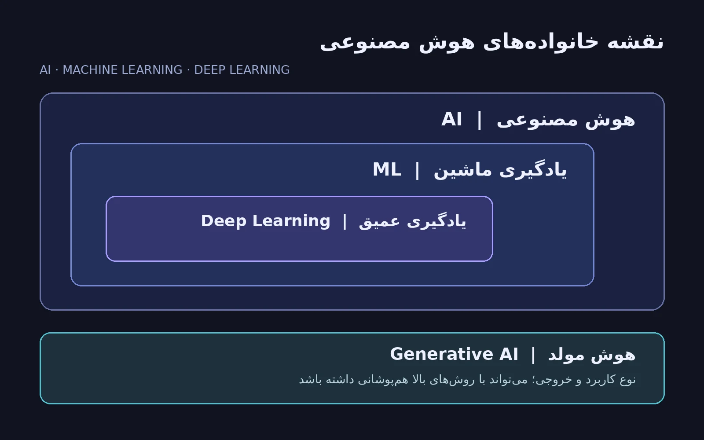

**شکل ۲-۱ — نقشه مفهومی خانواده‌ها.** در این طرح، کادر جداگانه پایین برای نشان دادن هم‌پوشانیِ ممکن است، نه این ادعا که همه مدل‌های مولد عمیق‌اند. ML زیرمجموعه AI است؛ DL زیرمجموعه ML است؛ شبکه عصبی نوعی مدل است و برخی شبکه‌ها عمیق نیستند. هوش مولد بر اساس نوع خروجی و کاربرد دسته‌بندی می‌شود و با این لایه‌ها هم‌پوشانی دارد، نه اینکه الزاماً زیرمجموعه DL باشد.

## ۵. هوش مولد و تفاوت آن با طبقه‌بندی

**هوش مصنوعی مولد (Generative AI)** به سیستم‌هایی گفته می‌شود که می‌توانند محتوایی مانند متن، تصویر، صوت یا کد تولید کنند. خانواده‌ای از مدل‌های مولد به‌صورت احتمالاتی تولید نمونه یا الگوهای داده را مدل می‌کنند [۳]. برای فهم مقدماتی، یک طبقه‌بند پیام را در یکی از دسته‌های ازپیش‌تعریف‌شده قرار می‌دهد؛ یک مولد می‌تواند متن تازه‌ای در پاسخ به درخواست بسازد.

اما این مرز **مطلق نیست**: یک مدل مولد می‌تواند برای طبقه‌بندی به کار رود و یک سیستم تولید محتوا می‌تواند شامل اجزای طبقه‌بند باشد. همچنین «تازه» بودن خروجی به معنی تضمین اصالت، درستی، مجاز بودن استفاده یا عدم شباهت به داده آموزش نیست. در کاربرد واقعی باید حقوق داده، احتمال بازتولید و صحت خروجی بررسی شوند.

| پرسش مهندسی | طبقه‌بندی نمونه | تولید متن نمونه |
|---|---|---|
| ورودی | متن پیام | دستور و متن زمینه |
| خروجی | برچسب «بازبینی/عادی» | پیش‌نویس پاسخ |
| نمونه ارزیابی | مثبت کاذب، منفی کاذب، بازیابی | درستی، ارتباط، ایمنی، کیفیت و هزینه |
| خطر | ازدست‌رفتن پیام خطرناک | اطلاعات ساختگی یا افشای اطلاعات |
| بازبینی | بسته به حساسیت، کنترل انسانی | بررسی منبع و تأیید انسان در محتوای مهم |

مدل مولد نباید با یک سامانه کامل یکسان گرفته شود. رابط کاربری، داده‌های بازیابی‌شده، فیلترها، ابزارها و سیاست دسترسی نیز بر رفتار نهایی اثر می‌گذارند.

## ۶. مدل زبانی بزرگ چیست؟

**مدل زبانی (Language Model)** روابط آماری بین واحدهای متن را مدل می‌کند. در بسیاری از مدل‌های مولد متداول، تولید با پیش‌بینی توکن بعدی بر اساس توکن‌های قبلی پیش می‌رود [۳]. **توکن (Token)** واحدی است که tokenizer به مدل می‌دهد و می‌تواند یک کلمه، بخشی از کلمه یا نشانه‌ای دیگر باشد؛ نباید فرض کرد هر توکن دقیقاً یک کلمه فارسی است.

**مدل زبانی بزرگ (Large Language Model یا LLM)** اصطلاحی برای مدل‌های زبانی با مقیاس نسبتاً بزرگ است؛ مرز عددی ثابت و جهان‌شمولی برای «بزرگ» وجود ندارد. بسیاری از LLMهای امروزی از خانواده Transformer استفاده می‌کنند؛ مقاله اولیه Transformer در ۲۰۱۷ ارائه شد [۴]. همه مدل‌های زبانی یک روش آموزش یا یک سازوکار تولید ندارند: مدل‌های علّی، پوشانده‌شده و رویکردهای دیگر را نباید یکی گرفت.

در یک مدل علّی مولد، به‌طور ساده:

```text
P(t_next | context)
```

`P` احتمالِ مدل، `t_next` توکن بعدی و `context` توکن‌های پیشین یا زمینه است. خروجی مدل یک توزیع روی توکن‌های ممکن است؛ روش رمزگشایی ممکن است محتمل‌ترین توکن را انتخاب یا از توزیع نمونه‌گیری کند. سپس توکن انتخاب‌شده به زمینه اضافه می‌شود. این فرمول **احتمال در مدل** را نشان می‌دهد، نه احتمال درست بودن یک ادعای واقعی. تولیدِ قابل‌قبول زبانی لزوماً حقیقت، استدلال معتبر یا دسترسی به اطلاعات روز را تضمین نمی‌کند.

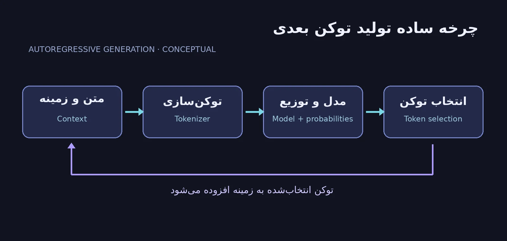

**شکل ۲-۲ — چرخه ساده تولید خودرگرسیو (Autoregressive).** شکل فقط یک الگوی متداول تولید را نمایش می‌دهد، نه همه معماری‌ها. هدف این نمودار توضیح جهت جریان است؛ عدد یا ادعای عملکردی در آن وجود ندارد. Tokenizer و واژگان را در فصل ۳۳ و جزئیات Attention را در فصل ۳۴ خواهیم ساخت.

## ۷. داده، مدل، الگوریتم و نرم‌افزار: یک مثال واحد

فرض کنید یک کتابخانه می‌خواهد تخمین بزند فردا چند کتاب قرض گرفته می‌شود. اطلاعات تاریخی شامل روز هفته، تعداد اعضای حاضر و تعداد امانت‌هاست.

- **داده (Data):** ردیف‌های ثبت‌شده؛ هر ردیف ممکن است شامل ویژگی‌ها (Features) و مقدار هدف یا برچسب (Label) باشد.
- **مدل (Model):** رابطه قابل تنظیمی که از ویژگی‌ها مقدار پیش‌بینی‌شده می‌سازد؛ مثلاً یک فرمول خطی ساده.
- **پارامتر (Parameter):** عدد قابل تنظیم داخل مدل، مانند شیب یا بایاس. **ابَرپارامتر (Hyperparameter)** یک انتخاب بیرونی فرایند است؛ برای مثال تعداد دورهای آموزش یا نرخ یادگیری در روش‌هایی که چنین گزینه‌هایی دارند.
- **الگوریتم آموزش (Training Algorithm):** روش تنظیم پارامترها بر اساس داده و معیار خطا؛ مدل و الگوریتم یکی نیستند.
- **نرم‌افزار (Software):** برنامه‌ای که دریافت داده، آموزش، ذخیره مدل، پیش‌بینی و نمایش را پیاده‌سازی می‌کند.
- **استنتاج (Inference):** به‌کارگیری مدلِ انتخاب‌شده روی ورودی جدید. یک برنامه می‌تواند پیش‌بینی کند بدون اینکه در آن لحظه وزن‌هایش تغییر کنند.

**مثال عددی:** اگر مدل پیش‌بینی کند ۴۰ کتاب امانت می‌رود و مقدار واقعی ۳۵ باشد، خطای خام `40 − 35 = 5` کتاب است. این یک مشاهده است؛ اندازه‌گیری کیفیت معمولاً به نمونه‌های متعدد و معیاری مشخص نیاز دارد. خروجی خوب روی داده آموزش برای تعمیم کافی نیست. فصل ۳ چرخه آموزش، اعتبارسنجی و آزمون را دقیق‌تر بررسی می‌کند.

## ۸. پروژه: مدل بسیار کوچک را واقعاً آموزش دهید

در این پروژه یک مدل طبقه‌بندی یک‌پارامتری می‌سازیم: اگر امتیاز نشانه‌های مشکوک در یک پیام به آستانه برسد، پیام برای بررسی علامت می‌خورد. این امتیاز می‌تواند عدد اعشاری باشد و در اینجا **داده مصنوعیِ ازپیش‌ساخته** است؛ برنامه متن واقعی را تحلیل نمی‌کند و ابزار امنیتی نیست.

**ساختار فایل:** `threshold_model.py`. **محیط:** فقط کتابخانه استاندارد Python؛ این فصل با Python 3.13.16 در محیط تولید آزمایش شده است. GPU و نصب بسته اضافی لازم نیست. راهنمای نصب Python در فصل ۹ می‌آید.

```python
# داده مصنوعی: (امتیاز نشانه ها، برچسب بازبینی)
train = [(0, 0), (1, 0), (2, 0), (4, 1), (5, 1), (6, 1)]
test = [(0.5, 0), (2.5, 0), (3.5, 1), (6.5, 1)]

def predict(x, threshold):
    return int(x >= threshold)

def errors(rows, threshold):
    return sum(predict(x, threshold) != label for x, label in rows)

def fit(rows):
    candidates = range(0, 8)
    return min(candidates, key=lambda t: (errors(rows, t), t))

def main():
    threshold = fit(train)
    mistakes = errors(test, threshold)
    print(f"threshold={threshold}")
    print(f"test_errors={mistakes}/{len(test)}")
    print(f"test_accuracy={(len(test)-mistakes)/len(test):.0%}")
    print(f"prediction_for_3.5={predict(3.5, threshold)}")

if __name__ == "__main__":
    main()
```

در ترمینال در پوشه فایل `python threshold_model.py` یا `python3 threshold_model.py` را اجرا کنید. خروجی مورد انتظار:

```text
threshold=3
test_errors=0/4
test_accuracy=100%
prediction_for_3.5=1
```

**کد را خط‌به‌خط بخوانیم:** `train` نمونه‌های آموزش و `test` نمونه‌های جدا برای سنجش‌اند. هر زوج از یک ورودی عددی و برچسب `0` یا `1` تشکیل شده است. `predict` برای آستانه داده‌شده برچسب می‌دهد؛ `errors` تعداد مغایرت را می‌شمارد. `fit` همه آستانه‌های صحیح ۰ تا ۷ را می‌آزماید و کم‌خطاترین را برمی‌گزیند؛ در صورت تساوی، کوچک‌ترین آستانه انتخاب می‌شود. مدل، **قاعده به‌همراه آستانه یادگرفته‌شده ۳** است؛ الگوریتم آموزش، جست‌وجوی آستانه؛ داده، فهرست زوج‌ها؛ و نرم‌افزار، کل برنامه است.

**چرا این یادگیری است؟** آستانه به جای تعیین مستقیم در تابع `predict`، از داده آموزشی انتخاب می‌شود. اگر داده تغییر کند، آستانه انتخابی نیز ممکن است تغییر کند. این یک نمونه کوچک یادگیری نظارت‌شده است، اما شبکه عصبی یا مدل زبانی نیست. ۱۰۰٪ روی چهار نمونه مصنوعی، اثبات عملکرد واقعی نیست؛ انتخاب نمونه‌ها و ویژگی‌ها ساختگی‌اند و اندازه آزمون بسیار کوچک است.

**تست تکمیلی:** با دست حساب کنید اگر آستانه به ۵ تغییر کند، روی داده آزمون چند خطا رخ می‌دهد؟ اگر دستور Python پیدا نشد، نام `python3` و نصب Python را بررسی کنید؛ اگر فایل پیدا نشد، مسیر جاری ترمینال را بررسی کنید. اگر خروجی متفاوت است، داده‌ها، فاصله‌گذاری و نام فایل را با نمونه مطابقت دهید.

## ۹. روش حرفه‌ای‌تر: خط لوله استاندارد، بدون ادعای اجرا

در پروژه‌های واقعی، ابزارهای استاندارد می‌توانند ساخت مدل، تقسیم داده و ارزیابی را منظم کنند. نمونه زیر نشان می‌دهد یک درخت تصمیم ساده چگونه با **scikit-learn** آموزش و آزمایش می‌شود؛ این درخت از آستانه پروژه قبل پیچیده‌تر است و لزوماً همان مدل یا نتیجه را نمی‌دهد. **این نمونه کتابخانه‌ای در محیط این فصل اجرا نشده است**؛ خروجی عددی آن را به‌عنوان نتیجه آزمایش‌شده گزارش نمی‌کنیم. نسخه کتابخانه و نسخه Python را هنگام اجرا ثبت کنید و نصب را در محیط مجازی فصل ۱۳ انجام دهید.

```python
# ابتدا در یک محیط مجازی، بسته scikit-learn را نصب کنید.
# python -m pip install scikit-learn
from sklearn.tree import DecisionTreeClassifier
from sklearn.metrics import accuracy_score

x_train = [[0], [1], [2], [4], [5], [6]]
y_train = [0, 0, 0, 1, 1, 1]
x_test = [[0.5], [2.5], [3.5], [6.5]]
y_test = [0, 0, 1, 1]
model = DecisionTreeClassifier(max_depth=1, random_state=42)
model.fit(x_train, y_train)
print("test_accuracy=", accuracy_score(y_test, model.predict(x_test)))
```

در این نمونه، `fit` آموزش و `predict` استنتاج است. برای برنامه عملی باید نسخه دقیق بسته، سکو، داده و خروجی ثبت و آزمون شود. اجرای دستور نصب به اینترنت و دسترسی به بسته نیاز دارد. اگر نصب بسته ممکن نیست، پروژه استاندارد کتابخانه Python بخش قبل مستقل و قابل اجراست. آموزش واقعی، تقسیم مناسب داده، مقایسه خط پایه، آزمون خارج از نمونه و بررسی اخلاقی فراتر از این مثال است.

## ۱۰. خطاهای رایج و عیب‌یابی مفهومی

۱. **همه AI را LLM نامیدن:** موتور جست‌وجو، برنامه‌ریزی نمادین و مدل طبقه‌بندی را هم باید با معماری و کاربرد خودشان توصیف کرد.
۲. **«یادگیری عمیق یعنی درک عمیق»:** عمق معماری یک ادعای روان‌شناختی نیست. خروجی روان یا نمره بالا اثبات فهم انسانی یا آگاهی نیست.
۳. **«هوش مولد همیشه شبکه عمیق است»:** تولید و معماری دو محور متفاوت‌اند؛ شکل ۲-۱ را به‌عنوان نقشه مفهومی بخوانید نه دسته‌بندی مطلق همه مدل‌ها.
۴. **آزمودن روی داده آموزش:** ممکن است مدل روی نمونه‌های دیده‌شده خوب و در موارد تازه ضعیف باشد. داده آزمون را پیش از تنظیم مدل کنار بگذارید؛ اگر از آن برای تصمیم‌گیری تکراری استفاده کنید، دیگر آزمون بی‌طرف نهایی نیست.
۵. **اشتباه گرفتن احتمال توکن با صحت گزاره:** مدل به ادامه متن امتیاز می‌دهد؛ برای صحت باید شواهد خارجی و ارزیابی وظیفه داشت.
۶. **ادعای بی‌طرفی به‌سبب عددی‌بودن:** معیار، برچسب‌ها و انتخاب ویژگی ممکن است به افراد مختلف آسیب نامتوازن وارد کند؛ بررسی زیان، حریم خصوصی و نظارت انسانی ضروری است [۵].

**عیب‌یابی در یک کاربرد واقعی:** ابتدا مطمئن شوید تعریف مسئله و برچسب روشن است؛ سپس ورودی‌های خطادار و کیفیت داده را بررسی کنید؛ بعد مدل را با خط پایه مقایسه و عملکرد را برای زیرگروه‌های مناسب گزارش کنید. از داده حساس بدون مجوز استفاده نکنید. اصلاح مدل همیشه پاسخ نیست: گاهی مشکل در جمع‌آوری داده، خط‌مشی کسب‌وکار یا تعریف هدف است.

## ۱۱. تحولات و احتیاط‌ها تا نوامبر ۲۰۲۶

**تاریخ بررسی منابع: ۴ نوامبر ۲۰۲۶.** شاخص AI سال ۲۰۲۶ استنفورد افزایش عملکرد روی مجموعه‌ای از معیارهای زبان، کدنویسی و استدلال را گزارش می‌کند و در عین حال بر محدودیت اعتبار بنچمارک‌ها و عملکرد نامتوازن در وظایف مختلف تأکید دارد [۶]. این گزارش به شرایط آزمون‌های خودش محدود است؛ رتبه در یک بنچمارک، گواه ایمنی یا کارایی در همه محیط‌ها نیست.

آموزش مدل‌های متنی، تصویری و چندوجهی همچنان در حال تحول است. از تعمیم شتاب‌زده مانند «همه مدل‌های آینده خودرگرسیو هستند» یا «هر LLM یک Transformer علّی است» خودداری می‌کنیم. تاریخ مقاله اصلی Transformer، ۲۰۱۷ است [۴]؛ برای اجرای هر کتابخانه یا انتخاب سخت‌افزار، نسخه مستندات و سازگاری باید هنگام اجرای همان پروژه بررسی شود. این مرور ادعای پوشش کامل همه تحولات تا تاریخ مرجع را ندارد.

## ۱۲. تمرین، آزمون و پروژه ارزیابی

**آزمون مفهومی:**

۱. کدام عبارت درست‌تر است: «همه MLها شبکه عصبی‌اند» یا «بعضی مدل‌های ML شبکه عصبی نیستند»؟ مثالی بزنید.
۲. آیا تمام شبکه‌های عصبی عمیق‌اند؟ آیا هر سیستم مولد حتماً مدل عمیق دارد؟
۳. در پروژه آستانه، داده، پارامتر مدل و الگوریتم آموزش را مشخص کنید.
۴. آموزش و استنتاج در کد چگونه از هم جدا می‌شوند؟
۵. چرا احتمال توکن بعدی، احتمال صحت یک پاسخ نیست؟
۶. دو دلیل بیاورید که ۱۰۰٪ روی چهار نمونه مصنوعی برای کاربرد امنیتی کافی نیست.
۷. برای پیش‌بینی تعداد امانت کتاب، هدف عددی را چه نوع مسئله‌ای می‌نامید؟ برای دسته‌بندی پیام چطور؟
۸. آیا مدل مولد می‌تواند برای طبقه‌بندی استفاده شود؟ یک محدودیت این کار را نام ببرید.
۹. چرا داده آزمون نباید برای انتخاب پیاپی آستانه به‌کار رود؟
۱۰. یک روش نمادین و یادگیرنده چگونه می‌توانند در یک محصول ترکیب شوند؟

**تمرین ریاضی:** در پروژه، آستانه را ۵ فرض کنید و به‌ترتیب پیش‌بینی چهار نمونه آزمون را بنویسید. تعداد خطا و دقت را حساب کنید. سپس با آستانه ۳ مقایسه کنید.

**تمرین برنامه‌نویسی:** دو ورودی آموزشی جدید با برچسب دلخواه و توجیه‌شده اضافه کنید؛ آستانه و خطای آموزش را قبل و بعد گزارش کنید. داده آزمون را تغییر ندهید. اگر حداقل خطا میان دو آستانه مساوی بود، توضیح دهید چرا کد مقدار کوچک‌تر را برمی‌گزیند.

**مینی‌پروژه:** برای اولویت‌بندی مطالعه، ویژگی عددی «روز مانده تا آزمون» را تعریف کنید، یک قاعده ساده و یک آستانه مبتنی بر داده آموزشی بسازید. دست‌کم شش نمونه آموزشی و چهار نمونه آزمون جداگانه تولید کنید؛ جهت قاعده را متناسب با مسئله انتخاب کنید، معیار مناسب و خطاها را ثبت کنید، و به کاربر اجازه اصلاح خروجی بدهید. این سامانه برای تصمیم حساس مناسب نیست.

**معیار قبولی:** حداقل ۸ پاسخ درست از ۱۰ پرسش، محاسبه صحیح دقت هر دو آستانه، اجرای کد یا توضیح دقیق خروجی در صورت نبود محیط، و گزارش ویژگی، برچسب، آستانه، خطا و یک محدودیت در مینی‌پروژه.

[پاسخ‌نامه جداگانه فصل ۲](book-engineering/answers/02-ai-families-answers-fa.md) را پس از حل تمرین‌ها باز کنید.

## ۱۳. واژه‌نامه، جمع‌بندی و منابع

**واژه‌نامه:** هوش مصنوعی (AI)، یادگیری ماشین (ML)، یادگیری عمیق (DL)، شبکه عصبی (Neural Network)، هوش مولد (Generative AI)، مدل زبانی بزرگ (LLM)، توکن (Token)، یادگیری نظارت‌شده (Supervised Learning)، ویژگی (Feature)، برچسب (Label)، پارامتر (Parameter)، ابرپارامتر (Hyperparameter)، آموزش (Training)، استنتاج (Inference)، تعمیم (Generalization).

**جمع‌بندی:** AI حوزه‌ای وسیع است؛ ML از داده یا تجربه برای ساخت یا تنظیم مدل استفاده می‌کند؛ DL خانواده‌ای از روش‌های مبتنی بر شبکه‌های عصبی چندلایه است. هوش مولد با این دسته‌ها هم‌پوشانی دارد و LLM یک نوع مدل زبانی در مقیاس بزرگ است. پیش‌بینی قابل سنجش، توضیح داده و آزمون مستقل از کاربرد واژه «هوشمند» مهم‌تر است. در **فصل ۳** چرخه کامل داده، آموزش، اعتبارسنجی، آزمون و استنتاج را عمیق‌تر بررسی می‌کنیم.

**منابع؛ تاریخ مراجعه: ۴ نوامبر ۲۰۲۶.** برای اسناد زنده، تاریخ انتشار در صورت نامشخص بودن ذکر شده است:

[۱] OECD، «What is AI? Can you make a clear distinction between AI and non-AI systems?»، ۶ مارس ۲۰۲۴، [متن رسمی](https://oecd.ai/en/wonk/definition).

[۲] Google for Developers، «Introduction to Machine Learning»، تاریخ انتشار مشخص نشده، [مستندات رسمی](https://developers.google.com/machine-learning/intro-to-ml).

[۳] Google for Developers، «Machine Learning Glossary: Generative AI»، تاریخ انتشار مشخص نشده، [واژه‌نامه رسمی](https://developers.google.com/machine-learning/glossary/generative).

[۴] Vaswani, A. و همکاران، «Attention Is All You Need»، NeurIPS 2017، ۲۰۱۷، [مقاله](https://arxiv.org/abs/1706.03762).

[۵] Autio, C. و همکاران، «Artificial Intelligence Risk Management Framework: Generative Artificial Intelligence Profile»، NIST، ۲۶ ژوئیه ۲۰۲۴، DOI: [10.6028/NIST.AI.600-1](https://doi.org/10.6028/NIST.AI.600-1).

[۶] Stanford Institute for Human-Centered Artificial Intelligence، «AI Index Report 2026: Technical Performance»، ۲۰۲۶، [گزارش](https://hai.stanford.edu/ai-index/2026-ai-index-report/technical-performance).

[۷] scikit-learn developers، «Decision Trees»، تاریخ انتشار مشخص نشده، [مستندات رسمی](https://scikit-learn.org/stable/modules/tree.html). نسخه اجرای نمونه کتابخانه‌ای باید هنگام اجرا ثبت شود.

---

# فصل ۳ — چرخه حیات مدل: از داده تا استنتاج و بازخورد

**هنر و علم ساخت هوش | جلد اول | Babak & Ai**
**نسخه کاری RC · تاریخ مراجعه و بازبینی منابع: ۵ نوامبر ۲۰۲۶**

## ۱. مسئله قبل از مدل

فرض کنید یک کتابخانه می‌خواهد تعداد کتاب‌های امانت‌رفته در روز آینده را پیش‌بینی کند تا برای چیدن کتاب‌ها نیروی کافی داشته باشد. آیا باید نخست یک شبکه عصبی بزرگ بسازد؟ نه. ابتدا باید بداند چه تصمیمی قرار است بهتر شود، پیش‌بینی چه زمانی لازم است، چه داده‌ای واقعاً در آن زمان در دسترس است و پیامد پیش‌بینی اشتباه چیست.

**پیش‌نیاز:** فصل‌های ۱ و ۲. برای خواندن فصل به دانش قبلی برنامه‌نویسی نیاز ندارید. پروژه از Python استاندارد استفاده می‌کند؛ نصب Python در فصل ۹ آموزش داده خواهد شد. زمان پیشنهادی: ۳ تا ۴ ساعت مطالعه و تمرین.

**هدف‌های یادگیری:** در پایان می‌توانید (۱) چرخه یک مدل را رسم کنید، (۲) داده آموزش، اعتبارسنجی و آزمون را تفکیک کنید، (۳) تفاوت پارامتر و ابرپارامتر را شرح دهید، (۴) زیان مربعی میانگین را محاسبه کنید، (۵) کد آموزش و استنتاج یک مدل کوچک را اجرا کنید و (۶) برای پایش و توقف امن سیستم برنامه بدهید.

**یک نکته مهم:** چرخه حیات مدل به‌ندرت خطی و یک‌باره است. یافته‌های پایش می‌توانند ما را به بازنگری داده، هدف یا مدل برگردانند. بازخورد انسانی، ذخیره مکالمه و بازآموزی پارامترها سه کار متفاوت‌اند.

## ۲. نقشه چرخه حیات

چرخه را می‌توان برای آموزش به مراحل زیر شکست [۱، ۲]:

۱. **تعریف مسئله:** تصمیم، کاربر، خروجی، محدودیت، هزینه خطا و معیار موفقیت را تعریف می‌کنیم.
۲. **داده:** با مجوز مناسب گردآوری، بررسی و برچسب‌گذاری می‌کنیم؛ داده‌های نامعتبر و تکراری را طبق سیاست مستند مدیریت می‌کنیم.
۳. **تقسیم:** داده را متناسب با کاربرد به آموزش، اعتبارسنجی و آزمون جدا می‌کنیم؛ سپس تبدیلات آموختنی را فقط با داده آموزش برازش می‌دهیم.
۴. **آموزش:** پارامترهای مدل با یک الگوریتم و داده آموزش تنظیم می‌شوند.
۵. **انتخاب و ارزیابی:** با داده اعتبارسنجی انتخاب‌ها را انجام می‌دهیم و پس از نهایی‌سازی، کیفیت را با مجموعه آزمون کنارگذاشته‌شده گزارش می‌کنیم.
۶. **استقرار و استنتاج:** مدل به محیط استفاده منتقل می‌شود و با ورودی جدید خروجی می‌دهد.
۷. **پایش و بازخورد:** کیفیت، خطا، تغییر داده، هزینه و ایمنی بررسی می‌شود؛ در صورت لزوم مدل یا کل تعریف مسئله بازبینی می‌شود.

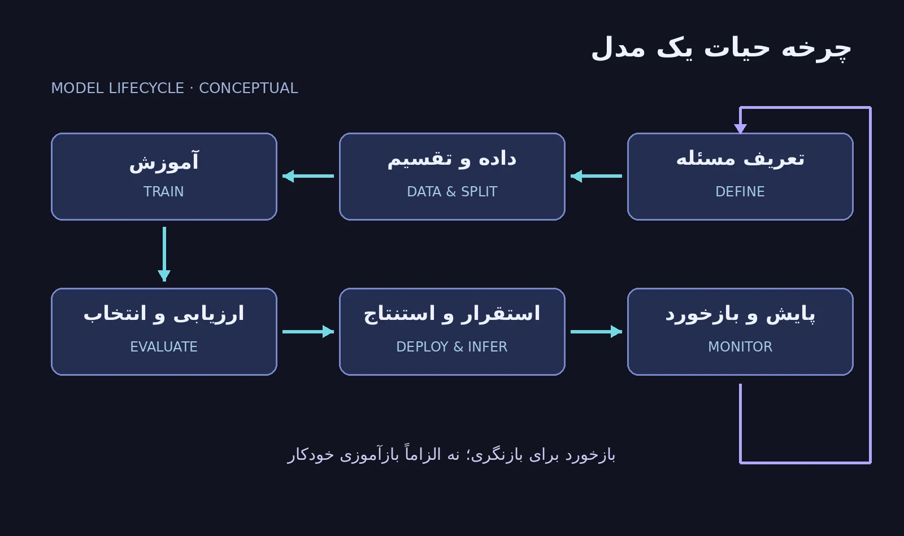

**شکل ۳-۱ — نقشه چرخه حیات.** بازگشت از پایش به ابتدای چرخه به معنی بازآموزی خودکار و بدون کنترل نیست. پیش از انتشار نسخه جدید باید ارزیابی و تأیید مستقل انجام شود.

**خروجی هر مرحله:** تعریف مسئله → سند هدف؛ داده → نسخه داده و مجوز؛ تقسیم → شناسه نمونه‌های هر بخش؛ آموزش → پارامترها و تنظیمات؛ ارزیابی → گزارش معیارها؛ استقرار → نسخه قابل بازگشت؛ پایش → هشدار و تصمیم مسئول. فصل‌های MLOps این اجزا را به زیرساخت واقعی تبدیل می‌کنند.

## ۳. تعریف مسئله و داده معتبر

برای مثال کتابخانه، سؤال «فردا چند کتاب امانت می‌رود؟» یک مسئله رگرسیون است، زیرا خروجی عددی است. «آیا فردا بیش از ۱۰۰ امانت داریم؟» یک مسئله طبقه‌بندی است. ممکن است تصمیم عملی ــ مثلاً تعداد نیروی موردنیاز ــ به هزینه کم‌برآوردکردن و بیش‌برآوردکردن وابسته باشد، نه فقط میانگین خطا.

**ویژگی (Feature)** اطلاعاتی است که در زمان پیش‌بینی می‌دانیم: مثلاً روز هفته و آمار روزهای گذشته. **برچسب (Label/Target)** نتیجه‌ای است که می‌خواهیم تخمین بزنیم: تعداد امانت فردا. تعداد واقعی امانت فردا را نمی‌توان هنگام پیش‌بینی فردا به‌عنوان ورودی استفاده کرد، چون هنوز معلوم نیست. همچنین اگر زمان انتشار یک آمار بعد از زمان تصمیم باشد، استفاده از آن نشت اطلاعات آینده است.

کیفیت داده را با پرسش‌هایی بررسی کنید: داده از کجا آمده و مجوز استفاده‌اش چیست؟ آیا بعضی روزها ثبت نشده‌اند؟ ثبت‌های تکراری وجود دارد؟ آیا تعریف برچسب در طول زمان عوض شده است؟ آیا داده برای کاربران مختلف نماینده کافی است؟ آیا داده شخصی باید حذف یا حفاظت شود؟ پاسخ‌ها و نسخه داده را ثبت کنید. پاک‌سازی خوب به معنی حذف بی‌قاعده مواردی که مدل روی آن‌ها بد عمل می‌کند نیست.

**خط پایه (Baseline):** یک پیش‌بینی ساده مانند «فردا برابر میانگین روزهای مشابه گذشته است» معیاری برای مقایسه می‌سازد. اگر مدل پیچیده با هزینه بیشتر از خط پایه بهتر نیست یا خطر بیشتری دارد، استفاده از آن نیاز به توجیه دارد.

## ۴. آموزش، اعتبارسنجی و آزمون

**آموزش (Training):** الگوریتم با نمونه‌های آموزش پارامترها را تنظیم می‌کند. **اعتبارسنجی (Validation):** برای انتخاب میان گزینه‌ها، تنظیم ابرپارامتر یا انتخاب مرحله توقف استفاده می‌شود. **آزمون (Test):** پس از تثبیت انتخاب‌ها، برآورد نهایی روی داده کنارگذاشته‌شده انجام می‌شود [۱].

| مجموعه | چه چیزی را تعیین می‌کند؟ | چه استفاده‌ای نباید شود؟ |
|---|---|---|
| آموزش | پارامترها و تبدیلات آموختنی | گزارش به‌تنهایی به‌عنوان عملکرد روی داده تازه |
| اعتبارسنجی | انتخاب مدل، ابرپارامتر، مرحله توقف | ادعای ارزیابی نهایی کاملاً مستقل بعد از انتخاب مکرر |
| آزمون | گزارش نهایی مدل تثبیت‌شده | انتخاب مکرر مدل و بازطراحی بر اساس همان نتیجه |

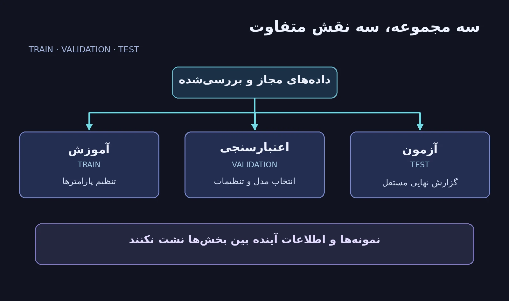

**شکل ۳-۲ — نقش سه مجموعه.** تصویر نسبت عددی توصیه نمی‌کند. نسبت مناسب به حجم داده، هزینه خطا و ساختار مسئله بستگی دارد. اگر نمونه‌های یک شخص، گروه یا شیء بسیار مشابه‌اند، تقسیم تصادفی ردیف‌ها ممکن است به نشت منجر شود؛ تقسیم گروهی یا زمانی را متناسب با سناریوی واقعی بررسی کنید. در پیش‌بینی آینده معمولاً ترتیب زمان باید حفظ شود.

**نشت داده (Data Leakage):** ورود مستقیم یا غیرمستقیم اطلاعات آزمون، آینده یا پاسخ به فرآیند آموزش/انتخاب است. مثلاً محاسبه میانگین نرمال‌سازی از کل داده قبل از تقسیم، اطلاعات مجموعه‌های کنارگذاشته‌شده را به آموزش وارد می‌کند. راه بهتر: تبدیل را فقط روی آموزش برازش، و همان تبدیل را بدون برازش مجدد روی اعتبارسنجی، آزمون و ورودی واقعی اعمال کنید. نمونه‌های تکراری یا تقریباً یکسان در دو بخش نیز ممکن است نتیجه را خوش‌بینانه کنند [۱].

## ۵. مدل، پارامتر و ابرپارامتر

در این فصل یک مدل خطی بسیار ساده داریم:

```text
y_hat = w × x + b
```

`x` ورودی عددی، `y_hat` مقدار پیش‌بینی‌شده، `w` وزن و `b` بایاس است. برای `x=3`، `w=2` و `b=1`، پیش‌بینی `7` می‌شود. وزن و بایاس **پارامتر (Parameter)** مدل‌اند که در آموزش تنظیم می‌شوند. اگر الگوریتم آموزش از **نرخ یادگیری (Learning Rate)** استفاده کند، این نرخ یک **ابرپارامتر (Hyperparameter)** است که اندازه گام تنظیم را کنترل می‌کند. تعداد گام‌های آموزش نیز ابرپارامتر است.

پارامترها از داده یاد گرفته می‌شوند، اما «بهترین» ابرپارامتر عموماً به داده، معماری و معیار وابسته است. نرخ خیلی بزرگ ممکن است سبب ناپایداری یا واگرایی شود؛ نرخ خیلی کوچک می‌تواند آموزش را کند کند. انتخاب فقط از روی داده آموزش ممکن است به بیش‌برازش تصمیم‌های طراحی منجر شود؛ گزینه‌ها را با اعتبارسنجی مقایسه کنید.

مدل خطی همیشه مناسب نیست: رابطه واقعی ممکن است غیرخطی، متغیر در زمان یا تحت تأثیر متغیرهای ثبت‌نشده باشد. در پروژه، داده مصنوعی عمداً از رابطه خطی ساده ساخته شده و نتیجه به مسائل واقعی تعمیم‌پذیر نیست.

## ۶. تابع زیان و معنای یادگیری

**تابع زیان (Loss Function)** عددی است که میزان ناسازگاری پیش‌بینی با هدف را با فرمولی مشخص می‌سنجد. برای رگرسیون، یکی از گزینه‌ها **میانگین مربعات خطا (Mean Squared Error یا MSE)** است:

```text
MSE = (1 / n) × Σ (y_hat_i − y_i)²
```

**معادله ۳-۱** — n تعداد نمونه، y کلاه پیش‌بینی و y مقدار مرجع است.

<math xmlns="http://www.w3.org/1998/Math/MathML" display="block" dir="ltr" aria-label="MSE: sum of squared prediction errors divided by n"><mi>MSE</mi><mo>=</mo><mfrac><mn>1</mn><mi>n</mi></mfrac><munderover><mo>∑</mo><mrow><mi>i</mi><mo>=</mo><mn>1</mn></mrow><mi>n</mi></munderover><msup><mrow><mo>(</mo><msub><mover><mi>y</mi><mo>^</mo></mover><mi>i</mi></msub><mo>−</mo><msub><mi>y</mi><mi>i</mi></msub><mo>)</mo></mrow><mn>2</mn></msup></math>

`n` تعداد نمونه‌ها، `i` شماره نمونه، `y_hat_i` پیش‌بینی مدل و `y_i` مقدار مرجع است. `Σ` یعنی مقادیر تمام نمونه‌ها را جمع می‌کنیم. واحد MSE مربع واحد خروجی است؛ مثلاً اگر خروجی تعداد کتاب باشد، واحد MSE «کتاب به توان دو» است. برای مقایسه با واحد اصلی، می‌توان ریشه MSE را گزارش کرد، اما هیچ معیار واحدی برای همه کاربردها کافی نیست.

**مثال دستی:** اگر مقدارهای واقعی `3` و `5` و پیش‌بینی‌ها `2` و `7` باشند، خطاها `−1` و `2` و مربع‌ها `1` و `4` هستند؛ پس `MSE = (1 + 4) / 2 = 2.5`. مربع‌کردن سبب می‌شود خطاهای بزرگ سهم بیشتری بگیرند؛ در داده دارای مقدار پرت، این ویژگی باید بررسی شود.

در **گرادیان‌کاهشی (Gradient Descent)** پارامترها در جهت کاهش تقریبی زیان تغییر می‌کنند. در پروژه، مشتق‌های MSE برای مدل خطی چنین‌اند:

```text
grad_w = (2 / n) × Σ (y_hat_i − y_i) × x_i
grad_b = (2 / n) × Σ (y_hat_i − y_i)
w_new = w − learning_rate × grad_w
b_new = b − learning_rate × grad_b
```

`grad_w` و `grad_b` حساسیت زیان به تغییر وزن و بایاس، و `learning_rate` اندازه گام است. این یک الگوریتم مشخص است، نه تنها روش آموزش. مشتق و دلیل فرمول را از پایه در فصل‌های ریاضی و شبکه عصبی یاد می‌گیریم. کم شدن زیان آموزش به‌تنهایی تضمین عملکرد روی داده تازه نیست.

## ۷. استنتاج با مدل ثابت و تفاوت بازخورد

پس از انتخاب و تثبیت مدل، **استنتاج (Inference)** یعنی استفاده از پارامترهای موجود برای پیش‌بینی روی ورودی جدید. در مثال خطی، با `w=2` و `b=1`، ورودی `7` به پیش‌بینی `15` می‌رسد. ممکن است مقدار واقعی بعداً ۱۴ یا ۱۷ باشد؛ خروجی مدل گواه حقیقت نیست.

| عملیات | ورودی اصلی | خروجی | آیا لزوماً پارامترها عوض می‌شوند؟ |
|---|---|---|---|
| آموزش | داده آموزش، تنظیمات و الگوریتم | پارامترهای جدید | در این روش بله |
| اعتبارسنجی | مدل و داده اعتبارسنجی | معیار برای انتخاب | خودِ محاسبه معیار نه |
| آزمون | مدل نهایی و داده آزمون | گزارش نهایی | نه |
| استنتاج | مدل نهایی و ورودی تازه | پیش‌بینی/خروجی | معمولاً نه؛ استثناها وجود دارند |
| دریافت بازخورد | مشاهده، برچسب یا نظر کاربر | داده/هشدار برای بررسی | نه، مگر فرایند به‌روزرسانی جدا اجرا شود |

ذخیره سابقه مکالمه یا اضافه‌کردن متن بازیابی‌شده به ورودی، لزوماً به معنی تغییر وزن مدل نیست. در یادگیری آنلاین یا برخی روش‌های سازگارشونده ممکن است به‌روزرسانی در زمان استفاده طراحی شود؛ آن را باید جداگانه با امنیت و معیار روشن ارزیابی کرد. فرق «حافظه برنامه» و «پارامترهای مدل» در فصل‌های بعد مهم می‌شود.

## ۸. پروژه عملی: یک چرخه کامل در Python

**سناریو:** داده ساختگی تابع `y = 2x + 1` را تولید می‌کند. چهار نقطه برای آموزش، یک نقطه برای اعتبارسنجی و دو نقطه برای آزمون کنار گذاشته شده‌اند. دو نرخ یادگیری فقط با اعتبارسنجی مقایسه می‌شوند؛ سپس یک‌بار معیار آزمون و یک استنتاج جدید گزارش می‌شود. هدف، یادگیری جریان کار است، نه ساخت مدل قابل استفاده برای تصمیم واقعی.

**فایل:** `lifecycle.py`؛ فقط Python استاندارد لازم است، بدون GPU یا بسته اضافی. کد زیر با **Python 3.13.16** در محیط تولید کتاب اجرا شده است. با `python --version` یا `python3 --version` نسخه خود را بررسی کنید.

```python
"""A deterministic, synthetic lifecycle demonstration; no external packages."""

TRAIN = [(0.0, 1.0), (1.0, 3.0), (2.0, 5.0), (3.0, 7.0)]
VALIDATION = [(4.0, 9.0)]
TEST = [(5.0, 11.0), (6.0, 13.0)]


def predict(x, weight, bias):
    return weight * x + bias


def mse(rows, weight, bias):
    return sum((predict(x, weight, bias) - y) ** 2 for x, y in rows) / len(rows)


def train(rows, learning_rate, steps):
    weight, bias = 0.0, 0.0
    for _ in range(steps):
        grad_w = sum(2 * (predict(x, weight, bias) - y) * x for x, y in rows) / len(rows)
        grad_b = sum(2 * (predict(x, weight, bias) - y) for x, y in rows) / len(rows)
        weight -= learning_rate * grad_w
        bias -= learning_rate * grad_b
    return weight, bias


def main():
    candidates = []
    for rate in (0.01, 0.1):
        weight, bias = train(TRAIN, rate, steps=500)
        val_loss = mse(VALIDATION, weight, bias)
        candidates.append((val_loss, rate, weight, bias))
        print(f"lr={rate:.2f} val_mse={val_loss:.8f}")

    val_loss, rate, weight, bias = min(candidates)
    print(f"selected_lr={rate:.2f}")
    print(f"weight={weight:.6f} bias={bias:.6f}")
    print(f"test_mse={mse(TEST, weight, bias):.8f}")
    print(f"inference_x_7={predict(7.0, weight, bias):.6f}")


if __name__ == '__main__':
    main()
```

**اجرا:** فایل را با UTF-8 ذخیره کنید و در همان پوشه دستور `python lifecycle.py` یا `python3 lifecycle.py` را بزنید. خروجی ثبت‌شده:

```text
lr=0.01 val_mse=0.00000526
lr=0.10 val_mse=0.00000000
selected_lr=0.10
weight=2.000000 bias=1.000000
test_mse=0.00000000
inference_x_7=15.000000
```

عددهای چاپ‌شده گرد شده‌اند؛ `0.00000000` به معنی صفر دقیق در نمایش داخلی نیست. تفاوت بسیار کوچک نسخه و پردازنده در رقم‌های انتهایی ممکن است رخ دهد. ورودی ۷ بیرون بازه آموزش است؛ موفقیت در این تابع ساختگی، تضمین برون‌یابی در دنیای واقعی نیست.

**راهنمای کد:** `TRAIN`، `VALIDATION` و `TEST` به‌صورت جدا تعریف شده‌اند. `predict` فرمول مدل را اجرا می‌کند و `mse` زیان را حساب می‌کند. `train` با وزن و بایاس صفر شروع می‌کند، در هر گام مشتق‌ها را از تمام داده آموزش حساب می‌کند و هر دو پارامتر را با همان گرادیان‌ها به‌روز می‌کند. `candidates` نتیجه دو نرخ را نگه می‌دارد و `min` گزینه با زیان اعتبارسنجی کمتر را انتخاب می‌کند؛ در تساوی مقدارهای بعدی tuple، از جمله نرخ، ترتیب را تعیین می‌کنند. در پایان آزمون و استنتاج بدون تغییر پارامتر انجام می‌شوند.

**گزارش آزمایش:** داده ساختگی است؛ دو گزینه از پیش تعیین شده‌اند؛ ۵۰۰ گام برای هر گزینه اجرا شده؛ آزمون بسیار کوچک است و مستقل بودن در معنای عملی و آماری را تضمین نمی‌کند. الگوریتم، کتابخانه و داده این مثال نباید به‌عنوان نسخه‌ای برای پیش‌بینی واقعی کتابخانه تلقی شوند.

## ۹. پیاده‌سازی با ابزار استاندارد و آزمون آن

ابزارهای حرفه‌ای می‌توانند جزئیات برازش و ارزیابی را ساده کنند. نمونه زیر یک **مدل خطی کتابخانه‌ای** را روی همان آموزش برازش و روی اعتبارسنجی و آزمون ارزیابی می‌کند؛ از حل‌گر کتابخانه استفاده می‌کند، نه اجرای همان گرادیان‌کاهشی و انتخاب نرخ پروژه قبل. مقایسه یکسان آن‌ها مستلزم طراحی آزمایش دقیق‌تر است.

```python
from sklearn.linear_model import LinearRegression
from sklearn.metrics import mean_squared_error

x_train = [[0.0], [1.0], [2.0], [3.0]]
y_train = [1.0, 3.0, 5.0, 7.0]
x_val, y_val = [[4.0]], [9.0]
x_test, y_test = [[5.0], [6.0]], [11.0, 13.0]
model = LinearRegression().fit(x_train, y_train)
print(f"weight={model.coef_[0]:.3f} bias={model.intercept_:.3f}")
print(f"val_mse={mean_squared_error(y_val, model.predict(x_val)):.6f}")
print(f"test_mse={mean_squared_error(y_test, model.predict(x_test)):.6f}")
```

**وضعیت اجرا:** این نمونه با Python 3.13.16 و scikit-learn 1.6.1 در محیط تولید فصل آزمایش شد. خروجی گرد‌شده: `weight=2.000 bias=1.000`، `val_mse=0.000000` و `test_mse=0.000000`. مستندات رسمی LinearRegression و معیارها را در [۳] ببینید. برای محیط شخصی پس از ساخت محیط مجازی، نصب نسخه سازگار را با `python -m pip install scikit-learn==1.6.1` انجام دهید؛ سازگاری نسخه Python/سیستم‌عامل و منبع بسته را بررسی کنید. نصب اینترنت می‌خواهد؛ اگر در دسترس نیست، پروژه بخش ۸ مستقل از بسته‌های خارجی است.

## ۱۰. از استقرار تا پایش و بازگشت امن

**استقرار (Deployment)** صرفاً ذخیره یک فایل وزن نیست. محصول باید بداند داده ورودی را چگونه معتبرسازی کند، از چه نسخه پیش‌پردازش و مدلی استفاده کند، خطا را چگونه گزارش دهد و در صورت شکست چگونه به وضعیت امن بازگردد. برای کاربرد حساس، مجوز دسترسی، حفظ اطلاعات، تأیید انسان و مسیر اعتراض مهم‌اند [۴].

**پایش (Monitoring)** می‌تواند شامل تأخیر، خطاهای نرم‌افزاری، هزینه، تغییر توزیع ورودی و کیفیت پیش‌بینی پس از رسیدن برچسب‌های واقعی باشد. تغییر توزیع ورودی لزوماً اثبات افت کیفیت نیست و نبود تغییر آشکار نیز صحت را تضمین نمی‌کند. اگر برچسب واقعی دیر برسد، پایش کیفیت نیز تأخیر دارد.

**نمونه برنامه عملیاتی:** (۱) در گزارش ثبت کنید مدل و پیش‌پردازش کدام نسخه‌اند؛ (۲) حد هشدار و مسئول رسیدگی را تعیین کنید؛ (۳) خروجی‌های غیرعادی را مطابق سیاست حریم خصوصی بررسی کنید؛ (۴) در صورت نقض معیار، ارسال به بازبینی انسانی یا توقف را اجرا کنید؛ (۵) نسخه پیشین معتبر و روش بازگشت (Rollback) را نگه دارید؛ (۶) تنها پس از ارزیابی مستقل، نسخه جدید را جایگزین کنید. اگر امکان نظارت مناسب وجود نداشته باشد، تصمیم صحیح می‌تواند **عدم استقرار** باشد.

چارچوب داوطلبانه NIST چهار کارکرد «حاکمیت، ترسیم زمینه، اندازه‌گیری، مدیریت» را برای مدیریت ریسک توصیف می‌کند [۴]. این چارچوب جایگزین الزامات حقوقی محلی یا بازبینی متخصص در کاربرد پرخطر نیست.

## ۱۱. خطاهای رایج و راهنمای عیب‌یابی

- **زیان پایین آموزش، کیفیت ضعیف آزمون:** احتمال بیش‌برازش، اختلاف داده‌ها یا کوچک بودن نمونه را بررسی کنید؛ ابتدا تقسیم و نشت را کنترل کنید، نه اینکه فوراً مدل را بزرگ‌تر کنید.
- **نتایج غیرواقعی عالی:** داده‌های تکراری، ویژگی‌های ساخته‌شده از آینده، برچسب در ورودی و برازش پیش‌پردازش روی کل داده را بررسی کنید.
- **زیان به‌شدت بالا یا نامتناهی:** واحدها، مقیاس ویژگی‌ها، برچسب‌های نامعتبر و نرخ یادگیری بسیار بزرگ را بررسی کنید. ابتدا با داده کوچک و محاسبه دستی صحت فرمول را بسنجید.
- **خطای اجرای Python:** در پوشه درست قرار بگیرید؛ `python3` را در صورت نیاز امتحان کنید؛ تورفتگی کد و کپی کامل فایل را کنترل کنید. اگر بسته scikit-learn یافت نشد، محیط فعال و نصب را بررسی کنید یا پروژه استاندارد را اجرا کنید.
- **تناقض نتایج در استقرار:** نسخه مدل، تبدیل داده، واحد و ترتیب ویژگی‌ها، و تفاوت کد آموزش و سرو را بررسی کنید. از یک قرارداد ورودی ثابت و تست نمونه استفاده کنید.
- **بازآموزی با هر بازخورد:** داده خام ممکن است غلط یا مخرب باشد. بازخورد باید با سیاست، مجوز، کنترل کیفیت و ارزیابی نسخه جدید مدیریت شود.

## ۱۲. تحولات تا نوامبر ۲۰۲۶ و حدود شواهد

**تاریخ بررسی: ۵ نوامبر ۲۰۲۶.** گزارش AI Index 2026 استنفورد به بهبود عملکرد در چند حوزه و هم‌زمان به محدودیت اعتبار و فرسودگی برخی بنچمارک‌ها اشاره می‌کند [۵]. نتیجه عملی برای چرخه مدل این است که هم گزارش کیفیت و هم سناریو، نمونه و محدودیت ارزیابی باید ثبت شوند؛ نمره یک بنچمارک تضمین عملکرد در محیط واقعی نیست.

مستندات Google برای تقسیم داده هشدار می‌دهند که استفاده مکرر از مجموعه آزمون و وجود نمونه تکراری بین بخش‌ها می‌تواند ارزیابی را خوش‌بینانه کند [۱]. مستندات پایپ‌لاین نیز به نیاز مدیریت داده، آموزش، اعتبارسنجی و سرو در طول زمان اشاره می‌کنند [۲]. این منابع مفاهیم را توضیح می‌دهند؛ انتخاب تناوب بازآموزی، خودکارسازی و حدود ایمنی به کاربرد و هزینه واقعی وابسته است. این مرور ادعای بررسی تمام پیشرفت‌های سال ۲۰۲۶ را ندارد.

## ۱۳. آزمون، پروژه ارزیابی و منابع

**آزمون مفهومی:** ۱) نقش مجموعه‌های آموزش، اعتبارسنجی و آزمون چیست؟ ۲) چرا محاسبه نرمال‌سازی روی کل داده پیش از تقسیم می‌تواند نشت ایجاد کند؟ ۳) تفاوت وزن با نرخ یادگیری چیست؟ ۴) آیا هر بازخورد کاربر وزن مدل را تغییر می‌دهد؟ ۵) چرا زیان پایین آموزش برای استقرار کافی نیست؟ ۶) اگر برچسب واقعی با تأخیر برسد، پایش کیفیت چه محدودیتی دارد؟ ۷) تقسیم داده زمانی در چه موقعیتی مهم است؟ ۸) بازگشت نسخه یعنی چه و چه زمانی لازم است؟ ۹) چرا ۱۰۰٪ یا زیان نزدیک صفر روی چند نمونه مصنوعی قابل تعمیم نیست؟ ۱۰) یک معیار و یک خطر برای مثال کتابخانه بنویسید.

**تمرین ریاضی:** اگر واقعی‌ها `2` و `4` و پیش‌بینی‌ها `3` و `2` باشند، MSE را حساب کنید. همچنین اگر وزن ۲ و بایاس ۱ باشند، برای ورودی ۸ پیش‌بینی را حساب کنید.

**تمرین کدنویسی:** برنامه را اجرا کنید؛ سپس فقط تعداد گام‌های آموزش را از ۵۰۰ به ۵۰ تغییر دهید و نرخ انتخاب‌شده و زیان اعتبارسنجی را گزارش کنید. مجموعه آزمون را برای انتخاب تعداد گام استفاده نکنید. قبل از تغییر، مقدار قبلی و بعد از آن نتیجه جدید را ثبت کنید؛ زیان واقعی را اجرا و مشاهده کنید، نه حدس بزنید.

**پروژه ارزیابی:** یک مسئله پیش‌بینی کم‌خطر با داده مصنوعی تعریف کنید؛ هدف، ویژگی و برچسب را بنویسید؛ دست‌کم دو نامزد روی آموزش بسازید؛ با اعتبارسنجی انتخاب و با آزمون جداگانه ارزیابی کنید؛ معیار، خطر نشت، نسخه Python، داده و دستور اجرا را ثبت کنید. برای استقرار فرضی یک هشدار، یک مسئول و یک روش بازگشت تعیین کنید. در پایان یک محدودیت داده را توضیح دهید.

**معیار قبولی:** دست‌کم ۸ پاسخ درست از ۱۰ سؤال، محاسبه صحیح هر دو عدد تمرین ریاضی، اجرای پروژه یا توضیح کامل مراحل آن در صورت نبود محیط، و ارائه گزارش شامل داده‌های تفکیک‌شده، نتیجه، خطر نشت و برنامه پایش.

[پاسخ‌نامه جداگانه فصل ۳](book-engineering/answers/03-model-lifecycle-answers-fa.md) را پس از حل تمرین‌ها باز کنید.

**واژه‌نامه:** چرخه حیات (Lifecycle)، ویژگی (Feature)، برچسب (Label)، آموزش (Training)، اعتبارسنجی (Validation)، آزمون (Test)، نشت داده (Data Leakage)، پارامتر (Parameter)، ابرپارامتر (Hyperparameter)، تابع زیان (Loss Function)، گرادیان‌کاهشی (Gradient Descent)، استنتاج (Inference)، پایش (Monitoring)، بازگشت نسخه (Rollback).

**گام بعد:** فصل ۴ مسیر تاریخی از پرسپترون تا مدل‌های مدرن را بررسی می‌کند؛ فصل‌های آینده ریاضیات، کد و ارزیابی را به‌صورت عمیق‌تر باز می‌کنند.

**منابع** — تاریخ مراجعه: ۵ نوامبر ۲۰۲۶:

[۱] Google for Developers، «Datasets: Dividing the original dataset»، تاریخ انتشار مشخص نشده، [مستندات رسمی](https://developers.google.com/machine-learning/crash-course/overfitting/dividing-datasets).

[۲] Google for Developers، «ML pipelines»، تاریخ انتشار مشخص نشده، [مستندات رسمی](https://developers.google.com/machine-learning/managing-ml-projects/pipelines).

[۳] scikit-learn developers، «LinearRegression»، مستندات نسخه 1.6، تاریخ انتشار صفحه مشخص نشده، [مستندات نسخه](https://scikit-learn.org/1.6/modules/generated/sklearn.linear_model.LinearRegression.html).

[۴] National Institute of Standards and Technology، «Artificial Intelligence Risk Management Framework (AI RMF 1.0)»، ژانویه ۲۰۲۳، DOI: [10.6028/NIST.AI.100-1](https://doi.org/10.6028/NIST.AI.100-1)، [کارکردهای چارچوب](https://airc.nist.gov/airmf-resources/airmf/5-sec-core/).

[۵] Stanford Institute for Human-Centered Artificial Intelligence، «AI Index Report 2026: Technical Performance»، ۲۰۲۶، [گزارش](https://hai.stanford.edu/ai-index/2026-ai-index-report/technical-performance).

---

# فصل ۴ — تاریخ هوش مصنوعی: از پرسپترون تا مدل‌های مدرن

**هنر و علم ساخت هوش | جلد اول | Babak & Ai**
**نسخه کاری RC · تاریخ مراجعه به منابع: ۵ نوامبر ۲۰۲۶**

## ۱. چرا تاریخ را یاد می‌گیریم؟

اگر یک مدل امروز بتواند متنی روان بسازد، آیا مسیر رسیدن به آن از یک کشف و یک آزمایش شروع شده است؟ نه. تاریخ AI آمیزه‌ای از ایده‌های ریاضی، سخت‌افزار، داده، پژوهش جمعی، امید، شکست و تغییر معیار ارزیابی است. شناخت این مسیر به ما کمک می‌کند ادعاهای فنی را در شرایط تاریخی‌شان بسنجیم، راه‌حل‌های قدیمی را بی‌دلیل منسوخ نخوانیم و پیشرفت روی یک آزمون را با حل همه مسائل اشتباه نگیریم.

**پیش‌نیاز:** فصل‌های ۱ تا ۳. پروژه این فصل فقط به Python استاندارد نیاز دارد. **هدف:** پس از مطالعه می‌توانید نقاط عطف مهم را ترتیب دهید، تفاوت سامانه نمادین و یادگیرنده را توضیح دهید، محدودیت یک پرسپترون تک‌لایه را با XOR بررسی کنید و نقش داده، محاسبه و ارزیابی را تحلیل کنید.

این فصل یک روایت گزینشی است، نه تاریخ کامل همه کشورها، پژوهشگران و رویکردها. تاریخ مقاله، محصول و فراگیرشدن یک روش ممکن است متفاوت باشد؛ در هر مورد مشخص می‌کنیم درباره کدام صحبت می‌کنیم.

## ۲. آغازهای پیش از نام‌گذاری

در ۱۹۴۳، وارن مک‌کالاک و والتر پیتس مدلی منطقی از شبکه‌های عصبی ارائه کردند [۱]. این کار مدل ریاضی ساده‌شده‌ای بود، نه بازسازی کامل نورون زیستی یا یک شبکه امروزی. در ۱۹۵۰، آلن تورینگ مقاله «ماشین محاسبه‌گر و هوش» را منتشر و بازی تقلید را مطرح کرد [۲]. نتیجه گفت‌وگو می‌تواند موضوع یک آزمایش رفتاری باشد، اما به‌تنهایی اثبات آگاهی، ایمنی یا درستی پاسخ‌ها نیست.

پیشنهاد پروژه تابستانی دارتموث، نوشته جان مک‌کارتی و همکاران در **۱۹۵۵**، برای گردهمایی **۱۹۵۶** تدوین شد؛ واژه Artificial Intelligence در عنوان پیشنهاد آمده است [۳]. متن در ۲۰۰۶ در AI Magazine بازنشر شد. به‌وجودآمدن نام یک رشته به معنی آغاز تمام ایده‌های مرتبط در همان سال نیست: منطق، آمار، کنترل و علوم اعصاب سابقه‌ای طولانی‌تر دارند.

**تمرین خواندن منبع:** تاریخ نوشته اولیه، تاریخ گردهمایی و تاریخ بازنشر دارتموث را از هم جدا کنید. اگر صرفاً تاریخ بازنشر را سال آغاز پروژه بدانیم، ۵۱ سال خطا می‌کنیم.

## ۳. پرسپترون و یادگیری از مثال

فرانک روزنبلات در ۱۹۵۸ مقاله پرسپترون را منتشر کرد [۴]. یک مدل ساده آموزشی از پرسپترون برای ورودی‌های `x1` و `x2` چنین تصمیم می‌گیرد:

```text
score = w1 × x1 + w2 × x2 + b
prediction = 1 if score ≥ 0, otherwise 0
```

`w1` و `w2` وزن‌ها، `b` بایاس و `score` امتیاز پیش از تصمیم است. در این نمایش، مرز تصمیم یک خط در صفحه دو ویژگی است. نسخه تاریخی روزنبلات و پیاده‌سازی آموزشی ساده این فصل یکسانِ کامل نیستند. الگوریتم می‌تواند پس از خطا وزن‌ها را تغییر دهد، نه اینکه انسان برای تک‌تک نمونه‌ها یک پاسخ مستقل بنویسد.

برای مثال با وزن‌های `w1=1` و `w2=1` و بایاس `b=−1.5`، تنها ورودی `(1,1)` امتیاز غیرمنفی می‌گیرد؛ بنابراین تابع AND نمایش داده می‌شود. این یک مدل ساده طبقه‌بندی است، نه مدل زبانی یا شبیه‌سازی مغز.

**محدودیت هندسی XOR:** خروجی XOR برای `(0,1)` و `(1,0)` برابر ۱ و برای `(0,0)` و `(1,1)` برابر ۰ است. هیچ خط واحدی این دو گروه را در آن صفحه جدا نمی‌کند؛ بنابراین یک پرسپترون آستانه‌ای تک‌لایه با همین ورودی‌ها نمی‌تواند هر چهار برچسب را هم‌زمان درست دهد. این محدودیت، حکم ناممکن بودن یادگیری توسط همه شبکه‌های عصبی یا همه مدل‌ها نیست: لایه‌های بیشتر یا ویژگی‌های مناسب می‌توانند مسئله متفاوتی بسازند.


**شکل ۴-۱ — خط زمانی منتخب.** تاریخ‌ها سال انتشار منابع شاخص‌اند، نه اثبات اینکه ایده‌ها ناگهان یا توسط یک نفر ایجاد شدند. توضیح و منابع هر نقطه در متن فصل آمده‌اند.

## ۴. نمادها، جست‌وجو و سامانه‌های خبره

بخش مهمی از تاریخ AI با **نمایش نمادین (Symbolic Representation)**، منطق، جست‌وجو و برنامه‌ریزی گره خورده است. در این رویکردها مسئله با نمادها، قواعد یا حالت‌ها توصیف می‌شود و الگوریتم می‌کوشد نتیجه یا مسیر مناسبی پیدا کند. برای نمونه، حل یک معما را می‌توان جست‌وجوی مجموعه‌ای از وضعیت‌ها دانست.

**سیستم خبره (Expert System)** می‌تواند قواعد دانشیِ استخراج‌شده از متخصصان را برای کمک به یک حوزه محدود به کار گیرد. مزیت برخی سیستم‌های قاعده‌ای، امکان مشاهده قاعده‌ای است که فعال شده؛ محدودیت آن‌ها هزینه استخراج و نگهداری دانش، پوشش ناکافی موارد استثنایی و دشواری سازگاری با محیط تغییرپذیر است. نظام‌های نمادین هنوز در برنامه‌ریزی، تأیید نرم‌افزار و محصولات ترکیبی کاربرد دارند؛ «قدیمی» بودن به معنی بی‌فایده بودن نیست.

**زمستان‌های AI (AI Winters):** اصطلاحی برای دوره‌هایی با کاهش حمایت یا انتظارات پس از وعده‌های برآورده‌نشده است. علت‌ها بسته به دوره و کشور متفاوت بوده‌اند؛ محدودیت محاسبه، داده، کاربرد عملی و شکاف میان وعده و نتیجه از عوامل مطرح هستند. یک تاریخ خطی که همه افت‌ها را فقط به یک مقاله یا یک عامل نسبت دهد، ساده‌سازی گمراه‌کننده‌ای است.

## ۵. پس‌انتشار و شبکه‌های چندلایه

یک شبکه چندلایه می‌تواند نمایش‌های میانی بسازد و، با فعال‌سازی‌های مناسب، توابع پیچیده‌تری از یک مرز خطی واحد بیان کند. اما چگونه اثر خطای خروجی را به پارامترهای لایه‌های قبلی نسبت دهیم؟ **پس‌انتشار خطا (Backpropagation)** روشی برای محاسبه کارآمد مشتق‌ها با استفاده از قاعده زنجیره‌ای است. مقاله Rumelhart، Hinton و Williams در ۱۹۸۶ در شناساندن آن برای یادگیری نمایش‌ها اثرگذار بود [۵].

پس‌انتشار، به‌تنهایی نام بهینه‌ساز یا معماری کامل نیست: ابتدا مشتق‌ها محاسبه می‌شوند و سپس یک روش بهینه‌سازی، مانند گرادیان‌کاهشی، می‌تواند از آن‌ها برای تغییر وزن‌ها استفاده کند. ایده‌های مرتبط با مشتق‌گیری پیش از ۱۹۸۶ نیز وجود داشته‌اند؛ بنابراین نباید آن مقاله را اختراع بدون پیشینه همه جنبه‌های روش معرفی کرد.

**مقایسه:** پرسپترون تک‌لایه آستانه‌ای در فضای ورودی دوبعدی یک مرز خطی می‌سازد؛ شبکه چندلایه غیرخطی می‌تواند مرزهای پیچیده‌تری نشان دهد. توان بیان بالاتر به‌تنهایی تضمین آموزش موفق، تعمیم، انصاف یا ایمنی نیست.

## ۶. داده، GPU و جهش یادگیری عمیق

در دهه ۲۰۰۰ و آغاز دهه ۲۰۱۰، داده بیشتر، ابزارهای نرم‌افزاری، پیشرفت روش‌های آموزش و محاسبات موازی به پیشرفت بعضی کاربردها کمک کردند. رابطه علت و معلول را نباید به «فقط یک GPU» فروکاست: کیفیت داده، طراحی آزمایش، الگوریتم و مهندسی نیز نقش دارند.

در ۲۰۱۲ مقاله Krizhevsky، Sutskever و Hinton درباره طبقه‌بندی ImageNet با شبکه کانولوشنی عمیق، که معمولاً AlexNet نامیده می‌شود، در NeurIPS منتشر شد [۶]. این کار در طبقه‌بندی تصویر نقطه عطف مهمی بود؛ نتیجه آن به داده، وظیفه و معیار همان آزمون مربوط است و به معنی حل بینایی عمومی نیست. شبکه‌های کانولوشنی پیش از AlexNet هم وجود داشتند. در فصل ۳۱ آن‌ها را دقیق‌تر بررسی می‌کنیم.

برندگان یک مسابقه را باید همراه با تعریف مسئله، نسخه داده و شرایط اجرا بررسی کرد. تغییر این شرایط ممکن است مقایسه عددها را نامعتبر کند. یک مدل خوب تصویر می‌تواند در زبانی دیگر یا روی دوربینی متفاوت خطا کند.

## ۷. از توجه تا Transformer

در ۲۰۱۷، Vaswani و همکاران مقاله **Attention Is All You Need** را منتشر کردند [۷]. Transformer اولیه از سازوکار توجه و ساختار encoder–decoder برای ترجمه ماشینی بهره می‌برد و بر خلاف مدل‌های بازگشتی، به recurrence برای پردازش توالی متکی نبود. این مقاله نقطه عطفی مهم است، اما مفهوم توجه پیش از آن نیز در پژوهش وجود داشت.

**توجه (Attention)** روشی برای ترکیب اطلاعات بر اساس ارتباط محاسبه‌شده میان بخش‌های ورودی است؛ جزئیات Query، Key و Value را در فصل ۳۴ پیاده‌سازی می‌کنیم. Transformerهای بعدی در معماری، داده، هدف آموزشی و کاربرد تفاوت‌های زیادی دارند؛ همه مدل‌های زبانی یا همه AI الزاماً Transformer یکسانی نیستند.

مدل‌های زبانی بزرگ و چندوجهی بر پیشرفت‌های متعددی در معماری، داده و مقیاس محاسبات بنا شده‌اند. خروجی روان، صحت یا تجربه ذهنی را تضمین نمی‌کند. ارزیابی باید به سناریو، بنچمارک، حریم خصوصی و پیامدهای خطا توجه کند.

## ۸. پروژه: آزمایش تاریخی AND و XOR

**هدف:** آموزش یک پرسپترون ساده روی دو جدول منطقی و مشاهده محدودیت خطی. پروژه فقط چهار ورودی ممکن را بررسی می‌کند؛ این ارزیابی توان تعمیم روی داده واقعی نیست. **محیط:** Python 3.13.16 در محیط تولید فصل؛ بدون بسته اضافی یا GPU. فایل `perceptron.py` را با محتوای زیر بسازید:

```python
"""Educational binary perceptron; deterministic AND/XOR comparison."""

def predict(x1, x2, weights, bias):
    return int(weights[0] * x1 + weights[1] * x2 + bias >= 0)


def train(rows, epochs=20, rate=1):
    weights, bias = [0, 0], 0
    for _ in range(epochs):
        for x1, x2, label in rows:
            error = label - predict(x1, x2, weights, bias)
            weights[0] += rate * error * x1
            weights[1] += rate * error * x2
            bias += rate * error
    return weights, bias


def main():
    inputs = [(0, 0), (0, 1), (1, 0), (1, 1)]
    for name, labels in [('AND', [0, 0, 0, 1]), ('XOR', [0, 1, 1, 0])]:
        rows = [(x1, x2, y) for (x1, x2), y in zip(inputs, labels)]
        weights, bias = train(rows)
        outputs = [predict(x1, x2, weights, bias) for x1, x2 in inputs]
        mistakes = sum(a != b for a, b in zip(outputs, labels))
        print(f'{name} weights={weights} bias={bias} outputs={outputs} errors={mistakes}')


if __name__ == '__main__':
    main()
```

**اجرا:** `python perceptron.py` یا `python3 perceptron.py`. خروجی آزمایش‌شده:

```text
AND weights=[2, 1] bias=-3 outputs=[0, 0, 0, 1] errors=0
XOR weights=[-1, 0] bias=0 outputs=[1, 1, 0, 0] errors=2
```

`predict` امتیاز و آستانه را محاسبه می‌کند. `train` برای هر مثال خطا را برابر برچسب منهای پیش‌بینی می‌گیرد و وزن و بایاس را اصلاح می‌کند. `epochs` تعداد عبور از داده و `rate` اندازه گام هستند. `main` داده را برای AND و XOR می‌سازد و خطا را گزارش می‌کند. ترتیب نمونه‌ها، قانون آستانه و تعداد دور بر پارامترهای نهایی اثر می‌گذارند.

نتیجه تجربیِ XOR در این اجرا دو خطا است؛ دلیل کلی ناتوانی حل کامل با این مدل، **جداناپذیری خطی XOR** است، نه صرفاً کم بودن تعداد دورها. اگر اجرا متفاوت بود، تورفتگی، نسخه فایل و ترتیب نمونه‌ها را بررسی کنید. تمرین: تعداد دوره را به ۴۰ تغییر دهید؛ آیا آزمون تجربی به‌تنهایی یک اثبات ریاضی است؟ خیر.

## ۹. تحلیل انتقادی: ادعا، شواهد و هزینه

هنگام خواندن یک دستاورد تاریخی، پنج پرسش بپرسید: دقیقاً چه وظیفه‌ای؟ کدام داده و معیار؟ چه خط پایه‌ای؟ چه منابع محاسباتی؟ آیا نتیجه بازتولید و در محیط جدید سنجیده شده است؟ گزارش خوب هم موارد موفقیت و هم شکست و محدودیت را بیان می‌کند.

**اشتباه رایج ۱:** «XOR ثابت کرد شبکه عصبی مفید نیست.» نتیجه درست فقط به خانواده مدل و نمایش ورودی محدود است. **اشتباه ۲:** «Transformer همه روش‌های نمادین را منسوخ کرد.» روش مناسب تابع مسئله، هزینه و محدودیت است و محصولات می‌توانند روش‌ها را ترکیب کنند. **اشتباه ۳:** «از یک بنچمارک می‌توان کیفیت همه کاربردها را نتیجه گرفت.» نمی‌توان؛ سناریو، داده و معیار اهمیت دارند.

پژوهش‌های امروز علاوه بر عملکرد به هزینه انرژی و محاسبه، دسترسی، حقوق داده، سوگیری، امنیت و پایش توجه می‌کنند. این ملاحظات بخشی از مهندسی محصول‌اند، نه ضمیمه‌ای اختیاری پس از انتشار.

## ۱۰. آخرین تحولات تا نوامبر ۲۰۲۶

**تاریخ بررسی: ۵ نوامبر ۲۰۲۶.** گزارش AI Index 2026 استنفورد افزایش عملکرد مدل‌ها در برخی ارزیابی‌ها و هم‌زمان پرسش‌های مربوط به اعتبار، اشباع و امکان بازی‌کردن بنچمارک‌ها را گزارش کرده است [۸]. از این شواهد نمی‌توان نتیجه گرفت یک مدل در تمام محیط‌ها بهترین یا ایمن است. گزارش به ارزیابی‌های مشخص و روش‌های همان مطالعه محدود است.

این فصل فهرست کامل رویدادهای سال ۲۰۲۶ نیست و رتبه روز مدل‌ها را تثبیت نمی‌کند. برای اجرای کتابخانه یا خرید سخت‌افزار، مستندات نسخه و تاریخ بررسی هر پروژه ملاک‌اند. تاریخ علم همچنان در حال نوشته‌شدن است.

## ۱۱. تمرین‌ها، پروژه و معیار قبولی

**آزمون مفهومی:** ۱) تاریخ پیشنهاد دارتموث و سال پروژه چیست؟ ۲) پرسپترون تک‌لایه چه نوع مرزی می‌سازد؟ ۳) چرا شکست XOR ناتوانی همه شبکه‌ها را اثبات نمی‌کند؟ ۴) پس‌انتشار چه چیزی محاسبه می‌کند؟ ۵) دو عامل علاوه بر سخت‌افزار در موفقیت یادگیری عمیق نام ببرید. ۶) Transformer اولیه برای چه کاری معرفی شد؟ ۷) چرا یک بنچمارک معادل هوش عمومی نیست؟ ۸) چرا روش نمادین ممکن است هنوز مفید باشد؟

**تمرین ریاضی:** برای `w1=1`، `w2=1`، `b=−1.5` پیش‌بینی هر چهار ورودی دودویی را حساب کنید. برای XOR توضیح دهید چرا برچسب‌های مثبت در گوشه‌های متقابل قرار دارند.

**تمرین برنامه‌نویسی:** پروژه را اجرا و خروجی‌ها را با برچسب‌ها مقایسه کنید. سپس `epochs` را افزایش دهید و نتیجه را ثبت کنید؛ ادعای نظری را به آزمایش چند دور محدود نکنید.

**پروژه ارزیابی:** یک خط زمانی دست‌کم پنج‌نقطه‌ای با منبع اولیه، سال انتشار، مسئله، محدودیت و یک پرسش باز بسازید. برای دو نقطه توضیح دهید داده و محاسبه چه نقشی داشتند. یک ادعای مشهور را با اصل مقاله مقایسه کنید و منبع ادعا و محدودیتش را بنویسید.

**معیار عبور:** دست‌کم ۷ پاسخ صحیح از ۸ پرسش، جدول درست AND، اجرای برنامه یا توضیح دقیق خروجی در صورت نبود محیط، و خط زمانی مستند با پنج منبع/ارجاع و دست‌کم دو محدودیت. [پاسخ‌نامه جداگانه فصل ۴](book-engineering/answers/04-history-answers-fa.md) را پس از حل تمرین‌ها ببینید.

## ۱۲. واژه‌نامه، ارتباط بعدی و منابع

**واژه‌نامه:** پرسپترون (Perceptron)، سامانه نمادین (Symbolic AI)، سیستم خبره (Expert System)، جدایی‌پذیری خطی (Linear Separability)، پس‌انتشار (Backpropagation)، شبکه کانولوشنی (CNN)، توجه (Attention)، ترنسفورمر (Transformer)، بنچمارک (Benchmark).

در فصل بعد، از تاریخ به **اجزای کامپیوتر و جریان داده** می‌رویم: CPU، حافظه، ذخیره‌سازی و سیستم‌عامل، تا بدانیم مدل روی چه زیرساختی اجرا می‌شود.

**منابع؛ تاریخ مراجعه: ۵ نوامبر ۲۰۲۶:**

[۱] McCulloch, W. S. و Pitts, W.، «A Logical Calculus of the Ideas Immanent in Nervous Activity»، Bulletin of Mathematical Biophysics، ۱۹۴۳، DOI: [10.1007/BF02478259](https://doi.org/10.1007/BF02478259).

[۲] Turing, A. M.، «Computing Machinery and Intelligence»، Mind، ۱۹۵۰، DOI: [10.1093/mind/LIX.236.433](https://doi.org/10.1093/mind/LIX.236.433).

[۳] McCarthy, J. و همکاران، «A Proposal for the Dartmouth Summer Research Project on Artificial Intelligence»، پیشنهاد ۱۹۵۵؛ بازنشر AI Magazine، ۲۰۰۶، DOI: [10.1609/aimag.v27i4.1904](https://doi.org/10.1609/aimag.v27i4.1904).

[۴] Rosenblatt, F.، «The Perceptron»، Psychological Review، ۱۹۵۸، DOI: [10.1037/h0042519](https://doi.org/10.1037/h0042519).

[۵] Rumelhart, D. E.، Hinton, G. E. و Williams, R. J.، «Learning representations by back-propagating errors»، Nature، ۱۹۸۶، DOI: [10.1038/323533a0](https://doi.org/10.1038/323533a0).

[۶] Krizhevsky, A.، Sutskever, I. و Hinton, G. E.، «ImageNet Classification with Deep Convolutional Neural Networks»، NeurIPS، ۲۰۱۲، [مقاله](https://proceedings.neurips.cc/paper_files/paper/2012/hash/c399862d3b9d6b76c8436e924a68c45b-Abstract.html).

[۷] Vaswani, A. و همکاران، «Attention Is All You Need»، NeurIPS، ۲۰۱۷، [مقاله](https://arxiv.org/abs/1706.03762).

[۸] Stanford HAI، «AI Index 2026: Technical Performance»، ۲۰۲۶، [گزارش](https://hai.stanford.edu/ai-index/2026-ai-index-report/technical-performance).

---

# فصل ۵ — کامپیوتر از درون: CPU، حافظه و ذخیره‌سازی

**هنر و علم ساخت هوش | جلد اول | Babak & Ai**
**نسخه کاری RC · تاریخ مراجعه به منابع: ۵ نوامبر ۲۰۲۶**

## ۱. از فشار دادن دکمه تا اجرای مدل

وقتی فایلی را باز می‌کنید یا مدل هوش مصنوعی را اجرا می‌کنید، داده فقط در یک محل ساکن نیست. سیستم‌عامل برنامه را مدیریت می‌کند، داده ممکن است از ذخیره‌سازی به حافظه اصلی برسد و پردازنده دستورها و داده‌های لازم را از مسیر سلسله‌مراتب حافظه دریافت کند. مسیر دقیق به دستگاه، سیستم‌عامل، حافظه نهان، شتاب‌دهنده و نرم‌افزار وابسته است؛ تصویر ساده این فصل نقشه مفهومی است، نه ادعای نمایش مدار واقعی همه دستگاه‌ها.

**پیش‌نیاز:** فصل‌های ۱ تا ۴؛ آشنایی قبلی با سخت‌افزار لازم نیست. پروژه با Python استاندارد قابل اجراست. **اهداف:** تشخیص بیت و بایت؛ توضیح CPU، هسته، کش، RAM و SSD؛ فرق ظرفیت، تأخیر و پهنای باند؛ تفکیک NVMe و PCIe و M.2؛ و برآورد تقریبی حافظه وزن‌های مدل.

**چرا برای AI مهم است؟** حتی اگر آموزش را به یک GPU بسپارید، CPU، RAM و ذخیره‌سازی برای خواندن، آماده‌سازی و انتقال داده مهم‌اند. داده و مدل باید جایی جا بگیرند؛ گاهی گلوگاه، نه تعداد عملیات، بلکه انتظار برای داده است. GPU و VRAM در فصل ۶ بررسی می‌شوند.

## ۲. بیت، بایت و نمایش اطلاعات

**بیت (Bit)** یک رقم دودویی است که یکی از دو مقدار ۰ یا ۱ را می‌گیرد. **بایت (Byte)** در کاربرد معمول رایانه‌ای ۸ بیت است. مجموعه‌ای از بیت‌ها بسته به قرارداد می‌تواند عدد، متن، رنگ یا دستور را نمایش دهد؛ همان بیت‌ها بدون دانستن قالب و نوع داده معنا و تفسیر مشخصی ندارند.

مثلاً عدد دودویی `00000101` در تفسیر صحیحِ بدون علامت برابر ۵ است. متن فارسی هنگام ذخیره به رمزگذاری وابسته است؛ در UTF-8، کاراکترها لزوماً یک بایت نیستند. تصویر از اعداد و فراداده ساخته می‌شود. وزن‌های یک مدل ممکن است با قالب‌های عددی متفاوتی ذخیره شوند؛ تفاوت FP32، BF16 و فشرده‌سازی را بعداً دقیق بررسی می‌کنیم.

**واحدها را جدا کنید:** `1 GB = 1,000,000,000 bytes` و `1 GiB = 1,073,741,824 bytes` است. سازندگان ذخیره‌سازی معمولاً ظرفیت را با GB/TB ده‌دهی گزارش می‌کنند، در حالی‌که بعضی ابزارها ظرفیت دودویی را به GiB/TiB نشان می‌دهند. همین تفاوت می‌تواند بخشی از اختلاف عدد مشاهده‌شده باشد؛ قالب‌بندی و فضای رزروشده نیز می‌توانند اثر داشته باشند.

**محاسبه مقدماتی:** ۱٬۰۰۰٬۰۰۰ مقدار که هرکدام دقیقاً ۴ بایت باشند، فقط برای داده خام `4,000,000 bytes` یعنی `4 MB` ده‌دهی نیاز دارند. این حجم شامل سربار قالب فایل، فراداده، اشیای زبان برنامه‌نویسی یا حافظه کاری نیست.

## ۳. CPU: اجرای دستورها

**پردازنده مرکزی (Central Processing Unit یا CPU)** بخش عمومی مهمی از رایانه است که دستورهای برنامه را اجرا و عملیات را هماهنگ می‌کند. در توصیف ساده، پردازنده دستور را دریافت (Fetch)، رمزگشایی (Decode) و اجرا (Execute) می‌کند. پردازنده‌های مدرن می‌توانند چند دستور را هم‌زمان در مراحل مختلف داشته باشند و از اجرای خارج از ترتیب بهره ببرند؛ توصیف سه‌مرحله‌ای یک مدل آموزشی ساده است [۱].

**هسته (Core)** یک واحد پردازشی در CPU است. چند هسته می‌توانند بسته به نرم‌افزار و منابع، کارهای قابل تفکیک را هم‌زمان پیش ببرند. **رشته نرم‌افزاری (Software Thread)** یک مسیر اجرای برنامه است؛ یک هسته ممکن است بنا بر معماری از بیش از یک پردازنده منطقی یا رشته سخت‌افزاری پشتیبانی کند. تعداد رشته‌های گزارش‌شده لزوماً برابر تعداد هسته فیزیکی نیست.

**فرکانس** معمولاً بر حسب GHz بیان می‌شود و تعداد چرخه‌ها در ثانیه را نشان می‌دهد، نه تعداد ثابت کارهای مفید. مقایسه صرفاً بر اساس GHz یا تعداد هسته کافی نیست: معماری، تعداد عملیات در هر چرخه، مصرف برق، خنک‌سازی، پهنای باند و موازی‌شدن برنامه مهم‌اند. CPU می‌تواند برای مدل‌های کوچک یا بهینه‌شده استنتاج انجام دهد؛ اینکه برای یک کار مشخص کافی یا اقتصادی است باید اندازه‌گیری شود.

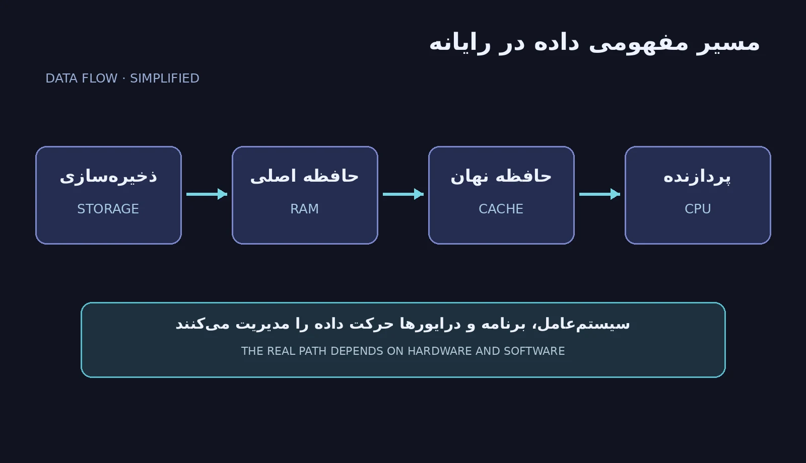

**شکل ۵-۱ — جریان ساده‌شده داده.** پیکان‌ها انتقال مفهومی را نشان می‌دهند. همه معماری‌ها و مسیرهای I/O دقیقاً این ترتیب را طی نمی‌کنند و نمودار نشان‌دهنده طراحی داخلی یک CPU مشخص نیست.

## ۴. ثبات، کش و سلسله‌مراتب حافظه

**ثبات‌ها (Registers)** محل‌های بسیار کوچک و سریع در پردازنده برای نگهداری داده‌های نزدیک به عملیات‌اند. **حافظه نهان (Cache)** کپی‌هایی از داده‌ها یا دستورهای پرکاربرد را نزدیک هسته نگه می‌دارد تا نیاز به مراجعه مکرر به حافظه اصلی کمتر شود. سطوح L1، L2 و گاهی L3 در معماری‌های مختلف اندازه و نحوه اشتراک متفاوت دارند [۲].

وقتی داده در کش مناسب موجود باشد، دسترسی می‌تواند سریع‌تر از مراجعه به حافظه اصلی باشد. در غیر این صورت **Cache Miss** رخ می‌دهد و داده از سطح دیگری جست‌وجو می‌شود. این یک مدل مفهومی است؛ سرعت دقیق به پردازنده، محل داده و بار سیستم بستگی دارد. افزایش کش یا هسته همیشه برنامه را به همان نسبت سریع‌تر نمی‌کند.

| لایه | نقش معمول | ماندگاری پس از خاموشی | محدودیت کلی |
|---|---|---|---|
| ثبات و کش CPU | داده و دستور نزدیک محاسبه | معمولاً خیر | ظرفیت محدود |
| RAM | مجموعه کاری برنامه‌ها | معمولاً خیر | ظرفیت و پهنای باند محدود |
| SSD/HDD | ذخیره فایل و داده پایدار | معمولاً بله | کندتر از RAM در بسیاری از الگوهای دسترسی |

این جدول رتبه‌بندی تقریبی است، نه تضمین تأخیر همه دستگاه‌ها. سامانه‌های چندپردازنده و حافظه‌های تخصصی می‌توانند مسیرهای دیگری داشته باشند.

## ۵. RAM: فضای کاری برنامه‌ها

**حافظه دسترسی تصادفی (Random Access Memory یا RAM)** معمولی سیستم، فضای کاری موقت برای داده‌ها و برنامه‌های در حال اجراست. RAM رایج مبتنی بر DRAM معمولاً با قطع برق محتوا را از دست می‌دهد؛ ذخیره دائمی فایل باید در جای مناسب انجام شود. واژه RAM به‌طور منطقی مفهوم دسترسی را توصیف می‌کند و همه فناوری‌های دارای دسترسی تصادفی لزوماً فرّار نیستند [۳].

اگر داده و برنامه از حافظه فیزیکی بیشتر شوند، سیستم‌عامل بسته به پیکربندی ممکن است از **حافظه مجازی (Virtual Memory)** و فضای swap/pagefile روی ذخیره‌سازی استفاده کند، یا برنامه با خطای کمبود حافظه متوقف شود. Swap می‌تواند کمک کند اما جایگزین هم‌سرعت RAM نیست و تضمین نمی‌کند همه بارها اجرا شوند. داده در RAM نیز ممکن است به دلیل فایل موقت، swap یا تنظیمات دیگر روی دیسک ثبت شود؛ در طراحی حریم خصوصی این موضوع را لحاظ کنید.

**ظرفیت** پاسخ می‌دهد چه مقدار داده هم‌زمان جا می‌شود؛ **پهنای باند (Bandwidth)** میزان داده منتقل‌شده در واحد زمان و **تأخیر (Latency)** مدت انتظار برای یک دسترسی یا عملیات است. ممکن است ظرفیت کافی داشته باشید ولی پردازنده برای انتقال داده منتظر بماند. مقدار اعلام‌شده سازنده اغلب سقف نظری است؛ عملکرد واقعی به کانال حافظه، ترکیب ماژول‌ها و بار کاری وابسته است.

## ۶. ذخیره‌سازی: HDD، SSD، NVMe و M.2

**HDD** از دیسک چرخان و سازوکار مکانیکی استفاده می‌کند؛ **SSD** معمولاً از حافظه فلش و کنترلر بهره می‌برد. SSD معمولاً برای بسیاری از دسترسی‌های تصادفی تأخیر کمتری از HDD دارد، اما عملکرد دقیق، قیمت، دوام و مصرف به مدل و بار وابسته‌اند. هر دو برای نگهداری فایل پس از خاموشی طراحی شده‌اند، ولی خرابی ممکن است؛ نسخه پشتیبان جداگانه ضروری است.

**SATA** یک رابط/استاندارد اتصال و پروتکل ذخیره‌سازی رایج است. **PCIe** یک گذرگاه اتصال پرسرعت برای انواع دستگاه‌هاست. **NVMe** مجموعه استانداردهای دسترسی به ذخیره‌سازی غیرفرّار است؛ NVMe روی PCIe رایج است و نسخه‌های مبتنی بر شبکه نیز وجود دارند [۴]. **M.2** یک قالب فیزیکی/اتصال است، نه مترادف NVMe؛ یک درایو M.2 می‌تواند بسته به دستگاه و پشتیبانی، از مسیرهای متفاوتی استفاده کند. پیش از خرید، سازگاری مشخصات درایو و مادربرد را در اسناد سازنده بررسی کنید.

| گزینه | کاربرد متداول | محدودیت/نکته انتخاب |
|---|---|---|
| HDD | آرشیو ظرفیت‌بالا و پشتیبان | تأخیر مکانیکی؛ آسیب‌پذیری در برابر ضربه؛ پشتیبان جدا لازم است |
| SATA SSD | سیستم‌عامل، فایل و بسیاری از پروژه‌های کوچک | عملکرد وابسته به دستگاه و محدودیت رابط |
| NVMe SSD روی PCIe | بارهای ذخیره‌سازی پرتقاضا و دسترسی موازی | سازگاری، حرارت، ظرفیت، پایداری سرعت و قیمت را بررسی کنید |
| فضای ابری/شبکه‌ای | همکاری، اشتراک یا نسخه بیرونی | هزینه انتقال، حریم خصوصی، دسترس‌پذیری و تأخیر شبکه |

هیچ گزینه‌ای برای همه بارها بهترین نیست. قیمت و مدل‌ها وابسته به بازار و تاریخ‌اند؛ این فصل عدد قیمت یا مدل خریدِ تأییدنشده معرفی نمی‌کند.

## ۷. سیستم‌عامل و حرکت یک فایل

**سیستم‌عامل (Operating System)** منابع دستگاه را میان برنامه‌ها مدیریت می‌کند و خدماتی مانند فایل، فرایند، حافظه، زمان‌بندی و دسترسی به دستگاه را فراهم می‌کند. وقتی برنامه فایلی را می‌خواند، درخواست معمولاً از API سیستم‌عامل و لایه‌های نرم‌افزار/درایور عبور می‌کند. داده ممکن است قبلاً در کش سیستم‌عامل باشد؛ بنابراین هر بار خواندن لزوماً یک مراجعه فیزیکی جدید به SSD نیست.

مسیر رایج و ساده‌شده برای مدل: فایل وزن‌ها در ذخیره‌سازی ← خواندن/بارگذاری و احتمالاً تبدیل در RAM ← دسترسی CPU یا انتقال مناسب به شتاب‌دهنده ← محاسبه ← ذخیره یا نمایش خروجی. در بعضی فناوری‌ها، نگاشت حافظه، حافظه مشترک یا مسیرهای انتقال بهینه این تصویر را تغییر می‌دهند. جزئیات GPU در فصل ۶ و زیرساخت در فصل‌های بعد بررسی می‌شوند.

**نکته امنیتی:** فایل ناشناخته را صرفاً به دلیل اینکه «مدل» نام دارد اجرا یا بارگذاری نکنید؛ فرمت‌ها و روش‌های بارگذاری می‌توانند خطر اجرای کد یا دسترسی ناخواسته داشته باشند. منبع، مجوز و راهنمای امنیتی ابزار را بررسی کنید.

## ۸. ظرفیت، پهنای باند و برآورد مدل

برای مدل دارای `N` پارامتر که هر پارامتر به‌طور ثابت `B` بایت استفاده کند، حجم خام وزن‌ها تقریباً چنین است:

```text
weight_bytes = N × B
```

مثلاً یک مدل با یک میلیارد پارامتر و ذخیره خام FP32، اگر هر وزن ۴ بایت باشد، حدود `4,000,000,000 bytes` یعنی `4 GB` ده‌دهی یا حدود `3.73 GiB` وزن خام دارد. این محاسبه فایل کامل یا حافظه لازم برای اجرا نیست: سربار قالب، بافر، برنامه، حافظه موقت، فعال‌سازی‌ها، KV cache و در آموزش گرادیان‌ها و حالت بهینه‌ساز می‌توانند فضای اضافه بخواهند. روش‌های فشرده‌سازی و offload نیز مدل واقعی محاسبه را تغییر می‌دهند.

برای انتقال ایده‌آل داده، تقریب حداقلی زیر مفید است:

```text
time_seconds ≥ data_bytes / bandwidth_bytes_per_second
```

اگر ۴ GB داده با پهنای باند **واقعی و پایدار فرضی** ۲ GB/s و بدون سربار منتقل شود، کف ساده زمان ۲ ثانیه است؛ سربار، تأخیر، اشتراک منابع و انتقال‌های دیگر می‌توانند زمان را بیشتر کنند. عدد فرضی، مشخصات یک SSD یا تضمین عملکرد نیست. فرمول برای تقریب یک مسیر انتقال است؛ ممکن است پردازش و انتقال هم‌پوشانی داشته باشند.

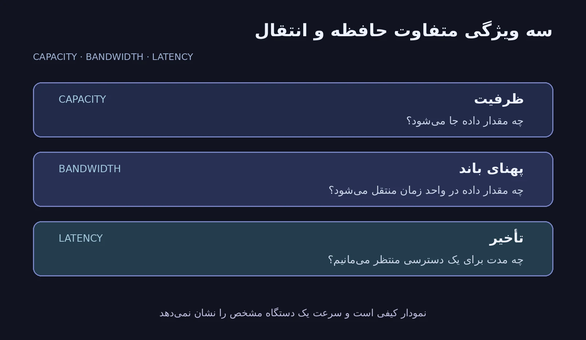

**شکل ۵-۲ — سه پرسش متفاوت درباره حافظه.** نمودار کیفی است و داده عددی یا رتبه عملکرد دستگاه‌ها نشان نمی‌دهد.

## ۹. پروژه عملی: یک فایل عددی بسازید و بخوانید

**هدف:** چهار عدد را در قالب float32 استاندارد داخل یک فایل موقت بنویسیم، تعداد بایت را ببینیم و دوباره بخوانیم. فایل داخل پوشه موقت ساخته و در پایان حذف می‌شود؛ این برنامه هیچ سخت‌افزاری را تغییر نمی‌دهد و **بنچمارک سرعت SSD نیست**.

**پیش‌نیاز:** Python استاندارد؛ نمونه با **Python 3.13.16** اجرا شده است. فایل `storage_demo.py` را با متن زیر بسازید:

```python
"""Tiny temporary binary file: float32 payload, not a hardware benchmark."""
from pathlib import Path
from tempfile import TemporaryDirectory
import struct


def main():
    values = (1.0, 2.5, -3.0, 4.0)
    payload = struct.pack('<4f', *values)
    with TemporaryDirectory() as folder:
        path = Path(folder) / 'sample.bin'
        path.write_bytes(payload)
        raw = path.read_bytes()
        recovered = struct.unpack('<4f', raw)
        print(f'number_of_values={len(values)}')
        print(f'bytes_per_value={struct.calcsize("<f")}')
        print(f'payload_bytes={len(payload)}')
        print(f'file_bytes={path.stat().st_size}')
        print(f'recovered={recovered}')
        assert recovered == values


if __name__ == '__main__':
    main()
```

در همان پوشه `python storage_demo.py` یا `python3 storage_demo.py` را اجرا کنید. خروجی آزمایش‌شده:

```text
number_of_values=4
bytes_per_value=4
payload_bytes=16
file_bytes=16
recovered=(1.0, 2.5, -3.0, 4.0)
```

**خواندن برنامه:** `values` چهار عدد است؛ `struct.pack('<4f', ...)` آن‌ها را با ترتیب بایت little-endian و چهار عدد شناور ۳۲بیتی استاندارد به ۱۶ بایت تبدیل می‌کند. `TemporaryDirectory` پوشه موقتی می‌سازد و پس از خروج آن را پاک می‌کند؛ `write_bytes` و `read_bytes` فایل را می‌نویسند و می‌خوانند. `unpack` بایت‌ها را مطابق همان قالب بازیابی می‌کند و `assert` تطابق این چهار عدد دقیقاً قابل نمایش را کنترل می‌کند [۵].

همه اعداد اعشاری لزوماً در float32 دقیقاً نمایش‌پذیر نیستند؛ برای داده‌های دیگر معمولاً مقایسه با تلورانس مناسب لازم است. حجم ۱۶ بایت اندازه داده/فایل خام این مثال است، نه کل RAM مصرفی برنامه Python، نه مصرف واقعی بلوک‌های فایل‌سیستم و نه حافظه لازم یک مدل.

**عیب‌یابی:** اگر فرمان شناخته نشد، `python3` و نصب Python را بررسی کنید. اگر اجازه ساخت فایل موقت ندارید، مسیر موقت و مجوز سیستم را بررسی کنید. خطای `struct.error` ممکن است از تعداد بایت یا ناسازگاری قالب هنگام خواندن باشد. از فایل‌های حساس برای آزمایش استفاده نکنید.

## ۱۰. انتخاب و عیب‌یابی بدون حدس

**سناریو ۱: برنامه با خطای کمبود حافظه متوقف می‌شود.** مصرف RAM، اندازه مجموعه داده، تعداد فرایندها و حافظه موقت را مشاهده کنید؛ به جای بارگذاری کل داده ممکن است پردازش دسته‌ای یا داده جریانی مناسب باشد. پیش از خرید RAM سازگاری و امکان ارتقا را بررسی کنید. اگر خطا مربوط به حافظه GPU باشد، افزایش RAM سیستم الزاماً آن را رفع نمی‌کند.

**سناریو ۲: بارگذاری فایل‌ها کند است.** داده را با ابزار معتبر روی سیستم واقعی اندازه بگیرید؛ تعداد فایل‌های کوچک، دسترسی شبکه، فضای آزاد، وضعیت SSD و مصرف CPU را بررسی کنید. فایل‌های کش‌شده می‌توانند نتیجه تکرار را تغییر دهند؛ یک بارخوانی، بنچمارک جامع نیست.

**سناریو ۳: استفاده CPU بالاست اما برنامه سریع نمی‌شود.** بررسی کنید آیا پردازش قابل موازی‌سازی است، منابع دیگری مانند حافظه/ذخیره‌سازی گلوگاه‌اند یا برنامه منتظر قفل و ورودی است. قبل از تعویض قطعه یک خط پایه و معیار روشن ثبت کنید.

**سناریو ۴: خاموشی یا دمای بالا.** محیط، خنک‌سازی و مشخصات سازنده را بررسی کنید؛ دستگاه را ناایمن باز نکنید و برای برق‌کشی یا تعمیر از متخصص کمک بگیرید. پشتیبان مستقل و آزمون بازیابی را فراموش نکنید.

## ۱۱. تحولات تا نوامبر ۲۰۲۶

**تاریخ بررسی: ۵ نوامبر ۲۰۲۶.** JEDEC می‌گوید استاندارد DDR5 نخستین‌بار در ژوئیه ۲۰۲۰ منتشر و در نسخه **JESD79-5D** در نوامبر ۲۰۲۵ به‌روزرسانی شده است [۶]. این نسخه استاندارد است، نه تضمین پشتیبانی هر CPU، مادربرد یا ماژول؛ مشخصات همان محصول و تاریخ خرید ملاک‌اند.

کنسرسیوم NVM Express، NVMe را خانواده‌ای از استانداردهای دسترسی به حافظه غیرفرّار معرفی می‌کند و انتقال‌های مختلف را توضیح می‌دهد [۴]. هیچ عدد قیمت، آخرین مدل سخت‌افزار یا سرعت قطعیِ دستگاه در این فصل بدون بررسی محصول مشخص ادعا نمی‌شود. برای انتخاب عملی، ظرفیت، تأخیر، پهنای باند، توان، قیمت، دسترس‌پذیری و پشتیبانی نرم‌افزار را با تاریخ و بازار مشخص مقایسه کنید.

## ۱۲. تمرین، آزمون و پروژه ارزیابی

**آزمون مفهومی:** ۱) تفاوت بیت و بایت چیست؟ ۲) چرا GHz به‌تنهایی معیار کافی سرعت CPU نیست؟ ۳) فرق RAM و SSD در نقش و ماندگاری معمول چیست؟ ۴) کش CPU چه مشکلی را کاهش می‌دهد؟ ۵) تفاوت ظرفیت با پهنای باند چیست؟ ۶) آیا هر M.2 لزوماً NVMe است؟ ۷) آیا افزایش RAM سیستم الزاماً خطای VRAM را رفع می‌کند؟ ۸) چرا سرعت اولین و دومین بار خواندن فایل ممکن است فرق کند؟ ۹) چرا حجم خام وزن‌ها کل حافظه آموزش نیست؟ ۱۰) چرا SSD جایگزین پشتیبان مستقل نیست؟

**تمرین ریاضی:** (الف) ۲ میلیون عدد ۴بایتی چند بایت خام‌اند؟ (ب) ۸ GB داده در مسیر فرضی با سرعت پایدار ۲ GB/s و بدون سربار حداقل چند ثانیه می‌گیرد؟ (ج) ۱ GiB چند بایت است؟

**تمرین کدنویسی:** پروژه را اجرا کنید. برای هشت عدد، قالب را به `<8f` تغییر و هشت مقدار قابل نمایش تعریف کنید؛ پیش‌بینی و سپس اندازه فایل را ثبت کنید. چهار بایت در هر عدد یعنی ۳۲ بایت داده خام. از تغییر فایل‌های موجود یا نوشتن روی دستگاه‌های سیستم خودداری کنید.

**پروژه ارزیابی:** برای یک سامانه آموزشی فرضی که باید فایل وزن ۴ GB را بخواند، یک نقشه شامل CPU، RAM، ذخیره‌سازی و سیستم‌عامل بکشید. سه نیاز را بنویسید: ظرفیت، داده انتقالی و برنامه پشتیبان. دو گزینه ذخیره‌سازی را با کاربرد، محدودیت، سازگاری و هزینه نسبی مقایسه کنید؛ عدد قیمت و سرعت را تنها در صورت داشتن منبع و تاریخ محصول ذکر کنید. توضیح دهید چرا تنها با حجم وزن نمی‌توان حافظه کل را تعیین کرد.

**معیار قبولی:** دست‌کم ۸ پاسخ درست از ۱۰ سؤال، حل درست سه محاسبه، اجرای برنامه یا توضیح دقیق در نبود محیط، و گزارش پروژه با اجزای خواسته‌شده و یک محدودیت. [پاسخ‌نامه جداگانه فصل ۵](book-engineering/answers/05-computer-foundations-answers-fa.md) را پس از حل تمرین‌ها ببینید.

## ۱۳. واژه‌نامه و منابع

**واژه‌نامه:** بیت (Bit)، بایت (Byte)، پردازنده مرکزی (CPU)، هسته (Core)، رشته (Thread)، ثبات (Register)، حافظه نهان (Cache)، حافظه اصلی (RAM)، ذخیره‌سازی (Storage)، حافظه مجازی (Virtual Memory)، تأخیر (Latency)، پهنای باند (Bandwidth)، SSD، HDD، PCIe، NVMe، M.2.

**گام بعد:** فصل ۶ به GPU، NPU، موازی‌سازی، VRAM و گلوگاه محاسبات ماتریسی می‌پردازد. تا آن زمان هیچ پردازنده یا ظرفیت مشخصی را بدون اندازه‌گیری و بررسی سازگاری، راه‌حل جهانی تلقی نکنید.

**منابع؛ تاریخ مراجعه: ۵ نوامبر ۲۰۲۶:**

[۱] Intel، «How a Data Center Actually Works»، تاریخ انتشار صفحه مشخص نشده، [توضیح پردازنده و حافظه](https://www.intel.com/content/www/us/en/data-center/topics/data-center-basics.html).

[۲] Intel، «IA Cores Level 1 and Level 2 Caches»، دیتاشیت نسل دوازدهم Core، تاریخ انتشار صفحه مشخص نشده، [مستندات](https://edc.intel.com/content/www/us/en/design/ipla/software-development-platforms/client/platforms/alder-lake-desktop/12th-generation-intel-core-processors-datasheet-volume-1-of-2/007/ia-cores-level-1-and-level-2-caches/). این مرجع مثال یک معماری است، نه توصیف همه CPUها.

[۳] IBM، «What is AI hardware?»، تاریخ انتشار صفحه مشخص نشده، [بخش حافظه](https://www.ibm.com/think/topics/ai-hardware).

[۴] NVM Express، «About: A Set of Open Standards»، تاریخ انتشار صفحه مشخص نشده، [مستند رسمی](https://nvmexpress.org/about/).

[۵] Python Software Foundation، «struct — Interpret bytes as packed binary data»، مستندات Python 3.13، تاریخ انتشار صفحه مشخص نشده، [مستندات نسخه](https://docs.python.org/3.13/library/struct.html).

[۶] JEDEC، «Main Memory: DDR SDRAM, HBM»، تاریخ انتشار صفحه مشخص نشده؛ اعلام به‌روزرسانی DDR5 در نوامبر ۲۰۲۵، [فهرست استانداردها](https://www.jedec.org/category/technology-focus-area/main-memory-ddr-sdram).

---

# فصل ۶ — GPU و NPU: محاسبات موازی و حافظه مدل

**هنر و علم ساخت هوش | جلد اول | Babak & Ai**
**نسخه کاری RC · تاریخ مراجعه به منابع: ۵ نوامبر ۲۰۲۶**

## ۱. چرا مدل‌ها به شتاب‌دهنده نیاز پیدا می‌کنند؟

در فصل ۵ دیدیم پردازنده و حافظه چگونه با هم کار می‌کنند. حالا تصور کنید باید یک عمل مشابه را روی میلیون‌ها عدد انجام دهیم؛ مثلاً در یک شبکه عصبی چندین ماتریس را ضرب کنیم. انجام این کار با CPU ممکن است، اما بعضی شتاب‌دهنده‌ها برای اجرای هم‌زمان مقدار زیادی محاسبه و انتقال داده طراحی شده‌اند. انتخاب میان CPU و GPU به اندازه مسئله، انتقال داده، حافظه، نرم‌افزار، مصرف انرژی و هزینه وابسته است؛ GPU همیشه سریع‌ترین یا ارزان‌ترین راه نیست.

**پیش‌نیاز:** فصل ۵ و مفهوم وزن و داده از فصل ۳. **هدف:** بتوانید موازی‌سازی داده، CPU/GPU/NPU، VRAM، ظرفیت و پهنای باند، ضرب ماتریسی، گلوگاه و برآورد مقدماتی حافظه را توضیح دهید؛ یک نمونه ضرب ماتریسی را اجرا و صحت آن را کنترل کنید.

**محدوده:** این فصل یک نقشه مفهومی است، نه دستور خرید یا طراحی مدار یک تراشه خاص. CUDA، ROCm، TPU و Apple Silicon به‌طور دقیق‌تر موضوع فصل ۷ هستند.

## ۲. CPU، GPU و NPU چه تفاوتی دارند؟

**CPU** پردازنده عمومی با قابلیت اجرای انواع برنامه‌ها، کنترل سیستم و پردازش شاخه‌دار است. **GPU (Graphics Processing Unit)** پردازنده‌ای است که برای حجم بالای محاسبات موازی مناسب طراحی شده و علاوه بر گرافیک، در یادگیری ماشین و محاسبات علمی کاربرد دارد. **NPU (Neural Processing Unit)** نام عمومی شتاب‌دهنده‌هایی است که برای برخی عملیات شبکه عصبی بهینه می‌شوند؛ معماری و قابلیت‌های NPUهای سازندگان مختلف یکسان نیست.

| ویژگی | CPU | GPU | NPU |
|---|---|---|---|
| نقش معمول | اجرای عمومی، کنترل، آماده‌سازی داده | حجم زیاد کارهای عددی موازی و گرافیک | برخی محاسبات شبکه عصبی با شتاب‌دهنده تخصصی |
| مزیت احتمالی | انعطاف، مناسب وظایف کوچک یا شاخه‌دار | توان موازی و پهنای باند بالا در بار مناسب | بهره‌وری انرژی یا شتاب برای مدل‌های پشتیبانی‌شده |
| محدودیت | ممکن است در بار بسیار موازی کندتر باشد | انتقال، مصرف برق، ظرفیت حافظه و سازگاری | پشتیبانی عملگر، قالب مدل، دقت و ابزار وابسته به محصول |
| جایگزین | GPU/NPU برای بار مناسب | CPU برای مدل کوچک یا زمان توسعه | CPU/GPU در صورت عدم پشتیبانی مدل |

این جدول گرایش‌های کلی است؛ CPU هم برداری و موازی است و GPU هم کنترل و شاخه دارد. مقایسه واقعی باید بر همان مدل، اندازه ورودی، دقت محاسبه، کیفیت خروجی، تأخیر، مصرف و نسخه نرم‌افزار انجام شود.

## ۳. موازی‌سازی داده و هزینه هماهنگی

**موازی‌سازی داده (Data Parallelism)** به‌معنای تقسیم کار مشابه روی داده‌های گوناگون است. برای مثال، اگر بخواهیم تمام عناصر یک بردار را دو برابر کنیم، محاسبه هر عنصر مستقل از عناصر دیگر است. در مقابل، برخی کارها به نتیجه مراحل قبلی وابسته‌اند و صرفاً با افزودن هسته، بی‌نهایت سریع نمی‌شوند.

در دنیای واقعی، بخشی از زمان صرف آماده‌سازی و انتقال داده، راه‌اندازی کار، هماهنگی و جمع‌کردن نتایج می‌شود. اگر ورودی بسیار کوچک باشد، هزینه ثابت ممکن است از منفعت محاسبه موازی بیشتر شود. چند فرایند موازی ممکن است برای حافظه و پهنای باند با یکدیگر رقابت کنند. بنابراین اندازه‌گیری ابتدا تا انتها مهم‌تر از نگاه به سرعت نظری روی کاغذ است.

برای برآورد محدودیت موازی‌سازی، **قانون آمدال (Amdahl's Law)** در یک مدل ساده می‌گوید:

```text
speedup = 1 / ((1 - p) + p / s)
```

`p` سهمی از زمان برنامه اولیه است که می‌تواند با ضریب `s` سریع‌تر شود؛ `1-p` بخش باقی‌مانده است. اگر `p=0.8` و `s=4` باشد، سرعت کل `1 / (0.2 + 0.2) = 2.5` برابر می‌شود، نه ۴ برابر. فرض می‌کنیم سایر هزینه‌ها تغییر نکنند؛ قانون به‌تنهایی سربار ارتباط، رقابت منابع یا تغییر اندازه مسئله را مدل نمی‌کند.

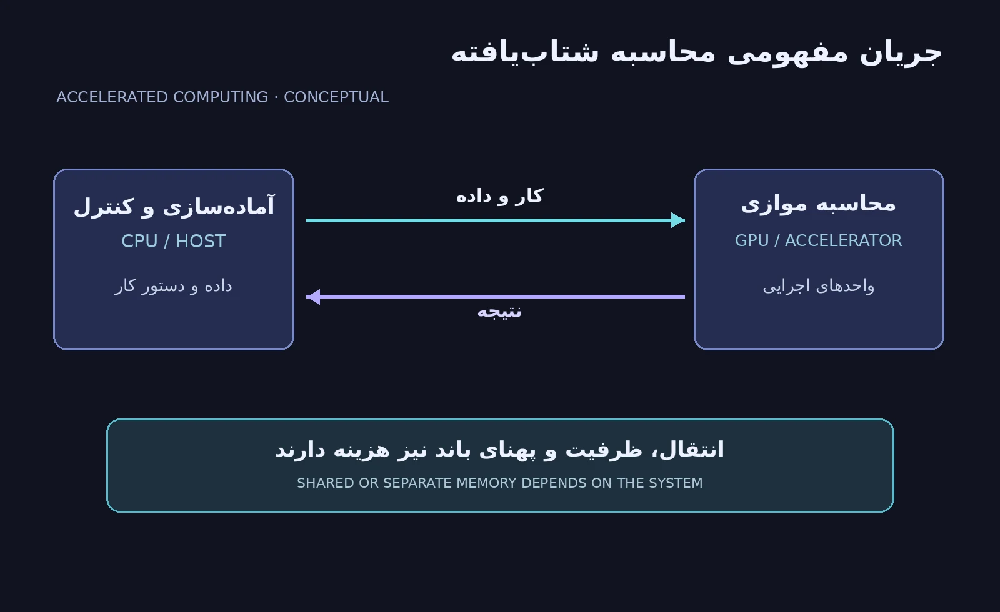

**شکل ۶-۱ — جریان مفهومی محاسبه شتاب‌یافته.** در برخی سیستم‌ها CPU و GPU حافظه فیزیکی مشترک دارند؛ در برخی حافظه دستگاه مجزاست. نمودار، انتقال را مفهومی نشان می‌دهد و ساختار فیزیکی یک دستگاه مشخص نیست.

## ۴. داخل GPU: مدل برنامه‌نویسی و حافظه

در مدل CUDA مربوط به NVIDIA، برنامه‌ای به نام **Kernel** روی تعداد زیادی thread اجرا می‌شود؛ threadها در block و مجموعه blockها در grid سازمان می‌یابند. سخت‌افزار، blockهای قابل اجرا را به **Streaming Multiprocessor یا SM** تخصیص می‌دهد. در راهنمای NVIDIA، threadهای CUDA در گروه‌هایی به نام warp اجرا و زمان‌بندی می‌شوند [۱]. این نام‌ها و جزئیات مختص اکوسیستم NVIDIA هستند؛ AMD و سایر سازندگان نام‌ها و مشخصات خاص خود را دارند.

در همان مدل، **register** به thread، حافظه **shared** به block و حافظه **global** به کار دستگاه مرتبط است. این‌ها فضای نام/دید برنامه‌نویسی‌اند و نحوه پیاده‌سازی و سرعت دقیق به نسل دستگاه بستگی دارد. حافظه shared با **حافظه یکپارچه سیستم (Unified Memory)** یک اصطلاح یکسان نیست. برنامه‌نویس برای داده مشترک و ترتیب عملیات باید قوانین همگام‌سازی را رعایت کند؛ صرف موازی بودن به معنی اجرای ایمن نیست [۱].

برخی GPUها واحدهای تخصصی ضرب ماتریس دارند؛ در NVIDIA نام Tensor Core برای خانواده‌ای از این واحدها استفاده می‌شود. وجود این واحدها تضمین نمی‌کند هر شکل ماتریس، هر نوع داده یا هر کتابخانه از حداکثر توان آن‌ها بهره ببرد. نسخه سخت‌افزار و نرم‌افزار را هنگام آزمایش ثبت کنید.

## ۵. VRAM، حافظه یکپارچه و ظرفیت

**VRAM** معمولاً به حافظه‌ای اشاره می‌کند که برای پردازش گرافیکی/دستگاه در دسترس است. در یک کارت مجزا ممکن است حافظه فیزیکی اختصاصی داشته باشید؛ در برخی سامانه‌های یکپارچه، CPU و شتاب‌دهنده از حافظه فیزیکی مشترک استفاده می‌کنند. یکسان بودن حافظه فیزیکی به معنی حذف همه هزینه‌های دسترسی، محدودیت ظرفیت یا نیاز به رعایت قوانین دستگاه نیست.

برای استنتاج، مصرف واقعی می‌تواند شامل وزن‌ها، بافرها، فعال‌سازی‌ها، داده ورودی، حافظه runtime و در مدل زبانی **KV cache** باشد. برای آموزش، گرادیان‌ها، حالت بهینه‌ساز و فعال‌سازی‌های مورد نیاز پس‌انتشار نیز ممکن است اضافه شوند. دقت محاسبات و روش‌هایی مانند کمّی‌سازی یا checkpointing بر نیاز تغییر ایجاد می‌کنند؛ هیچ عدد ثابتی برای همه مدل‌ها کافی نیست.

**مثال پایه:** دو میلیارد پارامتر با ۲ بایت برای هر وزن، فقط برای وزن خام `4,000,000,000 bytes` یا حدود `3.73 GiB` نیاز دارند. این عدد سقف یا کل حافظه نیست و تضمین نمی‌کند مدل در کارت ۴ GiB اجرا شود. مقداری از حافظه به سیستم، داده و محاسبه اختصاص می‌یابد؛ همچنین فرمت فایل و سربار ممکن است متفاوت باشند.

در PyTorch برای CUDA، `memory_allocated` حافظه اشغال‌شده توسط tensorها و `memory_reserved` حافظه مدیریت‌شده توسط تخصیص‌دهنده کش را گزارش می‌کند. خروجی ابزارهای سیستم ممکن است بیشتر باشد. `empty_cache()` حافظه کشِ بلااستفاده را آزاد می‌کند، اما tensorهای زنده را حذف نمی‌کند [۲].

## ۶. ظرفیت، پهنای باند و گلوگاه

**ظرفیت** یعنی حجم قابل نگهداری؛ **پهنای باند** نرخ انتقال داده؛ **توان محاسبه** سرعت اجرای عملیات تحت شرایط مشخص. اگر داده جا نشود، اجرای مستقیم ممکن است با خطای حافظه متوقف شود؛ اگر جا شود اما داده دیر برسد، واحدهای محاسباتی ممکن است منتظر بمانند. اگر محاسبات نسبت به داده زیاد باشد، محدودیت ممکن است در توان محاسبات باشد.

**شدت محاسباتی (Arithmetic Intensity)** نسبت تعداد عملیات به بایت انتقال‌یافته برای یک سطح حافظه و تعریف مشخص است. برای تقریب ساده و بار مشخص، می‌توان آن را با نسبت توان محاسبه به پهنای باند مقایسه کرد؛ راهنمای NVIDIA تأکید می‌کند این مدل همه جزئیات مانند سلسله‌مراتب کش و سربار اجرا را در نظر نمی‌گیرد [۳]. عدد اعلام‌شده روی جعبه معمولاً سقف نظری است و نتیجه واقعی نیست.

**مثال:** اگر محاسبه‌ای ۸ میلیارد عملیات انجام دهد و ۲ میلیارد بایت از یک سطح حافظه بخواند/بنویسد، شدت آن `4 operation/byte` است؛ این عدد به نحوه شمارش عملیات و بایت، استفاده از کش و پیاده‌سازی وابسته است. برای نتیجه‌گیری درباره گلوگاه باید ظرفیت واقعی و اندازه‌گیری همان بار را نیز داشته باشیم.

## ۷. ضرب ماتریسی: کاری آشنا برای GPU

اگر ماتریس A ابعاد `M×K` و B ابعاد `K×N` داشته باشد، حاصل C ابعاد `M×N` دارد. هر عنصر C از حاصل‌ضرب و جمع یک سطر A و یک ستون B به دست می‌آید:

```text
C[i,j] = Σ A[i,t] × B[t,j]    for t = 0 … K-1
```

`i` شماره سطر خروجی، `j` شماره ستون خروجی و `t` شاخص بعد مشترک است. برای A برابر `[[1,2],[3,4]]` و B برابر `[[5,6],[7,8]]`، عنصر بالا-چپ `1×5 + 2×7 = 19` و خروجی کل `[[19,22],[43,50]]` است.

محاسبه عناصر خروجی و بخش‌های مختلف ضرب می‌تواند به واحدهای متعدد تقسیم شود، ولی دسترسی به داده، اندازه tile، تخصیص و جمع نتایج مهم است. تقریب متداول `2×M×N×K` عملیات شناور را می‌شمارد، با فرض شمارش ضرب و جمع جدا؛ تعداد دقیق به الگوریتم و قرارداد شمارش بستگی دارد [۳]. فصل‌های جبر خطی و PyTorch این عملیات را عمیق‌تر آموزش می‌دهند.

## ۸. پروژه اجرایی: ضرب ماتریسی روی CPU

این پروژه وابستگی خارجی ندارد و نشان می‌دهد نتیجه قبل از بهینه‌سازی باید درست باشد. **فایل:** `matrix_cpu.py`؛ **محیط آزمایش:** Python 3.13.16، CPU؛ نه GPU و نه بنچمارک سرعت.

```python
"""Small CPU-only matrix multiplication; educational, not a benchmark."""

def matmul(a, b):
    if not a or not b or not a[0] or not b[0]:
        raise ValueError('matrices must not be empty')
    k = len(a[0])
    n = len(b[0])
    if any(len(row) != k for row in a) or any(len(row) != n for row in b):
        raise ValueError('matrices must be rectangular')
    if k != len(b):
        raise ValueError('inner dimensions must match')
    return [[sum(a[i][t] * b[t][j] for t in range(k))
             for j in range(n)] for i in range(len(a))]


def main():
    a = [[1, 2], [3, 4]]
    b = [[5, 6], [7, 8]]
    result = matmul(a, b)
    print('A x B =', result)
    assert result == [[19, 22], [43, 50]]
    print('correctness=PASS')
    print('fp32_payload_2x2_matrices_bytes=', 3 * 2 * 2 * 4)


if __name__ == '__main__':
    main()
```

دستور اجرا در همان پوشه: `python matrix_cpu.py` یا `python3 matrix_cpu.py`. خروجی ثبت‌شده:

```text
A x B = [[19, 22], [43, 50]]
correctness=PASS
fp32_payload_2x2_matrices_bytes= 48
```

تابع `matmul` شکل ماتریس‌ها را بررسی می‌کند؛ سپس برای هر خانه خروجی ضرب‌های متناظر را جمع می‌کند. `assert` نتیجه شناخته‌شده را می‌سنجد. عدد ۴۸ یک **برآورد فرضی** برای سه آرایه متراکم ۲×۲ با داده FP32 است؛ فهرست‌ها و عددهای واقعی Python در این برنامه FP32 متراکم نیستند و RAM بیشتری با سربار اشیا مصرف می‌کنند.

**عیب‌یابی:** ورودی خالی یا سطرهای با طول متفاوت `ValueError` می‌دهند؛ ابعاد داخلی باید برابر باشند. اگر فرمان Python در دسترس نبود، نصب یا `python3` را بررسی کنید. نتیجه صحیح این مثال تضمین سرعت یا صحت محاسبه با دقت پایین برای همه داده‌ها نیست.

## ۹. مسیر حرفه‌ای: PyTorch روی دستگاه مناسب

نمونه زیر با PyTorch در صورت موجود بودن backend `cuda` کار را به آن دستگاه می‌فرستد و در غیر این صورت روی CPU اجرا می‌کند. در بعضی نسخه‌های PyTorch ساخته‌شده برای ROCm، نام دستگاه نرم‌افزاری نیز `cuda` است؛ این نام به‌تنهایی سازنده سخت‌افزار را مشخص نمی‌کند [۴]. این مثال **در محیط نگارش اجرا نشده است**؛ PyTorch نصب نبود و GPU مناسب تأیید نشد. نسخه، درایور و backend را هنگام اجرا ثبت کنید.

```python
import torch

device = torch.device('cuda' if torch.cuda.is_available() else 'cpu')
a = torch.tensor([[1., 2.], [3., 4.]], device=device)
b = torch.tensor([[5., 6.], [7., 8.]], device=device)
c = a @ b
expected = torch.tensor([[19., 22.], [43., 50.]], device=device)
assert torch.allclose(c, expected)
print('torch_version=', torch.__version__, 'device=', device)
print(c.cpu())
```

نصب باید از راهنمای رسمی PyTorch و متناسب با OS، CPU/GPU و نسخه درایور انجام شود [۵]. اگر backend `cuda` در دسترس نباشد، اجرای CPU نشانه خراب بودن برنامه نیست. این کد از شتاب‌دهنده‌های دیگر مانند Apple MPS خودکار استفاده نمی‌کند. برای اندازه‌گیری زمان CUDA، گرم‌کردن و همگام‌سازی مناسب و ثبت هزینه انتقال اهمیت دارد؛ این نمونه تنها درستی را کنترل می‌کند.

## ۱۰. خطاهای رایج و انتخاب مسئولانه

- **Out of memory:** اندازه batch، طول توالی، نوع داده، حافظه tensorهای زنده و سایر برنامه‌ها را بررسی کنید. کاهش batch یا offload ممکن است کمک کند اما زمان و رفتار را تغییر می‌دهد. برآورد خام وزن تنها نقطه شروع است.
- **GPU دیده نمی‌شود:** سخت‌افزار، پشتیبانی سیستم‌عامل، نسخه درایور و ساخت کتابخانه را طبق مستندات بررسی کنید. از اجرای فرمان‌های ناشناس یا نصب درایور نامطمئن خودداری کنید.
- **GPU از CPU کندتر است:** مسئله کوچک، انتقال، راه‌اندازی، شکل نامناسب داده یا پیاده‌سازی می‌تواند علت باشد؛ ابتدا کل خط لوله و صحت خروجی را بسنجید.
- **مقایسه نادرست:** توان نظری با دقت‌های مختلف، مدل‌ها و توان برق متفاوت را مستقیم مقایسه نکنید. ثبت داده، بار، warm-up، نسخه، تعداد تکرار و معیار کیفیت لازم است.
- **ایمنی و هزینه:** توان مصرفی، گرما، منبع تغذیه، خنک‌سازی، پشتیبانی، قیمت و مجوز نرم‌افزار را در انتخاب بررسی کنید. کاربر می‌تواند با CPU شروع کند و تنها پس از اندازه‌گیری به GPU یا اجاره ابری نیاز داشته باشد.

## ۱۱. تحولات تا نوامبر ۲۰۲۶

**تاریخ بررسی: ۵ نوامبر ۲۰۲۶.** راهنمای برنامه‌نویسی CUDA درباره سازمان threadها و حافظه دستگاه توضیح می‌دهد [۱]؛ راهنمای عملکرد ضرب ماتریس NVIDIA نیز نشان می‌دهد تعادل محاسبه و انتقال به اندازه و پیاده‌سازی وابسته است [۳]. این اسناد درباره اکوسیستم NVIDIA هستند و نباید ویژگی‌های آن‌ها را بدون بررسی به همه GPUها تعمیم داد.

پشتیبانی نرم‌افزاری، قالب داده و مدل‌های شتاب‌دهنده به‌سرعت تغییر می‌کنند. در این فصل «بهترین GPU سال» یا قیمت تأییدنشده معرفی نمی‌کنیم. تاریخ و نسخه کتابخانه، درایور، دستگاه و بار واقعی هنگام هر خرید یا اجرای پروژه باید جداگانه ثبت شود.

## ۱۲. تمرین، آزمون و پروژه ارزیابی

**آزمون مفهومی:** ۱) یک تفاوت گرایش CPU و GPU چیست؟ ۲) آیا GPU همیشه سریع‌تر است؟ ۳) NPU چه محدودیت نرم‌افزاری ممکن است داشته باشد؟ ۴) فرق ظرفیت و پهنای باند چیست؟ ۵) چه اجزایی علاوه بر وزن حافظه می‌خواهند؟ ۶) shared memory در CUDA و حافظه یکپارچه سیستم یکی هستند؟ ۷) چرا عدد نظری TFLOPS نتیجه واقعی نیست؟ ۸) آیا `empty_cache` tensor زنده را آزاد می‌کند؟ ۹) دو عامل زمان انتقال چیست؟ ۱۰) چرا نتیجه نمونه CPU بنچمارک GPU نیست؟

**تمرین ریاضی:** ۱) برای `p=0.5` و `s=2` سرعت کلی را طبق مدل آمدال حساب کنید. ۲) حافظه خام ۵۰۰ میلیون وزن ۴بایتی چقدر است؟ ۳) ابعاد حاصل ضرب `3×2` در `2×4` را بنویسید.

**تمرین برنامه‌نویسی:** یک ماتریس جدید با ابعاد سازگار بسازید و یک خانه خروجی را دستی کنترل کنید. سپس یک ماتریس با ابعاد ناسازگار بدهید و بررسی کنید `ValueError` رخ می‌دهد. اگر PyTorch و دستگاه سازگار دارید، مثال بخش ۹ را اجرا و نسخه و دستگاه را ثبت کنید، بدون ادعای سرعت تا زمان طراحی بنچمارک.

**مینی‌پروژه:** برای یک مدل فرضی، وزن خام، ظرفیت دستگاه، بافر فرضی، ورودی و محدودیت‌ها را در یک جدول ثبت و دو راه‌حل CPU/GPU را با معیار زمان، انرژی، هزینه و کیفیت پیشنهاد کنید. مقادیر مجهول را صریحاً مجهول بگذارید؛ برای تصمیم واقعی داده واقعی لازم است.

**معیار عبور:** دست‌کم ۸ جواب درست از ۱۰ پرسش، حل صحیح سه تمرین ریاضی، اجرای CPU یا تشریح دقیق آن در نبود محیط، و گزارش مینی‌پروژه شامل یک گلوگاه احتمالی و عدم قطعیت‌ها. [پاسخ‌نامه جداگانه فصل ۶](book-engineering/answers/06-gpu-parallelism-answers-fa.md) را بعد از حل تمرین‌ها ببینید.

## ۱۳. واژه‌نامه و منابع

**واژه‌نامه:** GPU، NPU، محاسبات موازی (Parallel Computing)، Kernel، Thread، Block، VRAM، پهنای باند (Bandwidth)، شدت محاسباتی (Arithmetic Intensity)، گلوگاه (Bottleneck)، ضرب ماتریسی (Matrix Multiplication)، تخصیص‌دهنده کش (Caching Allocator).

**گام بعد:** فصل ۷ اکوسیستم‌های CUDA، ROCm، TPU و Apple Silicon را با تفاوت معماری، ابزار و سازگاری بررسی می‌کند.

**منابع؛ تاریخ مراجعه: ۵ نوامبر ۲۰۲۶:**

[۱] NVIDIA، «Writing SIMT Kernels»، CUDA Programming Guide، تاریخ انتشار صفحه مشخص نشده، [مستندات](https://docs.nvidia.com/cuda/cuda-programming-guide/02-basics/writing-cuda-kernels.html).

[۲] PyTorch Contributors، «CUDA semantics: Memory management»، مستندات PyTorch 2.13، تاریخ انتشار صفحه مشخص نشده، [مستندات نسخه](https://docs.pytorch.org/docs/2.13/notes/cuda.html).

[۳] NVIDIA، «Matrix Multiplication Background User's Guide»، ۲۰۲۳، [راهنما](https://docs.nvidia.com/deeplearning/performance/dl-performance-matrix-multiplication/index.html).

[۴] PyTorch Contributors، «HIP semantics»، تاریخ انتشار صفحه مشخص نشده، [مستندات](https://docs.pytorch.org/docs/stable/notes/hip.html).

[۵] PyTorch Contributors، «Start Locally»، تاریخ انتشار صفحه مشخص نشده، [راهنمای نصب رسمی](https://pytorch.org/get-started/locally/).

---

# فصل ۷ — اکوسیستم‌های محاسبات هوش مصنوعی: CUDA، ROCm، TPU و Apple Silicon

**هنر و علم ساخت هوش | جلد اول | Babak & Ai**
**نسخه کاری RC · تاریخ مراجعه به منابع: ۵ نوامبر ۲۰۲۶**

## ۱. سخت‌افزار بدون نرم‌افزار کافی نیست

فرض کنید یک GPU جدید خریده‌اید، اما کتابخانه یادگیری ماشین دستگاه را نمی‌بیند. آیا حتماً کارت خراب است؟ نه؛ ممکن است سیستم‌عامل، درایور، نسخه کتابخانه یا معماری دستگاه با یکدیگر سازگار نباشند. برای اجرای یک مدل، افزون بر تراشه، زنجیره‌ای از سیستم‌عامل، درایور، runtime، کتابخانه و برنامه لازم است.

**پیش‌نیاز:** فصل‌های ۵ و ۶. **هدف:** پس از مطالعه می‌توانید تفاوت CUDA، ROCm، TPU و Apple Silicon را توضیح دهید؛ برای یک دستگاه جدول سازگاری بسازید؛ تفاوت درایور و Toolkit را تشخیص دهید؛ یک برنامه تشخیص محیط اجرا کنید؛ و هزینه و محدودیت‌های انتخاب سخت‌افزار را بدون ادعای سرعت اثبات‌نشده مقایسه کنید.

**اصل راهنما:** نام یک سازنده به‌تنهایی پشتیبانی تمام مدل‌ها، تمام سیستم‌عامل‌ها و همه عملگرهای یک مدل را تضمین نمی‌کند. پیش از نصب، مشخصات محصول و مستندات همان نسخه را بررسی کنید. هزینه‌ها وابسته به کشور، تاریخ، موجودی و مصرف‌اند؛ این فصل قیمت عددی تأییدنشده ارائه نمی‌دهد.

## ۲. زنجیره نرم‌افزار تا تراشه

یک مدل ممکن است از یک چارچوب مانند PyTorch استفاده کند. چارچوب از backend و کتابخانه‌های عددی مناسب برای تبدیل عملیات به کار قابل اجرا روی دستگاه کمک می‌گیرد. درایور ارتباط سطح پایین با دستگاه و سیستم‌عامل را فراهم می‌کند؛ runtime و کتابخانه‌ها نیز اجرای برنامه و عملیات را پشتیبانی می‌کنند. **Compiler** یا کامپایلر در برخی مسیرها کد یا گراف را برای هدف مناسب تولید یا بهینه می‌کند. بسته‌بندی دقیق این لایه‌ها به پلتفرم و نسخه وابسته است.

```text
برنامه و مدل → چارچوب یادگیری ماشین → backend / کتابخانه / runtime
             → درایور و سیستم‌عامل → شتاب‌دهنده سازگار
```

این ترتیب یک نقشه آموزشی است، نه ساختار دقیق تمام سیستم‌ها. بعضی کتابخانه‌ها با چارچوب توزیع می‌شوند؛ بعضی ابزارها جداگانه نصب می‌شوند. داشتن یک **درایور** الزاماً به معنی نصب کامل ابزار توسعه یا فعال بودن backend در چارچوب نیست.

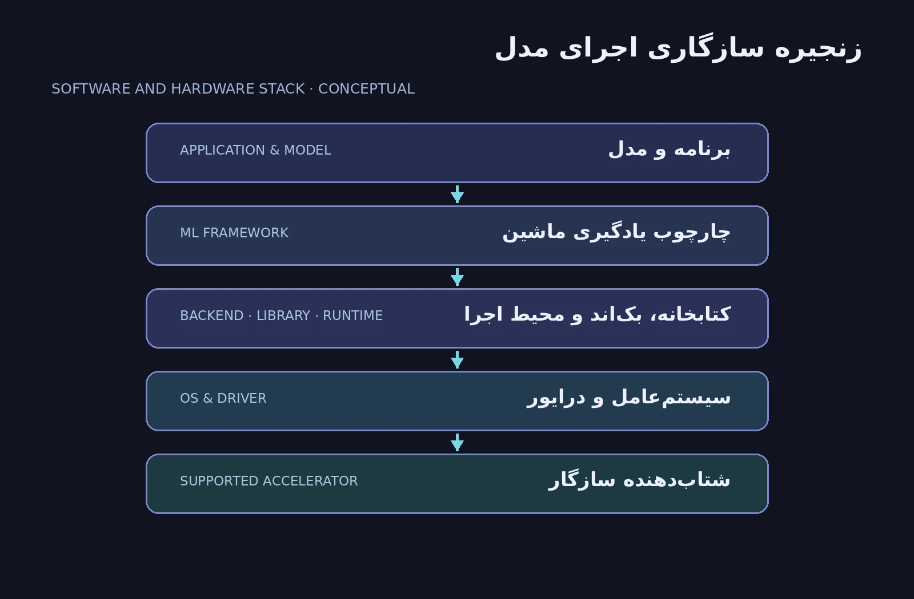

**شکل ۷-۱ — زنجیره سازگاری.** اتصال پیکان‌ها یک وابستگی مفهومی است؛ محل دقیق runtime، درایور و کامپایلر در پلتفرم‌های مختلف تفاوت دارد.

## ۳. CUDA و GPUهای NVIDIA

**CUDA** پلتفرم و مدل برنامه‌نویسی NVIDIA برای محاسبات شتاب‌یافته با GPUهای سازگار آن است. ابزارها و کتابخانه‌ها می‌توانند ساخت و اجرای عملیات عددی را ساده کنند؛ مدل Kernel/Thread/Block در فصل ۶ معرفی شد. CUDA را نباید نام عمومی همه GPUها دانست.

**Driver**، **CUDA Toolkit** و **CUDA runtime/library** مفاهیم متمایزند: درایور ارتباط با GPU را فراهم می‌کند؛ Toolkit شامل ابزار توسعه مانند کامپایلر و کتابخانه‌هاست؛ و یک بسته چارچوب ممکن است برخی runtimeهای موردنیاز را همراه داشته باشد. نصب محلی Toolkit کامل برای هر کاربرد PyTorch الزامی نیست؛ برای ساخت کد CUDA سفارشی یا پروژه‌هایی با نیاز مشخص می‌تواند لازم باشد. راهنمای بسته و نیازمندی واقعی پروژه ملاک است [۱، ۲].

**روند ایمن نصب:** مدل GPU و OS را ثبت کنید؛ راهنمای نصب NVIDIA و ماتریس سازگاری چارچوب را بخوانید؛ درایور سازگار را از منبع رسمی نصب کنید؛ مطابق دستور رسمی چارچوب، بسته مناسب را در محیط مجازی نصب کنید؛ سپس یک عملیات کوچک، نسخه و دستگاه را بررسی کنید. بدون نیاز مشخص، از اجرای فرمان نصب نامتناسب یا تغییر سراسری درایور خودداری کنید. قبل از هر تغییر مهم نسخه پشتیبان و امکان بازگشت را بررسی کنید.

برای مثال، مستندات CUDA Toolkit **13.4** برای Linux می‌گویند بسته Toolkit و درایور مستقل نسخه‌گذاری و نصب می‌شوند [۱]. این نکته مختص نسخه و روش نصب مستند است؛ نمی‌توان آن را بی‌قید به نسخه‌های قدیمی یا هر سیستم تعمیم داد. مقدار `CUDA Version` در `nvidia-smi` لزوماً نسخه Toolkit نصب‌شده یا نسخه کتابخانه‌های هر محیط Python نیست.

## ۴. ROCm و اکوسیستم AMD

**ROCm (Radeon Open Compute)** مجموعه‌ای از ابزارها، runtime و کتابخانه‌های محاسباتی AMD است. پشتیبانی به خانواده GPU، سیستم‌عامل، نسخه درایور، چارچوب و نوع کار وابسته است. **HIP** رابط برنامه‌نویسی برای محاسبات GPU در این اکوسیستم است؛ انتقال یک برنامه CUDA به HIP یا استفاده از بسته‌های آماده همیشه بدون تغییر و بدون محدودیت نیست [۳].

در برخی ساخت‌های PyTorch برای ROCm، رابط `torch.cuda` و نام دستگاه `cuda` نیز استفاده می‌شوند؛ این به معنی استفاده از GPU NVIDIA نیست. برای تشخیص ساخت، `torch.version.hip` را همراه با مستندات بررسی کنید [۴]. تشخیص یک دستگاه به‌تنهایی پشتیبانی تمام عملگرهای مدل یا عملکرد مطلوب را ثابت نمی‌کند.

**نمونه مستند، نه نسخه همگانی:** صفحه AMD برای Radeon/Ryzen، ROCm **7.2.1** را برای خانواده‌هایی از GPU/APUها و مسیرهای مشخص Linux و Windows معرفی می‌کند [۳]. پشتیبانی جزئیات و تفاوت‌های زیادی دارد؛ برای GPU خاص باید ماتریس همان محصول و OS را دید. نام یک محصول در فهرست معرفی، به معنی پشتیبانی همه تنظیمات یا همه چارچوب‌ها نیست.

**روند نصب:** ابتدا جدول رسمی AMD را برای مدل دقیق، OS، درایور و نسخه چارچوب بخوانید؛ مسیر بسته‌بندی همان جدول را در محیط مجزا دنبال کنید؛ دستگاه و عملیات کوچک را آزمایش کنید. در صورت نبود پشتیبانی می‌توانید از CPU، دستگاه سازگار دیگر یا سرویس ابری استفاده کنید؛ انتخاب به هزینه، حریم خصوصی و بار کاری بستگی دارد.

## ۵. TPU و ابزارهای Google Cloud

**TPU (Tensor Processing Unit)** شتاب‌دهنده اختصاصی طراحی‌شده توسط Google برای بارهای یادگیری ماشین، به‌ویژه عملیات ماتریسی است. در معماری مستند Google، واحدهای ضرب ماتریسی (**MXU**) و آرایه‌های systolic در نسل‌های مشخص وجود دارند؛ پیکربندی و ظرفیت به نسل دستگاه وابسته است [۵]. اصطلاح TensorCore در مستند TPU نباید بدون توضیح با نام‌های مشابه در GPUهای سازندگان دیگر یکسان فرض شود.

یک مسیر معمول Cloud TPU از **JAX** و کامپایلر **XLA** استفاده می‌کند؛ مسیرهای دیگری مانند PyTorch/XLA نیز در مستندات وجود دارند. XLA به تولید و بهینه‌سازی محاسبات برای دستگاه هدف کمک می‌کند. در عمل زمان کامپایل، شکل ورودی‌ها، انتقال داده، مدیریت دستگاه و سازگاری عملیات بر عملکرد و هزینه اثر دارند. سرعت یک TPU نسبت به GPU بدون تعیین مدل، اندازه بار، دقت، هزینه و روش آزمون قابل قضاوت نیست [۵، ۶].

استفاده ابری می‌تواند نیاز به خرید اولیه را کم کند اما هزینه اجاره دستگاه، زمان اجرا، ذخیره‌سازی، شبکه و داده را ایجاد می‌کند. منطقه، سهمیه، موجودی، مجوز داده و توقف درست منابع اهمیت دارند. هیچ حساب ابری یا منبع پولی در این فصل ایجاد نشده است.

## ۶. Apple Silicon، Metal، MPS و MLX

**Apple Silicon** به خانواده تراشه‌های Apple اشاره می‌کند که بسته به محصول CPU، GPU و شتاب‌دهنده‌های دیگری مانند Neural Engine دارند. در معماری حافظه یکپارچه، CPU و GPU می‌توانند به حافظه فیزیکی مشترک دسترسی داشته باشند، اما ظرفیت و پهنای باند همچنان محدودند و نرم‌افزار باید سازگاری و همگام‌سازی را رعایت کند [۷].

**Metal** چارچوب محاسبه و گرافیک Apple است. در PyTorch، backend با نام **MPS** برای اجرای عملیات پشتیبانی‌شده روی GPU از فناوری Metal استفاده می‌کند؛ `is_built()` تنها نشان‌دهنده وجود پشتیبانی در ساخت است، در حالی که `is_available()` در دسترس بودن در محیط فعلی را بررسی می‌کند [۸]. این backend را نباید به معنی اجرای خودکار روی Neural Engine دانست.

**MLX** چارچوبی برای محاسبات و یادگیری ماشین روی Apple Silicon است و از طراحی حافظه یکپارچه بهره می‌برد [۷]. **Core ML** مسیری برای تبدیل و اجرای مدل روی دستگاه‌های Apple است که تخصیص عملیات به CPU، GPU یا Neural Engine به پشتیبانی مدل و سیستم وابسته است [۹]. مقایسه واقعی باید همان مدل، دقت، کیفیت و دستگاه را بسنجد؛ RAM مشترک به معنی ظرفیت نامحدود برای مدل نیست.

## ۷. مقایسه و تصمیم بر اساس نیاز

| مسیر | نمونه استفاده | محدودیت/سازگاری | هزینه و جایگزین |
|---|---|---|---|
| CPU | یادگیری، مدل کوچک، خط پایه | زمان اجرا و RAM به بار وابسته است | خرید اضافی ممکن است لازم نباشد؛ در بار سنگین‌تر GPU/ابر |
| NVIDIA + CUDA | کتابخانه‌ها و بارهای پشتیبانی‌شده GPU | GPU، درایور، runtime و نسخه چارچوب سازگار | هزینه GPU، برق و خنک‌سازی؛ CPU یا اجاره ابری |
| AMD + ROCm | GPU/APU و چارچوب‌های پشتیبانی‌شده | فهرست مدل، OS و بسته محدود به نسخه | هزینه سخت‌افزار و نگهداری؛ CPU یا مسیر سازگار دیگر |
| Cloud TPU | بار ماتریسی سازگار و زیرساخت ابری | کامپایل، شکل، سهمیه و پشتیبانی عملیات | اجاره و شبکه/ذخیره‌سازی؛ GPU ابری یا CPU |
| Apple Silicon | اجرای محلی پشتیبانی‌شده با Metal/MPS/MLX | نسخه macOS، عملگر و حافظه مشترک | هزینه دستگاه و محدودیت ارتقا؛ CPU یا GPU/ابر خارجی |

برای تصمیم، ابتدا مدل، دقت و معیار کیفیت را ثابت کنید؛ سپس latency، throughput، حافظه، انرژی، هزینه کل و سهولت نگهداری را روی گزینه‌های واقعاً موجود بسنجید. قیمت‌ها را با تاریخ، کشور، واحد پول، مالیات و منبع ثبت کنید. اگر حفاظت داده اهمیت دارد، محل ذخیره و انتقال به ابر را نیز ارزیابی کنید.

**هزینه تقریبی یک اجاره، مدل ساده:** اگر فقط نرخ شتاب‌دهنده ساعتی `r` و زمان رزرو `h` را داشته باشیم، جزء اصلی `r × h` است. هزینه کل ممکن است ذخیره‌سازی، شبکه، مالیات، حداقل زمان صورتحساب و زمان آماده‌سازی را هم شامل شود. این فرمول قیمت ارائه‌دهنده یا سقف واقعی هزینه را تضمین نمی‌کند.

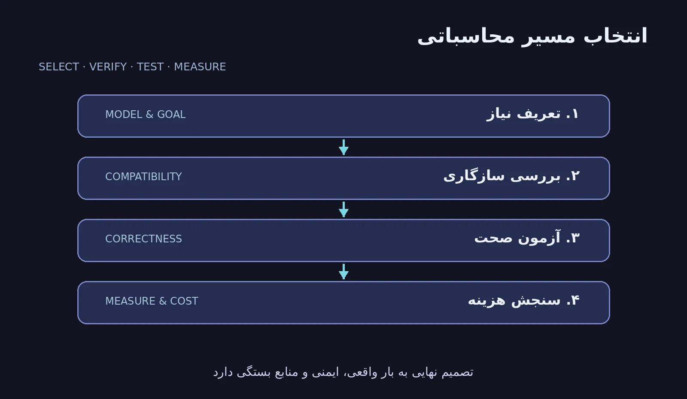

**شکل ۷-۲ — فرایند انتخاب.** نتیجه یک آزمون کوچک فقط شروع ارزیابی است؛ برای تصمیم نهایی، بار واقعی و محدودیت‌های ایمنی و عملیاتی لازم‌اند.

## ۸. پروژه عملی: تشخیص محیط بدون تغییر سیستم

این برنامه فقط نسخه Python و دسترسی backendهای PyTorch را بررسی می‌کند و در صورت موجود بودن PyTorch یک محاسبه کوچک روی دستگاه انتخابی اجرا می‌کند. چیزی نصب نمی‌کند و **TPU را تشخیص نمی‌دهد**. ترتیب انتخاب: CUDA/HIP، سپس MPS، سپس CPU. اگر PyTorch نصب نباشد، برنامه پیام روشن می‌دهد و تلاش محاسبه نمی‌کند.

**فایل:** `device_probe.py`. **آزمایش واقعی این فصل:** Python 3.13.16، بدون نصب PyTorch و بدون تأیید وجود GPU یا TPU. شاخه‌های دارای چارچوب یا دستگاه واقعی در این محیط اجرا نشده‌اند؛ بعد از نصب نسخه سازگار باید جداگانه روی دستگاه هدف آزمایش شوند.

```python
"""Read-only educational PyTorch device probe. TPU is not checked."""
import sys


def detect(torch):
    if torch is None:
        return 'unavailable', 'PyTorch is not installed'
    if torch.cuda.is_available():
        hip = getattr(torch.version, 'hip', None)
        return 'cuda', ('ROCm/HIP build' if hip else 'CUDA build')
    mps = getattr(torch.backends, 'mps', None)
    if mps is not None and mps.is_available():
        return 'mps', 'Apple Metal GPU backend'
    return 'cpu', 'No supported GPU backend detected'


def main():
    try:
        import torch
    except ImportError:
        torch = None
    device, explanation = detect(torch)
    print('python=', sys.version.split()[0])
    print('torch=', getattr(torch, '__version__', 'not installed'))
    print('device=', device)
    print('reason=', explanation)
    print('tpu=not checked')
    if torch is not None:
        x = torch.tensor([1.0, 2.0, 3.0], device=device)
        y = x * 2
        assert y.cpu().tolist() == [2.0, 4.0, 6.0]
        print('result=', y.cpu().tolist())


if __name__ == '__main__':
    main()
```

دستور اجرا: `python device_probe.py` یا `python3 device_probe.py`. خروجی ثبت‌شده در محیط نگارش:

```text
python= 3.13.16
torch= not installed
device= unavailable
reason= PyTorch is not installed
tpu=not checked
```

`detect` ابتدا وجود کتابخانه، سپس `torch.cuda.is_available()` و backend `mps` را بررسی می‌کند. در ساخت HIP، نام خروجی دستگاه همچنان `cuda` است اما توضیح `ROCm/HIP build` چاپ می‌شود. اگر PyTorch باشد، `x * 2` و انتقال نتیجه به CPU یک آزمون کوچک صحت است. این تست پشتیبانی همه مدل‌ها، دستگاه‌های چندگانه، TPU یا عملکرد را تأیید نمی‌کند.

**عیب‌یابی:** اگر import کتابخانه خطا داد، محیط مجازی فعال و نصب سازگار را بررسی کنید. اگر نام دستگاه `cpu` است، ممکن است بسته CPU-only نصب شده، درایور ناسازگار باشد یا دستگاه مناسب وجود نداشته باشد؛ فقط با این پیام علت قطعی معلوم نمی‌شود. اگر import به علت خطایی غیر از نبود بسته شکست خورد، متن خطا و مستندات را بررسی کنید. کد سیستم را تعمیر یا درایور را نصب نمی‌کند.

## ۹. تمرین حرفه‌ای: ثبت سازگاری و نتیجه

برای هر آزمایش یک جدول بسازید: تاریخ، سیستم‌عامل و نسخه، مدل دقیق دستگاه، نسخه درایور، نسخه Python، نسخه چارچوب، نوع ساخت CUDA/HIP/MPS/XLA، مدل، نوع داده، حافظه، ورودی، معیار صحت و زمان. اگر مقدار را نمی‌دانید «نامشخص» بنویسید. اطلاعات شخصی یا شناسه‌های دستگاه را پیش از اشتراک‌گذاری حذف کنید.

**آزمون صحیح:** پس از انتخاب بسته مناسب، یک عملیات کوچک و خروجی مرجع را کنترل کنید. بعد، مدل واقعی را با ورودی ثابت، تعداد تکرار کافی و شرایط مشابه بسنجید. GPUها اغلب غیرهمگام اجرا می‌کنند؛ برای سنجش دقیق به دستور همگام‌سازی backend و گرم‌کردن مناسب نیاز دارید. خطای کیفیت ناشی از تفاوت دقت را نیز گزارش کنید. نتایج اولیه را با هزینه کامل مقایسه کنید، نه فقط با زمان kernel.

**مسیر TPU:** مطابق راهنمای رسمی سرویس، پس از بررسی هزینه، سهمیه و امنیت، محیط TPU و چارچوب/XLA را آماده کنید و دستگاه را با ابزار رسمی همان نسخه تأیید کنید [۶]. برنامه `device_probe.py` برای این مسیر طراحی نشده و هیچ نتیجه‌ای درباره TPU نمی‌دهد. در پایان منابع ابری را طبق راهنما متوقف و صورتحساب را بررسی کنید.

## ۱۰. خطاها و تصمیم‌های پرهزینه

۱. **نصب کورکورانه:** فرمان مناسب یک GPU، نسخه سیستم یا انتشار قدیمی ممکن است سیستم دیگر را خراب یا ناسازگار کند. راهنمای رسمی همان نسخه را انتخاب کنید.
۲. **یکسان فرض کردن CUDA و همه GPUها:** CUDA پلتفرم NVIDIA است؛ ROCm/HIP و Metal اکوسیستم‌های جدا هستند. نام `cuda` در بعضی APIهای HIP یک لایه سازگاری نرم‌افزاری است، نه شناسایی سازنده.
۳. **`is_built` برابر `is_available`:** کتابخانه ممکن است با یک backend ساخته شده باشد اما دستگاه یا محیط لازم در دسترس نباشد [۸].
۴. **اشتباه گرفتن نصب با پشتیبانی مدل:** بعد از شناسایی دستگاه، عملگر، نوع داده و نتیجه مدل واقعی را بیازمایید.
۵. **هزینه پنهان:** سخت‌افزار محلی به برق، خنک‌سازی و نگهداری نیاز دارد؛ ابر ممکن است هزینه زمان، ذخیره، شبکه و مالیات داشته باشد. عدم استفاده از دستگاه اجاره‌ای الزاماً به معنی توقف صورتحساب نیست.
۶. **یکسان دانستن بهره‌وری و معیار نظری:** TOPS/TFLOPS بدون نوع داده، توان مصرفی و بار واقعی برای مقایسه کافی نیست. نتیجه نهایی به کیفیت و کار انجام‌شده در زمان و هزینه مشخص وابسته است.

## ۱۱. تحولات تا نوامبر ۲۰۲۶

**تاریخ بررسی منابع: ۵ نوامبر ۲۰۲۶.** NVIDIA در یادداشت انتشار CUDA Toolkit **13.4** منتشرشده در اکتبر ۲۰۲۶، اجزای بسته و تغییر جداسازی درایور و Toolkit را مستند کرده است [۱]. پیش از اعمال این اطلاعات باید OS، سخت‌افزار و نسخه بسته خود را در همان راهنما کنترل کنید.

AMD در مستند Radeon/Ryzen، پشتیبانی نسخه **ROCm 7.2.1** را برای پیکربندی‌های مشخص معرفی می‌کند [۳]؛ این نقل یک مسیر مستند است، نه ادعای آخرین نسخه برای همه محصولات. مستندات Google در اکتبر ۲۰۲۶ درباره معماری نسل‌های متفاوت TPU و MXUهای آن‌ها توضیح می‌دهند [۵]. ویدیوی رسمی Apple درباره MLX برای Apple Silicon در ۲۰۲۵ منتشر شده است [۷]. این مرور فهرست کامل تمام نسخه‌ها یا محصولات موجود تا تاریخ مرجع نیست.

## ۱۲. تمرین، آزمون و پروژه

**آزمون مفهومی:** ۱) تفاوت درایور و Toolkit چیست؟ ۲) آیا برای هر اجرای PyTorch نصب Toolkit کامل لازم است؟ ۳) نام `cuda` در ساخت ROCm به‌تنهایی چه چیزی را ثابت نمی‌کند؟ ۴) تفاوت `is_built` و `is_available` چیست؟ ۵) آیا MPS به معنی استفاده خودکار از Neural Engine است؟ ۶) XLA چه نقشی در مسیر TPU دارد؟ ۷) چرا هزینه ابر تنها نرخ ساعتی نیست؟ ۸) چرا ظرفیت حافظه مشترک نامحدود نیست؟ ۹) چرا شناسایی GPU پشتیبانی همه عملگرها را ثابت نمی‌کند؟ ۱۰) برنامه این فصل آیا TPU را تشخیص می‌دهد؟

**تمرین ریاضی:** اگر نرخ فرضی دستگاه `r=2` واحد پول در ساعت و زمان رزرو `h=3` ساعت باشد، هزینه ساده دستگاه را حساب کنید. سپس با فرض ۱ واحد هزینه ذخیره و ۲ واحد هزینه شبکه، جمع سه جزء را حساب کنید. مالیات و شرایط صورتحساب را در این مثال در نظر نگیرید.

**تمرین برنامه‌نویسی:** `device_probe.py` را اجرا کنید؛ خروجی واقعی و نسخه‌ها را ثبت کنید. اگر PyTorch وجود ندارد، توضیح دهید چرا پیام «نصب نشده» به معنی نبود سخت‌افزار نیست. اگر دستگاه در دسترس است، نتیجه `x * 2` را با خروجی CPU مقایسه کنید. از انتشار اطلاعات حساس محیط خود خودداری کنید.

**پروژه ارزیابی:** برای دو پلتفرم واقعی یا فرضی، جدول سازگاری با OS، دستگاه، چارچوب، نوع داده، حافظه، هزینه و منبع تهیه کنید. برای موارد اثبات‌نشده «تأیید نشده» بنویسید. مسیر نصب، تست صحت، معیار عملکرد و نقشه بازگشت را مشخص کنید. در صورت مقایسه سرویس ابری، هزینه کل و توقف منابع را لحاظ کنید.

**معیار قبولی:** حداقل ۸ پاسخ درست از ۱۰ سؤال، حل صحیح مسئله هزینه، اجرای برنامه یا توضیح شاخه نبود بسته و ثبت حداقل پنج قلم سازگاری همراه با منابع. [پاسخ‌نامه جداگانه فصل ۷](book-engineering/answers/07-compute-ecosystems-answers-fa.md) را پس از حل تمرین‌ها ببینید.

## ۱۳. واژه‌نامه و منابع

**واژه‌نامه:** درایور (Driver)، محیط اجرا (Runtime)، ابزار توسعه (Toolkit)، کامپایلر (Compiler)، backend، CUDA، ROCm، HIP، TPU، XLA، Metal، MPS، MLX، حافظه یکپارچه (Unified Memory).

**گام بعد:** فصل ۸ PCIe، چند GPU، شبکه، محاسبات توزیع‌شده، مصرف برق و خنک‌سازی را به این نقشه اضافه می‌کند.

**منابع؛ تاریخ مراجعه: ۵ نوامبر ۲۰۲۶:**

[۱] NVIDIA، «CUDA Toolkit Release Notes»، نسخه 13.4، ۱۲ اکتبر ۲۰۲۶، [یادداشت انتشار](https://docs.nvidia.com/cuda/archive/13.4.1/cuda-toolkit-release-notes/index.html)؛ [راهنمای نصب Linux](https://docs.nvidia.com/cuda/archive/13.4.1/cuda-installation-guide-linux/index.html).

[۲] PyTorch Contributors، «Start Locally»، تاریخ انتشار مشخص نشده، [راهنمای رسمی نصب](https://pytorch.org/get-started/locally/).

[۳] AMD، «Use ROCm on Radeon and Ryzen»، مستندات ROCm 7.2.1، تاریخ انتشار صفحه مشخص نشده، [راهنما و ماتریس سازگاری](https://rocm.docs.amd.com/projects/radeon-ryzen/en/docs-7.2.1/index.html).

[۴] PyTorch Contributors، «HIP semantics»، تاریخ انتشار صفحه مشخص نشده، [مستندات](https://docs.pytorch.org/docs/stable/notes/hip.html).

[۵] Google Cloud، «TPU architecture»، به‌روزرسانی اکتبر ۲۰۲۶، [مستندات](https://docs.cloud.google.com/tpu/docs/system-architecture-tpu-vm).

[۶] Google Cloud، «Introduction to Cloud TPU»، به‌روزرسانی اوت ۲۰۲۶، [مستندات](https://docs.cloud.google.com/tpu/docs/intro-to-tpu).

[۷] Apple Developer، «Get started with MLX for Apple silicon»، WWDC25، ژوئن ۲۰۲۵، [ویدیو و متن](https://developer.apple.com/videos/play/wwdc2025/315/).

[۸] PyTorch Contributors، «MPS backend»، مستندات PyTorch 2.13، تاریخ انتشار صفحه مشخص نشده، [مستندات](https://docs.pytorch.org/docs/2.13/notes/mps.html).

[۹] Apple Developer، «Explore machine learning on Apple platforms»، WWDC24، ۲۰۲۴، [ویدیو و متن](https://developer.apple.com/videos/play/wwdc2024/10223/).

---

# فصل ۸ — چند GPU، شبکه، انرژی و محاسبات توزیع‌شده

**هنر و علم ساخت هوش | جلد اول | Babak & Ai**
**نسخه ۱.۰ · بررسی منابع: ۵ نوامبر ۲۰۲۶**

## ۱. چرا یک دستگاه کافی نیست؟

اگر مدل یا مجموعه داده بزرگ باشد، یک GPU ممکن است حافظه کافی نداشته باشد یا آموزش آن بیش از حد طول بکشد. استفاده از چند دستگاه می‌تواند ظرفیت یا توان محاسبه را افزایش دهد، اما ارتباط، هزینه برق، خطا و پیچیدگی را نیز بیشتر می‌کند. دو GPU لزوماً دو برابر سریع‌تر نیستند و ظرفیت حافظه آن‌ها بدون روش نرم‌افزاری مناسب خودکار به یک حافظه بزرگ تبدیل نمی‌شود.

**پیش‌نیاز:** فصل‌های ۵ تا ۷. **هدف:** تفاوت PCIe، اتصال بین GPU و شبکه بین سرورها؛ مفاهیم موازی‌سازی داده و مدل؛ میانگین گرادیان؛ محاسبه انرژی؛ و طراحی مقدماتی یک آزمایش امن. پروژه با CPU و Python استاندارد اجرا می‌شود و شبیه‌سازی است، نه آموزش واقعی چند GPU.

## ۲. PCIe، مسیر داده و توپولوژی

**PCI Express یا PCIe** گذرگاه اتصال دستگاه‌هایی مانند GPU، SSD و کارت شبکه به سیستم است. پهنای لینک با نسل و تعداد مسیر یا **lane** مانند `x4` و `x16` مشخص می‌شود. محل فیزیکی اسلات، تعداد مسیر واقعاً فعال، اشتراک مسیرها و سازگاری مادربرد و پردازنده بر وضعیت واقعی اثر دارند. مسیر اتصال GPUها به CPU، سوئیچ و حافظه را **توپولوژی (Topology)** می‌نامیم.

PCI-SIG در انتشار استاندارد PCIe 6.0 در ۲۰۲۲ نرخ ۶۴ GT/s و حداکثر ۲۵۶ GB/s **دوطرفه مجموع** برای x16 را گزارش می‌کند [۱]. این عدد نظری استاندارد است، نه سرعت یک دستگاه واقعی، و نباید آن را با پهنای باند یک‌طرفه یا مقدار کاربردی قابل دستیابی یکسان گرفت. واحد GT/s نرخ انتقال سیگنال است و تبدیل آن به GB/s بدون لحاظ کدگذاری و سربار خطاست.

اتصال اختصاصی بین GPUها، مانند NVLink در برخی محصولات NVIDIA، می‌تواند بسته به محصول مسیر ارتباطی دیگری فراهم کند؛ وجود آن را برای همه کارت‌ها فرض نکنید. ارتباط بین سرورها ممکن است از Ethernet یا InfiniBand و تجهیزات سازگار استفاده کند. پهنای باند، تأخیر، تعداد دستگاه‌ها و پشتیبانی نرم‌افزار را برای توپولوژی مشخص اندازه بگیرید [۲].

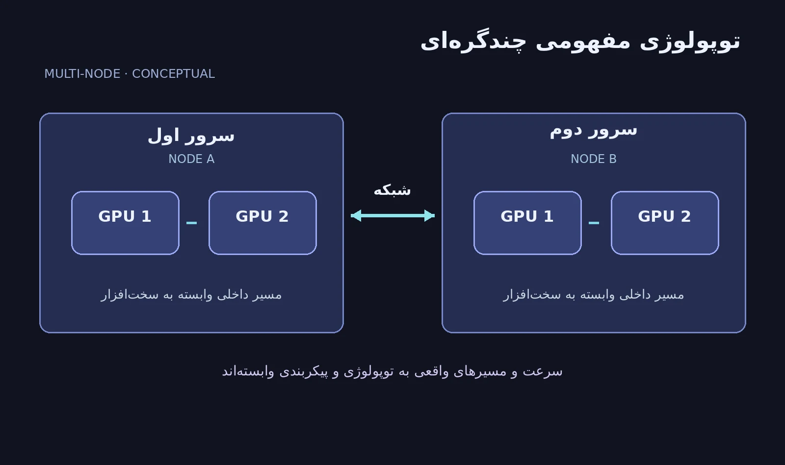

**شکل ۸-۱ — توپولوژی مفهومی چندگره‌ای.** پیکان‌ها مسیر ارتباط ممکن را نشان می‌دهند، نه اتصال مستقیم یا پهنای باند تضمین‌شده هر دستگاه.

## ۳. موازی‌سازی داده و میانگین گرادیان

در **Data Parallelism**، معمولاً نسخه‌ای از مدل روی هر کارگر (Worker) نگهداری می‌شود و هر کارگر بخشی از داده را پردازش می‌کند. سپس گرادیان‌ها برای به‌روزرسانی سازگار ترکیب و همگام می‌شوند. PyTorch DDP گرادیان‌ها را میان نسخه‌های مدل همگام می‌کند، اما خود DDP الزاماً ورودی را تقسیم نمی‌کند؛ برنامه‌نویس باید نمونه‌ها را با ابزار مناسبی مانند sampler تقسیم کند [۳].

مثال ساده با دو batch هم‌اندازه: گرادیان کارگر اول `0.2` و دوم `0.4` است. میانگین `0.3` است. اگر وزن فعلی `1` و نرخ یادگیری `0.1` باشد، به‌روزرسانی گرادیان‌کاهشی `1 − 0.1×0.3 = 0.97` می‌شود. در batchهای با اندازه متفاوت، میانگین ساده همه نمونه‌ها لزوماً برابر میانگینِ بدون وزن میانگین‌های کارگران نیست؛ وزن‌دهی و شیوه کاهش کتابخانه را بررسی کنید.

**AllReduce** یک ارتباط جمعی برای کاهش مقادیر و تحویل نتیجه به شرکت‌کنندگان است؛ جمع یا نوع دیگری از عملیات کاهش ممکن است به کار رود. میانگین ممکن است علاوه بر کاهش، تقسیم بر تعداد مشارکت‌کنندگان بخواهد. NCCL کتابخانه‌ای برای ارتباط GPUهای NVIDIA در توپولوژی‌های پشتیبانی‌شده است، نه یک چارچوب کامل آموزش [۲].

## ۴. موازی‌سازی مدل و حافظه

در **Model Parallelism** اجزای یک مدل بین دستگاه‌ها تقسیم می‌شوند. نمونه‌ها شامل تقسیم لایه‌ها در **Pipeline Parallelism** و تقسیم برخی tensorها یا عملیات در **Tensor Parallelism** هستند. روش‌های sharding می‌توانند پارامتر، گرادیان یا حالت بهینه‌ساز را در دستگاه‌ها توزیع کنند؛ اما هنگام محاسبه ممکن است به گردآوری موقت داده و حافظه اضافه نیاز باشد [۴].

**مقایسه:** تکرار مدل در Data Parallelism معمولاً مدل کامل را در هر دستگاه لازم دارد و به‌خودی‌خود ظرفیت حافظه قابل استفاده برای یک کپی را جمع نمی‌کند. Sharding یا Model Parallelism ممکن است اجرای مدلی بزرگ‌تر را امکان‌پذیر کند، ولی هزینه ارتباط و حافظه موقت دارد. انتخاب به معماری مدل، کتابخانه، اندازه batch، توپولوژی و نوع آموزش بستگی دارد.

در همه روش‌ها، تست صحت روی یک نمونه کوچک، مقایسه با خط پایه تک‌دستگاهی، ثبت seed و آزمون بازیابی پس از شکست اهمیت دارد. تفاوت ترتیب عملیات شناور ممکن است تفاوت عددی کوچکی ایجاد کند و باید با تلورانس مناسب سنجیده شود.

## ۵. سرعت واقعی، گلوگاه و قابلیت اطمینان

**مقیاس‌پذیری (Scaling):** اگر زمان تک‌دستگاه `T1` و زمان چنددستگاه `Tp` باشد، شتاب `T1/Tp` است. با چهار GPU و زمان ۴۰ ثانیه در برابر ۱۰۰ ثانیه روی یک GPU، شتاب `2.5×` و بهره‌وری نسبت به ایده‌آل خطی `2.5/4 = 62.5%` است. این مثال فرضی است و تغییر batch، کیفیت مدل، زمان انتقال یا هزینه را لحاظ نمی‌کند.

کندی می‌تواند از داده‌رسانی، ارتباط شبکه، ناهمگنی GPUها، انتظار برای کندترین worker، ابعاد نامناسب یا سربار همگام‌سازی ناشی شود. مدل آمدال در فصل ۶ دید اولیه می‌دهد ولی مدل کامل ارتباط و هم‌پوشانی نیست. برای مقایسه، کار انجام‌شده، batch مؤثر، کیفیت خروجی، زمان راه‌اندازی و شرایط محیط باید ثابت یا صریحاً گزارش شوند.

**Checkpoint** وضعیت لازم برای ادامه کار را ثبت می‌کند؛ بسته به پروژه ممکن است وزن، حالت optimizer، scheduler، گام و وضعیت تصادفی لازم باشند. بازیابی را واقعاً آزمایش کنید. اطلاعات حساس را رمزگذاری و سطح دسترسی را محدود کنید و برای خرابی ذخیره‌سازی نسخه پشتیبان داشته باشید.

## ۶. برق، انرژی و خنک‌سازی

توان **W** نرخ مصرف انرژی و انرژی **kWh** مقدار مصرف در بازه زمانی است. اگر توان واقعی ثابت فرض شود:

```text
energy_kWh = power_W / 1000 × hours
```

یک سیستم با توان واقعی فرضی ۶۰۰ وات در ۵ ساعت، `3 kWh` مصرف می‌کند؛ با نرخ فرضی `0.25` واحد پول برای هر kWh هزینه انرژی IT برابر `0.75` واحد پول است. توان GPU به‌تنهایی برابر توان کل سیستم نیست؛ توان از پریز، منبع تغذیه و بار واقعی باید اندازه‌گیری شود. تعرفه واقعی و مالیات را از منبع محلی همان تاریخ بگیرید.

**PUE** نسبت انرژی کل مرکز داده به انرژی تجهیزات IT در یک دوره اندازه‌گیری است [۵]. برای مثال، اگر انرژی IT برابر ۱۰ kWh و PUE دوره‌ای ۱٫۲ باشد، برآورد انرژی کل مرکز ۱۲ kWh است. PUE بهره‌وری همه محاسبات، اثر کربن یا مصرف آب را به‌تنهایی نشان نمی‌دهد؛ آن را بی‌دلیل به یک رایانه خانگی تعمیم ندهید.

خنک‌سازی باید در محدوده سازنده، با جریان هوا، دمای ورودی و ایمنی الکتریکی مناسب طراحی شود. توان نامی قطعه با مصرف پایدار یا ظرفیت مطمئن مدار یکی نیست. برای نصب رک، برق‌کشی یا سرمایش حرفه‌ای از متخصص واجد صلاحیت کمک بگیرید؛ این کتاب مجوز دستکاری خطرناک تجهیزات نیست.

## ۷. پروژه: شبیه‌سازی همگام‌سازی و هزینه انرژی

این برنامه روی یک CPU و به‌صورت **ترتیبی** میانگین دو عدد را محاسبه می‌کند؛ شبکه، GPU، NCCL یا آموزش توزیع‌شده واقعی را اجرا نمی‌کند. با Python 3.13.16 آزمایش شده و بسته اضافی لازم ندارد. فایل `simulate.py`:

```python
"""Sequential simulation of gradient averaging; not a distributed implementation."""

def step(weight, gradients, learning_rate):
    if not gradients:
        raise ValueError('at least one gradient required')
    mean_gradient = sum(gradients) / len(gradients)
    return mean_gradient, weight - learning_rate * mean_gradient


def energy_kwh(power_watts, hours):
    if power_watts < 0 or hours < 0:
        raise ValueError('power and duration must be non-negative')
    return power_watts / 1000 * hours


def main():
    mean, updated = step(1.0, [0.2, 0.4], 0.1)
    energy = energy_kwh(600, 5)
    print(f'mean_gradient={mean:.2f}')
    print(f'updated_weight={updated:.2f}')
    print(f'energy_kwh={energy:.2f}')
    assert abs(mean - 0.3) < 1e-9
    assert abs(updated - 0.97) < 1e-9
    assert abs(energy - 3.0) < 1e-9
    print('checks=PASS')


if __name__ == '__main__':
    main()
```

اجرا: `python simulate.py` یا `python3 simulate.py`. خروجی ثبت‌شده:

```text
mean_gradient=0.30
updated_weight=0.97
energy_kwh=3.00
checks=PASS
```

تابع `step` میانگین دو گرادیان فرضی را محاسبه و وزن را به‌روز می‌کند. `energy_kwh` توان فرضی و زمان را به انرژی تبدیل می‌کند. ورودی خالی یا منفی نامعتبر، خطای `ValueError` ایجاد می‌کند. داده واقعی سنجش نشده؛ برای جلوگیری از نتیجه‌گیری غلط، مقدارهای فرضی را با مقادیر اندازه‌گیری‌شده جدا نگه دارید.

**عیب‌یابی:** اگر Python شناخته نشد `python3` و نصب را بررسی کنید. اگر `ValueError` می‌بینید، فهرست گرادیان و علامت توان/زمان را بررسی کنید. در محاسبات اعشاری از تلورانس استفاده شده است.

## ۸. مسیر حرفه‌ای و ایمنی

برای اجرای واقعی، مدل و نسخه PyTorch را مشخص کنید، از مستندات DistributedDataParallel و sampler متناسب استفاده کنید، فرآیندهای worker و گروه ارتباط را با راهنمای رسمی راه‌اندازی و ابتدا روی یک مسئله کوچک صحت را با نسخه تک‌دستگاهی مقایسه کنید [۳]. این فصل کد DDP عملیِ آزموده‌شده بر چند GPU ارائه نمی‌کند؛ چنین اجرا، سخت‌افزار، شبکه و نسخه سازگار می‌خواهد و در فصل‌های پیشرفته توسعه خواهد یافت.

در محیط ابری، افزون بر هزینه GPU، زمان تخصیص، ذخیره checkpoint، انتقال داده و صورتحساب شبکه را بررسی کنید. وضعیت سلامت دستگاه، خطاهای ارتباط و استفاده حافظه را پایش کنید. اگر داده خصوصی است، پیش از انتقال، سیاست دسترسی و محل نگهداری آن را بررسی کنید.

## ۹. تحولات تا نوامبر ۲۰۲۶

**تاریخ مراجعه: ۵ نوامبر ۲۰۲۶.** راهنمای NCCL ارتباط‌های جمعی را روی توپولوژی‌های پشتیبانی‌شده توضیح می‌دهد [۲] و مستندات PyTorch تفکیک داده توسط کاربر در DDP را مشخص می‌کنند [۳]. PCIe 6.0 در ۲۰۲۲ منتشر شده [۱]؛ انتشار استاندارد اثبات وجود آن در هر سیستم یا تحقق سرعت نظری نیست. انتخاب محصول و هزینه باید در تاریخ خرید با منابع رسمی و بازار مربوط بررسی شود.

## ۱۰. تمرین، آزمون و جمع‌بندی

**آزمون:** ۱) چرا دو GPU خودکار دو برابر سریع نیستند؟ ۲) DDP چه چیزی را همگام می‌کند؟ ۳) چه کسی تقسیم داده ورودی را انجام می‌دهد؟ ۴) AllReduce و میانگین چه تفاوتی دارند؟ ۵) چرا مدل تکرارشده از حافظه هر GPU سهم می‌گیرد؟ ۶) تفاوت توان و انرژی چیست؟ ۷) PUE چه چیزی را نشان نمی‌دهد؟ ۸) چرا بازیابی checkpoint باید تست شود؟

**تمرین ریاضی:** میانگین گرادیان‌های `0.1، 0.2، 0.3` و وزن جدید با وزن اولیه ۱ و نرخ ۰٫۵ را محاسبه کنید. انرژی یک سیستم ۸۰۰ واتی در ۲٫۵ ساعت با توان ثابت و بهره‌وری ۴ GPU با شتاب ۳ را حساب کنید. [پاسخ‌نامه فصل ۸](book-engineering/answers/08-distributed-infrastructure-answers-fa.md).

**پروژه ارزیابی:** یک طرح فرضی دو سرور با دو GPU در هر سرور بکشید؛ مسیر ارتباط، نوع موازی‌سازی، سنجه سرعت، بودجه برق، روش checkpoint و یک شکست احتمالی را مشخص کنید. داده و قیمت نامعلوم را «نامشخص» بگذارید. **معیار قبولی:** حداقل ۷ پاسخ صحیح از ۸، سه محاسبه درست، اجرای شبیه‌ساز یا شرح دقیق آن و ارائه طرح با یک محدودیت.

پاسخ کوتاه: ۱) ارتباط و بخش غیرموازی؛ ۲) گرادیان‌ها؛ ۳) برنامه یا sampler؛ ۴) کاهش و سپس احتمالاً تقسیم؛ ۵) هر کپی فضای خود را می‌خواهد؛ ۶) نرخ در برابر مقدار تجمعی؛ ۷) کیفیت محاسبه یا کل اثر کربن؛ ۸) ذخیره موفق تضمین بازیابی نیست. فصل ۹ وارد منطق برنامه‌نویسی، ترمینال و نخستین برنامه Python می‌شود.

**منابع؛ مراجعه ۵ نوامبر ۲۰۲۶:** [۱] PCI-SIG، «PCIe 6.0 Specification Released»، ۲۰۲۲، [منبع](https://pcisig.com/blog/pcie%C2%AE-60-specification-released-members-double-bandwidth-next-generation-applications). [۲] NVIDIA، «Overview of NCCL»، تاریخ انتشار صفحه نامشخص، [مستندات](https://docs.nvidia.com/deeplearning/nccl/user-guide/docs/overview.html). [۳] PyTorch Contributors، «DistributedDataParallel»، تاریخ انتشار نامشخص، [مستندات](https://docs.pytorch.org/docs/main/generated/torch.nn.parallel.DistributedDataParallel.html). [۴] PyTorch Contributors، «FullyShardedDataParallel»، تاریخ انتشار نامشخص، [مستندات](https://docs.pytorch.org/docs/main/distributed/fsdp.html). [۵] US Department of Energy، «Best Practices Guide for Energy-Efficient Data Center Design»، ژوئیه ۲۰۲۴، [PDF](https://www.energy.gov/sites/default/files/2024-07/best-practice-guide-data-center-design_0.pdf).

---

# فصل ۹ — نخستین گام برنامه‌نویسی و Python

**هنر و علم ساخت هوش | جلد اول | Babak & Ai**
**نسخه ۱.۰ · بررسی منابع: ۵ نوامبر ۲۰۲۶**

## ۱. برنامه‌نویسی چیست و از کجا شروع کنیم؟

فرض کنید به کسی می‌خواهید چای درست کردن را آموزش دهید. «چای درست کن» یک هدف است؛ اما توضیح ترتیب آماده‌کردن آب و دم‌کردن چای، مجموعه‌ای از گام‌هاست. برنامه‌نویسی هنر و مهندسی بیان گام‌هایی است که رایانه بتواند طبق قواعد مشخص اجرا کند. رایانه ابهام ما را مثل یک انسان حدس نمی‌زند: دستور، داده و شرایط باید روشن باشند.

**پیش‌نیاز:** هیچ تجربه کدنویسی لازم نیست. این فصل واژه‌ها و اجرای نخستین فایل را از ابتدا آموزش می‌دهد؛ فصل ۱۰ متغیر، ورودی، شرط و حلقه را مفصل بررسی می‌کند. **هدف:** یک الگوریتم کوچک بنویسید، فایل بسازید، ترمینال را باز کنید، نسخه Python را ببینید، برنامه خود را اجرا و یک خطای ساده را رفع کنید.

## ۲. الگوریتم: دستور دقیق برای حل مسئله

**الگوریتم (Algorithm)** روشی با گام‌های روشن برای انجام یک کار یا حل مسئله است. مثال: «دو عدد را بگیر؛ آن‌ها را جمع کن؛ نتیجه را نمایش بده.» ورودی، پردازش و خروجی را می‌توان جدا کرد. یک الگوریتم مفید باید برای شرایط مورد نظر مشخص باشد و در عمل، نیازهای پایان، منابع و خطا را نیز روشن کند.

مثلاً ورودی `2` و `3`، عملیات جمع و خروجی `5` است. اگر ورودی متن باشد یا وجود نداشته باشد چه می‌شود؟ مشخص‌کردن چنین شرایطی بخشی از طراحی است. این گام‌ها هنوز به زبان خاصی وابسته نیستند.

**شبه‌کد (Pseudocode)** توصیف خوانای گام‌ها بدون الزام به قواعد دقیق یک زبان است. نمونه:

```text
شروع
  عدد اول و عدد دوم را دریافت کن
  حاصل جمع را حساب کن
  نتیجه را نشان بده
پایان
```

این متن به‌تنهایی برنامه Python قابل اجرا نیست. تبدیل آن به کد مستلزم رعایت دستور زبان و معنی آن زبان است.

## ۳. فلوچارت و جریان اجرا

**فلوچارت (Flowchart)** نموداری برای نمایش جریان مراحل است. معمولاً بیضی شروع/پایان، مستطیل عملیات و لوزی تصمیم را نشان می‌دهد؛ پیکان‌ها جهت حرکت را مشخص می‌کنند. نمادها به درک کمک می‌کنند اما خودشان نتیجه را تضمین نمی‌کنند.

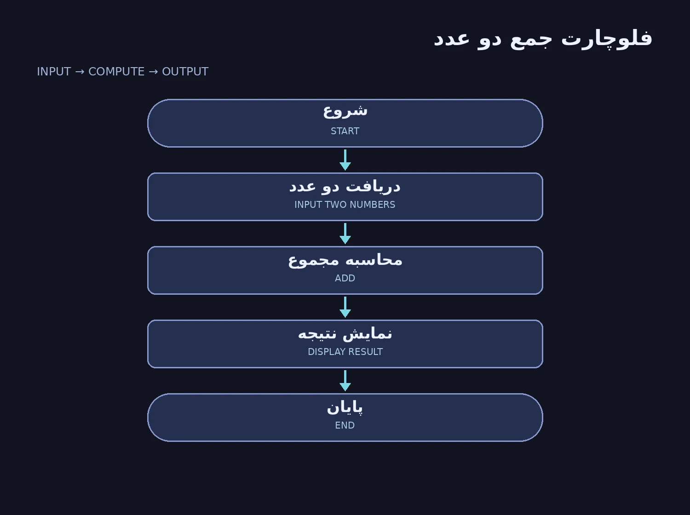

**شکل ۹-۱ — جریان جمع دو عدد.** این یک نمودار آموزشی است و هنوز حالت ورودی نامعتبر را در نظر نمی‌گیرد. در فصل ۱۰، شرط و مدیریت اولیه خطا را اضافه می‌کنیم.

**آزمایش دستی (Dry Run):** مقادیر نمونه را روی کاغذ از نمودار عبور دهید: ورودی‌ها `2` و `3`، نتیجه `5`. با `−1` و `4` هم امتحان کنید؛ نتیجه `3` است. آزمایش دستی موارد انتخابی را بررسی می‌کند، نه تمام ورودی‌های ممکن را.

## ۴. فایل، پوشه و مسیر

**فایل (File)** مجموعه‌ای نام‌دار از داده است؛ برنامه Python معمولاً در فایل با پسوند `.py` ذخیره می‌شود. **پوشه (Directory/Folder)** فایل‌ها و پوشه‌های دیگر را سازمان‌دهی می‌کند. **مسیر (Path)** نشانی فایل است. مسیر نسبی نسبت به پوشه فعلی و مسیر مطلق از یک نقطه مشخص سیستم آغاز می‌شود.

مثلاً پوشه‌ای به نام `ai-start` و در آن فایل `hello.py` بسازید. برای اطمینان از اینکه نام واقعاً `hello.py` است و نه `hello.py.txt`، نمایش پسوندها را در ویرایشگر یا فایل‌منیجر بررسی کنید. فایل را در یک ویرایشگر متن ذخیره کنید، نه با نرم‌افزاری که قالب‌بندی مخفی اضافه می‌کند. UTF-8 برای متن فارسی مناسب است.

**ایمنی:** کد ناشناس را پیش از بررسی اجرا نکنید؛ به‌ویژه فرمان‌هایی که فایل حذف می‌کنند یا سطح دسترسی مدیر می‌خواهند. این فصل هیچ فرمان حذف یا نصب اجباری مدیر اجرا نمی‌کند.

## ۵. ترمینال و مسیر جاری

**ترمینال (Terminal)** محیطی برای تعامل متنی با پوسته یا shell است. **پوشه جاری (Working Directory)** محل پیش‌فرضی است که فرمان‌های نسبی از آنجا تفسیر می‌شوند. فرمان‌های زیر اطلاعاتی یا جابه‌جایی هستند؛ دستورات نمونه را در جای مناسب خود اجرا کنید:

| کار | Linux/macOS در پوسته رایج | Windows PowerShell |
|---|---|---|
| نمایش پوشه جاری | `pwd` | `Get-Location` |
| نمایش محتوا | `ls` | `Get-ChildItem` |
| رفتن به پوشه | `cd ai-start` | `cd ai-start` |
| برگشت به پوشه والد | `cd ..` | `cd ..` |

اگر مسیر فاصله دارد، آن را داخل نقل‌قول بگذارید. `cd ai-start` زمانی کار می‌کند که آن پوشه در محل جاری باشد؛ جایگزین، وارد کردن مسیر درست پوشه شماست. ترمینال با محیط تعاملی Python یکی نیست: علامت `>>>` معمولاً نشان‌دهنده مفسر تعاملی Python است، نه دستور معمول shell [۱].

## ۶. نصب و بررسی Python

**Python** یک زبان برنامه‌نویسی عمومی است. **مفسر (Interpreter)** کد Python را طبق قواعد زبان اجرا می‌کند. برای پروژه‌های این کتاب نسخه و محیط اجرا ثبت می‌شوند؛ نمونه‌های این فصل با **Python 3.13.16** آزمایش شده‌اند. این عدد نسخه آزمایش است، نه ادعای جدیدترین نسخه موجود.

در ترمینال `python --version` یا `python3 --version` را بزنید. در Windows ممکن است `py --version` نیز کار کند. اگر نسخه نمایش داده نشد، Python را از [منبع رسمی Python](https://www.python.org/downloads/) یا روش معتبر سیستم‌عامل با توجه به معماری دستگاه نصب کنید [۲]. برای Windows گزینه‌های نصب و PATH به نسخه نصب‌کننده بستگی دارند؛ راهنمای رسمی همان نسخه را بخوانید. در macOS/Linux معمولاً `python3` استفاده می‌شود؛ نصب‌کننده ناشناس یا فرمان اینترنتی بدون بررسی اجرا نکنید.

**Python تعاملی:** در ترمینال `python3` یا فرمان مناسب را بزنید. پس از `>>>` عبارت `2 + 3` را وارد کنید؛ نتیجه `5` است. با `exit()` از مفسر خارج شوید. خود `>>>` را تایپ نکنید. این مرحله با ذخیره یک برنامه قابل استفاده مجدد تفاوت دارد [۱].

## ۷. نخستین برنامه قابل اجرا

پوشه `ai-start` را بسازید و فایل `hello.py` را با این متن ذخیره کنید:

```python
# My first Python program.
print('Hello, AI engineer!')
print('2 + 3 =', 2 + 3)
```

سپس در ترمینالی که پوشه جاری آن `ai-start` است، `python hello.py` یا `python3 hello.py` را اجرا کنید. در Windows می‌توانید `py hello.py` را نیز در صورت نصب launcher به کار ببرید. خروجی آزمایش‌شده:

```text
Hello, AI engineer!
2 + 3 = 5
```

`#` ابتدای توضیح یا **Comment** است و این خط در اجرای برنامه به‌عنوان دستور محاسباتی اجرا نمی‌شود. `print` خروجی را نمایش می‌دهد؛ متن داخل نقل‌قول یک **رشته (String)** است. در خط دوم، `2 + 3` جمع عددی است. پرانتزها و نقل‌قول‌ها بخشی از دستور زبان هستند و باید درست بسته شوند.

**ساختار پروژه:** تنها یک فایل `hello.py` داریم؛ ورودی تعاملی ندارد؛ خروجی همان دو خط است؛ آزمایش دستی یعنی اجرای فرمان و مقایسه دو خط خروجی. فایل پروژه کتاب در `book-engineering/projects/09-first-python/hello.py` نیز موجود است.

## ۸. عیب‌یابی نخستین خطاها

- **فرمان Python پیدا نشد:** `python3` یا `py` را مطابق سیستم امتحان کنید؛ نصب و PATH را از راهنمای رسمی بررسی کنید. از نصب مجدد بی‌هدف بپرهیزید.
- **فایل پیدا نشد:** `pwd` یا `Get-Location` و فهرست پوشه را ببینید. پوشه جاری، نام دقیق فایل و پسوند را کنترل کنید.
- **SyntaxError:** شماره خط و پیام را بخوانید؛ نقل‌قول، پرانتز و تایپ علائم انگلیسی را بررسی کنید. متن خطا ممکن است محل کشف مشکل را نشان دهد، نه لزوماً علت اصلی را.
- **خروجی متفاوت:** فایل را ذخیره کنید و مطمئن شوید همان فایل در پوشه جاری را اجرا می‌کنید. نسخه Python و محتوا را ثبت کنید.
- **فارسی ناخوانا:** فایل را UTF-8 ذخیره و تنظیم نمایش ترمینال را بررسی کنید؛ فارسی بودن متن به معنی تغییر نحو پرانتز یا نام دستورات Python نیست.

## ۹. محیط مجازی و نسخه‌ها

**محیط مجازی (Virtual Environment)** راهی برای جداکردن بسته‌های یک پروژه از پروژه دیگر است؛ در فصل ۱۳ آن را کامل می‌سازیم. مستندات رسمی از `python -m venv` برای ایجاد محیط استفاده می‌کنند [۳]. برای اجرای `hello.py` این فصل به بسته اضافی یا محیط مجازی اجباری نیازی ندارید.

نسخه Python، سیستم‌عامل و فرمان اجرا را در گزارش پروژه ثبت کنید. اگر چند نسخه نصب است، `python` و `python3` ممکن است به مفسرهای متفاوت اشاره کنند؛ `--version` را برای همان فرمانی بزنید که فایل را اجرا می‌کند. به کد یا نصب‌کننده‌ای که منبعش را نمی‌شناسید اعتماد نکنید.

## ۱۰. تحولات تا نوامبر ۲۰۲۶

**تاریخ بررسی: ۵ نوامبر ۲۰۲۶.** مستندات نسخه Python 3.13 شیوه اجرای فایل و حالت تعاملی را توضیح می‌دهند [۱] و مستندات `venv` روش ایجاد محیط مجازی را ثبت می‌کنند [۳]. مثال‌های فصل روی 3.13.16 آزمایش شده‌اند؛ برای یک پروژه واقعی، سازگاری بسته‌ها با نسخه انتخابی و پشتیبانی امنیتی آن را جداگانه بررسی کنید. این فصل ادعای بررسی همه نسخه‌های منتشرشده را ندارد.

## ۱۱. تمرین و پروژه ارزیابی

**آزمون:** ۱) الگوریتم چیست؟ ۲) شبه‌کد مستقیماً Python است؟ ۳) پوشه جاری چیست؟ ۴) تفاوت ترمینال و مفسر تعاملی چیست؟ ۵) پسوند رایج فایل Python چیست؟ ۶) `print` چه می‌کند؟ ۷) `#` در ابتدای خط چه معنایی دارد؟ ۸) چرا نسخه فرمان اجرا را ثبت می‌کنیم؟

**تمرین:** الگوریتم جمع سه عدد را به شبه‌کد بنویسید و برای ۱، ۲ و ۳ دستی اجرا کنید؛ نتیجه را محاسبه کنید. در `hello.py` یک خط `print(4 + 6)` اضافه کنید و خروجی را ثبت کنید.

**مینی‌پروژه:** در پوشه جدا، `intro.py` بسازید که نام دلخواه و نتیجه `7 * 3` را چاپ کند. ساختار فایل، فرمان اجرا، نسخه Python و خروجی را ثبت کنید؛ یک نقل‌قول را عمداً در نسخه آزمایشی ناقص کنید، پیام `SyntaxError` را ببینید و اصلاح کنید. از داده شخصی واقعی استفاده نکنید.

**معیار قبولی:** ۷ پاسخ درست از ۸، اجرای موفق فایل یا توضیح دقیق مراحل در نبود کامپیوتر، پاسخ درست جمع و مستندسازی خطا و اصلاح پروژه. [پاسخ‌نامه جداگانه فصل 9](book-engineering/answers/09-first-program-answers-fa.md).

## ۱۲. واژه‌نامه و منابع

الگوریتم (Algorithm)، شبه‌کد (Pseudocode)، فلوچارت (Flowchart)، فایل (File)، مسیر (Path)، ترمینال (Terminal)، مفسر (Interpreter)، دستور زبان (Syntax)، خطا (Error)، محیط مجازی (Virtual Environment). در فصل ۱۰ متغیر، انواع داده، شرط و حلقه را با تمرین می‌سازیم.

**منابع؛ مراجعه ۵ نوامبر ۲۰۲۶:** [۱] Python Software Foundation، «Using the Python Interpreter»، مستندات Python 3.13، تاریخ انتشار نامشخص، [مستندات](https://docs.python.org/3.13/tutorial/interpreter.html). [۲] Python Software Foundation، «Download Python»، تاریخ انتشار نامشخص، [سایت رسمی](https://www.python.org/downloads/). [۳] Python Software Foundation، «venv — Creation of virtual environments»، مستندات Python 3.13، تاریخ انتشار نامشخص، [مستندات](https://docs.python.org/3.13/library/venv.html).

---

# فصل ۱۰ — Python از پایه: متغیر، داده، شرط و حلقه

**هنر و علم ساخت هوش | جلد اول | Babak & Ai**
**نسخه ۱.۰ · بررسی منابع: ۵ نوامبر ۲۰۲۶**

## ۱. از نمایش متن به برنامه تعاملی

در فصل ۹ یک فایل ساختیم که دو خط چاپ می‌کرد. اکنون می‌خواهیم برنامه بتواند اطلاعات دریافت کند، آن‌ها را نگه دارد، بر اساس شرایط تصمیم بگیرد و یک کار را تکرار کند. این مهارت‌ها بعدها در پاک‌سازی داده و آموزش مدل به کار می‌آیند.

**پیش‌نیاز:** توانایی ساخت و اجرای `hello.py` در فصل ۹. **اهداف:** تعریف متغیر و نوع داده، تبدیل ورودی، نوشتن شرط و حلقه، تشخیص خطای ورودی، و ساخت یک ثبت‌کننده مطالعه سه‌روزه. مثال‌های اجرایی این فصل با Python 3.13.16 بررسی شده‌اند و به GPU یا بسته اضافی نیاز ندارند.

## ۲. متغیر و انتساب

**متغیر (Variable)** نامی است که به یک مقدار یا شیء ارجاع می‌دهد. در `hours = 2`، ابتدا مقدار سمت راست محاسبه و سپس به نام `hours` نسبت داده می‌شود. علامت `=` در اینجا انتساب است، نه سؤال ریاضی درباره تساوی. بعداً می‌توان نام را به مقدار دیگری نسبت داد:

```python
hours = 2
hours = hours + 1
print(hours)  # 3
```

خط دوم مقدار قبلی را می‌خواند و مقدار جدید را به همان نام نسبت می‌دهد. نام‌های خوانا انتخاب کنید: `study_minutes` بهتر از `x` برای زمان مطالعه است. نام Python به حروف بزرگ و کوچک حساس است؛ `score` و `Score` متفاوت‌اند. نام نباید با رقم شروع شود یا واژه کلیدی زبان باشد. از نام‌های داخلی مانند `print` برای متغیرها استفاده نکنید، چون ممکن است نام تابع اصلی را بپوشانید.

## ۳. انواع داده و عملیات

| نوع | نمونه | کاربرد |
|---|---|---|
| عدد صحیح `int` | `3`، `-2` | شمارش |
| عدد اعشاری `float` | `2.5` | اندازه‌گیری تقریبی |
| متن `str` | `'سلام'` | نام و نوشته |
| منطقی `bool` | `True`، `False` | شرط |

`type(3)` نوع را نشان می‌دهد. در Python عبارت `2 + 3` عدد ۵ و `'2' + '3'` متن `'23'` تولید می‌کند. `+` برای متن‌ها اتصال و برای عددها جمع است؛ اتصال مستقیم متن و عدد بدون تبدیل معمولاً `TypeError` ایجاد می‌کند. اعداد اعشاری دودویی ممکن است برخی کسرهای ده‌دهی را دقیق نشان ندهند؛ برای پول از روش مناسب و واحد مشخص استفاده کنید [۱].

عملگرها شامل جمع `+`، تفریق `-`، ضرب `*`، تقسیم `/`، تقسیم صحیح `//`، باقیمانده `%` و توان `**` هستند. `7 / 2` برابر `3.5`، `7 // 2` برابر `3` و `7 % 2` برابر `1` است. تقسیم بر صفر خطا ایجاد می‌کند. پرانتز اولویت را روشن می‌کند: `(2 + 3) * 4` برابر ۲۰ است.

## ۴. ورودی و تبدیل

`input()` متنی از کاربر می‌گیرد و **رشته** برمی‌گرداند، حتی اگر کاربر رقم تایپ کند. برای عدد صحیح می‌توان از `int` استفاده کرد:

```python
raw = input('Minutes: ')
minutes = int(raw)
print(minutes + 10)
```

اگر ورودی `30` باشد، خروجی `40` است. اگر ورودی مانند `abc` قابل تبدیل نباشد، `ValueError` رخ می‌دهد؛ برنامه پروژه در بخش ۹ آن را مدیریت می‌کند. یک ورودی نامعتبر یا قطع‌شده بخشی طبیعی از طراحی است، نه دلیل فرض اینکه کاربر همیشه درست وارد می‌کند. با `str(42)` عدد به متن تبدیل می‌شود. ورودی‌های خصوصی را بی‌دلیل دریافت یا منتشر نکنید.

## ۵. شرط و مقایسه

**شرط (Condition)** عبارتی است که نتیجه منطقی دارد. `==` برابری را می‌سنجد، `!=` نابرابری، و `<`، `<=`، `>` و `>=` مقایسه عددی انجام می‌دهند. `=` انتساب است؛ به جای `==` در شرط معمول استفاده نکنید.

```python
minutes = 45
if minutes >= 30:
    print('Goal reached')
else:
    print('Keep practicing')
```

پس از `if` و `else` دونقطه و در بدنه تورفتگی لازم است. چهار فاصله رایج است؛ ترکیب نامنظم tab و فاصله می‌تواند مشکل ایجاد کند. `elif` برای شاخه دیگر است. عملگرهای `and`، `or` و `not` شرط‌ها را ترکیب می‌کنند؛ ابتدا با مثال‌های کوچک نتیجه را بررسی کنید [۲].

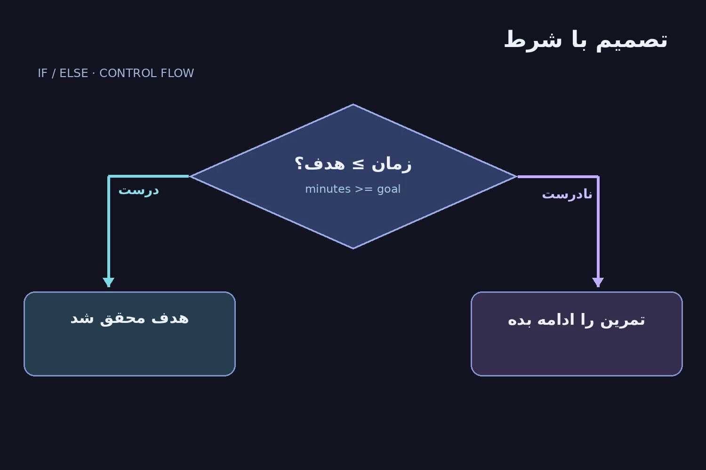

**شکل ۱۰-۱ — تصمیم دوشاخه.** شرط و دو خروجی مشخص‌اند؛ این نمودار درباره یک هدف آموزشی فرضی است، نه توصیه شخصی برای سلامت یا مطالعه.

## ۶. حلقه for و range

وقتی می‌خواهیم کاری را برای چند مقدار تکرار کنیم، از حلقه `for` استفاده می‌کنیم:

```python
for day in range(1, 4):
    print(day)
```

خروجی به‌ترتیب ۱، ۲ و ۳ است. `range(1, 4)` از ۱ شروع می‌کند و **۴ را شامل نمی‌شود**. `range(3)` مقادیر ۰، ۱ و ۲ می‌دهد. `for` می‌تواند روی عناصر یک رشته یا فهرست نیز حرکت کند [۲]. تورفتگی مشخص می‌کند چه دستورهایی عضو بدنه‌اند.

مثال مجموع: `total = 0`؛ در هر دور `total = total + day`؛ پس از سه دور مقدار ۶ است. مراقب باشید چاپ مجموع نهایی را بیرون بدنه قرار دهید، مگر اینکه خروجی هر دور را بخواهید.

## ۷. حلقه while و کنترل تکرار

`while` تا زمانی که شرط درست باشد بدنه را تکرار می‌کند. اگر شرط هرگز تغییر نکند ممکن است حلقه بی‌پایان شود. برای یک شمارنده کوچک:

```python
count = 1
while count <= 3:
    print(count)
    count += 1
```

`count += 1` شکل کوتاه افزایش شمارنده است. `break` حلقه فعلی را پایان می‌دهد؛ `continue` به دور بعدی همان حلقه می‌رود. در برنامه پروژه، `while True` برای درخواست مجدد ورودی است و در صورت ورودی معتبر با `break` پایان می‌یابد. هنگام تمرین، برای قطع برنامه گیرکرده در ترمینال معمولاً `Ctrl+C` قابل استفاده است؛ رفتار محیط ممکن است فرق کند.

## ۸. خطا، محدوده و اعتبارسنجی

**SyntaxError** یعنی ساختار کد با دستور زبان سازگار نیست؛ **ValueError** در مثال ما به‌معنی تبدیل متن نامعتبر به عدد است؛ **TypeError** می‌تواند از عملیات روی نوع‌های ناسازگار ناشی شود. کد باید علاوه بر تبدیل، محدوده منطقی را نیز بررسی کند: مثلاً دقیقه مطالعه یک روز فرضی از ۰ تا ۱۴۴۰ است.

برای این پروژه از `try/except` استفاده می‌کنیم: دستورات تبدیل در `try` قرار می‌گیرند و `except ValueError` خطای تبدیل را مدیریت می‌کند. وقتی ورودی تمام شود، `input` می‌تواند `EOFError` ایجاد کند؛ برنامه با پیامی متوقف می‌شود، نه اینکه نتیجه ناقص را صحیح گزارش کند. این نمونه همه خطاهای ممکن را نمی‌گیرد و نباید با `except` کلی، علت‌های ناشناخته را پنهان کرد.

## ۹. پروژه: ثبت مطالعه سه‌روزه

**هدف:** دریافت سه مقدار صحیح بین صفر و ۱۴۴۰، محاسبه مجموع و میانگین و اعلام رسیدن به هدف فرضی ۱۸۰ دقیقه. داده موقتی است و ذخیره نمی‌شود. برنامه با Python 3.13.16 آزمایش شده و به بسته اضافی نیاز ندارد. فایل `study_planner.py`:

```python
"""Three-day learning log, using only Python's standard library."""

def main():
    total = 0
    for day in range(1, 4):
        while True:
            try:
                raw = input(f'Day {day} minutes (0-1440): ')
                minutes = int(raw)
                if not 0 <= minutes <= 1440:
                    print('Enter a whole number from 0 to 1440.')
                    continue
                break
            except ValueError:
                print('Enter a whole number from 0 to 1440.')
            except EOFError:
                print('\nInput ended; no result calculated.')
                return
        total += minutes
    print(f'Total: {total} minutes')
    print(f'Average: {total / 3:.1f} minutes')
    if total >= 180:
        print('Goal reached')
    else:
        print('Keep practicing')


if __name__ == '__main__':
    main()
```

اجرا: `python study_planner.py` یا `python3 study_planner.py`. وقتی از شما پرسیده می‌شود، به‌ترتیب `30`، `60` و `90` را وارد کنید. خروجی اصلی:

```text
Total: 180 minutes
Average: 60.0 minutes
Goal reached
```

**خواندن کد:** حلقه `for` سه روز را می‌پیماید. حلقه داخلی تا ورود عدد معتبر ادامه می‌یابد. `int(raw)` متن را تبدیل می‌کند؛ شرط محدوده از ۰ تا ۱۴۴۰ را بررسی می‌کند. `continue` درخواست همان روز را تکرار و `break` پس از اعتبارسنجی از حلقه داخلی خارج می‌شود. `total += minutes` مجموع را زیاد می‌کند. پس از پایان سه روز، میانگین و شرط هدف نمایش داده می‌شوند.

**آزمون‌ها:** ورودی `30,60,90` هدف را برآورده می‌کند. `10,20,30` مجموع ۶۰ و پیام `Keep practicing` می‌دهد. برای ورودی `abc` یا `-1` باید پیام خطا ببینید و مجدداً همان روز پرسیده شود. قطع ورودی پیش از تکمیل سه روز پیام `Input ended; no result calculated.` می‌دهد. این پروژه برنامه ثبت دائمی یا سامانه ارزیابی سلامت نیست.

## ۱۰. خطاهای رایج و روش عیب‌یابی

۱. **`'2' + '3'` برابر ۵ نیست:** هر دو رشته‌اند؛ تبدیل عددی را پس از بررسی ورودی انجام دهید.
۲. **`range(1, 4)` شامل ۴ نیست:** مقدار توقف در این شکل انحصاری است.
۳. **استفاده از `=` به جای `==`:** هدف انتساب یا مقایسه را تشخیص دهید.
۴. **تورفتگی نادرست:** بدنه هر شرط/حلقه را با فاصله یکسان مشخص کنید؛ پیام خطا و شماره خط را بخوانید.
۵. **حلقه بی‌پایان:** شرط توقف یا تغییر شمارنده را مشخص کنید؛ نسخه کوچک را دستی دنبال کنید.
۶. **ورودی نامعتبر:** تبدیل را داخل بخش مدیریت خطا بگذارید و محدوده را جداگانه بررسی کنید.
۷. **مقایسه اعشاری:** برخی مقدارها تقریب هستند؛ برای کار عددی مناسب از روش و تلورانس درست استفاده کنید.

## ۱۱. تحولات و نسخه تا نوامبر ۲۰۲۶

**تاریخ بررسی: ۵ نوامبر ۲۰۲۶.** مستندات رسمی Python 3.13 مفاهیم عدد، متن، ساختار کنترل، `for`، `range`، `break` و `continue` را توضیح می‌دهند [۱، ۲]. نمونه پروژه این فصل با Python **3.13.16** اجرا شده است. در پروژه‌های واقعی نسخه مفسر و وابستگی‌ها را ثبت کنید؛ این فصل ادعای جدیدترین بودن نسخه آزمایش را ندارد.

## ۱۲. تمرین و آزمون

**آزمون مفهومی:** ۱) فرق `=` و `==` چیست؟ ۲) نوع خروجی `input` چیست؟ ۳) `range(1,4)` چه مقادیری دارد؟ ۴) `break` چه می‌کند؟ ۵) `continue` چه می‌کند؟ ۶) چرا `int('abc')` خطا می‌دهد؟ ۷) تورفتگی در Python چه نقشی دارد؟ ۸) فرق `7 / 2` و `7 // 2` چیست؟ ۹) چه زمانی حلقه while می‌تواند بی‌پایان شود؟ ۱۰) چرا ورودی باید محدوده‌سنجی شود؟

**تمرین ریاضی:** برای مطالعه سه روز ۲۰، ۴۰ و ۶۰ دقیقه، مجموع و میانگین را حساب و با هدف ۱۸۰ دقیقه مقایسه کنید؛ سپس `17 % 5` را حساب کنید.

**تمرین برنامه‌نویسی:** برنامه پروژه را اجرا کنید و دو حالت معتبر و نامعتبر را امتحان کنید. سپس در یک نسخه جدا، هدف را از ۱۸۰ به ۱۲۰ تغییر دهید و ورودی `20,40,60` را بسنجید. خروجی مورد انتظار `Goal reached` است. داده یا فایل دیگران را تغییر ندهید.

**مینی‌پروژه ارزیابی:** برنامه‌ای بنویسید که سه عدد صحیح غیرمنفی بگیرد، جمع آن‌ها را چاپ کند و اگر مجموع حداقل ۱۰ بود پیام `OK` بدهد. ورودی نامعتبر را با پیام روشن تکرار کند؛ ورودی پایان‌یافته را بدون چاپ نتیجه ناقص متوقف کند. ساختار فایل، نسخه، نمونه ورودی و دو آزمون، از جمله یک خطا، را ثبت کنید.

**معیار قبولی:** حداقل ۸ پاسخ صحیح از ۱۰، محاسبه درست مجموع/میانگین/باقیمانده، اجرای پروژه یا تشریح آن در نبود محیط و دو آزمون مستند برای مینی‌پروژه. [پاسخ‌نامه جداگانه فصل 10](book-engineering/answers/10-python-basics-answers-fa.md).

## ۱۳. واژه‌نامه و منابع

متغیر (Variable)، نوع داده (Data Type)، انتساب (Assignment)، رشته (String)، ورودی (Input)، شرط (Condition)، تورفتگی (Indentation)، حلقه (Loop)، خطا/استثنا (Exception)، اعتبارسنجی (Validation). فصل ۱۱ توابع، ماژول‌ها و ساختمان داده را بررسی خواهد کرد.

**منابع؛ مراجعه ۵ نوامبر ۲۰۲۶:** [۱] Python Software Foundation، «An Informal Introduction to Python»، مستندات Python 3.13، تاریخ انتشار نامشخص، [مستندات](https://docs.python.org/3.13/tutorial/introduction.html). [۲] Python Software Foundation، «More Control Flow Tools»، مستندات Python 3.13، تاریخ انتشار نامشخص، [مستندات](https://docs.python.org/3.13/tutorial/controlflow.html). [۳] Python Software Foundation، «Built-in Functions»، مستندات Python 3.13، تاریخ انتشار نامشخص، [مستندات](https://docs.python.org/3.13/library/functions.html).

---

# فصل ۱۱ — توابع، ماژول‌ها و ساختمان داده‌ها

**هنر و علم ساخت هوش | جلد اول | Babak & Ai**
**نسخه ۱.۰ · بررسی منابع: ۵ نوامبر ۲۰۲۶**

## ۱. چرا کد را به قطعات کوچک تقسیم می‌کنیم؟

اگر برای هر روز مطالعه سه بار کد یکسان جمع را بنویسیم، تغییر و آزمایش آن دشوار می‌شود. **تابع (Function)** مجموعه‌ای نام‌دار از عملیات است که می‌توان با ورودی‌های مختلف فراخوانی کرد. **ساختمان داده (Data Structure)** روشی برای سازمان‌دهی مقدارهاست؛ انتخاب ساختار مناسب کار ما را ساده‌تر و گاهی سریع‌تر می‌کند.

**پیش‌نیاز:** متغیر، شرط و حلقه از فصل ۱۰. **هدف:** تعریف و فراخوانی تابع، تشخیص `return` از `print`، استفاده از list، tuple، set و dict، واردکردن ماژول، و بررسی ابتدایی هزینه الگوریتم. همه پروژه با Python 3.13.16 و کتابخانه استاندارد آزمایش شده است.

## ۲. تعریف تابع، ورودی و خروجی

```python
def add(a, b):
    return a + b

result = add(2, 3)
print(result)  # 5
```

`def` تابع را تعریف می‌کند؛ `a` و `b` **پارامتر** هستند؛ `2` و `3` هنگام فراخوانی **آرگومان**‌اند. `return` مقدار را به محل فراخوانی بازمی‌گرداند. `print` فقط چیزی را نمایش می‌دهد. تابعی که به پایان برسد و مقدار صریحی برنگرداند، `None` برمی‌گرداند [۱]. تورفتگی بدنه را تعیین می‌کند.

درباره قرارداد تابع بپرسید: چه ورودی‌هایی معتبرند، خروجی چیست و برای حالت نامعتبر چه اتفاقی می‌افتد؟ اگر تابع ورودی را تغییر می‌دهد، این رفتار را نیز مستند کنید. یک تابع کوتاه با هدف روشن معمولاً راحت‌تر آزموده می‌شود.

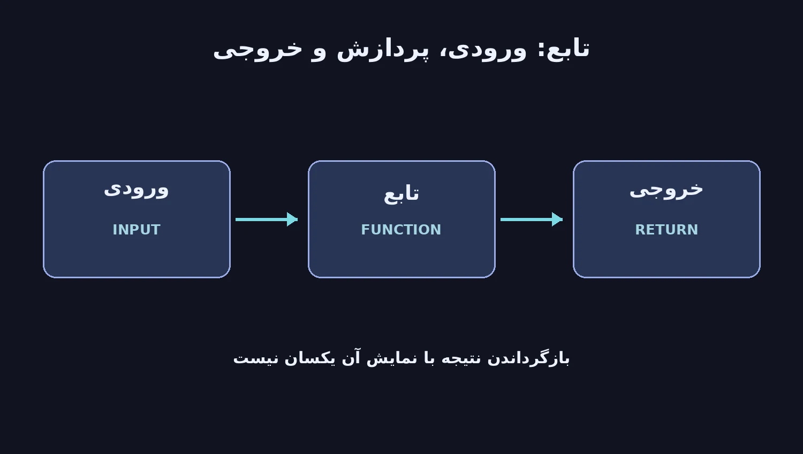

**شکل ۱۱-۱ — قرارداد ساده تابع.** ممکن است توابع علاوه بر خروجی، اثر جانبی مانند نوشتن فایل هم داشته باشند؛ باید آن را مستند کرد.

## ۳. پارامترهای پیش‌فرض، نام‌دار و دامنه

```python
def greet(name, prefix='Hello'):
    return f'{prefix}, {name}'

print(greet('Ali'))
print(greet('Ali', prefix='Hi'))
```

پارامتر `prefix` پیش‌فرض دارد؛ آرگومان نام‌دار معنای فراخوانی را روشن می‌کند. مقدار پیش‌فرض هنگام تعریف تابع ارزیابی می‌شود، نه در هر فراخوانی. استفاده از فهرست تغییرپذیر به‌عنوان پیش‌فرض ممکن است داده را ناخواسته میان فراخوانی‌ها مشترک کند [۱]. روش معمول: پیش‌فرض `None` و ساخت فهرست جدید در بدنه.

نامی که داخل تابع ساخته می‌شود معمولاً **محلی (Local)** است؛ نام‌های بیرون ممکن است در دامنه‌های محصور یا سراسری قابل مشاهده باشند. از تکیه بی‌دلیل بر تغییر وضعیت سراسری پرهیز کنید؛ ورودی صریح و خروجی روشن آزمایش را ساده می‌کند. جزئیات دقیق دامنه در فصل‌های پیشرفته بررسی می‌شود.

## ۴. فهرست و چندتایی

**فهرست (List)** ترتیبی و تغییرپذیر است: `minutes = [30, 60, 90]`. شاخص‌ها از صفر شروع می‌شوند: `minutes[0]` برابر ۳۰ و `minutes[-1]` آخرین مقدار است. `append` عنصری به انتها اضافه می‌کند. دسترسی به شاخص خارج از محدوده `IndexError` ایجاد می‌کند.

**چندتایی (Tuple)** ترتیبی و تغییرناپذیر در ساختار خودش است: `point = (2, 3)`. اگر داخل tuple یک شیء تغییرپذیر باشد، تغییر آن شیء هنوز ممکن است؛ تغییرناپذیری tuple به معنی تغییرناپذیری عمیق همه محتویات نیست. list برای مجموعه قابل تغییر و tuple برای گروه‌بندی ثابت یا قرارداد داده مناسب‌اند [۲].

## ۵. مجموعه و دیکشنری

**مجموعه (Set)** اعضای یکتا دارد و برای آزمون عضویت و حذف تکراری‌ها مفید است. ترتیب نمایش set را ثابت فرض نکنید. مجموعه خالی `set()` است، زیرا `{}` دیکشنری خالی می‌سازد. اعضای set باید قابل هش باشند.

**دیکشنری (Dict)** جفت‌های کلید و مقدار را نگه می‌دارد: `scores = {'math': 80, 'python': 90}`. کلیدها یکتا هستند و باید برای استفاده به‌عنوان کلید مناسب و قابل هش باشند. `scores['math']` مقدار ۸۰ می‌دهد؛ `scores.get('ai', 0)` در نبود کلید مقدار پیش‌فرض ۰ را می‌دهد. در Python مدرن ترتیب درج کلیدهای dict حفظ می‌شود، اما set همان تضمین را ندارد [۲].

برای داده‌های حساس، انتخاب ساختار به‌تنهایی امنیت ایجاد نمی‌کند؛ منبع، مجوز و دسترسی نیز مهم‌اند.

## ۶. الگوریتم و پیچیدگی مقدماتی

برای یافتن عددی در یک فهرست نامرتب، می‌توان از ابتدا تا یافتن مقدار یا پایان لیست حرکت کرد؛ در بدترین حالت ممکن است همه `n` عنصر بررسی شوند. این روش **جست‌وجوی خطی** با هزینه زمانی `O(n)` در این مدل ساده است. `O(n)` رفتار رشد را نشان می‌دهد، نه زمان دقیق روی همه دستگاه‌ها.

برای یافتن مقدار در ساختارهای دیگر، هزینه به پیاده‌سازی و داده وابسته است. عضویت در set/dict مبتنی بر هش در حالت معمول می‌تواند میانگین نزدیک `O(1)` داشته باشد، اما این تضمین برای بدترین حالت، همه داده‌ها و همه پیاده‌سازی‌ها نیست. به‌علاوه ساخت set، حافظه و اعتبار نوع عضو هزینه دارد. پیش از بهینه‌سازی، صحت را کنترل و بار واقعی را اندازه‌گیری کنید.

مثال ریاضی: در فهرست ۱۰۰تایی، جست‌وجوی خطی در بدترین حالت تا ۱۰۰ مقایسه می‌خواهد؛ این شمارش ساده شامل سربار Python نیست. برای داده مرتب و روش دودویی می‌توان مسئله را متفاوت حل کرد، اما شرط مرتب‌بودن و هزینه مرتب‌سازی اهمیت دارد.

## ۷. ماژول و واردکردن کد

یک فایل Python می‌تواند یک **ماژول (Module)** باشد. `import math` ماژول کتابخانه استاندارد را وارد می‌کند؛ `math.sqrt(9)` مقدار `3.0` می‌دهد. فایل خودتان نیز اگر در مسیر مناسب Python قرار گیرد قابل import است [۳]. نام فایل را `math.py` یا نام بسته‌های استاندارد نگذارید تا تعارض و خطای واردکردن ایجاد نشود.

شرط `if __name__ == '__main__':` برای جداکردن اجرای مستقیم فایل از واردکردن آن رایج است؛ import همچنان کدهای سطح بالای خارج از این شرط را اجرا می‌کند. کدهای ناشناس را import نکنید: import خود می‌تواند کد اجرا کند.

## ۸. پروژه: تحلیل دفتر مطالعه

فایل `study_stats.py` را با کد زیر بسازید. ورودی‌ها داده مصنوعی داخل برنامه هستند. توابع مجموع، میانگین و تعداد موضوع‌ها را برمی‌گردانند؛ فهرست خالی برای میانگین و دقیقه منفی رد می‌شوند. این برنامه داده را روی دیسک ذخیره نمی‌کند.

```python
"""Small reusable functions for a synthetic study log."""

def total_minutes(entries):
    if any(value < 0 for value in entries):
        raise ValueError('minutes must be non-negative')
    return sum(entries)


def average_minutes(entries):
    if not entries:
        raise ValueError('at least one entry is required')
    return total_minutes(entries) / len(entries)


def count_topics(topics):
    counts = {}
    for topic in topics:
        counts[topic] = counts.get(topic, 0) + 1
    return counts


def main():
    entries = [30, 60, 90]
    topics = ['python', 'math', 'python']
    print('total=', total_minutes(entries))
    print('average=', average_minutes(entries))
    print('topics=', count_topics(topics))


if __name__ == '__main__':
    main()
```

با `python study_stats.py` یا `python3 study_stats.py` اجرا کنید. خروجی Python 3.13.16:

```text
total= 180
average= 60.0
topics= {'python': 2, 'math': 1}
```

`total_minutes` با `sum` مجموع را می‌سازد؛ `average_minutes` بر تعداد تقسیم می‌کند و برای فهرست خالی خطا می‌دهد. `count_topics` با `dict.get` تعداد را اضافه می‌کند. این نسخه تنها برای ورودی عددی مناسب طراحی شده و اعتبارسنجی کامل انواع، سقف دقیقه یا داده خارجی را انجام نمی‌دهد.

**آزمون دستی:** `total_minutes([])` برابر ۰ است؛ `average_minutes([])` باید `ValueError` بدهد؛ `total_minutes([-1])` نیز باید خطا بدهد. فایل پروژه و تست‌های این فصل همراه کتاب قرار دارند. اگر ماژول پیدا نشد، پوشه جاری و نام فایل را بررسی کنید؛ اگر نوع ناسازگار دادید، قرارداد تابع را کنترل کنید.

## ۹. ارزیابی و تمرین

۱) فرق `return` و `print`؟ ۲) `minutes[-1]` چیست؟ ۳) `{}` مجموعه است یا دیکشنری؟ ۴) آیا ترتیب set تضمین است؟ ۵) تابع بدون `return` صریح چه برمی‌گرداند؟ ۶) هزینه بدترین جست‌وجوی خطی در ۱۰۰ عنصر؟ ۷) چرا پیش‌فرض list تغییرپذیر خطر دارد؟ ۸) آیا import کد فایل را ممکن است اجرا کند؟

**ریاضی:** مجموع و میانگین `20, 40, 60` و حداکثر تعداد مقایسه در جست‌وجوی خطی ۵۰ عنصر را حساب کنید. **تمرین برنامه‌نویسی:** تابعی بنویسید که فهرست اعداد غیرمنفی را بگیرد و بیشینه را بازگرداند؛ فهرست خالی را با خطای روشن رد کند. **پروژه:** تحلیل سه موضوع با تابع، list و dict؛ نمونه خالی و منفی را آزمایش و دستور اجرا ثبت کنید.

**معیار قبولی:** ۷ جواب درست از ۸، دو محاسبه درست و تابع/پروژه با حداقل دو تست. [پاسخ‌نامه جداگانه فصل 11](book-engineering/answers/11-functions-data-structures-answers-fa.md).

## ۱۰. تحولات، واژه‌نامه و منابع

**بررسی: ۵ نوامبر ۲۰۲۶.** مستندات Python 3.13 ساختار داده، تعریف تابع و ماژول را شرح می‌دهند؛ نسخه اجراشده این فصل 3.13.16 است و ادعای جدیدترین نسخه نیست. فصل ۱۲ کلاس، خطا، فایل، JSON و API را بررسی می‌کند.

واژه‌ها: Function، Parameter، Argument، Return، Scope، List، Tuple، Set، Dictionary، Module، Complexity.

**منابع؛ مراجعه ۵ نوامبر ۲۰۲۶:** [۱] Python Software Foundation، «More Control Flow Tools»، مستندات 3.13، تاریخ انتشار نامشخص، [تعریف تابع](https://docs.python.org/3.13/tutorial/controlflow.html). [۲] Python Software Foundation، «Data Structures»، مستندات 3.13، تاریخ نامشخص، [منبع](https://docs.python.org/3.13/tutorial/datastructures.html). [۳] Python Software Foundation، «Modules»، مستندات 3.13، تاریخ نامشخص، [منبع](https://docs.python.org/3.13/tutorial/modules.html).

---

# فصل ۱۲ — کلاس‌ها، خطاها، فایل، JSON و API

**هنر و علم ساخت هوش | جلد اول | Babak & Ai**
**نسخه ۱.۰ · بررسی منابع: ۵ نوامبر ۲۰۲۶**

## ۱. از تابع به شیء و داده پایدار

در فصل ۱۱ توابع را ساختیم. اکنون می‌خواهیم «یک جلسه مطالعه» را همراه داده و رفتارهایش نمایش دهیم، آن را در فایل ذخیره کنیم و بفهمیم چگونه برنامه‌ها از طریق API با هم ارتباط می‌گیرند. **پیش‌نیاز:** متغیر، تابع، dict و خطاهای پایه. **هدف:** ساخت یک کلاس معتبر، کار با فایل UTF-8، تبدیل JSON، مدیریت خطا و توضیح درخواست/پاسخ HTTP.

## ۲. کلاس، نمونه، ویژگی و متد

**کلاس (Class)** قالبی برای ترکیب داده و رفتار است؛ **نمونه (Instance)** یک شیء ساخته‌شده از آن کلاس است. ویژگی (Attribute) اطلاعات نمونه و متد (Method) تابعی وابسته به کلاس/نمونه است [۱].

```python
class Book:
    def __init__(self, title):
        self.title = title

    def describe(self):
        return self.title

book = Book('AI')
print(book.describe())  # AI
```

`__init__` هنگام ساخت نمونه برای مقداردهی اولیه فراخوانی می‌شود. `self` نام متعارف اشاره به همان نمونه در متد است؛ هنگام `book.describe()` به‌طور خودکار ارسال می‌شود. هر نمونه می‌تواند عنوان خود را داشته باشد. کلاس برای همه مسائل لازم نیست؛ گاهی یک dict و تابع ساده خواناتر است.

## ۳. شیءگرایی و مرزهای آن

**شیءگرایی (Object-Oriented Programming)** یکی از روش‌های سازمان‌دهی برنامه است. **کپسوله‌سازی** یعنی سازمان‌دهی داده و رفتار و مشخص‌کردن نحوه استفاده؛ در Python قراردادهای نام‌گذاری و رابط‌ها مهم‌اند و نباید فرض کرد هر ویژگی با نام خاص امنیت کامل دارد. **وراثت** امکان ساخت نوعی بر اساس نوع دیگر است؛ **چندریختی** به امکان استفاده از رابط‌های سازگار در انواع مختلف اشاره می‌کند. این‌ها ابزار طراحی‌اند نه هدف مستقل.

برای نمونه جلسه مطالعه، ویژگی‌ها `topic` و `minutes` و رفتار `as_dict` می‌توانند کافی باشند. پیش از ساخت سلسله‌مراتب پیچیده، سادگی، قابلیت آزمون و نیاز واقعی را بررسی کنید. اعتبارسنجی در سازنده از ساخت نمونه نامعتبر جلوگیری می‌کند، اما اگر ویژگی عمومی بعداً مستقیماً تغییر کند، بدون محافظ اضافه تضمین دائمی نیست.

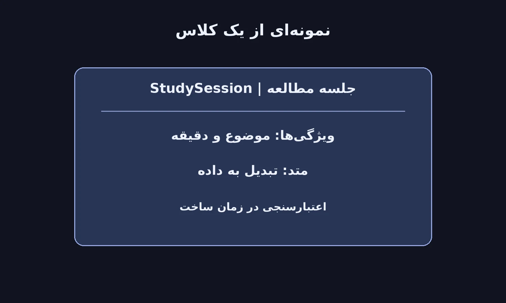

**شکل ۱۲-۱ — مدل آموزشی شیء.** شکل یک نمایش مفهومی است و ادعای خصوصی یا تغییرناپذیر بودن ویژگی‌ها ندارد.

## ۴. خطا و استثنا

**استثنا (Exception)** روشی برای گزارش شرایط خطاست. `try` عملیات و `except` مدیریت نوع مشخص خطا را بیان می‌کند [۲]. مثلاً تبدیل `int('abc')` خطای `ValueError` می‌دهد. با `raise ValueError('message')` نیز می‌توان داده نامعتبر را رد کرد. خطا را نزدیک جایی مدیریت کنید که تصمیم مناسب دارید؛ پنهان‌کردن همه خطاها با `except` کلی ممکن است مشکل جدی را مخفی کند.

```python
try:
    number = int('abc')
except ValueError:
    print('Invalid number')
```

در خواندن JSON نامعتبر `json.JSONDecodeError`، برای نبود فایل `FileNotFoundError` و برای دسترسی نامجاز `PermissionError` ممکن است رخ دهد. این‌ها موقعیت‌های متفاوت‌اند؛ نباید فایل خراب را بی‌صدا با داده خالی جایگزین کرد. پیام خطا را بدون انتشار داده حساس ثبت کنید.

## ۵. خواندن و نوشتن فایل

`with open(..., encoding='utf-8')` فایل متنی را باز و پس از پایان بلوک آن را می‌بندد؛ حتی در صورت بسیاری از خطاها مدیریت منبع بهتر انجام می‌شود. حالت `r` خواندن و `w` نوشتن است؛ **`w` فایل موجود را کوتاه/بازنویسی می‌کند**. پیش از نوشتن مسیر و مجوز را بررسی و از داده مهم نسخه پشتیبان داشته باشید. در پروژه این فصل از پوشه موقت استفاده می‌کنیم.

فایل و مسیر دریافتی از کاربر را بدون محدودسازی و اعتبارسنجی برای کار حساس به‌کار نبرید. روی داده ناشناخته از روش‌های غیرایمن بارگذاری شیء استفاده نکنید. سیستم‌عامل، حجم و مجوزها ممکن است باعث خطا شوند.

## ۶. JSON چیست؟

**JSON (JavaScript Object Notation)** یک قالب متنی برای تبادل داده است. شیء JSON شبیه جفت‌های کلید/مقدار است، اما قواعد آن با literal دیکشنری Python یکسان نیست؛ مثلاً JSON از `true`, `false`, `null` و رشته‌های با نقل‌قول دوگانه استفاده می‌کند. کتابخانه استاندارد Python `json.dump`/`load` را برای فایل و `dumps`/`loads` را برای رشته ارائه می‌دهد [۳].

مثال: `{"topic": "python", "minutes": 45}`. تبدیل JSON به dict به معنی معتبر بودن محتوا نیست: نوع، وجود کلید و محدوده را پس از خواندن کنترل کنید. برای داده نامطمئن اندازه ورودی را محدود کنید، چون تجزیه داده بسیار بزرگ ممکن است CPU و حافظه زیادی مصرف کند [۳].

## ۷. API و HTTP از دید مبتدی

**API (Application Programming Interface)** قراردادی برای تعامل نرم‌افزارهاست؛ API الزاماً وب نیست. در API وب، مشتری درخواست HTTP می‌فرستد و سرور پاسخ می‌دهد. درخواست ممکن است روش، نشانی، سربرگ و بدنه داشته باشد؛ پاسخ شامل وضعیت، سربرگ و گاهی بدنه است.

`GET` معمولاً نمایش یک منبع را درخواست می‌کند و `POST` برای ارسال داده استفاده می‌شود و می‌تواند اثر جانبی داشته باشد [۴]. کد ۲xx عموماً موفقیت و ۴xx/۵xx به‌ترتیب دسته‌هایی از خطای درخواست و سرور را نشان می‌دهند؛ معنای دقیق به کد و API وابسته است. پاسخ ۲۰۰ به‌تنهایی صحت محتوای مدل یا امنیت داده را ثابت نمی‌کند.

برای پروژه واقعی، timeout، محدودیت اندازه، اعتبارسنجی، HTTPS، احراز هویت و حفاظت کلیدها لازم‌اند. کلید API را در کد عمومی، گزارش یا مخزن قرار ندهید. این فصل **درخواست شبکه واقعی ارسال نمی‌کند**؛ ساخت API در بخش محصول آموزش داده خواهد شد.

## ۸. پروژه: شیء جلسه و فایل JSON

فایل `session.py` را مطابق زیر بسازید. برنامه در یک پوشه موقت فایل را می‌نویسد، می‌خواند، بازسازی و مقایسه می‌کند؛ فایل موقت در پایان پاک می‌شود. Python 3.13.16 و کتابخانه استاندارد؛ بدون شبکه یا بسته اضافی.

```python
"""Validate a study session and round-trip it through a temporary JSON file."""
import json
from pathlib import Path
from tempfile import TemporaryDirectory


class StudySession:
    def __init__(self, topic, minutes):
        if not isinstance(topic, str) or not topic.strip():
            raise ValueError('topic must be a non-empty string')
        if type(minutes) is not int or not 0 <= minutes <= 1440:
            raise ValueError('minutes must be an integer from 0 to 1440')
        self.topic = topic.strip()
        self.minutes = minutes

    def as_dict(self):
        return {'topic': self.topic, 'minutes': self.minutes}


def main():
    session = StudySession('python', 45)
    with TemporaryDirectory() as folder:
        path = Path(folder) / 'session.json'
        with path.open('w', encoding='utf-8') as file:
            json.dump(session.as_dict(), file, ensure_ascii=False)
        with path.open('r', encoding='utf-8') as file:
            loaded = json.load(file)
        restored = StudySession(loaded['topic'], loaded['minutes'])
        print('topic=', restored.topic)
        print('minutes=', restored.minutes)
        assert restored.as_dict() == session.as_dict()
        print('roundtrip=PASS')


if __name__ == '__main__':
    main()
```

اجرا: `python session.py` یا `python3 session.py`. خروجی آزمایش‌شده:

```text
topic= python
minutes= 45
roundtrip=PASS
```

`StudySession` ورودی را بررسی می‌کند؛ `type(minutes) is int` در این مثال عمداً مقدار منطقی `True` را نمی‌پذیرد، با اینکه `bool` زیرنوع `int` است. `as_dict` نمایش ساده‌ای می‌سازد. `json.dump` داده را می‌نویسد، `json.load` می‌خواند و سازنده دوباره اعتبارسنجی می‌کند. فایلِ ناسالم یا دارای کلید غایب در این نمونه خطا ایجاد می‌کند؛ پروژه تولیدی باید خطاهای مناسب را مدیریت و اندازه ورودی را محدود کند.

**عیب‌یابی:** اگر Python پیدا نشد فرمان مناسب را بررسی کنید؛ خطای مجوز پوشه موقت، مسیر و دسترسی محیط را بررسی کنید. اگر دقیقه منفی یا موضوع خالی بدهید `ValueError` انتظار می‌رود. این نمونه API واقعی یا ذخیره دائمی نیست.

## ۹. تمرین و معیار قبولی

**آزمون:** ۱) کلاس و نمونه چه تفاوتی دارند؟ ۲) `self` چیست؟ ۳) آیا `w` فایل موجود را نگه می‌دارد؟ ۴) `dump` و `dumps` چه تفاوتی دارند؟ ۵) آیا JSON معتبر الزاماً داده معنادار دارد؟ ۶) `GET` و `POST` معمولاً چه نقشی دارند؟ ۷) چرا کلید API را نباید در مخزن گذاشت؟ ۸) آیا `except` کلی همیشه مناسب است؟

**تمرین عملی:** یک جلسه با موضوع فارسی و ۳۰ دقیقه بسازید، به dict تبدیل و نتیجه را بررسی کنید. دقیقه `-1` و `True` باید رد شوند. فایل JSON ناقص را با `json.loads` امتحان کنید و `JSONDecodeError` را تشخیص دهید. **تمرین ریاضی:** جمع ۴۵ و ۳۰ دقیقه را حساب کنید. **مینی‌پروژه:** کلاس جلسه با اعتبارسنجی، ذخیره در پوشه موقت، بازیابی و دو تست خطا؛ برای API فرضی ورودی، خروجی و ریسک را بنویسید.

**قبولی:** حداقل ۷ جواب درست از ۸، محاسبه درست، اجرای round-trip و تست دو ورودی نامعتبر. [پاسخ‌نامه جداگانه فصل 12](book-engineering/answers/12-classes-files-json-api-answers-fa.md).

## ۱۰. تحولات، واژه‌نامه و منابع

**بررسی: ۵ نوامبر ۲۰۲۶.** مثال‌ها با Python 3.13.16 اجرا شدند؛ روش‌های API و رفتار نسخه‌ها با مستندات همان نسخه کنترل می‌شوند. فصل ۱۳ Git، Linux، Bash و محیط مجازی را معرفی می‌کند.

واژه‌ها: Class، Instance، Attribute، Method، Exception، File، JSON، API، HTTP، Request، Response.

**منابع؛ مراجعه ۵ نوامبر ۲۰۲۶:** [۱] Python Software Foundation، «Classes»، مستندات 3.13، تاریخ نامشخص، [منبع](https://docs.python.org/3.13/tutorial/classes.html). [۲] Python Software Foundation، «Errors and Exceptions»، 3.13، تاریخ نامشخص، [منبع](https://docs.python.org/3.13/tutorial/errors.html). [۳] Python Software Foundation، «json»، 3.13، تاریخ نامشخص، [منبع](https://docs.python.org/3.13/library/json.html). [۴] MDN Web Docs، «HTTP request methods»، تاریخ صفحه متغیر، [منبع](https://developer.mozilla.org/en-US/docs/Web/HTTP/Reference/Methods).

---

# فصل ۱۳ — Linux، Bash، Git و محیط‌های مجازی

**هنر و علم ساخت هوش | جلد اول | Babak & Ai**
**نسخه ۱.۰ · بررسی منابع: ۵ نوامبر ۲۰۲۶**

## ۱. چرا محیط پروژه مهم است؟

اگر کدی امروز اجرا شود ولی ماه بعد با نسخه دیگری از کتابخانه شکست بخورد، نتیجه پژوهش به‌سختی تکرار می‌شود. علاوه بر کد باید بدانیم کدام نسخه Python، وابستگی، سیستم‌عامل، داده و فرمان اجرا استفاده شده است. Git تاریخ تغییرات را ثبت می‌کند و محیط مجازی وابستگی‌های پروژه‌ها را جدا نگه می‌دارد؛ هیچ‌کدام به‌تنهایی بازتولید کامل یا امنیت را تضمین نمی‌کنند.

**پیش‌نیاز:** فصل‌های ۹ تا ۱۲. **هدف:** پیمایش امن در shell، تفاوت Git و GitHub، ساخت commit محلی، ایجاد venv، ثبت نسخه‌ها و حفاظت از رمزها. پروژه این فصل کاملاً محلی و موقت است و شبکه یا مخزن کاربر را تغییر نمی‌دهد.

## ۲. Linux، ترمینال و Bash

**Linux** هسته‌ای است که همراه اجزای دیگر در توزیع‌های سیستم‌عامل استفاده می‌شود. **Terminal** رابط متنی و **Bash** یکی از پوسته‌هایی است که فرمان‌ها را تفسیر می‌کند. macOS و Linux می‌توانند shellهای مختلف داشته باشند؛ Windows PowerShell نحو و فرمان‌های خاص خود را دارد. همه نمونه‌های Bash در PowerShell عیناً کار نمی‌کنند [۱].

در Bash، `pwd` مسیر جاری، `ls` فایل‌ها و `cd` جابه‌جایی پوشه را نشان/انجام می‌دهند. مسیر دارای فاصله را نقل‌قول کنید: `cd "my project"`. دستور `mkdir practice` پوشه می‌سازد؛ پیش از اجرا مطمئن شوید در مسیر مناسب هستید. `cd ..` به پوشه والد می‌رود. فرمان ناشناس مخصوصاً دارای حذف، نصب سیستمی یا دسترسی مدیر را بدون بررسی اجرا نکنید.

**خروجی و خطا:** برنامه‌ها معمولاً خروجی عادی و پیام خطا دارند و با کد خروجی وضعیت را گزارش می‌کنند. یک فرمان موفق لزوماً به معنی درست بودن نتیجه علمی نیست. برای یادگیری shell لازم نیست دسترسی مدیر یا داده واقعی حساس داشته باشید.

## ۳. Git، مخزن و commit

**Git** سامانه کنترل نسخه توزیع‌شده است؛ **GitHub** یکی از سرویس‌های میزبانی مخزن است. می‌توان Git را بدون حساب یا شبکه استفاده کرد. مخزن (Repository) شامل تاریخ و وضعیت پروژه است. `git init` در پوشه انتخاب‌شده مخزن محلی ایجاد می‌کند؛ این فرمان را در پروژه موجود بدون فهم وضعیت آن اجرا نکنید.

سه ناحیه مفهومی: فایل‌های کاری (Working Tree)، ناحیه آماده‌سازی (Staging/Index) و تاریخ commit. `git add file` محتوای فعلی فایل را برای commit آماده می‌کند؛ تغییر بعدی باید دوباره اضافه شود. `git status` وضعیت و `git diff --cached` تغییرات آماده‌شده را نشان می‌دهند. `git commit` یک snapshot از وضعیت آماده‌شده ثبت می‌کند [۲].

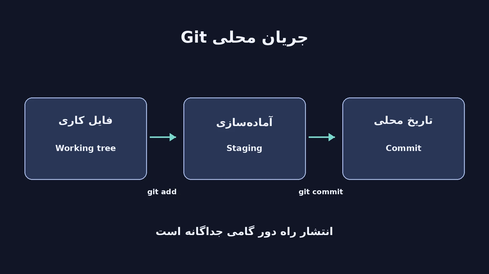

**شکل ۱۳-۱ — جریان مفهومی Git.** هیچ‌یک از این گام‌ها به‌تنهایی کد را روی GitHub منتشر نمی‌کند.

## ۴. تمرین دستی مخزن محلی

در یک پوشه تمرینی جدید و خالی، پس از نصب Git، می‌توانید با دستورهای زیر تمرین کنید. هویت محلی صرفاً برای همین مخزن است؛ به‌جای نمونه، نام و ایمیل مناسب خود را استفاده کنید. ایمیل commit ممکن است بعداً منتشر شود، پس از ایمیل عمومی مناسب استفاده کنید.

```text
mkdir practice-git
cd practice-git
git init
git config user.name "Student"
git config user.email "student@example.invalid"
```

فایل `hello.py` با `print('Hello Git')` بسازید، سپس:

```text
git status
git add hello.py
git diff --cached
git commit -m "First practice commit"
git log -1 --oneline
```

در صورت نبود Git، نصب را از [وب‌سایت رسمی Git](https://git-scm.com/) و راهنمای سیستم انجام دهید. اگر commit درباره هویت خطا داد، تنظیمات محلی را بررسی کنید. از `git add .` بدون بررسی، به‌ویژه در پروژه واقعی، پرهیز کنید: ممکن است فایل ناخواسته یا محرمانه را آماده کند.

## ۵. شاخه، مخزن راه دور و امنیت

**Branch** یک اشاره به مسیر توسعه است؛ **remote** نشانی مخزن دیگری است. `clone` یک کپی محلی می‌سازد، `fetch` اطلاعات راه دور را می‌گیرد، `pull` معمولاً دریافت و ادغام/بازپایه‌گذاری طبق پیکربندی انجام می‌دهد، و `push` commitها را به مخزن راه دور می‌فرستد. این عملیات ممکن است نیازمند دسترسی و شبکه باشد. آدرس و شاخه مقصد را قبل از push بررسی کنید و از `push --force` در پروژه مشترک بدون هماهنگی خودداری کنید.

`.gitignore` مانع آماده‌سازی معمول فایل‌های نادیده‌گرفته‌شده جدید می‌شود؛ **فایلی که قبلاً track شده خودکار از تاریخ یا پیگیری حذف نمی‌شود**. کلید API، token، رمز و داده خصوصی را در مخزن، URL یا خروجی عمومی قرار ندهید. اگر رازی افشا شد، ابتدا طبق راهنمای ارائه‌دهنده آن را لغو/تعویض و رخداد را رسیدگی کنید؛ حذف فایل فعلی ممکن است تاریخ را پاک نکند [۳]. اطلاعات احراز هویت را در مثال‌ها وارد نکنید.

## ۶. محیط مجازی Python

`venv` محیطی جدا برای بسته‌های Python ایجاد می‌کند [۴]. از ریشه یک پوشه تمرینی:

```text
python3 -m venv .venv
```

در Linux/macOS با Bash معمولاً `source .venv/bin/activate` و در Windows PowerShell معمولاً `.\.venv\Scripts\Activate.ps1` محیط را فعال می‌کنند. در Windows ممکن است سیاست اجرای اسکریپت مانع شود؛ به‌جای تغییر شتاب‌زده سیاست سیستم، راهنمای رسمی را بخوانید یا مفسر محیط را با مسیر مستقیم اجرا کنید. فعال‌سازی الزامی نیست: در Linux/macOS، `.venv/bin/python --version` مستقیماً مفسر محیط را اجرا می‌کند؛ مسیر Windows متفاوت است.

`deactivate` در پوسته فعال‌شده محیط را ترک می‌کند. محیط `.venv/` را معمولاً به Git اضافه نمی‌کنیم؛ به جای آن دستور ایجاد، نسخه Python و فهرست وابستگی‌ها را مستند می‌کنیم. خود محیط به معماری و مسیر وابسته است و کپی آن الزاماً قابل حمل نیست.

## ۷. بسته، pip و تکرارپذیری

`python -m pip --version` pip مربوط به همان مفسر را نشان می‌دهد. نصب بسته از شبکه باید با بررسی منبع، مجوز، نسخه و خطر زنجیره تأمین انجام شود؛ مثال این فصل هیچ بسته‌ای نصب نمی‌کند. ثبت نسخه‌ها با ابزار مناسب و قفل‌کردن وابستگی‌ها می‌تواند بازتولید را بهتر کند، اما سیستم‌عامل، درایور، سخت‌افزار، داده و تصادفی‌بودن همچنان اهمیت دارند.

`pip freeze` نسخه‌های بسته‌های محیط را گزارش می‌کند؛ این گزارش به‌تنهایی تضمین نمی‌کند وابستگی‌ها، منبع فایل، مجوز، امنیت یا نصب در همه سکوها یکسان است. در آزمایش واقعی نسخه Python، فایل وابستگی، دستور اجرا، seed و داده/مجوز را ثبت و در محیط تمیز آزمون کنید.

## ۸. پروژه ایمن: Git و venv در پوشه موقت

برنامه زیر مخزنی موقت می‌سازد، `.gitignore` و فایل نمونه را commit می‌کند، یک venv بدون pip می‌سازد و وضعیت را بررسی می‌کند. هیچ push، دسترسی شبکه یا تغییر مخزن فعلی انجام نمی‌دهد؛ پوشه پس از اجرا پاک می‌شود. نیازمند Python و Git روی PATH است. **آزمایش واقعی:** Python 3.13.16 و Git 2.47.3 در محیط Linux.

```python
"""Offline Git and venv exercise in a temporary directory; no network."""
from pathlib import Path
from tempfile import TemporaryDirectory
import subprocess
import sys


def git(folder, *args):
    return subprocess.run(['git', *args], cwd=folder, check=True,
                          text=True, capture_output=True).stdout.strip()


def main():
    with TemporaryDirectory() as temporary:
        root = Path(temporary)
        repo = root / 'demo'
        repo.mkdir()
        git(repo, 'init', '-q')
        git(repo, 'config', 'user.name', 'Student')
        git(repo, 'config', 'user.email', 'student@example.invalid')
        (repo / '.gitignore').write_text('.venv/\n', encoding='utf-8')
        (repo / 'hello.py').write_text("print('Hello Git')\n", encoding='utf-8')
        subprocess.run([sys.executable, '-m', 'venv', '--without-pip',
                        str(repo / '.venv')], check=True, capture_output=True)
        git(repo, 'add', '.gitignore', 'hello.py')
        git(repo, 'commit', '-qm', 'First practice commit')
        print('commit=', git(repo, 'log', '-1', '--format=%s'))
        print('worktree_clean=', not bool(git(repo, 'status', '--porcelain')))
        print('venv_ignored=', git(repo, 'check-ignore', '.venv'))
        print('network=not used')


if __name__ == '__main__':
    main()
```

دستور اجرا: `python local_workflow.py` یا `python3 local_workflow.py`. خروجی ثبت‌شده:

```text
commit= First practice commit
worktree_clean= True
venv_ignored= .venv
network=not used
```

`TemporaryDirectory` محدوده تمرین را جدا می‌کند. تنظیمات نام و ایمیل به همان مخزن محدودند. `--without-pip` صرفاً زمان و نیاز پروژه را کم می‌کند؛ برای نصب بسته در پروژه واقعی، محیط معمول venv را با pip مطابق مستندات ایجاد کنید. `check-ignore` نشان می‌دهد `.venv` نادیده گرفته شده؛ این بررسی به معنی محرمانه‌ماندن داده‌های track‌شده قبلی نیست.

**عیب‌یابی:** اگر `git` پیدا نشد نصب و PATH را بررسی کنید. اگر ایجاد venv خطا داد، نصب پشتیبانی venv و مجوز پوشه موقت را بررسی کنید. اگر commit خطا داد، پیام Git و تنظیمات محلی را ببینید. برنامه منابع موقت را حذف می‌کند؛ روی فایل‌های واقعی کار نمی‌کند.

## ۹. تحولات، تمرین و ارزیابی

**بررسی: ۵ نوامبر ۲۰۲۶.** مستندات Git و Python 3.13 برای فرمان‌ها و venv مبنا هستند [۲، ۴]. نسخه واقعی اجرای نمونه Git 2.47.3 و Python 3.13.16 است، نه ادعای آخرین نسخه. پیش از هر نصب یا اتصال به سرویس راه دور، راهنمای روز و سطح دسترسی را بررسی کنید.

**آزمون:** ۱) Git و GitHub یکی‌اند؟ ۲) `git add` چه می‌کند؟ ۳) آیا commit به‌تنهایی push است؟ ۴) آیا `.gitignore` فایل track‌شده را از تاریخ پاک می‌کند؟ ۵) هدف venv چیست؟ ۶) آیا فعال‌سازی برای اجرای مفسر venv اجباری است؟ ۷) چرا `pip freeze` بازتولید کامل را تضمین نمی‌کند؟ ۸) پس از افشای token چه اقدام فوری لازم است؟

**تمرین ریاضی:** اگر سه بسته نسخه ثبت‌شده دارند و دو مورد با محیط دیگر اختلاف دارند، چند مورد مشترک است؟ آیا این شمارش سازگاری عملکرد را تضمین می‌کند؟ **تمرین:** پروژه محلی را اجرا و پیام commit و ignore را بررسی کنید. **مینی‌پروژه:** در پوشه تمرینی، فایل README و یک برنامه بی‌خطر بسازید، `git status` و diff را ببینید، فایل مشخص را commit کنید و نسخه Python را ثبت کنید؛ هیچ secret یا push لازم نیست.

**معیار قبولی:** ۷ پاسخ صحیح از ۸، اجرای موفق نمونه یا شرح دقیق در نبود ابزار، و پروژه شامل تاریخچه و فهرست نسخه‌ها. [پاسخ‌نامه جداگانه فصل 13](book-engineering/answers/13-linux-git-environments-answers-fa.md).

## ۱۰. واژه‌نامه و منابع

Linux، Shell، Bash، Working Directory، Git، Repository، Staging، Commit، Branch، Remote، Push، Virtual Environment، Dependency، Reproducibility. فصل ۱۴ عیب‌یابی، تست نرم‌افزار، SQL و امنیت پایه را ادامه می‌دهد.

**منابع؛ مراجعه ۵ نوامبر ۲۰۲۶:** [۱] GNU، «Bash Reference Manual»، تاریخ صفحه متغیر، [مستندات](https://www.gnu.org/software/bash/manual/bash.html). [۲] Git Project، «gittutorial»، تاریخ انتشار نامشخص، [مستندات](https://git-scm.com/docs/gittutorial). [۳] GitHub Docs، «Keeping your API credentials secure»، تاریخ نامشخص، [راهنما](https://docs.github.com/en/rest/authentication/keeping-your-api-credentials-secure). [۴] Python Software Foundation، «venv»، مستندات 3.13، تاریخ نامشخص، [منبع](https://docs.python.org/3.13/library/venv.html).

---

# فصل ۱۴ — عیب‌یابی، آزمون، طراحی نرم‌افزار، SQL و امنیت

**هنر و علم ساخت هوش | جلد اول | Babak & Ai**
**نسخه کاری RC · تاریخ مراجعه به منابع: ۵ نوامبر ۲۰۲۶**

## ۱. از «اجرا شد» تا «درست و قابل نگهداری است»

برنامه‌ای که خطا نمی‌دهد الزاماً پاسخ درست نمی‌دهد. هدف این فصل تشخیص خطا، نوشتن آزمون تکرارپذیر، تفکیک مسئولیت‌ها، آشنایی با بانک داده رابطه‌ای و جلوگیری از اشتباهات امنیتی متداول است. **پیش‌نیاز:** توابع، استثنا، فایل و Git از فصل‌های ۱۱ تا ۱۳. **خروجی:** برنامه ثبت زمان مطالعه با SQLite و سه آزمون خودکار.

**نمونه:** اگر جمع ۳۰ و ۴۵ به جای ۷۵ برابر ۷۴ شود، اجرای بدون خطای برنامه نشانه درستی نیست. داده نمونه، خروجی مورد انتظار و آزمونی مستقل از پیاده‌سازی به ما در تشخیص کمک می‌کند. تست هیچ‌گاه همه حالت‌ها و تمام خطرهای امنیتی را ثابت نمی‌کند.

**نسخهٔ پایه — قرارداد پروژه:** قرارداد اصلی این فصل `create_database`، `add_session` و `minutes_for` در پوشه `projects/14-tested-sql` است. نسخهٔ بازنویسی‌شده در پیوست از `setup` و `total_for` استفاده می‌کند؛ APIها را در یک فایل مخلوط نکنید.

## ۲. عیب‌یابی نظام‌مند

**عیب‌یابی (Debugging)** را از مشاهده شروع کنید: انتظار چه بود، چه رخ داد، با کدام ورودی و نسخه؟ سپس نمونه‌ای کوچک و قابل تکرار بسازید، فرضیه‌ها را یکی‌یکی بررسی کنید و بعد از رفع مشکل آزمونی اضافه کنید که بازگشت همان خطا را آشکار کند. متغیرهای محیط و ورودی را ثبت کنید اما داده خصوصی و رمزها را ثبت نکنید.

**Traceback** مسیر فراخوانی و محل مشاهده خطا را نشان می‌دهد؛ آخرین سطر معمولاً نوع استثنا و پیام آن است، اما علت ریشه‌ای می‌تواند زودتر در مسیر باشد. خطای نحوی مانع تفسیر درست کد است؛ استثنای زمان اجرا مانند `ZeroDivisionError` در هنگام اجرا رخ می‌دهد؛ خطای منطقی ممکن است هیچ استثنایی ندهد [۱]. لاگ و breakpoint در debugger مکمل‌اند. `try/except` را فقط برای خطاهای قابل رسیدگی به‌کار ببرید، نه برای پنهان‌کردن خطا.

## ۳. آزمون خودکار

هر آزمون با چیدمان داده (**Arrange**)، اجرای رفتار (**Act**) و بررسی نتیجه (**Assert**) خوانا می‌شود. آزمون واحد واحدی کوچک را بررسی می‌کند؛ آزمون یکپارچه تعامل اجزا و آزمون سرتاسری جریان گسترده‌تر را می‌سنجد. مرزها، داده خالی، نوع نامعتبر، مسیر خطا و مقدار معمول را بپوشانید. نتایج آزمون‌ها باید مستقل از ترتیب اجرا باشند [۲].

در `unittest`, کلاس از `unittest.TestCase` ارث می‌برد؛ متدهای `test_...` کشف می‌شوند. `assertEqual` خروجی و `assertRaises` خطای مورد انتظار را بررسی می‌کند. هر تست پروژه در `setUp` پایگاه داده مجزا می‌سازد و در `tearDown` اتصال را می‌بندد. گذر آزمون‌ها برای داده‌های منتخب نشانه مفید است، نه اثبات نبود همه خطاها. پوشش خط کد نیز به‌تنهایی کیفیت بررسی نتیجه را نشان نمی‌دهد.

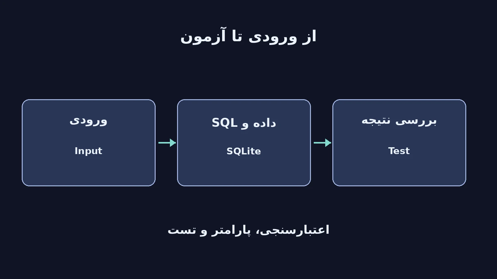

**شکل ۱۴-۱ — مسیر آموزشی و مرز اعتماد.** پارامتری‌کردن به‌تنهایی مجوز دسترسی یا امنیت کامل را تضمین نمی‌کند.

## ۴. طراحی و بازبینی

وظایف را جدا کنید: یک تابع اعتبارسنجی و درج می‌کند، تابع دیگر پرس‌وجو را انجام می‌دهد، و نمایش خروجی در `main` است. نام روشن، ورودی و خروجی مشخص و توابع کوچک آزمون و تغییر را آسان می‌کنند. از تکرار بی‌دلیل بپرهیزید اما تجرید پیچیده را زودهنگام تحمیل نکنید. بازبینی کد شامل خوانایی، درستی، خطاها، کارایی، امنیت و آزمایش است.

برای تغییرات Git، `git diff` را ببینید، فایل‌های مرتبط را stage کنید و آزمون‌ها را قبل از commit اجرا کنید. در پروژه تیمی بازبینی مستقل و اجرای خودکار آزمون‌ها در CI کمک می‌کند، ولی CI جای تصمیم مهندسی را نمی‌گیرد.

## ۵. داده رابطه‌ای و SQL

**پایگاه داده رابطه‌ای (Relational Database)** داده را در جدول‌هایی از سطر و ستون سازمان می‌دهد. **SQL** زبان تعریف و پرس‌وجوی داده است. SQLite یک موتور تعبیه‌شده است؛ در این پروژه `:memory:` یعنی داده فقط در حافظه اتصال است و پس از بسته‌شدن از بین می‌رود، نه ذخیره دائمی.

در مثال، جدول `sessions` دو ستون `topic` و `minutes` دارد. `CREATE TABLE` ساختار را ایجاد و `INSERT` سطر را درج می‌کند؛ `SELECT`، `WHERE` و `SUM` انتخاب، فیلتر و جمع را انجام می‌دهند. `COALESCE(SUM(minutes), 0)` برای مجموعه بدون سطر صفر می‌دهد. در سیستم واقعی برای موجودیت‌ها و روابط مناسب کلید، محدودیت، نسخه‌بندی schema، پشتیبان‌گیری و سیاست دسترسی تعیین کنید.

## ۶. پارامتر، تراکنش و امنیت اولیه

هرگز مقدار نامطمئن را با الحاق رشته داخل SQL قرار ندهید. در SQLite برای **مقدار داده** از `?` و دنباله پارامترها استفاده کنید؛ موتور مقدار را داده در نظر می‌گیرد، نه بخشی از دستور [۳، ۴]. جای‌نگهدار برای نام جدول یا ستون نیست: ساختار پویا را از گزینه‌های ثابت و مجاز برنامه انتخاب کنید. اعتبارسنجی، کمترین سطح دسترسی و بررسی مجوز کاربر همچنان لازم‌اند [۴].

`with db:` تراکنش را در صورت موفقیت commit و در صورت خطا rollback می‌کند؛ **اتصال را نمی‌بندد**، به همین دلیل برنامه در `finally` آن را می‌بندد [۳]. این مثال فقط درج ساده را آموزش می‌دهد، نه طراحی همزمانی یا امنیت production. رمز و کلید را در کد، Git و log نگذارید؛ از مدیریت امن اسرار، احراز هویت، مجوز و محافظت از داده استفاده کنید. روی ورودی نامطمئن `eval` یا دستور shell نسازید.

## ۷. پروژه: دفتر مطالعه در SQLite

دو فایل زیر را کنار هم ذخیره کنید. این کد فقط از کتابخانه استاندارد استفاده می‌کند و فایل یا شبکه را تغییر نمی‌دهد. ورودی موضوع خالی، عدد منفی، بیش از ۱۴۴۰ و `True` را رد می‌کند. محدودیت ۱۴۴۰ قرارداد آموزشی است، نه ویژگی ذاتی SQLite.

**`study_db.py`:**
```python
"""Small in-memory SQLite study log; no external services or files."""
import sqlite3


def create_database():
    db = sqlite3.connect(':memory:')
    db.execute('CREATE TABLE sessions (topic TEXT NOT NULL, minutes INTEGER NOT NULL CHECK(minutes >= 0))')
    return db


def add_session(db, topic, minutes):
    if not isinstance(topic, str) or not topic.strip():
        raise ValueError('topic must be non-empty')
    if type(minutes) is not int or not 0 <= minutes <= 1440:
        raise ValueError('minutes must be an integer from 0 to 1440')
    with db:
        db.execute('INSERT INTO sessions (topic, minutes) VALUES (?, ?)', (topic.strip(), minutes))


def minutes_for(db, topic):
    row = db.execute('SELECT COALESCE(SUM(minutes), 0) FROM sessions WHERE topic = ?', (topic,)).fetchone()
    return row[0]


def main():
    db = create_database()
    try:
        add_session(db, 'python', 30)
        add_session(db, 'python', 45)
        add_session(db, 'math', 60)
        print('python_minutes=', minutes_for(db, 'python'))
        print('missing_minutes=', minutes_for(db, 'missing'))
    finally:
        db.close()


if __name__ == '__main__':
    main()
```

اتصال حافظه‌ای در هر اجرا تازه است. `topic.strip()` فضاهای ابتدا و انتهای متن را در درج حذف می‌کند؛ جست‌وجو در این نمونه مقدار را بدون پاک‌سازی اضافی استفاده می‌کند. در سامانه واقعی این قرارداد باید برای هر دو مسیر دقیق طراحی شود. SQLite بررسی `CHECK` منفی را هم انجام می‌دهد اما سایر اعتبارسنجی‌های برنامه را جایگزین نمی‌کند.

## ۸. آزمون و اجرای پروژه

**`test_study_db.py`:**
```python
import unittest
from study_db import create_database, add_session, minutes_for


class StudyTests(unittest.TestCase):
    def setUp(self):
        self.db = create_database()

    def tearDown(self):
        self.db.close()

    def test_sum_and_missing(self):
        add_session(self.db, 'python', 30)
        add_session(self.db, 'python', 45)
        self.assertEqual(minutes_for(self.db, 'python'), 75)
        self.assertEqual(minutes_for(self.db, 'math'), 0)

    def test_invalid_values(self):
        for topic, minutes in [('', 1), ('x', -1), ('x', True), ('x', 1441)]:
            with self.subTest(topic=topic, minutes=minutes):
                with self.assertRaises(ValueError):
                    add_session(self.db, topic, minutes)

    def test_untrusted_value_is_literal(self):
        add_session(self.db, 'python', 30)
        self.assertEqual(minutes_for(self.db, "python' OR 1=1 --"), 0)
        self.assertEqual(minutes_for(self.db, 'python'), 30)


if __name__ == '__main__':
    unittest.main()
```

در پوشه پروژه `python study_db.py` و `python -m unittest -v` را اجرا کنید. در محیط آزمون Python 3.13.16 خروجی برنامه `python_minutes= 75` و `missing_minutes= 0` و گزارش آزمون شامل `Ran 3 tests` و `OK` بود. آزمون ورودی ظاهراً SQL را **به‌صورت مقدار واقعی** به تابع می‌دهد و انتظار صفر دارد؛ این یک بررسی محدود است و جای ممیزی امنیتی را نمی‌گیرد.

**عیب‌یابی:** `ModuleNotFoundError` برای `study_db` معمولاً یعنی آزمون را بیرون پوشه فایل‌ها اجرا کرده‌اید؛ وارد همان پوشه شوید یا از دستور discover مناسب استفاده کنید. `sqlite3` بخشی از کتابخانه استاندارد Python است، اما در برخی توزیع‌های سفارشی ممکن است ماژول ساخته نشده باشد. خطای تست را با مقدار مورد انتظار و traceback مقایسه کنید، نه اینکه آزمون را برای سبزشدن بی‌دلیل ضعیف کنید.

## ۹. تمرین، ارزیابی و توسعه

**پرسش:** ۱) تفاوت خطای منطقی و استثنا چیست؟ ۲) سه گام Arrange/Act/Assert کدام‌اند؟ ۳) آیا test pass اثبات امنیت است؟ ۴) `WHERE` چه می‌کند؟ ۵) پارامتر `?` برای چه استفاده می‌شود؟ ۶) آیا پارامتر جای نام جدول را می‌گیرد؟ ۷) آیا `with db` اتصال SQLite را می‌بندد؟ ۸) چرا رمز را نباید log کرد؟

**تمرین:** جمع ۳۰، ۴۵ و ۶۰ را محاسبه و مجموع موضوع python در برنامه را جداگانه مشخص کنید. تست ورودی مرزی صفر و ۱۴۴۰ را اضافه کنید و نتایج را بررسی کنید. تست درج موضوع فارسی بنویسید. **مینی‌پروژه:** تعداد جلسه‌ها را با پرس‌وجوی پارامتری به‌دست آورید و آزمون صفر و چند سطر بنویسید؛ پیش از تغییر کد خروجی مورد انتظار را مشخص کنید.

**قبولی:** دست‌کم ۷ پاسخ صحیح، اجرای سه آزمون موجود و دو آزمون جدید. [پاسخ‌نامه جداگانه فصل 14](book-engineering/answers/14-debug-testing-sql-security-answers-fa.md).

## ۱۰. منابع و واژه‌نامه

**مرور: ۵ نوامبر ۲۰۲۶.** پروژه در Python 3.13.16 با SQLite حافظه‌ای آزموده شد؛ اتصال شبکه، امنیت production و پایگاه داده چندکاربره آزموده نشدند. فصل ۱۵ ابزارهای تحلیل داده و نمودار را معرفی می‌کند.

Debugging، Traceback، Unit Test، Integration Test، Regression، SQL، Database، Transaction، Parameterized Query، Least Privilege.

**منابع؛ مراجعه ۵ نوامبر ۲۰۲۶:** [۱] Python Software Foundation، «Errors and Exceptions»، مستندات Python 3.13، [منبع](https://docs.python.org/3.13/tutorial/errors.html). [۲] Python Software Foundation، «unittest»، مستندات 3.13، [منبع](https://docs.python.org/3.13/library/unittest.html). [۳] Python Software Foundation، «sqlite3»، مستندات 3.13، [منبع](https://docs.python.org/3.13/library/sqlite3.html). [۴] OWASP، «SQL Injection Prevention Cheat Sheet»، تاریخ صفحه نامشخص، [منبع](https://cheatsheetseries.owasp.org/cheatsheets/SQL_Injection_Prevention_Cheat_Sheet.html).

## پیوست: نسخهٔ بازنویسی‌شده و آزمون‌شده

**مرز دو نسخه:** نسخهٔ بازنویسی‌شده و آزمون‌شده در `projects/14-testing-sql` است؛ تابع‌های `setup` و `total_for` در این نسخه جایگزین `create_database` و `minutes_for` نسخهٔ پایه‌اند.


### فصل ۱۴ — عیب‌یابی، آزمون، طراحی نرم‌افزار، SQL و امنیت پایه

**هنر و علم ساخت هوش | جلد اول | Babak & Ai**<br>
**بررسی منابع: ۵ نوامبر ۲۰۲۶**

### ۱. از «کار می‌کند» تا «می‌توان به آن اعتماد کرد»

یک برنامه ممکن است روی داده معمولی کار کند اما برای ورودی خالی، خطای فایل یا داده‌ای نامعمول شکست بخورد. مهندسی نرم‌افزار یعنی مشخص‌کردن انتظار، آزمایش منظم و محدودکردن پیامد خطا؛ نه صرفاً نوشتن خروجی نمونه. در این فصل یک سامانه کوچک ثبت مطالعه می‌سازیم، آن را با SQLite می‌آزماییم و با اصول امنیتی آشنا می‌شویم.

**پیش‌نیاز:** توابع، استثنا و محیط فصل‌های ۱۱ تا ۱۳. **هدف:** خواندن traceback، طراحی تست و مرزهای ورودی، نوشتن SQL پارامتری و درک محدودیت امنیت. نمونه از کتابخانه استاندارد Python استفاده می‌کند.

### ۲. عیب‌یابی گام‌به‌گام

**عیب‌یابی (Debugging)** روند پیدا کردن علت رفتار غیرمنتظره است. ابتدا رفتار مورد انتظار و رفتار واقعی را دقیق بنویسید؛ سپس کوچک‌ترین ورودی بازتولیدکننده را بیابید، نسخه و محیط را ثبت کنید، و فرضیه‌ها را یکی‌یکی بیازمایید. تفاوت بین نشانه و علت مهم است: پیام نبود فایل ممکن است ناشی از پوشه کاری اشتباه باشد، نه محتوای فایل.

Traceback معمولاً زنجیره فراخوانی‌ها و در پایان نوع و پیام استثنا را نشان می‌دهد. از آخر به نوع خطا نگاه کنید، سپس سطرهای برنامه خود را دنبال کنید. `ValueError` معمولاً نشان‌دهنده مقدار نامناسب و `TypeError` ناسازگاری نوع عملیات است؛ همیشه زمینه را بخوانید. قبل از تغییر کد، ورودی‌ها را مشاهده کنید و بعد از اصلاح، آزمون بازگشتی برای جلوگیری از تکرار اضافه کنید.

`logging` برای ثبت رویداد با سطح‌هایی مثل INFO و ERROR مناسب است [۱]. گزارش نباید token، رمز، داده شخصی یا کل payload حساس را در خود داشته باشد. چاپ موقت کمک می‌کند اما لاگ کنترل‌شده با دسترسی و نگهداری مناسب برای پروژه واقعی بهتر است.

### ۳. طراحی و جداسازی مسئولیت

تابعی که ورودی را بررسی، SQL را اجرا، HTML را تولید و شبکه را مدیریت می‌کند دشوارتر آزموده می‌شود. کارها را با رابط مشخص جدا کنید: اعتبارسنجی، عملیات داده و نمایش. جداسازی زیاد هم پیچیدگی می‌آورد؛ بر اساس نیاز، سادگی و خوانایی تصمیم بگیرید.

**قرارداد** مشخص می‌کند چه ورودی‌هایی پذیرفته و چه خروجی یا خطایی انتظار می‌رود. در پروژه، `minutes` عدد صحیح ۰ تا ۱۴۴۰ و موضوع رشته غیرخالی است؛ `True` عمداً رد می‌شود. این دامنه یک انتخاب آموزشی است، نه تعریف همگانی جلسه مطالعه. ورودی نامعتبر با `ValueError` رد می‌شود.

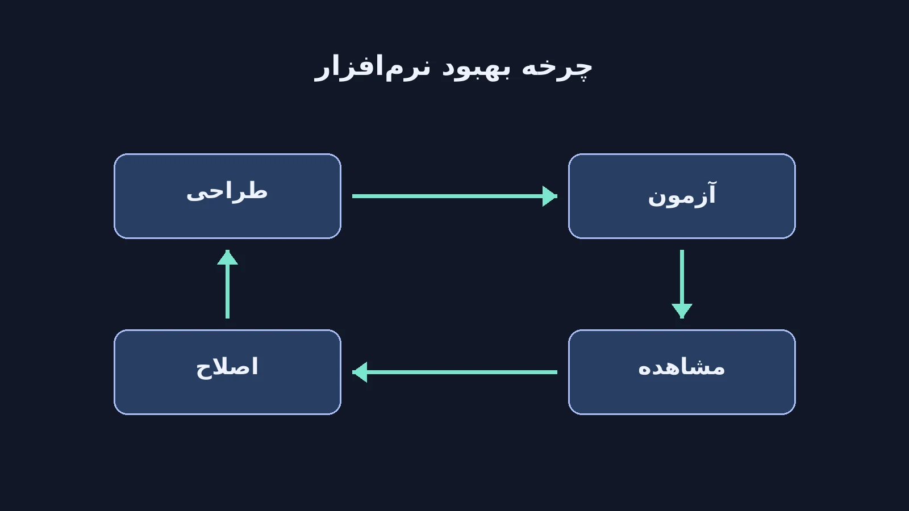

**شکل ۱۴-۲ — چرخه بهبود.** عبور از آزمون فقط آنچه آزموده شده را پوشش می‌دهد، نه همه رفتارهای ممکن.

### ۴. آزمون واحد و یکپارچگی

**آزمون واحد (Unit Test)** رفتاری کوچک را جداگانه بررسی می‌کند. **آزمون یکپارچگی (Integration Test)** همکاری اجزا را می‌سنجد؛ تست پایگاه‌داده واقعی در حافظه در پروژه ما نیز جنبه یکپارچگی دارد. آزمون سر تا سر مسیر گسترده‌تری از کاربر تا نتیجه را بررسی می‌کند. مرزها بسته به پروژه تغییر می‌کنند.

هر آزمون با آماده‌سازی، اجرا و مقایسه نتیجه مورد انتظار ساخته می‌شود. `unittest.TestCase`، `setUp` و `tearDown` به ساخت آزمون‌های مستقل کمک می‌کنند [۲]. افزون بر حالت عادی، خالی، صفر، مرز بالا، خارج محدوده، نوع اشتباه و متن غیرمعمول را بررسی کنید. آزمون موفق اثبات نبود همه باگ‌ها یا امنیت کامل نیست.

### ۵. SQL و داده رابطه‌ای

در یک پایگاه رابطه‌ای داده‌ها به شکل جدول، ستون و سطر سازمان می‌یابند. **SQL** زبان رایج تعریف و پرس‌وجوی داده است؛ جزئیات میان موتورهای مختلف تفاوت دارند. SQLite کتابخانه‌ای سبک است که برای استفاده معمول به فرایند سرور جداگانه نیاز ندارد [۳]. `:memory:` یک پایگاه موقت در حافظه همان اتصال می‌سازد؛ با بستن آن داده از دست می‌رود.

`CREATE TABLE` جدول می‌سازد؛ `INSERT` سطر اضافه می‌کند؛ `SELECT` اطلاعات می‌خواند و `WHERE` فیلتر می‌کند. `SUM` مجموع را برمی‌گرداند؛ در نبود سطر ممکن است NULL باشد، پس در مثال `COALESCE(..., 0)` صفر می‌دهد. `commit` تراکنش تغییرات را ثبت می‌کند؛ برای داده واقعی باید تراکنش، خطا و بازیابی را متناسب با محیط طراحی کرد.

### ۶. تزریق و پارامترگذاری

داده کاربر را با چسباندن رشته داخل SQL قرار ندهید. در SQLite از placeholder `?` و پارامتر جداگانه استفاده کنید: `execute('SELECT ... WHERE topic = ?', (topic,))`. متن ورودی به‌عنوان داده به موتور داده می‌شود، نه بخشی از دستور SQL [۳، ۴]. این حفاظت برای مقدارهاست؛ نام جدول/ستون را نمی‌توان با همین placeholder دلخواه کرد و اگر واقعاً پویا باشند باید از فهرست مجاز دقیق انتخاب شوند.

اعتبارسنجی نوع و محدوده مفید است، اما جایگزین پارامترگذاری نیست. امنیت نیازمند لایه‌های دیگر از جمله کنترل دسترسی، حداقل سطح مجوز، مدیریت امن کلیدها، به‌روزرسانی و بررسی وابستگی‌هاست. مثال حافظه‌ای ما احراز هویت، مجوز، چندکاربری، پشتیبان یا محصول آماده تولید نیست.

### ۷. پروژه: ثبت جلسه و پرس‌وجوی امن

`study_db.py` را بسازید و اجرا کنید. داده‌ها ساختگی و پایگاه موقتی‌اند. خروجی مورد انتظار `python_minutes= 75` و `unknown_minutes= 0` است.

```python
"""A small in-memory study tracker; no network or persistent files."""
import sqlite3


def setup(connection):
    connection.execute('CREATE TABLE sessions (topic TEXT NOT NULL, minutes INTEGER NOT NULL)')


def add_session(connection, topic, minutes):
    if not isinstance(topic, str) or not topic.strip():
        raise ValueError('topic must be a non-empty string')
    if type(minutes) is not int or not 0 <= minutes <= 1440:
        raise ValueError('minutes must be an integer between 0 and 1440')
    connection.execute('INSERT INTO sessions (topic, minutes) VALUES (?, ?)',
                       (topic.strip(), minutes))
    connection.commit()


def total_for(connection, topic):
    row = connection.execute('SELECT COALESCE(SUM(minutes), 0) FROM sessions WHERE topic = ?',
                             (topic,)).fetchone()
    return row[0]


def main():
    connection = sqlite3.connect(':memory:')
    try:
        setup(connection)
        add_session(connection, 'python', 30)
        add_session(connection, 'python', 45)
        add_session(connection, 'math', 20)
        print('python_minutes=', total_for(connection, 'python'))
        print('unknown_minutes=', total_for(connection, 'unknown'))
    finally:
        connection.close()


if __name__ == '__main__':
    main()
```

دو جلسه Python برابر ۳۰ و ۴۵ دقیقه و جلسه math برابر ۲۰ دقیقه درج می‌شوند. `total_for` فقط موضوع مشخص را جمع می‌کند. اتصال در `finally` بسته می‌شود. هر insert در این مثال جداگانه commit می‌شود؛ برای چند عملیات وابسته در محصول واقعی باید مرز تراکنش و rollback را طراحی کنید.

### ۸. پروژه: مجموعه آزمون

فایل `test_study_db.py` را کنار فایل قبلی ذخیره کنید. دستور: `python -m unittest -v test_study_db` از داخل پوشه؛ یا `python -m unittest discover -s book-engineering/projects/14-testing-sql -v` از ریشه مخزن. سه تست مستقل اجرا می‌شود:

```python
import sqlite3
import unittest
from study_db import setup, add_session, total_for


class StudyDBTests(unittest.TestCase):
    def setUp(self):
        self.db = sqlite3.connect(':memory:')
        setup(self.db)

    def tearDown(self):
        self.db.close()

    def test_sum_and_empty(self):
        add_session(self.db, 'python', 30)
        add_session(self.db, 'python', 45)
        self.assertEqual(total_for(self.db, 'python'), 75)
        self.assertEqual(total_for(self.db, 'math'), 0)

    def test_boundaries_and_invalid(self):
        for value in (0, 1440):
            add_session(self.db, 'x', value)
        for value in (-1, 1441, True, 1.5):
            with self.subTest(value=value), self.assertRaises(ValueError):
                add_session(self.db, 'x', value)
        with self.assertRaises(ValueError):
            add_session(self.db, ' ', 10)

    def test_parameter_is_data(self):
        add_session(self.db, 'python', 30)
        self.assertEqual(total_for(self.db, "python' OR 1=1 --"), 0)
        self.assertEqual(total_for(self.db, 'python'), 30)


if __name__ == '__main__':
    unittest.main()
```

تست اول جمع و حالت بدون سطر، دوم مرزها و داده نامعتبر و سوم رفتار متن شبیه تزریق را می‌سنجد. تست سوم یک مثال محدود است، نه ممیزی امنیت جامع. اجرا در Python 3.13.16: `Ran 3 tests ... OK`. اگر import خطا داد، پوشه و دستور اجرا را بررسی کنید.

### ۹. تمرین و ارزیابی

**پرسش‌ها:** ۱) تفاوت نشانه و علت چیست؟ ۲) چرا نمونه حداقلی مفید است؟ ۳) unit و integration چه تفاوتی دارند؟ ۴) چرا تست صفر و حد بالا مهم است؟ ۵) SQL پارامتری چه چیزی را جدا می‌کند؟ ۶) آیا placeholder نام جدول را انتخاب می‌کند؟ ۷) `:memory:` چقدر پایدار است؟ ۸) آیا آزمون موفق امنیت کامل را ثابت می‌کند؟

**تمرین:** تابعی برای شمارش تعداد جلسات یک موضوع با پارامتر SQL بنویسید و برای موضوع نبودنی و موجود تست اضافه کنید. **محاسبه:** مجموع سه جلسه ۳۰، ۴۵ و ۲۰ دقیقه و مجموع Python در مثال را محاسبه کنید. **مینی‌پروژه:** قرارداد، دو تست مرزی، آزمون موضوع ناموجود، لاگ بدون اطلاعات شخصی و مستندات اجرا تهیه کنید. برای قبولی دست‌کم ۷ پاسخ صحیح و اجرای موفق آزمون‌ها لازم است.

[پاسخ‌نامه جداگانه فصل 14](book-engineering/answers/14-debug-testing-sql-security-answers-fa.md).

### ۱۰. منابع و ادامه مسیر

**واژه‌ها:** Debugging، Traceback، Logging، Unit Test، Integration Test، Contract، SQL، Table، Query، Transaction، Parameterized Query، Injection. فصل ۱۵ ابزارهای داده NumPy، Pandas، Matplotlib و Jupyter را آموزش می‌دهد.

**منابع اولیه؛ بررسی ۵ نوامبر ۲۰۲۶:** [۱] Python Software Foundation، [logging](https://docs.python.org/3.13/library/logging.html)، مستندات Python 3.13. [۲] Python Software Foundation، [unittest](https://docs.python.org/3.13/library/unittest.html). [۳] Python Software Foundation، [sqlite3](https://docs.python.org/3.13/library/sqlite3.html). [۴] OWASP، [Injection Prevention Cheat Sheet](https://cheatsheetseries.owasp.org/cheatsheets/Injection_Prevention_Cheat_Sheet.html)، تاریخ صفحه متغیر.

---

# فصل ۱۵ — NumPy، Pandas، Matplotlib و Jupyter

**هنر و علم ساخت هوش | جلد اول | Babak & Ai**
**نسخه کاری RC · تاریخ مراجعه به منابع: ۵ نوامبر ۲۰۲۶**

## ۱. از جدول کوچک تا تحلیل داده

داده به‌تنهایی پاسخ نیست: باید منشأ، واحد، خطا، داده گمشده، سؤال و محدودیت آن را بشناسیم. در این فصل آرایه عددی NumPy، جدول Pandas، تصویرسازی Matplotlib و محیط تعاملی Jupyter را می‌آموزیم. **پیش‌نیاز:** Python، تابع، فایل و محیط مجازی. **پروژه:** تحلیل چهار سطر ساختگی مطالعه، با گزارش رکورد ناقص و نمودار WebP.

این داده آموزشی ساختگی است، نه نمونه‌ای نماینده از رفتار انسان‌ها. تحلیل توصیفی آن رابطه علّی یا کیفیت یادگیری را نشان نمی‌دهد. در کار واقعی، رضایت، حریم خصوصی، مجوز داده، واحد اندازه‌گیری و روش نمونه‌گیری اهمیت دارند.

**نسخهٔ پایه — قرارداد پروژه:** قرارداد اصلی `analyze` در `projects/15-data-analysis` سه مقدار `(missing, totals, mean)` برمی‌گرداند. نسخهٔ بازنویسی‌شده در پیوست از قرارداد متفاوت `(clean, totals, missing)` استفاده می‌کند؛ دو فایل هم‌نام را در پوشه‌های مستقل اجرا کنید.

## ۲. NumPy: آرایه و شکل

**NumPy** ابزار محاسبات عددی و `ndarray` ساختار اصلی آن است [۱]. آرایه معمولاً عناصر هم‌نوع با `dtype` مشخص دارد؛ `shape` اندازه هر بُعد است. برخلاف لیست Python، جمع دو آرایه سازگار معمولاً عضو به عضو انجام می‌شود.

```python
import numpy as np
a = np.array([30, 45, 60])
print(a.shape)        # (3,)
print(a + 10)         # [40 55 70]
print(a.mean())       # 45.0
```

اندیس از صفر شروع می‌شود. برش پایه اغلب **view** است، پس تغییرش ممکن است آرایه اصلی را هم تغییر دهد؛ `copy()` نسخه مستقل می‌سازد. **Broadcasting** در شکل‌های سازگار امکان عملیات بین آرایه‌ها با شکل متفاوت می‌دهد؛ سازگاری را بررسی کنید، چون نتیجه‌ای با شکل ناخواسته ممکن است بدون خطا تولید شود. `dtype`، سرریز اعداد صحیح و خطای گردکردن اعشاری در محاسبات بزرگ اهمیت دارند.

## ۳. Pandas: جدول و انتخاب

**DataFrame** جدولی دارای ردیف و ستون و **Series** معمولاً نمایش یک ستون است [۲]. `pd.read_csv` CSV را می‌خواند؛ `head()`, `info()` و `dtypes` برای بازبینی اولیه مفیدند. نام ستون، واحد، نوع، داده‌های تکراری و گمشده را بررسی کنید. CSV نامطمئن ممکن است حجیم باشد؛ داده و خروجی را پیش از اشتراک‌گذاری بازبینی کنید.

```python
import pandas as pd
df = pd.DataFrame({'topic': ['python', 'math'], 'minutes': [30, 60]})
print(df[df['minutes'] >= 45])
```

`groupby('topic')['minutes'].sum()` گروه‌ها را جدا، جمع هر گروه را محاسبه و نتیجه‌ها را ترکیب می‌کند [۳]. `size` تعداد سطرها را می‌شمارد، در حالی که `count` مقادیر غیرگمشده را می‌شمارد. ترتیب و رفتار مقادیر گمشده را با نیاز و نسخه کتابخانه بررسی کنید.

## ۴. داده ناقص و تصمیم تحلیلی

در داده پروژه، یک سطر math دقیقه ندارد. نبود مقدار به معنای صفر نیست. برای این تمرین **حذف سطرهای ناقص** را انتخاب و تعداد آن‌ها را گزارش می‌کنیم؛ ممکن است در پژوهش واقعی این کار سوگیری ایجاد کند. روش جایگزین مانند تکمیل مقدار یا جمع‌آوری مجدد باید بر اساس زمینه، علت مفقودشدن و مستندسازی انتخاب شود. هرگز فرض نکنید یک روش برای همه داده‌ها صحیح است.

پس از حذف یک سطر، سه مقدار ۳۰، ۴۵، ۶۰ می‌ماند. مجموع ۱۳۵ دقیقه و میانگین ۴۵ دقیقه است؛ جمع python برابر ۷۵ و math برابر ۶۰ است. این میانگین روی **جلسه‌های کامل** محاسبه شده، نه روی همه چهار سطر و نه میانگین روزانه یا فردی.

## ۵. Matplotlib: نمودار مسئولانه

`plt.subplots()` یک **Figure** و ناحیه رسم **Axes** می‌سازد؛ `ax.bar` نمودار ستونی و `set` عنوان و برچسب محور را تنظیم می‌کند [۴]. محور و واحد را روشن بنویسید و نمودار مناسب سؤال انتخاب کنید؛ تفاوت مقیاس، حذف داده و تعداد نمونه می‌تواند خواننده را گمراه کند. نمودار ستونی با محور عمودی از صفر برای مقایسه اندازه‌ها معمولاً خواناتر است.

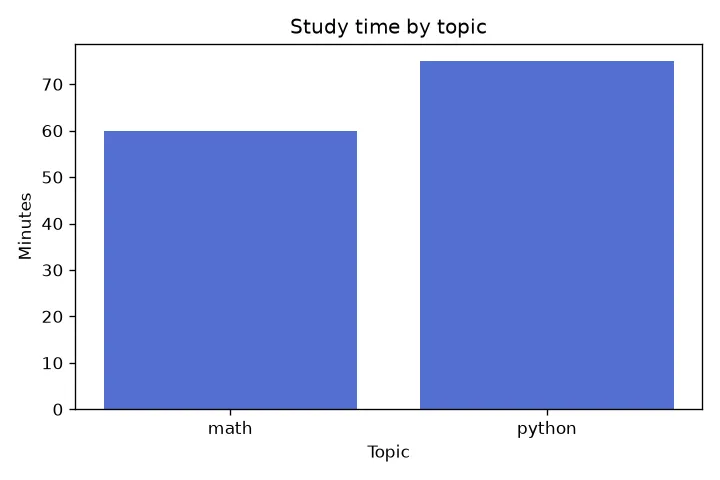

**شکل ۱۵-۱ — داده ساختگی پروژه.** سطر بدون دقیقه حذف شده؛ شکل توسط کد پروژه تولید شده است. این نمودار اختلاف در مجموع جلسه‌های مشاهده‌شده را نشان می‌دهد، نه تفاوت مهارت یا علت.

## ۶. Jupyter: سلول، kernel و تکرارپذیری

Jupyter Notebook سندی تعاملی با سلول‌های کد و متن است؛ کد در فرایند **kernel** اجرا می‌شود [۵]. مثلاً یک سلول واردکردن کتابخانه‌ها و سلول بعدی تعریف داده را در خود جای می‌دهد. خروجی یک سلول می‌تواند به متغیری وابسته باشد که قبلاً در سلولی دیگر ساخته شده است، حتی اگر ترتیب ظاهری سلول‌ها فرق کند. برای بازتولید، kernel را restart و همه سلول‌ها را از ابتدا به ترتیب اجرا کنید.

نسخه Python، کتابخانه‌ها، ورودی و دستور اجرا را یادداشت کنید. پیش از اشتراک‌گذاری، خروجی‌ها را برای داده شخصی و اسرار بررسی کنید؛ notebook ناشناس می‌تواند کد مخرب داشته باشد و نباید بی‌بررسی اجرا شود. پروژه زیر اسکریپت است؛ اجرای رابط Jupyter در این محیط آزمون نشده است.

## ۷. آماده‌سازی پروژه

در پوشه‌ای تمرینی، محیط مجازی فصل ۱۳ را بسازید و فعال کنید. سپس در همان محیط، از منابع بسته معتبر و با توجه به سازگاری سیستم نصب کنید:

```text
python -m pip install numpy pandas matplotlib
```

نصب به شبکه نیاز دارد؛ دستور فوق برای نسخه‌ها محدودیت قرار نمی‌دهد. برای بازتولید، نسخه‌های آزمایش‌شده را ثبت و سازگاری را در سیستم خود بررسی کنید: Python 3.13.16، NumPy 2.3.5، Pandas 2.2.3 و Matplotlib 3.11.2. نصب Jupyter برای اجرای اسکریپت لازم نیست. برای notebook می‌توانید طبق [راهنمای رسمی Jupyter](https://jupyter.org/install) آن را نصب کنید؛ در سرور عمومی بدون احراز هویت راه‌اندازی نکنید.

## ۸. پروژه: تحلیل داده ساختگی

فایل `analyze.py` را بسازید و در پوشه‌ای که اجازه نوشتن دارید با `python analyze.py` اجرا کنید. فایل `study_summary.webp` در **پوشه جاری بازنویسی می‌شود**؛ پیش از اجرا از نبود فایل مهم با همین نام مطمئن شوید. `Agg` برای محیط بدون نمایشگر است؛ داده داخل برنامه است و شبکه یا داده شخصی ندارد.

```python
"""Analyze a tiny synthetic study log; no network or real personal data."""
from io import StringIO
from pathlib import Path
import numpy as np
import pandas as pd
import matplotlib
matplotlib.use('Agg')  # Non-interactive backend for script/headless use.
import matplotlib.pyplot as plt

DATA = '''topic,minutes
python,30
python,45
math,60
math,
'''


def analyze(csv_text):
    df = pd.read_csv(StringIO(csv_text))
    if not {'topic', 'minutes'}.issubset(df.columns):
        raise ValueError('required columns: topic, minutes')
    df['minutes'] = pd.to_numeric(df['minutes'], errors='raise')
    if (df['minutes'].dropna() < 0).any():
        raise ValueError('minutes cannot be negative')
    missing = int(df[['topic', 'minutes']].isna().any(axis=1).sum())
    clean = df.dropna(subset=['topic', 'minutes'])
    if clean.empty:
        raise ValueError('no complete rows')
    totals = clean.groupby('topic', sort=True)['minutes'].sum()
    mean = float(np.mean(clean['minutes'].to_numpy()))
    return missing, totals, mean


def main():
    missing, totals, mean = analyze(DATA)
    print('omitted_rows=', missing)
    print('total_minutes=', int(totals.sum()))
    print('mean_minutes=', f'{mean:.1f}')
    print('by_topic=', totals.to_dict())
    fig, ax = plt.subplots(figsize=(6, 4))
    ax.bar(totals.index, totals.values, color='#536fd1')
    ax.set(title='Study time by topic', xlabel='Topic', ylabel='Minutes')
    fig.tight_layout()
    path = Path('study_summary.webp')
    fig.savefig(path, format='webp', dpi=120)
    plt.close(fig)
    print('chart=', path)


if __name__ == '__main__':
    main()
```

در اجرای آزمایشی خروجی `omitted_rows= 1`, `total_minutes= 135`, `mean_minutes= 45.0` و `by_topic= {'math': 60.0, 'python': 75.0}` بود و WebP ۷۲۰×۴۸۰ تولید شد. `to_numeric(errors='raise')` مقدار غیرعددی را رد می‌کند. این نمونه کنترل جامعی برای مقدارهای نامتناهی، زمان غیرواقعی، برچسب خالی یا فایل بسیار بزرگ ندارد و برای داده واقعی به اعتبارسنجی بیشتر نیاز دارد.

## ۹. آزمون، تمرین و ارزیابی

**آزمون همراه پروژه (`test_analyze.py`):**
```python
import unittest
from analyze import DATA, analyze

class AnalysisTests(unittest.TestCase):
    def test_summary(self):
        missing, totals, mean = analyze(DATA)
        self.assertEqual(missing, 1)
        self.assertEqual(totals.to_dict(), {'math': 60.0, 'python': 75.0})
        self.assertEqual(mean, 45.0)

    def test_invalid_data(self):
        for data in ['topic,minutes\na,-1\n', 'topic,minutes\na,\n', 'wrong,minutes\na,2\n']:
            with self.subTest(data=data), self.assertRaises(ValueError):
                analyze(data)

if __name__ == '__main__':
    unittest.main()
```

از پوشه پروژه `python -m unittest -v` را اجرا کنید؛ دو تست روی نسخه‌های بالا موفق بودند. اگر import خطا داد، محیط فعال و `python -m pip --version` را بررسی کنید. اگر نوشتن تصویر خطا داد، مسیر و پشتیبانی فرمت WebP/Pillow را در نصب خود بررسی کنید. در صورت تفاوت خروجی، نسخه کتابخانه‌ها را مقایسه کنید.

**پرسش:** ۱) shape چیست؟ ۲) آیا برش پایه NumPy همیشه مستقل است؟ ۳) DataFrame چیست؟ ۴) `count` و `size` چه تفاوتی در داده ناقص دارند؟ ۵) چرا مقدار گمشده لزوماً صفر نیست؟ ۶) مجموع سطرهای کامل و میانگین آن‌ها چقدر است؟ ۷) چرا اجرای نامرتب سلول‌ها خطر دارد؟ ۸) آیا نمودار پروژه نشان‌دهنده رابطه علّی است؟

**تمرین:** یک مقدار ۱۵ به موضوع math اضافه کنید؛ مجموع math و میانگین چهار مقدار کامل را محاسبه و تست خودکار نتیجه را بنویسید. **مینی‌پروژه:** CSV ساختگی با پنج سطر و یک مقدار گمشده بسازید، حذف‌شده‌ها، مجموع و میانگین را با واحد گزارش کنید و نمودار WebP با عنوان و برچسب رسم کنید. برای داده واقعی درباره سوگیری و مجوز توضیح دهید.

**قبولی:** ۷ پاسخ درست، اجرای دو تست و تولید نمودار با مقادیر صحیح. [پاسخ‌نامه جداگانه فصل 15](book-engineering/answers/15-data-analysis-answers-fa.md).

## ۱۰. منابع و واژه‌نامه

**مرور منابع: ۵ نوامبر ۲۰۲۶.** نتایج فقط بر داده مصنوعی و نسخه‌های اعلام‌شده آزمون شده‌اند؛ رابط تعاملی Jupyter آزمون نشده است. فصل ۱۶ به مبانی ریاضی می‌پردازد.

NumPy، Array، Shape، dtype، View، DataFrame، Series، Missing Value، Aggregation، Figure، Axes، Kernel، Notebook.

**منابع؛ مراجعه ۵ نوامبر ۲۰۲۶:** [۱] NumPy، «Absolute basics for beginners»، [منبع](https://numpy.org/doc/stable/user/absolute_beginners.html). [۲] pandas، «What kind of data does pandas handle?»، [منبع](https://pandas.pydata.org/docs/getting_started/intro_tutorials/01_table_oriented.html). [۳] pandas، «Summary statistics»، [منبع](https://pandas.pydata.org/docs/getting_started/intro_tutorials/06_calculate_statistics.html). [۴] Matplotlib، «Quick start guide»، [منبع](https://matplotlib.org/stable/users/explain/quick_start.html). [۵] Jupyter، «Running Code»، [منبع](https://jupyter-notebook.readthedocs.io/en/stable/examples/Notebook/Running%20Code.html). تاریخ صفحه‌ها متغیر یا نامشخص است.

## پیوست: نسخهٔ بازنویسی‌شده و آزمون‌شده

**مرز دو نسخه:** نسخهٔ بازنویسی‌شده و آزمون‌شده در `projects/15-data-analysis-supplement` است و خروجی `(clean, totals, missing)` دارد، برخلاف نسخهٔ پایه که `(missing, totals, mean)` می‌دهد.


### فصل ۱۵ — NumPy، Pandas، Matplotlib و Jupyter

**هنر و علم ساخت هوش | جلد اول | Babak & Ai**<br>
**بررسی منابع: ۵ نوامبر ۲۰۲۶**

### ۱. تبدیل داده خام به پرسش پاسخ‌پذیر

تحلیل داده صرفاً کشیدن نمودار نیست. ابتدا پرسش را روشن کنید: «در داده ساختگی تمرین، مجموع زمان مطالعه هر موضوع چقدر است؟» سپس منشأ داده، تعریف ستون‌ها، خطا و مقادیر گمشده را بررسی، محاسبه را بازتولید و محدودیت نتیجه را بیان کنید. این نمونه آموزشی یک مشاهده کوچک ساختگی است و درباره رفتار جمعیت، علت موفقیت یا دقت یک مدل نتیجه‌گیری نمی‌کند.

**پیش‌نیاز:** توابع، فایل، محیط مجازی و آزمون. **هدف:** فهم آرایه، شکل و محور در NumPy؛ جدول و گروه‌بندی در Pandas؛ نمودار در Matplotlib؛ و اجرای منظم نوت‌بوک Jupyter.

### ۲. نصب و محیط قابل بازتولید

در محیط مجازی اختصاصی، با توجه به سیستم و منبع رسمی بسته‌ها را نصب کنید: `python -m pip install numpy pandas matplotlib pillow jupyterlab`. این فرمان نیازمند شبکه است؛ قبل از نصب، مجوز، منبع و نسخه‌های سازگار را بررسی کنید. `python -m pip --version` کمک می‌کند pip همان مفسر را صدا بزنید.

**محیط آزمایش واقعی این فصل:** Python 3.13.16، NumPy 2.3.5، Pandas 2.2.3، Matplotlib 3.11.2 و Pillow 13.0.0. نسخه‌ها را برای بازتولید ثبت کنید؛ این فهرست به‌تنهایی قفل کامل زنجیره وابستگی یا تضمین سازگاری همه سیستم‌ها نیست. نوت‌بوک با nbformat 5.11.1 و nbclient اجرا شد؛ آزمون رابط گرافیکی JupyterLab انجام نشده است.

### ۳. NumPy: آرایه، نوع و شکل

NumPy آرایه چندبعدی `ndarray` و عملیات عددی را فراهم می‌کند [۱]. در مثال `a = np.array([[1, 2, 3], [4, 5, 6]])` شکل `a.shape` برابر `(2, 3)` است: دو سطر و سه ستون؛ `a.ndim` برابر ۲ و `a.size` برابر ۶ است. `dtype` نوع داده عناصر را مشخص می‌کند و انتخاب آن بر دقت و حافظه اثر دارد.

`a.sum(axis=0)` سطرها را در امتداد محور صفر کاهش می‌دهد و خروجی `[5, 7, 9]` است؛ `a.sum(axis=1)` برای هر سطر `[6, 15]` می‌دهد. عملیات `a * 2` عنصر به عنصر است؛ برای ضرب ماتریسی از `@` با شکل سازگار استفاده می‌شود. broadcasting قواعد خاص سازگاری ابعاد دارد؛ همیشه شکل ورودی و خروجی را بررسی کنید.

### ۴. Pandas: جدول و پرس‌وجو

`Series` یک ساختار یک‌بعدی دارای برچسب و `DataFrame` جدول دارای ستون‌های نام‌دار است. `pd.read_csv` CSV را می‌خواند؛ `head()`، `dtypes` و `isna().sum()` برای بازرسی اولیه مفیدند. نوع و معنای هر ستون را تأیید کنید: «دقیقه» باید عدد معتبر و یکای اندازه‌گیری مشخص باشد.

در `df.groupby('topic')['minutes'].sum()` داده بر اساس موضوع گروه‌بندی و مجموع هر گروه محاسبه می‌شود [۲]. گروه‌بندی نتیجه را خلاصه می‌کند و ترتیب، مقدارهای گمشده و داده‌های تکراری ممکن است بر پاسخ اثر بگذارند. مقادیر گمشده برابر صفر نیستند: در پروژه یک ردیف بدون دقیقه را **گزارش و فقط برای محاسبه حذف** می‌کنیم؛ این تصمیم به مسئله وابسته است و ممکن است سوگیری ایجاد کند [۳].

### ۵. Matplotlib: نمودار و تفسیر

برای مقایسه مجموع گروه‌های گسسته از نمودار میله‌ای استفاده می‌کنیم. عنوان، نام محور و واحد لازم‌اند. شکل ۱۵-۲ داده ساختگی ما را نشان می‌دهد: Python برابر ۷۵ دقیقه و math برابر ۶۰ دقیقه؛ یک ردیف با دقیقه ناموجود کنار گذاشته شده است. نسبت ۷۵ به ۶۰ برابر ۱٫۲۵ است، اما از آن درباره جامعه یا رابطه علّی نتیجه نمی‌گیریم.

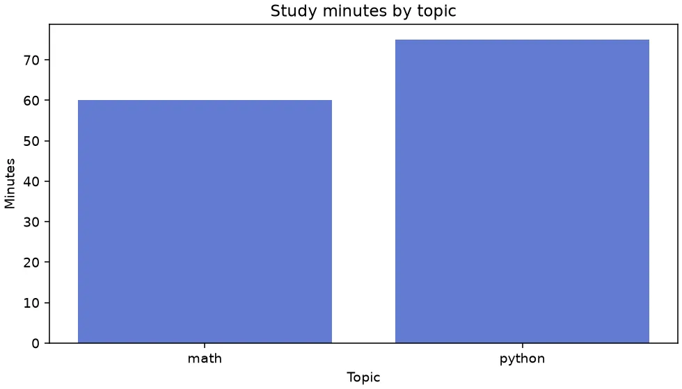

**شکل ۱۵-۲ — خلاصه داده ساختگی.** نمودار با Matplotlib ساخته و WebP ذخیره شده است. محور عمودی از صفر آغاز می‌شود؛ واحد دقیقه است. ساخت `Figure` بدون رابط گرافیکی برای خروجی فایل مناسب است [۴].

### ۶. Jupyter و خطر وضعیت پنهان

نوت‌بوک `.ipynb` سلول‌های کد، متن و خروجی را ذخیره می‌کند؛ **kernel** برنامه اجراکننده را نگه می‌دارد و متغیرها بین اجرای سلول‌ها باقی می‌مانند [۵]. اگر سلول‌ها را نامرتب اجرا کنید، خروجی ممکن است به متغیر قدیمی وابسته باشد. پیش از تحویل، kernel را restart و همه سلول‌ها را از بالا اجرا و خروجی‌ها را بررسی کنید.

فقط نوت‌بوک قابل اعتماد را اجرا کنید؛ کد نوت‌بوک مانند هر برنامه Python می‌تواند به فایل‌ها یا شبکه دسترسی پیدا کند. نوت‌بوک و خروجی‌ها ممکن است حاوی داده حساس باشند. در پروژه ما `study.ipynb` کنار `analyze.py` قرار دارد؛ از همان پوشه با `jupyter lab` باز کنید و سلول‌ها را به‌ترتیب اجرا کنید. اجرای نوت‌بوک با nbclient آزمایش شده، نه رابط JupyterLab.

### ۷. پروژه تحلیل داده ساختگی

فایل `analyze.py` را بسازید. داده داخلی چهار ردیف دارد: سه دقیقه معتبر ۳۰، ۴۵، ۶۰ و یک مقدار ناموجود. تحلیل دقیقه ناموجود را صفر فرض نمی‌کند. توابع از رشته CSV دریافت می‌کنند و نمودار در پوشه موقت ذخیره و پس از اجرا پاک می‌شود؛ برای نگهداری نمودار، با آگاهی مسیر خروجی دیگری به `make_plot` بدهید.

```python
"""Analyze synthetic study sessions, with explicit missing-data policy."""
from io import StringIO
from pathlib import Path
from tempfile import TemporaryDirectory
import numpy as np
import pandas as pd
from matplotlib.figure import Figure

DATA = '''topic,minutes
python,30
python,45
math,60
math,
'''


def analyze(csv_text):
    frame = pd.read_csv(StringIO(csv_text))
    if not {'topic', 'minutes'}.issubset(frame.columns):
        raise ValueError('missing required columns')
    frame['minutes'] = pd.to_numeric(frame['minutes'], errors='raise')
    if frame['topic'].isna().any() or frame['topic'].str.strip().eq('').any():
        raise ValueError('topic missing')
    present = frame['minutes'].dropna().to_numpy()
    if not np.isfinite(present).all() or (present < 0).any():
        raise ValueError('minutes must be finite and nonnegative')
    clean = frame.dropna(subset=['minutes']).copy()
    if clean.empty:
        raise ValueError('no measured minutes')
    totals = clean.groupby('topic')['minutes'].sum().sort_index()
    return clean, totals, int(frame['minutes'].isna().sum())


def make_plot(totals, filename):
    fig = Figure(figsize=(7, 4), layout='constrained')
    ax = fig.subplots()
    ax.bar(totals.index, totals.values, color='#627bd2')
    ax.set(title='Study minutes by topic', ylabel='Minutes', xlabel='Topic')
    fig.savefig(filename, format='webp', dpi=140)


def main():
    clean, totals, missing = analyze(DATA)
    print('valid_rows=', len(clean), 'missing_rows=', missing)
    print('mean_minutes=', float(np.mean(clean['minutes'].to_numpy())))
    print('totals=', {key: float(value) for key, value in totals.items()})
    with TemporaryDirectory() as directory:
        output = Path(directory) / 'study.webp'
        make_plot(totals, output)
        print('webp_created=', output.is_file())


if __name__ == '__main__':
    main()
```

اجرا: `python analyze.py`. خروجی آزمایش‌شده:

```text
valid_rows= 3 missing_rows= 1
mean_minutes= 45.0
totals= {'math': 60.0, 'python': 75.0}
webp_created= True
```

`np.isfinite` مقدار بی‌نهایت را رد می‌کند. ورودی منفی، موضوع ناموجود و نبود همه دقیقه‌ها رد می‌شوند. این مثال همه مشکلات داده مثل نام‌های تکراری با فاصله یا اختلاف واحد را حل نمی‌کند؛ برای داده واقعی طرح اعتبارسنجی باید کامل‌تر باشد.

### ۸. آزمون و بازبینی

فایل زیر را کنار برنامه ذخیره و از همان پوشه `python -m unittest -v test_analyze` اجرا کنید. فایل آزمون به Pillow نیاز دارد و محتوا و فرمت WebP را بررسی می‌کند:

```python
import unittest
from pathlib import Path
from tempfile import TemporaryDirectory
from PIL import Image
from analyze import DATA, analyze, make_plot


class AnalysisTests(unittest.TestCase):
    def test_summary(self):
        clean, totals, missing = analyze(DATA)
        self.assertEqual((len(clean), missing), (3, 1))
        self.assertEqual(totals.to_dict(), {'math': 60.0, 'python': 75.0})
        self.assertEqual(clean['minutes'].mean(), 45.0)

    def test_invalid(self):
        for data in ('topic,minutes\nx,-1\n', 'topic,minutes\nx,inf\n',
                     'topic,minutes\nx,\n', 'topic,minutes\n,5\n'):
            with self.subTest(data=data), self.assertRaises(ValueError):
                analyze(data)

    def test_webp(self):
        _, totals, _ = analyze(DATA)
        with TemporaryDirectory() as folder:
            p = Path(folder) / 'chart.webp'
            make_plot(totals, p)
            with Image.open(p) as image:
                self.assertEqual(image.format, 'WEBP')
                image.verify()


if __name__ == '__main__':
    unittest.main()
```

سه تست اجرا شده‌اند: خلاصه، چهار ورودی نامعتبر و تولید تصویر. نتیجه سه آزمون `OK` است؛ این آزمون‌ها کیفیت علمی تمام داده‌ها یا کارکرد همه نسخه‌ها را تضمین نمی‌کنند. خطای `ModuleNotFoundError` معمولاً نشان‌دهنده نصب نبودن بسته در مفسر فعال است؛ مسیر Python و محیط را بررسی کنید. اگر خروجی WebP ساخته نشد، پشتیبانی WebP در Pillow و مجوز پوشه موقت را بررسی کنید.

### ۹. تمرین و ارزیابی

**پرسش:** ۱) shape آرایه ۲×۳ چیست؟ ۲) `axis=0` در جمع این آرایه چه می‌کند؟ ۳) آیا مقدار گمشده همان صفر است؟ ۴) groupby چه می‌کند؟ ۵) میانگین ۳۰، ۴۵، ۶۰ چیست؟ ۶) چرا اجرای نامرتب نوت‌بوک خطرناک است؟ ۷) آیا نمودار فوق علّیت ثابت می‌کند؟ ۸) چرا نسخه محیط را ثبت می‌کنیم؟

**تمرین:** آرایه دو سطری مثال را بسازید و جمع محورهای ۰ و ۱ را بررسی کنید. سپس مقدار ناموجود را گزارش کرده، سیاست جایگزین مانند حذف یا تکمیل را با دلیل و محدودیت مقایسه کنید؛ به‌صورت خودکار صفرگذاری نکنید. **مینی‌پروژه:** داده ساختگی دیگری با دست‌کم دو گروه، یک داده گمشده، گزارش تعداد، آزمون مجموع و نمودار WebP همراه واحد تهیه کنید. برای قبولی ۷ پاسخ درست و سه آزمون موفق لازم است.

[پاسخ‌نامه جداگانه فصل 15](book-engineering/answers/15-data-analysis-answers-fa.md).

### ۱۰. منابع و ادامه

واژه‌ها: ndarray، shape، axis، dtype، DataFrame، missing data، groupby، visualization، kernel و notebook. فصل ۱۶ ورود به جبر، توابع و لگاریتم است.

**منابع؛ بررسی ۵ نوامبر ۲۰۲۶:** [۱] NumPy، [Quickstart](https://numpy.org/doc/stable/user/quickstart.html). [۲] Pandas، [10 minutes to pandas](https://pandas.pydata.org/docs/user_guide/10min.html). [۳] Pandas، [Missing data](https://pandas.pydata.org/docs/user_guide/missing_data.html). [۴] Matplotlib، [FAQ](https://matplotlib.org/stable/users/faq.html). [۵] Project Jupyter، [What is Jupyter?](https://docs.jupyter.org/en/latest/what_is_jupyter.html). تاریخ صفحات متغیر است؛ نسخه آزمایش‌شده بالا مشخص شده است.

---

# فصل ۱۶ — جبر، معادله، تابع، توان، لگاریتم و نمودار

**هنر و علم ساخت هوش | جلد اول | Babak & Ai**
**نسخه کاری RC · تاریخ مراجعه به منابع: ۵ نوامبر ۲۰۲۶**

## ۱. ریاضی زبان مدل‌سازی است

ریاضی ابزاری برای بیان فرض‌ها، محاسبه و بررسی نتیجه است؛ لازم نیست پیش از این فصل ریاضی پیشرفته بدانید. هدف ما حل معادله ساده، تشخیص دامنه تابع، محاسبه توان و لگاریتم و خواندن نمودار است. **پیش‌نیاز:** چهار عمل اصلی و اعداد منفی. **خروجی:** حل معادله خطی و آزمون تابع معکوس در Python.

نماد `x` می‌تواند تعداد ساعت و `y` هزینه باشد، اما هر مدل محدودیت و واحد دارد. فرمولی که برای یک محدوده داده مناسب است لزوماً بیرون آن معتبر نیست. در یادگیری ماشین، توابع می‌توانند پیش‌بینی، خطا یا تبدیل داده را توصیف کنند؛ معادله به‌تنهایی کیفیت مدل را تضمین نمی‌کند.

**نسخهٔ پایه — قرارداد پروژه:** قرارداد اصلی `solve_linear` در `projects/16-algebra` حالت‌های `unique`, `infinite`, `none` را برمی‌گرداند. نسخهٔ بازنویسی‌شده در پیوست به‌ترتیب `one`, `all`, `none` برمی‌گرداند؛ دو فایل هم‌نام مستقل‌اند.

## ۲. عبارت، متغیر و ترتیب عملیات

**متغیر (Variable)** نمادی برای یک مقدار است. `2x + 3` عبارت جبری، `2` ضریب، `3` عدد ثابت و `x` متغیر است. اگر `x = 4`، مقدار عبارت `2×4 + 3 = 11` است. ترتیب معمول: پرانتز، توان، ضرب و تقسیم، سپس جمع و تفریق؛ ضرب و تقسیم هم‌اولویت‌اند و از چپ به راست انجام می‌شوند. مثلاً `12 / 3 × 2 = 8` نه ۲.

در Python علامت ضرب `*` و توان `**` است: `2*x + 3` و `2**3`. تقسیم بر صفر در اعداد حقیقی تعریف نشده است. کسر `(x+1)/(x-2)` فقط وقتی تعریف دارد که `x ≠ 2` باشد. ساده‌سازی نباید محدودیت‌های عبارت اصلی را فراموش کند.

## ۳. معادله و نامعادله

**معادله (Equation)** برابری دو عبارت است. با انجام عمل یکسان و مجاز در دو طرف، مجهول را جدا می‌کنیم:

```text
2x + 3 = 11
2x = 8
x = 4
بررسی: 2 × 4 + 3 = 11
```

برای `a*x+b=c` اگر `a ≠ 0` جواب یکتا `x=(c-b)/a` است. اگر `a=0` و `b=c` باشد همه اعداد حقیقی جواب‌اند؛ اگر `a=0` و `b≠c` باشد هیچ جوابی نیست. تقسیم دو طرف بر عبارتی که ممکن است صفر باشد بدون بررسی مجاز نیست. در نامعادله، ضرب یا تقسیم دو طرف در عدد **منفی** جهت علامت را معکوس می‌کند: `-2x > 6` یعنی `x < -3`.

## ۴. تابع، دامنه و بُرد

**تابع (Function)** به هر ورودی مجاز دقیقاً یک خروجی نسبت می‌دهد. در `f(x)=2x+3`، `f(4)=11`. **دامنه (Domain)** مجموعه ورودی‌های مجاز و **برد (Range)** مجموعه خروجی‌های حاصل است. برای تابع خطی روی اعداد حقیقی با شیب غیرصفر، دامنه و برد هر دو اعداد حقیقی‌اند. در `g(x)=1/(x-2)` دامنه همه اعداد حقیقی به‌جز ۲ است.

دو ورودی ممکن است خروجی برابر داشته باشند؛ مثلاً `h(x)=x²` و `h(2)=h(-2)=4`، اما هر ورودی هنوز فقط یک خروجی دارد. تابع معکوس روی دامنه مورد نظر باید مناسب تعریف شود؛ `x²` روی همه اعداد حقیقی وارون تابعی یکتا ندارد، ولی با محدودکردن دامنه به `x≥0` وارونش ریشه غیرمنفی است.

## ۵. نمودار و شیب

نمودار مجموعه نقاط `(x, f(x))` را در دستگاه مختصات نشان می‌دهد. محور افقی x و محور عمودی y است. در `f(x)=2x+3`، عرض از مبدأ `3` یعنی نقطه `(0,3)`، و شیب `2` یعنی به ازای افزایش یک واحد x، مقدار y دو واحد افزایش می‌یابد. به صورت کلی شیب خط غیرعمودی `Δy/Δx` است؛ این نسبت واحد y تقسیم بر واحد x دارد.

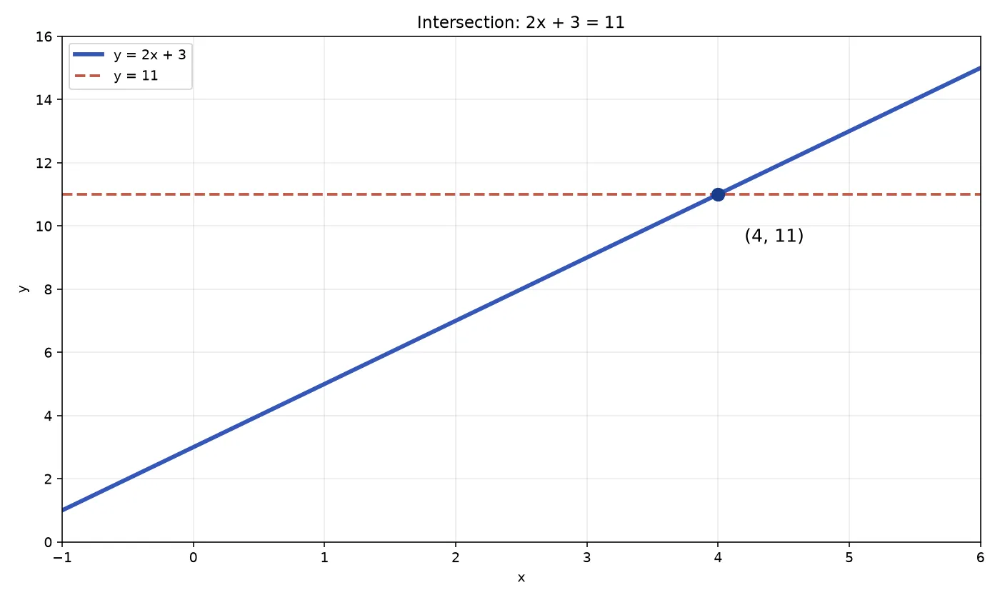

**شکل ۱۶-۱ — حل هندسی معادله.** تقاطع `y=2x+3` و `y=11` نقطه `(4,11)` است. خط‌کش و مقیاس را بررسی کنید؛ مختصات تقریبی از تصویر به‌تنهایی اثبات دقیق نیست. محورهای بریده یا مقیاس غیرخطی می‌توانند تفسیر را تغییر دهند.

## ۶. توان و رشد

برای عدد حقیقی `a` و عدد صحیح مثبت `n`، `a^n` ضرب `n` نسخه از `a` است؛ `2^3=8`. برای `a≠0`, `a^0=1` و `a^(-n)=1/a^n`. قوانین `a^m × a^n = a^(m+n)` و `(a^m)^n = a^(mn)` در دامنه‌هایی که عبارات تعریف‌اند برقرارند. `a^(m+n)` به‌طور کلی برابر `a^m + a^n` نیست.

تابع نمایی `f(x)=b^x` برای پایه مثبت و غیر یک تعریف می‌شود؛ اگر `b>1` افزایشی و اگر `0<b<1` کاهشی است [۱]. مثلاً دوبرابرشدن فرضی ۱۰۰ نمونه در سه مرحله مقدار `100×2³=800` می‌دهد؛ رشد نمایی فرض مدل است و نمی‌توان آن را بدون شواهد به واقعیت تعمیم داد.

## ۷. لگاریتم: توان ناشناخته

برای `b>0`, `b≠1` و `x>0`، رابطه `log_b(x)=y` دقیقاً معادل `b^y=x` است [۲]. پس `log_2(32)=5` و `log_2(1/4)=-2`. `ln(x)` لگاریتم طبیعی با پایه `e≈2.71828` است. لگاریتم حقیقی صفر و عدد منفی تعریف نشده است. دامنه `log_2(x-3)` برابر `x>3` است.

برای `u>0`, `v>0` و پایه مجاز: `log_b(uv)=log_b(u)+log_b(v)`، `log_b(u/v)=log_b(u)-log_b(v)` و `log_b(u^k)=k log_b(u)` برای k حقیقی. اما `log(u+v)` عموماً برابر `log(u)+log(v)` نیست: `log_2(2+2)=2` ولی `log_2(2)+log_2(2)=2` در این مورد تصادفاً برابر است؛ برای ۲ و ۸، طرف اول `log_2(10)≈3.322` و طرف دوم ۴ است. در ML لگاریتم در برخی زیان‌ها و مقیاس‌ها استفاده می‌شود؛ کاربرد و محدودیت آن را در فصل‌های بعد دقیق بررسی می‌کنیم.

## ۸. پروژه: حل و بررسی عددی

فایل `algebra.py` را بسازید؛ فقط کتابخانه استاندارد لازم دارد. برنامه سه حالت معادله را از هم جدا می‌کند و دامنه لگاریتم حقیقی را بررسی می‌کند. در محاسبه ممیز شناور اعداد بسیار بزرگ یا ضریب بسیار کوچک می‌توانند سرریز یا خطای عددی ایجاد کنند؛ این نمونه حل‌گر دقیق یا مقاوم در تمام مقیاس‌ها نیست.

```python
"""Linear equations and logarithms with explicit real-domain checks."""
import math


def solve_linear(a, b, c):
    """Solve a*x + b = c; identify unique, none, or infinitely many."""
    if not all(math.isfinite(v) for v in (a, b, c)):
        raise ValueError('coefficients must be finite')
    if a == 0:
        return ('infinite', None) if b == c else ('none', None)
    return ('unique', (c - b) / a)


def log_base(x, base):
    if not math.isfinite(x) or not math.isfinite(base) or x <= 0 or base <= 0 or base == 1:
        raise ValueError('require x > 0 and base > 0, base != 1, all finite')
    return math.log(x, base)


def main():
    kind, x = solve_linear(2, 3, 11)
    print('equation=', kind, 'x=', x)
    print('residual=', 2*x + 3 - 11)
    value = log_base(32, 2)
    print('log2_32=', value)
    print('roundtrip=', math.isclose(2**value, 32, rel_tol=1e-12))


if __name__ == '__main__':
    main()
```

اجرا: `python algebra.py`. خروجی آزمایش‌شده در Python 3.13.16:

```text
equation= unique x= 4.0
residual= 0.0
log2_32= 5.0
roundtrip= True
```

**باقیمانده (Residual)** اختلاف دو طرف پس از جایگذاری است؛ صفر یا نزدیک صفر برای ورودی محدود نشانه سازگاری عددی است، نه اثبات پایداری در همه شرایط. `math.isclose` با تلرانس مقایسه می‌کند؛ نزدیک صفر ممکن است تعیین `abs_tol` لازم باشد [۳]. مقایسه `a==0` در این پروژه صرفاً شرط دقیق ممیز شناور است و برای مسئله‌های دارای عدم قطعیت باید با توجه به مقیاس و مدل تصمیم گرفت.

## ۹. آزمون، تمرین و سنجش

**فایل `test_algebra.py`:**
```python
import math
import unittest
from algebra import solve_linear, log_base

class AlgebraTests(unittest.TestCase):
    def test_equations(self):
        self.assertEqual(solve_linear(2, 3, 11), ('unique', 4))
        self.assertEqual(solve_linear(0, 3, 3), ('infinite', None))
        self.assertEqual(solve_linear(0, 3, 4), ('none', None))
        with self.assertRaises(ValueError):
            solve_linear(math.inf, 1, 2)

    def test_logarithms(self):
        self.assertTrue(math.isclose(log_base(32, 2), 5, rel_tol=1e-12))
        self.assertTrue(math.isclose(log_base(0.25, 2), -2, rel_tol=1e-12))
        for x, b in [(0, 2), (-1, 2), (2, 1), (2, 0), (math.inf, 2)]:
            with self.subTest(x=x, base=b), self.assertRaises(ValueError):
                log_base(x, b)

if __name__ == '__main__':
    unittest.main()
```

در همان پوشه `python -m unittest -v` را اجرا کنید؛ دو تست شامل حالت‌های جواب یکتا، هیچ جواب، بی‌نهایت جواب و ورودی نامجاز لگاریتم در Python 3.13.16 موفق بودند. اگر import ناموفق است، هر دو فایل را در یک پوشه قرار دهید. `ValueError` برای `log_base(0,2)` رفتار مورد انتظار است.

**پرسش:** ۱) `3x-2=10` را حل کنید. ۲) `0x+3=4` چند جواب دارد؟ ۳) دامنه `1/(x-2)` چیست؟ ۴) `2^-3` چند است؟ ۵) `log_2(8)` چند است؟ ۶) دامنه حقیقی `ln(x-1)` چیست؟ ۷) شیب `y=-3x+2` چیست؟ ۸) آیا تابع `x²` روی تمام اعداد حقیقی وارون تابعی یکتا دارد؟

**تمرین نمودار:** نقاط `(0,3)` و `(4,11)` را رسم و شیب بین آن‌ها را حساب کنید. **مینی‌پروژه:** برنامه را برای `3x-2=10` اجرا و جواب را جایگذاری کنید؛ یک آزمون برای پایه `1/2` و ورودی ۴ با تلرانس مناسب بنویسید. **قبولی:** ۷ پاسخ درست، اجرای دو تست و انجام پروژه. [پاسخ‌نامه جداگانه فصل 16](book-engineering/answers/16-algebra-functions-answers-fa.md).

## ۱۰. واژه‌نامه و منابع

**مرور: ۵ نوامبر ۲۰۲۶.** این فصل بر ریاضی حقیقی و محاسبات پایه تمرکز دارد، نه اعداد مختلط یا تضمین پایداری عددی. فصل بعد بردار و ماتریس را معرفی می‌کند.

Algebra، Variable، Equation، Inequality، Function، Domain، Range، Slope، Exponent، Logarithm، Inverse، Residual.

**منابع؛ مراجعه ۵ نوامبر ۲۰۲۶:** [۱] OpenStax، «Key Concepts: Exponential and Logarithmic Functions»، College Algebra 2e، ۲۰۲۱، [منبع](https://openstax.org/books/college-algebra-2e/pages/6-key-concepts). [۲] OpenStax، «Logarithmic Functions»، College Algebra 2e، ۲۰۲۱، [منبع](https://openstax.org/books/college-algebra-2e/pages/6-3-logarithmic-functions). [۳] Python Software Foundation، «math»، Python 3.13، تاریخ صفحه نامشخص، [منبع](https://docs.python.org/3.13/library/math.html).

## پیوست: نسخهٔ بازنویسی‌شده و آزمون‌شده

**مرز دو نسخه:** نسخهٔ بازنویسی‌شده و آزمون‌شده در `projects/16-algebra-supplement` است؛ وضعیت‌های `one/all/none` را فقط در همین نسخه استفاده کنید، نه در قرارداد `unique/infinite/none` نسخهٔ پایه.


### فصل ۱۶ — جبر، معادله، تابع، توان، لگاریتم و نمودار

**هنر و علم ساخت هوش | جلد اول | Babak & Ai**<br>
**بررسی منابع: ۵ نوامبر ۲۰۲۶**

### ۱. ریاضیات به‌عنوان زبان مدل

ریاضیات کمک می‌کند رابطه‌ها، فرض‌ها و محدودیت‌های یک مدل را دقیق بیان کنیم. برای یادگیری ماشین باید از پرسش‌های ساده آغاز کرد: ورودی چیست؟ خروجی چگونه تغییر می‌کند؟ آیا معادله جواب دارد؟ در این فصل با جبر و توابع حقیقی کار می‌کنیم؛ آشنایی قبلی با Python کافی است و معانی با مثال توضیح داده می‌شوند.

**هدف:** ساده‌سازی عبارت، حل معادله خطی، تشخیص دامنه تابع، تفسیر شیب و نمودار، محاسبه توان و لگاریتم و بررسی نتیجه با کد. **پیش‌نیاز:** حساب مقدماتی و فصل‌های برنامه‌نویسی. این فصل مقدمه‌ای برای بردار، مشتق و بهینه‌سازی در فصل‌های بعد است.

### ۲. متغیر، عبارت و ترتیب عملیات

متغیر نمادی برای مقدار است. در `2x + 3`، عدد ۲ ضریب x و ۳ جمله ثابت است. این **عبارت** به‌تنهایی علامت برابری ندارد. اگر `x=4`، مقدار آن `2×4+3=11` می‌شود. ابتدا پرانتز، سپس توان، سپس ضرب/تقسیم و در پایان جمع/تفریق را محاسبه می‌کنیم؛ عملیات هم‌رتبه معمولاً از چپ به راست انجام می‌شوند.

توزیع‌پذیری یعنی `a(b+c)=ab+ac`؛ بنابراین `2(x+3)=2x+6`، نه `2x+3`. فقط جمله‌های هم‌نوع جمع می‌شوند: `2x+3x=5x`، ولی `2x+3` را نمی‌توان به `5x` تبدیل کرد. در تقسیم، مخرج صفر مجاز نیست. واحدها نیز اهمیت دارند: جمع دقیقه و ساعت بدون تبدیل واحد نادرست است.

### ۳. حل معادله و حالات استثنایی

**معادله** برابری دو عبارت است و جواب مقداری است که برابری اصلی را برقرار کند. برای `2x+3=11`، از هر دو طرف ۳ کم می‌کنیم: `2x=8`؛ سپس بر ۲ تقسیم می‌کنیم: `x=4`. جای‌گذاری: `2×4+3=11`، پس جواب تأیید می‌شود.

برای `ax+b=c` اگر `a≠0`، جواب `x=(c-b)/a` است. اگر `a=0` نباید بر آن تقسیم کرد: در `0x+3=3` هر عدد حقیقی جواب است؛ در `0x+3=4` هیچ جواب حقیقی وجود ندارد. در معادلات پیچیده‌تر برخی عملیات مانند مربع‌کردن ممکن است جواب اضافی ایجاد کنند، بنابراین پاسخ را در معادله اصلی و دامنه بررسی کنید.

### ۴. تابع، دامنه و برد

**تابع (Function)** به هر ورودی مجاز دقیقاً یک خروجی نسبت می‌دهد. برای `f(x)=2x+3`، `f(4)=11`. **دامنه (Domain)** مجموعه ورودی‌های مجاز و **برد (Range)** مجموعه خروجی‌های حاصل است. برای `g(x)=1/x` در اعداد حقیقی، `x=0` در دامنه نیست؛ برای `h(x)=√x` در اعداد حقیقی `x≥0` است.

در یک مدل ساده قیمت `cost(n)=5n+10`، اگر n تعداد بسته باشد، دامنه کاربردی می‌تواند اعداد صحیح نامنفی باشد، حتی اگر فرمول برای اعداد حقیقی نیز تعریف شود. خروجی باید واحد پول و n واحد بسته داشته باشد. یک فرمول معتبر ریاضی لزوماً مدل معتبر جهان واقعی نیست؛ اعتبار آن به داده و فرض‌ها بستگی دارد.

### ۵. نمودار و نرخ تغییر

نمودار تابع مجموعه نقاط `(x, f(x))` را نمایش می‌دهد. در `f(x)=mx+b`، پارامتر `b` عرض از مبدأ یعنی خروجی هنگام `x=0` است و `m=Δy/Δx` شیب ثابت خط است، به شرط `Δx≠0` [۱]. برای `2x+3`، شیب ۲ و عرض از مبدأ ۳ است؛ افزایش یک واحد x خروجی را دو واحد زیاد می‌کند. واحد شیب، واحد y بر واحد x است.

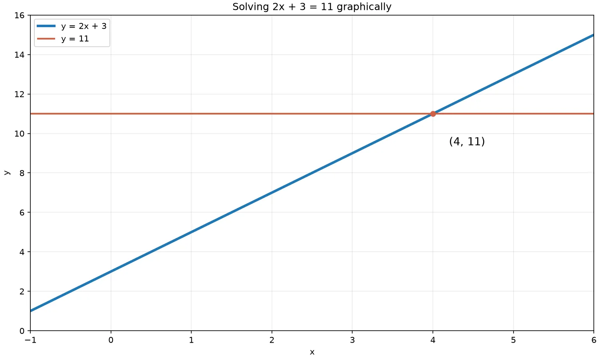

**شکل ۱۶-۲ — حل نموداری.** خط آبی `y=2x+3` و خط افقی `y=11` در `(4,11)` قطع می‌شوند؛ مختصات x جواب معادله است. از تصویر برای تقریب استفاده می‌کنیم؛ محاسبه جبری جواب دقیق را در این مثال می‌دهد. مقیاس محورها و محدوده رسم می‌توانند برداشت بصری را تغییر دهند.

### ۶. توان و رشد نمایی

برای پایه و توان صحیح مثبت، `2³=2×2×2=8`. وقتی `a≠0`، `a⁰=1` و `a⁻¹=1/a`. برای توان‌های صحیح، `aᵐaⁿ=aᵐ⁺ⁿ` و `(aᵐ)ⁿ=aᵐⁿ`؛ قواعد توان‌های حقیقی به دامنه پایه و نوع توان وابسته‌اند، پس آن‌ها را بدون بررسی به پایه منفی تعمیم ندهید.

در رشد نمایی با پایه مثبت، `N(t)=N₀ bᵗ` است. مثلاً `N₀=10` و `b=2`: مقدار در گام‌های ۰، ۱ و ۲ به‌ترتیب ۱۰، ۲۰، ۴۰ است. این رشد در واحد زمان **ضریب ثابت** دارد، نه افزایش مطلق ثابت. یک الگوی نمایی صرفاً فرض مدل است، نه تضمین تداوم رشد واقعی.

### ۷. لگاریتم، دامنه و کاربرد

لگاریتم معکوس توان است: `log_b(x)=y` یعنی `bʸ=x`. در اعداد حقیقی، `b>0`، `b≠1` و `x>0` لازم است [۲]. از `2³=8` نتیجه می‌گیریم `log₂(8)=3`. همچنین `log₂(1)=0` و `log₂(1/4)=-2`؛ منفی بودن خروجی لگاریتم برای ورودی مثبت کوچک‌تر از یک طبیعی است. اگر پایه بین صفر و یک باشد تابع کاهشی است.

با x و y مثبت و پایه مجاز: `log_b(xy)=log_b(x)+log_b(y)` و `log_b(x/y)=log_b(x)-log_b(y)`. اما `log(x+y)` به‌طور کلی برابر `log(x)+log(y)` نیست. `ln` لگاریتم طبیعی با پایه e و `log₁₀` پایه ۱۰ است. در یادگیری ماشین لگاریتم برای تبدیل ضرب احتمال‌های مثبت به جمع و تعریف زیان‌ها کاربرد دارد؛ احتمال صفر نیازمند توجه ویژه است و `log(0)` در اعداد حقیقی تعریف نشده است.

### ۸. پروژه: حل و بررسی عددی

فایل `algebra.py` را بسازید. برنامه معادله خطی، دو حالت ضریب صفر و لگاریتم حقیقی را بررسی می‌کند؛ به شبکه یا بسته جانبی نیاز ندارد.

```python
"""Linear equations and real logarithms for modest finite numeric inputs."""
import math


def solve_linear(a, b, c):
    """Solve a*x + b = c; classify the degenerate a == 0 cases."""
    if not all(math.isfinite(v) for v in (a, b, c)):
        raise ValueError('inputs must be finite')
    if a == 0:
        return ('all', None) if b == c else ('none', None)
    x = (c - b) / a
    if not math.isfinite(x):
        raise ValueError('solution overflowed')
    return 'one', x


def log_base(x, base):
    if not (math.isfinite(x) and math.isfinite(base)):
        raise ValueError('inputs must be finite')
    if x <= 0 or base <= 0 or base == 1:
        raise ValueError('require x > 0, base > 0, base != 1')
    return math.log(x) / math.log(base)


def main():
    kind, x = solve_linear(2, 3, 11)
    print('solution=', x, 'kind=', kind)
    print('check=', math.isclose(2 * x + 3, 11))
    print('log2_8=', log_base(8, 2))
    print('zero_coefficient_cases=', solve_linear(0, 3, 3)[0], solve_linear(0, 3, 4)[0])


if __name__ == '__main__':
    main()
```

در Python 3.13.16 خروجی: `solution= 4.0 kind= one`، سپس `check= True`، `log2_8= 3.0` و `zero_coefficient_cases= all none`. مقادیر شناور تقریبی‌اند؛ `math.isclose` مقایسه تقریبی را انجام می‌دهد و آستانه مناسب به مقیاس مسئله بستگی دارد. این پیاده‌سازی برای مقادیر متعارف آموزشی است؛ نزدیک صفر بودن ضریب و سرریز/لغزش عددی در محاسبات حساس نیازمند تحلیل پایداری و سیاست آستانه است. `math.log` برای دامنه نامعتبر خطا می‌دهد [۳].

### ۹. تست، تمرین و ارزیابی

فایل تست زیر را کنار پروژه قرار دهید و `python -m unittest -v test_algebra` را از همان پوشه اجرا کنید. چهار آزمون حل معمولی، حالات ضریب صفر، دامنه لگاریتم و مقدار غیرمتناهی را بررسی می‌کنند.

```python
import math
import unittest
from algebra import solve_linear, log_base


class AlgebraTests(unittest.TestCase):
    def test_unique_solution(self):
        kind, x = solve_linear(2, 3, 11)
        self.assertEqual(kind, 'one')
        self.assertTrue(math.isclose(x, 4))
        self.assertTrue(math.isclose(2*x+3, 11))

    def test_zero_coefficient(self):
        self.assertEqual(solve_linear(0, 3, 3), ('all', None))
        self.assertEqual(solve_linear(0, 3, 4), ('none', None))

    def test_logs(self):
        self.assertTrue(math.isclose(log_base(8, 2), 3))
        self.assertTrue(math.isclose(log_base(0.25, 2), -2))
        self.assertTrue(math.isclose(log_base(8, 0.5), -3))
        for x, base in [(0, 2), (-1, 2), (2, 1), (2, -1), (float('inf'), 2)]:
            with self.subTest(x=x, base=base), self.assertRaises(ValueError):
                log_base(x, base)

    def test_nonfinite_equation(self):
        with self.assertRaises(ValueError):
            solve_linear(float('nan'), 0, 1)


if __name__ == '__main__':
    unittest.main()
```

**پرسش‌ها:** ۱) `3(x+2)` را باز کنید. ۲) `3x-1=8` را حل کنید. ۳) دامنه حقیقی `1/(x-2)` چیست؟ ۴) شیب و عرض از مبدأ `-2x+5` کدام‌اند؟ ۵) `2⁻³` چیست؟ ۶) `log₂(16)` چیست؟ ۷) چرا `log(0)` حقیقی نیست؟ ۸) اگر `0x+2=2` باشد چند جواب حقیقی دارد؟

**تمرین نمودار:** نقطه‌های `(0,3)` و `(4,11)` را رسم و شیب بین آن‌ها را محاسبه کنید. **مینی‌پروژه:** جدول مقادیر تابع `3x-1` برای x از صفر تا سه، نمودار با برچسب محورها و تست `f(3)=8` بسازید. درباره دامنه و دقت عددی توضیح دهید. **قبولی:** هفت پاسخ درست از هشت، چهار آزمون موفق و پروژه با نمودار برچسب‌دار.

[پاسخ‌نامه جداگانه فصل 16](book-engineering/answers/16-algebra-functions-answers-fa.md).

### ۱۰. منابع و ادامه مسیر

واژه‌ها: Variable، Expression، Equation، Function، Domain، Range، Slope، Exponent، Logarithm، Floating Point. فصل ۱۷ بردار، ماتریس و ابعاد را دنبال می‌کند.

**منابع؛ بررسی ۵ نوامبر ۲۰۲۶:** [۱] OpenStax، [Linear Functions، College Algebra 2e](https://openstax.org/books/college-algebra-2e/pages/4-1-linear-functions)، ۲۰۲۱. [۲] OpenStax، [Evaluate and Graph Logarithmic Functions، Intermediate Algebra 2e](https://openstax.org/books/intermediate-algebra-2e/pages/10-3-evaluate-and-graph-logarithmic-functions)، ۲۰۲۰. [۳] Python Software Foundation، [math، Python 3.13](https://docs.python.org/3.13/library/math.html)، تاریخ صفحه متغیر.

---

# فصل ۱۷ — بردار، ماتریس، ابعاد و مقادیر ویژه

**هنر و علم ساخت هوش | جلد اول | Babak & Ai**<br>
**بررسی منابع: ۵ نوامبر ۲۰۲۶**

## ۱. چرا جبر خطی برای هوش مصنوعی؟

یک ویژگی مانند دمای یک روز یک عدد است؛ مشخصات یک نمونه شامل چند عدد در قالب **بردار (Vector)** و مجموعه‌ای از نمونه‌ها در قالب **ماتریس (Matrix)** نمایش می‌یابد. تصویر، embedding و پارامترهای شبکه نیز می‌توانند در آرایه‌ها نمایش یابند. جبر خطی زبان انجام تبدیل‌های منظم روی این داده‌هاست، نه تضمین اینکه داده یا مدل درست انتخاب شده است.

**پیش‌نیاز:** فصل ۱۶، عدد و تابع؛ فصل ۱۵ برای NumPy. **هدف:** جمع و ضرب داخلی بردارها، شکل ماتریس، ضرب و ترانهاده، تفسیر تبدیل خطی و مقدمات مقادیر و بردارهای ویژه. کد از Python و NumPy استفاده می‌کند.

## ۲. اسکالر، بردار و طول

**اسکالر** یک عدد، مانند `3` است. `v=[3,4]` یک بردار دو مؤلفه‌ای است؛ طول اقلیدسی آن `||v||₂=√(3²+4²)=5` است. جمع بردارهای هم‌بعد مؤلفه‌به‌مؤلفه انجام می‌شود: `[1,2]+[3,4]=[4,6]`. ضرب در اسکالر ۲: `2[1,2]=[2,4]`. یکای طول بردار فقط وقتی معنا دارد که مؤلفه‌ها در مقیاس و واحد مناسب تعریف شده باشند.

**ضرب داخلی (Dot Product):** برای `u=[1,2]` و `v=[3,4]`، `u·v=1×3+2×4=11`. با طول‌های غیرصفر، نسبت `u·v/(||u|| ||v||)` کسینوس زاویه است. برای بردار صفر این نسبت تعریف نشده است. اندازه بزرگی ضرب داخلی به طول‌ها نیز وابسته است، پس به‌تنهایی معیار خالص شباهت زاویه‌ای نیست.

## ۳. ماتریس، سطر، ستون و شکل

ماتریس A با m سطر و n ستون شکل `m×n` دارد [۱]. مثلاً `A=[[1,2,3],[4,5,6]]` شکل `2×3` دارد. یک نمایش رایج داده: هر سطر یک نمونه و هر ستون یک ویژگی؛ اما قرارداد می‌تواند فرق کند و باید صریح نوشته شود. شکل تنسور فقط تعداد عنصرها را نشان می‌دهد؛ معنای محورها را مشخص نمی‌کند.

ترانهاده `Aᵀ` سطر و ستون را جابه‌جا می‌کند و شکل مثال را از `2×3` به `3×2` می‌برد. جمع معمول دو ماتریس زمانی تعریف می‌شود که شکل آن‌ها یکسان باشد؛ broadcasting در NumPy یک قاعده برنامه‌نویسی جداگانه است و نباید بی‌توجه به معنا استفاده شود. ماتریس همانی `I`، مانند `[[1,0],[0,1]]`، بردار سازگار را تغییر نمی‌دهد.

## ۴. ضرب ماتریسی و کنترل ابعاد

اگر شکل A برابر `m×k` و B برابر `k×n` باشد، `AB` شکل `m×n` دارد. عضو سطر i و ستون j نتیجه، ضرب داخلی سطر i از A و ستون j از B است [۱]. برای

```text
A = [[1, 2, 3], [4, 5, 6]]    # 2 × 3
B = [[1, 0], [0, 1], [1, 1]]  # 3 × 2
AB = [[4, 5], [10, 11]]        # 2 × 2
```

**معادله ۱۷-۱** — C حاصل AB و r تعداد مؤلفه‌های سطر A و ستون B است.

<math xmlns="http://www.w3.org/1998/Math/MathML" display="block" dir="ltr" aria-label="matrix product element sum over k"><msub><mi>C</mi><mrow><mi>i</mi><mi>j</mi></mrow></msub><mo>=</mo><munderover><mo>∑</mo><mrow><mi>k</mi><mo>=</mo><mn>1</mn></mrow><mi>r</mi></munderover><msub><mi>A</mi><mrow><mi>i</mi><mi>k</mi></mrow></msub><msub><mi>B</mi><mrow><mi>k</mi><mi>j</mi></mrow></msub></math>

برای نمونه، عضو بالا-چپ `1×1+2×0+3×1=4` است. ضرب ماتریسی عموماً جابه‌جاپذیر نیست: `AB` و `BA` ممکن است متفاوت یا یکی تعریف‌نشده باشند. در NumPy، `@` ضرب ماتریسی و `*` برای آرایه‌های سازگار ضرب عضو به عضو است.

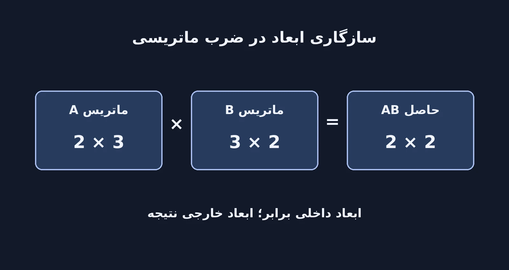

**شکل ۱۷-۱ — قاعده ابعاد.** دو عدد داخلی باید برابر باشند؛ ابعاد بیرونی شکل نتیجه‌اند.

## ۵. تبدیل خطی و شبکه عصبی

اگر x بردار ستونی با n ویژگی و `W` ماتریس `m×n` باشد، `Wx` برداری با m مؤلفه است. تابع `T(x)=Wx` خطی است: `T(u+v)=T(u)+T(v)` و `T(cu)=cT(u)`. اضافه‌کردن بایاس در `Wx+b` تبدیل را به‌طور کلی **آفین** می‌کند، نه خطی محض؛ اگر b صفر باشد خطی است. در یک لایه شبکه، پس از این تبدیل ممکن است تابع فعال‌سازی غیرخطی اضافه شود. آموزش لایه در فصل‌های بعد است.

اگر n=۳ و m=۲، W دارای ۶ وزن است و بایاس دو عدد دارد؛ شمار پارامترهای این لایه ۸ است، بدون احتساب بخش‌های دیگر. قبل از اجرای کد، شکل ورودی، وزن و خروجی را یادداشت کنید و درباره جایگاه batch طبق قرارداد کتابخانه تصمیم بگیرید.

## ۶. مقدار ویژه و بردار ویژه

برای ماتریس مربعی A، بردار **غیرصفر** v و عدد λ اگر `Av=λv` باشند، v بردار ویژه و λ مقدار ویژه است [۲]. λ می‌تواند صفر یا منفی باشد؛ در λ منفی جهت وارونه می‌شود. مثال `A=[[2,0],[0,3]]`: بردار `[1,0]` با λ=۲ و `[0,1]` با λ=۳ هستند. بردار صفر مجاز نیست چون برای هر λ رابطه را برقرار می‌کند و اطلاعاتی نمی‌دهد.

مقادیر ویژه با حل `det(A−λI)=0` به دست می‌آیند؛ برای مثال قطری `(2−λ)(3−λ)=0` است. ماتریس حقیقی لزوماً مقادیر ویژه حقیقی ندارد و هر ماتریس مربعی لزوماً مجموعه کاملی از بردارهای ویژه مستقل ندارد. ترتیب، علامت و مقیاس بردار ویژه عددی یکتا نیست؛ نتیجه عددی را با باقیمانده `Av−λv` و آستانه مناسب بررسی کنید. برخی کاربردهای کاهش بعد در جلد دوم بررسی می‌شوند؛ این فصل ادعای محاسبه PCA ندارد.

## ۷. پروژه: ضرب دستی و NumPy

فایل `linear_algebra.py` را ذخیره و اجرا کنید. ضرب دستی فهرست‌های مستطیلی را بررسی می‌کند؛ NumPy برای مقایسه و محاسبه زوج‌های ویژه استفاده می‌شود. محیط آزمایش: Python 3.13.16 و NumPy 2.3.5، CPU؛ نصب به محیط مجازی و دسترسی شبکه نیاز دارد: `python -m pip install numpy`.

```python
"""Matrix products from scratch and eigenpairs using NumPy."""
import numpy as np


def matmul(a, b):
    if not a or not b or not a[0] or not b[0]:
        raise ValueError('matrices must be nonempty')
    inner = len(a[0])
    columns = len(b[0])
    if any(len(row) != inner for row in a) or any(len(row) != columns for row in b):
        raise ValueError('matrices must be rectangular')
    if inner != len(b):
        raise ValueError('inner dimensions must match')
    return [[sum(a[i][k] * b[k][j] for k in range(inner))
             for j in range(columns)] for i in range(len(a))]


def main():
    a = [[1, 2, 3], [4, 5, 6]]
    b = [[1, 0], [0, 1], [1, 1]]
    manual = matmul(a, b)
    print('product=', manual)
    print('numpy_matches=', bool(np.array_equal(manual, np.array(a) @ np.array(b))))
    matrix = np.array([[2., 0.], [0., 3.]])
    values, vectors = np.linalg.eig(matrix)
    print('eigenvalues_sorted=', sorted(values.tolist()))
    print('eigenpair_check=', bool(np.allclose(matrix @ vectors, vectors * values)))


if __name__ == '__main__':
    main()
```

خروجی آزمایش‌شده:

```text
product= [[4, 5], [10, 11]]
numpy_matches= True
eigenvalues_sorted= [2.0, 3.0]
eigenpair_check= True
```

`np.linalg.eig` ستون‌های بردار ویژه و مقدارهای متناظر را برمی‌گرداند و ترتیب آن‌ها تضمین‌شده نیست [۳]. `np.allclose` مقایسه تقریبی با آستانه پیش‌فرض است، نه اثبات دقیق برای هر مسئله؛ در مسئله واقعی مقیاس و آستانه را بررسی کنید. تابع دستی برای آموزش شکل است، نه جایگزین پیاده‌سازی بهینه و معتبرسازی همه نوع ورودی.

## ۸. آزمون، خطاهای رایج و عیب‌یابی

فایل زیر را کنار برنامه ذخیره کنید و از همان پوشه `python -m unittest -v test_linear_algebra` اجرا کنید. چهار تست، ضرب مستطیلی، مقایسه NumPy، سه شکل نامعتبر و زوج ویژه را پوشش می‌دهند.

```python
import unittest
import numpy as np
from linear_algebra import matmul


class LinearAlgebraTests(unittest.TestCase):
    def test_rectangular_product(self):
        self.assertEqual(matmul([[1, 2, 3], [4, 5, 6]], [[1, 0], [0, 1], [1, 1]]), [[4, 5], [10, 11]])

    def test_against_numpy(self):
        a, b = [[1, -1], [2, 3]], [[2], [4]]
        self.assertTrue(np.array_equal(matmul(a, b), np.array(a) @ np.array(b)))

    def test_invalid_shapes(self):
        for a, b in [([], [[1]]), ([[1, 2]], [[1]]), ([[1], [2, 3]], [[1]])]:
            with self.subTest(a=a, b=b), self.assertRaises(ValueError):
                matmul(a, b)

    def test_eigenpairs(self):
        a = np.array([[2., 0.], [0., 3.]])
        w, v = np.linalg.eig(a)
        self.assertTrue(np.allclose(a @ v, v * w))
        self.assertTrue(np.allclose(sorted(w), [2, 3]))


if __name__ == '__main__':
    unittest.main()
```

اگر `ModuleNotFoundError` دریافت کردید مفسر و محیط نصب NumPy را بررسی کنید. خطای ابعاد یعنی تعداد ستون A با سطر B برابر نیست یا آرایه ناهموار است. اگر نتیجه ویژه برای ماتریس دیگر پیچیده است، این الزاماً باگ نیست؛ مثال ما عمداً قطری و حقیقی انتخاب شده است. چهار آزمون موفق به معنی صحت تمام حالت‌ها نیست.

## ۹. تمرین، ارزیابی و پروژه

**پرسش‌ها:** ۱) شکل ماتریسی با ۳ سطر و ۲ ستون چیست؟ ۲) آیا `2×3` در `3×4` ضرب می‌شود و شکل حاصل چیست؟ ۳) `[1,2]·[3,4]`؟ ۴) تفاوت `*` و `@` در NumPy چیست؟ ۵) ترانهاده `2×3` چه شکلی دارد؟ ۶) آیا بردار ویژه می‌تواند صفر باشد؟ ۷) مقدار ویژه `[1,0]` برای `diag(2,3)` چیست؟ ۸) آیا `Wx+b` با b غیرصفر خطی است؟ ۹) لایه ۳ ورودی، ۲ خروجی و بایاس چند پارامتر دارد؟ ۱۰) آیا ترتیب زوج‌های ویژه تضمین شده است؟

**پروژه کوچک:** با ورودی دو نمونه و سه ویژگی و وزن سه‌در‌دو، خروجی batch را دستی و با NumPy محاسبه کنید؛ شکل‌ها را بنویسید و ورودی ناسازگار را بیازمایید. **چالش مهندسی:** ضرب دستی و NumPy را از نظر خوانایی و مقیاس‌پذیری مقایسه کنید؛ بنچمارک انجام‌نشده را ادعا نکنید. **قبولی:** دست‌کم ۸ پاسخ درست از ۱۰ و اجرای چهار تست.

[پاسخ‌نامه جداگانه فصل 17](book-engineering/answers/17-linear-algebra-answers-fa.md).

## ۱۰. واژه‌نامه، تحولات و منابع

Vector بردار؛ Scalar اسکالر؛ Matrix ماتریس؛ Shape شکل؛ Dot Product ضرب داخلی؛ Transpose ترانهاده؛ Eigenvalue مقدار ویژه؛ Eigenvector بردار ویژه. **بررسی ۵ نوامبر ۲۰۲۶:** اصول ریاضی پایدارند؛ رفتار API و دقت عددی وابسته به نسخه و محیط‌اند. اجرای نمونه تنها CPU و نسخه‌های فوق را پوشش می‌دهد. فصل ۱۸ به مشتق و گرادیان می‌رسد.

**منابع اولیه؛ مراجعه ۵ نوامبر ۲۰۲۶:** [۱] OpenStax، «Matrices and Matrix Operations»، College Algebra 2e، ۲۰۲۱، [منبع](https://openstax.org/books/college-algebra-2e/pages/7-5-matrices-and-matrix-operations). [۲] Gilbert Strang، «Eigenvalues and Eigenvectors»، MIT، تاریخ نسخه نامشخص، [متن](https://math.mit.edu/~gs/linearalgebra/ila6/ila6_6_1.pdf). [۳] NumPy، «numpy.linalg.eig»، مستندات زنده، تاریخ انتشار نامشخص، [منبع](https://numpy.org/doc/stable/reference/generated/numpy.linalg.eig.html).

---

# فصل ۱۸ — مشتق، انتگرال، قاعده زنجیره‌ای و گرادیان

**هنر و علم ساخت هوش | جلد اول | Babak & Ai**<br>
**بررسی منابع: ۵ نوامبر ۲۰۲۶**

## ۱. اندازه‌گیری تغییر

یک مدل یادگیری ورودی و پارامترها را به خروجی و زیان تبدیل می‌کند. برای فهم اینکه تغییر کوچک پارامتر چگونه زیان را تغییر می‌دهد، حسابان ابزار اصلی است. **هدف:** تفاوت نرخ متوسط و مشتق، مشتق جزئی، قاعده زنجیره‌ای، بردار گرادیان و انتگرال معین؛ همچنین مقایسه محاسبه تحلیلی و عددی. **پیش‌نیاز:** تابع و نمودار فصل ۱۶، بردار فصل ۱۷.

این فصل مقدمات تغییر را آموزش می‌دهد؛ الگوریتم‌های بهینه‌سازی فصل ۲۰ و پس‌انتشار شبکه فصل ۲۸ هستند. مشتق نشان‌دهنده تغییر محلی است و به‌تنهایی موفقیت یک مدل یا بهینه سراسری را تضمین نمی‌کند.

## ۲. نرخ تغییر و مشتق

نرخ تغییر متوسط f در بازه از x تا `x+h`، برای `h≠0`، برابر `[f(x+h)−f(x)]/h` است. اگر حد این نسبت وقتی h به صفر میل می‌کند وجود داشته باشد، **مشتق** `f′(x)` است [۱]. برای `f(x)=x²` داریم `[(x+h)²−x²]/h=2x+h` و در حد `f′(x)=2x`. در `x=1` شیب مماس ۲ است؛ برای x نزدیک یک، تغییر کوچک خروجی تقریباً دو برابر تغییر x است.

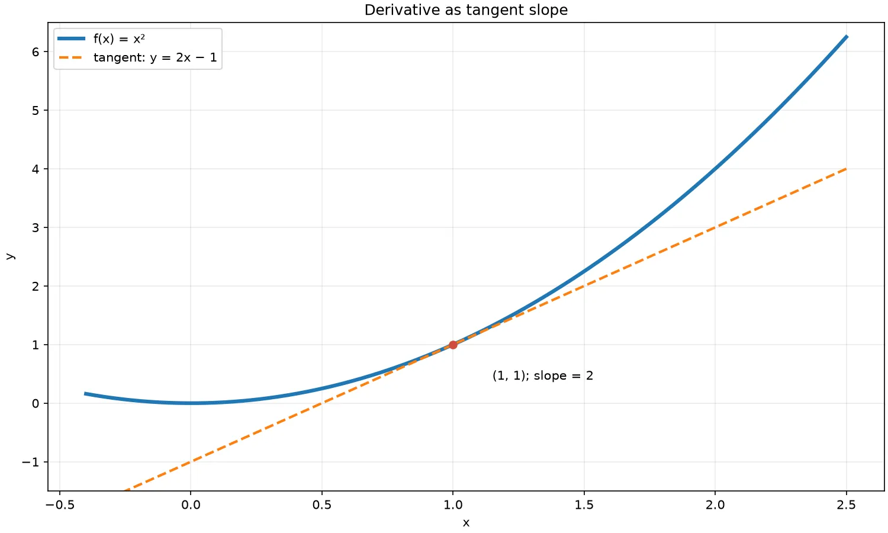

**شکل ۱۸-۱ — شیب مماس.** تقریب خطی نزدیک نقطه معتبرتر است، نه لزوماً در فاصله بزرگ. اگر f بر حسب متر و x بر حسب ثانیه باشد، واحد مشتق متر بر ثانیه است.

## ۳. قواعد مشتق و نقاط نامشتق‌پذیر

مشتق ثابت صفر، مشتق `xⁿ` برای توان صحیح مناسب `n xⁿ⁻¹` و مشتق جمع برابر جمع مشتق‌هاست. مثلاً `d(3x²+2x+5)/dx=6x+2`. در ضرب دو تابع `d(uv)/dx=u′v+uv′`؛ مشتق حاصل‌ضرب عموماً حاصل‌ضرب مشتق‌ها نیست.

مشتق همیشه وجود ندارد: برای `|x|` در صفر شیب سمت چپ −۱ و راست +۱ است، پس مشتق معمول وجود ندارد. یک تابع مشتق‌پذیر در نقطه پیوسته است، اما پیوستگی به‌تنهایی مشتق‌پذیری را تضمین نمی‌کند. نزدیک مرز دامنه یا شکستگی، اختلاف محدود ممکن است پاسخ گمراه‌کننده بدهد.

## ۴. قاعده زنجیره‌ای

برای `h(x)=f(g(x))` با مشتق‌پذیری لازم، `h′(x)=f′(g(x))g′(x)` است [۲]. اگر `h(x)=(2x+1)²`، مشتق بیرونی نسبت به ورودی میانی `2(2x+1)` و مشتق درونی ۲ است؛ بنابراین `h′(x)=4(2x+1)`. در x=۱ مقدار مشتق ۱۲ است.

در مدلی که خروجی از چند تبدیل پیاپی می‌گذرد، قاعده زنجیره‌ای تغییر را در مسیرها منتقل می‌کند. این پایه مفهومی پس‌انتشار است، اما پیاده‌سازی کامل و نحوه جمع مسیرها در فصل ۲۸ بررسی می‌شود.

## ۵. مشتق جزئی و گرادیان

برای تابعی از چند ورودی، مشتق جزئی نسبت به یکی از آن‌ها، دیگر ورودی‌ها را ثابت فرض می‌کند. اگر `f(x,y)=x²+3xy+y²`، آنگاه `∂f/∂x=2x+3y` و `∂f/∂y=3x+2y` است. **گرادیان** بردار این مشتق‌هاست: `∇f=[2x+3y, 3x+2y]`؛ در `(1,2)` برابر `[8,7]` است [۳].

**معادله ۱۸-۱** — f تابع و x و y ورودی‌ها هستند؛ هر مؤلفه یک مشتق جزئی است.

<math xmlns="http://www.w3.org/1998/Math/MathML" display="block" dir="ltr" aria-label="gradient has partial derivatives"><mo>∇</mo><mi>f</mi><mo>=</mo><mo>(</mo><mfrac><mrow><mo>∂</mo><mi>f</mi></mrow><mrow><mo>∂</mo><mi>x</mi></mrow></mfrac><mo>,</mo><mfrac><mrow><mo>∂</mo><mi>f</mi></mrow><mrow><mo>∂</mo><mi>y</mi></mrow></mfrac><mo>)</mo></math>

برای تابع مشتق‌پذیر و جهت واحد u، نرخ تغییر جهت‌دار `∇f·u` است. اگر گرادیان غیرصفر باشد، جهت آن بیشترین نرخ افزایش محلی را در میان جهت‌های واحد دارد؛ گرادیان صفر چنین جهت یکتایی تعیین نمی‌کند. مقیاس و واحد متغیرها در تفسیر جهت اهمیت دارند.

## ۶. انتگرال معین و نامعین

انتگرال معین می‌تواند حد مجموع‌های ریمانی و مساحت علامت‌دار زیر نمودار باشد: نواحی زیر محور x علامت منفی دارند. برای تابع پیوسته `f(x)=x²` و پادمشتق `F(x)=x³/3`، قضیه بنیادی حسابان می‌دهد `∫₀² x² dx=F(2)−F(0)=8/3` [۴]. انتگرال نامعین خانواده پادمشتق‌ها را با ثابت C نمایش می‌دهد: `∫x² dx=x³/3+C`.

با تقسیم بازه به n قسمت و نمونه‌برداری وسط هر قسمت می‌توان مقدار را تقریب زد. نتیجه به تعداد قسمت‌ها و ویژگی تابع بستگی دارد؛ انتگرال علامت‌دار لزوماً مساحت هندسی مثبت نیست و عوض‌کردن حدود علامت آن را تغییر می‌دهد.

## ۷. پروژه: گرادیان تحلیلی و عددی

فایل `calculus.py` را بسازید؛ وابستگی خارجی یا شبکه ندارد. اختلاف مرکزی `(f(x+h)−f(x−h))/(2h)` مشتق را برای h کوچک تقریب می‌زند، اما h بیش‌ازحد کوچک ممکن است به دلیل گردکردن و حذف رقم‌ها خطا را افزایش دهد. این تست برای تابع هموار و نقطه مشخص است، نه تضمین عمومی.

```python
"""Analytic and numerical calculus checks for a smooth polynomial."""
import math


def f(x, y):
    return x*x + 3*x*y + y*y


def gradient(x, y):
    return (2*x + 3*y, 3*x + 2*y)


def numerical_gradient(x, y, h=1e-5):
    if not math.isfinite(h) or h <= 0:
        raise ValueError('h must be finite and positive')
    dx = (f(x+h, y) - f(x-h, y)) / (2*h)
    dy = (f(x, y+h) - f(x, y-h)) / (2*h)
    return dx, dy


def midpoint_integral(func, a, b, n):
    if type(n) is not int or n <= 0:
        raise ValueError('n must be a positive integer')
    width = (b - a) / n
    return sum(func(a + (i + 0.5)*width) for i in range(n)) * width


def main():
    exact = gradient(1, 2)
    numeric = numerical_gradient(1, 2)
    print('analytic_gradient=', exact)
    print('numeric_gradient=', tuple(round(v, 6) for v in numeric))
    print('gradient_matches=', all(math.isclose(a, b, rel_tol=1e-8, abs_tol=1e-8)
                                   for a, b in zip(exact, numeric)))
    area = midpoint_integral(lambda x: x*x, 0, 2, 1000)
    print('integral_x2_0_2=', round(area, 6))
    print('exact_integral=', round(8/3, 6))


if __name__ == '__main__':
    main()
```

خروجی Python 3.13.16: `analytic_gradient= (8, 7)`؛ `numeric_gradient= (8.0, 7.0)`؛ `gradient_matches= True`؛ تقریب انتگرال `2.666666` و مقدار دقیق گرد‌شده `2.666667`. اختلاف حدود `6.67×10⁻⁷` است. اعداد نمایش داده‌شده گرد شده‌اند.

## ۸. آزمون و عیب‌یابی

فایل زیر را کنار پروژه قرار دهید و `python -m unittest -v test_calculus` اجرا کنید. چهار تست گرادیان، نقطه صفر، انتگرال با خطای مجاز `10⁻⁶` و ورودی نامعتبر را می‌سنجند.

```python
import math
import unittest
from calculus import f, gradient, numerical_gradient, midpoint_integral


class CalculusTests(unittest.TestCase):
    def test_gradient(self):
        self.assertEqual(gradient(1, 2), (8, 7))
        for a, b in zip(gradient(1, 2), numerical_gradient(1, 2)):
            self.assertTrue(math.isclose(a, b, rel_tol=1e-8, abs_tol=1e-8))

    def test_other_point(self):
        self.assertEqual(gradient(0, 0), (0, 0))
        self.assertEqual(numerical_gradient(0, 0), (0, 0))

    def test_integral(self):
        self.assertAlmostEqual(midpoint_integral(lambda x: x*x, 0, 2, 1000), 8/3, delta=1e-6)
        self.assertAlmostEqual(midpoint_integral(lambda x: x, 2, 0, 100), -2)

    def test_invalid(self):
        for h in (0, -1, float('nan')):
            with self.assertRaises(ValueError): numerical_gradient(1, 2, h)
        for n in (0, -1, True, 2.5):
            with self.assertRaises(ValueError): midpoint_integral(f, 0, 1, n)


if __name__ == '__main__':
    unittest.main()
```

`h` باید مثبت و متناهی و n یک عدد صحیح مثبت باشد. آزمون انتگرال از خطای مطلق متناسب با تقریب استفاده می‌کند؛ برابری دقیق عدد شناور انتظار نمی‌رود. نتیجه نزدیک در چند نقطه ثابت نمی‌کند مشتق تحلیلی برای همه نقاط یا توابع درست است.

## ۹. تمرین و ارزیابی

**پرسش:** ۱) مشتق `x²`؟ ۲) مشتق ثابت؟ ۳) مشتق `(2x+1)²` در x=۱؟ ۴) مشتق جزئی `x²+y²` نسبت به x؟ ۵) گرادیان آن در `(1,2)`؟ ۶) `∫₀² x dx`؟ ۷) آیا `|x|` در صفر مشتق‌پذیر است؟ ۸) چرا h بسیار کوچک همیشه بهتر نیست؟ ۹) آیا انتگرال معین همیشه مثبت است؟ ۱۰) آیا گرادیان صفر جهت بیشترین افزایش یکتایی دارد؟

**تمرین:** برای `g(x,y)=x²+y²` گرادیان تحلیلی و عددی را در دو نقطه مقایسه کنید. **مینی‌پروژه:** نمودار تابع و مماس در یک نقطه و جدول خطای اختلاف مرکزی برای سه h بسازید؛ نتایج و محدودیت دقت را توضیح دهید. **چالش:** تفاوت مشتق تحلیلی و عددی را مقایسه کنید و علت شکست احتمالی هر روش را بنویسید. **قبولی:** حداقل ۸ پاسخ صحیح از ۱۰ و چهار آزمون موفق.

[پاسخ‌نامه جداگانه فصل 18](book-engineering/answers/18-calculus-answers-fa.md).

## ۱۰. منابع و ادامه

Derivative مشتق؛ Partial Derivative مشتق جزئی؛ Gradient گرادیان؛ Chain Rule قاعده زنجیره‌ای؛ Integral انتگرال؛ Finite Difference اختلاف محدود. **بررسی ۵ نوامبر ۲۰۲۶:** مبانی پایدارند؛ تقریب عددی وابسته به گام و دقت ماشین است. فصل ۱۹ احتمال و آمار را می‌آموزد.

**منابع؛ مراجعه ۵ نوامبر ۲۰۲۶:** [۱] OpenStax، «Key Concepts: Derivatives»، Calculus Volume 1، ۲۰۱۶، [منبع](https://openstax.org/books/calculus-volume-1/pages/3-key-concepts). [۲] OpenStax، «The Chain Rule»، ۲۰۱۶، [منبع](https://openstax.org/books/calculus-volume-1/pages/3-6-the-chain-rule). [۳] OpenStax، «Directional Derivatives and the Gradient»، Calculus Volume 3، ۲۰۱۶، [منبع](https://openstax.org/books/calculus-volume-3/pages/4-6-directional-derivatives-and-the-gradient). [۴] OpenStax، «The Fundamental Theorem of Calculus»، Calculus Volume 1، تاریخ انتشار نامشخص، [منبع](https://openstax.org/books/calculus-volume-1/pages/5-3-the-fundamental-theorem-of-calculus).

---

# فصل ۱۹ — احتمال، آمار، توزیع‌ها، نمونه‌گیری و بیز

**هنر و علم ساخت هوش | جلد اول | Babak & Ai**<br>
**بررسی منابع: ۵ نوامبر ۲۰۲۶**

## ۱. چرا عدم قطعیت را اندازه می‌گیریم؟

داده معمولاً تنها نمونه‌ای از جهان است و خروجی مدل نیز ممکن است خطا کند. احتمال و آمار به ما کمک می‌کنند عدم قطعیت، تغییرپذیری و محدودیت نتیجه را بیان کنیم. **پیش‌نیاز:** نسبت و تابع، فصل‌های ۱۶ و ۱۷. **هدف:** محاسبه احتمال شرطی، میانگین و پراکندگی، شناخت توزیع و نمونه‌گیری، و کاربرد قضیه بیز. مثال‌ها ساختگی‌اند و توصیه پزشکی یا نتیجه واقعی درباره جمعیت نیستند.

## ۲. فضای نمونه و احتمال

**آزمایش تصادفی** ممکن است چند نتیجه داشته باشد؛ مجموعه نتایج ممکن **فضای نمونه** و هر زیرمجموعه آن یک **رویداد** است. برای سکه ایده‌آل با دو روی هم‌احتمال، `P(رو)=1/2`. احتمال بین صفر و یک است و احتمال مکمل A برابر `1−P(A)` است. نسبت تعداد حالت‌های مطلوب به همه حالت‌ها فقط وقتی مستقیماً درست است که حالت‌ها هم‌احتمال باشند.

برای دو رویداد مستقل، `P(A و B)=P(A)P(B)`؛ استقلال را نباید بدون بررسی فرض کرد. **احتمال شرطی** `P(A|B)=P(A و B)/P(B)` وقتی `P(B)>0` است. `P(A|B)` معمولاً با `P(B|A)` یکی نیست [۱].

## ۳. میانگین، میانه و پراکندگی

برای داده `2,3,3,4,8` میانگین `(2+3+3+4+8)/5=4` و میانه ۳ است. میانگین به مقدارهای پرت حساس است؛ میانه اغلب در برابر آن‌ها مقاوم‌تر است. انتخاب شاخص به پرسش بستگی دارد و یک عدد نمی‌تواند کل شکل توزیع را نشان دهد [۲].

**واریانس جامعه** میانگین مربع فاصله‌ها از میانگین است و بر n تقسیم می‌شود. **واریانس نمونه** متداول با مخرج `n−1` محاسبه می‌شود و برای n≥۲ است. در داده بالا مجموع مربع فاصله‌ها ۲۲ و واریانس نمونه `22/4=5.5` است؛ واریانس همین پنج مقدار به‌عنوان کل جامعه `22/5=4.4` است. انحراف معیار ریشه دوم واریانس و هم‌واحد داده است. نمونه‌بودن یا جامعه‌بودن را روشن کنید.

## ۴. توزیع‌های احتمالی

یک **متغیر تصادفی** خروجی عددی را به نتیجه آزمایش نسبت می‌دهد. توزیع مشخص می‌کند احتمال چگونه روی مقدارها پخش می‌شود. **برنولی** برای خروجی صفر/یک با احتمال موفقیت p است؛ چند آزمایش مستقل با احتمال یکسان به مدل دوجمله‌ای می‌رسند. توزیع نرمال یک مدل پیوسته زنگوله‌ای است که با میانگین و انحراف معیار مشخص می‌شود؛ هر داده واقعی لزوماً نرمال نیست.

در مدل پیوسته، چگالی در نقطه خودِ احتمال نقطه نیست؛ احتمال یک بازه با انتگرال چگالی در آن بازه محاسبه می‌شود. در یک توزیع پیوسته متعارف، احتمال یک مقدار دقیق منفرد صفر است. مقایسه چگالی و احتمال بدون توجه به واحد و بازه می‌تواند گمراه‌کننده باشد.

## ۵. نمونه‌گیری، سوگیری و عدم قطعیت

**جامعه** مجموعه مورد مطالعه و **نمونه** زیرمجموعه مشاهده‌شده است. در نمونه‌گیری تصادفی ساده، هر زیرمجموعه با اندازه معین شانس برابر دارد. داده در دسترس، کاربران داوطلب یا داده اینترنتی لزوماً نماینده جامعه هدف نیستند [۳]. حجم زیاد، سوگیری انتخاب، خطای اندازه‌گیری یا داده نامناسب را خودکار اصلاح نمی‌کند.

برآورد از نمونه به نمونه تغییر می‌کند. محدوده اطمینان و روش برآورد به طرح نمونه‌گیری و مفروضات بستگی دارند؛ تفسیر دقیق آن با «احتمال قرارگرفتن پارامتر ثابت در بازه مشاهده‌شده» یکسان فرض نمی‌شود. همبستگی نیز به‌تنهایی علت را ثابت نمی‌کند. برای ارزیابی مدل، داده آموزش و آزمون را جدا نگه دارید و نشت داده را کنترل کنید؛ جزئیات طراحی در جلد دوم و ارزیابی در جلد پنجم است.

## ۶. قضیه بیز با مثال عددی

بیز احتمال شرطی را معکوس می‌کند، با شرط اینکه احتمال شواهد مثبت باشد:

```text
P(A|B) = P(B|A) × P(A) / P(B)
P(B) = P(B|A)P(A) + P(B|not A)P(not A)
```

**معادله ۱۹-۱** — A رویداد مورد نظر و B شاهد است؛ مخرج P(B) باید مثبت باشد.

<math xmlns="http://www.w3.org/1998/Math/MathML" display="block" dir="ltr" aria-label="Bayes theorem P A given B"><mi>P</mi><mo>(</mo><mi>A</mi><mo>|</mo><mi>B</mi><mo>)</mo><mo>=</mo><mfrac><mrow><mi>P</mi><mo>(</mo><mi>B</mi><mo>|</mo><mi>A</mi><mo>)</mo><mi>P</mi><mo>(</mo><mi>A</mi><mo>)</mo></mrow><mrow><mi>P</mi><mo>(</mo><mi>B</mi><mo>)</mo></mrow></mfrac></math>

**مثال صرفاً فرضی:** ویژگی A در ۱٪ جمعیت، حساسیت آزمون ۹۰٪ (`P(+|A)=0.9`) و ویژگی آزمون ۹۵٪ (`P(-|not A)=0.95`) باشد. از ۱۰٬۰۰۰ نفر، تعدادهای **مورد انتظار**: ۱۰۰ دارای ویژگی، ۹۰ مثبت واقعی؛ ۹٬۹۰۰ فاقد ویژگی، ۴۹۵ مثبت کاذب. پس از ۵۸۵ مثبت مورد انتظار، `P(A|+)=90/585≈0.153846` یعنی حدود ۱۵٫۴٪ است [۱]. حساسیت ۹۰٪ به معنی احتمال ۹۰٪ داشتن ویژگی پس از مثبت‌شدن نیست. این مثال فرضی است، نه دقت آزمون پزشکی واقعی.

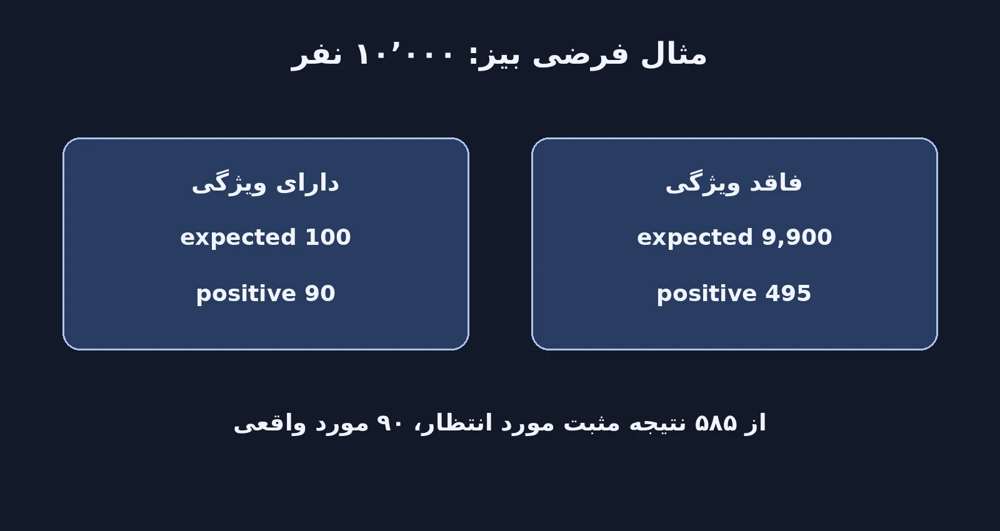

**شکل ۱۹-۱ — اثر نرخ پایه.** مقادیر مورد انتظارند، نه تضمین نتیجه هر نمونه؛ احتمال پسین به مفروضات حساسیت، ویژگی و شیوع وابسته است.

## ۷. پروژه: بیز و شبیه‌سازی

فایل `probability.py` را بسازید. تابع بیز ورودی‌های خارج بازه، نامتناهی و احتمال شواهد صفر را رد می‌کند. شبیه‌سازی سکه از مولد شبه‌تصادفی محلی با seed ثابت استفاده می‌کند؛ داده‌ها ساختگی‌اند و مولد `random` برای رمزنگاری مناسب نیست. Python 3.13.16، بدون بسته خارجی یا شبکه.

```python
"""Bayes calculation and seeded Bernoulli simulation on synthetic data."""
import math
import random
import statistics


def posterior_positive(prevalence, sensitivity, specificity):
    values = (prevalence, sensitivity, specificity)
    if any(not math.isfinite(v) or not 0 <= v <= 1 for v in values):
        raise ValueError('probabilities must be finite and between 0 and 1')
    numerator = prevalence * sensitivity
    positive = numerator + (1 - prevalence) * (1 - specificity)
    if positive == 0:
        raise ValueError('positive result has zero probability')
    return numerator / positive


def coin_fraction(n, seed=42):
    if type(n) is not int or n <= 0:
        raise ValueError('n must be a positive integer')
    rng = random.Random(seed)
    return sum(rng.random() < 0.5 for _ in range(n)) / n


def main():
    data = [2, 3, 3, 4, 8]
    print('mean=', statistics.mean(data), 'median=', statistics.median(data))
    print('sample_variance=', statistics.variance(data))
    print('posterior=', round(posterior_positive(0.01, 0.9, 0.95), 6))
    print('coin_fraction=', round(coin_fraction(10000), 4), 'seed=42')


if __name__ == '__main__':
    main()
```

خروجی آزمایش‌شده: `mean= 4 median= 3`؛ `sample_variance= 5.5`؛ `posterior= 0.153846`؛ `coin_fraction= 0.499 seed=42`. فراوانی نمونه‌ای لزوماً دقیقاً ۰٫۵ نیست و seed ثابت، صحت مدل یا یکسان‌بودن تمام نسخه‌ها و روش‌ها را تضمین نمی‌کند. پاسخ تحلیلی بیز به شبیه‌سازی وابسته نیست.

## ۸. آزمون و خطاهای رایج

فایل زیر را کنار برنامه ذخیره و `python -m unittest -v test_probability` اجرا کنید. چهار تست نتیجه بیز، ورودی خارج دامنه و شواهد ناممکن، بازتولید seed در همین محیط، و n نامعتبر را بررسی می‌کنند.

```python
import unittest
from probability import posterior_positive, coin_fraction


class ProbabilityTests(unittest.TestCase):
    def test_bayes(self):
        self.assertAlmostEqual(posterior_positive(.01, .9, .95), 90/585)
        self.assertEqual(posterior_positive(0, .9, .95), 0)
        self.assertEqual(posterior_positive(1, .9, .95), 1)

    def test_invalid_bayes(self):
        for args in [(-.1, .9, .95), (.1, 1.1, .95), (float('nan'), .9, .95), (0, 1, 1)]:
            with self.subTest(args=args), self.assertRaises(ValueError):
                posterior_positive(*args)

    def test_seed_and_range(self):
        self.assertEqual(coin_fraction(1000, 42), coin_fraction(1000, 42))
        self.assertTrue(0 <= coin_fraction(100, 4) <= 1)

    def test_invalid_n(self):
        for n in (0, -1, 2.5, True):
            with self.assertRaises(ValueError): coin_fraction(n)


if __name__ == '__main__':
    unittest.main()
```

اگر مخرج بیز صفر است، احتمال شرطی روی رویداد با احتمال صفر در این فرمول تعریف نشده و برنامه `ValueError` می‌دهد. عدد ۹۵٪ در مثال **ویژگی** است نه احتمال مثبت کاذب؛ مثبت کاذب برابر ۵٪ است. خروجی شبیه‌سازی نمونه، اثبات قضیه یا ارزیابی پزشکی نیست.

## ۹. تمرین و ارزیابی

**پرسش:** ۱) احتمال مکمل رویداد با احتمال ۰٫۲؟ ۲) میانگین `[2,4,6]`؟ ۳) میانه `[1,2,100]`؟ ۴) فرق واریانس نمونه و جامعه در مخرج چیست؟ ۵) آیا `P(A|B)` الزاماً برابر `P(B|A)` است؟ ۶) آیا نمونه بزرگِ سوگیر خودکار نماینده می‌شود؟ ۷) احتمال مثبت کاذب با ویژگی ۹۵٪؟ ۸) در مثال بیز نسبت مثبت واقعی به همه مثبت‌ها؟ ۹) آیا فراوانی نمونه ۱۰ بار سکه الزاماً ۰٫۵ است؟ ۱۰) آیا `random` برای رمز امنیتی مناسب است؟

**تمرین:** شیوع فرضی را به ۱۰٪ تغییر دهید و با همان حساسیت و ویژگی، احتمال پسین را حساب کنید. **مینی‌پروژه:** از داده ساختگی، میانگین، میانه و واریانس نمونه را حساب و با کتابخانه `statistics` مقایسه کنید؛ روش نمونه‌گیری و یک منبع سوگیری را بنویسید. **چالش:** احتمال شرطی تحلیلی و شبیه‌سازی تصادفی را مقایسه و دو علت تفاوتشان را شرح دهید. **قبولی:** حداقل ۸ پاسخ درست و چهار آزمون موفق.

[پاسخ‌نامه جداگانه فصل 19](book-engineering/answers/19-probability-statistics-answers-fa.md).

## ۱۰. منابع و ادامه

Probability احتمال؛ Conditional Probability احتمال شرطی؛ Distribution توزیع؛ Sample نمونه؛ Mean میانگین؛ Median میانه؛ Variance واریانس؛ Bayes بیز؛ Base Rate نرخ پایه. **بررسی ۵ نوامبر ۲۰۲۶:** فرمول‌ها پایدارند، اما نتیجه تجربی به نمونه و مفروضات بستگی دارد. فصل ۲۰ درباره بهینه‌سازی و پایداری عددی است.

**منابع؛ مراجعه ۵ نوامبر ۲۰۲۶:** [۱] OpenStax، «Probability Theory»، Principles of Data Science، ۲۰۲۵، [منبع](https://openstax.org/books/principles-data-science/pages/3-4-probability-theory). [۲] OpenStax، «Key Terms»، Introductory Statistics 2e، ۲۰۲۳، [منبع](https://openstax.org/books/introductory-statistics-2e/pages/2-key-terms). [۳] OpenStax، «Key Terms: Sampling»، Introductory Statistics 2e، ۲۰۲۳، [منبع](https://openstax.org/books/introductory-statistics-2e/pages/1-key-terms). [۴] Python Software Foundation، «random»، Python 3.13، تاریخ نامشخص، [منبع](https://docs.python.org/3.13/library/random.html).

---

# فصل ۲۰ — بهینه‌سازی، گرادیان‌کاهشی و پایداری عددی

**هنر و علم ساخت هوش | جلد اول | Babak & Ai**<br>
**تاریخ بررسی منابع: ۵ نوامبر ۲۰۲۶**

## ۱. از اندازه‌گیری خطا تا کاهش آن

در فصل ۱۸ مشتق و گرادیان را شناختیم. اکنون می‌پرسیم چگونه مقدار پارامترها را طوری تغییر دهیم که تابع هدف کوچک‌تر شود. **بهینه‌سازی (Optimization)** جست‌وجوی راه‌حلی با مقدار مطلوب برای هدف، با توجه به محدودیت‌هاست. در یادگیری ماشین هدف اغلب کمینه‌کردن زیان روی داده آموزش است، اما زیان آموزش کم به‌تنهایی عملکرد خوب روی داده جدید را تضمین نمی‌کند.

**پیش‌نیاز:** تابع، مشتق، گرادیان و بردار. **اهداف:** محاسبه به‌روزرسانی ساده، بررسی نرخ یادگیری و همگرایی، تشخیص خطای گردکردن و سرریز، و آزمایش یک تابع آموزشی. آموزش رگرسیون کامل فصل ۲۳ و روش‌های Adam و آموزش شبکه فصل ۲۹ است؛ اینجا مبانی را می‌آموزیم.

## ۲. تابع هدف، پارامتر و کمینه

برای مثال ساده `L(x)=(x−3)²`، x پارامتر و L تابع هدف یا زیان است. از آنجا که مربع عدد حقیقی نامنفی است، مقدار کمینه سراسری صفر در `x=3` به دست می‌آید. گرادیان یک‌بعدی `L′(x)=2(x−3)` است؛ در صفر مقدار آن −۶ است. **کمینه محلی** نسبت به نقاط نزدیک پایین‌تر است؛ **کمینه سراسری** در کل دامنه از همه مقادیر پایین‌تر یا مساوی است. تابع‌های غیرمحدب ممکن است چند کمینه محلی یا نقطه زینی داشته باشند.

مقدار گرادیان صفر شرطی مهم برای نقاط درونی مشتق‌پذیر است، اما به‌تنهایی ثابت نمی‌کند نقطه کمینه است: نقطه زینی یا بیشینه نیز می‌تواند گرادیان صفر داشته باشد. در مرز دامنه یا تابع نامشتق‌پذیر شرایط متفاوت است.

## ۳. گرادیان‌کاهشی گام‌به‌گام

**Gradient Descent** پارامتر θ را در خلاف جهت گرادیان تغییر می‌دهد [۱]: `θ_new = θ − η∇L(θ)`؛ η نرخ یادگیری مثبت است. در مثال ما با `x=0` و `η=0.1`، شیب −۶ است و `x_new=0−0.1×(−6)=0.6`. زیان از ۹ به `(0.6−3)²=5.76` کاهش می‌یابد. گام بعد از شیب در نقطه جدید استفاده می‌کند.

برای همین تابع، فاصله از ۳ پس از هر گام در `1−2η` ضرب می‌شود. بنابراین اگر `0<η<1`، فاصله به صفر میل می‌کند؛ در `η=1` فاصله و علامت نوسان می‌کنند و در `η>1` با شروع غیر از ۳ فاصله رشد می‌کند. این محدوده **ویژه همین تابع و به‌روزرسانی** است و نسخه عمومی برای هر مدل نیست. نرخ بزرگ ممکن است واگرا و نرخ بسیار کوچک کند باشد [۱].

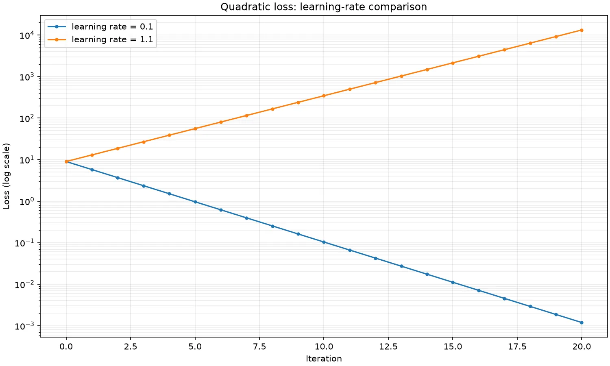

**شکل ۲۰-۱ — نرخ یادگیری و زیان.** منحنی‌ها از `x=0`، بیست به‌روزرسانی و هدف یکسان به دست آمده‌اند؛ محور عمودی لگاریتمی است و فاصله بصری خطی نیست. نمودار یک مثال مشخص است، نه مقایسه جامع بهینه‌سازها.

## ۴. داده، بچ و ارزیابی

در مسئله داده‌محور، زیان ممکن است میانگین خطای چند نمونه باشد. **Batch Gradient Descent** از کل داده آموزش برای گرادیان هر گام استفاده می‌کند؛ **Stochastic** نمونه و **Mini-batch** زیرمجموعه‌ای از داده را به کار می‌برند. برآورد گرادیان مینی‌بچ معمولاً متغیر است، بنابراین زیان هر گام الزاماً کاهش یکنواخت ندارد. ترتیب داده، اندازه بچ، seed و روش ثبت معیار مهم‌اند.

تنظیم نرخ و توقف باید با پروتکل ارزیابی معتبر انجام شود. داده اعتبارسنجی برای انتخاب تنظیمات و داده آزمون جدا برای ارزیابی نهایی به کار می‌رود؛ استفاده مکرر از آزمون برای تنظیم باعث خوش‌بینی می‌شود. جزئیات آموزش/ارزیابی در جلد دوم هستند.

## ۵. توقف، همگرایی و روش‌های عددی

تعداد ثابت گام، کوچکی تغییر پارامتر، کوچکی گرادیان یا تغییر اندک زیان می‌توانند معیار توقف باشند. هرکدام محدودیت دارند: گرادیان کوچک ممکن است در نقطه زینی یا ناحیه تخت رخ دهد؛ ثابت‌شدن ناشی از گردکردن نیز ممکن است. باید وضعیت، محدودیت گام و هزینه را ثبت کرد. همگرایی عددی و تعمیم مدل دو پرسش متفاوت‌اند.

**اختلاف محدود مرکزی** `(L(x+h)−L(x−h))/(2h)` مشتق را تقریب می‌زند و برای آزمون یک گرادیان تحلیلی مفید است. h بزرگ خطای تقریب و h بسیار کوچک خطای گردکردن/حذف ارقام دارد؛ چند مقدار مناسب و مقیاس را بررسی کنید. روش‌های عددی جواب تقریبی می‌دهند و باید خطا و شرایط مسئله را گزارش کرد.

## ۶. دقت شناور و پایداری

بسیاری از کسرهای ده‌دهی مانند ۰٫۱ در نمایش دودویی شناور دقیق نیستند؛ در Python معمولاً `0.1+0.2` به شکل `0.30000000000000004` نمایش داده می‌شود [۲]. مقایسه مستقیم برابری همیشه مناسب نیست؛ `math.isclose` با آستانه نسبی و مطلق متناسب با مسئله کمک می‌کند. نزدیک صفر، در صورت نیاز آستانه مطلق غیرصفر تعیین کنید. هیچ آستانه ثابتی برای همه کاربردها درست نیست.

**Overflow** خروج از دامنه نمایش، **underflow** بسیار کوچک‌شدن نتیجه و **cancellation** از دست‌رفتن ارقام معنی‌دار در تفریق مقادیر نزدیک است. `NaN` و بی‌نهایت نشانه نیاز به بررسی‌اند. نوع داده و ترتیب محاسبه بر دقت و حافظه اثر دارند؛ `numpy.finfo` حدهای نوع شناور را گزارش می‌کند [۳]. در تمرین مدل‌ها نرمال‌سازی با پارامترهای محاسبه‌شده فقط از داده آموزش می‌تواند به شرط‌بندی کمک کند، اما درمان جهانی همه مشکلات نیست.

## ۷. پروژه: تابع مربعی و دو نرخ

فایل `gradient_descent.py` را بسازید. فقط Python 3.13.16 و CPU لازم است؛ داده واقعی، شبکه یا بسته اضافی ندارد. برنامه بیست گام و مقدار اولیه یکسان را برای دو نرخ مقایسه می‌کند.

```python
"""Gradient descent on a known quadratic; educational CPU example."""
import math


def loss(x):
    return (x - 3.0) ** 2


def gradient(x):
    return 2.0 * (x - 3.0)


def optimize(start, learning_rate, steps):
    if not math.isfinite(start):
        raise ValueError('start must be finite')
    if not math.isfinite(learning_rate) or learning_rate <= 0:
        raise ValueError('learning_rate must be positive and finite')
    if type(steps) is not int or steps < 0:
        raise ValueError('steps must be a non-negative integer')
    path = [float(start)]
    for _ in range(steps):
        x = path[-1] - learning_rate * gradient(path[-1])
        if not math.isfinite(x):
            raise ValueError('non-finite update')
        path.append(x)
    return path


def main():
    for rate in (0.1, 1.1):
        path = optimize(0, rate, 20)
        print(f'rate={rate} final_x={path[-1]:.6f} final_loss={loss(path[-1]):.6f}')
    print('float_0.1_plus_0.2=', 0.1 + 0.2)
    print('close_to_0.3=', math.isclose(0.1 + 0.2, 0.3))


if __name__ == '__main__':
    main()
```

خروجی آزمایش‌شده:

```text
rate=0.1 final_x=2.965412 final_loss=0.001196
rate=1.1 final_x=-112.012800 final_loss=13227.944112
float_0.1_plus_0.2= 0.30000000000000004
close_to_0.3= True
```

عددها برای نمایش گرد شده‌اند. حالت نرخ ۱٫۱ در همین مثال رشد می‌کند؛ در مسائل واقعی نرخ مناسب به تابع، مقیاس و روش بستگی دارد. این برنامه یک بهینه‌ساز صنعتی با کنترل سرریز تمام عملیات و توقف خودکار نیست.

## ۸. آزمون و عیب‌یابی

فایل زیر را کنار برنامه بگذارید و `python -m unittest -v test_gradient_descent` را اجرا کنید. چهار تست شامل مقایسه گرادیان با اختلاف محدود، کاهش/رشد زیان، نرخ مرزی و ورودی نامعتبر است.

```python
import math
import unittest
from gradient_descent import loss, gradient, optimize


class OptimizationTests(unittest.TestCase):
    def test_gradient(self):
        self.assertEqual(gradient(0), -6)
        self.assertEqual(gradient(3), 0)
        h = 1e-5
        self.assertTrue(math.isclose((loss(1+h)-loss(1-h))/(2*h), gradient(1), rel_tol=1e-9))

    def test_descent_and_divergence(self):
        good = optimize(0, .1, 20)
        bad = optimize(0, 1.1, 20)
        self.assertLess(loss(good[-1]), loss(good[0]))
        self.assertGreater(loss(bad[-1]), loss(bad[0]))
        self.assertEqual(len(good), 21)

    def test_boundary_rates(self):
        self.assertEqual(optimize(0, 1, 2), [0.0, 6.0, 0.0])
        self.assertEqual(optimize(2, .1, 0), [2.0])

    def test_invalid(self):
        for args in [(0, 0, 1), (0, -1, 1), (0, float('nan'), 1), (float('inf'), .1, 1), (0, .1, True)]:
            with self.subTest(args=args), self.assertRaises(ValueError): optimize(*args)


if __name__ == '__main__':
    unittest.main()
```

`ValueError` برای نرخ نامعتبر یا ورودی نامتناهی مورد انتظار است. اگر نتایج بعد از تغییر نرخ نوسان کرد، منحنی زیان و مقیاس را بررسی کنید؛ صرفاً افزایش تعداد گام کافی نیست. با مقادیر بسیار بزرگ احتمال سرریز عملیات نیز هست. برای اشکال‌زدایی ابتدا مثال کوچک و دامنه محدود را بازتولید کنید.

## ۹. تمرین و ارزیابی

**پرسش‌ها:** ۱) کمینه `L(x)=(x−3)²` کجاست؟ ۲) گرادیان در صفر چیست؟ ۳) گام اول با نرخ ۰٫۱ چیست؟ ۴) آیا هر نرخ بزرگ‌تر بهتر است؟ ۵) آیا گرادیان صفر همواره کمینه سراسری است؟ ۶) mini-batch چه تفاوتی با کل داده دارد؟ ۷) آیا `0.1+0.2` همیشه دقیقاً ۰٫۳ دودویی است؟ ۸) چرا آستانه مطلق نزدیک صفر مهم است؟ ۹) آیا زیان آموزش کم تعمیم را تضمین می‌کند؟ ۱۰) با نرخ ۱ و شروع صفر، گام دوم کجاست؟

**مینی‌پروژه:** نرخ‌های ۰٫۰۱، ۰٫۱ و ۱٫۱ را با مقدار اولیه برابر مقایسه کنید، زیان هر گام و علت تفاوت را گزارش دهید. **چالش مهندسی:** گرادیان تحلیلی و اختلاف محدود را برای سه h بسنجید و هزینه و دقت را مقایسه کنید. **قبولی:** حداقل ۸ پاسخ درست از ۱۰، چهار آزمون موفق و نمودار/گزارش با محور برچسب‌دار.

[پاسخ‌نامه جداگانه فصل 20](book-engineering/answers/20-optimization-answers-fa.md).

## ۱۰. منابع و ادامه

واژه‌ها: Objective، Loss، Gradient Descent، Learning Rate، Convergence، Numerical Stability، Overflow، Floating Point. **بررسی ۵ نوامبر ۲۰۲۶:** این فصل قواعد پایه را معرفی می‌کند و نتایج عددی فقط برای محیط و مثال اعلام‌شده تأیید شده‌اند. فصل ۲۱ آنتروپی، آنتروپی متقاطع و KL را پوشش می‌دهد.

**منابع؛ مراجعه ۵ نوامبر ۲۰۲۶:** [۱] Google Developers، «Gradient descent»، ۲۰۲۶، [مستندات](https://developers.google.com/machine-learning/crash-course/linear-regression/gradient-descent). [۲] Python Software Foundation، «Floating-Point Arithmetic»، Python 3.13، تاریخ نامشخص، [مستندات](https://docs.python.org/3.13/tutorial/floatingpoint.html). [۳] NumPy، «numpy.finfo»، تاریخ نامشخص، [مستندات](https://numpy.org/doc/stable/reference/generated/numpy.finfo.html).

---

# فصل ۲۱ — نظریه اطلاعات: آنتروپی، آنتروپی متقاطع و KL

**هنر و علم ساخت هوش | جلد اول | Babak & Ai**<br>
**تاریخ بررسی منابع: ۵ نوامبر ۲۰۲۶**

## ۱. اطلاعات و عدم قطعیت

پیش‌بینی نتیجه‌ای که پیشاپیش قطعی است، عدم قطعیت کمی باقی می‌گذارد؛ نتیجه‌ای میان گزینه‌های هم‌احتمال نامطمئن‌تر است. نظریه اطلاعات، از جمله در کار شانون در ۱۹۴۸، ابزار کمی برای تحلیل منابع و ارتباط ارائه کرد [۱]. در این فصل به توزیع‌های **گسسته محدود** می‌پردازیم، نه معنای انسانی متن یا همه جنبه‌های هوش.

**پیش‌نیاز:** لگاریتم فصل ۱۶ و احتمال فصل ۱۹. **هدف:** محاسبه آنتروپی، آنتروپی متقاطع و واگرایی KL، تشخیص تفاوت آن‌ها و تحلیل احتمال صفر. این مفاهیم در توابع زیان مدل‌ها نقش دارند؛ آموزش مدل و ارزیابی آن در جلد دوم ادامه می‌یابد.

## ۲. میزان شگفتی و آنتروپی

برای رخدادی با احتمال مثبت p، اطلاعات خودی `I=−log₂(p)` است؛ رخداد کم‌احتمال‌تر شگفتی بیشتری دارد. **آنتروپی شانون** میانگین این مقدار تحت توزیع P است:

```text
H(P) = −Σᵢ pᵢ log₂(pᵢ)
```

**معادله ۲۱-۱** — P توزیع و pᵢ احتمال رخداد i است؛ پایه ۲ واحد بیت می‌دهد.

<math xmlns="http://www.w3.org/1998/Math/MathML" display="block" dir="ltr" aria-label="Shannon entropy sum"><mi>H</mi><mo>(</mo><mi>P</mi><mo>)</mo><mo>=</mo><mo>−</mo><munder><mo>∑</mo><mi>i</mi></munder><msub><mi>p</mi><mi>i</mi></msub><msub><mi>log</mi><mn>2</mn></msub><mo>(</mo><msub><mi>p</mi><mi>i</mi></msub><mo>)</mo></math>

احتمال‌ها نامنفی و مجموعشان ۱ است. قرارداد حدی `0 log 0 = 0` به کار می‌رود؛ لازم نیست `log(0)` را مستقیماً حساب کنیم. پایه ۲ واحد بیت و لگاریتم طبیعی واحد نَت می‌دهد. سکه هم‌احتمال `[0.5,0.5]` آنتروپی ۱ بیت و توزیع قطعی `[1,0]` آنتروپی صفر دارد. برای n گزینه هم‌احتمال آنتروپی `log₂(n)` است [۱].

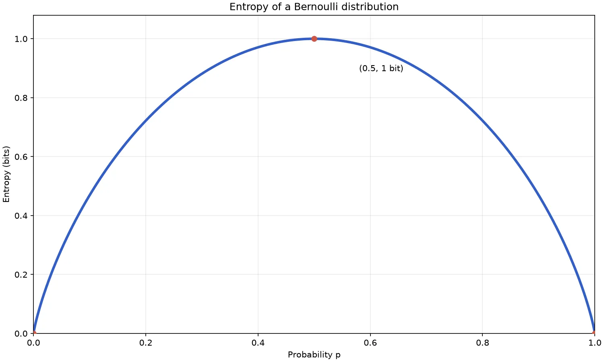

**شکل ۲۱-۱ — آنتروپی توزیع برنولی.** p احتمال یکی از دو خروجی است. نمودار عدم قطعیت توزیع را نشان می‌دهد، نه کیفیت پیش‌بینی برای یک نمونه خاص.

## ۳. آنتروپی متقاطع

اگر P توزیع مرجع و Q توزیع پیش‌بینی روی همان رخدادها باشد، **آنتروپی متقاطع** با پایه ۲ چنین است [۲]:

```text
H(P,Q) = −Σᵢ pᵢ log₂(qᵢ)
```

این میانگین شگفتی طبق احتمال‌های Q، برای رخدادهای وزن‌دهی‌شده با P است. اگر P توزیع یک‌داغ `[1,0]` و Q برابر `[0.8,0.2]` باشد، زیان آن نمونه `−log₂(0.8)≈0.321928` بیت است. برچسب یک‌داغ یک مشاهده را نشان می‌دهد؛ لزوماً توزیع واقعی جامعه را آشکار نمی‌کند. برای چند نمونه معمولاً میانگین زیان‌ها گزارش می‌شود و جزئیات وزن‌دهی باید مشخص باشد.

## ۴. واگرایی KL و جهت آن

**واگرایی Kullback–Leibler** از P نسبت به Q:

```text
D_KL(P||Q) = Σᵢ pᵢ log₂(pᵢ/qᵢ)
H(P,Q) = H(P) + D_KL(P||Q)
```

**معادله ۲۱-۲** — P توزیع مرجع و Q توزیع مدل است؛ قراردادهای صفر در متن توضیح داده شده‌اند.

<math xmlns="http://www.w3.org/1998/Math/MathML" display="block" dir="ltr" aria-label="Kullback Leibler divergence"><msub><mi>D</mi><mi>KL</mi></msub><mo>(</mo><mi>P</mi><mo>∥</mo><mi>Q</mi><mo>)</mo><mo>=</mo><munder><mo>∑</mo><mi>i</mi></munder><msub><mi>p</mi><mi>i</mi></msub><msub><mi>log</mi><mn>2</mn></msub><mfrac><msub><mi>p</mi><mi>i</mi></msub><msub><mi>q</mi><mi>i</mi></msub></mfrac></math>

با قرارداد مناسب برای احتمال‌های صفر، KL نامنفی است و برای دو توزیع یکسان صفر است [۲]. به‌طور کلی `D_KL(P||Q) ≠ D_KL(Q||P)`؛ پس فاصله متقارن متعارف نیست. از نظر شهودی نشان‌دهنده هزینه اضافی متوسط استفاده از Q به جای P است، با فرض اینکه P مدل مرجع درست مسئله باشد. KL نه رابطه علّی ثابت می‌کند و نه به‌تنهایی همه جنبه‌های کیفیت یا انصاف مدل را می‌سنجد.

مثال `P=[0.5,0.5]` و `Q=[0.9,0.1]`: `H(P)=1`، `H(P,Q)≈1.736966` و `D_KL(P||Q)≈0.736966` بیت. ترتیب آرگومان‌ها و پایه لگاریتم باید در گزارش مشخص شوند.

## ۵. صفرها، پایداری و واحدها

اگر `pᵢ>0` و `qᵢ=0`، آنتروپی متقاطع و KL در تعریف توسعه‌یافته بی‌نهایت‌اند؛ زیرا مدل به رخدادی ممکن احتمال صفر داده است. اگر `pᵢ=0`، آن جمله سهم صفر دارد، حتی اگر `qᵢ=0` باشد. جایگزینی صفر با ε یا clipping مقدار محاسبه را تغییر می‌دهد و باید گزارش شود؛ این روش تضمین درستی مدل نیست.

احتمالات بسیار کوچک ممکن است در محاسبه شناور underflow شوند؛ در پروژه‌های واقعی استفاده از فرمول‌های پایدار روی log-probability یا logits و ابزارهای معتبر مناسب است. بیت و نت با ضریب `ln(2)` مرتبط‌اند و مقایسه مستقیم مقادیر با پایه‌های متفاوت اشتباه است. آنتروپی تفاضلی متغیر پیوسته خواص متفاوتی دارد؛ نتیجه‌های فصل برای توزیع گسسته‌اند.

## ۶. کاربرد و محدودیت در یادگیری ماشین

در دسته‌بندی، cross-entropy برچسب و احتمال پیش‌بینی را مقایسه می‌کند؛ اگر برچسب صحیح احتمال کمتری داشته باشد زیان افزایش می‌یابد [۳]. برای مقایسه منصفانه باید داده، پایه لگاریتم، وزن کلاس‌ها و روش میانگین یکسان باشند. زیان پایین‌تر به‌تنهایی دقت عملیاتی، کالیبراسیون، انصاف، امنیت یا عملکرد خارج توزیع را تضمین نمی‌کند.

قضیه‌ها برای توزیع و مفروضات مشخص‌اند. در مسئله واقعی P معمولاً ناشناخته است و توزیع تجربی از نمونه محدود برآورد می‌شود؛ کیفیت داده و عدم قطعیت بر تفسیر نتیجه اثر دارند. مقایسه و ارزیابی سیستماتیک در فصل‌های ۲۲ تا ۲۶ و ۶۲ ادامه دارد.

## ۷. پروژه: محاسبه در بیت

`information.py` را بسازید؛ فقط کتابخانه استاندارد Python 3.13.16 و CPU لازم است. داده ساختگی است و برنامه احتمال‌ها را بررسی می‌کند؛ برخلاف برخی کتابخانه‌ها آن‌ها را خودکار نرمال‌سازی نمی‌کند.

```python
"""Discrete entropy, cross entropy and KL divergence in bits."""
import math


def validate(distribution):
    if not distribution or any(not math.isfinite(p) or p < 0 or p > 1 for p in distribution):
        raise ValueError('probabilities must be finite values in [0, 1]')
    if not math.isclose(math.fsum(distribution), 1.0, rel_tol=0, abs_tol=1e-12):
        raise ValueError('probabilities must sum to one')


def entropy(p):
    validate(p)
    return -math.fsum(x * math.log2(x) for x in p if x > 0)


def cross_entropy(p, q):
    validate(p)
    validate(q)
    if len(p) != len(q):
        raise ValueError('distributions must have the same length')
    if any(x > 0 and y == 0 for x, y in zip(p, q)):
        return math.inf
    return -math.fsum(x * math.log2(y) for x, y in zip(p, q) if x > 0)


def kl_divergence(p, q):
    validate(p)
    validate(q)
    if len(p) != len(q):
        raise ValueError('distributions must have the same length')
    if any(x > 0 and y == 0 for x, y in zip(p, q)):
        return math.inf
    return math.fsum(x * (math.log2(x) - math.log2(y))
                     for x, y in zip(p, q) if x > 0)


def main():
    p, q = [0.5, 0.5], [0.9, 0.1]
    h, ce, kl = entropy(p), cross_entropy(p, q), kl_divergence(p, q)
    print(f'entropy_bits={h:.6f}')
    print(f'cross_entropy_bits={ce:.6f}')
    print(f'kl_bits={kl:.6f}')
    print('identity=', math.isclose(ce, h + kl, abs_tol=1e-12))
    print('zero_q_positive_p=', cross_entropy([1, 0], [0, 1]))


if __name__ == '__main__':
    main()
```

خروجی آزمایش‌شده:

```text
entropy_bits=1.000000
cross_entropy_bits=1.736966
kl_bits=0.736966
identity= True
zero_q_positive_p= inf
```

`math.fsum` به دقت جمع کمک می‌کند، اما محاسبات شناور همچنان تقریبی‌اند. شرط مجموع با تلورانس `10⁻¹²` ارزیابی می‌شود. توزیع مرجع و مدل باید هم‌طول باشند و رخدادهای متناظر در یک ترتیب باشند. مثال به‌صورت نمایشی است، نه پیاده‌سازی صنعتی برای تمام اندازه‌ها یا نوع داده‌ها.

## ۸. آزمون و عیب‌یابی

فایل زیر را کنار پروژه بگذارید و `python -m unittest -v test_information` اجرا کنید. چهار آزمون آنتروپی، هویت و جهت KL، احتمال صفر و ورودی نامعتبر را پوشش می‌دهند.

```python
import math
import unittest
from information import entropy, cross_entropy, kl_divergence


class InformationTests(unittest.TestCase):
    def test_entropy(self):
        self.assertAlmostEqual(entropy([.5, .5]), 1)
        self.assertEqual(entropy([1, 0]), 0)

    def test_identity_and_direction(self):
        p, q = [.5, .5], [.9, .1]
        self.assertAlmostEqual(cross_entropy(p, q), entropy(p) + kl_divergence(p, q))
        self.assertGreater(kl_divergence(p, q), 0)
        self.assertNotAlmostEqual(kl_divergence(p, q), kl_divergence(q, p))
        self.assertAlmostEqual(kl_divergence(p, p), 0)

    def test_zeros(self):
        self.assertTrue(math.isinf(cross_entropy([1, 0], [0, 1])))
        self.assertTrue(math.isinf(kl_divergence([1, 0], [0, 1])))
        self.assertEqual(cross_entropy([1, 0], [1, 0]), 0)

    def test_invalid(self):
        for p in ([], [-.1, 1.1], [.3, .3], [float('nan'), 1]):
            with self.subTest(p=p), self.assertRaises(ValueError): entropy(p)
        with self.assertRaises(ValueError): cross_entropy([1], [.5, .5])


if __name__ == '__main__':
    unittest.main()
```

`ValueError` برای توزیع خالی، منفی، NaN، مجموع نادرست یا طول ناسازگار مورد انتظار است. `inf` برای رخداد با `p>0` و `q=0` خطای برنامه نیست؛ یک نتیجه معنی‌دار در تعریف توسعه‌یافته است. اختلاف کوچک گردکردن ممکن است نتیجه عددی را اندکی تغییر دهد؛ تلورانس مقایسه باید با کاربرد سازگار باشد.

## ۹. تمرین و آزمون فصل

**پرسش:** ۱) آنتروپی سکه هم‌احتمال چند بیت است؟ ۲) آنتروپی نتیجه قطعی؟ ۳) واحد لگاریتم طبیعی؟ ۴) آیا KL متقارن است؟ ۵) اگر `p>0,q=0` چه می‌شود؟ ۶) اگر `p=0` سهم جمله چقدر است؟ ۷) رابطه cross-entropy و KL چیست؟ ۸) آیا احتمال پیش‌بینی و رخدادها باید متناظر باشند؟ ۹) آیا cross-entropy کم همه جنبه‌های کیفیت مدل را اثبات می‌کند؟ ۱۰) آیا می‌توان بیت و نت را بدون تبدیل مقایسه کرد؟

**تمرین:** برای `P=[1,0]` و `Q=[0.5,0.5]`، آنتروپی، cross-entropy و KL را به بیت محاسبه کنید. **مینی‌پروژه:** سه توزیع پیش‌بینی برای یک برچسب ساختگی مقایسه کنید، ترتیب کلاس، واحد، حالت احتمال صفر و محدودیت نمونه را گزارش دهید. **قبولی:** دست‌کم ۸ پاسخ درست از ۱۰ و چهار تست موفق.

[پاسخ‌نامه جداگانه فصل 21](book-engineering/answers/21-information-theory-answers-fa.md).

## ۱۰. ارزیابی جامع بخش چهارم و گذار به جلد دوم

پایان فصل ۲۱، پایان **بخش ریاضیات جلد اول طبق نقشه** است؛ به معنی تولید PDF یا تکمیل کل مجموعه نیست. پروژه ارزیابی بخش: ۱) مدل ساختگی `y=2x+1` با ۳ نمونه طراحی کنید؛ ۲) شکل داده و وزن، مشتق زیان و یک گام گرادیان‌کاهشی را دستی بررسی کنید؛ ۳) احتمال‌های یک پیش‌بینی دوتایی را با cross-entropy بسنجید؛ ۴) برای محاسبات و ورودی نامعتبر تست بنویسید؛ ۵) محدودیت داده، دقت شناور و عدم تعمیم را گزارش کنید. داده‌ها صرفاً ساختگی باشند.

**معیار پیشنهادی:** مفاهیم ۲۵٪، ریاضی و ابعاد ۲۵٪، اجرای کد و آزمون خطا ۲۵٪، تحلیل محدودیت و گزارش ۲۵٪؛ دست‌کم ۸۰٪ در هر بخش و هیچ شکست در آزمون خطا. دو روش تحلیلی و عددی را مقایسه و یک حالت شکست را توضیح دهید. این پروژه تکلیف خواننده است؛ نتیجه آن اینجا اجرا نشده است.

واژه‌ها: Entropy آنتروپی؛ Cross-Entropy آنتروپی متقاطع؛ KL Divergence واگرایی؛ Probability احتمال؛ Bit بیت؛ Nat نت. **بررسی ۵ نوامبر ۲۰۲۶:** نتیجه‌های عددی برای محیط اعلام‌شده بررسی شده‌اند. فصل ۲۲ جلد دوم، انواع یادگیری ماشین و تقسیم داده را آغاز می‌کند.

**منابع؛ مراجعه ۵ نوامبر ۲۰۲۶:** [۱] Claude E. Shannon، «A Mathematical Theory of Communication»، Bell System Technical Journal 27، ۱۹۴۸، [متن](https://people.math.harvard.edu/~ctm/home/text/others/shannon/entropy/entropy.pdf). [۲] SciPy، «scipy.stats.entropy»، مستندات زنده، تاریخ نامشخص، [منبع](https://docs.scipy.org/doc/scipy/reference/generated/scipy.stats.entropy.html). [۳] Google Developers، «Logistic regression: Loss and regularization»، ۲۰۲۶، [منبع](https://developers.google.com/machine-learning/crash-course/logistic-regression/loss-regularization).

---

<!-- END VOLUME 1 -->

---

<a id="volume-2"></a>

<!-- BEGIN VOLUME 2: volume-2-full-fa.md -->

# هنر و علم ساخت هوش — جلد دوم

**Babak & Ai**

نسخه کامل جلد دوم؛ ۱۱ فصل. تصاویر و منابع با پیوند مستقیم به نسخه منتشرشده همراه‌اند.


---

# جلد دوم، فصل ۱ — شیوه‌های یادگیری ماشین و صورت‌بندی مسئله

**هنر و علم ساخت هوش | Babak & Ai | فصل سراسری ۲۲ از نقشه پنج‌جلدی**
**تاریخ مرجع مجموعه: ۴ نوامبر ۲۰۲۶؛ مراجعه به منابع و اجرای نمونه: ۵ نوامبر ۲۰۲۶.**

## ۱. از سؤال انسانی به مسئله قابل سنجش

فرض کنید یک کتابخانه می‌خواهد سفارش کتاب فردا را پیش‌بینی کند. «هوشمند کردن کتابخانه» هدف کافی نیست. ابتدا روشن می‌کنیم چه کسی تصمیم می‌گیرد، در چه زمانی، با چه اطلاعاتی و اشتباه چه پیامدی دارد. خروجی ممکن است تعداد کتاب موردنیاز، یا دسته «نیاز به بررسی/عادی» باشد. سامانه می‌تواند در کنار تصمیم‌گیر انسان کار کند؛ عدد مدل به‌خودی‌خود تصمیم عادلانه یا قابل اعتماد نیست.

**پیش‌نیاز:** چرخه مدل و جداسازی داده در فصل ۳ و تابع و احتمال جلد اول. **پس از این فصل:** مسئله را به ویژگی، برچسب، معیار و واحد تحلیل تبدیل می‌کنید؛ پنج شیوه یادگیری را مقایسه می‌کنید؛ داده را بدون نشت تقسیم می‌کنید و یک آزمایش کوچک را اجرا و نقد می‌کنید. این فصل ورود به بخش پنجم نقشه است؛ رگرسیون در فصل بعد و روش‌های انتخاب مدل در فصل ۳ جلد دوم بسط می‌یابند.

## ۲. قرارداد داده، هدف و معیار

یک **نمونه (Example)** یک ردیف با هویت و زمان مشخص است؛ **ویژگی (Feature)** اطلاعات مجاز موجود در زمان پیش‌بینی؛ **برچسب (Label)** پاسخ مرجع برای آموزش و ارزیابی است. مثلاً ویژگی «تعداد امانت هفته قبل» و برچسب «تعداد امانت فردا» است. شماره کاربر و اطلاعات حساس نباید بی‌دلیل جمع شوند. پیش از مدل‌سازی، واحد را معلوم کنید: یک روز، یک کتاب یا یک کاربر؟ جمع‌کردن ردیف‌هایی با واحد متفاوت می‌تواند نتیجه را بی‌معنا کند.

اگر خروجی عدد پیوسته باشد معمولاً مسئله **رگرسیون (Regression)** و اگر دسته مشخص باشد **طبقه‌بندی (Classification)** است. برای مسئله دسته‌بندی، دقت `(تعداد درست)/(تعداد کل)` تنها یک معیار است: در ۱۰۰ پیام که ۹۹ عدد عادی‌اند، پیش‌بینی همیشگی «عادی» دقت ۹۹٪ می‌دهد ولی هیچ پیام مشکوکی را پیدا نمی‌کند. بازیابی موارد مثبت، دقت مثبت، هزینه خطا، پوشش گروه‌ها و نرخ پایه را متناسب با کاربرد بررسی کنید؛ معنی دقیق معیارها در فصل بعد محاسبه می‌شود.

**خط پایه (Baseline):** پیش از الگوریتم پیچیده، پیش‌بینی ثابت، میانگین قبلی یا قاعده ساده را روی همان داده و معیار بسنجید. اگر مدل جدید ارزش بیشتری ندارد، هزینه و پیچیدگی آن باید توجیه شود. این مقایسه علیت یا ایمنی را اثبات نمی‌کند.

## ۳. یادگیری نظارت‌شده و بدون نظارت

در **نظارت‌شده (Supervised Learning)** داده آموزش شامل جفت `(x,y)` است و هدف یادگیری تابعی برای پیش‌بینی y از x است. برای نمونه، از درخواست‌های گذشته با برچسب دستی «نیازمند بررسی» مدل طبقه‌بندی می‌سازیم. برچسب خود حقیقت تضمینی نیست: تعریف، زمان ثبت و اختلاف برچسب‌گذاران را ثبت و نمونه‌های اختلاف را بررسی کنید [۱]. اگر برچسب پس از زمان تصمیم ایجاد شده، به‌کاربردن خود آن به‌عنوان ویژگی **نشت (Leakage)** است.

در **بدون نظارت (Unsupervised Learning)** در وظیفه فعلی برچسب هدف در دست نیست؛ روش ممکن است گروه‌ها، ساختار یا نمایش فشرده داده را پیدا کند. خوشه‌بندی کاربران فرضی می‌تواند الگوهایی پیشنهاد دهد، اما شماره خوشه به‌تنهایی هویت، نیاز یا علت رفتار را اثبات نمی‌کند. انتخاب تعداد گروه و فاصله روی نتیجه اثر دارد. خوشه‌بندی و PCA در فصل ۴ جلد دوم است؛ اینجا مدل یا نتیجه اجرایی برای آن ادعا نمی‌کنیم.

## ۴. نیمه‌نظارتی، خودنظارتی و تقویتی

**نیمه‌نظارتی (Semi-supervised):** تعداد کمی برچسب انسانی و داده بی‌برچسب را با مفروضات روش ترکیب می‌کنیم؛ برای مثال، برچسب‌های شبه‌ایِ مطمئن را به آموزش اضافه می‌کنیم. برچسب شبه‌ای غلط می‌تواند خطا را تقویت کند؛ افزایش حجم بی‌برچسب به‌تنهایی تضمین بهبود نیست.

**خودنظارتی (Self-supervised):** هدف کمکی از خود داده ساخته می‌شود؛ مثلاً بخشی از متن پنهان و از زمینه پیش‌بینی می‌شود یا توکن بعدی هدف قرار می‌گیرد. نیازی به برچسب انسانیِ همان هدف در هر نمونه نیست، اما انتخاب وظیفه، داده، پاک‌سازی و ارزیابی همچنان انسانی‌اند [۱]. بعضی دسته‌بندی‌ها آن را نوعی نیمه‌نظارتی می‌دانند؛ نام‌ها بسته به منبع تفاوت دارند. پیش‌آموزش خودنظارتی، صدق پاسخ یا عدم سوگیری را تضمین نمی‌کند.

**تقویتی (Reinforcement Learning):** عامل (Agent) مشاهده می‌گیرد، عمل انتخاب می‌کند و از محیط پاداش و مشاهده بعدی دریافت می‌کند؛ هدف معمولاً بیشینه‌سازی بازده تجمعی است. پاداش می‌تواند ناقص یا بدتعریف باشد و عامل به جای هدف انسانی راه میان‌بری بیابد. کاوش در محیط واقعی ممکن است هزینه یا خطر داشته باشد؛ شبیه‌ساز دقیقاً معادل محیط واقعی نیست [۲]. داده ثابت تاریخی به‌تنهایی تعامل تازه با محیط را نشان نمی‌دهد. جزئیات سیاست و روش‌های پس‌آموزش در جلد چهارم خواهند آمد.

| شیوه | سیگنال آموزشی | نمونه | محدودیت مهم |
|---|---|---|---|
| نظارت‌شده | برچسب هدف | پیش‌بینی دسته پیام | کیفیت برچسب و تغییر داده |
| بدون نظارت | ساختار داده، بدون برچسب هدف | گروه‌بندی | گروه لزوماً معنای انسانی ندارد |
| نیمه‌نظارتی | اندکی برچسب و داده بی‌برچسب | شبه‌برچسب | تقویت خطای اولیه |
| خودنظارتی | هدف تولیدشده از داده | پیش‌بینی متن پنهان | هدف کمکی برابر کیفیت کاربرد نیست |
| تقویتی | پاداش حاصل تعامل یا داده تعاملی | انتخاب گام در محیط | پاداش ناقص و هزینه کاوش |

## ۵. تقسیم داده و جلوگیری از نشت

آموزش پارامترها را می‌سازد، اعتبارسنجی برای انتخاب روش و تنظیم است، و آزمون جداگانه در پایان برآوردی از عملکرد روی نمونه‌های دیده‌نشده می‌دهد. آزمون «مقدس» نیست: اگر بارها بر اساس آن تصمیم بگیریم، دیگر ارزیابی مستقل نهایی نیست. نسبت‌های ثابت مثل ۸۰/۱۰/۱۰ قانون همگانی نیستند؛ تعداد نمونه، شیوع کلاس و استقلال نمونه‌ها مهم‌اند [۳].


**شکل ۲-۱-۱ — نقش سه مجموعه.** راهنمای فارسی برچسب‌ها: «جریان یادگیری ماشین: تقسیم داده پیش از مدل‌سازی»؛ آموزش (Train): برازش پارامترها؛ اعتبارسنجی (Validation): انتخاب مدل؛ آزمون (Test): برآورد نهایی؛ «پیش‌پردازش فقط روی داده آموزش برازش می‌شود». پیکان ترتیب کار است، نه انتقال ردیف‌ها از یک مجموعه به دیگری. پس از انتخاب، تصمیم به بازآموزی روی آموزش به‌علاوه اعتبارسنجی باید پیشاپیش در پروتکل ثبت شود؛ آزمون همچنان جدا می‌ماند.

ابتدا موجودیت و زمان را در نظر بگیرید: ردیف‌های یک بیمار یا کتاب نباید بی‌قاعده میان آموزش و آزمون پخش شوند؛ در پیش‌بینی آینده، جداکردن زمانی اغلب مناسب‌تر از درهم‌ریختن اتفاقی است. داده تکراری یا تقریباً تکراری، ویژگی ساخته‌شده با اطلاعات آینده، و میانگین‌گیری از تمام داده قبل از تقسیم راه‌های نشت‌اند. تبدیل‌هایی مانند مقیاس‌گذاری یا جایگزینی داده گمشده را فقط روی آموزش `fit` کنید و همان تبدیل را روی اعتبارسنجی و آزمون `transform` کنید؛ Pipeline هنگام اعتبارسنجی متقابل نیز این نظم را کمک می‌کند [۴]. هیچ تقسیم واحدی برای همه کاربردها کافی نیست.

## ۶. طرح آزمایش: از فرض تا خطا

برای هر آزمایش پیش از مشاهده آزمون، هدف، مجموعه‌ها، خط پایه، معیار اصلی، محدودیت منابع، شیوه انتخاب و شرایط توقف را بنویسید. کنار عدد کلی، ماتریس خطا و موارد شکست را ببینید. اگر یک کلاس تنها یک نمونه دارد، یک خطا می‌تواند نتیجه را بسیار تغییر دهد؛ گزارش تعداد و عدم‌قطعیت ضروری است. روی داده‌های متوازن و نامتوازن معیار یکسان می‌تواند داستان متفاوتی بگوید.

برای داده واقعی: مجوز و رضایت، کیفیت ثبت، امکان بازشناسی، میزان پوشش گروه‌ها، شرایط گردآوری و تغییر توزیع را مستند کنید. دسته‌های گروهی حساس ممکن است در دسترس یا قانونی نباشند؛ داده اضافی را بدون مجوز جمع نکنید. نتیجه خوب روی داده تاریخی، فایده عملی پس از استقرار را ثابت نمی‌کند؛ برنامه بازبینی انسانی و بازگشت لازم است.

## ۷. پروژه: یک خط پایه و دو روش روی داده ساختگی

هدف پروژه، تمرین فرایند است، نه ساخت سیستم تشخیص امنیت. داده ۱۶ ردیف عددی ساختگی دارد؛ هشت ردیف آموزش، چهار اعتبارسنجی و چهار آزمون با شناسه جدا هستند. `fit_threshold` آستانه‌ای را از نامزدهای آموزش انتخاب می‌کند؛ `DummyClassifier` خط پایه و `DecisionTreeClassifier(max_depth=1)` روش کتابخانه‌ای هستند. سه مدل فقط با اعتبارسنجی مقایسه و سپس مدل انتخاب‌شده یک‌بار روی آزمون سنجیده می‌شود. داده چنان ساده است که امتیاز بالا انتظار می‌رود؛ این نتیجه از دقت روی داده واقعی خبر نمی‌دهد.

**فایل** `learning_paradigms.py`، مسیر مخزن `book-engineering/projects/22-learning-paradigms/`. پیش‌نیاز: Python 3.13 و scikit-learn؛ اجرای ثبت‌شده Python 3.13.16 و scikit-learn 1.6.1 روی CPU. در محیط مجازی با `python -m pip install scikit-learn==1.6.1` نصب کنید؛ نصب نیازمند شبکه است. از همان پوشه `python learning_paradigms.py` و `python -m unittest -v` را اجرا کنید.

```python
"""Synthetic classification with an isolated train/validation/test split."""
from sklearn.dummy import DummyClassifier
from sklearn.tree import DecisionTreeClassifier

# Each row: unique ID, numeric feature, hand-made label. Never real user data.
TRAIN = [('tr1',1,0),('tr2',2,0),('tr3',3,0),('tr4',4,0),('tr5',6,1),('tr6',7,1),('tr7',8,1),('tr8',9,1)]
VALIDATION = [('v1',2.5,0),('v2',4.5,0),('v3',5.5,1),('v4',8.5,1)]
TEST = [('t1',1.5,0),('t2',3.5,0),('t3',6.5,1),('t4',9.5,1)]


def check_splits(*splits):
    seen = set()
    for rows in splits:
        if not rows:
            raise ValueError('empty split')
        for row_id, x, y in rows:
            if row_id in seen:
                raise ValueError('duplicate ID across splits')
            if y not in (0, 1):
                raise ValueError('labels must be binary')
            seen.add(row_id)


def accuracy(rows, predict):
    if not rows:
        raise ValueError('empty evaluation split')
    return sum(int(predict(x) == y) for _, x, y in rows) / len(rows)


def fit_threshold(rows):
    if not rows:
        raise ValueError('empty training data')
    candidates = [float('-inf')] + sorted({float(row[1]) for row in rows}) + [float('inf')]
    return min(candidates, key=lambda t: (sum((x >= t) != y for _, x, y in rows), t))


def main():
    check_splits(TRAIN, VALIDATION, TEST)
    threshold = fit_threshold(TRAIN)
    manual = lambda x: int(x >= threshold)
    baseline = DummyClassifier(strategy='most_frequent').fit([[x] for _,x,_ in TRAIN], [y for _,_,y in TRAIN])
    tree = DecisionTreeClassifier(max_depth=1, random_state=42).fit([[x] for _,x,_ in TRAIN], [y for _,_,y in TRAIN])
    models = [('baseline', lambda x: int(baseline.predict([[x]])[0])), ('manual', manual), ('tree', lambda x: int(tree.predict([[x]])[0]))]
    scored = [(name, accuracy(VALIDATION, predict), predict) for name, predict in models]
    # Ties use listed order, not the held-out test data.
    name, val, predict = max(scored, key=lambda item: item[1])
    print('train=%d validation=%d test=%d' % (len(TRAIN),len(VALIDATION),len(TEST)))
    print('manual_threshold=', threshold)
    for label, score, _ in scored: print(f'{label}_validation_accuracy={score:.3f}')
    print('selected=', name)
    print(f'test_accuracy={accuracy(TEST, predict):.3f}')
    print('warning=synthetic demonstration, not production evaluation')

if __name__ == '__main__':
    main()
```

خروجی ثبت‌شده: `manual_threshold=6.0`، دقت اعتبارسنجی خط پایه `0.500`، دستی `0.750`، درخت `1.000`؛ انتخاب `tree` و دقت آزمون `1.000`. ردیف اعتبارسنجی ۵٫۵ علت افت مدل آستانه دستی است. این آزمایش ساختگی کوچک، بدون آزمون آماری، داده واقعی یا سنجش انصاف است. `check_splits` تکرار شناسه را کنترل می‌کند نه تمام شکل‌های تکرار محتوا و نشت. شش تست مرز خالی، شناسه تکراری، برچسب نامعتبر، آستانه و دقت موفق شدند.

**عیب‌یابی:** خطای `No module named sklearn` یعنی بسته در مفسر فعلی نیست؛ `python -m pip --version` و محیط فعال را بررسی کنید. خطای شناسه تکراری علامت توقف است، آن را با حذف تست پنهان نکنید. اگر نسخه دیگری دارید، نسخه و اختلاف را ثبت کنید.

## ۸. ارزیابی، تمرین و پروژه

۱) فرق یادگیری نظارت‌شده و خودنظارتی چیست؟ ۲) آیا خوشه بدون نام انسانی معنای قطعی دارد؟ ۳) چرا شبه‌برچسب می‌تواند خطا را تقویت کند؟ ۴) تفاوت پاداش و برچسب چیست؟ ۵) آیا ۹۹٪ دقت همیشه خوب است؟ ۶) تبدیل میانگین روی کل داده چه مشکلی دارد؟ ۷) اعتبارسنجی و آزمون چه تفاوتی دارند؟ ۸) چرا شناسه تکراری مهم است؟ ۹) آیا آزمون ۴ نمونه‌ای تضمین عملکرد است؟ ۱۰) چرا داده آینده خطرناک است؟

نمایش ریاضی و متن جایگزین: دقت برابر تعداد نمونه‌های درست تقسیم بر کل نمونه‌هاست.

<math xmlns="http://www.w3.org/1998/Math/MathML" display="block" aria-label="دقت برابر تعداد پیش‌بینی درست تقسیم بر تعداد کل نمونه‌ها"><mrow><mi>accuracy</mi><mo>=</mo><mfrac><mtext>correct</mtext><mtext>total</mtext></mfrac></mrow></math>

**تمرین ریاضی:** از ۲۰ نمونه، ۱۵ درست پیش‌بینی شدند؛ دقت را محاسبه کنید. اگر از ۵ نمونه مثبت فقط ۲ مورد شناسایی شوند، بازیابی مثبت چقدر است؟ **تمرین کد:** یک شناسه آزمون را عمداً با آموزش تکراری کنید و خطای صریح را مشاهده کنید؛ سپس فایل اصلی را بازگردانید. **پروژه:** مسئله ساختگی دیگری تعریف، خط پایه و دو مدل را با تقسیم مستقل مقایسه، شکست‌ها و محدودیت‌ها را گزارش کنید. داده شخصی ممنوع.

**معیار عبور:** ۸ پاسخ درست از ۱۰، محاسبه هر دو نسبت با واحد، شش تست موفق، و گزارش شامل هدف، شناسه‌ها، انتخاب بر اساس اعتبارسنجی، نتیجه آزمون و حداقل یک خطر نشت. [پاسخ‌نامه مستقل](https://mvbabababak-spec.github.io/fa-academy/book-engineering/answers/22-learning-paradigms-fa.md) را پس از حل باز کنید.

## ۹. جمع‌بندی، تحولات و منابع

روش یادگیری را نوع سیگنال، وظیفه و شرایط محیط تعیین می‌کند؛ مرز برخی اصطلاح‌ها قراردادی است. برآورد کیفیت بدون داده جدا و معیار متناسب، به‌تنهایی قابل اعتماد نیست. **تحول و محدودیت:** واژه‌نامه زنده Google خودنظارتی را با تولید هدف از داده و تحت برخی دسته‌بندی‌ها نیمه‌نظارتی شرح می‌دهد [۱]. این مشاهده یک تعریف مستند است، نه ادعای اینکه همه پژوهشگران از یک طبقه‌بندی استفاده می‌کنند. در فصل بعد رگرسیون خطی و لجستیک را از پایه اجرا می‌کنیم.

**منابع؛ مراجعه ۵ نوامبر ۲۰۲۶، تاریخ انتشار نامشخص مگر آنچه ذکر شده:**

[۱] Google for Developers، «Machine Learning Glossary»، [واژه‌نامه رسمی](https://developers.google.com/machine-learning/glossary). [۲] OpenAI، «Key Concepts in RL»، [راهنمای مفهومی](https://spinningup.openai.com/en/latest/spinningup/rl_intro.html). [۳] Google for Developers، «Dividing the original dataset»، [تفکیک داده](https://developers.google.com/machine-learning/crash-course/training-and-test-sets/splitting-data). [۴] scikit-learn developers، «Common pitfalls»، مستندات 1.6، [نشت داده و Pipeline](https://scikit-learn.org/1.6/common_pitfalls.html).


---

# جلد دوم، فصل ۲ — رگرسیون خطی و لجستیک از پایه

**هنر و علم ساخت هوش | Babak & Ai | فصل سراسری ۲۳**
تاریخ مرجع: ۴ نوامبر ۲۰۲۶؛ مراجعه به منابع و اجرای کد: ۵ نوامبر ۲۰۲۶.

## ۱. دو سؤال، دو خروجی

پیش‌بینی «چه مقدار؟» و «کدام دسته؟» دو مسئله متفاوت‌اند. تخمین مدت تحویل یک سفارش خروجی عددی و پیش‌بینی دیر رسیدن آن یک برچسب دودویی دارد. رگرسیون خطی خروجی عددی می‌دهد؛ رگرسیون لجستیک معمولاً برای احتمال شرطی یک کلاس و سپس تصمیم طبقه‌بندی به کار می‌رود. یک احتمال، به‌تنهایی تصمیم نیست: انتخاب آستانه به هزینه خطا و شرایط بستگی دارد.

**پیش‌نیاز:** توابع، گرادیان، احتمال و آنتروپی جلد اول؛ تقسیم داده فصل ۱ همین جلد. **هدف:** نوشتن مدل و زیان، محاسبه گرادیان، اجرای نسخه دستی و کتابخانه‌ای، انتخاب معیار متناسب و نقد مقایسه. پروژه روی CPU با داده تولیدی و برچسب ساختگی است، نه توصیه برای تصمیم‌های حساس.

## ۲. رگرسیون خطی و زیان مربعی

برای نمونه i با ویژگی‌های `xᵢⱼ`، پارامترهای `wⱼ` و عرض از مبدأ `b` داریم: `ŷᵢ = b + Σⱼ wⱼ xᵢⱼ`. اگر تنها یک ویژگی داشته باشیم، نمودار پیش‌بینی یک خط است؛ در چند ویژگی، رابطه در ضرایب خطی است، حتی اگر ویژگی‌ها خود تبدیل‌شده باشند. `ŷ` پیش‌بینی و `y` مقدار مشاهده‌شده با واحد مشترک‌اند. تغییر یک واحد ویژگی با ثابت‌ماندن دیگر ویژگی‌ها، پیش‌بینی را به اندازه ضریبش تغییر می‌دهد؛ این تعبیر، اثر علّی را ثابت نمی‌کند.

گرادیان خطی برای ماتریس طراحی X، بردار وزن w و تعداد نمونه n (متن معادل: دو تقسیم بر n، ضرب در X ترانهاده و باقیمانده پیش‌بینی منهای هدف):

<math xmlns="http://www.w3.org/1998/Math/MathML" display="block" aria-label="گرادیان زیان خطی برابر دو تقسیم بر n ضرب در X ترانهاده ضرب در پیش‌بینی منهای y"><mrow><msub><mi>∇</mi><mi>w</mi></msub><mi>L</mi><mo>=</mo><mfrac><mn>2</mn><mi>n</mi></mfrac><msup><mi>X</mi><mi>T</mi></msup><mo>(</mo><mi>X</mi><mi>w</mi><mo>−</mo><mi>y</mi><mo>)</mo></mrow></math>

خطای نمونه `eᵢ = ŷᵢ − yᵢ` و **میانگین مربعات خطا** `MSE = (1/n) Σ eᵢ²` است؛ n تعداد نمونه‌هاست. برای یک ویژگی: `∂MSE/∂w = (2/n) Σ eᵢxᵢ` و `∂MSE/∂b = (2/n) Σ eᵢ`. در هر گام گرادیان‌کاهشی `w ← w − η∂MSE/∂w` و مشابه آن برای b؛ η نرخ یادگیری مثبت است. سرعت بالا ممکن است واگرا شود. کتابخانه `LinearRegression` روش کمترین مربعات را حل می‌کند، نه الزاماً همان گام‌های گرادیان دستی [۱].

مثال: برای `x=[0,1]`، `y=[1,3]` و `b=w=0`، خطاها `[-1,-3]`، MSE برابر ۵، گرادیان b برابر −۴ و گرادیان w برابر −۳ است. با η=۰٫۱ به `b=0.4` و `w=0.3` می‌رسیم. مستقل‌بودن خطاها، شکل توزیع و رابطه علّی را از این فرمول نتیجه نگیرید. ویژگی‌های بسیار هم‌بسته ضرایب را ناپایدار می‌کنند؛ بررسی باقیمانده، داده خارج از دامنه، داده گمشده و نشت لازم است [۱].

## ۳. خطا و معیارهای رگرسیون

| معیار | فرمول | تفسیر و محدودیت |
|---|---|---|
| MAE | `Σ|ŷ−y|/n` | واحد هدف؛ نسبت به خطای خیلی بزرگ کمتر از MSE حساس است. |
| MSE | `Σ(ŷ−y)²/n` | واحد هدف به توان دو؛ خطاهای بزرگ وزن بیشتری دارند. |
| RMSE | `sqrt(MSE)` | واحد هدف؛ همچنان به خطای بزرگ حساس است. |
| R² | `1 − Σ(y−ŷ)² / Σ(y−ȳ)²` | نسبت به پیش‌بینی میانگین همان مجموعه؛ می‌تواند منفی باشد و برای هدف ثابت تعریف خام مخرج صفر دارد. |

برای `y=[1,2]` و `ŷ=[2,4]`، MAE برابر ۱٫۵ و MSE برابر ۲٫۵ است. معیار را پیش از آزمون و بر اساس هدف کاربرد انتخاب کنید؛ تغییر واحد هدف MAE و RMSE را به همان نسبت و MSE را به توان دو تغییر می‌دهد. به‌خصوص برای مقادیر واقعی صفر، درصد خطا می‌تواند نامعین یا ناپایدار باشد؛ معیار درصدی را بدون بررسی مخرج به کار نبرید [۲].

## ۴. لجستیک: امتیاز، احتمال و تصمیم

برای دودویی، `z = b + Σwⱼxⱼ` یک امتیاز خطی و `p = σ(z) = 1/(1+exp(−z))` احتمال مدل برای کلاس ۱ است. `p` میان صفر و یک است؛ در `z=0`، مقدار ۰٫۵ است. آستانه نمونه ۰٫۵ می‌گوید اگر `p ≥ 0.5`، کلاس ۱ پیش‌بینی شود؛ می‌توان آستانه دیگری را با اعتبارسنجی و هزینه‌ها انتخاب کرد. خروجی احتمال مدلی الزماً کالیبره یا برابر احتمال واقعی نیست.

فرمول سیگموید: یک تقسیم بر یک به‌علاوه نمای منفی z.

<math xmlns="http://www.w3.org/1998/Math/MathML" display="block" aria-label="سیگموید z برابر یک تقسیم بر یک به علاوه e به توان منفی z"><mrow><mi>σ</mi><mo>(</mo><mi>z</mi><mo>)</mo><mo>=</mo><mfrac><mn>1</mn><mrow><mn>1</mn><mo>+</mo><msup><mi>e</mi><mrow><mo>−</mo><mi>z</mi></mrow></msup></mrow></mfrac></mrow></math>


**شکل ۲-۲-۱ — خروجی عددی در چپ و تبدیل سیگموید در راست.** راهنمای برچسب‌ها: «پیش‌بینی خطی و احتمال لجستیک»؛ سمت چپ «ورودی x به پیش‌بینی عددی ŷ» و سمت راست «امتیاز z به احتمال p» است. خط افقی کم‌رنگ احتمال ۰٫۵ را نشان می‌دهد؛ محور سمت چپ مقیاس فرضی دارد، نمودار حاصل داده پروژه نیست.

برای `y∈{0,1}`، **زیان لگاریتمی دودویی** یا آنتروپی متقاطع `L = −(1/n) Σ[y log p + (1−y) log(1−p)]` است. در پیاده‌سازی، فرمول معادل `logaddexp(0,z) − y*z` محاسبه پایدارتر زیان را ممکن می‌کند. تابع سیگموید برای جلوگیری از سرریز نمایی، ورودی را با `clip(z,-500,500)` محدود می‌کند؛ خروجی در نواحی دور تقریب مقدار واقعی است. مشتق خود سیگموید در اشباع نزدیک صفر و در دقت محدود ممکن است صفر شود؛ اما گرادیان زیان نسبت به logit یعنی `p−y` برای پیش‌بینی مطمئنِ غلط می‌تواند نزدیک یک یا منفی یک باشد و لزوماً صفر نیست. زیان محاسبه‌شده روی z اصلی است، بنابراین گرادیان محاسبه‌شده با سیگموید بریده در خارج محدوده تقریب گرادیان آن زیان است. گرادیان میانگین نسبت به بردار وزن افزوده‌شده به عرض از مبدأ `Xᵀ(p−y)/n` است. در زیان از لگاریتم طبیعی استفاده شده؛ عدد حاصل بر حسب نَت است. گرادیان را با تفاضل محدود هم بررسی می‌کنیم. در جدایی کامل کلاس‌ها، برآورد بدون منظم‌سازی می‌تواند پارامترهای بسیار بزرگ پیدا کند؛ برای کاربرد واقعی تشخیص و کنترل لازم است.

فرمول معادل زیان لجستیک پایدار و گرادیان آن؛ متن ساده: میانگین logaddexp صفر و z منهای y ضرب z، و گرادیان X ترانهاده ضرب اختلاف p و y تقسیم بر n.

<math xmlns="http://www.w3.org/1998/Math/MathML" display="block" aria-label="زیان لجستیک میانگین logaddexp صفر و z منهای y ضرب z"><mrow><mi>L</mi><mo>=</mo><mfrac><mn>1</mn><mi>n</mi></mfrac><munderover><mo>∑</mo><mrow><mi>i</mi><mo>=</mo><mn>1</mn></mrow><mi>n</mi></munderover><mrow><mo>(</mo><mi>logaddexp</mi><mo>(</mo><mn>0</mn><mo>,</mo><msub><mi>z</mi><mi>i</mi></msub><mo>)</mo><mo>−</mo><msub><mi>y</mi><mi>i</mi></msub><msub><mi>z</mi><mi>i</mi></msub><mo>)</mo></mrow></mrow></math>

<math xmlns="http://www.w3.org/1998/Math/MathML" display="block" aria-label="گرادیان لجستیک ایکس ترانهاده ضرب اختلاف احتمال و هدف تقسیم بر n"><mrow><msub><mi>∇</mi><mi>w</mi></msub><mi>L</mi><mo>=</mo><mfrac><mrow><msup><mi>X</mi><mi>T</mi></msup><mo>(</mo><mi>p</mi><mo>−</mo><mi>y</mi><mo>)</mo></mrow><mi>n</mi></mfrac></mrow></math>

## ۵. ماتریس خطا و انتخاب معیار طبقه‌بندی

برای کلاس مثبت، `TP` مثبتِ درست، `FP` مثبتِ غلط، `FN` منفیِ غلط و `TN` منفیِ درست است. به‌طور قراردادی در جدول زیر ردیف واقعیت و ستون پیش‌بینی است:

| واقعیت / پیش‌بینی | مثبت | منفی |
|---|---:|---:|
| مثبت | TP | FN |
| منفی | FP | TN |

`accuracy=(TP+TN)/N`، `precision=TP/(TP+FP)`، `recall=TP/(TP+FN)` و `F1=2PR/(P+R)` هستند. اگر مخرج صفر است نتیجه تعریف ریاضی ندارد؛ در نرم‌افزار سیاست `zero_division` را صریح گزارش کنید، نه اینکه عدد تولیدشده را حقیقت طبیعی بدانید. مثال `TP=30, FP=10, FN=20, TN=40`: دقت ۰٫۷، precision برابر ۰٫۷۵، recall برابر ۰٫۶ و F1 برابر دو سوم است. کشف موارد بیشتر ممکن است مثبت غلط را بالا ببرد؛ این تبادل به مدل و داده بستگی دارد.

`log loss` کیفیت احتمال را ارزیابی می‌کند، نه فقط تصمیم آستانه‌ای؛ پیش‌بینی بسیار مطمئن اما غلط جریمه زیادی می‌گیرد. ROC-AUC رتبه‌بندی را در آستانه‌های مختلف خلاصه می‌کند، اما هزینه عملی و کالیبراسیون را به‌تنهایی نشان نمی‌دهد؛ در کلاس مثبت نادر، منحنی precision–recall و نرخ پایه نیز مهم است. آستانه و معیار را با داده اعتبارسنجی انتخاب کنید؛ آزمون را برای گزارش نهایی نگه دارید [۲].

## ۶. منظم‌سازی، مقیاس و مقایسه منصفانه

منظم‌سازی L2 به زیان جریمه اندازه ضرایب می‌افزاید و می‌تواند تغییرپذیری را کاهش دهد، اما ممکن است خطای ناشی از محدودیت مدل را افزایش دهد؛ میزان آن باید با اعتبارسنجی انتخاب شود. واحد و مقیاس ویژگی‌ها بر اندازه ضرایب و جریمه اثر دارد. برای داده واقعی، پیش‌پردازش را در Pipeline قرار دهید و آن را داخل هر بخش آموزشِ اعتبارسنجی برازش کنید [۳].

در scikit-learn 1.6، `LogisticRegression` به‌طور پیش‌فرض L2 دارد. برای مقایسه هدف یکسان، پروژه ما `penalty=None` می‌گذارد [۴]؛ این تنظیم توصیه عمومی به حذف منظم‌سازی نیست. نسخه دستی و کتابخانه از حل‌گر متفاوت استفاده می‌کنند و برابر بودن تقریبی پیش‌بینی در داده ساختگی نه معادل بودن همه تنظیمات و نه اثبات برتری است. مدل خطی ساده و خط پایه میانگین/کلاس پرتکرار را نیز در مطالعه کاربردی مقایسه کنید.

## ۷. پروژه قابل اجرا: دو مدل از صفر و کتابخانه

کد زیر ۲۴۰ نمونه با مولد تصادفی و seed=42 می‌سازد؛ `train_test_split` به نسبت ۱۸۰/۶۰ و با حفظ تقریبی نسبت کلاس تقسیم می‌کند. هیچ تنظیمی با آزمون انتخاب نشده؛ هدف، مقایسه آموزشی از پیش تعیین‌شده است. متغیر `X` یک ستون ۱ برای عرض از مبدأ و یک ویژگی دارد. احتمال‌ها برای پروژه فقط بر اساس پارامترهای فراگرفته‌شده روی آموزش و در نهایت روی آزمون محاسبه می‌شوند.

**اجرا:** Python 3.13.16، NumPy 2.3.5، scikit-learn 1.6.1؛ `python regression.py` و `python -m unittest -v` در پوشه `book-engineering/projects/23-regression`. نصب در محیط مجازی: `python -m pip install numpy==2.3.5 scikit-learn==1.6.1`. داده مصنوعی است و مجوز داده خارجی لازم ندارد.

```python
"""Two one-feature regressions, hand gradient descent and sklearn; synthetic data."""
import numpy as np
from sklearn.linear_model import LinearRegression, LogisticRegression
from sklearn.metrics import mean_absolute_error, mean_squared_error, accuracy_score, log_loss
from sklearn.model_selection import train_test_split


def sigmoid(z):
    return 1.0 / (1.0 + np.exp(-np.clip(z, -500.0, 500.0)))


def loss_and_gradient(X, y, weights, task):
    if len(y) == 0 or X.ndim != 2 or X.shape != (len(y), len(weights)):
        raise ValueError('incompatible or empty data')
    z = X @ weights
    if task == 'linear':
        residual = z - y
        return float(np.mean(residual ** 2)), 2 * X.T @ residual / len(y)
    if task == 'logistic':
        if not np.isin(y, (0, 1)).all():
            raise ValueError('logistic labels must be 0 or 1')
        loss = np.mean(np.logaddexp(0.0, z) - y * z)
        return float(loss), X.T @ (sigmoid(z) - y) / len(y)
    raise ValueError('unknown task')


def fit_gradient(X, y, task, rate=0.1, steps=3000):
    if rate <= 0 or steps <= 0: raise ValueError('rate and steps must be positive')
    weights = np.zeros(X.shape[1], dtype=float)
    for _ in range(steps):
        _, grad = loss_and_gradient(X, y, weights, task)
        weights -= rate * grad
    return weights


def data():
    rng = np.random.default_rng(42)
    x = rng.normal(size=240)
    y_linear = 1.5 + 2.0 * x + rng.normal(0, 0.3, len(x))
    y_binary = (rng.random(len(x)) < sigmoid(-0.3 + 1.2 * x)).astype(int)
    train, test = train_test_split(np.arange(len(x)), test_size=0.25, random_state=42, stratify=y_binary)
    return x, y_linear, y_binary, train, test


def main():
    x, yr, yc, train, test = data()
    X = np.column_stack((np.ones(len(x)), x))
    w_linear = fit_gradient(X[train], yr[train], 'linear')
    w_log = fit_gradient(X[train], yc[train], 'logistic')
    library_linear = LinearRegression().fit(x[train, None], yr[train])
    # No penalty: comparable objective to the manual implementation (sklearn 1.6).
    library_log = LogisticRegression(penalty=None, max_iter=2000, tol=1e-9).fit(x[train, None], yc[train])
    for name, pred in [('manual', X[test] @ w_linear), ('library', library_linear.predict(x[test,None]))]:
        print(f'{name}_regression MAE={mean_absolute_error(yr[test],pred):.6f} MSE={mean_squared_error(yr[test],pred):.6f}')
    for name, prob in [('manual', sigmoid(X[test] @ w_log)), ('library', library_log.predict_proba(x[test,None])[:,1])]:
        print(f'{name}_classification accuracy={accuracy_score(yc[test],prob>=0.5):.6f} logloss={log_loss(yc[test],prob,labels=[0,1]):.6f}')
    print(f'linear_manual_intercept={w_linear[0]:.6f} coef={w_linear[1]:.6f}')
    print(f'logistic_manual_intercept={w_log[0]:.6f} coef={w_log[1]:.6f}')
    print(f'train={len(train)} test={len(test)} seed=42 synthetic=true')

if __name__ == '__main__': main()
```

خروجی ثبت‌شده هر دو مدل خطی: `MAE=0.229346` و `MSE=0.081311`؛ برای لجستیک هر دو: `accuracy=0.716667` و `logloss=0.494112`؛ ضرایب دستی خطی `1.506400, 1.976768` و لجستیک `-0.193235, 1.516041`. شش تست، از جمله گرادیان با تفاضل محدود، نزدیکی خروجی کتابخانه، مرز خطا و جدا بودن شناسه‌ها موفق شدند. هشدار DeprecationWarning از رابط SciPy در حل‌گر کتابخانه مشاهده شد؛ اجرای تست شکست نخورد، ولی سازگاری نسخه آینده تضمین نشده است. نمونه‌ها تصادفی و ساختگی‌اند و نتایج روی داده واقعی یا نسخه‌های متفاوت تضمین نمی‌شوند.

**عیب‌یابی:** خطای نبود ماژول به محیط فعال و `python -m pip` مربوط است. واگرایی را با کوچک‌ترکردن نرخ، مقیاس‌بندی آموزش و بررسی ورودی غیرمتناهی بررسی کنید. هشدار همگرایی را پنهان نکنید: تعداد گام، مقیاس و جدایی کلاس‌ها را بررسی و گزارش کنید. نسخه دستی آموزشی است و اعتبارسنجی ورودی کاملِ یک کتابخانه تولیدی را ندارد.

## ۸. تمرین، پرسش و ارزیابی

۱) خروجی خطی و لجستیک چه تفاوتی دارند؟ ۲) ضرایب خطی چه زمانی تفسیر علّی ندارند؟ ۳) چرا MSE خطاهای بزرگ را بیشتر وزن می‌دهد؟ ۴) واحد RMSE چیست؟ ۵) R² منفی یعنی چه؟ ۶) احتمال ۰٫۸ حتماً کالیبره است؟ ۷) فرق precision و recall چیست؟ ۸) نقش آستانه چیست؟ ۹) چرا `penalty=None` در این مقایسه آمده است؟ ۱۰) چرا گرادیان عددی بررسی می‌شود؟

**محاسبه:** برای `TP=30, FP=10, FN=20, TN=40` دقت، precision، recall و F1 را بازتولید کنید. **کد:** نرخ را نصف و نتیجه آزمون نزدیکی به کتابخانه را بررسی کنید؛ اگر تعداد گام برای همگرایی کافی نبود، علت را گزارش کنید. **پروژه:** داده مصنوعی جدید با نویز بیشتر تولید و خط پایه میانگین، مدل خطی و مدل دیگر را با داده آموزش/اعتبارسنجی/آزمون مستقل و MAE مقایسه کنید؛ انتخاب قبل از آزمون نهایی انجام شود.

**معیار قبولی:** ۸ پاسخ صحیح از ۱۰؛ محاسبه درست چهار معیار؛ شش تست موفق و گزارش تنظیمات، تعداد نمونه، معیار، خروجی و یک محدودیت. [پاسخ‌نامه مستقل](https://mvbabababak-spec.github.io/fa-academy/book-engineering/answers/23-regression-fa.md).

## ۹. جمع‌بندی و منابع

مفهوم پایدار: کمینه‌سازی خطا و استفاده از ارزیابی مستقل. وابسته به نسخه: نام پارامتر، حل‌گر و پیش‌فرض کتابخانه. احتمال و آستانه دو لایه متفاوت‌اند. در فصل بعد مدل‌های درختی، SVM و KNN و انتخاب بر پایه اعتبارسنجی را مقایسه می‌کنیم. **آخرین تحولات تا نوامبر ۲۰۲۶:** مستندات زنده ممکن است تغییر کنند؛ کد و ارجاعات نسخه 1.6 در این فصل تثبیت شده‌اند، نه ادعای پشتیبانی از همه نسخه‌های آینده.

منابع رسمی، تاریخ انتشار صفحه نامشخص، مراجعه ۵ نوامبر ۲۰۲۶: [۱] scikit-learn developers، [Linear Models نسخه 1.6](https://scikit-learn.org/1.6/modules/linear_model.html). [۲] همان، [Metrics and scoring نسخه 1.6](https://scikit-learn.org/1.6/modules/model_evaluation.html). [۳] همان، [Common pitfalls نسخه 1.6](https://scikit-learn.org/1.6/common_pitfalls.html). [۴] همان، [LogisticRegression نسخه 1.6](https://scikit-learn.org/1.6/modules/generated/sklearn.linear_model.LogisticRegression.html).


---

# جلد دوم، فصل ۳ — درخت، جنگل، SVM و نزدیک‌ترین همسایه‌ها

**هنر و علم ساخت هوش | Babak & Ai | فصل سراسری ۲۴**
تاریخ مرجع: ۴ نوامبر ۲۰۲۶؛ مراجعه به منابع و اجرای کد: ۵ نوامبر ۲۰۲۶.

## ۱. انتخاب مدل یعنی انتخاب مصالحه

داده جدولی به‌تنهایی نمی‌گوید کدام الگوریتم بهترین است. فرض کنید می‌خواهیم موارد ساختگی نیازمند بررسی را طبقه‌بندی کنیم: یک درخت کم‌عمق قابل خواندن است، جنگل ممکن است پایدارتر شود، SVM مرزی با حاشیه می‌سازد و KNN بر همسایه‌ها تکیه می‌کند. دقت، هزینه خطای مثبت و منفی، سرعت، حافظه، توضیح‌پذیری و شرایط استقرار همگی مهم‌اند؛ هیچ الگوریتمی روی همه داده‌ها برنده نیست.

**پیش‌نیاز:** تقسیم داده فصل ۱ و معیارهای فصل ۲. **هدف:** محاسبه ناخالصی و فاصله، درک هر چهار روش، طراحی ویژگی مجاز، ساخت Pipeline و انتخاب با اعتبارسنجی متقاطع. این فصل پوشش اولیه موضوع است؛ فصل ۵ این جلد به تحلیل مفصل بیش‌برازش و نشت می‌پردازد.

## ۲. درخت تصمیم: سؤال‌های پشت سر هم

درخت تصمیم (Decision Tree) با پرسش‌هایی مانند «ویژگی x از آستانه t کوچک‌تر یا مساوی است؟» داده را به گره‌های فرزند می‌فرستد. برگ طبقه‌بندی معمولاً کلاس غالب نمونه‌های آموزش آن برگ را بازمی‌گرداند؛ در رگرسیون مقدار پیوسته مثلاً میانگین برگ است. یک درخت کم‌عمق مسیر قابل بازرسی دارد، ولی سادگی یک مسیر تضمین انصاف، درستی یا علیت نیست [۱].

ناخالصی جینی یک گره با نسبت کلاس‌های `pₖ`: `Gini = 1 − Σ pₖ²`. دو کلاس با نسبت ۵۰/۵۰ ناخالصی ۰٫۵ و گره خالص ناخالصی ۰ دارند. کیفیت یک تقسیم با ناخالصی وزن‌دار فرزندها سنجیده می‌شود. مثال ریشه ۴ مثبت و ۴ منفی، جینی ۰٫۵؛ چپ شامل ۳ مثبت و ۱ منفی و راست ۱ مثبت و ۳ منفی است؛ جینی هر فرزند `1−(0.75²+0.25²)=0.375`، وزن‌دار ۰٫۳۷۵ و کاهش ۰٫۱۲۵ است. الگوریتم معمولاً حریصانه تقسیم محلی را انتخاب می‌کند، نه لزوماً بهترین درخت کلی.

عمق زیاد و برگ‌های بسیار کوچک می‌توانند آموزش را حفظ کنند. `max_depth` و `min_samples_leaf` ظرفیت را محدود می‌کنند؛ پارامترها با اعتبارسنجی انتخاب می‌شوند. مقیاس ویژگی عددی برای ترتیب تقسیم درخت معمولاً حیاتی نیست، اما داده گمشده، رده‌ای و نسخه پیاده‌سازی مهم‌اند؛ scikit-learn 1.6 از داده رده‌ای خام همانند برخی کتابخانه‌های دیگر پشتیبانی مستقیم عمومی ندارد [۱]. یک تغییر کوچک داده می‌تواند ساختار درخت را عوض کند.

## ۳. جنگل تصادفی: ترکیب درخت‌ها

**جنگل تصادفی (Random Forest)** چند درخت را با تصادفی‌سازی می‌سازد؛ معمولاً نمونه‌گیری bootstrap و زیرمجموعه تصادفی ویژگی‌های نامزد در هر تقسیم، درخت‌ها را متنوع می‌کنند. برای طبقه‌بندی در scikit-learn احتمال‌های کلاس پیش‌بینی‌شده درخت‌ها میانگین گرفته و کلاس بیشترین میانگین انتخاب می‌شود، نه لزوماً رأی سخت ساده [۲]. در رگرسیون میانگین پیش‌بینی‌ها گرفته می‌شود.

ترکیب می‌تواند نوسان یک درخت را کاهش دهد، اما بهبود تضمین‌شده نیست. تعداد درخت، عمق و حداقل نمونه برگ بر هزینه و کیفیت اثر دارند؛ با seed ثابت تا حدی بازتولید می‌شوند. اهمیت مبتنی بر کاهش ناخالصی می‌تواند به ویژگی‌های دارای تقسیم‌های زیاد گرایش داشته باشد؛ اهمیت جایگشتی نیز با ویژگی‌های هم‌بسته و انتخاب داده تفسیر دشواری دارد. اهمیت پیش‌بینی، علیت نیست؛ از داده آزمون برای انتخاب ویژگی استفاده نکنید.

## ۴. SVM: فاصله از مرز و کرنل

ماشین بردار پشتیبان (Support Vector Machine) برای طبقه‌بندی دودویی در ساده‌ترین حالت مرز `w·x+b=0` می‌سازد. فاصله هندسی یک نقطه از مرز خطی در حالت `w≠0` برابر `|w·x+b|/||w||` است. بردارهای پشتیبان در تعیین مرز مؤثرند؛ با داده نویزی، حاشیه نرم اجازه تخلف می‌دهد. در SVC، `C` کوچک‌تر معمولاً به منظم‌سازی قوی‌تر و تحمل بیشتر تخلف مربوط است؛ افزایش آن همیشه تعمیم را بهتر نمی‌کند [۳].

**کرنل (Kernel)** شباهت را در یک نمایش ضمنی محاسبه می‌کند و می‌تواند مرز غیرخطی بسازد؛ برای کرنل RBF پارامتر `gamma` بر گستره اثر شباهت اثر می‌گذارد. SVM نسبت به مقیاس ویژگی حساس است؛ مقیاس‌گذار را داخل Pipeline و هر fold برازش کنید. مدل SVC بدون تنظیم ویژه احتمال کالیبره ارائه نمی‌کند؛ امتیاز `decision_function` را با احتمال یکی نگیرید. آموزش کرنلی روی مجموعه‌های بزرگ ممکن است پرهزینه باشد؛ مقدار واقعی را روی داده و سخت‌افزار خود اندازه بگیرید [۳].

## ۵. KNN: نزدیکی و مقیاس

در K نزدیک‌ترین همسایه (K-Nearest Neighbors)، برای نقطه جدید فاصله تا داده آموزش محاسبه و k همسایه انتخاب می‌شوند؛ کلاس‌بندی می‌تواند رأی اکثریت، و رگرسیون میانگین همسایه‌ها باشد [۴]. فاصله اقلیدسی دو بردار `sqrt(Σⱼ(xⱼ−qⱼ)²)` است؛ x یک نمونه آموزش و q پرسش است. برای نقاط یک‌بعدی ۰، ۱ و ۳ با برچسب ۰، ۰ و ۱، پرسش ۰٫۴ و k=3 دو رأی صفر و یک رأی یک دارد، پس پاسخ صفر است.

k کوچک ممکن است به نویز حساس باشد؛ k بزرگ ساختار محلی را صاف می‌کند. واحدهای متفاوت می‌توانند فاصله را تحت سلطه قرار دهند؛ مقیاس‌گذاریِ برازش‌شده روی آموزش کمک می‌کند. در ابعاد زیاد، مفهوم نزدیکی ممکن است کمتر متمایز شود. KNN معمولاً داده آموزش را نگه می‌دارد؛ هزینه حافظه و زمان استنتاج و ریسک حریم خصوصی باید سنجیده شود. تساوی فاصله در مرز همسایه‌ها ممکن است به ترتیب ردیف‌ها وابسته باشد [۴].

## ۶. ویژگی، نشت و Pipeline

**مهندسی ویژگی (Feature Engineering)** تبدیل دانش مسئله به ورودی قابل محاسبه است: مثلاً تبدیل تاریخ مجاز به روز هفته یا ساخت نسبت‌هایی که در زمان تصمیم در دسترس‌اند. تاریخ پس از وقوع نتیجه، شناسه یکتای شخص و متغیری که عملاً جواب را کپی می‌کند نشانه خطرند. قبل از استفاده، واحد، زمان دسترسی، حریم خصوصی و هزینه تولید ویژگی را ثبت کنید. مقدار گمشده را بر اساس آمار آموزش جایگزین کنید؛ متغیرهای رده‌ای را به شیوه مناسب مدل رمزگذاری و دسته ناشناخته را مدیریت کنید.

**انتخاب ویژگی (Feature Selection)** ممکن است تعداد متغیرها را کم کند؛ `SelectKBest(f_classif)` برای هر ویژگی به‌طور تک‌متغیره امتیاز می‌سازد. آن تعامل‌های پیچیده را تضمین نمی‌کند و برای همه انواع داده و وظایف مناسب نیست. انتخاب k، پرکردن مقادیر گمشده و مقیاس‌گذاری باید داخل هر fold آموزش انجام شوند، وگرنه داده اعتبارسنجی به انتخاب نشت می‌کند [۵]. نمونه این فصل عددی، کامل و ساختگی است؛ کد آن ورودی رده‌ای یا گمشده را پیاده‌سازی نمی‌کند.

## ۷. اعتبارسنجی متقاطع و آزمون مستقل

در ۴-fold، داده آموزش به چهار قسمت تقسیم می‌شود؛ هر بار سه قسمت برای برازش و قسمت چهارم برای اعتبارسنجی است. میانگین F1 چهار بخش معیار انتخاب از پیش تعیین‌شده است. سپس تنظیم برگزیده روی تمام داده آموزش بازبرازش و یک بار روی آزمون جدا ارزیابی می‌شود. در `StratifiedKFold` نسبت کلاس‌ها تقریباً حفظ می‌شود، اما اگر چند ردیف متعلق به یک فرد باشد یا داده زمانی باشد، لزوماً استقلال برقرار نیست؛ تقسیم گروهی یا زمانی مناسب‌تر است [۵].


**شکل ۲-۳-۱ — چهار دور روی مجموعه آموزش و آزمون کنارگذاشته‌شده.** راهنمای برچسب‌ها: «اعتبارسنجی چهارقسمتی در داده آموزش»؛ Fold 1 تا Fold 4 یعنی دورهای اول تا چهارم؛ VALID اعتبارسنجی، TRAIN آموزش، TEST held out آزمون کنارگذاشته‌شده است. انتخاب بر اساس میانگین امتیاز اعتبارسنجی متقاطع انجام می‌شود و مدل منتخب یک‌بار آزموده می‌شود؛ مقیاس‌گذار و انتخابگر ویژگی در هر بخش آموزش همان دور برازش می‌شوند. هر مستطیل یک fold است؛ مقیاس‌گذار و انتخاب ویژگی هر بار فقط بر سه بخش آموزش همان دور برازش می‌شوند. پس از انتخاب، Pipeline دوباره روی همه آموزش برازش می‌شود.

انتخاب بهترین مورد از میان گزینه‌های بسیار ممکن است خود امتیاز اعتبارسنجی را خوش‌بین کند؛ آزمون نهایی جدا برای برآورد است. اگر هدف تخمین کیفیت کل فرایند انتخاب باشد، اعتبارسنجی متقاطع تو‌در‌تو (nested CV) گزینه‌ای است، ولی هزینه بیشتری دارد. آزمون کوچک نوسان بالایی دارد؛ اختلاف کوچک معیار را بدون بازه عدم‌قطعیت و هزینه‌ها قطعی ندانید.

## ۸. پروژه: انتخاب چهار خانواده در یک آزمایش منصفانه

داده `make_classification` ساختگی و شامل ۴۰۰ نمونه و ۸ ویژگی است؛ ۳۰۰ آموزش و ۱۰۰ آزمون. یک خط پایه و درخت، جنگل، SVM و KNN در شبکه‌ای محدود از ابرپارامترها و تعداد ویژگی مقایسه می‌شوند. `StandardScaler` و `SelectKBest` در Pipeline قرار دارند؛ مقیاس‌گذاری برای درخت و خط پایه معمولاً ضروری نیست، ولی در این نمونه برای یکنواختی اعمال شده است. GridSearchCV امتیاز F1 کلاس ۱ را در چهار fold محاسبه می‌کند و پس از انتخاب روی کل آموزش بازبرازش می‌کند. آزمون در انتخاب دخالت نمی‌کند.

تابع دستی `knn_predict` برای مشاهده سازوکار است؛ تساوی فاصله را با ترتیب ردیف و تساوی رأی را با برچسب عددی کوچک‌تر حل می‌کند؛ قراردادش محدود به برچسب صحیح و بردارهای هم‌بعد است. آزمون تطبیق کتابخانه فقط حالت بدون تساوی فاصله را بررسی می‌کند. هرگز از این نسخه ساده به‌عنوان کتابخانه کامل استفاده نکنید.

**اجرا:** Python 3.13.16، NumPy 2.3.5، scikit-learn 1.6.1 روی CPU؛ `python classical_models.py` و `python -m unittest -v` در پوشه `book-engineering/projects/24-classical-models`. نصب در محیط مجازی: `python -m pip install numpy==2.3.5 scikit-learn==1.6.1`.

```python
"""Small transparent KNN and leak-resistant model selection on synthetic data."""
import math
from collections import Counter
import numpy as np
from sklearn.datasets import make_classification
from sklearn.dummy import DummyClassifier
from sklearn.ensemble import RandomForestClassifier
from sklearn.feature_selection import SelectKBest, f_classif
from sklearn.metrics import accuracy_score, confusion_matrix, f1_score
from sklearn.model_selection import GridSearchCV, StratifiedKFold, train_test_split
from sklearn.neighbors import KNeighborsClassifier
from sklearn.pipeline import Pipeline
from sklearn.preprocessing import StandardScaler
from sklearn.svm import SVC
from sklearn.tree import DecisionTreeClassifier


def knn_predict(rows, query, k):
    """Rows are (numeric-vector, integer-label); deterministic tie handling."""
    if not rows or not 1 <= k <= len(rows) or not query:
        raise ValueError('invalid data or k')
    if any(len(x) != len(query) or not isinstance(y, int) for x,y in rows):
        raise ValueError('inconsistent dimension or non-integer label')
    neighbors = sorted(((math.dist(x,query), i, y) for i,(x,y) in enumerate(rows)))[:k]
    counts = Counter(y for _,_,y in neighbors)
    return min(counts, key=lambda label: (-counts[label],label))


def split_data():
    X,y=make_classification(n_samples=400,n_features=8,n_informative=4,n_redundant=2,
                            weights=[0.6,0.4],class_sep=1.0,random_state=42)
    return train_test_split(X,y,test_size=0.25,stratify=y,random_state=42)


def build_search():
    pipe=Pipeline([('scale',StandardScaler()),('select',SelectKBest(f_classif)),('model',DummyClassifier())])
    grid=[
        {'select__k':[4,'all'],'model':[DummyClassifier(strategy='most_frequent')]},
        {'select__k':[4,'all'],'model':[DecisionTreeClassifier(random_state=42)],'model__max_depth':[3,6]},
        {'select__k':[4,'all'],'model':[RandomForestClassifier(n_estimators=50,random_state=42,n_jobs=1)],'model__max_depth':[3,None]},
        {'select__k':[4,'all'],'model':[SVC()],'model__C':[0.5,2.0]},
        {'select__k':[4,'all'],'model':[KNeighborsClassifier()],'model__n_neighbors':[3,7]},
    ]
    cv=StratifiedKFold(n_splits=4,shuffle=True,random_state=42)
    return GridSearchCV(pipe,grid,scoring='f1',cv=cv,refit=True,n_jobs=1,error_score='raise')


def main():
    X_train,X_test,y_train,y_test=split_data()
    search=build_search().fit(X_train,y_train)
    # Test is read once, after selecting and refitting on training data.
    prediction=search.predict(X_test)
    print('train=%d test=%d cv_folds=4 seed=42 synthetic=true' % (len(y_train),len(y_test)))
    print('selected_model=',type(search.best_estimator_.named_steps['model']).__name__)
    print('best_params=',search.best_params_)
    print('best_cv_f1=%.6f' % search.best_score_)
    print('test_accuracy=%.6f test_f1=%.6f' % (accuracy_score(y_test,prediction),f1_score(y_test,prediction,zero_division=0)))
    print('test_confusion_matrix=',confusion_matrix(y_test,prediction,labels=[0,1]).tolist())
    print('manual_knn_example=',knn_predict([([0.0],0),([1.0],0),([3.0],1)],[0.4],3))

if __name__=='__main__': main()
```

خروجی ثبت‌شده: `RandomForestClassifier` با ۵۰ درخت، `max_depth=None`، همه ویژگی‌ها؛ بهترین `CV F1=0.835412`، `test accuracy=0.920000`، `test F1=0.900000` و ماتریس با ردیف واقعیت `[ [56,4], [4,36] ]`. یعنی TN=56، FP=4، FN=4، TP=36. در این مسئله ساختگی نتیجه به معنی برتری کلی جنگل نیست. شش تست مرز ورودی، تساوی رأی، تطبیق نمونه KNN با کتابخانه، شکل تقسیم، چهار fold و میانگین مقیاس‌گذار روی آموزش موفق شدند. این تست آخر به‌تنهایی همه انواع نشت را اثبات یا رد نمی‌کند.

**عیب‌یابی:** اگر نصب شکست خورد، نسخه Python و سازگاری بسته‌ها را بررسی کنید. اگر برخی کلاس‌ها در fold تعداد کافی ندارند، تعداد fold یا داده را متناسب تغییر دهید، نه حذف نظارت بر خطا. افزایش بی‌رویه شبکه هزینه را زیاد می‌کند؛ تفاوت نسخه و سخت‌افزار را در نتایج ثبت کنید.

## ۹. مقایسه و راهنمای تصمیم

| روش | نقطه شروع | احتیاط |
|---|---|---|
| درخت | قواعد کوچک و قابل مشاهده | ناپایداری و بیش‌برازش |
| جنگل | ترکیب درخت‌ها و داده جدولی | حافظه، هزینه و تفسیر اهمیت |
| SVM | حاشیه و مرز غیرخطی کرنلی | مقیاس و هزینه داده بزرگ |
| KNN | خط پایه مبتنی بر شباهت محلی | مقیاس، بعد، زمان استنتاج و حریم خصوصی |

ابتدا خط پایه و معیار را تعیین کنید؛ سپس محدودیت زمانی، حافظه و خطاهای پرهزینه را در نظر بگیرید. برای داده نامتوازن فقط دقت کافی نیست؛ ماتریس خطا و F1 را با نرخ پایه گزارش کنید. این راهنما رتبه‌بندی ثابت روش‌ها نیست. داده و محیط با زمان عوض می‌شوند؛ پایش و بازبینی ضروری است.

## ۱۰. تمرین، پروژه و ارزیابی

۱) گره خالص چه جینی دارد؟ ۲) آیا درخت حریصانه بهترین درخت جهان را می‌یابد؟ ۳) جنگل چگونه از تنوع بهره می‌برد؟ ۴) آیا اهمیت ویژگی علت را اثبات می‌کند؟ ۵) بردار پشتیبان چیست؟ ۶) چرا مقیاس برای KNN مهم است؟ ۷) مرز تساوی فاصله چه ریسکی دارد؟ ۸) چرا انتخاب ویژگی بیرون از fold نشت است؟ ۹) چرا stratification جای تقسیم زمانی یا گروهی را نمی‌گیرد؟ ۱۰) چرا بهترین CV اثبات برتری کلی نیست؟

**تمرین عددی:** در مثال ریشه ۴ مثبت/۴ منفی و دو فرزند ۳/۱ و ۱/۳، جینی ریشه، فرزندها و کاهش وزن‌دار را حساب کنید. از ماتریس پروژه precision، recall و F1 کلاس ۱ را حساب کنید. **تمرین کد:** k دستی را تغییر دهید و یک حالت تساوی را تست کنید. **پروژه:** با داده مصنوعی متفاوت خط پایه و دو خانواده را در Pipeline و CV مقایسه کنید؛ آزمون مستقل، هزینه اجرا، دو خطای نمونه و محدودیت را گزارش کنید.

**معیار قبولی:** دست‌کم ۸ پاسخ درست از ۱۰، محاسبه جینی و سه معیار، اجرای شش تست و ارائه گزارش انتخاب بدون نشت. [پاسخ‌نامه مستقل](https://mvbabababak-spec.github.io/fa-academy/book-engineering/answers/24-classical-models-fa.md).

## ۱۱. جمع‌بندی و منابع

هیچ نمودار یا امتیاز منفردی جانشین طراحی آزمایش نیست. نتایج این فصل تجربی و محدود به داده ساختگی و نسخه‌های ذکرشده‌اند. **آخرین تحولات تا نوامبر ۲۰۲۶:** مستندات API زنده‌اند؛ ارجاعات این آزمایش به نسخه 1.6 ثابت شده و انتخاب نسخه تازه نیازمند آزمون جداست. فصل ۴ به خوشه‌بندی و PCA می‌رود؛ فصل ۵ بیش‌برازش و نشت را عمیق‌تر بررسی می‌کند.

منابع رسمی scikit-learn developers، تاریخ انتشار صفحه نامشخص، مراجعه ۵ نوامبر ۲۰۲۶: [۱] [Decision Trees نسخه 1.6](https://scikit-learn.org/1.6/modules/tree.html). [۲] [RandomForestClassifier نسخه 1.6](https://scikit-learn.org/1.6/modules/generated/sklearn.ensemble.RandomForestClassifier.html). [۳] [Support Vector Machines نسخه 1.6](https://scikit-learn.org/1.6/modules/svm.html). [۴] [Nearest Neighbors نسخه 1.6](https://scikit-learn.org/1.6/modules/neighbors.html). [۵] [Cross-validation نسخه 1.6](https://scikit-learn.org/1.6/modules/cross_validation.html) و [Common pitfalls نسخه 1.6](https://scikit-learn.org/1.6/common_pitfalls.html).


---

# جلد دوم، فصل ۴ — خوشه‌بندی و تحلیل مؤلفه‌های اصلی

**هنر و علم ساخت هوش | Babak & Ai | شماره سراسری ۲۵**

تاریخ مرجع: ۴ نوامبر ۲۰۲۶؛ بررسی منابع و اجرای کد: ۵ نوامبر ۲۰۲۶.

## ۱. ساختار بدون پاسخ از پیش تعیین‌شده

یک کتابخانه داده‌هایی درباره تعداد و فاصله زمانی امانت کتاب‌ها دارد و می‌خواهد الگوهای مشابه را بررسی کند؛ برچسب «نوع خواننده» از پیش معلوم نیست. در **یادگیری بدون نظارت (Unsupervised Learning)** الگوریتم ساختار داده را بدون برچسب هدفِ این وظیفه بررسی می‌کند. اما الگوریتم نمی‌تواند به‌تنهایی مشخص کند هر گروه به چه معناست یا چرا شکل گرفته است. این فصل به خوشه‌بندی و کاهش بُعد می‌پردازد، نه پیش‌بینی گروه‌های انسانی یا تصمیم‌گیری حساس.

**پیش‌نیاز:** بردار، ماتریس، واریانس و تقسیم داده از جلد اول و فصل‌های ۱ و ۳ همین جلد. **هدف:** محاسبه یک گام K-means، فهم PCA، مقایسه اجرای دستی و کتابخانه‌ای و توضیح معیارهای ارزیابی و نشت.

## ۲. خوشه‌بندی و فاصله

**خوشه (Cluster)** مجموعه‌ای از نمونه‌هاست که طبق تعریف انتخاب‌شده شباهت بیشتری دارند. فاصله اقلیدسی دو بردار `x` و `z` با d ویژگی عددی `distance(x,z)=sqrt(Σⱼ(xⱼ−zⱼ)²)` است. مثلاً فاصله `(0,0)` و `(3,4)` برابر ۵ است. اگر یک ویژگی به متر و دیگری به میلی‌متر باشد، نتیجه فاصله به واحد وابسته می‌شود. پیش از محاسبه، واحد، مقیاس و معنای هر ویژگی را بررسی کنید؛ فاصله مناسب داده متنی یا رده‌ای لزوماً اقلیدسی نیست.

دو مسئله را جدا کنید: آیا داده‌ها به یکدیگر نزدیک‌اند؟ آیا این نزدیکی معنای مفید و معتبر برای کاربرد دارد؟ پاسخ دوم به زمینه، بررسی متخصص، کیفیت داده و ارزیابی مستقل وابسته است. شماره خوشه صرفاً یک شناسه قراردادی است؛ خوشه صفر در یک اجرا ممکن است در اجرای دیگر شماره یک بگیرد.

## ۳. الگوریتم K-means از پایه

K-means با k مرکز اولیه شروع می‌کند. ۱) هر نقطه به نزدیک‌ترین مرکز اختصاص می‌یابد؛ ۲) مرکز هر گروه به میانگین نقاط آن جابه‌جا می‌شود؛ ۳) تا همگرایی یا سقف تکرار تکرار می‌کنیم. تابع هدف، مجموع فاصله‌های اقلیدسی مربعی نقاط از مرکز اختصاص‌یافته است: `J = Σᵢ ||xᵢ − μ_{cᵢ}||²`. `μ` مرکز، `cᵢ` شناسه مرکز و i شماره نمونه است [۱].

مثال یک‌بعدی: نقاط `[0,2,10,12]` با مراکز اولیه `[0,10]` به دو گروه `[0,2]` و `[10,12]` می‌رسند؛ مراکز جدید ۱ و ۱۱ و مقدار J برابر `1+1+1+1=4` است. انتخاب مقدار k، مقدار اولیه و توقف بر نتیجه اثر دارند؛ بهینه‌سازی ممکن است در جواب محلی بماند. در کد دستی این فصل خوشه خالی، مرکز قبلی را حفظ می‌کند؛ پیاده‌سازی‌های دیگر ممکن است رفتار متفاوتی داشته باشند. برای کاهش حساسیت به شروع، چند مقداردهی اولیه را با پروتکل مشخص مقایسه کنید.


**شکل ۲-۴-۱ — خوشه و مؤلفه.** راهنمای فارسی برچسب‌ها: «مرکز خوشه‌ها و جهت اصلی»؛ سمت چپ نقاط و مرکزهای K-means با علامت مثبت و سمت راست نخستین جهت PCA یا مؤلفه اصلی اول است. نمودار شماتیک است و خروجی پروژه نیست؛ علامت + مرکز گروه و پیکان جهت مؤلفه اول را نشان می‌دهد. رنگ تنها علامت نیست و موقعیت و مرکز نیز نمایش داده شده است.

## ۴. روش‌ها و انتخاب k

K-means برای گروه‌های تقریباً فشرده با فاصله اقلیدسی اغلب نقطه شروع مناسبی است اما برای شکل‌های هلالی، چگالی نابرابر و نقاط پرت می‌تواند گمراه‌کننده باشد. خوشه‌بندی سلسله‌مراتبی (Hierarchical) با اتصال تدریجی گروه‌ها سلسله‌مراتب می‌سازد؛ DBSCAN با همسایگی و چگالی می‌تواند نقاط را نویز نام‌گذاری کند و نیازی به تعیین k به همان شکل ندارد. پارامترهای آن نیز به مقیاس حساس‌اند؛ در نسخه scikit-learn، DBSCAN روشی با پیش‌بینی عمومی نمونه جدید مانند KMeans ارائه نمی‌کند [۱].

**Inertia** روی آموزش با افزایش k معمولاً کم می‌شود و به‌تنهایی دلیل انتخاب k نیست. نمودار آرنج یک راهنمای اکتشافی است، نه آزمون اثبات تعداد واقعی گروه‌ها. **Silhouette** برای هر نقطه، میانگین فاصله درون گروه a و کمترین میانگین فاصله به گروه دیگر b را مقایسه می‌کند: `(b−a)/max(a,b)`؛ معمولاً در بازه −۱ تا ۱ است. مقدار بالا به معنی تفکیک هندسی با فاصله انتخابی است، نه سودمندی، انصاف یا علت. این معیار برای تعداد برچسب میان ۲ و تعداد نمونه منهای ۱ تعریف عملی دارد [۲]. اگر برچسب خارجی معتبر وجود دارد، می‌توان شاخصی مانند ARI را نیز بدون حساسیت به جابه‌جایی نام گروه‌ها بررسی کرد؛ نباید پس از دیدن جواب آزمون، تنظیم را تغییر داد.

## ۵. مقیاس‌بندی و جلوگیری از نشت

استانداردسازی (Standardization) هر ویژگی را با میانگین آموزش `μ` و انحراف معیار آموزش `σ` به `(x−μ)/σ` تبدیل می‌کند. در ویژگی ثابت، سیاست کتابخانه برای جلوگیری از تقسیم بر صفر را بررسی کنید. مقیاس‌بندی همیشه لازم یا درست نیست: اگر واحدها معنای طبیعی یا خطای اندازه‌گیری متفاوت دارند، تبدیل باید با هدف و فاصله انتخاب شود. داده پرت بر میانگین و انحراف معیار اثر دارد.

در استفاده القایی، ابتدا داده را جدا کنید؛ سپس مقیاس‌گذار، PCA و مراکز را **فقط بر آموزش** برازش و با همان پارامترها داده جدید را تبدیل یا به نزدیک‌ترین مرکز تخصیص دهید. برای انتخاب تنظیم، اعتبارسنجی یا CV را به‌کار ببرید؛ آزمون مستقل را تا گزارش نهایی نگه دارید. استفاده از همه داده برای PCA پیش از تقسیم می‌تواند اطلاعات آزمون را به نمایش وارد کند، حتی اگر هیچ برچسبی استفاده نشده باشد [۳]. تحلیل اکتشافی روی کل مجموعه هدف متفاوتی دارد و نباید به‌عنوان آزمون مستقل گزارش شود.

## ۶. PCA: تصویرسازی و کاهش بُعد خطی

**تحلیل مؤلفه‌های اصلی (Principal Component Analysis, PCA)** پس از مرکزسازی، جهت‌های عمود بر هم را به ترتیب بیشترین واریانس تصویر داده می‌یابد. اگر `X` ماتریس n نمونه در d ویژگی باشد، `X_centered = X − mean_train`؛ تجزیه `X_centered = UΣVᵀ` جهت‌ها را در سطرهای `Vᵀ` می‌دهد. تبدیل با `Z = X_centered V_k` انجام می‌شود، که `V_k` شامل k جهت اول است. واریانس مؤلفه j برابر `σⱼ²/(n−1)` برای n>1 است؛ `σⱼ` مقدار تکین است. علامت جهت دلخواه است: ضرب یک مؤلفه در −۱ همان زیر‌فضا را توصیف می‌کند.

در scikit-learn، PCA داده را مرکز می‌کند اما به‌طور پیش‌فرض ویژگی‌ها را استاندارد نمی‌کند [۴]. نسبت واریانس توضیح‌داده‌شده سهم واریانس داده آموزش در هر مؤلفه است؛ بالا بودن آن تضمین نمی‌کند اطلاعات مفید برای یک برچسب، عدالت یا علیت حفظ شده باشد. PCA خطی است، می‌تواند تفسیرپذیری را کاهش دهد و داده حساس را صرفاً با کاهش بُعد ناشناس نمی‌کند. در کاربرد با طبقه‌بندی، انتخاب تعداد مؤلفه باید در Pipeline و با CV آموزش انجام شود.

## ۷. پروژه قابل اجرا: پیاده‌سازی دستی و کتابخانه

این پروژه ۲۴۰ نقطه ساختگی در دو گروه ایجاد می‌کند؛ ۱۸۰ نمونه آموزش و ۶۰ آزمون. مدل و StandardScaler فقط روی آموزش برازش می‌شوند؛ silhouette روی داده آزمون برای تصویر وضعیت جدایی گروه‌های پیش‌بینی‌شده محاسبه می‌شود. این آزمایش یک k ثابت و از پیش انتخاب‌شده دارد و به معنی پیدا کردن تعداد واقعی گروه‌ها در داده ناشناخته نیست. مقایسه دستی/کتابخانه‌ای با مراکز یکسان در تست است؛ برای PCA جهت‌ها با ماتریس تصویر مقایسه می‌شوند تا علامت اختیاری مشکلی نسازد.

پیش‌نیاز اجرا: Python 3.13.16، NumPy 2.3.5، scikit-learn 1.6.1؛ CPU. در پوشه `book-engineering/projects/25-unsupervised` دستورهای `python unsupervised.py` و `python -m unittest -v` را اجرا کنید. نصب در محیط مجازی: `python -m pip install numpy==2.3.5 scikit-learn==1.6.1`.

```python
"""Synthetic K-means and PCA: handwritten foundations and sklearn pipeline."""
import numpy as np
from sklearn.cluster import KMeans
from sklearn.datasets import make_blobs
from sklearn.decomposition import PCA
from sklearn.metrics import silhouette_score
from sklearn.model_selection import train_test_split
from sklearn.preprocessing import StandardScaler


def kmeans_manual(X, initial, max_iter=100):
    X=np.asarray(X,dtype=float); centers=np.asarray(initial,dtype=float).copy()
    if X.ndim!=2 or centers.ndim!=2 or not len(X) or not len(centers) or X.shape[1]!=centers.shape[1] or max_iter<1:
        raise ValueError('invalid points, centers or iteration count')
    for _ in range(max_iter):
        labels=((X[:,None,:]-centers[None,:,:])**2).sum(axis=2).argmin(axis=1)
        updated=np.array([X[labels==i].mean(axis=0) if np.any(labels==i) else centers[i] for i in range(len(centers))])
        if np.allclose(updated,centers):
            centers=updated;break
        centers=updated
    labels=((X[:,None,:]-centers[None,:,:])**2).sum(axis=2).argmin(axis=1)
    return centers,labels


def pca_manual(X, n_components):
    X=np.asarray(X,dtype=float)
    if X.ndim!=2 or X.shape[0]<2 or not 1<=n_components<=min(X.shape):
        raise ValueError('invalid data or component count')
    mean=X.mean(axis=0); _,s,vt=np.linalg.svd(X-mean,full_matrices=False)
    return mean,vt[:n_components],s*s/(len(X)-1)


def experiment():
    X,_=make_blobs(n_samples=240,centers=[[-3,-2],[3,2]],cluster_std=0.8,random_state=42)
    Xtr,Xte=train_test_split(X,test_size=0.25,random_state=42)
    scaler=StandardScaler().fit(Xtr);tr=scaler.transform(Xtr);te=scaler.transform(Xte)
    pca=PCA(n_components=2,svd_solver='full').fit(tr)
    model=KMeans(n_clusters=2,random_state=42,n_init=10).fit(tr)
    labels=model.predict(te)
    print(f'train={len(tr)} test={len(te)} seed=42 synthetic=true')
    print('explained_variance_ratio=',np.round(pca.explained_variance_ratio_,6).tolist())
    print(f'train_inertia={model.inertia_:.6f} test_silhouette={silhouette_score(te,labels):.6f}')
    print('test_cluster_sizes=',np.bincount(labels,minlength=2).tolist())

if __name__=='__main__':experiment()
```

خروجی ثبت‌شده: نسبت واریانس `[0.952102, 0.047898]`، inertia آموزش `34.004580`، silhouette آزمون `0.782631` و اندازه گروه‌ها `[29,31]`. شش تست مراکز، تطبیق کتابخانه، زیر‌فضای PCA، خوشه خالی، ورودی نامعتبر و عمودبودن موفق شدند. نتیجه به داده مصنوعی و نسخه‌ها وابسته است؛ شناسه‌ها معنای واقعی ندارند.

**عیب‌یابی:** خطای نبود `sklearn` یا `numpy` نشان‌دهنده نصب نبودن بسته در مفسر فعال است. اگر silhouette خطا داد، تعداد نمونه و تعداد گروه‌های واقعاً پیش‌بینی‌شده را بررسی کنید. در داده واقعی، قبل از برازش مقدارهای غیرمتناهی و داده گمشده را با روشی آموخته‌شده از آموزش مدیریت کنید؛ کد آموزشی فوق کنترل جامع ورودی تولیدی ندارد.

## ۸. تمرین و ارزیابی

۱) خوشه بدون نام انسانی چه معنایی دارد؟ ۲) چرا واحدها بر فاصله اثر دارند؟ ۳) در K-means هدف چیست؟ ۴) چرا k بزرگ‌تر به‌تنهایی دلیل بهتر بودن نیست؟ ۵) silhouette چه چیزی را نمی‌سنجد؟ ۶) PCA کدام جهت را ابتدا می‌یابد؟ ۷) چرا علامت مؤلفه اختیاری است؟ ۸) آیا PCA داده را ناشناس می‌کند؟ ۹) چرا fit بر آزمون نشت است؟ ۱۰) آیا PCA به‌طور پیش‌فرض ویژگی‌ها را استاندارد می‌کند؟

**محاسبه:** فاصله `(0,0)` و `(3,4)` و مراکز و J مثال یک‌بعدی را بازتولید کنید. **تمرین کد:** مراکز اولیه متفاوت بدهید و رفتار خوشه خالی را مشاهده کنید. **پروژه:** داده ساختگی سه‌گروهی بسازید؛ دو مقدار k را فقط با اعتبارسنجی و کاربرد مقایسه و نتیجه منتخب را روی آزمون مستقل و محدودیت‌های هندسی گزارش کنید. داده شخصی گردآوری نکنید.

**معیار قبولی:** هشت پاسخ درست از ده، محاسبه درست فاصله و J، شش تست موفق و گزارشی شامل تقسیم، مقیاس، محدودیت و دلیل انتخاب. [پاسخ‌نامه مستقل](https://mvbabababak-spec.github.io/fa-academy/book-engineering/answers/25-unsupervised-fa.md).

## ۹. جمع‌بندی و منابع

الگوهای بدون نظارت فرض‌هایی درباره فاصله، مقیاس و هندسه دارند. واریانس یا جدایی هندسی به‌تنهایی هدف انسانی را ثابت نمی‌کند. فصل ۵ بیش‌برازش، منظم‌سازی و نشت را عمیق‌تر بررسی می‌کند. **تحولات تا نوامبر ۲۰۲۶:** این فصل به مستندات ثابت نسخه ۱٫۶ ارجاع می‌دهد؛ ادعای سازگاری با همه نسخه‌های آینده ندارد.

منابع scikit-learn developers، مستندات نسخه ۱٫۶، تاریخ انتشار صفحه نامشخص، مراجعه ۵ نوامبر ۲۰۲۶: [۱] [Clustering](https://scikit-learn.org/1.6/modules/clustering.html)؛ [۲] [silhouette_score](https://scikit-learn.org/1.6/modules/generated/sklearn.metrics.silhouette_score.html)؛ [۳] [Common pitfalls](https://scikit-learn.org/1.6/common_pitfalls.html)؛ [۴] [PCA و تجزیه](https://scikit-learn.org/1.6/modules/decomposition.html).


---

# جلد دوم، فصل ۵ — تعمیم، منظم‌سازی و اعتبارسنجی

**هنر و علم ساخت هوش | Babak & Ai | شماره سراسری ۲۶**

تاریخ مرجع: ۴ نوامبر ۲۰۲۶؛ بررسی منابع و اجرای نمونه: ۵ نوامبر ۲۰۲۶.

## ۱. مدلی که حفظ می‌کند و مدلی که تعمیم می‌دهد

فرض کنید مدلی برای تخمین مقدار سفارش از داده تاریخی ساخته‌ایم. خطای ناچیز روی همان داده به معنی عملکرد خوب روی سفارش‌های آینده نیست. **تعمیم (Generalization)** یعنی عملکرد در داده جدید با توزیع و شرایط مرتبط با کاربرد، نه صرفاً بازگویی آموزش. داده جدید ممکن است از نظر زمان، مکان یا گروه با آموزش فرق کند؛ یک ارزیابی تصادفی قدیمی همه این تغییرها را پوشش نمی‌دهد.

**پیش‌نیاز:** تقسیم داده و معیارها در فصل‌های ۱ تا ۳، گرادیان و آمار جلد اول. **هدف:** تشخیص الگوی کم‌برازش و بیش‌برازش، انتخاب منظم‌سازی، ساخت اعتبارسنجی بدون نشت، تحلیل خطا و گزارش محدودیت. این فصل پایان بخش یادگیری ماشین در نقشه است؛ فصل بعد ورود به یادگیری عمیق است.

## ۲. کم‌برازش، بیش‌برازش و نویز

**کم‌برازش (Underfitting)** وقتی رخ می‌دهد که مدل یا روش آموزش ساختار لازم را به‌خوبی ثبت نکند؛ خطای آموزش و اعتبارسنجی ممکن است هر دو بالا باشند. **بیش‌برازش (Overfitting)** به سازگاری بیش از حد با جزئیات نمونه آموزش اشاره دارد؛ خطای آموزش پایین و اعتبارسنجی بسیار بالاتر یک نشانه است، نه تشخیص قطعی علت. داده کوچک، نویز برچسب، انتخاب‌های متعدد و نشت نیز مقایسه را مخدوش می‌کنند [۱].

**سوگیری–واریانس (Bias–Variance)** در یک تنظیم آماری مشخص و برای خطای مربعی، خطای مورد انتظار را به مؤلفه ناشی از میانگین پیش‌بینی، نوسان مدل میان مجموعه‌های آموزش و نویز تجزیه می‌کند. یک فاصله آموزش/اعتبارسنجی منفرد خود اندازه‌گیری مستقیم مؤلفه‌های این تجزیه نیست. داده بیشتر ممکن است واریانس را کاهش دهد اما خطای سیستماتیک تعریف مسئله یا نشت را خودکار اصلاح نمی‌کند.


**شکل ۲-۵-۱ — منحنی فرضی.** راهنمای برچسب‌ها: نمودار «پیچیدگی مدل در برابر خطا»؛ Error خطا، Model complexity پیچیدگی مدل، TRAIN آموزش، VALIDATION اعتبارسنجی، Underfit کم‌برازش و Overfit بیش‌برازش است. محور عمودی خطا و افقی پیچیدگی است؛ خطوط فقط برای توضیح‌اند، نه نتیجه اندازه‌گیری این پروژه. شکل واقعی می‌تواند متفاوت باشد. منحنی یادگیری با افزایش تعداد نمونه و منحنی اعتبارسنجی با تغییر یک ابرپارامتر، پرسش‌های متفاوتی را پاسخ می‌دهند [۱].

## ۳. منظم‌سازی L1 و L2

برای ماتریس ویژگی `X`، هدف `y`، بردار ضرایب `w` و قدرت غیرمنفی `α`، هدف Ridge در تعریف scikit-learn برابر است با `||Xw−y||² + α||w||²` [۲]. جمله دوم **جریمه L2** است و معمولاً ضرایب را کوچک‌تر می‌کند؛ در `Ridge` با `fit_intercept=True` عرض از مبدأ جداست و در جریمه ضرایب قرار نمی‌گیرد. α بزرگ‌تر الزاماً مدل را بهتر نمی‌کند و ممکن است کم‌برازش ایجاد کند. مقیاس ویژگی بر اندازه ضرایب و اثر جریمه مهم است.

نمایش ریاضی هدف مثال بدون عرض از مبدأ؛ متن جایگزین: مجموع مربعات باقیمانده به اضافه آلفا ضرب مجموع مربعات ضرایب. در حالت عرض از مبدأ مجزا، عبارت پیش‌بینی `Xw+b` است و b جریمه نمی‌شود.

<math xmlns="http://www.w3.org/1998/Math/MathML" display="block" aria-label="هدف ریدج: مربع نرم اختلاف ایکس دبلیو و وای به اضافه آلفا ضرب مربع نرم دبلیو"><mrow><mi>J</mi><mo>(</mo><mi>w</mi><mo>)</mo><mo>=</mo><msubsup><mrow><mo>‖</mo><mi>X</mi><mi>w</mi><mo>−</mo><mi>y</mi><mo>‖</mo></mrow><mn>2</mn><mn>2</mn></msubsup><mo>+</mo><mi>α</mi><msubsup><mrow><mo>‖</mo><mi>w</mi><mo>‖</mo></mrow><mn>2</mn><mn>2</mn></msubsup></mrow></math>

جریمه L1 مجموع قدرمطلق ضرایب است و ممکن است برخی ضرایب را دقیقاً صفر کند؛ صفر شدن برابر اثبات بی‌اهمیتی علّی نیست. Elastic Net هر دو نوع را ترکیب می‌کند. تعریف جریمه و ضریب نرمال‌سازی میان پیاده‌سازی‌ها فرق می‌کند؛ مثلاً اگر زیان به جای مجموع بر n تقسیم شود، α هم‌ارز تغییر می‌کند. منظم‌سازی، تعیین تعداد ویژگی، توقف زودهنگام و محدود کردن عمق درخت همگی راه‌هایی برای کنترل ظرفیت‌اند، اما منظم‌سازی معجزه یا تضمین انصاف نیست.

**مثال:** برای X=`[[1],[2]]`، y=`[1,2]`، w=`[0]` و α=۲، مجموع خطای مربعی ۵ و جریمه صفر است، پس هدف ۵ می‌شود. تابع `ridge_objective` و مثال دستی بدون عرض از مبدأ هستند؛ در مقابل Pipeline کتابخانه‌ای پروژه از `Ridge()` با عرض از مبدأ پیش‌فرض استفاده می‌کند و آن عرض از مبدأ را جریمه نمی‌کند.

## ۴. اعتبارسنجی متقاطع و انتخاب

در k-fold داده آموزش به k بخش تقسیم می‌شود؛ هر بار k−۱ بخش آموزش و بخش باقی‌مانده اعتبارسنجی است. میانگین امتیازها به انتخاب ابرپارامتر کمک می‌کند؛ پراکندگی foldها سرنخ حساسیت است، ولی انحراف معیار foldها به‌تنهایی فاصله اطمینان استاندارد نیست. در طبقه‌بندی، `StratifiedKFold` نسبت کلاس را تقریباً حفظ می‌کند؛ برای چند ردیف از یک فرد، `GroupKFold` و برای پیش‌بینی آینده جداکردن زمانی یا `TimeSeriesSplit` اغلب مناسب‌تر است [۳].

ابتدا آزمون مستقل کنار گذاشته می‌شود؛ سپس داخل آموزش، تمام تبدیل‌ها و انتخاب‌ها در Pipeline و در هر fold برازش می‌شوند. بعد از انتخاب، مدل روی کل آموزش بازبرازش و یک بار روی آزمون ارزیابی می‌شود. `GridSearchCV` برای خطای MSE از نام `neg_mean_squared_error` استفاده می‌کند، زیرا قرارداد امتیازدهی آن «بیشتر بهتر» است؛ برای گزارش MSE علامت را برمی‌گردانیم. پس از مقایسه تعداد زیادی تنظیم، بهترین CV ممکن است خوش‌بینانه باشد. آزمون نهایی مستقل یا nested CV برای ارزیابی فرایند لازم است [۳].

## ۵. نشت داده: چه وقت Pipeline کافی نیست؟

نشت یعنی اطلاعاتی که هنگام پیش‌بینی در دسترس نیست یا متعلق به ارزیابی است وارد آموزش یا انتخاب شود [۴]. مثال‌ها: محاسبه میانگین جایگزینی بر کل داده؛ انتخاب ویژگی با همه برچسب‌ها قبل از CV؛ حضور ردیف‌های یک بیمار در آموزش و آزمون؛ استفاده از مبلغ نهایی ثبت‌شده پس از پیش‌بینی؛ و تنظیم آستانه با برچسب آزمون. حتی تبدیل بدون برچسب روی داده آزمون می‌تواند ارزیابی القایی را خوش‌بینانه کند.

Pipeline تضمین می‌کند مراحل آن در هر fold جدا برازش شوند، اما تشخیص نمی‌دهد ویژگی‌ای مربوط به آینده است یا نمونه‌های تقریباً تکراری دو سوی تقسیم قرار دارند. پیش از مدل‌سازی، زمان دسترسی هر ویژگی، شناسه موجودیت، گروه‌ها، منبع برچسب، تأخیر ثبت و نسخه داده را ثبت کنید. داده را فقط با مجوز و حداقل اطلاعات لازم نگه دارید؛ امنیت و انصاف را با یک معیار کلی جایگزین نکنید.

## ۶. تحلیل خطا و خط پایه

یک میانگین کلی ممکن است خطای بخش مهمی از داده را پنهان کند. موارد اشتباه را با حفظ حریم خصوصی دسته‌بندی کنید: ورودی گمشده، خارج دامنه، برچسب مشکوک، خطای پیش‌پردازش یا تغییر توزیع. برای هر زیرگروه علاوه بر معیار تعداد نمونه را گزارش کنید؛ گروه کوچک نوسان زیاد دارد و تفاوت مشاهده‌شده الزاماً معنی‌دار نیست. گروه‌بندی حساس نیازمند مبنای قانونی و کنترل دسترسی است.

برای رگرسیون، خط پایه پیش‌بینی میانگین آموزش است؛ مدل فقط در صورتی بهبود دارد که روی پروتکل ثابت، هزینه و محدودیت‌های کاربردی بهتر شود. پس از دیدن خطاهای آزمون اگر تغییر مدل تصمیم گرفته شود، آن آزمون دیگر مستقل از فرایند جدید نیست؛ برای ادعای نهایی به ارزیابی جدید نیاز است. مشاهده رابطه آماری به‌تنهایی علیت یا مزیت عملی را ثابت نمی‌کند.

## ۷. پروژه: انتخاب درجه و منظم‌سازی با CV

۱۶۰ نمونه ساختگی `sin(2x)` با نویز تولید، ۱۲۰ آموزش و ۴۰ آزمون جدا می‌شوند. `PolynomialFeatures`، `StandardScaler` و `Ridge` همگی داخل Pipeline هستند. شبکه از ۹ ترکیب درجه و α، طبق میانگین خطای مربعی پنج fold آموزش انتخاب و روی کل آموزش بازبرازش می‌شود. خط پایه میانگین نیز فقط روی آموزش برازش می‌شود. گزارش دو نیمه محور x صرفاً تحلیل توصیفی نمونه آزمون است؛ این گروه‌های مصنوعی، گروه انسانی یا تحلیل انصاف نیستند.

Python 3.13.16، NumPy 2.3.5 و scikit-learn 1.6.1 روی CPU؛ در پوشه `book-engineering/projects/26-validation` دستورهای `python validation.py` و `python -m unittest -v` را اجرا کنید. نصب: `python -m pip install numpy==2.3.5 scikit-learn==1.6.1`.

```python
"""Synthetic polynomial regression: CV selection without preprocessing leakage."""
import numpy as np
from sklearn.dummy import DummyRegressor
from sklearn.linear_model import Ridge
from sklearn.metrics import mean_absolute_error, mean_squared_error
from sklearn.model_selection import GridSearchCV, KFold, train_test_split
from sklearn.pipeline import Pipeline
from sklearn.preprocessing import PolynomialFeatures, StandardScaler


def ridge_objective(X,y,w,alpha):
    X=np.asarray(X,dtype=float);y=np.asarray(y,dtype=float);w=np.asarray(w,dtype=float)
    if X.ndim!=2 or X.shape!=(len(y),len(w)) or len(y)==0 or alpha<0: raise ValueError('invalid inputs')
    return float(np.sum((X@w-y)**2)+alpha*np.sum(w*w))


def dataset():
    rng=np.random.default_rng(42);X=rng.uniform(-2,2,size=(160,1));y=np.sin(2*X[:,0])+rng.normal(0,0.15,160)
    return train_test_split(X,y,test_size=0.25,random_state=42)


def build_search():
    pipe=Pipeline([('poly',PolynomialFeatures(include_bias=False)),('scale',StandardScaler()),('ridge',Ridge())])
    return GridSearchCV(pipe,{'poly__degree':[1,3,9],'ridge__alpha':[0.01,1.0,100.0]},
                        scoring='neg_mean_squared_error',cv=KFold(n_splits=5,shuffle=True,random_state=42),
                        refit=True,error_score='raise',n_jobs=1)


def main():
    Xtr,Xte,ytr,yte=dataset();baseline=DummyRegressor(strategy='mean').fit(Xtr,ytr)
    search=build_search().fit(Xtr,ytr);pred=search.predict(Xte)
    print(f'train={len(Xtr)} test={len(Xte)} synthetic=true seed=42')
    print('best_params=',search.best_params_)
    print(f'best_cv_mse={-search.best_score_:.6f}')
    print(f'test_mse={mean_squared_error(yte,pred):.6f} test_mae={mean_absolute_error(yte,pred):.6f}')
    print(f'baseline_test_mse={mean_squared_error(yte,baseline.predict(Xte)):.6f}')
    for name,mask in [('negative_x',Xte[:,0]<0),('nonnegative_x',Xte[:,0]>=0)]:
        print(f'{name}: n={mask.sum()} mae={mean_absolute_error(yte[mask],pred[mask]):.6f}')

if __name__=='__main__':main()
```

خروجی ثبت‌شده: درجه ۹، α=۰٫۰۱، `CV MSE=0.026070`، `test MSE=0.026007`، `test MAE=0.116328`، خط پایه `test MSE=0.406963`؛ MAE نقاط منفی با n=15 برابر ۰٫۱۳۵۶۲۴ و نقاط نامنفی با n=25 برابر ۰٫۱۰۴۷۵۰ است. این یک آزمایش خاص است، نه تأیید کلی درجه ۹. شش تست از جمله تابع هدف، جدایی foldها، بازتولید، خطای ورودی و میانگین مقیاس‌گذار روی آموزش موفق شدند؛ تست میانگین به‌تنهایی همه نشت‌ها را پوشش نمی‌دهد.

**عیب‌یابی:** اختلاف نسخه می‌تواند خروجی را تغییر دهد. خطای همگرایی یا عددی با بررسی مقیاس، درجه چندجمله‌ای و α پیگیری شود؛ پیام را مخفی نکنید. فاصله خارج از بازه آموزش ممکن است به برون‌یابی بی‌ثبات منجر شود. ورودی واقعی، داده گمشده، عدم قطعیت و پایش محصول در این آزمایش پیاده‌سازی نشده‌اند.

## ۸. آزمون پایان بخش یادگیری ماشین

۱) تفاوت تعمیم و حفظ چیست؟ ۲) خطای پایین آموزش و بالای اعتبارسنجی چه نشانه‌ای دارد؟ ۳) آیا این شکاف علت را قطعاً ثابت می‌کند؟ ۴) L2 چه چیزی را جریمه می‌کند؟ ۵) چرا مقیاس مهم است؟ ۶) آیا Pipeline همه نشت‌ها را تشخیص می‌دهد؟ ۷) برای داده یک فرد در چند ردیف چه تقسیم مناسبی است؟ ۸) چرا آزمون برای تنظیم استفاده نمی‌شود؟ ۹) چرا تعداد هر زیرگروه گزارش می‌شود؟ ۱۰) خط پایه چه نقشی دارد؟

**محاسبه:** هدف Ridge مثال بخش ۳ را محاسبه و اثر α=۱۰ را وقتی w=۰ است توضیح دهید. **تمرین کد:** درجه‌ها را تغییر دهید و CV و نتایج را تنها با یک آزمون جدید و پروتکل ثبت‌شده مقایسه کنید. **پروژه جامع بخش ۵:** داده مصنوعی مجاز بسازید، خط پایه و دو گزینه مدل را با Pipeline و CV و آزمون مستقل مقایسه، منشأ برچسب، نشت، خطاهای زیرگروه و محدودیت را گزارش کنید. انتخاب ویژگی و تنظیم باید داخل CV باشند.

**معیار قبولی:** حداقل ۸ پاسخ درست از ۱۰، محاسبه درست، شش تست موفق و گزارش قابل بازتولید شامل دو گزینه، معیار، تقسیم، یک خطا و یک خطر نشت. [پاسخ‌نامه مستقل](https://mvbabababak-spec.github.io/fa-academy/book-engineering/answers/26-validation-fa.md).

## ۹. جمع‌بندی و منابع

خطای آموزش، تعمیم را تضمین نمی‌کند؛ انتخاب و ارزیابی مستقل دو مرحله‌اند. منظم‌سازی و CV ابزارند، نه جایگزین طراحی مسئله. فصل ۶ جلد دوم به پرسپترون، شبکه چندلایه و عبور رو به جلو می‌پردازد؛ آموزش شبکه کامل و پس‌انتشار در فصل‌های آینده است. **تحولات تا نوامبر ۲۰۲۶:** مثال و پیوندها بر API نسخه ۱٫۶ متکی‌اند؛ تغییر نسخه را جداگانه تست کنید.

منابع scikit-learn developers، مستندات نسخه ۱٫۶، تاریخ انتشار صفحه نامشخص، مراجعه ۵ نوامبر ۲۰۲۶: [۱] [Validation and learning curves](https://scikit-learn.org/1.6/modules/learning_curve.html)؛ [۲] [Ridge](https://scikit-learn.org/1.6/modules/generated/sklearn.linear_model.Ridge.html)؛ [۳] [Cross-validation](https://scikit-learn.org/1.6/modules/cross_validation.html)؛ [۴] [Common pitfalls](https://scikit-learn.org/1.6/common_pitfalls.html).


---

# جلد دوم، فصل ۶ — پرسپترون، شبکه چندلایه و عبور رو به جلو

**هنر و علم ساخت هوش | Babak & Ai | شماره سراسری ۲۷**

تاریخ مرجع: ۴ نوامبر ۲۰۲۶؛ بررسی منابع و اجرای کد: ۵ نوامبر ۲۰۲۶.

## ۱. از مدل خطی به ترکیب لایه‌ها

در فصل‌های قبل دیدیم خروجی مدل خطی با وزن‌ها و عرض از مبدأ ساخته می‌شود. اکنون چند واحد محاسباتی را در لایه‌ها ترکیب می‌کنیم. یک **پرسپترون (Perceptron)** ساده مرزی خطی می‌سازد؛ یک **پرسپترون چندلایه (Multilayer Perceptron, MLP)** با لایه پنهان غیرخطی می‌تواند روابط پیچیده‌تری نمایش دهد [۱]. این فصل نحوه محاسبه خروجی با وزن‌های مشخص را توضیح می‌دهد؛ پس‌انتشار، مشتق زیان و آزمون گرادیان موضوع فصل ۷ است.

**پیش‌نیاز:** بردار و ضرب ماتریسی، تابع و سیگموید، گرادیان مقدماتی، طبقه‌بندی و ارزیابی مستقل. **هدف:** محاسبه خروجی پرسپترون و MLP، تشخیص نقش غیرخطی‌بودن، کنترل ابعاد و اجرای پروژه AND و XOR. مثال‌ها صرفاً جدول درستی منطقی هستند، نه برآورد تعمیم یا هوش انسانی.

## ۲. نورون مصنوعی و مرز خطی

برای ورودی `x=(x₁,…,x_d)`، وزن `w=(w₁,…,w_d)` و بایاس `b`، امتیاز `z=w·x+b=Σⱼwⱼxⱼ+b` است. پرسپترون دودویی آموزشی با قاعده `ŷ=1 if z≥0 else 0` تصمیم می‌گیرد. سطح `w·x+b=0` در دو بُعد خط است؛ b مکان آن را تغییر می‌دهد. وزن و بایاس پارامتر آموختنی و نرخ یادگیری یک ابرپارامتر است. این نورون یک مدل ریاضی ساده است و بازنمایی زیستی کامل نورون انسان نیست.

برای AND، با `w=(1,1)` و `b=−1.5`، مقادیر z به‌ترتیب چهار ورودی `(0,0),(0,1),(1,0),(1,1)` برابر `−1.5,−0.5,−0.5,0.5` است و خروجی `0,0,0,1` می‌شود. قاعده آموزشی ساده برای هدف دودویی y و پیش‌بینی ŷ: `w←w+η(y−ŷ)x` و `b←b+η(y−ŷ)`؛ η>۰ است. روش در نمونه خطا به سمت اصلاح مرز حرکت می‌کند. همگرایی برای داده خطی‌جدایی‌پذیر تحت شرایط شناخته‌شده قابل بحث است، اما برای هر داده یا تعداد گام محدود تضمین نیست؛ ترتیب داده و تعریف تساوی روی خروجی اثر دارند.

## ۳. محدودیت XOR و ضرورت غیرخطی‌بودن

XOR روی ورودی‌های دودویی فقط وقتی یکی از دو ورودی ۱ باشد، خروجی ۱ دارد: `00→0`, `01→1`, `10→1`, `11→0`. این چهار نقطه در صفحه با یک خط به دو دسته جدا نمی‌شوند؛ پس یک پرسپترون خطی ساده نمی‌تواند هر چهار مورد را درست نمایش دهد. این نتیجه به مجموعه ورودی و معماری مربوط است، نه اینکه همه داده‌های پیچیده با هر MLP قابل حل باشند.

چند لایه صرفاً خطی نیز همچنان معادل یک تبدیل خطی/آفین مرکب‌اند. تابع فعال‌سازی غیرخطی بین لایه‌ها امکان بیان مرز غیرخطی را فراهم می‌کند. این افزایش ظرفیت ممکن است بیش‌برازش بیاورد و انتخاب و ارزیابی مناسب همچنان ضروری است.

## ۴. توابع فعال‌سازی

| تابع | تعریف | نکته |
|---|---|---|
| پله | ۱ اگر z≥۰ وگرنه ۰ | خروجی گسسته؛ در صفر ناپیوسته و برای گرادیان معمول مناسب نیست. |
| سیگموید | `1/(1+exp(−z))` | خروجی بین ۰ و ۱؛ اشباع در قدرمطلق‌های بزرگ می‌تواند گرادیان را کوچک کند. |
| tanh | `(exp(z)−exp(−z))/(exp(z)+exp(−z))` | خروجی بین −۱ و ۱؛ در دو سوی بزرگ اشباع می‌شود. |
| ReLU | `max(0,z)` | ساده و قطعه‌ای خطی؛ در صفر مشتق کلاسیک یکتا ندارد و واحدهای همیشه منفی ممکن است غیرفعال بمانند. |

ReLU روی هر مؤلفه جداگانه اعمال می‌شود [۲]. انتخاب فعال‌سازی خروجی به وظیفه و زیان بستگی دارد؛ احتمال برآوردی سیگموید به‌تنهایی کالیبره بودن را تضمین نمی‌کند. softmax خروجی چندکلاسه را نرمال می‌کند و محاسبه پایدار آن باید از سرریز جلوگیری کند. درباره مشتق و پایداری در فصل بعد بیشتر می‌آموزیم.

## ۵. عبور رو به جلو و ابعاد

برای دسته‌ای از n نمونه با d ویژگی، `X` شکل `(n,d)` دارد. با h واحد پنهان و o خروجی: `W₁` شکل `(d,h)`، `b₁` شکل `(h,)`، `H=ReLU(XW₁+b₁)` شکل `(n,h)`، `W₂` شکل `(h,o)` و `b₂` شکل `(o,)` دارد. در مثال دودویی `p=sigmoid(HW₂+b₂)` با شکل `(n,1)` است. بایاس برای هر نمونه در دسته تکرار منطقی می‌شود (broadcast). ترتیب ضرب ماتریس‌ها و سازگاری ابعاد باید صریح کنترل شود.


**شکل ۲-۶-۱ — معماری ۲–۲–۱.** راهنمای فارسی برچسب‌ها: Forward pass عبور رو به جلو؛ INPUT ورودی؛ ReLU hidden لایه پنهان با فعال‌سازی ReLU؛ Sigmoid output خروجی سیگموید؛ در لایه پنهان و خروجی بایاس افزوده می‌شود. اتصال‌ها وزن‌های قابل تنظیم دارند و در دو لایه محاسباتی بایاس افزوده می‌شود؛ نمودار شکل شبکه است نه نمایش اندازه وزن‌ها. تعداد پارامترها `d*h+h+h*o+o` است؛ برای d=۲، h=۲ و o=۱، مقدار ۹ است.

## ۶. محاسبه دستی XOR

وزن و بایاس‌های ثابت را چنین انتخاب می‌کنیم: `W₁=[[1,1],[1,1]]`، `b₁=[0,−1]`، `W₂=[[1],[−2]]` و `b₂=[−0.5]`. برای `(1,1)` داریم `XW₁+b₁=[2,1]` و پس از ReLU همان `[2,1]` است؛ امتیاز `2−2−0.5=−0.5` و احتمال تقریباً ۰٫۳۷۷۵۴۱ است. برای `(1,0)` مقادیر پنهان `[1,0]`، امتیاز ۰٫۵ و احتمال تقریباً ۰٫۶۲۲۴۵۹ است. آستانه ۰٫۵ جدول XOR را بازمی‌سازد.

این وزن‌ها را برای نمایش دستی تعیین کرده‌ایم، نه اینکه یادگیری شبکه را اثبات کرده باشیم. وجود یک راه‌حل، تضمین نمی‌کند هر روش آموزش یا مقداردهی اولیه آن را پیدا کند. برای ورودی‌های غیردودویی، این شبکه یک تابع پیوسته تعریف می‌کند اما مسئله XOR آموزشی فقط چهار نقطه جدول درستی را مشخص می‌کند.

## ۷. پروژه اجرایی: AND و عبور XOR

تابع دستی `train_perceptron` پرسپترون را روی چهار سطر AND با سقف ۱۰۰ دور آموزش می‌دهد؛ `Perceptron` کتابخانه نیز همان جدول را پیش‌بینی می‌کند، اما ضرایب ممکن است به علت تنظیم و ترتیب متفاوت باشند. سپس MLP با وزن‌های ثابت، عبور رو به جلو و خروجی سیگموید XOR را محاسبه می‌کند. برای کنترل محاسبه کتابخانه، `library_forward` ورودی استنتاج و داده و برچسب اولیه‌سازی را صریح دریافت می‌کند؛ `MLPClassifier.fit` ابتدا شیء و ویژگی‌های لازم را آماده می‌کند، سپس وزن‌های یادگرفته‌شده آن عمداً با همین وزن‌های ثابت جایگزین می‌شوند؛ بنابراین مقایسه صرفاً صحت **محاسبه رو به جلو با وزن یکسان** را نشان می‌دهد، نه موفقیت آموزش مستقل شبکه [۱].

Python 3.13.16، NumPy 2.3.5، scikit-learn 1.6.1 روی CPU؛ در مسیر `book-engineering/projects/27-perceptron-mlp` دستورهای `python forward.py` و `python -m unittest -v` را اجرا کنید. نصب در محیط مجازی: `python -m pip install numpy==2.3.5 scikit-learn==1.6.1`.

```python
"""Manual perceptron training and fixed-weight XOR MLP forward pass."""
import numpy as np
from sklearn.linear_model import Perceptron
from sklearn.neural_network import MLPClassifier

X=np.array([[0.,0.],[0.,1.],[1.,0.],[1.,1.]])
AND=np.array([0,0,0,1]);XOR=np.array([0,1,1,0])
W1=np.array([[1.,1.],[1.,1.]]);B1=np.array([0.,-1.])
W2=np.array([[1.],[-2.]]);B2=np.array([-0.5])


def train_perceptron(X,y,rate=1.,epochs=100):
    X=np.asarray(X,dtype=float);y=np.asarray(y)
    if X.ndim!=2 or len(X)==0 or y.shape!=(len(X),) or not np.isin(y,[0,1]).all() or rate<=0 or epochs<1:
        raise ValueError('invalid inputs')
    w=np.zeros(X.shape[1]);b=0.
    for _ in range(epochs):
        errors=0
        for x,target in zip(X,y):
            prediction=int(x@w+b>=0);delta=rate*(target-prediction)
            if delta: w+=delta*x;b+=delta;errors+=1
        if not errors: break
    return w,b


def forward(X):
    X=np.asarray(X,dtype=float)
    if X.ndim!=2 or X.shape[1]!=2:raise ValueError('expected shape (n,2)')
    hidden=np.maximum(0,X@W1+B1);z=hidden@W2+B2
    p=1/(1+np.exp(-np.clip(z,-500,500)))
    return hidden,p.ravel()


def library_forward(X, training_X, training_y):
    # fit initializes sklearn's documented learned attributes; replace them with
    # fixed educational weights. This is not a claim of training convergence.
    model=MLPClassifier(hidden_layer_sizes=(2,),activation='relu',solver='lbfgs',max_iter=1000,random_state=42)
    model.fit(training_X,training_y)
    model.coefs_=[W1.copy(),W2.copy()];model.intercepts_=[B1.copy(),B2.copy()]
    return model.predict_proba(X)[:,1]


def main():
    w,b=train_perceptron(X,AND)
    lib=Perceptron(random_state=42,max_iter=1000,tol=1e-3).fit(X,AND)
    hidden,p=forward(X)
    print('AND_manual=',(X@w+b>=0).astype(int).tolist(),'weight=',w.tolist(),'bias=',b)
    print('AND_library=',lib.predict(X).tolist())
    print('XOR_hidden=',hidden.tolist())
    print('XOR_manual_probabilities=',np.round(p,6).tolist())
    print('XOR_library_probabilities=',np.round(library_forward(X,X,XOR),6).tolist())
    print('XOR_decisions=',(p>=0.5).astype(int).tolist())
    print('all_examples=truth_table_only, no independent generalization test')

if __name__=='__main__':main()
```

خروجی ثبت‌شده: AND دستی و کتابخانه `[0,0,0,1]`؛ وزن دستی `[2,1]` و بایاس `−3`. خروجی پنهان XOR برابر `[[0,0],[1,0],[1,0],[2,1]]`؛ احتمال دستی و کتابخانه `[0.377541,0.622459,0.622459,0.377541]` و تصمیم `[0,1,1,0]`. هفت تست شامل شکل خروجی، ورودی نامعتبر، مقادیر مخفی و تطبیق کتابخانه موفق شدند. حل‌گر کتابخانه در این محیط هشدار DeprecationWarning مربوط به SciPy صادر کرد؛ اجرای تست موفق بود ولی سازگاری آینده تضمین نیست. نمونه فقط جدول درستی است؛ آزمون مستقل تعمیم وجود ندارد.

**عیب‌یابی:** خطای ابعاد یعنی شکل X یا وزن‌ها ناسازگار است؛ شکل ورودی و هر ماتریس را چاپ کنید. خروجی خیلی بزرگ می‌تواند `exp` را ناپایدار کند؛ کد z را برای محاسبه محدود می‌کند. هشدار همگرایی را در آموزش واقعی بررسی کنید. این کد بررسی کامل داده غیرمتناهی و استقرار تولیدی ندارد.

## ۸. تمرین و ارزیابی

۱) تفاوت وزن و بایاس چیست؟ ۲) چرا XOR را یک خط جدا نمی‌کند؟ ۳) چرا چند لایه خطی بدون فعال‌سازی غیرخطی کافی نیستند؟ ۴) ReLU چیست؟ ۵) چرا سیگموید احتمال کالیبره را تضمین نمی‌کند؟ ۶) شکل `XW₁` برای n=۳، d=۲ و h=۴ چیست؟ ۷) چرا تعداد پارامتر معماری ۲–۲–۱ برابر ۹ است؟ ۸) نقش بایاس در broadcasting چیست؟ ۹) چرا این پروژه تعمیم را نمی‌سنجد؟ ۱۰) آیا تطبیق وزن ثابت، آموزش موفق شبکه را اثبات می‌کند؟

**محاسبه:** برای `(1,1)` مقادیر پنهان و امتیاز خروجی را با وزن‌های بخش ۶ محاسبه کنید. **کد:** ورودی `(0,1)` را با تابع `forward` بررسی کنید؛ شکل آرایه‌ها را ثبت کنید. **پروژه:** برای OR یک پرسپترون دستی بسازید، خروجی چهار حالت را تست و تفاوت آن با XOR را توضیح دهید. بدون داده مستقل، از ادعای عملکرد بیرون جدول بپرهیزید.

**معیار قبولی:** ۸ پاسخ درست از ۱۰، ابعاد و محاسبه درست، هفت تست موفق و گزارش صریح محدودیت جدول درستی. [پاسخ‌نامه مستقل](https://mvbabababak-spec.github.io/fa-academy/book-engineering/answers/27-perceptron-mlp-fa.md).

## ۹. جمع‌بندی و منابع

پرسپترون مرز خطی می‌سازد؛ لایه‌های غیرخطی قدرت بیان را افزایش می‌دهند. عبور رو به جلو محاسبه خروجی با وزن‌های موجود است؛ چگونگی آموختن وزن‌ها در شبکه چندلایه، تابع زیان، قاعده زنجیره‌ای و پس‌انتشار در فصل ۷ می‌آید. **تحولات تا نوامبر ۲۰۲۶:** نمونه از API نسخه ۱٫۶ scikit-learn استفاده می‌کند؛ این پیاده‌سازی پشتیبانی GPU ندارد [۱] و نمونه روی CPU آزموده شده است.

منابع رسمی، تاریخ انتشار صفحات نامشخص، مراجعه ۵ نوامبر ۲۰۲۶: [۱] scikit-learn developers، [Neural network models نسخه 1.6](https://scikit-learn.org/1.6/modules/neural_networks_supervised.html)؛ [۲] PyTorch contributors، [تعریف ReLU](https://docs.pytorch.org/docs/stable/generated/torch.nn.ReLU.html)؛ [۳] scikit-learn developers، [Perceptron نسخه 1.6](https://scikit-learn.org/1.6/modules/generated/sklearn.linear_model.Perceptron.html).


---

# جلد دوم، فصل ۷ — تابع زیان، پس‌انتشار و بررسی گرادیان

**هنر و علم ساخت هوش | Babak & Ai | شماره سراسری ۲۸**

تاریخ مرجع: ۴ نوامبر ۲۰۲۶؛ مراجعه به منابع و اجرای نمونه: ۵ نوامبر ۲۰۲۶.

## ۱. چگونه وزن‌ها را اصلاح کنیم؟

در فصل ۶ خروجی یک شبکه را با وزن‌های مشخص محاسبه کردیم. اکنون می‌خواهیم اندازه خطا را بسنجیم و بفهمیم تغییر کوچک هر وزن چه اثری بر آن دارد. **تابع زیان (Loss)** یک عدد برای ارزیابی پیش‌بینی در یک نمونه یا دسته می‌دهد. **پس‌انتشار (Backpropagation)** روشی برای محاسبه کارآمد مشتق این عدد نسبت به پارامترهای شبکه با قاعده زنجیره‌ای است؛ خودِ پس‌انتشار با به‌روزرسانی وزن‌ها یک چیز نیست. بهینه‌ساز بعداً از گرادیان استفاده می‌کند [۱].

**پیش‌نیاز:** مشتق و گرادیان جلد اول، آنتروپی متقاطع، و عبور رو به جلو فصل ۶ جلد دوم. **هدف:** نوشتن زیان دودویی پایدار، محاسبه گرادیان هر لایه، مقایسه با تفاضل محدود و autograd، تشخیص خطاهای عددی و شکل آرایه. پروژه از داده ساختگی، CPU و float64 استفاده می‌کند.

## ۲. از پیش‌بینی به زیان

در رگرسیون `MSE=(1/n)Σ(ŷᵢ−yᵢ)²`؛ در طبقه‌بندی دودویی با برچسب y∈{0,1} و احتمال p، زیان آنتروپی متقاطع `−[y log(p)+(1−y)log(1−p)]` است. اگر مدل با اطمینان زیاد و اشتباه پیش‌بینی کند، زیان بزرگ می‌شود. زیان کوچک تضمین کالیبراسیون، انصاف یا تعمیم نیست؛ معیار نهایی را مطابق کاربرد و داده جدا انتخاب کنید.

برای امتیاز خام یا **logit** یعنی z و `p=σ(z)`، شکل عددی معادل زیان `logaddexp(0,z)−y*z` است. محاسبه مستقیم `log(sigmoid(z))` در مقادیر بزرگ ممکن است به صفر یا سرریز عددی برسد؛ `BCEWithLogitsLoss` در PyTorch محاسبه ترکیبی پایدارتر دارد [۲]. نباید خروجی را پیش از ورود به این تابع دوباره سیگموید کرد. در این فصل میانگین روی n نمونه گرفته می‌شود؛ استفاده از مجموع به جای میانگین اندازه گرادیان را تغییر می‌دهد.

## ۳. قاعده زنجیره‌ای در یک مثال

اگر `z=wx+b` و `L=(z−y)²`، آنگاه `dL/dz=2(z−y)`، `dz/dw=x` و بنابراین `dL/dw=2(z−y)x`. برای x=۲، w=۳، b=۱ و y=۵، z=۷، زیان ۴ و مشتق نسبت به w برابر ۸ است. اگر η=۰٫۱ فقط w را یک گام تغییر دهیم، w به ۲٫۲ می‌رسد؛ این نمونه عددی آموزش کامل را نشان نمی‌دهد.

نمایش قاعده زنجیره‌ای؛ متن ساده: مشتق زیان نسبت به وزن برابر مشتق زیان نسبت به z ضرب مشتق z نسبت به وزن است.

<math xmlns="http://www.w3.org/1998/Math/MathML" display="block" aria-label="مشتق زیان نسبت به وزن برابر مشتق زیان نسبت به z ضرب مشتق z نسبت به وزن"><mrow><mfrac><mrow><mi>∂</mi><mi>L</mi></mrow><mrow><mi>∂</mi><mi>w</mi></mrow></mfrac><mo>=</mo><mfrac><mrow><mi>∂</mi><mi>L</mi></mrow><mrow><mi>∂</mi><mi>z</mi></mrow></mfrac><mfrac><mrow><mi>∂</mi><mi>z</mi></mrow><mrow><mi>∂</mi><mi>w</mi></mrow></mfrac></mrow></math>

در گراف محاسبه، مشتق هر گره از ضرب مشتق محلی در سیگنال رسیده از خروجی ساخته و در مسیرهای انشعابی جمع می‌شود. ترتیب معکوس به‌جای محاسبه مستقل مشتق تمام مسیرها، نتایج میانی را بازاستفاده می‌کند. فرمول‌ها به قرارداد شکل داده، نرمال‌سازی زیان و نحوه به‌اشتراک‌گذاری پارامتر وابسته‌اند.


**شکل ۲-۷-۱ — رفت و برگشت در گراف.** راهنمای فارسی برچسب‌ها: گراف محاسبات رفت و برگشت؛ X ورودی؛ linear 1 لایه خطی نخست؛ tanh فعال‌سازی تانژانت هذلولوی؛ linear 2 لایه خطی دوم؛ loss زیان؛ Forward محاسبه رو به جلو و Backward گرادیان‌های قاعده زنجیره‌ای در مسیر برگشت است. پیکان سبز محاسبه خروجی، پیکان نارنجی عبور مشتق است. گرادیان همه پارامترهای لایه‌ها محاسبه می‌شود؛ نمودار شماتیک است.

## ۴. مشتق شبکه یک‌لایه پنهان

برای `X` با n ردیف، `A=XW₁+b₁`، `H=tanh(A)`، `Z=HW₂+b₂` و `P=σ(Z)`، زیان میانگین دودویی را در نظر بگیرید. با یک خروجی برای هر ردیف، `D_Z=(P−Y)/n`. سپس `∂L/∂W₂=HᵀD_Z`، `∂L/∂b₂=Σ_rows D_Z`، `D_H=D_Z W₂ᵀ` و `D_A=D_H ⊙ (1−H²)`؛ در پایان `∂L/∂W₁=XᵀD_A` و `∂L/∂b₁=Σ_rows D_A`. نماد `⊙` ضرب عنصر به عنصر است. `Y` و `Z` هر دو `(n,1)` هستند؛ بایاس‌ها جمع روی محور نمونه دارند.

نمایش پس‌انتشار لایه خروجی؛ متن ساده: گرادیان وزن لایه دوم برابر H ترانهاده ضرب D زیر Z است.

<math xmlns="http://www.w3.org/1998/Math/MathML" display="block" aria-label="گرادیان وزن لایه دوم برابر اچ ترانهاده ضرب دی زیر زد"><mrow><mfrac><mrow><mi>∂</mi><mi>L</mi></mrow><mrow><mi>∂</mi><msub><mi>W</mi><mn>2</mn></msub></mrow></mfrac><mo>=</mo><msup><mi>H</mi><mi>T</mi></msup><msub><mi>D</mi><mi>Z</mi></msub></mrow></math>

مشتق `tanh(a)` برابر `1−tanh²(a)` است. این روابط برای برچسب دودویی، میانگین نمونه و بدون وزن‌دهی یا منظم‌سازی نوشته شده‌اند؛ افزودن جریمه یا وزن نمونه روابط را تغییر می‌دهد. گرادیان به‌خودی‌خود جهت افزایش محلی است؛ برای کاهش تقریبی، گام `θ←θ−η∇L` به کار می‌رود. برای η خیلی بزرگ حتی با گرادیان درست ممکن است زیان افزایش یابد.

## ۵. بررسی عددی گرادیان

برای پارامتر اسکالر θ، تقریب تفاضل مرکزی `g_num=[L(θ+ε)−L(θ−ε)]/(2ε)` است. این آزمون را برای همه مختصات مدل کوچک یا نمونه‌ای از آن‌ها روی مدل بزرگ اجرا کنید. مقایسه می‌تواند از خطای مطلق و نسبی `|g−g_num|/max(δ,|g|+|g_num|)` استفاده کند. ε بسیار بزرگ خطای تقریب و ε بسیار کوچک خطای گردکردن را افزایش می‌دهد؛ float64 و چند ε متفاوت کمک می‌کنند. در تابع نمونه فقط ε متناهی در بازه `0 < ε ≤ 0.01` پذیرفته می‌شود؛ سقف ۰٫۰۱ قراردادی برای جلوگیری از گام بسیار بزرگ در این آزمایش است، نه حد عمومی همه مسائل. کوچکی بسیار زیاد همچنان می‌تواند موجب خطای گردکردن شود.

نقاط غیرمشتق‌پذیر مثل ReLU در صفر و تصادفی‌بودن Dropout می‌توانند مقایسه را مبهم کنند. از ورودی ثابت، حذف تصادفی‌بودن و پارامترهای دور از گوشه استفاده کنید. تطبیق گرادیان تضمین نمی‌کند مسئله، داده یا معماری درست و ایمن‌اند. در این پروژه تابع تحلیلی و عددی از یک تابع زیان استفاده می‌کنند، پس علاوه بر تفاوت محدود با autograd کتابخانه هم مقایسه می‌شوند.

## ۶. Autograd و خطاهای رایج

در PyTorch، Tensorهای پارامتر با `requires_grad=True` عملیات را در گراف ثبت می‌کنند؛ `loss.backward()` مشتق‌ها را در `.grad` انباشته می‌کند [۱]. پیش از گام بعد معمولاً `optimizer.zero_grad()` یا پاک‌کردن صریح لازم است؛ سپس `optimizer.step()` وزن‌ها را تغییر می‌دهد. برای ارزیابی بدون مشتق `torch.no_grad()` مصرف حافظه گراف را کاهش می‌دهد، اما جایگزین `model.eval()` برای رفتار Dropout و BatchNorm نیست.

اشتباه‌های متداول: یک سیگموید اضافه پیش از `BCEWithLogitsLoss`؛ شکل ناسازگار y که باعث broadcasting ناخواسته شود؛ ضرب ماتریسی با ترانهاده غلط؛ میانگین‌گیری دوباره و تقسیم اضافی بر n؛ به‌روزرسانی وزن قبل از محاسبه تمام مشتق‌ها؛ و تغییر پارامتر در آزمون عددی. گرادیان ناپدیدشونده یا انفجاری می‌تواند از مقیاس، عمق یا فعال‌سازی ایجاد شود؛ علت را با پایش و آزمایش مشخص کنید، نه صرفاً با تغییر بی‌هدف نرخ.

## ۷. پروژه: سه مسیر برای بررسی یک شبکه

مدل دارای دو ورودی، دو واحد پنهان tanh و یک خروجی دودویی است. تابع `loss_grad` زیان پایدار و مشتق تحلیلی، `numerical` تفاضل مرکزی و تست مستقل PyTorch گرادیان خودکار را محاسبه می‌کند. هر ۹ پارامتر بررسی می‌شوند؛ یک گام کوچک با همان گرادیان زیان همین دسته را کم می‌کند. این کاهش یک‌گام، نه تضمین همگرایی و نه ارزیابی تعمیم است.

Python 3.13.16، NumPy 2.3.5، PyTorch 2.6.0+cpu؛ `python backprop.py` و `python -m unittest -v` در مسیر `book-engineering/projects/28-backprop`. نصب CPU در محیط مجازی: `python -m pip install numpy==2.3.5` و `python -m pip install torch==2.6.0 --index-url https://download.pytorch.org/whl/cpu`؛ بسته‌ها و شبکه برای نصب لازم‌اند.

```python
"""One hidden tanh layer; stable binary loss, analytical and numerical gradients."""
import numpy as np

X=np.array([[0.2,-0.4],[0.7,0.3],[-0.5,0.8]],dtype=np.float64)
y=np.array([[1.],[0.],[1.]],dtype=np.float64)

def parameters():
    return {'W1':np.array([[.3,-.2],[.1,.4]]),'b1':np.array([.2,-.1]),
            'W2':np.array([[.5],[-.6]]),'b2':np.array([.15])}

def loss_grad(X,y,p):
    X=np.asarray(X,dtype=float);y=np.asarray(y,dtype=float)
    if X.ndim!=2 or y.shape!=(len(X),1) or len(X)==0 or not np.isin(y,[0,1]).all():raise ValueError('invalid X or y')
    h=np.tanh(X@p['W1']+p['b1']);z=h@p['W2']+p['b2']
    loss=float(np.mean(np.logaddexp(0,z)-y*z))
    prob=1/(1+np.exp(-np.clip(z,-500,500)))
    dz=(prob-y)/len(X);dW2=h.T@dz;db2=dz.sum(axis=0)
    dh=dz@p['W2'].T;dhidden=dh*(1-h*h)
    return loss,{'W1':X.T@dhidden,'b1':dhidden.sum(axis=0),'W2':dW2,'b2':db2}

def numerical(X,y,p,eps=1e-6):
    if not np.isscalar(eps) or not np.isfinite(eps) or not 0 < eps <= 1e-2:raise ValueError('eps must be finite and in (0, 1e-2]')
    gradients={}
    for name,param in p.items():
        g=np.zeros_like(param)
        for idx in np.ndindex(param.shape):
            plus={k:v.copy() for k,v in p.items()};minus={k:v.copy() for k,v in p.items()}
            plus[name][idx]+=eps;minus[name][idx]-=eps
            g[idx]=(loss_grad(X,y,plus)[0]-loss_grad(X,y,minus)[0])/(2*eps)
        gradients[name]=g
    return gradients

def main():
    p=parameters();loss,analytic=loss_grad(X,y,p);numeric=numerical(X,y,p)
    error=max(float(np.max(np.abs(analytic[k]-numeric[k]))) for k in p)
    updated={k:p[k]-0.1*analytic[k] for k in p}
    print(f'loss_before={loss:.9f} loss_after_one_step={loss_grad(X,y,updated)[0]:.9f}')
    print(f'max_abs_gradient_difference={error:.3e} checked_parameters={sum(v.size for v in p.values())}')
    print('data=synthetic device=CPU dtype=float64')
if __name__=='__main__':main()
```

خروجی CPU ثبت‌شده: `loss_before=0.702944057`، `loss_after_one_step=0.699263269`، بیشترین اختلاف مطلق تفاضل عددی و تحلیلی `6.455e-11` برای ۹ پارامتر. شش تست، شامل مقایسه با autograd، ورودی نامعتبر و عدم تغییر ورودی در بررسی عددی، موفق شدند. مقدارهای آخر ممکن است با نسخه یا سخت‌افزار تغییر کنند؛ GPU آزمایش نشده است.

**عیب‌یابی:** خطای import یعنی بسته در مفسر فعال نصب نشده. اختلاف مشتق را با بررسی ابعاد، تقسیم بر n، ε و ثابت بودن ورودی دنبال کنید؛ در float32 تحمل‌های سخت float64 را به‌کار نبرید. این تابع آموزشی اعتبارسنجی جامع همه مقادیر غیرمتناهی را ندارد.

## ۸. تمرین و ارزیابی

۱) فرق پس‌انتشار و بهینه‌ساز چیست؟ ۲) چرا logit خام را به BCEWithLogitsLoss می‌دهیم؟ ۳) قاعده زنجیره‌ای چیست؟ ۴) گرادیان بایاس چرا روی نمونه‌ها جمع می‌شود؟ ۵) چرا میانگین و مجموع گرادیان یکسان ندارند؟ ۶) چرا ε بسیار کوچک مناسب نیست؟ ۷) نقاط ReLU در صفر چه مشکلی ایجاد می‌کنند؟ ۸) چرا `.grad` باید پیش از گام بعد مدیریت شود؟ ۹) آیا کاهش زیان آموزش تضمین تعمیم است؟ ۱۰) بررسی عددی چه چیزی را تضمین نمی‌کند؟

**محاسبه:** مثال x=۲، w=۳، b=۱، y=۵ را بازتولید کنید. **تمرین کد:** ε را به `1e-5` تغییر دهید و حداکثر اختلاف را گزارش کنید. **پروژه:** یک لایه پنهان و داده ساختگی دیگر تعریف، برای همه پارامترها گرادیان تحلیلی را با عددی و autograd مقایسه کنید و ابعاد و خطاهای احتمالی را گزارش دهید.

**معیار قبولی:** حداقل ۸ پاسخ درست، محاسبه صحیح، شش تست موفق و گزارش ε، دقت، خطا و یک محدودیت. [پاسخ‌نامه مستقل](https://mvbabababak-spec.github.io/fa-academy/book-engineering/answers/28-backprop-fa.md).

## ۹. جمع‌بندی و منابع

تابع زیان هدف عددی، پس‌انتشار محاسبه مشتق و بهینه‌ساز سازوکار تغییر پارامتر است. فصل ۸ تفاوت SGD، Adam، AdamW، نرمال‌سازی و Dropout را بررسی می‌کند. **تحولات تا نوامبر ۲۰۲۶:** نمونه با PyTorch 2.6 CPU آزموده شد؛ API و پایداری نسخه‌های بعد نیاز به آزمون مجدد دارند.

[۱] PyTorch contributors، «Automatic Differentiation with torch.autograd»، ایجاد ۱۰ فوریه ۲۰۲۱، به‌روزرسانی ۱۶ ژانویه ۲۰۲۴، [آموزش رسمی](https://docs.pytorch.org/tutorials/beginner/basics/autogradqs_tutorial.html)، مراجعه ۵ نوامبر ۲۰۲۶. [۲] PyTorch contributors، «BCEWithLogitsLoss»، مستندات نسخه ۲٫۶، تاریخ صفحه نامشخص، [مستندات](https://docs.pytorch.org/docs/2.6/generated/torch.nn.BCEWithLogitsLoss.html)، مراجعه ۵ نوامبر ۲۰۲۶.


---

# جلد دوم، فصل ۸ — SGD، Adam، AdamW، نرمال‌سازی و Dropout

**هنر و علم ساخت هوش | Babak & Ai | شماره سراسری ۲۹**

تاریخ مرجع: ۴ نوامبر ۲۰۲۶؛ بررسی منابع و اجرای نمونه: ۵ نوامبر ۲۰۲۶.

## ۱. از گرادیان تا حرکت

پس‌انتشار فصل قبل مشتق زیان نسبت به پارامترها را می‌دهد؛ **بهینه‌ساز (Optimizer)** از آن و احتمالاً وضعیت گام‌های گذشته برای تغییر پارامتر استفاده می‌کند. مقدار نرخ یادگیری، دسته داده و روش منظم‌سازی می‌توانند نتیجه را عوض کنند. هیچ بهینه‌سازی برای همه مسئله‌ها بهترین نیست؛ اندازه‌گیری زیان آموزش و اعتبارسنجی و هزینه، جایگزین انتخاب صرفاً بر اساس نام نیست.

**پیش‌نیاز:** گرادیان، زیان، پس‌انتشار و استقلال آزمون. **هدف:** محاسبه گام SGD و Adam و AdamW، فهم نرخ یادگیری، تمایز منظم‌سازی از نرمال‌سازی، و تشخیص رفتار آموزش و ارزیابی در Dropout و BatchNorm. در فصل ۹ همه اجزا در شبکه کامل به‌کار می‌روند.

## ۲. SGD و نرخ یادگیری

برای پارامتر θ، گرادیان دسته `gₜ` و نرخ `ηₜ>0`، ساده‌ترین به‌روزرسانی `θₜ=θₜ₋₁−ηₜgₜ` است. در گرادیان تمام‌داده، g از همه آموزش محاسبه می‌شود؛ در **SGD** نمونه یا mini-batch برای تخمین استفاده می‌شود. تخمین دسته کوچک نویز دارد و به ترتیب داده حساس است. با θ=۱، g=۰٫۳ و η=۰٫۰۱، گام ساده به ۰٫۹۹۷ می‌رسد. این مثال بدون مومنتوم و decay است.

فرمول SGD، متن جایگزین: پارامتر تازه برابر پارامتر قبلی منهای نرخ یادگیری ضرب گرادیان است.

<math xmlns="http://www.w3.org/1998/Math/MathML" display="block" aria-label="پارامتر جدید برابر پارامتر قبلی منهای نرخ یادگیری ضرب گرادیان"><mrow><msub><mi>θ</mi><mi>t</mi></msub><mo>=</mo><msub><mi>θ</mi><mrow><mi>t</mi><mo>−</mo><mn>1</mn></mrow></msub><mo>−</mo><msub><mi>η</mi><mi>t</mi></msub><msub><mi>g</mi><mi>t</mi></msub></mrow></math>

نرخ خیلی بزرگ ممکن است نوسان یا واگرایی و نرخ بسیار کوچک کندی ایجاد کند. **زمان‌بندی نرخ (Learning-rate schedule)** می‌تواند نرخ را بر اساس گام یا معیار اعتبارسنجی تغییر دهد؛ نحوه انتخاب و توقف باید ثبت شود. نمودار زیان فقط روی آموزش برای تشخیص تعمیم کافی نیست. افزایش batch size بر نویز، حافظه و شمار گام‌ها اثر دارد؛ مقایسه منصفانه باید بودجه و پروتکل یکسان را مشخص کند.


**شکل ۲-۸-۱ — نقش ابزارها.** راهنمای فارسی برچسب‌ها: «حلقه آموزش: گرادیان، بهینه‌ساز، به‌روزرسانی»؛ Loss زیان، Gradient گرادیان، Optimizer بهینه‌ساز و Parameters پارامترهاست؛ SGD از گرادیان جاری، Adam از ممان‌ها و AdamW از کاهش وزن جدا استفاده می‌کند؛ Dropout و نرمال‌سازی لایه مدل‌اند نه بهینه‌ساز. فلش مسیر محاسبه یک گام را نشان می‌دهد. SGD از گرادیان کنونی، Adam از ممان‌ها و AdamW از کاهش وزن جداشده نیز استفاده می‌کند؛ شکل مقایسه عملکرد نیست.

## ۳. Adam: ممان و اصلاح شروع

در Adam، میانگین نمایی گرادیان `mₜ=β₁mₜ₋₁+(1−β₁)gₜ` و میانگین نمایی مربع آن `vₜ=β₂vₜ₋₁+(1−β₂)gₜ²` محاسبه می‌شود. با شروع m و v از صفر، اصلاح سوگیری `m̂ₜ=mₜ/(1−β₁ᵗ)` و `v̂ₜ=vₜ/(1−β₂ᵗ)` است. سپس `θₜ=θₜ₋₁−η m̂ₜ/(sqrt(v̂ₜ)+ε)`؛ مربع، تقسیم و ریشه برای بردار به‌صورت عنصری‌اند. βها بین صفر و یک، ε مثبت و t شماره گام است. ε برای پایداری عددی است و مکان آن در فرمول اهمیت دارد.

فرمول گام Adam؛ متن جایگزین: پارامتر قبلی منهای نرخ ضرب ممان اولِ اصلاح‌شده تقسیم بر ریشه ممان دومِ اصلاح‌شده به اضافه اپسیلون.

<math xmlns="http://www.w3.org/1998/Math/MathML" display="block" aria-label="گام Adam پارامتر قبلی منهای نرخ ضرب ممان اول اصلاح‌شده تقسیم بر ریشه ممان دوم اصلاح‌شده به اضافه اپسیلون"><mrow><msub><mi>θ</mi><mi>t</mi></msub><mo>=</mo><msub><mi>θ</mi><mrow><mi>t</mi><mo>−</mo><mn>1</mn></mrow></msub><mo>−</mo><mi>η</mi><mfrac><msub><mover><mi>m</mi><mo>^</mo></mover><mi>t</mi></msub><mrow><msqrt><msub><mover><mi>v</mi><mo>^</mo></mover><mi>t</mi></msub></msqrt><mo>+</mo><mi>ε</mi></mrow></mfrac></mrow></math>

برای نخستین گام با g=۰٫۳، `m̂=0.3` و `v̂=0.09`؛ با η=۰٫۰۱ و ε بسیار کوچک، اندازه گام تقریباً ۰٫۰۱ است. حالت‌های m، v و شماره گام برای ادامه آموزش باید همراه وضعیت بهینه‌ساز ذخیره شوند. نرخ سازگار به معنی بی‌نیازی از تنظیم یا تضمین نتیجه بهتر نیست.

## ۴. تفاوت Adam و AdamW

در Adam معمول PyTorch 2.6 وقتی `weight_decay=λ` باشد، مؤلفه `λθ` به گرادیان اضافه و وارد ممان‌ها می‌شود. در AdamW کاهش وزن از ممان‌ها **جدا** است: قبل از گام تطبیقی، `θ ← θ−ηλθ` و سپس گام مبتنی بر گرادیان زیان اعمال می‌شود [۱،۲]. برای Adam با λ>۰ و AdamW با همان عدد λ مسیرها به‌طور کلی یکسان نیستند؛ برای Adam بدون decay و AdamW با decay صفر، در تنظیمات یکسان انتظار تطابق وجود دارد.

فرمول AdamW بدون گزینه‌های اضافی؛ متن جایگزین: پارامتر قبلی ضرب یک منهای نرخ در ضریب کاهش وزن، منهای گام تطبیقی Adam که ممان‌های آن از گرادیان زیان محاسبه شده‌اند.

<math xmlns="http://www.w3.org/1998/Math/MathML" display="block" aria-label="آدام دبلیو پارامتر قبلی ضرب یک منهای نرخ در کاهش وزن، منهای گام تطبیقی"><mrow><msub><mi>θ</mi><mi>t</mi></msub><mo>=</mo><mo>(</mo><mn>1</mn><mo>−</mo><mi>η</mi><mi>λ</mi><mo>)</mo><msub><mi>θ</mi><mrow><mi>t</mi><mo>−</mo><mn>1</mn></mrow></msub><mo>−</mo><mi>η</mi><mfrac><msub><mover><mi>m</mi><mo>^</mo></mover><mi>t</mi></msub><mrow><msqrt><msub><mover><mi>v</mi><mo>^</mo></mover><mi>t</mi></msub></msqrt><mo>+</mo><mi>ε</mi></mrow></mfrac></mrow></math>

برای SGD ساده بدون مومنتوم، L2 و کاهش وزن با تعریف و مقیاس مناسب می‌توانند هم‌ارز باشند؛ در روش تطبیقی این هم‌ارزی عمومی برقرار نیست [۱]. پارامترهای بایاس و نرمال‌سازی ممکن است در طراحی واقعی از decay مستثنا شوند؛ این یک انتخاب وابسته به مدل است نه قانون قطعی. آزمایش و مستندسازی گروه پارامترها ضروری است.

## ۵. نرمال‌سازی

نرمال‌سازی ورودی با آمار آموزش را از نرمال‌سازی داخل شبکه جدا کنید. **BatchNorm** برای هر کانال، میانگین و واریانس mini-batch را محاسبه و `γ(x−μ)/sqrt(variance+ε)+β` را اعمال می‌کند. γ و β در حالت affine پارامترند. در PyTorch 2.6 به‌طور پیش‌فرض آموزش از آمار دسته و ارزیابی از آمار جاری ذخیره‌شده استفاده می‌کند؛ وقتی `track_running_stats=False` حتی ارزیابی هم از آمار دسته استفاده می‌کند [۳]. مومنتوم آمار BatchNorm با مومنتوم بهینه‌ساز یک مفهوم نیست.

اندازه دسته کوچک، داده ناهمگون و توزیع متفاوت ارزیابی می‌توانند اثر نرمال‌سازی را تغییر دهند. LayerNorm معمولاً روی ابعاد تعیین‌شده هر نمونه محاسبه می‌شود و به ترکیب نمونه‌های همان batch مانند BatchNorm وابسته نیست؛ نسخه و محور نرمال‌سازی مهم‌اند. هیچ نرمال‌سازی‌ای نشت اطلاعات آینده یا کیفیت داده را خودکار اصلاح نمی‌کند.

## ۶. Dropout و حالت train/eval

**Dropout** در آموزش با احتمال p تعدادی از فعال‌سازی‌ها را صفر می‌کند؛ در شیوه inverted dropout، مقدارهای باقی‌مانده در `1/(1−p)` ضرب می‌شوند. در PyTorch، `model.eval()` آن را به تابع همانی تبدیل می‌کند [۴]. برای p=۰٫۵ و ورودی یک، خروجی آموزش می‌تواند صفر یا دو باشد؛ خروجی ارزیابی یک است. این تصادفی‌سازی معمولاً به منظم‌سازی کمک می‌کند ولی تضمین بهبود در هر مسئله نیست.

`model.train()` و `model.eval()` رفتار لایه‌هایی مثل Dropout و BatchNorm را تغییر می‌دهند؛ `torch.no_grad()` فقط ثبت گراف گرادیان را خاموش می‌کند و جایگزین eval نیست. در ارزیابی هر دو را مطابق نیاز استفاده کنید. برای بازتولید، seed و نسخه و دستگاه را ثبت کنید؛ برابر بودن نتیجه روی همه سخت‌افزارها تضمین‌شده نیست.

## ۷. پروژه: مقایسه هر گام با PyTorch

برای اجتناب از تفاوت داده یا مشتق، این پروژه دنباله گرادیان از پیش تعیین‌شده `[0.3,-0.2,0.5]` را با مقدار اولیه θ=۱، نرخ ۰٫۰۱ و decay=۰٫۱ به هر روش می‌دهد. SGD در این نمونه decay ندارد؛ Adam از decay جفت‌شده و AdamW از decay جداشده استفاده می‌کند. مقایسه هدف نمایش محاسبه است، نه رتبه‌بندی بهینه‌سازها یا آموزش مدل واقعی. توابع دستی و PyTorch همه گام‌ها را با float64 مقایسه می‌کنند؛ تست‌ها حالت train/eval Dropout و آمار BatchNorm را نیز بررسی می‌کنند.

Python 3.13.16، NumPy 2.3.5 و PyTorch 2.6.0+cpu؛ دستورهای `python optimizers.py` و `python -m unittest -v` در `book-engineering/projects/29-optimizers`. نصب در محیط مجازی: `python -m pip install numpy==2.3.5` و `python -m pip install torch==2.6.0 --index-url https://download.pytorch.org/whl/cpu`.

```python
"""Scalar SGD, Adam and AdamW compared with PyTorch on supplied gradients."""
import math
import torch

GRADS=[0.3,-0.2,0.5]

def manual(method,gradients,lr=0.01,decay=0.1,b1=0.9,b2=0.999,eps=1e-8):
    if method not in ('sgd','adam','adamw') or lr<=0 or decay<0 or not (0<=b1<1 and 0<=b2<1) or eps<=0:
        raise ValueError('invalid optimizer options')
    theta=1.;m=0.;v=0.;out=[]
    for t,g in enumerate(gradients,1):
        if method=='sgd':theta-=lr*g
        else:
            if method=='adam':g=g+decay*theta
            m=b1*m+(1-b1)*g;v=b2*v+(1-b2)*g*g
            mh=m/(1-b1**t);vh=v/(1-b2**t)
            if method=='adamw':theta*=1-lr*decay
            theta-=lr*mh/(math.sqrt(vh)+eps)
        out.append(theta)
    return out

def library(method,gradients,lr=.01,decay=.1):
    if method not in ('sgd','adam','adamw'):raise ValueError('unknown optimizer')
    theta=torch.nn.Parameter(torch.tensor(1.,dtype=torch.float64))
    if method=='sgd': opt=torch.optim.SGD([theta],lr=lr,weight_decay=0)
    elif method=='adam':opt=torch.optim.Adam([theta],lr=lr,weight_decay=decay,foreach=False)
    else:opt=torch.optim.AdamW([theta],lr=lr,weight_decay=decay,foreach=False)
    out=[]
    for g in gradients:
        opt.zero_grad();theta.grad=torch.tensor(g,dtype=torch.float64);opt.step();out.append(theta.item())
    return out

def main():
    for method in ('sgd','adam','adamw'):
        a=manual(method,GRADS);b=library(method,GRADS)
        print(f'{method}: final_manual={a[-1]:.9f} final_torch={b[-1]:.9f} max_diff={max(abs(x-y) for x,y in zip(a,b)):.3e}')
    dropout=torch.nn.Dropout(p=.5);v=torch.ones(8)
    torch.manual_seed(42);dropout.train();print('dropout_train=',dropout(v).tolist())
    dropout.eval();print('dropout_eval=',dropout(v).tolist())
    print('note=predefined gradients, not a model training benchmark')
if __name__=='__main__':main()
```

خروجی ثبت‌شده: مقدار نهایی دستی و PyTorch برای SGD `0.994000000`، Adam `0.978015717` و AdamW `0.979743214`؛ اختلاف محاسبه در این اجرا صفر تا دقت نمایش. Dropout در آموزش با seed=42 روی هشت ورودی یک `[0,0,2,2,2,2,2,0]` و در ارزیابی هشت یک تولید کرد. هفت تست، شامل تطبیق همه گام‌ها، خطای ورودی، reproducibility و ثبات آمار BatchNorm در eval موفق شدند. خروجی تصادفی و اعداد ممکن است در نسخه‌های دیگر عوض شوند.

**عیب‌یابی:** اگر `.grad` خالی است، بررسی کنید backward انجام شده یا گرادیان دستی اختصاص یافته باشد. اگر نتایج AdamW متفاوت‌اند، پیش‌فرض decay، ε، نوع داده و وضعیت قبلی را بررسی کنید. این پیاده‌سازی scalar آموزشی، گزینه‌هایی مثل AMSGrad و مومنتوم SGD را پوشش نمی‌دهد.

## ۸. تمرین و ارزیابی

۱) فرق پس‌انتشار و بهینه‌ساز چیست؟ ۲) نقش نرخ یادگیری چیست؟ ۳) m و v در Adam چه هستند؟ ۴) چرا اصلاح سوگیری لازم است؟ ۵) تفاوت decay در Adam و AdamW چیست؟ ۶) آیا AdamW همواره بهتر است؟ ۷) BatchNorm پیش‌فرض در eval از چه آماری استفاده می‌کند؟ ۸) Dropout در eval چه می‌کند؟ ۹) آیا no_grad همان eval است؟ ۱۰) چرا وضعیت بهینه‌ساز هنگام ادامه آموزش مهم است؟

**محاسبه:** θ=۱، g=۰٫۳ و η=۰٫۰۱؛ گام SGD را محاسبه کنید. **تمرین کد:** decay را صفر کنید و مسیر Adam و AdamW را با تنظیمات همسان مقایسه کنید. **پروژه:** روی داده کاملاً مصنوعی، دو روش را با تعداد گام و داده یکسان و معیار اعتبارسنجی از پیش تعیین‌شده مقایسه و هزینه و محدودیت را گزارش کنید؛ نتیجه آزمون را برای تنظیم استفاده نکنید.

**معیار قبولی:** ۸ پاسخ درست، محاسبه صحیح، هفت تست موفق و گزارش نسخه، تنظیم و تمایز train/eval. [پاسخ‌نامه مستقل](https://mvbabababak-spec.github.io/fa-academy/book-engineering/answers/29-optimizers-fa.md).

## ۹. جمع‌بندی و منابع

بهینه‌ساز، نرخ و حالت مدل را مستقل و صریح تنظیم کنید. فصل ۹ شبکه کامل را با NumPy می‌سازد و در PyTorch بازتولید می‌کند. **تحولات تا نوامبر ۲۰۲۶:** فرمول‌ها و آزمایش کتابخانه به PyTorch 2.6 ثابت شده‌اند؛ اجرای نسخه دیگر نیاز به بازبینی دارد.

[۱] Loshchilov و Hutter، «Decoupled Weight Decay Regularization»، ICLR 2019، [مقاله و DOI](https://arxiv.org/abs/1711.05101)، مراجعه ۵ نوامبر ۲۰۲۶. [۲] PyTorch contributors، [AdamW نسخه 2.6](https://docs.pytorch.org/docs/2.6/generated/torch.optim.AdamW.html). [۳] همان، [BatchNorm1d نسخه 2.6](https://docs.pytorch.org/docs/2.6/generated/torch.nn.BatchNorm1d.html). [۴] همان، [Dropout نسخه 2.6](https://docs.pytorch.org/docs/2.6/generated/torch.nn.Dropout.html). تاریخ انتشار صفحات مستندات نامشخص، مراجعه ۵ نوامبر ۲۰۲۶.


---

# جلد دوم، فصل ۹ — ساخت و بازتولید شبکه عصبی با NumPy و PyTorch

**هنر و علم ساخت هوش | Babak & Ai | شماره سراسری ۳۰**

تاریخ مرجع: ۴ نوامبر ۲۰۲۶؛ مراجعه به منابع و اجرای آزمایش: ۵ نوامبر ۲۰۲۶.

## ۱. از قطعات جداگانه به سیستم قابل اجرا

در سه فصل گذشته لایه، زیان، گرادیان و بهینه‌ساز را جداگانه مطالعه کردیم. در این فصل یک شبکه کامل دودویی روی داده ساختگی می‌سازیم: ورودی، وزن، عبور رو به جلو، زیان پایدار، پس‌انتشار، به‌روزرسانی، ارزیابی و ذخیره/بارگذاری وزن‌ها. سپس **همان مسئله و تنظیمات** را در PyTorch بازتولید می‌کنیم. مقایسه منصفانه مستلزم یکسان بودن ورودی، مقدار اولیه، معماری، dtype، زیان، نرخ، ترتیب و تعداد گام‌هاست.

**پیش‌نیاز:** فصل‌های ۶، ۷ و ۸ جلد دوم و برنامه‌نویسی Python و NumPy. **هدف:** پیاده‌سازی و آزمون گرادیان هر پارامتر، مشاهده کاهش زیان، مقایسه دو چارچوب و سنجش بازیابی وزن. نمونه روی CPU اجرا شده؛ GPU و کاربرد حساس بررسی نشده‌اند.

## ۲. تعریف داده و پروتکل

مولد ثابت ۳۰۰ نقطه دوبعدی مستقل از بازه `[−1,1]` می‌سازد و برچسب مصنوعی `y=1 if x₁+0.7x₂>0 else 0` است. ۱۸۰ نمونه اول آموزش، ۶۰ نمونه بعد اعتبارسنجی و ۶۰ نمونه آخر آزمون‌اند؛ مولد مستقل و یکسان برای نقاط، و seed=42 است. داده خصوصی، فایل خارجی و برچسب انسانی وجود ندارد. این مسئله عمداً ساده و خطی‌جدایی‌پذیر است؛ کارایی بالا هیچ نتیجه‌ای درباره داده واقعی، انصاف یا عملکرد خارج توزیع ثابت نمی‌کند.

معماری ۲–۴–۱، فعال‌سازی tanh، زیان دودویی میانگین از logit، SGD تمام‌دسته با نرخ ۰٫۳ و ۳۰۰ گام **از پیش تعیین شده‌اند**. اعتبارسنجی برای گزارش است و در این نمونه هیچ تنظیمی با آن انتخاب نمی‌شود؛ آزمون یک‌بار بعد از آموزش گزارش می‌شود. در پروژه واقعی، ابرپارامترها را روی اعتبارسنجی یا CV انتخاب و آزمون را مستقل نگه دارید.

## ۳. طراحی شبکه و ابعاد

`X` شکل `(n,2)`، `W₁` شکل `(2,4)` و `b₁` شکل `(4,)` دارند؛ `H=tanh(XW₁+b₁)` شکل `(n,4)`، `W₂` شکل `(4,1)` و `b₂` شکل `(1,)` دارند. logit برابر `Z=HW₂+b₂` و شکل آن `(n,1)` است. تعداد پارامترها `(2×4)+4+(4×1)+1=17` است. در `nn.Linear`، PyTorch وزن را به شکل `(out,in)` نگه می‌دارد؛ هنگام کپی از NumPy باید ماتریس را ترانهاده کرد.

برای هر گام: زیان را از logit حساب کنید، گرادیان‌های تحلیلی را با وزن‌های همان گام بسازید، همه وزن‌ها را هم‌زمان به‌روزرسانی کنید. در PyTorch از `zero_grad()`، `loss.backward()` و `optimizer.step()` استفاده می‌کنیم [۱]. تبدیل مستقیم logit به کلاس در آستانه احتمال ۰٫۵ معادل شرط `z≥0` است؛ احتمالات و آستانه‌های دیگر نیازمند پروتکل خود هستند.


**شکل ۲-۹-۱ — دو اجرای هم‌ارز.** ترجمه برچسب‌ها: «یک آزمایش، دو پیاده‌سازی»؛ TRAIN آموزش، NumPy و PyTorch دو پیاده‌سازی، Compare مقایسه و TEST آزمون است. مقدار اولیه، داده، زیان، نرخ و تعداد گام‌ها یکسان‌اند؛ آزمون جدا می‌ماند و وزن‌های checkpoint بازخوانی می‌شوند. این نمودار ترتیب آزمایش است؛ هیچ ردیف آزمون به آموزش وارد نمی‌شود. ذخیره و بارگذاری وزن پس از آموزش بررسی می‌شود.

## ۴. زیان، پس‌انتشار و کنترل عددی

`L=mean(logaddexp(0,Z)−Y*Z)`؛ این بیان پایدار آنتروپی متقاطع دودویی با logit است. `D_Z=(sigmoid(Z)−Y)/n`، سپس `dW₂=HᵀD_Z`، `db₂=sum(D_Z)`، `D_A=(D_ZW₂ᵀ)⊙(1−H²)`، `dW₁=XᵀD_A` و `db₁=sum(D_A)`؛ جمع‌های بایاس روی ردیف‌های دسته‌اند. از ضرب عنصری و ماتریسی به‌درستی استفاده کنید.

برای هر یک از ۱۷ پارامتر روی چهار نمونه آموزش، تقریب تفاضل مرکزی با ε=۱e−۶ در float64 در آزمون با گرادیان تحلیلی مقایسه می‌شود. سپس دو آموزش با مقدار اولیه یکسان انجام می‌شوند و logitهای آزمون مقایسه می‌شوند. تطبیق عددی نتیجه همین نسخه و سخت‌افزار است؛ مقایسه مدل‌های مستقل با مقداردهی تصادفی متفاوت انتظار تطبیق وزن ندارد.

## ۵. ذخیره، بازیابی و امنیت

در نمونه `state_dict` مدل PyTorch در پوشه موقت ذخیره، مدل هم‌معماری ساخته و وزن با `torch.load(...,weights_only=True,map_location='cpu')` بازیابی می‌شود؛ logit پیش و پس از بازیابی مقایسه می‌شود [۲،۳]. پوشه پس از اجرا خودکار حذف می‌شود؛ برای نگهداری واقعی، مسیر پایدار و سیاست نسخه‌بندی مشخص کنید. `weights_only=True` خطرات بارگذاری pickle را محدود می‌کند اما بارگذاری فایل نامطمئن همچنان خطر دارد؛ فقط فایل قابل اعتماد و بررسی‌شده را باز کنید.

این فایل تنها **وزن مدل برای استنتاج** است، نه checkpoint کامل ادامه آموزش. برای ادامه بازتولیدپذیر آموزش واقعی علاوه بر مدل به وضعیت بهینه‌ساز، شماره گام، scheduler، seed و وضعیت مولد تصادفی، داده و نسخه‌ها نیاز است؛ در این پروژه بازیابی همه آن‌ها پیاده‌سازی یا آزموده نشده است. `eval()` برای لایه‌های وابسته به حالت اهمیت دارد و `no_grad()` ثبت مشتق را خاموش می‌کند.

## ۶. پروژه کامل: NumPy و PyTorch

**اجرا:** Python 3.13.16، NumPy 2.3.5 و PyTorch 2.6.0+cpu؛ از پوشه `book-engineering/projects/30-neural-network` دستور `python neural_network.py` و سپس `python -m unittest -v`. در محیط مجازی CPU: `python -m pip install numpy==2.3.5` و `python -m pip install torch==2.6.0 --index-url https://download.pytorch.org/whl/cpu`. نصب نیازمند شبکه است؛ پس از نصب کد به داده یا شبکه خارجی نیاز ندارد.

```python
"""Train matching NumPy and PyTorch MLPs on synthetic independent splits."""
from pathlib import Path
from tempfile import TemporaryDirectory
import numpy as np
import torch
from torch import nn


def data():
    rng=np.random.default_rng(42); X=rng.uniform(-1,1,(300,2));y=(X[:,0]+0.7*X[:,1]>0).astype(float)[:,None]
    return (X[:180],y[:180]),(X[180:240],y[180:240]),(X[240:],y[240:])

def init():
    rng=np.random.default_rng(7)
    return {'W1':rng.normal(0,.3,(2,4)),'b1':np.zeros(4),'W2':rng.normal(0,.3,(4,1)),'b2':np.zeros(1)}

def logits(X,p):return np.tanh(X@p['W1']+p['b1'])@p['W2']+p['b2']

def loss_grad(X,y,p):
    if X.ndim!=2 or X.shape[1]!=2 or y.shape!=(len(X),1) or len(X)==0:raise ValueError('invalid shapes')
    h=np.tanh(X@p['W1']+p['b1']);z=h@p['W2']+p['b2'];loss=float(np.mean(np.logaddexp(0,z)-y*z))
    dz=(1/(1+np.exp(-np.clip(z,-500,500)))-y)/len(X); da=(dz@p['W2'].T)*(1-h*h)
    return loss,{'W1':X.T@da,'b1':da.sum(0),'W2':h.T@dz,'b2':dz.sum(0)}

def numerical_gradient(X,y,p,eps=1e-6):
    if eps<=0:raise ValueError('positive epsilon required')
    result={}
    for k,v in p.items():
        g=np.zeros_like(v)
        for i in np.ndindex(v.shape):
            a={n:x.copy() for n,x in p.items()};b={n:x.copy() for n,x in p.items()}
            a[k][i]+=eps;b[k][i]-=eps
            g[i]=(loss_grad(X,y,a)[0]-loss_grad(X,y,b)[0])/(2*eps)
        result[k]=g
    return result

def make_torch(p):
    model=nn.Sequential(nn.Linear(2,4),nn.Tanh(),nn.Linear(4,1)).double()
    with torch.no_grad():
        model[0].weight.copy_(torch.from_numpy(p['W1'].T.copy()));model[0].bias.copy_(torch.from_numpy(p['b1'].copy()))
        model[2].weight.copy_(torch.from_numpy(p['W2'].T.copy()));model[2].bias.copy_(torch.from_numpy(p['b2'].copy()))
    return model

def train_pair(X,y,steps=300,rate=.3):
    if steps<1 or rate<=0:raise ValueError('invalid training parameters')
    p=init();model=make_torch(p);X_t=torch.from_numpy(X);y_t=torch.from_numpy(y)
    optimizer=torch.optim.SGD(model.parameters(),lr=rate);criterion=nn.BCEWithLogitsLoss();first=loss_grad(X,y,p)[0]
    for _ in range(steps):
        _,g=loss_grad(X,y,p);p={k:p[k]-rate*g[k] for k in p}
        optimizer.zero_grad();loss=criterion(model(X_t),y_t);loss.backward();optimizer.step()
    return p,model,first,loss_grad(X,y,p)[0]

def reload_weights(model,path):
    torch.save(model.state_dict(),path);reloaded=make_torch(init())
    reloaded.load_state_dict(torch.load(path,map_location='cpu',weights_only=True));reloaded.eval();return reloaded

def main():
    (X,y),(Xv,yv),(Xt,yt)=data();p,model,first,last=train_pair(X,y);model.eval()
    val_loss=loss_grad(Xv,yv,p)[0];test_logits=logits(Xt,p)
    with torch.no_grad():torch_logits=model(torch.from_numpy(Xt)).numpy()
    accuracy=np.mean((test_logits>=0)==yt)
    with TemporaryDirectory() as tmp:
        restored=reload_weights(model,Path(tmp)/'weights.pt')
        with torch.no_grad():reloaded=restored(torch.from_numpy(Xt)).numpy()
    print(f'train_loss_before={first:.9f} train_loss_after={last:.9f} val_loss={val_loss:.9f}')
    print(f'test_accuracy={accuracy:.6f} samples train=180 val=60 test=60')
    print(f'max_numpy_torch_logit_diff={np.max(np.abs(test_logits-torch_logits)):.3e}')
    print(f'max_reload_logit_diff={np.max(np.abs(reloaded-torch_logits)):.3e}')
    print('fixed_protocol=true synthetic=true seed_data=42 seed_weights=7 device=CPU')
if __name__=='__main__':main()
```

**خروجی ثبت‌شده روی CPU:** زیان آموزش `0.693009536 → 0.058947023`؛ زیان اعتبارسنجی `0.076186755`؛ دقت آزمون `1.000000` روی ۶۰ نمونه ساختگی؛ بیشترین اختلاف logit دو پیاده‌سازی `1.776e-15` و اختلاف پس از بازیابی وزن صفر تا دقت نمایش. این اعداد نتیجه یک اجرا و مسئله ساده‌اند، نه تضمین کارایی واقعی. شش تست شامل تمام گرادیان‌ها، کاهش زیان، تطبیق چارچوب‌ها، بازیابی وزن، عدم هم‌پوشانی ردیف‌ها، بازتولید و ورودی نامعتبر موفق شدند.

**عیب‌یابی:** خطای ابعاد را با چاپ شکل `X`, `W₁`, `W₂`, y دنبال کنید؛ در انتقال وزن PyTorch ترانهاده لازم است. اگر زیان nan شد نرخ، ورودی و مقداردهی را بررسی کنید. اختلاف اندک اعشاری بین کتابخانه‌ها طبیعی است؛ اختلاف بزرگ نیاز به بررسی ترتیب گام، میانگین/مجموع زیان و dtype دارد. `weights_only` در نسخه‌های متفاوت رفتار وابسته به مستندات همان نسخه دارد.

## ۷. تفسیر و محدودیت آزمایش

این آزمایش در سطح آموزشی کل چرخه پارامترها را نشان می‌دهد؛ اما داده تست مستقل ۶۰ نمونه‌ای قطعیت آماری و تعمیم بر دنیای واقعی را تضمین نمی‌کند. برچسب مصنوعی تابع خطی است؛ مدل پیچیده‌تر از خط پایه خطی است و هیچ برتری معماری از آن نتیجه نمی‌شود. اگر نیاز کاربردی وجود داشته باشد، خط پایه لجستیک، عدم‌قطعیت، برش‌های عملکردی، تحلیل خطا و پایداری در تغییر توزیع را با داده و پروتکل معتبر بررسی کنید.

مقدار اولیه NumPy با seed=7 ایجاد و عیناً به PyTorch منتقل شده است؛ از یک seed عددی در دو کتابخانه لزوماً آرایه اولیه یکسان به‌دست نمی‌آید. داده و وزن در حافظه روی CPU و float64 هستند. در کاربرد واقعی ممکن است پردازش دسته‌ای، ذخیره وضعیت کامل، استانداردسازی آموزش، کنترل حریم خصوصی و پایش خطا ضروری باشند.

## ۸. تمرین و ارزیابی

۱) ابعاد W₁ و W₂ چیست؟ ۲) تعداد پارامترها چند است؟ ۳) چرا وزن PyTorch ترانهاده می‌شود؟ ۴) چرا logit به BCEWithLogitsLoss داده می‌شود؟ ۵) چرا `zero_grad` لازم است؟ ۶) چه چیزهایی باید در دو پیاده‌سازی یکسان باشند؟ ۷) آیا دقت ۱۰۰٪ این داده، عملکرد واقعی را ثابت می‌کند؟ ۸) `weights_only` چه محدودیتی دارد؟ ۹) آیا فایل وزن برای ادامه کامل آموزش کافی است؟ ۱۰) نقش مجموعه اعتبارسنجی در این نمونه چیست؟

**محاسبه:** برای معماری ۲–۴–۱ تعداد وزن‌ها و بایاس‌ها را حساب کنید. **تمرین کد:** تعداد گام را کم کنید، زیان آموزش را گزارش و آزمون‌های خودکار را اجرا کنید؛ تغییر پروتکل را ثبت کنید. **پروژه:** داده مصنوعی مستقل تازه تعریف، مدل NumPy و PyTorch را با مقدار اولیه یکسان مقایسه، تمام گرادیان‌ها را بررسی و وزن را ذخیره/بارگذاری کنید؛ برای مقایسه ادعای تعمیم، خط پایه و آزمون مستقل اضافه کنید.

**معیار قبولی:** هشت پاسخ درست، محاسبه ۱۷ پارامتر، شش تست موفق و گزارش داده، seed، زیان، خطای تطبیق، بازیابی و محدودیت. [پاسخ‌نامه مستقل](https://mvbabababak-spec.github.io/fa-academy/book-engineering/answers/30-neural-network-fa.md).

## ۹. جمع‌بندی و منابع

ساخت شبکه شامل قرارداد داده، ابعاد، زیان، مشتق، بهینه‌ساز و ارزیابی است؛ بازتولید نیازمند ثبت تنظیمات و نسخه‌هاست. فصل ۱۰ جلد دوم CNN و مدل‌های بازگشتی را معرفی می‌کند؛ این فصل ادعای آموزش شبکه تصویر یا مدل توالی ندارد. **تحولات تا نوامبر ۲۰۲۶:** PyTorch 2.6 CPU در نمونه واقعی آزموده شده؛ APIهای نسخه‌های دیگر باید جداگانه بررسی شوند.

[۱] PyTorch contributors، [Autograd tutorial](https://docs.pytorch.org/tutorials/beginner/basics/autogradqs_tutorial.html)، ایجاد ۱۰ فوریه ۲۰۲۱، آخرین به‌روزرسانی ۱۶ ژانویه ۲۰۲۴، مراجعه ۵ نوامبر ۲۰۲۶. [۲] همان، [Save and Load the Model](https://docs.pytorch.org/tutorials/beginner/basics/saveloadrun_tutorial.html)، به‌روزرسانی ۲۵ سپتامبر ۲۰۲۵، مراجعه ۵ نوامبر ۲۰۲۶. [۳] همان، [torch.load نسخه 2.6](https://docs.pytorch.org/docs/2.6/generated/torch.load.html)، تاریخ انتشار نامشخص، مراجعه ۵ نوامبر ۲۰۲۶.


---

# جلد دوم، فصل ۱۰ — شبکه‌های کانولوشنی و بازگشتی

**هنر و علم ساخت هوش | Babak & Ai | فصل سراسری ۳۱**

تاریخ اجرا و مراجعه به منابع: ۵ نوامبر ۲۰۲۶.

## ۱. چرا ساختار داده مهم است؟

در فصل ۹ یک بردار را با MLP طبقه‌بندی کردیم. تصویر علاوه بر مقدار پیکسل، همسایگی مکانی دارد؛ توالی نیز ترتیب و وابستگی زمانی دارد. شبکه کانولوشنی (Convolutional Neural Network یا CNN) با فیلترهای مشترک از ساختار محلی استفاده می‌کند و شبکه بازگشتی (Recurrent Neural Network یا RNN) وضعیت را در طول توالی منتقل می‌کند. این سوگیری‌ها مفیدند، اما به‌خودی‌خود تضمین‌کننده تعمیم، انصاف یا فهم صحنه نیستند.

**پیش‌نیاز:** فصل‌های ۶ تا ۹ جلد دوم. **هدف:** محاسبه ابعاد CNN، آموزش تصویر با آزمون مستقل و تحلیل خطا، و توضیح تفاوت RNN، LSTM و GRU. آزمایش تصویر با CPU و داده کوچک موجود در scikit-learn انجام شده؛ آموزش مدل توالی در این فصل انجام نشده است.

## ۲. تصویر، کانال و فیلتر

در PyTorch ترتیب تصویر دسته‌ای `(N,C,H,W)` است: اندازه دسته، تعداد کانال، ارتفاع و عرض. فیلتر روی یک پنجره محلی حرکت می‌کند و وزن‌هایش در مکان‌های مختلف مشترک‌اند. `Conv2d` طبق مستندات در واقع **هم‌بستگی متقابل** بدون وارونگی هسته را محاسبه می‌کند [۱]؛ در گفتار رایج آن را کانولوشن می‌نامیم. کانال‌های خروجی نقشه‌های ویژگی‌اند و مقدار آن‌ها لزوماً مفاهیم قابل نام‌گذاری انسانی نیست.

برای بعد ورودی `H`، هسته `K`، padding متقارن `P`، گام `S` و dilation برابر `D`: `Hout=floor((H+2P−D(K−1)−1)/S+1)`. برای `H=8,K=3,P=1,S=1,D=1` خروجی ۸ است. ۸ فیلتر، یک کانال ورودی و بایاس در هر فیلتر، `8*(1*3*3+1)=80` پارامتر دارند. pooling تعداد پارامتر آموزش‌پذیر ندارد، اما اطلاعات را فشرده می‌کند.

فرمول شکل ارتفاع کانولوشن؛ متن جایگزین: کفِ حاصل تقسیم ارتفاع به‌علاوه دو برابر padding منهای dilation ضرب اندازه هسته منهای یک، سپس منهای یک، بر stride، به‌علاوه یک.

<math xmlns="http://www.w3.org/1998/Math/MathML" display="block" aria-label="ارتفاع خروجی کانولوشن برابر کفِ نسبت ارتفاع به علاوه دو padding منهای dilation ضرب K منهای یک و منهای یک بر stride به علاوه یک"><mrow><msub><mi>H</mi><mi>out</mi></msub><mo>=</mo><mo>⌊</mo><mfrac><mrow><mi>H</mi><mo>+</mo><mn>2</mn><mi>P</mi><mo>−</mo><mi>D</mi><mo>(</mo><mi>K</mi><mo>−</mo><mn>1</mn><mo>)</mo><mo>−</mo><mn>1</mn></mrow><mi>S</mi></mfrac><mo>+</mo><mn>1</mn><mo>⌋</mo></mrow></math>


**شکل ۲-۱۰-۱ — ابعاد مسیر تصویر.** ترجمه برچسب‌ها: ویژگی‌های مکانی و طبقه‌بندی؛ INPUT ورودی، CONV کانولوشن ۳×۳، MAX POOL بیشینه‌گیری، FLATTEN تخت‌سازی، LINEAR لایه خطی و logits امتیازهای خام؛ ترتیب محور کانال، ارتفاع، عرض است. بعد دسته برای خوانایی حذف شده است؛ ReLU بعد از کانولوشن و پیش از pooling قرار دارد.

## ۳. داده، مرزهای آزمایش و معماری

`load_digits` دارای ۱۷۹۷ تصویر ۸×۸ از ده رقم با شدت ۰ تا ۱۶ است [۲]. این مجموعه خود نسخه‌ای از بخش آزمون دیتاست اصلی UCI است؛ تقسیم ما **فقط درون نسخه scikit-learn** انجام می‌شود و آن را با تقسیم رسمی منبع اصلی اشتباه نگیرید. تقسیم طبقه‌بندی‌شده با seedهای ۴۲ و ۴۳ شامل ۱۰۷۷ آموزش، ۳۶۰ اعتبارسنجی و ۳۶۰ آزمون است؛ تصویرها بر ۱۶ ثابت شناخته‌شده تقسیم می‌شوند، نه با آماری محاسبه‌شده از آزمون. هویت نویسنده در این تقسیم کنترل نشده، پس تعمیم به نویسندگان کاملاً جدید ثابت نشده است.

معماری `Conv2d(1,8,3,padding=1) → ReLU → MaxPool2d(2) → Flatten → Linear(128,10)` و خروجی ده logit است. CrossEntropyLoss در آموزش به logit خام و برچسب صحیح کلاس نیاز دارد؛ softmax جداگانه پیش از آن در این کد لازم نیست. Adam نرخ ۰٫۰۱ و ۸ epoch، batch=64 و seed=42 از پیش ثابت شده‌اند. اعتبارسنجی فقط برای گزارش است؛ انتخاب و تکرار روی آزمون استقلال آن را از بین می‌برد.

## ۴. پروژه طبقه‌بندی تصویر و تحلیل خطا

**محیط اجرا:** Python 3.13.16، NumPy 2.3.5، scikit-learn 1.6.1، PyTorch 2.6.0+cpu. از پوشه پروژه، `python cnn_digits.py` و `python -m unittest -v` را اجرا کنید. مجموعه از بسته scikit-learn بارگیری می‌شود، به دریافت آنلاین جداگانه نیاز ندارد. نصب کتابخانه‌ها نیازمند شبکه است. پروژه داده یا فایل شخصی دریافت نمی‌کند.

```python
"""Small CPU CNN on sklearn digits, fixed train/validation/test split."""
import numpy as np
import torch
from torch import nn
from sklearn.datasets import load_digits
from sklearn.model_selection import train_test_split
from sklearn.metrics import confusion_matrix

def split():
    digits=load_digits();X=digits.images.astype('float32')[:,None,:,:]/16.0;y=digits.target.astype('int64')
    idx=np.arange(len(y));trainval,test=train_test_split(idx,test_size=.2,random_state=42,stratify=y)
    train,val=train_test_split(trainval,test_size=.25,random_state=43,stratify=y[trainval])
    return X,y,train,val,test

def model():
    return nn.Sequential(nn.Conv2d(1,8,3,padding=1),nn.ReLU(),nn.MaxPool2d(2),nn.Flatten(),nn.Linear(8*4*4,10))

def fit(epochs=8):
    if epochs<1:raise ValueError('epochs must be positive')
    torch.manual_seed(42);torch.set_num_threads(1)
    X,y,tr,val,te=split();X=torch.from_numpy(X);y=torch.from_numpy(y);net=model();opt=torch.optim.Adam(net.parameters(),lr=.01);criterion=nn.CrossEntropyLoss()
    generator=torch.Generator().manual_seed(42)
    loader=torch.utils.data.DataLoader(torch.utils.data.TensorDataset(X[tr],y[tr]),batch_size=64,shuffle=True,generator=generator)
    net.train()
    for _ in range(epochs):
        for xb,yb in loader:
            opt.zero_grad(); loss=criterion(net(xb),yb);loss.backward();opt.step()
    net.eval()
    with torch.no_grad():
        v=net(X[val]);z=net(X[te]);pred=z.argmax(1);acc=(pred==y[te]).float().mean().item();v_loss=criterion(v,y[val]).item()
    cm=confusion_matrix(y[te].numpy(),pred.numpy(),labels=list(range(10)))
    wrong=[(int(te[i]),int(y[te][i]),int(pred[i])) for i in range(len(te)) if pred[i]!=y[te][i]]
    return net,{'train_n':len(tr),'val_n':len(val),'test_n':len(te),'val_loss':v_loss,'test_accuracy':acc,'confusion':cm,'errors':wrong}

def main():
    _,r=fit();print('train_n',r['train_n'],'val_n',r['val_n'],'test_n',r['test_n']);print('val_loss',round(r['val_loss'],6),'test_accuracy',round(r['test_accuracy'],6));print('confusion_matrix\n',r['confusion']);print('errors count',len(r['errors']),'first five (dataset index, true, predicted):',r['errors'][:5])
if __name__=='__main__':main()
```

**نتیجه این اجرای CPU:** زیان اعتبارسنجی `0.187624`، دقت آزمون `0.930556` یا ۳۳۵ درست از ۳۶۰؛ ۲۵ خطا. مثلاً نمونه ۷۵۱ برچسب ۹ و پیش‌بینی ۴، نمونه ۹۶۵ برچسب ۳ و پیش‌بینی ۲ داشت. ماتریس در خروجی کامل کد با ردیفِ برچسب واقعی و ستونِ پیش‌بینی چاپ می‌شود؛ برای رقم ۸، چهار مورد ۱ پیش‌بینی شده‌اند. این شمارش توصیفی است؛ بدون مشاهده تصویر و بررسی داده، علت خطا را حدس قطعی نمی‌زنیم. شش آزمون جداسازی اندیس‌ها، ابعاد، دقت و ماتریس، تکرارپذیری، ورودی نامعتبر و شکل‌های توالی موفق بود.

## ۵. RNN و پس‌انتشار در زمان

در RNN ساده، `h_t=tanh(W_x x_t+W_h h_(t−1)+b)`؛ پارامترها در گام‌های زمان مشترکند. خروجی هر زمان به گذشته و ورودی کنونی وابسته است؛ RNN دوسویه در صورت فعال بودن از هر دو جهت استفاده می‌کند و برای پیش‌بینی علّی بدون مراقبت می‌تواند آینده را نشت دهد. پس‌انتشار در زمان (BPTT) شبکه را در طول گام‌ها باز می‌کند. ضرب مکرر مشتق‌ها ممکن است گرادیان را محو یا منفجر کند؛ clipping برای انفجار کمک می‌کند اما حل عمومی همه وابستگی‌های دور نیست.

برای دسته با `batch_first=True` ورودی `(N,L,F)` و خروجی یک‌لایه یک‌طرفه `(N,L,H)` است. حالت نهایی همچنان شکل `(1,N,H)` دارد؛ در توالی با طول متفاوت، padding باید با طول‌ها و mask یا packed sequence کنترل شود تا گام مصنوعی به‌عنوان داده واقعی تعبیر نشود. هنگام تقسیم سری زمانی از نشت آینده و پنجره‌های هم‌پوشان بین آموزش و آزمون جلوگیری کنید.

## ۶. LSTM و GRU

LSTM حالت سلولی `c_t` و حالت پنهان `h_t` را با دروازه‌های ورودی، فراموشی و خروجی کنترل می‌کند: `c_t=f_t⊙c_(t−1)+i_t⊙g_t` و `h_t=o_t⊙tanh(c_t)` [۳]. GRU حالت پنهان را با دروازه‌های reset و update ترکیب می‌کند و حالت سلولی جدا ندارد [۴]. این سازوکارها می‌توانند انتقال اطلاعات و گرادیان را بهتر کنند، ولی حافظه بی‌نهایت یا عملکرد بهتر در هر مسئله تضمین نیست.

**معادله حالت LSTM؛ متن جایگزین:** حالت سلولی تازه برابر دروازه فراموشی ضرب عنصری حالت قبلی، به علاوه دروازه ورودی ضرب عنصری نامزد است؛ حالت پنهان برابر دروازه خروجی ضرب عنصری تانژانت هذلولوی حالت سلولی است.

<math xmlns="http://www.w3.org/1998/Math/MathML" display="block" aria-label="حالت سلولی ال اس تی ام"><mrow><msub><mi>c</mi><mi>t</mi></msub><mo>=</mo><msub><mi>f</mi><mi>t</mi></msub><mo>⊙</mo><msub><mi>c</mi><mrow><mi>t</mi><mo>−</mo><mn>1</mn></mrow></msub><mo>+</mo><msub><mi>i</mi><mi>t</mi></msub><mo>⊙</mo><msub><mi>g</mi><mi>t</mi></msub><mo>,</mo><mspace width="1em"/><msub><mi>h</mi><mi>t</mi></msub><mo>=</mo><msub><mi>o</mi><mi>t</mi></msub><mo>⊙</mo><mi>tanh</mi><mo>(</mo><msub><mi>c</mi><mi>t</mi></msub><mo>)</mo></mrow></math>

**معادله ترکیب GRU در قرارداد PyTorch؛ متن جایگزین:** حالت تازه برابر یک منهای دروازه به‌روزرسانی ضرب نامزد، به علاوه دروازه به‌روزرسانی ضرب حالت قبلی است. z دروازه به‌روزرسانی و n نامزد است و ضرب‌ها عنصری‌اند.

<math xmlns="http://www.w3.org/1998/Math/MathML" display="block" aria-label="ترکیب حالت جی آر یو"><mrow><msub><mi>h</mi><mi>t</mi></msub><mo>=</mo><mo>(</mo><mn>1</mn><mo>−</mo><msub><mi>z</mi><mi>t</mi></msub><mo>)</mo><mo>⊙</mo><msub><mi>n</mi><mi>t</mi></msub><mo>+</mo><msub><mi>z</mi><mi>t</mi></msub><mo>⊙</mo><msub><mi>h</mi><mrow><mi>t</mi><mo>−</mo><mn>1</mn></mrow></msub></mrow></math>

آزمون پروژه شکل خروجی RNN، LSTM و GRU را برای ورودی `(3,5,2)` و hidden=4 می‌سنجد: خروجی `(3,5,4)` و حالت پنهان `(1,3,4)`؛ LSTM علاوه بر آن حالت سلولی دارد. این تست صرفاً قرارداد شکل را بررسی می‌کند، نه یادگیری، کیفیت پیش‌بینی یا برتری معماری.

## ۷. انتخاب، خطاها و کاربرد مسئولانه

CNN برای داده شبکه‌ای و ساختار مکانی مناسب است؛ RNNها ترتیب را در وضعیت خلاصه می‌کنند و اجرای زمانی آن‌ها اغلب کمتر از روش‌های تماماً موازی قابل موازی‌سازی است. Transformer و attention در جلد سوم بررسی می‌شوند؛ مقایسه عددی بین آن‌ها اینجا انجام نشده است. هنگام استقرار تصویر به مجوز داده، حریم خصوصی، کیفیت، خطای زیرگروه‌ها و حساسیت به تغییر نور و دستگاه توجه کنید. تقسیم تصادفی تصویر بدون کنترل نویسنده، تخمینی محدود از سناریوی عملی است.

عیب‌یابی: جابه‌جایی کانال و بعد دسته سبب خطای شکل می‌شود؛ logit و برچسب را با قالب درست به زیان بدهید؛ پیش از ارزیابی `eval()` و `no_grad()` را به‌کار ببرید؛ با seed ثابت همچنان نسخه‌ها و دستگاه را ثبت کنید. برای توالی، محاسبه حالت را میان کاربران مستقل ناخواسته به اشتراک نگذارید.

## ۸. تمرین، پروژه و ارزیابی

۱) شکل تصویر در PyTorch چیست؟ ۲) با kernel=3 و padding=1 خروجی ۸ چگونه محاسبه می‌شود؟ ۳) چند پارامتر لایه کانولوشن پروژه دارد؟ ۴) چرا logit خام به زیان می‌دهیم؟ ۵) ماتریس خطا را چگونه می‌خوانیم؟ ۶) چرا تقسیم نویسنده‌محور مهم است؟ ۷) RNN یک‌سویه چگونه از آینده محافظت می‌کند؟ ۸) مشکل گرادیان در توالی بلند چیست؟ ۹) دو حالت LSTM چیست؟ ۱۰) آیا GRU حافظه نامحدود دارد؟

**تمرین عملی:** یک epoch را تغییر دهید، عدد را فقط روی اعتبارسنجی مقایسه و قبل از انتخاب نهایی پروتکل را ثبت کنید. **پروژه:** با داده مجاز و آزمون جدا CNN بسازید، خط پایه، ماتریس خطا، نمونه‌های خطا و محدودیت تقسیم را گزارش کنید؛ اگر توالی دارید وابستگی زمانی و نشت را کنترل کنید. معیار قبولی: حداقل ۸ پاسخ درست، محاسبه ۸۰ پارامتر، اجرای شش تست و گزارش محدودیت. [پاسخ‌نامه](https://mvbabababak-spec.github.io/fa-academy/book-engineering/answers/31-cnn-sequences-fa.md).

## ۹. جمع‌بندی و منابع

CNN از اشتراک فیلتر در مکان استفاده می‌کند؛ RNN، LSTM و GRU ترتیب را با حالت بازگشتی مدل می‌کنند. فصل بعد embedding، خودرمزگذار، GAN و انتشار را معرفی می‌کند. این فصل از PyTorch 2.6 استفاده کرده؛ تازه‌ترین بودن API یا کیفیت نسخه‌های بعد آزموده نشده است.

[۱] PyTorch، [Conv2d 2.6](https://docs.pytorch.org/docs/2.6/generated/torch.nn.Conv2d.html). [۲] scikit-learn، [load_digits 1.6](https://scikit-learn.org/1.6/modules/generated/sklearn.datasets.load_digits.html). [۳] PyTorch، [LSTM 2.6](https://docs.pytorch.org/docs/2.6/generated/torch.nn.LSTM.html). [۴] PyTorch، [GRU 2.6](https://docs.pytorch.org/docs/2.6/generated/torch.nn.GRU.html). تاریخ انتشار صفحه‌ها نامشخص، مراجعه ۵ نوامبر ۲۰۲۶.


---

# جلد دوم، فصل ۱۱ — نمایش‌ها و مدل‌های مولد

**هنر و علم ساخت هوش | Babak & Ai | فصل سراسری ۳۲**

تاریخ اجرا و مراجعه به منابع: ۵ نوامبر ۲۰۲۶.

## ۱. داده را چگونه نمایش دهیم؟

یک شناسه مانند شماره واژه یک عدد ترتیبی معنادار نیست. نمایش برداری آموخته‌شده (Embedding) می‌تواند آن را به ویژگی‌هایی قابل یادگیری تبدیل کند. در این فصل همچنین خودرمزگذار (Autoencoder)، شبکه مولد تخاصمی (GAN) و مدل‌های انتشار (Diffusion) را از نظر هدف، روند و محدودیت مقایسه می‌کنیم. این مقدمه به Tokenizer و Attention جلد سوم و تولید چندوجهی جلد چهارم راه می‌برد، نه اینکه جای آن فصل‌ها را بگیرد.

**پیش‌نیاز:** لایه‌ها و بهینه‌سازی فصل‌های ۶ تا ۱۰. **هدف:** تشخیص lookup از فهم معنایی، آموزش بازسازی و تشخیص تفاوت بازسازی از تولید. فقط خودرمزگذار کوچک آموزش داده شده؛ GAN و مدل انتشار آموزش یا ارزیابی نشده‌اند.

## ۲. Embedding: جدول، نه معنای تضمین‌شده

برای واژگان `V` و بعد `d`، جدول `E` شکل `(V,d)` دارد و ورودی شناسه صحیح `i` سطر `E[i]` را برمی‌گرداند [۱]. ورودی `(N,L)` خروجی `(N,L,d)` می‌دهد. ۱۰۰۰ واژه و بعد ۶۴ در embedding معمولی ۶۴۰۰۰ پارامتر دارند. embeddingها با هدف آموزش و زمینه داده شکل می‌گیرند؛ نزدیکی فاصله یا شباهت کسینوسی به‌تنهایی حقیقت یا بی‌طرفی معنایی نیست. یک شناسه ثابت در جدول، بدون مدل زمینه‌ای، در دو جمله همان بردار پایه را برمی‌گرداند.

`padding_idx` در PyTorch در به‌روزرسانی معمول گرادیان سطر padding مشارکت نمی‌کند؛ mask و قرارداد طول همچنان لازم است. شناسه خارج از واژگان نیازمند قرارداد unknown است؛ جدول کوچک ما tokenizer یا مدل زبانی ندارد. تغییر واژگان، مدل و نسخه جدول می‌تواند نمایش و فاصله‌ها را تغییر دهد.

## ۳. خودرمزگذار: فشرده‌سازی و بازسازی

رمزگذار `z=fθ(x)` و رمزگشا `x̂=gφ(z)`؛ هدف معمول `mean((x−x̂)²)` است. گلوگاه (bottleneck) با بعد کمتر می‌تواند مدل را به یادگیری ساختار فشرده وادار کند، اما لزوماً نمایش مستقل، تفسیرپذیر، عادلانه یا مفید برای هر وظیفه نمی‌سازد. با ظرفیت زیاد شبکه ممکن است فقط تابع همانی را بیاموزد؛ با نویز یا محدودیت دیگر می‌توان مسئله متفاوتی تعریف کرد.


**شکل ۲-۱۱-۱ — مسیر بازسازی در پروژه.** ترجمه برچسب‌ها: خودرمزگذار بازسازی می‌کند و لزوماً تولید نمی‌کند؛ INPUT ورودی x با چهار ویژگی، ENCODER رمزگذار با نهفته z دوبعدی، DECODER رمزگشا با چهار مؤلفه بازسازی است؛ MSE بازسازی را با x مقایسه می‌کند. نمایش دو بعدی پروژه تصادفی نمونه‌گیری نمی‌شود و لزوماً توزیع مشخصی ندارد.

VAE با خودرمزگذار قطعی متفاوت است: رمزگذار توزیعی و هدف احتمالاتیِ شامل منظم‌سازی نسبت به prior دارد؛ نمونه‌گیری از prior و رمزگشا در چارچوب آن تعریف می‌شود [۲]. از هر نقطه تصادفی در فضای نهفته یک خودرمزگذار قطعی نباید انتظار نمونه معتبر داشت.

**فرمول مرحله پیش‌رو انتشار.** برای بردار داده اولیه x₀، نویز استاندارد ε و ضریب تجمعی ᾱₜ در بازه صفر تا یک، حالت نویزی xₜ به صورت زیر است. متن جایگزین: ریشه ضریب تجمعی ضرب داده اولیه به علاوه ریشه یک منهای ضریب تجمعی ضرب نویز؛ این فقط مسیر پیش‌رو است.

<math xmlns="http://www.w3.org/1998/Math/MathML" display="block" aria-label="ایکس در زمان تی برابر ریشه آلفای تجمعی ضرب ایکس اولیه به علاوه ریشه یک منهای آلفای تجمعی ضرب نویز است"><mrow><msub><mi>x</mi><mi>t</mi></msub><mo>=</mo><msqrt><msub><mover><mi>α</mi><mo>¯</mo></mover><mi>t</mi></msub></msqrt><msub><mi>x</mi><mn>0</mn></msub><mo>+</mo><msqrt><mrow><mn>1</mn><mo>−</mo><msub><mover><mi>α</mi><mo>¯</mo></mover><mi>t</mi></msub></mrow></msqrt><mi>ε</mi></mrow></math>

## ۴. پروژه: بازسازی و خط پایه

۳۰۰ بردار مصنوعی چهار‌بعدی از ترکیب خطی دو متغیر نرمال مستقل و نویز کوچک ساخته می‌شوند؛ ۱۸۰ آموزش، ۶۰ اعتبارسنجی و ۶۰ آزمون. seed داده ۴۲، seed وزن ۷؛ رمزگذار و رمزگشا هر دو خطی با گلوگاه دو‌بعدی و Adam نرخ ۰٫۰۲ برای ۵۰۰ گام تمام‌دسته روی CPU هستند. اعتبارسنجی صرفاً گزارش می‌شود. خط پایه آزمون، **میانگین ویژگی‌های آموزش** را برای همه نقاط پیش‌بینی می‌کند؛ از میانگین آزمون استفاده نمی‌کند. چون داده عمداً نزدیک یک زیرفضای دوبعدی ساخته شده، نتیجه به داده‌های دیگر تعمیم خودکار ندارد.

محیط آزموده: Python 3.13.16، NumPy 2.3.5، PyTorch 2.6.0+cpu. از پوشه پروژه `python representations.py` و `python -m unittest -v`. کد داده مصنوعی می‌سازد و نیازی به فایل یا شبکه خارجی ندارد؛ نصب وابستگی‌ها به شبکه نیاز دارد.

```python
"""Toy autoencoder; embedding lookup and one forward noising step (not a diffusion model)."""
import numpy as np
import torch
from torch import nn

def data():
    rng=np.random.default_rng(42);latent=rng.normal(size=(300,2)).astype('float32');mix=np.array([[1,.4,-.3,.5],[-.2,.8,.7,-.4]],dtype='float32');X=latent@mix+.03*rng.normal(size=(300,4)).astype('float32')
    return torch.from_numpy(X[:180]),torch.from_numpy(X[180:240]),torch.from_numpy(X[240:])

def embedding_demo():
    embedding=nn.Embedding(4,2)
    with torch.no_grad():embedding.weight.copy_(torch.tensor([[0.,0.],[1.,2.],[3.,4.],[-1.,1.]]))
    return embedding(torch.tensor([1,2,1]))

def noise_step(x,epsilon,alpha_bar):
    if x.shape!=epsilon.shape or not 0<=alpha_bar<=1:raise ValueError('invalid noise parameters')
    return alpha_bar**.5*x+(1-alpha_bar)**.5*epsilon

def train(steps=500):
    if steps<1:raise ValueError('steps must be positive')
    torch.manual_seed(7);torch.set_num_threads(1);tr,val,test=data()
    encoder=nn.Sequential(nn.Linear(4,2));decoder=nn.Sequential(nn.Linear(2,4));opt=torch.optim.Adam(list(encoder.parameters())+list(decoder.parameters()),lr=.02);loss=nn.MSELoss()
    with torch.no_grad():before=loss(decoder(encoder(tr)),tr).item()
    for _ in range(steps):
        opt.zero_grad();l=loss(decoder(encoder(tr)),tr);l.backward();opt.step()
    with torch.no_grad():
        return {'train_before':before,'train_after':loss(decoder(encoder(tr)),tr).item(),'val_mse':loss(decoder(encoder(val)),val).item(),'test_mse':loss(decoder(encoder(test)),test).item(),'test_mean_baseline_mse':loss(tr.mean(0).expand_as(test),test).item()}

def main():
    result=train()
    for key,value in result.items():print(f'{key}={value:.9f}')
    print('embedding=',embedding_demo().detach().numpy().tolist())
    print('noise_example=',noise_step(torch.tensor([1.,2.]),torch.tensor([0.,1.]),.81).tolist())
if __name__=='__main__':main()
```

**نتیجه ثبت‌شده:** MSE آموزش `0.865661621 → 0.000494184`، اعتبارسنجی `0.000521596`، آزمون `0.000560382` و خط پایه میانگین آموزش روی آزمون `0.706921458`. شش تست lookup، تقسیم، کاهش زیان و خط پایه، تکرارپذیری، مرز نویز و ورودی نامعتبر موفق شد. نتیجه فقط برای توزیع ساختگی و محیط ثبت‌شده است؛ این آزمایش تصویر مولد یا امتیاز کیفیت تولید را نشان نمی‌دهد.

## ۵. GAN: بازی دو شبکه

در طرح اصلی GAN، مولد `G(z)` از نویز نمونه می‌سازد و تفکیک‌گر `D(x)` بین داده واقعی و تولیدی تمایز می‌آموزد [۳]. تابع نظری اصلی `min_G max_D E_data[log D(x)] + E_z[log(1−D(G(z)))]` است. در عمل اهداف و برنامه‌های آموزش متفاوت‌اند و تفکیک‌گر به‌تنهایی تضمین‌کننده کیفیت یا احتمال دقیق نیست. collapse می‌تواند باعث تکرار یا پوشش ناقص گونه‌های داده شود؛ نوسان و ناپایداری نیز محتمل است.

ارزیابی مناسب نیازمند بررسی کیفیت و تنوع، شباهت به آموزش، داده مستقل، محدودیت معیار و حریم خصوصی است. یک نمونه ظاهراً خوب، کیفیت توزیع و ایمن بودن مدل را ثابت نمی‌کند؛ اطمینان از مجوز داده و حق اشخاص در کاربرد واقعی ضروری است.

## ۶. انتشار: افزودن نویز و بازگشت آموخته‌شده

در یک خانواده DDPM، فرآیند رو به جلو به‌تدریج نویز گاوسی می‌افزاید؛ فرم نمونه‌گیری مستقیم برای گام `t`: `x_t=sqrt(ᾱ_t)x_0 + sqrt(1−ᾱ_t)ε` با `ε~N(0,I)` و `ᾱ_t` حاصل‌ضرب ضرایب بقا است [۴]. مدل برعکس به‌صورت آموخته‌شده در چند گام از نویز به نمونه حرکت می‌کند؛ صرفِ افزودن نویز تولید مدل یا آموزش denoiser نیست. قطعه `noise_step` فقط همین رابطه رو به جلو را برای ε داده‌شده محاسبه می‌کند و شبکه معکوس ندارد.

تعداد گام‌ها، زمان، حافظه، راهبرد نمونه‌گیری و کیفیت به روش و تنظیمات بستگی دارند؛ نمی‌توان برای همه مدل‌های انتشار سرعت یا کیفیت یکسان ادعا کرد. جزئیات تولید تصویر و ویدئو، مجوز، نسبت‌دادن و امنیت در جلد چهارم پیگیری می‌شود.

## ۷. مقایسه و عیب‌یابی

Embedding یک نگاشت شناسه به بردار است؛ خودرمزگذار قطعی ورودی را بازسازی می‌کند؛ GAN توزیع را از طریق بازی مولد و تفکیک‌گر تقریب می‌زند؛ انتشار با آموزش مسیر معکوس یک فرآیند نویزی نمونه تولید می‌کند. این‌ها اهداف هم‌ارز نیستند. خطای بازسازی کم، کیفیت تولید، حریم خصوصی یا توانمندی شناختی را ثابت نمی‌کند. در داده نامتوازن یا شخصی ممکن است نمایش سوگیری یا اطلاعات حساس را نگه دارد؛ تصمیم‌گیری حساس نیازمند ارزیابی مستقل است.

اگر ابعاد ناسازگار است، قبل از ضرب ابعاد encoder و decoder را چاپ کنید. اگر زیان کم نمی‌شود، نرخ، مقیاس داده و هدف را کنترل کنید. اگر embedding index نامعتبر است، vocabulary و unknown را بررسی کنید؛ نرمال‌سازی آماری را فقط روی آموزش fit کنید. از بارگذاری وزن نامطمئن و برداشت عمومی از یک seed پرهیز کنید.

## ۸. تمرین و آزمون پایان جلد

۱) شکل جدول V=1000 و d=64 و تعداد پارامتر؟ ۲) آیا شناسه‌ها مقدار ترتیبی دارند؟ ۳) آیا embedding خام زمینه‌وابسته است؟ ۴) هدف MSE چیست؟ ۵) آیا AE قطعی الزاماً مولد است؟ ۶) تفاوت VAE و AE قطعی؟ ۷) دو شبکه GAN چیست؟ ۸) mode collapse چیست؟ ۹) نقش مدل معکوس انتشار چیست؟ ۱۰) آیا اضافه کردن نویز به‌تنهایی مدل انتشار است؟

**پروژه پایانی بخش ۶:** مدل و خط پایه را با داده مجاز و تقسیم مستقل مقایسه کنید، ابعاد و seed و خطا را بنویسید، یک ورودی نادرست را تست کنید و محدودیت داده، خطر حریم خصوصی و مجوز را گزارش دهید. برش‌های خطا و داده ناشناخته را به سناریوی واقعی اضافه کنید. **قبولی:** حداقل ۸ پاسخ صحیح، محاسبه ۶۴۰۰۰ پارامتر، اجرای شش آزمون و گزارش نتیجه و محدودیت؛ یادگیری GAN/انتشار فقط با آزمون مستقل بعدی قابل ادعاست. [پاسخ‌نامه](https://mvbabababak-spec.github.io/fa-academy/book-engineering/answers/32-representations-fa.md).

## ۹. پایان جلد دوم و مسیر بعدی

جلد دوم از مسئله‌بندی و ارزیابی تا یادگیری عمیق و مدل‌های مولد مقدماتی پیش رفت. در جلد سوم، tokenizer، embedding زمینه‌ای و سازوکار attention را از پایه و با آزمون نشت آینده می‌سازیم. تا نوامبر ۲۰۲۶، منابع کلاسیک زیر برای مفاهیم این فصل بررسی شدند؛ ادعایی درباره آخرین مدل یا عملکرد روز وجود ندارد.

[۱] PyTorch، [Embedding 2.6](https://docs.pytorch.org/docs/2.6/generated/torch.nn.Embedding.html)، تاریخ انتشار نامشخص. [۲] Kingma و Welling، [Auto-Encoding Variational Bayes](https://arxiv.org/abs/1312.6114)، ۲۰۱۳، DOI: 10.48550/arXiv.1312.6114. [۳] Goodfellow و همکاران، [Generative Adversarial Networks](https://arxiv.org/abs/1406.2661)، ۲۰۱۴، DOI: 10.48550/arXiv.1406.2661. [۴] Ho و همکاران، [Denoising Diffusion Probabilistic Models](https://arxiv.org/abs/2006.11239)، ۲۰۲۰، DOI: 10.48550/arXiv.2006.11239. مراجعه همه منابع: ۵ نوامبر ۲۰۲۶.

<!-- END VOLUME 2 -->

---

<a id="volume-3"></a>

<!-- BEGIN VOLUME 3: volume-3-full-fa.md -->

# هنر و علم ساخت هوش — جلد سوم

**The Art & Science of Building Intelligence | Babak & Ai**

وضعیت: ۱۴ فصل در نقشه؛ ۱۴ فصل از ۱۴ فصل تا این انتشار نگارش و آزموده شده‌اند. این فایل Markdown است؛ PDF و EPUB تولید نشده‌اند.

## فهرست فصل‌های منتشرشده

- فصل ۱ (سراسری ۳۳) — توکن‌سازی، واژگان و توکن‌های ویژه
- فصل ۲ (سراسری ۳۴) — Attention، Query/Key/Value و پیاده‌سازی ماتریسی
- فصل ۳ (سراسری ۳۵) — Self-Attention، چندسری و ماسک علّی
- فصل ۴ (سراسری ۳۶) — موقعیت، RoPE، اتصال باقیمانده، LayerNorm و FFN
- فصل ۵ (سراسری ۳۷) — Encoder، Decoder و مدل‌های Encoder–Decoder
- فصل ۶ (سراسری ۳۸) — زمینه بلند، KV Cache، GQA، Sparse Attention و MoE
- فصل ۷ (سراسری ۳۹) — Transformer چندوجهی: اتصال رمزگذارهای تصویر و صوت
- فصل ۸ (سراسری ۴۰) — پروژه داده کوچک و آماده‌سازی مجاز متن
- فصل ۹ (سراسری ۴۱) — نخستین مدل زبانی کوچک: آموزش، ارزیابی و تولید
- فصل ۱۰ (سراسری ۴۲) — طراحی Mini GPT و بودجه آموزش
- فصل ۱۱ (سراسری ۴۳) — Corpus، مجوز، کیفیت و جلوگیری از آلودگی ارزیابی
- فصل ۱۲ (سراسری ۴۴) — پیش‌آموزش، برنامه نرخ یادگیری و Checkpoint
- فصل ۱۳ (سراسری ۴۵) — دقت عددی، BF16، FP16، FP8 و Quantization
- فصل ۱۴ (سراسری ۴۶) — Gradient Checkpointing، آموزش توزیع‌شده و مقیاس

---

# جلد سوم، فصل ۱ — توکن‌سازی، واژگان و شناسه‌های ویژه

**The Art & Science of Building Intelligence | Babak & Ai | فصل سراسری ۳۳ از نقشه پنج‌جلدی**

**تاریخ بازبینی منابع: ۵ نوامبر ۲۰۲۶؛ منابع برخط در همین تاریخ بازبینی شدند.**

## ۱. از متن تا ورودی مدل: شش مرحله را یکی نگیریم

مدل زبانی رشته‌ای از نویسه‌های نمایشی را مستقیماً «نمی‌خواند». پیش‌پردازش متن، توکن‌سازی و تبدیل به شناسه، به مدل دنباله‌ای از عددهای صحیح می‌دهد؛ سپس یک جدول تعبیه، برای هر شناسه برداری قابل‌آموزش فراهم می‌کند. شبکه عصبی روی بردارها و دنباله پردازش می‌کند. این مراحل مرتبط‌اند، اما یکی نیستند: توکن‌ساز نه معنا را تضمین می‌کند و نه به‌تنهایی بردار یا پاسخ مدل را می‌سازد.

**پیش‌نیاز:** رشته، تابع و UTF-8 در جلد اول؛ شناسه و تعبیه (Embedding) در فصل ۱۱ جلد دوم، برابر فصل سراسری ۳۲. **هدف:** مسیر متن تا شناسه را توصیف کنید، روش‌های واژه‌سازی را مقایسه کنید، یک Byte-Level BPE کوچک بسازید، شناسه‌های ویژه را بشناسید و ارتباط واژگان و جدول تعبیه را آزمون کنید. **پس از این فصل:** در فصل ۳۴ امتیازهای Query/Key/Value را روی نمایش برداری می‌سازیم؛ این فصل سازوکار Attention را آموزش نمی‌دهد.

نمای ریاضیِ مرحله توکن‌سازی چنین است: یک متن x به دنباله‌ای از شناسه‌های صحیح در واژگان با اندازه V تبدیل می‌شود؛ تعداد شناسه‌ها می‌تواند از تعداد واژه‌ها یا نویسه‌های متن بیشتر یا کمتر باشد.

<math xmlns="http://www.w3.org/1998/Math/MathML" display="block" aria-label="توکن‌ساز T متن x را به دنباله i یک تا i ال تبدیل می‌کند؛ هر شناسه بین صفر و وی منهای یک است"><mrow><mi>T</mi><mo>(</mo><mi>x</mi><mo>)</mo><mo>=</mo><mo>(</mo><msub><mi>i</mi><mn>1</mn></msub><mo>,</mo><msub><mi>i</mi><mn>2</mn></msub><mo>,</mo><mi>…</mi><mo>,</mo><msub><mi>i</mi><mi>L</mi></msub><mo>)</mo><mo>,</mo><mspace width="0.5em"/><msub><mi>i</mi><mi>j</mi></msub><mo>∈</mo><mo>{</mo><mn>0</mn><mo>,</mo><mi>…</mi><mo>,</mo><mi>V</mi><mo>−</mo><mn>1</mn><mo>}</mo></mrow></math>

متن جایگزین فرمول: `T(x)=(i₁,…,iL)`؛ هر `ij` یکی از شناسه‌های صفر تا `V−1` است. نماد `L` طول دنباله توکن‌ها و `V` اندازه واژگان این توکن‌ساز است.

![شکل ۳-۱-۱ — نمونه آموزشی Byte-Level BPE: دو نمونه abab و abac؛ پس از سه بار مشاهده جفت ab، ادغام ab شناسه ۲۶۰ می‌گیرد و abab به [۲۶۰، ۲۶۰] تبدیل می‌شود؛ سپس شناسه‌ها به جدول تعبیه می‌روند. شناسه‌ها متعلق به واژگان اسباب‌بازی این شکل‌اند.](assets/images/babak-ai/v3-ch01-tokenization.webp)

**شکل ۳-۱-۱ — از متن به شناسه و بردار.** راهنمای برچسب‌های دوزبانه در شکل: «متن ورودی / Raw text»، «پیش‌توکن‌ساز / Pre-tokenizer»، «بایت‌های UTF-8 / UTF-8 bytes»، «ادغام پرتکرار / Frequent merge»، «شناسه توکن / Token IDs»، «جدول تعبیه / Embedding table» و «بردارها / Vectors». در مثال کوچک، `ab` در مجموعه آموزش سه بار کنار هم می‌آید؛ ادغام نخست شناسه ۲۶۰ دارد و `abab` به دو توکن `ab` تبدیل می‌شود. شناسه و اندازه بردار نمونه‌اند، نه شناسه‌های مدل زبانی واقعی.

یک خط لوله متداول می‌تواند این مراحل را داشته باشد: ۱) نرمال‌سازی اختیاری، ۲) پیش‌توکن‌سازی (Pre-tokenization)، ۳) الگوریتم واژه‌سازی، ۴) افزودن نشانه‌های ویژه و تبدیل به شناسه، ۵) افزودن تعبیه و ورودی‌های دیگر مدل. کتابخانه‌های مختلف ممکن است مراحل را ترکیب یا جابه‌جا کنند؛ قرارداد دقیق همان مدل را بخوانید [۳، ۵].

## ۲. یونیکد، فارسی و تفاوت «نویسه» با «بایت»

رشته در Python توالی کدپوینت‌های Unicode است؛ کدپوینت، بایت UTF-8 و نویسه‌ای که چشم یک واحد می‌بیند الزاماً یکسان نیستند. یک حرف می‌تواند با علامت ترکیبی نمایش داده شود؛ یک ایموجی هم ممکن است چند کدپوینت داشته باشد. قواعد مرزبندی نویسه دیداری، واژه و جمله در Unicode جداگانه تعریف می‌شوند و برای هر زبان یا کاربرد می‌توان به قواعد عمومی نیاز داشت [۸]. بنابراین `len(text)` در Python تعداد کدپوینت‌ها را می‌شمارد، نه لزوماً تعداد نویسه‌های دیداری و نه تعداد توکن‌های مدل.

در فارسی، فاصله و نیم‌فاصله، اعراب، رقم‌ها و نویسه‌های عربیِ ظاهراً مشابه اهمیت دارند. برای نمونه، «ی» فارسی و «ي» عربی، یا «ک» فارسی و «ك» عربی، کدپوینت‌های متفاوت‌اند؛ نیم‌فاصله U+200C نیز از فاصله معمولی جداست. برخی متن‌ها این تفاوت‌ها را ناخواسته از صفحه‌کلید یا منبع داده به ارث می‌برند. تبدیل خودکار همه آن‌ها به یک صورت می‌تواند در یک مجموعه سودمند و در مجموعه دیگر تغییر معنای شناسه، نام یا متن اصلی باشد؛ تصمیم باید با قرارداد داده و آزمون روشن گرفته شود.

نرمال‌سازی NFC شکل‌های هم‌ارز کانونی را یکسان می‌کند؛ NFKC افزون بر آن، هم‌ارزی‌های سازگاری را نیز اعمال می‌کند و در نتیجه ممکن است تمایزهای نمایشی یا معنایی را حذف کند. استاندارد Unicode شکل‌های نرمال‌سازی را تعریف می‌کند، اما انتخاب شکل مناسب را برای هر مدل تضمین نمی‌کند [۷]. اگر توکن‌ساز متن را تغییر دهد، بازسازی معمولاً متن نرمال‌شده را می‌دهد، نه لزوماً همان بایت‌های ورودی. برای آموزش و استنتاج باید سیاست نرمال‌سازی یکسان باشد؛ برای بازبینی سند اصلی، متن مبنا و نگاشت offsetها را نگه دارید.

نمونه پایتون برای دیدن تفاوت، نه برای اعمال خودکار بر هر متن:

```python
import unicodedata

text = "A\u030a"  # A و علامت حلقه ترکیبی
print(len(text), len(text.encode("utf-8")))
print(unicodedata.normalize("NFC", text))
```

در مثال، دو کدپوینت قبل از نرمال‌سازی به یک نویسه مرکب در NFC تبدیل می‌شوند؛ تعداد بایت‌ها هم با تعداد کدپوینت‌ها برابر نیست. هر نرمال‌ساز باید در فایل تنظیمات توکن‌ساز ثبت و روی ورودی‌های مرزی آزموده شود.

## ۳. پیش‌توکن‌سازی: مرزهای اولیه

پیش‌توکن‌ساز (Pre-tokenizer) متن را با قواعدی مثل فاصله، رقم یا نشانه‌گذاری به قطعه‌های اولیه می‌شکند. این کار می‌تواند جلوی ادغام میان دسته‌های خاص را بگیرد و سرعت آموزش واژگان را بالا ببرد. اما «واژه» تعریف طبیعی و یکسانی برای همه زبان‌ها نیست: اتصال‌واژه، پسوند، نشانه‌گذاری، عدد و کد به تصمیم‌های متفاوت نیاز دارند. یک الگوی ساده Python برای آموزش مناسب است، ولی جایگزین توکن‌ساز مدل نیست [۳].

برای مثال، `AI, model!` را می‌توان به قطعه‌های `AI`، `,`، فاصله، `model` و `!` تقسیم کرد؛ توکن‌ساز دیگری شاید فاصله را به ابتدای قطعه بعدی بچسباند. این تفاوت کوچک روی شناسه‌ها و طول ورودی اثر می‌گذارد. در پروژه این فصل از الگوی آموزشی استفاده می‌کنیم که فاصله‌های پیاپی، دنباله‌های `\w` و هر نویسه غیرواژه‌ای را جدا می‌کند و با آزمون ثابت می‌کند هیچ متن ورودی حذف یا جابه‌جا نشده است. این الگو مرزبندی دقیق Unicode یا مدل زبانی تجاری نیست.

**نکته:** توکن‌سازی، پیش‌توکن‌سازی و نرمال‌سازی سه واژه برای یک عملیات نیستند. اگر قطعه ورودی در نمودار دیده نمی‌شود، ممکن است در نرمال‌سازی حذف یا در پیش‌توکن‌ساز به قطعه دیگری پیوسته باشد؛ ابتدا تنظیمات هر مرحله را بررسی کنید.

## ۴. واژه، نویسه، زیرواژه و بایت

واژه‌سازی در سطح واژه فرهنگ‌نامه‌ای ساده می‌سازد، اما واژه تازه یا شکل صرفی نادیده را ممکن است به `[UNK]` تبدیل کند؛ نگهداری همه صورت‌ها هم اندازه واژگان را بالا می‌برد. در سطح نویسه، مجموعه پایه کوچک است، اما دنباله بلند می‌شود و مدل باید پیوندهای دورتر را یاد بگیرد. روش زیرواژه (Subword) میان اندازه واژگان و طول دنباله مصالحه برقرار می‌کند؛ قطعه زیرواژه الزاماً تکواژ یا بخش معنادار زبان‌شناختی نیست.

| روش | ایده کلی | مزیت احتمالی | محدودیت و وابستگی |
|---|---|---|---|
| واژه‌محور (Word-level) | نگاشت واژه کامل به شناسه | قطعه‌ها برای انسان خوانا هستند | واژگان بزرگ و مسئله واژه خارج از واژگان |
| نویسه‌محور (Character-level) | یک نویسه یا واحد تعریف‌شده در هر گام | پوشش ساده با الفبای کوچک | دنباله معمولاً بلندتر و «نویسه» وابسته به تعریف است |
| BPE | ادغام تکرارشونده جفت‌های پرتکرار | واژگان ثابت با قطعه‌های پرتکرار | نتیجه به داده آموزش، مرزها و ترتیب ادغام وابسته است |
| WordPiece | واژگان زیرواژه و قطعه‌بندی بر اساس مدل | در برخی خانواده‌ها قطعه‌بندی کارآمد | تابع هدف آموزش و علامت‌گذاری وابسته به مدل است |
| Unigram | انتخاب مجموعه قطعه‌ها با مدل احتمالی | امکان چند قطعه‌بندی محتمل در برخی پیاده‌سازی‌ها | نمونه‌گیری یا مسیر قطعه‌بندی به تنظیمات وابسته است |
| Byte-Level BPE | شروع از ۲۵۶ مقدار بایت و ادغام بایت‌های متوالی | پوشش بایتی برای هر متن UTF-8 معتبر | قطعه منفرد ممکن است خوانا نباشد؛ الگوریتم تولیدی پیچیده‌تر است |

BPE در پردازش زبان برای نمایش واژه‌های نادر به صورت چند زیرواحد به کار رفت [۱]. در Byte-Level BPE، چون هر متن UTF-8 معتبر به دنباله‌ای از بایت‌های ۰ تا ۲۵۵ تبدیل می‌شود، داشتن همه بایت‌های پایه امکان بازنمایی متن دیده‌نشده را می‌دهد؛ این ویژگی یعنی «نویسه ناشناخته لازم نیست»، نه اینکه مدل متن ناشناخته را بفهمد [۴]. الگوریتم‌ها و کتابخانه‌ها یکسان نیستند: WordPiece، BPE و Unigram شیوه آموزش و قطعه‌بندی متفاوت دارند؛ SentencePiece می‌تواند مدل زیرواژه را مستقیماً از جمله خام بسازد و هم BPE و هم Unigram را پشتیبانی می‌کند [۲، ۳].

## ۵. یک گام BPE را دستی دنبال کنیم

مجموعه آموزشی کوچک را `abab` و `abac` بگیرید. برای این مثال ASCII هر حرف یک بایت است. جفت‌های مجاور را بشمارید:

| جفت | تعداد در `abab` | تعداد در `abac` | مجموع |
|---|---:|---:|---:|
| `ab` | ۲ | ۱ | ۳ |
| `ba` | ۱ | ۱ | ۲ |
| `ac` | ۰ | ۱ | ۱ |

پس ادغام نخست `ab` است. به طور کلی در گام t جفتی انتخاب می‌شود که شمار وقوع آن در دنباله‌های آموزشی فعلی بیشترین باشد؛ در صورت تساوی باید قاعده رفع تساوی تثبیت شود.

<math xmlns="http://www.w3.org/1998/Math/MathML" display="block" aria-label="در هر گام، جفت پی از مجموعه جفت‌های مجاور که بیشترین تعداد را دارد برای ادغام انتخاب می‌شود"><mrow><msub><mi>p</mi><mi>t</mi></msub><mo>=</mo><munder><mi>argmax</mi><mrow><mo>(</mo><mi>u</mi><mo>,</mo><mi>v</mi><mo>)</mo><mo>∈</mo><mi>P</mi></mrow></munder><msub><mi>count</mi><mi>t</mi></msub><mo>(</mo><mi>u</mi><mo>,</mo><mi>v</mi><mo>)</mo></mrow></math>

متن جایگزین فرمول: در گام `t` جفت مجاور `(u,v)` با بیشترین شمار را از میان جفت‌های مجاز `P` برمی‌گزینیم. این شمار از قطعه‌های آموزش همان گام است، نه از داده آزمون.

در پروژه شناسه ویژه PAD برابر ۰، BOS برابر ۱، EOS برابر ۲ و UNK برابر ۳ است؛ سپس بایت با شناسه `4 + مقدار بایت` نمایش داده می‌شود. پس `a` با کد ASCII برابر ۹۷، شناسه ۱۰۱ دارد و `b` شناسه ۱۰۲. شناسه ادغام اول از `4+256=260` شروع می‌شود. پس از ادغام `ab`، `abab` به `[260, 260]` و `abac` به `[260, 101, 103]` تبدیل می‌شوند. این عددها فقط در همین واژگان اسباب‌بازی درست‌اند؛ با تغییر شناسه‌های ویژه یا ترتیب ادغام، عوض می‌شوند.

## ۶. واژگان، شناسه‌ها و توکن‌های ویژه

واژگان (Vocabulary) نگاشت میان قطعه‌ها و شناسه‌های صحیح است. شناسه فقط جایگاه در یک واژگان مشخص است؛ ۱۰۲ از ۱۰۱ «بزرگ‌تر» یا معنادارتر نیست. شناسه‌های دو توکن‌ساز را بدون واژگان و ترتیب ادغام مشترک نمی‌توان برابر دانست. ذخیره مدل باید هم واژگان و قواعد پیش‌پردازش را داشته باشد و هم، جداگانه، اندازه و وزن‌های شبکه را ثبت کند.

توکن ویژه (Special Token) ورودی ساختاری با شناسه اختصاصی است. نمونه‌های رایج عبارت‌اند از:

| نام رایج | کارکرد معمول | نکته احتیاطی |
|---|---|---|
| BOS | آغاز دنباله یا پیام | همه مدل‌ها آن را نمی‌افزایند |
| EOS | پایان دنباله یا نوبت | معنای پایان در هر مدل و قالب فرق می‌کند |
| PAD | هم‌اندازه‌سازی دسته‌ای | باید ماسک توجه/زیان با قرارداد مدل هماهنگ باشد |
| UNK | نمایش خارج از واژگان | در توکن‌ساز بایتی ممکن است لازم نباشد |
| MASK | نشانه جای خالی برای هدف آموزشی | برای همه مدل‌های مولد علّی به‌کار نمی‌رود |
| SEP و نشانه‌های نقش | جداسازی متن یا نقش‌ها | نام و قالب گفت‌وگو مدل‌محور است |

رشته قابل‌مشاهده مانند `<|bos|>` فقط نگارش انسانی است؛ شناسه داخلی، فهرست ویژه‌ها و رفتار API تعیین می‌کنند که در ورودی واقعاً یک توکن کنترلی باشد یا رشته‌ای معمولی. در کد این فصل، `encode("<|bos|>")` متن را مثل بایت عادی می‌کد؛ BOS فقط با `add_bos=True` افزوده می‌شود. هنگام ساخت قالب گفت‌وگو یا پردازش متن نامطمئن، به ظاهر رشته تکیه نکنید؛ سیاست همان توکن‌ساز و قالب پیام را بیازمایید [۵].

اگر به یک مدل ازپیش‌آموزش‌دیده توکن تازه اضافه کنید، فقط نام آن را به فایل واژگان نوشتن کافی نیست؛ ماتریس تعبیه مدل نیز باید اندازه سازگار بگیرد و ردیف تازه نیازمند مقداردهی و یادگیری مناسب است [۵]. تغییر توکن‌ساز بدون نسخه‌بندی و به‌روزرسانی مدل می‌تواند شناسه‌های قبلی را به ردیف‌های نادرست وصل کند.

## ۷. از شناسه به بردار تعبیه

اگر واژگان `V` توکن و هر بردار `d` مؤلفه داشته باشد، جدول تعبیه `E` شکل `V×d` دارد. برای شناسه `i`، مدل ردیف متناظر را برمی‌دارد؛ این یک lookup است، نه محاسبه معنای واژه از عدد شناسه.

<math xmlns="http://www.w3.org/1998/Math/MathML" display="block" aria-label="جدول تعبیه ای شکل وی در دی دارد و بردار موقعیت j برابر ردیف جدول با شناسه توکن تی j است"><mrow><mi>E</mi><mo>∈</mo><msup><mi>ℝ</mi><mrow><mi>V</mi><mo>×</mo><mi>d</mi></mrow></msup><mo>,</mo><mspace width="0.5em"/><msub><mi>x</mi><mi>j</mi></msub><mo>=</mo><msub><mi>E</mi><mrow><msub><mi>t</mi><mi>j</mi></msub><mo>,</mo><mo>:</mo></mrow></msub></mrow></math>

متن جایگزین فرمول: `E` جدولی با `V` ردیف و `d` ستون است؛ برای شناسه `tj`، بردار `xj` از ردیف همان شناسه برداشته می‌شود.

در یک دسته شامل `B` دنباله، هرکدام با طول `L`، شناسه‌ها شکل `B×L` و خروجی lookup شکل `B×L×d` دارند. PyTorch این رفتار را با `nn.Embedding(num_embeddings, embedding_dim)` ارائه می‌کند؛ ورودی آن شاخص‌های صحیح و خروجی، بردارهای ردیف‌های انتخاب‌شده است [۶]. در نمونه ما `V=261`، `d=8` و سه شناسه به ماتریسی با شکل `(3, 8)` می‌رسند.

<math xmlns="http://www.w3.org/1998/Math/MathML" display="block" aria-label="شناسه‌ها شکل بی در ال دارند و پس از تعبیه، بردارها شکل بی در ال در دی دارند"><mrow><mi>IDs</mi><mo>∈</mo><msup><mi>ℤ</mi><mrow><mi>B</mi><mo>×</mo><mi>L</mi></mrow></msup><mo>⇒</mo><mi>Embedding</mi><mo>(</mo><mi>IDs</mi><mo>)</mo><mo>∈</mo><msup><mi>ℝ</mi><mrow><mi>B</mi><mo>×</mo><mi>L</mi><mo>×</mo><mi>d</mi></mrow></msup></mrow></math>

متن جایگزین فرمول: ورودی شناسه‌ها شکل `B×L` و خروجی تعبیه شکل `B×L×d` دارد؛ `B` تعداد دنباله‌ها، `L` طول و `d` بُعد بردار است.

```python
import torch
from torch import nn

ids = torch.tensor([260, 101, 103], dtype=torch.long)
embedding = nn.Embedding(num_embeddings=261, embedding_dim=8, padding_idx=0)
vectors = embedding(ids)
print(tuple(vectors.shape))  # (3, 8)
```

این نمونه با CPU اجرا شد و در آزمون پروژه، ردیف PAD از گرادیان به‌روزرسانی نشد. بردار lookup اولیه به شناسه وابسته است و برای یک ID ثابت همان ردیف را برمی‌گرداند؛ بازنمایی زمینه‌ای پس از عبور از لایه‌های شبکه تغییر می‌کند. تعبیه و وضعیت زمینه‌ای (Contextual Hidden State) را یکی نگیرید. کد محاسبه Query/Key/Value در فصل بعد می‌آید.

## ۸. طول دنباله، پنجره متن و سنجش

مدل پنجره ورودی را معمولاً با تعداد توکن‌ها می‌سنجد، نه تعداد واژه‌های فارسی، نویسه‌های دیداری یا بایت‌ها. یک متن واحد در دو توکن‌ساز می‌تواند تعداد و مرزهای متفاوت داشته باشد. بنابراین هنگام برش متن، برآورد هزینه یا مقایسه مدل‌ها، همان توکن‌ساز و نسخه‌ای را به‌کار ببرید که مدل با آن آموزش دیده یا مستند شده است. عدد «متوسط تعداد بایت در توکن» برای همه زبان‌ها، مدل‌ها، کدها و نشانه‌گذاری‌ها ثابت نیست [۴].

در آزمایش همین پروژه می‌توان نسبت تشخیصی تعداد توکن‌های خروجی به بایت‌های UTF-8 را گزارش کرد؛ نسبت کمتر از ۱ به معنی فشرده‌ترشدن همین نمایش بایتی است، نه نمره کیفیت مدل.

<math xmlns="http://www.w3.org/1998/Math/MathML" display="block" aria-label="نسبت تشخیصی آر برابر تعداد شناسه‌های خروجی تقسیم بر تعداد بایت‌های متن UTF-8 است"><mrow><mi>r</mi><mo>=</mo><mfrac><msub><mi>N</mi><mtext>tokens</mtext></msub><msub><mi>N</mi><mtext>UTF-8 bytes</mtext></msub></mfrac></mrow></math>

متن جایگزین فرمول: `r = تعداد توکن‌های خروجی / تعداد بایت‌های UTF-8 متن`. این معیار فقط مقایسه قطعه‌بندی همین متن و همین توکن‌ساز است و معیار فهم یا انصاف نیست.

برای بازرسی توکن‌ساز تازه، تنها به میانگین طول بسنده نکنید. چند زبانه و نمونه‌های نیم‌فاصله، رقم فارسی، نشانه‌گذاری، کد، متن ترکیبی و نویسه نادر را جدا بررسی کنید؛ بازسازی رفت‌وبرگشت، نرخ UNK در صورت وجود، توزیع طول دنباله، اندازه واژگان، offsetها، موارد بریده‌شده و مجوز corpus را ثبت کنید. داده ارزیابی باید از آموزش جدا و نماینده کاربرد آینده باشد. طول کمتر یک هدف مهندسی ممکن است، اما به خودی خود فهم بهتر، پوشش برابر زبان‌ها یا کیفیت پایین‌تر/بالاتر را اثبات نمی‌کند.

## ۹. پروژه قابل بازتولید: BPE کوچک روی CPU

پروژه `book-engineering/projects/33-tokenization/` یک توکن‌ساز آموزشی Byte-Level BPE با کتابخانه استاندارد می‌سازد. در مرحله آموزش، شش رشته ساختگی کوتاه به قطعه‌های اولیه تقسیم و به بایت تبدیل می‌شوند؛ ۲۴ ادغام پرتکرار ثبت می‌شود. سه رشته دیگر فقط برای ارزیابی رفت‌وبرگشت و شمار توکن استفاده می‌شوند. این داده‌ها برای تمرین‌اند، نه برای نتیجه‌گیری درباره کیفیت زبان فارسی یا یک مدل واقعی. هیچ وزن LLM آموزش داده نمی‌شود.

کد کامل زیر همان فایل `tokenizer_bpe.py` است که آزموده شد. توکن‌ساز عمداً نرمال‌سازی Unicode نمی‌کند، از regex ساده آموزشی بهره می‌گیرد و میان قطعه‌های پیش‌توکن‌ساز ادغام نمی‌سازد. فایل JSON ذخیره‌شده، قواعد توکن‌ساز را ثبت می‌کند؛ وزن مدل یا جدول تعبیه آموزش‌دیده را ذخیره نمی‌کند.

```python
"""Tiny, deterministic byte-level BPE tokenizer for teaching (standard library only).

This is deliberately not a clone of tiktoken, GPT-2, or SentencePiece. It uses a
small Unicode-aware pre-tokenizer, no Unicode normalization, all 256 UTF-8 byte
values, and deterministic left-to-right application of learned merge ranks.
"""
from __future__ import annotations

from collections import Counter
from pathlib import Path
from typing import Iterable
import json
import re

SPECIAL_TOKENS = {"<|pad|>": 0, "<|bos|>": 1, "<|eos|>": 2, "<|unk|>": 3}
SPECIAL_ID_TO_TOKEN = {value: key for key, value in SPECIAL_TOKENS.items()}
BYTE_OFFSET = len(SPECIAL_TOKENS)
BYTE_COUNT = 256
FORMAT_NAME = "babak-ai-toy-byte-bpe-v1"
PRETOKENIZER_NAME = r"whitespace runs | Unicode \w+ | single non-word characters"
# This simple pedagogical splitter preserves all input characters. It is not a
# production tokenizer's model-specific regular expression.
_PRETOKEN_RE = re.compile(r"\s+|\w+|[^\w\s]", flags=re.UNICODE)


def _pretokenize(text: str) -> list[str]:
    """Split text into chunks while preserving the exact concatenated string."""
    pieces = _PRETOKEN_RE.findall(text)
    if "".join(pieces) != text:
        raise ValueError("pre-tokenizer did not preserve the input")
    return pieces


def _merge_pair(sequence: list[int], pair: tuple[int, int], new_id: int) -> list[int]:
    """Merge non-overlapping occurrences of pair from left to right."""
    merged: list[int] = []
    index = 0
    while index < len(sequence):
        if index + 1 < len(sequence) and (sequence[index], sequence[index + 1]) == pair:
            merged.append(new_id)
            index += 2
        else:
            merged.append(sequence[index])
            index += 1
    return merged


class ByteBPE:
    """A compact byte-level BPE model with stable IDs and reversible decoding."""

    def __init__(self, merges: Iterable[tuple[int, int]] = ()) -> None:
        self._token_bytes: dict[int, bytes] = {
            BYTE_OFFSET + value: bytes([value]) for value in range(BYTE_COUNT)
        }
        normalized: list[tuple[int, int]] = []
        seen_pairs: set[tuple[int, int]] = set()
        known_ids = set(self._token_bytes)

        for rank, raw_pair in enumerate(merges):
            pair = tuple(raw_pair)
            if len(pair) != 2 or any(type(value) is not int for value in pair):
                raise ValueError("each merge must be a pair of integer token IDs")
            if pair in seen_pairs:
                raise ValueError("duplicate merge pair")
            if pair[0] not in known_ids or pair[1] not in known_ids:
                raise ValueError("merge refers to a token not defined earlier")
            new_id = BYTE_OFFSET + BYTE_COUNT + rank
            self._token_bytes[new_id] = self._token_bytes[pair[0]] + self._token_bytes[pair[1]]
            normalized.append(pair)
            seen_pairs.add(pair)
            known_ids.add(new_id)

        self.merges = tuple(normalized)

    @classmethod
    def train(cls, corpus: Iterable[str], num_merges: int = 24) -> "ByteBPE":
        """Learn frequent adjacent-byte merges from a small text corpus.

        Ties are broken by the numeric pair of token IDs. Corpus order therefore
        does not affect the result. Training data is not normalized.
        """
        if isinstance(corpus, str):
            raise TypeError("corpus must be an iterable of strings, not one string")
        if isinstance(num_merges, bool) or not isinstance(num_merges, int) or num_merges < 0:
            raise ValueError("num_merges must be a non-negative integer")
        try:
            texts = list(corpus)
        except TypeError as error:
            raise TypeError("corpus must be an iterable of strings") from error
        if not texts:
            raise ValueError("corpus must contain at least one text")
        if any(not isinstance(text, str) for text in texts):
            raise TypeError("every corpus item must be a string")

        sequences = [
            [BYTE_OFFSET + byte for byte in piece.encode("utf-8")]
            for text in texts
            for piece in _pretokenize(text)
            if piece
        ]
        merges: list[tuple[int, int]] = []

        for _ in range(num_merges):
            counts: Counter[tuple[int, int]] = Counter()
            for sequence in sequences:
                counts.update(zip(sequence, sequence[1:]))
            if not counts:
                break

            # Highest frequency wins; lexicographically smallest ID pair breaks ties.
            best_pair = min(counts, key=lambda pair: (-counts[pair], pair))
            new_id = BYTE_OFFSET + BYTE_COUNT + len(merges)
            sequences = [_merge_pair(sequence, best_pair, new_id) for sequence in sequences]
            merges.append(best_pair)

        return cls(merges)

    @property
    def vocab_size(self) -> int:
        """Number of special, byte, and learned-merge IDs in the model."""
        return BYTE_OFFSET + BYTE_COUNT + len(self.merges)

    def _encode_piece(self, piece: str) -> list[int]:
        ids = [BYTE_OFFSET + byte for byte in piece.encode("utf-8")]
        for rank, pair in enumerate(self.merges):
            if len(ids) < 2:
                break
            if any((ids[index], ids[index + 1]) == pair for index in range(len(ids) - 1)):
                new_id = BYTE_OFFSET + BYTE_COUNT + rank
                ids = _merge_pair(ids, pair, new_id)
        return ids

    def encode(self, text: str, *, add_bos: bool = False, add_eos: bool = False) -> list[int]:
        """Convert text to IDs. Special-token-looking text is treated as ordinary text."""
        if not isinstance(text, str):
            raise TypeError("text must be a string")
        if not isinstance(add_bos, bool) or not isinstance(add_eos, bool):
            raise TypeError("add_bos and add_eos must be booleans")

        ids: list[int] = []
        if add_bos:
            ids.append(SPECIAL_TOKENS["<|bos|>"])
        for piece in _pretokenize(text):
            ids.extend(self._encode_piece(piece))
        if add_eos:
            ids.append(SPECIAL_TOKENS["<|eos|>"])
        return ids

    def decode(self, ids: Iterable[int], *, skip_special_tokens: bool = True) -> str:
        """Reconstruct UTF-8 text; malformed IDs or invalid byte sequences raise errors."""
        if not isinstance(skip_special_tokens, bool):
            raise TypeError("skip_special_tokens must be a boolean")
        output: list[str] = []
        byte_buffer = bytearray()

        def flush_bytes() -> None:
            if byte_buffer:
                output.append(bytes(byte_buffer).decode("utf-8", errors="strict"))
                byte_buffer.clear()

        try:
            values = list(ids)
        except TypeError as error:
            raise TypeError("ids must be an iterable of integers") from error

        for token_id in values:
            if isinstance(token_id, bool) or not isinstance(token_id, int):
                raise TypeError("token IDs must be integers")
            if token_id < 0 or token_id >= self.vocab_size:
                raise ValueError(f"token ID {token_id} is outside the vocabulary")
            if token_id in SPECIAL_ID_TO_TOKEN:
                flush_bytes()
                if not skip_special_tokens:
                    output.append(SPECIAL_ID_TO_TOKEN[token_id])
            else:
                byte_buffer.extend(self._token_bytes[token_id])
        flush_bytes()
        return "".join(output)

    def display_tokens(self, ids: Iterable[int]) -> list[str]:
        """Return diagnostic pieces; incomplete UTF-8 pieces use visible escapes."""
        shown: list[str] = []
        for token_id in ids:
            if isinstance(token_id, bool) or not isinstance(token_id, int):
                raise TypeError("token IDs must be integers")
            if token_id < 0 or token_id >= self.vocab_size:
                raise ValueError(f"token ID {token_id} is outside the vocabulary")
            if token_id in SPECIAL_ID_TO_TOKEN:
                shown.append(SPECIAL_ID_TO_TOKEN[token_id])
            else:
                shown.append(self._token_bytes[token_id].decode("utf-8", errors="backslashreplace"))
        return shown

    def save(self, path: str | Path) -> None:
        """Save every setting required to reproduce IDs; no learned LLM weights."""
        payload = {
            "format": FORMAT_NAME,
            "normalization": "none",
            "pretokenizer": PRETOKENIZER_NAME,
            "special_tokens": SPECIAL_TOKENS,
            "byte_offset": BYTE_OFFSET,
            "byte_count": BYTE_COUNT,
            "merges": [list(pair) for pair in self.merges],
        }
        Path(path).write_text(
            json.dumps(payload, ensure_ascii=False, sort_keys=True, separators=(",", ":")) + "\n",
            encoding="utf-8",
        )

    @classmethod
    def load(cls, path: str | Path) -> "ByteBPE":
        """Load a saved toy tokenizer, rejecting incompatible metadata."""
        payload = json.loads(Path(path).read_text(encoding="utf-8"))
        if not isinstance(payload, dict) or payload.get("format") != FORMAT_NAME:
            raise ValueError("unrecognized tokenizer format")
        if payload.get("normalization") != "none" or payload.get("pretokenizer") != PRETOKENIZER_NAME:
            raise ValueError("tokenizer preprocessing configuration differs")
        if payload.get("special_tokens") != SPECIAL_TOKENS:
            raise ValueError("special-token IDs differ")
        if payload.get("byte_offset") != BYTE_OFFSET or payload.get("byte_count") != BYTE_COUNT:
            raise ValueError("base byte vocabulary differs")
        merges = payload.get("merges")
        if not isinstance(merges, list):
            raise ValueError("merge table must be a list")
        return cls(merges)


TRAIN_CORPUS = (
    "مدل زبانی متن را به شناسه تبدیل می‌کند.",
    "مدل‌های زبانی از توکن‌ها استفاده می‌کنند.",
    "توکن‌سازی، متن را به دنباله‌ای از شناسه‌ها تبدیل می‌کند.",
    "AI models learn patterns from token sequences.",
    "A tokenizer maps text to token IDs and can decode the IDs.",
    "AI models learn patterns from token sequences.",
)
EVAL_TEXTS = (
    "مدل‌های تازه!",
    "tokenizer-v2",
    "می‌آموزد 🤖",
)


def main() -> None:
    # Small hand-check of the first merge, independent of the larger corpus.
    miniature = ByteBPE.train(["abab", "abac"], num_merges=1)
    print("mini_merges=", miniature.merges)
    print("abab_ids=", miniature.encode("abab"))

    baseline = ByteBPE.train(TRAIN_CORPUS, num_merges=0)
    tokenizer = ByteBPE.train(TRAIN_CORPUS, num_merges=24)
    baseline_count = sum(len(baseline.encode(text)) for text in EVAL_TEXTS)
    merged_count = sum(len(tokenizer.encode(text)) for text in EVAL_TEXTS)
    exact_round_trip = all(tokenizer.decode(tokenizer.encode(text)) == text for text in EVAL_TEXTS)
    print(f"train_texts={len(TRAIN_CORPUS)} eval_texts={len(EVAL_TEXTS)}")
    print(f"vocab_size={tokenizer.vocab_size} merges={len(tokenizer.merges)}")
    print(f"eval_tokens_byte_baseline={baseline_count} eval_tokens_bpe={merged_count}")
    print(f"eval_utf8_bytes={sum(len(text.encode('utf-8')) for text in EVAL_TEXTS)}")
    print(f"exact_round_trip={exact_round_trip}")
    sample = "abab"
    print("sample_pieces=", miniature.display_tokens(miniature.encode(sample)))
    print("sample_decoded=", miniature.decode(miniature.encode(sample)))


if __name__ == "__main__":
    main()
```

**اجرای ثبت‌شده:** Python 3.13.16، PyTorch 2.6.0+cpu و Chromium برای آزمون صفحه؛ آموزش BPE خود پروژه با CPU و بدون وابستگی خارجی اجرا می‌شود. از پوشه پروژه `python tokenizer_bpe.py` و `python -m unittest discover -v` را اجرا کنید؛ برای آزمون embedding، PyTorch CPU لازم است. ۱۱ آزمون توکن‌ساز و سه آزمون lookup موفق شدند. خروجی دستی `mini_merges=((101, 102),)` و `abab_ids=[260, 260]` بود. روی سه رشته ارزیابی، baseline بایتی ۵۹ توکن و BPE با ۲۴ ادغام ۳۶ توکن داد؛ ۵۹ بایت UTF-8 بود و بازسازی هر سه رشته دقیق ماند. این کاهش فقط نتیجه همین corpus کوچک و واژگان ساختگی است.

برای نمایش بردار، `nn.Embedding` با `num_embeddings` برابر اندازه همان واژگان و `embedding_dim=8` بسازید. آزمون شکل `(3,8)` و صفرماندن گرادیان ردیف PAD را بررسی می‌کند [۶]. اگر نسخه PyTorch شما متفاوت است، نسخه و خروجی را گزارش کنید. برنامه عمداً ادعا نمی‌کند که مدل زبانی آموزش یا آزمون کیفیت داده واقعی انجام شده است.

**عیب‌یابی:** اگر بازسازی رشته فارسی شکست خورد، ابتدا ادغام بایت‌ها، تبدیل UTF-8، نرمال‌سازی و جداکردن قطعه ویژه را بررسی کنید؛ متن را پیش از ذخیره بی‌صدا پاک‌سازی نکنید. اگر شناسه از اندازه embedding خارج بود، واژگان و وزن مدل ناهمگام‌اند. اگر توکن‌های متنی در خروجی کنسول به شکل `\x..` دیده می‌شوند، قطعه ممکن است وسط توالی چندبایتی UTF-8 افتاده باشد؛ دنباله کامل را decode کنید. خطای نصب `torch` فقط برای آزمون lookup است و آموزش BPE مستقل از آن اجرا می‌شود.

## ۱۰. پرسش‌ها، تمرین و معیار عبور

۱) تفاوت توکن، شناسه و تعبیه چیست؟ ۲) چرا تعداد `len(text)` برابر تعداد توکن مدل نیست؟ ۳) در BPE آموزشی، بعد از انتخاب جفت، ترتیب شناسه ادغام چرا باید ثبت شود؟ ۴) اگر Byte-Level BPE برای نویسه‌ای UNK ندهد، آیا آن نویسه را «می‌فهمد»؟ ۵) NFC و NFKC چه تفاوتی دارند؟ ۶) چرا مرز پیش‌توکن‌ساز در خروجی اثر می‌گذارد؟ ۷) اگر رشته `<|bos|>` در پیام کاربر دیده شود، آیا قطعاً شناسه BOS است؟ ۸) با `V=261` و `d=8` جدول تعبیه چند ردیف و چند ستون دارد؟ ۹) اگر سه شناسه به تعبیه ۸بعدی داده شوند، شکل خروجی چیست؟ ۱۰) چرا تعویض توکن‌ساز یک مدل آماده بدون تطبیق وزن‌ها خطاست؟

**تمرین محاسبه:** برای `abab` و `abac` جفت‌های `ab`، `ba` و `ac` را بشمارید؛ سپس یک ادغام را اجرا و دنباله شناسه‌ها را با بایت‌پایه ۴ محاسبه کنید. **تمرین کد:** `num_merges` را صفر، یک و ۲۴ بگذارید؛ شمار توکن‌ها و بازسازی را مقایسه کنید. یک رشته با نیم‌فاصله و یک متن ترکیبی فارسی–لاتین اضافه کنید. **پروژه تکمیلی:** corpus مجاز و مستند بسازید، متن‌های آموزش و ارزیابی را بر اساس سند یا منبع جدا کنید، baseline بایتی را حفظ کنید و توزیع طول، بازسازی، خطاهای مرزی و محدودیت زبان‌ها را گزارش دهید.

**معیار عبور:** حداقل ۸ پاسخ درست از ۱۰، محاسبه دستی درست، همه آزمون‌های پروژه موفق و گزارش شامل corpus/مجوز، جداسازی ارزیابی، baseline، اندازه و واحد معیار، تحلیل خطا، محدودیت نرمال‌سازی و دستور بازتولید. [پاسخ‌نامه مستقل فصل](book-engineering/answers/33-tokenization-fa.md) را پس از حل تمرین باز کنید.

### واژه‌نامهٔ کوتاه

- **توکن (token):** واحد شناسه‌ای که tokenizer به مدل می‌دهد؛ الزاماً یک واژه نیست.
- **واژگان (vocabulary):** نگاشت نشانه‌های شناخته‌شده به شناسه‌های عددی.
- **BPE:** روش ادغام زیرواژه‌های پرتکرار بر پایهٔ قواعد آموخته‌شده.
- **تعبیه (embedding):** برداری که شناسه را به نمایش قابل‌آموزش تبدیل می‌کند.

## ۱۱. جمع‌بندی، به‌روزرسانی و منابع

توکن‌ساز مرز و شناسه می‌سازد؛ مدل از روی شناسه جدول تعبیه را می‌خواند و سپس نمایش‌های زمینه‌ای می‌آموزد. واژگان، نرمال‌سازی، پیش‌توکن‌ساز، ترتیب ادغام و نشانه‌های ویژه بخشی از قرارداد مدل‌اند. **مفهوم پایدار:** شناسه، برچسب قراردادی است و خودْ معنا ندارد. **وابسته به مدل و نسخه:** روش قطعه‌بندی، رشته‌های ویژه، اندازه واژگان و قواعد نرمال‌سازی. **بازبینی تا نوامبر ۲۰۲۶:** نسخه‌های جاری مستندات Transformer، توکن‌سازهای چندوجهی را نیز با توکن‌های ویژه مرتبط با تصویر/صوت توصیف می‌کنند [۵]؛ این نشانه‌ها به معنی نمایش همه محتوای تصویر یا صوت به صورت یک واژه متنی نیستند. هیچ الگوریتم توکن‌سازی «بهترین برای همه زبان‌ها و مدل‌ها» معرفی نمی‌شود. استانداردهای Unicode 18.0 در سال ۲۰۲۶ راهنمای نرمال‌سازی و مرزبندی‌اند؛ خودشان انتخاب توکن‌ساز یک مدل را تعیین نمی‌کنند [۷، ۸].

در فصل ۳۴ به جای تکرار این زنجیره، از دنباله بردارها به امتیازهای Query، Key و Value می‌رویم؛ سپس در فصل ۳۵ ماسک علّی و خطر نشت آینده را آزمون می‌کنیم.

**منابع مستقیم؛ تاریخ دسترسی برای مستندات زنده ۵ نوامبر ۲۰۲۶:**

[۱] Rico Sennrich، Barry Haddow و Alexandra Birch، «Neural Machine Translation of Rare Words with Subword Units»، ACL 2016، DOI: [10.18653/v1/P16-1162](https://doi.org/10.18653/v1/P16-1162)، [متن در ACL Anthology](https://aclanthology.org/P16-1162/). نسخه پیش‌چاپ arXiv:1508.07909 نخست در ۲۰۱۵ ثبت و در ۱۰ ژوئن ۲۰۱۶ بازبینی شد: [arXiv](https://arxiv.org/abs/1508.07909).

[۲] Taku Kudo و John Richardson، «SentencePiece: A simple and language independent subword tokenizer and detokenizer for Neural Text Processing»، EMNLP System Demonstrations، نوامبر ۲۰۱۸، صص. ۶۶–۷۱، DOI: [10.18653/v1/D18-2012](https://doi.org/10.18653/v1/D18-2012)، [ACL Anthology](https://aclanthology.org/D18-2012/).

[۳] Hugging Face, Tokenizers، «Components»، مستندات برخط با تاریخ انتشار صفحه نامشخص؛ مراجعه ۵ نوامبر ۲۰۲۶، [مستندات نرمال‌سازی، پیش‌توکن‌سازها و مدل‌ها](https://huggingface.co/docs/tokenizers/en/components).

[۴] OpenAI، مخزن `tiktoken` و بخش «What is BPE anyway?»؛ مخزن زنده با تاریخ نسخه این توضیح نامشخص، مراجعه ۵ نوامبر ۲۰۲۶، [README و کد](https://github.com/openai/tiktoken). آمار کارایی یا نسبت بایت‌به‌توکن مخزن، نتیجه عمومی برای همه زبان‌ها و مدل‌ها نیست.

[۵] Hugging Face, Transformers، «Tokenizer»، نسخه مستندات 5.22.1 که هنگام بازبینی در دسترس بود، مراجعه ۵ نوامبر ۲۰۲۶، [مستندات](https://huggingface.co/docs/transformers/v5.22.1/en/main_classes/tokenizer).

[۶] PyTorch Contributors، «`torch.nn.Embedding`»، مستندات نسخه 2.6، مراجعه ۵ نوامبر ۲۰۲۶، [مرجع API](https://docs.pytorch.org/docs/2.6/generated/torch.nn.Embedding.html).

[۷] Unicode Consortium، Unicode Standard Annex #15، «Unicode Normalization Forms»، نسخه Unicode 18.0.0، ۱۲ اوت ۲۰۲۶، [UAX #15](https://www.unicode.org/reports/tr15/).

[۸] Unicode Consortium، Unicode Standard Annex #29، «Unicode Text Segmentation»، نسخه Unicode 18.0.0، ۱ سپتامبر ۲۰۲۶، [UAX #29](https://www.unicode.org/reports/tr29/).

---

# جلد سوم، فصل ۲ — توجه: پرس‌وجو، کلید، مقدار و محاسبهٔ ماتریسی

**The Art & Science of Building Intelligence | Babak & Ai | فصل سراسری ۳۴ از نقشهٔ پنج‌جلدی**

**تاریخ بازبینی منابع: ۵ نوامبر ۲۰۲۶؛ مستندات و منابع برخط در همین تاریخ بازبینی شدند.**

## ۱. مسئله: کدام بخش از دنباله برای این خروجی لازم است؟

در فصل قبل متن را به شناسه و سپس به بردار تعبیه تبدیل کردیم. حالا دنباله‌ای از بردارها داریم. یک بردار خلاصهٔ ثابت ممکن است برای همهٔ ورودی‌های بلند کافی نباشد؛ سازوکار **توجه (Attention)** به هر موقعیت پرس‌وجو اجازه می‌دهد از میان مجموعه‌ای از بردارهای دیگر، ترکیبِ داده‌محوری بسازد. این نام یک تشبیه مهندسی است: مدل انسان نیست و وزن‌های محاسبه‌شده به‌خودی‌خود اثبات نمی‌کنند که یک واژه را «فهمیده» یا به آن «اهمیت انسانی» داده است.

**پیش‌نیاز:** بردار، ضرب ماتریسی، softmax و تعبیه در فصل‌های پیشین؛ به‌ویژه فصل ۳۳ دربارهٔ شناسه و تعبیه. **هدف این فصل:** نقش Query/Key/Value را توضیح دهید، ابعاد ضرب‌ها را پیش از اجرا کنترل کنید، امتیازهای dot-product را مقیاس و نرمال کنید، خروجی را به صورت جمع وزن‌دار به دست آورید و پیاده‌سازی آموزشی را با PyTorch بسنجید.

**مرز این فصل:** فرمول پایهٔ توجه و یک نمونهٔ میان‌دنباله‌ای را بررسی می‌کنیم. Self-Attention، چندسری (Multi-Head) و ماسک علّی در فصل ۳۵ می‌آیند؛ این فصل آن‌ها را پیاده‌سازی نمی‌کند.

## ۲. «توجه» یک ایدهٔ کلی است؛ این فصل یک صورت‌بندی مشخص را دنبال می‌کند

در پژوهش ترجمهٔ ماشینی، Bahdanau، Cho و Bengio در ۲۰۱۵ سازوکاری برای هم‌ترازی نرم پیشنهاد کردند: در هر گام رمزگشا، بر اساس وضعیت آن گام و حالت‌های رمزگذار، وزن‌هایی می‌سازد و از حالت‌های منبع بردار زمینه‌ای محاسبه می‌کند [۱]. امتیازدهی آن‌ها **افزایشی (additive)** بود؛ پس نباید همهٔ توجه‌ها را با ضرب داخلی یکی دانست.

مقالهٔ Transformer در ۲۰۱۷ صورت‌بندی **Scaled Dot-Product Attention** را ارائه کرد و آن را در معماری چندسری به کار برد [۲]. در این فصل فقط همین صورت‌بندی تک‌سری را باز می‌کنیم. سازوکار عمومی را می‌توان چنین خلاصه کرد: یک پرس‌وجو با کلیدها امتیاز سازگاری می‌گیرد؛ softmax امتیازها را به وزن تبدیل می‌کند؛ سپس همان وزن‌ها بردارهای مقدار را ترکیب می‌کنند. پرس‌وجو/کلید و مقدار می‌توانند از نمایش‌های متفاوتی ساخته شوند.

تمثیل آموزشی: هر **Query** می‌گوید «برای این موقعیت چه چیزی لازم دارم؟»؛ هر **Key** نشانه‌ای برای سنجش سازگاری با آن نیاز است؛ هر **Value** اطلاعاتی است که در صورت سازگاری به خروجی کمک می‌کند. این تمثیل نقش محاسباتی را روشن می‌کند، نه این‌که درون شبکه جست‌وجوی نمادین یا برچسب‌های معنایی آماده وجود داشته باشند.

## ۳. پرس‌وجو، کلید و مقدار از کجا می‌آیند؟

در توجه میان‌دنباله‌ای، برای سادگی یک ماتریس نمایشِ پرس‌وجو `X` و ماتریس نمایش منبع `Z` می‌گیریم. لایه‌های خطیِ آموختنی، هرکدام را به فضای مناسب می‌برند:

<math xmlns="http://www.w3.org/1998/Math/MathML" display="block" aria-label="کیو برابر ایکس دبلیو کیو؛ کی برابر زد دبلیو کی؛ وی برابر زد دبلیو وی"><mrow><mi>Q</mi><mo>=</mo><mi>X</mi><msub><mi>W</mi><mi>Q</mi></msub><mo>,</mo><mspace width="0.5em"/><mi>K</mi><mo>=</mo><mi>Z</mi><msub><mi>W</mi><mi>K</mi></msub><mo>,</mo><mspace width="0.5em"/><mi>V</mi><mo>=</mo><mi>Z</mi><msub><mi>W</mi><mi>V</mi></msub></mrow></math>

متن جایگزین فرمول: `Q=XW_Q`، `K=ZW_K` و `V=ZW_V`. وزن‌های خطی آموخته می‌شوند؛ در این نمایش ساده، bias را ننوشته‌ایم. `X` و `Z` می‌توانند طول‌های متفاوت داشته باشند. در مثال ترجمه، می‌توان `X` را نمایش رمزگشا و `Z` را نمایش رمزگذار گرفت. در صورت‌های دیگر ممکن است این ورودی‌ها از منبعی دیگر بیایند.

هر پرس‌وجو با کلیدها مقایسه می‌شود؛ کلید و مقدار برای هر موقعیت منبع، هم‌تراز می‌مانند، اما دو فرافکنی جداگانه‌اند. بنابراین «کلید» نسخهٔ دیگری از «مقدار» نیست: کلید در امتیازدهی شرکت می‌کند و مقدار در ترکیب خروجی. خود `Q`، `K` و `V` بردارهای آموختنیِ وابسته به داده و پارامترهای مدل‌اند؛ واژه‌ها یا برچسب‌های انسانی نیستند.

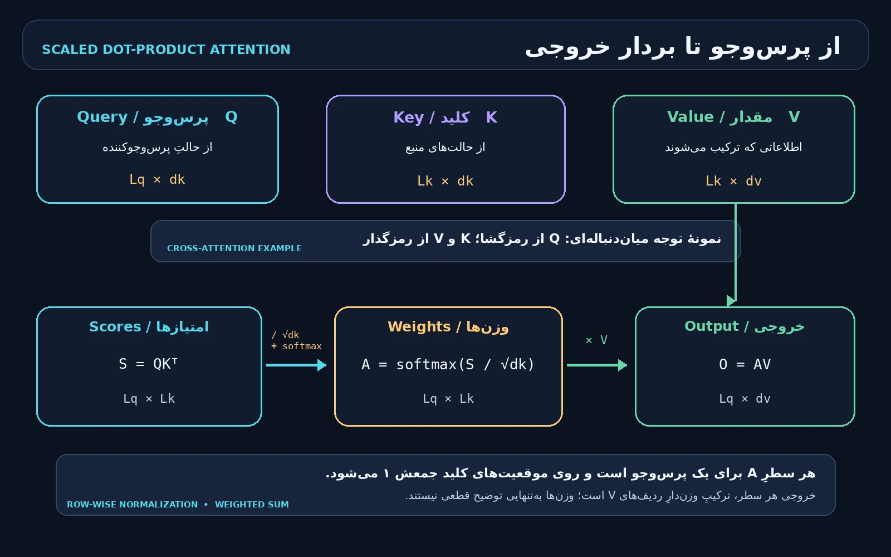

**شکل ۳-۲-۱ — از Q/K/V تا بردارهای خروجی.** ابعاد روی شکل نام‌گذاری شده‌اند تا محل هر ضرب روشن بماند. `Lq` تعداد پرس‌وجوها، `Lk` تعداد موقعیت‌های کلید/مقدار، `dk` بُعد کلید و `dv` بُعد مقدار است. در مثال، خروجی یک بردار به ازای هر پرس‌وجو دارد.

## ۴. اول ابعاد را حساب کنیم

فرض کنید در این فصل یک نمونهٔ دسته‌ای با `B` دنباله داریم و برای هر دنباله یک سر توجه به کار می‌بریم. شکل تانسورها چنین است:

| تانسور | شکل | توضیح |
|---|---|---|
| `Q` | `B × Lq × dk` | `B` دسته، `Lq` پرس‌وجو، `dk` مؤلفه برای هر پرس‌وجو |
| `K` | `B × Lk × dk` | `Lk` کلید منبع؛ بُعد ویژگی با `Q` برابر است |
| `V` | `B × Lk × dv` | یک مقدار متناظر با هر کلید؛ بُعد `dv` می‌تواند متفاوت باشد |
| `QKᵀ` | `B × Lq × Lk` | هر ردیف پرس‌وجو را با همهٔ کلیدها مقایسه می‌کند |
| `A` پس از softmax | `B × Lq × Lk` | برای هر پرس‌وجو یک وزن به ازای هر کلید |
| `AV` | `B × Lq × dv` | خروجی به ازای هر پرس‌وجو |

اگر به‌جای ضرب ماتریسیِ هر نمونه از تانسورهای سه‌بعدی استفاده کنیم، `Kᵀ` باید فقط دو محور آخر را جابه‌جا کند؛ در PyTorch این کار `key.transpose(-2, -1)` است. انتقال همهٔ محورهای دسته‌ای را جابه‌جا نمی‌کند.

بدون محور دسته‌ای، صورت ساده این است: `Q` شکل `Lq×dk`، `K` شکل `Lk×dk` و `V` شکل `Lk×dv` دارند. در نتیجه `QKᵀ` شکل `Lq×Lk` و حاصل `AV` شکل `Lq×dv` است. این کنترل ابعاد جلوی خطای رایجِ استفاده از `K` به‌جای `Kᵀ` یا نرم‌سازی روی محور اشتباه را می‌گیرد.

## ۵. امتیاز، مقیاس‌گذاری و نرمال‌سازی

ابتدا سازگاری پرس‌وجو و کلید را با ضرب داخلی می‌سنجیم. سپس امتیاز را بر ریشهٔ بُعد کلید تقسیم می‌کنیم و روی **محور کلیدها** softmax می‌گیریم:

<math xmlns="http://www.w3.org/1998/Math/MathML" display="block" aria-label="اسکور برابر کیو ضربدر ترانهاده کی، تقسیم بر ریشه دی کی؛ آلفای آی جی برابر سافت‌مکس سطری اسکور؛ خروجی او برابر آلفا ضربدر وی"><mrow><mi>S</mi><mo>=</mo><mfrac><mrow><mi>Q</mi><msup><mi>K</mi><mi>T</mi></msup></mrow><msqrt><msub><mi>d</mi><mi>k</mi></msub></msqrt></mfrac><mo>,</mo><mspace width="0.5em"/><msub><mi>α</mi><mrow><mi>i</mi><mi>j</mi></mrow></msub><mo>=</mo><mfrac><mrow><mi>exp</mi><mo>(</mo><msub><mi>S</mi><mrow><mi>i</mi><mi>j</mi></mrow></msub><mo>)</mo></mrow><mrow><munderover><mo>∑</mo><mrow><mi>m</mi><mo>=</mo><mn>1</mn></mrow><msub><mi>L</mi><mi>k</mi></msub></munderover><mi>exp</mi><mo>(</mo><msub><mi>S</mi><mrow><mi>i</mi><mi>m</mi></mrow></msub><mo>)</mo></mrow></mfrac><mo>,</mo><mspace width="0.5em"/><mi>O</mi><mo>=</mo><mi>AV</mi></mrow></math>

متن جایگزین فرمول: `S=QKᵀ/√dk`؛ وزن `αᵢⱼ=exp(Sᵢⱼ)/Σₘ exp(Sᵢₘ)`؛ خروجی `O=AV`. جمع softmax برای هر ردیف `i` روی همهٔ `Lk` کلیدهاست.

از آن‌جا که softmax روی محور آخر اجرا می‌شود، هر ردیف `A` غیرمنفی است و مجموعش، جز خطای گردکردن، ۱ می‌شود. هر ردیف خروجی نیز جمعی وزن‌دار از ردیف‌های `V` است. در حالت بدون ماسک و بدون dropout، این خروجی ترکیب محدبِ بردارهای مقدار همان نمونه است. این گزاره دربارهٔ محاسبهٔ همین لایه است، نه دربارهٔ معنای کلیِ پیش‌بینی نهایی.

### چرا بر `√dk` تقسیم می‌کنیم؟

اگر مؤلفه‌های `q` و `k` مستقل، میانگین‌شان صفر و واریانس هرکدام ۱ باشد، واریانس جمعِ ضرب‌های مؤلفه‌ای در `q·k` با `dk` رشد می‌کند. تقسیم بر `√dk` اندازهٔ معمول امتیازها را برای چنین فرضی در مقیاسی نزدیک‌تر نگه می‌دارد. بدون این مقیاس‌گذاری، softmax ممکن است برای بُعد بزرگ به ناحیهٔ تیز/اشباع برسد؛ در آن ناحیه مشتق نرم‌سازی کوچک می‌شود و یادگیری می‌تواند دشوارتر شود. همین انگیزه در مقالهٔ Transformer آمده است [۲].

این استدلال بر فرضی ساده دربارهٔ مؤلفه‌ها متکی است؛ توزیع‌های واقعی در شبکهٔ آموخته‌شده الزاماً مستقل یا واحد-واریانس نیستند. تقسیم بر `√dk` تضمین نمی‌کند که همهٔ امتیازها کوچک، کالیبره یا از نظر معنا درست باشند. همچنین این کار نرمال‌سازی طول بردار و محاسبهٔ شباهت کسینوسی نیست؛ فقط ضریب مقیاس در این صورت‌بندی است.

## ۶. مثال عددی: دو کلید، دو مقدار

برای دیدن هر مرحله، یک پرس‌وجو و دو موقعیت منبع انتخاب می‌کنیم:

```text
q = [1, 0]
k₁ = [1, 0]       v₁ = [10, 0]
k₂ = [0, 1]       v₂ = [ 0,10]
dk = 2
```

ضرب داخلی خام `q·k₁=1` و `q·k₂=0` است؛ پس امتیازهای مقیاس‌شده برابر `[1/√2, 0] ≈ [0.7071, 0]` می‌شوند. softmax روی همین دو موقعیت می‌دهد:

```text
α ≈ [0.66976, 0.33024]
```

در نتیجه:

```text
o = 0.66976 × [10, 0] + 0.33024 × [0, 10]
  ≈ [6.69762, 3.30238]
```

این نمونه نشان می‌دهد ضرب در `V` چگونه مقدارهای متناسب با وزن‌ها را ترکیب می‌کند. امتیاز بالاتر به معنی «ارزش انسانی بیشتر» نیست؛ فقط در این ماژول، برای این پرس‌وجو و این ورودی، ضریب وزن‌دهی بزرگ‌تری ساخته است.

## ۷. پیاده‌سازی و بررسی‌های پایه

در کد آموزشی، محاسبه را صریح نگه می‌داریم: `Q @ Kᵀ`، تقسیم بر `√dk`، `torch.softmax(..., dim=-1)` و سپس ضرب در `V`. خروجی دوم تابع وزن‌های `A` است تا بتوانیم شکل و مجموع هر ردیف را آزمایش کنیم. تابع تولیدی PyTorch خروجی توجه را می‌دهد و الزاماً خود ماتریس وزن را برنمی‌گرداند.

فایل آزموده‌شده در `book-engineering/projects/34-attention/attention.py` است؛ کد کامل آن در پایان همین فصل آمده است. تابع برای روشن‌بودن درس، ورودی سه‌بعدی، dtype شناور، شکل‌های سازگار و batch/دنبالهٔ پرس‌وجوی غیرخالی را بررسی می‌کند؛ ورودی خالی را به‌جای تولید خروجی تهی، صریح رد می‌کند. این نمونه یک سر دارد؛ projectionهای `W_Q/W_K/W_V` را باید مدل پیرامونی فراهم کند. پیاده‌سازی ماسک و dropout ندارد و جایگزین API کامل تولیدی نیست.

اجرای نمونهٔ کوچک:

```bash
cd book-engineering/projects/34-attention
python attention.py
python -m unittest -v
```

در آزمون CPU با PyTorch 2.6، نمونه وزن‌های حدود `[0.66976, 0.33024]` و خروجی حدود `[6.69762, 3.30238]` داد. آزمون‌ها هشت مورد را بررسی می‌کنند: مثال محاسبه‌شده، شکل‌های دسته‌ای با طول متفاوت پرس‌وجو و منبع، نرمال‌شدن ردیف‌ها، برابری خروجی با API مرجع در تلورانس، گرادیان‌های متناهی، softmax برای امتیازهای بزرگ متناهی و رد ورودی‌های ناسازگار. مقادیر ممیزشناور ممکن است با dtype، نسخه و kernel تفاوت‌های کوچک داشته باشند.

مستندات PyTorch 2.6 برای `torch.nn.functional.scaled_dot_product_attention` شکل‌های `query/key/value`، ضریب پیش‌فرض `1/√E` و انتخاب kernelهای بهینه را شرح می‌دهند [۳]. در همان نسخه، اگر `dropout_p` مثبت به تابع داده شود، dropout اعمال می‌شود؛ پس در استنتاج مقدار صفر را صریح بدهید، مگر آن‌که رفتار تصادفی عمداً خواسته شده باشد. اختلاف اندک میان اجرای آموزشی و kernelهای fused، به‌علت ترتیب/دقت عملیات ممیزشناور ممکن است؛ مقایسه با تلورانس مناسب را جایگزین انتظارِ تطبیق بیت‌به‌بیت کنید. مستندات نسخه‌دار را برای نسخهٔ نصب‌شده بخوانید؛ رفتار API می‌تواند تغییر کند.

## ۸. آزمون‌های معنایی و خطاهای رایج

پیش از اعتماد به پیاده‌سازی، این پرسش‌ها را پاسخ دهید:

1. آیا بعد آخر `Q` و `K` یکسان است؟ باید `dk` برابر باشد تا ضرب `QKᵀ` ممکن شود.
2. آیا طول محور کلید در `K` و `V` برابر است؟ هر وزن برای یک موقعیت کلید، همان ردیف مقدار را انتخاب می‌کند.
3. آیا softmax روی محور `Lk` اجرا می‌شود؟ در شکل سه‌بعدی ساده، این `dim=-1` است.
4. آیا شکل خروجی `[B,Lq,dv]` است؟ خروجی به تعداد پرس‌وجوهاست، نه الزاماً به طول منبع.
5. آیا ردیف‌های وزن مجموعی نزدیک ۱ دارند؟ این آزمون جهت softmax و محور نرمال‌سازی را بررسی می‌کند.
6. آیا `output` با `weights @ value` برابر است و گرادیان از `Q/K/V` می‌گذرد؟ این موارد را در آزمون‌ها می‌سنجیم.

خطاهای متداول عبارت‌اند از تقسیم بر `dk` به‌جای `√dk`، استفاده از `K` بدون ترانهاده، اعمال softmax روی محور پرس‌وجو، ناسازگاری طول کلید و مقدار، و این فرض که همهٔ پیاده‌سازی‌ها همواره امتیازها را بر `√dk` تقسیم می‌کنند. در APIهای مختلف ممکن است مقدار پیش‌فرض یا امکان تعیین scale فرق کند؛ پارامتر همان نسخه را بررسی کنید [۳].

در مدل واقعی، sequence padding، mask، dropout، batch، dtype و layout هم اهمیت دارند. در این فصل فقط حالت پایه را آزموده‌ایم و دربارهٔ صحت یک مدل کامل یا عملکرد GPU ادعایی نداریم. فصل ۳۵ به توسعه‌های معماریِ بعدی می‌پردازد.

## ۹. وزن توجه را با توضیح قطعی اشتباه نگیریم

وزن `αᵢⱼ` معنای ریاضی روشنی دارد: ضریب موقعیت `j` در جمع وزن‌دارِ خروجی همان ماژول، برای پرس‌وجوی `i`. اما از این تعریف به‌تنهایی نتیجه نمی‌شود که مقدار وزن، اهمیت علّی یا توضیح وفادارِ پیش‌بینی نهایی است.

Jain و Wallace در ۲۰۱۹ در چند مدل زبانی، شواهدی گزارش کردند که وزن‌ها ممکن است با بعضی سنجه‌های اهمیت ویژگی هم‌راستا نباشند و توزیع‌های متفاوتی بتوانند خروجی مشابه بدهند [۴]. Wiegreffe و Pinter همان سال تأکید کردند که نتیجه به تعریف «توضیح» و طراحی آزمون وابسته است و ارزیابی باید کل مدل را در نظر بگیرد [۵]. این دو مقاله محدودهٔ بحث روش‌شناختی را نشان می‌دهند؛ هیچ‌کدام مجوز نمی‌دهند که هر نقشهٔ توجه در هر معماری را بی‌قیدوشرط رد یا تأیید کنیم.

قاعدهٔ عملی: وزن‌ها را ابتدا به‌عنوان **ضرایب محاسباتی همین لایه** تفسیر کنید. اگر هدف توضیح‌پذیری است، تعریف توضیح و معیار وفاداری را روشن کنید، مدل و لایه را مشخص کنید، مقایسه و آزمون مداخله‌ای مناسب طراحی کنید و نتیجه را به همان شرایط محدود سازید. رنگ‌کردن وزن‌های بزرگ در یک heatmap به‌تنهایی شاهد تصمیم‌گیری مدل نیست.

## ۱۰. هزینهٔ محاسبه و انتخاب پیاده‌سازی

برای محاسبهٔ صریحِ همهٔ امتیازها، جدول `S` و وزن‌های `A` هرکدام `Lq×Lk` خانه دارند؛ هزینهٔ ضرب `QKᵀ` با ابعاد ویژگی رشد می‌کند و ضرب `AV` نیز به `dv` وابسته است. بنابراین طول دنباله، ابعاد و تعداد نمونه‌ها روی حافظه و زمان اثر می‌گذارند. این شمارش آموزشی به‌تنهایی سرعت واقعی را پیش‌بینی نمی‌کند: device، dtype، شکل دقیق ورودی و kernel انتخاب‌شده هم دخیل‌اند.

در PyTorch، API سطح‌بالای Scaled Dot-Product Attention می‌تواند kernel بهینهٔ سازگار با ورودی و backend را انتخاب کند [۳]. این انتخاب ممکن است در محاسبات ممیزشناور تفاوت جزئی ایجاد کند. برای کاربرد واقعی، شکل و dtype واقعی را روی سخت‌افزار هدف benchmark کنید؛ از سرعت اجرای نمونهٔ CPU یا از کوتاهی یک تابع نتیجه‌گیری نکنید. در این فصل صحت فرمول پایه را می‌آزماییم، نه برتری سرعت یک backend را.

## ۱۱. تمرین و جمع‌بندی

### تمرین‌ها

1. با سه کلید و سه مقدار دوبعدی، یک `Q` بسازید و `QKᵀ`، امتیازهای مقیاس‌شده، وزن‌ها و خروجی را دستی یا با ماشین‌حساب دنبال کنید. بررسی کنید وزن‌ها در کدام محور به ۱ جمع می‌شوند.
2. طول پرس‌وجوها را ۲ و طول منبع را ۵ بگذارید. شکل `Q`، `K`, `V`, `A` و `O` را بنویسید و توضیح دهید چرا شکل خروجی `Lq` را دنبال می‌کند.
3. فرض کنید `dk=16`. ضریب درست چیست؟ توضیح دهید چرا این عمل با نرمال‌سازی طول `q` و `k` فرق دارد.
4. در پروژه، `d_v` را از `d_k` متفاوت بگیرید و آزمون شکل را گسترش دهید. سپس آگاهانه softmax را روی محور نادرست اجرا کنید؛ کدام آزمون باید این خطا را آشکار کند؟
5. دو جمله بنویسید: یکی که نقش محاسباتی وزن `αᵢⱼ` را دقیق تعریف کند و دیگری که از ادعای توضیح‌پذیریِ بی‌پشتوانه پرهیز کند.

### آنچه باید به یاد بماند

- Query و Key برای ساخت امتیازها به فضای ویژگی هم‌اندازه فرافکنی می‌شوند؛ Valueها اطلاعات خروجی را حمل می‌کنند.
- صورت‌بندی این فصل `softmax(QKᵀ/√dk)V` است؛ softmax برای هر پرس‌وجو روی کلیدها اعمال می‌شود.
- شکل‌ها را پیش از اجرا بنویسید: امتیاز و وزن `Lq×Lk`، خروجی `Lq×dv`.
- در حالت پایه، وزن هر ردیف مجموعاً ۱ است و خروجی جمع وزن‌دار Valueهاست؛ تفسیر معنایی/توضیحیِ وزن‌ها نیازمند شواهد جداگانه است.
- API، dropout، backend و دقت عددی به نسخه و ورودی وابسته‌اند. این فصل ماسک علّی و Multi-Head را پوشش نمی‌دهد.

### واژه‌نامهٔ کوتاه

- **پرس‌وجو (Query, Q):** برداری که سازگاری‌اش با کلیدها امتیاز می‌گیرد.
- **کلید (Key, K):** برداری که در محاسبهٔ امتیاز هر موقعیت منبع شرکت می‌کند.
- **مقدار (Value, V):** برداری که بر پایهٔ وزن‌های توجه در خروجی ترکیب می‌شود.
- **مقیاس‌گذاری (scaling):** تقسیم امتیاز ضرب‌داخلی بر `√dk` در صورت‌بندی این فصل.
- **Softmax:** نگاشت امتیازهای یک ردیف به وزن‌های نامنفی با مجموع ۱.

[جواب‌نامهٔ تشریحی فصل ۳۴](book-engineering/answers/34-attention-fa.md) · [پروژهٔ اجرایی و هشت آزمون](book-engineering/projects/34-attention/README.md)

## ۱۲. منابع بیرونی

1. Dzmitry Bahdanau, Kyunghyun Cho, Yoshua Bengio. “Neural Machine Translation by Jointly Learning to Align and Translate.” ICLR 2015؛ نسخهٔ arXiv:1409.0473 نخستین‌بار ۱ سپتامبر ۲۰۱۴ ثبت شد. [مقاله در arXiv](https://arxiv.org/abs/1409.0473). منبع اولیه برای توجه افزایشی و جمع وزن‌دار حالت‌های منبع.
2. Ashish Vaswani et al. “Attention Is All You Need.” NeurIPS 2017؛ arXiv:1706.03762، نسخهٔ نخست ۱۲ ژوئن ۲۰۱۷ و نسخهٔ بازنگری‌شدهٔ v7 در ۲ اوت ۲۰۲۳. [مقاله در arXiv](https://arxiv.org/abs/1706.03762) · [نسخهٔ NeurIPS](https://papers.neurips.cc/paper/7181-attention-is-all-you-need.pdf). منبع فرمول Scaled Dot-Product و انگیزهٔ مقیاس‌گذاری.
3. PyTorch. “`torch.nn.functional.scaled_dot_product_attention`.” مستندات نسخهٔ 2.6. [صفحهٔ رسمی API](https://docs.pytorch.org/docs/2.6/generated/torch.nn.functional.scaled_dot_product_attention.html). برای شکل ورودی/خروجی، scale پیش‌فرض، dropout و انتخاب kernel؛ نسخهٔ مستندات در این فصل عمداً مشخص شده است.
4. Sarthak Jain, Byron C. Wallace. “Attention is not Explanation.” NAACL-HLT 2019, pp. 3543–3556. [ACL Anthology](https://aclanthology.org/N19-1357/) · [DOI: 10.18653/v1/N19-1357](https://doi.org/10.18653/v1/N19-1357). یک سوی بحث دربارهٔ محدودیت تفسیر وزن‌های توجه.
5. Sarah Wiegreffe, Yuval Pinter. “Attention is not not Explanation.” EMNLP-IJCNLP 2019, pp. 11–20. [ACL Anthology](https://aclanthology.org/D19-1002/) · [DOI: 10.18653/v1/D19-1002](https://doi.org/10.18653/v1/D19-1002). تأکید بر تعریف توضیح و طراحی ارزیابی.

**دسترسی منابع برخط: ۵ نوامبر ۲۰۲۶.** مستندات API به نسخهٔ 2.6 ارجاع می‌دهند؛ نسخهٔ نصب‌شده و رفتار دقیق backend را برای پروژهٔ واقعی جداگانه وارسی کنید.

## پیوست: پیاده‌سازی کامل پروژه

فایل زیر همان نسخهٔ اجرا و آزمون‌شدهٔ `book-engineering/projects/34-attention/attention.py` است. این نمونهٔ سه‌بعدیِ آموزشی یک سر را اجرا می‌کند و برای روشن‌ماندن مفهوم، mask یا dropout ندارد.

```python
"""Small, explicit scaled dot-product attention for chapter 34 (CPU-friendly)."""
from __future__ import annotations

import math
import torch
import torch.nn.functional as F


def scaled_dot_product_attention(
    query: torch.Tensor,
    key: torch.Tensor,
    value: torch.Tensor,
) -> tuple[torch.Tensor, torch.Tensor]:
    """Compute one-head attention for [batch, sequence, feature] tensors.

    query: [B, Lq, dk], key: [B, Lk, dk], value: [B, Lk, dv]
    returns output [B, Lq, dv] and row-normalized weights [B, Lq, Lk].

    This teaching implementation intentionally has no mask or dropout. Those
    choices are model/training-specific and causal masking is the next chapter.
    """
    tensors = {"query": query, "key": key, "value": value}
    if any(not isinstance(tensor, torch.Tensor) for tensor in tensors.values()):
        raise TypeError("query, key, and value must be torch.Tensor objects")
    if any(tensor.ndim != 3 for tensor in tensors.values()):
        raise ValueError("expected rank-3 [batch, sequence, feature] tensors")
    if any(not tensor.is_floating_point() for tensor in tensors.values()):
        raise TypeError("query, key, and value must have floating-point dtype")
    if not (query.dtype == key.dtype == value.dtype):
        raise TypeError("query, key, and value must use the same dtype")
    if not (query.device == key.device == value.device):
        raise ValueError("query, key, and value must be on the same device")
    if query.size(0) == 0:
        raise ValueError("batch dimension must be non-empty")
    if query.size(1) == 0:
        raise ValueError("query sequence must contain at least one position")
    if query.size(0) != key.size(0) or key.size(0) != value.size(0):
        raise ValueError("batch dimensions must match")
    if query.size(-1) != key.size(-1):
        raise ValueError("query and key feature dimensions must match")
    if key.size(1) == 0 or value.size(1) == 0:
        raise ValueError("the key/value sequence must contain at least one position")
    if key.size(1) != value.size(1):
        raise ValueError("key and value sequence lengths must match")
    if query.size(-1) == 0 or value.size(-1) == 0:
        raise ValueError("feature dimensions must be non-empty")

    dk = query.size(-1)
    scores = torch.matmul(query, key.transpose(-2, -1)) / math.sqrt(dk)
    weights = torch.softmax(scores, dim=-1)
    output = torch.matmul(weights, value)
    return output, weights


def main() -> None:
    # One query, two keys, and two 2-D values; all calculations are on CPU.
    query = torch.tensor([[[1.0, 0.0]]], dtype=torch.float64)
    key = torch.tensor([[[1.0, 0.0], [0.0, 1.0]]], dtype=torch.float64)
    value = torch.tensor([[[10.0, 0.0], [0.0, 10.0]]], dtype=torch.float64)

    output, weights = scaled_dot_product_attention(query, key, value)
    reference = F.scaled_dot_product_attention(
        query, key, value, dropout_p=0.0, is_causal=False
    )
    print("device=cpu")
    print("scores_scaled=", (query @ key.transpose(-2, -1) / math.sqrt(2)).tolist())
    print("weights=", weights.tolist())
    print("output=", output.tolist())
    print("torch_reference_matches=", torch.allclose(output, reference, atol=1e-12, rtol=1e-12))


if __name__ == "__main__":
    main()
```

---

# جلد سوم، فصل ۳ — Self-Attention، چندسری و ماسک علّی

**The Art & Science of Building Intelligence | Babak & Ai | فصل سراسری ۳۵ از نقشهٔ پنج‌جلدی**

**تاریخ بازبینی منابع: ۵ نوامبر ۲۰۲۶؛ منابع برخط در همین تاریخ بازبینی شدند.**

## ۱. از Attention میان‌دنباله‌ای به رابطه‌های درون یک دنباله

در فصل ۳۴ یک پرس‌وجو را با کلیدها مقایسه کردیم و مقدارها را ترکیب کردیم. در **Self-Attention**، پرس‌وجو، کلید و مقدار از یک دنبالهٔ واحد ساخته می‌شوند. اگر ورودی لایه `X` باشد، سه projection آموختنی روی همان `X` اعمال می‌شوند و هر موقعیت می‌تواند از موقعیت‌های دیگر نمایش تازه‌ای بسازد. «Self» به مبدأ مشترک `Q/K/V` اشاره دارد؛ معنایش این نیست که سه ماتریس یا سه نقش یکی هستند.

توجه Self می‌تواند دوسویه باشد: در یک لایهٔ رمزگذار، هر موقعیت اجازه دارد کل دنباله را ببیند. اما مدل خودرگرسیو که واژهٔ بعدی را پیش‌بینی می‌کند، نباید هنگام آموزش از پاسخ‌های آینده استفاده کند؛ برای آن **ماسک علّی (Causal Mask)** لازم است. پس Self-Attention و ماسک علّی دو مفهوم جدا هستند: یکی می‌گوید `Q/K/V` از کجا می‌آیند؛ دیگری تعیین می‌کند هر پرس‌وجو کدام کلیدها را می‌تواند ببیند [۱].

**پیش‌نیاز:** فرمول Attention و شکل‌های `Q/K/V` در فصل ۳۴، بردار و ضرب ماتریسی از جلدهای پیشین. **هدف:** Self-Attention را از توجه میان‌دنباله‌ای تشخیص دهید؛ سرهای متعدد را تقسیم و دوباره ادغام کنید؛ ماسک علّیِ بدون خطای یک‌خانه‌ای بسازید؛ و با تغییر ورودی آینده، آزمون کنید که خروجی‌های گذشته نشت اطلاعات نداشته باشند.


**شکل ۳-۳-۱ — چندسری و دید علّی.** ردیف `i` به پرس‌وجوی موقعیت `i` و ستون `j` به کلید موقعیت `j` مربوط است. خانهٔ سبز مجاز است؛ خانهٔ قرمز آینده است و به softmax راه داده نمی‌شود. در مثال تصویری، موقعیت ۲ خودِ موقعیت ۲ را می‌بیند، اما موقعیت‌های ۳ و ۴ را نه.

## ۲. Self-Attention چه چیزی را محاسبه می‌کند؟

ورودی لایه را `X ∈ R^{B×L×d_model}` بگیرید: `B` تعداد نمونه‌ها، `L` طول دنباله و `d_model` بُعد ویژگی است. این فصل یک طراحی متداول را دنبال می‌کند که در آن ماتریس‌های خطی، `Q`، `K` و `V` را از همین `X` تولید می‌کنند:

<math xmlns="http://www.w3.org/1998/Math/MathML" display="block" aria-label="کیو برابر ایکس دبلیو کیو؛ کی برابر ایکس دبلیو کی؛ وی برابر ایکس دبلیو وی"><mrow><mi>Q</mi><mo>=</mo><mi>X</mi><msub><mi>W</mi><mi>Q</mi></msub><mo>,</mo><mspace width="0.5em"/><mi>K</mi><mo>=</mo><mi>X</mi><msub><mi>W</mi><mi>K</mi></msub><mo>,</mo><mspace width="0.5em"/><mi>V</mi><mo>=</mo><mi>X</mi><msub><mi>W</mi><mi>V</mi></msub></mrow></math>

متن جایگزین فرمول: `Q=XW_Q`، `K=XW_K`، `V=XW_V`. ورودی هر سه projection یکسان است، اما وزن‌های یادگرفتنی‌شان مستقل‌اند.

برای توجه یک‌سر، موقعیت `i` بردارهای `q_i`، `k_i` و `v_i` دارد. امتیاز `q_i` با همهٔ `k_j`ها، وزن هر `v_j` را می‌سازد؛ در self-attention غیرعلّی همهٔ موقعیت‌ها مجازند. در حالت علّی، جایگاه‌های آینده حذف می‌شوند. در هیچ‌کدام نباید فرض کنیم عدد موقعیت به‌تنهایی معنای واژگانی آماده‌ای دارد.

در معماری Transformer، این projectionها بین لایه‌ها بازنمایی‌های زمینه‌ای را تولید می‌کنند. سازوکار توجه فقط یکی از اجزای بلوک Transformer است؛ Residual، LayerNorm، Feed-Forward و نمایش موقعیت در فصل‌های بعدی نقشه می‌آیند و در پروژهٔ این فصل پیاده‌سازی نشده‌اند.

## ۳. چرا چند سر؟

یک سر توجه برای هر پرس‌وجو یک توزیع وزن روی کلیدها و یک جمع وزن‌دار می‌سازد. **Multi-Head Attention** به‌جای یک projection واحد، `h` projection متفاوت برای `Q/K/V` می‌آموزد؛ هر سر در فضای ویژگی خود attention انجام می‌دهد. سپس خروجی سرها کنار هم قرار می‌گیرد و projection نهایی آن‌ها را ترکیب می‌کند [۱].

<math xmlns="http://www.w3.org/1998/Math/MathML" display="block" aria-label="سر ام برابر توجه کیو دبلیو کیو ام، کی دبلیو کی ام، وی دبلیو وی ام؛ چندسر برابر الحاق سرها ضربدر دبلیو او"><mrow><msub><mi>head</mi><mi>m</mi></msub><mo>=</mo><mi>Attention</mi><mo>(</mo><mi>Q</mi><msubsup><mi>W</mi><mi>m</mi><mi>Q</mi></msubsup><mo>,</mo><mi>K</mi><msubsup><mi>W</mi><mi>m</mi><mi>K</mi></msubsup><mo>,</mo><mi>V</mi><msubsup><mi>W</mi><mi>m</mi><mi>V</mi></msubsup><mo>)</mo><mo>,</mo><mspace width="0.5em"/><mi>MultiHead</mi><mo>=</mo><mi>Concat</mi><mo>(</mo><msub><mi>head</mi><mn>1</mn></msub><mo>,</mo><mi>…</mi><mo>,</mo><msub><mi>head</mi><mi>h</mi></msub><mo>)</mo><msup><mi>W</mi><mi>O</mi></msup></mrow></math>

متن جایگزین فرمول: سر `m` attention روی سه projection مخصوص خودش انجام می‌دهد؛ خروجی همهٔ سرها الحاق و در `W_O` ضرب می‌شود. `Concat` اتصال روی محور ویژگی است، نه میانگین‌گیریِ خروجی سرها.

در نمونهٔ اصلی Transformer، `h=8` و در آن پیکربندی `d_k=d_v=d_model/h=64` بود [۱]. در پروژهٔ کوچک این فصل، برای سادگی `d_model` را به `h` بخش مساوی تقسیم می‌کنیم و `d_h=d_model/h` می‌گیریم؛ بنابراین `d_model` باید بر `h` بخش‌پذیر باشد. این یک قرارداد رایجِ پیاده‌سازی است، نه قانون ریاضی برای هر شکل ممکن از attention. یک projection ترکیبی `d_model→d_model` و reshape به سرها، نمایش فشردهٔ همان بخش‌های آموختنی است.

چند سر می‌تواند بازنمایی‌های متفاوتی فراهم کند، اما نام‌گذاری یک سر به «فاعل‌یاب» یا «مرجع‌یاب» بدون تحلیل و آزمون، از معادله نتیجه نمی‌شود. سرها را مستقل بررسی کنید و تفسیر معنایی را فرض قطعی نگیرید.

## ۴. ردگیری شکل‌ها در یک پیاده‌سازی چندسری

در حالت batch-first:

| مرحله | شکل | معنا |
|---|---|---|
| ورودی `X` | `B×L×d_model` | یک بردار برای هر موقعیت دنباله |
| `Q,K,V` پس از projection | `B×L×d_model` برای هرکدام | projectionهای جدا از ورودی مشترک |
| reshape و جابه‌جایی محور | `B×h×L×d_h` | `d_model=h×d_h` در این طراحی |
| ماتریس امتیاز هر سر | `B×h×L×L` | هر پرس‌وجو با همهٔ موقعیت‌های کلید سنجیده می‌شود |
| وزن و خروجی سر | `B×h×L×L` و `B×h×L×d_h` | softmax روی محور کلید، سپس ضرب در `V` |
| الحاق سرها | `B×L×d_model` | بازگشت محور سرها به ویژگی |
| projection خروجی | `B×L×d_model` | ترکیب آموختنی خروجی سرها |

در کد، projection تا زمانی که محور سر ساخته شود `[B,L,h,d_h]` است. سپس `transpose(1,2)` آن را به `[B,h,L,d_h]` می‌برد تا `QKᵀ` روی دو محور آخر درست باشد. پس از `A@V`، جابه‌جایی معکوس و `contiguous().view(...)` محورهای سر و ویژگی را به `[B,L,d_model]` برمی‌گردانند.

برای طول `L`، ماتریس امتیاز استاندارد هر سر `L×L` است. در طراحی dense با همهٔ سرها، حافظهٔ وزن‌ها متناسب با `B×h×L²` و محاسبهٔ ضرب‌های توجه متناسب با `B×h×L²×d_h` رشد می‌کند. این رشد توضیح می‌دهد چرا طول زمینه هزینه‌ساز است؛ ماسک علّی در نسخهٔ صریح این پروژه تعداد خانه‌های ماتریس را کم نمی‌کند، بلکه مسیرهای اطلاعاتی را محدود می‌کند. kernelهای بهینه ممکن است محاسبات را جور دیگری سازمان دهند؛ کارایی باید روی ورودی و سخت‌افزار هدف سنجیده شود [۱، ۳].

## ۵. ماسک علّی: قانون، نه تزئین نمودار

اگر دنباله را از صفر شماره‌گذاری کنیم، پرس‌وجوی `i` فقط اجازه دارد به کلیدهای `j≤i` توجه کند. ماسک جمع‌شوندهٔ `M` برای خانهٔ مجاز صفر و برای آینده منفی بی‌نهایت می‌گذارد:

<math xmlns="http://www.w3.org/1998/Math/MathML" display="block" aria-label="ام آی جی صفر است اگر جی کوچک‌تر مساوی آی باشد، و منفی بی‌نهایت اگر جی بزرگ‌تر از آی باشد؛ وزن آلفا سافت‌مکس امتیاز به اضافه ماسک است"><mrow><msub><mi>M</mi><mrow><mi>i</mi><mi>j</mi></mrow></msub><mo>=</mo><mrow><mo>{</mo><mtable><mtr><mtd><mn>0</mn></mtd><mtd><mtext>اگر </mtext><mi>j</mi><mo>≤</mo><mi>i</mi></mtd></mtr><mtr><mtd><mo>−</mo><mi>∞</mi></mtd><mtd><mtext>اگر </mtext><mi>j</mi><mo>&gt;</mo><mi>i</mi></mtd></mtr></mtable></mrow><mo>,</mo><mspace width="0.5em"/><mi>A</mi><mo>=</mo><mi>softmax</mi><mo>(</mo><mfrac><mrow><mi>Q</mi><msup><mi>K</mi><mi>T</mi></msup></mrow><msqrt><msub><mi>d</mi><mi>h</mi></msub></msqrt></mfrac><mo>+</mo><mi>M</mi><mo>)</mo></mrow></math>

متن جایگزین فرمول: `Mᵢⱼ=0` برای `j≤i` و `−∞` برای `j>i`. `A=softmax(QKᵀ/√d_h + M)`. softmax روی محور آخر است.

افزودن `−∞` پیش از softmax، وزن آن موقعیت را به صفر می‌رساند. برای دنبالهٔ پنج‌تایی، سطر صفر فقط ستون صفر را می‌بیند؛ سطر ۲ فقط ستون‌های صفر، یک و دو را. قطر باید باز بماند تا هر موقعیت بتواند خودش را ببیند. بستن قطر یا جابه‌جایی مثلث، خطای off-by-one یا جهت ماسک می‌سازد.

ماسک علّی با padding mask یکی نیست. اولی به ترتیب مکانی مربوط است و آینده را می‌بندد؛ دومی جایگاه‌های پرکننده را کنار می‌گذارد. در batch با طول‌های ناهمسان ممکن است به هر دو نیاز باشد. پروژهٔ این فصل طول ثابت دارد و padding mask ندارد.

همچنین ماسک علّی به‌تنهایی خط لولهٔ آموزش خودرگرسیو را کامل نمی‌کند: ورودی و هدف باید نسبت به یکدیگر یک موقعیت جابه‌جا باشند تا پیش‌بینیِ توکن بعدی ارزیابی شود، نه بازسازیِ برچسب همان موقعیت. آزمون پروژه تنها خودِ لایهٔ attention را می‌سنجد.

## ۶. چه زمانی ماسک علّی لازم است؟

برای رمزگذار دوسویه‌ای که باید هر موقعیت را با توجه به کل متن بازنمایی کند، دیدن دو سوی توالی می‌تواند بخشی از تعریف مسئله باشد و ماسک علّی لزوماً استفاده نمی‌شود. برای رمزگشای خودرگرسیو، هنگام آموزش همهٔ موقعیت‌ها به‌صورت موازی پردازش می‌شوند، اما هر موقعیت باید فقط متن پیشین و خودش را ببیند؛ ماسک این محدودیت را اعمال می‌کند [۱]. در استنتاج یک توکن در هر گام، مفهوم «آیندهٔ موجود در ورودی» شکل دیگری دارد، اما شرط اطلاعاتیِ نشت نکردنِ هدفِ هنوز پیش‌بینی‌نشده همچنان مهم است.

علّی‌بودن را به معنای «هرچیزی در سیستم از آینده مستقل است» تعمیم ندهید. ماسک این زیرلایه را محدود می‌کند. خطای ترتیب برچسب‌ها، ویژگی‌ای که از آینده محاسبه شده، یا مسیر دیگری در مدل می‌تواند جداگانه نشت بسازد؛ باید کل خط لوله را بر اساس قرارداد مسئله آزمود.

## ۷. آزمون قوی‌تر از نگاه‌کردن به ماسک: تغییر آینده

آزمون وزن‌ها بررسی می‌کند که خانه‌های `j>i` صفر باشند؛ آزمون مداخله‌ای، رفتار لایه را هم می‌سنجد: ورودی را تا موقعیت `k−1` ثابت نگه می‌داریم، مقدار موقعیت‌های `k` به بعد را به‌شدت عوض می‌کنیم و خروجی‌های موقعیت‌های کمتر از `k` را مقایسه می‌کنیم. در لایهٔ مستقلِ علّی و بدون dropout، خروجی‌های قبلی نباید تغییر کنند؛ وزن‌های قبلی هم نباید به کلیدهای آینده حساس باشند.

این آزمون در پروژه با seed ثابت و CPU اجرا می‌شود. هم تغییر خروجی و هم تغییر وزن را بررسی می‌کند؛ آزمون دیگری می‌سنجد که تغییر ورودیِ جاری می‌تواند بر خروجی همان موقعیت اثر بگذارد تا تست عدم نشت، مدل کاملاً بی‌اثر را به‌اشتباه تأیید نکند. این سنجش شواهدی برای همین پیاده‌سازی و ورودی‌هاست، نه اثبات امنیت یا صحت همهٔ پشتهٔ یک مدل زبانی.

## ۸. کد: از projection تا خروجی هر سر

پروژه `book-engineering/projects/35-self-attention/` ماژول را با `nn.Linear` می‌سازد و امتیاز، ماسک، softmax، جمع وزن‌دار و الحاق را آشکار نگه می‌دارد. `weights` را هم برمی‌گرداند تا آزمون‌ها بتوانند خانه‌های آینده را وارسی کنند. برای آموزش این انتخاب روشنگر است؛ در مدل production ممکن است API بهینه‌شده وزن‌ها را برنگرداند و kernelهای fused مسیر دیگری داشته باشند.

یک نکته دربارهٔ APIها: در مستندات نسخهٔ 2.6، ماسک بولی `torch.nn.functional.scaled_dot_product_attention` با `True` یعنی موقعیت **مجاز**؛ در `torch.nn.MultiheadAttention`، ماسک بولی `attn_mask` با `True` یعنی موقعیت **غیرمجاز** [۲، ۳]. یعنی در اولی برای دید علّی `tril` را به عنوان ماسک مجاز می‌دهیم، اما در دومی می‌توان مثلث بالای قطر را به عنوان خانهٔ مسدود داد. قرارداد را بر اساس همان API و نسخه بخوانید؛ یک ماسک را بی‌تبدیل میان دو تابع جابه‌جا نکنید.

در API سطح‌بالا نمونهٔ زیر از `nn.MultiheadAttention` استفاده می‌کند. `need_weights=False` برای مسیری که وزن‌ها لازم نیست، اجازه می‌دهد پیاده‌سازی به SDPA بهینه‌شده متکی باشد؛ رفتار و سرعت بسته به backend است. `is_causal` در مستندات MHA نسخهٔ 2.6 یک hint است و hint نادرست می‌تواند اجرای نادرست ایجاد کند؛ بنابراین در کد واقعی از ماسک درست و قرارداد مستند همان نسخه استفاده کنید [۲].

```python
import torch
from torch import nn

batch, length, d_model, heads = 2, 5, 8, 2
x = torch.randn(batch, length, d_model)
blocked_future = torch.ones(length, length, dtype=torch.bool).triu(diagonal=1)
mha = nn.MultiheadAttention(d_model, heads, batch_first=True)
output, _ = mha(x, x, x, attn_mask=blocked_future, need_weights=False)
print(tuple(output.shape))  # (2, 5, 8)
```

در تابع SDPA، معنای بولی برعکس است. این نمونه فقط یک mask را به F.scaled_dot_product_attention می‌دهد؛ `True` در مثلث پایین به معنی شرکت‌کردن در attention است:

```python
import torch
import torch.nn.functional as F

batch, heads, length, head_dim = 2, 3, 5, 4
q = torch.randn(batch, heads, length, head_dim)
k = torch.randn_like(q)
v = torch.randn_like(q)
allowed = torch.ones(length, length, dtype=torch.bool).tril()
y = F.scaled_dot_product_attention(q, k, v, attn_mask=allowed, dropout_p=0.0)
print(tuple(y.shape))  # (2, 3, 5, 4)
```

در نسخهٔ 2.6، تابع SDPA در صورت `dropout_p>0` dropout اعمال می‌کند؛ برای inference باید `dropout_p=0.0` بدهید. این تابع در همان مستندات beta اعلام شده و بسته به ورودی/backend می‌تواند kernel بهینه را انتخاب کند [۳]. ما در پروژه، dropout را اصلاً به کار نبرده‌ایم.

## ۹. هزینه و مرزهای مدل آموزشی

با `h` سر و طول `L`، ماتریس‌های امتیاز و وزن هر سر `L×L` هستند. در نسخهٔ denseِ این فصل، ماسک علّی پس از محاسبهٔ `QKᵀ` اعمال می‌شود؛ پس صرفِ ماسک در کد آموزشی، محاسبهٔ همهٔ زوج‌های موقعیت را حذف نمی‌کند. مشخصه‌های kernel بهینه و نسبت کار به حافظه به device، dtype، طول و نسخه بستگی دارد. به همین علت اندازه‌گیری زمان یک CPU کوچک را به GPU یا مدل واقعی تعمیم نمی‌دهیم [۱، ۳].

این پروژه همچنین **position encoding**، padding، dropout، Residual، LayerNorm، FFN، target shift، KV Cache، cross-attention و آموزش مدل را ندارد. position در فصل ۳۶ می‌آید؛ معماری کامل Decoder و تولید توکن موضوع فصل‌های بعدی نقشه است. اعداد و شکل‌های تمرین فقط برای توضیح و آزمون‌اند.

## ۱۰. تمرین‌ها و معیار عبور

1. برای `L=4`، ماتریس مجاز و ممنوع را با اندیس‌های صفر تا سه رسم کنید. دقیقاً مشخص کنید موقعیت ۱ چه ستون‌هایی را می‌بیند.
2. اگر `d_model=12` و `h=3` باشد، `d_h` چیست؟ شکل `Q` پس از projection، پس از reshape و ماتریس وزن چندسری را برای batch با اندازهٔ ۲ بنویسید.
3. چرا استفاده از `X` برای ساختن هر سه `Q/K/V` به‌تنهایی کافی نیست تا آینده بسته شود؟ چه قیدی باید بر softmax یا امتیازها اعمال شود؟
4. در `nn.MultiheadAttention` و `F.scaled_dot_product_attention`، مقدار True در ماسک بولی هرکدام چه معنایی دارد؟ یک test کوتاه بنویسید که از اشتباه علامت جلوگیری کند.
5. ورودی‌های موقعیت‌های ۴ و ۵ را عوض کنید. کدام خروجی‌ها باید ثابت بمانند؟ چرا آزمون «همهٔ خروجی‌ها ثابت‌اند» آزمون مناسبی نیست؟
6. چرا کاهش attention وزن‌دار به یک ماتریس `L×L` به معنای حذف هزینهٔ `L²` نیست؟ تفاوت ماسک اطلاعاتی و kernel sparse/بهینه را با زبان خود توضیح دهید.

**معیار عبور:** بتوانید شکل‌های `B×h×L×d_h` و `B×h×L×L` را درست دنبال کنید؛ با دست نشان دهید `j>i` مسدود است؛ ده تست پروژه را اجرا کنید؛ و دست‌کم یک آزمونِ تغییر آینده/ثبات گذشته را خودتان بازتولید کنید. پاسخ‌های تشریحی را پس از تلاش مستقل در [جواب‌نامهٔ فصل ۳۵](book-engineering/answers/35-self-attention-fa.md) ببینید. [پروژه و آزمون‌ها](book-engineering/projects/35-self-attention/README.md)

## ۱۱. جمع‌بندی

- در Self-Attention، `Q/K/V` از یک توالی ساخته می‌شوند؛ در cross-attention مبدأ Query و مبدأ Key/Value می‌توانند متفاوت باشند.
- در Multi-Head، projection هر سر جداست؛ نتایج در محور ویژگی الحاق و با `W_O` ترکیب می‌شوند.
- در ماسک علّی، موقعیت `i` فقط `j≤i` را می‌بیند. مثلث درست و قرارداد mask API را پیش از اجرا بررسی کنید.
- وزن آینده صفر، آزمون عدم نشت مفیدی است؛ تغییر ورودی‌های آینده و ثبات خروجی‌های گذشته آزمون مداخله‌ای مکملی است.
- ماسک علّی با padding mask فرق دارد و به‌تنهایی خط لولهٔ آموزش خودرگرسیو را کامل نمی‌کند.

### واژه‌نامهٔ کوتاه

- **Self-Attention:** سازوکاری که Query، Key و Value را از همان دنباله می‌سازد.
- **ماسک علّی (causal mask):** مانع دیدن موقعیت‌های آینده در تولید خودرگرسیو.
- **سر (head):** یک زیرفضای مستقل برای محاسبهٔ توجه در Multi-Head Attention.
- **توجه چندسری (Multi-Head):** ترکیب چند محاسبهٔ توجه با projectionهای آموختنی.

## ۱۲. منابع بیرونی

1. Ashish Vaswani et al. “Attention Is All You Need.” NeurIPS 2017؛ arXiv:1706.03762، نسخهٔ نخست ۱۲ ژوئن ۲۰۱۷ و نسخهٔ بازنگری‌شدهٔ v7 در ۲ اوت ۲۰۲۳. [متن arXiv](https://arxiv.org/abs/1706.03762) · [نسخهٔ HTML v7](https://arxiv.org/html/1706.03762v7) · [نسخهٔ NeurIPS](https://papers.neurips.cc/paper/7181-attention-is-all-you-need.pdf). بخش‌های 3.2.2 و 3.2.3 برای Multi-Head، self-attention و ماسک علّی؛ بخش 4 برای هزینهٔ Self-Attention.
2. PyTorch. “`torch.nn.MultiheadAttention`.” مستندات نسخهٔ 2.6. [صفحهٔ رسمی API](https://docs.pytorch.org/docs/2.6/generated/torch.nn.MultiheadAttention.html). شکل ورودی، `attn_mask`، `is_causal` و رفتار `need_weights`.
3. PyTorch. “`torch.nn.functional.scaled_dot_product_attention`.” مستندات نسخهٔ 2.6. [صفحهٔ رسمی API](https://docs.pytorch.org/docs/2.6/generated/torch.nn.functional.scaled_dot_product_attention.html). ماسک بولی، `is_causal`, dropout و انتخاب kernel.

**تاریخ دسترسی به منابع برخط: ۵ نوامبر ۲۰۲۶.** قواعد ماسک در این فصل به نسخهٔ مشخص PyTorch 2.6 ارجاع دارند؛ نسخهٔ اجرایی پروژه و نسخهٔ production را هنگام استفاده کنترل کنید.

## پیوست: کد کامل پروژه

این همان `causal_multihead.py` است که پروژه و آزمون‌ها اجرا می‌کنند؛ تمام فرض‌های آن در بالای فایل و README ثبت شده‌اند.

```python
"""Explicit causal multi-head self-attention for chapter 35."""
from __future__ import annotations

import math
import torch
from torch import nn


class CausalMultiHeadSelfAttention(nn.Module):
    """Batch-first, fixed-length, causal self-attention with visible weights.

    Input/output: [batch, sequence, d_model]
    Returned weights: [batch, heads, query_position, key_position]

    This teaching module has no positional encoding, padding mask, or dropout.
    """

    def __init__(self, d_model: int, num_heads: int) -> None:
        super().__init__()
        if isinstance(d_model, bool) or not isinstance(d_model, int):
            raise TypeError("d_model must be an integer")
        if isinstance(num_heads, bool) or not isinstance(num_heads, int):
            raise TypeError("num_heads must be an integer")
        if d_model <= 0 or num_heads <= 0:
            raise ValueError("d_model and num_heads must be positive")
        if d_model % num_heads != 0:
            raise ValueError("d_model must be divisible by num_heads in this design")

        self.d_model = d_model
        self.num_heads = num_heads
        self.head_dim = d_model // num_heads
        self.q_proj = nn.Linear(d_model, d_model, bias=False)
        self.k_proj = nn.Linear(d_model, d_model, bias=False)
        self.v_proj = nn.Linear(d_model, d_model, bias=False)
        self.out_proj = nn.Linear(d_model, d_model, bias=False)

    def forward(self, x: torch.Tensor) -> tuple[torch.Tensor, torch.Tensor]:
        if not isinstance(x, torch.Tensor):
            raise TypeError("x must be a torch.Tensor")
        if x.ndim != 3:
            raise ValueError("expected [batch, sequence, d_model] input")
        if not x.is_floating_point():
            raise TypeError("x must have floating-point dtype")
        if x.size(-1) != self.d_model:
            raise ValueError("input feature dimension must equal d_model")
        if x.size(1) == 0:
            raise ValueError("sequence length must be positive")
        if x.device != self.q_proj.weight.device:
            raise ValueError("input and module must be on the same device")
        if x.dtype != self.q_proj.weight.dtype:
            raise TypeError("input and module must use the same dtype")

        batch, length, _ = x.shape
        # Each projection has a separate learned parameter matrix; reshape splits
        # its output into head channels, then transpose puts heads before length.
        query = self.q_proj(x).view(batch, length, self.num_heads, self.head_dim).transpose(1, 2)
        key = self.k_proj(x).view(batch, length, self.num_heads, self.head_dim).transpose(1, 2)
        value = self.v_proj(x).view(batch, length, self.num_heads, self.head_dim).transpose(1, 2)

        scores = torch.matmul(query, key.transpose(-2, -1)) / math.sqrt(self.head_dim)
        # At query position i, only key positions j <= i are visible.
        allowed = torch.ones(length, length, dtype=torch.bool, device=x.device).tril()
        scores = scores.masked_fill(~allowed, float("-inf"))
        weights = torch.softmax(scores, dim=-1)
        per_head = torch.matmul(weights, value)
        concatenated = per_head.transpose(1, 2).contiguous().view(batch, length, self.d_model)
        return self.out_proj(concatenated), weights


def main() -> None:
    torch.manual_seed(3501)
    model = CausalMultiHeadSelfAttention(d_model=8, num_heads=2).eval()
    x = torch.randn(1, 5, 8)
    output, weights = model(x)
    future = weights.triu(diagonal=1)
    print("device=cpu")
    print("input_shape=", tuple(x.shape))
    print("output_shape=", tuple(output.shape))
    print("per_head_weights_shape=", tuple(weights.shape))
    print("max_future_weight=", future.abs().max().item())


if __name__ == "__main__":
    main()
```

---

# جلد سوم، فصل ۴ — موقعیت، RoPE، اتصال باقیمانده، LayerNorm و FFN

**The Art & Science of Building Intelligence | Babak & Ai | فصل سراسری ۳۶ از نقشهٔ پنج‌جلدی**

**تاریخ بازبینی منابع: ۵ نوامبر ۲۰۲۶؛ منابع برخط در همین تاریخ بازبینی شدند.**

## ۱. مسئلهٔ نظم: attention واژهٔ «قبل» را از خود بردار نمی‌خواند

ضرب‌های `QKᵀ` می‌گویند نمایش دو موقعیت چقدر با هم سازگار است؛ اما به‌تنهایی نمی‌گویند یکی پیش از دیگری آمده است. Self-Attention کامل با وزن‌های مشترک، وقتی نشانهٔ جایگاه و ماسک وابسته به اندیس ندارد، نسبت به جابه‌جایی توکن‌های ورودی **هم‌وردا** است: اگر ورودی را جابه‌جا کنیم، خروجی‌ها نیز به همان آرایش جابه‌جا می‌شوند. لایه هنوز نمی‌تواند از خود بردارها بفهمد کدام واژه اول بوده است. در مسئلهٔ زبانی، فرق «گربه دنبال سگ رفت» و «سگ دنبال گربه رفت» اهمیت دارد؛ پس معماری باید اطلاعات موقعیت را به نمایش یا محاسبهٔ attention برساند [۱].

این اطلاعات را نباید با معنا یا ترتیب زمانیِ برچسب‌ها یکی گرفت. مدل فقط یک قرارداد عددی می‌گیرد؛ یادگیری رابطهٔ زبانی کار داده و وزن‌های آموزش‌دیده است. اگر ترتیب در وظیفه مهم نباشد، یا موقعیت‌ها در داده با قرارداد متفاوتی تعریف شوند، همان انتخاب ممکن است مناسب نباشد.

**پیش‌نیاز:** شکل‌های `B×L×d_model` و `Q/K/V` از فصل‌های ۳۴–۳۵، ضرب ماتریسی و توابع از جلدهای پیشین. **هدف:** سه خانوادهٔ موقعیت را از هم تمیز دهید؛ تفاوت جمع‌کردن `PE` با چرخاندن `Q/K` را توضیح دهید؛ مسیر باقیمانده و جایگاه `LayerNorm` را دنبال کنید؛ و FFN را از زیرلایه‌ای که موقعیت‌ها را با هم ترکیب می‌کند تشخیص دهید.

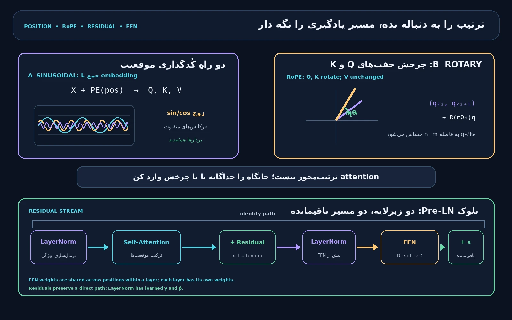

**شکل ۳-۴-۱ — موقعیت و بلوک.** در نمودار بالا دو راه متفاوت برای تزریق ترتیب آمده‌اند. پایین، attention و FFN زیرلایه‌های جدا با مسیرهای باقیمانده‌اند. بلوک تصویرشده Pre-LN است؛ مدل‌های دیگر ممکن است ترتیب LayerNorm را عوض کنند.

## ۲. سه خانوادهٔ پاسخ به مسئلهٔ موقعیت

سه قرارداد پرکاربرد را از هم جدا کنیم:

| خانواده | محل تزریق اطلاعات | نمونه | محدودیت کلیدی |
|---|---|---|---|
| مطلقِ آموختنی | بردار وابسته به هر جایگاه به embedding اضافه می‌شود | جدول `P[pos]` | جدول طول بیشینهٔ معینی دارد؛ خارج آن نیازمند تصمیم تازه است |
| مطلقِ ثابت | بردار تابعی از شمارهٔ موقعیت به embedding اضافه می‌شود | سینوسیِ Transformer اولیه | پارامتر یادگرفتنی ندارد، اما تعمیم به طول‌های خیلی دور تضمین نیست |
| نسبی/چرخشی | رابطهٔ جایگاه در score یا بردارهای `Q/K` وارد می‌شود | RoPE | فرکانس، scaling و الگوی آموزش بر طول مؤثرند |

این دسته‌بندی ساده است؛ طرح‌های واقعی می‌توانند ترکیبی باشند. دو ردیف اول معمولاً «افزودن بردار» به stream بازمانده را نشان می‌دهند؛ RoPE به جای افزودن یک جدول به `X`، جفت مؤلفه‌های پرس‌وجو و کلید را می‌چرخاند.

## ۳. کدگذاری سینوسی: موقعیت به اندازهٔ بُعد ویژگی

در Transformer اولیه، برای هر موقعیت `pos` یک بردار با همان بُعد embedding ساخته و به آن جمع می‌شد. مؤلفه‌های زوج و فرد موج‌هایی با فرکانس‌های متفاوت‌اند:

<math xmlns="http://www.w3.org/1998/Math/MathML" display="block" aria-label="پی ای در موقعیت پوز و بعد دو آی، سینوس پوز تقسیم بر ده هزار به توان دو آی تقسیم بر دی مدل؛ در بعد دو آی به علاوه یک، کسینوس همان زاویه"><mrow><msub><mi>PE</mi><mrow><mi>pos</mi><mo>,</mo><mn>2</mn><mi>i</mi></mrow></msub><mo>=</mo><mi>sin</mi><mo>(</mo><mfrac><mi>pos</mi><msup><mn>10000</mn><mfrac><mrow><mn>2</mn><mi>i</mi></mrow><msub><mi>d</mi><mi>model</mi></msub></mfrac></msup></mfrac><mo>)</mo><mo>,</mo><mspace width="1em"/><msub><mi>PE</mi><mrow><mi>pos</mi><mo>,</mo><mn>2</mn><mi>i</mi><mo>+</mo><mn>1</mn></mrow></msub><mo>=</mo><mi>cos</mi><mo>(</mo><mfrac><mi>pos</mi><msup><mn>10000</mn><mfrac><mrow><mn>2</mn><mi>i</mi></mrow><msub><mi>d</mi><mi>model</mi></msub></mfrac></msup></mfrac><mo>)</mo></mrow></math>

متن جایگزین فرمول: `PE[pos,2i]=sin(pos/10000^(2i/d_model))` و `PE[pos,2i+1]=cos(pos/10000^(2i/d_model))`.

زوج sin/cos برای یک فرکانس یک سیگنال دورانی می‌سازند؛ فرکانس‌های پایین و بالا به فاصله‌های متفاوت حساس‌اند. در `pos=0` همهٔ مؤلفه‌های زوج صفر و مؤلفه‌های فرد یک‌اند. اگر `E` جدول embedding واژه و `PE` ماتریس جایگاه باشد، ورودی block می‌تواند `X=E+PE` باشد. چون هر دو شکل `B×L×d_model` دارند، جمعشان تعریف‌پذیر است. کد فصل بُعد فرد را هم پشتیبانی می‌کند؛ در آن حالت مؤلفهٔ آخر یک زوج کامل ندارد.

روش ثابت پارامتر موقعیتیِ آموختنی نمی‌افزاید. این مزیت به معنی کیفیت برتر یا توانایی نامحدود برای طول توالی نیست؛ موج‌هایی که مدل در یک دامنه دیده، برای فاصله‌های دور ممکن است رفتاری متفاوت داشته باشند. نسبت پایهٔ ۱۰۰۰۰ هم جزئی از یک طرح است، نه ثابت طبیعت.

## ۴. موقعیت مطلق آموختنی و اطلاعات نسبی

جدول `P∈R^{Lmax×d_model}` می‌تواند برای هر خانه یک بردار جدا بیاموزد؛ نمایش ورودی `E+P` است. یادگیری مستقیم انعطاف می‌دهد، ولی تعداد پارامتر و طول جدول را به `Lmax` وابسته می‌کند. هنگام افزایش طول باید ردیف‌های تازه را چگونه تعیین کنیم؟ مقداردهی تصادفی، درون‌یابی یا تغییر دیگری فرض تازه‌ای وارد می‌کند؛ نتیجه باید دوباره سنجیده شود.

کدگذاری نسبی به جای پرسش «توکن در خانهٔ ۱۷ چه برداری دارد؟» می‌پرسد «دو موقعیت چند گام از هم فاصله دارند؟». خانواده‌های مختلف این فاصله را به امتیاز attention یا ویژگی‌های `Q/K` اضافه می‌کنند. RoPE یکی از روش‌هایی است که شمارهٔ مطلق را در بردارها می‌چرخاند و ضرب داخلی را به فاصلهٔ نسبی حساس می‌کند [۲].

## ۵. RoPE: دوران روی زوج مختصات `Q/K`

بُعد head را به زوج‌های `(2r, 2r+1)` تقسیم می‌کنیم. برای جفت `r`، فرکانس `θ_r=base^(−2r/d_h)` و موقعیت `m` زاویهٔ `mθ_r` می‌سازد. یک جفتِ بردار پرس‌وجو چنین می‌چرخد:

<math xmlns="http://www.w3.org/1998/Math/MathML" display="block" aria-label="بردار دو مؤلفه‌ای کیو چرخیده برابر ماتریس چرخش کسینوس و سینوس زاویهٔ ام تتا ضربدر جفت کیو است؛ ضرب داخلی جفت‌های چرخیده به اختلاف ان و ام وابسته می‌شود"><mrow><mo>[</mo><mtable><mtr><mtd><msup><mi>q</mi><mi>R</mi></msup><mo>₍</mo><mi>m</mi><mo>,</mo><mn>2</mn><mi>r</mi><mo>₎</mo></mtd></mtr><mtr><mtd><msup><mi>q</mi><mi>R</mi></msup><mo>₍</mo><mi>m</mi><mo>,</mo><mn>2</mn><mi>r</mi><mo>+</mo><mn>1</mn><mo>₎</mo></mtd></mtr></mtable><mo>]</mo><mo>=</mo><mo>[</mo><mtable><mtr><mtd><mi>cos</mi><mo>(</mo><mi>m</mi><msub><mi>θ</mi><mi>r</mi></msub><mo>)</mo></mtd><mtd><mo>−</mo><mi>sin</mi><mo>(</mo><mi>m</mi><msub><mi>θ</mi><mi>r</mi></msub><mo>)</mo></mtd></mtr><mtr><mtd><mi>sin</mi><mo>(</mo><mi>m</mi><msub><mi>θ</mi><mi>r</mi></msub><mo>)</mo></mtd><mtd><mi>cos</mi><mo>(</mo><mi>m</mi><msub><mi>θ</mi><mi>r</mi></msub><mo>)</mo></mtd></mtr></mtable><mo>]</mo><mo>[</mo><mtable><mtr><mtd><msub><mi>q</mi><mrow><mi>m</mi><mo>,</mo><mn>2</mn><mi>r</mi></mrow></msub></mtd></mtr><mtr><mtd><msub><mi>q</mi><mrow><mi>m</mi><mo>,</mo><mn>2</mn><mi>r</mi><mo>+</mo><mn>1</mn></mrow></msub></mtd></mtr></mtable><mo>]</mo></mrow></math>

متن جایگزین فرمول: `q^R_(m,2r:2r+2)=R(mθ_r)q_(m,2r:2r+2)`؛ همان دوران روی `k_n` هم اعمال می‌شود. سپس `(R(mθ)q)^T(R(nθ)k)=q^T R((n−m)θ)k`.

ماتریس دوران متعامد است، پس norm اقلیدسیِ هر جفت حفظ می‌شود؛ ولی جهتش به موقعیت وابسته است. با استفاده از `R(a)^T R(b)=R(b−a)`، ضرب داخلی `Q` در `m` و `K` در `n` به اختلاف `n−m` حساس می‌شود. این راهِ جبریِ ورود فاصلهٔ نسبی به امتیازهاست؛ معنی واژه یا نتیجهٔ ترجمه را خودش فراهم نمی‌کند [۲].

RoPE در استاندارد آموزشی روی `Q` و `K` اعمال می‌شود، نه `V`. پروژه هم همین قرارداد را آشکار می‌کند. برای زوج‌کردن کانال‌ها، `d_h` باید زوج باشد؛ `d_model` بخش‌پذیر بر تعداد سرها شرط جداگانه‌ای است. برای offsetهای cache یا batch ناهمسان قرارداد موقعیت می‌تواند پیچیده‌تر شود؛ تابع نمونه یک بردار موقعیت مشترک برای batch می‌گیرد.

## ۶. تعمیم طول: جدول ثابت، اما نتیجه همچنان تجربی

جدول آموختنیِ موقعیت یک سقف روشن دارد. کدگذاری سینوسی می‌تواند برای عدد موقعیت بزرگ‌تری محاسبه شود و RoPE هم به جدول آموختنی متکی نیست؛ با این حال «قابل محاسبه بودن» مساوی «تعمیم معتبر مدل» نیست. RoPE با فاصلهٔ زیاد الگوی چرخش متفاوتی می‌سازد؛ روش‌هایی مانند Position Interpolation شماره‌های موقعیت را در بازهٔ آموزش نگه می‌دارند و برای مدل‌های RoPE-based با fine-tuning ارزیابی شده‌اند [۶]. این یک روش مشخص و نتیجهٔ تجربی در تنظیم‌های مطالعه‌شده است، نه تضمین عمومی برای هر مدل یا وظیفه. هر تکنیک باید در context طولانی و روی معیارهای هدف آزموده شود، نه با ادعای خودکارِ «بی‌نهایت طول» [۲]. فصل ۳۸ هزینه و بعضی راهکارهای زمینهٔ بلند را جدا بررسی می‌کند.

## ۷. اتصال باقیمانده: شاخهٔ identity را گم نکن

یک زیرلایه مثل attention یا FFN را `F` و ورودی‌اش را `x` بنامیم. اتصال باقیمانده خروجی `F(x)` را با `x` جمع می‌کند: `x+F(x)`. اگر دو شکل یکی نباشند، جمع ساده تعریف ندارد؛ بنابراین زیرلایه‌های این بلوک خروجی را به `d_model` برمی‌گردانند. این شاخه مسیر مستقیمی برای اطلاعات و گرادیان فراهم می‌کند، اما تضمین نمی‌کند هر یادگیری آسان یا بدون افت است. باید آن را از خودِ attention جدا دید: attention روابط بین موقعیت‌ها را می‌آموزد، residual راه ترکیب ورودی با خروجی را می‌دهد [۱].

در یک block با دو زیرلایه، دو جمعِ جدا وجود دارد: یکی پیرامون self-attention و دیگری پیرامون FFN. تصویر فصل همین مسیر را رسم می‌کند. «Residual» به معنای حفظ اجباری یا برابر ماندن نمایش نیست؛ شاخهٔ آموختنی می‌تواند جمع را تغییر دهد.

## ۸. LayerNorm: نرمال‌سازی ویژگی‌ها برای هر موقعیت

برای بردار `x` روی `D` ویژگی، LayerNorm میانگین و واریانس همان محور را می‌گیرد، سپس مقیاس و bias آموختنی اعمال می‌کند:

<math xmlns="http://www.w3.org/1998/Math/MathML" display="block" aria-label="لایه نرمال سازی ایکس برابر ایکس منهای میانگین، تقسیم بر ریشه واریانس به علاوه اپسیلون، ضربدر گاما به علاوه بتا"><mrow><mi>LayerNorm</mi><mo>(</mo><mi>x</mi><mo>)</mo><mo>=</mo><mfrac><mrow><mi>x</mi><mo>−</mo><mi>μ</mi></mrow><msqrt><mrow><msup><mi>σ</mi><mn>2</mn></msup><mo>+</mo><mi>ε</mi></mrow></msqrt></mfrac><mo>⊙</mo><mi>γ</mi><mo>+</mo><mi>β</mi></mrow></math>

متن جایگزین فرمول: `y=(x−μ)/sqrt(σ²+ε) ⊙ γ + β`؛ در PyTorch `nn.LayerNorm(d_model)` با ورودی `[B,L,D]` محور آخر `D` را جداگانه برای هر `[b,l]` نرمال می‌کند [۵].

`γ` و `β` شکل `D` دارند و اگر affine فعال باشد آموخته می‌شوند. `ε` برای ثبات عددی افزوده می‌شود. PyTorch 2.6 واریانس biased، معادل `torch.var(..., correction=0)`، به کار می‌برد و آمار را از خود ورودی در train و eval می‌گیرد [۵]. پس unlike BatchNorm به میانگین نمونه‌های batch متکی نیست. انتخاب `normalized_shape` اشتباه می‌تواند ناخواسته ابعاد دیگری را نرمال کند؛ شکل تنسور را با قرارداد API تطبیق دهید.

## ۹. Pre-LN و Post-LN دو ترتیب یکسان نیستند

Transformer اولیه زیرلایه را درون residual جمع می‌کند و بعد LayerNorm می‌زند؛ این فرم **Post-LN** است. در **Pre-LN** اول ورودی زیرلایه نرمال می‌شود و نتیجه با stream باقیمانده جمع می‌شود:

<math xmlns="http://www.w3.org/1998/Math/MathML" display="block" aria-label="Post-LN خروجی لایه نرمال سازی ایکس به علاوه اف از ایکس است؛ Pre-LN خروجی ایکس به علاوه اف از لایه نرمال سازی ایکس است"><mrow><msub><mi>y</mi><mtext>Post</mtext></msub><mo>=</mo><mi>LayerNorm</mi><mo>(</mo><mi>x</mi><mo>+</mo><mi>F</mi><mo>(</mo><mi>x</mi><mo>)</mo><mo>)</mo><mo>,</mo><mspace width="1em"/><msub><mi>y</mi><mtext>Pre</mtext></msub><mo>=</mo><mi>x</mi><mo>+</mo><mi>F</mi><mo>(</mo><mi>LayerNorm</mi><mo>(</mo><mi>x</mi><mo>)</mo><mo>)</mo></mrow></math>

متن جایگزین فرمول: `Post-LN: LN(x+F(x))`; `Pre-LN: x+F(LN(x))`.

قرارگیری LayerNorm، مسیر گرادیان را عوض می‌کند. تحلیل Xiong و همکاران دربارهٔ warmup و اندازهٔ گرادیان در Post-LN/Pre-LN، به فرض‌ها و تنظیم‌های بررسی‌شده مربوط است؛ از آن نباید نتیجه گرفت که Pre-LN همیشه در تمام وظایف برنده است [۴]. بعضی Pre-LN معماری‌ها پیش از سر خروجی LayerNorm نهایی می‌افزایند. این پروژه دو ترتیب یک زیرلایه را نشان می‌دهد؛ آن یک معماری GPT کامل نیست.

## ۱۰. شبکهٔ پیش‌خورِ موقعیت‌مند (FFN)

پس از attention، Transformer برای هر موقعیت یک MLP با وزن مشترک میان موقعیت‌ها اعمال می‌کند. ورودی و خروجی `D` بُعد دارند و میانه می‌تواند `d_ff` باشد:

<math xmlns="http://www.w3.org/1998/Math/MathML" display="block" aria-label="اف اف ان از ایکس برابر دبلیو دو، فعال ساز از دبلیو یک ایکس به علاوه بی یک، به علاوه بی دو؛ برای موقعیت‌های مختلف وزن‌ها مشترک‌اند"><mrow><mi>FFN</mi><mo>(</mo><mi>x</mi><mo>)</mo><mo>=</mo><msub><mi>W</mi><mn>2</mn></msub><mi>φ</mi><mo>(</mo><msub><mi>W</mi><mn>1</mn></msub><mi>x</mi><mo>+</mo><msub><mi>b</mi><mn>1</mn></msub><mo>)</mo><mo>+</mo><msub><mi>b</mi><mn>2</mn></msub></mrow></math>

متن جایگزین فرمول: `FFN(x)=W₂ φ(W₁x+b₁)+b₂`. در یک لایه، ماتریس‌های `W₁/W₂` برای همهٔ ردیف‌های `X` مشترک‌اند؛ اما لایه‌های مختلف پارامترهای جدا دارند [۱].

در مقالهٔ ۲۰۱۷ فعال‌ساز ReLU و inner dimension برابر `4d_model` در پیکربندی پایه بود. در مدل‌های دیگر GELU یا فعال‌سازهای دیگر و اندازه‌های متفاوت هم رایج‌اند؛ پروژه برای نمونه GELU و `d_ff=4d_model` را پیش‌فرض می‌گیرد. FFN خودش موقعیت‌ها را مخلوط نمی‌کند؛ می‌توان آن را یک تبدیل ویژگیِ جداگانه و یکسان برای هر ردیف دانست.

## ۱۱. دو زیرلایه کنار هم: یک block کوچک

در حالت Pre-LN که پروژه برای نمونه انتخاب می‌کند:

```text
x₁ = x₀ + SelfAttention(LN₁(x₀))
x₂ = x₁ + FFN(LN₂(x₁))
```

در روش سینوسی، `PE` به جریان ورودی اضافه می‌شود و attention از آن `Q/K/V` می‌سازد. در روش RoPE، دوران درون attention و فقط روی `Q/K` انجام می‌شود. پس از آن مسیر residual، LayerNorm و FFN در هر دو حالت شکل یکسانی دارند. این جداسازی کمک می‌کند بپرسیم تغییر نتیجه از encoding آمده یا از چینش زیرلایه‌ها.

این block در پروژه encoder-style و دوسویه است: علّی‌بودن و padding mask ندارد؛ فصل ۳۵ ماسک علّی را بررسی کرد و فصل ۳۷ تفاوت encoder و decoder را دنبال می‌کند. با این تحدید دامنه، آزمون‌های position و residual با ماسک آینده اشتباه نمی‌شوند.

## ۱۲. پروژهٔ قابل اجرا و آزمون‌های تمایزبخش

در `book-engineering/projects/36-position-normalization/` سه قطعه جداست: تابع sinusoidal، تابع RoPE برای `[B,H,L,d_h]`، و `PositionAwareTransformerBlock`. کد شکل attention، تقسیم سرها و residualها را آشکار می‌کند. بلوک تنها یک لایه است، از تمام موقعیت‌ها استفاده می‌کند و dropout ندارد؛ انتظار inference و آموزش مدل واقعی از آن نداشته باشید.

ده آزمون، شکل‌ها و موقعیت صفر را بررسی می‌کنند؛ RoPE norm را حفظ می‌کند و dot product برای دو فاصلهٔ مساوی یکسان می‌ماند؛ هر دو حالت موقعیت و هر دو ترتیب LayerNorm خروجی هم‌شکل می‌دهند؛ و گرادیان ورودی و وزن‌ها متناهی است. دستورها و خروجی نمونه در README پروژه‌اند؛ پاسخ تمرین‌ها نیز جداست تا پاسخ در متن فصل جلوتر از یادگیرنده نیاید.

## ۱۳. تمرین‌ها و معیار عبور

1. اگر ورودی یک self-attention بدون موقعیت جابه‌جا شود، چرا خروجی فقط جابه‌جا می‌شود؟ واژهٔ «هم‌وردا» را با مثال توضیح دهید.
2. برای `d_model=4` و `pos=0` مقادیر زوج و فرد PE را بنویسید. سپس برای `pos=1` فرمول را باز کنید.
3. تفاوت جدول آموختنیِ `P[pos]` و کدگذاری سینوسی را در تعداد پارامتر و طول خارج از دامنه مقایسه کنید؛ چرا از هیچ‌کدام تضمین طول دلخواه نتیجه نمی‌شود؟
4. RoPE کدام بردارها را می‌چرخاند؟ چرا norm حفظ می‌شود و فاصلهٔ نسبی چگونه وارد dot product می‌شود؟
5. `Pre-LN` و `Post-LN` را با فرمول بنویسید. اگر `[B,L,D]` داریم، `LayerNorm(D)` روی کدام محور آمار می‌گیرد؟
6. FFN چه تفاوتی با attention دارد؟ چرا عبارت «موقعیت‌مند» در اینجا به معنی داشتن embedding جایگاه اختصاصی نیست؟

**معیار عبور:** ده آزمون پروژه را اجرا کنید؛ بتوانید با شکل `B×H×L×d_h` محل RoPE را نشان دهید؛ شکل دو جمع residual را ترسیم کنید؛ و تفاوت Pre/Post-LN را بدون ادعای برتری همیشگی بیان کنید. پاسخ تشریحی را پس از تلاش مستقل در [جواب‌نامهٔ فصل ۳۶](book-engineering/answers/36-position-normalization-fa.md) ببینید. [پروژه و آزمون‌ها](book-engineering/projects/36-position-normalization/README.md)

## ۱۴. جمع‌بندی

- بدون نشانهٔ موقعیت، self-attention نسبت به جایگشت هم‌ورداست؛ ترتیب باید وارد نمایش یا امتیاز شود.
- PE سینوسی و learned absolute به embedding افزوده می‌شوند؛ RoPE جفت‌های `Q/K` را می‌چرخاند و `V` را دست‌نخورده می‌گذارد.
- ماتریس دوران norm را حفظ می‌کند و dot product را به اختلاف موقعیت‌ها وابسته می‌کند؛ تعمیم به طول بیشتر همچنان باید سنجیده شود.
- Residual و LayerNorm دو کار متفاوت دارند؛ جای LayerNorm پیش یا پس از زیرلایه، یک انتخاب معماری است.
- FFN موقعیت‌به‌موقعیت اعمال می‌شود و وزن‌های همان لایه را میان موقعیت‌ها به اشتراک می‌گذارد؛ attention ارتباط میان موقعیت‌ها را می‌سازد.

### واژه‌نامهٔ کوتاه

- **کدگذاری مکانی (positional encoding):** نشانه‌ای از ترتیب موقعیت‌ها به نمایش ورودی.
- **RoPE:** چرخش وابسته به موقعیت در زوج مؤلفه‌های Query و Key.
- **اتصال باقیمانده (residual):** جمع ورودی زیرلایه با خروجی آن در مسیر بلوک.
- **LayerNorm:** نرمال‌سازی ویژگی‌ها در هر نمونه بر اساس محور تعریف‌شده.
- **FFN:** شبکهٔ پیش‌خورِ موقعیتی که پس از attention روی نمایش‌ها اعمال می‌شود.

## ۱۵. منابع بیرونی

1. Ashish Vaswani et al. “Attention Is All You Need.” NeurIPS 2017؛ arXiv:1706.03762، نسخهٔ v7 مورخ ۲ اوت ۲۰۲۳. [متن arXiv](https://arxiv.org/abs/1706.03762) · [نسخهٔ HTML v7](https://arxiv.org/html/1706.03762v7). بخش‌های 3.3، 3.5 و 5.4 برای FFN، positional encoding و regularization؛ بخش 3.1 برای residual و LayerNorm.
2. Jianlin Su et al. “RoFormer: Enhanced Transformer with Rotary Position Embedding.” arXiv:2104.09864، نسخهٔ v5 مورخ ۸ نوامبر ۲۰۲۳. [متن arXiv](https://arxiv.org/abs/2104.09864) · [HTML v5](https://arxiv.org/html/2104.09864v5).
3. Jimmy Lei Ba, Jamie Ryan Kiros, Geoffrey E. Hinton. “Layer Normalization.” arXiv:1607.06450, 2016. [arXiv](https://arxiv.org/abs/1607.06450).
4. Ruibin Xiong et al. “On Layer Normalization in the Transformer Architecture.” ICML 2020; arXiv:2002.04745, v2 dated 29 June 2020. [arXiv](https://arxiv.org/abs/2002.04745) · [HTML v2](https://arxiv.org/html/2002.04745v2).
5. PyTorch 2.6.0. [`torch.nn.LayerNorm`](https://docs.pytorch.org/docs/2.6/generated/torch.nn.LayerNorm.html). `normalized_shape`، آخرین محورهای نرمال‌شده، `eps`، `elementwise_affine` و نوع واریانس.
6. Shouyuan Chen et al. “Extending Context Window of Large Language Models via Position Interpolation.” arXiv:2306.15595, v2 dated 28 June 2023. [arXiv](https://arxiv.org/abs/2306.15595) · [HTML v2](https://arxiv.org/html/2306.15595).

**تاریخ دسترسی به منابع برخط: ۵ نوامبر ۲۰۲۶.** فرمول‌های سینوسی و RoPE در متن با نسخه‌های ارجاع‌شده تطبیق داده شدند؛ رفتار API در پیاده‌سازی به PyTorch 2.6 ارجاع دارد. نتیجهٔ Position Interpolation به همان مقاله و تنظیم‌های ارزیابی‌شده محدود است.

## پیوست: کد کامل پروژه

کد زیر همان `transformer_block.py` پروژه است؛ پیاده‌سازی و محدودیت‌ها در README ثبت شده‌اند.


```python
"""Position schemes and a compact Transformer block for volume 3 chapter 36."""
from __future__ import annotations

import math

import torch
from torch import nn


def _positive_int(name: str, value: int) -> None:
    if isinstance(value, bool) or not isinstance(value, int):
        raise TypeError(f"{name} must be an integer")
    if value <= 0:
        raise ValueError(f"{name} must be positive")


def sinusoidal_encoding(
    length: int,
    d_model: int,
    *,
    positions: torch.Tensor | None = None,
    device: torch.device | str | None = None,
    dtype: torch.dtype = torch.float32,
) -> torch.Tensor:
    """Return [length, d_model] sinusoidal absolute position encodings.

    Odd model dimensions are supported; the last even coordinate simply has no
    paired odd coordinate. Positions are shared by all examples in the batch.
    """
    _positive_int("length", length)
    _positive_int("d_model", d_model)
    if not isinstance(dtype, torch.dtype) or not dtype.is_floating_point:
        raise TypeError("dtype must be a floating-point torch.dtype")

    if positions is None:
        pos = torch.arange(length, device=device, dtype=torch.int64)
    else:
        pos = torch.as_tensor(positions, device=device)
        if pos.ndim != 1 or pos.numel() != length:
            raise ValueError("positions must be a rank-1 vector with one value per token")
        if pos.dtype == torch.bool or pos.is_floating_point() or pos.is_complex():
            raise TypeError("positions must use an integer dtype")
        if torch.any(pos < 0).item():
            raise ValueError("positions must be non-negative")

    work_dtype = torch.float64 if dtype == torch.float64 else torch.float32
    pos = pos.to(dtype=work_dtype).unsqueeze(1)
    pair_indices = torch.arange(0, d_model, 2, device=pos.device, dtype=work_dtype)
    frequencies = torch.exp(pair_indices * (-math.log(10000.0) / d_model))
    angles = pos * frequencies.unsqueeze(0)

    encoding = torch.zeros(length, d_model, device=pos.device, dtype=work_dtype)
    encoding[:, 0::2] = torch.sin(angles)
    odd_count = encoding[:, 1::2].shape[1]
    if odd_count:
        encoding[:, 1::2] = torch.cos(angles[:, :odd_count])
    return encoding.to(dtype=dtype)


def apply_rope(
    x: torch.Tensor,
    positions: torch.Tensor | None = None,
    *,
    base: float = 10000.0,
) -> torch.Tensor:
    """Apply RoPE to [batch, heads, length, head_dim] query/key vectors.

    Coordinates are paired as (0,1), (2,3), ... . RoPE rotates queries and
    keys, not values. The teaching implementation uses one shared position
    vector for the batch and requires an even head dimension.
    """
    if not isinstance(x, torch.Tensor):
        raise TypeError("x must be a torch.Tensor")
    if x.ndim != 4:
        raise ValueError("expected [batch, heads, length, head_dim] input")
    if not x.is_floating_point():
        raise TypeError("x must have floating-point dtype")
    if x.size(-1) == 0 or x.size(-1) % 2:
        raise ValueError("head_dim must be a positive even integer for RoPE")
    if isinstance(base, bool) or not isinstance(base, (int, float)):
        raise TypeError("base must be a positive finite number")
    if not math.isfinite(base) or base <= 0:
        raise ValueError("base must be a positive finite number")

    length, head_dim = x.size(-2), x.size(-1)
    if length == 0:
        raise ValueError("sequence length must be positive")
    if positions is None:
        pos = torch.arange(length, device=x.device, dtype=torch.int64)
    else:
        pos = torch.as_tensor(positions, device=x.device)
        if pos.ndim != 1 or pos.numel() != length:
            raise ValueError("positions must be a rank-1 vector with one value per token")
        if pos.dtype == torch.bool or pos.is_floating_point() or pos.is_complex():
            raise TypeError("positions must use an integer dtype")
        if torch.any(pos < 0).item():
            raise ValueError("positions must be non-negative")

    work_dtype = torch.float64 if x.dtype == torch.float64 else torch.float32
    pair_indices = torch.arange(0, head_dim, 2, device=x.device, dtype=work_dtype)
    inv_freq = torch.exp(pair_indices * (-math.log(float(base)) / head_dim))
    angles = pos.to(dtype=work_dtype).unsqueeze(1) * inv_freq.unsqueeze(0)
    cos = angles.cos().to(dtype=x.dtype)[None, None, :, :]
    sin = angles.sin().to(dtype=x.dtype)[None, None, :, :]

    even, odd = x[..., 0::2], x[..., 1::2]
    rotated = torch.empty_like(x)
    rotated[..., 0::2] = even * cos - odd * sin
    rotated[..., 1::2] = even * sin + odd * cos
    return rotated


class PositionAwareTransformerBlock(nn.Module):
    """Single batch-first, full self-attention block with visible sublayers.

    `position_mode` is either `sinusoidal` (add to the residual stream) or
    `rope` (rotate Q and K). `norm_order` is `pre` or `post`. This block has no
    causal/padding mask or dropout; it is an encoder-style teaching example.
    """

    def __init__(
        self,
        d_model: int,
        num_heads: int,
        d_ff: int | None = None,
        *,
        position_mode: str = "sinusoidal",
        norm_order: str = "pre",
        rope_base: float = 10000.0,
    ) -> None:
        super().__init__()
        _positive_int("d_model", d_model)
        _positive_int("num_heads", num_heads)
        if d_model % num_heads:
            raise ValueError("d_model must be divisible by num_heads")
        if position_mode not in {"sinusoidal", "rope"}:
            raise ValueError("position_mode must be 'sinusoidal' or 'rope'")
        if norm_order not in {"pre", "post"}:
            raise ValueError("norm_order must be 'pre' or 'post'")
        if position_mode == "rope" and (d_model // num_heads) % 2:
            raise ValueError("RoPE requires an even head_dim")
        if isinstance(rope_base, bool) or not isinstance(rope_base, (int, float)):
            raise TypeError("rope_base must be a positive finite number")
        if not math.isfinite(rope_base) or rope_base <= 0:
            raise ValueError("rope_base must be a positive finite number")

        if d_ff is None:
            d_ff = 4 * d_model
        _positive_int("d_ff", d_ff)
        self.d_model = d_model
        self.num_heads = num_heads
        self.head_dim = d_model // num_heads
        self.position_mode = position_mode
        self.norm_order = norm_order
        self.rope_base = float(rope_base)

        self.qkv = nn.Linear(d_model, 3 * d_model)
        self.out_proj = nn.Linear(d_model, d_model)
        self.norm1 = nn.LayerNorm(d_model)
        self.norm2 = nn.LayerNorm(d_model)
        self.ffn = nn.Sequential(
            nn.Linear(d_model, d_ff),
            nn.GELU(),
            nn.Linear(d_ff, d_model),
        )

    def _self_attention(self, x: torch.Tensor, positions: torch.Tensor | None) -> torch.Tensor:
        batch, length, _ = x.shape
        qkv = self.qkv(x).view(batch, length, 3, self.num_heads, self.head_dim)
        qkv = qkv.permute(2, 0, 3, 1, 4)
        query, key, value = qkv.unbind(dim=0)
        if self.position_mode == "rope":
            query = apply_rope(query, positions, base=self.rope_base)
            key = apply_rope(key, positions, base=self.rope_base)

        scores = query @ key.transpose(-2, -1) / math.sqrt(self.head_dim)
        weights = torch.softmax(scores, dim=-1)
        per_head = weights @ value
        combined = per_head.transpose(1, 2).contiguous().view(batch, length, self.d_model)
        return self.out_proj(combined)

    def forward(self, x: torch.Tensor, positions: torch.Tensor | None = None) -> torch.Tensor:
        if not isinstance(x, torch.Tensor):
            raise TypeError("x must be a torch.Tensor")
        if x.ndim != 3:
            raise ValueError("expected [batch, sequence, d_model] input")
        if not x.is_floating_point():
            raise TypeError("x must have floating-point dtype")
        if x.size(1) == 0:
            raise ValueError("sequence length must be positive")
        if x.size(-1) != self.d_model:
            raise ValueError("input feature dimension must equal d_model")
        if x.device != self.qkv.weight.device:
            raise ValueError("input and module must be on the same device")
        if x.dtype != self.qkv.weight.dtype:
            raise TypeError("input and module must use the same dtype")

        if self.position_mode == "sinusoidal":
            encoding = sinusoidal_encoding(
                x.size(1), self.d_model, positions=positions,
                device=x.device, dtype=x.dtype,
            )
            x = x + encoding.unsqueeze(0)

        if self.norm_order == "pre":
            x = x + self._self_attention(self.norm1(x), positions)
            x = x + self.ffn(self.norm2(x))
        else:
            x = self.norm1(x + self._self_attention(x, positions))
            x = self.norm2(x + self.ffn(x))
        return x


def main() -> None:
    torch.manual_seed(3601)
    x = torch.randn(2, 6, 16)
    model = PositionAwareTransformerBlock(
        d_model=16, num_heads=4, position_mode="rope", norm_order="pre"
    ).eval()
    positions = torch.arange(10, 16)
    with torch.no_grad():
        output = model(x, positions)
    encoding = sinusoidal_encoding(6, 16)
    print("device=cpu")
    print("mode=rope, norm_order=pre")
    print("input_shape=", tuple(x.shape))
    print("output_shape=", tuple(output.shape))
    print("sinusoidal_shape=", tuple(encoding.shape))
    print("output_finite=", torch.isfinite(output).all().item())


if __name__ == "__main__":
    main()
```

---

# جلد سوم، فصل ۵ — Encoder، Decoder و مدل‌های Encoder–Decoder

**The Art & Science of Building Intelligence | Babak & Ai | فصل سراسری ۳۷ از نقشهٔ پنج‌جلدی**

**تاریخ بازبینی منابع: ۵ نوامبر ۲۰۲۶؛ منابع برخط در همین تاریخ بازبینی شدند.**

## ۱. سه آرایش، سه قرارداد برای جریان اطلاعات

در فصل‌های ۳۴ تا ۳۶ سازوکار توجه، ماسک علّی و اجزای یک بلوک را دیدیم. اکنون پرسش در مقیاس کل مدل است: **هر موقعیت چه بخش‌هایی از ورودی را می‌بیند و مدل باید چه نوع خروجی‌ای بسازد؟** پاسخ به این پرسش، سه آرایش مشهور را از هم جدا می‌کند: رمزگذارِ تنها (Encoder-only)، رمزگشایِ تنها (Decoder-only) و رمزگذار–رمزگشا (Encoder–Decoder).

نکتهٔ کلیدی این است که این نام‌ها «سه وظیفهٔ غیرقابل‌تغییر» نیستند. معماری، الگوی اتصال و مسیر اطلاعات را توصیف می‌کند؛ هدف پیش‌آموزش، سر خروجی، داده و روش تنظیم برای وظیفه تعیین می‌کنند مدل چه چیزی یاد بگیرد. یک مدل encoder-only معمولاً برای ساخت بازنمایی و برچسب‌گذاری به کار می‌رود؛ decoder-only معمولاً دنباله را ادامه می‌دهد؛ و encoder–decoder معمولاً ورودی را به خروجی متنیِ شرطی تبدیل می‌کند. واژهٔ «معمولاً» مهم است: این‌ها گرایش‌های رایج‌اند، نه ممنوعیت یا تضمین.

**پیش‌نیاز:** شکل `Q/K/V` و Self-Attention در فصل‌های ۳۴–۳۵، موقعیت و بلوک باقیمانده در فصل ۳۶، و بردار/ماتریس از جلدهای پیشین. **هدف:** شکل سه معماری را رسم کنید؛ تفاوت دید دوسویه، ماسک علّی و cross-attention را توضیح دهید؛ و برای یک قرارداد ورودی/خروجی، انتخاب معماری را همراه با محدودیتش توجیه کنید.


**شکل ۳-۵-۱ — معماری را از مسیر اطلاعات بخوانید.** خانهٔ روشن در سه ماتریس یعنی دسترسی مجاز. در پنل سوم، ورودی منبع فقط یک بردار خلاصه نیست: Decoder می‌تواند در هر گام به موقعیت‌های حافظهٔ رمزگذار توجه کند. نمونه‌های پایین شکل، وظایف رایج‌اند، نه دسته‌بندی انحصاری.

## ۲. Transformer اصلی: Encoder و Decoder کنار هم

Transformer مقالهٔ اصلی برای **تبدیل یک دنباله به دنباله‌ای دیگر** ساخته شد؛ نمونهٔ مهم آن ترجمه است [۱]. اگر `x` دنبالهٔ منبع و `y` دنبالهٔ هدف باشد، Encoder منبع را به دنباله‌ای از بازنمایی‌های زمینه‌ای تبدیل می‌کند. سپس Decoder با دیدن پیشوندِ هدف و خروجی Encoder، توکن‌های هدف را یکی‌یکی پیش‌بینی می‌کند.

<math xmlns="http://www.w3.org/1998/Math/MathML" display="block" aria-label="اچ ای برابر رمزگذار ایکس؛ احتمال وای با شرط ایکس برابر حاصل‌ضرب احتمال هر توکن وای تی با شرط ایکس و توکن‌های پیشین هدف"><mrow><msub><mi>H</mi><mi>E</mi></msub><mo>=</mo><mi>Encoder</mi><mo>(</mo><mi>x</mi><mo>)</mo><mo>,</mo><mspace width="1em"/><mi>p</mi><mo>(</mo><mi>y</mi><mo>|</mo><mi>x</mi><mo>)</mo><mo>=</mo><munderover><mo>∏</mo><mrow><mi>t</mi><mo>=</mo><mn>1</mn></mrow><mi>T</mi></munderover><mi>p</mi><mo>(</mo><msub><mi>y</mi><mi>t</mi></msub><mo>|</mo><mi>x</mi><mo>,</mo><msub><mi>y</mi><mrow><mo>&lt;</mo><mi>t</mi></mrow></msub><mo>)</mo></mrow></math>

متن جایگزین فرمول: `H_E=Encoder(x)` و `p(y|x)=∏_{t=1}^T p(y_t | x, y_<t)`. `H_E` حافظهٔ دنباله‌ای است؛ `y_<t` توکن‌های هدف پیش از گام `t` هستند.

در Encoder اصلی، هر لایه Self-Attention روی توکن‌های ورودی و سپس شبکهٔ پیش‌خور موقعیت‌مند دارد. در Decoder اصلی، Self-Attention ماسک علّی می‌گیرد و یک زیرلایهٔ جداگانهٔ **توجه رمزگذار–رمزگشا** (cross-attention) اضافه می‌شود: پرس‌وجوها از حالت‌های Decoder می‌آیند، کلیدها و مقدارها از خروجی Encoder. پس از هر زیرلایه نیز مسیر باقیمانده و LayerNorm قرار دارد [۱]. جزئیات Pre-LN/Post-LN می‌تواند میان پیاده‌سازی‌ها عوض شود؛ فصل ۳۶ این تفاوت را معرفی کرد.

## ۳. Encoder-only: بازنماییِ دنباله با دید دوطرفه

در Encoder دوطرفه، توکن معتبرِ جایگاه `i` می‌تواند برای ساخت بازنمایی خود از توکن‌های پیش و پس از `i` استفاده کند. توجه اینجا **Self-Attention بدون ماسک علّی** است؛ ماسک padding همچنان لازم است تا مدل به جایگاه‌های خالی توجه نکند. هر لایه دنباله‌ای از بردارهای زمینه‌ای `H=[h₁,…,h_L]` تحویل می‌دهد.

BERT نمونهٔ شناخته‌شدهٔ این خانواده است: پیش‌آموزش آن از Masked Language Modeling استفاده می‌کرد تا بازنمایی توکن پنهان‌شده با بافت چپ و راست پیش‌بینی شود؛ مقالهٔ اصلی همچنین هدف Next Sentence Prediction را بررسی می‌کرد [۲]. چون خروجی Encoder برای همهٔ جایگاه‌ها در دسترس است، می‌توان روی آن سرهای متفاوتی گذاشت: طبقه‌بندی جمله، برچسب‌گذاری توکن (مثلاً NER)، پیش‌بینی بازهٔ آغاز/پایان برای پرسش‌وپاسخ استخراجی، یا سرِ بردارسازی که جداگانه برای بازیابی آموزش دیده باشد.

برای طبقه‌بندی جمله، یک پیاده‌سازی ممکن است نمایش `[CLS]` یا میانگینِ نمایش توکن‌های معتبر را به سر خطی بدهد. این دو انتخاب یکی نیستند و هیچ‌کدام به‌تنهایی تضمین نمی‌کنند embedding برای جست‌وجوی معنایی مناسب باشد؛ هدف آموزش و دادهٔ تطبیق‌یافته اهمیت دارند. Encoder-only استاندارد **به‌طور طبیعی** مسیر تولید خودرگرسیوِ یک متن نامحدود ندارد؛ می‌توان سر یا Decoder دیگری به آن افزود، اما آن‌گاه سامانه دیگر صرفاً همان مدل Encoder-only ساده نیست.

## ۴. Decoder-only: هر گام ادامهٔ پیشوند است

در Decoder-only رایج، هر توکن هنگام پیش‌بینی تنها پیشوند تا جایگاه خودش را می‌بیند. ماسک علّی خانه‌های مربوط به آینده را می‌بندد. مدل با هدف خودرگرسیو آموزش می‌بیند: از پیشوند، توکن بعدی را پیش‌بینی کن. GPT-3 نمونه‌ای پژوهشی از مدل زبانی خودرگرسیو است که در مقاله‌اش وظایف گوناگون با دستور و نمونه‌های درون‌متنی بررسی شدند [۳].

<math xmlns="http://www.w3.org/1998/Math/MathML" display="block" aria-label="زیان زبان‌مدل برابر منفی مجموع لگاریتم احتمال توکن بعدی با شرط پیشوند قبلی"><mrow><msub><mi>ℒ</mi><mi>LM</mi></msub><mo>=</mo><mo>−</mo><munderover><mo>∑</mo><mrow><mi>t</mi><mo>=</mo><mn>1</mn></mrow><mrow><mi>T</mi><mo>−</mo><mn>1</mn></mrow></munderover><mi>log</mi><mi>p</mi><mo>(</mo><msub><mi>x</mi><mrow><mi>t</mi><mo>+</mo><mn>1</mn></mrow></msub><mo>|</mo><msub><mi>x</mi><mrow><mn>1</mn><mo>:</mo><mi>t</mi></mrow></msub><mo>)</mo></mrow></math>

متن جایگزین فرمول: `L_LM = −Σ_{t=1}^{T−1} log p(x_{t+1} | x_{1:t})`. در آموزش، همهٔ جایگاه‌های یک دنباله را می‌توان با ماسک علّی در یک گذرِ موازی محاسبه کرد؛ ولی در **تولید معمول** هر توکن تازه به توکن‌های تولیدشدهٔ قبل وابسته است، پس گام‌های خروجی به ترتیب اجرا می‌شوند. آموزش موازی و استنتاج ترتیبی را با هم اشتباه نگیریم.

واژهٔ «Decoder-only» از شباهت بلوک به Decoder Transformer می‌آید، اما در این نسخه Encoder منبع و cross-attention وجود ندارند؛ فقط Self-Attention علّی و زیرلایه‌های بلوک باقی می‌مانند. ورودی prompt و خروجیِ آینده یک جریان متنی واحدند. این قرارداد برای تکمیل، گفت‌وگو و تولید متن انعطاف‌پذیر است؛ اما مدل را نمی‌توان بی‌درنگ به یک طبقه‌بندِ دوسویه یا یک سامانهٔ پاسخ‌گوییِ استخراجی تبدیل‌شده فرض کرد—باید سر، prompt، داده و معیار مناسب انتخاب شود.

## ۵. Encoder–Decoder: متن منبع، حافظه و متن هدف

در آرایش Encoder–Decoder دو جریان جدا داریم. Encoder با دید دوطرفه دنبالهٔ منبع را می‌خواند و حافظهٔ `H_E` می‌سازد. Decoder ورودیِ شیفت‌داده‌شدهٔ هدف را با ماسک علّی می‌خواند و در هر لایه از cross-attention به `H_E` مراجعه می‌کند. اگر `H_D` خروجیِ میانی Decoder باشد، یکی از سرهای توجه میان‌دنباله‌ای چنین ساخته می‌شود:

<math xmlns="http://www.w3.org/1998/Math/MathML" display="block" aria-label="پرس‌وجو از حالت رمزگشا، کلید و مقدار از حافظه رمزگذار؛ توجه از پرس‌وجوی رمزگشا به همه منبع می‌رود"><mrow><mi>Q</mi><mo>=</mo><msub><mi>H</mi><mi>D</mi></msub><msub><mi>W</mi><mi>Q</mi></msub><mo>,</mo><mspace width="0.7em"/><mi>K</mi><mo>=</mo><msub><mi>H</mi><mi>E</mi></msub><msub><mi>W</mi><mi>K</mi></msub><mo>,</mo><mspace width="0.7em"/><mi>V</mi><mo>=</mo><msub><mi>H</mi><mi>E</mi></msub><msub><mi>W</mi><mi>V</mi></msub><mo>,</mo><mspace width="0.7em"/><mi>CrossAttention</mi><mo>(</mo><mi>Q</mi><mo>,</mo><mi>K</mi><mo>,</mo><mi>V</mi><mo>)</mo></mrow></math>

متن جایگزین فرمول: `Q=H_D W_Q` و `K=H_E W_K`, `V=H_E W_V`; Query از Decoder است و Key/Value از حافظهٔ Encoder.

ترجمه نمونهٔ روشنِ نگاشت منبع به هدف است؛ خلاصه‌سازی، بازنویسی، تصحیح متن و تبدیل متن به قالب ساختاریافته نیز می‌توانند همین قرارداد را داشته باشند. T5 همهٔ مسئله‌های متنیِ مورد بررسی را در چارچوب ورودی‌متن/خروجی‌متن صورت‌بندی کرد و معماری Encoder–Decoder را به کار برد [۴]. BART با Encoder دوسویه و Decoder خودرگرسیو، متنِ خراب‌شده را بازسازی کرد و در مقاله برای تولید و فهم بررسی شد [۵]. این مثال‌ها نشان می‌دهند هدف پیش‌آموزش و شکل معماری دو محور مرتبط اما جدا هستند.

## ۶. سه الگوی دسترسی: کدام خانهٔ توجه باز است؟

برای ماتریس‌های زیر «۱ = مجاز» و «۰ = مسدود» را قرارداد بگیریم؛ ردیف `i` پرس‌وجو و ستون `j` کلید است. فرض کنیم منبع چهار توکن معتبر دارد و هدف سه جایگاه:

| سازوکار | نمونهٔ ماتریس دسترسی | تفسیر |
|---|---|---|
| Encoder self-attention | هر چهار ردیف `[1,1,1,1]` | هر توکن منبع به همهٔ منبع نگاه می‌کند |
| Decoder causal self-attention | `[1,0,0]`; `[1,1,0]`; `[1,1,1]` | ردیف `i` فقط جایگاه‌های `j≤i` را می‌بیند |
| Cross-attention | سه ردیفِ `[1,1,1,1]` | هر پرس‌وجوی هدف می‌تواند همهٔ جایگاه‌های منبع را ببیند |

در هر سه حالت، padding جداگانه پنهان می‌شود. به‌ویژه cross-attention برای ردیف منبعی که padding است نباید وزن معتبر بسازد. در PyTorch 2.6، در `nn.MultiheadAttention` برای ماسک بولی `True` یعنی **مسدود/نادیده گرفته‌شده**؛ این قرارداد با جدول بالا که ۱ را «مجاز» تعریف کردیم وارونه است [۶]. نام و شکل ماسک‌ها را از API همان نسخه بخوانید؛ وارونه‌کردن یک بولی کوچک می‌تواند جهت اطلاعات را عوض کند.

## ۷. معماری با هدف پیش‌آموزش یکی نیست

سه پرسش را جدا نگه داریم: (۱) چه اتصالاتی در مدل وجود دارد؟ (۲) هنگام آموزش چه هدفی بهینه می‌شود؟ (۳) پس از آموزش چه سر یا قالبی برای وظیفه می‌گذاریم؟ مثال‌ها:

- در BERT، Encoder دوطرفه است و هدفِ اصلیِ شناخته‌شدهٔ پیش‌آموزش MLM بود؛ موقعیت‌های ماسک‌شده از بافت چپ و راست پیش‌بینی می‌شوند [۲].
- در یک Decoder-only خودرگرسیو، توکن بعدی از پیشوند پیش‌بینی می‌شود [۳].
- T5 با Encoder–Decoder و هدف‌های text-to-text و span corruption مطالعه شد [۴].
- BART با Encoder–Decoder یاد می‌گیرد متنِ ورودیِ خراب‌شده را بازسازی کند [۵].

در آموزش seq2seq، هدف `y₁,…,y_T` معمولاً به ورودی Decoder با یک توکن آغازین شیفت می‌شود: ورودی `[BOS,y₁,…,y_{T−1}]`، برچسب‌ها `[y₁,…,y_T]`. این «teacher forcing» اجازه می‌دهد پیش‌بینی‌های موقعیت‌های هدف در یک گذر محاسبه شوند، در حالی که ماسک مانع دیدن پاسخ همان موقعیت یا آینده می‌شود. هنگام تولید، مدل فقط پیشوندِ واقعاً در دسترس را دارد و توکن جدید را به آن می‌افزاید. بنابراین یک آرایش ممکن است با هدف‌های آموزشی متفاوت، رفتارهای متفاوتی یاد بگیرد.

## ۸. مقایسهٔ فشردهٔ معماری‌ها

| بُعد | Encoder-only | Decoder-only | Encoder–Decoder |
|---|---|---|---|
| جریان اصلی | یک دنبالهٔ ورودی | یک جریان پیشوند/ادامه | منبع و هدف جدا |
| دید Self-Attention | دوسویه روی منبع معتبر | علّی؛ فقط گذشته و جاری | Encoder دوسویه؛ Decoder علّی |
| توجه بین منبع و هدف | ندارد در نسخهٔ ساده | ندارد در نسخهٔ ساده | cross-attention از هدف به حافظهٔ منبع |
| نمونهٔ پیش‌آموزش | MLM، مانند BERT [۲] | next-token LM، مانند GPT-3 [۳] | text-to-text/denoising، مانند T5 و BART [۴][۵] |
| خروجی معمول | برچسب، برچسب توکن، بازه یا بازنمایی | توکن بعدی و ادامهٔ متن | دنبالهٔ هدفِ شرطی بر منبع |
| پرسش شهودی | «این متن/توکن چیست؟» | «بعد از این پیشوند چه می‌آید؟» | «با دیدن این منبع، چه خروجی‌ای بسازم؟» |

این جدول برای تشخیص الگوست، نه پیش‌بینی قطعی کیفیت. برای مثال، T5 می‌تواند طبقه‌بندی را با تولید نام برچسب صورت‌بندی کند؛ Decoder-only هم می‌تواند برچسب متنی تولید کند. باید نتیجه را با دادهٔ همان وظیفه و آزمون مستقل سنجید.

## ۹. یک مثال گام‌به‌گام: ترجمهٔ جمله

فرض کنیم منبع فارسی «پرنده روی درخت نشست» و هدف انگلیسی «The bird landed on the tree.» باشد.

۱. Tokenizer منبع، توکن‌های `x₁…x_{L_s}` را می‌سازد؛ ترتیب و شناسه‌ها قرارداد tokenizer هستند، نه معنای آماده. ۲. Encoder هر توکن منبع را با بافت چپ و راست بازنمایی می‌کند و ماتریس حافظه `H_E ∈ R^{B×L_s×d}` می‌دهد. ۳. ورودی Decoder با `[BOS]` آغاز می‌شود. در گام نخست، cross-attention می‌تواند از همهٔ موقعیت‌های `H_E` کلید/مقدار بخواند و Decoder توکن اول هدف را حدس می‌زند. ۴. پس از تولید توکن اول، آن توکن به پیشوند اضافه می‌شود؛ گام بعد فقط توکن‌های قبلی هدف را در Self-Attention می‌بیند، اما همچنان به حافظهٔ منبع دسترسی دارد. ۵. تولید با توکن پایان یا شرط توقف مشخص تمام می‌شود.

در آموزش، توکن‌های واقعی هدف را با شیفت یک‌خانه‌ای وارد Decoder می‌کنیم و احتمال هر توکن هدف را می‌سنجیم. در استنتاج، خروجی پیش‌بینی‌شده جای توکن واقعی را می‌گیرد. اگر ترجمه طول منبع `L_s` و طول هدف `L_t` داشته باشد، این دو طول لازم نیست برابر باشند. Cross-attention ماتریسی با ردیف‌های هدف و ستون‌های منبع دارد؛ در سطح مفهومی اندازه‌اش `L_t×L_s` است.

## ۱۰. وظیفه به‌تنهایی معماری را تعیین نمی‌کند

| وظیفه/قرارداد | گزینهٔ رایج برای شروع | چه چیزی باید افزوده/آزموده شود؟ |
|---|---|---|
| طبقه‌بندی احساس یک جمله | Encoder-only با pooling و سر کلاس‌بندی | دادهٔ برچسب‌دار، کالیبراسیون و آزمون دامنهٔ تازه |
| NER یا برچسب هر توکن | خروجی Encoder برای هر جایگاه + سر توکن | نگاشت زیرتوکن به واژه و معیار span/token |
| پرسش‌وپاسخ استخراجی از متن | Encoder دوطرفه با سر آغاز/پایان | متن زمینه و سؤال، حد پاسخ و نبود پاسخ |
| تولید پاسخ/خلاصه از سند | Encoder–Decoder یا Decoder-only شرطی‌شده | کیفیت محتوایی، ارجاع به منبع و توهم |
| ترجمه یا بازنویسی ورودی به خروجی | Encoder–Decoder یک گزینهٔ مستقیم | دادهٔ موازی، طول خروجی و معیار انسانی/وظیفه‌ای |
| تکمیل و گفت‌وگوی باز | Decoder-only یک گزینهٔ رایج | prompt، توقف، ایمنی، تأخیر و ارزیابی چندمرحله‌ای |
| بازیابی متن مشابه | Encoder/embedding مدلِ آموزش‌دیده برای شباهت | contrastive training، منفی‌ها و معیار رتبه‌بندی |
| تولید برچسب به‌صورت متن | هر مدل مولدِ سازگار با قالب | واژگان خروجی محدود، قالب معتبر و هزینهٔ تولید |

«گزینهٔ رایج» به معنی بهترین انتخاب همیشگی نیست. یک سیستم می‌تواند مدل Encoder را با Decoder بیرونی ترکیب کند؛ پاسخ‌گویی می‌تواند استخراجی یا مولد باشد؛ و یک مدل generative می‌تواند خروجی کوتاه مثل `positive` تولید کند. قرارداد مسئله، دادهٔ آموزش و شیوهٔ استقرار را کنار هم بررسی کنید.

## ۱۱. هزینه‌ها، مرزها و سه سوءبرداشت

۱. **«Encoder یعنی فقط فهم، Decoder یعنی فقط تولید.»** این عبارت برای شهود آغازین مفید است، اما کامل نیست. Encoder نمایش می‌سازد و یک head می‌تواند وظیفهٔ متنوعی روی آن اجرا کند؛ Decoder-only هم می‌تواند سؤال را پاسخ دهد یا برچسب تولید کند. Encoder–Decoder هر دو مسیر را در یک مدل ترکیب می‌کند.

۲. **«مدل Encoder–Decoder فقط دو Transformer مستقل است.»** نه؛ در Decoderِ seq2seq، cross-attention اتصال صریح به حافظهٔ Encoder است. حذف این زیرلایه یعنی Decoder دیگر مستقیماً منبع را نمی‌خواند. در نسخهٔ decoder-only ساده، اصلاً حافظهٔ encoder وجود ندارد.

۳. **«ماسک علّی فقط در زمان تولید لازم است.»** نه. در آموزش هدفِ خودرگرسیو نیز باید نشت توکن‌های آینده بسته شود؛ وگرنه هدف هر موقعیت از پاسخ خودش یا آینده قابل مشاهده می‌شود. در مقابل، Encoder دوسویه عمداً متن ورودی را از هر دو سمت می‌بیند.

هزینهٔ دقیق به طول‌ها، عرض مدل، تعداد لایه‌ها، kernel و پیاده‌سازی وابسته است؛ فصل ۳۸ هزینهٔ توجه، KV cache و زمینهٔ بلند را جداگانه بررسی می‌کند. در سطح کیفی، Encoder–Decoder حافظهٔ منبع و cross-attention دارد؛ decoder-only ورودی و تولید را در یک جریان مدل می‌کند؛ Encoder-only برای استخراج بازنمایی و سرهای وظیفه‌ای مناسب است. این توصیف به‌تنهایی سرعت، حافظه یا کیفیت را رتبه‌بندی نمی‌کند.

## ۱۲. پروژهٔ اجرایی: یک ورودی، سه مسیر

در پروژهٔ CPU‌پسند، از `nn.MultiheadAttention` نسخهٔ PyTorch 2.6 برای نشان‌دادن سه الگو استفاده می‌کنیم [۶]. همهٔ مدل‌ها وزن تصادفی دارند و فقط یک لایهٔ کوچک‌اند؛ آن‌ها را LLM آموزش‌دیده یا نمونه‌ای از کیفیت واقعی ندانید. قرارداد شکل‌ها چنین است:

- Encoder-only: `source_ids [B,L_s] → class logits [B,C]`؛ بدنهٔ Encoder نیز برای هر توکن `[B,L_s,d]` بازنمایی می‌دهد.
- Decoder-only: `token_ids [B,L] → logits [B,L,V]`؛ logits هر جایگاه برای پیش‌بینی توکن بعدی به کار می‌رود.
- Encoder–Decoder: `source_ids [B,L_s]` و ورودی شیفت‌شدهٔ هدف `[B,L_t] → logits [B,L_t,V]`.

```python
from transformer_architectures import (
    EncoderOnlyClassifier, DecoderOnlyLanguageModel,
    EncoderDecoderTransformer, make_padding_mask, shift_right,
)
import torch

source = torch.tensor([[1, 4, 5, 0], [1, 6, 7, 0]])
target = torch.tensor([[8, 9, 2], [10, 11, 2]])
decoder_input = shift_right(target, bos_id=1)
src_pad = make_padding_mask(source, pad_id=0)
tgt_pad = make_padding_mask(decoder_input, pad_id=0)
seq2seq = EncoderDecoderTransformer(vocab_size=16)
logits = seq2seq(source, decoder_input, src_pad, tgt_pad)
print(logits.shape)  # torch.Size([2, 3, 16])
```

در `nn.MultiheadAttention`، `batch_first=True` یعنی شکل `[batch, sequence, feature]`; `key_padding_mask=True` یک کلید padding را نادیده می‌گیرد و در `attn_mask` بولی `True` یعنی آن خانه مسدود است [۶]. این دو معنا را در آزمون‌ها عمداً بررسی می‌کنیم. کد کامل و آزمون‌های نشت آینده و اتصال به حافظه در پیوست و پوشهٔ پروژه‌اند.

## ۱۳. تمرین‌ها و معیار عبور

۱. با یک جملهٔ چهارتوکنی، ماتریس مجاز Encoder و Decoder علّی را بنویسید و مشخص کنید در کدام معماری جایگاه سوم می‌تواند توکن چهارم را ببیند. ۲. برای ترجمهٔ طول منبع ۵ و طول هدف ۳، ابعاد ماتریس cross-attention را مشخص کنید. ۳. تفاوت هدف MLM در BERT و next-token در GPT را با یک مثال کوتاه بیان کنید. ۴. چرا Decoder-only می‌تواند در زمان آموزش همهٔ logits را موازی حساب کند، ولی تولید معمول را گام‌به‌گام انجام می‌دهد؟ ۵. برای NER، طبقه‌بندی احساس، خلاصه‌سازی و ترجمه یک گزینهٔ آغازین پیشنهاد دهید و برای هر کدام یک دلیل و یک محدودیت بنویسید. ۶. چرا نمی‌توان از عنوان Encoder-only نتیجه گرفت که embedding آن برای جست‌وجوی معنایی آماده است؟ ۷. ورودی decoder در teacher forcing را برای هدف `[a,b,c,EOS]` و `BOS` مشخص کنید. ۸. پروژه را اجرا کنید و با تغییر یک توکن آینده، بررسی کنید که logits موقعیت‌های قبلی Decoder-only تغییر نکنند؛ سپس در مدل Encoder، همان آزمایش را برای خروجی موقعیت صفر انجام دهید. ۹. یک آزمون گرادیان بنویسید که نشان دهد زیان خروجی seq2seq به embedding دست‌کم یک توکن منبع وابسته است.

**معیار عبور:** دست‌کم ۷ پاسخ از ۹ پاسخ باید شامل قرارداد ماسک و مسیر اطلاعات درست باشد؛ پروژه باید همهٔ آزمون‌ها را بگذراند، خروجی سه معماری finite باشد، و دلیل انتخاب برای هر وظیفه همراه یک محدودیت گزارش شود. پاسخ تشریحی در [پاسخ‌نامهٔ فصل ۳۷](book-engineering/answers/37-encoder-decoder-fa.md) است؛ ابتدا بدون نگاه‌کردن حل کنید.

## ۱۴. جمع‌بندی: ورودی را می‌فهمیم یا ادامه می‌دهیم؟

Encoder-only متن ورودی را با دید دوسویه به نمایش‌های زمینه‌ای تبدیل می‌کند؛ Decoder-only با ماسک علّی توکن بعدی را از پیشوند پیش‌بینی می‌کند؛ Encoder–Decoder یک منبعِ جدا دارد و Decoder از راه cross-attention به نمایش آن سر می‌زند. Transformer اصلی برای تبدیل دنباله به دنباله، هر دو پشتهٔ Encoder و Decoder را به هم وصل کرد. BERT، GPT، T5 و BART مثال‌هایی از انتخاب‌های متفاوت در معماری و هدف آموزش‌اند، نه قانون‌هایی که هر وظیفه فقط یک پاسخ داشته باشد.

برای انتخاب، ابتدا شکل ورودی و خروجی را دقیق کنید؛ سپس الگوی دید، هدف آموزش، head، داده، معیار و هزینه را کنار هم بگذارید. بعد انتخاب را با خط پایه و آزمونِ همان وظیفه بسنجید. در فصل بعد از سطح معماری به هزینهٔ استنتاج و زمینهٔ بلند می‌رویم: پنجرهٔ متن، KV Cache، GQA، توجه پراکنده و MoE.

### واژه‌نامهٔ کوتاه

- **Encoder-only:** معماری دوسویه برای بازنمایی ورودی و وظایف فهم.
- **Decoder-only:** معماری علّی برای پیش‌بینی توکن بعدی.
- **Encoder–Decoder:** رمزگذار ورودی را می‌سازد و رمزگشا با cross-attention از آن می‌خواند.
- **ماسک (mask):** قاعده‌ای که تعیین می‌کند هر موقعیت به کدام کلیدها دسترسی دارد.

## ۱۵. منابع بیرونی

همهٔ پیوندهای زیر در ۵ نوامبر ۲۰۲۶ بازبینی شدند. تاریخ مقاله با تاریخ نسخهٔ برخط یکی نیست؛ نتیجه‌های آزمایشی هر مقاله فقط در تنظیم‌ها و داده‌های همان مطالعه معتبرند.

1. Vaswani, A., Shazeer, N., Parmar, N., et al. (2017). “Attention Is All You Need.” *Advances in Neural Information Processing Systems 30*. arXiv نسخهٔ v7، بازنگری ۲ اوت ۲۰۲۳. [متن HTML](https://arxiv.org/html/1706.03762v7) · [DOI arXiv](https://doi.org/10.48550/arXiv.1706.03762).
2. Devlin, J., Chang, M.-W., Lee, K., & Toutanova, K. (2019). “BERT: Pre-training of Deep Bidirectional Transformers for Language Understanding.” *NAACL-HLT 2019*, pp. 4171–4186. [ACL Anthology](https://aclanthology.org/N19-1423/) · [DOI](https://doi.org/10.18653/v1/N19-1423).
3. Brown, T. B., Mann, B., Ryder, N., et al. (2020). “Language Models are Few-Shot Learners.” *NeurIPS 2020*. [صفحهٔ مقاله و چکیده](https://papers.nips.cc/paper/2020/hash/1457c0d6bfcb4967418bfb8ac142f64a-Abstract.html) · [arXiv](https://arxiv.org/abs/2005.14165).
4. Raffel, C., Shazeer, N., Roberts, A., et al. (2020). “Exploring the Limits of Transfer Learning with a Unified Text-to-Text Transformer.” *Journal of Machine Learning Research, 21*(140), 1–67. [متن JMLR](https://jmlr.org/papers/v21/20-074.html).
5. Lewis, M., Liu, Y., Goyal, N., et al. (2020). “BART: Denoising Sequence-to-Sequence Pre-training for Natural Language Generation, Translation, and Comprehension.” *ACL 2020*, pp. 7871–7880. [ACL Anthology](https://aclanthology.org/2020.acl-main.703/) · [DOI](https://doi.org/10.18653/v1/2020.acl-main.703).
6. PyTorch Contributors. “`torch.nn.MultiheadAttention`,” مستندات نسخهٔ 2.6؛ تاریخ انتشار صفحه نامشخص. [API و قرارداد mask](https://docs.pytorch.org/docs/2.6/generated/torch.nn.MultiheadAttention.html).

## پیوست: کد کامل پروژه

فایل زیر با `book-engineering/projects/37-encoder-decoder/transformer_architectures.py` همسان است و آزمون‌های جداگانه در همان پوشه قرار دارند.

```python
"""Small CPU-friendly examples of encoder-only, decoder-only and seq2seq Transformers.

The module is instructional, not a pretrained language model. Boolean attention
masks follow PyTorch nn.MultiheadAttention 2.6 semantics: True means blocked.
"""
from __future__ import annotations

import torch
from torch import Tensor, nn


def _check_config(vocab_size: int, d_model: int, num_heads: int, ff_dim: int,
                  num_layers: int, max_len: int, pad_id: int) -> None:
    if vocab_size < 2:
        raise ValueError("vocab_size must be at least 2")
    if d_model < 1 or num_heads < 1 or d_model % num_heads:
        raise ValueError("d_model must be positive and divisible by num_heads")
    if ff_dim < 1 or num_layers < 1 or max_len < 1:
        raise ValueError("ff_dim, num_layers and max_len must be positive")
    if not 0 <= pad_id < vocab_size:
        raise ValueError("pad_id must be a valid vocabulary id")


def _check_tokens(token_ids: Tensor, vocab_size: int, name: str) -> None:
    if not isinstance(token_ids, Tensor) or token_ids.ndim != 2:
        raise ValueError(f"{name} must have shape [batch, length]")
    if token_ids.dtype != torch.long:
        raise ValueError(f"{name} must use torch.long token ids")
    if token_ids.shape[0] < 1 or token_ids.shape[1] < 1:
        raise ValueError(f"{name} must contain a non-empty batch and sequence")
    if token_ids.min().item() < 0 or token_ids.max().item() >= vocab_size:
        raise ValueError(f"{name} contains an id outside the vocabulary")


def _check_padding_mask(mask: Tensor | None, token_ids: Tensor, name: str) -> Tensor | None:
    if mask is None:
        return None
    if mask.dtype != torch.bool or tuple(mask.shape) != tuple(token_ids.shape):
        raise ValueError(f"{name} must be a boolean tensor with the same [batch, length] shape")
    return mask


def make_padding_mask(token_ids: Tensor, pad_id: int = 0) -> Tensor:
    """Return True at padding tokens, the key_padding_mask convention in PyTorch."""
    if token_ids.ndim != 2 or token_ids.dtype != torch.long:
        raise ValueError("token_ids must be a rank-2 torch.long tensor")
    if pad_id < 0:
        raise ValueError("pad_id must be non-negative")
    return token_ids.eq(pad_id)


def causal_mask(length: int, device: torch.device | None = None) -> Tensor:
    """Boolean [T,T] mask: True blocks keys strictly to the right of each query."""
    if length < 1:
        raise ValueError("length must be positive")
    return torch.ones((length, length), dtype=torch.bool, device=device).triu(1)


def shift_right(target_ids: Tensor, bos_id: int) -> Tensor:
    """Teacher-forcing input: [BOS, y0, ..., y_(T-2)] for target [y0, ..., y_(T-1)]."""
    if target_ids.ndim != 2 or target_ids.dtype != torch.long:
        raise ValueError("target_ids must be a rank-2 torch.long tensor")
    if target_ids.shape[0] < 1 or target_ids.shape[1] < 1 or bos_id < 0:
        raise ValueError("target_ids and bos_id must be non-empty/non-negative")
    bos = torch.full((target_ids.shape[0], 1), bos_id,
                     dtype=torch.long, device=target_ids.device)
    return torch.cat((bos, target_ids[:, :-1]), dim=1)


class TokenPositionEmbedding(nn.Module):
    """Learned token plus absolute position embeddings for a teaching example."""
    def __init__(self, vocab_size: int, d_model: int, max_len: int, pad_id: int) -> None:
        super().__init__()
        self.max_len = max_len
        self.token = nn.Embedding(vocab_size, d_model, padding_idx=pad_id)
        self.position = nn.Embedding(max_len, d_model)

    def forward(self, token_ids: Tensor) -> Tensor:
        length = token_ids.shape[1]
        if length > self.max_len:
            raise ValueError(f"sequence length {length} exceeds max_len={self.max_len}")
        positions = torch.arange(length, device=token_ids.device).unsqueeze(0)
        return self.token(token_ids) + self.position(positions)


class BidirectionalEncoderBlock(nn.Module):
    """Pre-LN encoder block: unmasked self-attention, then a position-wise FFN."""
    def __init__(self, d_model: int, num_heads: int, ff_dim: int) -> None:
        super().__init__()
        self.norm_attn = nn.LayerNorm(d_model)
        self.self_attn = nn.MultiheadAttention(d_model, num_heads, batch_first=True)
        self.norm_ff = nn.LayerNorm(d_model)
        self.ff = nn.Sequential(nn.Linear(d_model, ff_dim), nn.GELU(), nn.Linear(ff_dim, d_model))

    def forward(self, x: Tensor, key_padding_mask: Tensor | None = None) -> Tensor:
        qkv = self.norm_attn(x)
        attended, _ = self.self_attn(
            qkv, qkv, qkv, key_padding_mask=key_padding_mask, need_weights=False
        )
        x = x + attended
        return x + self.ff(self.norm_ff(x))


class CausalDecoderBlock(nn.Module):
    """Pre-LN decoder-only block: causal self-attention and a position-wise FFN."""
    def __init__(self, d_model: int, num_heads: int, ff_dim: int) -> None:
        super().__init__()
        self.norm_attn = nn.LayerNorm(d_model)
        self.self_attn = nn.MultiheadAttention(d_model, num_heads, batch_first=True)
        self.norm_ff = nn.LayerNorm(d_model)
        self.ff = nn.Sequential(nn.Linear(d_model, ff_dim), nn.GELU(), nn.Linear(ff_dim, d_model))

    def forward(self, x: Tensor, key_padding_mask: Tensor | None = None) -> Tensor:
        qkv = self.norm_attn(x)
        attended, _ = self.self_attn(
            qkv, qkv, qkv,
            attn_mask=causal_mask(x.shape[1], device=x.device),
            key_padding_mask=key_padding_mask,
            need_weights=False,
        )
        x = x + attended
        return x + self.ff(self.norm_ff(x))


class EncoderDecoderBlock(nn.Module):
    """Decoder block with causal self-attention, source cross-attention and an FFN."""
    def __init__(self, d_model: int, num_heads: int, ff_dim: int) -> None:
        super().__init__()
        self.norm_self = nn.LayerNorm(d_model)
        self.self_attn = nn.MultiheadAttention(d_model, num_heads, batch_first=True)
        self.norm_cross = nn.LayerNorm(d_model)
        self.cross_attn = nn.MultiheadAttention(d_model, num_heads, batch_first=True)
        self.norm_ff = nn.LayerNorm(d_model)
        self.ff = nn.Sequential(nn.Linear(d_model, ff_dim), nn.GELU(), nn.Linear(ff_dim, d_model))

    def forward(self, target: Tensor, memory: Tensor,
                target_padding_mask: Tensor | None = None,
                memory_padding_mask: Tensor | None = None) -> Tensor:
        q = self.norm_self(target)
        attended, _ = self.self_attn(
            q, q, q,
            attn_mask=causal_mask(target.shape[1], device=target.device),
            key_padding_mask=target_padding_mask,
            need_weights=False,
        )
        target = target + attended

        # Queries come from the decoder; keys and values are the encoder memory.
        cross_query = self.norm_cross(target)
        cross, _ = self.cross_attn(
            cross_query, memory, memory,
            key_padding_mask=memory_padding_mask,
            need_weights=False,
        )
        target = target + cross
        return target + self.ff(self.norm_ff(target))


class BidirectionalEncoder(nn.Module):
    """Encoder backbone returning one contextual vector per source token."""
    def __init__(self, vocab_size: int, d_model: int = 32, num_heads: int = 4,
                 ff_dim: int = 64, num_layers: int = 1, max_len: int = 128,
                 pad_id: int = 0) -> None:
        super().__init__()
        _check_config(vocab_size, d_model, num_heads, ff_dim, num_layers, max_len, pad_id)
        self.vocab_size, self.pad_id = vocab_size, pad_id
        self.embedding = TokenPositionEmbedding(vocab_size, d_model, max_len, pad_id)
        self.layers = nn.ModuleList(
            BidirectionalEncoderBlock(d_model, num_heads, ff_dim) for _ in range(num_layers)
        )
        self.final_norm = nn.LayerNorm(d_model)

    def forward(self, source_ids: Tensor,
                source_padding_mask: Tensor | None = None) -> Tensor:
        _check_tokens(source_ids, self.vocab_size, "source_ids")
        source_padding_mask = _check_padding_mask(
            source_padding_mask, source_ids, "source_padding_mask"
        )
        if source_ids.shape[1] > self.embedding.max_len:
            raise ValueError("source sequence exceeds max_len")
        if source_padding_mask is None:
            source_padding_mask = make_padding_mask(source_ids, self.pad_id)
        x = self.embedding(source_ids)
        for layer in self.layers:
            x = layer(x, key_padding_mask=source_padding_mask)
        return self.final_norm(x)


class EncoderOnlyClassifier(nn.Module):
    """Bidirectional encoder plus a masked-mean classification head."""
    def __init__(self, vocab_size: int, num_classes: int, d_model: int = 32,
                 num_heads: int = 4, ff_dim: int = 64, num_layers: int = 1,
                 max_len: int = 128, pad_id: int = 0) -> None:
        super().__init__()
        if num_classes < 2:
            raise ValueError("num_classes must be at least 2")
        self.pad_id = pad_id
        self.encoder = BidirectionalEncoder(
            vocab_size, d_model, num_heads, ff_dim, num_layers, max_len, pad_id
        )
        self.classifier = nn.Linear(d_model, num_classes)

    def forward(self, source_ids: Tensor,
                source_padding_mask: Tensor | None = None) -> Tensor:
        if source_padding_mask is None:
            source_padding_mask = make_padding_mask(source_ids, self.pad_id)
        hidden = self.encoder(source_ids, source_padding_mask)
        valid = (~source_padding_mask).unsqueeze(-1).to(hidden.dtype)
        pooled = (hidden * valid).sum(dim=1) / valid.sum(dim=1).clamp_min(1.0)
        return self.classifier(pooled)


class DecoderOnlyLanguageModel(nn.Module):
    """Causal decoder-only model; logits at t predict the next target token."""
    def __init__(self, vocab_size: int, d_model: int = 32, num_heads: int = 4,
                 ff_dim: int = 64, num_layers: int = 1, max_len: int = 128,
                 pad_id: int = 0) -> None:
        super().__init__()
        _check_config(vocab_size, d_model, num_heads, ff_dim, num_layers, max_len, pad_id)
        self.vocab_size, self.pad_id = vocab_size, pad_id
        self.embedding = TokenPositionEmbedding(vocab_size, d_model, max_len, pad_id)
        self.layers = nn.ModuleList(
            CausalDecoderBlock(d_model, num_heads, ff_dim) for _ in range(num_layers)
        )
        self.final_norm = nn.LayerNorm(d_model)
        self.lm_head = nn.Linear(d_model, vocab_size)

    def forward(self, token_ids: Tensor,
                padding_mask: Tensor | None = None) -> Tensor:
        _check_tokens(token_ids, self.vocab_size, "token_ids")
        padding_mask = _check_padding_mask(padding_mask, token_ids, "padding_mask")
        if token_ids.shape[1] > self.embedding.max_len:
            raise ValueError("token sequence exceeds max_len")
        if padding_mask is None:
            padding_mask = make_padding_mask(token_ids, self.pad_id)
        x = self.embedding(token_ids)
        for layer in self.layers:
            x = layer(x, key_padding_mask=padding_mask)
        return self.lm_head(self.final_norm(x))


class EncoderDecoderTransformer(nn.Module):
    """Conditional autoregressive Transformer with separate source and target streams."""
    def __init__(self, vocab_size: int, d_model: int = 32, num_heads: int = 4,
                 ff_dim: int = 64, num_layers: int = 1, max_len: int = 128,
                 pad_id: int = 0) -> None:
        super().__init__()
        _check_config(vocab_size, d_model, num_heads, ff_dim, num_layers, max_len, pad_id)
        self.vocab_size, self.pad_id = vocab_size, pad_id
        self.source_embedding = TokenPositionEmbedding(vocab_size, d_model, max_len, pad_id)
        self.target_embedding = TokenPositionEmbedding(vocab_size, d_model, max_len, pad_id)
        self.encoder_layers = nn.ModuleList(
            BidirectionalEncoderBlock(d_model, num_heads, ff_dim) for _ in range(num_layers)
        )
        self.encoder_norm = nn.LayerNorm(d_model)
        self.decoder_layers = nn.ModuleList(
            EncoderDecoderBlock(d_model, num_heads, ff_dim) for _ in range(num_layers)
        )
        self.decoder_norm = nn.LayerNorm(d_model)
        self.lm_head = nn.Linear(d_model, vocab_size)

    def encode(self, source_ids: Tensor,
               source_padding_mask: Tensor | None = None) -> Tensor:
        _check_tokens(source_ids, self.vocab_size, "source_ids")
        source_padding_mask = _check_padding_mask(
            source_padding_mask, source_ids, "source_padding_mask"
        )
        if source_ids.shape[1] > self.source_embedding.max_len:
            raise ValueError("source sequence exceeds max_len")
        if source_padding_mask is None:
            source_padding_mask = make_padding_mask(source_ids, self.pad_id)
        memory = self.source_embedding(source_ids)
        for layer in self.encoder_layers:
            memory = layer(memory, key_padding_mask=source_padding_mask)
        return self.encoder_norm(memory)

    def decode(self, target_input_ids: Tensor, memory: Tensor,
               target_padding_mask: Tensor | None = None,
               memory_padding_mask: Tensor | None = None) -> Tensor:
        _check_tokens(target_input_ids, self.vocab_size, "target_input_ids")
        if target_input_ids.shape[1] > self.target_embedding.max_len:
            raise ValueError("target sequence exceeds max_len")
        target_padding_mask = _check_padding_mask(
            target_padding_mask, target_input_ids, "target_padding_mask"
        )
        if memory.ndim != 3 or memory.shape[0] != target_input_ids.shape[0]:
            raise ValueError("memory must be [same batch, source length, d_model]")
        if memory.shape[1] < 1 or memory.shape[2] != self.lm_head.in_features:
            raise ValueError("memory has an invalid source length or feature dimension")
        if memory_padding_mask is not None:
            if (memory_padding_mask.dtype != torch.bool
                    or tuple(memory_padding_mask.shape) != tuple(memory.shape[:2])):
                raise ValueError("memory_padding_mask must be boolean [batch, source length]")
        x = self.target_embedding(target_input_ids)
        for layer in self.decoder_layers:
            x = layer(
                x, memory,
                target_padding_mask=target_padding_mask,
                memory_padding_mask=memory_padding_mask,
            )
        return self.lm_head(self.decoder_norm(x))

    def forward(self, source_ids: Tensor, target_input_ids: Tensor,
                source_padding_mask: Tensor | None = None,
                target_padding_mask: Tensor | None = None) -> Tensor:
        if source_padding_mask is None:
            source_padding_mask = make_padding_mask(source_ids, self.pad_id)
        if target_padding_mask is None:
            target_padding_mask = make_padding_mask(target_input_ids, self.pad_id)
        memory = self.encode(source_ids, source_padding_mask)
        return self.decode(
            target_input_ids, memory, target_padding_mask, source_padding_mask
        )


def demo() -> None:
    torch.manual_seed(7)
    source = torch.tensor([[1, 4, 5, 0], [1, 6, 7, 0]], dtype=torch.long)
    target = torch.tensor([[8, 9, 2], [10, 11, 2]], dtype=torch.long)
    decoder_input = shift_right(target, bos_id=1)
    source_padding = make_padding_mask(source, pad_id=0)
    target_padding = make_padding_mask(decoder_input, pad_id=0)

    encoder = EncoderOnlyClassifier(vocab_size=16, num_classes=3)
    decoder = DecoderOnlyLanguageModel(vocab_size=16)
    seq2seq = EncoderDecoderTransformer(vocab_size=16)
    print("encoder-only logits:", tuple(encoder(source, source_padding).shape))
    print("decoder-only next-token logits:", tuple(decoder(source, source_padding).shape))
    print("encoder-decoder logits:", tuple(
        seq2seq(source, decoder_input, source_padding, target_padding).shape
    ))
    print("decoder input:", decoder_input.tolist())
    print("all outputs finite:", all(torch.isfinite(x).all().item() for x in (
        encoder(source, source_padding), decoder(source, source_padding),
        seq2seq(source, decoder_input, source_padding, target_padding),
    )))


if __name__ == "__main__":
    demo()
```

---

# جلد سوم، فصل ۶ — پنجرهٔ متن، KV Cache، GQA، توجه پراکنده و MoE

**The Art & Science of Building Intelligence | Babak & Ai | فصل سراسری ۳۸ از نقشهٔ پنج‌جلدی**

**تاریخ بازبینی منابع: ۵ نوامبر ۲۰۲۶؛ منابع پژوهشی این فصل در همین تاریخ بازبینی شدند.**

## ۱. یک پنجرهٔ بزرگ، یک مسئلهٔ کوچک‌شده نیست

در فصل‌های پیشین، Query/Key/Value، ماسک علّی، RoPE و بلوک Transformer را ساختیم. این فصل به پرسشی می‌پردازد که هنگام سرو مدل برجسته می‌شود: **اگر متن ورودی از چند هزار به ده‌ها هزار یا صدها هزار توکن برسد، چه چیزی در زمان و حافظه رشد می‌کند و چه تغییری واقعاً کمک می‌کند؟** پاسخ فقط «پنجره را بزرگ‌تر کن» نیست. طول توالی، هزینهٔ توجه، حافظهٔ KV، تعداد درخواست‌های هم‌زمان، الگوی دسترسی، معماری FFN و کیفیت استفاده از شواهد با هم درگیرند.

**هدف‌ها:** پس از این فصل بتوانید (۱) محدودیت پنجرهٔ اسمی را از توانایی مؤثر مدل جدا کنید؛ (۲) حافظهٔ KV را با واحد درست تخمین بزنید؛ (۳) نقش GQA/MQA، مدیریت cache، attention پراکنده و FlashAttention را از هم تشخیص دهید؛ (۴) هزینه و مزیت احتمالی MoE را بدون یکی‌گرفتن پارامتر فعال و کل وزن‌ها توضیح دهید؛ و (۵) یک ارزیابی زمینهٔ بلند طراحی کنید که فقط به «سوزن در انبار کاه» وابسته نباشد.

**پیش‌نیاز:** ضرب ماتریسی و ابعاد تنسور، Self-Attention و ماسک علّی از فصل‌های ۳۴–۳۵، و RoPE/بلوک Transformer از فصل ۳۶. **قرارداد:** `T` تعداد توکن‌ها پس از Tokenizer است؛ یک توکن الزاماً یک واژه نیست.


**شکل ۳-۶-۱ — چهار تصمیم جدا، نه یک دکمهٔ «زمینهٔ بلند».** ماسک‌های پنل چپ الگوهای دسترسی را نشان می‌دهند؛ پنل میانی رابطهٔ تعداد KV head و cache را خلاصه می‌کند؛ پنل راست مسیر sparse routing در MoE را نمایش می‌دهد. تصویر نمودار پیچیدگی نظری است، نه benchmark سخت‌افزار.

## ۲. پنجرهٔ متن با زمینهٔ مؤثر یکی نیست

**پنجرهٔ متن** (context window) حدی معماری/سرویس برای موقعیت‌هایی است که مدل می‌تواند در یک درخواست یا گام پردازش کند. تعریف دقیقِ APIها می‌تواند فرق کند: بعضی سرویس‌ها ورودی و خروجی را در سقف کل می‌شمارند، بعضی حد خروجی جداگانه هم دارند؛ مستندات همان سرویس را بررسی کنید. دستور سیستم، تاریخچه، متن بازیابی‌شده، ابزارها، پیام کاربر و خروجیِ تولیدی همگی می‌توانند بودجه مصرف کنند. پیش از ارسال درخواست، تعداد **توکن**‌ها را با Tokenizer همان مدل حساب کنید، نه با شمارش کلمه یا نویسه.

**زمینهٔ مؤثر** (effective context) پرسش دیگری است: وقتی طول ورودی، محل شاهد، تعداد حواس‌پرت‌کن‌ها یا پیچیدگی استدلال تغییر می‌کند، مدل چه‌قدر از متن استفاده می‌کند؟ این ویژگی به مدل، روش آموزش، وظیفه و معیار بستگی دارد. اعلام سقف ۱۲۸K یا ۱M توکن، تضمین نمی‌کند که مدل همهٔ آن بخش را دقیق بازیابی، مقایسه یا جمع‌بندی کند. حتی بازیابی یک واقعیت منفرد از متن با یافتن چند واقعیت، پیوند دادنشان و محاسبهٔ یک پاسخ جمعی برابر نیست.

اگر ورودی بزرگ‌تر از بودجه است، بریدن خامِ ابتدا یا انتهای متن ممکن است شاهد را حذف کند. گزینه‌ها می‌توانند شامل retrieval/chunking، خلاصهٔ میانیِ قابل بازبینی، پنجرهٔ کوچک‌تر، یا مدل/سرویس دیگری باشند؛ هرکدام اطلاعاتی را از دست می‌دهند و باید روی وظیفهٔ واقعی آزموده شوند. «کل سند را در prompt جا دادیم» به‌تنهایی معیار موفقیت نیست.

## ۳. Attention: پیش‌پردازش و تولید دو هزینهٔ متفاوت دارند

برای دنباله‌ای با `T` توکن، attention متراکمِ معمول در هر لایه و سر، امتیازهای Query-Key را برای همهٔ جفت‌ها می‌سازد. هزینهٔ حسابیِ بخش attention در مرتبهٔ `O(T²d)` است؛ اگر ماتریس وزن‌های توجه به شکل معمول materialize شود، فضای موقت آن نیز با `T²` رشد می‌کند. در attention علّی فقط نیمهٔ پایینی ماتریس قابل استفاده است: تعداد جفت‌های مجاز `T(T+1)/2` است، که همچنان مرتبهٔ درجهٔ دوم دارد.

<math xmlns="http://www.w3.org/1998/Math/MathML" display="block" aria-label="تعداد جفت‌های مجاز در توجه علّی برابر تی ضرب در تی به‌علاوه یک تقسیم بر دو است؛ مرتبهٔ هزینهٔ attention برابر تی به توان دو ضرب در دی است"><mrow><msub><mi>N</mi><mi>pairs</mi></msub><mo>=</mo><mfrac><mrow><mi>T</mi><mo>(</mo><mi>T</mi><mo>+</mo><mn>1</mn><mo>)</mo></mrow><mn>2</mn></mfrac><mo>,</mo><mspace width="1em"/><mi>FLOPs</mi><mo>=</mo><mi>O</mi><mo>(</mo><msup><mi>T</mi><mn>2</mn></msup><mi>d</mi><mo>)</mo></mrow></math>

**متن جایگزین فرمول:** تعداد جفت‌های مجاز در توجه علّی برابر تی ضرب در تی به‌علاوه یک تقسیم بر دو است؛ مرتبهٔ هزینهٔ attention برابر تی به توان دو ضرب در دی است.

**پیش‌پردازش (prefill):** prompt حاضر است؛ مدل آن را در یک یا چند گذر پردازش می‌کند. **تولید (decode):** هر گام یک توکن تازه را به دنباله می‌افزاید. با cache، برای همان گام Query جدید با K/V قبلی سنجیده می‌شود؛ هزینهٔ attention هر توکن تازه با طول تاریخچه رشد می‌کند، ولی K/V پیشوند را لازم نیست از نو محاسبه کنیم. تولید چند توکن همچنان گام‌به‌گام وابسته است. «FlashAttention سریع است» نیز معنی نمی‌دهد که محاسبهٔ نظری همهٔ جفت‌های dense حذف شده باشد؛ آن نکته را در بخش ۹ جدا می‌کنیم.

| طول prompt علّی | جفت‌های مجاز در هر سر/لایه (تقریب دقیق با `T(T+1)/2`) | نسبت به 8K |
|---:|---:|---:|
| 8,192 توکن | 33,558,528 | 1× |
| 32,768 توکن | 536,887,296 | تقریباً 16× |

چهار برابر کردن طول، جفت‌های dense را تقریباً شانزده برابر می‌کند؛ این جدول زمان دیواری را پیش‌بینی نمی‌کند. kernel، پهنای باند، دقت عددی، اندازهٔ batch و سخت‌افزار بر زمان اثر دارند.

## ۴. KV Cache: آنچه در decode دوباره لازم نیست بسازیم

در هر لایهٔ خودتوجهی، مدل برای توکن‌های پردازش‌شده Key و Value می‌سازد. هنگام تولید، K/V توکن تازه به وضعیت قبلی افزوده و برای attention گام بعد استفاده می‌شود. این وضعیت موقتیِ وابسته به درخواست **KV Cache** نام دارد؛ با وزن‌های ثابت مدل، با activationهای موقت prefill و با تاریخچهٔ متن خام یکی نیست. در cross-attention یک مدل Encoder–Decoder، K/V حافظهٔ منبع نیز ممکن است جداگانه نگه‌داری شود؛ فرمول زیر فقط cache خودتوجهی را برآورد می‌کند.

اگر `L` تعداد لایه‌ها، `B` اندازهٔ batch، `T` طول cache، `H_KV` شمار KV head، `d` بُعد هر head و `b` بایت هر مقدار باشد، تخمین پایه چنین است:

<math xmlns="http://www.w3.org/1998/Math/MathML" display="block" aria-label="بایت حافظهٔ کی وی برابر دو ضرب در لایه‌ها، batch، طول دنباله، تعداد کی وی سرها، بُعد هر سر و بایت هر مقدار است"><mrow><msub><mi>M</mi><mi>KV</mi></msub><mo>=</mo><mn>2</mn><mo>×</mo><mi>L</mi><mo>×</mo><mi>B</mi><mo>×</mo><mi>T</mi><mo>×</mo><msub><mi>H</mi><mi>KV</mi></msub><mo>×</mo><mi>d</mi><mo>×</mo><mi>b</mi></mrow></math>

**متن جایگزین فرمول:** بایت حافظهٔ کی وی برابر دو ضرب در لایه‌ها، batch، طول دنباله، تعداد کی وی سرها، بُعد هر سر و بایت هر مقدار است.

ضریب ۲ به K و V اشاره می‌کند. برای FP16 یا BF16 معمولاً `b=2` است؛ برای FP32، `b=4`. اندازه با طول و batch و تعداد KV head **خطی** است. این فرمول ظرفیت وزن‌ها، logits، activationها، workspace کرنل، حافظهٔ allocator، fragmentation، metadata، padding و cacheهای دیگر را شامل نمی‌شود؛ در عمل به‌اندازهٔ برآورد خام VRAM رزرو نکنید.

## ۵. مثال حافظه: 32K توکن روی یک مدل فرضی

فرض کنیم فقط برای برآورد، مدل ۳۲ لایه دارد، `d=128`، دقت cache برابر BF16، batch برابر ۱ و طول `T=32,768` است. شمار Query head را ۳۲ می‌گیریم و فقط تعداد KV head را میان گزینه‌ها عوض می‌کنیم:

| معماری نمونه | `H_KV` | KV Cache محاسبه‌شده برای هر درخواست |
|---|---:|---:|
| MHA | 32 | 16 GiB |
| GQA | 8 | 4 GiB |
| MQA | 1 | 0.5 GiB |

برای نمونهٔ GQA: `2×32×1×32,768×8×128×2 = 4,294,967,296` بایت، یعنی دقیقاً ۴ GiB با تعریف `1 GiB=2³⁰` بایت. در همین فرض‌ها GQA-8 چهار برابر کمتر از MHA-32 و MQA-1 هشت برابر کمتر از GQA-8 cache می‌خواهد. این نسبت دربارهٔ **همان معماری، طول، batch، head dimension و نوع عددی** است؛ از آن به‌تنهایی نسبت سرعت یا برابری کیفیت نتیجه نمی‌گیریم.

اگر همین درخواست‌ها هشت نمونهٔ هم‌زمان با طول کامل باشند، cache خام GQA-8 حدود ۳۲ GiB می‌شود؛ این هنوز وزن‌های مدل و حافظهٔ دیگر را کنار گذاشته است. سرو واقعی ممکن است هر لایه‌ای را با attention متفاوت، cache کم‌دقت، prefix مشترک، سقف طول یا سیاست زمان‌بندی اجرا کند. همیشه «هر درخواست» را با concurrency هدف ضرب کنید و اندازه‌گیری واقعی را کنار برآورد نگه دارید.

## ۶. از MHA به MQA و GQA: چند Query برای یک KV؟

در Multi-Head Attention (MHA)، هر Query head، Key و Value متناظر خودش را دارد (`H_KV=H_Q`). در Multi-Query Attention (MQA)، همهٔ Query headها K/V مشترک دارند (`H_KV=1`)؛ Shazeer این اشتراک را برای کاهش بار خواندن K/V در decode مطرح کرد [۳]. در Grouped-Query Attention (GQA)، Query headها به گروه‌هایی تقسیم می‌شوند و هر گروه یک KV head مشترک دارد؛ اگر `H_Q=32` و `H_KV=8` باشد، در این چینش چهار Query head برای هر KV head است [۴].

<math xmlns="http://www.w3.org/1998/Math/MathML" display="block" aria-label="در جی کیو ای تعداد Query head برابر تعداد KV head ضرب در اندازهٔ گروه است؛ نسبت حافظهٔ cache به نسبت تعداد KV head وابسته است"><mrow><msub><mi>H</mi><mi>Q</mi></msub><mo>=</mo><msub><mi>H</mi><mi>KV</mi></msub><mo>×</mo><mi>G</mi><mo>,</mo><mspace width="1em"/><mfrac><msub><mi>M</mi><mi>GQA</mi></msub><msub><mi>M</mi><mi>MHA</mi></msub></mfrac><mo>≈</mo><mfrac><msub><mi>H</mi><mi>KV</mi></msub><msub><mi>H</mi><mi>Q</mi></msub></mfrac></mrow></math>

**متن جایگزین فرمول:** در جی کیو ای تعداد Query head برابر تعداد KV head ضرب در اندازهٔ گروه است؛ نسبت حافظهٔ cache به نسبت تعداد KV head وابسته است.

با بُعد head ثابت، بخش KV cache به `H_KV` متناسب است. اما Query headها و محاسبهٔ score/output آن‌ها باقی می‌مانند؛ بنابراین GQA چهار برابر cache کم‌تر در مثال بالا به معنی چهار برابر کاهش کل FLOPs، کل VRAM مدل یا latency نیست. تبدیل یک MHA checkpoint به MQA/GQA هم می‌تواند نیازمند uptraining باشد؛ آزمایش GQA روی T5 گزارش می‌کند که در تنظیمات پژوهش، GQA پس از uptraining کیفیتی نزدیک MHA و سرعتی نزدیک MQA داشت، نه اینکه این نتیجه برای هر مدل و هر وظیفه تضمین شود [۴].

## ۷. Cache را فقط فشرده نمی‌کنیم؛ آن را اداره هم می‌کنیم

در سرو هم‌زمان، cache درخواست‌ها طول‌های متغیر دارد و آزاد/رزروکردن قطعه‌های بزرگ پیوسته می‌تواند حافظه را هدر دهد. **PagedAttention**، معرفی‌شده در کار vLLM، K/V را در بلوک‌های ثابت و غیرپیوسته مدیریت می‌کند؛ بلوک‌ها در صورت نیاز تخصیص می‌یابند و بلوک‌های prefix مشترک می‌توانند میان چند دنباله بازاستفاده شوند [۵]. این رویکرد به بهره‌برداری بهتر از حافظه و اشتراک prefix کمک می‌کند؛ cache منطقی هر توکن و محاسبهٔ attention ناپدید نمی‌شوند. عددهای throughput مقالهٔ vLLM به مدل، workload و baselineهای همان آزمایش محدودند.

چند راه دیگر نیز وجود دارد، هرکدام با هزینه:

- **Prefix caching:** پیشوند تکراری (مثلاً دستور ثابت) را میان درخواست‌های سازگار reuse کنید؛ تفاوت در متن، وزن‌ها یا موقعیت‌ها ممکن است مانع reuse شود.
- **Quantization فشردهٔ cache:** بایت هر مقدار را کم می‌کند؛ خطای عددی، کیفیت، kernel و سربار تبدیل باید سنجیده شود. نمونهٔ پژوهشی KIVI برای طراحی ۲بیتی، Key را per-channel و Value را per-token کمّی می‌کند و نتایج خود را روی مدل‌های ارزیابی‌شده گزارش می‌کند؛ آن نسبت‌ها را به مدل/دقت دیگر تعمیم ندهید [۲۳].
- **Eviction یا sliding window:** K/V قدیمی را کنار می‌گذارد؛ حافظه کمتر می‌شود، اما شاهد دور ممکن است دیگر در دسترس نباشد. «token آغازین سراسری» یا retrieval می‌تواند بخشی از این مسئله را تغییر دهد، نه اینکه همهٔ آن را حل کند.
- **Offload و زمان‌بندی batch:** بخشی از cache را به حافظهٔ دیگر منتقل یا درخواست‌ها را زمان‌بندی می‌کند؛ پهنای باند و latency اضافه می‌شود.

برای سرو، معمولاً «چند درخواست هم‌زمان با چه توزیع طولی؟» به‌اندازهٔ طول بیشینه مهم است. یک cache آموزشی ساده که با هر توکن `cat` می‌کند، دادهٔ قبلی را کپی می‌کند؛ آن را با allocator بلوکی تولیدی اشتباه نگیرید. پروژهٔ این فصل همین تفاوت را آشکار می‌کند.

## ۸. Sparse Attention: هر جفتی لازم نیست به هر جفت برسد؟

در **توجه پراکنده** (Sparse Attention) مدل فقط بخشی از ارتباط‌های Query-Key را محاسبه می‌کند. الگو می‌تواند محلی، سراسری، تصادفی یا وابسته به انتخاب یادگرفتنی باشد. Longformer ترکیب پنجرهٔ محلی و توکن‌های سراسری را برای برخی وظایف متن بلند بررسی کرد [۶]؛ BigBird پنجرهٔ محلی، ارتباط‌های تصادفی و توکن‌های global را ترکیب کرد و در مقاله‌اش کاهش مرتبهٔ نظری و آزمایش‌های همان benchmark را گزارش داد [۷].

در یک الگوی ساده با پنجرهٔ محلی `W` و `G` توکن سراسری، تعداد یال‌های attention می‌تواند در حد `O(TW+TG)` باشد (با فرض الگوی مناسب و `W,G` کوچک نسبت به `T`). این مقایسه باید با attention dense از مرتبهٔ `O(T²)` سنجیده شود:

<math xmlns="http://www.w3.org/1998/Math/MathML" display="block" aria-label="برای attention محلی به‌علاوه global، جفت‌های توجه تقریبی از مرتبهٔ تی ضرب در پنجره به‌علاوه تی ضرب در تعداد توکن‌های سراسری‌اند؛ در dense مرتبه تی به توان دو است"><mrow><msub><mi>C</mi><mi>sparse</mi></msub><mo>≈</mo><mi>O</mi><mo>(</mo><mi>T</mi><mi>W</mi><mo>+</mo><mi>T</mi><mi>G</mi><mo>)</mo><mo>,</mo><mspace width="1em"/><msub><mi>C</mi><mi>dense</mi></msub><mo>=</mo><mi>O</mi><mo>(</mo><msup><mi>T</mi><mn>2</mn></msup><mo>)</mo></mrow></math>

**متن جایگزین فرمول:** برای attention محلی به‌علاوه global، جفت‌های توجه تقریبی از مرتبهٔ تی ضرب در پنجره به‌علاوه تی ضرب در تعداد توکن‌های سراسری‌اند؛ در dense مرتبه تی به توان دو است.

این مرتبه فقط شمار جفت‌ها را تقریب می‌زند؛ توکن global، یال‌های تصادفی، طول پنجره، padding، تعداد لایه‌ها و kernel واقعی را باید در محاسبه گنجاند. اگر هر لایه فقط همسایه‌ها را ببیند، اطلاعات دور ممکن است طی چند لایه منتقل شود، اما این با یک دسترسی مستقیم به هر نقطه برابر نیست. توجه sparseِ دقیق روی الگوی مجاز، نسبت به **همان الگو** دقیق است؛ نسبت به denseِ کامل ممکن است اطلاعاتی را حذف کند. ماسکی که فقط روی ماتریس dense اعمال شود، از دید ریاضی sparsity نشان می‌دهد، اما اگر kernel محاسبهٔ خانه‌های بسته را واقعاً skip نکند، صرفاً با افزودن ماسک صرفه‌جویی سرعتی تضمین نمی‌شود.

## ۹. FlashAttention دقیق است؛ Sparse Attention نیست

**FlashAttention** با tiling و محاسبهٔ نرم‌ماکس به‌صورت مرحله‌ای، attention متراکمِ استاندارد را بدون materialize کردن ماتریس کامل امتیازها محاسبه می‌کند و رفت‌وآمد بین حافظهٔ سریع GPU و HBM را کاهش می‌دهد [۱]. در بیان الگوریتمی، خروجی attention دقیقِ همان رابطهٔ dense است (با اختلاف‌های معمول ممیز شناور)؛ اما شمار ضرب‌های اصلی همچنان مرتبهٔ `O(T²d)` است. **FlashAttention-2** نحوهٔ تقسیم کار و موازی‌سازی را تغییر داد و در پیکربندی‌های مقالهٔ خودش بهبودهایی گزارش کرد [۲].

پس دو محور جدا داریم: «چه جفت‌هایی را می‌خواهیم؟» و «آن جفت‌ها را چطور با کمترین I/O و حافظه اجرا کنیم؟» FlashAttention عمدتاً محور دوم است و به‌تنهایی توجه را پراکنده نمی‌کند؛ Sparse Attention محور اول را هم عوض می‌کند. نسخه‌های block-sparse یا kernelهای تخصصی می‌توانند این ایده‌ها را ترکیب کنند. این ترکیب برای سود واقعی باید روی GPU/نسخهٔ هدف benchmark شود؛ داشتن نام FlashAttention یا mask محلی در کد ساده، نتیجهٔ سرعت را ثابت نمی‌کند.

## ۱۰. Mixture of Experts: انتخاب مسیر محاسبه برای هر توکن

در یک لایهٔ **Mixture of Experts (MoE)**، به‌جای یک شبکهٔ پیش‌خور مشترک، چند expert (اغلب شبکه‌های FFN) و یک **router** داریم. Router برای بازنمایی هر توکن امتیاز می‌سازد، سپس یک یا چند expert را برمی‌گزیند. در یک MoE top-`k` ساده:

<math xmlns="http://www.w3.org/1998/Math/MathML" display="block" aria-label="خروجی لایهٔ MoE برابر مجموع خروجی expertهای انتخاب‌شده است که با وزن router ترکیب می‌شوند؛ مجموعهٔ انتخاب‌شده top k expert است"><mrow><mi>p</mi><mo>(</mo><mi>i</mi><mo>|</mo><mi>x</mi><mo>)</mo><mo>=</mo><mi>softmax</mi><mo>(</mo><msub><mi>W</mi><mi>r</mi></msub><mi>x</mi><mo>)</mo><mo>,</mo><mspace width="0.7em"/><mi>y</mi><mo>=</mo><munder><mo>∑</mo><mrow><mi>i</mi><mo>∈</mo><msub><mi>S</mi><mi>k</mi></msub></mrow></munder><msub><mi>g</mi><mi>i</mi></msub><mo>(</mo><mi>x</mi><mo>)</mo><msub><mi>E</mi><mi>i</mi></msub><mo>(</mo><mi>x</mi><mo>)</mo></mrow></math>

**متن جایگزین فرمول:** خروجی لایهٔ MoE برابر مجموع خروجی expertهای انتخاب‌شده است که با وزن router ترکیب می‌شوند؛ مجموعهٔ انتخاب‌شده top k expert است.

ایدهٔ **فعال‌سازی تنک** این است که برای هر توکن فقط بخشی از expertها اجرا شوند؛ در نتیجه ممکن است ظرفیت کل پارامترها از محاسبهٔ فعال هر توکن بزرگ‌تر باشد. این با Sparse Attention فرق دارد: MoE مسیر FFN را انتخاب می‌کند و به‌تنهایی attention یا KV Cache را کوچک نمی‌کند. اگر وزن همهٔ expertها روی چند GPU shard شده باشد، حافظهٔ وزن کل سامانه همچنان باید نگه‌داری/دسترسی شود؛ expert parallelism هم ارتباط شبکه‌ای و all-to-all اضافه می‌کند. عدد «پارامتر فعال» را معادل وزن کل لازم در VRAM نگیرید.

نمونهٔ موردی: گزارش DeepSeek-V3 مدلی با ۶۷۱ میلیارد پارامتر کل و ۳۷ میلیارد پارامتر فعال برای هر توکن را توصیف می‌کند؛ همان گزارش از DeepSeekMoE و Multi-head Latent Attention نیز استفاده می‌کند [۱۰]. این اعداد مشخصات گزارش همان مدل‌اند و به معنی «مدل ۳۷B است» یا تضمین latency/کیفیت برای هر کاربر نیستند. همچنین expertها الزاماً «متخصص انسان‌نام‌گذاری‌شده» نیستند؛ specialization در یک مدل خاص باید با تحلیل و آزمایش بررسی شود.

## ۱۱. Router، توازن بار و هزینهٔ ارتباطی

اگر تقریباً همهٔ توکن‌ها به یک expert بروند، expertهای دیگر کم‌استفاده می‌شوند و همان expertِ پرترافیک bottleneck می‌شود. در routing top-1ِ Switch، `fᵢ` سهم توکن‌هایی است که واقعاً به expert شمارهٔ `i` فرستاده شده‌اند و `Pᵢ` میانگین احتمال router برای همان expert است. یکی از lossهای سادهٔ توازن بار چنین است [۹]:

<math xmlns="http://www.w3.org/1998/Math/MathML" display="block" aria-label="در فرمول Switch، زیان کمکی برابر آلفا ضرب در تعداد expertها ضرب در مجموع سهم واقعی توکن‌های هر expert در میانگین احتمال router همان expert است"><mrow><msub><mi>ℒ</mi><mi>aux</mi></msub><mo>=</mo><mi>α</mi><mo>·</mo><mi>E</mi><mo>·</mo><munderover><mo>∑</mo><mrow><mi>i</mi><mo>=</mo><mn>1</mn></mrow><mi>E</mi></munderover><msub><mi>f</mi><mi>i</mi></msub><msub><mi>P</mi><mi>i</mi></msub></mrow></math>

**متن جایگزین فرمول:** در فرمول Switch، زیان کمکی برابر آلفا ضرب در تعداد expertها ضرب در مجموع سهم واقعی توکن‌های هر expert در میانگین احتمال router همان expert است.

این **یک نمونهٔ آموزشی top-1** است، نه loss واحد همهٔ MoEها. Capacity محدود، overflow یا حذف/بازگرداندن توکن، routing top-2، expert parallelism و معماری‌های متأخر قراردادهای دیگری دارند. loss یا bias توازن می‌تواند توکن‌ها را پخش‌تر کند، اما توازن تحمیلی با specialization و کیفیت هم مصالحه دارد.

گزارش DeepSeek-V3 راهبردی را شرح می‌دهد که به‌جای اتکای اصلی به loss کمکیِ سراسری، bias انتخاب expertها را برای توازن تنظیم می‌کند؛ نویسندگان همچنان loss کمکی کوچکِ توالی‌محور را برای جلوگیری از عدم‌تعادل شدید در یک توالی نگه می‌دارند [۱۰]. از سوی دیگر، توازن router در آموزش و توازن کارِ GPUها هنگام استنتاج مسئلهٔ یکسان نیست. پیش‌چاپ LLEP در ۲۰۲۶ بار نامتوازن expert parallelism را در زمان اجرا بررسی و rerouting پویا را پیشنهاد می‌کند؛ عددهای سرعت/حافظهٔ آن به اندازهٔ مدل، سخت‌افزار و پیکربندی آزمایش مقاله محدودند [۲۲].

## ۱۲. افزایش طول موقعیت، آموزش و پنجرهٔ API

اگر مدل با RoPE یا طرح موقعیتی دیگری آموزش دیده باشد، اجرای آن روی موقعیت‌های بسیار فراتر از دادهٔ آموزش می‌تواند کیفیت را خراب کند. Position Interpolation و YaRN نمونه‌هایی از روش‌های گسترش طول با تغییر مقیاس موقعیت و/یا ادامهٔ آموزش‌اند [۱۱][۱۲]. LongRoPE و LongRoPE2 نیز راهبردهای خود را برای گسترش پنجره و حفظ عملکرد کوتاه‌زمینه گزارش کرده‌اند [۱۳][۱۴]. این‌ها روش‌های پژوهشی/آموزشی‌اند، نه راهی که هر مدل را صرفاً با بالا بردن پارامتر API به مدل بلندزمینه تبدیل کند.

برای نمونه، LongRoPE2 گزارش می‌کند در آزمایش‌های خودش LLaMA3-8B را به ۱۲۸K زمینهٔ مؤثر رسانده و بیش از ۹۸٫۵٪ عملکرد کوتاه‌زمینه را حفظ کرده است؛ این ادعای مقاله با مدل، داده و benchmarkهای همان پژوهش معنا دارد [۱۴]. عنوان LongRoPE از آزمایش تا ۲ میلیون توکن سخن می‌گوید؛ این را نباید به هر مدل، هر وظیفه یا هر سرویس تعمیم داد [۱۳]. تعمیم موقعیتی، کیفیت شواهد دور، طول ورودی واقعی، بودجهٔ cache و هزینهٔ serving را جداگانه بسنجید.

از روی سقف API هم نتیجه نگیرید که وزن‌های مدل روی همان طول آموزش دیده‌اند؛ از روی طول آموزش نیز نتیجه نگیرید که هر درخواست با آن طول اقتصادی است. گزارش فنی خوب، «حد اعلام‌شده»، «طول آزموده‌شده»، «طول مؤثر در وظیفه» و «سقف/هزینهٔ سرو» را در چهار فیلد جدا می‌نویسد.

## ۱۳. زمینهٔ بلند را چطور ارزیابی کنیم؟

یک Needle-in-a-Haystack ساده می‌تواند مفید باشد، اما پاسخ درست به یک عبارت منفرد، توانایی جمع‌آوری چند قطعه و محاسبه روی آن‌ها را ثابت نمی‌کند. **RULER** بازیابی، تغییر تعداد/ویژگی needleها، چندگام و aggregation را می‌آزماید؛ مطالعهٔ منتشرشده‌اش ۱۷ مدل متن‌باز را در ۱۳ وظیفه بررسی کرد و نشان داد نتیجه با طول و دشواری کار افت می‌کند [۱۵]. نتیجهٔ هر نسخه و threshold همان مطالعه است، نه رتبه‌بندی همهٔ مدل‌های امروز.

**NoLiMa** هم‌پوشانی واژگانیِ سؤال و شاهد را کاهش می‌دهد تا مدل نتواند صرفاً با تطبیق لفظی needle را پیدا کند. در نسخهٔ بررسی‌شده، ۱۱ تا از ۱۳ مدل در طول ۳۲K به کمتر از نصف baseline کوتاه‌زمینهٔ خود رسیدند؛ این نتیجهٔ benchmark و مجموعهٔ مدل‌های مقاله است [۱۶]. **OOLONG** به‌جای یک شاهد، دسته‌بندیِ واحدهای متعدد، شمارش/تجمیع، روابط زمانی و پرسش‌های توزیعی را بررسی می‌کند؛ مقالهٔ COLM 2026 گزارش می‌کند حتی مدل‌های frontier آزمایش‌شده در دو بخش آن در ۱۲۸K زیر ۵۰٪ بودند [۱۷]. این benchmarkها وظایف متفاوت دارند؛ امتیازهایشان را مستقیم در یک جدول رتبه‌بندی ادغام نکنید.

برای محصول خود، پروتکل کوچک اما صریح بسازید: طول‌های چندگانه (مثلاً 4K، 8K، 16K، 32K)، محل شاهد در ابتدا/میانه/انتها، distractor، پرسش چندگامی و یک کار تجمیعی؛ ثابت نگه‌داشتن مدل/tokenizer/prompt؛ اندازه‌گیری دقت یا معیار وظیفه، latency prefill، توکن بر ثانیه در decode، حافظهٔ peak، batch و هزینه. نتیجهٔ کوتاه‌زمینه را baseline کنید. هر تغییر (GQA، mask، quantization، cache eviction) را با خط پایهٔ هم‌سخت‌افزار و هم‌پروتکل مقایسه کنید.

## ۱۴. مروری بر پژوهش‌های جدید تا نوامبر ۲۰۲۶

توجه sparse برای استفادهٔ عملی نیازمند co-design الگوریتم و kernel است. **Native Sparse Attention (NSA)** سه مسیر فشرده‌سازی، انتخاب بلوک و پنجرهٔ محلی را در یک طراحی trainable و hardware-aligned ترکیب می‌کند؛ نسخهٔ منتشرشده در ACL 2025 نتایج خود را با مدل و تنظیم همان مطالعه گزارش می‌کند [۱۸]. **Flash Sparse Attention (FSA)** در ICLR 2026 اجرای kernel NSA را برای اندازه‌های مختلف گروه GQA بازطراحی می‌کند؛ مقاله تا ۳٫۵ برابر کاهش latencyِ kernel نسبت به kernel مرجع خود گزارش می‌کند. این «سرعتِ kernel در پیکربندی‌های آزمایش‌شده» است، نه وعدهٔ همان نسبت برای کل محصول یا GPU دیگر [۱۹].

**COBS**، پیش‌چاپ ژوئیهٔ ۲۰۲۶، برای هر بلوک آمار فشردهٔ مرتبهٔ دوم پیشنهاد می‌کند تا بلوک‌های مهم برای attention انتخاب شوند. نویسندگان در benchmark retrievalِ RULER با زمینهٔ ۳۲K میانگین ۰٫۸۱۹۵ را در برابر ۰٫۲۹۹۹ برای baseline NSA و ۰٫۹۰۴۰ برای dense گزارش می‌کنند [۲۰]. اما این کار یک مطالعهٔ مکانیزم در مقیاس حدود ۱٫۲B، با پیش‌آموزش طول ۴K و fine-tuning روی دادهٔ تولیدشده به سبک RULER است؛ خود مقاله این محدودیت تعمیم را تصریح می‌کند. بنابراین عدد خوب، شاهدِ امیدوارکننده در پروتکل مقاله است، نه تأیید سامانهٔ frontier.

**Virtual Head Attention (VHA)** در پیش‌چاپ اکتبر ۲۰۲۶ از اختلاط خطیِ Queryها برای افزایش تنوع مجازی سرها و کاهش KV head در معماری خودش بهره می‌گیرد؛ نتایج کیفیت و cache آن متعلق به checkpointها و مقیاس‌هایی است که مقاله آزمایش کرده است [۲۱]. چون نسخهٔ بررسی‌شده پیش‌چاپ تازه است، آن را گزینهٔ پژوهشی برای ارزیابی بدانید، نه default تثبیت‌شده. پژوهش LLEP در بخش MoE نیز نشان می‌دهد که حتی بعد از انتخاب مدل، زمان‌بندی بار expert روی دستگاه‌ها مسئله‌ای جداست [۲۲].

**جمع‌بندی این مرور:** عددهای paper-specific را با نوع benchmark، اندازهٔ مدل، طول آموزش، سخت‌افزار و وضعیت انتشار نقل کنید. نتایج preprintهای ۲۰۲۶ برای شناخت جهت تحقیق مفیدند؛ پیش از تصمیم استقرار، نسخهٔ اصلی، کد/مجوز، kernelِ دستگاه هدف و آزمون مستقل خودتان را بازبینی کنید.

## ۱۵. راهنمای انتخاب: اول گلوگاه را اندازه بگیرید

| گلوگاه یا نیاز | گزینهٔ مناسب برای آزمایش | چه چیزی را حل نمی‌کند/چه چیزی باید سنجیده شود؟ |
|---|---|---|
| هزینهٔ I/O و حافظهٔ موقت attention dense در prefill | FlashAttention یا kernel دقیق/بهینهٔ معادل | FLOPs نظری dense را درجهٔ اول کم نمی‌کند؛ زمان واقعی به kernel و GPU وابسته است |
| KV Cache و پهنای باند decode | GQA/MQA، دقت cache، paging و prefix reuse | کیفیت/دقت عددی، latency، مدل وزن‌ها و محدودیت‌های API را جدا بسنجید |
| ورودی طولانی با وابستگی محلی/سراسری ساختاریافته | Sparse یا hybrid attention با kernel واقعی | انتخاب الگو می‌تواند شاهد حذف کند؛ mask dense به‌تنهایی سرعت نمی‌دهد |
| هزینهٔ FFN در مدل بزرگ و conditional compute | MoE و routing | وزن کل، ارتباط all-to-all، توازن بار و رفتار روی هر domain باقی می‌ماند |
| حد موقعیت مدل کوتاه‌زمینه | روش گسترش RoPE/موقعیت به‌علاوهٔ داده/تنظیم | افزایش سقف API تضمین استفادهٔ مؤثر یا حفظ کیفیت کوتاه نیست |
| اسناد بسیار بزرگ، ولی پرسش موضعی | retrieval و chunking؛ متن شواهد منتخب را به مدل بدهید | بازیابی می‌تواند شواهد پراکنده یا وابستگی کل‌سند را جا بیندازد |

این ابزارها می‌توانند ترکیب شوند، اما یکسان نیستند: GQA تعداد K/V را کم می‌کند، paging حافظه را اداره می‌کند، FlashAttention dense را بهتر اجرا می‌کند، Sparse Attention اتصالات را محدود می‌کند و MoE expertهای FFN را انتخاب می‌کند. برای نمونه، دستیار روی هشت سندِ ۳۲K با معماری فرضی مثال بخش ۵، فقط cache خام GQA-8 را حدود ۳۲ GiB می‌خواهد. اگر سؤال به چند بخش محدود است، retrieval شاید ورودی و cache را کم کند؛ اگر باید اطلاعات همهٔ سندها با هم تجمیع شود، ابتدا کیفیت aggregation را با نمونه‌های واقعی بسنجید. سپس concurrency و peak memory را اندازه بگیرید؛ انتخاب معماری از نام «long context» به‌تنهایی درنمی‌آید.

## ۱۶. پروژهٔ اجرایی: mask، GQA، cache و یک MoE کوچک

پروژهٔ CPU در `book-engineering/projects/38-long-context/` چهار جزء دارد: `causal_allowed_mask` و پنجرهٔ محلی؛ `grouped_query_attention` با شکل‌های `[B,H_Q,T_Q,d]` و `[B,H_KV,T_KV,d]`؛ cache افزایشی آموزشی؛ و MoE top-1 به سبک Switch به‌همراه تخمین حافظه. قرارداد mask پروژه **True=مجاز** است—APIهای دیگری ممکن است قرارداد bool-mask وارونه داشته باشند.

نمونهٔ کوچک:

```python
import torch
from efficient_attention import grouped_query_attention

q = torch.randn(1, 8, 4, 16)  # batch, Hq, Tq, d
k = torch.randn(1, 2, 4, 16)  # batch, Hkv, Tk, d
v = torch.randn_like(k)
output, probabilities = grouped_query_attention(q, k, v, causal=True)
print(output.shape)  # [1, 8, 4, 16]
```

اجرای کامل از پوشهٔ پروژه: `python -m unittest discover -v` و `python efficient_attention.py`. آزمون‌ها، هم‌ارزی GQA با مرجع ساده‌ای که K/V را برای سرها تکرار می‌کند، جلوگیری از خواندن آینده، مقایسهٔ decode افزایشی با attention علّی کامل، بایت دقیق مثال BF16، ورودی‌های نامعتبر و مسیر گرادیان/انتخاب expert را کنترل می‌کنند. اعداد وزن مدل تصادفی‌اند؛ پروژه کیفیت زبانی، throughput، latency یا سرعت GPU را اندازه نمی‌گیرد.

**نکتهٔ مهم:** برای شفافیت، `grouped_query_attention` ماتریس score متراکم می‌سازد، حتی وقتی mask محلی داده شود؛ پس کد نمونهٔ الگوریتمی است و kernel Sparse نیست. `KVCache` نیز با `torch.cat` append می‌کند و قبلی‌ها را کپی می‌کند. این محدودیت‌ها در README پروژه ثبت شده‌اند تا آموزش را با پیاده‌سازی production اشتباه نگیریم.

## ۱۷. تمرین‌ها، پروژهٔ تکمیلی و معیار عبور

۱. با فرمول `T(T+1)/2`، تعداد جفت‌های علّی مجاز را برای ۸K و ۳۲K بیابید و نسبت را تفسیر کنید. آیا نتیجهٔ زمان اجرا دقیقاً ۱۶ برابر است؟ چرا؟

۲. در مثال بخش ۵، با batch برابر ۴، cache خام MHA-32 و GQA-8 را محاسبه کنید. پاسخ را هم بایت و هم GiB بنویسید و دست‌کم سه نوع حافظهٔ حذف‌شده از برآورد را نام ببرید.

۳. تفاوت prefill و یک گام decode را شرح دهید. KV Cache کدام محاسبه را از نو انجام نمی‌دهد و کدام رشد را حذف نمی‌کند؟

۴. برای `H_Q=32` و `H_KV=4` اندازهٔ گروه Query را پیدا کنید. نسبت cache آن را به MHA با همان head dimension به دست آورید؛ دربارهٔ کیفیت یا latency چه نتیجه‌ای نمی‌توان گرفت؟

۵. یک ماتریس علّی ۵×۵ و یک پنجرهٔ محلی با `W=2` رسم کنید. در قرارداد پروژه `True` یعنی چه؟ چرا اعمال همان mask بر scoreهای متراکم به‌تنهایی بهبود سرعت را اثبات نمی‌کند؟

۶. با یک مثال توضیح دهید چرا FlashAttention و Sparse Attention دو دستهٔ متفاوت‌اند. کدام‌یک attention دقیق را با I/O کمتر هدف می‌گیرد و کدام‌یک جفت‌های قابل‌توجه را محدود می‌کند؟

۷. در یک MoE با ۶۴ expert و `k=2`، «پارامتر فعال هر توکن» و «پارامتر کل» را تعریف کنید. دو هزینهٔ توزیع expertها میان GPUها را نام ببرید. آیا MoE cache توجه را کاهش می‌دهد؟

۸. RULER، NoLiMa و OOLONG چه نوع دشواری‌هایی را می‌سنجند؟ طرح کوتاهی پیشنهاد دهید که retrieval منفرد، شاهد بدون هم‌پوشانی واژگانی و aggregation را جدا بسنجد.

۹. پروژه را اجرا کنید. تعداد KV head را از ۸ به ۲ تغییر دهید و تخمین حافظهٔ مثال را مقایسه کنید. سپس آزمون cache افزایشی را اجرا کنید؛ چه چیزی را ثابت می‌کند و چه چیزی را ثابت نمی‌کند؟

۱۰. برای سامانه‌ای با هشت درخواست هم‌زمان و اسناد تا ۳۲K توکن، دو طرح کاهش مصرف حافظه پیشنهاد دهید. برای هر طرح یک هزینه/ریسک و یک آزمون کیفیت یا latency بنویسید؛ تنها «حد context را زیاد می‌کنم» پاسخ کافی نیست.

**پروژهٔ تکمیلی:** برای سه طول prompt، یک baseline dense و یک گزینهٔ cache/GQA یا sparse انتخاب کنید؛ در سخت‌افزار قابل‌دسترسی یا شبیه‌ساز شفاف، مقدار cache نظری، peak memory مشاهده‌شده، prefill latency، decode tokens/s و نمرهٔ یک وظیفه را گزارش کنید. اگر GPU یا kernel مناسب ندارید، نتیجه را «اندازه‌گیری نشده» بنویسید و نتیجهٔ فرمول را با benchmark اشتباه نگیرید.

**معیار عبور:** دست‌کم ۸ پاسخ از ۱۰ پاسخ باید واحدها و قراردادهای درست داشته باشد؛ پروژه باید همهٔ آزمون‌های خود را بگذراند؛ و گزارش تکمیلی باید میان ادعای نظری، نتیجهٔ آزمایش مقاله و اندازه‌گیری محلی تمایز بگذارد. پاسخ تشریحی در [پاسخ‌نامهٔ فصل ۳۸](book-engineering/answers/38-long-context-fa.md) است؛ ابتدا خودتان حل کنید.

## ۱۸. جمع‌بندی: سقف، cache و کیفیت سه سؤال‌اند

پنجرهٔ اسمی حداکثر تعداد توکن را مشخص می‌کند؛ زمینهٔ مؤثر عملکرد روی وظیفهٔ واقعی است. Attention dense در prefill با طول به‌طور درجهٔ دوم رشد می‌کند؛ KV Cache در decode از تکرار محاسبهٔ K/V پیشوند جلوگیری می‌کند، اما خودِ حافظه با تعداد لایه، توکن، batch، KV head، بُعد و بایت هر مقدار رشد خطی دارد. GQA/MQA می‌تواند KV را کوچک کند؛ paging و prefix reuse نحوهٔ تخصیص/اشتراک cache را بهبود می‌دهند.

Sparse Attention الگوی ارتباط را محدود می‌کند و برای سود واقعی kernel مناسب می‌خواهد. FlashAttention اجرای dense را از نظر I/O و حافظهٔ موقت بهتر می‌کند، نه اینکه به‌خودی‌خود sparse شود. MoE فقط بخشی از FFNها را برای هر توکن فعال می‌کند، ولی هزینهٔ وزن کل، router، توازن بار و ارتباط بین دستگاه‌ها را حذف نمی‌کند. برای انتخاب، اول پیش‌پردازش، decode، KV، FFN یا کیفیت استدلال را bottleneck کنید؛ بعد گزینه را با معیارهای هم‌پروتکل بسنجید. فصل بعد، معماری Transformer را با تصویر و صوت هم‌تراز می‌کند: فصل ۳۹، Transformer چندوجهی.

### واژه‌نامهٔ کوتاه

- **پنجرهٔ زمینه (context window):** حداکثر دنباله‌ای که یک فراخوانی مدل پردازش می‌کند.
- **KV Cache:** نگه‌داری Key و Value پیشین برای پرهیز از محاسبهٔ دوباره هنگام تولید.
- **GQA:** اشتراک گروهی Key/Value میان چند Query head.
- **Sparse Attention:** محاسبهٔ توجه روی بخشی از جفت‌موقعیت‌ها، نه همهٔ آن‌ها.
- **MoE:** انتخاب تعدادی expert از میان چند شبکهٔ feed-forward در هر مسیر.

## ۱۹. منابع بیرونی و تاریخ بازبینی

پیوندهای زیر در ۵ نوامبر ۲۰۲۶ بازبینی شدند. نتایج عددی هر مقاله فقط برای مدل، benchmark، سخت‌افزار و تنظیم‌هایی است که نویسندگان گزارش کرده‌اند. «پیش‌چاپ» بودن در فهرست مشخص شده است.

1. Dao, T., Fu, D. Y., Ermon, S., Rudra, A., & Ré, C. (2022). “FlashAttention: Fast and Memory-Efficient Exact Attention with IO-Awareness.” *NeurIPS 2022*. [arXiv:2205.14135](https://arxiv.org/abs/2205.14135) · [DOI](https://doi.org/10.48550/arXiv.2205.14135).
2. Dao, T. (2023). “FlashAttention-2: Faster Attention with Better Parallelism and Work Partitioning.” *ICLR 2024*. [arXiv:2307.08691](https://arxiv.org/abs/2307.08691).
3. Shazeer, N. (2019). “Fast Transformer Decoding: One Write-Head is All You Need.” arXiv preprint, arXiv:1911.02150. [متن مقاله](https://arxiv.org/abs/1911.02150).
4. Ainslie, J., Lee-Thorp, J., de Jong, M., Zemlyanskiy, Y., Lebrón, F., & Sanghai, S. (2023). “GQA: Training Generalized Multi-Query Transformer Models from Multi-Head Checkpoints.” *EMNLP 2023*, pp. 4895–4901. [ACL Anthology](https://aclanthology.org/2023.emnlp-main.298/) · DOI: [10.18653/v1/2023.emnlp-main.298](https://doi.org/10.18653/v1/2023.emnlp-main.298).
5. Kwon, W., Li, Z., Zhuang, S., et al. (2023). “Efficient Memory Management for Large Language Model Serving with PagedAttention.” *SOSP 2023*. [arXiv:2309.06180](https://arxiv.org/abs/2309.06180).
6. Beltagy, I., Peters, M. E., & Cohan, A. (2020). “Longformer: The Long-Document Transformer.” arXiv preprint, arXiv:2004.05150. [متن مقاله](https://arxiv.org/abs/2004.05150).
7. Zaheer, M., Guruganesh, G., Dubey, A., et al. (2020). “Big Bird: Transformers for Longer Sequences.” *NeurIPS 2020*. [arXiv:2007.14062](https://arxiv.org/abs/2007.14062).
8. Shazeer, N., Mirhoseini, A., Maziarz, K., et al. (2017). “Outrageously Large Neural Networks: The Sparsely-Gated Mixture-of-Experts Layer.” *ICLR 2017*. [arXiv:1701.06538](https://arxiv.org/abs/1701.06538).
9. Fedus, W., Zoph, B., & Shazeer, N. (2022). “Switch Transformers: Scaling to Trillion Parameter Models with Simple and Efficient Sparsity.” *Journal of Machine Learning Research, 23*(120), 1–39. [JMLR](https://jmlr.org/papers/v23/21-0998.html) · [arXiv:2101.03961](https://arxiv.org/abs/2101.03961).
10. DeepSeek-AI (2024). “DeepSeek-V3 Technical Report.” arXiv preprint, arXiv:2412.19437. [متن مقاله](https://arxiv.org/abs/2412.19437).
11. Chen, S., Wong, S., Chen, L., & Tian, Y. (2023). “Extending Context Window of Large Language Models via Position Interpolation.” arXiv preprint, arXiv:2306.15595. [متن مقاله](https://arxiv.org/abs/2306.15595).
12. Peng, B., Quesnelle, J., Fan, H., & Shippole, E. (2023). “YaRN: Efficient Context Window Extension of Large Language Models.” arXiv preprint, arXiv:2309.00071. [متن مقاله](https://arxiv.org/abs/2309.00071).
13. Ding, Y., Zhang, L. L., Zhang, C., et al. (2024). “LongRoPE: Extending LLM Context Window Beyond 2 Million Tokens.” arXiv preprint, arXiv:2402.13753. [متن مقاله](https://arxiv.org/abs/2402.13753).
14. Shang, N., Zhang, L. L., Wang, S., et al. (2025). “LongRoPE2: Near-Lossless LLM Context Window Scaling.” arXiv preprint, arXiv:2502.20082. [متن مقاله](https://arxiv.org/abs/2502.20082).
15. Hsieh, C.-P., Sun, S., Kriman, S., et al. (2024). “RULER: What’s the Real Context Size of Your Long-Context Language Models?” *COLM 2024*. [arXiv:2404.06654](https://arxiv.org/abs/2404.06654).
16. Modarressi, A., Deilamsalehy, H., Dernoncourt, F., et al. (2025). “NoLiMa: Long-Context Evaluation Beyond Literal Matching.” *ICML 2025*. [arXiv:2502.05167](https://arxiv.org/abs/2502.05167).
17. Bertsch, A., Pratapa, A., Mitamura, T., Neubig, G., & Gormley, M. R. (2026). “Oolong: Evaluating Long Context Reasoning and Aggregation Capabilities.” *COLM 2026*; arXiv version v2, 5 October 2026. [arXiv:2511.02817v2](https://arxiv.org/abs/2511.02817).
18. Yuan, J., Gao, H., Dai, D., et al. (2025). “Native Sparse Attention: Hardware-Aligned and Natively Trainable Sparse Attention.” *ACL 2025*, pp. 23078–23097. [ACL Anthology](https://aclanthology.org/2025.acl-long.1126/) · DOI: [10.18653/v1/2025.acl-long.1126](https://doi.org/10.18653/v1/2025.acl-long.1126) · [arXiv:2502.11089](https://arxiv.org/abs/2502.11089).
19. Yan, R., Jiang, Y., Chen, Z., et al. (2026). “FSA: An Alternative Efficient Implementation of Native Sparse Attention Kernel.” *ICLR 2026*. [arXiv:2508.18224v3](https://arxiv.org/abs/2508.18224) · [OpenReview/ML Anthology](https://mlanthology.org/iclr/2026/yan2026iclr-fsa/).
20. Tian, A., Ghai, A., Neelam, S., Vasania, Z., & Mishra, A. (2026). “COBS: Cumulant Order Block Sparse Attention.” arXiv preprint v1, submitted 10 July 2026, arXiv:2607.09052. [متن مقاله](https://arxiv.org/abs/2607.09052).
21. Ding, X., Wang, G., Zeng, J., et al. (2026). “Virtual Head Attention.” arXiv preprint v1, submitted 13 October 2026, arXiv:2610.17959. [متن مقاله](https://arxiv.org/abs/2610.17959).
22. Nguyen, X.-P., Pandit, S., Xu, A., Xiong, C., & Joty, S. (2026). “Least-Loaded Expert Parallelism: Load Balancing An Imbalanced Mixture-of-Experts.” arXiv preprint v1, submitted 23 January 2026, arXiv:2601.17111. [متن مقاله](https://arxiv.org/abs/2601.17111).
23. Liu, Z., Yuan, J., Jin, H., Zhong, S., Xu, Z., Braverman, V., Chen, B., & Hu, X. (2024). “KIVI: A Tuning-Free Asymmetric 2bit Quantization for KV Cache.” arXiv preprint, arXiv:2402.02750. [متن مقاله](https://arxiv.org/abs/2402.02750).

## ۲۰. پیوست: کد کامل پروژه

کد زیر با `book-engineering/projects/38-long-context/efficient_attention.py` همسان است؛ آزمون‌های خودکار در `test_efficient_attention.py` و راهنمای اجرا/محدودیت‌ها در `README.md` همان پوشه قرار دارند.

```python
"""Small CPU-friendly demos for KV cache, GQA, local masks, and Switch top-1 MoE.

This is instructional PyTorch code, not a fused or benchmarked GPU kernel.
The attention routine intentionally materializes dense score tensors; a boolean
local mask demonstrates semantics but does not itself skip dense computation.
"""
from __future__ import annotations

import math
from typing import Final

import torch
from torch import Tensor, nn


_INT_FIELDS: Final = (
    "query_length", "key_length", "window_size", "num_layers", "batch_size",
    "sequence_length", "num_kv_heads", "head_dim", "bytes_per_element",
)


def _positive_int(value: int, name: str) -> None:
    if isinstance(value, bool) or not isinstance(value, int) or value < 1:
        raise ValueError(f"{name} must be a positive integer")


def causal_allowed_mask(
    query_length: int,
    key_length: int,
    *,
    query_offset: int | None = None,
    device: torch.device | str | None = None,
) -> Tensor:
    """Return [Tq,Tk] bool mask where True means that a query may read a key.

    With cached decoding, the default places the query block at the end of the
    key sequence. For example, Tq=1,Tk=5 lets the query read all five keys.
    """
    _positive_int(query_length, "query_length")
    _positive_int(key_length, "key_length")
    offset = key_length - query_length if query_offset is None else query_offset
    if isinstance(offset, bool) or not isinstance(offset, int) or offset < 0:
        raise ValueError("query_offset must be a non-negative integer")
    if offset + query_length > key_length:
        raise ValueError("query positions must lie within the key sequence")
    q_positions = torch.arange(query_length, device=device) + offset
    k_positions = torch.arange(key_length, device=device)
    return k_positions.unsqueeze(0) <= q_positions.unsqueeze(1)


def local_causal_allowed_mask(
    query_length: int,
    key_length: int,
    window_size: int,
    *,
    query_offset: int | None = None,
    device: torch.device | str | None = None,
) -> Tensor:
    """Causal window: each query reads itself and at most window_size-1 past keys."""
    _positive_int(window_size, "window_size")
    allowed = causal_allowed_mask(
        query_length, key_length, query_offset=query_offset, device=device
    )
    offset = key_length - query_length if query_offset is None else query_offset
    q_positions = torch.arange(query_length, device=device) + offset
    k_positions = torch.arange(key_length, device=device)
    recent_enough = k_positions.unsqueeze(0) >= (
        q_positions.unsqueeze(1) - window_size + 1
    )
    return allowed & recent_enough


def grouped_query_attention(
    query: Tensor,
    key: Tensor,
    value: Tensor,
    *,
    causal: bool = False,
    local_window: int | None = None,
    query_offset: int | None = None,
    allowed_mask: Tensor | None = None,
) -> tuple[Tensor, Tensor]:
    """Compute a transparent GQA reference attention.

    Shapes: query [B,Hq,Tq,D], key/value [B,Hkv,Tk,D], with Hq divisible by
    Hkv. Query heads are arranged in contiguous groups that share one KV head.
    ``allowed_mask`` is bool [Tq,Tk] or [B,Tq,Tk], and True means allowed.
    Returns output [B,Hq,Tq,D] and probabilities [B,Hq,Tq,Tk].

    This reference expands work into a dense score tensor. It checks behavior;
    it does not provide sparse or production-kernel speedups.
    """
    tensors = (query, key, value)
    if any(not isinstance(tensor, Tensor) or tensor.ndim != 4 for tensor in tensors):
        raise ValueError("query, key, and value must be rank-4 tensors")
    if any(not tensor.is_floating_point() for tensor in tensors):
        raise ValueError("query, key, and value must use floating-point dtypes")
    if query.device != key.device or key.device != value.device:
        raise ValueError("query, key, and value must be on the same device")
    if query.dtype != key.dtype or key.dtype != value.dtype:
        raise ValueError("query, key, and value must have the same dtype")
    batch, query_heads, query_length, head_dim = query.shape
    key_batch, kv_heads, key_length, key_dim = key.shape
    if batch < 1 or query_heads < 1 or query_length < 1 or key_length < 1 or head_dim < 1:
        raise ValueError("batch, head counts, sequence lengths, and head_dim must be positive")
    if key_batch != batch or value.shape != key.shape:
        raise ValueError("key and value must have matching [B,Hkv,Tk,D] shapes")
    if key_dim != head_dim:
        raise ValueError("query, key, and value head dimensions must match")
    if kv_heads < 1 or query_heads % kv_heads != 0:
        raise ValueError("the positive number of query heads must be divisible by KV heads")
    if not isinstance(causal, bool):
        raise ValueError("causal must be a bool")
    if local_window is not None:
        _positive_int(local_window, "local_window")
        if not causal:
            raise ValueError("local_window is supported only with causal=True")
    if query_offset is not None and not causal:
        raise ValueError("query_offset is meaningful only with causal=True")

    mask: Tensor | None = None
    if causal:
        if local_window is None:
            mask = causal_allowed_mask(
                query_length, key_length, query_offset=query_offset, device=query.device
            )
        else:
            mask = local_causal_allowed_mask(
                query_length, key_length, local_window,
                query_offset=query_offset, device=query.device,
            )
    if allowed_mask is not None:
        if allowed_mask.dtype != torch.bool or allowed_mask.device != query.device:
            raise ValueError("allowed_mask must be a bool tensor on the query device")
        valid_shapes = ((query_length, key_length), (batch, query_length, key_length))
        if tuple(allowed_mask.shape) not in valid_shapes:
            raise ValueError("allowed_mask must have shape [Tq,Tk] or [B,Tq,Tk]")
        mask = allowed_mask if mask is None else (mask & allowed_mask)
    if mask is not None and not bool(mask.any(dim=-1).all()):
        raise ValueError("every query must have at least one allowed key")

    groups = query_heads // kv_heads
    grouped_query = query.reshape(batch, kv_heads, groups, query_length, head_dim)
    scores = torch.einsum("bhgqd,bhkd->bhgqk", grouped_query, key)
    scores = scores / math.sqrt(head_dim)
    if mask is not None:
        expanded_mask = mask if mask.ndim == 2 else mask[:, None, None, :, :]
        scores = scores.masked_fill(~expanded_mask, torch.finfo(scores.dtype).min)
    work_dtype = torch.float32 if scores.dtype in (torch.float16, torch.bfloat16) else scores.dtype
    probabilities = torch.softmax(scores.to(work_dtype), dim=-1).to(query.dtype)
    grouped_output = torch.einsum("bhgqk,bhkd->bhgqd", probabilities, value)
    output = grouped_output.reshape(batch, query_heads, query_length, head_dim)
    return output, probabilities.reshape(batch, query_heads, query_length, key_length)


class KVCache:
    """Minimal append-only self-attention KV cache for a decoding demonstration.

    ``torch.cat`` copies existing data on append; real serving systems commonly
    preallocate or page KV blocks instead. This class is deliberately simple.
    """
    def __init__(self) -> None:
        self.key: Tensor | None = None
        self.value: Tensor | None = None

    @property
    def num_tokens(self) -> int:
        return 0 if self.key is None else int(self.key.shape[2])

    def append(self, key: Tensor, value: Tensor) -> tuple[Tensor, Tensor]:
        if (not isinstance(key, Tensor) or not isinstance(value, Tensor)
                or key.ndim != 4 or value.ndim != 4):
            raise ValueError("new key and value must be rank-4 [B,Hkv,T,D] tensors")
        if key.shape != value.shape or any(size < 1 for size in key.shape):
            raise ValueError("new key and value must have matching, non-empty shapes")
        if key.device != value.device or key.dtype != value.dtype:
            raise ValueError("new key and value must share device and dtype")
        if not key.is_floating_point():
            raise ValueError("new key and value must be floating point")
        if self.key is None:
            self.key, self.value = key, value
        else:
            assert self.value is not None
            if key.shape[:2] != self.key.shape[:2] or key.shape[3] != self.key.shape[3]:
                raise ValueError("new cache chunk has incompatible batch, head, or feature size")
            if key.device != self.key.device or key.dtype != self.key.dtype:
                raise ValueError("new cache chunk must share the existing device and dtype")
            self.key = torch.cat((self.key, key), dim=2)
            self.value = torch.cat((self.value, value), dim=2)
        return self.key, self.value

    def get(self) -> tuple[Tensor, Tensor]:
        if self.key is None or self.value is None:
            raise ValueError("the KV cache is empty")
        return self.key, self.value


def estimate_kv_cache_bytes(
    *,
    num_layers: int,
    batch_size: int,
    sequence_length: int,
    num_kv_heads: int,
    head_dim: int,
    bytes_per_element: int = 2,
) -> int:
    """Estimate self-attention K+V bytes; excludes weights, workspaces, and metadata."""
    values = {
        "num_layers": num_layers,
        "batch_size": batch_size,
        "sequence_length": sequence_length,
        "num_kv_heads": num_kv_heads,
        "head_dim": head_dim,
        "bytes_per_element": bytes_per_element,
    }
    for name, value in values.items():
        _positive_int(value, name)
    return (
        2 * num_layers * batch_size * sequence_length * num_kv_heads
        * head_dim * bytes_per_element
    )


def switch_top1_load_balance_loss(
    probabilities: Tensor,
    selected_experts: Tensor,
    *,
    alpha: float = 1.0,
) -> Tensor:
    """Switch-style top-1 auxiliary loss: alpha * E * sum_i(f_i * P_i).

    ``probabilities`` is [N,E], ``selected_experts`` is [N]. This formula is
    the simple top-1 case; it is not a universal loss for top-k MoE routers.
    """
    if probabilities.ndim != 2 or selected_experts.ndim != 1:
        raise ValueError("probabilities must be [N,E] and selected_experts [N]")
    token_count, expert_count = probabilities.shape
    if token_count < 1 or expert_count < 2 or selected_experts.shape[0] != token_count:
        raise ValueError("load-balancing inputs must contain tokens and at least two experts")
    if not probabilities.is_floating_point() or selected_experts.dtype != torch.long:
        raise ValueError("probabilities must be floating point and selections torch.long")
    if probabilities.device != selected_experts.device:
        raise ValueError("probabilities and selections must be on the same device")
    if not math.isfinite(alpha) or alpha < 0:
        raise ValueError("alpha must be finite and non-negative")
    if not bool(torch.isfinite(probabilities).all()) or bool((probabilities < 0).any()):
        raise ValueError("router probabilities must be finite and non-negative")
    row_sums = probabilities.sum(dim=-1)
    if not torch.allclose(row_sums, torch.ones_like(row_sums), atol=1e-5, rtol=1e-5):
        raise ValueError("each router probability row must sum to one")
    if bool((selected_experts < 0).any()) or bool((selected_experts >= expert_count).any()):
        raise ValueError("selected expert index is outside the expert range")

    fractions = torch.nn.functional.one_hot(
        selected_experts, num_classes=expert_count
    ).to(probabilities.dtype).mean(dim=0).detach()
    mean_probability = probabilities.mean(dim=0)
    return alpha * expert_count * torch.sum(fractions * mean_probability)


class SwitchTop1MoE(nn.Module):
    """Small token-routed top-1 MoE; no capacity limit or distributed dispatch."""
    def __init__(
        self,
        d_model: int,
        hidden_dim: int,
        num_experts: int = 4,
        *,
        aux_loss_weight: float = 0.01,
    ) -> None:
        super().__init__()
        _positive_int(d_model, "d_model")
        _positive_int(hidden_dim, "hidden_dim")
        if isinstance(num_experts, bool) or not isinstance(num_experts, int) or num_experts < 2:
            raise ValueError("num_experts must be an integer of at least two")
        if not math.isfinite(aux_loss_weight) or aux_loss_weight < 0:
            raise ValueError("aux_loss_weight must be finite and non-negative")
        self.d_model = d_model
        self.num_experts = num_experts
        self.aux_loss_weight = float(aux_loss_weight)
        self.router = nn.Linear(d_model, num_experts, bias=True)
        self.experts = nn.ModuleList(
            nn.Sequential(
                nn.Linear(d_model, hidden_dim),
                nn.GELU(),
                nn.Linear(hidden_dim, d_model),
            )
            for _ in range(num_experts)
        )

    def forward(self, x: Tensor) -> tuple[Tensor, Tensor, Tensor]:
        if not isinstance(x, Tensor) or x.ndim not in (2, 3):
            raise ValueError("x must have shape [N,D] or [B,T,D]")
        if x.shape[-1] != self.d_model or any(size < 1 for size in x.shape):
            raise ValueError("x must be non-empty and end with d_model features")
        if not x.is_floating_point():
            raise ValueError("x must be a floating-point tensor")
        original_shape = x.shape
        flat = x.reshape(-1, self.d_model)
        probabilities = torch.softmax(self.router(flat), dim=-1)
        selected = probabilities.argmax(dim=-1)
        selected_probability = probabilities.gather(1, selected[:, None]).squeeze(1)

        output = torch.zeros_like(flat)
        for expert_index, expert in enumerate(self.experts):
            token_indices = torch.nonzero(selected == expert_index, as_tuple=True)[0]
            if token_indices.numel() == 0:
                continue
            expert_input = flat.index_select(0, token_indices)
            expert_output = expert(expert_input)
            gate_weight = selected_probability.index_select(0, token_indices).unsqueeze(-1)
            output = output.index_add(0, token_indices, expert_output * gate_weight)

        aux_loss = switch_top1_load_balance_loss(
            probabilities, selected, alpha=self.aux_loss_weight
        )
        return output.reshape(original_shape), aux_loss, selected.reshape(original_shape[:-1])


def demo() -> None:
    torch.manual_seed(38)
    batch, query_heads, kv_heads, length, head_dim = 1, 8, 2, 5, 16
    query = torch.randn(batch, query_heads, length, head_dim)
    key = torch.randn(batch, kv_heads, length, head_dim)
    value = torch.randn_like(key)
    output, _ = grouped_query_attention(query, key, value, causal=True)
    print(f"causal GQA output: {tuple(output.shape)}")

    cache = KVCache()
    cached_key, cached_value = cache.append(key[:, :, :2], value[:, :, :2])
    cached_key, cached_value = cache.append(key[:, :, 2:3], value[:, :, 2:3])
    print(f"KV cache tokens after two appends: {cache.num_tokens}")
    print(f"cached shapes: {tuple(cached_key.shape)}, {tuple(cached_value.shape)}")

    gqa_bytes = estimate_kv_cache_bytes(
        num_layers=32, batch_size=1, sequence_length=32768,
        num_kv_heads=8, head_dim=128, bytes_per_element=2,
    )
    mha_bytes = estimate_kv_cache_bytes(
        num_layers=32, batch_size=1, sequence_length=32768,
        num_kv_heads=32, head_dim=128, bytes_per_element=2,
    )
    print(f"illustrative 32K BF16 cache: GQA-8={gqa_bytes / 2**30:.1f} GiB; MHA={mha_bytes / 2**30:.1f} GiB")

    moe = SwitchTop1MoE(d_model=16, hidden_dim=32, num_experts=4)
    hidden = torch.randn(2, 3, 16)
    moe_output, aux_loss, expert_ids = moe(hidden)
    print(f"top-1 MoE output: {tuple(moe_output.shape)}; aux_loss={aux_loss.item():.4f}")
    print(f"selected expert IDs: {expert_ids.tolist()}")


if __name__ == "__main__":
    demo()
```

---

# جلد سوم، فصل ۷ — Transformer چندوجهی: اتصال رمزگذارهای تصویر و صوت

**The Art & Science of Building Intelligence | Babak & Ai | فصل سراسری ۳۹ از نقشهٔ پنج‌جلدی**

**تاریخ بازبینی منابع: ۵ نوامبر ۲۰۲۶.** فصل ۳۹ پایان بخش معماری Transformer در جلد سوم است. گام بعدی، [فصل ۴۰](book-engineering/chapters/40-small-data-project.md)، از منبع و شواهد مجاز تا آماده‌سازی یک پیکرهٔ کوچک پیش می‌رود؛ آموزش مدل را فصل ۴۱ آغاز می‌کند.

**پیش‌نیاز:** تعبیه و توکن‌سازی از فصل ۳۳، Attention و Q/K/V از فصل ۳۴، ماسک از فصل ۳۵، بلوک Transformer از فصل ۳۶، معماری Encoder/Decoder از فصل ۳۷ و ملاحظات زمینه/هزینه از فصل ۳۸. **هدف:** تبدیل هر سیگنال به توکن‌های مناسب، ساختن بازنمایی‌های قابل‌مقایسه، انتخاب میان هم‌ترازی و ادغام، و تشخیص جاهایی که «نزدیک بودن embedding» را نباید فهم یا استدلال فرض کرد.

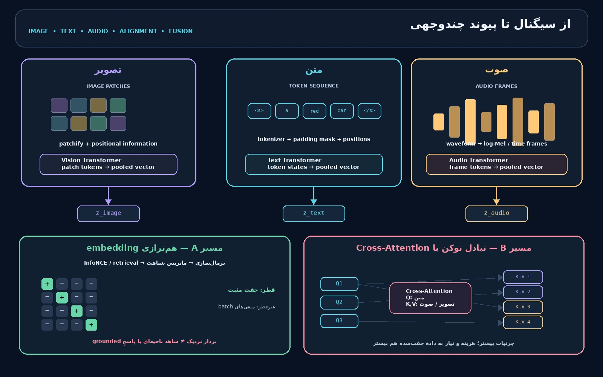

**شکل ۳-۷-۱ — دو هدف جدا: هم‌ترازی بردارهای خلاصه برای جست‌وجو، و تبادل اطلاعات میان توکن‌ها برای وظیفهٔ مشترک.** نمودار مفهومی است؛ اندازهٔ بلوک‌ها یا طول پیکان‌ها مقیاس، کیفیت یا سرعت مدل واقعی را اندازه‌گیری نمی‌کند.

## ۱. چرا یک Transformer را به بیش از یک نوع داده وصل می‌کنیم؟

مدلی که تنها متن می‌بیند از عکس، گفتار، صدای محیط یا ویدئو به شکل مستقیم اطلاعات ندارد. در یک مدل چندوجهی (multimodal)، هر ورودی ابتدا به بازنمایی‌ای تبدیل می‌شود که مدل بتواند محاسبه کند؛ بعد باید تصمیم بگیریم بازنمایی‌ها فقط قابل‌مقایسه باشند یا هنگام حل وظیفه با هم تعامل کنند. این دو نیاز متفاوت‌اند: **retrieval** می‌خواهد «کدام متن با این عکس/صوت جورتر است؟» را پاسخ دهد؛ **پرسش‌وپاسخ** ممکن است لازم داشته باشد چند ناحیهٔ تصویر و چند واژهٔ پرسش به‌صورت مرحله‌ای به هم توجه کنند.

مسیر کلی فصل چنین است: (الف) سیگنال‌ها را به توالیِ مناسب هر رمزگذار ببریم؛ (ب) یک فضای مشترک بسازیم و زیان هم‌ترازی را بفهمیم؛ (ج) تفاوت embeddingِ دوسویه با cross-attention را ببینیم؛ (د) زمان، داده، آزمون و محدودیت‌ها را در طراحی وارد کنیم. «چندوجهی» به‌تنهایی نه معماری یگانه‌ای است، نه تضمین فهم همه‌چیز.

## ۲. هر مدالیته باید قرارداد ورودی خودش را داشته باشد

**مدالیته** (modality) نوعی سیگنال با ساختار و واحد ویژهٔ خود است. متن معمولاً به شناسه‌های توکن تبدیل می‌شود؛ تصویر ممکن است به وصله‌های پیکسلی یا ویژگی‌های چندمقیاسی شکسته شود؛ صوت از موج نمونه‌برداری‌شده یا ویژگی‌هایی مانند log-Mel به فریم‌ها/توکن‌ها می‌رسد. برای Transformer نهایی، همه می‌توانند توالیِ بردار باشند؛ اما تبدیل اولیه و معنای موقعیت در هرکدام یکی نیست.

| ورودی | نمونهٔ نمایش خام/میانی | توالی‌ای که encoder می‌بیند | قراردادهایی که باید ثبت شوند |
|---|---|---|---|
| متن | رشته، شناسهٔ توکن | `[B,L,d]` | tokenizer، زبان، نشانه‌های ویژه، padding و ماسک |
| تصویر | RGB یا کانال‌های دیگر | `[B,N_v,d]` | اندازه/نسبت تصویر، patch/crop، normalization و ترتیب وصله‌ها |
| صوت | waveform یا log-Mel | `[B,N_a,d]` | نرخ نمونه‌برداری، کانال، پنجره/گام، مدت، VAD و padding |
| ویدئو | فریم‌ها همراه timestamp؛ گاهی audio track | `[B,N_t,d]` یا توالی interleaved | fps، timestamp، هم‌زمان‌سازی، نرخ فریم و نگه‌داشتن قطعه‌ها |

این شکل‌ها شماتیک‌اند و batch، padding یا tokenهای ویژه را ساده کرده‌اند. اگر دو نمونه از یک صحنه باشند اما timestamp، crop یا transcript ناسازگار داشته باشند، صرفاً هم‌شکل بودن تنسورها جفت معناییِ درست نمی‌سازد.

## ۳. تصویر به توالی: وصله‌های ViT

در Vision Transformer (ViT) ساده، تصویر `H×W` به مربع‌های `p×p` شکسته می‌شود؛ هر وصله مسطح/پروجکت می‌شود تا یک بردار بسازد و به آن موقعیت داده می‌شود. تعداد وصله‌ها، در نبود padding و crop، چنین است:

<math xmlns="http://www.w3.org/1998/Math/MathML" display="block" aria-label="تعداد وصله‌های تصویر برابر ارتفاع تقسیم بر اندازهٔ وصله ضرب در عرض تقسیم بر اندازهٔ وصله است؛ attention متراکم روی N وصله تقریباً با N به توان دو رشد می‌کند"><mrow><mi>N</mi><mo>=</mo><mfrac><mi>H</mi><mi>p</mi></mfrac><mo>×</mo><mfrac><mi>W</mi><mi>p</mi></mfrac><mo>,</mo><mspace width="1em"/><mi>Cost</mi><mo>(</mo><mi>attention</mi><mo>)</mo><mo>≈</mo><mi>O</mi><mo>(</mo><msup><mi>N</mi><mn>2</mn></msup><mi>d</mi><mo>)</mo></mrow></math>

**متن جایگزین فرمول:** تعداد وصله‌های تصویر برابر ارتفاع تقسیم بر اندازهٔ وصله ضرب در عرض تقسیم بر اندازهٔ وصله است؛ attention متراکم روی N وصله تقریباً با N به توان دو رشد می‌کند.

برای تصویر `224×224` و `p=16` داریم `14×14=196` وصله. دو برابر کردن هر بُعد به `448×448` تعداد وصله‌ها را چهار برابر (`784`) و جفت‌های dense را حدود شانزده برابر می‌کند، اگر معماری و mask ثابت بمانند. این نسبت هزینهٔ نظری توجه است، نه پیش‌بینی latency کل؛ patch embedding، MLP، batching، kernel و سخت‌افزار نیز دخیل‌اند. ViT نشان داد Transformer می‌تواند دنبالهٔ وصله‌های تصویر را پردازش کند؛ پیش‌آموزش، داده و انتقال به وظیفه هم در نتیجهٔ آن کار اهمیت داشتند [۱].

**پیام مهندسی:** وضوح را فقط برای «جزئیات بیشتر» بالا نبرید. OCR، نمودار و تصویر سند ممکن است به crop/وضوح بیشتری نیاز داشته باشند؛ طبقه‌بندی کلی شاید با وضوح کمتر کافی باشد. ثبت تعداد وصله‌ها، cropها و معیار خطا کمک می‌کند معلوم شود هزینه کجا صرف شده است.

## ۴. متن هم یک encoder دارد، نه یک رشتهٔ جادویی

در مسیر تصویر–متن، tokenizer متن را به شناسه‌ها تبدیل می‌کند؛ embedding و Transformer بازنمایی توکن‌ها را می‌سازند؛ سپس یک pooling rule (مثلاً end-of-text، توکن ویژه یا میانگین masked) و projection، یک بردار خلاصه تولید می‌کنند. جزئیات انتخاب pooling و tokenizer بخشی از checkpoint است؛ تعویضشان بدون ارزیابی ممکن است فضای embedding را ناسازگار کند.

در CLIP، رمزگذار تصویر و رمزگذار متن جداگانه بازنمایی می‌سازند و با جفت‌های تصویر–شرح آموزش می‌بینند؛ همین طراحی، محاسبهٔ متن‌ها و تصاویر را جدا می‌کند و برای جست‌وجو مناسب است [۲]. مدل متن در چنین سامانه‌ای لزوماً یک LLM مولد نیست. همچنین «بردار متن با بردار تصویر مقایسه شد» به این معنا نیست که مدل توانسته متن را با ناحیهٔ دقیق تصویر یا ترتیب چند رویداد پیوند دهد.

برای متن فارسی، باید tokenizer، داده، نیم‌فاصله، خط، نویسه‌های مخلوط، زبان شرح و شیوهٔ pooling را جدا آزمود. پشتیبانی از چند زبان در مدل‌کارت یا مقاله جایگزین آزمون روی پرس‌وجوها و تصاویر موردنیاز شما نیست.

## ۵. فضای embedding مشترک: نزدیک‌بودن را با چه چیزی می‌سنجیم؟

فرض کنید encoder تصویر بردار `hᵛ` و encoder متن بردار `hᵗ` می‌سازد. projectionهای جدا آن‌ها را به بُعد مشترک می‌برند و معمولاً نرمال‌سازی L2 می‌کنند. شباهت cosine میان بردارهای نرمال‌شده برابر ضرب داخلی آن‌ها است؛ عدد بزرگ‌تر یعنی مدل در فضای آموخته‌شده آن جفت را نزدیک‌تر گذاشته است، نه اینکه یک احتمالِ کالیبره‌شده یا داوریِ انسانی باشد.

<math xmlns="http://www.w3.org/1998/Math/MathML" display="block" aria-label="بردار تعبیهٔ واحد برابر projection بر طول اقلیدسی آن است؛ شباهت کسینوسی دو بردار نرمال‌شده برابر ضرب داخلی آن‌هاست"><mrow><mi>z</mi><mo>=</mo><mfrac><mrow><mi>W</mi><mi>h</mi></mrow><msub><mrow><mo>∥</mo><mi>W</mi><mi>h</mi><mo>∥</mo></mrow><mn>2</mn></msub></mfrac><mo>,</mo><mspace width="1em"/><mi>sim</mi><mo>(</mo><msub><mi>z</mi><mi>i</mi></msub><mo>,</mo><msub><mi>z</mi><mi>j</mi></msub><mo>)</mo><mo>=</mo><msubsup><mi>z</mi><mi>i</mi><mi>⊤</mi></msubsup><msub><mi>z</mi><mi>j</mi></msub></mrow></math>

**متن جایگزین فرمول:** بردار تعبیهٔ واحد برابر projection بر طول اقلیدسی آن است؛ شباهت کسینوسی دو بردار نرمال‌شده برابر ضرب داخلی آن‌هاست.

با داشتن یک پرس‌وجوی تصویری، می‌توان embedding آن را با embedding شرح‌های ازپیش‌محاسبه‌شده مقایسه کرد و top-k را بازیابی کرد. در reverse retrieval، متن query است و تصاویر candidate. این سازوکار **هم‌ترازی سراسری** را بهینه می‌کند؛ ممکن است «یک سگ روی کاناپه» و «یک سگ در پارک» را به‌خاطر واژهٔ مشترک نزدیک بگذارد، هرچند رابطهٔ فضایی متفاوت باشد.

## ۶. InfoNCE: جفت درست را میان جفت‌های دسته پیدا کن

در دسته‌ای با `B` جفت متن–تصویر، encoderها ماتریس شباهت `B×B` می‌سازند. قطر ماتریس جفت‌های مثبتِ داده‌شده است؛ خانه‌های دیگر در حالت ساده منفی فرض می‌شوند. دما/مقیاس logits بر تیزی توزیع اثر دارد. زیان contrastiveِ متن‌به‌تصویر و تصویر‌به‌متن میانگین گرفته می‌شود:

<math xmlns="http://www.w3.org/1998/Math/MathML" display="block" aria-label="لوگیت تصویر متن برابر مقیاس ضربدر ضرب داخلی embeddingهای نرمال‌شده است؛ هدف هر سطر جایگاه مثبت روی قطر ماتریس شباهت است"><mrow><msub><mi>s</mi><mrow><mi>i</mi><mi>j</mi></mrow></msub><mo>=</mo><mi>α</mi><mo>·</mo><msubsup><mi>z</mi><mi>i</mi><mi>image</mi></msubsup><msubsup><mi>z</mi><mi>j</mi><mi>text</mi></msubsup><mo>,</mo><mspace width="0.8em"/><msub><mi>y</mi><mi>i</mi></msub><mo>=</mo><mi>i</mi></mrow></math>

**متن جایگزین فرمول:** لوگیت تصویر متن برابر مقیاس ضربدر ضرب داخلی embeddingهای نرمال‌شده است؛ هدف هر سطر جایگاه مثبت روی قطر ماتریس شباهت است.

<math xmlns="http://www.w3.org/1998/Math/MathML" display="block" aria-label="زیان تصویر به متن منفی میانگین لگاریتم احتمال کلاس جفت درست است؛ زیان دوطرفه میانگین مسیر تصویر به متن و متن به تصویر است"><mrow><msub><mi>L</mi><mrow><mi>i</mi><mo>→</mo><mi>t</mi></mrow></msub><mo>=</mo><mo>−</mo><mfrac><mn>1</mn><mi>B</mi></mfrac><munderover><mo>∑</mo><mrow><mi>i</mi><mo>=</mo><mn>1</mn></mrow><mi>B</mi></munderover><mi>log</mi><mfrac><mrow><mi>exp</mi><mo>(</mo><msub><mi>s</mi><mrow><mi>i</mi><mi>i</mi></mrow></msub><mo>)</mo></mrow><mrow><munderover><mo>∑</mo><mrow><mi>j</mi><mo>=</mo><mn>1</mn></mrow><mi>B</mi></munderover><mi>exp</mi><mo>(</mo><msub><mi>s</mi><mrow><mi>i</mi><mi>j</mi></mrow></msub><mo>)</mo></mrow></mfrac><mo>,</mo><mspace width="0.8em"/><mi>L</mi><mo>=</mo><mfrac><mrow><msub><mi>L</mi><mrow><mi>i</mi><mo>→</mo><mi>t</mi></mrow></msub><mo>+</mo><msub><mi>L</mi><mrow><mi>t</mi><mo>→</mo><mi>i</mi></mrow></msub></mrow><mn>2</mn></mfrac></mrow></math>

**متن جایگزین فرمول:** زیان تصویر به متن منفی میانگین لگاریتم احتمال کلاس جفت درست است؛ زیان دوطرفه میانگین مسیر تصویر به متن و متن به تصویر است.

این یک نمونهٔ هدف است، نه تنها راه آموزش چندوجهی. کد پروژه برای هر جفت modality همین زیان متقارن را روی batch کوچک اجرا می‌کند. اگر چند caption واقعاً دربارهٔ یک تصویر باشند، فرض «فقط قطر مثبت است» می‌تواند هم‌معناها را به‌اشتباه منفی بخواند؛ کیفیت داده و ساخت loss را همراه با مدل طراحی کنید.

## ۷. مثبت و منفی را خود داده تعیین نمی‌کند

«مثبت» و «منفی» برچسب‌های آموزشی‌اند، نه حقیقت جهان. دو شرح متفاوت ممکن است هر دو درست باشند؛ دو تصویر متفاوت ممکن است هر دو یک شیء یا مفهوم را نشان دهند. در مقابل، شرح کلی می‌تواند با تصویر جور باشد اما رنگ، شمار، نسبت فضایی یا زمان را جا بیندازد. جفت‌های اشتباه یا شرح‌های کم‌کیفیت به مدل یاد می‌دهند shortcutهای آماری را دنبال کند.

InfoNCE معمولی برای هر جفت، بقیهٔ اعضای همان batch را منفی می‌گیرد. وقتی batch بزرگ‌تر می‌شود، سیگنال منفی بیشتری داریم، ولی احتمال جفت‌های هم‌معنا/تکراری یا false negative هم بالا می‌رود. زیان sigmoid خانوادهٔ SigLIP برای جفت‌ها هدف دودویی را به‌کار می‌گیرد و به نرمال‌سازی سراسری softmax روی ماتریس شباهت به همان شکل CLIP وابسته نیست؛ این یک تغییر تابع زیان است، نه تضمین پاک‌بودن برچسب‌ها یا برتری روی همهٔ داده‌ها [۳].

کنترل‌های عملی: تکرار تصویر و متن را پیدا کنید؛ شرح‌های چندگانه را نگه دارید؛ جفت‌های مبهم را جدا برچسب بزنید؛ در صورت امکان چند مثبت برای یک نمونه ثبت کنید؛ و روی گروه‌هایی با محتوای مشابه معیار بگیرید. افزایش batch به‌تنهایی جای پاک‌سازی، اسناد داده و تحلیل false negative را نمی‌گیرد.

## ۸. Dual-encoder یا cross-encoder: جست‌وجو با فهم جفت فرق دارد

**Dual-encoder:** هر تصویر/متن را یک بار مستقل encode می‌کند؛ سپس شباهت بردارها را برای مقایسهٔ تعداد زیادی candidate می‌سنجد. embeddingهای corpus را می‌توان پیش‌محاسبه و در index جست‌وجو کرد. به همین دلیل این طرح معمولاً مرحلهٔ نخستِ مقیاس‌پذیر برای retrieval است.

**Cross-encoder:** دو ورودی را با هم وارد لایه‌های تعامل می‌کند؛ مثلاً توکن‌های متن مستقیماً به توکن‌های تصویر توجه می‌کنند. از آن‌جا که تعامل هر جفت باید جدا محاسبه شود، معمولاً آن را روی shortlistی که dual-encoder بازیابی کرده اجرا می‌کنند. Cross-encoder ممکن است به رابطهٔ جزئی‌تری پاسخ دهد، اما اگر به تصویر/شرح دقیق وابسته باشد همچنان می‌تواند شکست بخورد؛ اسم معماری کیفیت را تضمین نمی‌کند.

| پرسش محصول | انتخاب اولیهٔ معقول | آنچه باید سنجید |
|---|---|---|
| «از صدها هزار تصویر کدام‌ها با این query می‌خوانند؟» | Dual-encoder + index + reranker اختیاری | Recall@k، latency، زبان/دامنهٔ query |
| «به پرسش دربارهٔ ناحیه یا رابطه پاسخ بده» | encoder تصویری با تعامل متنی، localization یا decoder | شواهد ناحیه‌ای، خطای OCR، grounded answer |
| «جملهٔ شنیده‌شده را از آرشیو صدا پیدا کن» | audio–text encoder یا زنجیرهٔ ASR + retrieval | نویز، لهجه، زبان، طول و زمان‌بندی |

## ۹. Cross-attention: پل میان توکن‌ها

برای queryهای متن، `Q` از توکن‌های متن و `K,V` از توکن‌های تصویر (یا صوت) می‌آیند؛ وزن‌ها تعیین می‌کنند هر query چه بخشی از حافظه را بخواند. باقیمانده، نرمال‌سازی و شبکهٔ پیش‌خور، خروجی را دوباره در مسیر Transformer قرار می‌دهند. اگر متن چند پرسش دارد، هر توکن پرسش می‌تواند به جاهای متفاوتی از تصویر توجه کند؛ این تعامل از یک شباهت میان دو بردار خلاصه غنی‌تر است، ولی به‌تنهایی grounding درست را تضمین نمی‌کند.

BLIP-2 یک نمونه از پل کم‌پارامتر میان encoder تصویری منجمد و LLM منجمد است: Querying Transformer (Q-Former) از encoder تصویر اطلاعات می‌گیرد و به مسیر زبانی می‌رساند [۹]. Flamingo نیز اتصال مدل دیداری و زبانی ازپیش‌آموزش‌دیده و ورودی‌های متن/تصویر درهم‌تنیده را بررسی کرد [۱۰]. این‌ها نمونهٔ طراحی‌اند؛ تفاوت مرحلهٔ آموزش، تعداد پارامترهای قابل‌آموزش و داده را در مقایسه‌ها نگه دارید.

در پروژهٔ این فصل، توکن‌های متن query دو ماژول cross-attention مستقل‌اند: یکی حافظهٔ تصویر را می‌خواند و دیگری صوت را. نسخهٔ آموزشی به دلایل وضوح، temporal mask یا decoder مولد ندارد. پس آن را نمونهٔ **اتصال اطلاعات** بدانید، نه بازسازی معماری BLIP-2 یا Flamingo.

## ۱۰. صوت: از waveform تا فریم‌های قابل‌پردازش

موج دیجیتال دنباله‌ای از دامنهٔ سیگنال در نرخ نمونه‌برداری مشخص است. طول waveform به ثانیه و نرخ نمونه بستگی دارد؛ با تبدیل STFT می‌توان پنجره‌های کوتاه را به طیف و معمولاً فیلترهای Mel را به ویژگی‌های کم‌بعدتر تبدیل کرد. با پنجرهٔ ۲۵ms و گام ۱۰ms، فریم‌ها هر ۱۰ms جابه‌جا می‌شوند؛ مرز دقیق و نرخ‌ها وابسته به مدل و preprocessing است، نه استاندارد واحد همهٔ encoderها.

**نرخ نمونه‌برداری مهم است.** بازتفسیر waveform با نرخ دیگری—بدون resampling—سرعت و pitch مؤثر را عوض می‌کند. همچنین stereo-to-mono، clipping، normalization، silence/VAD و مدت crop روی نتیجه اثر دارند. شکل ورودی «`[B,mel,T]`» فقط قرارداد تنسور است؛ تعداد mel bins، window, hop, sample rate و normalization را باید در metadata مدل ثبت کرد.

کد پروژه waveform نمی‌خواند. ورودی آن feature ساختگیِ شبیه log-Mel است که چند فریم را با Conv1d گروه‌بندی می‌کند؛ این میان‌بُر آموزشی برای نشان‌دادن توکن‌های صوت است و جایگزین frontend صوت واقعی نیست.

## ۱۱. سه وظیفهٔ صوتی را یکی نگیریم

**بازنمایی گفتار:** wav2vec 2.0 روی صوتِ بدون متن، نمایش‌های latent را با هدف خودنظارتی/contrastive می‌آموزد و سپس برای کارهایی چون بازشناسی گفتار fine-tune می‌شود [۵]. **بازشناسی گفتار (ASR):** Whisper یک مسیر نظارت‌شدهٔ ضعیف‌برچسب‌خورده برای پیش‌بینی transcript و کارهای مرتبط بررسی کرد [۶]. **توصیف/جست‌وجوی صوت:** CLAP متن و صوت را برای retrieval و classification صفرنمونه‌ای در آزمایش‌های خودش هم‌تراز کرد [۷].

این دسته‌ها می‌توانند در یک محصول ترکیب شوند، اما برچسب و خروجی یکسان ندارند: transcript حرف‌ها را هدف می‌گیرد؛ embedding صوتی ممکن است ویژگی‌های رویداد را نگه دارد؛ caption می‌تواند «صدای زنگ و ترمز» را توصیف کند؛ تولید گفتار وظیفهٔ دیگری است. یک مدل speech encoder لزوماً صدای موتور، موسیقی یا هم‌زمانی دو گوینده را به‌خوبی تحلیل نمی‌کند.

پیش از انتخاب، پرسش را دقیق بنویسید: آیا به متن پیاده‌شده نیاز است، رخداد صوتی، speaker، زمان شروع رویداد، caption، یا پیوند audio و تصویر؟ سپس encoder، داده، معیار و سیاست حفظ فایل خام را با همین هدف تطبیق دهید.

## ۱۲. اتصال چند مدالیته: فضای مشترک همه‌به‌همه لازم نیست

یک راه ساده، ساخت جفت متن–تصویر و جداگانه متن–صوت است و نگاشت هر encoder به بُعد مشترک. سپس تصویر و صوت هم از طریق متن در گراف جفت‌ها قابل مقایسه می‌شوند، اما کیفیت این مسیر به پوشش مفاهیم و زبان در پیوندها وابسته است. ImageBind نشان داد در تنظیم مقالهٔ آن می‌توان شش مدالیته—تصویر، متن، صوت، عمق، حرارتی و IMU—را به فضای embedding مشترک برد، بدون اینکه هر ترکیب دوتایی مستقیماً دادهٔ paired داشته باشد [۸]. این ادعا به روش و آزمایش همان مقاله محدود است؛ جفت‌شدن از راه یک anchor همهٔ رابطه‌های ظریف یا modal gap را از میان نمی‌برد.

در طراحی داده، می‌توان جفت‌ها را به شکل گراف دید: گره‌ها modality/encoderها و یال‌ها نمونه‌های paired و هدف‌های آموزشی‌اند. یال کم‌پوشش یا نویزی روی مسیرهای چندمرحله‌ای اثر می‌گذارد. بنابراین علاوه بر کیفیت هر جفت، سؤال کنید هر مفهوم، زبان، طول، کانال صوت و شرایط تصویری با چه مسیرهایی به فضای مشترک می‌رسد.

## ۱۳. صوت و تصویر زمان‌مندند؛ هم‌ترازی فقط یک cosine نیست

در تصویر ثابت و جملهٔ کوتاه می‌توان یک embedding برای هر نمونه در نظر گرفت؛ اما ویدئو/صوت دنباله‌های زمان‌مند با نرخ‌های مختلف‌اند. یک ثانیهٔ ویدئو می‌تواند چندین frame داشته باشد و صوت در هر ثانیه هزاران نمونه؛ پس لازم است timestampها، chunkها و موقعیت‌های زمان‌محور را به توکن‌ها نسبت دهیم. هم‌ترازی سراسری شاید «صدای پارس و سگ» را نزدیک کند، ولی نمی‌گوید پارس دقیقاً کدام لحظه/فریم رخ داده است.

Qwen2.5-Omni در گزارش خود، برای ورودی ویدئو/صوت هم‌زمان از chunking encoderها و TMRoPE (Time-aligned Multimodal RoPE) برای موقعیت زمانی یاد می‌کند؛ در همان گزارش Thinker/Talker وظایف فهم/متن و تولید گفتار را در معماری مرتبط می‌کند [۱۳]. پژوهش TaRoPE در ۲۰۲۶ به mismatch نرخ فریم صوت/ویدئو و هم‌ترازی ویژگی‌های زمانی در یک وظیفهٔ خاصِ تشخیص هیجان صوتی–دیداری می‌پردازد؛ نتیجه‌اش را به همهٔ وظایف تعمیم ندهید [۱۵].

پروتکل پایه: timestamp یک رویداد را با دقت معلوم ثبت کنید؛ از frameهای نزدیک و قطعه‌های صوت هم‌زمان نمونه بگیرید؛ بررسی کنید resampling، crop و buffering زمان‌ها را جابه‌جا نکرده باشد؛ سپس هم retrieval کل کلیپ و هم تشخیص زمان رویداد را جدا ارزیابی کنید. بخش ۱۸ نمونه‌های تازه‌تر را مرور می‌کند.

## ۱۴. سه الگوی ادغام و جایی که تعامل رخ می‌دهد

| راهبرد | محل تعامل | مزیت معمول | هزینه/ریسک معمول |
|---|---|---|---|
| **Early fusion** | توکن‌های چند مدالیته زود در یک توالی ادغام می‌شوند | امکان مدل‌کردن وابستگی‌های مشترک در لایه‌ها | طول توالی/ماسک پیچیده‌تر؛ کمبود داده paired می‌تواند مشکل‌ساز شود |
| **Late fusion** | هر encoder جدا کار می‌کند؛ بردار یا score در پایان ترکیب می‌شود | محاسبهٔ مستقل و cache/index ساده‌تر | جزئیات ناحیه‌ای یا زمانی ممکن است در pooling گم شود |
| **Bridge / cross-attention** | چند query یا لایهٔ connector به encoder دیگر دسترسی دارد | راهی برای اتصال encoderهای ازپیش‌آموزش‌دیده و کاهش آموزش کامل | انتخاب تعداد query، اطلاعات حذف‌شده و bias encoder پایه مهم است |
| **Hybrid** | ترکیبی از late/bridge و ادغام در چند مرحله | امکان توازن هزینه و تعامل | دشوارتر برای ablation، اشکال‌زدایی و attribution خطا |

این‌ها خانواده‌های طراحی‌اند، نه ranking. نیاز محصول، نوع داده و بودجه تعیین می‌کند چه چیزی بسازیم. یک ablation منصفانه ثابت نگه می‌دارد: داده، split، pretrained checkpoint، optimizer، تعداد update و معیار؛ سپس فقط محل/نوع fusion را تغییر می‌دهد.

## ۱۵. Encoder را منجمد کنیم یا آموزش دهیم؟

اگر encoderهای ازپیش‌آموزش‌دیده داریم، **freeze** کردن وزن آن‌ها و آموزش یک projection/connector سبک می‌تواند آزمایش را ارزان‌تر و ساده‌تر کند. اما اگر زبان، دامنهٔ تصویر، sampling یا وظیفه با دادهٔ پایه فرق کند، نمای ثابت ممکن است اطلاعات لازم را نداشته باشد. در **partial unfreezing** لایه‌های بالایی یا adapterها آموزش می‌بینند؛ **full fine-tuning** آزادی بیشتری دارد، اما داده/حافظه و خطر forgetting و overfit را هم بالا می‌برد.

یک آزمایش مرحله‌ای: ابتدا baseline منجمد؛ بعد connector/LoRA؛ سپس unfreeze کنترل‌شده؛ همه با validation/test پاک و جدا. هزینه را با trainable parameters تنها نسنجید: activation، optimizer state، decoder و اندازهٔ sequence هم مصرف دارند. دقت روی دادهٔ train یا چند prompt دستی معیار انتخاب نهایی نیست.

## ۱۶. ارزیابی: retrieval، جزئیات و استدلال سه آزمون‌اند

**Retrieval:** Recall@k، MRR یا nDCG را روی gallery ثابت بسنجید؛ هم text→image و image→text، هم زبان‌ها/دامنه‌های جدا. **Local grounding:** برای اینکه تصویر/فریم کدام ناحیه شاهد پاسخ است، IoU/grounding یا بررسی انسانیِ ناحیه‌ای لازم است. **ASR:** WER/CER و خطا برحسب لهجه، نویز و زبان. **زمان‌مندی:** onset/segment، timestamp tolerance و رویداد هم‌زمان. **پرسش‌وپاسخ:** correctness باید همراه با شاهد و خطای hallucination بررسی شود؛ امتیاز embedding similarity جای پاسخ مستند نیست.

MMMU نمونه‌ای از benchmark چندرشته‌ای است که پرسش‌های تصویرمحور و استدلالی در موضوعات دانشگاهی را هدف می‌گیرد [۱۲]. چنین benchmarkی retrieval ساده را با VQA و grounding یکی نمی‌کند. پیش از استناد به امتیاز، نسخهٔ داده، split، روش prompt، ابزار کمکی، metric، آلودگی احتمالی و شرایط اجرای همان paper را ثبت کنید؛ یک بنچمارک به‌تنهایی همهٔ محصول را پوشش نمی‌دهد.

## ۱۷. «هم‌ترازی» چه چیزی را حل نمی‌کند؟

1. **سطحی‌بودن برچسب:** caption کوتاه ممکن است جزئیات ریز، روابط، نفی، تعداد یا ترتیب رخداد را نگوید.
2. **false negative و چند مثبت:** جفت‌های مشابه می‌توانند در batch به‌غلط منفی شوند؛ score یادگرفته‌شده حقیقت قطعی نیست.
3. **سوگیری پوشش:** وب‌داده ممکن است بعضی زبان‌ها/فرهنگ‌ها، صداها، چهره‌ها، اسناد یا شرایط ضبط را بیش/کم‌تر نمایندگی کند. «multilingual» در عنوان paper تضمین برابری برای زبان/وظیفهٔ شما نیست؛ SigLIP 2 مثلاً recipe و ارزیابی چندزبانهٔ خودش را گزارش می‌کند [۴].
4. **leakage و مجوز:** near-duplicate میان train/test، حق استفادهٔ تصویر/صوت، رضایت و دادهٔ حساس باید بررسی شود. مقالهٔ DataComp توجه پژوهش را صریحاً به ساخت/فیلتر مجموعه‌داده و ارزیابی استاندارد می‌برد [۱۱]؛ این کار جایگزین بررسی حقوقی dataset مشخص نیست.
5. **shortcut و تغییر دامنه:** پس‌زمینه یا watermark می‌تواند label را لو بدهد؛ تغییر دوربین/نویز/زبان retrieval را عوض می‌کند.
6. **اعتماد کاذب:** نزدیک‌ترین vector ممکن است نامرتبط باشد، و مدل مولد می‌تواند با اطمینان پاسخ نادرست بسازد. threshold باید با calibration و هزینهٔ خطای محصول سنجیده شود.

برای تصمیم عملی، نمونه‌های خطا را به علت دسته‌بندی کنید: preprocessing، coverage، label, geometry/time, model capacity, evaluation leakage یا prompt. تا وقتی منبع خطا مشخص نیست، اضافه‌کردن داده و پارامتر صرفاً هزینه را زیاد می‌کند.

## ۱۸. پژوهش‌های تازه تا ۵ نوامبر ۲۰۲۶: نشانه‌اند، نه نسخهٔ نهایی

**SigLIP 2 (۲۰۲۵)** خانواده‌ای از encoderهای چندزبانهٔ تصویر–متن را با recipe شامل captioning، self-supervision و data curation گزارش می‌کند و localization/dense feature را هم ارزیابی می‌کند [۴]. **Qwen2.5-Omni (۲۰۲۵)** به stream چندوجهی متن، تصویر، صوت و ویدئو و تولید هم‌زمان متن/گفتار می‌پردازد [۱۳]. این‌ها دو سطح متفاوت‌اند: encoder embedding برای retrieval با سیستم end-to-end که چند نوع خروجی/وظیفه دارد یکی نیست.

**WAVE** در ICLR 2026، از مدل زبانی چندوجهی برای embeddingهای متن، صوت، ویدئو و ورودی صوتی–دیداری، feature fusion سلسله‌مراتبی و آموزش مشترک استفاده می‌کند؛ مقالهٔ خودش retrieval هر-به-هر و embedding وابسته به prompt را در benchmarkهای خودش گزارش می‌کند [۱۴]. این نتیجه را «هر مدل بزرگ خودبه‌خود audio/video را خوب embed می‌کند» تعبیر نکنید.

**Virtual Encoders in Multimodal Transformers** (نسخهٔ ۱۹ اکتبر ۲۰۲۶، مقالهٔ کارگاهی ACCV 2026) بررسی می‌کند که Transformer مشترک، وقتی encoder ادراکیِ کامل جداگانه ندارد، ممکن است در لایه‌های ابتدایی/میانی محاسبهٔ encoderمانندی انجام دهد [۱۶]. این یک تحلیل پژوهشی تازه دربارهٔ مرز عملکردیِ perception است، نه راهنمای قطعی برای حذف همهٔ encoderهای اختصاصی. ادبیات چندوجهی سریع تغییر می‌کند؛ تاریخ نسخه و محدودیت همان کار را کنار هر نتیجه نگه دارید.

### واژه‌نامهٔ کوتاه

- **مدالیته (modality):** گونهٔ ورودی، مانند متن، تصویر یا صوت.
- **رمزگذار (encoder):** ماژولی که ورودی را به نمایش یا توکن تبدیل می‌کند.
- **هم‌ترازی (alignment):** آموزش یا سنجش سازگاری نمایش‌های دو منبع.
- **ادغام (fusion):** ترکیب اطلاعات چند مدالیته در یک نمایش یا مسیر پردازش.
- **Cross-Attention:** توجهی که Query و Key/Value را از ورودی‌های متفاوت می‌گیرد.

## ۱۹. پروژهٔ کوچک، آزمون‌ها و مسیر تصمیم‌گیری

در `projects/39-multimodal-transformer/` سه encoder تصادفی با PyTorch ساخته شده‌اند: وصله‌های تصویر، توکن‌های متن و ویژگی‌های شبیه log-Mel. سه projection به بُعد مشترک می‌رسند؛ زیان سه‌طرفهٔ InfoNCE جفت‌های image–text، image–audio و text–audio را مقایسه می‌کند؛ شاخهٔ جداگانه‌ای نیز توکن‌های متن را با cross-attention به تصویر و صوت وصل می‌کند. خروجی مورد انتظار: embeddingهای `[4,16]`، توکن‌های متنِ ادغام‌شده `[4,6,32]`، loss متناهی و گرادیان.

```bash
cd book-engineering/projects/39-multimodal-transformer
python -m unittest discover -v
python multimodal_alignment.py
```

۱۵ آزمون shape، قرارداد ماسک، طول معتبر صوت، نرمال‌سازی، جفت مرتب/به‌هم‌ریخته، گرادیان شاخه‌ها و ورودی نامعتبر را بررسی می‌کنند. وزن تصادفی و دادهٔ مصنوعی‌اند؛ این پروژه **retrieval، آموزش معنادار، کیفیت alignment، سرعت، waveform واقعی یا تولید زبان را نشان نمی‌دهد**. کد کامل در بخش ۲۰ و توضیح اجرا در [README پروژه](book-engineering/projects/39-multimodal-transformer/README.md) است.

### تمرین و پروژهٔ تکمیلی

1. تصویر `384×256` با وصلهٔ `16×16` چند وصله دارد؟ اگر هر دو بُعد دو برابر شوند، نسبت تعداد وصله و جفت‌های dense چه می‌شود؟ فرض‌های مرزی را بنویسید.
2. در batch چهار، چرا InfoNCE ساده سه عضو دیگر را منفی می‌گیرد؟ یک مثال بیاورید که این فرض false negative بسازد و یک اصلاح داده/loss پیشنهاد کنید.
3. برای جست‌وجوی میلیون تصویر، چرا dual-encoder را می‌توان مرحلهٔ نخست گرفت؟ cross-encoder را در چه مرحله‌ای به‌کار می‌برید؟ هزینه و metric هر مرحله را جدا کنید.
4. نمونهٔ گفتار با نرخ 16 kHz را می‌خواهید برای مدلی با frontend تعریف‌شده در 24 kHz آماده کنید. چرا تغییر برچسب sample rate بدون resampling نادرست است؟ دست‌کم چهار metadata لازم را فهرست کنید.
5. ویدئویی از آشپزی دارید که یک صدای کوتاه هم‌زمان با یک فریم رخ می‌دهد. چه دادهٔ زمانی، fusion و metric لازم است تا رویداد را پیدا کنید، نه فقط کلیپ مشابه را؟
6. طرح dataset متن–تصویر–صوت کوچک بسازید: مجوز/رضایت، چند caption، split براساس منبع، حذف duplicate، annotation خطا و test زبان/گروه‌ها را مستند کنید.
7. در کد، اگر متن هم‌تراز با تصویر است ولی فایل صوتی از کلیپ دیگری آمده، کدام lossها جفت غلط را تشویق می‌کنند؟ چه guard در dataset pipeline اضافه می‌کنید؟
8. پروژهٔ تکمیلی: frozen encoderهای pretrained را جایگزین encoderهای toy کنید؛ retrieval دوطرفه، false negative، زمان استنتاج و دقت روی یک set جدا را گزارش کنید. مدل‌کارت و محدودیت مجوز را ضمیمه کنید.

برای پاسخ تشریحی به [پاسخ‌نامهٔ فصل ۳۹](book-engineering/answers/39-multimodal-transformer-fa.md) رجوع کنید. فصل بعدی طبق نقشه، فصل سراسری ۴۰ است؛ موضوع آن دادهٔ کوچک و آماده‌سازی آن خواهد بود و این فصل آن محتوا را پیشاپیش نمی‌نویسد.

### راهنمای انتخاب در یک دقیقه

- **پیداکردن/مرتب‌کردن تعداد زیادی نمونه:** dual-encoder، embeddingهای cacheشدنی و معیار retrieval.
- **گفت‌وگوی دقیق دربارهٔ ناحیه/جزئیات:** cross-attention یا مدل grounding، همراه با آزمون ناحیه‌ای و شاهد.
- **گفتار به متن:** ASR و معیار transcript؛ **رویداد صوتی به شرح:** audio–text alignment و معیار retrieval/caption.
- **رویداد audio–video زمان‌مند:** timestamp، chunk alignment و آزمون زمانی؛ یک embedding سراسری کافی نیست.
- **مدل موجود را به دامنهٔ تازه ببر:** ابتدا split و خط پایه، سپس connector/adapter و در پایان unfreeze کنترل‌شده.

### منابع بیرونی و تاریخ بازبینی

منابع اولیه/مقالات:

1. Dosovitskiy et al., “An Image is Worth 16×16 Words: Transformers for Image Recognition at Scale,” ICLR 2021, [arXiv:2010.11929](https://arxiv.org/abs/2010.11929). مراجعه: ۵ نوامبر ۲۰۲۶.
2. Radford et al., “Learning Transferable Visual Models From Natural Language Supervision,” 2021, [arXiv:2103.00020](https://arxiv.org/abs/2103.00020). مراجعه: ۵ نوامبر ۲۰۲۶.
3. Zhai et al., “Sigmoid Loss for Language Image Pre-Training,” ICCV 2023, [arXiv:2303.15343](https://arxiv.org/abs/2303.15343). مراجعه: ۵ نوامبر ۲۰۲۶.
4. Tschannen et al., “SigLIP 2: Multilingual Vision-Language Encoders with Improved Semantic Understanding, Localization, and Dense Features,” 2025, [arXiv:2502.14786](https://arxiv.org/abs/2502.14786). مراجعه: ۵ نوامبر ۲۰۲۶.
5. Baevski et al., “wav2vec 2.0: A Framework for Self-Supervised Learning of Speech Representations,” NeurIPS 2020, [arXiv:2006.11477](https://arxiv.org/abs/2006.11477). مراجعه: ۵ نوامبر ۲۰۲۶.
6. Radford et al., “Robust Speech Recognition via Large-Scale Weak Supervision,” 2022, [arXiv:2212.04356](https://arxiv.org/abs/2212.04356). مراجعه: ۵ نوامبر ۲۰۲۶.
7. Wu et al., “Large-scale Contrastive Language-Audio Pretraining with Feature Fusion and Keyword-to-Caption Augmentation,” ICASSP 2023, [arXiv:2211.06687](https://arxiv.org/abs/2211.06687). مراجعه: ۵ نوامبر ۲۰۲۶.
8. Girdhar et al., “ImageBind: One Embedding Space To Bind Them All,” CVPR 2023, [arXiv:2305.05665](https://arxiv.org/abs/2305.05665). مراجعه: ۵ نوامبر ۲۰۲۶.
9. Li et al., “BLIP-2: Bootstrapping Language-Image Pre-training with Frozen Image Encoders and Large Language Models,” ICML 2023, [arXiv:2301.12597](https://arxiv.org/abs/2301.12597). مراجعه: ۵ نوامبر ۲۰۲۶.
10. Alayrac et al., “Flamingo: a Visual Language Model for Few-Shot Learning,” NeurIPS 2022, [arXiv:2204.14198](https://arxiv.org/abs/2204.14198). مراجعه: ۵ نوامبر ۲۰۲۶.
11. Gadre et al., “DataComp: In search of the next generation of multimodal datasets,” NeurIPS 2023 Datasets and Benchmarks, [arXiv:2304.14108](https://arxiv.org/abs/2304.14108). مراجعه: ۵ نوامبر ۲۰۲۶.
12. Yue et al., “MMMU: A Massive Multi-discipline Multimodal Understanding and Reasoning Benchmark for Expert AGI,” CVPR 2024 Oral, [arXiv:2311.16502](https://arxiv.org/abs/2311.16502). مراجعه: ۵ نوامبر ۲۰۲۶.
13. Xu et al., “Qwen2.5-Omni Technical Report,” 2025, [arXiv:2503.20215](https://arxiv.org/abs/2503.20215). مراجعه: ۵ نوامبر ۲۰۲۶.
14. Tang et al., “WAVE: Learning Unified & Versatile Audio-Visual Embeddings with Multimodal LLM,” ICLR 2026، [صفحهٔ رسمی ICLR](https://www.iclr.cc/virtual/2026/poster/10009925)، [arXiv:2509.21990](https://arxiv.org/abs/2509.21990)، [پروژهٔ رسمی](https://github.com/TCL606/WAVE). مراجعه: ۵ نوامبر ۲۰۲۶.
15. Koo et al., “Multimodal Self-Attention Network with Temporal Alignment for Audio-Visual Emotion Recognition,” پذیرفته‌شده در ICASSP 2026، [arXiv:2603.11095](https://arxiv.org/abs/2603.11095). مراجعه: ۵ نوامبر ۲۰۲۶.
16. Ogata & Nakashima, “Virtual Encoders in Multimodal Transformers,” نسخهٔ ۱۹ اکتبر ۲۰۲۶؛ مقالهٔ کارگاهی ACCV 2026، [arXiv:2609.26513](https://arxiv.org/abs/2609.26513). مراجعه: ۵ نوامبر ۲۰۲۶.

ادعاهای تجربی در متن به وظیفه، checkpoint، benchmark و شرایط گزارش‌شده در همان منبع محدودند. «آخرین تحولات» به معنی پوشش کامل همهٔ آثار تا آن تاریخ نیست.

## ۲۰. پیوست: کد کامل پروژه

فایل زیر همان کدی است که در پروژه آزموده می‌شود؛ برای اجرا و آزمون به‌روزرسانی‌های منبع را در `projects/39-multimodal-transformer/` ببینید.

```python
"""Tiny CPU-friendly encoders for image, text, and audio alignment.

This pedagogical model demonstrates patch/token encoders, a shared embedding
space, symmetric contrastive learning, and text-query cross-attention to visual
and audio context. It uses random weights and synthetic features: it is not a
pretrained model, dataset, benchmark, or production multimodal assistant.
"""
from __future__ import annotations

import math

import torch
import torch.nn.functional as F
from torch import Tensor, nn


def _positive_int(value: int, name: str) -> None:
    if isinstance(value, bool) or not isinstance(value, int) or value < 1:
        raise ValueError(f"{name} must be a positive integer")


def _masked_mean(tokens: Tensor, padding_mask: Tensor | None = None) -> Tensor:
    """Mean-pool [B,T,D], ignoring positions where a bool mask is True."""
    if padding_mask is None:
        return tokens.mean(dim=1)
    weights = (~padding_mask).unsqueeze(-1).to(tokens.dtype)
    return (tokens * weights).sum(dim=1) / weights.sum(dim=1).clamp_min(1.0)


def _transformer(d_model: int, num_heads: int, depth: int) -> nn.TransformerEncoder:
    layer = nn.TransformerEncoderLayer(
        d_model=d_model,
        nhead=num_heads,
        dim_feedforward=4 * d_model,
        dropout=0.0,
        activation="gelu",
        batch_first=True,
        norm_first=True,
    )
    return nn.TransformerEncoder(layer, num_layers=depth, enable_nested_tensor=False)


class VisionPatchEncoder(nn.Module):
    """Patchify a fixed-size batch of images and encode the patch sequence."""

    def __init__(
        self,
        d_model: int,
        num_heads: int,
        *,
        patch_size: int = 8,
        image_channels: int = 3,
        max_patches: int = 256,
        depth: int = 1,
    ) -> None:
        super().__init__()
        _positive_int(d_model, "d_model")
        _positive_int(num_heads, "num_heads")
        _positive_int(patch_size, "patch_size")
        _positive_int(image_channels, "image_channels")
        _positive_int(max_patches, "max_patches")
        _positive_int(depth, "depth")
        if d_model % num_heads:
            raise ValueError("d_model must be divisible by num_heads")
        self.image_channels = image_channels
        self.patch_size = patch_size
        self.max_patches = max_patches
        self.patch_projection = nn.Conv2d(
            image_channels, d_model, kernel_size=patch_size, stride=patch_size
        )
        self.position = nn.Parameter(torch.zeros(1, max_patches, d_model))
        nn.init.normal_(self.position, std=0.02)
        self.encoder = _transformer(d_model, num_heads, depth)
        self.norm = nn.LayerNorm(d_model)

    def forward(self, images: Tensor) -> Tensor:
        if not isinstance(images, Tensor) or images.ndim != 4:
            raise ValueError("images must have shape [B,C,H,W]")
        if not images.is_floating_point():
            raise ValueError("images must be floating-point tensors")
        batch, channels, height, width = images.shape
        p = self.patch_size
        if batch < 1 or channels != self.image_channels or height < p or width < p:
            raise ValueError("images need a non-empty batch, configured channels, and at least one patch")
        if height % p or width % p:
            raise ValueError("image height and width must be divisible by patch_size")
        patches = self.patch_projection(images).flatten(2).transpose(1, 2)
        if patches.shape[1] > self.max_patches:
            raise ValueError("image produces more patches than max_patches")
        patches = self.encoder(patches + self.position[:, : patches.shape[1]])
        return self.norm(patches)


class TextTokenEncoder(nn.Module):
    """Encode token IDs with a padding-aware bidirectional Transformer."""

    def __init__(
        self,
        vocab_size: int,
        d_model: int,
        num_heads: int,
        *,
        pad_id: int = 0,
        max_length: int = 64,
        depth: int = 1,
    ) -> None:
        super().__init__()
        _positive_int(vocab_size, "vocab_size")
        _positive_int(d_model, "d_model")
        _positive_int(num_heads, "num_heads")
        _positive_int(max_length, "max_length")
        _positive_int(depth, "depth")
        if isinstance(pad_id, bool) or not isinstance(pad_id, int) or not 0 <= pad_id < vocab_size:
            raise ValueError("pad_id must be a token ID in the vocabulary")
        if d_model % num_heads:
            raise ValueError("d_model must be divisible by num_heads")
        self.vocab_size = vocab_size
        self.pad_id = pad_id
        self.max_length = max_length
        self.embedding = nn.Embedding(vocab_size, d_model, padding_idx=pad_id)
        self.position = nn.Embedding(max_length, d_model)
        self.encoder = _transformer(d_model, num_heads, depth)
        self.norm = nn.LayerNorm(d_model)

    def forward(
        self,
        token_ids: Tensor,
        padding_mask: Tensor | None = None,
    ) -> tuple[Tensor, Tensor]:
        if not isinstance(token_ids, Tensor) or token_ids.ndim != 2:
            raise ValueError("token_ids must have shape [B,L]")
        if token_ids.dtype != torch.long:
            raise ValueError("token_ids must use torch.long")
        batch, length = token_ids.shape
        if batch < 1 or length < 1 or length > self.max_length:
            raise ValueError("token batch must be non-empty and no longer than max_length")
        if bool(((token_ids < 0) | (token_ids >= self.vocab_size)).any()):
            raise ValueError("token_ids contain an ID outside the vocabulary")
        if padding_mask is None:
            padding_mask = token_ids.eq(self.pad_id)
        elif (
            not isinstance(padding_mask, Tensor)
            or padding_mask.dtype != torch.bool
            or tuple(padding_mask.shape) != tuple(token_ids.shape)
            or padding_mask.device != token_ids.device
        ):
            raise ValueError("padding_mask must be bool [B,L] on the token device; True means padding")
        if bool(padding_mask.all(dim=1).any()):
            raise ValueError("each text row must contain at least one unmasked token")
        positions = torch.arange(length, device=token_ids.device).unsqueeze(0)
        x = self.embedding(token_ids) + self.position(positions)
        x = self.encoder(x, src_key_padding_mask=padding_mask)
        x = self.norm(x).masked_fill(padding_mask.unsqueeze(-1), 0.0)
        return x, padding_mask


class AudioFrameEncoder(nn.Module):
    """Encode log-Mel-like [B,n_mels,T] features in fixed-size frame groups."""

    def __init__(
        self,
        n_mels: int,
        d_model: int,
        num_heads: int,
        *,
        frame_stride: int = 4,
        max_audio_tokens: int = 256,
        depth: int = 1,
    ) -> None:
        super().__init__()
        _positive_int(n_mels, "n_mels")
        _positive_int(d_model, "d_model")
        _positive_int(num_heads, "num_heads")
        _positive_int(frame_stride, "frame_stride")
        _positive_int(max_audio_tokens, "max_audio_tokens")
        _positive_int(depth, "depth")
        if d_model % num_heads:
            raise ValueError("d_model must be divisible by num_heads")
        self.n_mels = n_mels
        self.frame_stride = frame_stride
        self.max_audio_tokens = max_audio_tokens
        self.frame_projection = nn.Conv1d(
            n_mels, d_model, kernel_size=frame_stride, stride=frame_stride
        )
        self.position = nn.Embedding(max_audio_tokens, d_model)
        self.encoder = _transformer(d_model, num_heads, depth)
        self.norm = nn.LayerNorm(d_model)

    def forward(
        self,
        features: Tensor,
        lengths: Tensor | None = None,
    ) -> tuple[Tensor, Tensor]:
        if not isinstance(features, Tensor) or features.ndim != 3:
            raise ValueError("audio features must have shape [B,n_mels,T]")
        if not features.is_floating_point():
            raise ValueError("audio features must be floating-point tensors")
        batch, n_mels, frames = features.shape
        stride = self.frame_stride
        if batch < 1 or n_mels != self.n_mels or frames < stride:
            raise ValueError("audio features need a non-empty batch, configured n_mels, and enough frames")
        if lengths is None:
            lengths = torch.full((batch,), frames, dtype=torch.long, device=features.device)
        elif (
            not isinstance(lengths, Tensor)
            or lengths.dtype != torch.long
            or tuple(lengths.shape) != (batch,)
            or lengths.device != features.device
        ):
            raise ValueError("lengths must be torch.long [B] on the feature device")
        if bool(((lengths < stride) | (lengths > frames)).any()):
            raise ValueError("each valid audio length must be between frame_stride and T")
        x = self.frame_projection(features).transpose(1, 2)
        if x.shape[1] > self.max_audio_tokens:
            raise ValueError("audio produces more tokens than max_audio_tokens")
        valid_tokens = torch.div(lengths, stride, rounding_mode="floor")
        padding_mask = (
            torch.arange(x.shape[1], device=features.device).unsqueeze(0)
            >= valid_tokens.unsqueeze(1)
        )
        positions = torch.arange(x.shape[1], device=features.device).unsqueeze(0)
        x = self.encoder(x + self.position(positions), src_key_padding_mask=padding_mask)
        x = self.norm(x).masked_fill(padding_mask.unsqueeze(-1), 0.0)
        return x, padding_mask


class TextCrossModalFusion(nn.Module):
    """Let text queries read image and audio token sequences via cross-attention."""

    def __init__(self, d_model: int, num_heads: int) -> None:
        super().__init__()
        _positive_int(d_model, "d_model")
        _positive_int(num_heads, "num_heads")
        if d_model % num_heads:
            raise ValueError("d_model must be divisible by num_heads")
        self.image_attention = nn.MultiheadAttention(d_model, num_heads, batch_first=True)
        self.audio_attention = nn.MultiheadAttention(d_model, num_heads, batch_first=True)
        self.norm1 = nn.LayerNorm(d_model)
        self.feed_forward = nn.Sequential(
            nn.Linear(d_model, 4 * d_model), nn.GELU(), nn.Linear(4 * d_model, d_model)
        )
        self.norm2 = nn.LayerNorm(d_model)

    def forward(
        self,
        text_tokens: Tensor,
        image_tokens: Tensor,
        audio_tokens: Tensor,
        text_padding_mask: Tensor,
        audio_padding_mask: Tensor,
    ) -> Tensor:
        image_context, _ = self.image_attention(
            text_tokens, image_tokens, image_tokens, need_weights=False
        )
        audio_context, _ = self.audio_attention(
            text_tokens,
            audio_tokens,
            audio_tokens,
            key_padding_mask=audio_padding_mask,
            need_weights=False,
        )
        fused = self.norm1(text_tokens + image_context + audio_context)
        fused = self.norm2(fused + self.feed_forward(fused))
        return fused.masked_fill(text_padding_mask.unsqueeze(-1), 0.0)


class TinyMultimodalAligner(nn.Module):
    """Three encoders with a shared space plus text-to-image/audio fusion.

    Inputs are normalized image tensors, text token IDs and log-Mel-like audio
    features. The returned shared embeddings suit contrastive retrieval demos;
    ``fused_text_tokens`` illustrates cross-attention but is not a generator.
    """

    def __init__(
        self,
        vocab_size: int = 64,
        *,
        pad_id: int = 0,
        n_mels: int = 16,
        d_model: int = 32,
        embed_dim: int = 16,
        num_heads: int = 4,
        patch_size: int = 8,
        max_image_patches: int = 256,
        max_text_length: int = 64,
        audio_frame_stride: int = 4,
        max_audio_tokens: int = 256,
        depth: int = 1,
    ) -> None:
        super().__init__()
        for name, value in (
            ("vocab_size", vocab_size), ("n_mels", n_mels), ("d_model", d_model),
            ("embed_dim", embed_dim), ("num_heads", num_heads), ("depth", depth),
        ):
            _positive_int(value, name)
        if d_model % num_heads:
            raise ValueError("d_model must be divisible by num_heads")
        self.vision = VisionPatchEncoder(
            d_model, num_heads, patch_size=patch_size,
            max_patches=max_image_patches, depth=depth,
        )
        self.text = TextTokenEncoder(
            vocab_size, d_model, num_heads, pad_id=pad_id,
            max_length=max_text_length, depth=depth,
        )
        self.audio = AudioFrameEncoder(
            n_mels, d_model, num_heads, frame_stride=audio_frame_stride,
            max_audio_tokens=max_audio_tokens, depth=depth,
        )
        self.fusion = TextCrossModalFusion(d_model, num_heads)
        self.image_projection = nn.Linear(d_model, embed_dim)
        self.text_projection = nn.Linear(d_model, embed_dim)
        self.audio_projection = nn.Linear(d_model, embed_dim)
        self.fused_projection = nn.Linear(d_model, embed_dim)

    def forward(
        self,
        images: Tensor,
        token_ids: Tensor,
        audio_features: Tensor,
        *,
        text_padding_mask: Tensor | None = None,
        audio_lengths: Tensor | None = None,
    ) -> dict[str, Tensor]:
        if not all(isinstance(value, Tensor) for value in (images, token_ids, audio_features)):
            raise ValueError("all modality inputs must be tensors")
        if images.ndim != 4 or token_ids.ndim != 2 or audio_features.ndim != 3:
            raise ValueError("inputs must be images [B,C,H,W], tokens [B,L], and audio [B,F,T]")
        batch = images.shape[0]
        if token_ids.shape[0] != batch or audio_features.shape[0] != batch or batch < 1:
            raise ValueError("image, text, and audio batches must have the same non-zero size")
        if images.device != token_ids.device or images.device != audio_features.device:
            raise ValueError("all modalities must be on the same device")

        image_tokens = self.vision(images)
        text_tokens, text_mask = self.text(token_ids, text_padding_mask)
        audio_tokens, audio_mask = self.audio(audio_features, audio_lengths)
        image_pooled = image_tokens.mean(dim=1)
        text_pooled = _masked_mean(text_tokens, text_mask)
        audio_pooled = _masked_mean(audio_tokens, audio_mask)
        fused_text_tokens = self.fusion(
            text_tokens, image_tokens, audio_tokens, text_mask, audio_mask
        )
        fused_text_pooled = _masked_mean(fused_text_tokens, text_mask)

        return {
            "image_tokens": image_tokens,
            "text_tokens": text_tokens,
            "audio_tokens": audio_tokens,
            "audio_padding_mask": audio_mask,
            "text_padding_mask": text_mask,
            "fused_text_tokens": fused_text_tokens,
            "image_embedding": F.normalize(self.image_projection(image_pooled), dim=-1),
            "text_embedding": F.normalize(self.text_projection(text_pooled), dim=-1),
            "audio_embedding": F.normalize(self.audio_projection(audio_pooled), dim=-1),
            "fused_embedding": F.normalize(self.fused_projection(fused_text_pooled), dim=-1),
        }


def symmetric_info_nce(
    first: Tensor,
    second: Tensor,
    *,
    logit_scale: float = 10.0,
) -> Tensor:
    """Symmetric in-batch InfoNCE for aligned [B,D] pairs, with B >= 2.

    The diagonal entries are the positive pairs; other entries are negatives
    for this batch. ``logit_scale`` is a positive multiplier, not log(scale).
    """
    if not isinstance(first, Tensor) or not isinstance(second, Tensor):
        raise ValueError("first and second must be tensors")
    if first.ndim != 2 or second.ndim != 2 or first.shape != second.shape:
        raise ValueError("embeddings must share the same [B,D] shape")
    if first.shape[0] < 2 or first.shape[1] < 1:
        raise ValueError("InfoNCE needs at least two paired examples and one feature")
    if not first.is_floating_point() or not second.is_floating_point():
        raise ValueError("embeddings must be floating point")
    if first.device != second.device or first.dtype != second.dtype:
        raise ValueError("embeddings must share device and dtype")
    if (
        isinstance(logit_scale, bool)
        or not isinstance(logit_scale, (int, float))
        or not math.isfinite(logit_scale)
        or logit_scale <= 0
    ):
        raise ValueError("logit_scale must be a finite positive number")
    a = F.normalize(first, dim=-1)
    b = F.normalize(second, dim=-1)
    logits = logit_scale * (a @ b.transpose(0, 1))
    labels = torch.arange(first.shape[0], device=first.device)
    return (F.cross_entropy(logits, labels) + F.cross_entropy(logits.T, labels)) / 2


def three_way_contrastive_loss(
    image_embeddings: Tensor,
    text_embeddings: Tensor,
    audio_embeddings: Tensor,
    *,
    logit_scale: float = 10.0,
) -> Tensor:
    """Average symmetric image-text, image-audio and text-audio objectives."""
    return (
        symmetric_info_nce(image_embeddings, text_embeddings, logit_scale=logit_scale)
        + symmetric_info_nce(image_embeddings, audio_embeddings, logit_scale=logit_scale)
        + symmetric_info_nce(text_embeddings, audio_embeddings, logit_scale=logit_scale)
    ) / 3.0


def demo() -> None:
    torch.manual_seed(39)
    model = TinyMultimodalAligner(d_model=32, embed_dim=16, num_heads=4)
    images = torch.rand(4, 3, 32, 32)
    token_ids = torch.tensor([
        [1, 7, 8, 0, 0, 0],
        [1, 9, 10, 11, 0, 0],
        [1, 12, 13, 0, 0, 0],
        [1, 14, 15, 16, 17, 0],
    ], dtype=torch.long)
    audio = torch.randn(4, 16, 64)  # synthetic log-Mel-like features, not waveforms
    audio_lengths = torch.tensor([64, 56, 48, 40], dtype=torch.long)
    output = model(images, token_ids, audio, audio_lengths=audio_lengths)
    loss = three_way_contrastive_loss(
        output["image_embedding"], output["text_embedding"], output["audio_embedding"]
    )
    loss.backward()
    print(f"shared embeddings: {tuple(output['image_embedding'].shape)} per modality")
    print(f"fused text tokens: {tuple(output['fused_text_tokens'].shape)}")
    print(f"synthetic three-way InfoNCE: {loss.item():.4f}")
    print(f"finite loss and gradients: {bool(torch.isfinite(loss)) and model.vision.patch_projection.weight.grad is not None}")


if __name__ == "__main__":
    demo()
```

---

# جلد سوم، فصل ۸ — پروژهٔ دادهٔ کوچک: از منبع مجاز تا واژگان

**The Art & Science of Building Intelligence | Babak & Ai | فصل سراسری ۴۰ از نقشهٔ پنج‌جلدی**

**تاریخ بازبینی منابع: ۵ نوامبر ۲۰۲۶.** پس از اتصال encoderها در فصل ۳۹، اکنون یک پیکرهٔ کوچک و قابل‌ممیزی آماده می‌کنیم. این فصل پیش از آموزش مدل می‌ایستد: گردآوریِ مجاز، ثبت منشأ، پاک‌سازی، حذف تکرار، تقسیم بدون نشت و ساخت یک tokenizer پایه. حلقهٔ آموزش و ارزیابی مدل در فصل ۴۱ می‌آید.

**پیش‌نیاز:** Tokenizer و واژگان از فصل ۳۳؛ تقسیم داده و نشت از فصل ۲۶؛ توکن‌های Embedding و Attention از فصل‌های ۳۴–۳۸. **هدف:** بتوانید برای هر نمونه پاسخ دهید «از کجا آمده؟ تحت چه شرایطی می‌توانم استفاده‌اش کنم؟ چه تغییری روی آن انجام شده؟ در کدام split قرار گرفته؟ tokenizer با کدام بخش fit شده؟»


**شکل ۳-۸-۱ — داده از یک ورودی خامِ مستند، از کنترل منشأ، حریم خصوصی و تکرار می‌گذرد؛ گروه‌ها پیش از ساخت واژگان به train/validation/test جدا می‌شوند.** نمودار، جریان مفهومی است؛ ترتیب مجوز و تقسیم باید با منبع و وظیفهٔ واقعی تطبیق یابد.

## ۱. قبل از مدل، پرسش داده را دقیق کنیم

مدل زبانی از همان ابتدا یک فرض پنهان دارد: متن‌هایی که می‌بیند، نمایندهٔ چیزی‌اند که می‌خواهیم از آن یاد بگیرد. اگر هدف، تکمیل جمله‌های فارسیِ خودساخته است، مجموعه‌ای از پیام‌های انگلیسیِ انجمن عمومی یا خبرهای وب لزوماً دادهٔ مناسب نیست. پیش از کد باید واحد مشاهده، زبان، دامنه، کاربرد موردنظر، کاربرانِ تحت تأثیر، معیار سادهٔ موفقیت و آنچه **قرار نیست** از داده نتیجه بگیریم را بنویسیم.

در این فصل واحد رکورد یک قطعهٔ کوتاه متن است؛ `group_id` چند رکورد هم‌منبع یا هم‌موضوع را کنار هم نگه می‌دارد. پروژه فقط آماده‌سازی داده را می‌آموزد. ۱۶ جملهٔ نمونه در پروژه برای همین درس نوشته شده‌اند؛ آن‌ها benchmark، نمایندهٔ زبان فارسی یا مجوزی برای گردآوری محتوای شخص ثالث نیستند. کد در [پروژهٔ اجرایی فصل ۴۰](book-engineering/projects/40-small-data-project/README.md) و پاسخ تمرین‌ها در [پاسخ‌نامهٔ فصل ۴۰](book-engineering/answers/40-small-data-project-fa.md) آمده است.

## ۲. معیار پذیرش داده را پیش از جمع‌آوری تعیین کنیم

پیش از دانلود یا کپی هر نمونه، فهرست کوتاهی از معیارهای پذیرش بسازید: موضوع و زبان مرتبط‌اند؛ منبع و نسخه معلوم‌اند؛ شرایط استفاده برای **همین استفادهٔ موردنظر** بررسی شده؛ دادهٔ شخصیِ غیرضروری ندارد؛ قالب قابل‌خواندن است؛ و نمونه را می‌توان با گروه‌بندی معنادار تقسیم کرد. اگر یک شرط حیاتی نامعلوم است، رکورد را «حل‌نشده» علامت بزنید و وارد training corpus نکنید.

به‌جای «هرچه بیشتر، بهتر»، سؤال را این‌گونه صورت‌بندی کنید: «با چه کمترین دادهٔ مجازی می‌توان pipeline و آزمون را بررسی کرد؟» در پیکرهٔ کوچک، کیفیت منبع، تناسب دامنه و نبود نشت ممکن است مهم‌تر از افزودن متن‌های نامعلوم باشد. پروژهٔ DataComp نشان می‌دهد در آزمایش‌های تصویر–متنِ همان benchmark، فیلتر و ترکیب داده می‌تواند نتیجهٔ مدل را تغییر دهد؛ این شاهدی بر اهمیت آزمایش طراحی داده در آن setting است، نه قانون اینکه هر فیلتر یا مجموعهٔ کوچک همیشه بهتر است [۸].

## ۳. «قابل‌دسترسی» به معنی «مجاز برای آموزش» نیست

داده می‌تواند در وب قابل مشاهده باشد، اما این موضوع به‌تنهایی نه اجازهٔ کپی، نه اجازهٔ بازتوزیع و نه پاسخ روشن دربارهٔ پردازش برای آموزش می‌دهد. منبع می‌تواند مجوز متن، شرایط استفادهٔ پلتفرم، حق پایگاه داده، حق حریم خصوصی یا محدودیت‌های دیگری داشته باشد. حتی یک مجوز باز هم لزوماً تمام حقوق مربوط به هر شخص/عنصر داخل محتوا را حل نمی‌کند. Creative Commons در توضیح CC BY 4.0 صریحاً یادآوری می‌کند که حقوقی مانند privacy، publicity یا moral rights ممکن است جداگانه مطرح باشند [۲].

CC BY 4.0 امکان اشتراک و اقتباس را در چارچوب شروط مجوز، از جمله attribution و اعلام تغییرات، بیان می‌کند؛ CC0 ابزار dedication به public domain است، اما خود Creative Commons می‌گوید وضعیت حقوقی اثر را راستی‌آزمایی نمی‌کند [۲، ۳]. «Public domain» نیز در هر حوزهٔ قضایی و برای هر نوع حق یکسان تفسیر نمی‌شود. این فصل مشاورهٔ حقوقی نمی‌دهد؛ اگر اجازه، مالکیت یا کاربردی مبهم است، متن را جمع‌آوری نکنید تا بررسی مناسب انجام شود.

قانون سادهٔ آزمایشگاه: از متن خودنوشته، دادهٔ صریحاً مجاز، مجوز سازمانیِ ثبت‌شده یا مجموعه‌ای که شروط آن را خوانده‌اید شروع کنید. از دورزدن paywall، ورود با حساب برای scrape، کنارگذاشتن robots/terms یا استخراج پنهانیِ دادهٔ کاربران استفاده نکنید. سیاست مجاز پروژه باید سخت‌تر از «URL باز شد» باشد.

## ۴. منشأ را برای هر رکورد نگه داریم

هر سطر باید مسیر بازگشت به منبع داشته باشد؛ برای مثال: عنوان و صاحب اثر، نشانی نسخهٔ دقیق، تاریخ دریافت/بررسی، روش جمع‌آوری، شناسهٔ منبع اصلی و عبارت مجوز. اگر فایل از آرشیو می‌آید، نسخه/شناسهٔ آرشیو و hash فایل را ثبت کنید؛ اگر نمونه خودنگاشته است، همین را شفاف بنویسید. ثبت «منبع: اینترنت» یا «مجوز: عمومی» برای بازتولید یا ممیزی کافی نیست.

پیشنهاد می‌شود سه لایه را از هم جدا کنید: (۱) `raw/` فقط‌خواندنی با فایل اولیه و شناسهٔ منشأ؛ (۲) `processed/` با کد و نسخهٔ تبدیل؛ (۳) `splits/` شامل خروجی‌های train، validation و test. در این پروژه برای کوچکی مثال، متن‌های خودنوشته مستقیماً در manifest هستند؛ برای دادهٔ واقعی، خام را جدا نگه دارید و روی آن overwrite نکنید. hash محتوا به تشخیص تغییر ناخواسته کمک می‌کند، اما نه هویت نویسنده را ثابت می‌کند و نه حق استفاده می‌دهد.

## ۵. Manifest: مجوز، گروه و متن در یک قرارداد روشن

پروژه از JSONL استفاده می‌کند: هر خط یک شیء JSON مستقل است. فیلدهای لازم عبارت‌اند از `id`، `group_id`، `text`، `source`، `license`، `attribution`، `language`، `acquired_at` و `rights_note`. `group_id` شناسهٔ رابطه‌ای است که در تقسیم باید کنار هم بماند؛ ممکن است نویسنده، مجموعهٔ منبع، داستان، نشست یا رشتهٔ گفتگو باشد. `rights_note` توضیح می‌دهد چه چیزی بررسی شده، نه اینکه خودبه‌خود مجوز را اثبات کند.

| فیلد | پرسش پاسخ‌داده‌شده | نمونهٔ پروژه |
|---|---|---|
| `id` | این رکورد کدام است؟ | `fa-demo-001` |
| `group_id` | چه نمونه‌هایی نباید بین splitها پخش شوند؟ | `garden-notes` |
| `source` و `rights_note` | از کجا آمده و شواهد بررسی چیست؟ | `self-authored-demo` و توضیح متنی |
| `license` و `attribution` | کدام شروط/اعتباردهی باید حفظ شود؟ | `SELF-CREATED`؛ برچسب داخلی پروژه |
| `language` و `acquired_at` | زبان/زمان ثبت کدام است؟ | `fa` و تاریخ ISO |
| `text` | چه محتوایی پردازش می‌شود؟ | یک جملهٔ خودنوشته |

`SELF-CREATED` یک شناسهٔ استاندارد مجوز عمومی نیست؛ در این پروژه صرفاً نشان می‌دهد متن نمونه برای آموزش همین مخزن نوشته شده. برای توزیع مجدد، نباید این مقدار را جایگزین یک مجوز انتشار واقعی یا اجازهٔ نویسنده کنید.

## ۶. حریم خصوصی را پیش از tokenize شدن بررسی کنیم

متن می‌تواند ایمیل، شماره، نشانی، شناسهٔ کاربری، دادهٔ مکانی، اطلاعات سلامت یا جزئیاتی داشته باشد که با کنار هم گذاشتنشان فردی شناسایی شود. حذف نام به‌تنهایی ناشناس‌سازی نیست. اصل کمینه‌سازی را به‌کار ببرید: فقط دادهٔ لازم را جمع کنید؛ شناسه‌ها را جدا و محدود نگه دارید؛ دورهٔ نگهداری و افراد مجاز به دسترسی را مشخص کنید؛ و پیش از انتشار، محتوای حساس و نقل‌قول‌های طولانی را بازبینی کنید.

پروژه چند الگوی سادهٔ ایمیل/تلفن را پیش از ادامه رد می‌کند تا مسیر خطا دیده شود. این regexها **ممیزی حریم خصوصی نیستند**: ممکن است شناسهٔ واقعی را نبینند یا رشتهٔ عادی را اشتباه پرچم بزنند. نبود پیام خطا یعنی فقط این چند الگو پیدا نشده است. برای دادهٔ واقعی، بررسی انسانیِ آگاه به دامنه و فرایند سازمانی لازم است؛ مخصوصاً اگر متن به کودکان، سلامت، مکان دقیق یا دادهٔ محرمانه مربوط باشد.

مجوز حق نسخه‌برداری و حریم خصوصی دو سؤال جدا هستند. در CC0 نیز deed تصریح می‌کند که حقوق privacy/publicity را از بین نمی‌برد [۳]. دادهٔ شخصیِ بدون ضرورت یا مبنای روشن را وارد نمونهٔ آموزشی نکنید.

## ۷. پاک‌سازی بازتولیدپذیر باشد، نه سلیقه‌ای

پاک‌سازی خوب هر تغییر را با هدف قابل‌شرح پیوند می‌دهد. تبدیل newline، حذف فضای تکراری یا رفع یک قالب‌نویسی خراب می‌تواند مناسب باشد؛ اما حذف «متن عجیب»، کوتاه‌کردن همهٔ جمله‌های بلند یا فیلترکردن یک گویش ممکن است همان پدیده‌ای را حذف کند که مدل باید ببیند. پیش از هر فیلتر، تعداد نمونه‌های حذف‌شده، دلیل، مثال قبل/بعد و پیامد احتمالی برای پوشش زبان را ثبت کنید.

کد پروژه فقط دو تبدیل ثابت انجام می‌دهد: Unicode NFC و تبدیل رشته‌های whitespace متوالی به یک فاصله. خروجی پاک‌شده از manifest خام جداست، و `normalized_text_sha256` برای کنترل هویت متنِ پس از همین تبدیل ساخته می‌شود. اگر متنِ خام لازم است، آن را جدا و با دسترسی/مجوز مناسب نگه دارید؛ نیازی نیست برای آموزش، فرادادهٔ حساسِ منبع را داخل فایل مدل‌ورودی کپی کنیم.

تست کنید که اجرای دوباره با ورودی، seed و نسخهٔ کد یکسان همان split، واژگان و hashها را بسازد. اگر رفتار کتابخانه یا نسخهٔ Python عوض شد، محیط و نسخه را ثبت کنید؛ «seed ثابت» به‌تنهایی همهٔ تفاوت‌های محیط را حذف نمی‌کند.

## ۸. متن فارسی را بی‌جهت تخت نکنیم

NFC دنباله‌های کدپوینتِ دارای معادل canonical را هم‌شکل می‌کند، اما آن را با یکسان‌سازی تهاجمیِ حروف یا حذف نشانه‌ها یکی نگیرید. در فارسی، نیم‌فاصله می‌تواند مرز واژه را نشان دهد؛ نگاشت «ي/ی»، «ك/ک»، حذف اعراب، حذف نشانه‌گذاری یا یکسان‌کردن اعداد به تصمیم وظیفه وابسته است. اگر این تبدیل‌ها لازم‌اند، نسخهٔ اصلی را نگه دارید، تبدیل را مستند کنید و اثرش را بر tokenizer و متن‌های هدف بسنجید.

از `NFKC` یا حذف همهٔ کاراکترهای Unicode به‌صورت پیش‌فرض استفاده نمی‌کنیم، چون ممکن است تفاوت‌هایی را که برای نمایش، جست‌وجو یا متن آمیخته مهم‌اند پنهان کند. خطای encoding را هنگام خواندن فایل تشخیص دهید، نه اینکه هر نویسهٔ ناخوانا را بی‌صدا حذف کنید. پروژه whitespace را فشرده می‌کند و نیم‌فاصله را حفظ می‌کند؛ این رفتار ساده است، اما tokenizer واژه‌ای آن تحلیل صرفی یا جداسازی دقیق فارسی انجام نمی‌دهد.

## ۹. تکرار را قبل از split پیدا کنیم

تکرار دقیق می‌تواند معیار را خوش‌بینانه کند اگر نسخهٔ یک متن در train و test ظاهر شود. ابتدا متن را با تبدیل‌های مستند canonical کنید؛ سپس hash بگیرید و متن‌های برابر را در یک گروه محتوایی قرار دهید یا یکی را حذف کنید. گزارش حذف باید شناسهٔ نسخهٔ نگه‌داشته‌شده، شناسهٔ نسخهٔ تکراری، source، گروه، مجوز، attribution و دلیل را حفظ کند؛ در غیر این صورت یکسان‌سازی ممکن است شواهد منشأ یا اختلاف مجوز را پنهان کند.

کد این فصل فقط برابری دقیقِ متنِ NFC/whitespace-normalized را می‌یابد. آن نمی‌تواند paraphrase، نقل‌قول کوتاه، ترجمه، تکرار تصویریِ متفاوت یا محتوای نزدیک را تشخیص دهد. MinHash/SimHash یا embedding-nearest-neighbor می‌تواند برای دادهٔ بزرگ‌تر به audit کمک کند، ولی threshold باید با نمونهٔ مثبت و منفی بررسی شود؛ شباهت بالا لزوماً تخلف یا نشت نیست و شباهت پایین هم پاک‌بودن را ثابت نمی‌کند.

در پروژه، حذف تکرار روی متن نرمال‌شده **پیش از** انتساب به split انجام می‌شود، و `duplicates.json` منبع هر دو ردیف را نگه می‌دارد. اگر تکرارها برچسب یا مجوز ناسازگار دارند، آن‌ها را بی‌سروصدا merge نکنید: مورد را برای بررسی انسانی نگه دارید.

## ۱۰. Train، validation و test سه نقش متفاوت دارند

`train` برای یادگیری وزن‌ها و fit کردن preprocessing استفاده می‌شود؛ `validation` برای انتخاب تنظیمات و تصمیم توقف؛ `test` برای یک ارزیابی نهاییِ نگه‌داشته‌شده پس از تثبیت روش است. اگر بارها بر اساس test تغییر بدهید، این مجموعه هم به‌طور غیرمستقیم وارد تصمیم‌گیری شده است. اصل، جدایی اطلاعاتی است نه صرفاً سه نام پوشه؛ leakage در کاربردهای مختلف می‌تواند از پیش‌پردازش، نمونه‌های مشابه، هدف یا زمان‌بندی بیاید [۵].

<math xmlns="http://www.w3.org/1998/Math/MathML" display="block" aria-label="مجموعه‌های train و validation و test باید دوبه‌دو اشتراک نمونهٔ مستقل نداشته باشند؛ اگر گروهی واحد تقسیم می‌شود باید همهٔ اعضای آن در یک بخش باشند"><mrow><mi>D</mi><mo>=</mo><msub><mi>D</mi><mi>train</mi></msub><mo>∪</mo><msub><mi>D</mi><mi>val</mi></msub><mo>∪</mo><msub><mi>D</mi><mi>test</mi></msub><mo>,</mo><mspace width="0.5em"/><msub><mi>D</mi><mi>a</mi></msub><mo>∩</mo><msub><mi>D</mi><mi>b</mi></msub><mo>=</mo><mi>∅</mi></mrow></math>

**متن جایگزین فرمول:** مجموعه‌های train و validation و test باید دوبه‌دو اشتراک نمونهٔ مستقل نداشته باشند؛ اگر گروهی واحد تقسیم می‌شود باید همهٔ اعضای آن در یک بخش باشند.

در متن، برش تصادفیِ سطرها همیشه امن نیست. اگر چند جمله از یک سند، نسخه‌های نزدیک از یک صفحه یا بخش‌هایی از یک گفتگو باشند، باید آن‌ها را گروه‌بندی و با هم تقسیم کنید. در corpus زمانی می‌توان به‌جای shuffle از زمان آینده برای test استفاده کرد؛ در corpus نویسنده‌محور ممکن است نویسنده‌ها گروه باشند. انتخاب split پرسشی از نوع «چه تعمیمی می‌خواهم اندازه بگیرم؟» است، نه یک نسبت ثابت برای همهٔ مسئله‌ها.

## ۱۱. تقسیم گروهی تکرارپذیر، با نسبت‌های تقریبی

پروژه ابتدا `group_id`های یکتا را برمی‌دارد، مرتب می‌کند، با seed ثابت جابه‌جا می‌کند و سپس گروه‌ها را به train/validation/test تخصیص می‌دهد. الگوریتم برای پیکرهٔ کوچک هر split را حداقل با یک گروه پر می‌کند، اگر دست‌کم سه گروه مستقل وجود داشته باشد. تمام رکوردهای یک گروه در یک split می‌مانند؛ بنابراین تعداد **رکوردها** ممکن است با نسبت هدف تفاوت داشته باشد، مخصوصاً وقتی گروه‌ها اندازه‌های متفاوت دارند.

اگر ۸ گروهِ هم‌اندازه داشته باشیم و هدف ۸۰/۱۰/۱۰ باشد، تقسیم تعداد گروه‌ها می‌تواند ۶/۱/۱ شود. با دو رکورد در هر گروه، خروجی ۱۲/۲/۲ رکورد است؛ سهم train برابر ۷۵٪ است، نه دقیقاً ۸۰٪. این نقص الگوریتم نیست؛ محدودیت واحدهای مستقلِ کوچک است. افزایش تعداد گروه‌های مستقل یا استفاده از split ازپیش‌تعریف‌شده ممکن است مناسب‌تر باشد، اما نباید صرفاً برای رسیدن به درصد دلخواه گروه‌ها را بشکنیم.

<math xmlns="http://www.w3.org/1998/Math/MathML" display="block" aria-label="اگر گروه‌ها g باشند و سهم train و validation و test برابر p باشد، تعداد رکوردهای هر split تابع اندازهٔ گروه‌های اختصاص‌یافته است و ضرورتاً برابر سهم ضربدر کل رکوردها نیست"><mrow><msub><mi>n</mi><mi>s</mi></msub><mo>=</mo><msub><mo>∑</mo><mrow><mi>g</mi><mo>∈</mo><msub><mi>G</mi><mi>s</mi></msub></mrow></msub><msub><mi>n</mi><mi>g</mi></msub><mo>,</mo><mspace width="0.5em"/><mfrac><msub><mi>n</mi><mi>s</mi></msub><mi>N</mi></mfrac><mo>≠</mo><msub><mi>p</mi><mi>s</mi></msub><mspace width="0.3em"/><mi>in</mi><mspace width="0.3em"/><mi>general</mi></mrow></math>

**متن جایگزین فرمول:** اگر گروه‌ها g باشند و سهم train و validation و test برابر p باشد، تعداد رکوردهای هر split تابع اندازهٔ گروه‌های اختصاص‌یافته است و ضرورتاً برابر سهم ضربدر کل رکوردها نیست.

`summary.json` شمار رکورد و گروه را جدا ثبت می‌کند. همین فایل، seed و شناسهٔ گروه‌ها را نگه می‌دارد تا بتواتید تقسیم را بازبینی کنید. اگر گروه کم است، برآورد ارزیابی ناپایدار خواهد بود؛ یک درصد ظاهراً دقیق این عدم قطعیت را حل نمی‌کند.

## ۱۲. واژگان را فقط از train بیاموزیم

Tokenizer بخشی از preprocessing است: مرزهای واحد زبانی را می‌سازد و شناسه‌ها را تعیین می‌کند. اگر واژگان با test ساخته شود، اطلاعات test وارد pipeline شده، حتی اگر وزن مدل را با آن آموزش نداده باشیم. برای جلوگیری از این نشت، vocab یا merge ruleهای BPE را فقط روی train fit کنید؛ سپس همان tokenizer منجمد را برای validation و test به‌کار ببرید. راهنمای Tokenizers تفاوت tokenizerها، special tokenها و ذخیرهٔ artifact را نشان می‌دهد [۷].

این پروژه baseline واژه‌ای ساده دارد؛ نشانه‌ها با یک regex Unicode، شامل نیم‌فاصله، پیدا می‌شوند. شمارش هر نشانه در train را `c(w)` بگیریم؛ ترتیب واژگان بر اساس فراوانی نزولی و در تساوی ترتیب Unicode است. چهار شناسهٔ رزروشدهٔ `<pad>`, `<unk>`, `<bos>`, `<eos>` در ابتدای vocabulary می‌آیند. واژهٔ نادیده در validation/test به `<unk>` نگاشت می‌شود.

<math xmlns="http://www.w3.org/1998/Math/MathML" display="block" aria-label="واژگان آموخته‌شده از متن‌های train ساخته می‌شود؛ نسبت واژه‌های خارج از واژگان برابر شمار رخدادهای ناشناخته تقسیم بر کل رخدادهای متن ارزیابی است"><mrow><mi>V</mi><mo>=</mo><mrow><mi>Special</mi></mrow><mo>∪</mo><mo>{</mo><mi>w</mi><mo>:</mo><mi>c</mi><mo>(</mo><mi>w</mi><mo>,</mo><msub><mi>D</mi><mi>train</mi></msub><mo>)</mo><mo>≥</mo><mi>f</mi><mo>}</mo><mo>,</mo><mspace width="0.5em"/><mi>OOV</mi><mo>=</mo><mfrac><mrow><mi>unseen</mi><mspace width="0.2em"/><mi>tokens</mi></mrow><mrow><mi>all</mi><mspace width="0.2em"/><mi>eval</mi><mspace width="0.2em"/><mi>tokens</mi></mrow></mfrac></mrow></math>

**متن جایگزین فرمول:** واژگان آموخته‌شده از متن‌های train ساخته می‌شود؛ نسبت واژه‌های خارج از واژگان برابر شمار رخدادهای ناشناخته تقسیم بر کل رخدادهای متن ارزیابی است.

Word-level tokenizer برای آموزش مفاهیم و آزمون OOV روشن است، اما واژهٔ فارسیِ صرف‌شده، نیم‌فاصله، نویسهٔ نو و غلط املایی می‌توانند OOV را بالا ببرند. مدل زیرواژه‌ای/byte-level این ریسک را به شکل دیگری مدیریت می‌کند، ولی حد واژگان، طول توالی و دقت بازسازی را هم تغییر می‌دهد. فصل ۳۳ BPE را از صفر می‌سازد؛ پروژهٔ حاضر به‌جای تکرار آن، مسئلهٔ ساخت vocabulary از train را نشان می‌دهد.

## ۱۳. کارت داده، داده‌برگ و گزارش نسخه

یک README یا کارت داده باید توضیح دهد: هدف و استفادهٔ غیرمجاز؛ منابع و شروط؛ زبان/گونه و دامنه؛ نحوهٔ گردآوری و گزینش؛ برچسب‌گذاری یا transform؛ اندازه و splitها؛ فیلترها و موارد حذف‌شده؛ اطلاعات حساس و فرایند رسیدگی؛ محدودیت پوشش و سوگیری؛ مالک نگهداری، نسخه و تاریخ به‌روزرسانی. «اطلاع نداریم» پاسخ پذیرفتنی است؛ حدس را به‌عنوان واقعیت ثبت نکنید.

Datasheets for Datasets پیشنهاد می‌کند انگیزه، ترکیب، فرایند گردآوری و استفادهٔ توصیه‌شده مستند شوند [۱]. برای متن/زبان، Data Statements نسخهٔ سوم به زمینهٔ زبانی، منبع، preprocessing، محدودیت و مشارکت جامعهٔ زبانی توجه دارد [۴]. Data Cards هم شواهدی مانند upstream source، روش جمع‌آوری، شیوهٔ آموزش/ارزیابی و intended use را در قالبی قابل‌خواندن مطرح می‌کنند [۹]. این چارچوب‌ها چک‌لیست فکرکردن‌اند؛ تکمیل قالب به‌تنهایی داده را بی‌طرف یا قانونی نمی‌کند.

خروجی `data_card.md` پروژه عمداً کوتاه است و محدودیت نمونه را ثبت می‌کند. کارت واقعی باید در کنار فایل داده نسخه‌گذاری شود، تغییرات آن با انتشار نسخه بازبینی شود و لینک به منبع/مجوز را تا حد مجاز نگه دارد. اگر redistribution ممنوع است، کارت می‌تواند مشخصات و فرایند دسترسی را توضیح دهد، بی‌آنکه متن خام را منتشر کند.

## ۱۴. پروژه را مرحله‌به‌مرحله اجرا کنیم

برای اجرای نمونه، از پوشهٔ پروژه `python -m unittest discover -v` و سپس `python small_corpus.py` را بزنید. هر دو به Python و کتابخانهٔ استاندارد نیاز دارند؛ هیچ network request، PyTorch، model checkpoint یا GPU در این فصل لازم نیست. مسیرهای قابل‌تغییر `--manifest`, `--output` و `--seed` هستند.

ترتیب کار در `prepare_dataset` چنین است: بایت‌های فایل manifest را hash کن؛ JSONL را بخوان و schema/مجوز/تاریخ/الگوهای حساس را بررسی کن؛ متن را NFC و whitespace را یکسان کن؛ `id` تکراری را رد کن؛ hash متن نرمال‌شده را ثبت کن؛ تکرار دقیق را حذف و گزارش کن؛ `group_id`ها را قبل از tokenizer به سه split تخصیص بده؛ vocabulary را از train بساز؛ و artifactها، شمارش‌ها و کارت داده را ذخیره کن. `summary.json` هش SHA-256 بایت‌های دقیق manifest و هش متن‌های نرمال‌شده را جدا ثبت می‌کند؛ این شناسهٔ ورودی به بازبینی نسخه کمک می‌کند، اما مجوز/منشأ حقوقی را ثابت نمی‌کند. اجرای دوباره با همان manifest، seed و نسخهٔ کد باید artifactهای یکسان بسازد؛ آزمون پروژه این برابری بایتی را بررسی می‌کند. Hugging Face Datasets نیز APIهای `map`, `filter`, split و ذخیره را ارائه می‌کند، اما پروژه برای دیدن قراردادها وابستگی دیگری اضافه نمی‌کند [۶].

## ۱۵. خروجی قابل‌ممیزی چگونه است؟

اجرای پیش‌فرض ۱۶ رکورد در ۸ گروه را می‌پذیرد؛ پس از تقسیم، train شامل ۱۲ رکورد/۶ گروه، validation دو رکورد/یک گروه و test دو رکورد/یک گروه است. هیچ گروهی بین splitها مشترک نیست. در نمونه تکرار دقیقی حذف نمی‌شود. vocabulary شامل چهار special token و ۹۸ نشانهٔ مشاهده‌شده در train است؛ این عدد به متن نمونه، regex، seed، نسخهٔ کد و تنظیمات وابسته است، نه معیار کیفیت tokenizer.

`build/train.jsonl`, `validation.jsonl`, `test.jsonl` برای فصل ۴۱ آماده‌اند. `vocab.json` ترتیب توکن‌ها و قرارداد normalization را نگه می‌دارد؛ `summary.json` گروه‌ها، تعدادها، seed و SHA-256 بایت‌های manifest ورودی را؛ `duplicates.json` تاریخچهٔ dedup را؛ و `data_card.md` هدف/محدودیت‌ها را. برای مثال، اگر test شامل واژه‌ای باشد که در train ندیده‌ایم، encode باید `<unk>` بدهد، نه شناسهٔ تازه. اگر source یا attribution گم شود، manifest باید پیش از آموزش fail کند. یکسانی hash صرفاً هویت فایل را ثبت می‌کند و جای بررسی انسانی حقوق را نمی‌گیرد.

## ۱۶. آزمون‌های پذیرش و آنچه واقعاً اثبات می‌کنند

۲۰ آزمون واحد پروژه، ورودی JSONL خراب، فیلدهای لازم، مجوز خارج از allowlist، شرط attribution در CC BY، تاریخ نادرست، email/phone الگووار، Unicode NFC، حفظ نیم‌فاصله، تکرار دقیق، هم‌پوشانی گروه‌ها، ثبات seed، تقسیم ناممکن، vocabulary train-only، `<unk>`, ذخیره/بازیابی و وجود artifactها را می‌سنجند.

آزمون موفق نمی‌گوید مجوز واقعی یک وب‌سایت درست است؛ تأیید نمی‌کند همهٔ اطلاعات شخصی پاک شده؛ paraphraseها را پیدا نمی‌کند؛ نشان نمی‌دهد گروه‌بندی برای هر سؤال علمی درست بوده؛ یا ثابت نمی‌کند مدل با این corpus مفید می‌شود. به همین دلیل acceptance criteria را جدا بنویسید: (۱) شواهد منبع/مجوز بررسی انسانی شده؛ (۲) هر رکورد schema دارد؛ (۳) duplicate audit انجام شده؛ (۴) group leakage صفر است؛ (۵) tokenizer فقط train را دیده؛ (۶) کارت داده محدودیت‌های باقی‌مانده را ثبت کرده است.

## ۱۷. خطاهای رایج و راه اصلاح

| نشانه | علت محتمل | گام بعدی |
|---|---|---|
| `outside this demo's allowlist` | مجوز ناشناخته یا بیرون از سیاست کد | توقف؛ شروط منبع را بررسی کنید، allowlist را بی‌تأمل گسترش ندهید |
| split validation یا test خالی است | کمتر از سه گروه یا گروه‌بندی نامناسب | داده/گروه مستقل بیشتری جمع کنید؛ گروه را برای درصدسازی نشکنید |
| OOV test بالا است | دامنه/املا متفاوت یا vocab کوچک | خطاها را تحلیل کنید؛ train-only tokenizer را حفظ و vocab/BPE را با validation تنظیم کنید |
| نسبت split متفاوت از ۸۰/۱۰/۱۰ است | تعداد/اندازهٔ گروه‌ها نامتوازن است | شمار گروه و رکورد را جدا گزارش کنید؛ درصد را تضمین فرض نکنید |
| تکرارها پس از split پیدا می‌شوند | dedup بعد از split انجام شده یا معیار فقط hash فایل بوده | متن normalize و dedup را پیش از split اجرا کنید؛ near-duplicate را با نمونه‌های دستی audit کنید |
| پیام privacy scanner ظاهر می‌شود | الگوی ایمیل/شماره یا متن حساس | متن را انسانی بررسی کنید؛ اطلاعات لازم‌نبوده را حذف/ماسک کنید؛ اسکنر را دور نزنید |

هر تغییر پاک‌سازی می‌تواند تنوع و تعداد را عوض کند. قبل/بعد را با شمارش و چند نمونه ثبت کنید؛ اگر خطا برای فارسی یا گونهٔ خاص نامتناسب است، فیلتر را بازطراحی کنید نه اینکه فقط آستانه را کورکورانه بالا ببرید.

## ۱۸. تمرین و چالش مهندسی

۱. برای ده رکورد از سه منبع مجاز، manifestی بسازید و برای هر مجوز پیوند، attribution، زمان بررسی و یادداشت شواهد ثبت کنید. ۲. دو نسخهٔ فاصله‌گذاری متفاوت از یک متن وارد کنید؛ نشان دهید چرا hash فایل به‌تنهایی آن‌ها را یکی نمی‌کند. ۳. دو بند از یک سند را در یک `group_id` بگذارید و ثابت کنید split گروهی آن‌ها را جدا نمی‌کند. ۴. واژهٔ منحصربه‌فردی فقط در test اضافه کنید و نشان دهید vocabulary آن را نمی‌شناسد. ۵. فارسی دارای نیم‌فاصله/اعراب/اعداد را با NFC و یک نرمال‌ساز تهاجمی مقایسه کنید؛ هر تغییری را با نمونه و پیامد توضیح دهید. ۶. کارت داده را با ۵ مورد «نامعلوم» و ۳ محدودیت واقعی تکمیل کنید. ۷. یک روش near-duplicate پیشنهاد دهید؛ روی حداقل ۱۰ جفت مثبت و ۱۰ منفی دستی threshold آن را ارزیابی کنید. ۸. مسئله‌ای طراحی کنید که split زمانی یا نویسنده‌ای از تقسیم تصادفی مناسب‌تر باشد.

**معیار قبولی:** تست‌ها سبزند؛ هیچ گروهی از هر دو سوی مرز split عبور نمی‌کند؛ منبع و شروط هر رکورد قابل‌پیگیری است؛ vocabulary از train ساخته شده؛ حداقل یک شکست/محدودیت مستند شده؛ و کارت داده طوری نوشته شده که خواننده بفهمد این مجموعه برای چه استفاده‌ای مناسب **نیست**. پاسخ نمونهٔ تمرین‌ها در فایل پاسخ‌نامه پیوندشده در بخش ۱ قرار دارد.

### واژه‌نامهٔ کوتاه

- **Manifest:** فهرست نسخه‌دار رکوردها و فرادادهٔ منشأ/مجوز آن‌ها.
- **group_id:** شناسهٔ واحد وابستگی که باید در یک split باقی بماند.
- **Split:** بخش train، validation یا test با نقش ارزیابی متفاوت.
- **واژگان (vocabulary):** فهرست توکن‌ها و شناسه‌های tokenizer.
- **Train-only fit:** ساخت واژگان فقط از دادهٔ آموزش برای جلوگیری از نشت.

## ۱۹. منابع و وضعیت دانش تا ۵ نوامبر ۲۰۲۶

منابع اولیه و مستندات رسمی در این فصل برای پشتیبانی از چهار تصمیم استفاده شده‌اند: منشأ و مستندسازی داده [۱، ۴، ۹]؛ مجوز و محدودیت حقوق دیگر [۲، ۳]؛ split/پردازش و tokenizer [۶، ۷]؛ و ریسک leakage [۵]. DataComp در setting تصویر–متن، تمرکز روی ساخت مجموعه و فیلتر را جدا از تغییر کد/بودجهٔ آموزش مطالعه می‌کند [۸]؛ نتیجه‌های benchmark آن را به دادهٔ فارسی یا هر وظیفهٔ زبانی تعمیم نمی‌دهیم.

تا تاریخ بازبینی، راهنمای Data Statements نسخهٔ ۳ دانشگاه واشنگتن برای طراحی و ثبت مجموعه‌های زبانی در دسترس است [۴] و مستندات زندهٔ Datasets و Tokenizers دربارهٔ پردازش splitها و ساخت/ذخیرهٔ tokenizer توضیح می‌دهند [۶، ۷]. اسناد زنده نسخه‌دار نیستند یا تغییر می‌کنند؛ پیش از استفادهٔ صنعتی، نسخهٔ کتابخانه، API و شروط داده را همان زمان کنترل کنید. این فصل روش حقوقی یا privacy جدیدی را تأیید نمی‌کند؛ ناشناخته‌ها با برچسب محدودیت حفظ شده‌اند.

1. Gebru, T. و همکاران، «Datasheets for Datasets»، CACM، 2021؛ نسخهٔ مقاله: arXiv:1803.09010، آخرین بازبینی نسخهٔ arXiv: 1 دسامبر 2021. [arXiv](https://arxiv.org/abs/1803.09010)، مراجعه ۵ نوامبر ۲۰۲۶.
2. Creative Commons، «Attribution 4.0 International (CC BY 4.0) — Deed و Legal Code»، صفحهٔ رسمیِ زنده؛ [متن رسمی](https://creativecommons.org/licenses/by/4.0/)، مراجعه ۵ نوامبر ۲۰۲۶.
3. Creative Commons، «CC0 1.0 Universal — Deed و Legal Code»، صفحهٔ رسمیِ زنده؛ [متن رسمی](https://creativecommons.org/publicdomain/zero/1.0/)، مراجعه ۵ نوامبر ۲۰۲۶.
4. McMillan-Major, A. & Bender, E. M.، «A Guide for Creating and Documenting Language Datasets with Data Statements, Schema Version 3»، University of Washington Tech Policy Lab، 2024؛ [راهنما و قالب‌ها](https://techpolicylab.uw.edu/data-statements/)، مراجعه ۵ نوامبر ۲۰۲۶.
5. Kapoor, S. & Narayanan, A.، «Leakage and the reproducibility crisis in machine-learning-based science»، *Patterns* 4(9), 100804, 2023، DOI: [10.1016/j.patter.2023.100804](https://doi.org/10.1016/j.patter.2023.100804).
6. Hugging Face، «Process — Datasets documentation»، مستندات رسمی زنده، نسخهٔ پایدار 4.8.4 در زمان بررسی؛ [راهنمای پردازش](https://huggingface.co/docs/datasets/v4.8.4/process)، مراجعه ۵ نوامبر ۲۰۲۶.
7. Hugging Face، «Quicktour — Tokenizers documentation»، مستندات رسمی زنده؛ [راهنما](https://huggingface.co/docs/tokenizers/quicktour)، مراجعه ۵ نوامبر ۲۰۲۶.
8. Gadre, S. Y. و همکاران، «DataComp: In search of the next generation of multimodal datasets»، NeurIPS Datasets and Benchmarks Track 2023؛ [arXiv:2304.14108](https://arxiv.org/abs/2304.14108).
9. Pushkarna, M., Zaldivar, A. & Kjartansson, O.، «The Data Cards Playbook: A Toolkit for Transparency in Dataset Documentation»، 2022؛ [راهنمای رسمی Google Research](https://sites.research.google/datacardsplaybook/).

## ۲۰. پیوست: کد کامل پروژه

کد زیر همان `small_corpus.py` است که در پروژه اجرا و با آزمون‌های واحد سنجیده شده؛ فایل نمونه و تست‌ها در پوشهٔ همان پروژه‌اند. پیوست عمداً از نسخهٔ آزمایش‌شدهٔ فایل تولید می‌شود تا دو نسخه از کد از هم منحرف نشوند.

```python
"""A rights-aware, deterministic tiny-text corpus pipeline for chapter 40.

Standard-library only. The sample pipeline is educational, not a legal review,
privacy guarantee, or production-quality near-duplicate detector.
"""
from __future__ import annotations

import argparse
from collections import Counter
from datetime import date
import hashlib
import json
import math
from pathlib import Path
import random
import re
import unicodedata
from typing import Iterable, Sequence


ALLOWED_LICENSES = frozenset({"CC0-1.0", "CC-BY-4.0", "PUBLIC-DOMAIN", "SELF-CREATED"})
REQUIRED_FIELDS = frozenset({
    "id", "group_id", "text", "source", "license", "attribution",
    "language", "acquired_at", "rights_note",
})
SPECIAL_TOKENS = ("<pad>", "<unk>", "<bos>", "<eos>")
TOKEN_PATTERN = re.compile(r"[\w\u200c]+|[^\w\s]", flags=re.UNICODE)
EMAIL_PATTERN = re.compile(r"\b[A-Z0-9._%+-]+@[A-Z0-9.-]+\.[A-Z]{2,}\b", re.IGNORECASE)
PHONE_PATTERN = re.compile(r"(?<!\w)\+?\d[\d ().-]{7,}\d(?!\w)")
SPLIT_NAMES = ("train", "validation", "test")
NORMALIZATION_NOTE = "Unicode NFC and whitespace collapse; Persian ZWNJ retained"


def normalize_text(text: str) -> str:
    """Normalize canonical Unicode composition and whitespace conservatively."""
    if not isinstance(text, str):
        raise TypeError("text must be a string")
    text = text.replace("\r\n", "\n").replace("\r", "\n")
    return " ".join(unicodedata.normalize("NFC", text).split())


def sensitive_pattern_matches(text: str) -> list[str]:
    """Return heuristic flags only; absence of flags does not prove text is safe."""
    matches = []
    if EMAIL_PATTERN.search(text):
        matches.append("email-like")
    if PHONE_PATTERN.search(text):
        matches.append("phone-like")
    return matches


def _nonempty_string(record: dict, key: str, line_number: int | None) -> str:
    value = record.get(key)
    if not isinstance(value, str) or not value.strip():
        where = f" on line {line_number}" if line_number is not None else ""
        raise ValueError(f"field {key!r} must be a non-empty string{where}")
    return value.strip()


def validate_record(record: object, line_number: int | None = None) -> dict:
    """Validate required provenance fields and return a normalized copy."""
    where = f"line {line_number}: " if line_number is not None else ""
    if not isinstance(record, dict):
        raise ValueError(f"{where}each JSONL row must be an object")
    missing = sorted(REQUIRED_FIELDS - record.keys())
    if missing:
        raise ValueError(f"{where}missing required fields: {', '.join(missing)}")

    checked = dict(record)
    for key in REQUIRED_FIELDS - {"text"}:
        checked[key] = _nonempty_string(checked, key, line_number)

    if checked["license"] not in ALLOWED_LICENSES:
        raise ValueError(
            f"{where}license {checked['license']!r} is outside this demo's allowlist; "
            "review rights and update policy deliberately"
        )
    if checked["license"] == "CC-BY-4.0":
        if not checked["attribution"] or not checked["source"].startswith(("https://", "http://")):
            raise ValueError(f"{where}CC-BY-4.0 rows require an attribution and source URL")
    if checked["license"] == "SELF-CREATED" and not checked["rights_note"]:
        raise ValueError(f"{where}self-created rows need a rights_note")

    try:
        date.fromisoformat(checked["acquired_at"][:10])
    except (TypeError, ValueError):
        raise ValueError(f"{where}acquired_at must begin with an ISO date such as 2026-11-05") from None

    normalized = normalize_text(checked["text"])
    if not normalized:
        raise ValueError(f"{where}text is empty after normalization")
    matches = sensitive_pattern_matches(normalized)
    if matches:
        raise ValueError(
            f"{where}possible sensitive pattern {', '.join(matches)}; review and redact "
            "before adding text (the heuristic is not exhaustive)"
        )
    checked["text"] = normalized
    checked["normalized_text_sha256"] = hashlib.sha256(normalized.encode("utf-8")).hexdigest()
    return checked


def load_manifest(path: str | Path) -> list[dict]:
    """Read UTF-8 JSONL and validate it without fetching external resources."""
    path = Path(path)
    rows: list[dict] = []
    seen_ids: set[str] = set()
    with path.open("r", encoding="utf-8") as stream:
        for line_number, line in enumerate(stream, 1):
            if not line.strip():
                continue
            try:
                raw = json.loads(line)
            except json.JSONDecodeError as exc:
                raise ValueError(f"invalid JSON on line {line_number}: {exc.msg}") from exc
            row = validate_record(raw, line_number)
            if row["id"] in seen_ids:
                raise ValueError(f"duplicate record id {row['id']!r} on line {line_number}")
            seen_ids.add(row["id"])
            rows.append(row)
    if not rows:
        raise ValueError(f"manifest {path} contains no records")
    return rows


def deduplicate_records(records: Sequence[dict]) -> tuple[list[dict], list[dict]]:
    """Remove exact normalized-text duplicates while preserving an audit trail."""
    unique: list[dict] = []
    first_by_hash: dict[str, dict] = {}
    duplicates: list[dict] = []
    for record in records:
        normalized = normalize_text(record["text"])
        digest = hashlib.sha256(normalized.encode("utf-8")).hexdigest()
        first = first_by_hash.get(digest)
        if first is None:
            copy = dict(record)
            copy["text"] = normalized
            copy["normalized_text_sha256"] = digest
            first_by_hash[digest] = copy
            unique.append(copy)
        else:
            duplicates.append({
                "duplicate_id": record["id"],
                "kept_id": first["id"],
                "reason": "exact normalized text hash matched",
                "duplicate_source": record["source"],
                "kept_source": first["source"],
                "duplicate_group_id": record["group_id"],
                "kept_group_id": first["group_id"],
                "duplicate_license": record["license"],
                "kept_license": first["license"],
                "duplicate_attribution": record["attribution"],
                "kept_attribution": first["attribution"],
                "duplicate_record_metadata": {key: value for key, value in record.items() if key != "text"},
                "kept_record_metadata": {key: value for key, value in first.items() if key != "text"},
                "normalized_text_sha256": digest,
            })
    return unique, duplicates


def _group_counts(group_count: int, fractions: Sequence[float]) -> list[int]:
    if len(fractions) != 3 or any(not isinstance(x, (int, float)) for x in fractions):
        raise ValueError("fractions must contain train, validation, test values")
    values = [float(x) for x in fractions]
    if any(not math.isfinite(x) or x <= 0 for x in values) or not math.isclose(sum(values), 1.0, abs_tol=1e-9):
        raise ValueError("split fractions must be positive and sum to 1")
    raw = [group_count * x for x in values]
    counts = [math.floor(x) for x in raw]
    remainder_order = sorted(range(3), key=lambda i: (raw[i] - counts[i], -i), reverse=True)
    for i in remainder_order[: group_count - sum(counts)]:
        counts[i] += 1
    # A tiny corpus must still reserve at least one independent group per split.
    for i in range(3):
        if counts[i] == 0:
            donors = [j for j in range(3) if counts[j] > 1]
            if not donors:
                raise ValueError("at least three distinct groups are required for train/validation/test")
            donor = max(donors, key=lambda j: counts[j])
            counts[donor] -= 1
            counts[i] += 1
    return counts


def split_by_group(
    records: Sequence[dict],
    fractions: Sequence[float] = (0.8, 0.1, 0.1),
    seed: int = 40,
) -> tuple[dict[str, list[dict]], dict[str, list[str]]]:
    """Split by source/story group so related records never cross partitions."""
    groups = sorted({record["group_id"] for record in records})
    if len(groups) < 3:
        raise ValueError("at least three distinct groups are required for train/validation/test")
    counts = _group_counts(len(groups), fractions)
    shuffled = list(groups)
    random.Random(seed).shuffle(shuffled)
    assignment: dict[str, str] = {}
    offset = 0
    group_membership: dict[str, list[str]] = {}
    for name, count in zip(SPLIT_NAMES, counts):
        current = shuffled[offset: offset + count]
        offset += count
        group_membership[name] = sorted(current)
        assignment.update({group_id: name for group_id in current})
    splits = {name: [] for name in SPLIT_NAMES}
    for record in records:
        splits[assignment[record["group_id"]]].append(record)
    return splits, group_membership


def tokenize_words(text: str) -> list[str]:
    """A deliberately simple Unicode word/punctuation tokenizer; keeps ZWNJ."""
    return TOKEN_PATTERN.findall(normalize_text(text))


def train_word_vocabulary(
    training_texts: Iterable[str],
    min_frequency: int = 1,
    max_vocab_size: int = 10_000,
) -> list[str]:
    """Learn a deterministic word-level vocabulary from training texts only."""
    if min_frequency < 1:
        raise ValueError("min_frequency must be at least 1")
    if max_vocab_size < len(SPECIAL_TOKENS):
        raise ValueError(f"max_vocab_size must be at least {len(SPECIAL_TOKENS)}")
    counts: Counter[str] = Counter()
    for text in training_texts:
        counts.update(tokenize_words(text))
    candidates = [
        (token, frequency)
        for token, frequency in counts.items()
        if token not in SPECIAL_TOKENS and frequency >= min_frequency
    ]
    candidates.sort(key=lambda item: (-item[1], item[0]))
    room = max_vocab_size - len(SPECIAL_TOKENS)
    return list(SPECIAL_TOKENS) + [token for token, _ in candidates[:room]]


class SimpleWordTokenizer:
    """Small educational tokenizer; decoding joins tokens, not original spacing."""

    def __init__(self, vocabulary: Sequence[str]):
        self.vocabulary = list(vocabulary)
        if self.vocabulary[:len(SPECIAL_TOKENS)] != list(SPECIAL_TOKENS):
            raise ValueError("vocabulary must start with the four declared special tokens")
        if len(self.vocabulary) != len(set(self.vocabulary)):
            raise ValueError("vocabulary tokens must be unique")
        self.token_to_id = {token: index for index, token in enumerate(self.vocabulary)}

    @classmethod
    def train(
        cls,
        training_texts: Iterable[str],
        min_frequency: int = 1,
        max_vocab_size: int = 10_000,
    ) -> "SimpleWordTokenizer":
        return cls(train_word_vocabulary(training_texts, min_frequency, max_vocab_size))

    def encode(self, text: str, add_bos: bool = True, add_eos: bool = True) -> list[int]:
        ids = [self.token_to_id["<bos>"]] if add_bos else []
        ids.extend(self.token_to_id.get(token, self.token_to_id["<unk>"]) for token in tokenize_words(text))
        if add_eos:
            ids.append(self.token_to_id["<eos>"])
        return ids

    def decode(self, ids: Iterable[int], skip_special: bool = True) -> str:
        tokens = []
        for token_id in ids:
            if not isinstance(token_id, int) or token_id < 0 or token_id >= len(self.vocabulary):
                raise ValueError(f"token id {token_id!r} is outside this vocabulary")
            token = self.vocabulary[token_id]
            if skip_special and token in {"<pad>", "<bos>", "<eos>"}:
                continue
            tokens.append(token)
        return " ".join(tokens)

    def save(self, path: str | Path) -> None:
        path = Path(path)
        path.parent.mkdir(parents=True, exist_ok=True)
        payload = {
            "format_version": 1,
            "kind": "educational-word-level-tokenizer",
            "normalization": NORMALIZATION_NOTE,
            "special_tokens": list(SPECIAL_TOKENS),
            "vocabulary": self.vocabulary,
        }
        path.write_text(json.dumps(payload, ensure_ascii=False, indent=2) + "\n", encoding="utf-8")

    @classmethod
    def load(cls, path: str | Path) -> "SimpleWordTokenizer":
        payload = json.loads(Path(path).read_text(encoding="utf-8"))
        if payload.get("format_version") != 1 or payload.get("kind") != "educational-word-level-tokenizer":
            raise ValueError("unsupported tokenizer file format")
        if payload.get("special_tokens") != list(SPECIAL_TOKENS):
            raise ValueError("special token contract does not match this implementation")
        return cls(payload["vocabulary"])


def _write_jsonl(path: Path, rows: Sequence[dict]) -> None:
    with path.open("w", encoding="utf-8", newline="\n") as stream:
        for row in rows:
            stream.write(json.dumps(row, ensure_ascii=False, sort_keys=True) + "\n")


def _write_data_card(path: Path, summary: dict) -> None:
    licenses = ", ".join(f"`{name}`: {count}" for name, count in sorted(summary["license_counts"].items()))
    lines = [
        "# کارت دادهٔ نمونهٔ فصل ۴۰",
        "",
        "- **هدف:** ساخت ورودی کوچک و قابل‌بازتولید برای آموزش آزمایشی فصل ۴۱؛ نه benchmark و نه دادهٔ مناسب محصول.",
        "- **ترکیب:** متن‌های فارسی خودنگاشتهٔ نمونه؛ هیچ فایل یا صفحهٔ وبی در اجرای پیش‌فرض دریافت نمی‌شود.",
        f"- **نسخهٔ pipeline:** 1؛ تعداد رکوردهای پذیرفته‌شده پس از حذف تکرار: {summary['retained_records']}.",
        f"- **هش دقیق فایل manifest (SHA-256):** `{summary['input_manifest_sha256']}`؛ این هش هویت بایت‌های ورودی را ثبت می‌کند و مجوز یا منشأ حقوقی را اثبات نمی‌کند.",
        f"- **مجوزهای ثبت‌شده در manifest:** {licenses or 'هیچ'}.",
        "- **پاک‌سازی:** Unicode NFC و فشرده‌سازی whitespace؛ نیم‌فاصله حفظ می‌شود؛ متن خام این نمونه در `sample_corpus.jsonl` می‌ماند.",
        f"- **تقسیم:** گروه منبعی با seed={summary['seed']}؛ نسبت‌ها برای نمونهٔ کوچک تقریبی‌اند؛ گروه‌ها بین splitها مشترک نیستند.",
        "- **واژگان:** فقط از متن train ساخته شده؛ validation/test برای fit کردن tokenizer استفاده نشده‌اند.",
        "- **حریم خصوصی:** آشکارساز ایمیل/تلفن چند الگوی ساده را رد می‌کند، اما جامع نیست؛ بررسی انسانی پیش از هر استفاده لازم است.",
        "- **محدودیت‌ها:** نمونه کوچک و خودساخته است؛ اندازه/پوشش زبان را نمایندگی نمی‌کند؛ حذف تکرار نزدیک و بررسی مجوز خودکار نیست.",
        "- **کاربرد مجاز پروژه:** تمرین pipeline محلی. برای توزیع یا استفادهٔ دیگر، حقوق، attribution، حریم خصوصی و شرایط منبع را جداگانه بررسی کنید.",
        "",
    ]
    path.write_text("\n".join(lines), encoding="utf-8")


def prepare_dataset(
    manifest_path: str | Path,
    output_dir: str | Path,
    seed: int = 40,
    fractions: Sequence[float] = (0.8, 0.1, 0.1),
    min_frequency: int = 1,
    max_vocab_size: int = 10_000,
) -> dict:
    """Run validation, exact deduplication, group splitting, and train-only vocab fit."""
    manifest_path = Path(manifest_path)
    manifest_sha256 = hashlib.sha256(manifest_path.read_bytes()).hexdigest()
    records = load_manifest(manifest_path)
    unique, duplicates = deduplicate_records(records)
    splits, group_membership = split_by_group(unique, fractions=fractions, seed=seed)
    tokenizer = SimpleWordTokenizer.train(
        (record["text"] for record in splits["train"]),
        min_frequency=min_frequency,
        max_vocab_size=max_vocab_size,
    )
    output_dir = Path(output_dir)
    output_dir.mkdir(parents=True, exist_ok=True)
    for name, rows in splits.items():
        _write_jsonl(output_dir / f"{name}.jsonl", rows)
    tokenizer.save(output_dir / "vocab.json")
    (output_dir / "duplicates.json").write_text(
        json.dumps(duplicates, ensure_ascii=False, indent=2) + "\n", encoding="utf-8"
    )
    license_counts = dict(sorted(Counter(row["license"] for row in unique).items()))
    summary = {
        "pipeline_version": 1,
        "seed": seed,
        "normalization": NORMALIZATION_NOTE,
        "input_manifest_sha256": manifest_sha256,
        "input_records": len(records),
        "retained_records": len(unique),
        "exact_duplicates_removed": len(duplicates),
        "split_counts": {name: len(rows) for name, rows in splits.items()},
        "split_group_counts": {name: len(group_membership[name]) for name in SPLIT_NAMES},
        "split_groups": group_membership,
        "license_counts": license_counts,
        "tokenizer_vocabulary_size": len(tokenizer.vocabulary),
        "tokenizer_fit_split": "train",
        "sensitive_pattern_scan": "heuristic email/phone patterns only; manual review still required",
    }
    (output_dir / "summary.json").write_text(
        json.dumps(summary, ensure_ascii=False, indent=2, sort_keys=True) + "\n", encoding="utf-8"
    )
    _write_data_card(output_dir / "data_card.md", summary)
    return summary


def main() -> None:
    root = Path(__file__).resolve().parent
    parser = argparse.ArgumentParser(description="Prepare a tiny rights-documented text corpus")
    parser.add_argument("--manifest", type=Path, default=root / "sample_corpus.jsonl")
    parser.add_argument("--output", type=Path, default=root / "build")
    parser.add_argument("--seed", type=int, default=40)
    args = parser.parse_args()
    summary = prepare_dataset(args.manifest, args.output, seed=args.seed)
    print(json.dumps(summary, ensure_ascii=False, indent=2))


if __name__ == "__main__":
    main()
```

---

# جلد سوم، فصل ۹ — نخستین مدل زبانی کوچک: آموزش، ارزیابی و تولید

**نگاشت:** فصل محلی ۹ جلد سوم = فصل سراسری ۴۱. پیش‌نیاز این فصل فصل ۴۰ است: پاک‌سازی، مجوز، تقسیم گروهی و واژگان ثابت. در فصل بعد، Mini GPT را طراحی می‌کنیم؛ این فصل عمداً یک baseline ساده‌تر است. هدف، فهمیدن جریان داده و گرادیان است، نه ساخت یک LLM مفید یا ادعای کیفیت زبان فارسی.
**تاریخ بازبینی منابع: ۶ نوامبر ۲۰۲۶.**

## ۱. از پیکرهٔ آماده تا نخستین پیش‌بینی

در [فصل ۴۰](book-engineering/chapters/40-small-data-project.md)، متن‌ها با منشأ و حقوق ثبت شدند؛ تکرار دقیق بررسی شد؛ گروه‌های مرتبط به یک split رفتند و واژگان فقط از train ساخته شد. اکنون آن سه فایل را می‌خوانیم و مسئله‌ای کوچک تعریف می‌کنیم: با دیدن چند توکن قبلی، توکن بعدی را حدس بزن.

پروژهٔ این فصل [`projects/41-first-language-model/`](book-engineering/projects/41-first-language-model/README.md) است. نمونه فقط به ۱۶ جملهٔ خودنگاشتهٔ فصل ۴۰ تکیه دارد؛ هیچ وب‌سایت یا مجموعه‌دادهٔ تازه‌ای دریافت نمی‌شود. split نمونه ۱۲/۲/۲ رکورد است و گروه‌های آن ۶/۱/۱ هستند؛ این تعداد بسیار کم است و ارزیابی را ناپایدار می‌کند. واژگان نمونه ۱۰۲ شناسه دارد، اما عددها فقط مشخصات همین manifest و seed هستند، نه توصیهٔ عمومی.


## ۲. مدل زبانی دقیقاً چه چیزی را پیش‌بینی می‌کند؟

مدل زبانی، برای ادامه‌های ممکن یک دنباله احتمال می‌سازد. صورت سادهٔ زنجیره‌ای آن می‌گوید احتمال کل جمله را می‌توان به احتمال هر توکن با شرط توکن‌های پیشین شکست. در این پروژه برای هر موقعیت یک هدف داریم: «با زمینهٔ در دسترس، توکن بعدی چه بود؟»

<math xmlns="http://www.w3.org/1998/Math/MathML" display="block" aria-label="احتمال دنباله برابر حاصل‌ضرب احتمال هر توکن با شرط تاریخچهٔ پیشین است">
  <mrow><mi>P</mi><mo>(</mo><msub><mi>x</mi><mn>1</mn></msub><mo>,</mo><mo>…</mo><mo>,</mo><msub><mi>x</mi><mi>T</mi></msub><mo>)</mo><mo>=</mo><munderover><mo>∏</mo><mrow><mi>t</mi><mo>=</mo><mn>1</mn></mrow><mi>T</mi></munderover><mi>P</mi><mo>(</mo><msub><mi>x</mi><mi>t</mi></msub><mo>|</mo><msub><mi>x</mi><mrow><mo>&lt;</mo><mi>t</mi></mrow></msub><mo>)</mo></mrow>
</math>

**متن جایگزین فرمول:** احتمال دنباله برابر حاصل‌ضرب احتمال هر توکن با شرط تاریخچهٔ پیشین است.

در شبکهٔ واقعی هر گام با پارامترهای آموخته‌شده تقریب زده می‌شود؛ قاعدهٔ زنجیره و مدل‌سازی واژهٔ بعدی در فصل ۳ کتاب SLP مرور شده است [۷]. هیچ نتیجه‌ای از «به‌نظر جملهٔ روان می‌آید» به‌تنهایی ثابت نمی‌شود؛ آموزش، معیار و محدودیت داده را جدا گزارش می‌کنیم.

## ۳. مرز رکورد و جابه‌جایی ورودی/هدف

هر رکورد مستقل به `[BOS, x₁, x₂, …, EOS]` تبدیل می‌شود. برای هر هدف، ورودی توکن‌های قبلی و خروجی مورد انتظار یک گام جلوتر است. برای نمونهٔ دنبالهٔ `[BOS, «سلام», «دنیا», EOS]` سه مثال ساخته می‌شود: `BOS→سلام`، `BOS سلام→دنیا` و `سلام دنیا→EOS`.

پایان یک رکورد، آغاز رکورد بعدی نیست. اگر متن دو نویسنده یا دو سند را به هم بچسبانیم، مدل می‌تواند پیوندی مصنوعی یاد بگیرد. `build_examples` پنجره‌ها را برای هر رکورد جدا می‌سازد؛ تست پروژه بررسی می‌کند که هیچ زمینه‌ای از مرز دو رکورد عبور نکند. `BOS` و `EOS` قرارداد داده‌اند، نه واژه‌های طبیعی.

## ۴. واژگان و سه split: چه چیزی حق یادگیری دارد؟

واژگان فصل ۴۰ را عیناً بار می‌گیریم؛ این فصل دوباره آن را fit نمی‌کند. Loader قرارداد نرمال‌سازی و hash متن هر رکورد، جدایی گروه‌ها، و اینکه tokenهای واژگان در train دیده شده‌اند را کنترل می‌کند؛ مقدار `tokenizer_fit_split=train` در summary همچنان metadata اعلام‌شده است، نه اثبات رمزنگاری‌شدهٔ منشأ. واژهٔ تازه در validation یا test به `<unk>` تبدیل می‌شود. train وزن‌ها را به‌روز می‌کند؛ validation برای پایش یا انتخاب پیکربندی است؛ test یک holdout نهایی است که پس از ثابت‌شدن انتخاب‌ها ارزیابی می‌شود.

تقسیم گروهی فصل قبل مهم است: جمله‌های یک داستان، منبع یا گفت‌وگو نباید میان train و test پخش شوند، اگر هدف اندازه‌گیری تعمیم به گروه نادیده است. برنامهٔ این فصل شناسه‌های رکورد و `group_id`ها را دوباره کنترل می‌کند. این بررسی فقط روی قرارداد manifest عمل می‌کند؛ کیفیت تقسیم‌بندی معنایی یا درستی هر `group_id` را تضمین نمی‌کند.

## ۵. Embedding: شناسه به بردار

شناسهٔ توکن خودش معنای عددی ندارد؛ مثلاً شناسهٔ ۷ «بزرگ‌تر» یا نزدیک‌تر از ۶ نیست. لایهٔ embedding هر شناسه را با انتخاب یک ردیف از ماتریس پارامترها به بردار تبدیل می‌کند. با پس‌انتشار، بردارهای مورد استفاده برای پیش‌بینی‌ها تغییر می‌کنند.

<math xmlns="http://www.w3.org/1998/Math/MathML" display="block" aria-label="ماتریس embedding دارای یک بردار آموختنی برای هر شناسهٔ واژگان است">
  <mrow><mi>E</mi><mo>∈</mo><msup><mi>R</mi><mrow><mi>V</mi><mo>×</mo><mi>d</mi></mrow></msup><mo>,</mo><mspace width="1em"/><mi>e</mi><mo>(</mo><mi>i</mi><mo>)</mo><mo>=</mo><mi>E</mi><mo>[</mo><mi>i</mi><mo>]</mo></mrow>
</math>

**متن جایگزین فرمول:** ماتریس embedding دارای یک بردار آموختنی برای هر شناسهٔ واژگان است.

در PyTorch، `nn.Embedding(V,d)` یک جدول look-up قابل‌آموزش است [۲]. این مقداردهی کوچک نه «معنای واقعی واژه» است نه بردار از پیش‌آموزش‌دیده؛ با seed و دادهٔ خودمان آغاز می‌شود و ممکن است روی ۱۶ جمله بیش‌برازش کند.

## ۶. زمینهٔ ثابت: یک baseline پیش از Transformer

مدل این فصل تنها تا `block_size` توکن اخیر را می‌بیند. اگر زمینه کوتاه‌تر باشد، سمت چپ با `<pad>` پر می‌شود؛ اگر بلندتر باشد، فقط بخش انتهایی نگه داشته می‌شود. بردارهای توکن با embedding موقعیت جمع و در یک MLP تخت می‌شوند. لایهٔ hidden با `tanh` ترکیب می‌کند و لایهٔ خروجی برای همهٔ واژگان یک نمره می‌سازد.

این مدل یک شبکهٔ feed-forward با حافظهٔ محدود است؛ state بازگشتی، causal self-attention، KV cache، position RoPE و Transformer ندارد. شکل زمینه‌ها برای هر position ثابت است، پس MLP می‌تواند جایگاه را از ستون‌های ورودی تشخیص دهد. فصل ۴۲ این baseline را به طرح Mini GPT و ماسک علّی متصل می‌کند.

## ۷. ابعاد و شمار پارامترها را پیش از اجرا بسنجیم

فرض کنیم اندازهٔ واژگان `V`، عرض embedding برابر `d`، طول زمینه `B` و اندازهٔ hidden برابر `H` باشد. در نسخهٔ کد، ماتریس embedding توکن `V×d`، embedding موقعیت `B×d`، لایهٔ hidden با `Bd×H` و خروجی `H×V` است؛ biasها نیز پارامتر دارند. اگر `V=102`, `d=16`, `B=4`, `H=32` باشد، تعداد پارامترها `1632 + 64 + 2080 + 3366 = 7142` است. این شمار شامل optimizer state یا حافظهٔ activation نیست.

<math xmlns="http://www.w3.org/1998/Math/MathML" display="block" aria-label="تعداد پارامترها برابر V در d به‌علاوه B در d به‌علاوه B در d در H به‌علاوه H به‌علاوه H در V به‌علاوه V است">
  <mrow><msub><mi>N</mi><mi>param</mi></msub><mo>=</mo><mi>V</mi><mo>·</mo><mi>d</mi><mo>+</mo><mi>B</mi><mo>·</mo><mi>d</mi><mo>+</mo><mi>B</mi><mo>·</mo><mi>d</mi><mo>·</mo><mi>H</mi><mo>+</mo><mi>H</mi><mo>+</mo><mi>H</mi><mo>·</mo><mi>V</mi><mo>+</mo><mi>V</mi></mrow>
</math>

**متن جایگزین فرمول:** تعداد پارامترها برابر V در d به‌علاوه B در d به‌علاوه B در d در H به‌علاوه H به‌علاوه H در V به‌علاوه V است.

## ۸. Logits، احتمال و شکل تنسورها

برای یک batch، شبکه ماتریس logits با شکل `[batch, vocab_size]` می‌دهد؛ هر سطر امتیاز خام برای توکن بعدی است. Softmax آن را به توزیع احتمال روی واژگان تبدیل می‌کند. بالاترین logit همیشه یک احتمال کالیبره یا پاسخ درست نیست؛ فقط گزینهٔ با نمرهٔ بزرگ‌تر در این مدل است.

<math xmlns="http://www.w3.org/1998/Math/MathML" display="block" aria-label="logits از hidden و سپس softmax برای احتمال توکن بعدی به‌دست می‌آیند">
  <mrow><mi>z</mi><mo>=</mo><msub><mi>W</mi><mi>out</mi></msub><mi>h</mi><mo>+</mo><msub><mi>b</mi><mi>out</mi></msub><mo>,</mo><mspace width="1em"/><mi>p</mi><mo>=</mo><mi>softmax</mi><mo>(</mo><mi>z</mi><mo>)</mo></mrow>
</math>

**متن جایگزین فرمول:** logits از hidden و سپس softmax برای احتمال توکن بعدی به‌دست می‌آیند.

هدف‌ها یک شناسهٔ صحیح برای هر سطرند؛ در PyTorch شکل معمول `target` برابر `[batch]` و نوع آن `LongTensor` است. اگر کلاس‌ها یا batch را جابه‌جا کنیم، گاهی کد اجرا می‌شود اما زیان معنای اشتباه پیدا می‌کند؛ شکل و قرارداد را با تست تثبیت می‌کنیم.

## ۹. Cross-Entropy: جریمهٔ پیش‌بینی هدف

اگر هدف واقعی توکن `y` باشد، زیان آن مثال منفی لگاریتم احتمال هدف است. اگر احتمال هدف زیاد باشد، زیان کم می‌شود؛ اگر مدل به توکن دیگری احتمال بدهد، زیان افزایش می‌یابد. `CrossEntropyLoss` در PyTorch logits خام را می‌گیرد و log-softmax/NLL را با هم محاسبه می‌کند؛ پیش از آن softmax نزنید [۳].

<math xmlns="http://www.w3.org/1998/Math/MathML" display="block" aria-label="cross entropy برای هدف y منفی لگاریتم احتمال y است">
  <mrow><mi>ℓ</mi><mo>(</mo><mi>z</mi><mo>,</mo><mi>y</mi><mo>)</mo><mo>=</mo><mo>−</mo><mi>log</mi><mo>(</mo><msub><mi>softmax</mi><mi>y</mi></msub><mo>(</mo><mi>z</mi><mo>)</mo><mo>)</mo></mrow>
</math>

**متن جایگزین فرمول:** cross entropy برای هدف y منفی لگاریتم احتمال y است.

برای batch، حالت پیش‌فرض میانگین زیان نمونه‌هاست. پروژه، جمع زیان tokenها و تعداد targetها را می‌گیرد تا میانگین token-weighted قابل تفسیر باشد؛ batch آخر که کوتاه‌تر است وزن درست می‌گیرد.

## ۱۰. پس‌انتشار و یک گام آموزش

در هر batch پنج مرحلهٔ اصلی رخ می‌دهد: پاک‌کردن گرادیان‌های batch قبلی، forward، محاسبهٔ loss، `backward()` برای گرادیان پارامترها، و `optimizer.step()` برای تغییر وزن‌ها. در این کد clipping گرادیان با norm برابر ۱ نیز پس از backward و پیش از step اعمال می‌شود تا یک batch نامعمول گام بسیار بزرگ نسازد.

<math xmlns="http://www.w3.org/1998/Math/MathML" display="block" aria-label="به‌روزرسانی پارامتر با گرادیان میانگین loss و نرخ یادگیری انجام می‌شود">
  <mrow><mi>θ</mi><mo>←</mo><mi>θ</mi><mo>−</mo><mi>η</mi><msub><mo>∇</mo><mi>θ</mi></msub><mi>L</mi><mo>(</mo><mi>θ</mi><mo>)</mo></mrow>
</math>

**متن جایگزین فرمول:** به‌روزرسانی پارامتر با گرادیان میانگین loss و نرخ یادگیری انجام می‌شود.

این معادله تصویر سادهٔ گام گرادیانی است؛ AdamW در کد آمار گام‌های قبل را هم نگه می‌دارد، پس فرمول SGD با نرخ ثابت تمام رفتار آن نیست. ترتیب `zero_grad`، `loss.backward` و `optimizer.step` را با آموزش رسمی PyTorch مقایسه کنید [۴].

## ۱۱. Batch، epoch، seed و نرخ یادگیری

یک epoch یعنی هر مثال train یک بار در ترتیب shuffled دیده شده است. Batch کوچک حافظهٔ کمتری می‌خواهد اما نوسان بیشتری دارد؛ نرخ یادگیری زیاد می‌تواند زیان را بالا ببرد یا ناپایدار کند. در پیکرهٔ کوچک، ۳۰ epoch پیش‌فرض صرفاً اجرای قابل‌آزمایش است و تضمین نمی‌کند بهترین نقطه را پیدا کند.

کد seed اولیهٔ پارامترها و generator ترتیب batch را ثبت می‌کند و CPU را به‌کار می‌گیرد. در محیط ثابت، ورودی ثابت و نسخهٔ ثابت، اجرای تکراری باید یکسان باشد؛ تضمین برابری بیت‌به‌بیت میان نسخه‌های PyTorch، سیستم‌عامل‌ها یا سخت‌افزارهای مختلف نیست. مستندات PyTorch هم دربارهٔ محدودیت بازتولید میان محیط‌ها هشدار می‌دهند [۵].

## ۱۲. Validation برای انتخاب؛ Test برای گزارش نهایی

در پایان هر epoch، زیان train و validation با `model.eval()` و بدون گرادیان محاسبه می‌شود. اگر train بهتر شود ولی validation بدتر، ممکن است مدل دادهٔ کوچک را حفظ کند. می‌توان epoch، اندازهٔ hidden یا طول زمینه را بر اساس validation مقایسه کرد؛ این انتخاب‌ها باید ثبت شوند.

پس از ثابت‌شدن seed و تنظیمات، test فقط یک بار برای گزارش نهایی اجرا می‌شود. نگاه‌کردن مکرر به test و انتخاب مدل بر اساس آن، test را به validation تبدیل می‌کند و عدد نهایی خوش‌بینانه می‌شود. پروژه در حلقهٔ epoch اصلاً test را صدا نمی‌زند؛ برای مقایسهٔ تنظیمات در چند اجرای آزمایشی `--skip-test` بدهید تا test حتی فراخوانی نشود، سپس اجرای نهایی را بدون آن flag انجام دهید. `test_once_after_training` در اجرای نهایی ثبت می‌شود.

## ۱۳. NLL و Perplexity، با واحد و محدودیت

میانگین NLL برحسب nat به‌ازای هر target token، میانگین منفی لگاریتم احتمال هدف‌هاست. Perplexity در همین قرارداد برابر `exp(mean NLL)` است؛ عدد کمتر یعنی مدل به‌طور متوسط احتمال بیشتری به توکن‌های همین test داده است. اگر زیان بزرگ باشد، پیاده‌سازی برای پرهیز از overflow مقدار perplexity را گزارش‌ناپذیر می‌گذارد، نه اینکه عدد نادرست بسازد.

<math xmlns="http://www.w3.org/1998/Math/MathML" display="block" aria-label="perplexity برابر نمایی میانگین negative log likelihood روی N توکن هدف است">
  <mrow><mi>PPL</mi><mo>=</mo><mi>exp</mi><mo>(</mo><mfrac><mn>1</mn><mi>N</mi></mfrac><munderover><mo>∑</mo><mrow><mi>i</mi><mo>=</mo><mn>1</mn></mrow><mi>N</mi></munderover><mo>−</mo><mi>log</mi><mi>p</mi><mo>(</mo><msub><mi>y</mi><mi>i</mi></msub><mo>|</mo><msub><mi>x</mi><mi>i</mi></msub><mo>)</mo><mo>)</mo></mrow>
</math>

**متن جایگزین فرمول:** perplexity برابر نمایی میانگین negative log likelihood روی N توکن هدف است.

Perplexity به tokenizer، مرز دنباله، targetها و پیکره وابسته است؛ مقایسهٔ دو مدل با واژگان/توکن‌سازی متفاوت بدون پروتکل یکسان گمراه‌کننده است. روی دو رکورد test، حتی یک جمله اختلاف بزرگی ایجاد می‌کند. این معیار به‌تنهایی کیفیت محصول یا روانی متن را نمی‌سنجد [۷].

## ۱۴. تولید خودبازگشتی، greedy و sampling

برای تولید، prompt را encode می‌کنیم، با همان زمینهٔ ثابت logits می‌گیریم، یک توکن بعدی انتخاب می‌کنیم و آن را به ورودی می‌افزاییم. این چرخه تا EOS یا رسیدن به سقف توکن تکرار می‌شود. در greedy، بیشترین logit انتخاب می‌شود؛ در sampling، دما logits را پیش از softmax مقیاس می‌کند و `multinomial` نمونه می‌گیرد [۶]. دمای صفر در پروژه حالت greedy است؛ مقدار مثبت باید finite باشد.

`<pad>` و `<bos>` از گزینهٔ تولید mask می‌شوند. `<unk>` همچنان ممکن است ظاهر شود. Seed فقط انتخاب تصادفی را کنترل می‌کند، نه معنایی‌بودن خروجی. در vocab کلمه‌ای کوچک، تولید ممکن است تکراری، ناقص یا بی‌قاعده باشد. این الگو «چت‌بات» یا «استدلال» نیست.

## ۱۵. Checkpoint و بازتولید

`checkpoint.pt` شامل نوع نسخه، معماری، vocabulary، seed، hash فایل summary، hash canonical واژگان، hash جداگانهٔ هر سه JSONL و `state_dict` است. `metrics.json` معیارها و نسخهٔ PyTorch را ثبت می‌کند؛ `history.json` منحنی train/validation را. hashها کمک می‌کنند تغییر ناخواستهٔ فایل‌ها را تشخیص دهیم؛ منشأ یا اصالت ناشر را اثبات نمی‌کنند. همراه وزن‌ها باید کد، split، پیکربندی و نسخهٔ محیط نگهداری شوند؛ وزن بدون tokenizer و config بازتولید inference را ممکن نمی‌کند.

کد مدل را به‌صورت pickle ذخیره نمی‌کند و برای بارگذاری از `weights_only=True` استفاده می‌کند [۸]. این گزینه ریسک بعضی deserializationهای pickle را کم می‌کند، اما فایل ناشناس را به‌طور جادویی امن نمی‌سازد. وزن و metadata را فقط از منبع مورد اعتماد بررسی کنید؛ hash هم اصالت نویسنده را ثابت نمی‌کند.

## ۱۶. اجرای پروژه و فایل‌های خروجی

از ریشهٔ مخزن ابتدا دادهٔ فصل ۴۰ را طبق `book-engineering/projects/40-small-data-project/README.md` بسازید؛ سپس دستور CLI همین فصل را از `book-engineering/projects/41-first-language-model/README.md` اجرا کنید. `--data-dir` باید شامل `train.jsonl`, `validation.jsonl`, `test.jsonl`, `vocab.json` و `summary.json` باشد. `--output-dir` پیش‌فرض `build/` همین پروژه است و در `.gitignore` قرار دارد؛ checkpoint تولیدی را به‌طور تصادفی commit نکنید.

در خروجی `metrics.json`, تعداد targetها، NLL، perplexity، شمار پارامترها و hashهای summary، واژگان و هر سه split ثبت می‌شود؛ `--skip-test` در اجراهای انتخابی test را اصلاً فراخوانی نمی‌کند و مقدار آن را `null` می‌گذارد. اجرای نهایی ثبت‌شده روی Python 3.13.16 و PyTorch 2.6.0+cpu، seed برابر ۴۱، ۳۰ epoch و ۷۱۴۲ پارامتر داشت. معیارها برحسب split چنین بودند:

| split | target token | میانگین NLL (nat/token) | perplexity |
|---|---:|---:|---:|
| train | ۱۵۱ | ۰٫۲۲۵۳۱۸ | ۱٫۲۵۲۷۲۱ |
| validation، epoch آخر | ۲۳ | ۶٫۳۱۷۳۸۳ | ۵۵۴٫۱۲۱۰۳۹ |
| test، یک بار پس از تثبیت تنظیمات | ۲۸ | ۶٫۲۴۰۵۰۰ | ۵۱۳٫۱۱۴۸۸۶ |

این فاصله هشدارِ جدی برای حفظ‌شدن train و ضعف تعمیم در نمونهٔ کوچک است؛ ۲۳ و ۲۸ هدف، برآورد پایدار یا benchmark نیستند. خروجی خام تولید با prompt پیش‌فرض `هوش مصنوعی` چنین بود: `<unk> <unk> ، پرچم دیوار پس از باران برق می‌زدند .`؛ `<unk>`های prompt، tokenizer واژه‌ای train-only و فاصله‌گذاری ساده در خروجی دیده می‌شوند. این نمونه و آمار، نتیجهٔ همین پیکره/نسخه‌اند، نه ادعای کیفیت زبان فارسی.

## ۱۷. چطور بفهمیم آموزش واقعاً کار می‌کند؟

ابتدا تست‌ها را اجرا کنید و سپس `history.json` را بخوانید. کاهش train loss فقط نشان می‌دهد مدل روی train احتمالات را بهتر کرده است؛ برای generalization به validation، test مستقل یا کاربرد واقعی تضمین نمی‌دهد. تولید متن را به‌عنوان smoke test دستی بخوانید، نه معیار کمی.

اگر train loss اصلاً تغییر نکند، شکل input/target، `zero_grad`, optimizer parameters و learning rate را بررسی کنید. اگر `nan` شود، ورودی، logits، loss و نرخ را کنترل کنید. اگر train کم و validation زیاد شود، ظرفیت، تعداد epoch و تکرار متن را بررسی کنید. اگر EOS هیچ‌گاه تولید نشود، دادهٔ کوتاه یا دفعات مشاهدهٔ پایان جمله ممکن است ناکافی باشد؛ test را برای دستکاری prompt مصرف نکنید.

## ۱۸. تمرین‌ها و معیار پذیرش

۱) با `V=102`, `d=16`, `B=4`, `H=32` تعداد پارامترها را دستی حساب و با `parameter_count` تطبیق دهید. ۲) برای سه واژه، جدول context/target را بسازید. ۳) عمداً `tokenizer_fit_split` را `validation` کنید؛ مطمئن شوید loader متوقف می‌شود. ۴) اجرای `block_size=2` و `4` را با `--skip-test` انجام دهید، فقط validation را مقایسه و seed/config را ثبت کنید؛ پس از قفل تنظیمات، یک اجرای نهایی بدون این flag داشته باشید. ۵) test را فقط در اجرای نهایی گزارش کنید و دیگر برای انتخاب تنظیمات به آن رجوع نکنید. ۶) تولید greedy و sampling را با seed یکسان و متفاوت مقایسه کنید؛ دربارهٔ روانی ادعای آماری نکنید.

معیار قبولی: ۲۲ آزمون پروژه پاس شوند؛ هر سه split مستقل و گروه‌ها مجزا باشند؛ vocabulary از فایل فصل ۴۰ خوانده شود؛ lossها finite و ابعاد درست باشند؛ test فقط پس از آموزش ثابت ارزیابی شود؛ checkpoint با config/seed/hashes بازیابی شود؛ و محدودیت نمونهٔ کوچک در گزارش ذکر شود. پاسخ تمرین‌ها در [پاسخ‌نامهٔ فصل ۴۱](book-engineering/answers/41-first-language-model-fa.md) است.

### واژه‌نامهٔ کوتاه

- **Next-token prediction:** پیش‌بینی توکن بعدی بر پایهٔ پیشوند حاضر.
- **Logits:** امتیازهای خام مدل برای هر توکن نامزد، پیش از softmax.
- **Loss:** عدد آموزش که خطای پیش‌بینی و هدف را می‌سنجد.
- **Validation:** دادهٔ کنارگذاشته‌شده برای انتخاب و پایش، نه به‌روزرسانی وزن.
- **استنتاج (inference):** اجرای مدل آموزش‌دیده برای تولید پیش‌بینی.

## ۱۹. منابع، پیوند و وضعیت دانسته‌ها

مدل‌های زبانی عصبی پیشینه‌ای طولانی‌تر از Transformer دارند. مقالهٔ Bengio و همکاران embedding توزیعی و مدل احتمال واژه را در زمینهٔ n-gram بررسی می‌کند [۱]. تعریف API مربوط به embedding و CrossEntropyLoss را با مستندات نسخهٔ نصب‌شده بسنجید [۲،۳]. حلقهٔ بهینه‌سازی و کنترل seed از راهنمای رسمی PyTorch پیروی می‌کنند [۴،۵]. Perplexity تعریف رایج ارزیابی در مدل‌سازی زبان است، اما به داده و tokenizer وابسته می‌ماند [۷]. منابع و پیوندها در ۵ نوامبر ۲۰۲۶ بررسی شدند؛ این بررسی صحت هر claim بیرون از دامنهٔ متن مرجع را ثابت نمی‌کند.

**جایگاه در مسیر:** فصل ۴۰ پیکره و واژگان را آماده کرد؛ فصل ۴۱ یک مدل feed-forward کوچک را آموزش می‌دهد؛ فصل ۴۲ Mini GPT، causal self-attention و بودجهٔ آزمایش را طراحی می‌کند. هنوز نه پیش‌آموزش مقیاس بزرگ، نه fine-tuning، نه استقرار محصول در این تمرین انجام شده است.

## ۲۰. پیوست: کد کامل مدل آموزشی

فایل اجرایی مستقل و آزمون‌شده در [`projects/41-first-language-model/tiny_lm.py`](book-engineering/projects/41-first-language-model/tiny_lm.py) است. این فهرست عین فایل پروژه است؛ `test_tiny_lm.py` قراردادهای داده و اجرا را پوشش می‌دهد.

```python
"""Train and evaluate a tiny next-token model on chapter 40's prepared splits.

The model is a fixed-context feed-forward baseline, not a Transformer or a
production language model. It uses PyTorch on CPU and never downloads data.
"""
from __future__ import annotations

import argparse
import hashlib
import json
import math
from pathlib import Path
import re
import unicodedata
from typing import Iterable, Sequence

import torch
from torch import nn
from torch.nn import functional as F

SPECIAL_TOKENS = ("<pad>", "<unk>", "<bos>", "<eos>")
SPLIT_NAMES = ("train", "validation", "test")
TOKEN_PATTERN = re.compile(r"[\w\u200c]+|[^\w\s]", flags=re.UNICODE)
MODEL_TYPE = "tiny-fixed-context-feedforward-lm"


def normalize_text(text: str) -> str:
    """Match the conservative NFC/whitespace contract used in chapter 40."""
    if not isinstance(text, str):
        raise TypeError("text must be a string")
    text = text.replace("\r\n", "\n").replace("\r", "\n")
    return " ".join(unicodedata.normalize("NFC", text).split())


def tokenize_words(text: str) -> list[str]:
    """Word/punctuation tokenization compatible with the chapter 40 baseline."""
    return TOKEN_PATTERN.findall(normalize_text(text))


def validate_vocabulary(vocabulary: Sequence[str]) -> list[str]:
    vocab = list(vocabulary)
    if len(vocab) < len(SPECIAL_TOKENS) or tuple(vocab[:4]) != SPECIAL_TOKENS:
        raise ValueError("vocabulary must start with <pad>, <unk>, <bos>, <eos>")
    if any(not isinstance(token, str) or not token for token in vocab):
        raise ValueError("vocabulary entries must be non-empty strings")
    if len(vocab) != len(set(vocab)):
        raise ValueError("vocabulary entries must be unique")
    return vocab


def encode_text(text: str, vocabulary: Sequence[str]) -> list[int]:
    """Encode one record with BOS/EOS; unknown words map to the fixed <unk> id."""
    vocab = validate_vocabulary(vocabulary)
    token_to_id = {token: index for index, token in enumerate(vocab)}
    unknown_id = token_to_id["<unk>"]
    ids = [token_to_id["<bos>"]]
    ids.extend(token_to_id.get(token, unknown_id) for token in tokenize_words(text))
    ids.append(token_to_id["<eos>"])
    return ids


def decode_ids(token_ids: Iterable[int], vocabulary: Sequence[str], skip_special: bool = True) -> str:
    vocab = validate_vocabulary(vocabulary)
    result = []
    skip = {"<pad>", "<bos>", "<eos>"}
    for token_id in token_ids:
        if not isinstance(token_id, int) or token_id < 0 or token_id >= len(vocab):
            raise ValueError(f"token id {token_id!r} is outside this vocabulary")
        token = vocab[token_id]
        if skip_special and token in skip:
            continue
        result.append(token)
    return " ".join(result)


def _read_json(path: Path) -> dict:
    try:
        value = json.loads(path.read_text(encoding="utf-8"))
    except (OSError, json.JSONDecodeError) as exc:
        raise ValueError(f"cannot read valid JSON from {path.name}: {exc}") from exc
    if not isinstance(value, dict):
        raise ValueError(f"{path.name} must contain a JSON object")
    return value


def _read_jsonl(path: Path) -> list[dict]:
    rows = []
    try:
        with path.open("r", encoding="utf-8") as stream:
            for line_number, line in enumerate(stream, 1):
                if not line.strip():
                    continue
                try:
                    row = json.loads(line)
                except json.JSONDecodeError as exc:
                    raise ValueError(f"invalid JSON in {path.name} line {line_number}: {exc.msg}") from exc
                if not isinstance(row, dict):
                    raise ValueError(f"{path.name} line {line_number} must be an object")
                for key in ("id", "group_id", "text"):
                    if not isinstance(row.get(key), str) or not row[key].strip():
                        raise ValueError(f"{path.name} line {line_number}: {key} must be a non-empty string")
                rows.append(row)
    except OSError as exc:
        raise ValueError(f"cannot read {path.name}: {exc}") from exc
    if not rows:
        raise ValueError(f"{path.name} contains no records")
    return rows


def load_dataset(data_dir: str | Path) -> dict:
    """Load chapter 40 artifacts and verify split/tokenizer provenance."""
    root = Path(data_dir)
    summary = _read_json(root / "summary.json")
    expected_normalization = "Unicode NFC and whitespace collapse; Persian ZWNJ retained"
    if summary.get("tokenizer_fit_split") != "train":
        raise ValueError("chapter 40 summary must confirm tokenizer_fit_split=train")
    if summary.get("normalization") != expected_normalization:
        raise ValueError("chapter 40 summary has an unsupported normalization contract")
    vocab_payload = _read_json(root / "vocab.json")
    if vocab_payload.get("format_version") != 1 or vocab_payload.get("kind") != "educational-word-level-tokenizer":
        raise ValueError("unsupported chapter 40 vocabulary format")
    if vocab_payload.get("special_tokens") != list(SPECIAL_TOKENS):
        raise ValueError("chapter 40 special-token contract does not match")
    if vocab_payload.get("normalization") != expected_normalization:
        raise ValueError("chapter 40 vocabulary has an unsupported normalization contract")
    vocabulary = validate_vocabulary(vocab_payload.get("vocabulary", []))
    if summary.get("tokenizer_vocabulary_size") != len(vocabulary):
        raise ValueError("chapter 40 summary and vocabulary size disagree")

    splits = {name: _read_jsonl(root / f"{name}.jsonl") for name in SPLIT_NAMES}
    seen_ids: set[str] = set()
    seen_text_hashes: dict[str, str] = {}
    group_sets: dict[str, set[str]] = {}
    for name, rows in splits.items():
        ids = [row["id"] for row in rows]
        overlap_ids = seen_ids.intersection(ids)
        if overlap_ids:
            raise ValueError(f"record id appears in more than one split: {sorted(overlap_ids)}")
        seen_ids.update(ids)
        group_sets[name] = {row["group_id"] for row in rows}
        for row in rows:
            normalized = normalize_text(row["text"])
            digest = hashlib.sha256(normalized.encode("utf-8")).hexdigest()
            if normalized != row["text"] or row.get("normalized_text_sha256") != digest:
                raise ValueError(f"normalized text hash or form does not match in {name}.jsonl for {row['id']}")
            previous_split = seen_text_hashes.get(digest)
            if previous_split is not None and previous_split != name:
                raise ValueError(f"exact normalized text appears in more than one split: {row['id']}")
            seen_text_hashes[digest] = name
    if group_sets["train"] & group_sets["validation"] or group_sets["train"] & group_sets["test"] or group_sets["validation"] & group_sets["test"]:
        raise ValueError("group leakage: a group_id appears in more than one split")

    declared_groups = summary.get("split_groups")
    if not isinstance(declared_groups, dict):
        raise ValueError("chapter 40 summary must include split_groups")
    for name in SPLIT_NAMES:
        declared = declared_groups.get(name)
        if not isinstance(declared, list) or set(declared) != group_sets[name]:
            raise ValueError(f"split_groups in summary do not match {name}.jsonl")

    training_tokens = {
        token
        for row in splits["train"]
        for token in tokenize_words(row["text"])
    }
    holdout_only_tokens = set(vocabulary[len(SPECIAL_TOKENS):]) - training_tokens
    if holdout_only_tokens:
        raise ValueError(f"vocabulary contains tokens absent from train: {sorted(holdout_only_tokens)}")

    vocab_bytes = json.dumps(vocabulary, ensure_ascii=False, separators=(",", ":")).encode("utf-8")
    split_hashes = {
        name: hashlib.sha256((root / f"{name}.jsonl").read_bytes()).hexdigest()
        for name in SPLIT_NAMES
    }
    return {
        "root": root,
        "summary": summary,
        "vocabulary": vocabulary,
        "splits": splits,
        "vocabulary_sha256": hashlib.sha256(vocab_bytes).hexdigest(),
        "summary_sha256": hashlib.sha256((root / "summary.json").read_bytes()).hexdigest(),
        "split_sha256": split_hashes,
    }


def build_examples(records: Sequence[dict], vocabulary: Sequence[str], block_size: int) -> list[tuple[list[int], int]]:
    """Make fixed-width left-padded context/next-token pairs per record only."""
    vocab = validate_vocabulary(vocabulary)
    if not isinstance(block_size, int) or block_size < 1 or block_size > 256:
        raise ValueError("block_size must be an integer between 1 and 256")
    pad_id = vocab.index("<pad>")
    examples: list[tuple[list[int], int]] = []
    for row in records:
        text = row.get("text")
        if not isinstance(text, str) or not text.strip():
            raise ValueError("every record needs non-empty text")
        sequence = encode_text(text, vocab)
        for target_index in range(1, len(sequence)):
            context = sequence[max(0, target_index - block_size):target_index]
            context = [pad_id] * (block_size - len(context)) + context
            examples.append((context, sequence[target_index]))
    if not examples:
        raise ValueError("no next-token examples could be built")
    return examples


class TinyFeedForwardLM(nn.Module):
    """A small fixed-context baseline; no recurrent state or self-attention."""

    def __init__(self, vocab_size: int, block_size: int = 4, embedding_dim: int = 16,
                 hidden_dim: int = 32, pad_id: int = 0):
        super().__init__()
        if vocab_size < len(SPECIAL_TOKENS):
            raise ValueError("vocab_size is too small for the special-token contract")
        if not all(isinstance(x, int) and x > 0 for x in (block_size, embedding_dim, hidden_dim)):
            raise ValueError("block_size, embedding_dim, and hidden_dim must be positive integers")
        if not 0 <= pad_id < vocab_size:
            raise ValueError("pad_id must be inside the vocabulary")
        self.vocab_size = vocab_size
        self.block_size = block_size
        self.embedding_dim = embedding_dim
        self.hidden_dim = hidden_dim
        self.pad_id = pad_id
        self.token_embedding = nn.Embedding(vocab_size, embedding_dim, padding_idx=pad_id)
        self.position_embedding = nn.Embedding(block_size, embedding_dim)
        self.hidden = nn.Linear(block_size * embedding_dim, hidden_dim)
        self.output = nn.Linear(hidden_dim, vocab_size)

    def forward(self, context_ids: torch.Tensor) -> torch.Tensor:
        if not isinstance(context_ids, torch.Tensor) or context_ids.dtype != torch.long:
            raise TypeError("context_ids must be a torch.long tensor")
        if context_ids.ndim != 2 or context_ids.shape[1] != self.block_size:
            raise ValueError(f"context_ids must have shape (batch, {self.block_size})")
        if context_ids.numel() and (context_ids.min().item() < 0 or context_ids.max().item() >= self.vocab_size):
            raise ValueError("context token id is outside the vocabulary")
        positions = torch.arange(self.block_size, device=context_ids.device)
        embedded = self.token_embedding(context_ids) + self.position_embedding(positions).unsqueeze(0)
        hidden = torch.tanh(self.hidden(embedded.reshape(context_ids.shape[0], -1)))
        return self.output(hidden)  # raw logits; CrossEntropyLoss applies log-softmax


def _example_tensors(examples: Sequence[tuple[list[int], int]]) -> tuple[torch.Tensor, torch.Tensor]:
    if not examples:
        raise ValueError("examples must not be empty")
    contexts, targets = zip(*examples)
    return torch.tensor(contexts, dtype=torch.long), torch.tensor(targets, dtype=torch.long)


def evaluate(model: TinyFeedForwardLM, examples: Sequence[tuple[list[int], int]], batch_size: int = 64) -> dict:
    """Return token-mean negative log-likelihood and derived perplexity."""
    if not isinstance(batch_size, int) or batch_size < 1:
        raise ValueError("batch_size must be a positive integer")
    inputs, targets = _example_tensors(examples)
    was_training = model.training
    model.eval()
    loss_sum = 0.0
    count = 0
    with torch.inference_mode():
        for start in range(0, len(targets), batch_size):
            x = inputs[start:start + batch_size]
            y = targets[start:start + batch_size]
            logits = model(x)
            loss_sum += float(F.cross_entropy(logits, y, reduction="sum").item())
            count += len(y)
    model.train(was_training)
    mean_nll = loss_sum / count
    perplexity = math.exp(mean_nll) if mean_nll < 80 else None
    return {"mean_nll_nats_per_token": mean_nll, "perplexity": perplexity, "target_tokens": count}


def train_model(train_examples: Sequence[tuple[list[int], int]],
                validation_examples: Sequence[tuple[list[int], int]],
                vocabulary: Sequence[str], *, seed: int = 41, epochs: int = 30,
                batch_size: int = 16, block_size: int = 4, embedding_dim: int = 16,
                hidden_dim: int = 32, learning_rate: float = 0.01) -> tuple[TinyFeedForwardLM, list[dict]]:
    if not isinstance(seed, int):
        raise ValueError("seed must be an integer")
    if not isinstance(epochs, int) or epochs < 1 or epochs > 1000:
        raise ValueError("epochs must be an integer from 1 to 1000")
    if not isinstance(batch_size, int) or batch_size < 1:
        raise ValueError("batch_size must be a positive integer")
    if not math.isfinite(learning_rate) or learning_rate <= 0:
        raise ValueError("learning_rate must be finite and positive")
    vocab = validate_vocabulary(vocabulary)
    train_x, train_y = _example_tensors(train_examples)
    _example_tensors(validation_examples)
    torch.set_num_threads(1)
    torch.manual_seed(seed)
    model = TinyFeedForwardLM(
        len(vocab), block_size=block_size, embedding_dim=embedding_dim,
        hidden_dim=hidden_dim, pad_id=vocab.index("<pad>"),
    )
    optimizer = torch.optim.AdamW(model.parameters(), lr=learning_rate, weight_decay=0.0)
    generator = torch.Generator(device="cpu").manual_seed(seed + 1)
    history: list[dict] = []
    for epoch in range(1, epochs + 1):
        model.train()
        order = torch.randperm(len(train_y), generator=generator)
        for start in range(0, len(order), batch_size):
            indices = order[start:start + batch_size]
            optimizer.zero_grad(set_to_none=True)
            logits = model(train_x.index_select(0, indices))
            loss = F.cross_entropy(logits, train_y.index_select(0, indices))
            if not torch.isfinite(loss):
                raise FloatingPointError("training loss became non-finite")
            loss.backward()
            nn.utils.clip_grad_norm_(model.parameters(), max_norm=1.0)
            optimizer.step()
        train_metrics = evaluate(model, train_examples, batch_size=batch_size)
        validation_metrics = evaluate(model, validation_examples, batch_size=batch_size)
        history.append({"epoch": epoch, "train": train_metrics, "validation": validation_metrics})
    return model, history


def generate(model: TinyFeedForwardLM, vocabulary: Sequence[str], prompt: str = "", *,
             max_new_tokens: int = 20, temperature: float = 1.0, seed: int = 41) -> dict:
    """Generate word-level tokens autoregressively from the fixed-context model."""
    vocab = validate_vocabulary(vocabulary)
    if not isinstance(max_new_tokens, int) or max_new_tokens < 0 or max_new_tokens > 512:
        raise ValueError("max_new_tokens must be an integer from 0 to 512")
    if not math.isfinite(temperature) or temperature < 0:
        raise ValueError("temperature must be finite and non-negative")
    token_to_id = {token: index for index, token in enumerate(vocab)}
    pad_id, unk_id = token_to_id["<pad>"], token_to_id["<unk>"]
    bos_id, eos_id = token_to_id["<bos>"], token_to_id["<eos>"]
    ids = [bos_id] + [token_to_id.get(token, unk_id) for token in tokenize_words(prompt)]
    generator = torch.Generator(device="cpu").manual_seed(seed)
    was_training = model.training
    model.eval()
    with torch.inference_mode():
        for _ in range(max_new_tokens):
            context = ids[-model.block_size:]
            context = [pad_id] * (model.block_size - len(context)) + context
            logits = model(torch.tensor([context], dtype=torch.long))[0].clone()
            logits[pad_id] = float("-inf")
            logits[bos_id] = float("-inf")
            if temperature == 0:
                next_id = int(torch.argmax(logits).item())
            else:
                probabilities = torch.softmax(logits / temperature, dim=-1)
                next_id = int(torch.multinomial(probabilities, 1, generator=generator).item())
            ids.append(next_id)
            if next_id == eos_id:
                break
    model.train(was_training)
    return {"token_ids": ids, "text": decode_ids(ids, vocab), "new_tokens": max(0, len(ids) - 1 - len(tokenize_words(prompt)))}


def model_config(vocabulary: Sequence[str], *, block_size: int, embedding_dim: int, hidden_dim: int) -> dict:
    return {
        "vocab_size": len(vocabulary),
        "block_size": block_size,
        "embedding_dim": embedding_dim,
        "hidden_dim": hidden_dim,
        "pad_id": list(vocabulary).index("<pad>"),
    }


def save_checkpoint(path: str | Path, model: TinyFeedForwardLM, vocabulary: Sequence[str],
                    config: dict, metadata: dict) -> None:
    """Save primitive metadata plus state_dict; do not pickle a model object."""
    vocab = validate_vocabulary(vocabulary)
    path = Path(path)
    path.parent.mkdir(parents=True, exist_ok=True)
    payload = {
        "format_version": 1,
        "model_type": MODEL_TYPE,
        "config": dict(config),
        "vocabulary": vocab,
        "metadata": dict(metadata),
        "state_dict": model.state_dict(),
    }
    torch.save(payload, path)


def load_checkpoint(path: str | Path) -> tuple[TinyFeedForwardLM, dict]:
    """Load a trusted educational checkpoint with weights_only=True on CPU."""
    payload = torch.load(Path(path), map_location="cpu", weights_only=True)
    if not isinstance(payload, dict) or payload.get("format_version") != 1 or payload.get("model_type") != MODEL_TYPE:
        raise ValueError("unsupported checkpoint format")
    vocabulary = validate_vocabulary(payload.get("vocabulary", []))
    config = payload.get("config")
    if not isinstance(config, dict) or config.get("vocab_size") != len(vocabulary):
        raise ValueError("checkpoint config and vocabulary disagree")
    model = TinyFeedForwardLM(**config)
    model.load_state_dict(payload["state_dict"], strict=True)
    model.eval()
    return model, payload


def run_experiment(data_dir: str | Path, output_dir: str | Path, *, seed: int = 41,
                   epochs: int = 30, batch_size: int = 16, block_size: int = 4,
                   embedding_dim: int = 16, hidden_dim: int = 32,
                   learning_rate: float = 0.01, prompt: str = "هوش مصنوعی",
                   max_new_tokens: int = 12, temperature: float = 0.8,
                   evaluate_test_split: bool = True) -> dict:
    """Train on train, monitor validation, and optionally evaluate test once."""
    if not isinstance(evaluate_test_split, bool):
        raise ValueError("evaluate_test_split must be a boolean")
    bundle = load_dataset(data_dir)
    vocab = bundle["vocabulary"]
    examples = {
        name: build_examples(bundle["splits"][name], vocab, block_size)
        for name in SPLIT_NAMES
    }
    model, history = train_model(
        examples["train"], examples["validation"], vocab, seed=seed, epochs=epochs,
        batch_size=batch_size, block_size=block_size, embedding_dim=embedding_dim,
        hidden_dim=hidden_dim, learning_rate=learning_rate,
    )
    # The held-out test split is evaluated once, after choices are fixed.
    metrics = {
        "format_version": 1,
        "model_type": MODEL_TYPE,
        "seed": seed,
        "device": "cpu",
        "torch_version": torch.__version__,
        "epochs": epochs,
        "batch_size": batch_size,
        "learning_rate": learning_rate,
        "config": model_config(vocab, block_size=block_size, embedding_dim=embedding_dim, hidden_dim=hidden_dim),
        "parameter_count": sum(parameter.numel() for parameter in model.parameters()),
        "vocabulary_sha256": bundle["vocabulary_sha256"],
        "chapter40_summary_sha256": bundle["summary_sha256"],
        "split_sha256": bundle["split_sha256"],
        "token_targets": {name: len(examples[name]) for name in SPLIT_NAMES},
        "train": evaluate(model, examples["train"], batch_size=batch_size),
        "validation_last_epoch": history[-1]["validation"],
        "test_once_after_training": (
            evaluate(model, examples["test"], batch_size=batch_size)
            if evaluate_test_split else None
        ),
        "test_policy": (
            "evaluated once after configuration was fixed"
            if evaluate_test_split else "not evaluated; validation-only run (--skip-test)"
        ),
        "generation": generate(model, vocab, prompt, max_new_tokens=max_new_tokens,
                                temperature=temperature, seed=seed + 2),
        "limits": [
            "sixteen self-authored sample records only; not a representative Persian corpus",
            "word-level vocabulary; punctuation and spacing are simplified",
            "fixed-context feed-forward baseline; no Transformer, self-attention, or production decoding",
            "validation and test are tiny grouped holdouts; metrics are unstable and not evidence of generalization",
        ],
    }
    output = Path(output_dir)
    output.mkdir(parents=True, exist_ok=True)
    (output / "metrics.json").write_text(json.dumps(metrics, ensure_ascii=False, indent=2, sort_keys=True) + "\n", encoding="utf-8")
    (output / "history.json").write_text(json.dumps(history, ensure_ascii=False, indent=2, sort_keys=True) + "\n", encoding="utf-8")
    config = metrics["config"]
    save_checkpoint(output / "checkpoint.pt", model, vocab, config, {
        "seed": seed,
        "training_summary_sha256": bundle["summary_sha256"],
        "vocabulary_sha256": bundle["vocabulary_sha256"],
        "split_sha256": bundle["split_sha256"],
        "optimizer": "AdamW, weight_decay=0",
    })
    return metrics


def main() -> None:
    project_dir = Path(__file__).resolve().parent
    parser = argparse.ArgumentParser(description="Train a tiny CPU next-token baseline on chapter 40 splits")
    parser.add_argument("--data-dir", type=Path, default=project_dir.parent / "40-small-data-project" / "build")
    parser.add_argument("--output-dir", type=Path, default=project_dir / "build")
    parser.add_argument("--seed", type=int, default=41)
    parser.add_argument("--epochs", type=int, default=30)
    parser.add_argument("--batch-size", type=int, default=16)
    parser.add_argument("--block-size", type=int, default=4)
    parser.add_argument("--embedding-dim", type=int, default=16)
    parser.add_argument("--hidden-dim", type=int, default=32)
    parser.add_argument("--learning-rate", type=float, default=0.01)
    parser.add_argument("--prompt", default="هوش مصنوعی")
    parser.add_argument("--max-new-tokens", type=int, default=12)
    parser.add_argument("--temperature", type=float, default=0.8)
    parser.add_argument("--skip-test", action="store_true", help="do not evaluate held-out test data during validation-only model selection")
    args = parser.parse_args()
    metrics = run_experiment(
        args.data_dir, args.output_dir, seed=args.seed, epochs=args.epochs,
        batch_size=args.batch_size, block_size=args.block_size,
        embedding_dim=args.embedding_dim, hidden_dim=args.hidden_dim,
        learning_rate=args.learning_rate, prompt=args.prompt,
        max_new_tokens=args.max_new_tokens, temperature=args.temperature,
        evaluate_test_split=not args.skip_test,
    )
    print(json.dumps(metrics, ensure_ascii=False, indent=2, sort_keys=True))


if __name__ == "__main__":
    main()
```

### منابع

[۱] Yoshua Bengio, Réjean Ducharme, Pascal Vincent, Christian Jauvin, “A Neural Probabilistic Language Model,” *Journal of Machine Learning Research*, 3(Feb):1137–1155, 2003, [JMLR](https://www.jmlr.org/papers/v3/bengio03a.html). [۲] PyTorch, [`torch.nn.Embedding` 2.6](https://docs.pytorch.org/docs/2.6/generated/torch.nn.Embedding.html), access date 2026-11-05. [۳] PyTorch, [`CrossEntropyLoss` 2.6](https://docs.pytorch.org/docs/2.6/generated/torch.nn.CrossEntropyLoss.html), access date 2026-11-05. [۴] PyTorch, [Optimizing Model Parameters](https://docs.pytorch.org/tutorials/beginner/basics/optimization_tutorial.html), access date 2026-11-05. [۵] PyTorch, [Randomness and reproducibility 2.6](https://docs.pytorch.org/docs/2.6/notes/randomness.html), access date 2026-11-05. [۶] PyTorch, [`torch.multinomial` 2.6](https://docs.pytorch.org/docs/2.6/generated/torch.multinomial.html), access date 2026-11-05. [۷] Daniel Jurafsky and James H. Martin, *Speech and Language Processing*, 3rd ed. draft, Chapter 3.3, [PDF](https://web.stanford.edu/~jurafsky/slp3/3.pdf), version accessed 2026-11-05. [۸] PyTorch, [Serialization semantics 2.6](https://docs.pytorch.org/docs/2.6/notes/serialization.html), access date 2026-11-05.

---

# جلد سوم، فصل ۱۰ — طراحی Mini GPT: ابعاد، پارامتر و بودجه

**نگاشت:** فصل محلی ۱۰ جلد سوم = فصل سراسری ۴۲. **تاریخ بازبینی منابع: ۵ نوامبر ۲۰۲۶.** فصل ۳۷ یک Decoder-only آزموده‌شده با ماسک علّی ساخت؛ فصل ۴۱ یک مدل feed-forward را آموزش داد. این فصل معماری Decoder را از نو تعریف نمی‌کند و مدل را هم آموزش نمی‌دهد: هدف، تبدیل خواستهٔ مبهم «یک Mini GPT بساز» به پیکربندی، شمار پارامتر و بودجه‌ای قابل‌آزمون است. آماده‌سازی corpus و مجوز در فصل‌های ۴۰ و ۴۳ می‌آیند؛ حلقهٔ پیش‌آموزش در فصل ۴۴.

**پیش‌نیاز:** شکل‌های Self-Attention و بلوک Transformer از فصل‌های ۳۵–۳۷؛ مرز رکورد و واژگان train-only از فصل ۴۰؛ next-token و splitهای train/validation/test از فصل ۴۱. **قرارداد:** `V` اندازهٔ واژگان، `C` بیشینهٔ زمینه، `T` طول واقعی دنباله در یک batch، `N` اندازهٔ batch، `d` عرض مدل، `h` تعداد head، `f` عرض FFN و `L` تعداد بلوک‌هاست. `T` با تعداد واژه‌ها یکی نیست؛ واحد آن token پس از tokenizer است.

## ۱. طراحی را از معماری تکراری جدا کنیم

واژهٔ «Mini GPT» اندازهٔ استاندارد یا تضمین کیفیتی ندارد. در این فصل منظورمان یک مدل آموزشیِ decoder-only با embedding توکن و موقعیت، بلوک‌های علّی، و سر logits واژگان است. این الگو از خانوادهٔ GPT الهام می‌گیرد؛ اما پیکربندی ۱۱۷هزارپارامتری درس را نباید GPT-1، GPT-2، LLM مفید یا مدل فارسیِ آموزش‌دیده نامید.

در پروژهٔ فصل ۳۷، `DecoderOnlyLanguageModel` همین مسیر را با `nn.MultiheadAttention`، بلوک Pre-LN و خروجی `[N,T,V]` پیاده کرده است. پروژهٔ این فصل آن کد را دوباره کپی نمی‌کند: همان پیاده‌سازی را import می‌کند، شمار پارامترها را با شکل واقعی ماژول‌ها تطبیق می‌دهد و اندازهٔ چند tensor مهم را برای چند context برآورد می‌کند. بنابراین سؤال ما «آیا می‌توان attention نوشت؟» نیست؛ «با این داده، زمینه و سقف منابع، کدام پیکربندی را آزمایش می‌کنیم؟» است.

![شکل ۳-۱۰-۱ — نمودار Mini GPT: ورودی توکن `[N,T]` از embedding به بلوک‌های Decoder-only علّی می‌رود و logits `[N,T,V]` می‌دهد؛ ماسک `j>i` را می‌بندد. نمونهٔ بودجه ۱۱۷٬۳۵۰ پارامتر دارد؛ برای `N=16,T=64`، حافظهٔ پایدارِ برآوردی ۱٫۷۹ MiB و جمع tensorهای مرجع ۴٫۴۰ MiB است. جدول، رشد خطی position embedding و رشد درجه‌دوم score-equivalent را نشان می‌دهد؛ این تخمین‌ها اندازه‌گیری اوج GPU نیستند.](assets/images/babak-ai/v3-ch10-mini-gpt-budget.webp)

**شکل ۳-۱۰-۱ —** یک مسیر محاسبه، سه سقف متفاوت: ابعاد خروجی، تعداد پارامتر و tensorهای وابسته به طول زمینه. اعداد حافظه اندازهٔ مرجع چند آرایه‌اند، نه benchmark یا مصرف واقعی دستگاه.

## ۲. پیش از اجرا یک مشخصات قابل‌ابطال بنویسیم

به‌جای «مدل کوچک»، این پیکربندی را ثبت می‌کنیم:

| نماد/کلید | معنای مهندسی | نمونهٔ درس |
|---|---|---:|
| `V` / `vocab_size` | تعداد شناسه‌های tokenizer | ۱۰۲ |
| `C` / `block_size` | بیشترین token در هر ورودی، شامل special tokenها | ۶۴ |
| `d` / `d_model` | عرض بردار هر موقعیت | ۶۴ |
| `h` / `num_heads` | تعداد headهای توجه | ۴ |
| `f` / `ff_dim` | عرض پنهان FFN در هر بلوک | ۲۵۶ |
| `L` / `num_layers` | تعداد بلوک‌های علّی | ۲ |
| `pad_id` | شناسهٔ padding در دادهٔ همین واژگان | ۰ |
| `N` / `batch_size` | تعداد دنباله‌ها در batch نمونه | ۱۶ |

این‌ها یک baseline برای حساب و آزمون‌اند، نه بهترین اعداد. `d` باید بر `h` بخش‌پذیر باشد تا هر head عرض صحیح داشته باشد. برای یک batch واقعی نیز باید `1 ≤ T ≤ C` برقرار باشد. معماری این پروژه موقعیت‌های آموختنی با طول `C` دارد و اگر `T>C` شود خطا می‌دهد؛ خودکار بریدن یا «فهمیدن» دنبالهٔ بلندتر را تضمین نمی‌کند.

## ۳. شکل تنسور، قرارداد اطلاعات را آشکار می‌کند

با ورودی شناسه‌های `token_ids [N,T]`، embedding توکن و embedding موقعیت با هم جمع می‌شوند و حالت پنهان `[N,T,d]` می‌سازند. هر یک از `L` بلوک‌ها همین شکل را می‌گیرد و پس می‌دهد. سر خطی واژگان آن را به logits با شکل `[N,T,V]` تبدیل می‌کند. هدف آموزشی نیز برای هر جایگاه یک شناسه دارد و شکلش `[N,T]` است.

در مدل علّی، پرس‌وجوی جایگاه `i` حق دیدن کلیدهای جایگاه `j>i` را ندارد. در ماتریس `attn_mask` بولیِ `nn.MultiheadAttention` در PyTorch 2.6، مقدار `True` خانه را **مسدود** می‌کند؛ در `key_padding_mask` نیز `True` کلید padding را نادیده می‌گیرد [۴]. این قرارداد را از API همان ماژول بخوانید، نه از نام متغیر یا رنگ شکل؛ فصل ۳۷ نمونه و آزمون رفتاری آن را ارائه کرده است.

logits موقعیت `t` با توکن بعدی سنجیده می‌شود؛ ورودی و هدف هم‌طول‌اند اما یک خانه جابه‌جا هستند. این طراحی اجازه می‌دهد آموزش همهٔ جایگاه‌های حاضر را در یک forward بسنجد، در حالی که mask راهِ دیدن آینده را می‌بندد. هنگام تولید، همچنان باید از پیشوند واقعاً موجود جلو رفت؛ شکل سه‌بعدی logits به‌تنهایی تولید موازیِ آینده را ممکن نمی‌کند.

## ۴. شمار پارامتر را از شکل ماژول‌ها درآوریم

شمار دقیق فقط به اندازهٔ `d` وابسته نیست. در پیاده‌سازی فصل ۳۷، embedding توکن `V×d` و جدول موقعیت `C×d` دارد. در `MultiheadAttention` با Q/K/V هم‌اندازه، ماتریس‌های projection روی‌هم `4d²` وزن و با bias برابر `4d` پارامتر دارند: سه projection ورودی و یک projection خروجی. هر بلوک دو LayerNorm با `4d` پارامتر دارد. دو Linear در FFN روی‌هم `2df+f+d` پارامتر دارند. LayerNorm نهایی `2d` پارامتر دارد و سر واژگانِ جداگانه `dV+V` است. ابعاد/بایاس‌های این اجزا مطابق APIهای نسخهٔ PyTorch 2.6‌اند [۴،۵].

پس برای **همین مدلِ دارای bias و سر خروجی untied**:

<math xmlns="http://www.w3.org/1998/Math/MathML" display="block" aria-label="تعداد پارامتر Mini GPT پروژه برابر Vd به‌علاوه Cd به‌علاوه L ضرب در چهار d به توان دو به‌علاوه نه d به‌علاوه دو d f به‌علاوه f، به‌علاوه دو d، به‌علاوه dV به‌علاوه V است">
  <mrow><msub><mi>P</mi><mi>total</mi></msub><mo>=</mo><mi>V</mi><mi>d</mi><mo>+</mo><mi>C</mi><mi>d</mi><mo>+</mo><mi>L</mi><mo>(</mo><mn>4</mn><msup><mi>d</mi><mn>2</mn></msup><mo>+</mo><mn>9</mn><mi>d</mi><mo>+</mo><mn>2</mn><mi>d</mi><mi>f</mi><mo>+</mo><mi>f</mi><mo>)</mo><mo>+</mo><mn>2</mn><mi>d</mi><mo>+</mo><mi>d</mi><mi>V</mi><mo>+</mo><mi>V</mi></mrow>
</math>

**متن جایگزین فرمول:** تعداد پارامتر Mini GPT پروژه برابر Vd به‌علاوه Cd به‌علاوه L ضرب در چهار d به توان دو به‌علاوه نه d به‌علاوه دو d f به‌علاوه f، به‌علاوه دو d، به‌علاوه dV به‌علاوه V است.

اگر `f=4d` باشد، عبارت هر بلوک `12d²+13d` می‌شود. این شمار، سطر padding را هم در جدول embedding می‌شمارد؛ `padding_idx` می‌تواند گرادیان آن سطر را متوقف کند، ولی تعداد خانه‌های پارامتر را کوچک نمی‌کند [۵]. این فرمول را برای هر GPT دیگری کپی نکنید: tying وزن ورودی/خروجی، حذف bias، RMSNorm یا اندازه‌های projection متفاوت آن را عوض می‌کنند.

## ۵. نمونه را دستی و با ماژول تطبیق دهیم

برای `V=102`, `C=64`, `d=64`, `h=4`, `f=256`, `L=2`، embedding توکن `102×64=6,528` پارامتر و embedding موقعیت `64×64=4,096` دارد. یک بلوک attention دارای `4×64²+4×64=16,640` پارامتر است؛ دو LayerNorm آن `256` و FFN آن `2×64×256+256+64=33,088` پارامتر دارد. هر بلوک پس `49,984` و دو بلوک `99,968` پارامتر دارند. LayerNorm نهایی `128` و سر خروجی جدا `64×102+102=6,630` دارند.

<math xmlns="http://www.w3.org/1998/Math/MathML" display="block" aria-label="نمونهٔ شمار پارامتر برابر ۶۵۲۸ embedding توکن به‌علاوه ۴۰۹۶ موقعیت به‌علاوه ۹۹۹۶۸ دو بلوک به‌علاوه ۱۲۸ نرمال‌سازی نهایی به‌علاوه ۶۶۳۰ سر خروجی، در مجموع ۱۱۷۳۵۰ است">
  <mrow><mn>6,528</mn><mo>+</mo><mn>4,096</mn><mo>+</mo><mn>99,968</mn><mo>+</mo><mn>128</mn><mo>+</mo><mn>6,630</mn><mo>=</mo><mn>117,350</mn></mrow>
</math>

**متن جایگزین فرمول:** نمونهٔ شمار پارامتر برابر ۶۵۲۸ embedding توکن به‌علاوه ۴۰۹۶ موقعیت به‌علاوه ۹۹۹۶۸ دو بلوک به‌علاوه ۱۲۸ نرمال‌سازی نهایی به‌علاوه ۶۶۳۰ سر خروجی، در مجموع ۱۱۷۳۵۰ است.

اسکریپت پروژه این مقدار را با `sum(p.numel() for p in model.parameters())` تطبیق می‌دهد؛ اگر فرمول با همان مدل برابر نباشد، گزارش متوقف می‌شود. همچنین `h` در این پیاده‌سازی با ثابت‌بودن `d` تعداد وزن‌های projection را تغییر نمی‌دهد؛ تعداد head بیشتر، پارامتر بیشتر را به‌طور خودکار معنی نمی‌دهد. البته شکل هر head و محاسبات attention تغییر می‌کند.

## ۶. اندازهٔ واژگان به‌تنهایی روی embedding اثر نمی‌گذارد

چون سر خروجی این نمونه با embedding ورودی مشترک نیست، تغییر اندازهٔ واژگان `V` دو ماتریسِ `V×d` را عوض می‌کند و bias خروجی هم `V` مقدار دارد. با ثابت‌بودن بقیهٔ پیکربندی، سهم واژگان `2Vd+V` است. در تنظیم آموزشی `V=102`، این سهم `13,158` پارامتر است؛ اما اگر فقط برای یک مثال حساب، `V=50,257` بگذاریم، کل مدلِ همین پیکربندی به `6,587,345` پارامتر می‌رسد. این مثال عددی است، نه پیشنهاد tokenizer.

در نتیجه، tokenizer و معماری را جداگانه بهینه نکنید: تغییر واژگان می‌تواند طول tokenها، تعداد embeddingها، اندازهٔ logits، درصد padding و تعداد targetهای هر batch را عوض کند. «۱۰۲ واژه» در نمونهٔ فصل ۴۰ ویژگی corpus کوچک و word-level همان درس است، نه واژگان مناسب پیش‌آموزش فارسی. مدل‌های GPT تاریخی از tokenization و مقیاس دیگری استفاده کردند [۲،۳]. اگر head را با embedding گره بزنیم، شمار پارامتر پایین می‌آید؛ اما وزن مشترک، bias و قرارداد خروجی باید در فرمول و آزمون لحاظ شود.

## ۷. زمینه را با هزینهٔ وابسته به طول بسنجیم

برای یک forward با دنبالهٔ واقعی `T`، اندازهٔ scoreهای attention متراکم به‌صورت مرجع با `N×L×h×T²` خانه رشد می‌کند؛ FFN پنهان با `N×L×T×f` و logits با `N×T×V` خانه. ضرب در `b_a`، تعداد بایت هر خانه در محاسبهٔ مرجع، اندازهٔ byte-equivalent می‌دهد:

<math xmlns="http://www.w3.org/1998/Math/MathML" display="block" aria-label="اندازهٔ مرجع score توجه برابر N L h T به توان دو b؛ اندازهٔ activation پنهان FFN برابر N L T f b؛ اندازهٔ logits برابر N T V b است">
  <mrow><msub><mi>S</mi><mi>score</mi></msub><mo>=</mo><mi>N</mi><mi>L</mi><mi>h</mi><msup><mi>T</mi><mn>2</mn></msup><mi>b</mi><mo>,</mo><mspace width="0.7em"/><msub><mi>S</mi><mi>FFN</mi></msub><mo>=</mo><mi>N</mi><mi>L</mi><mi>T</mi><mi>f</mi><mi>b</mi><mo>,</mo><mspace width="0.7em"/><msub><mi>S</mi><mi>logits</mi></msub><mo>=</mo><mi>N</mi><mi>T</mi><mi>V</mi><mi>b</mi></mrow>
</math>

**متن جایگزین فرمول:** اندازهٔ مرجع score توجه برابر N L h T به توان دو b؛ اندازهٔ activation پنهان FFN برابر N L T f b؛ اندازهٔ logits برابر N T V b است.

این‌ها **اندازهٔ tensor مرجع** هستند، نه پیش‌بینی مصرف peak. PyTorch ممکن است در `need_weights=False` از مسیرهای بهینهٔ scaled-dot-product استفاده کند؛ بنابراین score-equivalent لزوماً به شکل یک ماتریس کامل در حافظه ساخته نمی‌شود [۴]. جمع tensorها همزمانی عمرشان، activationهای باقیمانده، Q/K/V، mask، workspace، allocator و گرادیان را مدل نمی‌کند. برای تصمیم دستگاه، تخمین را با profiler یا شمارندهٔ حافظه روی همان نسخه، batch، dtype و kernel بررسی کنید [۷].

## ۸. حافظهٔ وزن با حافظهٔ آموزش یکی نیست

وزن‌های مدل فقط یک بخش از حافظه‌اند. برای برآورد پایدارِ ساده، اگر هر پارامتر ۴ بایت FP32، هر گرادیان ۴ بایت و دو moment از AdamW روی‌هم ۸ بایت باشند، پس از آن‌که stateهای optimizer ساخته شدند:

<math xmlns="http://www.w3.org/1998/Math/MathML" display="block" aria-label="حافظهٔ پایدار نمونه برابر تعداد پارامتر ضرب در چهار بایت وزن، چهار بایت گرادیان و هشت بایت برای دو moment آدام دبلیو است؛ یعنی شانزده P بایت">
  <mrow><msub><mi>M</mi><mi>persistent</mi></msub><mo>≈</mo><mi>P</mi><mo>(</mo><mn>4</mn><mo>+</mo><mn>4</mn><mo>+</mo><mn>8</mn><mo>)</mo><mo>=</mo><mn>16</mn><mi>P</mi><mspace width="0.3em"/><mi>bytes</mi></mrow>
</math>

**متن جایگزین فرمول:** حافظهٔ پایدار نمونه برابر تعداد پارامتر ضرب در چهار بایت وزن، چهار بایت گرادیان و هشت بایت برای دو moment آدام دبلیو است؛ یعنی شانزده P بایت.

برای `P=117,350`، وزن‌ها `469,400` بایت، گرادیان‌ها `469,400` و دو moment `938,800` بایت می‌شوند؛ مجموع `1,877,600` بایت یا `1.790619 MiB` است (`1 MiB=1,048,576` بایت). این عدد optimizer state ساخته‌شده را فرض می‌کند؛ AdamW در آغاز می‌تواند state را lazy بسازد [۶]. خود PyTorch، dtype پارامتر/گرادیان و حالت optimizer نیز مهم‌اند. در BF16/FP16 لزوماً همهٔ اجزا نصف نمی‌شوند؛ master weights، optimizer state و activation ممکن است dtype متفاوت داشته باشند. فصل ۴۵ آن مصالحه را جدا می‌کند.

این برآورد **شامل activation، logits، ورودی/هدف، mask، فضای موقت kernel، checkpoint، allocator، fragmentation و حافظهٔ رزروشدهٔ runtime نیست**. ۱٫۷۹ MiB را «VRAM لازم برای آموزش» ننامید. این فقط سه ردهٔ پایدار وزن/گرادیان/حالت را با فرض‌های مشخص می‌شمارد.

## ۹. یک sweep کوچک، تفاوت رشد خطی و درجه‌دوم را نشان می‌دهد

در sweep پروژه، `N=16`, `V=102`, `d=64`, `h=4`, `f=256`, `L=2` و FP32 برای tensorهای مرجع ثابت است؛ فقط `C=T` از ۳۲ به ۶۴ و ۱۲۸ می‌رود. تخمین پایدار با ۴+۴+۸ بایت به‌ازای هر پارامتر است. ستون‌های activation سه tensor مرجع را جدا می‌کنند:

| `C=T` | پارامتر دقیق | وزن+گرادیان+AdamW | score-equivalent | FFN پنهان | logits | جمع tensorهای مرجع |
|---:|---:|---:|---:|---:|---:|---:|
| ۳۲ | ۱۱۵٬۳۰۲ | ۱٫۷۶ MiB | ۰٫۵۰ MiB | ۱٫۰۰ MiB | ۰٫۲۰ MiB | ۱٫۷۰ MiB |
| ۶۴ | ۱۱۷٬۳۵۰ | ۱٫۷۹ MiB | ۲٫۰۰ MiB | ۲٫۰۰ MiB | ۰٫۴۰ MiB | ۴٫۴۰ MiB |
| ۱۲۸ | ۱۲۱٬۴۴۶ | ۱٫۸۵ MiB | ۸٫۰۰ MiB | ۴٫۰۰ MiB | ۰٫۸۰ MiB | ۱۲٫۸۰ MiB |

هنگام دوبرابرشدن `T` از ۶۴ به ۱۲۸، تعداد پارامترهای position embedding فقط `64×64=4,096` زیاد می‌شود؛ score-equivalent چهار برابر، FFN مرجع دو برابر و logits نیز دو برابر می‌شود. چرا؟ جدول موقعیت با `C×d` رشد خطی دارد، در حالی که تعداد جفت‌های attention با `T²` تغییر می‌کند. هیچ‌یک از این اعداد زمان اجرا یا اوج حافظهٔ واقعی را نمی‌گوید.

## ۱۰. داده را با پنجرهٔ مدل هم‌طراحی کنیم

در next-token، از stream توکنی `z`، ورودی `x=z[0:T]` و هدف `y=z[1:T+1]` ساخته می‌شود. `BOS` و `EOS` بخشی از قرارداد دنباله‌اند؛ طول را پس از tokenizer بشمارید. اگر یک ردیف کوتاه‌تر از `C` است، می‌توان آن را pad کرد؛ اما padding target نباید در loss مثل توکن زبانیِ درست حساب شود. یا از `ignore_index=pad_id` استفاده کنید یا میانگین loss را فقط روی targetهای معتبر بگیرید [۵]. `key_padding_mask` کلیدهای pad را می‌بندد؛ خودش targetهای pad را از تابع زیان حذف نمی‌کند.

اگر هر نمونه یک رکورد باشد، مرز مستقل و ساده است. اگر اسناد را به یک stream بچسبانید، `EOS` به‌تنهایی مانع آن نیست که توکن‌های سند دوم در لایه‌های بعد به توکن‌های سند اول توجه کنند. اگر هدف استقلال اسناد است، ردیف‌ها را جدا کنید یا mask بلوکی/segment-aware طراحی و آزمون کنید؛ اگر ادامهٔ پیوستهٔ corpus را عمداً می‌خواهید، آن قرارداد را ثبت کنید. split گروهی و حذف تکرار باید پیش از ساخت پنجره انجام شود؛ پنجره‌های هم‌پوشان را تصادفی میان train و test نپراکنید.

## ۱۱. Batch را با targetهای معتبر اندازه بگیریم

اگر همهٔ توالی‌ها پر باشند، batch با `N` ردیف و `T` جایگاه حداکثر `N×T` target در هر update دارد. در حضور padding، batch آخر کوتاه یا نمونه‌های دارای طول متغیر، تعداد target معتبر کم‌تر است. به‌جای گزارش «۳۲ batch» یا «۱۰۰۰ جمله»، این موارد را ثبت کنید: تعداد update، کل target tokenهای معتبر، epoch/گذر بر داده، تعداد نمونه/گروه مستقل و سهم padding.

<math xmlns="http://www.w3.org/1998/Math/MathML" display="block" aria-label="سقف targetهای دیده‌شده برابر گام‌های آموزش ضرب در batch و طول دنباله است، اگر همهٔ targetها معتبر باشند">
  <mrow><msub><mi>tokens</mi><mi>seen</mi></msub><mo>≤</mo><mi>steps</mi><mo>×</mo><mi>N</mi><mo>×</mo><mi>T</mi></mrow>
</math>

**متن جایگزین فرمول:** سقف targetهای دیده‌شده برابر گام‌های آموزش ضرب در batch و طول دنباله است، اگر همهٔ targetها معتبر باشند.

برابری فقط وقتی برقرار است که همهٔ جایگاه‌های هدف معتبر باشند. تجمع گرادیان می‌تواند چند microbatch را پیش از یک update ترکیب کند، اما هزینهٔ خواندن داده، dropout، clipping و ترتیب به‌روزرسانی را در هر مقایسه ثبت کنید؛ فصل ۴۴ این موضوع را در حلقهٔ پیش‌آموزش عملی می‌کند. برای نمونهٔ ۱۶رکوردی فصل ۴۰، ساخت Mini GPT بزرگ‌تر از پیکره فقط ظرفیت را بالا می‌برد؛ کمبود تنوع/گروه مستقل را رفع نمی‌کند.

## ۱۲. Context را از توزیع طول و وظیفه انتخاب کنیم

برای corpus واقعی، histogram تعداد token هر رکورد، مرز اسناد، طول dependency موردنیاز و درصد نمونه‌هایی که با `C` قطع می‌شوند را بسنجید. اگر اکثر نمونه‌ها ۳۰ token باشند، `C=2,048` ممکن است padding و هزینه را زیاد کند؛ اگر وظیفه به وابستگی دور نیاز داشته باشد، `C=32` شاید شاهد را ببرد. این‌ها فرضیه‌اند، نه نتیجه از روی طول متن خام. چند طول را روی split یکسان با budget token و update مشخص مقایسه کنید؛ validation برای انتخاب است و test پس از تثبیت یک‌بار استفاده می‌شود [۳].

context معماری، context مؤثر نیست: داشتن جدول موقعیت ۱۲۸تایی فقط اجازه می‌دهد آن شکل ورودی را پردازش کنیم، نه اینکه مدل رابطهٔ دور را یاد گرفته یا درست به‌کار برده باشد. فصل ۳۸ هزینهٔ زمینهٔ بلند و cache استنتاج را جداگانه پوشش می‌دهد. در این پروژه، query positions هم‌زمان آموزش‌پذیرند و هرکدام به prefix خود نگاه می‌کنند؛ طول زمینهٔ واقعی را روی داده و معیار مناسب انتخاب کنید.

## ۱۳. پارامترها را از داده و compute جدا نکنیم

یک مدل پارامتر بیشتر الزاماً بهتر نیست. زیان قابل‌دستیابی به ظرفیت، tokenizer، کیفیت/تنوع corpus، تعداد tokenهای train، schedule، regularization، وظیفه و سقف محاسبه وابسته است. مطالعات scaling law نشان می‌دهند در محدودهٔ مدل‌ها و داده‌های همان آزمایش، اندازهٔ مدل، داده و compute بر هم اثر دارند؛ نتایج را نمی‌توان به هر زبان و پیکربندی تعمیم داد [۸،۹].

کار Hoffmann و همکاران بیش از ۴۰۰ مدل را در دامنهٔ ۷۰ میلیون تا بیش از ۱۶ میلیارد پارامتر و بازهٔ دادهٔ آزمایش‌شدهٔ خود مطالعه کرد؛ در آن بودجه‌بندی compute، نتیجهٔ مقاله بر مقیاس‌دادن هم‌زمان مدل و داده تأکید می‌کند [۹]. این مقاله به‌تنهایی «نسبت ثابت token/پارامتر برای هر کار» نمی‌سازد. برآورد چنین نسبتی برای نمونهٔ ۱۶رکوردی یا ۱۱۷هزارپارامتری ما، بدون دامنهٔ داده/محاسبه و پروتکل، دقت کاذب است. در فصل ۴۴ برنامهٔ آموزش، و در فصل ۴۶ هزینهٔ حرکت از نمونهٔ آموزشی به مقیاس بزرگ‌تر بررسی می‌شود.

## ۱۴. آزمایش را پیش از صرف بودجه طراحی کنیم

برای هر اجرای مقایسه‌ای یک manifest آزمایش بنویسید: شناسه/نسخهٔ کد؛ hash پیکره و splitها؛ نسخه و پیکربندی tokenizer؛ `V,C,d,h,f,L`; تعداد پارامتر؛ batch و tokenهای معتبر در update؛ seed؛ optimizer و schedule؛ سقف update/token؛ زمان/دستگاه؛ و معیارهایی که فقط از train یا validation خوانده می‌شوند. اگر قرار است latency/حافظه اندازه بگیرید، warm-up، dtype، kernel، batch، padding و ابزار اندازه‌گیری را هم ثابت و ثبت کنید.

برای دیدن اثر context، فقط `C` را عوض کنید، ولی token budget و سیاست batch را تا حد امکان کنترل کنید. برای اثر عرض `d`، به یاد داشته باشید parameter count و هزینهٔ FFN/attention نیز تغییر می‌کند؛ آزمایش دیگر تک‌متغیره نیست مگر config را حسابی هم‌تراز کنید. ابتدا یک سؤال کوچک و ابطال‌پذیر انتخاب کنید: «با همین batch و سخت‌افزار، `T=128` از `T=64` چند MiB مرجع اضافه می‌کند؟» پروژه پاسخ محاسباتی‌اش را می‌دهد؛ برای زمان و peak memory باید اجرا و پروفایل واقعی داشت [۷].

## ۱۵. اجرای پروژهٔ قابل‌بازتولید

پروژه از پوشهٔ خودش با Python 3.11+ و PyTorch 2.6.x اجرا می‌شود؛ CPU کافی است. هیچ متن تازه، checkpoint یا دادهٔ شبکه‌ای دریافت نمی‌کند. دستور زیر ۱۱ آزمون قراردادها را اجرا می‌کند، سپس مدل فصل ۳۷ را با ورودی شناسهٔ تصادفی می‌سازد، فرمول شمار را با `numel()` می‌سنجد و یک sweep زمینه چاپ می‌کند:

```bash
cd book-engineering/projects/42-mini-gpt-design
python -m unittest discover -v
python mini_gpt_design.py --context-sweep
```

برای یک پیکربندی دیگر، flagهای `--vocab-size`, `--block-size`, `--d-model`, `--heads`, `--ff-dim`, `--layers`, `--batch-size` و `--sequence-length` را بدهید. برای مثال اگر `--sequence-length` از `--block-size` بزرگ‌تر باشد، اسکریپت باید با خطای پیکربندی متوقف شود. تابع `context_sweep` نیز فقط طول‌های صحیحِ مثبت و یکتا می‌پذیرد؛ مقدار اعشاری، صفر، منفی و بولی را پیش از محاسبه رد می‌کند. flagهای `--parameter-bytes`, `--gradient-bytes`, `--optimizer-state-bytes` و `--activation-bytes` فرض‌های byte estimate را آشکار می‌کنند؛ تغییرشان اندازه‌گیری واقعی را جایگزین نمی‌کند.

در smoke test، نخستین token هر ردیف عمداً غیر-padding است. این نکته مهم است: اگر query جایگاه صفر هم با ماسک علّی به آینده بسته و هم به‌عنوان padding از attention حذف شود، ممکن است برای آن query هیچ key مجازی نماند. در اجرای محلی PyTorch 2.6.0+cpu، ورودی تصادفی که با `pad_id` آغاز می‌شد، logits غیرمتناهی تولید کرد. wrapper همین پروژه ردیف‌های چپ‌pad/all-pad و ماسک‌شدن BOS را رد می‌کند؛ right-padding با پیشوند معتبر مجاز است. دادهٔ خودرگرسیو را با `BOS`/پیشوند معتبر آغاز کنید و finite بودن را روی نسخه/backend خود بسنجید؛ ماژول پایهٔ فصل ۳۷ به‌تنهایی این edge case را خودکار اصلاح نمی‌کند.

## ۱۶. خروجی را چه‌طور بخوانیم؟

روی Python 3.13.16 و PyTorch 2.6.0+cpu، فرمان پیش‌فرض shape ورودی `[16,64]`، logits `[16,64,102]` و همهٔ logits متناهی را گزارش کرد. شمار واقعی با فرمول تطبیق کرد: `117,350` پارامتر. فرض FP32 با AdamW دو-moment، تخمین پایدار `1,877,600` بایت یا `1.790619 MiB` شد. برای `N=16,T=64,L=2,h=4,f=256,V=102`، سه اندازهٔ مرجع score-equivalent، FFN پنهان و logits به‌ترتیب `2,097,152`, `2,097,152`, `417,792` بایت‌اند؛ جمع `4,612,096` بایت یا `4.398438 MiB` است.

در sweep، score-equivalent با `T=32,64,128` به‌ترتیب `0.5,2,8 MiB` و جمع tensorهای مرجع `1.699219,4.398438,12.796875 MiB` شد. این **خروجی ماشین‌حساب شکل‌ها** است، نه اندازه‌گیری حافظهٔ training یا benchmark latency. پروژه optimizer نمی‌سازد، دادهٔ فصل ۴۰ را آموزش نمی‌دهد، loss/perplexity حساب نمی‌کند و متن تولید نمی‌کند. وزن‌ها با تصادف مقداردهی می‌شوند؛ `finite=True` فقط smoke test عددی در همین محیط است.

## ۱۷. خطاهای طراحی که به عددی خوش‌ظاهر ختم می‌شوند

| برداشت نادرست | چرا گمراه‌کننده است؟ | بررسی مناسب |
|---|---|---|
| «۱۱۷K پارامتر یعنی حدود ۱٫۸ MiB VRAM» | عدد دوم فقط وزن، گرادیان و دو moment را با فرض FP32 می‌شمارد | activation، logits، workspace و peak را روی دستگاه بسنجید |
| «C=128 یعنی مدل زمینهٔ دور را فهمیده» | موقعیت قابل‌نمایش با زمینهٔ مؤثر یکی نیست | آزمون وظیفه‌ای با dependency دور و validation مستقل |
| «EOS بین اسناد attention را reset می‌کند» | توکن‌های بعدی هنوز ممکن است به سند قبل نگاه کنند | ردیف جدا یا mask بلوکی را تست کنید |
| «mask padding، loss روی PAD را حذف می‌کند» | ماسک attention و mask target دو نقش دارند | targetهای PAD را از loss کنار بگذارید |
| «هر رأس توجه پارامتر تازه اضافه می‌کند» | با `d` ثابت، projection ترکیبیِ این MHA اندازهٔ ثابت دارد | شمار واقعی ماژول را با فرمول تطبیق دهید |
| «اولین توکن می‌تواند PAD باشد؛ بقیهٔ mask کافی است» | query اول ممکن است هیچ key مجازی نداشته باشد | BOS معتبر بگذارید و finite بودن را روی backend بسنجید |
| «context sweep سرعت مدل را اندازه گرفت» | پروژه فقط تعداد خانه‌های چند tensor را حساب می‌کند | profiler یا benchmark کنترل‌شده روی سخت‌افزار هدف |

پیکربندی آموزشی کوچک وقتی مفید است که خطا را آشکار کند، نه اینکه با عدد کم، ادعای محصول بسازد. به‌ویژه split، گروه، مجوز، و انتخاب test را از فصل‌های ۴۰–۴۱ حفظ کنید؛ تغییر مدل دلیل شکستن مرزهای داده نیست.

## ۱۸. تمرین‌ها و معیار عبور

۱. برای config پیش‌فرض، `P` را از جدول اجزا دوباره حساب کنید؛ نشان دهید چرا سر خروجی `dV+V` است و چرا با embedding مشترک فرمول باید عوض شود.

۲. اگر `C` را از ۶۴ به ۱۲۸ تغییر دهیم ولی بقیهٔ config ثابت بماند، تعداد پارامتر position embedding چند واحد زیاد می‌شود؟ سهم این تغییر از کل `P` چند درصد است؟

۳. با `N=16`, `h=4`, `L=2`, FP32، اندازهٔ score-equivalent را برای `T=32,64,128` حساب کنید. کدام نسبت درجه‌دوم است و چرا آن را peak VRAM نمی‌نامیم؟

۴. برای batch دارای pad، توضیح دهید چرا `key_padding_mask` به‌تنهایی targetهای PAD را از cross-entropy حذف نمی‌کند. یک راه صریح برای نادیده‌گرفتن آن‌ها پیشنهاد دهید.

۵. دو سند را با EOS به هم بچسبانید. آیا توکن‌های سند دوم در Decoder-only می‌توانند به سند اول توجه کنند؟ برای جداسازی قطعی چه تغییر داده/ماسکی لازم است؟

۶. روی کاغذ بررسی کنید اگر ردیف ورودی با PAD آغاز شود، query نخست در ترکیب mask علّی و padding چه keyهایی دارد. سپس نسخهٔ پروژه را اجرا و تفاوت prefix معتبر و prefix تماماً pad را روی خروجی finite بررسی کنید؛ test اصلی را با baseline تصادفی قاطی نکنید.

۷. برای corpus واقعی خود، `C=32` و `C=128` را مقایسه کنید: histogram طول token، درصد برش/pad، هزینهٔ مرجع و یک معیار validation را طرح کنید. کدام عوامل باید ثابت بمانند؟

۸. فرض کنید ۵۰۰ update با batch=16 و T=64 دارید و همهٔ targetها معتبرند. حداکثر چند target دیده می‌شود؟ چه چیزی در صورت padding یا تکرار نمونه‌ها از این عدد قابل استنتاج نیست؟

**معیار عبور:** دست‌کم ۶ پاسخ از ۸ باید هم واحد و هم فرض را روشن کند؛ فرمول پارامتر با شمار واقعی پروژه برابر باشد؛ آزمون shape و عدم نشت آینده موفق بماند؛ sweep را به‌عنوان تخمین tensor، نه GPU benchmark، تفسیر کنید؛ و برای دادهٔ واقعی، مرز اسناد و targetهای padding را جداگانه توضیح دهید. پاسخ تشریحی در [پاسخ‌نامهٔ فصل ۴۲](book-engineering/answers/42-mini-gpt-fa.md) است؛ ابتدا بدون نگاه‌کردن حل کنید.

### واژه‌نامهٔ کوتاه

- **پارامتر (parameter):** مقدار آموختنی در ماژول مدل، مانند وزن یا bias.
- **Context length:** شمار tokenهای واقعی در یک نمونه؛ با واژه یا پنجرهٔ اسمی یکی نیست.
- **بودجه (budget):** فرض‌های شمارشی/بایتی که پیش از آزمایش ثبت می‌شوند.
- **Score-equivalent:** اندازهٔ مرجع یک tensor بر اساس شکل، نه مصرف peak حافظه.
- **Padding mask:** نشانهٔ موقعیت‌های padding برای بستن کلیدهای نامعتبر.

## ۱۹. منابع و وضعیت دانسته‌ها تا ۵ نوامبر ۲۰۲۶

در این فصل، GPT نام یک خانواده/خط معماری الهام‌بخش است، نه اندازهٔ حداقلیِ مقرر. GPT نخستین مقالهٔ OpenAI مدل Decoder چندلایه با masked self-attention را توصیف کرد [۲]؛ GPT-2 در گزارشش چند اندازهٔ مدل و نتیجه‌های همان corpus/benchmark را بررسی کرد [۳]. اعداد آن مقالات مشخصات پژوهش‌اند، نه نسخهٔ کوچک این درس. مقالهٔ Transformer مبنای causal decoder و محاسبهٔ موازی آموزش را می‌دهد [۱].

فرمول پروژه از شکل ماژول‌های PyTorch 2.6 (`Embedding`, `Linear`, `LayerNorm`, `MultiheadAttention`) به‌دست آمده است [۴،۵]. فرض دو moment به API/algorithm AdamW مربوط است، اما بایت واقعی تابع dtype و optimizer state اجراست [۶]. برای peak و زمان باید workload را در profiler بسنجید، نه این جدول را جایگزین اندازه‌گیری کنید [۷]. مطالعات scaling law [۸،۹] دلیل می‌دهند که مدل و داده/compute را با هم برنامه‌ریزی کنیم؛ هیچ‌یک در این درس اندازهٔ «بهینهٔ» corpus کوچک فارسی را تعیین نمی‌کنند. تازه‌بودن عدد به‌خودی‌خود آن را به دستورالعمل عمومی تبدیل نمی‌کند.

1. Vaswani, A. و همکاران (۲۰۱۷)، “Attention Is All You Need”، NeurIPS؛ [arXiv:1706.03762](https://arxiv.org/abs/1706.03762)، مراجعهٔ ۵ نوامبر ۲۰۲۶.
2. Radford, A., Narasimhan, K., Salimans, T., & Sutskever, I. (۲۰۱۸)، “Improving Language Understanding by Generative Pre-Training”، گزارش پژوهشی OpenAI؛ [PDF رسمی](https://cdn.openai.com/research-covers/language-unsupervised/language_understanding_paper.pdf)، مراجعهٔ ۵ نوامبر ۲۰۲۶.
3. Radford, A. و همکاران (۲۰۱۹)، “Language Models are Unsupervised Multitask Learners”، گزارش پژوهشی OpenAI؛ [PDF رسمی GPT-2](https://cdn.openai.com/better-language-models/language_models_are_unsupervised_multitask_learners.pdf)، مراجعهٔ ۵ نوامبر ۲۰۲۶.
4. PyTorch (نسخهٔ ۲٫۶)، [`nn.MultiheadAttention`](https://docs.pytorch.org/docs/2.6/generated/torch.nn.MultiheadAttention.html): شکل ورودی، `batch_first`, ماسک علّی/پدینگ و مسیرهای بهینه؛ مراجعهٔ ۵ نوامبر ۲۰۲۶.
5. PyTorch (نسخهٔ ۲٫۶)، [`nn.Embedding`](https://docs.pytorch.org/docs/2.6/generated/torch.nn.Embedding.html)، [`nn.Linear`](https://docs.pytorch.org/docs/2.6/generated/torch.nn.Linear.html)، [`nn.LayerNorm`](https://docs.pytorch.org/docs/2.6/generated/torch.nn.LayerNorm.html) و [`CrossEntropyLoss`](https://docs.pytorch.org/docs/2.6/generated/torch.nn.CrossEntropyLoss.html)؛ مراجعهٔ ۵ نوامبر ۲۰۲۶.
6. PyTorch (نسخهٔ ۲٫۶)، [`torch.optim.AdamW`](https://docs.pytorch.org/docs/2.6/generated/torch.optim.AdamW.html)، مراجعهٔ ۵ نوامبر ۲۰۲۶.
7. PyTorch (نسخهٔ ۲٫۶)، [Profiler](https://docs.pytorch.org/docs/2.6/profiler.html)، ثبت شکل/حافظهٔ tensor و رویدادهای اجرا؛ مراجعهٔ ۵ نوامبر ۲۰۲۶.
8. Kaplan, J. و همکاران (۲۰۲۰)، “Scaling Laws for Neural Language Models”، [arXiv:2001.08361](https://arxiv.org/abs/2001.08361)، مراجعهٔ ۵ نوامبر ۲۰۲۶.
9. Hoffmann, J. و همکاران (۲۰۲۲)، “Training Compute-Optimal Large Language Models”، *NeurIPS 2022*؛ [arXiv:2203.15556](https://arxiv.org/abs/2203.15556)، مراجعهٔ ۵ نوامبر ۲۰۲۶.

**ادامهٔ مسیر:** فصل ۴۳ کیفیت، مجوز و آلودگی corpus را می‌سنجد؛ فصل ۴۴ همین ایدهٔ طراحی را به حلقهٔ پیش‌آموزش و schedule می‌برد. در این پروژه هنوز training، checkpoint یا ادعای کاربرد مدل انجام نشده است.

## ۲۰. پیوست: کد کامل ماشین‌حساب طراحی

فایل پیوست عیناً از `projects/42-mini-gpt-design/mini_gpt_design.py` آمده است و مدل Decoder-only را از پروژهٔ فصل ۳۷ reuse می‌کند. آزمون‌های واحد در همان پوشه‌اند.

```python
"""Design and budget a tiny GPT-like decoder using chapter 37's tested model.

This script does not train a language model. It checks a configuration, verifies
its exact parameter count against the existing decoder-only implementation,
performs one random-token shape smoke test, and estimates clearly labeled memory
proxies. No data is downloaded.
"""
from __future__ import annotations

import argparse
from dataclasses import asdict, dataclass, replace
import json
from pathlib import Path
import sys

import torch

# Reuse, rather than fork, the decoder-only architecture tested in chapter 37.
CHAPTER_37_PROJECT = Path(__file__).resolve().parents[1] / "37-encoder-decoder"
if str(CHAPTER_37_PROJECT) not in sys.path:
    sys.path.insert(0, str(CHAPTER_37_PROJECT))

from transformer_architectures import DecoderOnlyLanguageModel  # noqa: E402


@dataclass(frozen=True)
class ModelConfig:
    """Configuration for the chapter-37 decoder-only teaching model."""

    vocab_size: int = 102
    block_size: int = 64
    d_model: int = 64
    num_heads: int = 4
    ff_dim: int = 256
    num_layers: int = 2
    pad_id: int = 0

    def validate(self) -> None:
        positive = {
            "vocab_size": self.vocab_size,
            "block_size": self.block_size,
            "d_model": self.d_model,
            "num_heads": self.num_heads,
            "ff_dim": self.ff_dim,
            "num_layers": self.num_layers,
        }
        for name, value in positive.items():
            if isinstance(value, bool) or not isinstance(value, int) or value < 1:
                raise ValueError(f"{name} must be a positive integer")
        if self.vocab_size < 2:
            raise ValueError("vocab_size must be at least 2")
        if self.d_model % self.num_heads:
            raise ValueError("d_model must be divisible by num_heads")
        if isinstance(self.pad_id, bool) or not isinstance(self.pad_id, int):
            raise ValueError("pad_id must be an integer")
        if not 0 <= self.pad_id < self.vocab_size:
            raise ValueError("pad_id must be a valid vocabulary id")


def parameter_breakdown(config: ModelConfig) -> dict[str, int]:
    """Return exact parameter counts for chapter 37's untied, biased model."""
    config.validate()
    vocab, width, context = config.vocab_size, config.d_model, config.block_size
    attention_per_block = 4 * width * width + 4 * width
    norms_per_block = 4 * width  # two LayerNorms, each with scale and bias
    ffn_per_block = 2 * width * config.ff_dim + config.ff_dim + width
    block_per_layer = attention_per_block + norms_per_block + ffn_per_block
    parts = {
        "token_embedding": vocab * width,
        "position_embedding": context * width,
        "attention_per_block": attention_per_block,
        "norms_per_block": norms_per_block,
        "ffn_per_block": ffn_per_block,
        "all_transformer_blocks": config.num_layers * block_per_layer,
        "final_layer_norm": 2 * width,
        "untied_lm_head": width * vocab + vocab,
    }
    parts["total"] = (
        parts["token_embedding"]
        + parts["position_embedding"]
        + parts["all_transformer_blocks"]
        + parts["final_layer_norm"]
        + parts["untied_lm_head"]
    )
    return parts


class NonPaddingPrefixDecoder(DecoderOnlyLanguageModel):
    """Chapter-37 decoder plus a guard against rows starting with a masked key."""

    def forward(
        self,
        token_ids: torch.Tensor,
        padding_mask: torch.Tensor | None = None,
    ) -> torch.Tensor:
        if isinstance(token_ids, torch.Tensor) and token_ids.ndim == 2:
            if token_ids.shape[0] > 0 and token_ids.shape[1] > 0:
                if bool(token_ids[:, 0].eq(self.pad_id).any().item()):
                    raise ValueError(
                        "each causal sequence must start with a non-padding prefix token (for example BOS)"
                    )
                if (
                    isinstance(padding_mask, torch.Tensor)
                    and padding_mask.dtype == torch.bool
                    and tuple(padding_mask.shape) == tuple(token_ids.shape)
                    and bool(padding_mask[:, 0].any().item())
                ):
                    raise ValueError("the first prefix token cannot be masked as padding")
        return super().forward(token_ids, padding_mask=padding_mask)


def build_model(config: ModelConfig) -> DecoderOnlyLanguageModel:
    """Reuse chapter 37's model with an explicit non-padding-prefix guard."""
    config.validate()
    return NonPaddingPrefixDecoder(
        vocab_size=config.vocab_size,
        d_model=config.d_model,
        num_heads=config.num_heads,
        ff_dim=config.ff_dim,
        num_layers=config.num_layers,
        max_len=config.block_size,
        pad_id=config.pad_id,
    )


def count_parameters(model: torch.nn.Module) -> int:
    """Count trainable and non-trainable model parameters once each."""
    return sum(parameter.numel() for parameter in model.parameters())


def _mib(byte_count: int) -> float:
    return round(byte_count / (1024 ** 2), 6)


def estimate_budget(
    config: ModelConfig,
    *,
    batch_size: int,
    sequence_length: int,
    parameter_bytes: int = 4,
    gradient_bytes: int = 4,
    optimizer_state_bytes_per_parameter: int = 8,
    activation_bytes: int = 4,
) -> dict:
    """Estimate persistent bytes and named tensor-size proxies, not peak VRAM.

    The default persistent estimate assumes FP32 parameters and gradients plus
    two FP32 AdamW moments. The score-equivalent, FFN-hidden, and logits sizes
    describe one tensor of each named shape per layer (or one logits tensor);
    they are not a peak-memory measurement or a prediction of kernel allocation.
    """
    config.validate()
    integer_values = {
        "batch_size": batch_size,
        "sequence_length": sequence_length,
        "parameter_bytes": parameter_bytes,
        "gradient_bytes": gradient_bytes,
        "optimizer_state_bytes_per_parameter": optimizer_state_bytes_per_parameter,
        "activation_bytes": activation_bytes,
    }
    for name, value in integer_values.items():
        if isinstance(value, bool) or not isinstance(value, int) or value < 1:
            raise ValueError(f"{name} must be a positive integer")
    if sequence_length > config.block_size:
        raise ValueError("sequence_length exceeds configured block_size")

    parameters = parameter_breakdown(config)["total"]
    parameter_storage = parameters * parameter_bytes
    gradient_storage = parameters * gradient_bytes
    optimizer_storage = parameters * optimizer_state_bytes_per_parameter
    persistent = parameter_storage + gradient_storage + optimizer_storage

    # Shape-based reference sizes for dense score-equivalent, FFN, and logits tensors.
    score_equivalent = (
        config.num_layers * batch_size * config.num_heads
        * sequence_length * sequence_length * activation_bytes
    )
    ffn_hidden = (
        config.num_layers * batch_size * sequence_length
        * config.ff_dim * activation_bytes
    )
    logits = batch_size * sequence_length * config.vocab_size * activation_bytes
    reference_activations = score_equivalent + ffn_hidden + logits
    return {
        "parameter_count": parameters,
        "parameter_bytes": parameter_storage,
        "gradient_bytes": gradient_storage,
        "adamw_state_bytes": optimizer_storage,
        "persistent_bytes": persistent,
        "persistent_mib": _mib(persistent),
        "attention_score_equivalent_bytes": score_equivalent,
        "ffn_hidden_bytes": ffn_hidden,
        "logits_bytes": logits,
        "reference_activation_bytes": reference_activations,
        "reference_activation_mib": _mib(reference_activations),
        "assumptions": {
            "parameter_bytes_per_value": parameter_bytes,
            "gradient_bytes_per_value": gradient_bytes,
            "adamw_state_bytes_per_parameter": optimizer_state_bytes_per_parameter,
            "activation_bytes_per_value": activation_bytes,
            "adamw_states": "two moment tensors; assumes both are allocated",
            "activation_note": (
                "shape-equivalent tensor sizes only; not peak memory, not an allocation "
                "trace, and not necessarily materialized by an optimized attention kernel"
            ),
            "excluded": [
                "optimizer metadata and allocator overhead",
                "input/target IDs, masks, residuals, Q/K/V, gradients of activations",
                "temporary workspaces, fragmentation, and device/runtime reservations",
            ],
        },
    }


def context_sweep(
    config: ModelConfig,
    context_lengths: tuple[int, ...] = (32, 64, 128),
    *,
    batch_size: int = 16,
    parameter_bytes: int = 4,
    gradient_bytes: int = 4,
    optimizer_state_bytes_per_parameter: int = 8,
    activation_bytes: int = 4,
) -> list[dict]:
    """Compare configurations whose maximum and actual sequence lengths match."""
    if not context_lengths:
        raise ValueError("context_lengths must not be empty")
    if any(isinstance(length, bool) or not isinstance(length, int) or length < 1 for length in context_lengths):
        raise ValueError("context_lengths must contain positive integers")
    if len(set(context_lengths)) != len(context_lengths):
        raise ValueError("context_lengths must be unique")
    rows = []
    for length in context_lengths:
        trial = replace(config, block_size=length)
        report = estimate_budget(
            trial,
            batch_size=batch_size,
            sequence_length=length,
            parameter_bytes=parameter_bytes,
            gradient_bytes=gradient_bytes,
            optimizer_state_bytes_per_parameter=optimizer_state_bytes_per_parameter,
            activation_bytes=activation_bytes,
        )
        rows.append({"context_length": length, **report})
    return rows


def design_report(
    config: ModelConfig,
    *,
    batch_size: int = 16,
    sequence_length: int | None = None,
    parameter_bytes: int = 4,
    gradient_bytes: int = 4,
    optimizer_state_bytes_per_parameter: int = 8,
    activation_bytes: int = 4,
) -> dict:
    """Check the formula against the module and return a random-token smoke report."""
    config.validate()
    sequence_length = config.block_size if sequence_length is None else sequence_length
    budget = estimate_budget(
        config,
        batch_size=batch_size,
        sequence_length=sequence_length,
        parameter_bytes=parameter_bytes,
        gradient_bytes=gradient_bytes,
        optimizer_state_bytes_per_parameter=optimizer_state_bytes_per_parameter,
        activation_bytes=activation_bytes,
    )
    model = build_model(config).eval()
    actual = count_parameters(model)
    formula = parameter_breakdown(config)["total"]
    if actual != formula:
        raise RuntimeError(f"parameter formula {formula} != model parameter count {actual}")
    torch.manual_seed(42)
    token_ids = torch.randint(0, config.vocab_size, (batch_size, sequence_length), dtype=torch.long)
    # A causal attention row with no visible non-padding key is undefined. The
    # real next-token sequence starts with a non-padding BOS/prefix token.
    token_ids[:, 0] = (config.pad_id + 1) % config.vocab_size
    with torch.no_grad():
        logits = model(token_ids)
    return {
        "config": asdict(config),
        "input_shape": list(token_ids.shape),
        "logits_shape": list(logits.shape),
        "all_logits_finite": bool(torch.isfinite(logits).all().item()),
        "parameter_breakdown": parameter_breakdown(config),
        "parameter_count_actual": actual,
        "budget": budget,
        "scope": "one random-token forward smoke test; no corpus, training, or quality evaluation",
    }


def _parse_args() -> argparse.Namespace:
    parser = argparse.ArgumentParser(description="Design and budget a tiny GPT-like decoder")
    parser.add_argument("--vocab-size", type=int, default=102)
    parser.add_argument("--block-size", type=int, default=64)
    parser.add_argument("--d-model", type=int, default=64)
    parser.add_argument("--heads", type=int, default=4)
    parser.add_argument("--ff-dim", type=int, default=256)
    parser.add_argument("--layers", type=int, default=2)
    parser.add_argument("--pad-id", type=int, default=0)
    parser.add_argument("--batch-size", type=int, default=16)
    parser.add_argument("--sequence-length", type=int, default=None)
    parser.add_argument("--parameter-bytes", type=int, default=4)
    parser.add_argument("--gradient-bytes", type=int, default=4)
    parser.add_argument("--optimizer-state-bytes", type=int, default=8)
    parser.add_argument("--activation-bytes", type=int, default=4)
    parser.add_argument("--context-sweep", action="store_true", help="also compare contexts 32, 64, 128")
    return parser.parse_args()


def main() -> None:
    args = _parse_args()
    config = ModelConfig(
        vocab_size=args.vocab_size,
        block_size=args.block_size,
        d_model=args.d_model,
        num_heads=args.heads,
        ff_dim=args.ff_dim,
        num_layers=args.layers,
        pad_id=args.pad_id,
    )
    report = design_report(
        config,
        batch_size=args.batch_size,
        sequence_length=args.sequence_length,
        parameter_bytes=args.parameter_bytes,
        gradient_bytes=args.gradient_bytes,
        optimizer_state_bytes_per_parameter=args.optimizer_state_bytes,
        activation_bytes=args.activation_bytes,
    )
    if args.context_sweep:
        report["context_sweep"] = context_sweep(
            config,
            batch_size=args.batch_size,
            parameter_bytes=args.parameter_bytes,
            gradient_bytes=args.gradient_bytes,
            optimizer_state_bytes_per_parameter=args.optimizer_state_bytes,
            activation_bytes=args.activation_bytes,
        )
    print(json.dumps(report, ensure_ascii=False, indent=2))


if __name__ == "__main__":
    main()
```

---

# جلد سوم، فصل ۱۱ — Corpus، مجوز، کیفیت و جلوگیری از آلودگی ارزیابی

**نگاشت:** فصل محلی ۱۱ جلد سوم = فصل سراسری ۴۳. **تاریخ بازبینی منابع: ۶ نوامبر ۲۰۲۶.** فصل ۴۰ یک پیکرهٔ کوچکِ خودنوشته، حذف تکرار دقیق، split گروهی و واژگان train-only ساخت؛ فصل ۴۱ یک baseline زبانی را روی همان نمونه آموزش داد؛ فصل ۴۲ Mini GPT را از نظر شکل و بودجه طراحی کرد. این فصل دروازهٔ «آیا این داده را با شواهد و کیفیت کافی وارد فرایند می‌کنیم؟» را گسترش می‌دهد: زنجیرهٔ منشأ و شروط استفاده، فیلترهای قابل‌دفاع، تکرارهای نزدیک و هم‌پوشانی با ارزیابی. این پروژه نه پیکرهٔ واقعی گردآوری می‌کند، نه داده را برای آموزش صادر می‌کند و نه مجوز صادر می‌کند.

**پیش‌نیاز:** manifest و group split فصل ۴۰؛ تفاوت train، validation و test در فصل ۴۱؛ بودجهٔ Mini GPT و طراحی داده در فصل ۴۲. **خروجی:** بتوانید یک ممیزی بازتولیدپذیر بنویسید که برای هر سند «از کجا آمد؟ چه نسخه‌ای است؟ برای چه استفاده‌ای بررسی شده؟ چه چیزی را پرچم زدیم؟ چه چیزی هنوز نامعلوم است؟» را جدا جواب دهد.


**شکل ۳-۱۱-۱ —** مسیر ممیزی از منشأ تا انتشار. فلگ‌ها «سرنخ برای بررسی» هستند، نه دستور حذف یا مجوز خودکار. مقایسهٔ فیلترها باید روی داده و ارزیابی همان وظیفه انجام شود.

## ۱. از «مدل کوچک» به «پیکرهٔ پاسخ‌گو»

در فصل ۴۲ با این سؤال روبه‌رو شدیم که مدل چندپارامتری، با چه context و بودجه‌ای آزمایش شود. اما اگر منشأ داده نامعلوم باشد، تعداد پارامتر دقیق یا mask علّی درست، اعتبار آزمایش را نجات نمی‌دهد. یک corpus صرفاً پوشه‌ای از متن نیست؛ محصول زنجیره‌ای از منبع‌ها، نسخه‌ها، انتخاب‌ها، تبدیل‌ها، مجوزها، تصمیم‌های حذف و تقسیم‌هاست.

فصل ۴۰ عمدتاً یک مثال کوچک و خودنوشته را آماده کرد. آن را دوباره پیاده نمی‌کنیم. این فصل روی دردسرهایی تمرکز دارد که در مقیاس چند منبعی ظاهر می‌شوند: برچسب مجوزی که از صفحهٔ میزبان به اشتباه به متن‌های upstream تعمیم داده شده؛ فیلتر زبانی که گونه‌ای کم‌منبع را بیش از حد حذف می‌کند؛ دو نسخهٔ نزدیک از یک سند که در دو split می‌افتند؛ یا سؤال benchmark که پیش از ارزیابی در corpus آموزشی آمده است.

«آماده برای بررسی» با «آمادهٔ آموزش» یا «مجاز برای هر کاربرد» یکی نیست. برای نمونهٔ این فصل خروجی پروژه فقط ledger ممیزی است؛ نه split تازه، نه vocabulary، نه مدل و نه تأیید حقوق.

### واژه‌نامهٔ کوتاه

- **Provenance:** زنجیرهٔ منبع، نسخه و تبدیل‌های انجام‌شده روی داده.
- **شواهد حقوق:** سند یا مرجعی برای بررسی انسانی شروط استفاده؛ نه مجوز خودکار.
- **تکرار نزدیک (near-duplicate):** نامزد شباهت که به بازبینی نیاز دارد، نه حذف قطعی.
- **آلودگی ارزیابی:** احتمال هم‌پوشانی ارزیابی با دادهٔ توسعه/آموزش؛ match اثبات مواجهه نیست.
- **Data card:** خلاصهٔ هدف، منشأ، فرایند، محدودیت و ناشناخته‌های مجموعه.

## ۲. واحد داده و کاربرد را پیش از انتخاب منبع تعریف کنیم

واحد ممیزی می‌تواند یک صفحه، سند، بند، پیام، جفت پرسش‌وپاسخ یا قطعهٔ پس از chunking باشد. اگر قرار است هم‌پوشانی بندها یا split گروهی را بسنجیم، تنها نگه‌داشتن نام فایل کافی نیست؛ باید بدانیم هر قطعه از کدام سند مادر و نسخه آمده است. «زبان فارسی» نیز هدف کافی نیست: دامنه، گونه، بازهٔ زمانی، سبک، سطح تخصص، کاربرد موردنظر و کاربردهای خارج از دامنه را تعیین کنید.

پیش از گردآوری، مختصر بنویسید: چه نوع تعمیمی را می‌خواهیم؟ کدام موضوع‌ها/گونه‌ها باید حضور داشته باشند؟ کدام خطاها یا داده‌ها برای این وظیفه پذیرفتنی نیستند؟ آیا corpus قرار است فقط به‌صورت محلی استفاده شود، بازتوزیع شود یا برای آموزش مدلی به کار رود که وزن‌هایش منتشر می‌شود؟ شروط مجاز بودن ممکن است به همین کاربرد نهایی وابسته باشد؛ نام dataset به‌تنهایی پاسخ نمی‌دهد.

## ۳. مجوز، منبع و حقوق همهٔ لایه‌ها را جدا کنیم

یک برچسب `license` در کارت یک بسته، لزوماً وضعیت همهٔ اجزای درون آن را نشان نمی‌دهد. بسته می‌تواند چند dataset upstream، اسناد با نویسنده‌های مختلف، metadata تولیدشده، annotation یا متن جمع‌آوری‌شده از پلتفرم را کنار هم بگذارد. مجوزِ فایل بسته با مجوزِ هر اثر منبع، شروط سرویس یا حقوقی مانند privacy/publicity یکی نیست. همچنین «دیدن در وب»، «دانلودشدن» و «اجازهٔ آموزش یا بازتوزیع» سه گزارهٔ متفاوت‌اند.

شناسه‌های SPDX می‌توانند نام استاندارد مجوز را کوتاه و قابل‌پردازش کنند؛ خود شناسه، مالکیت، تطبیق اثر با مجوز یا جواز استفادهٔ خاص را ثابت نمی‌کند [۱]. برای نمونه، deed رسمی CC BY 4.0 شرط credit، پیوند به مجوز و اعلام تغییرات را بیان می‌کند، اما هشدار می‌دهد که ممکن است حقوق دیگری مانند privacy، publicity یا moral rights جداگانه لازم باشند [۲]. این فصل مشاورهٔ حقوقی نیست: اگر upstream، صاحب حق، متن شروط یا دامنهٔ کاربرد روشن نیست، وضعیت را «حل‌نشده» ثبت کنید و پیش از استفاده متوقف شوید.

ممیزی Longpre و همکاران روی بیش از ۱۸۰۰ مجموعهٔ متنیِ پرکاربرد، مشکلات جدیِ انتساب و برچسب‌گذاری را در همان مجموعهٔ بررسی‌شده گزارش کرد؛ از جمله حذف یا طبقه‌بندی نادرست license روی میزبان‌ها [۳]. این یافته به همهٔ مخزن‌ها و همهٔ مجوزها تعمیم مستقیم ندارد؛ اما دلیل خوبی است که metadata پلتفرم را تنها شاهد خود نگیریم.

## ۴. منشأ را به‌شکل گرافِ تبدیل‌ها ثبت کنیم

برای هر رکورد باید بتوان از نسخهٔ مصرف‌شده به منبع upstream برگشت و مسیر تبدیل را جلو رفت. یک گراف ساده چنین گره‌هایی دارد: `source`، snapshot یا فایل خام، رکورد، نسخهٔ پردازش‌شده، گروه/خوشهٔ تکرار، split، نسخهٔ corpus و در نهایت اجرای آموزش. یال‌ها مشخص می‌کنند «از این منبع آمده»، «با این کد فیلتر شد» یا «به این نسخه/مدل وارد شد».

برای نگهداری این مسیر، در کنار `source_id` و `record_id`، نسخه یا تاریخ snapshot، URI دقیق در حد مجاز، hash فایل، commit/نسخهٔ pipeline، تنظیمات فیلتر، hash خروجی و فهرست شناسه‌های حذف‌شده را نگه دارید. Hash تغییر بایت را آشکار می‌کند، اما هویت منبع، مجوز یا بی‌خطر بودن را اثبات نمی‌کند؛ همچنین hash یک جملهٔ کوتاه ممکن است با حدس‌زدن متن قابل تطبیق باشد. روی محتوای خام حساس، سیاست دسترسی و نگهداری جدا لازم است.

## ۵. شواهد حقوق و «قصد استفاده» را در manifest ثبت کنیم

manifest یک جدول فهرست منابع نیست؛ باید هم نتیجهٔ فعلی و هم شواهدی را که تصمیم بر آن تکیه دارد نشان دهد. نمونهٔ فیلدها:

| فیلد | چه چیزی را روشن می‌کند؟ |
|---|---|
| `source_id`, `source_uri`, `source_version` | منبع مادر، نشانی/شناسه و snapshot دقیق |
| `license_expression`, `license_url` | عبارت ثبت‌شده و متن/نسخه‌ای که بررسی شده |
| `rights_review_status`, `rights_evidence_ref` | pending، ادعای بازبینی انسانی، یا کنارگذاری؛ مسیر شاهد |
| `intended_use`, `reviewed_at`, `reviewed_by` | کاربردی که بررسی شده و زمان/مسئول تصمیم |
| `language`, `group_id`, `transform_version` | ویژگی‌های ممیزی و رابطهٔ سندهای وابسته |
| `decision`, `reason`, `record_hash` | نگه‌داشتن/hold/کنارگذاری با توضیح و شناسهٔ پایدار |

«بررسی شد» فقط یک ادعای ثبت‌شده است، نه خروجی اثبات‌شدهٔ برنامه. مجوزهای پیچیده، متن‌های چندمنبعی، شروط توزیع مدل، رضایت و قواعد سازمانی باید توسط مسئول مناسب بررسی شوند. فیلد خالی، `NOASSERTION`، URL نامعلوم یا status برابر `pending` باید موجب توقف/صف بررسی شود؛ تبدیل آن‌ها به `unknown-but-allowed` راه‌حل نیست.

## ۶. کیفیت را برداری از هدف‌ها بدانیم، نه نمرهٔ جادویی

«کیفیت» فقط متن بی‌غلط نیست. بسته به وظیفه، ابعاد مهم می‌توانند ارتباط موضوعی، صحت، تازگی، خوانایی، تنوع سبک، پوشش زبان/گونه، توازن منبع، نسبت کد/جدول/متن، ایمنی، privacy، حقوق و تکرار باشند. اگر هدف فهم فارسی محاوره‌ای است، فیلترِ «جملهٔ رسمی‌تر بهتر» ممکن است دادهٔ مهم را حذف کند؛ برای بازیابی اطلاعات حقوقی، منبع و تاریخ ممکن است از سبک مهم‌تر باشند.

گزارش پوشش را فقط با تعداد سند نسنجید. سندهای طولانی‌تر سهم توکنی بیشتری می‌گیرند. اگر منبع `s` در رکوردها مجموعاً `t_s` توکن داشته باشد و کل corpus `T` توکن داشته باشد، سهم آن منبع از budget برابر است با:

<math xmlns="http://www.w3.org/1998/Math/MathML" display="block" aria-label="سهم توکنی منبع s برابر مجموع توکن‌های رکوردهای همان منبع تقسیم بر کل توکن‌های corpus است">
  <mrow><msub><mi>p</mi><mi>s</mi></msub><mo>=</mo><mfrac><msub><mi>t</mi><mi>s</mi></msub><mi>T</mi></mfrac><mo>,</mo><mspace width="0.5em"/><mi>T</mi><mo>=</mo><munderover><mo>∑</mo><mrow><mi>i</mi><mo>=</mo><mn>1</mn></mrow><mi>N</mi></munderover><msub><mi>t</mi><mi>i</mi></msub></mrow>
</math>

**متن جایگزین فرمول:** سهم توکنی منبع s برابر مجموع توکن‌های رکوردهای همان منبع تقسیم بر کل توکن‌های corpus است.

این نسبت هم به tokenizer و روش chunking وابسته است؛ آن را همراه با تعداد رکوردها، گروه‌های مستقل، زبان/موضوع، تاریخ و طول‌ها گزارش کنید. هیچ histogramی به‌تنهایی نمایندگی اجتماعی یا کیفیت واقعی corpus را ثابت نمی‌کند.

## ۷. فیلتر را سیاستی آشکار و برگشت‌پذیر کنیم

فیلتر می‌تواند بر اساس اندازه/قالب، encoding، زبان، تکرار، کلمات ناخواسته، boilerplate یا classifier امتیازدهنده باشد. هر شرط را با چهار مورد ثبت کنید: هدف آن، آستانه، تعداد/سهمی که پرچم می‌گیرد، و نمونه‌های false positive/false negative که انسان بازبینی کرده است. نسخهٔ خامِ مجاز را overwrite نکنید؛ خروجی filtered را با شناسهٔ منبع و دلیل تصمیم بسازید.

در ابتدا بهتر است flag تولید شود، نه حذف قطعی. فیلتر طول ممکن است شعر، عنوان، پاسخ کوتاه یا متن گفتاری را ناعادلانه کنار بگذارد؛ واژه‌نامهٔ مسدود ممکن است نام خاص یا گویش را اشتباه حذف کند؛ language ID می‌تواند روی متن کوتاه یا آمیخته خطا کند. برای هر فیلتر، نرخ نگه‌داشتن را برحسب زبان، دامنه، منبع و ویژگی‌های اخلاقاً/قانوناً مجاز اندازه‌گیری کنید. اگر اثر نامتوازن پیدا شد، بررسی کنید آیا مسئله از threshold، متن‌استخراج، دادهٔ برچسب‌خورده یا هدف نامناسب می‌آید.

## ۸. آستانه را با ablation بسنجیم، نه با سلیقه

یک روش قابل‌دفاع: نمونهٔ کوچکِ انسانی‌برچسب‌خورده بسازید؛ تعریف «قبول/رد» را پیش از دیدن نتیجه بنویسید؛ چند threshold را مقایسه کنید؛ نمونه‌های مرزی را بررسی کنید؛ و نرخ خطا را جداگانه به تفکیک منبع/زبان گزارش دهید. برای classifier، اگر `TP` و `FP` شمار درست/غلط‌های پذیرفته‌شده باشند، precision پاسخ می‌دهد «از آنچه نگه داشتیم چند مورد مناسب‌اند؟»؛ recall پاسخ می‌دهد «از موارد مناسب چندتا را حفظ کردیم؟»:

<math xmlns="http://www.w3.org/1998/Math/MathML" display="block" aria-label="precision برابر TP بر TP به‌علاوه FP و recall برابر TP بر TP به‌علاوه FN است">
  <mrow><mi>precision</mi><mo>=</mo><mfrac><mi>TP</mi><mrow><mi>TP</mi><mo>+</mo><mi>FP</mi></mrow></mfrac><mo>,</mo><mspace width="0.7em"/><mi>recall</mi><mo>=</mo><mfrac><mi>TP</mi><mrow><mi>TP</mi><mo>+</mo><mi>FN</mi></mrow></mfrac></mrow>
</math>

**متن جایگزین فرمول:** precision برابر TP بر TP به‌علاوه FP و recall برابر TP بر TP به‌علاوه FN است.

برای آزمایش مدل نیز در صورت امکان همه‌چیز جز corpus ثابت بماند: معماری، تعداد توکن آموزش، schedule و معیارها. FineWeb و DCLM-LM نمونه‌هایی از کارهای داده‌محورند که انتخاب فیلتر/تکرار را با آزمایش و مقایسه بررسی می‌کنند، نه با فرض «حذف بیشتر همیشه بهتر است» [۴،۵]. نتایج آن‌ها به setup، منبع و مدل همان مطالعه تعلق دارند؛ threshold انگلیسی یا امتیاز classifier آن‌ها نسخهٔ آماده برای فارسی نیست. پیش‌چاپ ۲۰۲۶ «A Bitter Lesson for Data Filtering» نیز در setup پرمحاسبه/کمبود داده نتایجی به نفع فیلترنکردن گزارش می‌کند؛ چون پیش‌چاپ و وابسته به شرایط خاص است، آن را هشدار علیه نسخهٔ واحد می‌خوانیم، نه توصیهٔ عمومی [۱۰].

## ۹. تکرار دقیق، نسخهٔ تازه و تکرار نزدیک را از هم جدا کنیم

تکرار دقیق ممکن است پس از normalization یکسان شود؛ تکرار نزدیک می‌تواند تفاوت فاصله‌گذاری، قالب، عنوان، چند جمله یا نسخهٔ ترجمه‌شده داشته باشد. همچنین ممکن است یک صفحه در snapshotهای مختلف بازنشر شود، یک پاراگراف از چند سند نقل شده باشد، یا دو متن صرفاً قالب مشترک داشته باشند. این‌ها یک نوع رابطه نیستند و تصمیم حذفشان پیامد یکسان ندارد.

سه سطح را جدا گزارش کنید: URL/منبع تکراری؛ سند یا قطعهٔ دقیق؛ و شباهت متن یا معنا. در هر سطح، شناسهٔ هر دو طرف، snapshot، گروه، hash، license/evidence و دلیل بررسی را نگه دارید. اگر دو متن دقیقاً برابرند اما منشأ یا شروط متفاوت دارند، بی‌سروصدا یکی را حذف نکنید؛ شاید نسخهٔ باقی‌مانده شاهد حقوق/attribution بدتری داشته باشد.

## ۱۰. شباهت n-gram را برای triage به‌کار ببریم

یک baseline نزدیک‌تکرار می‌تواند متن را به کلمات یا قطعه‌های نویسه‌ای تقسیم کند، مجموعهٔ shingleهای `k`تایی بسازد و ضریب Jaccard را حساب کند:

<math xmlns="http://www.w3.org/1998/Math/MathML" display="block" aria-label="شباهت ژاکارد دو مجموعهٔ شینگل برابر اندازهٔ اشتراک تقسیم بر اندازهٔ اجتماع است">
  <mrow><mi>J</mi><mo>(</mo><msub><mi>A</mi><mi>k</mi></msub><mo>,</mo><msub><mi>B</mi><mi>k</mi></msub><mo>)</mo><mo>=</mo><mfrac><mrow><mo>|</mo><msub><mi>A</mi><mi>k</mi></msub><mo>∩</mo><msub><mi>B</mi><mi>k</mi></msub><mo>|</mo></mrow><mrow><mo>|</mo><msub><mi>A</mi><mi>k</mi></msub><mo>∪</mo><msub><mi>B</mi><mi>k</mi></msub><mo>|</mo></mrow></mfrac></mrow>
</math>

**متن جایگزین فرمول:** شباهت ژاکارد دو مجموعهٔ شینگل برابر اندازهٔ اشتراک تقسیم بر اندازهٔ اجتماع است.

Jaccard روی کلمات در متن کوتاه یا واژگان پرتکرار حساس است؛ punctuation، ترتیب و paraphrase نیز نتیجه را عوض می‌کنند. MinHash/LSH برای یافتن نامزدها در مجموعه‌های بزرگ‌تر مفید است، اما مرحلهٔ دومِ دقیق و نمونه‌برداری انسانی همچنان لازم‌اند. Embeddingها یا مدل معنایی می‌توانند شباهت معنایی را گسترش دهند، ولی گاهی متن‌های فقط مرتبط را با duplicate اشتباه می‌گیرند و هزینه/محدودیت privacy دارند. threshold را با جفت‌های واقعاً نزدیک و جفت‌های منفی کالیبره کنید؛ یک score خودبه‌خود تصمیم حذف نیست.

## ۱۱. خوشه‌ها را پیش از split و ارزیابی به حساب آوریم

در فصل ۴۰ `group_id` برای آن بود که بندهای یک منبع مستقل از هم به train و test نروند. اکنون همین ایده را به خوشه‌های نزدیک‌تکرار تعمیم می‌دهیم: اگر چند نسخه یا برش از یک سند شناسایی شد، برای split آن‌ها را به‌عنوان یک واحد وابسته در نظر بگیرید یا یک split ازپیش‌تعریف‌شده و توضیح‌پذیر بسازید. در غیر این صورت مدل ممکن است test را به شکل نسخه‌ای در train دیده باشد.

اما «یکسان‌سازی پیش از split» به این معنی نیست که ارزیابی را وارد tokenizer یا فیلترهای انتخابی کنیم. ابتدا سیاست داده و شناسه‌های گروه را تعیین کنید؛ در pipeline آموزشی فقط corpus مجاز و splitهای تعریف‌شده را بسازید؛ سپس نسخهٔ ارزیابی را در غربال جداگانه با corpus مقایسه کنید. دادهٔ benchmark باید از تصمیم‌گیری روی validation/test خود مدل جدا بماند. روند فصل ۴۰ برای گروه‌بندی اولیه مفید است، اما تشخیص near-duplicate یک گام ممیزی اضافه است، نه جایگزین بررسی معنای `group_id`.

## ۱۲. «آلودگی» را به سه ادعای متفاوت بشکنیم

در بحث LLM، «آلودگی ارزیابی» گاهی برای سه وضعیت مختلف به کار می‌رود:

1. **هم‌پوشانی داده‌ای:** متن، پرسش، پاسخ یا بخش‌هایی از benchmark در corpus یا منبعی شناخته‌شده پیدا می‌شود.
2. **مواجههٔ مدل:** اسناد ثبت‌شده نشان می‌دهند نمونه واقعاً در یک نسخهٔ آموزش مدل بوده، با چه تکرار و چه زمانی.
3. **اثر روی امتیاز:** مواجهه باعث افزایش/کاهش نتیجهٔ اندازه‌گیری‌شده در آن مدل/وظیفه شده است.

یافتن یک n-gram در فایل corpus فقط نامزد هم‌پوشانی سطحی است؛ تضمین نمی‌کند همان فایل به مدل خاصی رسیده باشد. برعکس، پیدا نکردن عبارت هم مدل را از تماس با ترجمه، paraphrase یا منبع ناشناخته مبرا نمی‌کند. حتی مواجهه هم به‌تنهایی نمی‌گوید امتیاز چقدر تغییر می‌کند. پژوهش‌ها نرخ‌های بسیار متفاوتی را برای مدل‌ها و benchmarkهای مورد بررسی گزارش کرده‌اند، و اثر بر نمره در همهٔ benchmarkها یکسان نیست [۷]. پس گزارش باید ادعا را دقیق نام‌گذاری کند.

## ۱۳. غربال هم‌پوشانی چه چیزی را می‌بیند و چه چیزی را نه؟

روش سطحی از hash نرمال‌شده، exact match و قطعهٔ بلند n-gram شروع می‌شود. سپس می‌توان MinHash/LSH، جست‌وجوی embedding یا مقایسهٔ انسانی را برای نامزدهای نزدیک افزود. ابزارهای black-box مانند پرسش از مدل یا membership-inference فرض‌های تازه‌ای دارند؛ ممکن است به توزیع داده، رفتار مدل یا دسترسی به logits وابسته باشند. بررسی فرض‌های detector مهم است، چون بعضی روش‌ها زیر جابه‌جایی توزیع یا با متن بازنویسی‌شده کارایی ندارند [۹].

هر یافته باید نوع شاهد و نسخهٔ ابزار را ثبت کند: «exact normalized match»، «shared 8-token span»، «Jaccard بالای threshold»، «منبع upstream یکسان» یا «عضویت ثبت‌شده در manifest آموزش». نام‌هایی مانند `contaminated=true` بدون روش/نسخه/مدرک ابهام می‌سازند. rate غربال را می‌توان این‌طور نوشت:

<math xmlns="http://www.w3.org/1998/Math/MathML" display="block" aria-label="نرخ نامزدهای غربال برابر تعداد موارد پرچم‌خورده تقسیم بر کل موردهای ارزیابی است؛ این نرخ برآورد قطعی آلودگی مدل نیست">
  <mrow><msub><mi>r</mi><mi>screen</mi></msub><mo>=</mo><mfrac><mrow><msub><mi>n</mi><mi>flagged</mi></msub></mrow><mrow><msub><mi>n</mi><mi>evaluation</mi></msub></mrow></mfrac><mo>;</mo><mspace width="0.4em"/><msub><mi>r</mi><mi>screen</mi></msub><mo>≠</mo><msub><mi>r</mi><mi>model-exposed</mi></msub></mrow>
</math>

**متن جایگزین فرمول:** نرخ نامزدهای غربال برابر تعداد موارد پرچم‌خورده تقسیم بر کل موردهای ارزیابی است؛ این نرخ برآورد قطعی آلودگی مدل نیست.

یک مثبت کاذب می‌تواند عبارتی رایج باشد؛ منفی کاذب می‌تواند ناشی از املای دیگر، ترجمه، بازنویسی یا متن ناقص باشد. برای ادعای میزان آلودگی، denominator، روش تطبیق، نسخهٔ benchmark، حدود دسترسی به دادهٔ آموزش و uncertainty را صریح بنویسید.

## ۱۴. طراحی ارزیابی مستقل، بدون وعدهٔ «پاک‌بودن کامل»

هنگام ساخت corpus آموزشی، benchmark نهایی را در فایل دسترسی‌محدود و جدا نگه دارید؛ از آن برای fit کردن vocabulary، تنظیم threshold یا انتخاب checkpoint استفاده نکنید. زمان انتشار/نسخهٔ دادهٔ مدل را با تاریخ benchmark مقایسه کنید، اما post-cutoff یا dynamic بودن آزمون را ضمانت ندانید: نمونه ممکن است در منبع دیگری آمده باشد، از راه API به مدل برسد یا در تغییر نسخه‌ها بازنشر شود.

یک مطالعهٔ کنترل‌شده نشان داد مواجههٔ تکراری و اندازه/حجم آموزش بر ماندگاری اثر آلودگی تعامل دارند؛ برخی نمونه‌ها در setup آن مقاله با دادهٔ تازه فراموش شدند [۸]. این یافته دلیل نمی‌شود که نشت را بی‌اهمیت بدانیم: تکرار، زمان‌بندی، هدف و مدل فرق می‌کنند، و در ارزیابی‌های دیگر اثر benchmark گزارش شده است [۷]. بهترین سیاست همچنان پیشگیری، ثبت نسخه و گزارش شفاف محدودیت است. benchmark محرمانه یا دادهٔ شخصی را به سرویس خارجی نفرستید مگر آنکه مجاز و از نظر privacy بررسی شده باشد.

## ۱۵. نسخه‌بندی و تغییرات را بخشی از dataset بدانیم

هر انتشار corpus باید شناسهٔ نسخه، ورودی‌ها/نسخهٔ upstream، commit pipeline، تنظیمات، شمار و hash خروجی‌ها، توزیع منبع/زبان/طول، تغییرات نسبت به نسخهٔ پیشین و فهرست شناسه‌های افزوده/حذف‌شده داشته باشد. «نسخه ۲» بدون changelog کافی نیست. اجرای دوباره با ورودی و کد ثابت باید حداقل manifest و آمار یکسان بسازد؛ اگر ترتیب فایل‌ها یا کتابخانه نتیجه را عوض می‌کند، همان وابستگی ثبت شود.

نسخه‌بندی به معنی نگه‌داشتن اجباری هر متن حساس برای همیشه نیست. سیاست حذف، درخواست صاحب داده، privacy و نگهداری باید با دسترسی و امنیت سازگار باشد؛ گاهی فقط tombstone یا شناسهٔ حذف در گزارش مجاز است. ذخیرهٔ artifact hash جایگزین سیاست دسترسی نیست. این فصل هیچ فایل دادهٔ وب، شخصی یا پنهانی را نمی‌گیرد؛ تمام fixtureها متن آموزشی ساخته‌شده‌اند.

## ۱۶. Data card باید نتیجهٔ فیلتر را هم شرح دهد

کارت دادهٔ فصل ۴۰ پرسش‌های منشأ، زبان، preprocessing، split و محدودیت را معرفی کرد. برای corpus نسخه‌دار، کارت را به خروجی واقعی همان نسخه وصل کنید: چه منبع‌هایی سهم دارند؟ با چه معیارهایی انتخاب یا کنار گذاشته شدند؟ هر فیلتر چند مورد را تغییر داد؟ چه گروه‌هایی کم‌نماینده‌اند؟ چطور near-duplicate و evaluation overlap بررسی شدند؟ چه چیزی هنوز نامعلوم است؟ چه کسی پاسخ‌گو و مالک به‌روزرسانی است؟

کارت خوانا، log فنی را جایگزین نمی‌کند؛ log هم کارت انسانی را. نسخهٔ مشتق‌شده باید روش، شروط و تغییراتی را که از منبع بالادستی دریافت کرده حفظ کند. پروژهٔ این فصل `data_card.md` کوتاهی می‌سازد تا خودِ آمار و محدودیت‌ها در کنار report دیده شوند؛ این کارت fixture را برای corpus واقعی کامل نمی‌کند.

## ۱۷. پروژهٔ ممیزی را اجرا کنیم

فایل‌های [پروژهٔ فصل ۴۳](book-engineering/projects/43-corpus-audit/README.md) یک manifest JSONL ساختگی، فایل ارزیابی جدا و ابزار استاندارد-library فراهم می‌کنند. هر ردیف corpus شناسهٔ منبع و نسخه، status حقوقیِ ادعاشده، کاربرد موردنظر، زبان و متن دارد. فایل `sample_evaluation.jsonl` جدا خوانده می‌شود و هرگز به لیست اسناد corpus افزوده نمی‌شود.

از ریشهٔ مخزن:

```bash
python -m unittest discover -v --start-directory book-engineering/projects/43-corpus-audit
python book-engineering/projects/43-corpus-audit/corpus_audit.py
```

یا از پوشهٔ پروژه، `python -m unittest discover -v` و `python corpus_audit.py` اجرا کنید. CLI به‌طور پیش‌فرض سه artifact را در `build/` می‌نویسد؛ build محلی در `.gitignore` است. آستانه‌های شباهت باید عدد متناهی در `(۰,۱]` و اندازه‌هایی مانند حداقل نویسه/توکن و طول قطعه باید عدد صحیحِ مثبت باشند؛ مقدار بولی یا اعشاری با پیام روشن رد می‌شود، نه آن‌که تا مرحلهٔ برش رشته به خطای مبهم برسد. این اعتبارسنجی فقط قرارداد ورودی را روشن می‌کند و اعتبار علمی threshold را ثابت نمی‌کند. هیچ URL دریافت نمی‌شود.

## ۱۸. خروجی نمونه را به‌عنوان فهرست کار بخوانیم

اجرای ثبت‌شده در Python 3.13.16، با کتابخانهٔ استاندارد و CPU، ۱۲ سند و ۳ ردیف ارزیابی را خواند. گزارش یک جفت exact normalized، یک نامزد نزدیک با Jaccard روی ۳-gram، و دو نامزد هم‌پوشانی ارزیابی پیدا کرد: یکی تطبیق دقیق و یکی اشتراک قطعهٔ ۸ واژه‌ای. سه رکورد heuristic flag کیفیت داشتند: متن کوتاه، نویسهٔ جایگزین و سطرهای تکراری. این موارد نگه داشته شدند تا بازبین دلیل پرچم را ببیند.

از نظر status، ۱۰ رکورد `demo-only` و یک مورد `pending` به بررسی/رفع ابهام نیاز دارند؛ یک مورد نیز در نمونه صریحاً `excluded` است. هیچ‌یک به مجوز واقعی یا تأیید آموزش تبدیل نمی‌شود. گزارش فقط ID، hash و پرچم را می‌نویسد، متن خام را به report کپی نمی‌کند و در summary می‌گوید `training_rows_exported=0`. این به‌تنهایی محرمانگی تضمین نمی‌کند: hash می‌تواند تطبیق‌پذیر باشد و فایل ورودی هنوز متن دارد.

۱۲ آزمون پروژه schema و خطاهای ورودی، status حقوق، رفتار non-destructive پرچم‌ها، جفت‌های دقیق/نزدیک، هم‌پوشانی ارزیابی، جدایی دو فایل، hash بدون متن خام، اعتبارسنجی threshold و تکرارپذیری خروجی را می‌سنجند. این آزمون‌ها صحت کامل مجوز، جامع‌بودن PII، کیفیت زبان، نبود paraphrase یا اثر benchmark بر عملکرد مدل را نمی‌سنجند.

## ۱۹. منابع و وضعیت دانش تا ۶ نوامبر ۲۰۲۶

- SPDX License List نسخهٔ 3.29.0 در ۱۶ سپتامبر ۲۰۲۶ فهرست شناسه‌ها و متن‌های مرجع خود را منتشر می‌کرد [۱]. شناسهٔ استاندارد، تصمیم حقوقی برای هر اثر و کاربرد نیست.
- Creative Commons توضیح رسمی CC BY 4.0 و متن حقوقی را جدا عرضه می‌کند؛ deed فقط خلاصهٔ ویژگی‌هاست و حقوق دیگر ممکن است باقی باشند [۲].
- Longpre و همکاران در ممیزی انتخاب‌شدهٔ مجموعه‌های instruction/alignment از ۱۸۰۰+ dataset، اهمیت provenance و خطای metadata میزبان را مستند کردند [۳]. نتیجه را به تمام corpusهای وب تعمیم ندهید.
- FineWeb (NeurIPS 2024) و DataComp-LM (NeurIPS 2024) با ablation و کنترل بهتر مقایسه نشان می‌دهند طراحی داده یک متغیر تجربی مهم است [۴،۵]. هر دو روی منابع، مدل‌ها و budget همان مقاله تمرکز دارند.
- Lee و همکاران (ACL 2022) سودهای حذف تکرار را در datasetها و مدل‌های مورد مطالعه گزارش کردند [۶]؛ اثر و threshold هنوز به وظیفه و سطح dedup وابسته است.
- Li و همکاران (Findings EMNLP 2024) در بررسی ۱۵+ مدل و شش benchmark، میزان overlap و تغییرات عملکرد متفاوتی گزارش کردند؛ وجود overlap الزاماً برای هر معیار اثر یکسان نداشت [۷]. Bordt و همکاران (ICML 2025) نیز در آزمایش کنترل‌شده نشان دادند اثر برخی مواجهه‌ها با حجم/تکرار/دادهٔ بعدی تعامل دارد [۸].
- Fu و همکاران (arXiv v3، مه ۲۰۲۵) فرض‌های detectorهای آلودگی را مرور و شکنندگی برخی رویکردهای membership inference را در شرایط بررسی‌شده مطرح کردند [۹]. Mohri، Duchi و Hashimoto (arXiv v1، مه ۲۰۲۶) در یک پیش‌چاپ دربارهٔ رژیم پرمحاسبه/کمبود داده، نتیجه‌ای مخالف فرض «همیشه بیشتر فیلتر کن» گزارش کردند [۱۰]. هر دو را در حد setup و وضعیت انتشارشان تفسیر کنید.

تاریخ مراجعه به پیوندها: ۶ نوامبر ۲۰۲۶. بازشدن پیوند یا وجود مقاله، صحت همهٔ کاربردهای آن یا تازه‌ترین‌بودن هر گزاره را به‌تنهایی ثابت نمی‌کند.

1. SPDX Project، «SPDX License List»، نسخهٔ 3.29.0، ۱۶ سپتامبر ۲۰۲۶؛ [فهرست رسمی](https://spdx.org/licenses/).
2. Creative Commons، «Attribution 4.0 International — Deed و Legal Code»، صفحهٔ رسمیِ زنده؛ [متن](https://creativecommons.org/licenses/by/4.0/).
3. Longpre, S. و همکاران، «A large-scale audit of dataset licensing and attribution in AI»، *Nature Machine Intelligence* 6, 975–987 (2024), DOI: [10.1038/s42256-024-00878-8](https://doi.org/10.1038/s42256-024-00878-8).
4. Penedo, G. و همکاران، «The FineWeb Datasets: Decanting the Web for the Finest Text Data at Scale»، *NeurIPS 2024, Datasets and Benchmarks*؛ [مقاله و چکیده](https://proceedings.neurips.cc/paper_files/paper/2024/hash/370df50ccfdf8bde18f8f9c2d9151bda-Abstract-Datasets_and_Benchmarks_Track.html), arXiv: [2406.17557](https://arxiv.org/abs/2406.17557).
5. Li, J. و همکاران، «DataComp-LM: In search of the next generation of training sets for language models»، *NeurIPS 2024, Datasets and Benchmarks*؛ [مقاله](https://proceedings.neurips.cc/paper_files/paper/2024/hash/19e4ea30dded58259665db375885e412-Abstract-Datasets_and_Benchmarks_Track.html), arXiv: [2406.11794](https://arxiv.org/abs/2406.11794).
6. Lee, K. و همکاران، «Deduplicating Training Data Makes Language Models Better»، *ACL 2022*, pp. 8424–8445, DOI: [10.18653/v1/2022.acl-long.577](https://doi.org/10.18653/v1/2022.acl-long.577).
7. Li, Y. و همکاران، «An Open-Source Data Contamination Report for Large Language Models»، *Findings of EMNLP 2024*, pp. 528–541, DOI: [10.18653/v1/2024.findings-emnlp.30](https://doi.org/10.18653/v1/2024.findings-emnlp.30).
8. Bordt, S. و همکاران، «How much can we Forget about Data Contamination?»، *ICML 2025*؛ [نسخهٔ پذیرفته‌شده و کد](https://openreview.net/forum?id=Pf0PaYS9KG).
9. Fu, Y. و همکاران، «Does Data Contamination Detection Work (Well) for LLMs? A Survey and Evaluation on Detection Assumptions»، arXiv:2410.18966v3، ۲۰۲۵؛ [متن](https://arxiv.org/abs/2410.18966).
10. Mohri, C., Duchi, J. & Hashimoto, T., «A Bitter Lesson for Data Filtering», arXiv:2605.19407v1, submitted 19 May 2026; [پیش‌چاپ](https://arxiv.org/abs/2605.19407).

## ۲۰. تمرین، معیار پذیرش و پیوند به فصل بعد

۱. برای ۲۰ سند فرضی manifestی طراحی کنید که برای هر upstream نسخه، URL مجوز، شواهد، کاربرد هدف، زمان بازبینی و status داشته باشد. پنج خانهٔ نامعلوم را به‌جای حدس، `pending` کنید. ۲. یک منبع با ۸ سند کوتاه و یک منبع با دو سند طولانی بسازید؛ سهم سندی و سهم توکنی را مقایسه کنید. ۳. دست‌کم ۲۰ جفت نزدیک و ۲۰ جفت منفی تهیه و برای دو threshold، precision/recall را گزارش کنید؛ نمونه‌های ارزیابی اصلی را برای انتخاب threshold مصرف نکنید. ۴. دو نسخهٔ یک سند با attribution یا license متفاوت اضافه کنید و نشان دهید چرا حذف «اولین نسخه» کافی نیست. ۵. یک cluster تکرار بسازید و splitی تعریف کنید که هیچ عضو آن بین train و test پخش نشود. ۶. benchmark ساختگی جدا بسازید و exact، قطعهٔ پیوسته و paraphrase را تفکیک کنید؛ توضیح دهید کدام detector paraphrase را نمی‌بیند. ۷. یک فیلتر کیفیت با دو threshold ablate کنید و تغییر شمار، منبع، زبان و مثال‌های false-positive را ثبت کنید. ۸. برای corpus نسخه‌دار یک data card بنویسید که هم تصمیم‌ها و هم ناشناخته‌ها را نشان دهد.

**معیار قبولی:** هر رکورد در حد مجاز به منبع/نسخه وصل است؛ status نامعلوم به مجوز تبدیل نشده؛ فیلترها و آستانه‌ها قابل‌بازتولیدند؛ تکرارهای وابسته بین splitها نمی‌افتند؛ benchmark از انتخاب preprocessing جداست؛ یک مورد خطا/false positive بررسی شده؛ کارت داده کاربرد، دامنه و محدودیت را به روشنی می‌گوید؛ و هیچ آزمون خودکاری به‌عنوان نظر حقوقی، تضمین privacy یا اثبات نبود آلودگی معرفی نشده است. پاسخ نمونهٔ تمرین‌ها در [پاسخ‌نامهٔ فصل ۴۳](book-engineering/answers/43-corpus-fa.md) آمده است.

**پیوند به فصل بعد:** فصل ۴۴ چرخهٔ پیش‌آموزش، نرخ یادگیری، warmup، اندازهٔ batch، پایش و checkpoint را روی دادهٔ دارای نسخه و سیاست روشن می‌آموزد. گزارش این فصل مجوز استفاده از corpus واقعی نیست.

## ۲۱. پیوست: کد کامل ممیزی آفلاین

فایل زیر همان ابزار آزموده‌شدهٔ پروژه است. این برنامه از کتابخانهٔ استاندارد Python استفاده می‌کند، URLها را واکشی نمی‌کند و هیچ داده‌ای را برای آموزش نمی‌سازد.

```python
"""Offline corpus release-screen demo for chapter 43.

This program writes a review ledger only. It does not decide whether data may
legally or ethically be used, does not delete records, and does not train a model.
It uses only Python's standard library and never fetches source URLs.
"""
from __future__ import annotations

import argparse
from collections import Counter, defaultdict
from datetime import date
import hashlib
import json
import math
from pathlib import Path
import re
import unicodedata
from typing import Sequence


REPORT_VERSION = 1
RIGHTS_STATUSES = frozenset({"demo-only", "pending", "reviewed", "excluded"})
REQUIRED_STRING_FIELDS = (
    "id", "source_id", "source_version", "captured_at", "license_expression",
    "rights_review_status", "intended_use", "language",
)
OPTIONAL_STRING_FIELDS = ("source_uri", "license_url", "rights_evidence_ref")
TOKEN_PATTERN = re.compile(r"[\w\u200c]+", flags=re.UNICODE)


def normalize_text(text: str) -> str:
    """Conservative comparison cleanup: NFC and whitespace collapse only."""
    if not isinstance(text, str):
        raise TypeError("text must be a string")
    text = text.replace("\r\n", "\n").replace("\r", "\n")
    return " ".join(unicodedata.normalize("NFC", text).split())


def comparison_key(text: str) -> str:
    """Case-insensitive exact-match key; punctuation and Persian letter forms stay."""
    return normalize_text(text).casefold()


def word_tokens(text: str) -> list[str]:
    """A tiny Unicode word splitter for audit examples, not a Persian tokenizer."""
    return TOKEN_PATTERN.findall(normalize_text(text).casefold())


def _require_string(row: dict, key: str, line_number: int, allow_empty: bool = False) -> str:
    value = row.get(key)
    if not isinstance(value, str):
        raise ValueError(f"line {line_number}: field {key!r} must be a string")
    value = value.strip()
    if not value and not allow_empty:
        raise ValueError(f"line {line_number}: field {key!r} must be non-empty")
    return value


def validate_corpus_record(value: object, line_number: int) -> dict:
    """Check the sample schema while retaining unresolved rights as review flags."""
    if not isinstance(value, dict):
        raise ValueError(f"line {line_number}: each corpus JSONL row must be an object")
    row = dict(value)
    for key in REQUIRED_STRING_FIELDS:
        row[key] = _require_string(row, key, line_number)
    for key in OPTIONAL_STRING_FIELDS:
        row[key] = _require_string(row, key, line_number, allow_empty=True)
    row["text"] = _require_string(row, "text", line_number, allow_empty=True)
    if row["rights_review_status"] not in RIGHTS_STATUSES:
        allowed = ", ".join(sorted(RIGHTS_STATUSES))
        raise ValueError(f"line {line_number}: rights_review_status must be one of: {allowed}")
    try:
        date.fromisoformat(row["captured_at"][:10])
    except (TypeError, ValueError):
        raise ValueError(f"line {line_number}: captured_at must begin with an ISO date, e.g. 2026-11-06") from None
    return row


def validate_evaluation_record(value: object, line_number: int) -> dict:
    """Read a separate evaluation fixture; it is never merged into the corpus."""
    if not isinstance(value, dict):
        raise ValueError(f"evaluation line {line_number}: each JSONL row must be an object")
    row = dict(value)
    row["id"] = _require_string(row, "id", line_number)
    row["text"] = _require_string(row, "text", line_number)
    return row


def _load_jsonl(path: str | Path, validator) -> list[dict]:
    path = Path(path)
    records: list[dict] = []
    seen_ids: set[str] = set()
    try:
        stream = path.open("r", encoding="utf-8")
    except OSError as exc:
        raise ValueError(f"cannot open {path}: {exc}") from exc
    with stream:
        for line_number, line in enumerate(stream, 1):
            if not line.strip():
                continue
            try:
                value = json.loads(line)
            except json.JSONDecodeError as exc:
                raise ValueError(f"invalid JSON in {path.name} line {line_number}: {exc.msg}") from exc
            record = validator(value, line_number)
            if record["id"] in seen_ids:
                raise ValueError(f"duplicate id {record['id']!r} in {path.name} line {line_number}")
            seen_ids.add(record["id"])
            records.append(record)
    if not records:
        raise ValueError(f"{path.name} contains no records")
    return records


def load_corpus(path: str | Path) -> list[dict]:
    return _load_jsonl(path, validate_corpus_record)


def load_evaluation(path: str | Path) -> list[dict]:
    return _load_jsonl(path, validate_evaluation_record)


def _validate_integer(name: str, value: object, *, minimum: int = 1) -> int:
    """Reject booleans and fractional values before they reach range/slicing."""
    if isinstance(value, bool) or not isinstance(value, int) or value < minimum:
        qualifier = "non-negative" if minimum == 0 else "positive"
        raise ValueError(f"{name} must be a {qualifier} integer")
    return value


def quality_flags(text: str, min_characters: int = 64) -> list[str]:
    """Return review signals only; no flag automatically removes a record."""
    _validate_integer("min_characters", min_characters, minimum=0)
    flags: list[str] = []
    cleaned = normalize_text(text)
    if not cleaned:
        flags.append("empty_after_normalization")
    if len(cleaned) < min_characters:
        flags.append("below_min_characters")
    if "\ufffd" in text:
        flags.append("replacement_character_present")

    controls = [
        character for character in text
        if unicodedata.category(character) == "Cc" and character not in "\r\n\t"
    ]
    if controls and len(controls) / max(len(text), 1) > 0.01:
        flags.append("control_character_ratio_over_1pct")

    lines = [comparison_key(line) for line in text.splitlines() if line.strip()]
    if len(lines) >= 3:
        duplicate_count = len(lines) - len(set(lines))
        if duplicate_count / len(lines) >= 0.5:
            flags.append("repeated_lines_candidate")
    return flags


def _shingles(tokens: Sequence[str], size: int = 3) -> set[tuple[str, ...]]:
    _validate_integer("shingle size", size)
    return {tuple(tokens[index:index + size]) for index in range(max(0, len(tokens) - size + 1))}


def jaccard_similarity(left: set[tuple[str, ...]], right: set[tuple[str, ...]]) -> float:
    if not left or not right:
        return 0.0
    return len(left & right) / len(left | right)


def _validate_threshold(name: str, value: float) -> float:
    if isinstance(value, bool) or not isinstance(value, (int, float)) or not math.isfinite(value) or not 0.0 < value <= 1.0:
        raise ValueError(f"{name} must be finite and in (0, 1]")
    return float(value)


def exact_duplicate_pairs(records: Sequence[dict]) -> list[dict]:
    by_key: dict[str, list[dict]] = defaultdict(list)
    for record in records:
        key = comparison_key(record["text"])
        if key:
            by_key[key].append(record)
    pairs = []
    for key, group in by_key.items():
        if len(group) < 2:
            continue
        ordered = sorted(group, key=lambda item: item["id"])
        digest = hashlib.sha256(key.encode("utf-8")).hexdigest()
        for left_index in range(len(ordered)):
            for right_index in range(left_index + 1, len(ordered)):
                pairs.append({
                    "left_id": ordered[left_index]["id"],
                    "right_id": ordered[right_index]["id"],
                    "match_type": "exact_normalized_candidate",
                    "content_sha256": digest,
                })
    return sorted(pairs, key=lambda item: (item["left_id"], item["right_id"]))


def near_duplicate_pairs(
    records: Sequence[dict], threshold: float = 0.70, min_tokens: int = 6, shingle_size: int = 3
) -> list[dict]:
    """Pairwise shingle-Jaccard candidate search for small offline examples only."""
    threshold = _validate_threshold("near-duplicate threshold", threshold)
    _validate_integer("shingle_size", shingle_size)
    _validate_integer("min_tokens", min_tokens)
    if min_tokens < shingle_size:
        raise ValueError("min_tokens must be at least shingle_size")
    cached = []
    for record in records:
        text_key = comparison_key(record["text"])
        tokens = word_tokens(record["text"])
        cached.append((record["id"], text_key, tokens, _shingles(tokens, shingle_size)))
    pairs = []
    for index, (left_id, left_key, left_tokens, left_shingles) in enumerate(cached):
        if len(left_tokens) < min_tokens or not left_shingles:
            continue
        for right_id, right_key, right_tokens, right_shingles in cached[index + 1:]:
            if left_key == right_key or len(right_tokens) < min_tokens or not right_shingles:
                continue
            score = jaccard_similarity(left_shingles, right_shingles)
            if score >= threshold:
                first, second = sorted((left_id, right_id))
                pairs.append({
                    "left_id": first,
                    "right_id": second,
                    "match_type": "near_duplicate_review_candidate",
                    "shingle_size": shingle_size,
                    "jaccard": round(score, 6),
                })
    return sorted(pairs, key=lambda item: (item["left_id"], item["right_id"]))


def _has_common_contiguous_window(left: Sequence[str], right: Sequence[str], window_size: int) -> bool:
    if window_size < 1 or min(len(left), len(right)) < window_size:
        return False
    right_windows = {tuple(right[index:index + window_size]) for index in range(len(right) - window_size + 1)}
    return any(
        tuple(left[index:index + window_size]) in right_windows
        for index in range(len(left) - window_size + 1)
    )


def evaluation_overlap_candidates(
    corpus: Sequence[dict],
    evaluation: Sequence[dict],
    near_threshold: float = 0.65,
    min_contiguous_tokens: int = 8,
    shingle_size: int = 3,
    min_tokens: int = 6,
) -> list[dict]:
    """Find exact, long-substring, or shingle-similarity candidates, not proof of exposure."""
    near_threshold = _validate_threshold("evaluation near-overlap threshold", near_threshold)
    _validate_integer("min_contiguous_tokens", min_contiguous_tokens)
    _validate_integer("shingle_size", shingle_size)
    _validate_integer("min_tokens", min_tokens)
    if min_tokens < shingle_size:
        raise ValueError("min_tokens must be at least shingle_size")
    matches = []
    for benchmark in evaluation:
        benchmark_key = comparison_key(benchmark["text"])
        benchmark_tokens = word_tokens(benchmark["text"])
        benchmark_shingles = _shingles(benchmark_tokens, shingle_size)
        for document in corpus:
            document_key = comparison_key(document["text"])
            document_tokens = word_tokens(document["text"])
            match_type = None
            score = None
            if benchmark_key and benchmark_key == document_key:
                match_type = "exact_surface_overlap_candidate"
                score = 1.0
            elif _has_common_contiguous_window(benchmark_tokens, document_tokens, min_contiguous_tokens):
                match_type = "long_contiguous_overlap_candidate"
            elif (
                len(benchmark_tokens) >= min_tokens
                and len(document_tokens) >= min_tokens
                and benchmark_shingles
            ):
                similarity = jaccard_similarity(benchmark_shingles, _shingles(document_tokens, shingle_size))
                if similarity >= near_threshold:
                    match_type = "near_overlap_review_candidate"
                    score = round(similarity, 6)
            if match_type:
                matches.append({
                    "evaluation_id": benchmark["id"],
                    "corpus_id": document["id"],
                    "match_type": match_type,
                    **({"jaccard": score} if score is not None else {}),
                })
    return sorted(matches, key=lambda item: (item["evaluation_id"], item["corpus_id"], item["match_type"]))


def _rights_review(record: dict, target_use: str) -> tuple[str, list[str]]:
    status = record["rights_review_status"]
    flags: list[str] = []
    if status == "demo-only":
        flags.append("synthetic_demo_not_a_permission")
    elif status == "pending":
        flags.append("human_rights_review_pending")
    elif status == "excluded":
        flags.append("excluded_by_declared_policy")
    else:
        flags.append("human_review_claim_not_machine_verified")

    if record["license_expression"].casefold() in {"noassertion", "none", "unknown"}:
        flags.append("license_expression_unresolved")
    if not record["source_uri"]:
        flags.append("source_uri_missing")
    if not record["license_url"]:
        flags.append("license_url_missing")
    if not record["rights_evidence_ref"]:
        flags.append("rights_evidence_reference_missing")
    if record["intended_use"] != target_use:
        flags.append("intended_use_mismatch")

    if status == "excluded":
        disposition = "excluded_by_declared_policy"
    elif status == "reviewed" and len(flags) == 1:
        disposition = "review_claim_complete_but_unverified"
    elif status == "demo-only":
        disposition = "fixture_only_not_cleared"
    else:
        disposition = "hold_for_human_review"
    return disposition, sorted(flags)


def audit_records(
    corpus: Sequence[dict],
    evaluation: Sequence[dict],
    *,
    target_use: str = "pretraining",
    min_characters: int = 64,
    near_threshold: float = 0.70,
    evaluation_threshold: float = 0.65,
    min_contiguous_tokens: int = 8,
) -> tuple[dict, dict]:
    if not isinstance(target_use, str) or not target_use.strip():
        raise ValueError("target_use must be a non-empty string")
    _validate_threshold("near-duplicate threshold", near_threshold)
    _validate_threshold("evaluation near-overlap threshold", evaluation_threshold)
    if min_characters < 0 or min_contiguous_tokens < 1:
        raise ValueError("minimum lengths must be non-negative (contiguous token count must be positive)")

    rows = sorted(corpus, key=lambda record: record["id"])
    eval_rows = sorted(evaluation, key=lambda record: record["id"])
    exact_pairs = exact_duplicate_pairs(rows)
    near_pairs = near_duplicate_pairs(rows, threshold=near_threshold)
    overlap_pairs = evaluation_overlap_candidates(
        rows,
        eval_rows,
        near_threshold=evaluation_threshold,
        min_contiguous_tokens=min_contiguous_tokens,
    )

    record_rows = []
    statuses: Counter[str] = Counter()
    languages: Counter[str] = Counter()
    sources: Counter[str] = Counter()
    quality_counts: Counter[str] = Counter()
    review_required = 0
    excluded_count = 0
    for record in rows:
        disposition, rights_flags = _rights_review(record, target_use)
        flags = quality_flags(record["text"], min_characters=min_characters)
        quality_counts.update(flags)
        statuses[record["rights_review_status"]] += 1
        languages[record["language"]] += 1
        sources[record["source_id"]] += 1
        if disposition == "hold_for_human_review" or disposition == "fixture_only_not_cleared":
            review_required += 1
        if disposition == "excluded_by_declared_policy":
            excluded_count += 1
        canonical = normalize_text(record["text"])
        record_rows.append({
            "id": record["id"],
            "source_id": record["source_id"],
            "content_sha256": hashlib.sha256(canonical.encode("utf-8")).hexdigest(),
            "character_count": len(canonical),
            "word_count_proxy": len(word_tokens(record["text"])),
            "rights_review_status": record["rights_review_status"],
            "rights_disposition": disposition,
            "rights_flags": rights_flags,
            "quality_flags": flags,
        })

    summary = {
        "report_version": REPORT_VERSION,
        "corpus_documents": len(rows),
        "evaluation_items": len(eval_rows),
        "rights_status_counts": dict(sorted(statuses.items())),
        "manual_rights_review_required": review_required,
        "explicitly_excluded_records": excluded_count,
        "quality_flagged_records": sum(bool(row["quality_flags"]) for row in record_rows),
        "quality_flag_counts": dict(sorted(quality_counts.items())),
        "source_counts": dict(sorted(sources.items())),
        "language_counts": dict(sorted(languages.items())),
        "exact_duplicate_pairs": len(exact_pairs),
        "near_duplicate_review_candidates": len(near_pairs),
        "evaluation_overlap_candidates": len(overlap_pairs),
        "training_rows_exported": 0,
        "automatic_training_approval": False,
        "raw_text_in_report": False,
        "thresholds": {
            "min_characters_review_flag": min_characters,
            "near_duplicate_shingle_jaccard": near_threshold,
            "evaluation_shingle_jaccard": evaluation_threshold,
            "minimum_contiguous_evaluation_tokens": min_contiguous_tokens,
        },
    }
    report = {
        "report_version": REPORT_VERSION,
        "purpose": "offline review ledger; not legal approval, not a training export",
        "comparison_normalization": "Unicode NFC and whitespace collapse; exact key casefolds; punctuation retained",
        "target_use_claimed_by_policy": target_use,
        "automatic_training_approval": False,
        "raw_text_in_report": False,
        "records": record_rows,
        "exact_duplicate_candidates": exact_pairs,
        "near_duplicate_candidates": near_pairs,
        "evaluation_overlap_candidates": overlap_pairs,
        "summary": summary,
    }
    return report, summary


def _write_json(path: Path, value: dict) -> None:
    path.write_text(json.dumps(value, ensure_ascii=False, sort_keys=True, indent=2) + "\n", encoding="utf-8")


def build_data_card(summary: dict) -> str:
    thresholds = summary["thresholds"]
    status_lines = [f"- `{name}`: {count}" for name, count in summary["rights_status_counts"].items()]
    quality_lines = [f"- `{name}`: {count}" for name, count in summary["quality_flag_counts"].items()] or ["- هیچ پرچم کیفیتی در این اجرای نمونه ثبت نشد."]
    return "\n".join([
        "# کارت ممیزی نمونهٔ فصل ۴۳",
        "",
        "> این سند فقط گزارش یک fixture آموزشی است؛ مجوز واقعی، رضایت، ناشناس‌سازی، کیفیت زبانی یا آماده‌بودن برای آموزش را تأیید نمی‌کند.",
        "",
        "## هدف و دامنه",
        "",
        f"- ردیف‌های پیکره: {summary['corpus_documents']}؛ موارد ارزیابی جدا: {summary['evaluation_items']}",
        "- دامنهٔ ادعاشده در سیاست نمونه: پیش‌آموزش؛ هیچ ردیفی از این fixture به مدل صادر نمی‌شود.",
        "- همهٔ جمله‌ها برای نمایش کد ساخته شده‌اند؛ `demo-only` مجوز نشر یا آموزش نیست.",
        "",
        "## منشأ و بررسی حقوق",
        "",
        *status_lines,
        f"- نیازمند بررسی انسانی طبق status/metadata نمونه: {summary['manual_rights_review_required']}",
        f"- صریحاً کنارگذاشته‌شده در نمونه: {summary['explicitly_excluded_records']}",
        "- برنامه متن مجوز را تفسیر یا URL را دریافت نمی‌کند و هیچ حق استفاده‌ای اعطا نمی‌کند.",
        "",
        "## کیفیت و تکرار",
        "",
        f"- ردیف‌های دارای دست‌کم یک heuristic flag: {summary['quality_flagged_records']}",
        *quality_lines,
        f"- پرچم کوتاهی متن از {thresholds['min_characters_review_flag']} نویسه کمتر؛ این فقط آستانهٔ تمرین است.",
        f"- exact duplicate candidate pairs: {summary['exact_duplicate_pairs']}",
        f"- near-duplicate review candidates (Jaccard روی {3}-gramها، threshold={thresholds['near_duplicate_shingle_jaccard']:.2f}): {summary['near_duplicate_review_candidates']}",
        "- هیچ رکوردی خودکار حذف یا ادغام نشده است.",
        "",
        "## آلودگی ارزیابی",
        "",
        f"- هم‌پوشانی‌های سطحیِ candidate: {summary['evaluation_overlap_candidates']}",
        f"- هم‌پوشانی پیوسته: حداقل {thresholds['minimum_contiguous_evaluation_tokens']} واژه؛ بررسی نزدیک: Jaccard روی 3-gramها.",
        "- candidate نه اثبات ورود به آموزش است و نه برآورد سوگیری نمره؛ شباهت معنایی/پارافریزها پوشش داده نمی‌شوند.",
        "",
        "## پردازش، نسخه و محدودیت",
        "",
        "- مقایسه: Unicode NFC و فشرده‌سازی فاصله‌ها؛ متن اصلی بازنویسی یا صادر نمی‌شود.",
        "- گزارش فقط شناسه، شمارش، پرچم و hash دارد؛ hash ناشناس‌سازی نیست و ممکن است امکان تطبیق متن را بدهد.",
        "- جست‌وجوی near-duplicate زوج‌به‌زوج و مناسب fixture کوچک است؛ برای وب‌مقیاس طراحی نشده.",
        "- زبان از فیلد manifest خوانده می‌شود؛ کد زبان را تشخیص یا کیفیت را رتبه‌بندی نمی‌کند.",
        "- وضعیت حقوقی، مجوز پلتفرم، حریم خصوصی، bias، پوشش، کیفیت موضوعی و حذف تکرار معنایی باید جداگانه و انسانی بررسی شوند.",
        "",
    ])


def audit_files(
    manifest_path: str | Path,
    evaluation_path: str | Path,
    output_dir: str | Path,
    *,
    target_use: str = "pretraining",
    min_characters: int = 64,
    near_threshold: float = 0.70,
    evaluation_threshold: float = 0.65,
    min_contiguous_tokens: int = 8,
) -> tuple[dict, dict]:
    corpus = load_corpus(manifest_path)
    evaluation = load_evaluation(evaluation_path)
    report, summary = audit_records(
        corpus,
        evaluation,
        target_use=target_use,
        min_characters=min_characters,
        near_threshold=near_threshold,
        evaluation_threshold=evaluation_threshold,
        min_contiguous_tokens=min_contiguous_tokens,
    )
    output = Path(output_dir)
    output.mkdir(parents=True, exist_ok=True)
    _write_json(output / "audit.json", report)
    _write_json(output / "summary.json", summary)
    (output / "data_card.md").write_text(build_data_card(summary), encoding="utf-8")
    return report, summary


def main(argv: Sequence[str] | None = None) -> int:
    root = Path(__file__).resolve().parent
    parser = argparse.ArgumentParser(description="Create an offline corpus audit ledger; no training export")
    parser.add_argument("--manifest", type=Path, default=root / "sample_corpus.jsonl")
    parser.add_argument("--evaluation", type=Path, default=root / "sample_evaluation.jsonl")
    parser.add_argument("--output", type=Path, default=root / "build")
    parser.add_argument("--target-use", default="pretraining")
    parser.add_argument("--min-characters", type=int, default=64)
    parser.add_argument("--near-threshold", type=float, default=0.70)
    parser.add_argument("--evaluation-threshold", type=float, default=0.65)
    parser.add_argument("--min-contiguous-tokens", type=int, default=8)
    args = parser.parse_args(argv)
    _, summary = audit_files(
        args.manifest,
        args.evaluation,
        args.output,
        target_use=args.target_use,
        min_characters=args.min_characters,
        near_threshold=args.near_threshold,
        evaluation_threshold=args.evaluation_threshold,
        min_contiguous_tokens=args.min_contiguous_tokens,
    )
    print(json.dumps(summary, ensure_ascii=False, sort_keys=True, indent=2))
    print("Audit only: no data was approved, deleted, downloaded, or exported for training.")
    return 0


if __name__ == "__main__":
    raise SystemExit(main())
```

---

# جلد سوم، فصل ۱۲ — پیش‌آموزش: schedule، warmup، batch و checkpoint

**نگاشت:** فصل محلی ۱۲ جلد سوم = فصل سراسری ۴۴. **تاریخ بازبینی منابع: ۶ نوامبر ۲۰۲۶.** فصل ۴۱ یک مدل feed-forward کوچک را روی splitهای مستقل آموزش داد؛ فصل ۴۲ اندازه و بودجهٔ Mini GPT را برآورد کرد؛ فصل ۴۳ provenance و مجوز corpus را ممیزی کرد. اکنون همان مدل و همان دادهٔ نمونه را reuse می‌کنیم تا «چطور یک run را برنامه‌ریزی، پایش، checkpoint و بدون تغییر پنهان ادامه دهیم؟» را ببینیم. این **پیش‌آموزش صنعتی یا Transformer تازه نیست**؛ پروژهٔ CPU، حلقهٔ تمرینی و بازیابی خرابی را می‌آموزد.

**پیش‌نیاز:** مدل و splitهای فصل‌های ۴۰–۴۱، شکل‌ها و token budget فصل ۴۲، نسخه و سیاست corpus فصل ۴۳. **خروجی:** بتوانید unit هر schedule را تعریف کنید، targetهای update را درست بشمارید، وضعیت لازم برای resume را ذخیره کنید و ثابت کنید resume با همان داده و config، مسیر run را ادامه می‌دهد.


**شکل ۳-۱۲-۱ —** checkpoint فقط «فایل وزن‌ها» نیست. گام به‌روزرسانی، ترتیب داده و state بهینه‌ساز باید با وزن‌ها هم‌خوان بمانند؛ نمودار schedule شماتیک است و هیچ مقدار LR برای همهٔ مدل‌ها توصیه نمی‌کند.

## ۱. پیش‌آموزش یک برنامهٔ اجرایی است، نه فقط `for epoch`

در فصل ۴۱ یک حلقهٔ کوتاه داشتیم: batch، loss، گرادیان و optimizer step. برای اجرای طولانی‌تر باید پیشاپیش روشن کنیم «چه چیزی یک گام است؟»، «چه مقدار داده مصرف شده؟»، «نرخ یادگیری در کدام واحد تغییر می‌کند؟» و «اگر job وسط run متوقف شد، کدام وضعیت باید برگردد؟». اگر فقط مدل را ذخیره کنیم، ممکن است پس از بارگذاری وزن‌ها، optimizer بدون تاریخچه‌اش از نو شروع کند و به‌جای ادامهٔ دقیق، run دیگری بسازد.

پروژهٔ این فصل معماری را از `TinyFeedForwardLM` فصل ۴۱ می‌گیرد و tokenizer / data loader را reuse می‌کند. تمرکز اینجا روی warmup و cosine برحسب optimizer update، gradient accumulation، پایش و checkpoint است. الگوریتمی برای جمع‌آوری corpus، ساخت مدل در مقیاس بزرگ، distributed training، mixed precision، تولید متن یا محصول deploy نمی‌شود.

## ۲. بودجه را برحسب target token و optimizer update بنویسیم

`epoch` یعنی یک گذر از ترتیب داده، اما برای pretraining این واحد کافی نیست: corpus ممکن است تکرار شود، توالی‌ها طول متفاوت داشته باشند یا batch نهایی ناقص باشد. بودجهٔ run را با دست‌کم این‌ها ثبت کنید: کل optimizer updateها `U`، تعداد targetهای معتبر در هر update، مجموع tokenهای دیده‌شده، seed/ترتیب داده و زمان/سخت‌افزار.

اگر در microbatch شمارهٔ `j` تعداد target معتبر `n_j` باشد و `G` microbatch پیش از هر optimizer step جمع شوند، شمار targetهای همان update چنین است:

<math xmlns="http://www.w3.org/1998/Math/MathML" display="block" aria-label="تعداد targetهای معتبر در optimizer update برابر مجموع targetهای معتبر microbatchهای تجمع‌یافته است">
  <mrow><msub><mi>N</mi><mi>update</mi></msub><mo>=</mo><munderover><mo>∑</mo><mrow><mi>j</mi><mo>=</mo><mn>1</mn></mrow><mi>G</mi></munderover><msub><mi>n</mi><mi>j</mi></msub></mrow>
</math>

**متن جایگزین فرمول:** تعداد targetهای معتبر در optimizer update برابر مجموع targetهای معتبر microbatchهای تجمع‌یافته است.

اگر هر microbatch دقیقاً `B` نمونه و هر نمونه `T` target داشته باشد، سقف آن `B×G×T` است؛ برای `D` replica داده‌موازی، batch سراسری با ضریب `D` زیاد می‌شود. این رابطه تعداد **جایگاه‌های هدف معتبر** را می‌شمارد، نه لزوماً tokenهای یکتای corpus: داده در epochهای بعد دوباره دیده می‌شود.

## ۳. Microbatch با optimizer batch یکی نیست

`microbatch_size` تعیین می‌کند در هر forward/backward چند نمونه هم‌زمان پردازش شوند؛ `gradient_accumulation_steps` تعیین می‌کند چند microbatch گرادیانشان را پیش از `optimizer.step()` جمع کنند. به این ترتیب می‌توان بدون ساختن یک activation batch بزرگ، targetهای بیشتری را در یک به‌روزرسانی بگنجاند. ولی تجمع گرادیان، حافظهٔ مدل یا هزینهٔ کل محاسبات را حذف نمی‌کند؛ optimizer همچنان فقط یک بار در هر accumulation window به‌روز می‌شود.

اگر microbatchها ناقص یا طولانی/کوتاه باشند، هر microbatch را جداگانه به میانگین تبدیل و سپس میانگین‌ها را برابر جمع نکنید. loss هر batch را بر تعداد واقعی targetهای خودش جمع کنید، مجموع lossها را بر مجموع targetهای معتبر پنجره تقسیم کنید، و بعد یک بار gradient clipping/optimizer step انجام دهید. در حالت batchهای هم‌اندازه و بدون لایهٔ وابسته به batch، این کار به loss میانگین روی batch بزرگ نزدیک است؛ dropout، BatchNorm، ترتیب محاسبات یا stochasticity می‌توانند برابری عددی را تغییر دهند.

## ۴. Warmup و schedule در زبان update

در آغاز آموزش، وزن‌ها تازه مقداردهی شده‌اند و optimizer هنوز آمار گام‌های قبلی ندارد. **Warmup** یعنی نرخ یادگیری را در چند update نخست به‌آرامی بالا ببریم، به‌جای آنکه از همان لحظهٔ اول نرخ peak را اعمال کنیم. مقالهٔ Transformer یک schedule مشخص پیشنهاد کرد که در آن `t` شمارهٔ optimizer update و `W` تعداد warmup updateهاست؛ نرخ تا `W` خطی بالا می‌رود و سپس با ریشهٔ معکوس گام افت می‌کند [۱]:

<math xmlns="http://www.w3.org/1998/Math/MathML" display="block" aria-label="در schedule اصلی Transformer نرخ یادگیری برابر d مدل به توان منفی یک دوم ضربدر کمینهٔ t به توان منفی یک دوم و t ضربدر W به توان منفی سه دوم است">
  <mrow><msub><mi>η</mi><mi>t</mi></msub><mo>=</mo><msup><msub><mi>d</mi><mi>model</mi></msub><mrow><mo>−</mo><mn>1</mn><mo>/</mo><mn>2</mn></mrow></msup><mo>·</mo><mi>min</mi><mo>(</mo><msup><mi>t</mi><mrow><mo>−</mo><mn>1</mn><mo>/</mo><mn>2</mn></mrow></msup><mo>,</mo><mspace width="0.4em"/><mi>t</mi><mo>·</mo><msup><mi>W</mi><mrow><mo>−</mo><mn>3</mn><mo>/</mo><mn>2</mn></mrow></msup><mo>)</mo></mrow>
</math>

**متن جایگزین فرمول:** در schedule اصلی Transformer نرخ یادگیری برابر d مدل به توان منفی یک دوم ضربدر کمینهٔ t به توان منفی یک دوم و t ضربدر W به توان منفی سه دوم است.

`d_model` و `W` در این معادله به خود فرمول وابسته‌اند؛ peak LR یک knob مستقل نیست. این schedule، optimizer و وظیفهٔ همان paper را توصیف می‌کند، نه نسخهٔ اجباری همهٔ LLMها.

## ۵. Warmup + cosine: پیاده‌سازی فصل

یک schedule رایج دیگر، warmup خطی تا `η_peak` و سپس cosine decay تا `η_min = ρ η_peak` است. برای یک run با `U` optimizer update و `W` warmup update:

<math xmlns="http://www.w3.org/1998/Math/MathML" display="block" aria-label="نرخ یادگیری در warmup برابر peak ضربدر t تقسیم بر W است؛ پس از آن برابر eta کمینه به‌علاوهٔ نصف اختلاف peak و eta کمینه ضربدر یک به‌علاوهٔ cosine پی‌ ضربدر t منهای W تقسیم بر U منهای W">
  <mrow><msub><mi>η</mi><mi>t</mi></msub><mo>=</mo><mfenced open="{" close=""><mtable><mtr><mtd><msub><mi>η</mi><mi>peak</mi></msub><mfrac><mi>t</mi><mi>W</mi></mfrac></mtd><mtd><mtext>اگر </mtext><mi>t</mi><mo>≤</mo><mi>W</mi></mtd></mtr><mtr><mtd><msub><mi>η</mi><mi>min</mi></msub><mo>+</mo><mfrac><mn>1</mn><mn>2</mn></mfrac><mo>(</mo><msub><mi>η</mi><mi>peak</mi></msub><mo>−</mo><msub><mi>η</mi><mi>min</mi></msub><mo>)</mo><mo>(</mo><mn>1</mn><mo>+</mo><mi>cos</mi><mo>(</mo><mi>π</mi><mfrac><mrow><mi>t</mi><mo>−</mo><mi>W</mi></mrow><mrow><mi>U</mi><mo>−</mo><mi>W</mi></mrow></mfrac><mo>)</mo><mo>)</mo></mtd><mtd><mtext>اگر </mtext><mi>W</mi><mo>&lt;</mo><mi>t</mi><mo>≤</mo><mi>U</mi></mtd></mtr></mtable></mfenced></mrow>
</math>

**متن جایگزین فرمول:** نرخ یادگیری در warmup برابر peak ضربدر t تقسیم بر W است؛ پس از آن برابر eta کمینه به‌علاوهٔ نصف اختلاف peak و eta کمینه ضربدر یک به‌علاوهٔ cosine پی‌ ضربدر t منهای W تقسیم بر U منهای W.

در پروژه، `W>0` در update شمارهٔ `W` به peak می‌رسد و update نهایی به `ρ × peak`؛ اگر warmup صفر باشد، update نخست با peak آغاز می‌شود. برنامه برحسب **optimizer update** است، نه هر microbatch و نه epoch. مقدار `U` باید پیش از انتخاب cosine معلوم باشد؛ اگر کل budget را عوض کنید، منحنی هم عوض می‌شود.

## ۶. هیچ scheduleی برندهٔ همیشگی نیست

Cosine، linear decay، inverse-square-root، ثابت و warmup-stable-decay شکل‌های مختلفی از تغییر LR هستند. انتخاب به هدف، داده، اندازهٔ batch، optimizer، طول run و وضعیت ادامهٔ آموزش وابسته است. گزارش Llama 3 برای pretraining از warmup خطی و cosine با مقادیر متفاوت برای اندازه/مرحله‌های متفاوت استفاده می‌کند؛ عددهای flagship آن مطالعه را برای یک مدل کوچک فارسی کپی نکنید [۳]. همان paper نتیجهٔ یک recipe را در مقیاس و دادهٔ خودش مستند می‌کند، نه LR عمومی.

برای انتخاب، ابتدا یک baseline و حداکثر چند schedule مشخص کنید؛ peak LR، warmup و total updates را ثبت کنید؛ و مقایسه را روی train/validation همان نسخه و budget تعریف‌شده انجام دهید. اگر هر بار curve زیان را دیدید schedule را عوض کنید، تعداد «آزمایش» و انتخاب نهایی را نیز گزارش کنید. Test نهایی نباید به صفحهٔ کنترل schedule تبدیل شود.

## ۷. Scheduler کجا باید جلو برود؟

برای هر optimizer update، ابتدا LR همان update را تعیین کنید؛ سپس microbatchهای آن accumulation window را forward/backward کنید؛ بعد گرادیان را یک بار clip کنید و `optimizer.step()` را اجرا کنید. شمارهٔ update را پس از update موفق ثبت کنید. اگر `scheduler.step()` را بعد از هر microbatch صدا بزنید، warmup را `G` برابر سریع‌تر از چیزی که فکر می‌کردید طی می‌کنید. اگر epoch-based scheduler دارید، semantics متفاوت است؛ واحدش را صریح بنویسید.

در `pretraining_run.py` schedule یک تابع خالص از شمارهٔ update و config است؛ به همین دلیل `last_completed_update` در checkpoint همان موقعیت schedule را بازسازی می‌کند. PyTorch هم schedulerها را با LR پارامترگروه optimizer ترکیب می‌کند و state آن‌ها را جداگانه برای save/load ارائه می‌دهد [۲]. وقتی از scheduler شیءمحور استفاده می‌کنید، ترتیب `optimizer.step()` و `scheduler.step()` و ذخیرهٔ state آن را با همان نسخهٔ PyTorch کنترل کنید.

## ۸. Loss در accumulation باید واحد درست داشته باشد

اگر هر microbatch `j` loss جمع‌شدهٔ `S_j` و `n_j` target معتبر داشته باشد، میانگین loss update برابر است با:

<math xmlns="http://www.w3.org/1998/Math/MathML" display="block" aria-label="loss میانگین update برابر مجموع lossهای targetها در همهٔ microbatchها تقسیم بر مجموع targetهای معتبر همان update است">
  <mrow><msub><mi>L</mi><mi>update</mi></msub><mo>=</mo><mfrac><mrow><munderover><mo>∑</mo><mrow><mi>j</mi><mo>=</mo><mn>1</mn></mrow><mi>G</mi></munderover><msub><mi>S</mi><mi>j</mi></msub></mrow><mrow><munderover><mo>∑</mo><mrow><mi>j</mi><mo>=</mo><mn>1</mn></mrow><mi>G</mi></munderover><msub><mi>n</mi><mi>j</mi></msub></mrow></mfrac></mrow>
</math>

**متن جایگزین فرمول:** loss میانگین update برابر مجموع lossهای targetها در همهٔ microbatchها تقسیم بر مجموع targetهای معتبر همان update است.

کد ابتدا پنجره را می‌گیرد تا denominator دقیق بداند؛ سپس هر microbatch را با reduction برابر `sum` محاسبه و بر تعداد کل targetهای پنجره تقسیم می‌کند. در این مدل هر نمونه یک next-token target است و padding فقط در context قرار دارد؛ مدل واقعی باید mask target، sequence packing و مرز سند را جداگانه مدیریت کند. Clip کردن هر microbatch جدا می‌تواند جهت گرادیان نهایی را عوض کند؛ این پروژه clip را بعد از accumulation اعمال می‌کند.

## ۹. منحنی‌ای را ثبت کنید که بتوان تفسیرش کرد

در هر optimizer update، دست‌کم این‌ها را log کنید: global update، LR واقعی optimizer، batch loss/NLL، تعداد target معتبر همان update، targetهای تجمعی، norm گرادیان پیش از clipping، epoch/cursor و زمان update. در فواصل تعریف‌شده validation را با `model.eval()` و بدون گرادیان پایش کنید. برای سخت‌افزار واقعی، throughput را برحسب target tokens/second با warmup اجرا، dtype، batch و context ثابت بسنجید؛ تنها «دقیقه به‌ازای epoch» مقایسهٔ منصفانه‌ای نیست.

افت train loss به‌تنهایی نشانهٔ کافی نیست. جهش، NaN، gradient norm غیرعادی، LR اشتباه یا اختلاف train/validation را با config و نسخهٔ داده تفسیر کنید. در یک corpus کوچک، validation نیز بسیار ناپایدار است؛ با برچسب «benchmark مدل» گزارشش نکنید. اگر AMP یا optimizer state اضافی دارید، scaler، precision و سایر stateها را هم ثبت کنید؛ این پروژه FP32/CPU است.

## ۱۰. Validation برای پایش؛ test برای گزارش پایانی

Validation می‌تواند نمودار را پایش کند یا انتخابی را هدایت کند؛ در آن صورت باید معلوم باشد چه تصمیم‌هایی با دیدن آن گرفته شده‌اند. Test را در checkpointهای دوره‌ای برای «اطمینان» نگاه نکنید و آن را برای peak LR، تعداد update یا انتخاب run مصرف نکنید. فصل ۴۱ این مرز را در مدل کوچک تعریف کرد؛ این فصل آن را برای schedule و recovery حفظ می‌کند.

پروژه در حالت partial اصلاً test metric تولید نمی‌کند. پس از `total_updates`، validation نهایی و test جداگانه محاسبه می‌شوند و checkpoint کامل نتیجهٔ test را ذخیره می‌کند. Resume از checkpoint کامل، metric ذخیره‌شده را برمی‌گرداند؛ test را دوباره اجرا نمی‌کند. این قرارداد در همین script آزموده شده، نه اینکه هر framework به‌طور پیش‌فرض همین سیاست را داشته باشد.

## ۱۱. وزن inference با checkpoint ادامهٔ آموزش فرق دارد

برای inference معمولاً state وزن‌ها، config معماری، tokenizer و مسیر نسخهٔ داده/مدل کافی است. اما برای ادامهٔ optimizer، فقط `model.state_dict()` کافی نیست: AdamW state، global update/scheduler، optimizer groupها، seed و RNG، وضعیت sampler/data loader و config آموزش نیز اثر دارند. PyTorch در راهنمای checkpoint عمومی، model و optimizer state را از اجزایی می‌داند که برای resume لازم‌اند [۴].

یک run توزیع‌شده باید state هر rank یا state جمع‌شدهٔ سازگار، sampler rankها و وضعیت collectiveها را هم مدیریت کند. آموزش mixed precision می‌تواند GradScaler داشته باشد؛ training با EMA یا optimizer سفارشی stateهای دیگری دارد. در این پروژه عمداً یک process CPU، sampler صریح و AdamW کوچک داریم تا اجزای لازم دیده شوند، نه اینکه بگوییم تمام trainerها با یک فایل حل می‌شوند.

## ۱۲. چه چیزهایی در checkpoint ماست؟

فایل `checkpoint-latest.pt` این اجزا را ثبت می‌کند: `model_state_dict`، `optimizer_state_dict`، `last_completed_update`، تعریف و config schedule، permutation/cursor/epoch داده، RNG مولد sampler و RNG سراسری CPU، تاریخچهٔ metricها، config مدل/optimizer، fingerprint run و hashهای `summary.json`, vocabulary و splitهای فصل ۴۰. به این ترتیب تغییر بی‌خبر داده یا LR در resume پذیرفته نمی‌شود.

`torch.load` در PyTorch 2.6 گزینهٔ `weights_only=True` را به‌طور پیش‌فرض دارد؛ پروژه آن را صریح با `map_location='cpu'` می‌زند [۵]. این کاهش‌دهندهٔ سطح deserialize است، نه تضمین امنیت هر فایل ناشناس. checkpoint را فقط از منبع قابل‌اعتماد بارگیری کنید؛ ساختار code و ورودی‌ها را هم بررسی کنید. ذخیرهٔ hash تمامیت مقایسه را کمک می‌کند، اما مالکیت یا authenticity ناشر را ثابت نمی‌کند.

## ۱۳. نوشتن اتمی و انتخاب فاصلهٔ checkpoint

اگر مستقیماً `checkpoint.pt` را overwrite کنیم و process وسط نوشتن بمیرد، ممکن است تنها نسخهٔ قابل استفاده خراب شود. الگوی سادهٔ پروژه فایل موقت را **در همان پوشه** می‌نویسد و پس از کامل‌شدن با `os.replace` نام نهایی را جایگزین می‌کند. فایل موقتِ رهاشده checkpoint معتبر محسوب نمی‌شود؛ `checkpoint-latest.pt` فقط پس از جایگزینی کامل خوانده می‌شود. این الگو از فایل نیمه‌نوشتهٔ قابل مشاهده می‌کاهد، اما تضمین دوام دیسک، شبکه، برق یا سلامت storage نیست.

Checkpoint هر update ممکن است write overhead و مصرف فضا را بالا ببرد؛ فاصلهٔ زیادتر یعنی در خرابی، updateهای بیشتری از آخرین ذخیره از دست می‌روند. در job واقعی فاصله را با هزینهٔ checkpoint، سرعت ذخیره‌سازی، سقف اتلاف قابل‌قبول و زمان restart تعیین کنید. `latest` یعنی آخرین state قابل‌ادامه؛ `best` یعنی state برگزیده براساس معیار validation؛ «آخرین» و «بهترین» یک مفهوم نیستند. پروژه وزن‌ها را دوره‌ای می‌نویسد و فقط در پایان فایل `checkpoint-final.pt` می‌سازد.

## ۱۴. Resume، warm-start و ادامه با برنامهٔ تازه

**Resume** همان optimizer, data order, update و schedule را ادامه می‌دهد؛ **warm-start** وزن‌ها را بار می‌کند ولی optimizer یا برنامه را عمداً از نو می‌سازد؛ **continued pretraining** ممکن است داده/هدف/مرحلهٔ جدید داشته باشد. این‌ها را در log یکی نکنید. اگر batch، tokenizer، data hash یا total update عوض شده، checkpoint این پروژه resume را رد می‌کند؛ این محدودیت عمدی است تا cosine با افق دیگری بی‌صدا تفسیر نشود.

برای شروع مرحلهٔ تازه باید run id و config تازه بسازید و دقیق ثبت کنید کدام وزن را warm-start کرده‌اید، کدام optimizer state را نگه داشته‌اید/دور انداخته‌اید، چه داده‌ای اضافه شده و schedule چطور تعریف شده است. تغییر LR دستی و دست‌کاری global step در فایل checkpoint، recovery قابل‌بازتولید نیست.

## ۱۵. Batch بزرگ‌تر به‌تنهایی همان run نیست

وقتی microbatch را با accumulation جایگزین می‌کنید، تعداد optimizer updateها و LR schedule باید برحسب update ثابت بماند اگر می‌خواهید یک مقایسهٔ مشخص انجام دهید. افزایش `G` با fixed `U`، targetهای بیشتری در کل run می‌بیند؛ اگر تعداد token کل ثابت بماند، updateها و warmup relative به داده تغییر می‌کنند. در multi-GPU، effective batch نیز با world size تغییر می‌کند. بنابراین کنار `batch_size`، **microbatch، accumulation، data-parallel replicaها، valid targetها و updateها** را هم گزارش کنید.

در train واقعی، تغییر batch می‌تواند مقیاس گرادیان، نوسان و زمان هر update را عوض کند؛ ثابت نگه‌داشتن LR تنها بخش کوچکی از کنترل آزمایش است. مدل/داده، تعداد targetها، optimizer، clipping، seed، precision، ترتیب داده و منابع را تا حد امکان ثابت بگیرید. این فصل هیچ scaling rule برای batch یا LR تجویز نمی‌کند.

## ۱۶. پروژه را با checkpoint میانی تمرین کنیم

پوشهٔ [`projects/44-pretraining/`](book-engineering/projects/44-pretraining/README.md) مستقیم به فایل‌های آمادهٔ فصل ۴۰ و مدل فصل ۴۱ اشاره می‌کند. نمونهٔ ازپیش‌نوشته‌شدهٔ فصل ۴۰ را بسازید؛ hash و split همان‌جا تولید می‌شود. سپس اجرای ۱۲ update را کامل کنید یا با `--stop-after 6` یک checkpoint میانی بسازید و با همان config ادامه دهید.

در checkpoint، update ذخیره‌شده به update بعدی می‌رود؛ targetها و cursor از وضعیت ثبت‌شده ادامه می‌یابند؛ schedule را از update بازسازی می‌کنیم؛ validation فقط در updateهای اعلام‌شده اجرا می‌شود؛ و test تنها در پایان run کامل محاسبه می‌شود. اجرای uninterrupted و اجرای قطع/ادامه در آزمون واحد مقایسه می‌شوند. مقایسهٔ بیت‌به‌بیت بین دستگاه‌ها، نسخه‌های PyTorch یا kernelهای مختلف ادعا نمی‌شود [۶].

## ۱۷. دستورات اجرا و قرارداد resume

از ریشهٔ مخزن ابتدا خروجی فصل ۴۰ را در مسیر موقت بسازید:

```bash
python book-engineering/projects/40-small-data-project/small_corpus.py \
  --manifest book-engineering/projects/40-small-data-project/sample_corpus.jsonl \
  --output /tmp/ch44-data --seed 40
```

سپس پروژهٔ ۴۴ را اجرا کنید:

```bash
python book-engineering/projects/44-pretraining/pretraining_run.py \
  --data-dir /tmp/ch44-data --output-dir /tmp/ch44-run \
  --total-updates 12 --microbatch-size 8 \
  --gradient-accumulation-steps 2 --peak-lr 0.01 \
  --warmup-updates 3 --min-lr-ratio 0.1 \
  --evaluation-every 3 --checkpoint-every 4 --seed 44
```

برای قطع کنترل‌شده، همان فرمان را با `--stop-after 6` اجرا کنید؛ سپس **همان** data/output/config را بدهید و این گزینه را بردارید:

```bash
python book-engineering/projects/44-pretraining/pretraining_run.py \
  --data-dir /tmp/ch44-data --output-dir /tmp/ch44-run \
  --total-updates 12 --microbatch-size 8 \
  --gradient-accumulation-steps 2 --peak-lr 0.01 \
  --warmup-updates 3 --min-lr-ratio 0.1 \
  --evaluation-every 3 --checkpoint-every 4 --seed 44 \
  --resume /tmp/ch44-run/checkpoint-latest.pt
```

## ۱۸. خروجی واقعی، اما نه benchmark

در Python 3.13.16 و PyTorch 2.6.0+cpu، ورودی فصل ۴۰ با ۱۶ رکورد و ۱۵۱ نمونهٔ target آموزشی ساخته شد. با تنظیم پیش‌فرض بالا، پروژه ۱۲ update را کامل کرد؛ در کل **۱۹۱ target exposure** ثبت شد. چون windowها در مرز گذر از داده ممکن است microbatch ناقص داشته باشند، عدد را با `8×2×12` برابر نمی‌گیریم.

Validation پایانی ۲۳ target داشت: NLL `4.845976` nat/target و perplexity `127.23`. Test پایانی ۲۸ target داشت: NLL `4.929508` و perplexity `138.31`; test دقیقاً یک بار ارزیابی شد. یک اجرای جدا در update ۶ متوقف و با checkpoint ادامه یافت؛ `metrics.json` و تاریخچهٔ run کامل، با اجرای uninterrupted عیناً برابر شدند. هر اجرا در پوشهٔ خروجی `history.json`, `metrics.json`, `run_card.md` و `loss_curve.svg` می‌سازد. SVG مستقیم از batch mean NLL و validationهای همان `history.json` رسم می‌شود؛ validationهای دوره‌ای جدا علامت‌گذاری شده‌اند و test روی منحنی انتخابی استفاده نمی‌شود. به کتابخانهٔ رسم اضافه یا دادهٔ ساختگی نیاز ندارد. این fixture برای آزمودن state و schedule است؛ ۲۳/۲۸ target برای نتیجهٔ آماری، کیفیت فارسی یا انتخاب یک schedule واقعی کافی نیست.

### واژه‌نامهٔ کوتاه

- **Optimizer update:** یک گام بهینه‌ساز پس از جمع گرادیان‌های لازم.
- **Warmup:** افزایش برنامه‌ریزی‌شدهٔ نرخ یادگیری در آغاز run.
- **Gradient accumulation:** جمع گرادیان چند microbatch پیش از یک update.
- **Checkpoint:** snapshot نسخه‌دار از وضعیت لازم برای توقف/ادامهٔ run.
- **Resume:** ادامه از وضعیت ذخیره‌شده با همان هویت داده و پیکربندی.

## ۱۹. منابع و وضعیت دانش تا ۶ نوامبر ۲۰۲۶

- مقالهٔ Transformer، فرمول warmup خطی/ریشهٔ معکوس با `warmup_steps=4000` را در recipe همان آزمایش شرح می‌دهد [۱]. این یک schedule تاریخی و مستند است، نه برهان بر برتری آن در هر run.
- مستندات PyTorch 2.6 برای `LambdaLR` می‌گویند نرخ هر گروه با تابع تعریف‌شده محاسبه و state scheduler با optimizer ذخیره/بارگذاری می‌شود [۲]. کد این فصل به‌جای کلاس scheduler، تابع update-based شفاف دارد.
- Llama Team، Llama 3.1 Herd of Models (نسخهٔ v3، نوامبر ۲۰۲۴)، در recipe همان مدل warmup خطی و cosine schedule را با budgetها و پیکربندی‌های متفاوت گزارش می‌کند [۳]. مثال بزرگ‌مقیاس آن‌ها نسخهٔ آماده برای مدل کوچک ما نیست.
- آموزش رسمی PyTorch بین وزن مدل و checkpoint عمومیِ قابل resume فرق می‌گذارد و برای checkpoint عمومی model/optimizer state را نمونه می‌آورد [۴].
- مستندات `torch.load` در PyTorch 2.6، `weights_only=True` و `map_location` را توضیح می‌دهد [۵]؛ گزینه، بررسی منبع فایل را بی‌نیاز نمی‌کند.
- یادداشت بازتولیدپذیری PyTorch تأکید می‌کند seed یگانه، نتیجهٔ یکسان میان releaseها یا CPU/GPU را تضمین نمی‌کند [۶].

تاریخ مراجعه به پیوندها: ۶ نوامبر ۲۰۲۶. نسخهٔ framework و قراردادهایی که روی آن اجرا شده‌اند در گزارش محلی ثبت می‌شوند.

1. Vaswani, A. و همکاران، “Attention Is All You Need”، NeurIPS 2017، بخش 5.3؛ [arXiv:1706.03762v7](https://arxiv.org/abs/1706.03762v7).
2. PyTorch 2.6، [`torch.optim.lr_scheduler.LambdaLR`](https://docs.pytorch.org/docs/2.6/generated/torch.optim.lr_scheduler.LambdaLR.html) و [torch.optim](https://docs.pytorch.org/docs/2.6/optim.html).
3. Llama Team، “The Llama 3 Herd of Models”، arXiv:2407.21783v3 (2024)؛ [مقاله](https://arxiv.org/abs/2407.21783v3).
4. PyTorch Tutorials، [Saving and Loading Models — general checkpoint](https://pytorch.org/tutorials/beginner/saving_loading_models.html), updated 26 June 2025.
5. PyTorch 2.6، [`torch.load`](https://docs.pytorch.org/docs/2.6/generated/torch.load.html).
6. PyTorch 2.6، [Reproducibility notes](https://docs.pytorch.org/docs/2.6/notes/randomness.html).

## ۲۰. تمرین، معیار پذیرش و فصل بعد

۱. اگر `microbatch=8`, `G=2` و هر نمونه ۶۴ target معتبر داشته باشد، targetهای یک update حداکثر چندتاست؟ برای ۱۰۰ update چند exposure می‌شود؟ توضیح دهید چرا این تعداد دادهٔ یکتا نیست. ۲. برای microbatchهای ۴، ۴ و ۲ target، میانگین loss update را با فرمول بخش ۸ بنویسید و نشان دهید چرا میانگین سه میانگین نادرست است. ۳. با `U=10`, `W=2`, `η_peak=0.1`, `ρ=0.1` LR updateهای ۱، ۲، ۶ و ۱۰ را حساب کنید. ۴. فرمول اصلی Transformer را در `d_model=512`, `warmup_steps=4000`, `t=4000` محاسبه و با cosine schedule مقایسه کنید؛ دو منحنی را یکی ننامید. ۵. فهرست state لازم برای resume با AdamW، sampler تصادفی و mixed precision بنویسید؛ کدام جزء در پروژهٔ CPU وجود ندارد؟ ۶. run را در update ۶ متوقف کنید و تاریخچه و state را با uninterrupted run تطبیق دهید. ۷. عمدداً hash داده یا peak LR را عوض کنید؛ چرا resume باید رد شود و چه چیزی warm-start می‌بود؟ ۸. پیشنهاد دهید برای job پرهزینه هر چند وقت یک‌بار save کنید؛ خطر از دست‌دادن compute و overhead ذخیره را با فرض‌های عددی توضیح دهید، نه با یک فاصلهٔ همگانی.

**معیار قبولی:** دست‌کم ۶ پاسخ از ۸، با واحد و فرض روشن؛ ۱۰ آزمون پروژه موفق؛ schedule با optimizer update هم‌تراز؛ شمار targetها از مقدار واقعی window به دست آمده؛ checkpoint شامل optimizer، progress، data identity و RNG/sampler است؛ partial run test را ارزیابی نمی‌کند؛ resume با config/data mismatch رد می‌شود و با input ثابت خروجی run را بازتولید می‌کند؛ و NLL/Perplexity نمونه به‌عنوان benchmark معرفی نمی‌شود. پاسخ نمونه در [پاسخ‌نامهٔ فصل ۴۴](book-engineering/answers/44-pretraining-fa.md) است.

**پیوند به فصل بعد:** فصل ۴۵ دقت عددی FP32/BF16/FP16/FP8 و quantization را می‌آموزد؛ precision به throughput و حافظه کمک می‌کند، اما schedule یا checkpoint را جایگزین نمی‌کند.

## ۲۱. پیوست: کد کامل اجرای pretraining

فایل پیوست عیناً از `projects/44-pretraining/pretraining_run.py` آمده است. این کد از مدل/توکن‌ساز فصل ۴۱ استفاده می‌کند و بر CPU اجرا می‌شود؛ هیچ ادعای تولیدی یا scaling از آن نتیجه نمی‌گیریم.


```python
"""Tiny pretraining loop with update-based warmup/cosine and resumable checkpoints.

Reuses chapter 41's tested model, tokenizer and data loader. The focus here is
training state: optimizer updates, token-mean gradient accumulation, schedule,
metrics and exact CPU resume within one fixed software/data configuration.
No model or dataset is downloaded.
"""
from __future__ import annotations

import argparse
import hashlib
import json
import math
import os
from pathlib import Path
import sys
import tempfile
from typing import Sequence

import torch
from torch import nn
from torch.nn import functional as F


ROOT = Path(__file__).resolve().parents[3]
CHAPTER41_PROJECT = ROOT / "book-engineering/projects/41-first-language-model"
if str(CHAPTER41_PROJECT) not in sys.path:
    sys.path.insert(0, str(CHAPTER41_PROJECT))

from tiny_lm import TinyFeedForwardLM, build_examples, evaluate, load_dataset  # noqa: E402

CHECKPOINT_VERSION = 1
SCHEDULE_NAME = "linear_warmup_cosine"


def _finite_positive(name: str, value: float) -> float:
    if not isinstance(value, (int, float)) or not math.isfinite(value) or value <= 0:
        raise ValueError(f"{name} must be finite and positive")
    return float(value)


def warmup_cosine_learning_rate(
    update: int,
    *,
    peak_lr: float,
    total_updates: int,
    warmup_updates: int,
    min_lr_ratio: float = 0.1,
) -> float:
    """Return the LR for one-based optimizer update `update`.

    With warmup, update W reaches peak_lr and update U reaches the minimum.
    With no warmup, update 1 starts at peak_lr and the final update reaches
    min_lr_ratio * peak_lr. For a one-update run, the only update uses peak_lr.
    """
    peak_lr = _finite_positive("peak_lr", peak_lr)
    if not isinstance(total_updates, int) or total_updates < 1:
        raise ValueError("total_updates must be a positive integer")
    if not isinstance(update, int) or not 1 <= update <= total_updates:
        raise ValueError("update must be in [1, total_updates]")
    if not isinstance(warmup_updates, int) or not 0 <= warmup_updates < total_updates:
        raise ValueError("warmup_updates must be an integer in [0, total_updates)")
    if not isinstance(min_lr_ratio, (int, float)) or not math.isfinite(min_lr_ratio) or not 0 <= min_lr_ratio <= 1:
        raise ValueError("min_lr_ratio must be finite and in [0, 1]")

    if warmup_updates and update <= warmup_updates:
        return peak_lr * update / warmup_updates
    if warmup_updates:
        progress = (update - warmup_updates) / (total_updates - warmup_updates)
    elif total_updates == 1:
        progress = 0.0
    else:
        progress = (update - 1) / (total_updates - 1)
    progress = min(max(progress, 0.0), 1.0)
    minimum = peak_lr * float(min_lr_ratio)
    return minimum + 0.5 * (peak_lr - minimum) * (1.0 + math.cos(math.pi * progress))


def make_config(
    vocabulary: Sequence[str],
    *,
    total_updates: int = 12,
    microbatch_size: int = 8,
    gradient_accumulation_steps: int = 2,
    peak_lr: float = 0.01,
    warmup_updates: int = 3,
    min_lr_ratio: float = 0.1,
    evaluation_every: int = 3,
    checkpoint_every: int = 4,
    seed: int = 44,
    block_size: int = 4,
    embedding_dim: int = 16,
    hidden_dim: int = 32,
    max_grad_norm: float = 1.0,
) -> dict:
    """Build the serializable, resume-locked run configuration."""
    if not isinstance(vocabulary, Sequence) or len(vocabulary) < 4:
        raise ValueError("vocabulary must contain at least the four chapter-41 special tokens")
    integer_fields = {
        "total_updates": total_updates,
        "microbatch_size": microbatch_size,
        "gradient_accumulation_steps": gradient_accumulation_steps,
        "evaluation_every": evaluation_every,
        "checkpoint_every": checkpoint_every,
        "seed": seed,
        "block_size": block_size,
        "embedding_dim": embedding_dim,
        "hidden_dim": hidden_dim,
    }
    for name, value in integer_fields.items():
        minimum = 0 if name == "seed" else 1
        if not isinstance(value, int) or value < minimum:
            raise ValueError(f"{name} must be an integer >= {minimum}")
    if not isinstance(warmup_updates, int) or not 0 <= warmup_updates < total_updates:
        raise ValueError("warmup_updates must be in [0, total_updates)")
    peak_lr = _finite_positive("peak_lr", peak_lr)
    max_grad_norm = _finite_positive("max_grad_norm", max_grad_norm)
    if not isinstance(min_lr_ratio, (int, float)) or not math.isfinite(min_lr_ratio) or not 0 <= min_lr_ratio <= 1:
        raise ValueError("min_lr_ratio must be finite and in [0, 1]")
    return {
        "model": {
            "type": "chapter41.TinyFeedForwardLM",
            "vocab_size": len(vocabulary),
            "block_size": block_size,
            "embedding_dim": embedding_dim,
            "hidden_dim": hidden_dim,
            "pad_id": list(vocabulary).index("<pad>"),
        },
        "optimizer": {"type": "AdamW", "weight_decay": 0.0},
        "schedule": {
            "type": SCHEDULE_NAME,
            "peak_lr": peak_lr,
            "warmup_updates": warmup_updates,
            "min_lr_ratio": float(min_lr_ratio),
        },
        "total_updates": total_updates,
        "microbatch_size": microbatch_size,
        "gradient_accumulation_steps": gradient_accumulation_steps,
        "evaluation_every": evaluation_every,
        "checkpoint_every": checkpoint_every,
        "seed": seed,
        "max_grad_norm": max_grad_norm,
        "device": "cpu",
    }


def data_identity(dataset: dict) -> dict:
    """Use chapter-41 hashes to bind a run/checkpoint to exact prepared inputs."""
    identity = {
        "summary_sha256": dataset["summary_sha256"],
        "vocabulary_sha256": dataset["vocabulary_sha256"],
        "split_sha256": dict(sorted(dataset["split_sha256"].items())),
    }
    for digest in (identity["summary_sha256"], identity["vocabulary_sha256"], *identity["split_sha256"].values()):
        if not isinstance(digest, str) or len(digest) != 64:
            raise ValueError("dataset identity must contain SHA-256 hex digests")
    return identity


def run_fingerprint(config: dict, identity: dict) -> str:
    payload = json.dumps({"config": config, "data_identity": identity}, sort_keys=True, separators=(",", ":"))
    return hashlib.sha256(payload.encode("utf-8")).hexdigest()


class BatchCursor:
    """Deterministic shuffled example cursor; state is saved at update boundaries."""

    def __init__(self, example_count: int, microbatch_size: int, accumulation_steps: int, seed: int):
        if not isinstance(example_count, int) or example_count < 1:
            raise ValueError("example_count must be a positive integer")
        if not isinstance(microbatch_size, int) or microbatch_size < 1:
            raise ValueError("microbatch_size must be a positive integer")
        if not isinstance(accumulation_steps, int) or accumulation_steps < 1:
            raise ValueError("accumulation_steps must be a positive integer")
        self.example_count = example_count
        self.microbatch_size = microbatch_size
        self.accumulation_steps = accumulation_steps
        self.epoch = 0
        self.order: list[int] = []
        self.position = 0
        self.generator = torch.Generator(device="cpu").manual_seed(seed)

    def _begin_epoch(self) -> None:
        self.epoch += 1
        self.order = torch.randperm(self.example_count, generator=self.generator).tolist()
        self.position = 0

    def next_microbatch(self) -> list[int]:
        if not self.order or self.position >= self.example_count:
            self._begin_epoch()
        end = min(self.position + self.microbatch_size, self.example_count)
        indices = self.order[self.position:end]
        self.position = end
        return indices

    def next_window(self) -> list[list[int]]:
        return [self.next_microbatch() for _ in range(self.accumulation_steps)]

    def state_dict(self) -> dict:
        return {
            "example_count": self.example_count,
            "microbatch_size": self.microbatch_size,
            "accumulation_steps": self.accumulation_steps,
            "epoch": self.epoch,
            "order": list(self.order),
            "position": self.position,
            "generator_state": self.generator.get_state(),
        }

    def load_state_dict(self, state: dict) -> None:
        expected = (self.example_count, self.microbatch_size, self.accumulation_steps)
        actual = (state.get("example_count"), state.get("microbatch_size"), state.get("accumulation_steps"))
        if actual != expected:
            raise ValueError("sampler checkpoint does not match dataset/batch configuration")
        order = state.get("order")
        position = state.get("position")
        epoch = state.get("epoch")
        generator_state = state.get("generator_state")
        if not isinstance(order, list) or not isinstance(position, int) or not isinstance(epoch, int):
            raise ValueError("invalid sampler checkpoint fields")
        if order and sorted(order) != list(range(self.example_count)):
            raise ValueError("sampler order must be a permutation of all training examples")
        if not order and (position != 0 or epoch != 0):
            raise ValueError("empty sampler order is valid only before the first batch")
        if not 0 <= position <= self.example_count or epoch < 0:
            raise ValueError("sampler position or epoch is outside its valid range")
        if order and epoch < 1:
            raise ValueError("a non-empty sampler order must have a positive epoch")
        if not isinstance(generator_state, torch.Tensor):
            raise ValueError("sampler checkpoint is missing its random generator state")
        self.epoch = epoch
        self.order = list(order)
        self.position = position
        self.generator.set_state(generator_state)


def _atomic_torch_save(value: dict, path: Path) -> None:
    path.parent.mkdir(parents=True, exist_ok=True)
    handle = tempfile.NamedTemporaryFile(prefix=f".{path.name}.", suffix=".tmp", dir=path.parent, delete=False)
    temporary = Path(handle.name)
    handle.close()
    try:
        torch.save(value, temporary)
        os.replace(temporary, path)
    finally:
        temporary.unlink(missing_ok=True)


def _atomic_json_write(value: dict | list, path: Path) -> None:
    path.parent.mkdir(parents=True, exist_ok=True)
    serialized = json.dumps(value, ensure_ascii=False, sort_keys=True, indent=2) + "\n"
    handle = tempfile.NamedTemporaryFile(mode="w", encoding="utf-8", prefix=f".{path.name}.", suffix=".tmp", dir=path.parent, delete=False)
    temporary = Path(handle.name)
    try:
        with handle:
            handle.write(serialized)
            handle.flush()
            os.fsync(handle.fileno())
        os.replace(temporary, path)
    finally:
        temporary.unlink(missing_ok=True)


def _loss_curve_svg(history: list[dict]) -> str:
    """Render recorded training/validation NLL as a dependency-free SVG."""
    training = [(int(row["update"]), float(row["batch_mean_nll"])) for row in history]
    validation = [
        (int(row["update"]), float(row["validation"]["mean_nll_nats_per_token"]))
        for row in history if row.get("validation") is not None
    ]
    values = [value for _, value in (*training, *validation)]
    if not training or not values or not all(math.isfinite(value) for value in values):
        raise ValueError("loss curve requires finite training history and at least one optimizer update")

    width, height = 960, 560
    left, right, top, bottom = 96, 34, 76, 90
    plot_width, plot_height = width - left - right, height - top - bottom
    max_update = max(update for update, _ in training)
    x = lambda update: left + (update - 1) / max(1, max_update - 1) * plot_width
    low, high = min(values), max(values)
    if high - low < 1e-12:
        low -= 0.5
        high += 0.5
    padding = (high - low) * 0.12
    low, high = low - padding, high + padding
    y = lambda value: top + (high - value) / (high - low) * plot_height
    esc = lambda value: f"{value:.5g}"
    pieces = [
        '<svg xmlns="http://www.w3.org/2000/svg" viewBox="0 0 960 560" role="img" aria-labelledby="chart-title chart-desc">',
        '<title id="chart-title">Training and validation loss by optimizer update</title>',
        '<desc id="chart-desc">Mean negative log likelihood in nats per target, plotted from the recorded history.json. Training is a blue solid line; periodic validation is an orange line with circles.</desc>',
        '<rect width="960" height="560" fill="#ffffff"/>',
        '<text x="480" y="34" text-anchor="middle" font-family="sans-serif" font-size="21" font-weight="700" fill="#172554">Loss curve from history.json</text>',
    ]
    for tick in range(5):
        value = high - (high - low) * tick / 4
        yy = y(value)
        pieces.append(f'<line x1="{left}" y1="{yy:.2f}" x2="{left + plot_width}" y2="{yy:.2f}" stroke="#e2e8f0"/>')
        pieces.append(f'<text x="{left - 12}" y="{yy + 5:.2f}" text-anchor="end" font-family="sans-serif" font-size="13" fill="#475569">{esc(value)}</text>')
    pieces.extend([
        f'<line x1="{left}" y1="{top}" x2="{left}" y2="{top + plot_height}" stroke="#334155" stroke-width="1.5"/>',
        f'<line x1="{left}" y1="{top + plot_height}" x2="{left + plot_width}" y2="{top + plot_height}" stroke="#334155" stroke-width="1.5"/>',
        f'<text x="{left + plot_width / 2:.1f}" y="{height - 22}" text-anchor="middle" font-family="sans-serif" font-size="15" fill="#0f172a">Optimizer update</text>',
        f'<text x="24" y="{top + plot_height / 2:.1f}" transform="rotate(-90 24 {top + plot_height / 2:.1f})" text-anchor="middle" font-family="sans-serif" font-size="15" fill="#0f172a">NLL (nat / target)</text>',
    ])
    tick_updates = sorted(set((1, max_update))) if max_update == 1 else sorted(set((1, (max_update + 1) // 2, max_update)))
    for update in tick_updates:
        xx = x(update)
        pieces.append(f'<line x1="{xx:.2f}" y1="{top + plot_height}" x2="{xx:.2f}" y2="{top + plot_height + 5}" stroke="#334155"/>')
        pieces.append(f'<text x="{xx:.2f}" y="{top + plot_height + 23}" text-anchor="middle" font-family="sans-serif" font-size="13" fill="#475569">{update}</text>')

    def add_series(points: list[tuple[int, float]], color: str, marker: bool) -> None:
        if not points:
            return
        coords = " ".join(f"{x(update):.2f},{y(value):.2f}" for update, value in points)
        pieces.append(f'<polyline points="{coords}" fill="none" stroke="{color}" stroke-width="3" stroke-linejoin="round" stroke-linecap="round"/>')
        if marker:
            for update, value in points:
                pieces.append(f'<circle cx="{x(update):.2f}" cy="{y(value):.2f}" r="5" fill="{color}" stroke="#ffffff" stroke-width="1.5"/>')

    add_series(training, "#2563eb", False)
    add_series(validation, "#ea580c", True)
    pieces.extend([
        f'<line x1="{left + 18}" y1="{height - 53}" x2="{left + 52}" y2="{height - 53}" stroke="#2563eb" stroke-width="3"/>',
        f'<text x="{left + 61}" y="{height - 48}" font-family="sans-serif" font-size="13" fill="#334155">Training batch mean</text>',
        f'<line x1="{left + 246}" y1="{height - 53}" x2="{left + 280}" y2="{height - 53}" stroke="#ea580c" stroke-width="3"/>',
        f'<circle cx="{left + 263}" cy="{height - 53}" r="4" fill="#ea580c"/>',
        f'<text x="{left + 289}" y="{height - 48}" font-family="sans-serif" font-size="13" fill="#334155">Validation</text>',
        '<text x="480" y="552" text-anchor="middle" font-family="sans-serif" font-size="11" fill="#64748b">Validation points appear only at scheduled evaluation updates; this curve is descriptive, not a quality claim.</text>',
        '</svg>',
    ])
    return "\n".join(pieces) + "\n"


def _atomic_text_write(value: str, path: Path) -> None:
    path.parent.mkdir(parents=True, exist_ok=True)
    handle = tempfile.NamedTemporaryFile(mode="w", encoding="utf-8", prefix=f".{path.name}.", suffix=".tmp", dir=path.parent, delete=False)
    temporary = Path(handle.name)
    try:
        with handle:
            handle.write(value)
            handle.flush()
            os.fsync(handle.fileno())
        os.replace(temporary, path)
    finally:
        temporary.unlink(missing_ok=True)


def _checkpoint_payload(
    *, model: TinyFeedForwardLM, optimizer: torch.optim.Optimizer, cursor: BatchCursor,
    config: dict, identity: dict, fingerprint: str, step: int, history: list[dict],
    phase: str = "training", final_metrics: dict | None = None,
) -> dict:
    return {
        "checkpoint_version": CHECKPOINT_VERSION,
        "phase": phase,
        "run_fingerprint": fingerprint,
        "config": config,
        "data_identity": identity,
        "step": step,
        "scheduler_state": {"type": SCHEDULE_NAME, "last_completed_update": step},
        "model_state_dict": model.state_dict(),
        "optimizer_state_dict": optimizer.state_dict(),
        "sampler_state_dict": cursor.state_dict(),
        "torch_rng_state": torch.get_rng_state(),
        "history": history,
        "final_metrics": final_metrics,
    }


def _load_checkpoint(
    path: str | Path, *, config: dict, identity: dict, fingerprint: str,
    model: TinyFeedForwardLM, optimizer: torch.optim.Optimizer, cursor: BatchCursor,
) -> dict:
    try:
        state = torch.load(Path(path), map_location="cpu", weights_only=True)
    except (OSError, RuntimeError, ValueError) as exc:
        raise ValueError(f"cannot load a safe checkpoint from {path}: {exc}") from exc
    if not isinstance(state, dict) or state.get("checkpoint_version") != CHECKPOINT_VERSION:
        raise ValueError("unsupported or malformed checkpoint version")
    if state.get("config") != config or state.get("data_identity") != identity:
        raise ValueError("resume refused: checkpoint config or data hashes differ from this run")
    if state.get("run_fingerprint") != fingerprint:
        raise ValueError("resume refused: run fingerprint does not match")
    step = state.get("step")
    if not isinstance(step, int) or not 0 <= step <= config["total_updates"]:
        raise ValueError("checkpoint update is outside the configured training plan")
    scheduler_state = state.get("scheduler_state")
    if scheduler_state != {"type": SCHEDULE_NAME, "last_completed_update": step}:
        raise ValueError("checkpoint schedule position is inconsistent with optimizer update")
    if state.get("phase") not in {"training", "complete"} or not isinstance(state.get("history"), list):
        raise ValueError("checkpoint phase or history is invalid")
    if not isinstance(state.get("torch_rng_state"), torch.Tensor):
        raise ValueError("checkpoint is missing the CPU torch RNG state")
    model.load_state_dict(state["model_state_dict"])
    optimizer.load_state_dict(state["optimizer_state_dict"])
    cursor.load_state_dict(state["sampler_state_dict"])
    torch.set_rng_state(state["torch_rng_state"])
    return state


def _examples_to_tensors(examples: Sequence[tuple[list[int], int]]) -> tuple[torch.Tensor, torch.Tensor]:
    if not examples:
        raise ValueError("training examples must not be empty")
    contexts, targets = zip(*examples)
    inputs = torch.tensor(contexts, dtype=torch.long, device="cpu")
    labels = torch.tensor(targets, dtype=torch.long, device="cpu")
    if inputs.ndim != 2 or labels.ndim != 1 or len(inputs) != len(labels):
        raise ValueError("examples must be context/next-token pairs")
    return inputs, labels


def _last_validation(history: list[dict]) -> dict | None:
    for item in reversed(history):
        if item.get("validation") is not None:
            return item["validation"]
    return None


def _write_run_outputs(output_dir: Path, history: list[dict], metrics: dict, config: dict, identity: dict) -> None:
    _atomic_json_write(history, output_dir / "history.json")
    _atomic_json_write(metrics, output_dir / "metrics.json")
    _atomic_text_write(_loss_curve_svg(history), output_dir / "loss_curve.svg")
    card = "\n".join([
        "# Chapter 44 pretraining run card",
        "",
        f"- Status: `{metrics['status']}`; optimizer update {metrics['global_update']} / {metrics['total_updates']}.",
        f"- Training examples: {metrics['training_examples']}; valid target tokens seen: {metrics['target_tokens_seen']}.",
        f"- Effective batch cap: microbatch {config['microbatch_size']} × accumulation {config['gradient_accumulation_steps']} (final batches may be smaller).",
        f"- Schedule: linear warmup + cosine; peak LR {config['schedule']['peak_lr']}; warmup {config['schedule']['warmup_updates']} updates; final ratio {config['schedule']['min_lr_ratio']}.",
        f"- Data identity: summary `{identity['summary_sha256']}`; vocabulary `{identity['vocabulary_sha256']}`.",
        "- Validation guides monitoring only; the held-out test split is evaluated once after a completed run and is never used to step the schedule.",
        "- This CPU fixture is an engineering demonstration, not a quality, scaling or production-pretraining result.",
        "",
    ])
    card_path = output_dir / "run_card.md"
    temporary = output_dir / ".run_card.md.tmp"
    output_dir.mkdir(parents=True, exist_ok=True)
    temporary.write_text(card, encoding="utf-8")
    os.replace(temporary, card_path)


def train_pretraining(
    train_examples: Sequence[tuple[list[int], int]],
    validation_examples: Sequence[tuple[list[int], int]],
    test_examples: Sequence[tuple[list[int], int]],
    vocabulary: Sequence[str],
    *,
    config: dict,
    identity: dict,
    output_dir: str | Path,
    resume_from: str | Path | None = None,
    stop_after: int | None = None,
) -> dict:
    """Run or resume a CPU training plan; only a completed run evaluates the test split."""
    output = Path(output_dir)
    output.mkdir(parents=True, exist_ok=True)
    if config["model"]["vocab_size"] != len(vocabulary):
        raise ValueError("configured vocabulary size does not match tokenizer")
    fingerprint = run_fingerprint(config, identity)
    torch.set_num_threads(1)
    torch.manual_seed(config["seed"])
    model = TinyFeedForwardLM(
        vocab_size=config["model"]["vocab_size"],
        block_size=config["model"]["block_size"],
        embedding_dim=config["model"]["embedding_dim"],
        hidden_dim=config["model"]["hidden_dim"],
        pad_id=config["model"]["pad_id"],
    )
    optimizer = torch.optim.AdamW(model.parameters(), lr=config["schedule"]["peak_lr"], weight_decay=config["optimizer"]["weight_decay"])
    cursor = BatchCursor(
        len(train_examples), config["microbatch_size"], config["gradient_accumulation_steps"], config["seed"] + 1,
    )
    inputs, targets = _examples_to_tensors(train_examples)
    history: list[dict] = []
    step = 0
    loaded_state = None
    if resume_from is not None:
        loaded_state = _load_checkpoint(
            resume_from, config=config, identity=identity, fingerprint=fingerprint,
            model=model, optimizer=optimizer, cursor=cursor,
        )
        step = loaded_state["step"]
        history = list(loaded_state["history"])
        if loaded_state["phase"] == "complete":
            metrics = loaded_state.get("final_metrics")
            if not isinstance(metrics, dict) or not metrics.get("completed"):
                raise ValueError("completed checkpoint is missing final metrics")
            _write_run_outputs(output, history, metrics, config, identity)
            return metrics
    if stop_after is not None:
        if not isinstance(stop_after, int) or not 1 <= stop_after <= config["total_updates"]:
            raise ValueError("stop_after must be in [1, total_updates]")
        if stop_after <= step and step < config["total_updates"]:
            raise ValueError("stop_after must be greater than the checkpoint update")

    while step < config["total_updates"]:
        update = step + 1
        lr = warmup_cosine_learning_rate(
            update,
            peak_lr=config["schedule"]["peak_lr"],
            total_updates=config["total_updates"],
            warmup_updates=config["schedule"]["warmup_updates"],
            min_lr_ratio=config["schedule"]["min_lr_ratio"],
        )
        for group in optimizer.param_groups:
            group["lr"] = lr
        batches = cursor.next_window()
        target_count = sum(len(batch) for batch in batches)
        if target_count == 0:
            raise RuntimeError("sampler produced an empty optimizer update")
        optimizer.zero_grad(set_to_none=True)
        loss_sum_for_update = 0.0
        for indices in batches:
            index_tensor = torch.tensor(indices, dtype=torch.long)
            batch_x = inputs.index_select(0, index_tensor)
            batch_y = targets.index_select(0, index_tensor)
            logits = model(batch_x)
            loss_sum = F.cross_entropy(logits, batch_y, reduction="sum")
            if not torch.isfinite(loss_sum):
                raise FloatingPointError(f"non-finite loss at optimizer update {update}")
            (loss_sum / target_count).backward()
            loss_sum_for_update += float(loss_sum.detach().item())
        grad_norm = nn.utils.clip_grad_norm_(model.parameters(), config["max_grad_norm"], error_if_nonfinite=True)
        optimizer.step()
        step = update
        entry = {
            "update": step,
            "learning_rate": lr,
            "batch_mean_nll": loss_sum_for_update / target_count,
            "target_tokens_in_update": target_count,
            "sampler_epoch": cursor.epoch,
            "gradient_norm_before_clip": float(grad_norm.detach().item()),
            "validation": None,
        }
        if step % config["evaluation_every"] == 0 or step == config["total_updates"]:
            entry["validation"] = evaluate(model, validation_examples, batch_size=config["microbatch_size"])
        history.append(entry)

        stop_here = stop_after is not None and step >= stop_after and step < config["total_updates"]
        if step % config["checkpoint_every"] == 0 or step == config["total_updates"] or stop_here:
            state = _checkpoint_payload(
                model=model, optimizer=optimizer, cursor=cursor, config=config, identity=identity,
                fingerprint=fingerprint, step=step, history=history,
            )
            _atomic_torch_save(state, output / "checkpoint-latest.pt")
            _atomic_json_write(history, output / "history.json")
        if stop_here:
            break

    completed = step == config["total_updates"]
    latest_validation = _last_validation(history)
    metrics = {
        "status": "complete" if completed else "partial",
        "completed": completed,
        "global_update": step,
        "total_updates": config["total_updates"],
        "training_examples": len(train_examples),
        "target_tokens_seen": sum(item["target_tokens_in_update"] for item in history),
        "run_fingerprint": fingerprint,
        "data_identity": identity,
        "final_validation": latest_validation if completed else None,
        "latest_validation": latest_validation,
        "test_once_after_training": 0,
        "test_metrics": None,
    }
    if completed:
        metrics["test_metrics"] = evaluate(model, test_examples, batch_size=config["microbatch_size"])
        metrics["test_once_after_training"] = 1
        final_state = _checkpoint_payload(
            model=model, optimizer=optimizer, cursor=cursor, config=config, identity=identity,
            fingerprint=fingerprint, step=step, history=history, phase="complete", final_metrics=metrics,
        )
        _atomic_torch_save(final_state, output / "checkpoint-latest.pt")
        _atomic_torch_save(final_state, output / "checkpoint-final.pt")
    _write_run_outputs(output, history, metrics, config, identity)
    return metrics


def run_from_data_dir(
    data_dir: str | Path,
    *,
    config: dict,
    output_dir: str | Path,
    resume_from: str | Path | None = None,
    stop_after: int | None = None,
) -> dict:
    dataset = load_dataset(data_dir)
    vocabulary = dataset["vocabulary"]
    block_size = config["model"]["block_size"]
    examples = {
        name: build_examples(dataset["splits"][name], vocabulary, block_size)
        for name in ("train", "validation", "test")
    }
    return train_pretraining(
        examples["train"], examples["validation"], examples["test"], vocabulary,
        config=config, identity=data_identity(dataset), output_dir=output_dir,
        resume_from=resume_from, stop_after=stop_after,
    )


def main(argv: Sequence[str] | None = None) -> int:
    parser = argparse.ArgumentParser(description="Run a tiny resumable pretraining schedule on chapter-40 sample data")
    parser.add_argument("--data-dir", type=Path, required=True, help="chapter-40 prepared output with train/validation/test and vocab")
    parser.add_argument("--output-dir", type=Path, default=Path(__file__).resolve().parent / "build")
    parser.add_argument("--total-updates", type=int, default=12)
    parser.add_argument("--microbatch-size", type=int, default=8)
    parser.add_argument("--gradient-accumulation-steps", type=int, default=2)
    parser.add_argument("--peak-lr", type=float, default=0.01)
    parser.add_argument("--warmup-updates", type=int, default=3)
    parser.add_argument("--min-lr-ratio", type=float, default=0.1)
    parser.add_argument("--evaluation-every", type=int, default=3)
    parser.add_argument("--checkpoint-every", type=int, default=4)
    parser.add_argument("--seed", type=int, default=44)
    parser.add_argument("--resume", type=Path, help="safe checkpoint to resume or inspect without reevaluating a completed test")
    parser.add_argument("--stop-after", type=int, help="save a partial run at this optimizer update for interruption/resume practice")
    args = parser.parse_args(argv)
    dataset = load_dataset(args.data_dir)
    vocabulary = dataset["vocabulary"]
    config = make_config(
        vocabulary,
        total_updates=args.total_updates,
        microbatch_size=args.microbatch_size,
        gradient_accumulation_steps=args.gradient_accumulation_steps,
        peak_lr=args.peak_lr,
        warmup_updates=args.warmup_updates,
        min_lr_ratio=args.min_lr_ratio,
        evaluation_every=args.evaluation_every,
        checkpoint_every=args.checkpoint_every,
        seed=args.seed,
    )
    examples = {
        name: build_examples(dataset["splits"][name], vocabulary, config["model"]["block_size"])
        for name in ("train", "validation", "test")
    }
    metrics = train_pretraining(
        examples["train"], examples["validation"], examples["test"], vocabulary,
        config=config, identity=data_identity(dataset), output_dir=args.output_dir,
        resume_from=args.resume, stop_after=args.stop_after,
    )
    print(json.dumps(metrics, ensure_ascii=False, sort_keys=True, indent=2))
    print("This CPU run is a schedule/checkpoint exercise, not a language-model quality claim.")
    return 0


if __name__ == "__main__":
    raise SystemExit(main())
```

---

# جلد سوم، فصل ۱۳ — دقت عددی، BF16، FP16، FP8 و Quantization

**نگاشت:** فصل محلی ۱۳ جلد سوم = فصل سراسری ۴۵. **تاریخ بازبینی منابع: ۶ نوامبر ۲۰۲۶.** فصل ۴۲ شمار پارامترها و بودجهٔ مدل را برآورد کرد؛ فصل ۴۴ یک حلقهٔ پیش‌آموزش FP32 و checkpoint/resume آزمود. این فصل آن‌ها را دوباره پیاده نمی‌کند: می‌پرسد چه وقت و با چه شواهدی می‌توان نمایش عددها و اجرای محاسبات را کم‌دقت‌تر کرد، و کدام وضعیت precision باید همراه یک run بماند. خروجی، انتخاب آگاهانه میان FP32، FP16، BF16، FP8 و quantization بر پایهٔ workload و سخت‌افزار است؛ نه دستور «همیشه ۸ بیت».

**پیش‌نیاز:** tensor، loss و optimizer از فصل‌های ۴۱–۴۴؛ مفهوم ظرفیت خام از فصل ۴۲؛ جداسازی train/validation/test از فصل ۴۳. **پروژه:** یک آزمایشگاه CPU قطعی که حدود dtypeها را در runtime می‌خواند، underflow/overflow را مشاهده می‌کند، BF16 autocast را با مرجع FP32 می‌سنجد و quantization صحیح را با خطای بازسازی و اشباع مقایسه می‌کند. این پروژه هیچ benchmark مدل یا GPU اجرا نمی‌کند.

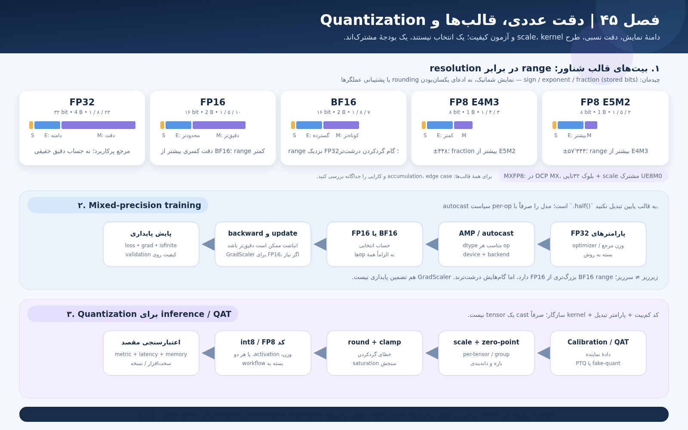

**شکل ۳-۱۳-۱ —** تعداد bit کمتر، به‌تنهایی به معنی دقت task بهتر یا اجرای سریع‌تر نیست. قالب، scale، سیاست عملگرها، kernel و معیار کیفیت باید با هم سنجیده شوند. شکل شماتیک است و پشتیبانی هیچ GPU خاصی را تضمین نمی‌کند.

## ۱. پرسش فصل: کدام محاسبه را می‌توان کم‌دقت‌تر کرد؟

هر عدد ذخیره‌شده در یک tensor از یک قرارداد نمایش پیروی می‌کند. انتخاب آن قرارداد بر مقدارهای قابل نمایش، فاصلهٔ بین عددها، حافظهٔ خام و گاهی مسیر محاسبهٔ سخت‌افزار اثر می‌گذارد. در آموزش، برای وزن، activation، gradient، accumulator و state بهینه‌ساز ممکن است قراردادهای متفاوتی به‌کار رود؛ در inference، مدل ممکن است وزن‌های quantized و activationهای پویا داشته باشد. عبارت «مدل BF16 است» این جزئیات را پنهان می‌کند.

هدف مهندسی این نیست که همه‌جا کوچک‌ترین dtype را به‌کار ببریم. ابتدا FP32 یا یک baseline معتبر داریم؛ سپس کاهش دقت را روی همان داده، ورودی‌ها، metricها و backend آزمایش می‌کنیم. می‌پرسیم: آیا خروجی‌ها و گرادیان‌ها متناهی‌اند؟ آیا خطای عددی در حد بودجه است؟ آیا کیفیت validation پذیرفتنی است؟ آیا kernel مقصد واقعاً از آن قالب پشتیبانی می‌کند و latency/حافظه بهتر شده است؟ اگر یکی از این پاسخ‌ها نامعلوم باشد، صرف وجود dtype در کتابخانه مدرک کافی نیست.

## ۲. بیت‌های یک عدد شناور

قالب دودویی شناور معمولاً یک بیت علامت `s`، فیلد نما `e` و فیلد fraction یا significand دارد. برای عدد نرمال دودویی، ارزش تقریبی را می‌توان چنین نوشت:

<math xmlns="http://www.w3.org/1998/Math/MathML" display="block" aria-label="عدد شناور نرمال دودویی برابر منفی یک به توان بیت علامت ضربدر یک ممیز fraction در مبنای دو ضربدر دو به توان نمای ذخیره‌شده منهای bias است">
  <mrow><mi>x</mi><mo>=</mo><msup><mrow><mo>(</mo><mo>−</mo><mn>1</mn><mo>)</mo></mrow><mi>s</mi></msup><mo>×</mo><msub><mrow><mo>(</mo><mn>1</mn><mo>.</mo><mi>f</mi><mo>)</mo></mrow><mn>2</mn></msub><mo>×</mo><msup><mn>2</mn><mrow><mi>e</mi><mo>−</mo><mi>bias</mi></mrow></msup></mrow>
</math>

**متن جایگزین فرمول:** عدد شناور نرمال دودویی برابر منفی یک به توان بیت علامت ضربدر یک ممیز fraction در مبنای دو ضربدر دو به توان نمای ذخیره‌شده منهای bias است.

در عددهای نرمال، یک بیت پیشروِ significand معمولاً ضمنی است. عددهای subnormal نزدیک صفر را با معنادهی متفاوت به نما و fraction نمایش می‌دهند؛ این‌ها می‌توانند فاصلهٔ میان صفر و کوچک‌ترین عدد نرمال را پُر کنند، اما همهٔ سخت‌افزارها یا مسیرهای محاسبه رفتار یکسانی با آن‌ها ندارند. الگوهای بیت هم ممکن است برای ±Inf، NaN و صفر علامت‌دار رزرو شوند. جزئیات به استاندارد همان قالب بستگی دارد؛ برای FP8 نباید قواعد FP16 را خودکار تعمیم داد.

این نمایش یک **تقریب محدود** است. بیشتر اعداد ده‌دهی مثل `0.1` در نمایش دودویی finite دقیق نیستند؛ چند عمل پشت‌سرهم گرد می‌شوند. حتی FP32 هم «حساب حقیقی دقیق» نیست، بلکه یک baseline عملی رایج با دامنه و fraction بزرگ‌تر از قالب‌های کم‌بیت است.

## ۳. دامنه و تفکیک‌پذیری یک چیز نیستند

تعداد بیت‌های نما عمدتاً روی dynamic range، یعنی بازهٔ توان‌های قابل نمایش، اثر دارد. تعداد بیت‌های fraction روی دقت نسبی و فاصلهٔ عددهای متوالی در یک بازه اثر می‌گذارد. بنابراین ممکن است قالبی عددهای خیلی بزرگ و خیلی کوچک را بپذیرد اما بین دو مقدار نزدیک، فاصلهٔ درشت‌تری داشته باشد.

برای یک قالب binary با `m` بیت fraction ذخیره‌شده، فاصلهٔ نسبی نزدیک ۱ در حالت نرمال تقریباً چنین است؛ این epsilon ویژگی local است، نه خطای مطلق همهٔ عمل‌ها:

<math xmlns="http://www.w3.org/1998/Math/MathML" display="block" aria-label="فاصلهٔ ماشین نزدیک یک برای m بیت fraction تقریباً دو به توان منفی m است">
  <mrow><mi>ε</mi><mo>≈</mo><msup><mn>2</mn><mrow><mo>−</mo><mi>m</mi></mrow></msup></mrow>
</math>

**متن جایگزین فرمول:** فاصلهٔ ماشین نزدیک یک برای m بیت fraction تقریباً دو به توان منفی m است.

برای نمونه، FP16 با ۱۰ بیت fraction نزدیک ۱ گام ریزتری از BF16 با ۷ بیت fraction دارد؛ BF16 در عوض تعداد بیت نمای بیشتری دارد. این مقایسه نمی‌گوید یکی برای همهٔ مدل‌ها بهتر است. اگر activation از range بیرون بزند، fraction دقیق‌تر نجاتش نمی‌دهد؛ اگر به‌روزرسانی وزن از گام‌های قالب کوچک‌تر باشد، range بزرگ به‌تنهایی تغییر وزن را حفظ نمی‌کند.

## ۴. جدول مقایسهٔ قالب‌ها

جدول زیر مشخصات رایج دودویی را نشان می‌دهد. ستون `max finite` بیشینهٔ عدد متناهیِ مثبت است، نه تضمین دامنهٔ GEMM یا رفتار overflow در هر backend. `smallest normal` زیرنورمال‌ها را فهرست نمی‌کند. `epsilon` فاصلهٔ تقریبی نزدیک ۱ است. ارقام FP8 مطابق OCP OFP8 revision 1.1 و مقادیر `torch.finfo` در محیط پروژه‌اند [۱، ۲].

| قالب | sign / exponent / fraction | بیشینهٔ متناهی | کوچک‌ترین نرمال | epsilon نزدیک ۱ | بایت هر مقدار |
|---|---:|---:|---:|---:|---:|
| FP32 | 1 / 8 / 23 | حدود `3.403×10^38` | حدود `1.175×10^-38` | `1.192×10^-7` | 4 |
| FP16 (binary16) | 1 / 5 / 10 | `65,504` | `2^-14 ≈ 6.104×10^-5` | `2^-10 ≈ 9.766×10^-4` | 2 |
| BF16 | 1 / 8 / 7 | حدود `3.390×10^38` | حدود `1.175×10^-38` | `2^-7 = 0.0078125` | 2 |
| FP8 E4M3 | 1 / 4 / 3 | `448` | `2^-6 = 0.015625` | `0.125` | 1 |
| FP8 E5M2 | 1 / 5 / 2 | `57,344` | `2^-14 ≈ 6.104×10^-5` | `0.25` | 1 |

ذخیرهٔ خامِ یک میلیون مقدار، بدون scale، alignment، padding، optimizer state یا activationها، تقریباً 4 MB برای FP32، 2 MB برای هر دو قالب ۱۶بیتی، و 1 MB برای FP8 است؛ MB ده‌دهی است. این **محاسبهٔ کل حافظهٔ run نیست** و جای بودجهٔ tensorها در فصل ۴۲ را نمی‌گیرد. بعضی زیرنورمال‌ها پایین‌تر از ستون `smallest normal` هستند؛ سخت‌افزار می‌تواند آن‌ها را با کارایی یا حتی رفتار متفاوت اجرا کند.

## ۵. FP32: مرجع مقایسه، نه حقیقت بی‌خطا

FP32 معمولاً انتخاب مفیدی برای مرجع، حساسیت‌سنجی و بخش‌هایی از optimizer است؛ بسیاری از چارچوب‌ها برای وزن‌های پارامتری FP32 می‌مانند و محاسباتی را در dtype کوچک‌تر انجام می‌دهند. اما FP32 نیز گردکردن دارد، جمع متوالی‌اش جابجاپذیرِ عددی نیست، و نتیجه به ترتیب reduction و kernel وابسته می‌تواند باشد.

پس «مقایسه با FP32» یعنی مقایسه با یک اجرای تعریف‌شده: همان مدل، داده، seed، mask، ترتیب operationها، نسخهٔ نرم‌افزار و مسیر سخت‌افزار تا حد ممکن. اگر خود baseline ناپایدار یا متفاوت باشد، مشاهدهٔ اختلاف BF16/FP8 به‌تنهایی نمی‌گوید خطا از کجاست. برای تصمیم، هم metricهای عددی مانند max absolute error و finite بودن و هم metric اصلی task لازم است.

## ۶. Mixed precision با Quantization چه تفاوتی دارد؟

**Mixed-precision training** معمولاً بخشی از محاسبات forward/backward را با dtype شناور کوچک‌تر انجام می‌دهد و بخشی را با dtype مناسب‌تر نگه می‌دارد؛ چارچوب ممکن است برای هر عملگر policy جدا داشته باشد. وزن مرجع یا state بهینه‌ساز می‌تواند FP32 بماند. این یعنی انتخاب dtype هنگام اجرای عملیات، نه الزاماً تبدیل دائمی تمام وزن‌های مدل.

**Quantization** نگاشت مقدارهای شناور به کدهای محدودتر، به‌همراه scale، zero-point یا metadata لازم است؛ سپس kernel ممکن است روی کدهای صحیح/شناور کم‌بیت کار کند یا در بعضی workflowها فقط وزن quantized را ذخیره کند و محاسبه را در dtype دیگری انجام دهد. FP8 هرچند قالب شناور است، در recipeهای FP8 برای دامنهٔ کوچک معمولاً با scaling و انتخاب دانه‌بندی همراه می‌شود؛ پس «FP8» می‌تواند هم dtype و هم بخشی از یک طرح quantization باشد.

سه سؤال را جدا نگه دارید: **چه قالبی ذخیره می‌شود؟ چه دقتی در ضرب/جمع واقعی استفاده می‌شود؟ کدام الگوریتم scale و کدام kernel اجرا می‌شود؟** به‌ویژه، checkpoint شامل وزن BF16، مدل quantized برای inference و آموزش با FP8 سه artifact یا workflow یکسان نیستند.

## ۷. AMP: سیاست per-op به‌جای `model.half()`

در PyTorch 2.6، `torch.autocast` ناحیه‌ای از برنامه را پوشش می‌دهد و بر حسب device، dtype درخواستی و فهرست عملگرهای واجد شرایط، dtype مناسب را انتخاب می‌کند. مستندات پیشنهاد می‌کند forward و محاسبهٔ loss را در autocast بگذاریم، backward را بیرون آن اجرا کنیم و هنگام autocast مدل/ورودی‌ها را دستی به `half()` تبدیل نکنیم [۲]. عملگرهای reduction یا حساس ممکن است به dtype دقیق‌تری نیاز داشته باشند.

نمونهٔ کلی CUDA با FP16؛ مدل و optimizer در این مثال به‌طور پیش‌فرض وزن FP32 دارند:

```python
import torch

model = model.to("cuda")
optimizer = torch.optim.AdamW(model.parameters(), lr=learning_rate)
scaler = torch.amp.GradScaler("cuda")

for inputs, targets in loader:
    optimizer.zero_grad(set_to_none=True)
    with torch.autocast(device_type="cuda", dtype=torch.float16):
        logits = model(inputs)
        loss = loss_fn(logits, targets)
    scaler.scale(loss).backward()
    scaler.step(optimizer)
    scaler.update()
```

این API نمونه است، نه تضمین این‌که هر operator، شکل tensor یا کارت، FP16 سریع را اجرا کند. CPU BF16 در PyTorch 2.6 با همان ایده قابل آزمایش است؛ در پروژه فقط `nn.Linear` کوچک را اجرا می‌کنیم. اجرای CPU autocast به معنی شتاب در هر CPU نیست. policy و API را با نسخهٔ نصب‌شدهٔ PyTorch تطبیق دهید؛ APIهای قدیمی `torch.cuda.amp.autocast` در این نسخه deprecated اعلام شده‌اند [۲].

## ۸. FP16 و loss scaling: راهی برای underflow، نه داروی هر خطا

FP16 بیشینهٔ متناهی `65,504` دارد و gradientهای خیلی کوچک ممکن است هنگام cast به صفر گرد شوند. اگر gradient صفر شود، update متناظر وزن عملاً از دست می‌رود. **Loss scaling** loss را پیش از backward در `S` ضرب می‌کند؛ گرادیان scale‌شده بزرگ‌تر است و پس از backward باید پیش از optimizer به اندازهٔ `S` unscale شود:

<math xmlns="http://www.w3.org/1998/Math/MathML" display="block" aria-label="اگر loss در S ضرب شود، gradient آن هم در S ضرب می‌شود و پیش از optimizer باید بر S تقسیم شود">
  <mrow><mi>L</mi><mo>′</mo><mo>=</mo><mi>S</mi><mi>L</mi><mo>,</mo><mspace width="0.5em"/><mfrac><mrow><mi>∂</mi><mi>L</mi><mo>′</mo></mrow><mrow><mi>∂</mi><mi>θ</mi></mrow></mfrac><mo>=</mo><mi>S</mi><mfrac><mrow><mi>∂</mi><mi>L</mi></mrow><mrow><mi>∂</mi><mi>θ</mi></mrow></mfrac></mrow>
</math>

**متن جایگزین فرمول:** اگر loss در S ضرب شود، gradient آن هم در S ضرب می‌شود و پیش از optimizer باید بر S تقسیم شود.

`GradScaler` می‌تواند وقتی Inf/NaN می‌بیند optimizer step را رد و scale را کاهش دهد؛ پس scale و تعداد stepهای ردشده بخشی از وضعیت قابل‌مشاهده‌اند. Scaling جلو overflow در activation/forward را نمی‌گیرد و هر خطای quantization را هم اصلاح نمی‌کند. PyTorch 2.6 صریحاً هشدار می‌دهد AMP/FP16 برای همهٔ مدل‌ها مناسب نیست: مثلاً مدل‌هایی که در BF16 با دامنهٔ بزرگ آموزش دیده‌اند ممکن است در FP16 overflow کنند؛ scale حتی می‌تواند به زیر ۱ برسد و افزایش همیشگی را تضمین نمی‌کند [۲].

در probe پروژه، `1e-8` با `torch.float16` روی CPU به صفر رفت و `±100000` به ±Inf تبدیل شد. این مشاهده با حدود جدول سازگار است، اما تست cast روی CPU، رفتار تمام kernelها یا training واقعی را ثابت نمی‌کند. اگر loss یا grad غیرمتناهی است، ابتدا ریشه‌یابی کنید؛ scale بزرگ‌تر را بی‌دلیل افزایش ندهید.

## ۹. BF16: دامنهٔ گسترده‌تر، significand کوتاه‌تر

BF16 تعداد بیت نمایی برابر FP32 دارد و تنها ۷ بیت fraction ذخیره می‌کند. بنابراین سقف و کف نرمال آن به‌طور کلی به FP32 نزدیک است، اما فاصلهٔ مقدارهای نزدیک بیشتر است. در قیاس با FP16، خطر overflow ناشی از دامنه برای خیلی از activationها کمتر می‌شود؛ در عوض خطای گردکردن، از دست‌رفتن تغییرهای کوچک و accumulation همچنان باید بررسی شود. BF16 نه «FP32 دو بایتی» است و نه معادل عددی FP16.

در تجربهٔ Google روی TPUهای نسل دوم/سوم، ضرب ماتریسی BF16 با accumulation در FP32 توصیف شده است؛ این یک پیاده‌سازی سخت‌افزاری مشخص است، نه تضمین PyTorch برای تمام دستگاه‌ها [۳]. پژوهش BF16 هم workloadها و رفتار قالب را می‌سنجد، نه ثبات بی‌قیدوشرط هر مدل [۴]. BF16 معمولاً به loss scaling مانند FP16 نیاز کمتری دارد چون range وسیع‌تر است، اما range به‌تنهایی پایداری را تضمین نمی‌کند.

در پروژهٔ این فصل، PyTorch 2.6.0+cpu، خروجی Linear زیر CPU autocast را BF16 و متناهی گزارش کرد؛ وزن Linear پس از آن FP32 ماند. اختلاف بیشینهٔ خروجی این fixture کوچک با مرجع FP32 حدود `0.002292` بود. این عدد فقط نمونهٔ قابل‌بازتولید همین seed، شکل و runtime است؛ threshold کیفیت برای مدل دیگری نیست.

## ۱۰. ضرب، accumulation، وزن مرجع و state optimizer

واحدهایی که روی آن‌ها دقت را انتخاب می‌کنیم جدا هستند: ورودی، وزن ذخیره‌شده، operand ضرب، accumulator جمع حاصل‌ضرب‌ها، gradient، وزن پس از update و momentهای optimizer. ممکن است عملگر ضرب با BF16 انجام شود و حاصل‌جمع با FP32؛ ممکن است backend برای یک شکل دیگر مسیر متفاوتی برگزیند. این جزئیات را از API یا سند سخت‌افزار همان runtime بگیرید، نه از نام dtype ورودی.

در بعضی recipeهای mixed precision، وزن master و state بهینه‌ساز FP32 می‌مانند تا update کوچک گم نشود؛ هزینهٔ حافظه هم در آن صورت صرفاً `N×2` بایتِ BF16 نیست. راه دیگر، optimizer کم‌دقت یا ذخیرهٔ state فشرده است که tradeoff دیگری دارد. مثال‌های آموزشی یا مستندات paper را نسخهٔ عمومی همهٔ فریم‌ورک‌ها فرض نکنید. از `torch.finfo` برای حدود dtype و از profiler / kernel documentation برای رفتار محاسبه استفاده کنید.

اگر وزن هر قدم به BF16 گرد شود، updateی که از نصف گام محلی کوچک‌تر است ممکن است در وزن گرد‌شده تغییر ندهد؛ ولی optimizer state می‌تواند آن را انباشته کند و بعد تغییر قابل‌نمایش ایجاد شود. نتیجۀ کار به ترتیب update، rounding و optimizer وابسته است. آزمون حداقلی: log کردن norm گرادیان و update، شمار وزن‌های بی‌تغییر و loss/metric روی run مرجع و run کم‌دقت.

## ۱۱. FP8: دو مصالحهٔ متفاوت، نه یک قالب واحد

مشخصات OCP OFP8 revision 1.1 دو binary interchange format تعریف می‌کند [۱]:

- **E4M3**: یک بیت sign، چهار بیت exponent، سه بیت fraction؛ بیشینهٔ متناهی `448`. این قالب infinity را نمایش نمی‌دهد و برای دامنهٔ بیشتر، تعداد الگوهای NaN محدودی دارد.
- **E5M2**: یک بیت sign، پنج بیت exponent، دو بیت fraction؛ بیشینهٔ متناهی `57,344` و الگوهای infinity/NaN دارد. دامنهٔ بزرگ‌تر را با fraction کوتاه‌تر می‌خرد.

هر دو ۸بیتی‌اند، اما E4M3 در بخش متناهی تفکیک‌پذیری بیشتری و E5M2 دامنهٔ بیشتری دارد. مقالهٔ FP8 این قالب‌ها را در طرح‌های آموزش و post-training بررسی می‌کند و نشان می‌دهد انتخاب format، scale و tensor/workload اهمیت دارد؛ نتایج paper تضمین دقت همهٔ شبکه‌ها نیست [۵]. OCP v1.1 هم conversion از قالب‌های عریض‌تر، rounding ties-to-even و گزینه‌های overflow/saturation را دقیق می‌کند؛ اگر تبدیل از سقف خارج شود، نتیجه به حالت conversion بستگی دارد [۱].

نام‌های PyTorch شامل `torch.float8_e4m3fn` و `torch.float8_e5m2` هستند. در PyTorch 2.6 CPU probe می‌تواند آن‌ها را به کار گیرد و cast را گزارش کند، اما این **به معنی پشتیبانی همهٔ عملیات tensor، GEMM سریع یا hardware FP8 نیست**. حتی اگر نوع داده قابل ساخت باشد، عملگر، شکل، scaling recipe و kernel باید جدا بررسی شوند.

## ۱۲. Scaling در FP8: amax، دانه‌بندی و تاریخچه

اگر مقدارهای یک tensor خارج از دامنهٔ FP8 باشند، پیش از cast آن‌ها را با scale نرمال می‌کنیم و پس از محاسبه بازمی‌گردانیم. با قرارداد «scale در واحد مقدار اصلی»، برای بیشینهٔ قدر مطلق مشاهده‌شده `amax` و حد مثبت قابل نمایش `qmax`:

<math xmlns="http://www.w3.org/1998/Math/MathML" display="block" aria-label="برای scale ذخیره‌شده به‌صورت مقدار اصلی بر کد کم‌بیت، scale برابر amax تقسیم بر qmax است؛ کد با گردکردن x تقسیم بر scale ساخته می‌شود و بازسازی در scale ضرب می‌شود">
  <mrow><mi>s</mi><mo>=</mo><mfrac><mi>amax</mi><msub><mi>q</mi><mi>max</mi></msub></mfrac><mo>,</mo><mspace width="0.5em"/><mi>q</mi><mo>=</mo><mi>round</mi><mo>(</mo><mfrac><mi>x</mi><mi>s</mi></mfrac><mo>)</mo><mo>,</mo><mspace width="0.5em"/><mover><mi>x</mi><mo>^</mo></mover><mo>=</mo><mi>s</mi><mi>q</mi></mrow>
</math>

**متن جایگزین فرمول:** برای scale ذخیره‌شده به‌صورت مقدار اصلی بر کد کم‌بیت، scale برابر amax تقسیم بر qmax است؛ کد با گردکردن x تقسیم بر scale ساخته می‌شود و بازسازی در scale ضرب می‌شود.

بعضی کتابخانه‌ها reciprocal scale را ذخیره می‌کنند؛ پیش از مقایسهٔ عددها قرارداد را بخوانید. `amax` جاری، سابقهٔ چند گام، scale هر tensor یا scale هر row/block از recipeهای ممکن‌اند. scale تانسری سربار کم دارد اما یک outlier می‌تواند دقت بیشتر عناصر را کم کند؛ scale ریزدانه این اثر را محدود می‌کند ولی metadata و kernel پیچیده‌تر می‌شوند. راهنمای NVIDIA Transformer Engine current-iteration amax و delayed scaling بر پایهٔ تاریخچه را به‌عنوان recipeهای متفاوت توضیح می‌دهد؛ آن‌ها API عمومی برای همهٔ سخت‌افزارها نیستند [۶].

جای داده هم مهم است: weights، activations و gradientها شکل توزیع و دامنهٔ متفاوتی دارند؛ برای همهٔ آن‌ها یک scale ثابت یا یک قالب واحد را مفروض نگیرید. در آموزش recipe ممکن است برای backward نیز state یا history مربوط به amax نگه دارد. اگر run قابل resume می‌خواهیم، این state، dtype policy و config باید در checkpoint ثبت شوند؛ فصل ۴۴ چنین AMP/FP8 stateای را در پروژهٔ FP32 خود پیاده نکرده بود.

## ۱۳. MXFP8 و مقیاس بلوکی در OCP MX

«FP8 E4M3/E5M2» قالب عنصر را می‌گوید؛ «MXFP8» یک بستهٔ داده و scale بلوکی را تعریف می‌کند. در OCP MicroXcaling v1.1، بلوک MXFP8 شامل ۳۲ عنصر FP8 است و scale مشترک ۸بیتی `UE8M0` دارد؛ نسخهٔ اکتبر ۲۰۲۶ نام قدیمی `E8M0` را به `UE8M0` تغییر داده و rounding و edge caseهای تبدیل را روشن‌تر می‌کند [۷]. مشخصات MX، باینری FP8 پایه را از مشخصات OFP8 می‌گیرد؛ این یک format package است، نه اثبات این‌که هر دستگاه آن را اجرا می‌کند.

برای بلوک `b` می‌توان scale مفهومی `s_b` را از `amax_b` برآورد کرد؛ در MX جزئیات scale به encoding و الگوریتم استاندارد وابسته است و الزاماً همان float scale پیوستهٔ مثال قبلی نیست. اندازهٔ بلوک، outlierهای داخل بلوک و امکان استفاده از native kernel بر کیفیت و performance اثر دارند. پیاده‌سازی مجاز است تنها زیرمجموعه‌ای از قالب‌های MX را پشتیبانی کند؛ بنابراین MXFP8 را از روی نام روی هر GPU فرض نکنید [۷].

## ۱۴. Quantization صحیح با scale و zero-point

در quantization affine، مقدار شناور `x` به کد صحیح محدودشده تبدیل می‌شود و پس از inference می‌توان تقریب شناور آن را بازسازی کرد. `s>0` scale و `z` zero-point است:

<math xmlns="http://www.w3.org/1998/Math/MathML" display="block" aria-label="کد صحیح q برابر clamp گرد کردن x تقسیم بر scale به‌علاوهٔ zero point میان q کمینه و q بیشینه است و مقدار بازسازی‌شده scale ضربدر q منهای zero point است">
  <mrow><mi>q</mi><mo>=</mo><mi>clamp</mi><mo>(</mo><mi>round</mi><mo>(</mo><mfrac><mi>x</mi><mi>s</mi></mfrac><mo>+</mo><mi>z</mi><mo>)</mo><mo>,</mo><msub><mi>q</mi><mi>min</mi></msub><mo>,</mo><msub><mi>q</mi><mi>max</mi></msub><mo>)</mo><mo>,</mo><mspace width="0.5em"/><mover><mi>x</mi><mo>^</mo></mover><mo>=</mo><mi>s</mi><mo>(</mo><mi>q</mi><mo>−</mo><mi>z</mi><mo>)</mo></mrow>
</math>

**متن جایگزین فرمول:** کد صحیح q برابر clamp گرد کردن x تقسیم بر scale به‌علاوهٔ zero point میان q کمینه و q بیشینه است و مقدار بازسازی‌شده scale ضربدر q منهای zero point است.

برای symmetric signed INT8 اغلب `z=0` و بازهٔ متقارن انتخاب می‌شود؛ در پروژه `[-127,127]` به‌کار رفته تا صفر دقیقاً در مرکز باشد. affine INT8 می‌تواند کل بازهٔ `[-128,127]` را به min/max کالیبراسیون نگاشت کند. `round` و clamp باعث می‌شود دو خطا را جدا ببینیم: **rounding error** برای مقدار داخل دامنه، و **saturation/clipping** برای مقدار بیرون دامنه. PyTorch `torch.round` در این مثال round-to-nearest, ties-to-even انجام می‌دهد؛ فرمت یا kernel دیگری ممکن است سیاست متفاوت مستندشده داشته باشد.

## ۱۵. Per-tensor در برابر per-channel، per-row و per-group

Scale می‌تواند برای کل tensor مشترک باشد، برای هر کانال وزن جدا باشد، برای هر row/token activation تغییر کند یا برای بلوک‌های کوچک‌تر نگهداری شود. هرچه granularity محلی‌تر باشد، یک outlier کمتر عناصر دور از خود را می‌کشد؛ در عوض scaleهای بیشتری ذخیره و بارگذاری می‌شوند و layout/kernel باید آن را پشتیبانی کند. «دانه‌بندی دقیق‌تر» به‌تنهایی تضمین کیفیت یا کارایی نیست.

اگر calibration فقط مقادیر بین `−1` و `1` را دیده باشد و inference مقدار `1.4` یا `−1.5` تولید کند، scale ثابت می‌تواند آن‌ها را به سقف/کف ببرد. سهم مقدارهای clamp‌شده را گزارش کنید:

<math xmlns="http://www.w3.org/1998/Math/MathML" display="block" aria-label="نسبت اشباع تعداد مقدارهای خارج از qmin و qmax پیش از clamp تقسیم بر کل مقدارها است">
  <mrow><mi>r</mi><mo>_</mo><mi>sat</mi><mo>=</mo><mfrac><mrow><mi>count</mi><mo>(</mo><mi>q</mi><mo>&lt;</mo><msub><mi>q</mi><mi>min</mi></msub><mo>∨</mo><mi>q</mi><mo>&gt;</mo><msub><mi>q</mi><mi>max</mi></msub><mo>)</mo></mrow><mi>N</mi></mfrac></mrow>
</math>

**متن جایگزین فرمول:** نسبت اشباع تعداد مقدارهای خارج از qmin و qmax پیش از clamp تقسیم بر کل مقدارها است.

این شمارش قبل از clamp است؛ اگر فقط کدهای نهایی را ببینید، نمی‌فهمید چند مقدار به یک endpoint فرو ریخته‌اند. کالیبراسیون باید نمایندهٔ ورودی deployment باشد؛ test نهایی را برای تنظیم scale یا انتخاب recipe مصرف نکنید. در پروژه، per-group فقط روی بردار flatten‌شده و گروه‌های چهارتایی تمرین می‌شود؛ این معادل layout کانال‌های یک لایه یا MXFP8 ۳۲تایی نیست.

## ۱۶. PTQ، dynamic و weight-only: زمان محاسبهٔ scale

**Post-training quantization (PTQ)** بعد از آموزش، وزن‌ها و گاهی activation را تبدیل می‌کند. در static PTQ، دادهٔ calibration برای بازه یا پارامترهای activation به‌کار می‌رود؛ اگر توزیع deployment فرق کند، clipping/error تغییر می‌کند. در dynamic quantization، بازهٔ activation در زمان اجرا از ورودی تازه برآورد می‌شود؛ این انعطاف می‌تواند محاسبهٔ اضافه بخواهد. در weight-only، وزن فشرده است اما activation یا matmul ممکن است با دقت دیگری انجام شود.

این‌ها tradeoffهای روش‌اند، نه سه اسم برای یک عملگر. هنگام ذخیره، همراه weightهای quantized، نوع قالب، scale/zero-point، granularity، نسخهٔ تبدیل و محدودیت kernel را هم نگه دارید. PyTorch/TorchAO فهرست workflowهای متفاوت برای FP8، INT8، INT4 و weight-only دارد؛ API و پشتیبانی hardware در نسخه‌ها تغییر می‌کند [۸].

## ۱۷. QAT: شبیه‌سازی خطا پیش از تبدیل نهایی

در **Quantization-Aware Training (QAT)** forward هنگام آموزش، rounding و clamp را با fake-quantization شبیه‌سازی می‌کند؛ tensor در مرحلهٔ آموزش می‌تواند همچنان float باشد و `x̂` را به محاسبه می‌دهد. گرادیان از عملگر گردکردن مشتق معمولی ندارد، پس بعضی پیاده‌سازی‌ها از straight-through estimator یا تخمین گرادیان تعریف‌شده استفاده می‌کنند. در پایان، convert وزن‌ها و kernel مناسب را می‌سازد؛ `prepare → train/fine-tune → convert → evaluate` یک workflow معمول است [۹].

QAT ممکن است مدل را با خطای هدف سازگارتر از PTQ کند، اما هزینهٔ آموزش دارد و نتیجه‌اش تضمین نشده است. fake-quant forward به‌تنهایی ثابت نمی‌کند deployment دقیقاً همان مسیر int8 یا fp8 را اجرا می‌کند؛ post-convert benchmark و task metric همچنان لازم‌اند. نسخهٔ API را pin کنید، چون صفحهٔ TorchAO که در این پژوهش دیده شد `v0.17.0 (unstable)` را کنار `v0.16.0 (stable)` نشان می‌داد [۸، ۹].

## ۱۸. پایداری عددی: کجا اختلاف کوچک بزرگ می‌شود؟

خطای گردکردن در زنجیرهٔ operationها جمع می‌شود؛ تفریق دو عدد نزدیک می‌تواند رقم‌های معنادار را حذف کند (cancellation)؛ جمع شناور associative نیست؛ reduction با ترتیب دیگری می‌تواند خروجی کم‌وبیش متفاوتی بسازد. در مدل عمیق، activation یا gradient می‌تواند از دامنهٔ قالب بیرون رود یا آن‌قدر کوچک شود که به صفر round شود. این‌ها رخدادهای متفاوت‌اند و راه‌حل‌شان یکی نیست.

برای هر run کم‌دقت ثبت کنید: `isfinite` روی loss/gradient/output، norm گرادیان، شمار overflow/step ردشده، max activation یا amax، نرخ اشباع quantization، خطای خروجی نسبت به baseline و metric task روی validation. اگر training منحرف شد، یک عامل را تغییر دهید: dtype یک بخش، loss scaling، granularity، calibration یا accumulation policy. با هم تغییر دادن precision و LR و batch امکان عیب‌یابی را از بین می‌برد.

هیچ epsilon واحدی تضمین نمی‌کند «تغییر بی‌اهمیت» است. برای خروجی‌های نزدیک صفر، relative error می‌تواند گمراه‌کننده شود؛ absolute error، cosine similarity یا KL روی logits هم ممکن است برای هدف شما مناسب‌تر باشد. بودجهٔ خطا باید به خروجی و task مربوط باشد. پاسخ خوب فقط «loss پایین ماند» نیست: واحد داده، معیار، تعداد نمونه، reference و حالت اشباع را مشخص می‌کند.

## ۱۹. سازگاری سخت‌افزار: dtype حاضر ≠ kernel حاضر

حداقل چهار لایهٔ سازگاری را تفکیک کنید:

1. آیا نسخهٔ framework نوع داده را می‌شناسد و می‌تواند tensor بسازد/تبدیل کند؟
2. آیا همان device و backend عملگرهای مدل را روی آن dtype اجرا می‌کند؟
3. آیا kernel واقعاً کم‌دقت است، accumulation را چگونه انجام می‌دهد و برای ابعاد شما بهینه است؟
4. آیا end-to-end latency/حافظه و کیفیت مدل بهتر شده‌اند؟

PyTorch AMP 2.6 برای CUDA به‌طور پیش‌فرض FP16 و برای CPU BF16 را به‌عنوان autocast dtype پیش‌فرض معرفی می‌کند، اما هر operator از همان مسیر استفاده نمی‌کند [۲]. در صفحهٔ TorchAO main که ۵ نوامبر ۲۰۲۶ به‌روزرسانی شده، یک workflow مشخصِ dynamic FP8 inference برای CUDA با compute capability `≥8.9`، AMD MI350+ یا Intel XPU فهرست می‌شود؛ workflowهای دیگر شرط‌های دیگری دارند [۸]. این محدودیت‌ها را به همهٔ FP8ها تعمیم ندهید و از آن صفحهٔ `main` API ناپایدار را بدون نسخه‌بندی کپی نکنید.

آزمایش محلی این فصل روی CPU است و فقط `torch.finfo`، cast FP8 و CPU BF16 autocast را می‌سنجد. CUDA، ROCm، XPU، MPS، GPU GEMM، OCP MX hardware یا latency در این workspace آزموده نشده‌اند؛ جدول قابلیت‌های پروژه عمداً ادعای آن‌ها را نمی‌کند.

## ۲۰. پروتکل مقایسه: کیفیت، پایداری و throughput

برای مقایسهٔ معتبر، ابتدا ثبت کنید: مدل/checkpoint، data/config hash، tokenizer و split، framework/driver/device، dtype و operation policy، quantization recipe، seed، batch/shape و metric. یک FP32 یا BF16 baseline تعریف کنید؛ بعد همان ورودی و مسیر ارزیابی را به‌کار ببرید. کیفیت را با task metric روی validation بسنجید؛ فقط average loss روی چند batch کوچک کافی نیست.

برای performance، shapeهای واقعی، warm-up، synchronization درست accelerator، تعداد تکرار و توزیع latency را گزارش کنید؛ هزینهٔ scale/cast/packing و memory transfer را هم در زمان end-to-end بگذارید. ماتریس کوچک می‌تواند به‌علت overhead از dtype کم‌دقت سود نبرد. عددهای vendor، paper یا TorchAO متعلق به دستگاه، مدل، نسخه و shape گزارش‌شده‌اند، نه پیش‌بینی latency شما [۵، ۸].

پیش از پذیرش یک recipe، معیار pass/fail را بنویسید: حد مجاز افت task metric، عدم NaN/Inf، سقف saturation و حداقل بهبود latency یا memory روی سخت‌افزار مقصد. Test نهایی را فقط پس از انتخاب recipe اجرا کنید؛ انتخاب براساس test خودش بخشی از data leakage است، همان مرزی که فصل ۴۳ برای ارزیابی نگه داشت.

## ۲۱. Checkpoint precision چه چیز تازه‌ای می‌خواهد؟

پروژهٔ فصل ۴۴ در FP32 وضعیت optimizer، update، ترتیب داده و RNG را برای resume نگه می‌داشت؛ این فصل checkpoint آن پروژه را به‌طور پنهانی به AMP تبدیل نمی‌کند. اگر آن run را با FP16 ادامه می‌دهید، scaler و وضعیت آن را هم ذخیره کنید؛ اگر recipe FP8 به amax history یا scaleهای در حال تغییر متکی است، آن state، dtype policy و نسخهٔ recipe را نیز ثبت کنید. Quantization نهایی inference به calibration qparams، scale، zero-point، format و محدودیت backend نیاز دارد.

نام config را ثبت کنید، نه فقط اسم dtype. برای resume، یکسان بودن وزن‌ها کافی نیست اگر scaler/history/optimizer یا مسیر داده فرق کرده است. برای inference artifact، مدل quantized و metadata لازم را به همراه قرارداد ورودی، framework/kernel موردنیاز و تست سازگاری منتشر کنید. این‌ها ادامهٔ مهندسی checkpoint فصل ۴۴ هستند؛ در آن پروژهٔ کوچک فقط stateهای واقعاً استفاده‌شده ذخیره شده بودند.

## ۲۲. اجرای پروژهٔ CPU

پوشهٔ [`projects/45-precision/`](book-engineering/projects/45-precision/README.md) به داده یا checkpoint بیرونی احتیاج ندارد. در محیطی با Python 3.11+ و PyTorch 2.6.x:

```bash
python book-engineering/projects/45-precision/precision_lab.py
python book-engineering/projects/45-precision/precision_lab.py --output /tmp/ch45-precision.json
(cd book-engineering/projects/45-precision && python -m unittest discover -v)
```

CLI یک گزارش JSON قطعی می‌سازد: `formats` از runtime، `cast_probe` از تبدیل‌های محدود، `cpu_bf16_autocast` از Linear کوچک و `quantization` از یک outlier و یک shift کالیبراسیون. `calculate_qparams` روش متقارن/affine با granularity کلی یا group را پیاده می‌کند؛ `quantize_with_qparams` کد قبل از clamp، reconstruction، MAE/RMSE و saturation را برمی‌گرداند. چیدمان گروهی flatten شده است تا الگوریتم روشن بماند، نه این‌که جای API مدل‌محور را بگیرد.

ده آزمون واحد metadata قالب، underflow/overflow مشاهده‌شده، BF16 autocast، zero-point و حدود int8، خطای per-group در fixture، calibration drift، ورودی نامعتبر و JSON را کنترل می‌کنند. مثال ساده است و نه training loop دارد، نه optimizer، نه benchmark inference واقعی.

## ۲۳. نتایج مشاهده‌شده و مرز استنتاج

در همین clone و PyTorch `2.6.0+cpu`:

- dtypeهای `float8_e4m3fn` و `float8_e5m2` حاضرند و `torch.finfo` بیشینه‌های `448` و `57,344` را می‌دهد؛ این آزمایش فقط cast/storage را ثابت می‌کند.
- در cast آزمایشی، FP16 مقدار `1e-8` را صفر و `±1e5` را ±Inf کرد؛ BF16 این دو مقدار بزرگ را متناهی و گرد‌شده به `±99840` نگه داشت؛ E4M3FN مقدارهای `±1e5` را NaN و E5M2 آن‌ها را Inf گزارش کرد. این مشاهده رفتار cast همین نسخه/CPU است، نه نسخهٔ اجباری تبدیل همهٔ دستگاه‌ها.
- CPU BF16 autocast خروجی متناهی داد؛ بیشینهٔ اختلاف fixture با FP32 `0.002292` بود، نه اندازه‌گیری throughput یا کیفیت مدل.
- در بردار هشت‌تایی با outlier `10`، RMSE per-tensor حدود `0.02753` و per-group حدود `0.02008` شد؛ در آزمایش shift کالیبراسیون ۲ مقدار از ۳ مقدار evaluation اشباع شدند. این دو نتیجه خاص داده‌های مصنوعی همین مثال‌اند.

عددهای بالا برای نشان‌دادن mechanism و regression test کاربرد دارند. هیچ‌یک نتیجهٔ آموزش، دقت benchmark، مزیت کاربردی FP8، latency GPU یا توصیهٔ threshold برای مدل واقعی نیست.

## ۲۴. خطاهای رایج در انتخاب precision

| برداشت نادرست | اصلاح |
|---|---|
| «BF16 چون rangeش بزرگ است، از FP32 دقیق‌تر است.» | BF16 fraction کوتاه‌تری دارد؛ range و resolution جدا هستند. |
| «FP16 فقط نیاز به GradScaler دارد.» | scaler فقط underflow گرادیان را هدف می‌گیرد؛ forward overflow و mismatch مدل ممکن است بماند. |
| «`torch.float8` وجود دارد، پس matmul FP8 سریع است.» | dtype/cast، operator support، kernel واقعی و benchmark شکل هدف چهار ادعای متفاوت‌اند. |
| «یک scale برای tensor کافی است.» | outlier و shift توزیع می‌تواند دقت یا اشباع را تغییر دهد؛ granularity و calibration را اندازه بگیرید. |
| «QAT یعنی inference هم دقیقاً مثل training محاسبه می‌کند.» | fake-quant، convert و kernel deployment را جداگانه validate کنید. |
| «وزن یک‌میلیون‌تایی ۱ MB شد، پس کل run ۱ MB است.» | optimizer، gradient، master copy، activation، scale و overhead لحاظ نشده‌اند. |
| «چون loss finite است، کیفیت حفظ شده.» | task metric، خطا نسبت به مرجع، saturation و validation لازم‌اند. |
| «فرمت OCP روی همهٔ سخت‌افزارها یکسان سریع است.» | interchange format با وجود kernel سخت‌افزاری یا performance مساوی نیست. |

## ۲۵. تمرین‌ها و معیار قبولی

1. از `torch.finfo` جدول FP16/BF16 را در runtime خود بازسازی و توضیح دهید چرا BF16 با وجود ۱۶ bit، range بزرگ‌تری از FP16 دارد.
2. بردار cast را تغییر دهید تا یک مقدار متناهی نزدیک سقف FP16 و یک مقدار کوچک‌تر از کوچک‌ترین مقدار نرمال داشته باشد؛ رفتار صفر، subnormal، Inf و NaN را جدا ثبت کنید.
3. یک activation با outlier بسازید و per-tensor را با گروه‌های ۲، ۴ و ۸ مقایسه کنید. MAE، RMSE، max error و metadata scale را گزارش کنید؛ توضیح دهید چرا نتیجه با گروه‌بندی دیگر ممکن است عوض شود.
4. calibration را حول صفر نگه دارید و evaluation را جابه‌جا کنید. سهم اشباع را به‌دست آورید؛ سپس توضیح دهید calibration پویا یا scale ریزدانه کدام tradeoff را عوض می‌کند.
5. با PyTorch autocast یک Linear FP32 و BF16 بسازید؛ پارامتر و خروجی را از نظر dtype و `isfinite` بررسی کنید. هیچ نتیجهٔ سرعتی بدون benchmark معتبر ادعا نکنید.
6. دربارهٔ FP8 دو سطر بنویسید: در کدام کاربرد دامنهٔ E5M2 ارزشمند است، و چه وقت fraction بیشتر E4M3 مفیدتر می‌شود؟ پاسخ را به amax/scale و role وزن/activation/gradient گره بزنید، نه به یک قانون همیشگی.
7. یک طرح QAT پیشنهاد کنید: calibration/train data، fake-quant range، معیار validation، مدل deployment و نسخه/kernel را مشخص کنید. Test را در انتخاب recipe مصرف نکنید.
8. چک‌لیست checkpoint را برای یک run FP16 و یک recipe FP8 جدا بنویسید: علاوه بر وزن، چه scaler، optimizer، scale/amax history، config و data identity لازم است؟

**معیار قبولی:** دست‌کم ۶ پاسخ از ۸ با واحد، فرض و شواهد؛ ۱۰ آزمون پروژه موفق؛ تفاوت range/precision و AMP/quantization درست توضیح داده شده؛ یک گزارش finite/overflow/saturation و خطای بازسازی ارائه شده؛ هیچ toy output به‌عنوان benchmark معرفی نشده؛ و سازگاری kernel/device جدا از dtype بررسی شده است. پاسخ‌های نمونه در [پاسخ‌نامهٔ تشریحی فصل ۴۵](book-engineering/answers/45-precision-fa.md) آمده‌اند.

### واژه‌نامهٔ کوتاه

- **dtype:** قرارداد قالب و دامنهٔ نمایش هر مقدار عددی.
- **Range:** کمینه/بیشینهٔ قابل‌نمایش؛ با دقت نسبی یکی نیست.
- **BF16/FP16:** قالب‌های شناور ۱۶بیتی با مصالحه‌های متفاوت exponent/fraction.
- **Quantization:** نگاشت عددهای شناور به نمایش کم‌بیت با scale و گاه zero-point.
- **Calibration:** داده/روش تعیین پارامترهای quantization؛ نه تضمین کیفیت task.

## ۲۶. منابع، نسخه‌ها و تاریخ دسترسی

1. Open Compute Project, [OCP 8-bit Floating Point Specification (OFP8), Revision 1.1](https://www.opencompute.org/documents/ocp-8-bit-floating-point-specification-ofp8-revision-1-1-final-pdf/), مؤثر از ۲۲ ژوئن ۲۰۲۶؛ قالب‌ها و تبدیل FP8.
2. PyTorch, [Automatic Mixed Precision package — torch.amp, v2.6](https://docs.pytorch.org/docs/2.6/amp.html) و [Type Info — `torch.finfo`, v2.6](https://docs.pytorch.org/docs/2.6/type_info.html)؛ رفتار AMP و حدود عددی قابل پرس‌وجو.
3. Google Cloud, Wang & Kanwar, [“BFloat16: The secret to high performance on Cloud TPUs”](https://cloud.google.com/blog/products/ai-machine-learning/bfloat16-the-secret-to-high-performance-on-cloud-tpus), ۲۳ اوت ۲۰۱۹؛ BFloat16 semantics و مثال accumulation در TPUهای توصیف‌شده.
4. Kalamkar et al., [“A Study of BFLOAT16 for Deep Learning Training”](https://arxiv.org/abs/1905.12322), ۲۰۱۹؛ بررسی workloadهای مقاله، نه تضمین عمومی.
5. Micikevicius et al., [“FP8 Formats for Deep Learning”](https://arxiv.org/abs/2209.05433), ۲۰۲۲؛ مقایسهٔ formatها و طرح‌های آموزش/PTQ در setupهای مطالعه.
6. NVIDIA Transformer Engine 2.20.2, [Using FP8 and FP4 with Transformer Engine](https://docs.nvidia.com/deeplearning/transformer-engine/examples/fp8_primer.html); توضیح current-iteration `amax`، delayed scaling مبتنی بر تاریخچه و MXFP8 در همین library، نه استاندارد API بین vendorها.
7. Open Compute Project, [OCP MicroXcaling (MX) Specification, v1.1](https://www.opencompute.org/wp-content/uploads/2026/10/OCP_MicroXcaling_Spec_v1.1.0.pdf), ۹ اکتبر ۲۰۲۶؛ بلوک ۳۲تایی MXFP8، UE8M0 و conversion edge cases.
8. PyTorch/TorchAO, [Quantized Inference — `main`, v0.17.0 (unstable)](https://docs.pytorch.org/ao/main/workflows/inference.html), به‌روزرسانی ۵ نوامبر ۲۰۲۶؛ workflowها و شرط‌های سخت‌افزاری در همان نسخه.
9. PyTorch/TorchAO, [Quantization-Aware Training — `main`, v0.17.0 (unstable)](https://docs.pytorch.org/ao/main/workflows/qat.html); fake quantization و APIهای QAT. نسخهٔ stable/unstable را پیش از استفاده بررسی کنید.

پیوندها در ۶ نوامبر ۲۰۲۶ بازبینی شدند. مستندات نسخه‌ای ممکن است تغییر کند؛ برای اجرای واقعی شمارهٔ PyTorch/TorchAO، driver، device و API را در run card pin کنید.

## ۲۷. پیوست اجرایی: پیاده‌سازی کامل آزمایشگاه

فایل زیر همان کدی است که پروژه و آزمون‌های واحد اجرا می‌کنند؛ آن را از پروژه import می‌کنیم و در این پیوست نسخهٔ دومی نمی‌سازیم.

```python
"""A deterministic CPU lab for floating-point formats, AMP and affine quantization.

The program measures storage dtypes and tensor-level quantization error. It does
not benchmark accelerators or claim that a dtype has a fast hardware kernel.
"""
from __future__ import annotations

import argparse
import json
import math
from pathlib import Path
from typing import Any

import torch
from torch import nn


FORMAT_SPECS = (
    ("FP32", "float32", 32, "1/8/23"),
    ("FP16", "float16", 16, "1/5/10"),
    ("BF16", "bfloat16", 16, "1/8/7"),
    ("FP8 E4M3FN", "float8_e4m3fn", 8, "1/4/3"),
    ("FP8 E5M2", "float8_e5m2", 8, "1/5/2"),
)


def _json_scalar(value: float) -> float | str:
    """Return a JSON-safe scalar while preserving NaN and infinity labels."""
    number = float(value)
    if math.isnan(number):
        return "nan"
    if math.isinf(number):
        return "inf" if number > 0 else "-inf"
    return number


def format_table() -> list[dict[str, Any]]:
    """Inspect the available PyTorch dtypes instead of assuming their limits."""
    rows: list[dict[str, Any]] = []
    for name, attr, bits, fields in FORMAT_SPECS:
        dtype = getattr(torch, attr, None)
        if dtype is None:
            rows.append({"name": name, "dtype": f"torch.{attr}", "available": False})
            continue
        info = torch.finfo(dtype)
        bytes_per_element = torch.empty((), dtype=dtype).element_size()
        bytes_for_million = bytes_per_element * 1_000_000
        rows.append({
            "name": name,
            "dtype": str(dtype),
            "available": True,
            "bits": bits,
            "sign_exponent_fraction_bits": fields,
            "bytes_per_element": bytes_per_element,
            "max_finite": float(info.max),
            "smallest_normal": float(info.tiny),
            "epsilon_at_one": float(info.eps),
            "million_values_decimal_MB": bytes_for_million / 1_000_000,
            "million_values_MiB": bytes_for_million / (1024 * 1024),
        })
    return rows


def precision_probe(values: list[float] | None = None) -> dict[str, Any]:
    """Cast a fixed FP32 vector down and back, counting under/overflow outcomes."""
    if values is None:
        values = [1e-8, 0.1, 1.001, 1e5, -1e5]
    source = torch.tensor(values, dtype=torch.float32)
    rows: list[dict[str, Any]] = []
    for name, attr, _bits, _fields in FORMAT_SPECS:
        dtype = getattr(torch, attr, None)
        if dtype is None:
            rows.append({"name": name, "available": False})
            continue
        rounded = source.to(dtype).to(torch.float32)
        finite = torch.isfinite(rounded)
        error = (rounded[finite] - source[finite]).abs()
        rows.append({
            "name": name,
            "available": True,
            "roundtrip_values": [_json_scalar(x) for x in rounded.tolist()],
            "nonzero_to_zero_count": int(((source != 0) & (rounded == 0)).sum().item()),
            "infinity_count": int(torch.isinf(rounded).sum().item()),
            "nan_count": int(torch.isnan(rounded).sum().item()),
            "max_abs_error_on_finite_values": float(error.max().item()) if error.numel() else None,
        })
    return {"source_fp32": values, "casts": rows}


def cpu_autocast_probe() -> dict[str, Any]:
    """Compare FP32 Linear with CPU BF16 autocast; this is not a speed benchmark."""
    torch.manual_seed(451)
    model = nn.Linear(8, 4, bias=True).eval()
    inputs = torch.linspace(-1.25, 1.25, 64, dtype=torch.float32).reshape(8, 8)
    with torch.inference_mode():
        reference = model(inputs)
        with torch.amp.autocast(device_type="cpu", dtype=torch.bfloat16):
            mixed = model(inputs)
    difference = (mixed.float() - reference).abs()
    return {
        "device": "cpu",
        "autocast_dtype": "torch.bfloat16",
        "parameter_dtype_after_autocast": str(next(model.parameters()).dtype),
        "input_dtype": str(inputs.dtype),
        "output_dtype": str(mixed.dtype),
        "finite_output": bool(torch.isfinite(mixed).all().item()),
        "max_abs_difference_from_fp32": float(difference.max().item()),
        "benchmark_performed": False,
    }


def _as_cpu_float(values: Any) -> torch.Tensor:
    tensor = torch.as_tensor(values, dtype=torch.float32, device="cpu")
    if tensor.numel() == 0:
        raise ValueError("values must not be empty")
    if not bool(torch.isfinite(tensor).all().item()):
        raise ValueError("values must all be finite")
    return tensor


def _chunks(flat: torch.Tensor, granularity: str, group_size: int | None) -> list[torch.Tensor]:
    if granularity == "tensor":
        if group_size is not None:
            raise ValueError("group_size is only valid for granularity='group'")
        return [flat]
    if granularity != "group":
        raise ValueError("granularity must be 'tensor' or 'group'")
    if not isinstance(group_size, int) or isinstance(group_size, bool) or group_size <= 0:
        raise ValueError("group granularity requires a positive integer group_size")
    return [flat[start : start + group_size] for start in range(0, flat.numel(), group_size)]


def calculate_qparams(
    calibration_values: Any,
    *,
    bits: int = 8,
    symmetric: bool = True,
    granularity: str = "tensor",
    group_size: int | None = None,
) -> dict[str, Any]:
    """Derive signed integer quantization parameters from calibration values.

    For a symmetric signed range the negative endpoint is restricted to -qmax
    (for int8: -127..127), making zero exactly representable. Group mode flattens
    the input and gives each consecutive group its own scale/zero point.
    """
    if not isinstance(bits, int) or isinstance(bits, bool) or not 2 <= bits <= 8:
        raise ValueError("bits must be an integer from 2 through 8")
    if not isinstance(symmetric, bool):
        raise ValueError("symmetric must be a bool")
    values = _as_cpu_float(calibration_values)
    flat = values.reshape(-1)
    qmax = 2 ** (bits - 1) - 1
    qmin = -qmax if symmetric else -(2 ** (bits - 1))
    pieces = _chunks(flat, granularity, group_size)
    scales: list[float] = []
    zero_points: list[int] = []

    for piece in pieces:
        low = float(piece.min().item())
        high = float(piece.max().item())
        if symmetric:
            scale = max(abs(low), abs(high)) / qmax
            zero_point = 0
        elif high == low:
            # A constant range needs a non-zero step. This choice preserves a
            # non-zero constant when possible and maps an all-zero group to 0.
            magnitude = abs(low)
            scale = magnitude / qmax if magnitude else 1.0
            zero_point = 0
        else:
            scale = (high - low) / (qmax - qmin)
            zero_point = int(torch.round(torch.tensor(qmin - low / scale)).item())
            zero_point = max(qmin, min(qmax, zero_point))
        if not math.isfinite(scale) or scale <= 0:
            scale = 1.0
        scales.append(float(scale))
        zero_points.append(int(zero_point))

    return {
        "bits": bits,
        "symmetric": symmetric,
        "granularity": granularity,
        "group_size": group_size,
        "qmin": qmin,
        "qmax": qmax,
        "scales": scales,
        "zero_points": zero_points,
        "calibration_numel": flat.numel(),
    }


def quantize_with_qparams(values: Any, qparams: dict[str, Any]) -> dict[str, Any]:
    """Round, clamp and dequantize with precomputed qparams; report saturation."""
    tensor = _as_cpu_float(values)
    flat = tensor.reshape(-1)
    granularity = qparams.get("granularity")
    group_size = qparams.get("group_size")
    pieces = _chunks(flat, granularity, group_size)
    scales = qparams.get("scales")
    zero_points = qparams.get("zero_points")
    if not isinstance(scales, list) or not isinstance(zero_points, list):
        raise ValueError("qparams must contain scale and zero_point lists")
    if len(pieces) != len(scales) or len(pieces) != len(zero_points):
        raise ValueError("qparams count does not match the tensor groups")
    if granularity == "group" and flat.numel() != qparams.get("calibration_numel"):
        raise ValueError("group qparams require the same flattened length as calibration")
    qmin = int(qparams["qmin"])
    qmax = int(qparams["qmax"])

    code_pieces: list[torch.Tensor] = []
    dequant_pieces: list[torch.Tensor] = []
    saturation_count = 0
    for piece, scale, zero_point in zip(pieces, scales, zero_points):
        scale = float(scale)
        zero_point = int(zero_point)
        if not math.isfinite(scale) or scale <= 0:
            raise ValueError("all scales must be positive and finite")
        rounded = torch.round(piece / scale + zero_point)
        saturation_count += int(((rounded < qmin) | (rounded > qmax)).sum().item())
        codes = rounded.clamp(qmin, qmax).to(torch.int8)
        reconstructed = (codes.to(torch.float32) - zero_point) * scale
        code_pieces.append(codes)
        dequant_pieces.append(reconstructed)

    codes_flat = torch.cat(code_pieces)
    dequant_flat = torch.cat(dequant_pieces)
    dequantized = dequant_flat.reshape(tensor.shape)
    error = (dequantized - tensor).abs()
    return {
        "codes": codes_flat.reshape(tensor.shape),
        "dequantized": dequantized,
        "scales": [float(x) for x in scales],
        "zero_points": [int(x) for x in zero_points],
        "qmin": qmin,
        "qmax": qmax,
        "saturation_count": saturation_count,
        "saturation_fraction": saturation_count / flat.numel(),
        "mae": float(error.mean().item()),
        "rmse": float(torch.sqrt(torch.mean((dequantized - tensor) ** 2)).item()),
        "max_abs_error": float(error.max().item()),
    }


def _result_for_json(result: dict[str, Any]) -> dict[str, Any]:
    return {
        key: (value.tolist() if isinstance(value, torch.Tensor) else value)
        for key, value in result.items()
    }


def quantization_demo() -> dict[str, Any]:
    """Compare per-tensor/group int8 and a calibration-distribution shift."""
    values = torch.tensor([0.04, -0.05, 0.03, 10.0, 0.10, 0.12, -0.08, 0.11])
    per_tensor_qparams = calculate_qparams(values, symmetric=True, granularity="tensor")
    per_group_qparams = calculate_qparams(
        values, symmetric=True, granularity="group", group_size=4
    )
    per_tensor = quantize_with_qparams(values, per_tensor_qparams)
    per_group = quantize_with_qparams(values, per_group_qparams)

    calibration = torch.tensor([-1.0, -0.5, 0.0, 0.5, 1.0])
    evaluation = torch.tensor([-1.5, -0.2, 1.4])
    calibrated_qparams = calculate_qparams(calibration, symmetric=True, granularity="tensor")
    shifted = quantize_with_qparams(evaluation, calibrated_qparams)
    return {
        "int8_per_tensor": {
            "source": values.tolist(),
            "qparams": per_tensor_qparams,
            "result": _result_for_json(per_tensor),
        },
        "int8_per_group": {
            "source": values.tolist(),
            "qparams": per_group_qparams,
            "result": _result_for_json(per_group),
        },
        "calibration_shift": {
            "calibration_values": calibration.tolist(),
            "evaluation_values": evaluation.tolist(),
            "qparams": calibrated_qparams,
            "result": _result_for_json(shifted),
        },
        "storage_note": (
            "The code tensor uses torch.int8 for clarity. This demonstration does not pack sub-8-bit codes or include scale metadata in a model-size estimate."
        ),
    }


def run_lab() -> dict[str, Any]:
    """Return the complete deterministic report used by the CLI and tests."""
    return {
        "runtime": {
            "torch_version": torch.__version__,
            "device": "cpu",
            "purpose": "numeric behavior demonstration; not a performance benchmark",
        },
        "formats": format_table(),
        "cast_probe": precision_probe(),
        "cpu_bf16_autocast": cpu_autocast_probe(),
        "quantization": quantization_demo(),
    }


def main() -> None:
    parser = argparse.ArgumentParser(description=__doc__)
    parser.add_argument("--output", type=Path, help="optional path for the JSON report")
    args = parser.parse_args()
    report = json.dumps(run_lab(), ensure_ascii=False, indent=2, sort_keys=True, allow_nan=False)
    if args.output:
        args.output.parent.mkdir(parents=True, exist_ok=True)
        args.output.write_text(report + "\n", encoding="utf-8")
        print(f"Wrote {args.output}")
    else:
        print(report)


if __name__ == "__main__":
    main()
```

---

# جلد سوم، فصل ۱۴ — Gradient Checkpointing، آموزش توزیع‌شده و مقیاس

**نگاشت:** فصل محلی ۱۴ جلد سوم = فصل سراسری ۴۶. **تاریخ بازبینی منابع: ۶ نوامبر ۲۰۲۶.** فصل ۴۴ یک حلقهٔ تک‌پردازشی را با accumulation و ذخیره/بازیابی وضعیت run آزمایش کرد؛ فصل ۴۵ precision را بررسی کرد. این فصل از همان مسئله شروع می‌کند و می‌پرسد وقتی مدل یا run از یک process فراتر می‌رود، چه چیزی باید بخش‌بندی، دوباره‌محاسبه، همگام، ثبت و بازیابی شود.

**مرزبندی با فصل‌های پیشین:** فصل ۸ مفاهیم پایهٔ چند GPU، شبکه و همگام‌سازی را معرفی می‌کند؛ فصل ۴۲ بودجهٔ tensorها را تخمین می‌زند؛ فصل ۴۳ منشأ و نسخهٔ داده را بررسی می‌کند؛ فصل ۴۴ checkpoint تک‌پردازشی برای ادامهٔ آموزش را می‌سازد. این فصل آن پروژه‌ها را بازنویسی نمی‌کند. تمرکز تازه بر **activation recomputation**، وزن‌دهی صحیح میان rankها، ترکیب راهبردهای موازی، run tracking و بازیابیِ هماهنگ در job چندپردازه‌ای است.


**شکل ۳-۱۴-۱ —** تقسیم داده، پارامتر و activation یک کار نیستند. راهبرد مناسب به اندازهٔ مدل، batch، شکل دنباله، ارتباط، backend و محدودیت حافظه بستگی دارد؛ شکل سرعت یا پشتیبانی سخت‌افزار خاصی را تضمین نمی‌کند.

## ۱. از آزمایش کوچک به run بزرگ‌تر

در یک نمونهٔ کوچک، معمولاً یک process داده می‌خواند، forward و backward انجام می‌دهد، optimizer را یک بار به‌روز می‌کند و تاریخچه می‌نویسد. هنگام scale، ممکن است یک GPU جا کم بیاورد، یک process داده را به‌اندازهٔ کافی سریع نرساند، optimizer state حافظه را بگیرد، یا زمان یک run از پنجرهٔ قابل‌اجرا بیشتر شود. این‌ها گلوگاه‌های متفاوت‌اند؛ افزودن GPU هر کدام را خودکار حل نمی‌کند.

پیش از انتخاب ابزار، نیاز را دقیق کنید: آیا مدل **به‌خودی‌خود** در حافظه جا نمی‌شود؟ activationها پرهزینه‌اند؟ آیا هدف کم‌کردن زمان با همان مقدار کار است یا پردازش دادهٔ بیشتر؟ شکست محتمل چیست و چه stateای برای ادامه نیاز دارید؟ سپس یک baseline قابل‌بازتولید و یک معیار موفقیت—مانند throughput تحت سقف کیفیت و حافظه—تعریف کنید.

## ۲. ابتدا نوع حافظه و محل گلوگاه را جدا کنیم

برای آموزش، وزن‌ها، گرادیان‌ها، حالت optimizer، activationهای لازم برای backward، tensorهای موقت kernel، bufferهای ارتباط و fragmentation همگی در تصویر حافظه سهم دارند. برآورد پارامتر در فصل ۴۲ تنها بخشی از این تصویر بود؛ این‌جا همان تفکیک را برای تصمیم‌گیری به کار می‌بریم، نه برای محاسبهٔ یک «VRAM لازم» خیالی.

سه پرسش راهنما:

1. آیا بخش عمدهٔ فشار از activationها و طول دنباله می‌آید؟ بررسی rematerialization یا انتخاب sequence/context parallelism ممکن است مرتبط باشد.
2. آیا وزن، گرادیان و optimizer state در هر replica جا نمی‌شوند؟ state sharding مانند FSDP/ZeRO را بررسی کنید.
3. آیا حافظه کافی است، اما GPUها منتظر داده یا ارتباط‌اند؟ profiler، sampler، storage و topology را بررسی کنید؛ تغییر الگوریتم حافظه شاید سرعت را بهتر نکند.

یک run می‌تواند هم‌زمان بیش از یک گلوگاه داشته باشد. قبل از تغییر، اندازه‌گیری‌ای متناسب با همان نسخه، shape، batch و دستگاه بگیرید.

## ۳. دو معنای متفاوت «checkpoint»

واژهٔ checkpoint دست‌کم دو سازوکار را نام می‌برد؛ یکی را به‌جای دیگری به‌کار نبرید.

| نام دقیق‌تر | چه چیزی را نگه می‌دارد؟ | چه زمانی به کار می‌آید؟ | چه چیزی را حل نمی‌کند؟ |
|---|---|---|---|
| **Activation checkpoint / recomputation** | ورودی یا مرز تعدادی segment در graph forward | در همان backward، activationهای میانی را دوباره محاسبه می‌کند تا بعضی را ذخیره نکند | run قطع‌شده را بعداً از سر نمی‌گیرد |
| **Training-state checkpoint / snapshot** | وزن، optimizer، گام، sampler، RNG و state لازم دیگر | process متوقف شده یا job به‌خاطر شکست/پیش‌تخصیص باید از state معتبر ادامه یابد | activationهای هر backward جاری را کم نمی‌کند |

در این فصل «بازمحاسبهٔ activation» را برای معنای اول و «snapshot ذخیره‌شده» یا «checkpoint آموزش» را برای معنای دوم به‌کار می‌بریم. فصل ۴۴ برای معنای دوم در یک process نمونه ساخت؛ این فصل بر هماهنگی چند rank تمرکز می‌کند.

## ۴. Activation recomputation: حافظه را با محاسبه معاوضه کنیم

در forward، autograd بعضی خروجی‌های میانی را نگه می‌دارد تا backward از آن‌ها استفاده کند. با activation checkpointing، به‌جای ذخیرهٔ همهٔ tensorهای داخل یک region، مرز region حفظ می‌شود؛ هنگام backward، تابع forward آن region دوباره اجرا می‌شود تا مقدارهای لازم بازسازی شوند. پس حافظهٔ activation می‌تواند کم شود، اما محاسبه و زمان اضافه می‌شود [۱].

این انتخاب با «یک قانون ثابت به‌اندازهٔ جذر تعداد لایه‌ها» برای هر Transformer یکی نیست. حد نظری و طرح بهینهٔ مقالهٔ ۲۰۱۶ به فرض‌ها و graph آن مربوط است؛ کتابخانه‌ها و مدل‌های جدید ممکن است checkpoint کل block، بخش‌هایی از آن یا عملیات انتخابی را اجرا کنند. حافظهٔ واقعی به activationهای بقیهٔ مدل، طول sequence، batch، kernel، bufferها و allocator هم وابسته می‌ماند.

## ۵. مرزهای recomputation را آگاهانه انتخاب کنیم

Checkpoint کردن هر بخش می‌تواند بیش از حد محاسبهٔ forward را تکرار کند؛ checkpoint کردن بخش بسیار کوچک نیز شاید activation قابل‌توجهی آزاد نکند. روی workload هدف، حافظهٔ peak، زمان step و تعداد tokenهای مفید را همراه هم بسنجید. پژوهش selective recomputation در Transformer نشان داد که در setup همان مقاله می‌توان بخش‌های حافظه‌بر را انتخاب کرد و هزینهٔ اضافه را کاهش داد؛ اعداد آن مقاله پیش‌بینی دستگاه شما نیستند [۱۱].

در PyTorch 2.6، `torch.utils.checkpoint.checkpoint` اجرای forward یک region را در backward بازاجرا می‌کند و مستندات `use_reentrant=False` را توصیه می‌کنند. آرگومان را صریح بدهید. تابع checkpoint‌شده باید در بازاجرای backward همان محاسبهٔ forward را انجام دهد؛ متغیر global تغییریافته یا side effect پنهان می‌تواند گرادیان نادرست بسازد. برای dropout و عملیات تصادفی، نگه‌داری و بازگردانی RNG به‌طور پیش‌فرض فعال است، ولی این کار هزینه دارد و جابه‌جایی tensor به device جدید درون تابع، برابری RNG را تضمین نمی‌کند [۲].

## ۶. Data Parallelism در سطح یک optimizer update

در DDP، هر worker معمولاً کپی کاملی از مدل را دارد و shard متفاوتی از batch می‌بیند. پس از backward، gradientها میان rankها همگام می‌شوند؛ optimizer هر rank باید همان update را روی پارامترهای همسان انجام دهد. `DistributedDataParallel` ورودی را خودکار shard نمی‌کند: انتخاب نمونه‌ها و `DistributedSampler` یا روش تقسیم دیگر مسئولیت برنامه است [۳].

هر process در group یک `rank` دارد؛ `world_size` شمار rankهای همان group است. یک node می‌تواند چند process محلی داشته باشد و چند node در یک worker group شرکت کنند. همهٔ rankها باید با ترتیب parameterهای هم‌سان وارد collectiveهای سازگار شوند؛ اگر rankها در مسیرهای متفاوت بمانند، عملیات همگام‌سازی ممکن است منتظر بماند یا خطا دهد.

## ۷. میانگین گرادیان با shardهای نابرابر

اگر rankها batch هم‌اندازه داشته باشند، میانگین سادهٔ lossهای محلی معمولاً هدف batch کلی را می‌سازد. اما با تعداد نمونهٔ متفاوت در rankها، میانگینِ میانگین‌های محلی به نمونه‌ها وزن برابر نمی‌دهد. این جزئیات برای batch آخر، shard ناقص یا تعداد target معتبر متفاوت مهم است.

فرض کنید rank `r` مجموع lossهای محلی `Sᵣ` و `nᵣ` نمونه دارد؛ `N=Σ nᵣ` و شمار rankها `W` است. چون DDP گرادیان rankها را میانگین می‌گیرد، هر rank باید مجموع loss خود را در `W/N` ضرب کند تا گرادیان نهایی معادل میانگین نمونه‌های global باشد:

<math xmlns="http://www.w3.org/1998/Math/MathML" display="block" aria-label="اگر هر rank مجموع loss محلی S r داشته باشد، میانگین گرادیان سراسری برابر یک تقسیم بر N ضربدر مجموع گرادیان مجموع lossهای rankها است؛ برای DDP میانگین‌گیر، loss هر rank در W تقسیم بر N وزن داده می‌شود">
  <mrow><msub><mi>L</mi><mi>r</mi></msub><mo>=</mo><mfrac><mi>W</mi><mi>N</mi></mfrac><msub><mi>S</mi><mi>r</mi></msub><mo>;</mo><mspace width="0.7em"/><mfrac><mn>1</mn><mi>W</mi></mfrac><munderover><mo>∑</mo><mrow><mi>r</mi><mo>=</mo><mn>0</mn></mrow><mrow><mi>W</mi><mo>−</mo><mn>1</mn></mrow></munderover><mo>∇</mo><msub><mi>L</mi><mi>r</mi></msub><mo>=</mo><mfrac><mn>1</mn><mi>N</mi></mfrac><munderover><mo>∑</mo><mrow><mi>r</mi><mo>=</mo><mn>0</mn></mrow><mrow><mi>W</mi><mo>−</mo><mn>1</mn></mrow></munderover><mo>∇</mo><msub><mi>S</mi><mi>r</mi></msub></mrow>
</math>

**متن جایگزین فرمول:** اگر هر rank مجموع loss محلی S r داشته باشد، میانگین گرادیان سراسری برابر یک تقسیم بر N ضربدر مجموع گرادیان مجموع lossهای rankها است؛ برای DDP میانگین‌گیر، loss هر rank در W تقسیم بر N وزن داده می‌شود.

در پروژهٔ CPU این فصل rankها ۳ و ۲ نمونه دارند. هر worker `local_loss_sum × world_size / global_sample_count` را backpropagate می‌کند. پس از همگام‌سازی، گرادیان DDP باید با backward روی پنج نمونه در یک process برابر باشد؛ در fixture نتیجهٔ هر دو `−33` است. اگر تعداد نمونه‌ها برابر باشد، فرمول به میانگین معمول محلی تبدیل می‌شود. در workflow واقعی برای padding و targetهای نامعتبر، مخرج را بر مبنای targetهای واقعاً داخل loss انتخاب کنید.

## ۸. Batch سراسری، accumulation و تعداد token

با microbatch اندازهٔ `m`, gradient accumulation برابر `G`, و تعداد replicaهای data-parallel برابر `D`, batch مؤثر تقریبی یک update می‌شود `m×G×D`؛ فرض می‌کند همهٔ batchها کامل‌اند و هر نمونه یک وزن دارد. در زبان‌مدل، تعداد token معتبر در update از batch به‌تنهایی دقیق‌تر است: padding، طول‌های متفاوت، packing و آخرین batch می‌توانند شمار token را عوض کنند.

<math xmlns="http://www.w3.org/1998/Math/MathML" display="block" aria-label="batch مؤثر تقریبی برابر microbatch در هر rank ضربدر گام‌های accumulation ضربدر تعداد replicaهای data parallel است؛ targetهای معتبر باید جدا شمرده شوند">
  <mrow><msub><mi>B</mi><mi>global</mi></msub><mo>≈</mo><msub><mi>B</mi><mi>micro</mi></msub><mo>×</mo><mi>G</mi><mo>×</mo><mi>D</mi></mrow>
</math>

**متن جایگزین فرمول:** batch مؤثر تقریبی برابر microbatch در هر rank ضربدر گام‌های accumulation ضربدر تعداد replicaهای data parallel است؛ targetهای معتبر باید جدا شمرده شوند.

اگر `D` را زیاد کنید و microbatch و accumulation ثابت بمانند، دادهٔ هر update بزرگ‌تر می‌شود؛ همان LR و همان تعداد update الزاماً همان run نیست. اگر می‌خواهید دو پیکربندی را مقایسه کنید، روشن کنید چه چیزی ثابت است: global valid-token batch، کل tokenهای دیده‌شده، تعداد update، optimizer schedule یا wall-clock budget. همه را هم‌زمان ثابت نگه‌داشتن ممکن نیست.

## ۹. AllReduce، bucketها و زمان انتظار

`AllReduce` جمع یا عمل reduction را میان همهٔ rankها انجام می‌دهد و نتیجه را به همه برمی‌گرداند؛ برای DDP با loss محلی مناسب، نتیجه گرادیان‌های همگام‌شده است. PyTorch DDP گرادیان‌ها را در bucketها گروه‌بندی می‌کند تا کاهش یک bucket در بعضی پیکربندی‌ها با ادامهٔ backward هم‌پوشانی داشته باشد. این هم‌پوشانی به اندازهٔ bucket، ترتیب graph، backend و topology وابسته است [۳].

برای آموزش GPU، مستندات PyTorch NCCL را backend توصیه‌شده می‌دانند؛ برای DDP CPU از Gloo استفاده می‌شود. انتخاب backend فقط نام یک option نیست: درایور، CUDA/NCCL، کارت شبکه، مسیر میان‌گره‌ای، firewall و نسخهٔ سازگار باید بررسی شوند [۴]. نمونهٔ CPU فصل backend شبکهٔ GPU یا NCCL را نمی‌آزماید.

## ۱۰. DDP حافظهٔ مدل را خودبه‌خود جمع نمی‌کند

در data parallel، هر rank معمولاً وزن‌های کامل مدل، گرادیان‌ها و optimizer state لازم را نگه می‌دارد؛ افزودن rankها به‌تنهایی model state بزرگ را در چند GPU پخش نمی‌کند. اگر پارامتر یا optimizer state روی یک device جا نمی‌شود، familyهای state-sharding مانند ZeRO و PyTorch FSDP مسئلهٔ دیگری را هدف می‌گیرند.

| طرح | stateهای partitionشده | معاملهٔ اصلی |
|---|---|---|
| ZeRO stage 1 | optimizer state | کاهش حافظهٔ تکراری optimizer؛ هنوز وزن/گرادیان کپی‌های کامل دارند |
| ZeRO stage 2 | optimizer state و گرادیان | حافظهٔ کمتر؛ نیاز به جمع/تقسیم گرادیان سازگار |
| ZeRO stage 3 | optimizer state، گرادیان و پارامتر | حافظهٔ model-state کمتر؛ پارامترها هنگام محاسبه باید gather شوند |
| FSDP | stateهای ماژول بر پایهٔ راهبرد sharding | gather پارامتر و reduce-scatter گرادیان؛ wrapping، buffer و نسخه مهم‌اند |

این نام‌گذاری مراحل، شرح ZeRO از DeepSpeed و مقالهٔ آن است؛ APIهای DeepSpeed و FSDP را یکسان ندانید [۵، ۶]. State sharding حافظهٔ activation را لزوماً برطرف نمی‌کند، و activation checkpointing جایگزین sharding نیست. پروژهٔ کوچک این فصل هیچ‌کدام را روی GPU اجرا نمی‌کند.

## ۱۱. Tensor، Pipeline و ترکیب موازی‌سازی

فصل ۸ Data Parallelism و تقسیم مدل را معرفی کرد؛ در این‌جا سؤال اصلی **چطور چند محور را با هم ترکیب کنیم** است. در Tensor Parallelism، یک tensor یا محاسبهٔ درون یک لایه بین deviceها شکسته می‌شود و داخل block به ارتباط نیاز دارد. در Pipeline Parallelism، لایه‌ها به stageها واگذار می‌شوند؛ microbatchها stageها را پر می‌کنند، اما pipeline bubble و انتقال activation/gradient می‌ماند. Data Parallelism بین replicaها shard نمونه را پخش می‌کند. Megatron-LM این محورها را در همان cluster، معماری و schedule پژوهش ترکیب کرد؛ نتیجهٔ مقاله benchmark عمومی نیست [۷].

یک راهنمای تصمیم، نه قانون:

- اگر مدل جا می‌شود و داده‌رسانی/throughput گلوگاه است، اول DDP و sampler را اندازه بگیرید.
- اگر وزن/optimizer state جا نمی‌شود، FSDP/ZeRO را ارزیابی کنید.
- اگر یک لایه یا projection بزرگ‌تر از ظرفیت device است، tensor parallel ممکن است لازم شود.
- اگر مدل از چند stage بزرگ‌تر است، pipeline parallel را بررسی کنید و هزینهٔ microbatch و bubble را بسنجید.
- برای ترکیب روش‌ها، topology واقعی و payload ارتباط را پروفایل کنید؛ هر محور موازی‌سازی می‌تواند محدودیت محور دیگر را تشدید کند.

## ۱۲. برنامهٔ عیب‌یابی حافظه و مقیاس

هنگام OOM، از راه‌حل‌های کوچک و تفکیک‌شده شروع کنید: (۱) ثبت کنید چه tensor یا state در peak حضور دارد؛ (۲) microbatch و sequence length را جدا کنترل کنید؛ (۳) اگر activation عامل است، checkpoint یا attention path را ارزیابی کنید؛ (۴) اگر state مدل غالب است، sharding یا offload را در محیط مجاز بسنجید؛ (۵) پس از هر تغییر، throughput و metric را دوباره اندازه بگیرید.

«مدل جا شد» قبولی کامل نیست: آیا optimizer update برقرار است؟ آیا همهٔ rankها همان تعداد collective را اجرا کردند؟ آیا حافظهٔ communication buffer و checkpoint هم حساب شد؟ آیا معیار validation تحت همان budget می‌ماند؟ یک عامل را در هر آزمایش تغییر دهید تا معلوم باشد نتیجه از کجا آمده است. تغییر precision را به‌جای این فصل از پروتکل فصل ۴۵ کنترل کنید.

## ۱۳. Scaling efficiency را از کیفیت جدا نکنیم

فصل ۸ شتاب، بهره‌وری نسبت به ایده‌آل و هزینهٔ ارتباط را معرفی کرد. برای LLM، یک عدد tokens/second هم به‌تنهایی کافی نیست: دنبالهٔ کوتاه/بلند، padding، precision، throughput مفید، update batch و مقدار کار تا metric هدف را ثبت کنید. زمان setup، data loading، checkpoint I/O و synchronization را از زمان kernel جدا کنید، و end-to-end عدد نهایی را هم گزارش دهید.

در strong scaling، حجم کار تقریباً ثابت و worker بیشتر می‌شود؛ در weak scaling، بار هر worker ثابت می‌ماند و حجم کل بالا می‌رود. اگر با افزایش `D` global batch یا token budget عوض شود، training dynamics و validation می‌تواند تغییر کند. به همین دلیل «۴ GPU سریع‌تر از ۱ GPU است» باید همراه config، کیفیت، سخت‌افزار و خطای اندازه‌گیری بیان شود، نه به‌عنوان نتیجه‌ای از تعداد کارت‌ها.

## ۱۴. داده‌رسانی، ارتباط و گلوگاه rank کند

یک collective تا وقتی کندترین یا دیرترین rank وارد آن نشود کامل نمی‌شود. یک rank ممکن است به‌علت decode، شبکهٔ storage، CPU oversubscription یا batch متفاوت عقب بیفتد؛ GPUهای دیگر در انتظار بمانند. پیش از افزودن worker، زمان data wait، forward/backward، all-reduce، optimizer و checkpoint write را جدا log کنید.

داده‌خوان‌ها و prefetch می‌توانند گلوگاه را جابه‌جا کنند؛ افزایش workerها هم ممکن است رقابت CPU یا IO بسازد. pinned memory و asynchronous transfer فقط وقتی مفید است که مسیر دستگاه/نرم‌افزار آن را پشتیبانی کند و اندازه‌گیری نشان دهد. در multi-node، ترتیب cardها، نوع link، تعداد message، bandwidth و latency اهمیت دارند؛ مشخصات اسمی کارت یا شبکه جای profiler را نمی‌گیرد.

## ۱۵. Experiment Tracking: هر اجرا شناسه و زمینهٔ خودش را دارد

یک run را با `model=large` یا `lr=...` کامل توصیف نمی‌کنیم. حداقل run record باید این‌ها را پیوند دهد: شناسهٔ کد/commit و وضعیت تغییرات؛ hash نسخهٔ داده و split؛ tokenizer؛ config کامل؛ seed و RNG policy؛ نسخهٔ Python/framework/driver؛ precision؛ rank/world size و parallel axes؛ device/topology؛ زمان شروع/پایان؛ و artifactهای checkpoint، config، log و نمودار.

معیارهای مفید در طول آموزش می‌توانند train/validation loss، global step، valid tokens، گرادیان، tokens/sec، زمان صرف‌شده در communication/data/checkpoint، حافظهٔ peak، retry count و خطای آخر باشند. هر metric را با `step`، واحد و data split ثبت کنید. MLflow Tracking، برای نمونه، مفهوم run/experiment، پارامتر، metric و artifact دارد؛ مستندات جاری‌اش ذخیرهٔ محلی `mlruns` را در حالت پیش‌فرض شرح می‌دهد [۱۰]. ابزارهای دیگر هم ممکن‌اند؛ سرویس خارجی برای داده یا log حساس باید از نظر privacy، credential و دسترسی بررسی شود.

## ۱۶. مقایسهٔ runها را قابل‌تفسیر طراحی کنیم

برای فهم اثر sharding، batch یا recomputation یک سؤال ابطال‌پذیر بنویسید و baseline را حفظ کنید. اگر سه پیکربندی را مقایسه می‌کنید، یک جدول از config، seedها، نسخه‌ها، tokenهای مصرف‌شده، updateها، validation metric، throughput و checkpoint duration بسازید. مقایسهٔ «همان ۱۰۰۰ update» اگر هر update token متفاوتی دیده باشد، هم‌بودجه نیست.

از test نهایی برای انتخاب topology، checkpoint interval یا hyperparameter استفاده نکنید؛ مرز validation/test فصل ۴۳ و ۴۴ هنوز برقرار است. در اجراهای تصادفی چند seed می‌تواند پایداری را بهتر بسنجد؛ یک run خوب یا یک run شکست‌خورده به‌تنهایی توزیع نتیجه را نشان نمی‌دهد. تکرار کد با hash یکسان هم deterministic بودن GPU، collective و library را تضمین نمی‌کند.

## ۱۷. Snapshot هماهنگ در آموزش چندپردازه‌ای

برای resume توزیع‌شده، فقط `model.state_dict()` ممکن است کافی نباشد. state optimizer، scheduler/update، sampler و offset، RNG هر rank، scaler در صورت استفاده، config/precision، معیارهای ثبت‌شده و snapshot شاردشده باید با هم سازگار باشند. ساده‌ترین نقطهٔ امن اغلب پس از optimizer update و collectiveهای همان update است؛ ذخیره در میانهٔ accumulation یعنی گرادیان‌های جمع‌شده را هم باید ثبت یا آن window را آگاهانه کنار گذاشت.

PyTorch Distributed Checkpoint می‌تواند state را از چند rank به‌صورت چندفایلی ذخیره کند و در load، shardها را برای topology تازه reshard کند. این با یک `torch.save` روی rank 0 یکی نیست؛ همهٔ rankها و process group باید مطابق API مشارکت کنند. مستندات PyTorch 2.6 هشدار می‌دهد که برای state_dict ذخیره‌شده، backward compatibility میان نسخه‌های PyTorch تضمین نشده است [۸]. حتی اگر API reshard می‌کند، لازم نیست sampler، RNG یا semantics optimizer شما را خودکار به run جدید تبدیل کند.

## ۱۸. چه خطایی واقعاً قابل retry است؟

OOM ناشی از batch بزرگ، NaN ناشی از مسیر عددی، `rank` گم‌شده، timeout ارتباط، storage پر، host restart و ورودی خراب یک کلاس شکست نیستند. retry بی‌نهایت ممکن است همان خطا را تکرار و هزینه را افزایش دهد. error policy باید سقف retry، timeout، مسیر ذخیره، alert، رفتار بعد از شکست و تصمیم انسان را روشن کند.

`torchrun` می‌تواند پس از شکست workerها کل worker group را تا سقف `--max-restarts` دوباره راه‌اندازی کند و rank/world size را از محیط در اختیار script قرار دهد. اما راه‌اندازی processها خودش model/optimizer/data position را بازسازی نمی‌کند؛ برنامه باید checkpoint معتبر را load کند. در membership change، rank و `WORLD_SIZE` می‌توانند عوض شوند؛ sampler، global batch و برنامهٔ آموزش را دوباره بررسی کنید [۹].

## ۱۹. الگوی restart که run را خاموش و روشن نکند

یک workflow محتاطانه:

1. در شروع، run ID، config، کد/داده، نسخه‌ها و topology را ثبت کنید.
2. در مرزهای optimizer update، snapshot هماهنگ بنویسید؛ شناسهٔ update و world size را در metadata بگذارید.
3. هنگام signal یا خطای worker، run را `interrupted/failed` علامت بزنید؛ خروجی ناقص را `completed` ننامید.
4. پس از restart، checkpoint و hashها را validate کنید، سپس sampler/RNG و optimizer state را restore کنید.
5. اگر world size، داده، tokenizer، dtype یا config عوض شده، run تازه یا warm-start صریح بسازید؛ سکوتاً همان run ID را ادامه ندهید.
6. یک آزمایش قطع/ادامه روی fixture کوچک انجام دهید؛ پس از آن هم GPU/backend و storage هدف را جداگانه آزمایش کنید.

در صورت استفاده از snapshotهای چندبخشی، manifestی لازم است که همهٔ shardهای مورد انتظار، گام، hash و کامل‌شدن write را مشخص کند. فایل‌های ناقص را «latest» حساب نکنید. حفاظت داده، عمر نگهداری، رمزنگاری و مجوز دسترسی نیز بخش recovery هستند.

## ۲۰. فاصلهٔ ذخیره را با failure rate و هزینه بسنجیم

ذخیرهٔ هر update می‌تواند IO را زیاد کند؛ ذخیرهٔ خیلی کم‌تعداد، در خرابی کار بیشتری را از آخرین snapshot از دست می‌دهد. یک تقریب آموزشی، اگر زمان نوشتن snapshot برابر `C`، فاصلهٔ زمانی میان snapshotها `I` و نرخ شکست مستقل `λ` در واحد زمان باشد، سهم overhead را این‌گونه می‌نویسد:

<math xmlns="http://www.w3.org/1998/Math/MathML" display="block" aria-label="تقریب سهم سربار برابر زمان نوشتن checkpoint تقسیم بر فاصلهٔ checkpointها به‌علاوهٔ نرخ شکست ضربدر نصف فاصله است؛ این تقریب restart، هزینهٔ بازیابی و شکست‌های هم‌بسته را نادیده می‌گیرد">
  <mrow><mi>overhead</mi><mo>≈</mo><mfrac><mi>C</mi><mi>I</mi></mfrac><mo>+</mo><mfrac><mrow><mi>λ</mi><mi>I</mi></mrow><mn>2</mn></mfrac></mrow>
</math>

**متن جایگزین فرمول:** تقریب سهم سربار برابر زمان نوشتن checkpoint تقسیم بر فاصلهٔ checkpointها به‌علاوهٔ نرخ شکست ضربدر نصف فاصله است؛ این تقریب restart، هزینهٔ بازیابی و شکست‌های هم‌بسته را نادیده می‌گیرد.

این تقریب فرض می‌کند شکست‌ها کم‌تعداد و مستقل‌اند، زمان write ثابت است، و شکست به‌طور میانگین نیمهٔ interval را از دست می‌دهد؛ زمان restart، contention ذخیره‌سازی و خرابی‌های correlated داخل آن نیست. برای نمونهٔ فرضی، `C=2 min`, `I=1 h`, `λ=0.01 /h`: سهم نوشتن حدود ۳٫۳٪ و اتلاف مورد انتظار حدود ۰٫۵٪ است. مقدار failure rate را از سابقهٔ job/storage خود بگیرید؛ این اعداد نسخهٔ همگانی برای هر cluster نیستند. در run واقعی checkpoint duration و bytes را هم به experiment tracker بفرستید.

## ۲۱. مشاهده‌پذیری: چه چیزی را در log جدا کنیم؟

لاگ کافی باید دست‌کم `run_id`, `rank`, `world_size`, `global_step`, `valid_tokens`, LR واقعی، loss/NLL با نام split، gradient norm، زمان هر جزء، checkpoint ID و restart count را همراه داشته باشد. هنگام profiling، latency و throughput را پس از warm-up و با synchronization مناسب accelerator اندازه بگیرید. برای تصمیم کیفیت، validation metric؛ برای ادعای نهایی، test فقط در پایان و طبق پروتکل.

در multi-rank logها را per-rank یا به‌صورت aggregate قابل‌ردیابی ذخیره کنید؛ فقط rank 0 را نوشتن به یک فایل مشترک بگذارید، مگر اینکه sink همگام و thread-safe داشته باشید. هشدار non-finite، نرخ رشد حافظه، rank lag و شکست write را alert کنید. log متن خام prompt، دادهٔ شخصی، token یا credential را بی‌دلیل ثبت نکند؛ run record مفید باید حداقل‌گرایانه و تحت کنترل دسترسی باشد.

## ۲۲. پروژهٔ CPU فصل را اجرا کنیم

پروژه در [`projects/46-scale-training/`](book-engineering/projects/46-scale-training/README.md) دو سازوکار قابل‌آزمون فراهم می‌کند و به GPU یا سرویس tracking احتیاج ندارد:

```bash
python book-engineering/projects/46-scale-training/scaling_lab.py \
  --output /tmp/ch46-scaling.json

(cd book-engineering/projects/46-scale-training && python -m unittest discover -v)
```

بخش activation، مدل feed-forward دو-block را با و بدون `checkpoint(..., use_reentrant=False)` اجرا می‌کند؛ خروجی، gradient ورودی و gradient پارامترها را تطبیق می‌دهد و با `saved_tensors_hooks` تعداد بایت tensorهای ثبت‌شده برای backward را می‌شمارد. بخش distributed دو process واقعی محلی با backend `gloo` می‌سازد؛ shardها ۳ و ۲ نمونه‌اند و گرادیان DDP با نسخهٔ تک‌پردازشی مقایسه می‌شود. CLI فایل JSON اختیاری می‌نویسد و fingerprint محتواییِ config، hash کد/fixture و نسخهٔ runtime را همراه گزارش می‌آورد.

ده آزمون قرارداد خروجی/گرادیان، بایت saved-tensor، `use_reentrant=False`, گرادیان DDP، وزن‌دهی shardهای نابرابر، hash و نوشتن JSON را بررسی می‌کنند. تست مرورگر و builder نیز کد پیوست را با فایل پروژه به‌صورت بایتی تطبیق می‌دهند.

## ۲۳. نتیجهٔ fixture و حد استنتاج

در Python 3.13 و PyTorch `2.6.0+cpu` محلی، ده آزمون پروژه موفق شدند. در شبکهٔ مصنوعی، بایت tensorهای نگه‌داری‌شده در hook از `4,016` به `688` رسید؛ بیشینهٔ اختلاف خروجی، gradient ورودی و gradient پارامترها `0` بود. این شمار فقط stateهای مشاهده‌شده توسط hook autograd همان fixture است؛ peak حافظه یا درصد صرفه‌جویی GPU نیست.

در probe دوپردازه‌ای، rankها به‌ترتیب ۳ و ۲ نمونه داشتند؛ DDP گرادیان `−33.0` داد و backward تک‌پردازشی نیز `−33.0` شد. این اجرای Gloo محلی نه benchmark شبکه است، نه آزمایش NCCL، و نه آموزش مدل زبان. fingerprint فقط برای تشخیص همان config/code/data در fixture است، نه امضای رمزنگاری‌شده یا اثبات provenance.

## ۲۴. برداشت‌های رایجی که باید اصلاح شوند

| برداشت | اصلاح |
|---|---|
| «Gradient checkpoint همان فایل resume است.» | activation recomputation و training-state snapshot زمان و هدف متفاوت دارند. |
| «DDP داده را بین rankها تقسیم می‌کند.» | DDP گرادیان را همگام می‌کند؛ sampler/input pipeline باید shard را بسازد. |
| «میانگین meanهای محلی همیشه mean global است.» | اگر شمار نمونه/token برابر نباشد، loss را متناسب با مخرج global وزن دهید. |
| «اضافه‌کردن GPU حافظهٔ یک مدل را جمع می‌کند.» | DDP معمولاً model state را replicate می‌کند؛ sharding راهبرد دیگری است. |
| «torchrun پس از restart از state درست ادامه می‌دهد.» | launcher workerها را restart می‌کند؛ script و checkpoint باید state معتبر را بازیابی کنند. |
| «یک fingerprint یعنی run دقیقاً تکرار می‌شود.» | hash هویت ورودی را کمک می‌کند؛ backend، نسخه و ترتیب floating point هنوز تفاوت دارند. |
| «tokens/s بیشتر یعنی مدل بهتر یا ارزان‌تر است.» | کیفیت، token budget، دقت، هزینه، setup و شرایط اندازه‌گیری را نیز گزارش کنید. |

## ۲۵. تمرین‌ها و معیار عبور

۱. دو rank به‌ترتیب ۳ و ۲ نمونه دارند. نشان دهید چرا `0.5 × (mean₀ + mean₁)` به‌طور کلی mean پنج نمونه نیست و ضریب loss محلی را برای DDP بنویسید.

۲. اگر microbatch برابر ۴، accumulation برابر ۳ و data-parallel replica برابر ۲ باشد، batch مؤثر تقریبی چند است؟ چه اطلاعاتی برای تبدیل آن به شمار valid token لازم است؟

۳. با یک مثال توضیح دهید activation checkpointing چه tensorی را بازسازی می‌کند و چه چیزی را برای resume باید در training-state checkpoint نگه داشت.

۴. از جدول فصل ۴۶ یک انتخاب برای OOM پارامتر، OOM activation و گلوگاه data loading بنویسید؛ برای هر کدام یک metric قابل‌اندازه‌گیری پیشنهاد دهید.

۵. snapshot چندپردازه‌ای را در گام ۲۰۰ بنویسید. چه تضمینی لازم است تا مدل، optimizer، sampler و RNG از یک نقطهٔ منطقی باشند؟ اگر world size از ۴ به ۸ تغییر کرد چه چیزهایی را بازبینی می‌کنید؟

۶. برای `C=90 s`, `I=30 min`, `λ=0.02/h`, دو جملهٔ محاسبهٔ تقریبی overhead را بسازید. فرض‌های این مدل ساده چیست و کدام هزینه‌ها جا افتاده‌اند؟

۷. برای run پنج‌گانه‌ای که فقط parallel strategy عوض می‌شود، config و metrics را فهرست کنید. کدام داده باید در run record باشد اما نباید raw text/prompt در آن ذخیره شود؟

۸. پروژه را اجرا کنید و بگویید چه چیزی را واقعاً می‌سنجد و چه ادعایی از آن نمی‌شود کرد. [پاسخ‌نامهٔ فصل ۴۶](book-engineering/answers/46-scale-training-fa.md).

**معیار عبور:** دست‌کم ۶ تمرین از ۸ با فرض و واحد درست؛ تشخیص تفاوت دو checkpoint؛ loss weighting صحیح برای shardهای نابرابر؛ run record با کد/داده/نسخه/config؛ و صریح‌بودن مرز بین fixture CPU و آموزش/benchmark چند GPU واقعی.

### واژه‌نامهٔ کوتاه

- **Activation recomputation:** محاسبهٔ دوبارهٔ activationهای انتخاب‌شده در backward.
- **Sharding:** تقسیم بخشی از پارامترها، گرادیان‌ها یا وضعیت optimizer میان workerها.
- **Rank:** شناسهٔ یک process در گروه پردازش توزیع‌شده.
- **AllReduce:** عملیات جمع/میانگین و همگام‌سازی tensorها میان rankها.
- **Snapshot هماهنگ:** ذخیرهٔ هم‌زمان وضعیت‌های لازم برای بازیابی یک run.

## ۲۶. منابع فنی و تاریخ بازبینی

مستندات اجرایی با PyTorch 2.6 pin شدند تا با پروژهٔ CPU کتاب قابل‌مقایسه باشند. API و رفتار نسخه‌های تازه ممکن است فرق کند؛ پیش از اجرا، نسخه و backend خود را دوباره بررسی کنید. عددهای مقاله فقط نتیجهٔ setup گزارش‌شده‌اند.

1. Chen, T., Xu, B., Zhang, C. & Guestrin, C. (2016), “Training Deep Nets with Sublinear Memory Cost,” arXiv:1604.06174v2. [مقاله](https://arxiv.org/abs/1604.06174). مبنای recomputation و معاملهٔ حافظه/محاسبه؛ نتیجه به graph و فرض‌های مطالعه محدود است.
2. PyTorch 2.6, [`torch.utils.checkpoint`](https://docs.pytorch.org/docs/2.6/checkpoint.html). تفاوت non-reentrant/reentrant، RNG state و بازاجرای forward.
3. PyTorch 2.6, [`DistributedDataParallel`](https://docs.pytorch.org/docs/2.6/generated/torch.nn.parallel.DistributedDataParallel.html). همگام‌سازی گرادیان، مسئولیت تقسیم داده، bucket و محدودیت ترکیب checkpoint.
4. PyTorch 2.6, [`torch.distributed`](https://docs.pytorch.org/docs/2.6/distributed.html). backendها، collectiveها و راهنمای Gloo/NCCL.
5. Rajbhandari, S. et al. (2019/2020), “ZeRO: Memory Optimizations Toward Training Trillion Parameter Models,” arXiv:1910.02054v3. [مقاله](https://arxiv.org/abs/1910.02054).
6. PyTorch 2.6, [FullyShardedDataParallel](https://docs.pytorch.org/docs/2.6/fsdp.html); DeepSpeed, [ZeRO tutorial](https://www.deepspeed.ai/tutorials/zero/). APIها و مثال‌های این راهنماها نسخه‌وابسته‌اند.
7. Shoeybi, M. et al. (2019/2020), “Megatron-LM: Training Multi-Billion Parameter Language Models Using Model Parallelism,” arXiv:1909.08053v4. [مقاله](https://arxiv.org/abs/1909.08053).
8. PyTorch 2.6, [`torch.distributed.checkpoint`](https://docs.pytorch.org/docs/2.6/distributed.checkpoint.html). ذخیرهٔ چند rank، load-time resharding و نبود تضمین backward compatibility میان نسخه‌ها.
9. PyTorch 2.6, [`torchrun` (Elastic Launch)](https://docs.pytorch.org/docs/2.6/elastic/run.html). restart گروه worker، `--max-restarts` و semantics rank/world size.
10. MLflow, [Tracking documentation](https://mlflow.org/docs/latest/ml/tracking/), صفحهٔ جاری و بدون pin نسخه؛ مراجعهٔ ۶ نوامبر ۲۰۲۶. قابلیت‌های deployment و API ممکن است با نسخه تغییر کنند.
11. Korthikanti, V. et al. (2022), “Reducing Activation Recomputation in Large Transformer Models,” arXiv:2205.05198. [مقاله](https://arxiv.org/abs/2205.05198). نتیجهٔ selective recomputation متعلق به مدل/سخت‌افزار/تنظیمات همان مقاله است.

تاریخ مراجعه به مراجع: ۶ نوامبر ۲۰۲۶. بازشدن یک لینک یا وجود API، سازگاری آن با همهٔ deviceها را ثابت نمی‌کند.

## ۲۷. پیوست اجرایی: کد کامل آزمایشگاه

نسخهٔ زیر عیناً با [`scaling_lab.py`](book-engineering/projects/46-scale-training/scaling_lab.py) هم‌تراز است. اجرای پیوست همان smoke test دوپردازه‌ای CPU است؛ برای runهای GPU/cluster از مستندات نسخه‌دار و پروتکل عملیاتی استفاده کنید.

```python
"""CPU probes for activation rematerialization, DDP gradient reduction, and run identity.

This is a deterministic correctness fixture, not a speed or model-quality benchmark.
"""
from __future__ import annotations

import argparse
import hashlib
import json
import os
import platform
import tempfile
from datetime import timedelta
from pathlib import Path
from typing import Any

import torch
import torch.distributed as dist
import torch.multiprocessing as mp
import torch.nn as nn
import torch.nn.functional as F
from torch.nn.parallel import DistributedDataParallel as DDP
from torch.utils.checkpoint import checkpoint


SEED = 46
WORLD_SIZE = 2
INPUT_DIM = 8
HIDDEN_DIM = 16
OUTPUT_DIM = 4
BLOCKS = 2
_TIMEOUT = timedelta(seconds=45)


class ResidualBlock(nn.Module):
    """Small block whose intermediate tensors participate in backward."""

    def __init__(self) -> None:
        super().__init__()
        self.up = nn.Linear(INPUT_DIM, HIDDEN_DIM)
        self.down = nn.Linear(HIDDEN_DIM, INPUT_DIM)
        self.activation = nn.GELU()

    def forward(self, value: torch.Tensor) -> torch.Tensor:
        return value + self.down(self.activation(self.up(value))) * 0.5


class ProbeNetwork(nn.Module):
    """A tiny network to compare ordinary and checkpointed autograd graphs."""

    def __init__(self) -> None:
        super().__init__()
        self.blocks = nn.ModuleList(ResidualBlock() for _ in range(BLOCKS))
        self.head = nn.Linear(INPUT_DIM, OUTPUT_DIM)

    def forward(self, value: torch.Tensor, *, rematerialize: bool = False) -> torch.Tensor:
        for block in self.blocks:
            if rematerialize:
                value = checkpoint(block, value, use_reentrant=False)
            else:
                value = block(value)
        return self.head(value)


def _max_abs(left: torch.Tensor, right: torch.Tensor) -> float:
    return float((left - right).abs().max().item())


def activation_checkpoint_probe(seed: int = SEED) -> dict[str, Any]:
    """Compare output/gradients and count tensors saved for backward hooks."""
    if seed < 0:
        raise ValueError("seed must be non-negative")
    torch.manual_seed(seed)
    reference = ProbeNetwork()
    rematerialized = ProbeNetwork()
    rematerialized.load_state_dict(reference.state_dict())
    inputs = torch.linspace(-1.0, 1.0, 5 * INPUT_DIM, dtype=torch.float32).reshape(5, INPUT_DIM)

    def run(model: ProbeNetwork, use_rematerialization: bool) -> tuple[torch.Tensor, torch.Tensor, torch.Tensor, int]:
        model.zero_grad(set_to_none=True)
        value = inputs.clone().requires_grad_(True)
        saved_bytes = 0

        def pack(tensor: torch.Tensor) -> torch.Tensor:
            nonlocal saved_bytes
            saved_bytes += tensor.numel() * tensor.element_size()
            return tensor

        with torch.autograd.graph.saved_tensors_hooks(pack, lambda tensor: tensor):
            output = model(value, rematerialize=use_rematerialization)
            output.square().mean().backward()
        parameter_gradients = torch.cat([
            parameter.grad.detach().reshape(-1)
            for parameter in model.parameters()
            if parameter.grad is not None
        ])
        return output.detach(), value.grad.detach(), parameter_gradients, saved_bytes

    base_out, base_input_grad, base_parameter_grad, base_saved = run(reference, False)
    check_out, check_input_grad, check_parameter_grad, check_saved = run(rematerialized, True)
    return {
        "seed": seed,
        "blocks": BLOCKS,
        "use_reentrant": False,
        "saved_tensor_bytes_baseline": base_saved,
        "saved_tensor_bytes_rematerialized": check_saved,
        "saved_tensor_ratio": check_saved / base_saved if base_saved else None,
        "max_abs_output_delta": _max_abs(base_out, check_out),
        "max_abs_input_gradient_delta": _max_abs(base_input_grad, check_input_grad),
        "max_abs_parameter_gradient_delta": _max_abs(base_parameter_grad, check_parameter_grad),
        "measurement_note": "autograd saved-tensor bytes only; not peak process/device memory or runtime",
    }


def _synthetic_data() -> tuple[torch.Tensor, torch.Tensor, tuple[tuple[int, ...], ...]]:
    features = torch.arange(1.0, 6.0, dtype=torch.float32).reshape(-1, 1)
    targets = 2.0 * features
    # Deliberately uneven shards exercise sample-count weighting: 3 + 2 = 5.
    shards = ((0, 1, 2), (3, 4))
    return features, targets, shards


def _ddp_worker(rank: int, world_size: int, rendezvous_file: str, result_file: str) -> None:
    """One Gloo CPU rank; called by multiprocessing spawn."""
    torch.set_num_threads(1)
    dist.init_process_group(
        backend="gloo",
        init_method=f"file://{rendezvous_file}",
        rank=rank,
        world_size=world_size,
        timeout=_TIMEOUT,
    )
    try:
        model = nn.Linear(1, 1, bias=False)
        with torch.no_grad():
            model.weight.fill_(0.5)
        distributed_model = DDP(model)

        features, targets, shards = _synthetic_data()
        indices = list(shards[rank])
        local_features = features[indices]
        local_targets = targets[indices]
        local_loss_sum = F.mse_loss(distributed_model(local_features), local_targets, reduction="sum")
        # DDP averages rank gradients. Scale local sums so the result is the
        # sample-weighted mean gradient, even though shard lengths differ.
        (local_loss_sum * world_size / len(features)).backward()

        if rank == 0:
            single_model = nn.Linear(1, 1, bias=False)
            with torch.no_grad():
                single_model.weight.fill_(0.5)
            global_loss = F.mse_loss(single_model(features), targets, reduction="mean")
            global_loss.backward()
            payload = {
                "backend": "gloo",
                "device": "cpu",
                "world_size": world_size,
                "global_sample_count": len(features),
                "local_sample_counts": [len(shard) for shard in shards],
                "ddp_gradient": float(distributed_model.module.weight.grad.item()),
                "single_process_reference_gradient": float(single_model.weight.grad.item()),
            }
            Path(result_file).write_text(json.dumps(payload, sort_keys=True), encoding="utf-8")
        dist.barrier()
    finally:
        if dist.is_initialized():
            dist.destroy_process_group()


def distributed_gradient_probe() -> dict[str, Any]:
    """Run a real two-process CPU DDP all-reduce with the Gloo backend."""
    if dist.is_initialized():
        raise RuntimeError("the probe must run before another process group is initialized")
    if not dist.is_available() or not dist.is_gloo_available():
        raise RuntimeError("this PyTorch build does not include the Gloo backend")
    with tempfile.TemporaryDirectory(prefix="ch46-ddp-") as temporary:
        rendezvous_file = str(Path(temporary) / "rendezvous")
        result_file = str(Path(temporary) / "result.json")
        mp.spawn(
            _ddp_worker,
            args=(WORLD_SIZE, rendezvous_file, result_file),
            nprocs=WORLD_SIZE,
            join=True,
        )
        payload = json.loads(Path(result_file).read_text(encoding="utf-8"))
    payload["max_abs_gradient_delta"] = abs(
        payload["ddp_gradient"] - payload["single_process_reference_gradient"]
    )
    payload["measurement_note"] = "one synthetic gradient step; no GPU, network cluster, speed, or quality benchmark"
    return payload


def _data_sha256() -> str:
    features, targets, shards = _synthetic_data()
    content = {
        "features": features.reshape(-1).tolist(),
        "targets": targets.reshape(-1).tolist(),
        "shards": [list(shard) for shard in shards],
    }
    return hashlib.sha256(json.dumps(content, sort_keys=True, separators=(",", ":")).encode()).hexdigest()


def run_fingerprint(config: dict[str, Any], code_sha256: str, data_sha256: str, runtime: dict[str, str]) -> str:
    """Content identity for this fixture; it is not a security signature."""
    payload = {
        "config": config,
        "code_sha256": code_sha256,
        "data_sha256": data_sha256,
        "runtime": runtime,
    }
    encoded = json.dumps(payload, sort_keys=True, separators=(",", ":")).encode("utf-8")
    return hashlib.sha256(encoded).hexdigest()


def build_report(seed: int = SEED) -> dict[str, Any]:
    if seed < 0:
        raise ValueError("seed must be non-negative")
    config = {
        "seed": seed,
        "network": {"input_dim": INPUT_DIM, "hidden_dim": HIDDEN_DIM, "output_dim": OUTPUT_DIM, "blocks": BLOCKS},
        "activation_checkpoint": {"enabled_for_probe": True, "use_reentrant": False},
        "distributed": {"backend": "gloo", "world_size": WORLD_SIZE, "device": "cpu"},
    }
    runtime = {
        "python_version": platform.python_version(),
        "torch_version": str(torch.__version__),
        "device": "cpu",
        "distributed_backend": "gloo",
    }
    code_sha256 = hashlib.sha256(Path(__file__).read_bytes()).hexdigest()
    data_sha256 = _data_sha256()
    return {
        "schema_version": 1,
        "config_fingerprint": run_fingerprint(config, code_sha256, data_sha256, runtime),
        "code_sha256": code_sha256,
        "data_sha256": data_sha256,
        "config": config,
        "runtime": runtime,
        "activation_checkpoint_probe": activation_checkpoint_probe(seed),
        "distributed_probe": distributed_gradient_probe(),
        "scope_note": "correctness and provenance fixture only; not training, a benchmark, or a production recovery system",
    }


def _atomic_write_json(path: Path, value: dict[str, Any]) -> None:
    path.parent.mkdir(parents=True, exist_ok=True)
    temporary_name: str | None = None
    try:
        with tempfile.NamedTemporaryFile(
            mode="w", encoding="utf-8", dir=path.parent, prefix=f".{path.name}.", delete=False
        ) as handle:
            temporary_name = handle.name
            json.dump(value, handle, ensure_ascii=False, indent=2, sort_keys=True)
            handle.write("\n")
        os.replace(temporary_name, path)
    finally:
        if temporary_name and os.path.exists(temporary_name):
            os.unlink(temporary_name)


def main(argv: list[str] | None = None) -> int:
    parser = argparse.ArgumentParser(description=__doc__)
    parser.add_argument("--seed", type=int, default=SEED)
    parser.add_argument("--output", type=Path, help="optional JSON report path; no file is written by default")
    args = parser.parse_args(argv)
    report = build_report(args.seed)
    if args.output is not None:
        _atomic_write_json(args.output, report)
    print(json.dumps(report, ensure_ascii=False, indent=2, sort_keys=True))
    return 0


if __name__ == "__main__":
    raise SystemExit(main())
```

<!-- END VOLUME 3 -->

---

<a id="volume-4"></a>

<!-- BEGIN VOLUME 4: volume-4-full-fa.md -->

# هنر و علم ساخت هوش — جلد چهارم

**The Art & Science of Building Intelligence | Babak & Ai**

وضعیت: ۱۵ فصل در نقشه؛ ۱۵ فصل از ۱۵ فصل تا این انتشار نگارش، آزموده و منتشر شده‌اند. این فایل Markdown است؛ PDF و EPUB تولید و آزموده نشده‌اند.

## فهرست فصل‌های منتشرشده

- فصل ۱ (سراسری ۴۷) — Continued Pretraining، Instruction Tuning و SFT
- فصل ۲ (سراسری ۴۸) — PEFT، Adapter، LoRA و QLoRA
- فصل ۳ (سراسری ۴۹) — مدل پاداش، RLHF، PPO، DPO، GRPO و RLAIF
- فصل ۴ (سراسری ۵۰) — دادهٔ مصنوعی، تقطیر و محاسبهٔ زمان آزمون
- فصل ۵ (سراسری ۵۱) — مدل‌های تصویر و هم‌ترازی متن–تصویر
- فصل ۶ (سراسری ۵۲) — مدل‌های صوت و گفتار
- فصل ۷ (سراسری ۵۳) — تولید تصویر و ویدئو و Diffusion
- فصل ۸ (سراسری ۵۴) — برآورد منابع استنتاج، Fine-tuning و آموزش
- فصل ۹ (سراسری ۵۵) — طراحی آزمایشگاه کم‌هزینه تا سازمانی
- فصل ۱۰ (سراسری ۵۶) — بودجه و هزینهٔ مالکیت محاسبات
- فصل ۱۱ (سراسری ۵۷) — Python، PyTorch، JAX و TensorFlow
- فصل ۱۲ (سراسری ۵۸) — اکوسیستم Hugging Face
- فصل ۱۳ (سراسری ۵۹) — CUDA، ROCm، Triton و مقیاس‌پذیری
- فصل ۱۴ (سراسری ۶۰) — ردیابی آزمایش و ابزارهای MLOps
- فصل ۱۵ (سراسری ۶۱) — سرو و بهینه‌سازی استنتاج

---

# جلد چهارم، فصل ۱ — Continued Pretraining، Instruction Tuning و SFT

**نگاشت:** فصل محلی ۱ جلد چهارم = فصل سراسری ۴۷. **تاریخ بازبینی منابع: ۶ نوامبر ۲۰۲۶.** فصل ۴۳ منشأ، وضعیت حقوقیِ ثبت‌شده، کیفیت داده و نامزدهای آلودگی را ممیزی کرد؛ فصل ۴۴ حلقهٔ پیش‌آموزش، schedule، checkpoint و بازیابی را ساخت؛ فصل‌های ۴۵ و ۴۶ دقت عددی و مقیاس را سنجیدند. این فصل یک مرحلهٔ دیگر از چرخه را جدا می‌کند: «دادهٔ ادامهٔ پیش‌آموزش چه هدفی دارد؟» و «در SFT دقیقاً کدام توکن‌ها پاسخِ تحت نظارت‌اند؟» فصل بعد PEFT، Adapter، LoRA و QLoRA را بررسی می‌کند؛ فصل ۴۹ به ترجیح، پاداش و روش‌های RL می‌پردازد. این فصل آن مباحث را پیشاپیش پیاده نمی‌کند.

**پیش‌نیاز:** تفاوت train، validation و test؛ causal language modeling و ماسک علّی؛ ممیزی corpus و provenance در فصل ۴۳؛ برنامهٔ آموزش و checkpoint در فصل ۴۴. **خروجی:** بتوانید هدف CPT را از SFT تفکیک کنید، رکورد دستور/پاسخ را با گروه‌بندی مناسب بسازید، مرز prompt و target را در token-level بازرسی کنید و پروتکل اعتبارسنجی/آزمون را پیش از دیدن نتایج ثبت کنید.


**شکل ۴-۱-۱ —** CPT و SFT ممکن است معماری و loss علّی مشترک داشته باشند، اما هدف داده و ناحیهٔ تحت نظارتشان فرق می‌کند. مرز loss باید بعد از tokenization دیده شود؛ صرف جداکردن رشته‌های متنی، mask درست را تضمین نمی‌کند.

## ۱. مدل پیش‌آموزش‌دیده لزوماً دستیار آماده نیست

مدل زبانی پایه از روی متن، توزیع توکن بعدی را یاد می‌گیرد. این پیش‌آموزش می‌تواند توانایی‌های زبانی و دانشیِ قابل استفاده برای ادامهٔ آموزش فراهم کند، اما به‌تنهایی تضمین نمی‌کند مدل درخواست را درست تشخیص دهد، قالب پاسخ را رعایت کند، از پاسخ نامطمئن پرهیز کند یا گفت‌وگو را به شکل مطلوب ادامه دهد. «می‌تواند جمله‌ای دربارهٔ X بسازد» با «درخواست کاربر دربارهٔ X را مطابق معیار تعریف‌شده انجام می‌دهد» یکی نیست.

**پس‌آموزش (post-training)** نام چتری برای مرحله‌های پس از پیش‌آموزش است. این اصطلاح یک الگوریتم واحد نیست: ممکن است ادامهٔ پیش‌آموزش دامنه‌ای، نظارت روی نمایش‌های دستور، تنظیم ترجیح، یا روش‌های دیگری را شامل شود. فصل حاضر فقط دو خانوادهٔ نخست را پوشش می‌دهد. نام دقیق مرحله، checkpoint ورودی، داده، هدف، روش ارزیابی و هر محدودیت باید در گزارش run ثبت شود؛ «fine-tuned» به‌تنهایی شرح آزمایش نیست.

## ۲. Continued Pretraining: همان هدف، مرحلهٔ تازه

**Continued pretraining** ادامه‌دادن هدف زبانیِ پیش‌آموزش از یک checkpoint موجود روی دادهٔ انتخاب‌شده است. در **domain-adaptive pretraining (DAPT)** دادهٔ ادامه‌دار از یک دامنه می‌آید؛ در **task-adaptive pretraining (TAPT)** متن‌های نزدیک به وظیفه یا مجموعهٔ مسئله هدف‌اند. اصطلاح‌ها در ادبیات شکل‌های متفاوتی از تطبیق را پوشش می‌دهند؛ در گزارش خود، منبع و انتخاب داده را روشن‌تر از برچسب کوتاه بنویسید.

در causal LM، نمونهٔ ساده همچنان متن پیوسته‌ای است که برای پیش‌بینی توکن بعدی استفاده می‌شود. هدف به‌طور کلی شبیه پیش‌آموزش قبلی است، اما checkpoint آغاز، توزیع متن، تعداد توکن‌ها، ترتیب داده، schedule و مدت مرحله عوض شده‌اند. پس «ادامه» به معنی بی‌اثر بودن تنظیمات قبلی یا سازگار بودن خودکار checkpoint نیست؛ واژگان، tokenizer و معماری نیز باید با مدل ورودی تطبیق داشته باشند.

Gururangan و همکاران DAPT و TAPT را در آزمایش‌هایی بر RoBERTa، چهار دامنه و هشت task بررسی کردند و برای همان تنظیم‌ها سود گزارش کردند [۱]. این شاهد برای فهم ایده و طراحی یک ablation مفید است؛ تضمین نمی‌کند ادامهٔ پیش‌آموزش برای هر مدل decoder، زبان، دامنه یا مقدار داده سودمند باشد. در پروژهٔ این فصل نه corpus دامنه‌ای داریم، نه DAPT انجام می‌دهیم.

## ۳. Instruction Tuning و SFT: دستور را به نمونهٔ نظارت‌شده تبدیل کنیم

**Instruction tuning** آموزش مدل روی نمونه‌هایی است که وظیفه را به‌شکل دستور، سؤال یا درخواست طبیعی بیان می‌کنند. نمونه می‌تواند شامل دستور، زمینه، ورودی و پاسخ مطلوب باشد. در **supervised fine-tuning (SFT)**، الگوریتم با demonstrationهای هدف آموزش داده می‌شود: به مدل رشتهٔ زمینه داده می‌شود و برای پاسخ/ادامهٔ موردنظر loss محاسبه می‌شود. در عمل این اصطلاح‌ها گاهی به‌جای یکدیگر به کار می‌روند؛ «instruction tuning» معمولاً شکل و ترکیب taskها را برجسته می‌کند، درحالی‌که «SFT» شیوهٔ نظارت را توصیف می‌کند. هیچ مرز واژگانیِ جهانی و رسمی میان همهٔ کاربردهای این دو نام وجود ندارد.

کار FLAN نشان داد که نمایش‌دادن taskها به زبان دستور و آموزش روی مجموعه‌ای از taskها می‌تواند رفتار zero-shot را در برخی مدل‌ها و پروتکل‌های همان پژوهش تغییر دهد [۲]. مجموعهٔ Flan در ادامه ترکیب taskها و صورت‌بندی promptهای zero-shot، few-shot و chain-of-thought را مطالعه کرد [۳]. نتیجه‌های آن مقاله‌ها به مدل، داده، prompt و سنجه‌های همان کار وابسته‌اند؛ از آن‌ها نمی‌توان نتیجه گرفت «هر دستور بیشتر، هر مدلی را بهتر می‌کند».

در SFT، پاسخ هدف معمولاً از انسان، سیاست داده یا منبع بازبینی‌شده می‌آید. مدل پیش‌بینی ادامهٔ ارائه‌شده را یاد می‌گیرد، نه اینکه به‌طور خودکار درست‌بودن پاسخ یا رضایت کاربر را بفهمد. کیفیت demonstration، پوشش وظایف، توافق annotatorها، نحوهٔ نمایش زمینه و سیاست انتخاب پاسخ، همگی بخشی از تعریف آزمایش‌اند.

## ۴. هدف آموزش: فقط target باید loss بسازد

در prompt-completion ساده، `x` متن زمینه و `y` دنبالهٔ پاسخ هدف است. برای causal language model، نسخهٔ سادهٔ objective روی tokenهای پاسخ چنین نوشته می‌شود:

<math xmlns="http://www.w3.org/1998/Math/MathML" display="block" aria-label="زیان SFT برابر منفی میانگین لگاریتم احتمال هر توکن هدف پاسخ، با شرط بر توکن‌های پیشین و زمینه، است">
  <mrow><msub><mi>L</mi><mi>SFT</mi></msub><mo>=</mo><mo>−</mo><mfrac><mn>1</mn><mrow><mo>|</mo><mi>T</mi><mo>|</mo></mrow></mfrac><munder><mo>∑</mo><mrow><mi>t</mi><mo>∈</mo><mi>T</mi></mrow></munder><mi>log</mi><msub><mi>p</mi><mi>θ</mi></msub><mo>(</mo><msub><mi>y</mi><mi>t</mi></msub><mo>|</mo><msub><mi>x</mi><mrow><mo>&lt;</mo><mi>t</mi></mrow></msub><mo>)</mo></mrow>
</math>

**متن جایگزین فرمول:** زیان SFT برابر منفی میانگین لگاریتم احتمال هر توکن هدف پاسخ، با شرط بر توکن‌های پیشین و زمینه، است. `T` فقط جایگاه‌های تحت نظارت را در بر می‌گیرد.

در یک پیاده‌سازی متداول، آرایهٔ `labels` برای prompt با `-100` پر می‌شود و مقدار متناظر با پاسخ در جایگاه‌های هدف می‌ماند. در causal LM، logits هر موقعیت برای پیش‌بینی token بعدی به‌کار می‌روند؛ بنابراین باید شیفت هدفی را که مدل و trainer اعمال می‌کنند در نظر گرفت. `CrossEntropyLoss` در PyTorch 2.6 مقدار پیش‌فرض `ignore_index=-100` دارد و جایگاه‌های چنین برچسبی را از loss حذف می‌کند [۸]. این رفتار دربارهٔ آرایهٔ labels است؛ `attention_mask` جایگزین label masking نیست.

```text
input_ids = [BOS, ...prompt tokens..., ...answer tokens..., EOS]
labels    = [-100, ...-100..........., ...answer token IDs..., EOS]
```

مدل همچنان context prompt را می‌بیند و از آن برای پیش‌بینی پاسخ استفاده می‌کند؛ فقط prompt مستقیماً target loss نیست. اگر همهٔ labels برابر `-100` باشند یا مرز به‌اندازهٔ یک token جابه‌جا شده باشد، loss یا معنی آزمایش عوض می‌شود. پس چند batch واقعی را به‌شکل token ID، mask، طول و شمار target بازرسی کنید.

## ۵. قالب مکالمه و ماسک پاسخ دو قرارداد جدا هستند

در دادهٔ چتی، متن ممکن است با markerهای نقش، جداکنندهٔ پیام، کانال، یا token پایان turn سریال‌سازی شود. **Chat template** می‌گوید رشتهٔ مکالمه چگونه به دنبالهٔ tokenها تبدیل شود؛ **loss mask** می‌گوید کدام جایگاه‌ها برچسب آموزشی می‌گیرند. استفاده از template درست بدون mask درست کافی نیست؛ mask روی رشتهٔ ساده پیش از tokenization نیز ممکن است مرز را اشتباه بزند.

مستندات Transformers تأکید می‌کنند template را با همان tokenizer مدل و قرارداد پیام استفاده کنید [۹]. در دادهٔ چندنوبتی، ممکن است فقط پاسخ assistant یا بخشی از آن هدف باشد؛ پیام‌های system/user و بعضی markerهای مرزی باید بر اساس هدف آموزش تعیین شوند. گزینه‌های تولید assistant-mask و قالب داده بین نسخه‌های کتابخانه و templateها تفاوت دارند؛ نام آرگومان را از مستندات نسخهٔ pin‌شده بردارید و خروجی mask را تست کنید. در صورت استفاده از TRL، فرمت prompt-completion یا conversational و قرارداد loss همان نسخه را بررسی کنید [۱۰].

پروژهٔ این فصل عمداً chat template نمی‌سازد. Pythia-14m یک مدل پایهٔ انگلیسی است، نه مدل گفتگو؛ fixture نیز prompt-completion ساده است. این انتخاب جلوی ادعای نادرست دربارهٔ قالب چت یک مدل را می‌گیرد و امکان می‌دهد مرز دو رشته و label mask را آشکار ببینیم.

## ۶. Padding، طول و شمار واقعی token هدف

Batchهای هم‌طول برای محاسبهٔ دسته‌ای padding می‌گیرند. ورودی padding می‌تواند `pad_token_id` داشته باشد و `attention_mask` موقعیت‌های padding را برای attention مشخص کند؛ برچسب padding نیز باید از loss حذف شود. در پروژه، هر دو مورد برچسب prompt و padding برابر `-100` می‌گیرند. تعداد targetها را از labels معتبر پس از شیفت causal بشمارید؛ تعداد کل `input_ids` معیار اندازهٔ supervision نیست.

وقتی طول پاسخ‌ها متفاوت است، میانگین‌گیری را دقیق تعریف کنید. اگر trainer loss را بر تعداد targetهای معتبر هر batch میانگین می‌گیرد، برای تجمیع چند batch باید آن را با تعداد targetها وزن‌دهی کنید؛ میانگین سادهٔ lossهای batchهای کوچک و بزرگ می‌تواند به هر batch وزن برابر بدهد، نه به هر token. جزئیات reduction و accumulation به پیاده‌سازی وابسته است؛ برای run واقعی رفتار loss را با یک مثال کوچک و reference دستی تطبیق دهید.

**Truncation** نیز باید هدف‌مند باشد. بریدن انتهای پاسخ می‌تواند target را ناقص کند؛ بریدن ابتدای زمینه ممکن است دستور یا قید اصلی را حذف کند. سیاست‌ها می‌توانند طول حداکثری، اولویت حفظ دستور، انتخاب پنجره، یا کنارگذاشتن نمونهٔ بلند باشند. نمونهٔ پروژه prompt را از سمت چپ کوتاه می‌کند تا پاسخ کامل بماند؛ این انتخاب فقط برای fixture آموزشی است و قانون عمومی برای گفتگو یا اسناد بلند نیست. مرز سند و token پایان را با template و هدف همان مدل کنترل کنید.

## ۷. رکورد آموزشی باید هدف را قابل‌ردیابی کند

یک ساختار ساده می‌تواند `id`، `source_id`، `group_id`، `prompt` و `completion` داشته باشد. در corpus واقعی معمولاً فیلدهایی برای نسخه، منشأ، روش تولید، بازبینی، زبان، دامنه، برچسب، مجوز و دلیل نگه‌داری/کنارگذاری نیز نیاز است. فصل ۴۳ برای provenance، حقوق و audit طراحی شده؛ این فصل آن سامانه را دوباره نمی‌سازد. وجود فیلد در JSONL هم صحت یا مجازبودن مقدار را اثبات نمی‌کند.

برای هر نمونه بپرسید: آیا دستور واضح است؟ زمینهٔ لازم دارد؟ پاسخ با معیار تعریف‌شده منطبق است؟ پاسخ کوتاه یا بلندتر از مطلوب است؟ آیا چند پاسخ جایگزین پذیرفتنی‌اند؟ چه کسی قضاوت کرده و اختلاف چگونه ثبت شده؟ آیا prompt الگوی نشت target یا پاسخ ساختگی دارد؟ آیا داده نمونه‌های رد، عدم‌قطعیت یا درخواست clarification را پوشش می‌دهد؟ یک پاسخ نمونه فقط یکی از پاسخ‌های پذیرفتنی را نشان می‌دهد؛ آن را تعریف حقیقت مطلق نکنید.

Data card باید جمعیت و هدف مجموعه، نحوهٔ ساخت/انتخاب، توزیع source/task/طول، splitها، ناشناخته‌ها و کاربردهای خارج از دامنه را توضیح دهد [۱۲]. دادهٔ آموزشی، دادهٔ validation و test باید از نظر تصمیم‌های انتخاب و نسخه جدا بمانند. اگر نمونه‌های مرتبط از یک سند، template، کاربر یا خانوادهٔ تولید آمده‌اند، رابطه را با `group_id` یا شناسهٔ مناسب نگه دارید تا split میان آن‌ها نشت نکند.

## ۸. آمیختن taskها: تعداد نمونه تنها وزن نیست

مجموعهٔ instruction می‌تواند taskها، زبان‌ها، طول پاسخ‌ها، سبک prompt، منبع و دشواری متفاوت داشته باشد. اگر یک نوع task صد برابر نمونه دارد، شاید سهم token آن از batch و گرادیان هم بیشتر شود؛ ولی کم‌شمردن آن به‌خاطر «توازن تعداد ردیف» هم ممکن است الگوی مهمی را کم‌وزن کند. نسبت رکورد، نسبت token، احتمال نمونه‌گیری، وزن loss و ترتیب curriculum تصمیم‌های متفاوتی‌اند.

طرح آزمایش را بر اساس خروجی‌های مورد انتظار و خطاهای مهم بنویسید. سهم taskها را جدا log کنید؛ منبع، group و طول را ثبت کنید؛ و تغییرات mixture را روی validationِ تعریف‌شده بسنجید. اگر چند نسخه از یک task یا ترجمهٔ یک prompt در داده است، آن‌ها را مستقل فرض نکنید. تغییر هم‌زمان mixture، مدل، schedule و prompt ارزیابی تفسیر علت را دشوار می‌کند؛ مقایسه را تا حد امکان کنترل کنید.

Flan Collection اثر طراحی taskها و prompt-formatها را در آزمایش‌های نویسندگان گزارش می‌کند [۳]. این نتایج به ترکیب و ارزیابی همان مقاله تعلق دارد؛ وزن‌های آن را بدون توجه به هدف، زبان، منبع یا مقیاس به مجموعه‌ای دیگر منتقل نکنید. «توازن بهتر» باید با تعریف معیار و جمعیت موردنظر سنجیده شود، نه با فرض یک توزیع ایده‌آل ثابت.

## ۹. «کمتر ولی بهتر» قانون عددی جهان‌شمول نیست

LIMA روی LLaMA با ۶۵ میلیارد پارامتر و ۱٬۰۰۰ نمونهٔ curated شده، در همان setup نتیجه‌هایی دربارهٔ کیفیت SFT و اهمیت مدل پایه/داده گزارش کرد [۵]. AlpaGasus زیرمجموعه‌ای حدود ۹٬۰۰۰تایی از ۵۲٬۰۰۰ نمونهٔ Alpaca را با روش امتیازدهی خود انتخاب کرد و آزمایش‌های مربوط به مدل‌ها و سنجه‌های خود را گزارش داد [۶]. این‌ها پرسش خوبی برای طراحی ablation می‌سازند: کدام نمونه‌ها مفیدند؟ چه هزینه‌ای دارد؟ معیار انتخاب چقدر با هدف منطبق است؟ اما هیچ‌کدام ثابت نمی‌کنند «۱٬۰۰۰ نمونه برای هر مدل کافی است» یا «حذف داده همیشه کیفیت را بالا می‌برد».

دادهٔ کم ممکن است پوشش را کم کند؛ دادهٔ بیشتر می‌تواند تنوع را بالا ببرد یا نویز و پاسخ‌های ناسازگار اضافه کند. امتیازدهی خودکار یا LLM-as-a-judge نیز نیازمند تعریف معیار، calibration، بررسی خطا و تحلیل اختلاف است. گزارش نتیجه باید مدل پایه، نسخه/حجم داده، انتخاب‌ها، تعداد token، تعداد update، پروتکل validation/test و محدودیت ارزیاب را ثبت کند؛ یک نسبت نمونه به‌تنهایی کیفیت را پیش‌بینی نمی‌کند.

## ۱۰. CPT و SFT را می‌توان مرحله‌بندی کرد، اما نباید در گزارش مخلوط کرد

ممکن است run ابتدا روی متن دامنه‌ای ادامهٔ پیش‌آموزش بگیرد و سپس روی demonstrationهای دستور SFT شود؛ این دو مرحله هدف داده‌ای متفاوت دارند. همچنین می‌توان در یک برنامهٔ چندبخشی متن‌های مختلف را با weighting یا sampling ترکیب کرد. هر انتخاب در checkpoint، نسخهٔ tokenizer، مقدار و ترتیب داده، schedule و معیارها بازتاب دارد. «یک مدل را fine-tune کردیم» نمی‌گوید کدام مرحله و کدام هدف اجرا شده است.

تغییر توزیع داده یا هدف می‌تواند رفتارها را تغییر دهد؛ حفظ، فراموشی یا افت در taskهای پیشین باید با ارزیابی مناسب سنجیده شود. این فصل claim نمی‌کند CPT یا SFT الزاماً موجب catastrophic forgetting می‌شوند یا آن را برطرف می‌کنند. اگر ادامهٔ آموزش، task تازه یا data mixture را می‌آزمایید، خط پایه و چند task نماینده را پیش از run تعریف کنید و نتیجه را در همان دامنه گزارش دهید.

SFT نیز به‌تنهایی ترجیح یا پاداش انسانی را مدل نمی‌کند. در مقالهٔ InstructGPT، SFT روی demonstration مرحلهٔ جداگانه‌ای از preference comparisons، reward modeling و PPO بود [۴]. فصل ۴۹ همان تفاوت‌ها را دقیق‌تر بررسی می‌کند؛ اینجا از مخلوط‌کردن نام «SFT» با «RLHF» پرهیز می‌کنیم.

## ۱۱. ارزیابی را قبل از انتخاب checkpoint تعریف کنیم

پروتکل ساده شامل سه split است: train برای گرادیان؛ validation برای مشاهده/انتخاب‌های مجاز؛ test برای گزارش نهایی پس از تثبیت روش. اگر validation چندباره برای انتخاب mixture یا checkpoint استفاده شد، آن تصمیم را ثبت کنید. Test را پس از هر update یا هر انتخاب threshold نخوانید؛ در غیر این صورت دیگر شاهد مستقل نهایی نیست. در پروژهٔ فصل، NLL اعتبارسنجی پیش و پس از آموزش مقایسه می‌شود و test عمومی فقط یک بار پس از آموزش محاسبه می‌شود.

Metric را به مسئله وصل کنید. NLL یا cross-entropy برای توزیع tokenها است؛ exact match برای خروجی‌های دقیق؛ معیارهای طبقه‌بندی برای برچسب‌های تعریف‌شده؛ و rubric انسانی برای ویژگی‌هایی که خودکار سنجش نمی‌شوند. هیچ‌کدام به‌تنهایی «مفید»، «ایمن» یا «مطابق دستور» بودن کلی مدل را ثابت نمی‌کنند. اگر از ارزیاب انسانی/مدلی استفاده می‌کنید، rubric، نمونه‌گیری، توافق، ترجیح position، دسترسی به مرجع و موارد مبهم را بنویسید.

ممیزی فصل ۴۳ هشدار می‌دهد که match سطحی نه اثبات مواجههٔ مدل است و نه نبودن match اثبات پاک‌بودن داده. پژوهش Sainz و همکاران نشان می‌دهد سنجش آلودگی باید برای benchmark مشخص انجام شود [۷]. منابع، نسخهٔ benchmark، تاریخ cutoff، groupها و روش بررسی را ثبت کنید؛ ارزیابی عمومی را محرمانه فرض نکنید.

## ۱۲. حقوق داده، privacy و مجوز مدل سه پرسش جدا هستند

دادهٔ عمومی یا نمونهٔ قابل‌دسترسی خودبه‌خود اجازهٔ آموزش، انتشار یا استفادهٔ محصولی نمی‌دهد. پیش از مصرف corpus واقعی، provenance، مجوز upstream، شرایط کاربرد، privacy و هر الزام انتساب را طبق فرایند فصل ۴۳ و نظر مسئول مناسب بررسی کنید. ابزارهای این فصل هیچ مجوزی صادر نمی‌کنند و تضمین حقوقی یا privacy نمی‌دهند.

مجوز metadata یک checkpoint نیز با مجوز مواد آموزشی آن یکی نیست. کارت مدل `EleutherAI/pythia-14m` در بازبینی ۶ نوامبر ۲۰۲۶ metadata مجوز را `apache-2.0` نشان می‌داد؛ کارت همین مدل را English و برای پژوهش معرفی می‌کرد، نه deployment یا زبان‌های دیگر [۱۱]. کارت همچنین به تغییر مقصد مدل میزبانی‌شده از نسخهٔ `deduped` به Pile استاندارد در فوریهٔ ۲۰۲۶ اشاره می‌کند. پروژه revision را به SHA ثابت pin می‌کند تا شناسهٔ متحرک `main` در بازتولیدپذیری دخیل نباشد [۱۳].

این metadata نه جواز همهٔ داده‌های Pile را ثابت می‌کند، نه حقوق دادهٔ fixtureهای دیگر را تعیین می‌کند، نه کیفیت فارسی یا تناسب محصول را نشان می‌دهد. در این پروژه فقط fixtureهای ساختگی انگلیسی به کار می‌روند؛ فایل دادهٔ بیرونی یا benchmark محرمانه‌ای دریافت یا ارسال نمی‌شود. مدل‌کارت و مجوزش را برای هر کاربرد و نسخه دوباره بررسی کنید.

## ۱۳. پروژهٔ قابل‌بازتولید: از audit تا run اختیاری

پروژهٔ [قرارداد داده و SFT فصل ۴۷](book-engineering/projects/47-instruction-tuning/README.md) سه بخش دارد: fixture JSONL، split پایدار بر اساس `group_id`، و کد tokenization/collation که prompt و padding را از loss کنار می‌گذارد. تست‌ها با tokenizer ساختگی اجرا می‌شوند؛ بنابراین هیچ وزن، tokenization Pythia یا کیفیت مدل را ادعا نمی‌کنند. حالت `audit` نیز فقط ساختار و شمارها را بررسی می‌کند.

برای آموزش واقعیِ نمایشی، وابستگی‌های optional دقیق pin شده‌اند؛ `--allow-download` باید آگاهانه داده شود و کد revision مدل را ثابت می‌کند. CPU و یک fixture عمومی کوچک انتخاب شده‌اند تا مسیر قابل اجرا بماند. در گزارش run، نسخهٔ Python/PyTorch/Transformers، hash داده، config، شمار update، NLL validation پیش/پس، test نهایی و محدودیت‌ها ثبت می‌شوند. به علت محدودیت کارت، این مثال انگلیسی است؛ از آن هیچ ادعای کیفیت فارسی، GPU/NCCL، سرعت/benchmark سخت‌افزار یا deployment نتیجه نگیرید.

خروجی‌های اجرای پروژه در مسیر `/tmp` نگه داشته می‌شوند و وزن‌ها به Git اضافه نمی‌شوند. CI آزمون‌های unit و audit آفلاین را اجرا می‌کند، نه دانلود مدل. اگر آزمایش اختیاری اجرا نشود یا دانلود در دسترس نباشد، گزارش باید همین را صریح بگوید؛ صرف وجود دستور اجرا نتیجهٔ آموزش محسوب نمی‌شود.

## ۱۴. خطاهای رایج در داده و labelها

- اگر برچسب‌های prompt را به‌اشتباه فعال کنید، مدل بخشی از ورودی را نیز بازتولید می‌کند؛ ممکن است هدف task عوض شود، حتی اگر loss عددی باشد.
- اگر همهٔ پاسخ‌ها به یک separator یا template وابسته‌اند و آن در inference وجود ندارد، ارزیابی آموزش نمایندهٔ مصرف واقعی نیست.
- اگر پاسخ طولانی در انتها truncate شود، EOS یا بخش تعیین‌کنندهٔ جواب از target حذف می‌شود؛ این خطا را با تغییر طول و شمار tokenها پیدا کنید.
- اگر padding labels نادیده گرفته نشود، مدل ممکن است token padding را هدف بگیرد؛ `attention_mask` به‌تنهایی این مشکل را رفع نمی‌کند.
- اگر نمونه‌های یک group یا near-duplicate در train و test پخش شوند، score می‌تواند بیش از حد خوش‌بینانه شود؛ از group-aware split و audit فصل ۴۳ بهره ببرید.
- اگر validation را بارها برای انتخاب prompt و mixture مصرف کنید، دیگر آن را test مستقل ننامید؛ روند انتخاب را ثبت کنید.
- اگر metadata مدل را با حقوق corpus یا تضمین محصول یکی بگیرید، از مرز شواهد فراتر رفته‌اید؛ مدل‌کارت، داده‌کارت و بررسی کاربردی را جدا نگه دارید.

## ۱۵. چک‌لیست پیش از اجرای SFT

۱. هدف، کاربرد موردنظر، خروجی پذیرفتنی و baseline را تعریف کرده‌ام. ۲. checkpoint، tokenizer، revision و وابستگی‌ها pin شده‌اند. ۳. provenance و کاربرد داده از فرایند فصل ۴۳ عبور کرده‌اند؛ fixture با دادهٔ واقعی اشتباه نمی‌شود. ۴. رکوردها ID و `group_id` پایدار دارند و train/validation/test پیش از آموزش جدا شده‌اند. ۵. serialization، chat template، پایان پیام و پاسخ هدف تعریف شده‌اند. ۶. چند batch واقعی را پس از tokenization بررسی کرده‌ام: ورودی، attention mask، labels، `-100`، طول target و شمار supervised tokens. ۷. سیاست truncation، padding، loss reduction و gradient accumulation معلوم است. ۸. task mixture و معیارهای validation پیش از اجرا ثبت شده‌اند. ۹. آلودگی benchmark و محدودیت‌های data/model card بررسی شده‌اند. ۱۰. test فقط پس از تثبیت تصمیم‌ها برای گزارش نهایی استفاده می‌شود. ۱۱. run، وابستگی، hash و محدودیت‌ها ثبت می‌شوند؛ outputهای مصنوعی یا smoke-test را benchmark معرفی نمی‌کنم.

## ۱۶. تمرین و پاسخ‌نامه

**تمرین ۱.** برای دو هدف «ادامهٔ پیش‌آموزش روی متن پزشکی» و «پاسخ‌دادن به پرسش با demonstration» نوع داده، هدف token-level و خطر ارزیابی متفاوت را بنویسید. چرا عنوان «fine-tuning» برای بازتولید run کافی نیست؟

**تمرین ۲.** ورودی `BOS + prompt(4 tokens) + answer(3 tokens) + EOS` را در آرایهٔ `labels` مشخص کنید. اگر labelهای prompt به‌جای `-100` همان token ID بمانند، چه چیزی تغییر می‌کند؟

**تمرین ۳.** دوازده رکورد از چهار سند مادر آمده‌اند؛ هر سند سه قطعه دارد. چرا split تصادفی هر رکورد ممکن است نشت بسازد؟ چه کلیدی را برای split نگه می‌دارید و چه چیزی را جداگانه در validation/test می‌سنجید؟

**تمرین ۴.** یک مقاله روی ۱٬۰۰۰ نمونهٔ curated نتیجهٔ خوبی گزارش می‌کند. دو دلیل بیاورید که چرا این عدد، قانون حجم داده برای مدل شما نیست؛ یک ablation قابل‌دفاع پیشنهاد دهید.

**تمرین ۵.** تفاوت مجوز metadata مدل و مجوز corpus آموزشی چیست؟ در پروژهٔ Pythia چه چیزی pin شده و چه چیزی از کارت مدل استنتاج نمی‌شود؟

**پاسخ‌نامهٔ مستقل:** [پاسخ‌نامهٔ تشریحی فصل ۴۷](book-engineering/answers/47-posttraining-fa.md). **پروژه:** [README و دستورهای اجرا](book-engineering/projects/47-instruction-tuning/README.md)؛ [گزارش ممیزی و نتیجه](book-engineering/chapters/47-audit-report-fa.md).

## ۱۷. جمع‌بندی و مسیر بعد

CPT دادهٔ متنی را با هدف پیش‌بینی token بعدی روی مرحلهٔ تازه ادامه می‌دهد؛ SFT demonstrationهای مطلوب را به targetهای supervised تبدیل می‌کند. اگر prompt قرار است فقط context باشد، label mask باید واقعاً آن را از loss کنار بگذارد. Chat template، attention mask، padding mask و assistant-target mask مفهوم‌های مرتبط اما قابل‌جایگزین نیستند. Split گروهی، validation مستقل، testِ دیرهنگام، منشأ داده و محدودیت‌های مدل هم بخشی از پروتکل‌اند، نه کارهای جانبی.

فصل ۴۸ بعدی می‌پرسد آیا باید همهٔ وزن‌ها را به‌روزرسانی کرد یا با PEFT/Adapter/LoRA/QLoRA بخشی از هزینه را عوض کرد؛ مقایسهٔ کیفیت و حافظه را باید روی task، مدل و سخت‌افزار مشخص انجام داد. فصل ۴۹ سپس preference data و روش‌های پاداش/RL را از SFT جدا می‌کند. هیچ‌یک از این فصل‌های آینده با نتیجهٔ fixture این فصل از پیش حل نمی‌شوند.

## منابع و تاریخ بازبینی

منابع زیر تا **۶ نوامبر ۲۰۲۶** بازبینی شده‌اند. مقاله‌ها نتیجه‌های همان setup نویسندگان را پشتیبانی می‌کنند؛ صفحات مستندات زنده نسخه‌محورند و باید هنگام اجرای کد دوباره کنترل شوند.

1. Gururangan, S. و همکاران، “Don’t Stop Pretraining: Adapt Language Models to Domains and Tasks”، ACL 2020، [متن مقاله](https://aclanthology.org/2020.acl-main.740/). مطالعهٔ DAPT/TAPT بر setup گزارش‌شدهٔ مقاله.
2. Wei, J. و همکاران، “Finetuned Language Models Are Zero-Shot Learners”، 2021، [arXiv:2109.01652](https://arxiv.org/abs/2109.01652). نتیجه‌های FLAN به مدل و پروتکل مقاله وابسته‌اند.
3. Longpre, S. و همکاران، “The Flan Collection: Designing Data and Methods for Effective Instruction Tuning”، 2023، [arXiv:2301.13688](https://arxiv.org/abs/2301.13688). طراحی mixture و صورت‌بندی taskها در آزمایش‌های نویسندگان.
4. Ouyang, L. و همکاران، “Training language models to follow instructions with human feedback”، 2022، [arXiv:2203.02155](https://arxiv.org/abs/2203.02155). تفکیک مراحل SFT، reward model و PPO در مطالعهٔ InstructGPT.
5. Zhou, C. و همکاران، “LIMA: Less Is More for Alignment”، 2023، [arXiv:2305.11206](https://arxiv.org/abs/2305.11206). setup مدل LLaMA 65B و 1,000 نمونهٔ curated.
6. Chen, L. و همکاران، “AlpaGasus: Training A Better Alpaca with Fewer Data”، 2023، [arXiv:2307.08701](https://arxiv.org/abs/2307.08701). انتخاب 9k از 52k در آزمایش مقاله؛ نه قاعدهٔ کمیت.
7. Sainz, O. و همکاران، “NLP Evaluation in trouble: On the Need to Measure LLM Data Contamination for each Benchmark”، Findings of EMNLP 2023، [ACL Anthology](https://aclanthology.org/2023.findings-emnlp.722/).
8. PyTorch 2.6، `torch.nn.CrossEntropyLoss`، [مستندات نسخه‌دار](https://docs.pytorch.org/docs/2.6/generated/torch.nn.CrossEntropyLoss.html). مستندات مرجع `ignore_index`.
9. Hugging Face Transformers، “Chat templates”، مستندات جاری؛ صفحه هنگام بازبینی نسخهٔ main را 5.22.1 نشان می‌داد، [راهنما](https://huggingface.co/docs/transformers/en/chat_templating). پروژهٔ این فصل از template چت استفاده نمی‌کند.
10. Hugging Face TRL، “SFT Trainer”، مستندات جاری؛ صفحه هنگام بازبینی v1.17.1 را نشان می‌داد، [راهنما](https://huggingface.co/docs/trl/en/sft_trainer). قرارداد dataset و masking باید با نسخهٔ مورد استفاده تطبیق یابد.
11. EleutherAI، [کارت مدل Pythia-14m](https://huggingface.co/EleutherAI/pythia-14m). زبان، کاربرد پژوهشی، محدودیت زبان و metadata مجوز؛ بازبینی ۶ نوامبر ۲۰۲۶.
12. Hugging Face Datasets، “Create a dataset card”، [مستندات](https://huggingface.co/docs/datasets/dataset_card). هدف کارت داده و ثبت محدودیت‌ها؛ تاریخ انتشار صفحه نامشخص.
13. Hugging Face Hub، [API مدل Pythia-14m](https://huggingface.co/api/models/EleutherAI/pythia-14m). SHA مشاهده‌شده در ۶ نوامبر ۲۰۲۶: `cf967c0a9a04383db6f7b1108d86b2962634b4ac`.

## پیوست اجرایی: فایل پروژهٔ آزموده‌شده

کد زیر باید با بایت‌های `book-engineering/projects/47-instruction-tuning/sft_experiment.py` یکسان بماند. CI و سازندهٔ جلد چهارم تطبیق را بررسی می‌کنند. حالت آفلاین فقط audit می‌کند؛ مسیر آموزش اختیاری است و نیازمند مدل/وابستگی‌های pin‌شده است.

```python
"""Small, offline-first SFT data-contract and CPU fine-tuning demonstration.

The default audit mode never imports Transformers, loads a model, or accesses the
network. The optional training mode is a research smoke test on synthetic English
data and a revision-pinned Pythia checkpoint; it is not a quality benchmark.
"""
from __future__ import annotations

import argparse
from datetime import datetime, timezone
import hashlib
import json
import math
import os
from pathlib import Path
import random
import sys
from typing import Any, Mapping, Sequence

MODEL_ID = "EleutherAI/pythia-14m"
MODEL_REVISION = "cf967c0a9a04383db6f7b1108d86b2962634b4ac"
MODEL_CARD_LICENSE = "apache-2.0"
MODEL_CARD_URL = "https://huggingface.co/EleutherAI/pythia-14m"
MODEL_CARD_REVIEWED = "2026-11-06"
REQUIRED_FIELDS = ("id", "source_id", "group_id", "prompt", "completion")
SPLIT_NAMES = ("train", "validation", "test")


def _require_positive_int(name: str, value: object, minimum: int = 1) -> int:
    if isinstance(value, bool) or not isinstance(value, int) or value < minimum:
        raise ValueError(f"{name} must be an integer >= {minimum}")
    return value


def _require_fraction(name: str, value: object) -> float:
    if isinstance(value, bool) or not isinstance(value, (int, float)):
        raise ValueError(f"{name} must be a finite number in (0, 1)")
    result = float(value)
    if not math.isfinite(result) or not 0.0 < result < 1.0:
        raise ValueError(f"{name} must be a finite number in (0, 1)")
    return result


def load_jsonl(path: str | Path) -> list[dict[str, str]]:
    """Load the minimal prompt/completion schema; never infer rights or quality."""
    path = Path(path)
    rows: list[dict[str, str]] = []
    seen_ids: set[str] = set()
    try:
        stream = path.open("r", encoding="utf-8")
    except OSError as exc:
        raise ValueError(f"cannot open dataset {path}: {exc}") from exc
    with stream:
        for line_number, line in enumerate(stream, 1):
            if not line.strip():
                continue
            try:
                value = json.loads(line)
            except json.JSONDecodeError as exc:
                raise ValueError(f"invalid JSON on line {line_number}: {exc.msg}") from exc
            if not isinstance(value, dict):
                raise ValueError(f"line {line_number}: each row must be a JSON object")
            row = dict(value)
            for field in REQUIRED_FIELDS:
                item = row.get(field)
                if not isinstance(item, str) or not item.strip():
                    raise ValueError(f"line {line_number}: {field!r} must be a non-empty string")
                row[field] = item.strip()
            if row["id"] in seen_ids:
                raise ValueError(f"line {line_number}: duplicate id {row['id']!r}")
            seen_ids.add(row["id"])
            rows.append(row)
    if not rows:
        raise ValueError(f"dataset {path} contains no records")
    return rows


def split_by_group(
    records: Sequence[Mapping[str, str]],
    *,
    seed: int = 47,
    train_fraction: float = 0.8,
    validation_fraction: float = 0.1,
) -> dict[str, list[Mapping[str, str]]]:
    """Deterministically split group IDs so related records cannot cross splits."""
    _require_positive_int("seed", seed, minimum=0)
    train_fraction = _require_fraction("train_fraction", train_fraction)
    validation_fraction = _require_fraction("validation_fraction", validation_fraction)
    if train_fraction + validation_fraction >= 1.0:
        raise ValueError("train_fraction + validation_fraction must be less than 1")
    if not records:
        raise ValueError("records must not be empty")
    group_ids = sorted({str(record["group_id"]) for record in records})
    if len(group_ids) < 3:
        raise ValueError("at least three independent group_id values are required for train/validation/test")

    ordered_groups = sorted(
        group_ids,
        key=lambda group: (
            hashlib.sha256(f"{seed}\0{group}".encode("utf-8")).hexdigest(),
            group,
        ),
    )
    train_count = min(max(1, round(len(ordered_groups) * train_fraction)), len(ordered_groups) - 2)
    validation_count = min(
        max(1, round(len(ordered_groups) * validation_fraction)),
        len(ordered_groups) - train_count - 1,
    )
    train_groups = set(ordered_groups[:train_count])
    validation_groups = set(ordered_groups[train_count:train_count + validation_count])
    test_groups = set(ordered_groups[train_count + validation_count:])
    group_to_split = {
        **{group: "train" for group in train_groups},
        **{group: "validation" for group in validation_groups},
        **{group: "test" for group in test_groups},
    }
    result: dict[str, list[Mapping[str, str]]] = {name: [] for name in SPLIT_NAMES}
    for record in records:
        result[group_to_split[str(record["group_id"])]].append(record)
    if any(not result[name] for name in SPLIT_NAMES):
        raise ValueError("each split must contain at least one record")
    return result


def encode_prompt_completion(
    prompt: str,
    completion: str,
    tokenizer: Any,
    *,
    max_length: int = 128,
) -> dict[str, list[int]]:
    """Tokenize separately and mask prompt labels; never silently cut a target."""
    max_length = _require_positive_int("max_length", max_length, minimum=2)
    if not isinstance(prompt, str) or not prompt.strip():
        raise ValueError("prompt must be a non-empty string")
    if not isinstance(completion, str) or not completion.strip():
        raise ValueError("completion must be a non-empty string")
    eos_token_id = getattr(tokenizer, "eos_token_id", None)
    if eos_token_id is None:
        raise ValueError("tokenizer must define eos_token_id")

    prompt_ids = list(tokenizer.encode(prompt, add_special_tokens=False))
    completion_ids = list(tokenizer.encode(completion, add_special_tokens=False))
    bos_token_id = getattr(tokenizer, "bos_token_id", None)
    if bos_token_id is not None:
        prompt_ids.insert(0, int(bos_token_id))
    if not prompt_ids:
        raise ValueError("prompt produced no tokens")
    if not completion_ids:
        raise ValueError("completion produced no tokens")
    if completion_ids[-1] != int(eos_token_id):
        completion_ids.append(int(eos_token_id))

    prompt_budget = max_length - len(completion_ids)
    if prompt_budget < 1:
        raise ValueError("completion plus EOS leaves no room for a prompt token; increase max_length")
    if len(prompt_ids) > prompt_budget:
        # Keep the most recent context tokens; the completion is never truncated.
        prompt_ids = prompt_ids[-prompt_budget:]
    input_ids = [int(token) for token in prompt_ids + completion_ids]
    labels = [-100] * len(prompt_ids) + [int(token) for token in completion_ids]
    if len(input_ids) > max_length or not any(label != -100 for label in labels[1:]):
        raise ValueError("encoded example has no valid shifted completion targets")
    return {"input_ids": input_ids, "labels": labels}


def collate_features(features: Sequence[Mapping[str, Sequence[int]]], *, pad_token_id: int) -> dict[str, list[list[int]]]:
    """Right-pad IDs/masks; pad labels with -100 so padding adds no loss."""
    _require_positive_int("batch size", len(features))
    if isinstance(pad_token_id, bool) or not isinstance(pad_token_id, int):
        raise ValueError("pad_token_id must be an integer")
    max_length = max(len(feature["input_ids"]) for feature in features)
    batch_ids: list[list[int]] = []
    batch_masks: list[list[int]] = []
    batch_labels: list[list[int]] = []
    for feature in features:
        input_ids = [int(value) for value in feature["input_ids"]]
        labels = [int(value) for value in feature["labels"]]
        if not input_ids or len(input_ids) != len(labels):
            raise ValueError("each feature must have equally sized, non-empty input_ids and labels")
        padding = max_length - len(input_ids)
        batch_ids.append(input_ids + [pad_token_id] * padding)
        batch_masks.append([1] * len(input_ids) + [0] * padding)
        batch_labels.append(labels + [-100] * padding)
    return {"input_ids": batch_ids, "attention_mask": batch_masks, "labels": batch_labels}


def _dataset_digest(path: Path) -> str:
    digest = hashlib.sha256()
    with path.open("rb") as stream:
        for chunk in iter(lambda: stream.read(1024 * 1024), b""):
            digest.update(chunk)
    return digest.hexdigest()


def _split_counts(splits: Mapping[str, Sequence[Mapping[str, str]]]) -> dict[str, dict[str, int]]:
    return {
        name: {
            "records": len(splits[name]),
            "groups": len({str(record["group_id"]) for record in splits[name]}),
        }
        for name in SPLIT_NAMES
    }


def audit_dataset(dataset_path: str | Path, output_dir: str | Path, *, seed: int = 47) -> dict[str, Any]:
    """Validate JSONL and save counts only. Does not tokenize or train."""
    dataset_path = Path(dataset_path)
    rows = load_jsonl(dataset_path)
    splits = split_by_group(rows, seed=seed)
    report: dict[str, Any] = {
        "schema_version": 1,
        "status": "validated_only",
        "created_utc": datetime.now(timezone.utc).isoformat(timespec="seconds"),
        "data": {
            "file_name": dataset_path.name,
            "sha256": _dataset_digest(dataset_path),
            "records": len(rows),
            "groups": len({row["group_id"] for row in rows}),
            "split_counts": _split_counts(splits),
            "contains_only_synthetic_demo_data": True,
        },
        "training_performed": False,
        "model_downloaded_or_loaded": False,
        "test_evaluations": 0,
        "interpretation": "Counts validate this public synthetic fixture only; they are not a model or data-quality result.",
    }
    output_dir = Path(output_dir)
    output_dir.mkdir(parents=True, exist_ok=True)
    (output_dir / "run.json").write_text(
        json.dumps(report, ensure_ascii=False, indent=2, sort_keys=True) + "\n",
        encoding="utf-8",
    )
    return report


def _encode_split(
    records: Sequence[Mapping[str, str]], tokenizer: Any, *, max_length: int
) -> list[dict[str, list[int]]]:
    return [
        encode_prompt_completion(record["prompt"], record["completion"], tokenizer, max_length=max_length)
        for record in records
    ]


def _torch_batch(features: Sequence[Mapping[str, Sequence[int]]], *, pad_token_id: int, torch: Any) -> dict[str, Any]:
    padded = collate_features(features, pad_token_id=pad_token_id)
    return {
        name: torch.tensor(values, dtype=torch.long, device="cpu")
        for name, values in padded.items()
    }


def _evaluate_nll(model: Any, features: Sequence[Mapping[str, Sequence[int]]], *, batch_size: int, pad_token_id: int, torch: Any) -> float:
    model.eval()
    weighted_loss = 0.0
    target_count = 0
    with torch.no_grad():
        for start in range(0, len(features), batch_size):
            batch = _torch_batch(features[start:start + batch_size], pad_token_id=pad_token_id, torch=torch)
            valid_targets = int((batch["labels"][:, 1:] != -100).sum().item())
            if valid_targets < 1:
                raise ValueError("evaluation batch has no shifted completion targets")
            output = model(**batch)
            loss = float(output.loss.detach().cpu().item())
            if not math.isfinite(loss):
                raise ValueError("non-finite evaluation loss")
            weighted_loss += loss * valid_targets
            target_count += valid_targets
    if target_count == 0:
        raise ValueError("evaluation split is empty")
    return weighted_loss / target_count


def train_pythia_demo(
    dataset_path: str | Path,
    output_dir: str | Path,
    *,
    seed: int = 47,
    epochs: int = 1,
    batch_size: int = 2,
    max_length: int = 128,
    learning_rate: float = 5e-5,
    cpu_threads: int = 1,
    allow_download: bool = False,
) -> dict[str, Any]:
    """Full-parameter CPU SFT smoke run; test is evaluated once, after training."""
    _require_positive_int("seed", seed, minimum=0)
    epochs = _require_positive_int("epochs", epochs)
    batch_size = _require_positive_int("batch_size", batch_size)
    max_length = _require_positive_int("max_length", max_length, minimum=2)
    cpu_threads = _require_positive_int("cpu_threads", cpu_threads)
    if isinstance(learning_rate, bool) or not isinstance(learning_rate, (int, float)) or not math.isfinite(float(learning_rate)) or learning_rate <= 0:
        raise ValueError("learning_rate must be finite and positive")

    os.environ.setdefault("HF_HUB_DISABLE_TELEMETRY", "1")
    try:
        import torch
        import transformers
        import huggingface_hub
        import tokenizers
        import safetensors
        from transformers import AutoModelForCausalLM, AutoTokenizer
    except ImportError as exc:
        raise RuntimeError(
            "training requires the pinned model-demo dependencies; install requirements.txt "
            "and this folder's requirements-model-demo.txt"
        ) from exc

    dataset_path = Path(dataset_path)
    rows = load_jsonl(dataset_path)
    splits = split_by_group(rows, seed=seed)
    torch.manual_seed(seed)
    torch.set_num_threads(cpu_threads)
    local_files_only = not allow_download
    tokenizer = AutoTokenizer.from_pretrained(
        MODEL_ID,
        revision=MODEL_REVISION,
        local_files_only=local_files_only,
        trust_remote_code=False,
        use_fast=True,
    )
    if tokenizer.eos_token_id is None:
        raise RuntimeError("the pinned tokenizer has no EOS token")
    if tokenizer.pad_token_id is None:
        tokenizer.pad_token = tokenizer.eos_token
    tokenizer.padding_side = "right"
    model = AutoModelForCausalLM.from_pretrained(
        MODEL_ID,
        revision=MODEL_REVISION,
        local_files_only=local_files_only,
        trust_remote_code=False,
        use_safetensors=True,
        dtype=torch.float32,
    )
    model.config.pad_token_id = tokenizer.pad_token_id
    model.to("cpu")

    encoded = {name: _encode_split(splits[name], tokenizer, max_length=max_length) for name in SPLIT_NAMES}
    validation_before = _evaluate_nll(
        model, encoded["validation"], batch_size=batch_size,
        pad_token_id=int(tokenizer.pad_token_id), torch=torch,
    )
    optimizer = torch.optim.AdamW(model.parameters(), lr=float(learning_rate), weight_decay=0.0)
    update_count = 0
    for epoch in range(epochs):
        order = list(range(len(encoded["train"])))
        random.Random(seed + epoch).shuffle(order)
        model.train()
        for start in range(0, len(order), batch_size):
            selected = [encoded["train"][index] for index in order[start:start + batch_size]]
            batch = _torch_batch(selected, pad_token_id=int(tokenizer.pad_token_id), torch=torch)
            optimizer.zero_grad(set_to_none=True)
            output = model(**batch)
            loss = output.loss
            if not bool(torch.isfinite(loss).item()):
                raise ValueError(f"non-finite training loss at update {update_count + 1}")
            loss.backward()
            optimizer.step()
            update_count += 1

    validation_after = _evaluate_nll(
        model, encoded["validation"], batch_size=batch_size,
        pad_token_id=int(tokenizer.pad_token_id), torch=torch,
    )
    # The held-out public fixture split is inspected once, after all training choices.
    test_after = _evaluate_nll(
        model, encoded["test"], batch_size=batch_size,
        pad_token_id=int(tokenizer.pad_token_id), torch=torch,
    )
    output_dir = Path(output_dir)
    output_dir.mkdir(parents=True, exist_ok=True)
    model_dir = output_dir / "model"
    tokenizer_dir = output_dir / "tokenizer"
    model.save_pretrained(model_dir, safe_serialization=True)
    tokenizer.save_pretrained(tokenizer_dir)

    split_counts = _split_counts(splits)
    report: dict[str, Any] = {
        "schema_version": 1,
        "status": "completed_smoke_run",
        "created_utc": datetime.now(timezone.utc).isoformat(timespec="seconds"),
        "model": {
            "id": MODEL_ID,
            "revision": MODEL_REVISION,
            "card_license_metadata": MODEL_CARD_LICENSE,
            "model_card": MODEL_CARD_URL,
            "card_reviewed": MODEL_CARD_REVIEWED,
            "license_and_training_data_terms_independently_verified": False,
            "human_facing_or_product_deployment_claim": False,
        },
        "runtime": {
            "python": sys.version.split()[0],
            "torch": str(torch.__version__),
            "transformers": str(transformers.__version__),
            "huggingface_hub": str(huggingface_hub.__version__),
            "tokenizers": str(tokenizers.__version__),
            "safetensors": str(safetensors.__version__),
            "device": "cpu",
            "cpu_threads": cpu_threads,
            "dtype": "float32",
        },
        "data": {
            "file_name": dataset_path.name,
            "sha256": _dataset_digest(dataset_path),
            "records": len(rows),
            "groups": len({row["group_id"] for row in rows}),
            "split_counts": split_counts,
            "contains_only_synthetic_demo_data": True,
            "dataset_upload_implemented_by_this_script": False,
        },
        "method": {
            "objective": "causal next-token loss on completion tokens only",
            "prompt_labels": -100,
            "padding_labels": -100,
            "training": "full-parameter supervised fine-tuning",
            "chat_template_used": False,
            "evaluation_policy": "validation before and after; public test split once after training",
        },
        "config": {
            "seed": seed,
            "epochs": epochs,
            "batch_size": batch_size,
            "max_length": max_length,
            "learning_rate": float(learning_rate),
            "optimizer": "AdamW",
            "weight_decay": 0.0,
            "network_download_allowed_for_this_run": bool(allow_download),
        },
        "metrics": {
            "optimizer_updates": update_count,
            "validation_nll_before": validation_before,
            "validation_nll_after": validation_after,
            "test_nll_after": test_after,
            "test_evaluations": 1,
        },
        "interpretation": (
            "A CPU pipeline smoke test on a tiny public synthetic English fixture. "
            "Loss values are not a benchmark, quality claim, Persian result, or deployment recommendation."
        ),
    }
    (output_dir / "run.json").write_text(
        json.dumps(report, ensure_ascii=False, indent=2, sort_keys=True) + "\n",
        encoding="utf-8",
    )
    return report


def _build_parser() -> argparse.ArgumentParser:
    parser = argparse.ArgumentParser(description="Audit a prompt/completion fixture or run a small pinned SFT demo")
    parser.add_argument("--mode", choices=("audit", "train"), default="audit")
    parser.add_argument("--data", type=Path, default=Path(__file__).with_name("sample_sft.jsonl"))
    parser.add_argument("--output", type=Path, default=Path("/tmp/ch47-sft-demo"))
    parser.add_argument("--seed", type=int, default=47)
    parser.add_argument("--epochs", type=int, default=1)
    parser.add_argument("--batch-size", type=int, default=2)
    parser.add_argument("--max-length", type=int, default=128)
    parser.add_argument("--learning-rate", type=float, default=5e-5)
    parser.add_argument("--cpu-threads", type=int, default=1)
    parser.add_argument(
        "--allow-download", action="store_true",
        help="explicitly allow downloading the revision-pinned model/tokenizer; default mode is cache-only",
    )
    return parser


def main(argv: Sequence[str] | None = None) -> int:
    args = _build_parser().parse_args(argv)
    if args.mode == "audit":
        report = audit_dataset(args.data, args.output, seed=args.seed)
    else:
        report = train_pythia_demo(
            args.data,
            args.output,
            seed=args.seed,
            epochs=args.epochs,
            batch_size=args.batch_size,
            max_length=args.max_length,
            learning_rate=args.learning_rate,
            cpu_threads=args.cpu_threads,
            allow_download=args.allow_download,
        )
    print(json.dumps(report, ensure_ascii=False, indent=2, sort_keys=True))
    return 0


if __name__ == "__main__":
    raise SystemExit(main())
```

---

# جلد چهارم، فصل ۲ — PEFT، Adapter، LoRA و QLoRA

**نگاشت:** فصل محلی ۲ جلد چهارم = فصل سراسری ۴۸. **تاریخ بازبینی منابع: ۶ نوامبر ۲۰۲۶.** فصل ۴۷ هدف CPT و SFT و ماسک پاسخ را جدا کرد؛ این فصل می‌پرسد هنگام تطبیق یک مدل پایه، آیا لازم است همهٔ وزن‌های آن تغییر کنند؟ روش‌های PEFT فقط بخش کوچکی از پارامترها را آموزش می‌دهند یا ورودی/نمایش‌های مدل را با پارامترهای افزوده تغییر می‌دهند. فصل بعدی، ۴۹، به دادهٔ ترجیح، reward model و الگوریتم‌های بهینه‌سازی می‌پردازد؛ روش‌های آن فصل در اینجا آموزش داده نمی‌شوند.

**پیش‌نیاز:** لایهٔ خطی، ماتریس وزن، backpropagation، SFT و اندازهٔ دسته؛ مفاهیم dtype و quantization از فصل ۴۵. **خروجی:** بتوانید سه خانوادهٔ adapter bottleneck، LoRA و QLoRA را از نظر پارامتر آموزش‌پذیر، وزن پایه، حافظه و اجرای inference مقایسه کنید؛ تعداد پارامتر LoRA را برای یک ماتریس حساب کنید؛ و پروتکلی طراحی کنید که در آن «کم‌حافظه‌تر» را با «کیفیت برابر» اشتباه نگیرد.


**شکل ۴-۲-۱ —** «فقط پارامترهای جدید را آموزش می‌دهیم» به معنی حذف تمام محاسبات مدل پایه نیست. در LoRA و QLoRA عبور رو به عقب از پایه همچنان برای رسیدن گرادیان به adapter لازم است؛ وزن پایه gradient یا update نمی‌گیرد.

## ۱. PEFT نام یک خانواده است، نه یک الگوریتم

**Parameter-Efficient Fine-Tuning (PEFT)** به روش‌هایی گفته می‌شود که برای تطبیق یک مدل ازپیش‌آموزش‌دیده همهٔ وزن‌هایش را مثل full fine-tuning به‌روزرسانی نمی‌کنند. در بعضی روش‌ها پارامتر جدید به مدل افزوده می‌شود؛ در بعضی دیگر زیرمجموعه‌ای از وزن‌ها، نمایش‌های میانی یا embeddingهای prompt تغییر می‌کنند. هدف معمول می‌تواند کاهش پارامترهای trainable، کاهش حالت optimizer، کوچک‌کردن checkpoint مخصوص task، یا نگهداری چند سازگارساز کنار یک پایهٔ مشترک باشد.

«PEFT» نام یک طبقهٔ روش‌هاست؛ کتابخانهٔ Hugging Face **PEFT** پیاده‌سازی تعدادی از آن‌هاست. این دو را یکی نگیرید. Adapter bottleneck، LoRA، prompt/prefix tuning و IA³ در یک خانوادهٔ کلی قرار می‌گیرند، اما محل و صورت تغییرشان یکسان نیست [۲،۷]. این فصل بر سه مسیر نقشه تمرکز دارد: adapter کلاسیک، LoRA و ترکیب LoRA با quantization که معمولاً QLoRA نامیده می‌شود.

پارامتر کمتر به‌خودی‌خود کیفیت برابر، سرعت بیشتر، مصرف برق کمتر یا هزینهٔ کمتر را ثابت نمی‌کند. آن‌ها نتیجه‌های جداگانه‌اند که با مدل، backend، سخت‌افزار، داده و سنجه باید اندازه‌گیری شوند. PEFT نیز خودبه‌خود داده را مجاز، پاسخ را ایمن یا رفتار مدل را «هم‌تراز» نمی‌کند.

## ۲. سه پرسش جدا: چه چیزی train می‌شود، چه چیزی ذخیره می‌شود، چه چیزی اجرا می‌شود؟

برای مقایسهٔ روش‌ها، دست‌کم این سه ستون را مستقل ثبت کنید:

| پرسش | نمونهٔ پاسخ | چرا مهم است؟ |
|---|---|---|
| کدام پارامترها gradient و optimizer state می‌گیرند؟ | وزن کامل، adapter، یا عوامل A و B | به حافظهٔ آموزش و آزادی تطبیق مربوط است. |
| کدام فایل‌ها برای بازیابی یک task ذخیره می‌شوند؟ | کل checkpoint یا adapter به‌همراه config و شناسهٔ پایه | adapter تنها بدون پایهٔ سازگار مدل کامل نیست. |
| کدام عملیات در inference باقی می‌ماند؟ | لایهٔ افزوده، ماتریس merge‌شده، یا quantized kernel | latency و سازگاری را تعیین می‌کند؛ باید روی backend هدف آزمود. |

«trainable parameters» معمولاً تعداد وزن‌هایی است که `requires_grad=True` دارند؛ این عدد با تعداد پارامتر کل، حجم optimizer، اندازهٔ فایل، حافظهٔ اوج یا latency یکی نیست. برای مثال، freeze کردن وزن پایه gradientهای وزن را حذف می‌کند، اما activationهای لازم برای backprop و اجرای forward پایه باقی‌اند. گزارش خوب هر سه پرسش و محیط سنجش را جواب می‌دهد.

## ۳. Adapter bottleneck: مسیر تازه روی نمایش میانی

در adapter کلاسیک، یک ماژول کوچک به بلوک Transformer افزوده می‌شود. شکل سادهٔ آن hidden vector را از بعد `d` به bottleneck با بعد `m` پایین می‌آورد، activation اعمال می‌کند و دوباره به `d` برمی‌گرداند؛ خروجی با skip connection به نمایش اولیه افزوده می‌شود:

```text
h' = h + W_up · activation(W_down · h + b_down) + b_up
W_down ∈ R^(m×d),   W_up ∈ R^(d×m),   m << d
```

برای یک adapter ساده، تعداد وزن‌های دو projection تقریباً `2dm` است؛ bias، LayerNorm، محل درج، تعداد ماژول‌های هر بلوک و headهای task-specific می‌توانند شمار واقعی را عوض کنند. در طرح Houlsby و همکاران، adapterها در دو نقطه از بلوک‌های BERT قرار گرفتند؛ مقاله روی مجموعهٔ taskها و setup خودش نتیجهٔ پارامتر/عملکرد گزارش می‌کند، نه عددی برای همهٔ مدل‌های امروزی [۱].

ماژول bottleneck معمولاً nonlinear است و در forward جداگانه اجرا می‌شود. در نتیجه نمی‌توان آن را عموماً با جمع‌کردن یک ماتریس خطی در وزن پایه ادغام کرد. این هزینه ممکن است قابل قبول باشد اگر چند task با ماژول‌های کوچک نگهداری شوند؛ اما latency و حافظهٔ واقعی باید در serving سنجیده شوند. واژهٔ «adapter» در گفت‌وگوی روزمره گاهی به LoRA هم گفته می‌شود؛ در این فصل «adapter bottleneck» به ماژول میانی nonlinear و «LoRA» به update ماتریسی کم‌رتبه اشاره می‌کند.

## ۴. LoRA: محدودکردن تغییر وزن به یک زیرفضای کم‌رتبه

فرض کنید وزن یک projection خطی `W₀` با شکل `d_out × d_in` ثابت بماند. Full fine-tuning می‌تواند تمام خانه‌های آن را عوض کند؛ LoRA تغییر را به حاصل‌ضرب دو ماتریس باریک محدود می‌کند:

<math xmlns="http://www.w3.org/1998/Math/MathML" display="block" aria-label="وزن مؤثر برابر وزن پایهٔ ثابت به‌علاوهٔ ضریب مقیاس ضربدر حاصل‌ضرب ماتریس B با شکل خروجی در رتبه و ماتریس A با شکل رتبه در ورودی است">
  <mrow>
    <msub><mi>W</mi><mi>eff</mi></msub><mo>=</mo><msub><mi>W</mi><mn>0</mn></msub><mo>+</mo><mi>γ</mi><mi>B</mi><mi>A</mi>
  </mrow>
</math>

**متن جایگزین فرمول:** وزن مؤثر برابر وزن پایهٔ ثابت به‌علاوهٔ ضریب مقیاس ضربدر حاصل‌ضرب ماتریس B با شکل خروجی در رتبه و ماتریس A با شکل رتبه در ورودی است. در LoRA کلاسیک معمولاً `γ = α/r`، `A ∈ R^(r×d_in)`، `B ∈ R^(d_out×r)` و `r` از ابعاد لایه کوچک‌تر است [۳].

در forward، برای ورودی `x` می‌توان نوشت `y = W₀x + γBAx`. `W₀` frozen می‌ماند و `A` و `B` آموزش می‌بینند. پژوهش LoRA انگیزهٔ خود را با فرض تجربیِ کم‌رتبه‌بودن تغییرهای سازگارشده صورت‌بندی کرد و روی چند مدل/task مقایسه‌هایی گزارش داد [۳]. این یک فرض مفید برای طراحی روش است، نه قضیه‌ای که برای هر مدل، دامنه یا task تضمین کند رتبهٔ کوچک کافی باشد.

## ۵. شمار پارامترها را برای هر ماتریس حساب کنید

برای یک ماتریس وزن `d_out × d_in`، full fine-tuning به‌روزرسانی همین ماتریس شامل `d_out × d_in` وزن است. در LoRA، دو عامل `A` و `B` روی هم `r(d_in + d_out)` پارامتر دارند؛ bias، dropout و پارامترهای خارج از این لایه در این شمار ساده نیامده‌اند:

<math xmlns="http://www.w3.org/1998/Math/MathML" display="block" aria-label="تعداد پارامترهای آموزش‌پذیر LoRA برای یک ماتریس برابر رتبه ضربدر مجموع بعد ورودی و بعد خروجی است">
  <mrow>
    <msub><mi>N</mi><mi>LoRA</mi></msub><mo>=</mo><mi>r</mi><mo>(</mo><msub><mi>d</mi><mi>in</mi></msub><mo>+</mo><msub><mi>d</mi><mi>out</mi></msub><mo>)</mo>
  </mrow>
</math>

**متن جایگزین فرمول:** تعداد پارامترهای آموزش‌پذیر LoRA برای یک ماتریس برابر رتبه ضربدر مجموع بعد ورودی و بعد خروجی است. نسبت این تعداد به وزن کامل همان ماتریس برابر `r(d_in+d_out)/(d_in d_out)` است.

برای ماتریس فرضی `4096 × 4096` و `r=16`، update شامل `16 × (4096+4096) = 131,072` پارامتر است؛ ماتریس پایه `16,777,216` خانه دارد. نسبتِ این **یک ماتریس** حدود `0.78%` است. این درصد به معماری و انتخاب targetها وابسته است؛ اگر LoRA را روی Q، K، V، O و لایه‌های MLP قرار دهید، تعداد پارامترهای همهٔ ماژول‌ها را جمع کنید. درصد یک ماتریس را به کل مدل تعمیم ندهید.

## ۶. رتبه، مقیاس و initialization سه انتخاب مستقل‌اند

`r` ظرفیت update کم‌رتبه را تعیین می‌کند و شمار پارامتر را خطی بالا می‌برد؛ `α` در روش کلاسیک شدت update را از راه `α/r` مقیاس می‌دهد. مقدارهای r و alpha نسخهٔ واحد و تضمین‌شده ندارند: باید با validation و بودجهٔ واقعی آزموده شوند. در `r` بزرگ‌تر ممکن است کیفیت، پایداری گرادیان، سرعت و حافظه به شکل‌های متفاوت تغییر کنند.

در initialization رایج LoRA، `B` صفر و `A` غیرصفر مقداردهی می‌شود؛ در نتیجه `BA=0` در آغاز و خروجی اولیه با پایه برابر می‌ماند. پیاده‌سازی‌ها ممکن است جزئیات initializer را تغییر دهند؛ مستندات PEFT در تاریخ بازبینی initialization پیش‌فرض و `LoraConfig` را توضیح می‌دهد [۷]. تست کردن یک batch و شمار پارامترهای trainable پیش از run واقعی مفید است.

**Rank-Stabilized LoRA (rsLoRA)** ضریب `α/√r` را به‌جای `α/r` به‌کار می‌گیرد. مقالهٔ rsLoRA استدلال و آزمایش‌های خودش را برای پایداری rank مطرح می‌کند؛ در PEFT گزینهٔ `use_rslora` این انتخاب را فعال می‌کند [۵،۷]. این گزینه قانون همگانی یا وعدهٔ کیفیت نیست؛ اگر آن را روشن می‌کنید، در config، checkpoint و مقایسه ثبت کنید. این فصل وارد جزئیات AdaLoRA، DoRA، LoftQ و دیگر شاخه‌ها نمی‌شود؛ نام آن‌ها را با LoRA پایه یکی نگیرید.

## ۷. کدام ماژول‌ها را هدف می‌گیریم؟

مدل‌ها نام‌گذاری و بسته‌بندی لایه‌های متفاوتی دارند. در بعضی معماری‌ها projectionها جداگانه `q_proj`، `k_proj`، `v_proj` و `o_proj` هستند؛ در برخی دیگر چند projection در یک لایهٔ fused یا نام متفاوت قرار دارند. فهرست `target_modules` که برای یک معماری کار می‌کند، ممکن است در معماری دیگر هیچ لایه‌ای را پیدا نکند یا بیش از آنچه می‌خواهید انتخاب کند.

روند امن این است: نام و شکل ماژول‌های واقعی مدل را چاپ/ممیزی کنید؛ انتخاب target را با معماری و نسخهٔ کتابخانه تطبیق دهید؛ سپس تعداد لایه‌ها و پارامترهای LoRA را پس از wrap شدن بررسی کنید. انتخاب فقط Q/V، همهٔ projectionهای attention یا همهٔ linears مصالحه‌های متفاوت‌اند. `all-linear` در APIهای جاری PEFT یک shorthand است، اما coverage و سازگاری را برای مدل شما خودتان بررسی کنید [۷،۸].

قرار دادن LoRA روی لایه‌های بیشتری ظرفیت و پارامتر را بالا می‌برد. هدف‌گرفتن لایهٔ نادرست، head تصادفی، embedding یا لایهٔ خارج از مسیر آموزش می‌تواند adapter بی‌اثر یا فایل ناقص بسازد. ماژول task-specificِ تصادفی‌مقداردهی‌شده گاهی باید با گزینه‌ای مانند `modules_to_save` همراه checkpoint شود؛ انتخاب آن هم معماری‌محور است و باید بازخوانی‌پذیر باشد.

## ۸. وزن پایه frozen است، اما محاسبهٔ پایه حذف نمی‌شود

وقتی وزن پایه `requires_grad=False` است، optimizer برای آن weight gradient/حالت به‌روزرسانی نگه نمی‌دارد؛ اما forward پایه باید اجرا شود. در backprop نیز گرادیان نسبت به ورودی‌ها از محاسبهٔ لایه‌های frozen عبور می‌کند تا به adapterهای لایه‌های قبلی برسد. به همین دلیل PEFT می‌تواند حافظهٔ gradient و optimizer state را کاهش دهد، ولی activationها، attention، sequence length، batch و workspace هنوز می‌توانند غالب باشند.

این تفاوت را در مقایسه با full fine-tuning روشن کنید: «پارامتر trainable کمتر» لزوماً به معنی «زمان آموزش به همان نسبت کمتر» نیست. حافظهٔ بارگذاری مدل پایه نیز باقی است؛ QLoRA این قسمت را با quantization هدف می‌گیرد، اما metadata، activation و اجرای backward همچنان هزینه دارند. Gradient checkpointing، accumulation و batching روش‌های جداگانه‌اند و باید در هر run ثبت شوند؛ آن‌ها ویژگی خود LoRA نیستند.

## ۹. Adapter و LoRA را چطور ذخیره و سرو می‌کنیم؟

در بسیاری از کتابخانه‌ها می‌توان وزن adapter را جدا از وزن پایه ذخیره کرد. فایل جداگانه، اگر به‌تنهایی منتشر شود، معمولاً باید همراه شناسه/نسخه یا hash مدل پایه، tokenizer، config، target moduleها، rank، alpha، dtype و هر head لازم توصیف شود. بارگذاری adapter روی checkpoint نامتجانس ممکن است از نظر شکل رد شود، یا بدتر، با شکل مشابه ولی معنای متفاوت بارگذاری شود؛ شناسهٔ نام متحرک `main` برای بازتولید دقیق کافی نیست.

در LoRA خطیِ معمول، اگر adapter با همان precision و semantics merge شود، حاصل‌ضرب `γBA` را می‌توان به وزن پایه افزود: `W_eff = W₀ + γBA`. این کار ممکن است ماژول افزوده را از مسیر inference بردارد. اگر چند adapter هم‌زمان یا swapپذیر لازم باشد، نگه‌داشتن آن‌ها جدا انعطاف می‌دهد اما عملیات افزوده دارد. برای لایهٔ nonlinear bottleneck چنین ادغام ساده‌ای عموماً برقرار نیست.

در مدل quantized، merge/unmerge، پشتیبانی kernel و تبدیل dtype/quantization وابسته به نسخه و backend است؛ dequantize/merge/requantize ممکن است گردکردن جدید و هزینهٔ حافظه داشته باشد. پیش از انتشار، هم برابری عددی تقریبی و هم خروجی/latency روی همان سیستم serving را بسنجید. مستندات PEFT توابع merge/unload را دارد، اما وجود API تضمین سازگاری با هر لایه و quantization نیست [۷،۸].

## ۱۰. QLoRA: LoRA روی پایهٔ quantized، نه آموزش همه‌چیز در ۴ بیت

در QLoRA، وزن‌های پایه پیش از آموزش به قالب کم‌دقت (در مقاله ۴-bit) ذخیره می‌شوند و ثابت می‌مانند؛ LoRA factors آموزش‌پذیرند و گرادیان از محاسبات پایه به آن‌ها می‌رسد. پس عبارت «QLoRA مدل را در ۴ بیت fine-tune می‌کند» اگر منظورش update همهٔ وزن‌های پایه باشد گمراه‌کننده است. تمرین QLoRA عموماً وزن‌های LoRA را با dtype محاسباتی دیگری نگه می‌دارد و optimizer را روی بخش آموزش‌پذیر اجرا می‌کند [۴،۹].

QLoRA مقالهٔ Dettmers و همکاران سه جزئیات را برجسته کرد: NF4، double quantization و paged optimizers. در همان setup مقاله، نویسندگان امکان تطبیق مدل ۶۵B را روی یک GPU 48GB گزارش کردند [۴]. این عدد نتیجهٔ پیکربندی و نرم‌افزار همان آزمایش است، نه حداقل VRAM عمومی یا تضمین اینکه هر مدل 65B با هر طول و batch روی هر کارت جا شود.

QLoRA memory optimization است، نه ارزیابیِ خودکارِ کیفیت؛ می‌تواند بر کیفیت اثر بگذارد یا run را از نظر سخت‌افزار ممکن کند، اما آیا خروجی بهتر، هم‌ارز یا بدتر است باید با baseline همسان سنجیده شود. مقالهٔ اصلی نتایج تجربی خودش را روی مدل‌ها، داده‌ها و benchmarkهای خودش گزارش می‌دهد؛ انتقال آن‌ها به زبان، task یا checkpoint دیگر نیازمند آزمایش تازه است.

## ۱۱. NF4، nested quantization و precision محاسبه

در مستندات Transformers، `load_in_4bit=True` قالب ذخیرهٔ پایه را فعال می‌کند؛ `bnb_4bit_quant_type="nf4"` نوع quantization است؛ `bnb_4bit_use_double_quant=True` nested quantization را برای scaleها به کار می‌گیرد؛ و `bnb_4bit_compute_dtype` dtype محاسبهٔ ماتریسی را مشخص می‌کند [۹]. این گزینه‌ها مفهوم‌های جدا هستند. ۴-bit storage به این معنا نیست که تمام ضرب ماتریسی یا adapter هم با ۴-bit انجام شود.

NF4 در QLoRA برای توزیع وزن‌های فرض‌شده نرمال طراحی شد؛ «بهینه برای نرمال» حکم نمی‌کند بهترین انتخاب برای هر activation، embedding، نوع وزن یا مدل باشد. Double quantization، بنا بر مقاله و راهنمای Transformers، اندازهٔ میانگین برخی ثابت‌های quantization را کم می‌کند؛ مقدار گزارش‌شده به block format و implementation مربوط است [۴،۹]. در notebook خود از مقدار پیش‌فرض کتابخانه کورکورانه پیروی نکنید؛ config واقعی را ذخیره کنید.

Paged optimizer در مقالهٔ QLoRA برای مدیریت memory spike با unified memoryِ NVIDIA توصیف شده است [۴]. نام مشابه در کتابخانه‌های دیگر لزوماً رفتار یا سخت‌افزار یکسان ندارد. قبل از انتخاب، backend، نسخهٔ CUDA/کتابخانه، سازگاری کارت، dtype قابل پشتیبانی و محدودیت‌های install را از جدول همان نسخه بخوانید. مستندات جاری Transformers هنگام بازبینی، backendهای پشتیبانی‌شدهٔ bitsandbytes را جداگانه فهرست می‌کرد [۹].

## ۱۲. حافظه را از اجزایش برآورد کنید، نه از «چهار بیت» به‌تنهایی

برای یک پایهٔ فرضی با `N` وزن، payload خام ۴-bit حد نظریِ حدود `N/2` بایت دارد، چون هر بایت دو مقدار ۴-bit نگه می‌دارد. این **کران پایین وزن packed** است، نه VRAM کل. اندازهٔ واقعی وزن می‌تواند به group scale و metadata، alignment، لایه‌های quantizeنشده، tableها، padding و serialization بستگی داشته باشد.

<math xmlns="http://www.w3.org/1998/Math/MathML" display="block" aria-label="حافظهٔ آموزش حاصل جمع حافظهٔ وزن پایهٔ quantized، پارامتر و optimizer adapter، activationها و workspace موقت است">
  <mrow><msub><mi>M</mi><mi>train</mi></msub><mo>≈</mo><msub><mi>M</mi><mi>base</mi></msub><mo>+</mo><msub><mi>M</mi><mi>adapter</mi></msub><mo>+</mo><msub><mi>M</mi><mi>optimizer</mi></msub><mo>+</mo><msub><mi>M</mi><mi>activations</mi></msub><mo>+</mo><msub><mi>M</mi><mi>workspace</mi></msub></mrow>
</math>

**متن جایگزین فرمول:** حافظهٔ آموزش تقریباً مجموع وزن پایهٔ quantized، پارامتر و حالت optimizer adapter، activationها و workspace موقت است. این رابطه فقط تفکیک مؤلفه‌ها را نشان می‌دهد و مقدار اندازه‌گیری‌شده نیست.

حافظهٔ full fine-tuning به dtype وزن و gradient، optimizer، sharding، offload، activation و checkpointing بستگی دارد؛ عدد ثابت «چند بایت به‌ازای پارامتر» را بدون مفروضات به همهٔ runها نسبت ندهید. برای مقایسهٔ منصفانه، موارد زیر را کنار هم ثبت کنید:

| مورد ثبت | خط پایهٔ مناسب |
|---|---|
| مدل و revision، tokenizer، tokenizer template | یکسان در همهٔ پیکربندی‌های مقایسه |
| داده، split و تعداد supervised token | یکسان و hash‌شده |
| context، batch مؤثر، updateها و optimizer | هم‌بودجه یا تفاوت صریح و توجیه‌شده |
| rank، alpha، target modules، precision و quantization | config کامل و نسخه‌دار |
| peak allocated/reserved، throughput و latency | اندازه‌گیری روی دستگاه/نسخهٔ مشخص، با warm-up و روش ثابت |
| معیار task و test نهایی | تعریف‌شده پیش از run؛ test پس از انتخاب نهایی فقط یک‌بار |

حالت audit این فصل فقط کران پایین payload را از fixture شکل‌ها حساب می‌کند؛ هیچ VRAM، RAM، throughput یا latency را اندازه‌گیری نمی‌کند. به عدد آن برای خرید GPU یا وعدهٔ اجرای مدل بزرگ تکیه نکنید.

## ۱۳. PEFT انتخابی برای هر task با پروتکل ارزیابی یکی نیست

پیش از آموزش، full fine-tuning یا baseline موجود را در صورت امکان مشخص کنید؛ نسخهٔ LoRA و QLoRA را روی همان مدل، داده، split، prompt/template، تعداد update و معیار مقایسه کنید. اگر full fine-tuning در بودجهٔ سخت‌افزار ممکن نیست، محدودیت baseline را ثبت کنید و صرفاً ادعای «بهتر از full fine-tune» ننویسید. بودجهٔ بهینه‌سازی متفاوت، مقایسهٔ کیفیت را مخدوش می‌کند.

برای task، معیار مرتبط انتخاب کنید: NLL، accuracy، exact match، rubric انسانی یا مجموعه‌ای از معیارها. پارامترهای trainable و اندازهٔ adapter را در کنار نتیجه گزارش کنید؛ افزایش ظرفیت rank و target moduleها را با validation تنظیم کنید؛ test را در طول sweeps انتخاب نکنید. اگر ارزیاب انسانی یا مدل دیگری به کار می‌رود، rubric، نمونه‌گیری، ترتیب نمایش، اختلاف ارزیاب و محدودیت‌های آن را بنویسید.

«برابر بودن» باید operational تعریف شود: حاشیهٔ قابل‌قبول، عدم قطعیت و جمعیت ارزیابی را پیشاپیش مشخص کنید. یک run یا یک benchmark محبوب برتری یا برابری کلی را ثابت نمی‌کند. برای فارسی یا task تخصصی نیز داده، ارزیاب و benchmark همان زبان/کاربرد لازم است؛ این پروژهٔ انگلیسی‌محور یا fixture ریاضی چنین شواهدی نمی‌سازد.

## ۱۴. شکست‌های رایج در PEFT و QLoRA

- هیچ پارامتری trainable نیست چون همهٔ ماژول‌ها freeze شده‌اند؛ یا بیش از قصد trainable است چون `bias`, LayerNorm یا head از تنظیم بیرون مانده است. شمار parameters و optimizer groups را log کنید.
- `target_modules` خالی است، نام آن با architecture یکی نیست، یا fused layer را به شکل اشتباه هدف گرفته است. پیش از آموزش، نام و شکل لایه‌های wrap‌شده را inspect کنید.
- adapter ذخیره می‌شود اما base model، revision، tokenizer، config یا head مخصوص task ثبت نمی‌شود؛ فایل برای بازتولید کافی نیست.
- `r`, `alpha`, `use_rslora`, dropout، initializer یا dtype در checkpoint یا گزارش نیست؛ نتیجه قابل نسبت‌دادن به تنظیمات نیست.
- مدل ۴-bit بارگیری شده اما `prepare_model_for_kbit_training`, gradient-checkpointing، dtype، device placement یا backend با نسخهٔ مورد استفاده سازگار نیست. دستور جاری را از مستندات همان نسخه بگیرید، نه یک notebook قدیمی.
- کاربر انتظار دارد quantization خودبه‌خود VRAM را به نصف دقیق کم کند؛ scaleها، activations، optimizer، fragmentation و لایه‌های غیرquantized حذف نشده‌اند.
- adapter در train merge شده یا dropout در inference اشتباهاً فعال می‌ماند؛ یا merge روی quantized weights به‌عنوان برابری دقیق فرض می‌شود.
- PEFT به‌عنوان ضمانت حفظ دانش، ایمنی، privacy، حقوق داده یا کیفیت محصول تفسیر می‌شود؛ هیچ‌کدام از تعداد پارامترها نتیجه نمی‌شود.

## ۱۵. نمونهٔ API کتابخانه‌ها: نسخه را با مدل واقعی تطبیق دهید

در مستندات رسمی PEFT که ۶ نوامبر ۲۰۲۶ بازبینی شد، راه معمول شامل ساخت `LoraConfig`، تعیین rank/target modules، wrap کردن پایه با `get_peft_model` و سپس آموزش بود. نمونهٔ زیر **توضیح API** است و در پروژهٔ همین فصل اجرا نشده؛ نام لایه‌ها برای مدل واقعی باید بررسی شود. مستندات زنده‌ای که بازبینی شد PEFT main و stable v0.21.0 و مستندات Transformers v5.22.1 را نشان می‌داد [۷–۹].

```python
from peft import LoraConfig, get_peft_model

config = LoraConfig(
    r=8,
    lora_alpha=16,
    lora_dropout=0.05,
    bias="none",
    target_modules=["q_proj", "v_proj"],
    task_type="CAUSAL_LM",
)
peft_model = get_peft_model(base_model, config)
peft_model.print_trainable_parameters()
```

QLoRA-style load در Transformers نیز با `BitsAndBytesConfig` تعریف می‌شود؛ کد کوتاه زیر فقط قالب تنظیم را نشان می‌دهد و device, model revision, placement, version compatibility, training arguments یا اجرای CUDA را کامل نمی‌کند:

```python
import torch
from transformers import BitsAndBytesConfig

quantization_config = BitsAndBytesConfig(
    load_in_4bit=True,
    bnb_4bit_quant_type="nf4",
    bnb_4bit_use_double_quant=True,
    bnb_4bit_compute_dtype=torch.bfloat16,
)
```

در run واقعی، نسخهٔ `torch`, `transformers`, `peft`, `bitsandbytes`, `accelerate`، backend، CUDA/driver و مدل را دقیقاً pin/ثبت کنید؛ API و پشتیبانی پلتفرم تغییر می‌کند. این فایل‌ها را با project toy این فصل اشتباه نگیرید: آن پروژه عمدی dependency شبکه و مدل ندارد.

## ۱۶. پروژهٔ اجرایی: ماتریس کوچک، رفتار قابل‌آزمون

[پروژهٔ PEFT/LoRA فصل ۴۸](book-engineering/projects/48-peft-lab/README.md) یک `nn.Linear` کوچک را با `W₀` frozen و دو عامل trainable پیاده‌سازی می‌کند؛ یک bottleneck residual adapter هم برای مقایسه دارد. تست‌ها initialization همانیِ update صفر، freeze پایه، تعداد عوامل، gradient، merge در eval، ابعاد fixture و audit آفلاین را می‌سنجند. اجرای `toy-lora` روی نگاشت خطی مصنوعی انجام می‌شود؛ loss صرفاً خطای همان مثال ساختگی است.

حالت `audit` از سه ردیف fixtureِ نام‌گذاری‌شده به‌عنوان `fixture.*`، تعداد پارامترهای پایه و LoRA را حساب می‌کند و برای وزن فشرده کران پایین می‌دهد؛ رکوردها معماری مدل واقعی نیستند. حالت demo یک ماتریس هدف rank-2 را با seed=48 و ۵۰۰ گام CPU بازسازی می‌کند. در گزارش ممیزی، نتیجهٔ دقیق اجرای واقعی و محدودیتش ثبت می‌شود. این اجرا PEFT library یا مدل زبانی را آزمایش نمی‌کند.

## ۱۷. چک‌لیست پیش از انتخاب روش

۱. هدف task، مدل پایه، revision، tokenizer و قالب prompt ثبت شده‌اند. ۲. full fine-tuning، adapter bottleneck، LoRA یا QLoRA را بر اساس محدودیت مشخص انتخاب کرده‌ام، نه صرفاً نام رایج. ۳. `target_modules` واقعاً در معماری موجودند و شمارش ماژول‌ها/پارامترهای trainable بازبینی شده است. ۴. rank، alpha یا scaling variant، dropout، initializer، bias، head و `modules_to_save` مستندند. ۵. برای QLoRA، quantization type، double quantization، compute dtype، backend و placement ثبت شده‌اند. ۶. base، adapter، tokenizer و config به شکل سازگار ذخیره می‌شوند. ۷. حافظهٔ اوج، زمان/throughput و latency روی دستگاه هدف با روش ثابت اندازه‌گیری می‌شوند؛ برآورد payload را با peak حافظه اشتباه نمی‌گیرم. ۸. معیار، baseline، split و بودجهٔ مقایسه پیش از آموزش تعیین شده‌اند؛ test دیرهنگام استفاده می‌شود. ۹. ادعای کیفیت به داده و setup واقعی محدود می‌ماند و از شمار پارامتر یا fixture toy نتیجه‌گیری نمی‌کنم.

## ۱۸. تمرین‌ها و پاسخ‌نامهٔ مستقل

**تمرین ۱.** برای projection فرضی `d_in=2048`, `d_out=8192`, `r=8`، تعداد پارامترهای A و B را جداگانه و جمع را حساب کنید. نسبت آن به ماتریس کامل چند درصد است؟ کدام موارد در این نسبت شمرده نشده‌اند؟

**تمرین ۲.** برای یک adapter bottleneck با `d=1024` و `m=32`، فقط تعداد وزن‌های دو projection را برآورد کنید. دو دلیل بیاورید که چرا این عدد با کل پارامترهای روش مقاله یا اندازهٔ inference برابر نیست.

**تمرین ۳.** یک مدل با ۴ میلیارد وزن را در ۴-bit packed ذخیره می‌کنید. payload خام حد پایین چند بایت است؟ حداقل چهار مؤلفهٔ حافظهٔ دیگر را نام ببرید و توضیح دهید چرا عدد شما VRAM تخمینی کامل نیست.

**تمرین ۴.** در یک معماری `qkv_proj` لایهٔ fused است و `q_proj` مجزا وجود ندارد. اگر پیکربندی LoRA هیچ targetی پیدا نکرد، چه چیزهایی را inspect و ثبت می‌کنید؟ چرا کپی‌کردن target modules از مدل دیگری راه‌حل قابل‌اعتماد نیست؟

**تمرین ۵.** دو checkpoint را مقایسه می‌کنید: LoRA full precision و QLoRA NF4. برای ادعای کیفیت/حافظهٔ بهتر، چه چیزهایی باید ثابت، چه چیزهایی باید اندازه‌گیری و test چه زمانی مصرف شود؟

**پاسخ‌نامهٔ مستقل:** [پاسخ‌نامهٔ تشریحی فصل ۴۸](book-engineering/answers/48-peft-fa.md). **پروژه:** [README آزمایشگاه](book-engineering/projects/48-peft-lab/README.md)؛ **گزارش اجرا و محدودیت:** [گزارش ممیزی فصل ۴۸](book-engineering/chapters/48-audit-report-fa.md).

## ۱۹. جمع‌بندی و مرز فصل بعد

PEFT مجموعه‌ای از راه‌هاست تا وزن پایه را کامل fine-tune نکنیم. Adapter bottleneck تغییر را به ماژول‌های کم‌بعد/nonlinear در نمایش‌ها می‌سپارد؛ LoRA update وزن را به `BA` کم‌رتبه با scaling مشخص بازپارامتردهی می‌کند؛ QLoRA LoRA را با پایهٔ کم‌حافظهٔ quantized ترکیب می‌کند. هزینه‌ای که واقعاً کم می‌شود باید با تعداد پارامتر، حافظهٔ اوج، زمان، checkpoint و inference جدا سنجیده شود. در quantization، storage precision و compute precision را با یکدیگر اشتباه نگیرید.

فصل ۴۹ پس از این روش‌های supervised/parameter-efficient، دادهٔ ترجیح، reward model، RLHF/PPO، DPO، GRPO، RLAIF و Constitutional AI را بررسی می‌کند. خروجی toy این فصل نه ترجیح انسانی دارد، نه پاداش، نه policy evaluation؛ برای آن مفاهیم شاهد محسوب نمی‌شود.

## ۲۰. منابع و تاریخ بازبینی

منابع و صفحات رسمی زیر در **۶ نوامبر ۲۰۲۶** بازبینی شدند. عددهای تجربی به setup نویسندگان محدودند؛ مستندات API زنده‌اند و نسخهٔ مشاهده‌شده در همان روز ثبت شده است.

1. Houlsby, N. و همکاران، “Parameter-Efficient Transfer Learning for NLP”، ICML 2019, PMLR 97, 2790–2799. [متن و citation](https://proceedings.mlr.press/v97/houlsby19a.html). نتایج adapter مربوط به BERT و setup مقاله‌اند.
2. He, J. و همکاران، “Towards a Unified View of Parameter-Efficient Transfer Learning”، ICLR 2022, [arXiv:2110.04366](https://arxiv.org/abs/2110.04366). چارچوبی برای دیدن محل و صورت update روش‌های PEFT؛ نتایج به taskهای مقاله مربوط‌اند.
3. Hu, E. J. و همکاران، “LoRA: Low-Rank Adaptation of Large Language Models”، ICLR 2022, [arXiv:2106.09685](https://arxiv.org/abs/2106.09685). تعریف low-rank update، scaling و آزمایش‌های همان کار.
4. Dettmers, T. و همکاران، “QLoRA: Efficient Finetuning of Quantized LLMs”، 2023, [arXiv:2305.14314](https://arxiv.org/abs/2305.14314). NF4، double quantization و paged optimizer در setup نویسندگان.
5. Kalajdzievski, D., “A Rank Stabilization Scaling Factor for Fine-Tuning with LoRA”، 2023, [arXiv:2312.03732](https://arxiv.org/abs/2312.03732). rsLoRA و scaling رتبه‌پایدار در تحلیل/آزمایش مقاله.
6. Li, Y. و همکاران، “LoftQ: LoRA-Fine-Tuning-Aware Quantization for Large Language Models”، 2023, [arXiv:2310.08659](https://arxiv.org/abs/2310.08659). initialization آگاه از quantization؛ خارج از پیاده‌سازی پروژهٔ این فصل.
7. Hugging Face PEFT، [راهنمای LoRA](https://huggingface.co/docs/peft/main/en/conceptual_guides/lora) و [API/تنظیمات](https://huggingface.co/docs/peft/main/en/package_reference/lora). نسخهٔ stable روی راهنمای main در تاریخ بازبینی v0.21.0 نشان داده می‌شد؛ API/معماری‌محور است.
8. Hugging Face PEFT، [راهنمای quantization](https://huggingface.co/docs/peft/developer_guides/quantization). پشتیبانی و ترکیب روش‌ها را با نسخهٔ نصب‌شده دوباره تطبیق دهید.
9. Hugging Face Transformers، [راهنمای bitsandbytes و QLoRA](https://huggingface.co/docs/transformers/en/quantization/bitsandbytes). نسخهٔ جاری مشاهده‌شده در ۶ نوامبر ۲۰۲۶ برابر v5.22.1 بود؛ جدول backend سخت‌افزار versioned است.
10. PyTorch 2.6.0، [torch.nn.Linear](https://docs.pytorch.org/docs/2.6/generated/torch.nn.Linear.html) و [torch.nn.Parameter](https://docs.pytorch.org/docs/2.6/generated/torch.nn.parameter.Parameter.html). قرارداد لایهٔ خطی و پارامترها در پروژهٔ toy.
11. PyTorch 2.6.0، [autograd mechanics](https://docs.pytorch.org/docs/2.6/notes/autograd.html). رفتار autograd به گراف و `requires_grad` وابسته است؛ frozen بودن وزن محاسبهٔ forward را حذف نمی‌کند.

## ۲۱. پیوست اجرایی: فایل پروژهٔ آزموده‌شده

کد زیر با بایت‌های `book-engineering/projects/48-peft-lab/peft_lab.py` یکسان است؛ builder و checker این قرارداد را کنترل می‌کنند. این کد یک آزمایشگاه CPU برای لایه‌های مصنوعی است، نه پیاده‌سازی PEFT library یا QLoRA واقعی.

```python
"""CPU-only algebra lab for adapters, LoRA and QLoRA accounting.

This module uses synthetic linear layers only. It does not load a pretrained
model, quantize real weights, benchmark hardware, or claim task quality.
"""
from __future__ import annotations

import argparse
import json
import math
from pathlib import Path
from typing import Any

import torch
from torch import nn
from torch.nn import functional as F


def lora_parameter_count(in_features: int, out_features: int, rank: int) -> int:
    """Number of A/B parameters for one bias-free low-rank update."""
    if min(in_features, out_features, rank) <= 0:
        raise ValueError("dimensions and rank must be positive")
    if rank > min(in_features, out_features):
        raise ValueError("rank cannot exceed the smaller matrix dimension in this lab")
    return rank * (in_features + out_features)


def quantized_payload_lower_bound(parameter_count: int, bits: int = 4) -> int:
    """Packed weight payload only; excludes scales, metadata and all other memory."""
    if parameter_count < 0 or bits <= 0:
        raise ValueError("parameter_count must be non-negative and bits positive")
    return math.ceil(parameter_count * bits / 8)


class LoRALinear(nn.Module):
    """Frozen nn.Linear plus a trainable low-rank update."""

    def __init__(
        self,
        in_features: int,
        out_features: int,
        rank: int,
        alpha: float,
        *,
        bias: bool = True,
        dropout: float = 0.0,
        rank_stabilized: bool = False,
    ) -> None:
        super().__init__()
        lora_parameter_count(in_features, out_features, rank)
        if not math.isfinite(alpha) or alpha <= 0:
            raise ValueError("alpha must be finite and positive")
        if not 0.0 <= dropout < 1.0:
            raise ValueError("dropout must be in [0, 1)")
        self.in_features = in_features
        self.out_features = out_features
        self.rank = rank
        self.alpha = float(alpha)
        self.rank_stabilized = bool(rank_stabilized)
        divisor = math.sqrt(rank) if rank_stabilized else rank
        self.scaling = self.alpha / divisor
        self.base = nn.Linear(in_features, out_features, bias=bias)
        self.base.requires_grad_(False)
        self.lora_A = nn.Parameter(torch.empty(rank, in_features))
        self.lora_B = nn.Parameter(torch.zeros(out_features, rank))
        nn.init.kaiming_uniform_(self.lora_A, a=math.sqrt(5))
        self.lora_dropout = nn.Dropout(dropout)

    def forward(self, inputs: torch.Tensor) -> torch.Tensor:
        low_rank = F.linear(F.linear(self.lora_dropout(inputs), self.lora_A), self.lora_B)
        return self.base(inputs) + self.scaling * low_rank

    def merged_layer(self) -> nn.Linear:
        """Return a fresh dense layer with the update folded into its weight."""
        merged = nn.Linear(
            self.in_features,
            self.out_features,
            bias=self.base.bias is not None,
            device=self.base.weight.device,
            dtype=self.base.weight.dtype,
        )
        with torch.no_grad():
            merged.weight.copy_(self.base.weight + self.scaling * (self.lora_B @ self.lora_A))
            if self.base.bias is not None:
                merged.bias.copy_(self.base.bias)
        return merged

    def trainable_parameter_count(self) -> int:
        return sum(parameter.numel() for parameter in self.parameters() if parameter.requires_grad)


class BottleneckAdapter(nn.Module):
    """Simple residual down-activation-up adapter for a hidden vector."""

    def __init__(self, hidden_size: int, bottleneck_size: int) -> None:
        super().__init__()
        if min(hidden_size, bottleneck_size) <= 0 or bottleneck_size > hidden_size:
            raise ValueError("adapter dimensions must be positive and bottleneck <= hidden size")
        self.down = nn.Linear(hidden_size, bottleneck_size, bias=False)
        self.up = nn.Linear(bottleneck_size, hidden_size, bias=False)
        nn.init.zeros_(self.up.weight)

    def forward(self, hidden: torch.Tensor) -> torch.Tensor:
        return hidden + self.up(F.gelu(self.down(hidden)))


def validate_fixture(rows: Any) -> list[dict[str, Any]]:
    if not isinstance(rows, list) or not rows:
        raise ValueError("fixture must be a non-empty JSON list")
    seen: set[str] = set()
    clean: list[dict[str, Any]] = []
    for index, row in enumerate(rows, 1):
        if not isinstance(row, dict):
            raise ValueError(f"row {index} must be an object")
        name = row.get("name")
        if not isinstance(name, str) or not name.strip() or name in seen:
            raise ValueError(f"row {index} needs a unique non-empty name")
        seen.add(name)
        fields = ("in_features", "out_features", "rank", "alpha", "weight_bits")
        if any(field not in row for field in fields):
            raise ValueError(f"row {index} is missing a required field")
        in_features, out_features, rank = (row[k] for k in fields[:3])
        if any(type(value) is not int for value in (in_features, out_features, rank)):
            raise ValueError(f"row {index}: dimensions and rank must be integers")
        lora_parameter_count(in_features, out_features, rank)
        alpha, bits = row["alpha"], row["weight_bits"]
        if isinstance(alpha, bool) or not isinstance(alpha, (int, float)) or not math.isfinite(alpha) or alpha <= 0:
            raise ValueError(f"row {index}: alpha must be finite and positive")
        if type(bits) is not int or bits not in (4, 8, 16, 32):
            raise ValueError(f"row {index}: weight_bits must be one of 4, 8, 16, 32")
        full = in_features * out_features
        trainable = rank * (in_features + out_features)
        clean.append({
            "name": name,
            "in_features": in_features,
            "out_features": out_features,
            "rank": rank,
            "alpha": float(alpha),
            "weight_bits": bits,
            "base_weight_parameters": full,
            "lora_trainable_parameters": trainable,
            "lora_to_base_percent_for_this_matrix": 100.0 * trainable / full,
            "packed_weight_payload_lower_bound_bytes": quantized_payload_lower_bound(full, bits),
        })
    return clean


def audit_fixture(path: Path) -> dict[str, Any]:
    rows = json.loads(path.read_text(encoding="utf-8"))
    layers = validate_fixture(rows)
    return {
        "schema_version": 1,
        "status": "validated_only",
        "training_performed": False,
        "model_loaded": False,
        "model_downloaded": False,
        "fixture": path.name,
        "fixture_kind": "synthetic layer-shape accounting; not a model architecture",
        "layers": layers,
        "totals": {
            "base_weight_parameters_in_fixture": sum(row["base_weight_parameters"] for row in layers),
            "lora_trainable_parameters_in_fixture": sum(row["lora_trainable_parameters"] for row in layers),
            "quantized_weight_payload_lower_bound_bytes": sum(row["packed_weight_payload_lower_bound_bytes"] for row in layers),
        },
        "memory_note": "payload lower bound only; excludes quantization metadata, non-quantized layers, activations, gradients, optimizer, temporary buffers and runtime overhead",
        "claim_boundary": "does not measure GPU/CPU peak memory, quality, throughput, compatibility or a real pretrained model",
    }


def run_toy_demo(steps: int = 500, seed: int = 48) -> dict[str, Any]:
    """Fit an exactly rank-two synthetic matrix change as an algebra smoke test."""
    if steps <= 0:
        raise ValueError("steps must be positive")
    torch.manual_seed(seed)
    torch.set_num_threads(1)
    in_features, out_features, rank, alpha = 16, 12, 2, 2.0
    scale = alpha / rank
    base_weight = torch.randn(out_features, in_features) * 0.12
    target_A = torch.randn(rank, in_features) * 0.10
    target_B = torch.randn(out_features, rank) * 0.10
    target_weight = base_weight + scale * (target_B @ target_A)
    inputs = torch.randn(96, in_features)
    targets = F.linear(inputs, target_weight)

    model = LoRALinear(in_features, out_features, rank, alpha, bias=False)
    with torch.no_grad():
        model.base.weight.copy_(base_weight)
    initial_mse = float(F.mse_loss(model(inputs), targets).item())
    optimizer = torch.optim.Adam((model.lora_A, model.lora_B), lr=0.04)
    model.train()
    for _ in range(steps):
        optimizer.zero_grad(set_to_none=True)
        loss = F.mse_loss(model(inputs), targets)
        loss.backward()
        optimizer.step()
    model.eval()
    final_mse = float(F.mse_loss(model(inputs), targets).item())
    return {
        "schema_version": 1,
        "status": "synthetic_demo_completed",
        "training_performed": True,
        "model_loaded": False,
        "model_downloaded": False,
        "fixture_kind": "generated synthetic linear mapping",
        "seed": seed,
        "steps": steps,
        "device": "cpu",
        "dtype": "float32",
        "input_shape": list(inputs.shape),
        "base_weight_shape": [out_features, in_features],
        "rank": rank,
        "alpha": alpha,
        "lora_trainable_parameters": model.trainable_parameter_count(),
        "base_parameters_trainable": any(parameter.requires_grad for parameter in model.base.parameters()),
        "initial_mse": initial_mse,
        "final_mse": final_mse,
        "merge_max_abs_error": float((model(inputs) - model.merged_layer()(inputs)).abs().max().item()),
        "claim_boundary": "algebra/implementation smoke test only; not model quality, NLP, Persian, benchmark, hardware or deployment evidence",
    }


def main() -> None:
    parser = argparse.ArgumentParser(description="Offline PEFT algebra and synthetic LoRA lab")
    parser.add_argument("--mode", choices=("audit", "toy-lora"), required=True)
    parser.add_argument("--fixture", type=Path)
    parser.add_argument("--output", type=Path, required=True, help="directory for run.json")
    parser.add_argument("--steps", type=int, default=500)
    args = parser.parse_args()
    if args.mode == "audit":
        if args.fixture is None:
            parser.error("--fixture is required for --mode audit")
        result = audit_fixture(args.fixture)
    else:
        result = run_toy_demo(steps=args.steps)
    args.output.mkdir(parents=True, exist_ok=True)
    (args.output / "run.json").write_text(json.dumps(result, ensure_ascii=False, indent=2) + "\n", encoding="utf-8")
    print(json.dumps(result, ensure_ascii=False, indent=2))


if __name__ == "__main__":
    main()
```

---

# جلد چهارم، فصل ۳ — مدل پاداش، RLHF، PPO، DPO، GRPO و RLAIF

**نگاشت:** فصل محلی ۳ جلد چهارم = فصل سراسری ۴۹. **تاریخ بازبینی منابع: ۶ نوامبر ۲۰۲۶.** فصل ۴۷ هدف‌های Continued Pretraining و SFT را از هم جدا کرد و فصل ۴۸ راه‌های کم‌پارامتر برای تطبیق مدل را بررسی کرد. این فصل یک پرسش دیگر دارد: وقتی چند پاسخ برای یک درخواست داریم و یکی را ترجیح می‌دهیم، این ترجیح چگونه به سیگنال آموزش تبدیل می‌شود؟ مسیرهای RLHF/PPO، DPO و GRPO پاسخ‌های متفاوتی‌اند؛ RLAIF نامی برای استفاده از بازخورد هوش مصنوعی است، نه یک الگوریتم واحد. فصل بعد به دادهٔ مصنوعی و تقطیر می‌پردازد؛ آن موضوع‌ها در اینجا آموزش داده نمی‌شوند.

**پیش‌نیاز:** احتمال و لگاریتم احتمال، مدل سیاست، گرادیان، SFT و مفهوم ارزیابی مستقل. **خروجی:** بتوانید دادهٔ chosen/rejected را با منشأ و split گروهی تعریف کنید؛ مدل Bradley–Terry و reward model را توضیح دهید؛ نقش PPO، DPO و GRPO را از هم جدا کنید؛ RLAIF را با Constitutional AI یکی نگیرید؛ و ارزیابی مستقل را از امتیاز reward model تفکیک کنید.


**شکل ۴-۳-۱ —** این خانواده‌ها بخش‌های مشترک و متفاوت دارند. منبع ترجیح، الگوریتم بهینه‌سازی، مدل پاداش و پروتکل ارزیابی را جداگانه نام ببرید؛ شباهت نمودارها به معنی برابری فرض‌ها یا نتایج نیست.

## ۱. ترجیح، پاداش و «هم‌ترازی» یک چیز نیستند

پس از SFT ممکن است چند پاسخ به یک prompt داشته باشیم و از یک ارزیاب بپرسیم کدام پاسخ را ترجیح می‌دهد. چنین برچسبی یک **مقایسه در زمینه و تحت معیار مشخص** است؛ لزوماً نشان نمی‌دهد پاسخ برگزیده حقیقت مطلق، پاسخ بی‌نقص یا بهترین پاسخ برای همهٔ کاربران است. حتی دو پاسخِ بد ممکن است یکی را بر دیگری ترجیح دهند.

در این فصل «ترجیح» را دادهٔ مقایسه‌ای، «پاداش» را یک عدد یا تابع امتیاز، و «سیاست» را توزیع احتمالی مدل روی توکن‌های بعدی می‌نامیم. **RLHF** معمولاً به فرایندی اشاره می‌کند که بازخورد انسانی را برای ساخت هدف یا مدل پاداش و سپس بهینه‌سازی سیاست به کار می‌گیرد. «هم‌ترازی» واژه‌ای گسترده‌تر است و به‌تنهایی نه الگوریتم خاصی را مشخص می‌کند، نه تضمین رفتار مطلوب می‌دهد. نتایج تجربی هر مقاله به مدل، داده، معیار، نمونه‌گیری و ارزیابی همان مطالعه محدود است [۱،۲].

## ۲. جفت ترجیحی دقیقاً چه چیزی ثبت می‌کند؟

برای prompt برابر `x`، دو completion را `y_A` و `y_B` بنامیم. یک رکورد معمول می‌تواند prompt، پاسخ ترجیح‌داده‌شده، پاسخ کم‌تر ترجیح‌داده‌شده، شناسهٔ گروه و منشأ برچسب را نگه دارد:

```json
{"prompt":"...", "chosen":"...", "rejected":"...", "group_id":"...", "label_source":"..."}
```

`chosen` و `rejected` نام فیلدهای قراردادی‌اند، نه داوری دربارهٔ درستی. ثبت معیار مقایسه—برای نمونه، سودمندی، درستی، اختصار یا رعایت سیاست—مهم است؛ دو annotator ممکن است با معیارهای متفاوت انتخاب‌های متفاوتی داشته باشند. در دادهٔ واقعی، شناسهٔ دور/نمونه، ترتیب نمایش گزینه‌ها، منبع پاسخ، نسخهٔ دستور ارزیابی، زبان، گروه، وضعیت tie/abstain و در صورت لزوم اطمینان یا توضیح ارزیاب را نیز نگه دارید.

اگر دو پاسخ هم‌ارزند یا داوری ممکن نیست، آن را بی‌صدا به chosen/rejected قطعی تبدیل نکنید. می‌توان tie را با طرح برچسب جدا، نمونه‌گیری دوباره یا روش آماریِ متناسب مدیریت کرد؛ انتخاب باید پیش از دیدن test ثبت شود. fixture فصل tie ندارد؛ بنابراین کد آن فقط قرارداد دوگزینه‌ای را می‌آزماید و دربارهٔ سیاست tie نتیجه‌ای نمی‌دهد.

## ۳. جمع‌آوری ترجیح، بخشی از تعریف آزمایش است

یک مقایسهٔ قابل تفسیر باید دو پاسخ را برای همان prompt و زمینه بسنجد. ترتیب نمایش را تصادفی یا متوازن کنید تا سوگیریِ گزینهٔ اول/دوم اندازه‌گیری شود؛ معیار و دستور را به annotator روشن بگویید؛ پاسخ‌های ناقص، refusal، tool-call و چند turn را مطابق کاربرد هدف نگه دارید؛ و نرخ tie، اختلاف ارزیاب و موارد نامعتبر را گزارش کنید. برچسب «انسانی» به‌تنهایی کیفیت، نمایندگی یا توافق را اثبات نمی‌کند.

منشأ را از محتوا جدا کنید: داوری انسانی، داوری یک مدل، rule programmatic و fixture ساختگی، چهار نوع evidence متفاوت‌اند. اگر AI judge به کار می‌رود، نام و revision مدل، system prompt، temperature، ترتیب گزینه‌ها و معیار داوری را ثبت کنید. داده‌های حساس و مکالمه‌های واقعی نیز به رضایت، کمینه‌سازی، کنترل دسترسی و قواعد نگه‌داری نیاز دارند؛ مدل‌کردن ترجیح این مسئولیت‌ها را حذف نمی‌کند.

تقسیم تصادفیِ ردیف‌ها می‌تواند prompt یکسان یا variantهای بسیار نزدیک را میان train و test پخش کند. group را بر پایهٔ واحد وابستگی واقعی—مانند prompt اصلی، سند، مکالمه، کاربر یا template—تعریف و split را در سطح آن انجام دهید. انتخاب این گروه‌بندی باید با هدف تعمیم هم‌خوان باشد؛ یک `group_id` صوری نشت را رفع نمی‌کند. در داده‌های چندمنبعی، سهم هر منبع و معیار را در هر split جدا گزارش کنید.

## ۴. مدل Bradley–Terry: تفاوت امتیاز، احتمال مقایسه

یک مدل متداول برای مقایسهٔ دوتایی می‌گوید احتمال ترجیح پاسخ `y_w` بر `y_l` در زمینهٔ `x` از اختلاف امتیاز آن‌ها به دست می‌آید:

<math xmlns="http://www.w3.org/1998/Math/MathML" display="block" aria-label="احتمال ترجیح پاسخ برنده بر پاسخ بازنده برابر تابع سیگموید اختلاف پاداش دو پاسخ در همان زمینه است">
  <mrow>
    <mi>P</mi><mo>(</mo><msub><mi>y</mi><mi>w</mi></msub><mo>≻</mo><msub><mi>y</mi><mi>l</mi></msub><mo>|</mo><mi>x</mi><mo>)</mo><mo>=</mo><mi>σ</mi><mo>(</mo><mi>r</mi><mo>(</mo><mi>x</mi><mo>,</mo><msub><mi>y</mi><mi>w</mi></msub><mo>)</mo><mo>−</mo><mi>r</mi><mo>(</mo><mi>x</mi><mo>,</mo><msub><mi>y</mi><mi>l</mi></msub><mo>)</mo><mo>)</mo>
  </mrow>
</math>

**متن جایگزین فرمول:** احتمال ترجیح پاسخ برنده بر پاسخ بازنده برابر سیگمویدِ اختلاف پاداش دو پاسخ، با شرط بر همان زمینه، است. این صورت‌بندی به مدل Bradley–Terry و فرض‌های آن وابسته است [۱۱].

اگر اختلاف امتیاز صفر باشد، مدل احتمال `۰٫۵` می‌دهد؛ اگر مثبت باشد احتمال پیش‌بینی‌شده از `۰٫۵` بیشتر است. این احتمال، احتمال «واقعاً درست بودن» پاسخ نیست. مدل به روابط مقایسه‌ایِ داده‌شده fit می‌شود و با تغییر معیار، جمعیت داوری یا توزیع prompt ممکن است رفتار دیگری بیاموزد. فرض استقلال/سازگاری ترجیح‌ها نیز در دادهٔ واقعی می‌تواند نقض شود.

## ۵. Reward model از برچسب مقایسه‌ای چه می‌آموزد؟

یک **reward model** معمولاً تابعی پارامتری `r_φ(x,y)` می‌آموزد که به prompt و پاسخ یک scalar می‌دهد. برای هر جفتِ دارای برچسب، اختلاف `r_φ(x,y_w) − r_φ(x,y_l)` باید با جهت انتخاب سازگار باشد. زیان منفیِ log-likelihood برای Bradley–Terry به شکل زیر است:

<math xmlns="http://www.w3.org/1998/Math/MathML" display="block" aria-label="زیان reward model برابر میانگین منفی لگاریتم سیگموید اختلاف پاداش پاسخ ترجیح داده شده و پاسخ کم تر ترجیح داده شده است">
  <mrow>
    <msub><mi>L</mi><mi>RM</mi></msub><mo>=</mo><mo>−</mo><msub><mi>𝔼</mi><mrow><mo>(</mo><mi>x</mi><mo>,</mo><msub><mi>y</mi><mi>w</mi></msub><mo>,</mo><msub><mi>y</mi><mi>l</mi></msub><mo>)</mo><mo>∼</mo><mi>D</mi></mrow></msub><mo>[</mo><mi>log</mi><mi>σ</mi><mo>(</mo><mi>r</mi><mo>(</mo><mi>x</mi><mo>,</mo><msub><mi>y</mi><mi>w</mi></msub><mo>)</mo><mo>−</mo><mi>r</mi><mo>(</mo><mi>x</mi><mo>,</mo><msub><mi>y</mi><mi>l</mi></msub><mo>)</mo><mo>)</mo><mo>]</mo>
  </mrow>
</math>

**متن جایگزین فرمول:** زیان reward model برابر میانگین منفیِ لگاریتم سیگموید اختلاف پاداش پاسخ ترجیح‌داده‌شده و پاسخ کم‌تر ترجیح‌داده‌شده است؛ داده از توزیع مقایسه‌های ثبت‌شده می‌آید.

در همین prompt، افزودن یک ثابت مشترک به امتیاز هر دو پاسخ، اختلاف را عوض نمی‌کند؛ بنابراین scalar را نباید بدون کالیبراسیون بین promptهای مختلف، مقیاس مطلق رضایت یا احتمال درستی دانست. مدل می‌تواند به نشانه‌های سطحیِ هم‌بسته با برچسب—مثل طول، لحن یا عبارت‌های قالبی—تکیه کند. عملکرد روی validation تصادفی نیز تعمیم به پاسخ‌های تولیدشده توسط policy بعد از بهینه‌سازی را تضمین نمی‌کند؛ آن‌ها ممکن است خارج از توزیع دادهٔ RM باشند.

## ۶. مسیر کلاسیک RLHF: از SFT تا سیاست بهینه‌شده

یک خط لولهٔ متداول در پژوهش‌های RLHF چنین است: (۱) یک مدل SFT نقطهٔ شروع policy و معمولاً مرجع می‌شود؛ (۲) برای promptهای انتخاب‌شده چند پاسخ تولید می‌شود؛ (۳) انسان‌ها پاسخ‌ها را مقایسه می‌کنند؛ (۴) reward model روی این مقایسه‌ها fit می‌شود؛ (۵) policy با الگوریتم RL طوری به‌روزرسانی می‌شود که reward پیش‌بینی‌شده را بالا ببرد، درحالی‌که معمولاً انحراف از policy مرجع نیز جریمه می‌شود [۱،۲]. جزئیات واقعی مقاله‌ها و سامانه‌ها می‌تواند متفاوت باشد.

PPO یکی از الگوریتم‌های ممکن برای گام پنجم است؛ «RLHF» و «PPO» مترادف نیستند. در پیاده‌سازی متداول، محاسبه‌ها می‌توانند policy فعلی، policy قدیمی برای نسبت احتمال، reward model، value/critic و policy reference داشته باشند. این فهرست معماری ثابت برای هر روش نیست؛ پیاده‌سازی، اندازهٔ مدل و sharing وزن‌ها تغییر می‌کنند. شکل فصل مسیر مفهومی را ساده کرده است و نسبت حافظه یا تعداد مدل‌ها را نشان نمی‌دهد.

## ۷. PPO: به‌روزرسانی سیاست با نسبت احتمال محدودشده

در تولید autoregressive، state در گام `t` را می‌توان prompt به‌همراه prefix تولیدشده دانست و action را token بعدی. PPO نسبت احتمال action تولیدشده تحت policy تازه و policy قدیمی را می‌سازد. advantage تخمینی می‌گوید action، با توجه به baseline، بهتر یا بدتر از انتظار بوده است. این تخمین می‌تواند به reward نهایی پاسخ و برآورد value متکی باشد؛ جزئیات توزیع reward و estimator باید در سامانهٔ مورد استفاده مشخص شود.

فرم clipped surrogate از نسبت `r_t(θ)=π_θ(a_t|s_t)/π_{θ_old}(a_t|s_t)` استفاده می‌کند؛ `π_old` همان سیاستی است که rollout را تولید کرده است. این نسبت سهم همان action را به بازه‌ای پیرامون یک محدود می‌برد:

<math xmlns="http://www.w3.org/1998/Math/MathML" display="block" aria-label="تابع هدف کلیپ شده PPO امید ریاضی کمینهٔ حاصل ضرب نسبت احتمال در advantage و نسبت بریده شده در advantage است">
  <mrow>
    <msub><mi>L</mi><mi>clip</mi></msub><mo>(</mo><mi>θ</mi><mo>)</mo><mo>=</mo><msub><mi>𝔼</mi><mi>t</mi></msub><mo>[</mo><mi>min</mi><mo>(</mo><msub><mi>r</mi><mi>t</mi></msub><mo>(</mo><mi>θ</mi><mo>)</mo><msub><mover><mi>A</mi><mo>^</mo></mover><mi>t</mi></msub><mo>,</mo><mi>clip</mi><mo>(</mo><msub><mi>r</mi><mi>t</mi></msub><mo>(</mo><mi>θ</mi><mo>)</mo><mo>,</mo><mn>1</mn><mo>−</mo><mi>ε</mi><mo>,</mo><mn>1</mn><mo>+</mo><mi>ε</mi><mo>)</mo><msub><mover><mi>A</mi><mo>^</mo></mover><mi>t</mi></msub><mo>)</mo><mo>]</mo>
  </mrow>
</math>

**متن جایگزین فرمول:** در surrogate کلیپ‌شدهٔ PPO، برای هر گام کمینهٔ دو حاصل‌ضرب سنجیده می‌شود: نسبت احتمال تازه در advantage، و همان نسبتِ محدودشده به بازهٔ یک منهای اپسیلون تا یک به‌علاوهٔ اپسیلون در advantage [۳].

این clip انگیزهٔ surrogate را برای تغییرهای بزرگ در همان objective کم می‌کند؛ **hard bound** بر همهٔ تغییرات توزیع policy، خروجی‌ها یا KL نیست و بهبود واقعی reward را تضمین نمی‌کند. PPO چند epoch روی rolloutهای جمع‌آوری‌شده نیز می‌تواند در معرض mismatch بین داده و policy تازه باشد؛ مقدار clip، batch، تعداد epoch، advantage، value loss و توقف/regularization همگی مهم‌اند. شکل سادهٔ مقالهٔ PPO را با objective کامل یک trainer خاص یکی نگیرید.

## ۸. KL به policy مرجع: مهار انحراف، نه بیمهٔ کیفیت

در بسیاری از setupهای RLHF، reward پیش‌بینی‌شده تنها هدف نیست. جریمه‌ای مبتنی بر فاصلهٔ policy تازه از policy مرجع—اغلب مدل SFT—به هدف افزوده می‌شود تا policy صرفاً برای بالا بردن امتیاز reward، بیش از حد تغییر نکند. «clip ratio» در PPO و «جریمهٔ KL نسبت به reference» دو ابزار متفاوت‌اند؛ ممکن است هر دو در یک روش باشند و هیچ‌یک دیگری را تعریف نمی‌کند.

اگر ضریب جریمه زیاد باشد policy می‌تواند نزدیک مرجع بماند و بخش کمی از ترجیح‌های جدید را بیاموزد؛ اگر کم باشد امکان drift و بهره‌برداری از خطای reward model بیشتر می‌شود. این توصیف جهت مصالحه است، نه قانون یک‌نواخت برای همهٔ taskها. KL کوچک نیز ایمنی یا درستی را تضمین نمی‌کند؛ مدل مرجع خود محدودیت دارد و reward model ممکن است با تغییر اندک هم خطا داشته باشد.

نمونه‌های reward hacking شامل تولید پاسخ‌های بی‌جهت طولانی، تکرار نشانه‌های پاداش، refusal بیش‌ازحد یا بهینه‌کردن الگوی judge به‌جای هدف کاربر است. پاسخ‌ها را با ارزیاب مستقل و متنوع بررسی کنید و reward، KL، طول و دسته‌های خطا را با هم گزارش دهید. امتیاز بالا روی همان reward model که policy برایش optimize شده، شاهد مستقلی برای کیفیت نیست.

## ۹. DPO: استفادهٔ مستقیم از جفت ترجیحی

**Direct Preference Optimization (DPO)** از یک نتیجهٔ پارامتردهی در مسئلهٔ بهینه‌سازی پاداشِ مقیدشده با KL استفاده می‌کند. در صورت‌بندی مقاله، برای یک reward مطلوب، policy بهینه با log-ratio آن نسبت به policy مرجع مرتبط می‌شود؛ با فرض یک مدل ترجیح pairwise مانند Bradley–Terry، می‌توان loss مقایسه را مستقیماً بر policy نوشت و reward model جداگانه را صریحاً fit نکرد [۴]. این استنتاج به objective و فرض‌های مقاله وابسته است؛ آن را قضیه‌ای دربارهٔ هر preference dataset ندانید.

DPO معمولاً روی جفت‌های prompt/chosen/rejected ثابت و offline به‌روزرسانی می‌شود. در این گام نیازی به rolloutهای تازه برای هر update یا یک reward model مستقل نیست؛ اما همچنان به سیاست مرجع، دادهٔ ترجیح، محاسبهٔ log-probability، آموزش policy و انتخاب داده/هایپرپارامتر نیاز دارد. «بدون reward model جداگانه» به معنی «بدون پیش‌فرض دربارهٔ ترجیح» یا «بدون مدل مرجع» نیست.

## ۱۰. Loss در DPO: اختلاف log-ratio، نه صرفاً cross-entropy معمولی

برای یک جفت، DPO اختلاف log-probability پاسخ‌های chosen و rejected را در policy فعلی و reference مقایسه می‌کند. فرم متداول loss چنین است:

<math xmlns="http://www.w3.org/1998/Math/MathML" display="block" aria-label="زیان DPO برابر منفی لگاریتم سیگموید بتا ضربدر اختلاف log probability پاسخ chosen و rejected پس از کم کردن همان log probability های policy مرجع است">
  <mrow>
    <msub><mi>L</mi><mi>DPO</mi></msub><mo>=</mo><mo>−</mo><msub><mi>𝔼</mi><mrow><mo>(</mo><mi>x</mi><mo>,</mo><msub><mi>y</mi><mi>w</mi></msub><mo>,</mo><msub><mi>y</mi><mi>l</mi></msub><mo>)</mo><mo>∼</mo><mi>D</mi></mrow></msub><mo>[</mo><mi>log</mi><mi>σ</mi><mo>(</mo><mi>β</mi><mo>(</mo><mo>(</mo><mi>log</mi><msub><mi>π</mi><mi>θ</mi></msub><mo>(</mo><msub><mi>y</mi><mi>w</mi></msub><mo>|</mo><mi>x</mi><mo>)</mo><mo>−</mo><mi>log</mi><msub><mi>π</mi><mi>ref</mi></msub><mo>(</mo><msub><mi>y</mi><mi>w</mi></msub><mo>|</mo><mi>x</mi><mo>)</mo><mo>)</mo><mo>−</mo><mo>(</mo><mi>log</mi><msub><mi>π</mi><mi>θ</mi></msub><mo>(</mo><msub><mi>y</mi><mi>l</mi></msub><mo>|</mo><mi>x</mi><mo>)</mo><mo>−</mo><mi>log</mi><msub><mi>π</mi><mi>ref</mi></msub><mo>(</mo><msub><mi>y</mi><mi>l</mi></msub><mo>|</mo><mi>x</mi><mo>)</mo><mo>)</mo><mo>)</mo><mo>)</mo><mo>]</mo>
  </mrow>
</math>

**متن جایگزین فرمول:** زیان DPO برابر منفی لگاریتم سیگمویدِ بتا ضربدر این مقدار است: log-probability پاسخ chosen نسبت به reference، منهای log-probability پاسخ rejected نسبت به همان reference؛ سپس روی جفت‌ها میانگین گرفته می‌شود.

`β` شیب/مقیاس ترجیح در صورت‌بندی objective را کنترل می‌کند؛ رفتار دقیق آن همراه data, reference و نسخهٔ پیاده‌سازی باید آزموده شود. log-probability یک completion معمولاً مجموع log-probability توکن‌های آن است؛ طول پاسخ و tokenization می‌توانند بر مقدار و گرادیان اثر بگذارند. در مثال واقعی باید قرارداد prompt mask، EOS، truncation، chat template، reference، loss reduction و variantهای DPO را از مستندات نسخهٔ دقیق بررسی کنید [۴،۹].

DPO ممکن است preference train را خوب fit کند ولی روی promptهای تازه، معیارهای دیگر یا subgroupهای کم‌نمونه شکست بخورد. از loss کمتر به‌تنهایی نمی‌توان برتری مفید یا ایمن را نتیجه گرفت. مقایسهٔ pairwise روی held-out، اطمینان/توافق ارزیاب، نرخ tie و سنجه‌های رفتاری مستقل را جدا نگه دارید.

## ۱۱. PPO-RLHF، DPO و GRPO: سه جایگاه متفاوت

| روش/نام | ورودی کلیدی | حلقهٔ آموزش | چه چیزی حذف یا عوض می‌شود؟ | احتیاط اصلی |
|---|---|---|---|---|
| RLHF با PPO | جفت ترجیحی برای آموزش reward model؛ promptهای rollout | تولید پاسخ، امتیازدهی reward، advantage و به‌روزرسانی policy | PPO الگوریتم policy optimization در خط لوله است، نه نام کل خط لوله | reward model proxy است؛ rollout، KL و value/advantage باید ممیزی شوند. |
| DPO | جفت‌های prompt/chosen/rejected و policy مرجع | آموزش offline مستقیم روی log-probability پاسخ‌ها | reward model جداگانه و rolloutهای online لازم نیستند | فرض‌ها و پوشش داده پابرجا هستند؛ reference و طول پاسخ مهم‌اند. |
| GRPO | prompt، چند completion برای هر prompt و reward/group score | نمونه‌گیری گروهی و به‌روزرسانی online با advantage نسبی | در صورت‌بندی معرفی‌شده critic/value model جداگانه حذف می‌شود | generation، reward، reference و نرمال‌سازی گروهی باقی می‌مانند. |
| RLAIF | feedback یا preference تولیدشده/داوری‌شده با AI | می‌تواند به reward-model RL یا الگوریتم مستقیم preference وصل شود | منبع feedback عوض می‌شود؛ یک trainer واحد نیست | judge، معیار، دادهٔ انسانیِ اصول و ارزیابی مستقل را ثبت کنید. |

این جدول «کیفیت»، هزینه یا کارایی را رتبه‌بندی نمی‌کند. DPO هم model update دارد؛ GRPO هم rollout و reward دارد؛ PPO را می‌توان با انواع reward به کار برد. در یک پروژه ممکن است چند روش در مرحله‌های متفاوت استفاده شوند، پس نام مرحله و نسخه را ثبت کنید.

## ۱۲. GRPO: مقایسهٔ چند پاسخ درون گروه prompt

**Group Relative Policy Optimization (GRPO)** در DeepSeekMath به‌عنوان گونه‌ای از PPO معرفی شد: برای یک prompt چند completion از policy تولید می‌شود، هرکدام reward می‌گیرد و advantage با مقایسهٔ پاسخ‌ها در همان گروه ساخته می‌شود. نسخهٔ معرفی‌شده critic جداگانه را حذف می‌کند و از score/advantage گروهی برای به‌روزرسانی policy استفاده می‌کند [۵]. این حذف به معنی حذف reward، rollout یا policy reference نیست.

یک نمایش سادهٔ advantage نرمال‌شده برای پاسخ `i` در گروه prompt برابر `q` چنین است:

<math xmlns="http://www.w3.org/1998/Math/MathML" display="block" aria-label="advantage نسبی پاسخ i در گروه q برابر پاداش پاسخ منهای میانگین پاداش‌های همان گروه تقسیم بر انحراف معیار همان گروه به‌علاوه اپسیلون است">
  <mrow>
    <msub><mover><mi>A</mi><mo>^</mo></mover><mrow><mi>q</mi><mo>,</mo><mi>i</mi></mrow></msub><mo>=</mo><mfrac><mrow><msub><mi>r</mi><mrow><mi>q</mi><mo>,</mo><mi>i</mi></mrow></msub><mo>−</mo><mi>mean</mi><mo>(</mo><msub><mi>r</mi><mi>q</mi></msub><mo>)</mo></mrow><mrow><mi>std</mi><mo>(</mo><msub><mi>r</mi><mi>q</mi></msub><mo>)</mo><mo>+</mo><mi>ε</mi></mrow></mfrac>
  </mrow>
</math>

**متن جایگزین فرمول:** advantage نسبی هر پاسخ برابر reward آن منهای میانگین rewardهای همان گروه، تقسیم بر انحراف معیار گروه به‌علاوهٔ اپسیلون است. این فرمول شماتیک است؛ estimator و objective دقیق را از پیاده‌سازی/مقالهٔ مورد استفاده بگیرید.

اگر همهٔ پاسخ‌های یک گروه reward برابر بگیرند، reward نسبی سیگنال رتبه‌بندی درون آن گروه ندارد؛ اگر reward ناقص یا قابل‌بازی‌دادن باشد، نرمال‌سازی خطا را برطرف نمی‌کند. objective کامل GRPO می‌تواند نسبت احتمال clipped و KL نسبت به reference داشته باشد و روی tokenها/گروه‌ها تجمیع شود. پیاده‌سازی‌ها در estimator، چند reward، طول، ماسک و ترتیب جمع‌زدن تفاوت دارند؛ شکل آموزشی بالا را به کد production جایگزین نکنید.

## ۱۳. Reward از کجا می‌آید؟ مدل آموخته‌شده یا verifier؟

**Learned reward model** از مقایسه‌های انسانی یا AI امتیاز می‌آموزد. **Rule-based / verifiable reward** یک شرط قابل‌محاسبه را بررسی می‌کند—برای نمونه، برابری پاسخ با جواب مرجع، معتبر بودن قالب یا موفقیت یک تست کد. rule برای آن شرطِ قابل‌مشاهده می‌تواند دقیق باشد، اما سنجه‌های دیگر مانند توضیح درست، کیفیت نگارش یا استفاده‌پذیری را پوشش نمی‌دهد. در بسیاری از مسئله‌ها rewardها ترکیبی‌اند و وزن هر مولفه یک انتخاب هنجاری و عملیاتی است.

هر reward را همراه تعریف، واحد، دامنه، نسخه و رفتار روی ورودی نامعتبر ثبت کنید. چند reward قابل‌جمع‌زدن نیستند مگر وزن و واحدشان معنی‌دار باشد؛ rewardهای نادرست یا ناهم‌مقیاس می‌توانند گرادیان را به جهت ناخواسته ببرند. تست‌های adversarial و نمونه‌های مرزی را پیش از optimize طراحی کنید. نمرهٔ بالا روی verifier تنها می‌گوید مدل شرط برنامه‌نویسی‌شده را پاس کرده است، نه اینکه تمام نیاز کاربر برآورده شده باشد.

## ۱۴. RLAIF: منبع بازخورد AI، نه مترادف DPO یا PPO

**Reinforcement Learning from AI Feedback (RLAIF)** بازخورد مدل یا سامانهٔ هوش مصنوعی را در مرحله‌ای از ساخت preference/reward یا policy به کار می‌گیرد. در RLAIF مبتنی بر reward model، AI می‌تواند پاسخ‌ها را بر اساس معیار رتبه‌بندی کند؛ دادهٔ حاصل reward model را آموزش می‌دهد و سپس یک روش RL آن را optimize می‌کند. در direct-RLAIF، preferenceهای AI می‌توانند مستقیماً وارد روش‌های آموزش جفتی شوند. باید مشخص کنید منظور کدام مسیر است؛ «RLAIF» به‌تنهایی الگوریتم و loss را تعیین نمی‌کند [۷].

مطالعهٔ Lee و همکاران RLAIF و RLHF را در وظایف summarization و دو task گفت‌وگو، با setup و evaluatorهای همان مطالعه مقایسه کرد [۷]. نتیجهٔ یکسان یا تعمیم به همهٔ زبان‌ها، مدل‌ها، خطرها و کاربردهای صنعتی از آن مطالعه به دست نمی‌آید. AI judge هم ممکن است پاسخ طولانی‌تر، لحن خاص، refusal یا محتوای نزدیک به خود را بیش از حد ترجیح دهد؛ بنابراین تنوع ارزیاب و ممیزی انسانی مستقل لازم است.

## ۱۵. Constitutional AI: یک روش مشخص در خانوادهٔ بزرگ‌تر

در مقالهٔ **Constitutional AI**، اصول نوشته‌شده به زبان طبیعی برای critique/revision و ساخت پاسخ‌های ترجیحی به‌کار می‌روند؛ فرایند مقاله مرحلهٔ نظارت‌شده و سپس آموزش از preferenceهای AI را توصیف می‌کند [۶]. طرح کلی شامل تولید پاسخ، نقد/بازنویسی با اشاره به اصل، آموزش روی دادهٔ بازبینی‌شده و سپس preference model/RL در مرحلهٔ دوم است. جزئیات و انتخاب‌های نسخهٔ مقاله را باید از منبع اصلی خواند؛ این نمودار خلاصهٔ کل روش‌های مبتنی بر اصل نیست.

«بدون بازخورد انسانی» توصیف دقیقی نیست: اصول را انسان انتخاب/می‌نویسد، معیارهای کمک‌مندی و فرایند ارزیابی طراحی می‌شوند و نظارت انسانی همچنان می‌تواند لازم باشد. Constitution یک فهرست معیار است، نه تضمین حقوقی یا اثبات پوشش همهٔ فرهنگ‌ها/خطرها. Constitutional AI نیز مترادف کل RLAIF نیست؛ نمونه‌ای مشخص است که از اصول و بازخورد AI در فرایند خود استفاده می‌کند.

## ۱۶. خطاهای preference و judge را پیش از آموزش جست‌وجو کنید

منبع انسانی ممکن است اختلاف، خستگی، دانش ناکافی یا تفاوت معیار داشته باشد؛ AI judge ممکن است position bias، طول‌گرایی، خودترجیحی، حساسیت به لحن یا vulnerability به prompt injection داشته باشد. پاسخ‌های refusals یا ایمن‌سازی می‌توانند به‌طور نامتناسب برچسب بگیرند؛ در صورت استفاده از reward model، policy می‌تواند به نشانه‌های قابل‌تشخیص reward بچسبد. میانگین accuracy روی validation نمی‌گوید کدام subgroup یا نوع درخواست شکست می‌خورد.

پروتکل کاهش خطر می‌تواند شامل نمایش کور/تصادفی گزینه‌ها، تکرار داوری روی بخشی از داده، ثبت tie و دلیل، ارزیاب‌های متنوع، تحلیل اختلاف، holdout مستقل از همان promptها، آزمون adversarial و بازبینی انسان روی نمونه‌های پرخطر باشد. عدم توافق را همیشه «نویز قابل حذف» ندانید؛ گاهی نشان می‌دهد معیار مبهم یا جمعیت ترجیح ناهمگن است. حذف برچسب مخالف بدون سیاست ازپیش‌تعریف‌شده می‌تواند یک دیدگاه را پنهان کند.

## ۱۷. ارزیابی مستقل: reward train خود داور نهایی نیست

ارزیابی نهایی را از reward model و دادهٔ preference آموزش جدا نگه دارید. می‌توان promptهای held-out را با پاسخ‌های مدل‌های مورد مقایسه به ارزیاب انسانیِ ناآگاه از هویت مدل داد، ترتیب پاسخ را تصادفی کرد، tie/abstain ثبت کرد و نرخ ترجیح را همراه بازهٔ عدم‌قطعیت گزارش داد. اگر همان مدل قضاوت‌گر استفاده می‌شود، version، prompt و محدودیت‌های آن را مشخص و روی subset انسانی کالیبره/بازبینی کنید.

برای هر ادعا، جمعیت، زبان، قالب، دامنهٔ prompt، روش نمونه‌گیری، تعداد داوری، معیار و زمان آزمون را روشن کنید. علاوه بر win-rate، correctness یا task success در صورت تعریف‌پذیری، calibration، refusal، hallucination، طول، robustness و subgroupها را جدا بسنجید. پاسخ‌های نادرست اما خوش‌بیان نباید با preference کلی پنهان شوند. RewardBench مجموعه‌ای از مقایسه‌های برگزیده/ردشده در chat، reasoning و safety برای ارزیابی reward modelها ارائه می‌کند؛ استفاده از آن جایگزین آزمون دامنهٔ خودتان یا معیار انسانی نیست [۸].

## ۱۸. نسخهٔ کتابخانه و معنای مثال کد

در تاریخ بازبینی، مستندات stableِ TRL نسخهٔ **v1.17.1**، `DPOTrainer`، `RewardTrainer` و `GRPOTrainer` را در دسته‌های offline/online/reward modeling فهرست می‌کنند؛ `PPOTrainer` در taxonomy همان نسخه نیست [۹]. یادداشت انتشار TRL v1.13.0 حذف `PPOTrainer` و `PPOConfig` را ثبت کرده است [۱۰]. مثال‌های قدیمی‌تر ممکن است به API نسخه‌های قدیمی نیاز داشته باشند؛ شمارهٔ نسخهٔ trainer را پیش از اجرای کد pin کنید و API جاری را از یک snippet بی‌تاریخ حدس نزنید.

کد پروژهٔ این فصل API از TRL یا وزن pretrained را اجرا نمی‌کند. تابع‌ها loss Bradley–Terry، DPO، clipping PPO و نرمال‌سازی advantage گروهی را روی tensorهای کوچک می‌آزمایند؛ demo فقط یک سیاست دسته‌ای دوگزینه‌ای مصنوعی را با DPO به‌روزرسانی می‌کند. این انتخاب برای بررسی قرارداد ریاضی است، نه نسخهٔ اجرایی fine-tuning یک مدل زبانی. هیچ عدد خروجی این پروژه را به GPU، فارسی، مدل واقعی، RLHF کامل یا ایمنی تعمیم ندهید.

## ۱۹. آزمایشگاه CPU فصل: قرارداد داده و چهار تابع کوچک

پروژه در `book-engineering/projects/49-preference-lab/` قرار دارد و از PyTorch 2.6.0+cpu مطابق `requirements.txt` مخزن استفاده می‌کند. fixture شامل ۱۲ جفت ساختگی در ۶ گروه prompt است؛ هر ردیف منشأ `synthetic_fixture` دارد. audit فقط JSONL را اعتبارسنجی و گروه‌ها را به train/validation/test تقسیم می‌کند؛ هیچ trainer یا مدلی بارگذاری نمی‌شود.

```bash
cd book-engineering/projects/49-preference-lab
python -m unittest discover -v
python preference_lab.py --mode audit --fixture sample_preferences.jsonl --output /tmp/ch49-audit
python preference_lab.py --mode toy-dpo --output /tmp/ch49-demo --steps 80 --seed 49
```

در اجرای ثبت‌شده، audit برابر ۱۲ ردیف/۶ گروه گزارش کرد؛ split بر پایهٔ group برابر ۸ ردیف/۴ گروه برای train، ۲/۱ برای validation و ۲/۱ برای test شد. این شمارش فقط رفتار splitter روی همین fixture است و نمایندگی آماری را اثبات نمی‌کند. اجرای مصنوعیِ CPU/float32 با seed=49 و ۸۰ گام، زیان DPO را از `0.6931471824645996` به `0.12939360737800598` رساند و احتمال انتخاب گزینهٔ ترجیحی در سیاست دسته‌ای را از `0.5` به `0.9999496936798096` تغییر داد؛ هیچ مدل زبانی بارگیری نشد. تمام ۲۲ آزمون unit پاس شدند. این‌ها تست پیاده‌سازی و fixture‌اند، نه شواهد کیفیت ترجیح انسانی، زبان فارسی، reward واقعی، RLHF کامل، GPU/NCCL، benchmark یا هم‌ترازی.

## ۲۰. تمرین‌ها: از فرمول تا پروتکل

۱. اگر مدل Bradley–Terry برای دو پاسخ یک prompt امتیازهای `r_w=1.2` و `r_l=0.3` بدهد، احتمال ترجیح مدل‌شده را حساب کنید. آیا این مقدار احتمال درست بودن پاسخ است؟

۲. برای مسئله‌ای که پاسخ‌ها بعد از هر update باید تازه تولید شوند، RLHF با PPO و DPO آفلاین چه تفاوتی در داده و اجزای آموزش دارند؟ دست‌کم دو جزء/هزینهٔ باقی‌مانده را برای هر مسیر نام ببرید.

۳. اگر ضریب KL را زیاد یا کم کنید، چه مصالحه‌هایی ممکن است رخ دهد؟ چرا clip در PPO را نباید همان جریمهٔ KL یا hard bound بر policy دانست؟

۴. در یک گروه GRPO، rewardها `[0, 1, 2]` هستند. با انحراف معیار جمعیتی، advantage نرمال‌شدهٔ هر پاسخ را بدون `ε` حساب کنید. اگر هر سه reward برابر شوند چه می‌شود؟

۵. آیا RLAIF یعنی «هیچ انسانی در حلقه نیست»؟ تفاوت آن را با Constitutional AI در دو جمله توضیح دهید.

۶. یک ارزیابی مستقل برای مقایسهٔ دو policy طراحی کنید: واحد نمونه‌گیری، کورسازی/ترتیب گزینه‌ها، tie، بازهٔ عدم‌قطعیت، subgroup و دست‌کم یک معیار غیر از ترجیح کلی را تعریف کنید.

**پاسخ‌نامهٔ مستقل:** [پاسخ‌نامهٔ تشریحی فصل ۴۹](book-engineering/answers/49-preference-optimization-fa.md). **پروژه:** [README و دستورهای اجرا](book-engineering/projects/49-preference-lab/README.md)؛ **گزارش اجرا و محدودیت:** [گزارش ممیزی فصل ۴۹](book-engineering/chapters/49-audit-report-fa.md).

## ۲۱. جمع‌بندی: زنجیره را به اجزایش بشکنید

دادهٔ chosen/rejected ترجیح وابسته به معیار را ثبت می‌کند؛ Bradley–Terry یک مدل احتمالی رایج برای این ترجیح است؛ reward model اختلاف پاسخ‌ها را با scalar می‌آموزد. RLHF یک خط لولهٔ آموزش از بازخورد است و PPO یکی از راه‌های بهینه‌سازی policy در آن است؛ DPO loss جفتی را با reference مستقیماً روی policy می‌آموزد؛ GRPO advantage را درون گروه پاسخ‌های یک prompt می‌سازد و در صورت‌بندی معرفی‌شده critic را کنار می‌گذارد. RLAIF بازخورد AI را توصیف می‌کند و Constitutional AI یک فرایند مبتنی بر اصول در همین پهنه است.

هیچ روش یا reward یک‌تنهٔ کیفیت، درستی، انصاف، ایمنی یا رعایت حقوق را اثبات نمی‌کند. منشأ برچسب، فرض‌های مدل ترجیح، split، نسخهٔ نرم‌افزار، معیار مستقل و محدودهٔ شواهد باید همراه نتیجه بیایند. فصل بعد سراغ دادهٔ مصنوعی و تقطیر می‌رود؛ تولید دادهٔ بیشتر تنها وقتی مفید است که کیفیت و منشأ آن جدا ممیزی شوند.

## ۲۲. منابع و تاریخ بازبینی

منابع در **۶ نوامبر ۲۰۲۶** بازبینی شدند. نتیجه‌های مقاله‌ها به setup و ارزیابی گزارش‌شده در همان منابع محدودند؛ APIهای نرم‌افزار به نسخه وابسته‌اند.

۱. Ziegler, D. M. و همکاران، “Fine-Tuning Language Models from Human Preferences”، ۲۰۱۹، arXiv:1909.08593. <https://arxiv.org/abs/1909.08593>
۲. Ouyang, L. و همکاران، “Training language models to follow instructions with human feedback”، ۲۰۲۲، arXiv:2203.02155. <https://arxiv.org/abs/2203.02155>
۳. Schulman, J. و همکاران، “Proximal Policy Optimization Algorithms”، ۲۰۱۷، arXiv:1707.06347. <https://arxiv.org/abs/1707.06347>
۴. Rafailov, R. و همکاران، “Direct Preference Optimization: Your Language Model is Secretly a Reward Model”، NeurIPS 2023، arXiv:2305.18290. <https://arxiv.org/abs/2305.18290>
۵. Shao, Z. و همکاران، “DeepSeekMath: Pushing the Limits of Mathematical Reasoning in Open Language Models”، ۲۰۲۴، arXiv:2402.03300. <https://arxiv.org/abs/2402.03300>
۶. Bai, Y. و همکاران، “Constitutional AI: Harmlessness from AI Feedback”، ۲۰۲۲، arXiv:2212.08073. <https://arxiv.org/abs/2212.08073>
۷. Lee, H. و همکاران، “RLAIF vs. RLHF: Scaling Reinforcement Learning from Human Feedback with AI Feedback”، ICML 2024، PMLR 235، arXiv:2309.00267، نسخهٔ v3 مورخ ۳ سپتامبر ۲۰۲۴. <https://arxiv.org/abs/2309.00267>؛ <https://proceedings.mlr.press/v235/lee24t.html>
۸. Lambert, N. و همکاران، “RewardBench: Evaluating Reward Models for Language Modeling”، ۲۰۲۴، arXiv:2403.13787. <https://arxiv.org/abs/2403.13787>
۹. مستندات رسمی TRL v1.17.1، taxonomy، DPOTrainer، RewardTrainer و GRPOTrainer. <https://huggingface.co/docs/trl/v1.17.1/en/index>؛ <https://huggingface.co/docs/trl/v1.17.1/en/dpo_trainer>؛ <https://huggingface.co/docs/trl/v1.17.1/en/reward_trainer>؛ <https://huggingface.co/docs/trl/v1.17.1/en/grpo_trainer>
۱۰. Hugging Face TRL، یادداشت انتشار v1.13.0، حذف PPOTrainer و PPOConfig. <https://github.com/huggingface/trl/releases/tag/v1.13.0>
۱۱. Bradley, R. A. و Terry, M. E.، “Rank Analysis of Incomplete Block Designs: I. The Method of Paired Comparisons”، Biometrika، ۱۹۵۲، ۳۹(۳–۴)، ۳۲۴–۳۴۵، DOI: 10.1093/biomet/39.3-4.324. <https://doi.org/10.1093/biomet/39.3-4.324>

## ۲۳. پیوست اجرایی: فایل آزموده‌شدهٔ پروژه

بلوک زیر نسخهٔ کامل `book-engineering/projects/49-preference-lab/preference_lab.py` است و باید بایت‌به‌بایت با همان فایل آزموده‌شده بماند. کد به‌جای مدل زبانی، fixture و tensorهای کوچک را بررسی می‌کند؛ توضیح خروجی و مرز ادعا در README و گزارش ممیزی ثبت شده است.

```python
"""CPU-only lab for pairwise reward, DPO, PPO clipping and GRPO advantages.

All inputs are synthetic, tiny and categorical. This module does not load an
LLM, collect human/AI feedback, run RLHF, or measure product alignment.
"""
from __future__ import annotations

import argparse
from collections import Counter
import hashlib
import json
import math
from pathlib import Path
from typing import Any, Sequence

import torch
from torch import nn
from torch.nn import functional as F

SPLIT_NAMES = ("train", "validation", "test")
ALLOWED_LABEL_SOURCES = {"human", "ai", "rule", "synthetic_fixture"}
REQUIRED_FIELDS = ("id", "group_id", "prompt", "chosen", "rejected", "label_source")


def validate_preferences(rows: Any) -> list[dict[str, str]]:
    """Validate explicit prompt/chosen/rejected records; ties are not implicit."""
    if not isinstance(rows, list) or not rows:
        raise ValueError("fixture must be a non-empty JSON list")
    seen: set[str] = set()
    clean: list[dict[str, str]] = []
    for index, row in enumerate(rows, 1):
        if not isinstance(row, dict):
            raise ValueError(f"row {index} must be an object")
        missing = [field for field in REQUIRED_FIELDS if field not in row]
        if missing:
            raise ValueError(f"row {index} is missing fields: {', '.join(missing)}")
        values: dict[str, str] = {}
        for field in REQUIRED_FIELDS:
            value = row[field]
            if not isinstance(value, str) or not value.strip():
                raise ValueError(f"row {index}: {field} must be a non-empty string")
            values[field] = value.strip()
        if values["id"] in seen:
            raise ValueError(f"row {index}: duplicate id {values['id']!r}")
        seen.add(values["id"])
        if values["chosen"] == values["rejected"]:
            raise ValueError(f"row {index}: chosen and rejected must differ")
        if values["label_source"] not in ALLOWED_LABEL_SOURCES:
            raise ValueError(f"row {index}: unsupported label_source")
        clean.append(values)
    return clean


def split_by_group(
    records: Sequence[dict[str, str]],
    *,
    seed: int = 49,
    train_fraction: float = 0.67,
    validation_fraction: float = 0.17,
) -> dict[str, list[dict[str, str]]]:
    """Assign whole prompt groups to deterministic, non-overlapping splits."""
    if type(seed) is not int or seed < 0:
        raise ValueError("seed must be a non-negative integer")
    if not math.isfinite(train_fraction) or not math.isfinite(validation_fraction):
        raise ValueError("split fractions must be finite")
    if not 0.0 < train_fraction < 1.0 or not 0.0 < validation_fraction < 1.0:
        raise ValueError("split fractions must be between zero and one")
    if train_fraction + validation_fraction >= 1.0:
        raise ValueError("train_fraction + validation_fraction must be less than one")
    if not records:
        raise ValueError("records must not be empty")
    groups = sorted({row["group_id"] for row in records})
    if len(groups) < 3:
        raise ValueError("at least three independent group_id values are required")
    ordered = sorted(groups, key=lambda group: (hashlib.sha256(f"{seed}\0{group}".encode("utf-8")).hexdigest(), group))
    train_count = min(max(1, round(len(ordered) * train_fraction)), len(ordered) - 2)
    validation_count = min(max(1, round(len(ordered) * validation_fraction)), len(ordered) - train_count - 1)
    train_groups = set(ordered[:train_count])
    validation_groups = set(ordered[train_count:train_count + validation_count])
    test_groups = set(ordered[train_count + validation_count:])
    group_to_split = {
        **{group: "train" for group in train_groups},
        **{group: "validation" for group in validation_groups},
        **{group: "test" for group in test_groups},
    }
    result: dict[str, list[dict[str, str]]] = {name: [] for name in SPLIT_NAMES}
    for row in records:
        result[group_to_split[row["group_id"]]].append(row)
    if any(not result[name] for name in SPLIT_NAMES):
        raise ValueError("each split must contain at least one record")
    return result


def _read_jsonl(path: Path) -> list[dict[str, Any]]:
    rows: list[dict[str, Any]] = []
    for line_number, line in enumerate(path.read_text(encoding="utf-8").splitlines(), 1):
        if not line.strip():
            continue
        try:
            row = json.loads(line)
        except json.JSONDecodeError as exc:
            raise ValueError(f"invalid JSON on line {line_number}: {exc.msg}") from exc
        if not isinstance(row, dict):
            raise ValueError(f"line {line_number} must contain a JSON object")
        rows.append(row)
    return rows


def audit_fixture(path: Path) -> dict[str, Any]:
    """Check only the synthetic dataset contract; do not train or infer."""
    raw = path.read_bytes()
    records = validate_preferences(_read_jsonl(path))
    splits = split_by_group(records)
    split_counts = {
        name: {
            "records": len(part),
            "groups": len({row["group_id"] for row in part}),
        }
        for name, part in splits.items()
    }
    return {
        "schema_version": 1,
        "status": "validated_only",
        "training_performed": False,
        "model_loaded": False,
        "model_downloaded": False,
        "fixture": path.name,
        "fixture_kind": "synthetic prompt and pairwise choice records; not human or model feedback",
        "records": len(records),
        "group_count": len({row["group_id"] for row in records}),
        "label_source_counts": dict(sorted(Counter(row["label_source"] for row in records).items())),
        "split_counts": split_counts,
        "sha256": hashlib.sha256(raw).hexdigest(),
        "claim_boundary": "does not validate preference correctness, annotator agreement, language quality, safety, rights, privacy, or a trained model",
    }


def _finite_vector(value: torch.Tensor, name: str) -> torch.Tensor:
    if not torch.is_tensor(value):
        raise TypeError(f"{name} must be a torch.Tensor")
    if value.ndim != 1 or value.numel() == 0:
        raise ValueError(f"{name} must be a non-empty one-dimensional tensor")
    if not value.is_floating_point() or not bool(torch.isfinite(value).all()):
        raise ValueError(f"{name} must contain finite floating-point values")
    return value


def _same_shape(*named_tensors: tuple[str, torch.Tensor]) -> list[torch.Tensor]:
    values = [_finite_vector(value, name) for name, value in named_tensors]
    if any(value.shape != values[0].shape for value in values[1:]):
        raise ValueError("all input tensors must have the same shape")
    return values


def pairwise_reward_loss(chosen_scores: torch.Tensor, rejected_scores: torch.Tensor) -> torch.Tensor:
    """Bradley-Terry negative log-likelihood for scalar response scores."""
    chosen, rejected = _same_shape(("chosen_scores", chosen_scores), ("rejected_scores", rejected_scores))
    return F.softplus(rejected - chosen).mean()


def dpo_loss(
    policy_chosen_logps: torch.Tensor,
    policy_rejected_logps: torch.Tensor,
    reference_chosen_logps: torch.Tensor,
    reference_rejected_logps: torch.Tensor,
    beta: float,
) -> torch.Tensor:
    """DPO pairwise loss for already-summed sequence log-probabilities."""
    if isinstance(beta, bool) or not isinstance(beta, (int, float)) or not math.isfinite(beta) or beta <= 0:
        raise ValueError("beta must be finite and positive")
    chosen_pi, rejected_pi, chosen_ref, rejected_ref = _same_shape(
        ("policy_chosen_logps", policy_chosen_logps),
        ("policy_rejected_logps", policy_rejected_logps),
        ("reference_chosen_logps", reference_chosen_logps),
        ("reference_rejected_logps", reference_rejected_logps),
    )
    preference_margin = (chosen_pi - chosen_ref) - (rejected_pi - rejected_ref)
    return -F.logsigmoid(float(beta) * preference_margin).mean()


def grpo_group_advantages(
    rewards: torch.Tensor,
    group_ids: Sequence[str],
    *,
    eps: float = 1e-8,
) -> torch.Tensor:
    """Normalize rewards within each prompt group; constant groups map to zero."""
    rewards = _finite_vector(rewards, "rewards")
    if len(group_ids) != rewards.numel():
        raise ValueError("group_ids length must match rewards")
    if not math.isfinite(eps) or eps <= 0:
        raise ValueError("eps must be finite and positive")
    if any(not isinstance(group, str) or not group.strip() for group in group_ids):
        raise ValueError("each group id must be a non-empty string")
    result = torch.zeros_like(rewards)
    for group in dict.fromkeys(group_ids):
        indices = [index for index, group_id in enumerate(group_ids) if group_id == group]
        values = rewards[indices]
        scale = values.std(unbiased=False)
        if len(indices) < 2 or float(scale) <= eps:
            result[indices] = 0.0
        else:
            result[indices] = (values - values.mean()) / (scale + eps)
    return result


def ppo_clipped_policy_loss(
    new_logps: torch.Tensor,
    old_logps: torch.Tensor,
    advantages: torch.Tensor,
    *,
    clip_range: float = 0.2,
) -> torch.Tensor:
    """Negative clipped PPO surrogate (an optimizer-ready scalar loss)."""
    if not math.isfinite(clip_range) or not 0.0 < clip_range < 1.0:
        raise ValueError("clip_range must be finite and between zero and one")
    new, old, adv = _same_shape(
        ("new_logps", new_logps),
        ("old_logps", old_logps),
        ("advantages", advantages),
    )
    ratio = torch.exp(new - old)
    clipped_ratio = ratio.clamp(1.0 - clip_range, 1.0 + clip_range)
    surrogate = torch.minimum(ratio * adv, clipped_ratio * adv)
    return -surrogate.mean()


def run_toy_dpo(steps: int = 100, seed: int = 49) -> dict[str, Any]:
    """Optimize a two-choice categorical policy on one generated preference."""
    if type(steps) is not int or steps <= 0:
        raise ValueError("steps must be a positive integer")
    if type(seed) is not int or seed < 0:
        raise ValueError("seed must be a non-negative integer")
    torch.manual_seed(seed)
    torch.set_num_threads(1)
    reference_logits = torch.tensor([0.0, 0.0], dtype=torch.float32)
    policy_logits = nn.Parameter(reference_logits.clone())
    reference_logps = F.log_softmax(reference_logits, dim=-1)
    optimizer = torch.optim.Adam((policy_logits,), lr=0.08)
    beta = 0.2

    def loss_now() -> torch.Tensor:
        policy_logps = F.log_softmax(policy_logits, dim=-1)
        return dpo_loss(
            policy_logps[0:1], policy_logps[1:2],
            reference_logps[0:1], reference_logps[1:2], beta,
        )

    initial_loss = float(loss_now().item())
    for _ in range(steps):
        optimizer.zero_grad(set_to_none=True)
        loss = loss_now()
        loss.backward()
        optimizer.step()
    final_loss = float(loss_now().item())
    final_probabilities = F.softmax(policy_logits.detach(), dim=-1)
    return {
        "schema_version": 1,
        "status": "synthetic_demo_completed",
        "training_performed": True,
        "model_loaded": False,
        "model_downloaded": False,
        "fixture_kind": "generated two-action categorical policy; not a language model",
        "seed": seed,
        "steps": steps,
        "device": "cpu",
        "dtype": "float32",
        "beta": beta,
        "initial_dpo_loss": initial_loss,
        "final_dpo_loss": final_loss,
        "reference_chosen_probability": float(F.softmax(reference_logits, dim=-1)[0].item()),
        "policy_chosen_probability": float(final_probabilities[0].item()),
        "policy_rejected_probability": float(final_probabilities[1].item()),
        "claim_boundary": "implementation smoke test only; not human preference, language quality, safety, RLHF, or model-alignment evidence",
    }


def main() -> None:
    parser = argparse.ArgumentParser(description="Offline preference, DPO, PPO and GRPO algebra lab")
    parser.add_argument("--mode", choices=("audit", "toy-dpo"), required=True)
    parser.add_argument("--fixture", type=Path)
    parser.add_argument("--output", type=Path, required=True, help="directory for run.json")
    parser.add_argument("--steps", type=int, default=100)
    parser.add_argument("--seed", type=int, default=49)
    args = parser.parse_args()
    if args.mode == "audit":
        if args.fixture is None:
            parser.error("--fixture is required for --mode audit")
        result = audit_fixture(args.fixture)
    else:
        result = run_toy_dpo(steps=args.steps, seed=args.seed)
    args.output.mkdir(parents=True, exist_ok=True)
    (args.output / "run.json").write_text(json.dumps(result, ensure_ascii=False, indent=2) + "\n", encoding="utf-8")
    print(json.dumps(result, ensure_ascii=False, indent=2))


if __name__ == "__main__":
    main()
```

---

# جلد چهارم، فصل ۴ — دادهٔ مصنوعی، تقطیر و محاسبهٔ زمان آزمون

**نگاشت:** فصل محلی ۴ جلد چهارم = فصل سراسری ۵۰. **تاریخ بازبینی منابع: ۶ نوامبر ۲۰۲۶.** فصل ۴۷ آموزش نظارتی و SFT را معرفی کرد؛ فصل ۴۸ تغییر کم‌پارامتر را بررسی کرد؛ فصل ۴۹ ترجیح و روش‌های پس‌آموزش مبتنی بر بازخورد را از هم جدا کرد. اکنون می‌پرسیم: دادهٔ مصنوعی را چگونه می‌سازیم و ممیزی می‌کنیم؟ چه چیزی از معلم به دانش‌آموز منتقل می‌شود؟ آیا ترتیب آموزش و محاسبهٔ بیشتر هنگام پاسخ‌گویی کمک می‌کند؟ این‌ها روش‌های قابل‌آزمایش‌اند، نه تضمین کیفیت.

**پیش‌نیاز:** تقسیم داده و SFT از فصل ۴۷، مدل و پارامتر از فصل‌های ۴۱–۴۴، و مفاهیم ترجیح/RLHF از فصل ۴۹. **خروجی:** بتوانید مسیر منشأ یک نمونهٔ مصنوعی را ثبت کنید؛ split را بر اساس گروه وابستگی انجام دهید؛ تفاوت distillation پاسخ، توزیع و trace را توضیح دهید؛ curriculum را با baseline منصفانه بسنجید؛ و کیفیت، زمان، هزینه و عدم‌قطعیت محاسبهٔ زمان آزمون را کنار هم گزارش کنید.


**شکل ۴-۴-۱ —** نمودار جریان مفهومی را نشان می‌دهد، نه سامانهٔ اجرایی یا ادعای کیفیت. هر مسیر باید با منبع داده، کنترل مستقل و بودجهٔ محاسبه سنجیده شود.

## ۱. یک مدل کوچک‌تر، دادهٔ بیشتر، یا فکرکردن بیشتر؟

سه تصمیم را از هم جدا کنید. **دادهٔ مصنوعی** نمونه‌هایی می‌سازد که ممکن است برای آموزش یا ارزیابی به کار روند. **تقطیر دانش (Knowledge Distillation)** تابع یا هدفی از یک teacher را به student منتقل می‌کند. **محاسبهٔ زمان آزمون (test-time compute)** پس از پایان آموزش، برای پاسخ‌دادن به یک ورودی بیشتر محاسبه می‌کند؛ مانند تولید چند نامزد، بازبینی یا جست‌وجو. هر کدام به منابع متفاوت نیاز دارند و با هم یکی نیستند.

اگر یک سامانه روی تکلیف دشوار شکست می‌خورد، «دادهٔ بیشتر» لزوماً درمان نیست: شاید برچسب‌ها اشتباه‌اند، مثال‌ها تکراری‌اند، معیار نامتناسب است یا مدل از نظر ظرفیت محدود است. «نمونهٔ پاسخ بیشتر» نیز اگر همگی از خطای مشترک آمده باشند اطلاعات تازه‌ای نمی‌آورد. «استدلال طولانی‌تر» هم به‌تنهایی دلیل درستی نیست. تصمیم مهندسی باید از تحلیل خطا، آزمایش کنترل‌شده و هزینهٔ واقعی شروع شود.

## ۲. دادهٔ مصنوعی چیست و چه چیزی نیست؟

در این فصل، **دادهٔ مصنوعی** نمونه‌ای است که بخشی از prompt، ورودی، برچسب، پاسخ یا trace آن به‌وسیلهٔ برنامه، مدل، شبیه‌ساز یا قاعدهٔ خودکار ساخته شده است. این تعریف، منشأ نمونه را توصیف می‌کند؛ دربارهٔ کیفیت، درستی، بی‌طرفی، مالکیت، حریم خصوصی یا مجازبودن استفاده داوری نمی‌کند. خروجی یک مدل، حتی اگر به‌صورت روان نوشته شده باشد، «حقیقت مرجع» نمی‌شود.

دادهٔ مصنوعی برای توسعهٔ نمونه‌های مرزی، گسترش الگوهای کم‌شمار، ایجاد برچسب‌هایی که با برنامه وارسی می‌شوند، یا تولید مثال آموزشی با هزینهٔ کمتر می‌تواند مفید باشد. برای زبان‌های کم‌منبع و حوزه‌های حساس، خطر نیز بیشتر است: مولد ممکن است کلیشه‌ها و خلأهای دادهٔ موجود را بازتولید کند یا نمونه‌هایی بسازد که فقط از نظر قالب متنوع‌اند. مقدار ردیف‌ها را با پوشش مفهومی و استقلال داده برابر نگیرید.

## ۳. سه راه تولید و نقش «معلم»

۱. **تولید برنامه‌ای:** از دستور زبان، شبیه‌ساز یا تابعی با جواب معلوم استفاده می‌کنیم؛ مانند ساخت مسئلهٔ جمع و محاسبهٔ پاسخ با عملگر صحیح. کنترل‌پذیری خوب است، اما دامنهٔ مسائل باریک می‌ماند و قانون تولید ممکن است از test لو برود.

۲. **تولید با مدل:** چند seed انسانی یا مجاز به teacher داده می‌شود تا دستور، ورودی، پاسخ یا توضیح بسازد؛ نمونه‌های نامعتبر/تکراری باید فیلتر شوند. Self-Instruct نمونه‌ای از bootstrapکردن دستور و پاسخ از خروجی مدل و فیلترکردن نمونه‌های مشابه/نامعتبر است [۳]. نتیجهٔ همان مقاله به GPT‑3، مجموعه‌ها، معیارها و پروتکل‌های گزارش‌شده در آن مطالعه محدود است؛ آن را قاعده‌ای برای هر مدل و زبان ندانید.

۳. **تقطیر از خروجی teacher:** teacher می‌تواند وزن‌های قابل‌دسترسی داشته باشد یا فقط یک API متن‌محور باشد. در حالت دوم شاید توزیع logits در دسترس نباشد؛ آنچه منتقل می‌شود معمولاً پاسخ، امتیاز یا trace متنی است، نه کل حالت درونی مدل.

«معلم» برچسب نقش در آزمایش است، نه تضمین دانش یا اختیار. ثبت کنید کدام model/revision، prompt، decoding، ابزار و قواعد پس‌پردازش خروجی را ساخته‌اند. اگر انسان پاسخ را بازبینی کرده، سطح و شیوهٔ بازبینی را جداگانه ثبت کنید؛ بازبینی گزینشی با اعتبارسنجی مستقل روی همهٔ ردیف‌ها یکسان نیست.

## ۴. حلقهٔ بازخورد مصنوعی و خطر کپی‌کردن خطا

وقتی نمونه‌های ساخته‌شده به مجموعهٔ آموزش اضافه می‌شوند، مدل بعدی می‌تواند همان‌ها را دوباره به‌عنوان seed تولید کند. این چرخه ممکن است تنوع موضوعی را کم کند، خطاهای پرتکرار را تقویت کند یا توزیع متن را از دادهٔ هدف دور سازد؛ این پیامدها اجتناب‌ناپذیر نیستند، اما باید به‌عنوان فرضیهٔ شکست آزموده شوند. گزارش «صد هزار نمونه تولید شد» به‌تنهایی میزان پوشش یا سود آموزشی را نشان نمی‌دهد.

یک راه کنترل، حفظ نمونه‌های منشأدار، محدودکردن تکرار هر seed، ثبت خانوادهٔ prompt، سنجش شباهت و ارزیابی روی داده‌ای است که از همان generator یا teacher نیامده باشد. هرچه teacher و ارزیاب مشابه‌تر باشند، امکان توافق روی یک خطای مشترک بیشتر می‌شود. ترکیب منبع انسانی، دادهٔ مجاز، برنامهٔ قابل‌راستی‌آزمایی و چند generator ممکن است تنوع ایجاد کند، اما این ترکیب نیز نیازمند آزمون است.

## ۵. منشأ، مجوز، حریم خصوصی و شناسنامهٔ نمونه

در کنار متن نمونه، metadata نگه دارید: شناسهٔ پایدار، `group_id`، نوع منبع، زمان و نسخهٔ تولید، prompt یا قالب مولد، نسخهٔ مدل/ابزار، روش برچسب‌گذاری، قاعدهٔ فیلتر، hash فایل و وضعیت بازبینی. برای دادهٔ واقعی، مجوز، شرایط استفاده، رضایت یا مبنای پردازش و سیاست نگهداری باید از متن جداگانه بررسی شوند. «خودمان تولیدش کردیم» پاسخ کامل به پرسش منشأ و حقوق نیست؛ ممکن است ورودی یا seed از محتوای بیرونی/حساس آمده باشد.

دادهٔ مصنوعی می‌تواند اطلاعات شخصی یا محتوای به‌یادمانده از آموزش را بازتولید کند. از کمینه‌سازی داده، کنترل دسترسی، حذف موارد حساس، آزمون نشت و مسیر اعتراض/حذف استفاده کنید؛ این‌ها تضمین حذف کامل نیستند. چارچوب NIST برای ریسک GenAI نیز ارزیابی ریسک، حکمرانی و مستندسازی را در چرخهٔ سیستم مطرح می‌کند [۱۰]؛ این استاندارد جای مشاورهٔ حقوقی یا بررسی مقررات محل استفاده نیست.

## ۶. یک قرارداد دادهٔ قابل‌ممیزی

در یک رکورد آموزشی، شناسهٔ نمونه را از شناسهٔ گروه جدا کنید. برای نمونه:

```json
{"id":"ex-001","group_id":"seed-family-12","source":"synthetic_fixture","prompt":"Compute 2 + 3.","teacher_trace":"2 + 3 = 5","answer":"5","difficulty":"easy"}
```

`id` یکتا است؛ `group_id` نمونه‌های وابسته را کنار هم نگه می‌دارد؛ `source` نوع منشأ را نشان می‌دهد؛ `teacher_trace` خروجی تولیدشده و `answer` برچسب قابل‌وارسی است. در دادهٔ چندمرحله‌ای، نسخهٔ prompt، دادهٔ ورودی، پاسخ، نتیجهٔ verifier، زبان، ابزار، تاریخ و هرگونه بازبینی را نیز ذخیره کنید. اگر پاسخ مدل با برنامه تصحیح شده، هم پاسخ خام و هم پاسخ نهایی و قانون اصلاح را نگه دارید تا تغییر پنهان نماند.

شناسهٔ گروه باید از وابستگی واقعی پیروی کند: prompt seed، خانوادهٔ template، سند اصلی، مکالمه، کاربر یا مسئلهٔ مادر. شناسه‌ای تصادفی که به ردیف وابسته نیست، split گروهی را بی‌اثر می‌کند. نمونهٔ پروژه فقط `group_id`های ساختگی دارد؛ هیچ منبع انسانی یا بیرونی را نمایش نمی‌دهد.

## ۷. فیلتر، dedup و راستی‌آزمایی: چه چیزی را می‌توان کنترل کرد؟

در مسألهٔ جمع، validator می‌تواند trace را parse کند و جواب را با حساب صحیح محاسبه کند. در کد، تست واحد یا اجرای sandboxشده ممکن است بخشی از پاسخ را وارسی کند. در مسائل متنی باز، verifier می‌تواند rule، مرجع مستقل، تست موردی، ابزار یا ارزیاب انسانی/مدلی باشد. هر verifier سطحی از coverage دارد: پاس‌شدن assertionهای انتخابی همهٔ استدلال یا تمام رفتارهای ممکن را اثبات نمی‌کند.

Exact dedup را با hash متن نرمال‌شده انجام دهید؛ near-duplicate را با الگوریتم شباهت و آستانه‌ای که روی مثال‌های مرزی آزموده شده، بسنجید. حذف بیش‌ازحد می‌تواند تنوع واقعی را پاک کند و حذف ناکافی leakage ایجاد کند. پیش از حذف، شمار و نمونهٔ ردیف‌های حذف‌شده را ثبت کنید. اگر judge مدل است، ممکن است طول، سبک یا قالب را با درستی اشتباه بگیرد؛ داوری روی نمونهٔ کور، ترتیب جابه‌جا، پاسخ‌های نامعتبر و baseline rule-based را جدا گزارش کنید.

## ۸. split گروهی و آلودگی ارزیابی

تقسیم تصادفی ردیف‌ها هنگامی نشت می‌سازد که variantهای یک seed، یک سند یا نسخه‌های بازنویسی‌شده در train و test پخش شوند. ابتدا واحد استقلال را تعریف کنید؛ سپس همهٔ اعضای گروه را به یک split ببرید. برای دادهٔ تولیدشده، گروه ممکن است seed prompt، generator run، مسئلهٔ پایه یا خانوادهٔ template باشد. حتی split گروهی هم نشتِ گروه‌های ثبت‌نشده، شباهت معنایی یا آلودگی benchmark را کشف خودکار نمی‌کند.

فقط پس از ثابت‌کردن پروتکل، test را یک‌بار برای انتخاب نهایی باز کنید؛ هر بار تنظیم بر اساس test آن را به validation تبدیل می‌کند. اگر benchmark عمومی است، احتمال دیده‌شدنش در دادهٔ پیش‌آموزش یا synthetic teacher را بررسی و محدودیت را ثبت کنید. نسخه و hash ارزیابی را ذخیره کنید. اندازهٔ test کوچک، فاصلهٔ چند درصدی را لزوماً معنادار نمی‌کند؛ تعداد، عدم‌قطعیت و روش مقایسه را گزارش کنید.

## ۹. تقطیر دانش: چه چیزی از teacher منتقل می‌شود؟

در تقطیر، یک teacher بزرگ‌تر یا ensemble هدفی برای آموزش student کوچک‌تر فراهم می‌کند. هدف ممکن است **برچسب سخت** باشد، مثل کلاس نهایی؛ **توزیع نرم/logits** باشد، که نسبت احتمالات کلاس‌ها را منتقل می‌کند؛ یا **توالی پاسخ/trace** باشد که با loss توکنی آموزش داده می‌شود. این هدف‌ها مقدار اطلاعات، هزینهٔ دسترسی و خطرهای متفاوت دارند. تقطیر محدودیت‌های کیفیت student را حذف نمی‌کند و معمولاً نیازمند انتخاب داده و ارزیابی جداست [۱].

تقطیر از مدل API که فقط متن می‌دهد، تقطیر logits نیست. اگر API پاسخ و توضیح برگرداند، از آن‌ها می‌توان هدف sequence-level ساخت؛ اگر logits در دسترس باشند، می‌توان هدف توزیع را در نظر گرفت. «دانش teacher» استعاره‌ای برای رفتار قابل‌مشاهدهٔ هدف است؛ وزن‌های teacher کپی نمی‌شوند، مگر آنکه روش مشخصی واقعاً چنین کند.

## ۱۰. هدف نرم، دما و واگرایی KL

برای logits teacher برابر `zᵀ` و student برابر `zˢ`، softmax با دمای `T>0` تعریف می‌شود. دمای بزرگ‌تر توزیع را نرم‌تر می‌کند و گاهی نسبت خطاهای جایگزین را آشکارتر می‌سازد. loss متداولِ تقطیر، واگرایی `KL` از توزیع teacher به student است؛ ضریب `T²` در صورت‌بندی رایج، مقیاس گرادیان را با تغییر دما تنظیم می‌کند [۱].

<math xmlns="http://www.w3.org/1998/Math/MathML" display="block" aria-label="توزیع نرم کلاس آی در دمای تی برابر نمایی لگیت آن بر تی تقسیم بر مجموع نمایی همه لگیت‌ها بر تی است">
  <mrow>
    <msubsup><mi>q</mi><mi>i</mi><mrow><mo>(</mo><mi>T</mi><mo>)</mo></mrow></msubsup><mo>=</mo><mfrac><mrow><mi>exp</mi><mo>(</mo><msub><mi>z</mi><mi>i</mi></msub><mo>/</mo><mi>T</mi><mo>)</mo></mrow><mrow><msub><mo>∑</mo><mi>j</mi></msub><mi>exp</mi><mo>(</mo><msub><mi>z</mi><mi>j</mi></msub><mo>/</mo><mi>T</mi><mo>)</mo></mrow></mfrac>
  </mrow>
</math>

**متن جایگزین فرمول:** احتمال نرم کلاس i برابر نماییِ logit آن تقسیم بر دما، تقسیم بر مجموع نمایی logits همهٔ کلاس‌ها با همان دما است. با `T=1` softmax معمولی به دست می‌آید؛ `T` باید مثبت باشد.

<math xmlns="http://www.w3.org/1998/Math/MathML" display="block" aria-label="زیان تقطیر برابر تی به توان دو ضربدر واگرایی کولبک لایبلر از توزیع teacher در دمای تی به توزیع student در همان دما است">
  <mrow>
    <msub><mi>L</mi><mi>distill</mi></msub><mo>=</mo><msup><mi>T</mi><mn>2</mn></msup><msub><mi>D</mi><mi>KL</mi></msub><mo>(</mo><msubsup><mi>q</mi><mi>teacher</mi><mrow><mo>(</mo><mi>T</mi><mo>)</mo></mrow></msubsup><mo>∥</mo><msubsup><mi>p</mi><mi>student</mi><mrow><mo>(</mo><mi>T</mi><mo>)</mo></mrow></msubsup><mo>)</mo>
  </mrow>
</math>

**متن جایگزین فرمول:** loss تقطیر، واگرایی `KL` از توزیع نرم teacher به توزیع نرم student را در `T²` ضرب می‌کند. در پیاده‌سازی، جهت KL، ابعاد batch، محور کلاس و reduction را روشن ثبت کنید.

در آموزش واقعی ممکن است loss برچسب سخت و loss تقطیر با وزن‌هایی جمع شوند؛ وزن، دما، tokenizer، طول پاسخ و masking باید گزارش شوند. مقدار KL پایین فقط به معنی شباهت این دو توزیع روی همین ورودی‌ها و تعریف loss است، نه برابری توانایی یا درست‌بودن مدل.

## ۱۱. تقطیر پاسخ، trace و گام‌های میانی

**تقطیر پاسخ** پاسخ نهایی را هدف می‌گیرد؛ ارزیابی آسان‌تر است، ولی student ممکن است راهبرد حل را نیاموزد. **تقطیر trace** متن میانی تولیدشده را نیز آموزش می‌دهد؛ این trace ممکن است از teacher خطا داشته باشد یا صرفاً توجیه پسینیِ پاسخ باشد. **نظارت فرایندی** می‌تواند برچسب یا امتیاز هر گام را بیاموزد؛ برچسب‌گذاری پرهزینه است و process reward model هم verifier بی‌خطا نیست.

در مقالهٔ Distilling Step-by-Step، rationales به‌عنوان نظارت کمکی در یک چارچوب چندوظیفه‌ای استفاده شده‌اند؛ نتایج روی چهار benchmark NLP و تنظیم گزارش‌شدهٔ همان مقاله است [۴]. در مقالهٔ PaD، برنامهٔ قابل‌اجرا برای برخی مثال‌های استدلالی به‌عنوان میانجیِ قابل‌وارسی بررسی می‌شود [۵]. هیچ‌کدام نشان نمی‌دهد هر trace زبانی درست است یا هر مسأله را می‌توان به برنامه تبدیل کرد.

متن تولیدشدهٔ مدل را «دسترسی مستقیم به فکر درونی» ننامید. مدل ممکن است خروجیِ قابل‌خواندن اما ناقص، نامنطبق با فرایند واقعی یا اشتباه بسازد. اگر trace برای توضیح کاربر است، آن را از evidenceی که برای تصمیم لازم است جدا کنید و به‌جای اتکا به نثر persuasive، گام‌های قابل‌بررسی را آزمون کنید.

## ۱۲. student را در برابر چه چیزی و روی چه داده‌ای می‌سنجیم؟

student را با چند baseline مقایسه کنید: خود teacher، student با برچسب سخت، student با دادهٔ انسانی/مجازِ مرجع، و در صورت امکان student بدون curriculum. مقدار داده، تعداد update، tokenizer، compute و توقف باید هم‌تراز باشند؛ در غیر این صورت معلوم نیست gain از distillation آمده یا بودجهٔ بیشتر. برای teacher سیاه‌جعبه، هزینه و نسخهٔ API را هم ثبت کنید.

نتیجهٔ reported performance «student از teacher بهتر شد» می‌تواند در benchmark مشخص و با سازوکار متفاوت رخ دهد؛ این حکم کلی نیست. student ممکن است در یک task تخصصی بهتر ولی در توزیع دیگر ضعیف‌تر باشد. ارزیابی باید روی test مستقل، چند گروه/منبع و خطاهای زیرگروهی انجام شود. «مدل کوچک‌تر» به معنی latency، انرژی یا هزینهٔ کمتر در deployment نیست، مگر آن را روی سخت‌افزار و workload هدف اندازه گرفته باشیم.

## ۱۳. Curriculum Learning: ترتیب نمونه‌ها یک پارامتر آزمایشی است

**Curriculum learning** نمونه‌ها را بر اساس یک برنامهٔ دشواری یا معیار انتخاب، در طول آموزش دوباره وزن می‌دهد یا مرتب می‌کند. صورت انتزاعی آن را می‌توان به‌شکل زیر نوشت؛ `P(z)` توزیع مرجع داده، `wₜ(z)` وزن نمونه در گام `t` و `Qₜ(z)` توزیع مؤثر آموزش است [۲]:

<math xmlns="http://www.w3.org/1998/Math/MathML" display="block" aria-label="توزیع آموزشی در گام تی متناسب با وزن نمونه در آن گام ضربدر توزیع مرجع داده است">
  <mrow>
    <msub><mi>Q</mi><mi>t</mi></msub><mo>(</mo><mi>z</mi><mo>)</mo><mo>∝</mo><msub><mi>w</mi><mi>t</mi></msub><mo>(</mo><mi>z</mi><mo>)</mo><mi>P</mi><mo>(</mo><mi>z</mi><mo>)</mo>
  </mrow>
</math>

**متن جایگزین فرمول:** در هر گام، احتمال دیده‌شدن نمونه با وزن برنامهٔ آن گام و احتمال آن در توزیع مرجع متناسب است. اگر همهٔ وزن‌ها برابر باشند، به نمونه‌گیری مرجع نزدیک می‌شویم.

نسخهٔ ساده، مثال‌های آسان را زودتر و دشوارترها را بعدتر می‌آورد. در روش‌های دیگر، مدل یا الگوریتم نمونه‌هایی را بر مبنای پیشرفت، عدم‌قطعیت یا competence انتخاب می‌کند. مقالهٔ Bengio و همکاران این ایده را در چند setup یادگیری مطرح کرد و بهبود در آزمایش‌های مشخص گزارش داد [۲]. این نتیجه وعدهٔ بهبود برای هر معماری، داده، معیار دشواری یا seed نیست.

## ۱۴. طراحی معیار دشواری و pacing

معیار دشواری باید به هدف مرتبط باشد، نه فقط با طول مثال. در جمع، انتقال از یک‌رقمی به چندرقمی یا وجود carry ممکن است سختی را تغییر دهد؛ در مکالمه، طول جمله الزاماً دشواری استدلال نیست. معیار را روی نمونه‌های دستی وارسی کنید، اندازهٔ هر bucket و ترکیب موضوع/زبان را گزارش کنید و بررسی کنید که curriculum با کیفیت برچسب یا منبع داده هم‌بسته نشده باشد.

برای تشخیص اثر ترتیب، train/validation/test و تعداد مثال را ثابت نگه دارید و دست‌کم این baselineها را مقایسه کنید: ترتیب curriculum، shuffle تصادفی و ترتیب معکوس یا مخلوط. updateها و بودجهٔ token برابر باشند؛ چند seed اجرا شود؛ معیار نهایی روی همان test جدا محاسبه شود. اگر curriculum ابتدا فقط آسان‌ها را نمایش می‌دهد، ممکن است مدل روی آن‌ها بیش‌برازش کند یا از نمونه‌های سخت کمتر یاد بگیرد. ادعای «مدل مانند انسان یاد می‌گیرد» از این روش نتیجه نمی‌شود.

## ۱۵. محاسبهٔ زمان آزمون: بودجه پس از آموزش

محاسبهٔ زمان آزمون یعنی اختصاص محاسبهٔ بیشتر به یک ورودی پس از آن‌که وزن‌های اصلی برای آن درخواست ثابت‌اند. نمونه‌ها: چند خروجی موازی، بازنویسی پیاپی، جست‌وجوی درختی، استفاده از verifier یا ابزار و توقف زودهنگام. این با fine-tuning در test-time فرق دارد؛ اگر پارامترها به‌روزرسانی شوند باید همان adaptation را صریحاً تعریف و ارزیابی کرد.

یک حساب سادهٔ هزینه برای `N` نامزد چنین است:

<math xmlns="http://www.w3.org/1998/Math/MathML" display="block" aria-label="هزینهٔ آزمون تقریبی برابر تعداد نامزدها ضربدر هزینهٔ تولید هر پاسخ، به‌علاوهٔ هزینهٔ verifier و ترکیب پاسخ‌ها است">
  <mrow>
    <msub><mi>C</mi><mi>test</mi></msub><mo>≈</mo><mi>N</mi><msub><mi>C</mi><mi>generate</mi></msub><mo>+</mo><msub><mi>C</mi><mi>verify</mi></msub><mo>+</mo><msub><mi>C</mi><mi>aggregate</mi></msub>
  </mrow>
</math>

**متن جایگزین فرمول:** هزینهٔ تقریبی inference برابر تعداد نامزدها ضربدر هزینهٔ تولید یک پاسخ، به‌علاوهٔ هزینهٔ verifier و تجمیع است. این برآورد به طول token، موازی‌سازی، سخت‌افزار، cache و نرخ سرو بستگی دارد.

این فرمول فقط دفترچهٔ حساب مفهومی است. latency برابر تعداد نمونه‌ها ضربدر latency یک نمونه نیست اگر اجرا موازی باشد؛ مصرف GPU یا انرژی نیز ممکن است با batch، KV cache و طول خروجی عوض شود. tokenهای تولیدشده، زمان دیواری، حافظه، هزینهٔ سرویس و نرخ خطا را روی workload واقعی بسنجید. گزینهٔ `N=1` و مسیر abstain را نگه دارید تا افزایش هزینه بی‌دلیل نشود.

## ۱۶. Self-consistency، Best-of-N و جست‌وجو

**Self-consistency** چند مسیر یا پاسخ نمونه می‌کند و پاسخ پرتکرار را انتخاب می‌کند. برای پاسخ‌های نهایی `aᵢ`:

<math xmlns="http://www.w3.org/1998/Math/MathML" display="block" aria-label="پاسخ برگزیدهٔ رأی هم‌ساز برابر آرگومان بیشینهٔ تعداد نامزدهایی است که پاسخ نهایی‌شان آ را می‌دهند">
  <mrow>
    <mover><mi>a</mi><mo>^</mo></mover><mo>=</mo><munder><mi>argmax</mi><mi>a</mi></munder><msubsup><mo>∑</mo><mi>i</mi><mi>N</mi></msubsup><mi>𝟙</mi><mo>(</mo><msub><mi>a</mi><mi>i</mi></msub><mo>=</mo><mi>a</mi><mo>)</mo>
  </mrow>
</math>

**متن جایگزین فرمول:** پاسخ برگزیده با argmax شمارش به دست می‌آید: برای هر پاسخ نهایی می‌شماریم چند نامزد همان پاسخ را داده‌اند و بیشترین شمار را برمی‌گزینیم. فرمول رأی‌گیری ساده را نشان می‌دهد، نه همهٔ جزئیات مقاله.

مقالهٔ Self-Consistency مسیرهای متنوع را نمونه‌گیری و پاسخ‌های نهایی را تجمیع کرد؛ روی benchmarkهای گزارش‌شده بهبودهایی دیده شد [۶]. اما اگر نمونه‌ها وابسته باشند، خطای مشترک زیاد باشد یا پاسخ پرتکرار اشتباه باشد، رأی اکثریت شکست می‌خورد. در دمو فصل، پنج رشتهٔ ازپیش‌نوشته‌شده رأی‌گیری می‌شوند؛ آن‌ها خروجی مدل نیستند.

در **Best-of-N** یک verifier یا reward model نامزدها را رتبه‌بندی می‌کند؛ در **search** مدل روی شاخه‌ها گسترش می‌یابد و ارزش ادامه یا گام را برآورد می‌کند؛ در **revision** پاسخ یک یا چندبار بازبینی می‌شود. verifier می‌تواند از خود generator متفاوت باشد، اما استقلال خطا را تضمین نمی‌کند. مقالهٔ Snell و همکاران نشان می‌دهد تخصیص بهینهٔ محاسبه به دشواری prompt و روش مورد بررسی وابسته بود؛ آزمایش همان مقاله روی PaLM 2-S*، MATH و تنظیم‌های خاص انجام شده است، نه همهٔ مدل‌های reasoning امروز [۸].

## ۱۷. outcome، process و reward؛ verifier هم هدف می‌شود

**Outcome supervision** نتیجهٔ نهایی را می‌سنجد؛ مثلاً آیا عدد نهایی درست است؟ **Process supervision** برای گام‌های میانی بازخورد می‌دهد. در مطالعهٔ «Let’s Verify Step by Step»، نویسندگان نظارت گام‌به‌گام را در setup مطالعه‌شدهٔ MATH با نظارت نتیجه‌ای مقایسه و برتری گزارش کردند [۷]. این نتیجه دربارهٔ همان داده، مدل، بخش آزمون و برچسب‌گذاری است؛ هزینهٔ برچسب و انتقال به taskهای دیگر جداگانه بررسی می‌شود.

Verifier یا reward model می‌تواند هدف بهینه‌سازی شود و به نشانه‌های سطحی روی بیاورد. مثال‌ها: reward گرفتن از قالب خاص، تکرار گام‌های قابل‌قبول، انتخاب پاسخ کوتاه با ظاهر درست یا بهره‌برداری از خطای checker. مجموعه‌ای از تست‌های adversarial، آزمون verifier روی جواب‌های غلط اما متقاعدکننده، بازبینی انسان و گزارش abstain لازم است. اگر checker ناقص باشد، «پاس شد» را به «درست است» تعمیم ندهید.

## ۱۸. مدل‌های استدلالی: نام توانایی، نه معماری واحد

«مدل استدلالی» نامی رایج برای مدل یا سامانه‌ای است که روی تکلیف‌های چندمرحله‌ای، تولید راه‌حل، بررسی، بازنگری یا جست‌وجو آموزش/پیکربندی شده است. یک مدل می‌تواند با SFT روی trace، RL با reward قابل‌وارسی، verifier، compute بیشتر هنگام inference یا ترکیبی از این‌ها ساخته شود. این اسم به‌تنهایی معماری متفاوتی را تعریف نمی‌کند و درستی هر پاسخ را تضمین نمی‌کند.

نسخهٔ v2 مقالهٔ DeepSeek-R1، که در ۴ ژانویهٔ ۲۰۲۶ بازنگری شده، DeepSeek-R1-Zero را با RL مبتنی بر GRPO روی DeepSeek-V3-Base و rewardهای قاعده‌ای برای صحت/قالب در taskهای قابل‌وارسی شرح می‌دهد. مقاله همچنین برای DeepSeek-R1 یک فرایند چندمرحله‌ای شامل SFT، نمونه‌گیری/گزینش و RL، و تقطیر خروجی‌ها به مدل‌های کوچک‌تر گزارش می‌کند [۹]. این شرح، ادعای نویسندگان دربارهٔ مدل‌ها و منابع همان پروژه است؛ «بدون trace انسانی» در یک مرحله به معنای «بدون داده، مهندسی، انسان یا هزینه» نیست.

پاسخ طولانی‌تر، عبارت‌های «بررسی» یا تگ‌های reasoning، خودگزارشِ شفاف از محاسبهٔ درونی نیستند. برای محصول، رفتار قابل‌مشاهده را با معیار مستقل، دادهٔ آزمون و هزینهٔ پاسخ بسنجید. اگر استدلال مدل در اختیار کاربر قرار می‌گیرد، بررسی کنید آیا trace واقعاً قابل‌راستی‌آزمایی است و آیا افشای آن برای کاربر مناسب است؛ نمایش متن استدلال به‌تنهایی گواه صحت نیست.

## ۱۹. پروتکل سنجش کیفیت و هزینه

پیش از اجرا، ورودی‌ها، معیار اصلی، baseline، حداکثر بودجه، معیار توقف، verifier و روش آماری را ثبت کنید. برای تکلیف با جواب دقیق، exact match مفید است؛ برای پاسخ آزاد، rubric و ارزیابی انسانی کور یا معیارهای task-specific لازم می‌شود. گزارش کنید چند prompt پاسخ داشتند، چند پاسخ abstain شد و موارد نامعتبر/خارج از قالب چگونه شمرده شدند.

`pass@k` می‌پرسد آیا دست‌کم یک پاسخ از k نمونه درست بوده است؛ غالباً فرض می‌کند بهترین پاسخ را می‌توان تشخیص داد. اگر سامانه در deployment نتواند آن را تشخیص دهد، `pass@k` برابر دقت کاربر-نهایی نیست. `maj@k` یا vote، انتخاب قابل‌اجرا را می‌سنجد اما ممکن است پاسخ پرتکرار غلط باشد. هر دو را جدا بنویسید و دقیقاً مشخص کنید چه کسی/چه چیزی نامزد را انتخاب کرده است.

همراه کیفیت، تعداد token ورودی/خروجی، زمان دیواری، latency صدکی، throughput، تعداد فراخوانی verifier و هزینهٔ هر درخواست را گزارش کنید. اگر پاسخ با نمونه‌گیری تصادفی تولید می‌شود، seed و چند اجرای تکراری بیاورید. برای شکاف‌های کوچک، بازهٔ عدم‌قطعیت یا آزمون جفت‌شده گزارش شود؛ عدد خام روی چند prompt اثبات بهبود عمومی نیست. سنجش زیرگروهی را طوری طراحی کنید که دادهٔ حساس بی‌دلیل جمع یا منتشر نشود.

## ۲۰. آزمایشگاه فصل: ممیزی، KL، curriculum و رأی‌گیری

پروژهٔ `book-engineering/projects/50-synthetic-reasoning/` ورودی ساختگی جمع اعداد را اعتبارسنجی می‌کند. کد trace را با حساب صحیح بازحساب می‌کند، شناسه‌های تکراری را رد می‌کند، رکوردها را بر اساس `group_id` جدا می‌کند، یک ترتیب easy-to-hard می‌سازد، loss `T² KL(teacher || student)` را روی logits کوچک محاسبه می‌کند و رأی پرتکرار را روی پنج رشتهٔ ثابت آزمایش می‌کند.

از ریشهٔ مخزن، پس از نصب وابستگی‌های `requirements.txt` مطابق نسخهٔ پروژه، اجرا کنید:

```bash
cd book-engineering/projects/50-synthetic-reasoning
python -m unittest discover -v
python reasoning_lab.py --mode audit --fixture sample_traces.jsonl --output /tmp/ch50-audit
python reasoning_lab.py --mode demo --fixture sample_traces.jsonl --output /tmp/ch50-demo
```

آزمون واحد به PyTorch CPU و کتابخانهٔ استاندارد نیاز دارد. `audit` هیچ آموزشی انجام نمی‌دهد؛ `demo` فقط دو ماتریس logits و فهرست کاندید ازپیش‌نوشته‌شده را به کار می‌برد. در run ثبت‌شده، ۱۲ ردیف در ۶ گروه به splitهای train/validation/test با ۸/۲/۲ ردیف و ۴/۱/۱ گروه رفتند؛ ۲۶ آزمون موفق شدند. hash دقیق fixture در گزارش ممیزی و `results.json` آمده است. loss مصنوعی logits برابر `0.2875792384147644` شد؛ در vote پنج‌تایی، رشتهٔ `125` سه رأی داشت. این‌ها خروجی smoke-test توابع‌اند، نه نتیجهٔ مدل.

**مرز پروژه:** فقط جمع صحیح، logits ساختگی و candidateهای ثابت؛ هیچ LLM، teacher/student آموزش‌دیده، پاسخ فارسی، benchmark، GPU، هزینهٔ سرویس یا ارزیابی انسانی اجرا نشد. پروژه صحت همهٔ استدلال‌ها، مجوز/حقوق داده، privacy، کیفیت صنعتی یا برتری curriculum را تأیید نمی‌کند. دستورات دقیق‌تر و محدودیت‌ها در [README پروژه](book-engineering/projects/50-synthetic-reasoning/README.md)، و خروجی‌ها در [گزارش ممیزی فصل ۵۰](book-engineering/chapters/50-audit-report-fa.md) ثبت شده‌اند.

## ۲۱. تمرین‌ها: نمونه، split، هدف و بودجه

۱. یک teacher برای مسئلهٔ `12 + 24` trace «۱۲ + ۲۴ = ۳۵» می‌سازد، اما پاسخ نهایی را `36` می‌دهد. چه چیزی را می‌توان خودکار رد کرد؟ چه چیزی دربارهٔ traceهای پیچیده‌تر هنوز معلوم نیست؟

۲. دو رکورد از یک seed prompt با paraphrase متفاوت دارید. چرا split تصادفی ردیفی می‌تواند test را خوش‌بینانه کند؟ یک `group_id` مناسب پیشنهاد کنید.

۳. اگر logits teacher برابر `[2, 0, -1]` و logits student برابر `[0, 0, 0]` باشند، در `T=1` آیا KL صفر است؟ توضیح دهید جهت `KL(teacher || student)` چه توزیع‌هایی را مقایسه می‌کند؛ نیازی به محاسبهٔ اعشاری نیست.

۴. برای سنجش curriculum، سه baseline و دو شرط بودجهٔ ثابت تعریف کنید. دشواری را چگونه تعریف می‌کنید و کدام split را برای انتخاب schedule به کار می‌برید؟

۵. از پنج خروجی، پاسخ‌های نهایی `[A, B, A, A, C]` هستند. رأی self-consistency چه پاسخی انتخاب می‌کند؟ آیا `pass@5` یا اکثریت نشان می‌دهد احتمال پاسخ نهایی درست است؟ چه baselineی لازم است؟

۶. اگر هر نمونه ۸۰ token تولید کند و verifier هر کاندید را جداگانه ۱۲ میلی‌ثانیه پردازش کند، با ۴ کاندید چه مقادیری باید برای برآورد هزینه و latency اندازه‌گیری کنید؟ چرا ضرب سادهٔ ۴ در یک latency منفرد همیشه درست نیست؟

۷. مقالهٔ DeepSeek-R1-Zero چه نقشی برای GRPO و rewardهای قابل‌وارسی توصیف می‌کند؟ دو محدودیت برای تعمیم عددهای benchmark آن به محصول فارسی خود بنویسید.

۸. برای مقایسهٔ teacher، student با hard labels و student با soft targets، یک طرح ارزیابی مستقل با معیار کیفیت، هزینه و گزارش عدم‌قطعیت بنویسید.

**پاسخ‌نامهٔ مستقل:** [پاسخ‌نامهٔ تشریحی فصل ۵۰](book-engineering/answers/50-synthetic-reasoning-fa.md). **پروژه:** [README و دستورهای اجرا](book-engineering/projects/50-synthetic-reasoning/README.md)؛ **گزارش اجرا و محدودیت:** [گزارش ممیزی فصل ۵۰](book-engineering/chapters/50-audit-report-fa.md).

## ۲۲. جمع‌بندی: به‌جای شعار، مسیر شواهد را دنبال کنید

دادهٔ مصنوعی زمانی ارزش دارد که منشأ و هدفش معلوم باشد و نمونه‌ها با verifier متناسب، split گروهی و test مستقل سنجیده شوند. تقطیر ممکن است رفتار teacher را با هدف سخت، توزیع نرم یا trace به student منتقل کند؛ هر هدف اطلاعات و خطای متفاوت دارد. Curriculum ترتیب/وزن نمونه‌ها را تغییر می‌دهد و باید در برابر baseline با بودجه و test یکسان مقایسه شود. محاسبهٔ بیشتر هنگام آزمون می‌تواند کیفیت را در بعضی مسائل بالا ببرد، اما هزینه، انتخاب نامزد، وابستگی خطاها و verifier را نیز وارد سامانه می‌کند.

برای هر عدد چهار پرسش بپرسید: چه fixture یا benchmarkی؟ چه مدل و نسخه‌ای؟ چه معیار و بودجه‌ای؟ چه محدوده‌ای از ادعا؟ پروژهٔ این فصل فقط قراردادهای کوچک را آزمود؛ نتیجهٔ مدل یا زبان را نشان نداد. فصل بعد از دادهٔ مصنوعی و استدلال به نمایش تصویر، Vision Transformer و هم‌ترازی متن–تصویر می‌رود؛ مدل تصویر نیز به داده، split و ارزیابی مستقل نیاز دارد.

## ۲۳. منابع و تاریخ بازبینی

منابع در **۶ نوامبر ۲۰۲۶** بازبینی شدند. یافته‌های مقاله‌ها فقط به مدل، داده، task، بودجه و ارزیابی گزارش‌شده در همان کار محدودند؛ citation به معنی بازتولید نتیجه در این پروژه نیست.

۱. Hinton, G., Vinyals, O., & Dean, J.، “Distilling the Knowledge in a Neural Network”، NIPS 2014 Deep Learning Workshop؛ نسخهٔ arXiv در ۹ مارس ۲۰۱۵، arXiv:1503.02531. <https://arxiv.org/abs/1503.02531>
۲. Bengio, Y., Louradour, J., Collobert, R., & Weston, J.، “Curriculum Learning”، ICML 2009، صص. ۴۱–۴۸، DOI: 10.1145/1553374.1553380. <https://doi.org/10.1145/1553374.1553380>؛ <https://mlanthology.org/icml/2009/bengio2009icml-curriculum/>
۳. Wang, Y. و همکاران، “Self-Instruct: Aligning Language Models with Self-Generated Instructions”، ACL 2023؛ arXiv:2212.10560، نسخهٔ v2 مورخ ۲۵ مه ۲۰۲۳. <https://arxiv.org/abs/2212.10560>
۴. Hsieh, C.-Y. و همکاران، “Distilling Step-by-Step! Outperforming Larger Language Models with Less Training Data and Smaller Model Sizes”، Findings of ACL 2023؛ arXiv:2305.02301، نسخهٔ v2 مورخ ۵ ژوئیهٔ ۲۰۲۳. <https://arxiv.org/abs/2305.02301>
۵. Zhu, X. و همکاران، “PaD: Program-aided Distillation Can Teach Small Models Reasoning Better than Chain-of-thought Fine-tuning”، arXiv:2305.13888، نسخهٔ v2 مورخ ۲۰ مارس ۲۰۲۴. <https://arxiv.org/abs/2305.13888>
۶. Wang, X. و همکاران، “Self-Consistency Improves Chain of Thought Reasoning in Language Models”، ICLR 2023؛ arXiv:2203.11171، نسخهٔ v4 مورخ ۷ مارس ۲۰۲۳. <https://arxiv.org/abs/2203.11171>
۷. Lightman, H. و همکاران، “Let’s Verify Step by Step”، arXiv:2305.20050، ارسال‌شده در ۳۱ مه ۲۰۲۳. <https://arxiv.org/abs/2305.20050>
۸. Snell, C., Lee, J., Xu, K., & Kumar, A.، “Scaling LLM Test-Time Compute Optimally can be More Effective than Scaling Model Parameters”، arXiv:2408.03314، ارسال‌شده در ۶ اوت ۲۰۲۴. <https://arxiv.org/abs/2408.03314>
۹. DeepSeek-AI و همکاران، “DeepSeek-R1: Incentivizing Reasoning Capability in LLMs via Reinforcement Learning”، arXiv:2501.12948؛ نسخهٔ v2 مورخ ۴ ژانویهٔ ۲۰۲۶. <https://arxiv.org/abs/2501.12948>
۱۰. Autio, C. و همکاران، “Artificial Intelligence Risk Management Framework: Generative Artificial Intelligence Profile”، NIST AI 600-1، ۲۶ ژوئیهٔ ۲۰۲۴، DOI: 10.6028/NIST.AI.600-1. <https://doi.org/10.6028/NIST.AI.600-1>

## ۲۴. پیوست اجرایی: فایل آزموده‌شدهٔ پروژه

بلوک زیر باید بایت‌به‌بایت با فایل `book-engineering/projects/50-synthetic-reasoning/reasoning_lab.py` برابر بماند؛ checker و آزمون مرورگر این برابری را کنترل می‌کنند. کد fixture حسابی و logits ساختگی را پردازش می‌کند و مدل زبانی یا مجموعه‌داده‌ای بارگیری نمی‌کند.

```python
"""Offline synthetic-data, curriculum, distillation-loss, and voting lab.

The checked-in fixture is deterministic arithmetic data. This module does not
load an LLM, train a language model, or measure real reasoning quality.
"""
from __future__ import annotations

import argparse
import hashlib
import json
import math
import random
import re
import sys
from collections import Counter
from pathlib import Path
from typing import Any, Sequence

import torch
import torch.nn.functional as F

DIFFICULTY_ORDER = {"easy": 0, "medium": 1, "hard": 2}
TRACE_RE = re.compile(r"^\s*(\d+)\s*\+\s*(\d+)\s*=\s*(\d+)\s*$")
REQUIRED_FIELDS = ("id", "group_id", "difficulty", "prompt", "teacher_trace", "answer", "label_source")


def load_jsonl(path: str | Path) -> tuple[list[dict[str, Any]], bytes]:
    """Read UTF-8 JSONL and return parsed rows plus the exact source bytes."""
    source = Path(path).read_bytes()
    try:
        text = source.decode("utf-8")
    except UnicodeDecodeError as exc:
        raise ValueError("fixture must be valid UTF-8") from exc
    rows: list[dict[str, Any]] = []
    for line_no, line in enumerate(text.splitlines(), 1):
        if not line.strip():
            continue
        try:
            row = json.loads(line)
        except json.JSONDecodeError as exc:
            raise ValueError(f"invalid JSON on line {line_no}: {exc.msg}") from exc
        if not isinstance(row, dict):
            raise ValueError(f"line {line_no} must contain a JSON object")
        rows.append(row)
    return rows, source


def validate_records(rows: Sequence[dict[str, Any]]) -> list[str]:
    """Validate the deliberately narrow exact-addition fixture contract."""
    errors: list[str] = []
    seen_ids: set[str] = set()
    if not rows:
        return ["fixture has no records"]
    for index, row in enumerate(rows, 1):
        prefix = f"row {index}"
        missing = [field for field in REQUIRED_FIELDS if field not in row]
        if missing:
            errors.append(f"{prefix}: missing fields {missing}")
            continue
        bad_text = [field for field in REQUIRED_FIELDS if not isinstance(row[field], str) or not row[field].strip()]
        if bad_text:
            errors.append(f"{prefix}: fields must be non-empty strings: {bad_text}")
            continue
        record_id = row["id"].strip()
        if record_id in seen_ids:
            errors.append(f"{prefix}: duplicate id {record_id!r}")
        seen_ids.add(record_id)
        if row["difficulty"] not in DIFFICULTY_ORDER:
            errors.append(f"{prefix}: unknown difficulty {row['difficulty']!r}")
        if row["label_source"] != "synthetic_fixture":
            errors.append(f"{prefix}: label_source must be 'synthetic_fixture'")
        match = TRACE_RE.fullmatch(row["teacher_trace"])
        if not match:
            errors.append(f"{prefix}: trace must have the form 'a + b = c'")
            continue
        a, b, stated = map(int, match.groups())
        answer = str(a + b)
        if stated != a + b or row["answer"].strip() != answer:
            errors.append(f"{prefix}: trace/result does not match exact addition")
        expected_difficulty = "easy" if max(a, b) < 10 else "medium" if max(a, b) < 50 else "hard"
        if row["difficulty"] != expected_difficulty:
            errors.append(f"{prefix}: difficulty should be {expected_difficulty!r} under this fixture rule")
    return errors


def split_by_group(rows: Sequence[dict[str, Any]], seed: int = 50) -> dict[str, list[dict[str, Any]]]:
    """Make a deterministic 2/3, 1/6, remainder split by group, not row."""
    groups = sorted({row["group_id"] for row in rows})
    if len(groups) < 3:
        raise ValueError("at least three distinct groups are required for a train/validation/test split")
    random.Random(seed).shuffle(groups)
    n_train = max(1, round(len(groups) * (2 / 3)))
    n_validation = max(1, round(len(groups) * (1 / 6)))
    if n_train + n_validation >= len(groups):
        n_train = len(groups) - 2
        n_validation = 1
    assignment = {
        "train": set(groups[:n_train]),
        "validation": set(groups[n_train:n_train + n_validation]),
        "test": set(groups[n_train + n_validation:]),
    }
    return {
        name: [row for row in rows if row["group_id"] in selected]
        for name, selected in assignment.items()
    }


def curriculum_order(rows: Sequence[dict[str, Any]]) -> list[dict[str, Any]]:
    """Order fixture rows easy-to-hard; this does not claim an optimal schedule."""
    unknown = sorted({row.get("difficulty") for row in rows} - DIFFICULTY_ORDER.keys())
    if unknown:
        raise ValueError(f"unknown difficulty labels: {unknown}")
    return sorted(rows, key=lambda row: (DIFFICULTY_ORDER[row["difficulty"]], row["id"]))


def soft_target_kl(
    student_logits: torch.Tensor,
    teacher_logits: torch.Tensor,
    temperature: float = 1.0,
) -> torch.Tensor:
    """T-squared KL(teacher || student) for same-shaped batch logits."""
    if student_logits.shape != teacher_logits.shape or student_logits.ndim < 2:
        raise ValueError("student and teacher logits must have the same batch-by-class shape")
    if not math.isfinite(temperature) or temperature <= 0:
        raise ValueError("temperature must be finite and greater than zero")
    teacher_probabilities = F.softmax(teacher_logits / temperature, dim=-1)
    student_log_probabilities = F.log_softmax(student_logits / temperature, dim=-1)
    return F.kl_div(
        student_log_probabilities,
        teacher_probabilities,
        reduction="batchmean",
    ) * (temperature ** 2)


def self_consistency_vote(candidates: Sequence[str]) -> tuple[str, dict[str, int]]:
    """Return the most frequent normalized candidate; ties follow first occurrence."""
    cleaned = [candidate.strip() for candidate in candidates]
    if not cleaned or any(not candidate for candidate in cleaned):
        raise ValueError("candidate list must be non-empty and contain no blank answers")
    counts = Counter(cleaned)
    maximum = max(counts.values())
    winner = next(candidate for candidate in cleaned if counts[candidate] == maximum)
    return winner, dict(sorted(counts.items()))


def audit_records(rows: Sequence[dict[str, Any]], source_bytes: bytes, seed: int = 50) -> dict[str, Any]:
    """Report fixture checks and group split; no model training is performed."""
    errors = validate_records(rows)
    if errors:
        raise ValueError("fixture validation failed: " + "; ".join(errors))
    split = split_by_group(rows, seed=seed)
    split_report = {}
    for name, subset in split.items():
        split_report[name] = {
            "records": len(subset),
            "groups": len({row["group_id"] for row in subset}),
            "group_ids": sorted({row["group_id"] for row in subset}),
        }
    return {
        "status": "synthetic_fixture_audit_complete",
        "records": len(rows),
        "groups": len({row["group_id"] for row in rows}),
        "label_sources": dict(sorted(Counter(row["label_source"] for row in rows).items())),
        "difficulty_counts": dict(sorted(Counter(row["difficulty"] for row in rows).items())),
        "split_seed": seed,
        "split": split_report,
        "sha256": hashlib.sha256(source_bytes).hexdigest(),
        "training_performed": False,
        "language_model_loaded": False,
        "model_downloaded": False,
        "device": "cpu",
        "claim_boundary": "synthetic arithmetic fixture only; not evidence of language-model or product quality",
    }


def run_demo(rows: Sequence[dict[str, Any]]) -> dict[str, Any]:
    """Run fixed tensor and candidate fixtures to exercise two helper functions."""
    teacher_logits = torch.tensor([[2.0, 0.0, -1.0], [0.0, 1.5, -0.5]], dtype=torch.float32)
    student_logits = torch.tensor([[0.5, 0.0, -0.5], [0.0, 0.2, -0.5]], dtype=torch.float32, requires_grad=True)
    loss = soft_target_kl(student_logits, teacher_logits, temperature=2.0)
    loss.backward()
    candidates = ["125", "124", "125", "125", "126"]
    winner, counts = self_consistency_vote(candidates)
    curriculum = curriculum_order(rows)
    return {
        "status": "synthetic_math_helpers_smoke_test",
        "distillation_temperature": 2.0,
        "synthetic_logits_kl": float(loss.detach().item()),
        "student_gradient_is_finite": bool(torch.isfinite(student_logits.grad).all().item()),
        "candidate_fixture": candidates,
        "vote_winner": winner,
        "vote_counts": counts,
        "candidate_budget": len(candidates),
        "curriculum_first_ids": [row["id"] for row in curriculum[:3]],
        "curriculum_difficulty_order": [row["difficulty"] for row in curriculum],
        "training_performed": False,
        "language_model_loaded": False,
        "model_downloaded": False,
        "device": "cpu",
        "claim_boundary": "fixed tensor and candidate fixtures; not model sampling, training, or accuracy evaluation",
    }


def main(argv: Sequence[str] | None = None) -> int:
    parser = argparse.ArgumentParser(description="Offline lab for synthetic reasoning-data checks")
    parser.add_argument("--mode", choices=("audit", "demo"), required=True)
    parser.add_argument("--fixture", type=Path, default=Path(__file__).with_name("sample_traces.jsonl"))
    parser.add_argument("--output", type=Path, required=True, help="write JSON report outside the source tree")
    parser.add_argument("--seed", type=int, default=50)
    args = parser.parse_args(argv)
    try:
        rows, source_bytes = load_jsonl(args.fixture)
        result = audit_records(rows, source_bytes, seed=args.seed) if args.mode == "audit" else run_demo(rows)
        result["python_version"] = sys.version.split()[0]
        result["torch_version"] = torch.__version__
        args.output.mkdir(parents=True, exist_ok=True)
        (args.output / "run.json").write_text(json.dumps(result, ensure_ascii=False, indent=2) + "\n", encoding="utf-8")
        print(json.dumps(result, ensure_ascii=False, indent=2))
        return 0
    except (OSError, ValueError) as exc:
        parser.error(str(exc))
    return 2


if __name__ == "__main__":
    raise SystemExit(main())
```

---

# جلد چهارم، فصل ۵ — مدل‌های تصویر، Vision Transformer و هم‌ترازی متن–تصویر

**نگاشت:** فصل محلی ۵ جلد چهارم = فصل سراسری ۵۱. **تاریخ بازبینی منابع: ۶ نوامبر ۲۰۲۶.** فصل ۳۹ مسیر کلی اتصال مدالیته‌ها را معرفی کرد؛ فصل ۵۰ دربارهٔ دادهٔ مصنوعی، منشأ و ارزیابی بود. اکنون روی رمزگذار تصویر تمرکز می‌کنیم: پیکسل چگونه به وصله و نمایش برداری می‌رسد؟ خروجی global با ویژگی‌های مکانی چه فرقی دارد؟ و هم‌ترازی تصویر–متن دقیقاً چه چیزی را می‌آموزد؟ این فصل آموزش صوت یا ادغام عمومی چندمدالیته را تکرار نمی‌کند؛ فصل ۵۲ به نمایش صوت، بازشناسی و تولید گفتار می‌پردازد.

**پیش‌نیاز:** tensor و embedding از فصل‌های ۳۳–۳۶، نمای کلی Transformer چندوجهی از فصل ۳۹، و split گروهی و مرز ادعا از فصل ۵۰. **خروجی:** بتوانید مسیر تصویر تا token و embedding را توضیح دهید؛ میان classification، retrieval و ویژگی dense فرق بگذارید؛ فرض‌های contrastive loss را تشخیص دهید؛ و برای یک کاربرد تصویر–متن، داده و ارزیابی مستقل طراحی کنید.


**شکل ۴-۵-۱ —** وصله‌ها فقط یک قرارداد ورودی‌اند؛ نوع pooling، projection و هدف آموزشی جداگانه انتخاب می‌شوند. نزدیکی embedding معیار مقایسهٔ آموخته‌شده است، نه شاهد مستقلِ فهم تصویر.

## ۱. از تصویر به تصمیم: سه خروجی را یکی نگیریم

سامانهٔ بینایی می‌تواند برچسب یک تصویر را پیش‌بینی کند، تصویرهای مرتبط با یک عبارت را بازیابی کند، ناحیه‌ای را مکان‌یابی کند یا ویژگی‌هایی برای مدل دیگری بسازد. «مدل تصویر» نام یک وظیفه یا معماری واحد نیست. یک encoder تصویری (image encoder) تابعی است که تصویر را به نمایش عددی تبدیل می‌کند؛ اینکه آن نمایش برای کدام کاربرد مناسب است، به داده، هدف آموزش، pooling، checkpoint و روش ارزیابی وابسته است.

در این فصل مسیر را به پنج تصمیم می‌شکنیم: قرارداد ورودی و وضوح؛ تبدیل پیکسل به توالی؛ انتخاب نمایش سراسری یا مکانی؛ یادگیری شباهت متن–تصویر؛ و آزمون روی داده‌ای جدا از آموزش. این تفکیک کمک می‌کند «بردارها قابل مقایسه‌اند» را با «مدل همهٔ جزئیات را فهمیده» اشتباه نگیریم.

## ۲. قرارداد ورودی تصویر: شکل tensor، رنگ و تبدیل‌ها

تصویر RGB معمولاً به tensorی با شکل `[B,C,H,W]` می‌رسد؛ `B` تعداد نمونه‌ها، `C` کانال رنگ و `H,W` ارتفاع و عرض‌اند. این فقط قرارداد حافظه است. فایل تصویری ممکن است alpha، پروفایل رنگ، جهت ثبت‌شده در metadata یا ابعاد متفاوت داشته باشد؛ loader باید تصمیم‌های خود را صریح کند. تبدیل ورودی به RGB، ترتیب کانال، دامنهٔ پیکسل و normalization را در کنار checkpoint ثبت کنید.

| تصمیم | نمونهٔ قرارداد | خطرِ پنهان در صورت ثبت‌نکردن |
|---|---|---|
| اندازه و نسبت تصویر | resize ثابت، حفظ نسبت، crop یا tile | شیء بریده یا کشیده می‌شود و test با train فرق می‌کند. |
| رنگ و مقدارها | RGB/کانال‌ها، دامنهٔ `[0,1]` یا آمار normalization | مقیاس و ترتیب کانال ممکن است با پیش‌آموزش ناسازگار شود. |
| برش و چندنما | center/random crop، چند crop یا تصویر کامل | ناحیهٔ شاهد حذف می‌شود یا تعداد viewها هزینه را بالا می‌برد. |
| دادهٔ فایل | فرمت، decoder، EXIF orientation و منبع | دو pipeline می‌توانند از یک فایل پیکسل‌های متفاوت بسازند. |

یک مدل ممکن است resize، crop و آمار کانال مشخصی را در recipe پیش‌آموزش به کار برده باشد؛ به‌کارگیری همان preprocessing نقطهٔ شروع مناسبی برای بازتولید سازگاری است، اما لزوماً بهترین انتخاب برای دامنهٔ هدف نیست. اگر اندازه یا crop را تغییر می‌دهید، مقایسه را روی validation انجام دهید و test نهایی را برای انتخاب بارها باز نکنید.

## ۳. وصله‌سازی تصویر و شمار توکن‌ها

در Vision Transformer ساده، تصویر به مربع‌هایی با ضلع `p` شکسته می‌شود. اگر ارتفاع و عرض بر `p` بخش‌پذیر باشند و padding/crop جداگانه‌ای انجام نشود، شمار وصله‌ها برابر حاصل‌ضرب تعداد ردیف و ستون است:

<math xmlns="http://www.w3.org/1998/Math/MathML" display="block" aria-label="تعداد وصله‌ها برابر ارتفاع تقسیم بر اندازهٔ وصله ضربدر عرض تقسیم بر اندازهٔ وصله است؛ طول توالی برابر تعداد وصله‌ها به‌علاوهٔ تعداد tokenهای ویژه است">
  <mrow>
    <msub><mi>N</mi><mi>p</mi></msub><mo>=</mo><mfrac><mi>H</mi><mi>p</mi></mfrac><mo>×</mo><mfrac><mi>W</mi><mi>p</mi></mfrac><mo>,</mo><mspace width="1em"/>
    <msub><mi>N</mi><mi>seq</mi></msub><mo>=</mo><msub><mi>N</mi><mi>p</mi></msub><mo>+</mo><msub><mi>n</mi><mi>special</mi></msub>
  </mrow>
</math>

**متن جایگزین فرمول:** تعداد وصله‌ها برابر ارتفاع تقسیم بر اندازهٔ وصله ضربدر عرض تقسیم بر اندازهٔ وصله است؛ طول توالی تعداد وصله‌ها به‌علاوهٔ tokenهای ویژه است. این قرارداد فرض می‌کند اندازه‌ها بر وصله بخش‌پذیرند یا سیاست padding/crop جدا ثبت شده است.

برای تصویر `224×224` و `p=16`، شبکه `14×14` و در نتیجه `196` وصله دارد. بعضی ViTها یک token ویژه مانند `[CLS]` به توالی می‌افزایند؛ آن‌گاه encoder در این مثال `197` token می‌بیند. همهٔ مدل‌ها `[CLS]` ندارند و برخی از میانگین وصله‌ها یا pooling دیگری استفاده می‌کنند. بنابراین شمار patchها را با طول دقیق توالی checkpoint یکی نگیرید.

وصله‌ها در ترتیب مکانی ثابت flatten می‌شوند و معمولاً projection و embedding موقعیت دریافت می‌کنند. برای تصویر خاکستری، رنگی یا اندازهٔ غیرمعمول، قرارداد ورودی عوض می‌شود؛ «هر بلوک پیکسل یک کلمه است» فقط شهودی برای تبدیل ساختاری است، نه معنای زبانی یا برچسب‌گذاری تصویر.

## ۴. Vision Transformer: وصله، موقعیت و encoder

ViT وصلهٔ تصویری را با یک نگاشت آموختنی به بردار `d`-بعدی می‌برد؛ نگاشت را می‌توان به‌شکل لایهٔ خطی روی وصلهٔ تخت‌شده یا convolution با kernel و stride برابر اندازهٔ وصله پیاده کرد. سپس موقعیت به بردارها افزوده می‌شود و توالی از بلوک‌های Transformer encoder می‌گذرد. خروجی‌ها نمایش‌های وابسته به وصله‌اند؛ token ویژه، اگر وجود داشته باشد، می‌تواند خلاصه‌ای سراسری برای head بعدی فراهم کند [۱].

در Attention متراکم، هر token می‌تواند با هر token دیگر تعامل کند. اگر هر دو بُعد تصویر دو برابر شوند و اندازهٔ وصله ثابت بماند، تعداد وصله‌ها چهار برابر می‌شود؛ تعداد جفت‌های score در هر head تقریباً شانزده برابر می‌شود. برای `224×224` و `448×448` با وصلهٔ ۱۶، توالی‌های دارای `[CLS]` به‌ترتیب ۱۹۷ و ۷۸۵ token‌اند؛ جفت‌های توجه `38,809` و `616,225`، یعنی حدود `15.88×` می‌شوند. این شمار، هزینهٔ کل مدل یا latency را پیش‌بینی نمی‌کند: MLP، projection، تعداد لایه‌ها، batch، kernel، حافظه و سخت‌افزار نیز اثر دارند.

ViT نشان داد self-attention می‌تواند روی دنبالهٔ وصله‌های تصویر به کار رود؛ نتایج مقاله به اندازه و ترکیب دادهٔ پیش‌آموزش و پروتکل انتقال همان مطالعه وابسته است [۱]. این گزاره نه می‌گوید هر ViT از CNN بهتر است، نه اینکه یک checkpoint روی هر وضوح و هر دامنه آمادهٔ استفاده است.

## ۵. خروجی image encoder: بردار سراسری یا نقشهٔ ویژگی؟

یک encoder ممکن است توالی‌ای با شکل `[B,N,d]` برگرداند؛ `N` تعداد tokenهای تصویر و `d` عرض نمایش است. برای retrieval سراسری یا classification معمولاً یک pooling rule این توالی را به `[B,d]` تبدیل می‌کند: بردار `[CLS]`، میانگین وصله‌ها یا pooling آموختنی، بسته به مدل. سپس head طبقه‌بندی به فضای برچسب‌ها نگاشت می‌کند؛ projection contrastive بردار را به فضایی می‌برد که با متن قابل مقایسه باشد. این headها را نباید با خود encoder یکی گرفت.

اگر به محل شیء، segmentation یا featureهای مکانی نیاز داریم، میانگین‌گیری سراسری ممکن است اطلاعات مکان را حذف کند. نگه‌داشتن `[B,N,d]` یا لایه‌های میانی می‌تواند جزئیات مکانی بیشتری بدهد، اما patch embedding به‌تنهایی mask پیکسلی یا ناحیهٔ حقیقت‌مرجع نیست. برای خروجی dense، هدف، برچسب و معیار مکانیِ متناسب لازم است.

نام API مانند `get_image_features` یا «embedding» کافی نیست تا بدانیم بردار از کدام لایه، با چه pooling و normalization آمده است. هنگام مقایسهٔ checkpoint، قرارداد preprocessing، لایه، projection، dimension و normalization را هم ثبت کنید؛ دو بردار هم‌اندازه الزاماً در یک فضای معنایی نیستند.

## ۶. CNN، ViT و انتخاب انتقال

CNN با کانولوشن و locality bias ساختار مکانی محلی را در معماری وارد می‌کند؛ ViT self-attention را روی tokenهای وصله‌ای به کار می‌گیرد. این‌ها inductive bias و محاسبهٔ متفاوت دارند، نه جدول رتبه‌بندی همیشگی. دادهٔ موجود، اندازهٔ تصویر، نیاز به جزئیات، checkpointهای مجاز، latency و robustness دامنهٔ هدف بر انتخاب اثر می‌گذارند. معماری‌های hybrid نیز ممکن‌اند؛ نتیجه را با نام معماری تنها حدس نزنید.

پس از انتخاب encoder، سه راه رایج برای تطبیق وجود دارد: freeze و آموزش یک head/projection؛ آموزش adapter یا بخشی از لایه‌ها؛ و fine-tuning گسترده‌تر. Freeze می‌تواند هزینهٔ به‌روزرسانی را کاهش دهد، اما اگر ویژگی ثابت ناحیه یا سبک لازم را نگه ندارد، adaptation محدود می‌ماند. Fine-tuning آزادی بیشتری می‌دهد و هم‌زمان به داده، محاسبه، کنترل overfit و ارزیابی دقیق‌تری نیاز دارد. در مقایسه، split، checkpoint آغازین، تعداد نمونه، update، معیار و بودجه را تا حد ممکن ثابت نگه دارید.

## ۷. سه خانوادهٔ پیش‌آموزش تصویر

**نظارت برچسب‌دار:** تصویر و برچسب رده هدف classification می‌شوند. head ممکن است بعداً حذف و encoder برای وظیفهٔ دیگر استفاده شود. دقت همان رده‌بندی، به‌تنهایی انتقال به retrieval یا segmentation را اثبات نمی‌کند.

**بازسازی وصله‌های پنهان:** در Masked Autoencoder (MAE)، بخش بزرگی از وصله‌ها پنهان می‌شوند و decoder بازسازی آن‌ها را یاد می‌گیرد؛ مقاله encoder/decoder نامتقارن را برای این هدف بررسی کرد [۲]. بازسازی پیکسل/وصله یک هدف خودنظارتی است، نه برچسب معنایی مستقیم برای هر کاربرد پایین‌دستی.

**یادگیری خودنظارتی و self-distillation:** DINOv2 ویژگی‌های عمومی‌تر را از دادهٔ تصویری و هدف‌های self-supervised/distillation می‌آموزد؛ مقاله داده‌سازی و گزینش را نیز بخشی از recipe خود می‌داند [۳]. این واژه‌ها خانوادهٔ روش‌اند: encoder، augmentation، teacher/student، loss و داده میان پیاده‌سازی‌ها فرق دارند. هیچ هدف پیش‌آموزشی به‌تنهایی کیفیت همهٔ کاربردها را تضمین نمی‌کند.

## ۸. از دو encoder تا فضای مشترک تصویر–متن

در معماری dual-encoder، رمزگذار تصویر `fᵢ(x)` و رمزگذار متن `fₜ(c)` جداگانه نمایش می‌سازند. pooling و projection هر مسیر، بردارهایی با بُعد مشترک می‌دهند؛ L2-normalization امکان مقایسه با cosine similarity را فراهم می‌کند. تصویر یا متن را می‌توان یک‌بار encode کرد و برای جست‌وجو، بردارهای gallery را ذخیره کرد. این طراحی برای retrieval مقیاس‌پذیر است، اما تعامل tokenبه‌token یا یافتن شاهد دقیق در یک ناحیه را از یک cosine نتیجه نمی‌دهد.

در CLIP، جفت‌های تصویر–شرح با هدف contrastive آموزش داده شدند و مقاله انتقال صفرنمونه‌ای را روی مجموعه‌ای از taskهای بینایی گزارش کرد [۴]. در یک batch از `B` جفت، ماتریس شباهت `B×B` ساخته می‌شود؛ در صورت یک جفت مثبت برای هر سطر، مقدار قطر هدف است و خانه‌های دیگر در نسخهٔ ساده منفی فرض می‌شوند:

<math xmlns="http://www.w3.org/1998/Math/MathML" display="block" aria-label="شباهت زوج آی جی برابر مقیاس ضربدر cosine بردارهای نرمال‌شدهٔ تصویر آی و متن جی است؛ زیان متقارن میانگین cross entropy تصویر به متن و متن به تصویر با هدف قطر ماتریس است">
  <mrow>
    <msub><mi>s</mi><mrow><mi>i</mi><mi>j</mi></mrow></msub><mo>=</mo><mi>τ</mi><mo>·</mo><msubsup><mi>v</mi><mi>i</mi><mo>⊤</mo></msubsup><msub><mi>t</mi><mi>j</mi></msub><mo>,</mo><mspace width="0.8em"/>
    <mi>ℒ</mi><mo>=</mo><mfrac><mn>1</mn><mn>2</mn></mfrac><mo>(</mo><mi>CE</mi><mo>(</mo><mi>S</mi><mo>,</mo><mi>diag</mi><mo>)</mo><mo>+</mo><mi>CE</mi><mo>(</mo><msup><mi>S</mi><mi>⊤</mi></msup><mo>,</mo><mi>diag</mi><mo>)</mo><mo>)</mo>
  </mrow>
</math>

**متن جایگزین فرمول:** شباهت زوجی برابر مقیاس `τ` ضربدر ضرب داخلی embeddingهای واحد تصویر و متن است؛ زیان دوطرفه میان cross-entropy مسیر تصویر‌به‌متن و متن‌به‌تصویر، با جفت‌های قطر به‌عنوان هدف، میانگین می‌گیرد. این صورت‌بندی، batch تک‌مثبتی را ساده می‌کند.

**نکتهٔ قرارداد:** `τ` در این نماد مقیاس logit است؛ برخی مقاله‌ها/کتابخانه‌ها دما را به‌صورت تقسیم بر `T` یا پارامتر آموختنی می‌نویسند. پیش از بازتولید، جهت مقیاس، normalization، محور softmax و reduction را در منبع همان پیاده‌سازی بررسی کنید. similarity خام احتمال کالیبره‌شده نیست.

## ۹. مثبت، منفی و false negative

فرض «هر خانهٔ خارج قطر منفی است» فقط وقتی معقول است که جفت‌های داخل batch واقعاً غیرمرتبط باشند. چند caption ممکن است یک تصویر را درست توصیف کنند؛ دو تصویر ممکن است نمای متفاوتی از یک شیء/مفهوم باشند؛ یا duplicateها وارد batch شوند. آن‌گاه جفتِ معناییِ مثبت به‌اشتباه منفی آموزش داده می‌شود. بزرگ‌ترشدن batch می‌تواند نمونه‌های بیشتری برای مقایسه فراهم کند و هم‌زمان احتمال جفت‌های هم‌معنا را بالا ببرد.

پیش از تغییر loss، ساختار جفت‌ها را بررسی کنید: چند شرح به هر تصویر وصل است؟ duplicate، near-duplicate یا گروه صحنه چگونه شناخته می‌شود؟ آیا query باید عین شیء، مفهوم کلی یا رابطهٔ مکانی را پیدا کند؟ برای چند مثبت می‌توان objective یا maskی طراحی کرد که همهٔ مثبت‌های ثبت‌شده را لحاظ کند؛ اما صحت این برچسب‌ها و مرز «مرتبط» همچنان مسئلهٔ داده و تعریف task است.

## ۱۰. Sigmoid loss در برابر softmax سراسری

SigLIP یک هدف pairwise مبتنی بر sigmoid را برای پیش‌آموزش تصویر–زبان بررسی می‌کند؛ جفت مثبت و جفت منفی با برچسب‌های زوجی وارد loss می‌شوند و objective به نرمال‌سازی softmax سراسری روی هر سطر ماتریس به همان شکل CLIP متکی نیست [۵]. یک نمایش شماتیک آن چنین است؛ `yᵢⱼ` برای جفت مثبت `+1` و برای منفی `−1` است و `b` می‌تواند bias logit باشد:

<math xmlns="http://www.w3.org/1998/Math/MathML" display="block" aria-label="زیان sigmoid برای زوج‌های تصویر و متن متناسب با منفی مجموع لگاریتم سیگموید برچسب زوج ضربدر شباهت مقیاس‌شده به‌علاوهٔ bias است">
  <mrow>
    <msub><mi>ℒ</mi><mi>sigmoid</mi></msub><mo>∝</mo><mo>−</mo><munderover><mo>∑</mo><mrow><mi>i</mi><mo>,</mo><mi>j</mi></mrow><mi>B</mi></munderover><mi>log</mi><mi>σ</mi><mo>(</mo><msub><mi>y</mi><mrow><mi>i</mi><mi>j</mi></mrow></msub><mo>(</mo><msub><mi>s</mi><mrow><mi>i</mi><mi>j</mi></mrow></msub><mo>+</mo><mi>b</mi><mo>)</mo><mo>)</mo>
  </mrow>
</math>

**متن جایگزین فرمول:** در صورت‌بندی شماتیک sigmoid، هر زوج برچسب مثبت یا منفی دارد و loss منفیِ لگاریتم احتمال سیگمویدِ امتیاز زوج با همان برچسب است. علامت bias، مقیاس، وزن‌دهی و normalization در پیاده‌سازی باید دقیق خوانده شود؛ فرمول بالا نسخهٔ کامل یک trainer خاص نیست.

تفاوت هدف آموزشی می‌تواند مصالحهٔ محاسباتی/آموزشی را عوض کند؛ از نام loss نتیجهٔ عمومی دربارهٔ کیفیت، کارایی یا نبود false negative نگیرید. Sigmoid هم برای یادگیری به تعریف و کیفیت جفت‌ها نیاز دارد [۵]. پروژهٔ فصل، sigmoid loss را پیاده نمی‌کند؛ تابع contrastive آن softmax دوطرفهٔ ساده‌ای برای آموزش قراردادهاست.

## ۱۱. caption و مجموعه‌داده بخشی از مدل‌اند

caption معمولاً همهٔ محتوای تصویر را ثبت نمی‌کند: ممکن است رنگ، شمار، نفی، رابطهٔ فضایی، جزئیات متن داخل تصویر یا زمینهٔ فرهنگی حذف شود. جفت متن–تصویر از نظر فایل کنار هم بودن، تضمین نمی‌کند که متن به همان تصویر اشاره دارد. کیفیت فیلتر، زبان، تکرار، provenance و توزیع موضوعی می‌توانند به‌اندازهٔ انتخاب encoder مهم باشند.

DataComp مجموعه‌ای از recipeهای فیلتر دادهٔ تصویر–متن را با backbone و پروتکل ارزیابی ثابت برای مقایسهٔ اثر مجموعه‌داده بررسی می‌کند؛ نتیجه‌های آن به benchmark، مدل ثابت و تنظیمات همان مطالعه محدود است [۶]. برای دادهٔ واقعی، منبع/مجوز تصویر، شرایط بازاستفاده، رضایت/حریم خصوصی، retention و مسیر حذف باید جداگانه بررسی شود. تولید caption مصنوعی نیز منبع و مدل مولد تازه‌ای به زنجیره اضافه می‌کند؛ «متن ساخته‌شده» به‌خودی‌خود درست، بی‌طرف یا مجاز نیست.

برای ارزیابی، metadata دست‌کم باید شناسهٔ تصویر، شناسهٔ منبع/گروه، متن یا شناسهٔ caption، split، روش گردآوری، نسخهٔ preprocessing و hash فایل/manifest را نگه دارد. split در سطح منبع/تصویر اصلی و گروه معنایی می‌تواند برخی leakageها را کاهش دهد؛ شباهت معناییِ ثبت‌نشده یا حضور benchmark در دادهٔ پیش‌آموزش را خودکار از بین نمی‌برد.

## ۱۲. دو کاربرد رایج: retrieval و zero-shot classification

در **image-to-text retrieval**، تصویر query است و captionها/جمله‌ها candidate؛ در **text-to-image retrieval**، عبارت query است و gallery از تصویرها تشکیل می‌شود. پس از precompute کردن embeddingهای gallery، جست‌وجو بر اساس similarity مرتب می‌کند. دو جهت باید جدا سنجیده شوند: تعداد، تنوع و دشواری queryها/کاندیدها ممکن است نامتقارن باشد. top-1 نتیجهٔ رتبه‌بندی در همین gallery است، نه احتمال اینکه تصویر در جهان «واقعاً» به پرسش مربوط باشد.

در **zero-shot classification**، هر کلاس می‌تواند با یک یا چند prompt متنی نمایش داده شود؛ تصویر با متن کلاس‌ها مقایسه و بیشترین similarity انتخاب می‌شود. این روش classifier از پیش‌آموزش‌دیدهٔ همان رده‌ها را جایگزین می‌کند، نه لزوماً ناظر انسانی را. prompt، واژگان کلاس، تعداد template، زبان، class imbalance و کالیبراسیون ممکن است بر نتیجه اثر بگذارند. انتخاب کلاس با `argmax` هم confidence معتبر یا حق استفاده از تصویر را نمی‌دهد.

یک کاربرد محصولی ممکن است به reranker یا cross-encoder نیاز داشته باشد، اما آن مرحله خارج از مدل embedding ساده است و باید با هزینه و معیار مستقل سنجیده شود. جزئیات کلی dual-encoder و cross-attention در فصل ۳۹ هستند؛ این فصل بر تصویر، patch feature و ارزیابی هم‌ترازی متمرکز می‌ماند.

## ۱۳. ارزیابی retrieval و split مستقل

پیش از ساخت شاخص، واحد relevance را تعریف کنید: آیا یک تصویر دقیق مثبت است، هر تصویر از همان گروه، هر caption معادل، یا فقط نمونه‌ای که شاهد موردنیاز را دارد؟ برای هر query، رتبهٔ نخستین candidate مرتبط را `rᵢ` بنامید. دو معیار رایج چنین‌اند:

<math xmlns="http://www.w3.org/1998/Math/MathML" display="block" aria-label="Recall در k برابر نسبت queryهایی است که دست‌کم یک نتیجهٔ مرتبط را در k رتبهٔ اول دارند؛ میانگین رتبهٔ معکوس برابر میانگین یک تقسیم بر رتبهٔ نخستین نتیجهٔ مرتبط است">
  <mrow>
    <msub><mi>Recall</mi><mi>k</mi></msub><mo>=</mo><mfrac><mn>1</mn><mi>Q</mi></mfrac><munderover><mo>∑</mo><mrow><mi>i</mi><mo>=</mo><mn>1</mn></mrow><mi>Q</mi></munderover><mi>𝟙</mi><mo>(</mo><msub><mi>r</mi><mi>i</mi></msub><mo>≤</mo><mi>k</mi><mo>)</mo><mo>,</mo><mspace width="1em"/>
    <mi>MRR</mi><mo>=</mo><mfrac><mn>1</mn><mi>Q</mi></mfrac><munderover><mo>∑</mo><mrow><mi>i</mi><mo>=</mo><mn>1</mn></mrow><mi>Q</mi></munderover><mfrac><mn>1</mn><msub><mi>r</mi><mi>i</mi></msub></mfrac>
  </mrow>
</math>

**متن جایگزین فرمول:** Recall@k سهم queryهایی است که یک نتیجهٔ مرتبط را در نخستین k رتبه پیدا می‌کنند. MRR میانگین معکوس رتبهٔ نخستین نتیجهٔ مرتبط است؛ اگر query هیچ مثبت ثبت‌شده‌ای نداشته باشد، باید سیاست امتیازدهی آن جدا تعریف شود.

در عمل، queryهایی که هیچ نتیجهٔ مرتبطی ندارند باید از قبل سیاست‌گذاری شوند: آیا کنار گذاشته می‌شوند، یا task شامل abstain/عدم بازیابی است؟ `Recall@k`/`MRR` فقط با gallery و ground truth تعریف‌شده قابل تفسیرند؛ split، تعداد query، چند مثبت، duplicate، روش نمونه‌گیری و فاصلهٔ اطمینان را ثبت کنید. اگر یک تصویر چند caption دارد، group ID باید مثبت‌ها را درست کنار هم نگه دارد.

برای کاهش leakage، split را در سطح تصویر اصلی، منبع، فیلم/صحنه یا گروهی که نمونه‌ها را وابسته می‌کند بسازید؛ فقط ردیف‌های caption را تصادفی تقسیم نکنید. image→text و text→image، دامنه/زبان‌های هدف و جست‌وجوی دشوار (hard negative) را جدا گزارش کنید. بنچمارک عمومی را ممکن است خود پیش‌آموزش دیده باشد؛ hash/split ثبت می‌شود، اما contamination فقط با ثبت hash رد نمی‌شود.

## ۱۴. وضوح، چندنما و هزینهٔ پردازش

تصویر کوچک‌شده ارزان‌تر است، اما متن ریز، نمودار، شیء کوچک یا جزئیات پزشکی/صنعتی ممکن است از بین بروند. گزینه‌ها شامل حفظ نسبت تصویر با padding، crop ثابت، چند crop، tiling یا encoderی با وضوح ورودی بالاتر است. هر گزینه توزیع پیکسل و تعداد token را عوض می‌کند. اگر positional embedding به grid خاصی وابسته است، تغییر grid به روش interpolation یا سازوکار پشتیبانی‌شدهٔ checkpoint نیاز دارد؛ resize کردن خام تصویر و تغییر positional embedding یکسان نیست.

اگر برای دیدن جزئیات، تصویر را به چند tile ببریم، مجموعهٔ tileها به یک ورودی منطقی تعلق دارند و باید در ارزیابی کنار هم بمانند. embedding سراسری هر crop ممکن است محل هر crop را نادیده بگیرد؛ ذخیرهٔ مختصات و تجمیع باید با task سازگار باشد. گزارش هزینه نیز باید تعداد crop/tile، resolution، batch، طول توالی، زمان encode و حافظه را روی سخت‌افزار هدف جدا اندازه‌گیری کند؛ شمار پارامترها به‌تنهایی هزینهٔ واقعی inference نیست.

## ۱۵. ویژگی‌های مکانی و لایه‌های میانی

خروجی سراسری مناسب است وقتی مسئلهٔ اصلی رتبه‌بندی کلی تصویر–متن باشد؛ برای localization یا segmentation، ویژگی‌های patch-level و اتصال آن‌ها به مختصات اهمیت دارند. DINOv3 حفظ کیفیت ویژگی‌های dense را برای آموزش طولانی‌تر با سازوکاری به نام Gram anchoring بررسی می‌کند [۷]. «dense feature بهتر» ادعای مقاله در تنظیم‌های گزارش‌شده است، نه تضمین اینکه هر مدل یا تصویر مکانیابی دقیق می‌دهد.

مقالهٔ Perception Encoder گزارش می‌کند که برای برخی سنجه‌های embedding، لایه‌های میانی می‌توانند از بردار خروجی نهایی سودمندتر باشند؛ روش آن چند خروجی/layer را بررسی می‌کند [۸]. این نتیجه انگیزه‌ای برای آزمایش لایه و pooling است، نه قانون انتخاب دائمی. checkpointهای مختلف ممکن است featureهای متفاوتی را برای downstream task مناسب کنند. برای ارزیابی dense باید ground truth مکانی، tolerances، سطح جزئیات و معیارهایی مانند IoU یا localization error تعریف شود؛ retrieval کلی جای این آزمون را نمی‌گیرد.

## ۱۶. انتخاب اولیه بر پایهٔ نیاز

| هدف | نمایش/مسیر اولیه برای بررسی | معیار و احتیاط |
|---|---|---|
| جست‌وجوی متن در آرشیو تصویر | dual-encoder و embeddingهای cacheشدنی | Recall@k و MRR در gallery ثابت؛ query و تصویر هم‌دامنه نیستند مگر آزموده شود. |
| دسته‌بندی با برچسب‌های متنی | image–text similarity / zero-shot | macro و per-class معیار؛ prompt و زبان را ثابت و مستند کنید. |
| ناحیه، شیء یا سند با متن ریز | patch/dense feature، crop یا مدل localization | دادهٔ ناحیه‌ای و ارزیابی مکانی لازم است؛ وضوح بیشتر هزینه دارد. |
| سازگاری با دامنهٔ خاص | encoder ازپیش‌آموزش‌دیده + head/adapter یا fine-tune | baseline منجمد و بودجهٔ مقایسهٔ منصفانه؛ حقوق checkpoint و تصویر را بررسی کنید. |
| تصویر حساس یا محلی | pipeline پردازش محلی/کنترل‌شده | محل پردازش به‌تنهایی مجوز، رضایت یا privacy را تضمین نمی‌کند. |

این جدول گزینه‌های شروع برای طرح آزمایش است، نه توصیهٔ مدل/فروشنده یا ضمانت انطباق. ابتدا خطا و نیاز را تعریف کنید؛ سپس فقط متغیری را که آزمون می‌خواهید درباره‌اش نتیجه بگیرید تغییر دهید.

## ۱۷. خطا، سوگیری و حریم خصوصی تصویر

شباهت embedding می‌تواند به watermark، پس‌زمینه، قالب وب‌سایت یا متن همراه متکی شود، نه شیء موردنظر. مدل ممکن است کلاس‌های پرتکرار را بهتر بازیابی کند؛ تصویرهای کم‌نور، زاویه‌های متفاوت، اشیا کوچک، زبان‌های کمترپوشش‌داده‌شده یا ترکیب‌های غیرمعمول می‌توانند نرخ خطای دیگری داشته باشند. میانگین کلی را با breakdownهای مرتبط با task و تحلیل نمونه‌های خطا همراه کنید، بدون اینکه دادهٔ حساس را بی‌دلیل منتشر کنید.

تصویر ممکن است چهره، مکان، سند، پلاک یا دادهٔ زیستی را دربرداشته باشد. پیش از گردآوری/بارگذاری، منشأ، مجوز، مبنای استفاده، رضایت و نگهداری را بررسی کنید؛ از حداقل‌سازی، کنترل دسترسی، حذف امن و روش اعتراض/حذف متناسب استفاده کنید. fixture این فصل فقط بردارهای دستی ساختگی دارد و نه فایل تصویر واقعی؛ بنابراین privacy، حقوق، بی‌طرفی یا امنیت pipeline را نمی‌آزماید.

اگر مدل روی دادهٔ وب پیش‌آموزش دیده باشد، فقط به دلیل در دسترس بودن وزن‌ها، مجوز تصویرهای پایه یا مشتق‌شده روشن نمی‌شود. Model card و dataset card را بخوانید و برای کاربرد/قلمرو حقوقی خود بررسی جدا انجام دهید؛ متن فصل مشاورهٔ حقوقی نیست.

## ۱۸. پژوهش‌های منتخب تا ۶ نوامبر ۲۰۲۶

**SigLIP 2** چندزبانه‌بودن، captioning، خودنظارتی و گزینش داده را در recipe خود ترکیب می‌کند و مقاله ارزیابی‌هایی برای retrieval، localization و ویژگی‌های dense گزارش می‌دهد [۹]. این نتیجه به مجموعهٔ مدل‌ها، داده‌ها، زبان‌ها و پروتکل همان مقاله محدود است؛ «چندزبانه» در عنوان، تضمین عملکرد برابر روی هر زبان نیست.

**DINOv3** Gram anchoring را برای حفظ ویژگی‌های مکانی در پیش‌آموزش طولانی مطرح می‌کند [۷]. **Perception Encoder** امکان مفیدبودن لایه‌های میانی برای embedding را بررسی می‌کند [۸]. هر دو خط پژوهش پرسش متفاوتی دارند: حفظ نمایش مکانی در یادگیری خودنظارتی و انتخاب لایهٔ مناسب برای embedding. این‌ها جایگزین ارزیابی downstream نیستند.

**FineViT** وضوح بومی و captionهای متراکم/محلی را برای ادراک fine-grained بررسی می‌کند؛ **CFM** نمایش مفهوم‌های زبانی و مکانی را هدف می‌گیرد؛ و **VIRTUE** retrieval تعاملی متن–تصویر را با ورودی‌هایی مانند ناحیه/شیء دنبال می‌کند [۱۰–۱۲]. این مقاله‌های تازه ادعاهای نویسندگان دربارهٔ روش و benchmarkهای خود را عرضه می‌کنند؛ نام‌هایی مانند «interpretable» یا «universal» تضمین توضیح‌پذیری، پوشش کامل یا برتری عمومی نیستند.

این مرور چند مسیر منتخب را تا تاریخ بازبینی نشان می‌دهد، نه فهرست کامل ادبیات یا نتیجهٔ رقابتی همهٔ checkpointها. هنگام استفاده، نسخهٔ مقاله، مدل‌کارت، license، preprocessing و عددهای همان benchmark را دوباره بررسی کنید.

## ۱۹. آزمایشگاه CPU فصل: patch contract و retrieval ساختگی

پروژهٔ `book-engineering/projects/51-vision-lab/` چهار کار محدود انجام می‌دهد: grid و token budget را می‌شمارد؛ tensor کوچک `[C,H,W]` را patchify و unpatchify می‌کند؛ loss contrastive دوطرفه را روی embeddingهای ساختگی محاسبه می‌کند؛ و Recall@k/MRR را با relevance تعریف‌شده بر پایهٔ `group_id` گزارش می‌دهد. این کد **ViT کامل یا image encoder آموزش‌دیده نیست**؛ فایل تصویر نمی‌خواند، متن را encode نمی‌کند و checkpoint یا وزن pretrained بارگیری نمی‌کند.

از پوشهٔ پروژه، با Python 3.13 و PyTorch CPU مطابق `requirements.txt` مخزن اجرا کنید:

```bash
cd book-engineering/projects/51-vision-lab
python -m unittest discover -v
python vision_lab.py --mode audit --fixture sample_embeddings.json --output /tmp/ch51-audit
python vision_lab.py --mode demo --fixture sample_embeddings.json --output /tmp/ch51-demo
```

fixture چهار بردار تصویر و چهار بردار متن در بُعد چهار، با چهار `group_id` ساختگی دارد؛ captionها رشته‌های placeholder هستند و فایل تصویر وجود ندارد. در اجرای ثبت‌شده، ۲۶ آزمون موفق شد؛ hash fixture برابر `aba309bb1b3e69443802190b988a21e0432109c01b777f4f58fe11f992936522` بود. audit فقط schema و همسانی گروه‌ها را بررسی کرد.

demo یک tensor ساختگی `3×8×8` را به چهار وصلهٔ ۴۸بعدی تقسیم و دقیق بازسازی کرد. بودجهٔ نظری ViT با patch 16 برای `224×224` برابر ۱۹۶ patch/۱۹۷ token و برای `448×448` برابر ۷۸۴/۷۸۵ بود؛ نسبت جفت‌های توجه در هر head `15.8784` شد. loss مصنوعی `0.00024217297323048115` و Recall@1/MRR هر دو جهت retrieval برابر `1.0` شد؛ fixture عمداً بردارهای جفت‌شدهٔ نزدیک دارد، بنابراین این امتیازها **عملکرد retrieval واقعی نیستند**. هیچ آموزش، مدل، فایل تصویر، دادهٔ واقعی، فارسی، benchmark یا GPU اجرا نشد.

**مرز پروژه:** آزمون‌ها قرارداد helperها و fixture را می‌سنجند، نه کیفیت image encoder، ViT forward pass، image understanding، حقوق/مجوز، privacy، fairness، robustness، latency، انرژی یا تعمیم به دستگاه/زبان واقعی. شرایط، hash، خروجی کامل و محدودیت‌ها در [README پروژه](book-engineering/projects/51-vision-lab/README.md)، `results.json` و [گزارش ممیزی فصل ۵۱](book-engineering/chapters/51-audit-report-fa.md) ثبت می‌شوند.

## ۲۰. تمرین‌ها: از patch تا پروتکل آزمون

۱. تصویر `384×256` با وصلهٔ `16×16` چند patch دارد؟ اگر هر دو بُعد دو برابر شوند، نسبت patchها و جفت‌های attention متراکم—با و بدون token ویژه—چه تغییری می‌کند؟ فرض بخش‌پذیری را روشن بنویسید.

۲. در batch چهار جفت CLIP، چرا سه خانهٔ خارج از قطر هر سطر به‌طور ساده منفی شمرده می‌شوند؟ نمونه‌ای بسازید که این فرض false negative ایجاد کند و یک تغییر داده یا loss پیشنهاد دهید.

۳. یک ViT خروجی `[B,N,d]` دارد. برای retrieval سراسری و segmentation چه اطلاعاتی با pooling میانگین ممکن است از دست برود؟ head طبقه‌بندی و projection متن–تصویر چه نقشی متفاوتی دارند؟

۴. طرح مقایسهٔ encoder منجمد، adapter و fine-tuning را بنویسید. چه چیزهایی را ثابت می‌گیرید؟ از کدام split برای انتخاب روش استفاده می‌کنید و کدام معیارهای هزینه/کیفیت را گزارش می‌دهید؟

۵. سه query داریم: رتبهٔ نخستین نتیجهٔ مرتبط برای query اول ۱، برای دوم ۳، و برای سوم هیچ نتیجهٔ مرتبطی در gallery نیست. اگر سیاست ازپیش‌ثبت‌شده query سوم را برای Recall/MRR از میانگین بیرون بگذارد، Recall@1، Recall@5 و MRR دو query نخست را حساب کنید. چرا باید سیاست نبود مثبت را جدا ثبت کرد؟

۶. برای zero-shot classification با نام کلاس‌های فارسی، چه چیزهایی دربارهٔ prompt، خط و واژه‌های مترادف باید ثابت یا تحلیل شود؟ چرا similarity بالا را احتمال کالیبره‌شدهٔ درست‌بودن نمی‌نامیم؟

۷. یک test تصویر–متن برای جست‌وجوی محصول طراحی کنید که split تصادفی ردیفی نداشته باشد. واحد گروه، منبع تصویر، معیار relevance، queryهای بی‌پاسخ و دو جهت retrieval را مشخص کنید.

۸. DINOv3، SigLIP 2 و Perception Encoder در چه پرسش‌هایی متفاوت‌اند؟ یک نتیجهٔ مقالهٔ تازه را به یک کاربرد محصولی تعمیم ندهید؛ چه شواهد مستقلی لازم دارید؟

**پاسخ‌نامهٔ مستقل:** [پاسخ‌نامهٔ تشریحی فصل ۵۱](book-engineering/answers/51-vision-models-fa.md). **پروژه و مرز اجرا:** [README آزمایشگاه تصویر](book-engineering/projects/51-vision-lab/README.md)؛ **نتایج واقعی و محدودیت‌ها:** [گزارش ممیزی فصل ۵۱](book-engineering/chapters/51-audit-report-fa.md).

## ۲۱. جمع‌بندی: embedding، ناحیه و شاهد

ViT تصویر را به وصله و توالی token تبدیل می‌کند؛ image encoder می‌تواند نمایش وصله‌ای، بردار سراسری یا هر دو را بدهد. وضوح و crop تعداد token و محاسبه را تغییر می‌دهند. در هم‌ترازی contrastive، dual-encoder بردار متن و تصویر را در فضایی مشترک می‌آموزد؛ softmax batch loss یا sigmoid loss فرض‌های متفاوتی دربارهٔ زوج‌ها دارد. caption ناقص، false negative، leakage، provenance و سطحی‌بودن benchmark بر نتیجه اثر می‌گذارند.

برای retrieval، gallery و relevance را تعریف کنید، split گروهی بسازید و هر دو جهت را با Recall@k/MRR و هزینه بسنجید. برای ناحیه یا segmentation، خروجی patch-level و معیار مکانی لازم است؛ score سراسری شاهد موضعی نیست. پروژهٔ فصل فقط tensor کوچک و embeddingهای ساختگی را آزمود. فصل بعد سراغ صوت، نمایش waveform/features، بازشناسی و تولید گفتار می‌رود؛ waveform نیز قرارداد ورودی و ارزیابی مخصوص خود را می‌خواهد.

## ۲۲. منابع و تاریخ بازبینی

منابع در **۶ نوامبر ۲۰۲۶** بازبینی شدند. ادعاهای تجربی فقط به مدل، داده، وظیفه و پروتکل همان مقاله محدودند؛ نقل یک مقاله به معنی بازتولید آن در پروژهٔ این فصل نیست.

۱. Dosovitskiy, A. و همکاران، “An Image is Worth 16×16 Words: Transformers for Image Recognition at Scale,” ICLR 2021, arXiv:2010.11929. <https://arxiv.org/abs/2010.11929>
۲. He, K. و همکاران، “Masked Autoencoders Are Scalable Vision Learners,” CVPR 2022, arXiv:2111.06377. <https://arxiv.org/abs/2111.06377>
۳. Oquab, M. و همکاران، “DINOv2: Learning Robust Visual Features without Supervision,” arXiv:2304.07193، نسخهٔ v2 (۲۰۲۴). <https://arxiv.org/abs/2304.07193>
۴. Radford, A. و همکاران، “Learning Transferable Visual Models From Natural Language Supervision,” ۲۰۲۱, arXiv:2103.00020. <https://arxiv.org/abs/2103.00020>
۵. Zhai, X. و همکاران، “Sigmoid Loss for Language Image Pre-Training,” ICCV 2023, arXiv:2303.15343. <https://arxiv.org/abs/2303.15343>
۶. Gadre, S. Y. و همکاران، “DataComp: In search of the next generation of multimodal datasets,” NeurIPS 2023 Datasets & Benchmarks, arXiv:2304.14108. <https://arxiv.org/abs/2304.14108>
۷. Siméoni, O. و همکاران، “DINOv3,” arXiv:2508.10104، نسخهٔ نخست ۱۳ اوت ۲۰۲۵. <https://arxiv.org/abs/2508.10104>
۸. Bolya, D. و همکاران، “Perception Encoder: The best visual embeddings are not at the output of the network,” arXiv:2504.13181، نسخهٔ v2، ۲۸ آوریل ۲۰۲۵. <https://arxiv.org/abs/2504.13181>
۹. Tschannen, M. و همکاران، “SigLIP 2: Multilingual Vision-Language Encoders with Improved Semantic Understanding, Localization, and Dense Features,” arXiv:2502.14786، ۲۰۲۵. <https://arxiv.org/abs/2502.14786>
۱۰. Zhao, H. و همکاران، “FineViT: Progressively Unlocking Fine-Grained Perception with Dense Recaptions,” arXiv:2603.17326، ۱۸ مارس ۲۰۲۶. <https://arxiv.org/abs/2603.17326>
۱۱. Wittenmayer, L. و همکاران، “CFM: Language-aligned Concept Foundation Model for Vision,” arXiv:2601.13798، نسخهٔ v3 مورخ ۲۱ اوت ۲۰۲۶؛ گزارش نویسندگان از پذیرش ECCV 2026 Spotlight. <https://arxiv.org/abs/2601.13798>
۱۲. Wang, Z. و همکاران، “VIRTUE: Visual-Interactive Text-Image Universal Embedder,” arXiv:2510.00523، نسخهٔ v2 مورخ ۲۳ فوریهٔ ۲۰۲۶؛ ICLR 2026. <https://arxiv.org/abs/2510.00523>

## ۲۳. پیوست اجرایی: فایل آزموده‌شدهٔ پروژه

بلوک زیر باید بایت‌به‌بایت با `book-engineering/projects/51-vision-lab/vision_lab.py` برابر بماند؛ سازنده و آزمون مرورگر جلد چهارم همین برابری را کنترل می‌کنند. کد fixture تصویری واقعی یا مدل بارگیری نمی‌کند و خروجی loss/retrieval آن فقط برای آزمودن قراردادهای محاسباتی است.

```python
"""CPU-only vision-patch contracts and synthetic image-text alignment metrics.

This lab does not load pixels from files, a pretrained encoder, or real data.
The vectors and tiny tensor image are fixed educational fixtures only.
"""
from __future__ import annotations

import argparse
import hashlib
import json
import math
import sys
from pathlib import Path
from typing import Any, Sequence

import torch
import torch.nn.functional as F

SOURCE = "synthetic_fixture"


def _positive_int(value: int, name: str) -> None:
    if isinstance(value, bool) or not isinstance(value, int) or value < 1:
        raise ValueError(f"{name} must be a positive integer")


def _validate_embeddings(embeddings: torch.Tensor, name: str) -> None:
    if not isinstance(embeddings, torch.Tensor) or embeddings.ndim != 2:
        raise ValueError(f"{name} must have shape [items, dimension]")
    if embeddings.shape[0] < 1 or embeddings.shape[1] < 1:
        raise ValueError(f"{name} must have at least one item and one feature")
    if not embeddings.is_floating_point():
        raise ValueError(f"{name} must use a floating-point dtype")
    if not bool(torch.isfinite(embeddings).all()):
        raise ValueError(f"{name} must contain only finite values")
    if bool((torch.linalg.vector_norm(embeddings, dim=-1) <= 1e-12).any()):
        raise ValueError(f"{name} must not contain a zero vector")


def _validate_temperature(temperature: float) -> None:
    if isinstance(temperature, bool) or not isinstance(temperature, (int, float)):
        raise ValueError("temperature must be a finite positive number")
    if not math.isfinite(float(temperature)) or float(temperature) <= 0:
        raise ValueError("temperature must be a finite positive number")


def patch_grid(height: int, width: int, patch_size: int) -> tuple[int, int]:
    """Return a non-overlapping patch grid; this helper rejects implicit padding."""
    _positive_int(height, "height")
    _positive_int(width, "width")
    _positive_int(patch_size, "patch_size")
    if height % patch_size or width % patch_size:
        raise ValueError("height and width must be divisible by patch_size; choose and record a padding/crop policy")
    return height // patch_size, width // patch_size


def vit_token_budget(
    height: int,
    width: int,
    patch_size: int,
    *,
    include_class_token: bool = True,
) -> dict[str, int | list[int]]:
    """Count patch/sequence tokens and dense attention score pairs per head."""
    if not isinstance(include_class_token, bool):
        raise ValueError("include_class_token must be bool")
    grid_h, grid_w = patch_grid(height, width, patch_size)
    patch_tokens = grid_h * grid_w
    sequence_tokens = patch_tokens + int(include_class_token)
    return {
        "grid": [grid_h, grid_w],
        "patch_tokens": patch_tokens,
        "sequence_tokens": sequence_tokens,
        "attention_pairs_per_head": sequence_tokens * sequence_tokens,
    }


def patchify(image: torch.Tensor, patch_size: int) -> torch.Tensor:
    """Flatten a [C,H,W] tensor into row-major [patches,C*patch_size**2]."""
    if not isinstance(image, torch.Tensor) or image.ndim != 3:
        raise ValueError("image must have shape [channels,height,width]")
    if not image.is_floating_point() or not bool(torch.isfinite(image).all()):
        raise ValueError("image must be a finite floating-point tensor")
    channels, height, width = image.shape
    if channels < 1:
        raise ValueError("image needs at least one channel")
    grid_h, grid_w = patch_grid(height, width, patch_size)
    patches = image.unfold(1, patch_size, patch_size).unfold(2, patch_size, patch_size)
    return patches.permute(1, 2, 0, 3, 4).reshape(grid_h * grid_w, channels * patch_size * patch_size)


def unpatchify(
    patches: torch.Tensor,
    grid: tuple[int, int],
    channels: int,
    patch_size: int,
) -> torch.Tensor:
    """Invert patchify for a known grid and channel count."""
    if not isinstance(patches, torch.Tensor) or patches.ndim != 2:
        raise ValueError("patches must have shape [patch_count, flattened_patch]")
    if not isinstance(grid, tuple) or len(grid) != 2:
        raise ValueError("grid must be a (rows, columns) tuple")
    grid_h, grid_w = grid
    _positive_int(grid_h, "grid height")
    _positive_int(grid_w, "grid width")
    _positive_int(channels, "channels")
    _positive_int(patch_size, "patch_size")
    if tuple(patches.shape) != (grid_h * grid_w, channels * patch_size * patch_size):
        raise ValueError("patch tensor shape does not match grid, channels, and patch_size")
    return patches.reshape(grid_h, grid_w, channels, patch_size, patch_size).permute(2, 0, 3, 1, 4).reshape(
        channels, grid_h * patch_size, grid_w * patch_size
    )


def normalize_embeddings(embeddings: torch.Tensor) -> torch.Tensor:
    """L2-normalize a batch of nonzero feature vectors."""
    _validate_embeddings(embeddings, "embeddings")
    return F.normalize(embeddings, p=2, dim=-1)


def image_text_logits(
    image_embeddings: torch.Tensor,
    text_embeddings: torch.Tensor,
    temperature: float = 0.07,
) -> torch.Tensor:
    """Return cosine-similarity logits [image_count,text_count] divided by T."""
    _validate_embeddings(image_embeddings, "image_embeddings")
    _validate_embeddings(text_embeddings, "text_embeddings")
    _validate_temperature(temperature)
    if image_embeddings.shape[1] != text_embeddings.shape[1]:
        raise ValueError("image and text embeddings must share the same dimension")
    if image_embeddings.device != text_embeddings.device:
        raise ValueError("image and text embeddings must be on the same device")
    return normalize_embeddings(image_embeddings) @ normalize_embeddings(text_embeddings).transpose(0, 1) / float(temperature)


def symmetric_contrastive_loss(
    image_embeddings: torch.Tensor,
    text_embeddings: torch.Tensor,
    temperature: float = 0.07,
) -> torch.Tensor:
    """Diagonal-positive, symmetric batch-softmax loss for one-to-one pairs."""
    logits = image_text_logits(image_embeddings, text_embeddings, temperature)
    if logits.shape[0] != logits.shape[1]:
        raise ValueError("the diagonal-positive loss requires equal image/text batch sizes")
    if logits.shape[0] < 2:
        raise ValueError("at least two pairs are required; batch size one has no in-batch negative")
    targets = torch.arange(logits.shape[0], device=logits.device)
    return (F.cross_entropy(logits, targets) + F.cross_entropy(logits.transpose(0, 1), targets)) / 2


def retrieval_metrics(
    query_embeddings: torch.Tensor,
    candidate_embeddings: torch.Tensor,
    query_group_ids: Sequence[str],
    candidate_group_ids: Sequence[str],
    ks: Sequence[int] = (1, 5),
) -> dict[str, Any]:
    """Compute cosine retrieval Recall@k and MRR, allowing multiple matches by group."""
    _validate_embeddings(query_embeddings, "query_embeddings")
    _validate_embeddings(candidate_embeddings, "candidate_embeddings")
    if query_embeddings.shape[1] != candidate_embeddings.shape[1]:
        raise ValueError("query and candidate embeddings must share the same dimension")
    if query_embeddings.device != candidate_embeddings.device:
        raise ValueError("query and candidate embeddings must be on the same device")
    if len(query_group_ids) != query_embeddings.shape[0] or len(candidate_group_ids) != candidate_embeddings.shape[0]:
        raise ValueError("group ID counts must match the corresponding embedding counts")
    if not query_group_ids or not candidate_group_ids:
        raise ValueError("query and candidate group IDs must be non-empty")
    if any(not isinstance(group, str) or not group.strip() for group in (*query_group_ids, *candidate_group_ids)):
        raise ValueError("group IDs must be non-empty strings")
    if not ks or any(isinstance(k, bool) or not isinstance(k, int) or k < 1 for k in ks):
        raise ValueError("ks must contain positive integers")

    candidate_indices: dict[str, list[int]] = {}
    for index, group in enumerate(candidate_group_ids):
        candidate_indices.setdefault(group, []).append(index)
    scores = normalize_embeddings(query_embeddings) @ normalize_embeddings(candidate_embeddings).transpose(0, 1)
    ordering = torch.argsort(scores, dim=1, descending=True, stable=True).tolist()
    ranks: list[int] = []
    for query_index, group in enumerate(query_group_ids):
        positives = candidate_indices.get(group)
        if not positives:
            raise ValueError(f"query group {group!r} has no matching candidate")
        position = {candidate_index: rank + 1 for rank, candidate_index in enumerate(ordering[query_index])}
        ranks.append(min(position[candidate_index] for candidate_index in positives))
    return {
        "queries": len(query_group_ids),
        "candidates": len(candidate_group_ids),
        "ranks": ranks,
        "recall_at_k": {str(k): sum(rank <= k for rank in ranks) / len(ranks) for k in sorted(set(ks))},
        "mean_reciprocal_rank": sum(1.0 / rank for rank in ranks) / len(ranks),
    }


def load_fixture(path: str | Path) -> tuple[dict[str, Any], bytes]:
    """Load the tiny JSON fixture and preserve its exact bytes for a checksum."""
    source_bytes = Path(path).read_bytes()
    try:
        payload = json.loads(source_bytes.decode("utf-8"))
    except (UnicodeDecodeError, json.JSONDecodeError) as exc:
        raise ValueError("fixture must be valid UTF-8 JSON") from exc
    validate_fixture(payload)
    return payload, source_bytes


def validate_fixture(payload: Any) -> tuple[int, int, int]:
    """Check the small synthetic vector-pair contract; this is not image validation."""
    if not isinstance(payload, dict) or payload.get("label_source") != SOURCE:
        raise ValueError("fixture label_source must be 'synthetic_fixture'")
    images, texts = payload.get("images"), payload.get("texts")
    if not isinstance(images, list) or not images or not isinstance(texts, list) or not texts:
        raise ValueError("fixture must contain non-empty image and text lists")
    image_ids: set[str] = set()
    text_ids: set[str] = set()
    image_groups: set[str] = set()
    text_groups: set[str] = set()
    dimension: int | None = None
    for kind, rows, seen_ids, seen_groups in (
        ("image", images, image_ids, image_groups),
        ("text", texts, text_ids, text_groups),
    ):
        for index, row in enumerate(rows, 1):
            if not isinstance(row, dict):
                raise ValueError(f"{kind} row {index} must be an object")
            record_id, group_id, vector = row.get("id"), row.get("group_id"), row.get("embedding")
            if not isinstance(record_id, str) or not record_id.strip() or record_id in seen_ids:
                raise ValueError(f"{kind} row {index} needs a unique non-empty id")
            if not isinstance(group_id, str) or not group_id.strip():
                raise ValueError(f"{kind} row {index} needs a non-empty group_id")
            if row.get("label_source") != SOURCE:
                raise ValueError(f"{kind} row {index} must use the synthetic fixture label")
            if not isinstance(vector, list) or not vector:
                raise ValueError(f"{kind} row {index} needs a non-empty embedding list")
            if dimension is None:
                dimension = len(vector)
            if len(vector) != dimension:
                raise ValueError("all fixture embeddings must have the same dimension")
            try:
                values = [float(value) for value in vector]
            except (TypeError, ValueError) as exc:
                raise ValueError(f"{kind} row {index} has a non-numeric embedding") from exc
            if not all(math.isfinite(value) for value in values) or sum(value * value for value in values) <= 1e-24:
                raise ValueError(f"{kind} row {index} needs finite, nonzero embedding values")
            seen_ids.add(record_id)
            seen_groups.add(group_id)
    if image_groups != text_groups:
        raise ValueError("image and text fixture group IDs must match exactly")
    return len(image_groups), dimension or 0, len(images) + len(texts)


def audit_fixture(payload: dict[str, Any], source_bytes: bytes) -> dict[str, Any]:
    """Summarize the synthetic vector-pair contract without training a model."""
    groups, dimension, rows = validate_fixture(payload)
    return {
        "status": "synthetic_image_text_fixture_audit_complete",
        "image_records": len(payload["images"]),
        "text_records": len(payload["texts"]),
        "groups": groups,
        "embedding_dimension": dimension,
        "label_source": SOURCE,
        "sha256": hashlib.sha256(source_bytes).hexdigest(),
        "training_performed": False,
        "image_files_loaded": False,
        "pretrained_model_loaded": False,
        "model_downloaded": False,
        "device": "cpu",
        "claim_boundary": f"{rows} synthetic vectors only; not image understanding, model quality, or retrieval performance",
    }


def run_demo(payload: dict[str, Any]) -> dict[str, Any]:
    """Exercise patch ordering, token budgets, contrastive loss and retrieval on fixed fixtures."""
    image = torch.arange(3 * 8 * 8, dtype=torch.float32).reshape(3, 8, 8) / 191.0
    patches = patchify(image, patch_size=4)
    reconstructed = unpatchify(patches, (2, 2), channels=3, patch_size=4)
    image_vectors = torch.tensor([row["embedding"] for row in payload["images"]], dtype=torch.float32, requires_grad=True)
    text_vectors = torch.tensor([row["embedding"] for row in payload["texts"]], dtype=torch.float32)
    loss = symmetric_contrastive_loss(image_vectors, text_vectors, temperature=0.1)
    loss.backward()
    i2t = retrieval_metrics(
        image_vectors.detach(), text_vectors,
        [row["group_id"] for row in payload["images"]],
        [row["group_id"] for row in payload["texts"]],
    )
    t2i = retrieval_metrics(
        text_vectors, image_vectors.detach(),
        [row["group_id"] for row in payload["texts"]],
        [row["group_id"] for row in payload["images"]],
    )
    budget_224 = vit_token_budget(224, 224, 16)
    budget_448 = vit_token_budget(448, 448, 16)
    return {
        "status": "synthetic_patch_and_embedding_smoke_test",
        "patch_fixture": {
            "input_shape": list(image.shape),
            "patch_shape": list(patches.shape),
            "reconstruction_exact": bool(torch.equal(image, reconstructed)),
        },
        "vit_token_budget": {"224x224_patch16": budget_224, "448x448_patch16": budget_448},
        "attention_pair_ratio_448_to_224": budget_448["attention_pairs_per_head"] / budget_224["attention_pairs_per_head"],
        "synthetic_symmetric_contrastive_loss": float(loss.detach().item()),
        "image_gradient_is_finite": bool(torch.isfinite(image_vectors.grad).all().item()),
        "image_to_text_retrieval": i2t,
        "text_to_image_retrieval": t2i,
        "training_performed": False,
        "image_files_loaded": False,
        "pretrained_model_loaded": False,
        "model_downloaded": False,
        "device": "cpu",
        "claim_boundary": "fixed 8x8 tensor and synthetic embedding fixture; not a ViT forward pass or a real retrieval evaluation",
    }


def main(argv: Sequence[str] | None = None) -> int:
    parser = argparse.ArgumentParser(description="Offline image-patch and alignment-metric lab")
    parser.add_argument("--mode", choices=("audit", "demo"), required=True)
    parser.add_argument("--fixture", type=Path, default=Path(__file__).with_name("sample_embeddings.json"))
    parser.add_argument("--output", type=Path, required=True, help="write JSON report outside the source tree")
    args = parser.parse_args(argv)
    try:
        payload, source_bytes = load_fixture(args.fixture)
        result = audit_fixture(payload, source_bytes) if args.mode == "audit" else run_demo(payload)
        result["python_version"] = sys.version.split()[0]
        result["torch_version"] = torch.__version__
        args.output.mkdir(parents=True, exist_ok=True)
        (args.output / "run.json").write_text(json.dumps(result, ensure_ascii=False, indent=2) + "\n", encoding="utf-8")
        print(json.dumps(result, ensure_ascii=False, indent=2))
        return 0
    except (OSError, ValueError) as exc:
        parser.error(str(exc))
    return 2


if __name__ == "__main__":
    raise SystemExit(main())
```

---

# فصل ۵۲: گفتار، مدل‌های صوتی و ارزیابی

**فصل محلی ۶ جلد چهارم = فصل سراسری ۵۲**\
**The Art & Science of Building Intelligence | Babak & Ai**\
**تاریخ بازبینی منابع: ۶ نوامبر ۲۰۲۶**

> مرز موضوع: فصل ۳۹ اتصال چندمدالیته، waveform، embedding و روش‌های fusion را در یک تصویر کلی معرفی کرد؛ این فصل در چرخهٔ گفتار عمیق می‌شود: قرارداد صوت، بازشناسی گفتار، تولید گفتار، مدل‌های Audio-Language و ارزیابی. فصل ۵۱ دربارهٔ رمزگذار تصویر و متن–تصویر بود؛ فصل ۵۳ تولید تصویر/ویدئو و Diffusion است. این فصل ادعای کیفیت گفتار فارسی یا عملکرد یک مدل خاص را نمی‌کند.

## ۱. خروجی را پیش از انتخاب مدل تعریف کنید

«مدل صوتی» یک وظیفهٔ واحد نیست. اگر هدف را مبهم بگذاریم، ممکن است transcript بخواهیم ولی به embedding صوتی بسنده کنیم؛ یا از مدلِ توصیف صدای محیط انتظار داشته باشیم کلمات گفتار را دقیق بازشناسی کند. دست‌کم چهار پرسش جدا هستند:

1. **بازشناسی گفتار خودکار (ASR):** چه واژه‌هایی گفته شده‌اند؟ خروجی معمولاً متن، گاهی همراه timestamp و برچسب گوینده است.
2. **فهم گفتار:** منظور، پاسخ به سؤال، دستور یا رابطهٔ معنایی چیست؟ پاسخ ممکن است خلاصه یا structured output باشد، نه transcript لفظ‌به‌لفظ.
3. **فهم صوت عمومی:** چه رخداد، موسیقی، زنگ یا صدای محیطی شنیده می‌شود؟ خروجی caption، برچسب یا پاسخ است و لزوماً متنِ گفته‌شده نیست.
4. **تولید گفتار (TTS) و گفت‌وگوی صوتی:** متن/قصد/سبک چگونه به waveform یا توکن صوت تبدیل می‌شود؟ در گفت‌وگوی دوطرفه، سامانه باید هم‌زمان گوش دهد، نوبت را مدیریت کند و پاسخ دهد.

پیش از پیاده‌سازی، «ورودی» و «خروجی» را همراه با زبان، نوع transcript، تأخیر، کیفیت لازم و هزینهٔ خطا بنویسید. مدلِ درست برای فرمان کوتاه در میکروفون نزدیک الزاماً بهترین انتخاب برای مکالمهٔ چندگوینده، صداهای پس‌زمینه یا گفتار بسیار طولانی نیست.

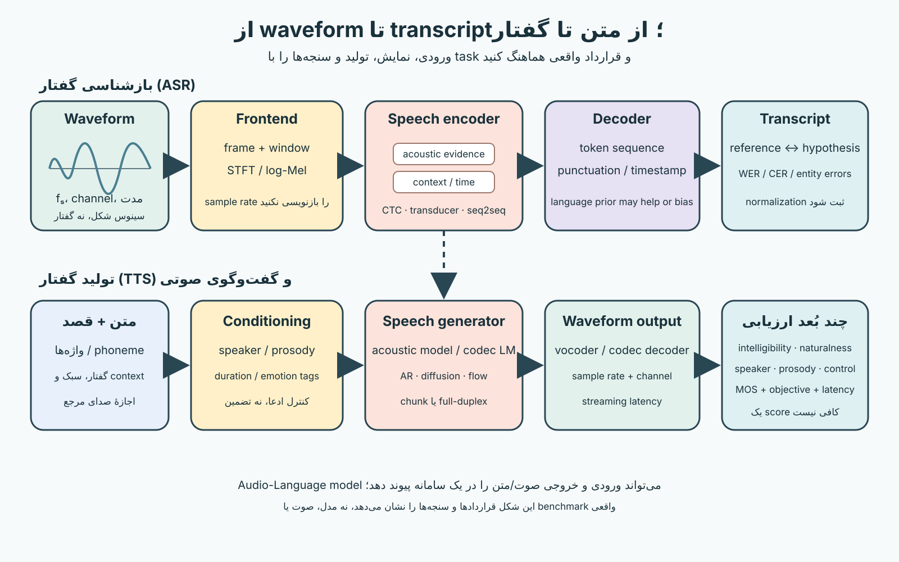

## ۲. قرارداد waveform: sample rate فقط یک برچسب نیست

موج صوتی دیجیتال دنباله‌ای از دامنه‌هاست. اگر نرخ نمونه‌برداری `fₛ` نمونه در ثانیه و مدت `T` ثانیه باشد، شمار تقریبی sampleها چنین است:

<math xmlns="http://www.w3.org/1998/Math/MathML" display="block" aria-label="تعداد نمونه برابر نرخ نمونه‌برداری ضرب‌در مدت سیگنال است">
  <mrow><mi>N</mi><mo>=</mo><msub><mi>f</mi><mi>s</mi></msub><mo>·</mo><mi>T</mi></mrow>
</math>

**متن جایگزین فرمول:** `N = f_s × T`؛ برای صدای تک‌کانالهٔ ۱۶ کیلوهرتز و مدت ۵ ثانیه، ۸۰٬۰۰۰ نمونه لازم است.

مثلاً waveform پنج‌ثانیه‌ای با نرخ ۱۶ kHz در یک کانال ۸۰٬۰۰۰ sample دارد؛ stereo در صورت ذخیرهٔ دو کانال ۱۶۰٬۰۰۰ مقدار دارد. فرکانس‌های بالاتر از نصف نرخ نمونه‌برداری، بدون فیلتر پیش از نمونه‌برداری، می‌توانند alias شوند:

<math xmlns="http://www.w3.org/1998/Math/MathML" display="block" aria-label="فرکانس Nyquist برابر نصف نرخ نمونه‌برداری است">
  <mrow><msub><mi>f</mi><mtext>Nyquist</mtext></msub><mo>=</mo><mfrac><msub><mi>f</mi><mi>s</mi></msub><mn>2</mn></mfrac></mrow>
</math>

**متن جایگزین فرمول:** `f_Nyquist = f_s / 2`؛ این مرز نظری نمونه‌برداری است، نه تضمین کیفیت ضبط یا frontend مدل.

نکتهٔ عملی: اگر فایل ۴۸ kHz را به مدلی با قرارداد ۱۶ kHz بدهید، صرفاً metadata را از «۴۸» به «۱۶» تغییر ندهید. **Resampling** باید نمونه‌های تازه را از سیگنال پیوستهٔ تقریبی برآورد کند و در downsampling فیلتر ضد-alias داشته باشد. تغییر عدد metadata بدون resampling، زمان و pitch مؤثر را عوض می‌کند.

## ۳. از نمونه به ویژگی: پنجره، گام و نمایش زمان–فرکانس

طول یک گفتار معمولاً از چند صد هزار نمونه بیشتر است؛ پردازش در پنجره‌های کوتاه امکان دیدن تغییرات فرکانسی در طول زمان را می‌دهد. اگر طول پنجره `L` و فاصلهٔ شروع پنجره‌ها `H` باشد، پنجره‌ها می‌توانند هم‌پوشانی داشته باشند. STFT برای هر پنجره ضرایب فرکانسی را محاسبه می‌کند:

<math xmlns="http://www.w3.org/1998/Math/MathML" display="block" aria-label="تبدیل فوریهٔ کوتاه‌زمان روی پنجرهٔ m، جمع نمونه‌های پنجره‌شده با نمای مختلط است">
  <mrow>
    <msub><mi>X</mi><mi>m</mi></msub><mo>(</mo><mi>k</mi><mo>)</mo><mo>=</mo>
    <munderover><mo>∑</mo><mrow><mi>n</mi><mo>=</mo><mn>0</mn></mrow><mrow><mi>L</mi><mo>−</mo><mn>1</mn></mrow></munderover>
    <mi>x</mi><mo>[</mo><mi>n</mi><mo>+</mo><mi>mH</mi><mo>]</mo>
    <mi>w</mi><mo>[</mo><mi>n</mi><mo>]</mo>
    <msup><mi>e</mi><mrow><mo>−</mo><mi>j</mi><mn>2</mn><mi>π</mi><mi>kn</mi><mo>/</mo><mi>N</mi></mrow></msup>
  </mrow>
</math>

**متن جایگزین فرمول:** در پنجرهٔ زمانی `m`، نمونه‌های `x[n+mH]` در پنجرهٔ `w[n]` ضرب و برای bin فرکانسی `k` جمع می‌شوند؛ مقدارهای `L`، `H` و `N` جزو قرارداد preprocessing هستند.

**Log-Mel** پس از ساخت طیف، توان را روی فیلترهایی با فاصله‌بندی Mel جمع و معمولاً لگاریتم می‌گیرد. این ویژگی‌ها ورودی رایجی برای برخی مدل‌ها هستند، اما همهٔ گفتارمدل‌ها Mel یکسان، تعداد bin یکسان یا نرخ نمونهٔ یکسان ندارند. [۲] برای نمونه، مقالهٔ Whisper ورودی طیف log-Mel با تعداد bin مشخص خود را توصیف می‌کند؛ همان تنظیم را به همهٔ معماری‌ها تعمیم ندهید.

## ۴. مشخصات ورودی باید کنار checkpoint بماند

برای هر درخواست یا نمونهٔ آموزشی این metadata را نگه دارید: نرخ نمونه‌برداری، تعداد کانال، تعداد sample، مدت، dtype و scale، روش resampling، سیاست تبدیل stereo به mono، میزان clipping، crop و padding، frame/hop، نوع ویژگی و نسخهٔ frontend. شکل تنسور مانند `[B, F, T]` به‌تنهایی این اطلاعات را بیان نمی‌کند.

Normalize کردن دامنه، حذف سکوت، تشخیص گفتار (VAD) و تبدیل stereo به mono ممکن است برای یک pipeline مناسب باشد و برای pipeline دیگر اطلاعات حذف کند. VAD پیش‌پردازش یا ماژولی برای مرزبندی فعالیت صوتی است؛ خودش transcript نیست. اگر ورودی خالی یا خیلی کوتاه است، به‌جای تولید متن ظاهراً مطمئن، رفتار خطا/خروجی خالی را صریح تعریف کنید.

## ۵. نقشهٔ کارهای گفتاری و صوتی

| کار | پرسش | خروجی معمول | آزمون اصلی |
|---|---|---|---|
| ASR | چه گفته شد؟ | واژه، جمله، timestamp | WER/CER و خطای نام/عدد |
| گفتاربه‌متن ترجمه | گفتار در زبان دیگر چه می‌گوید؟ | متن ترجمه‌شده | کیفیت ترجمه و پوشش معنا |
| درک گفتار | پاسخ/قصد/نکته چیست؟ | پاسخ، خلاصه یا ساختار | صحت معنا، شاهد و پیروی از دستور |
| diarization | چه کسی در چه بازه‌ای حرف زد؟ | قطعهٔ زمانی و شناسهٔ گوینده | خطای مرزبندی و گوینده |
| فهم صوت عمومی | چه رخداد یا صدایی وجود دارد؟ | caption یا برچسب | طبقه‌بندی، زمان‌مندی و شاهد |
| TTS | متن چگونه گفته شود؟ | waveform یا token صوت | intelligibility، کیفیت شنیداری و control |
| گفت‌وگوی گفتاری | چه وقت گوش دهیم/پاسخ دهیم؟ | جریان گفتار تعاملی | turn-taking، interruption و latency |

معیار یک ردیف پاسخ ردیف دیگر را اثبات نمی‌کند. مثلاً transcript درست به‌تنهایی طبیعی‌بودن صدای تولیدشده را نمی‌سنجد؛ و caption صوتی خوب لزوماً واژه‌های دقیق گفتار را بازیابی نمی‌کند.

## ۶. مسیر رایج ASR: encoder، alignment و decoder

یک pipeline پایه waveform را به ویژگی‌های زمانی تبدیل می‌کند، encoder نمایش صوتی می‌سازد و decoder توکن‌های متن را پیش‌بینی می‌کند. برای batch، طول‌های متفاوت معمولاً padding می‌شوند؛ mask طول واقعی باید حفظ شود تا padding به‌اشتباه به‌عنوان سکوت یا محتوای صوت وارد attention نشود.

سه خانوادهٔ متداول هدف/رمزگشایی را از هم بشناسید:

- **CTC** روی هر گام زمانی برچسب می‌دهد و احتمال مسیرهای هم‌تراز با transcript را جمع می‌کند؛ blank و collapse توکن‌های تکراری، نیاز به alignment صریح frame/حرف را کم می‌کنند.
- **Transducer / RNN-T** وابستگی به ورودی صوت و پیشوند خروجی را مدل می‌کند و برای رمزگشایی افزایشی طراحی شده است؛ اما streaming بودن به تنهایی تأخیر کم یا کیفیت مناسب را تضمین نمی‌کند.
- **Encoder–decoder autoregressive** با attention متن را شرطی بر نمایش صوت تولید می‌کند. می‌تواند متن بلند و چند وظیفه را یکپارچه کند، ولی هزینهٔ decode و اثر prior زبانی باید آزموده شود.

انتخاب بین این‌ها فقط برچسب معماری نیست. طول context، محدودیت stream، تعداد به‌روزرسانی در ثانیه، حافظه، beam search، tokenizer و روش تقسیم chunk بر نتیجه اثر می‌گذارند.

## ۷. نمایش‌های پیش‌آموخته: از صوت بی‌برچسب تا transcript

wav2vec 2.0 نمایش latent صوت را با پنهان‌کردن بخش‌هایی از ورودی و هدف contrastive یاد می‌گیرد؛ سپس در مقاله با دادهٔ transcript‌دار برای ASR سازگار می‌شود [۱]. این الگو نشان می‌دهد که **پیش‌آموزش بدون transcript** می‌تواند representation مفیدی بسازد، اما آموزش نظارت‌شده و کیفیت دادهٔ آزمون همچنان اهمیت دارند.

Whisper راه دیگری را گزارش کرد: آموزش روی مجموعهٔ بزرگ جفت‌های صوت–متن گردآوری‌شده از وب و یادگیری چندزبانه/چندوظیفه‌ای، سپس ارزیابی انتقالی [۲]. عددها و دستاوردهای مقاله به data curation، توزیع زبان‌ها، decoding و benchmarkهای همان کار وابسته‌اند؛ «چندزبانه» یا «zero-shot» تضمین کیفیت هر زبان، گویش یا محیط نیست.

نمایش‌های صوتی می‌توانند پیوسته باشند یا به کدهای گسسته نگاشت شوند. نوع نمایش، نرخ frame و tokenizer تعیین می‌کنند که مدل چه جزئیاتی را دریافت می‌کند و در هر ثانیه چند گام باید پردازش/تولید کند.

## ۸. Decode و prior زبانی: متن محتمل با متن شنیده‌شده فرق دارد

Greedy decoding، beam search، language model rescoring و تنظیم دما/توقف می‌توانند transcriptها را عوض کنند. prior زبانی ممکن است نام پرتکرار را ترجیح دهد، واژهٔ نادر را جایگزین کند یا روی audio مبهم، کلمه‌ای سازگار ولی شنیده‌نشده بسازد. بنابراین log probability بالا یا متن روان، شاهد کافی برای صحت آکوستیکی نیست.

سناریوهای شکست را جداگانه log کنید: سکوت، گفتار کوتاه، صدای پس‌زمینه، جابه‌جایی زبان، نام خاص، عدد، acronym، گفتار بریده‌شده، repetition، hallucination در سکوت، و خطای VAD. نسخهٔ decoder، prompt زبان، طول chunk و تنظیم beam را همراه مدل ثبت کنید؛ بدون آن مقایسهٔ WER قابل‌بازتولید نیست.

## ۹. Streaming، chunk و زمان‌مندی

در مدل آفلاین، کل فایل پیش از پاسخ موجود است؛ در streaming، صوت تدریجی می‌رسد. Chunk کوچک‌تر ممکن است زمان شروع را کم کند اما context، coarticulation یا مرز جمله را بشکند. Chunk بزرگ‌تر context بیشتری می‌دهد اما حافظه و زمان انتظار را افزایش می‌دهد. overlap، buffer و state بین chunkها را صریح مشخص کنید.

برای ارزیابی streaming، فقط زمان پایان فایل را ثبت نکنید. حداقل زمان اولین خروجی، تأخیر هر chunk، تأخیر end-of-turn، ثبات transcript در بازنگری‌ها، حذف/تکرار مرز chunk، throughput و نسبت زمان اجرا به مدت صوت را گزارش کنید. Timestamp باید با نرخ نمونه و preprocessing سازگار بماند؛ resample/crop می‌تواند رابطهٔ offset و زمان را جابه‌جا کند.

## ۱۰. دادهٔ گفتار: splitter بر اساس گوینده و منبع

یک manifest قابل ممیزی شناسهٔ نمونه، منبع، مجوز/شرایط استفاده، زبان/گویش در حد annotation مجاز، گویندهٔ pseudonymous، شرایط ضبط، نرخ نمونه، متن، timestamp و preprocessing را نگه می‌دارد. فایل خام، transcript و دادهٔ مشتق‌شده را با access و retention جدا مدیریت کنید.

تقسیم تصادفیِ قطعه‌ها می‌تواند صدای یک گوینده یا یک جلسه را هم در train و هم در test بگذارد. برای سنجش تعمیم به گوینده/منبع تازه، split را در سطح مناسب group کنید و near-duplicate را بررسی کنید. توافق annotation، policy نویز، حذف حساسیت‌ها، دادهٔ code-switch و پوشش لهجه را ثبت کنید. این کنترل‌ها کیفیت یا پاکی داده را تضمین نمی‌کنند، اما خطاهای قابل‌کشف را آشکارتر می‌سازند.

## ۱۱. بازشناسی گفتار را چگونه امتیاز بدهیم؟

برای ASR، WER از حداقل تعداد substitution، deletion و insertion در سطح واژه نسبت به تعداد واژه‌های مرجع ساخته می‌شود:

<math xmlns="http://www.w3.org/1998/Math/MathML" display="block" aria-label="نرخ خطای واژه برابر مجموع جانشینی، حذف و درج تقسیم بر تعداد واژه‌های مرجع است">
  <mrow><mi>WER</mi><mo>=</mo><mfrac><mrow><mi>S</mi><mo>+</mo><mi>D</mi><mo>+</mo><mi>I</mi></mrow><msub><mi>N</mi><mtext>ref</mtext></msub></mfrac></mrow>
</math>

**متن جایگزین فرمول:** `WER = (S + D + I) / N_ref`؛ صورت تعداد خطاهای ویرایشی و مخرج تعداد واحدهای مرجع است.

WER تجمیعی معمولاً ابتدا شمار خطاها و واژه‌های مرجع را روی کل مجموعه جمع می‌کند و بعد تقسیم می‌کند؛ میانگین سادهٔ درصد هر utterance معیار دیگری است و به نمونه‌های کوتاه وزن بیشتری می‌دهد. WER می‌تواند از ۱۰۰٪ بیشتر شود، چون درج‌ها محدود به طول مرجع نیستند.

## ۱۲. WER در چندزبانگی: normalization را پنهان نکنید

برای مقایسه، باید پیش از scoring سیاست متن را تثبیت کنید: بزرگ/کوچک‌نویسی، نشانه‌گذاری، اعداد، قراردادهای املایی، شکل کوتاه‌شده، tokenization و segmentation. MLPerf برای benchmark گفتار نمونه‌هایی از اثر این تصمیم‌ها و روش normalization را مستند می‌کند [۱۹]. normalization پس از دیدن نتیجه و برای بهترکردن یک مدل، مقایسه را سوگیرانه می‌کند.

CER در سطح نویسه تعریف می‌شود:

<math xmlns="http://www.w3.org/1998/Math/MathML" display="block" aria-label="نرخ خطای نویسه برابر مجموع جانشینی، حذف و درج در سطح نویسه تقسیم بر تعداد نویسه‌های مرجع است">
  <mrow><mi>CER</mi><mo>=</mo><mfrac><mrow><msub><mi>S</mi><mi>c</mi></msub><mo>+</mo><msub><mi>D</mi><mi>c</mi></msub><mo>+</mo><msub><mi>I</mi><mi>c</mi></msub></mrow><msub><mi>N</mi><mi>c</mi></msub></mfrac></mrow>
</math>

**متن جایگزین فرمول:** `CER = (S_c + D_c + I_c) / N_c`؛ همهٔ شمارها در واحد نویسهٔ تعریف‌شده‌اند.

در زبان‌هایی با مرز واژهٔ مبهم یا morphology غنی، CER می‌تواند مکمل مفیدی باشد. پژوهش NAACL 2025 با ارزیابی انسانی در Malayalam، English و Arabic استدلال می‌کند که CER در تنظیم خودش با قضاوت انسانی همبستگی بیشتری داشته است [۱۲]. این یافته حکم همگانی نیست: نتیجه به متن نرمال‌شده، script، تعریف «نویسه» و هدف کار وابسته است. برای فارسی، نیم‌فاصله، ک/ك، ی/ي، اعراب و عددها سیاست scoring جدا می‌خواهند؛ CER سادهٔ کد این فصل معیار کیفیت فارسی نیست.

## ۱۳. متن تولیدی فراتر از transcript لفظ‌به‌لفظ

مدل‌های speech-language ممکن است پاسخ سؤال، خلاصه یا transcript بازنویسی‌شده تولید کنند. در این حالت یک transcript مرجع یگانه همیشه همهٔ خروجی‌های درست را پوشش نمی‌دهد؛ اما آزادی بازنویسی می‌تواند hallucination یا جزئیات افزوده را هم پنهان کند.

پیش‌چاپ GSR-Bench در ۳۰ اکتبر ۲۰۲۶، مسئله را به «خروجی معناییِ مستند به صوت» گسترش می‌دهد و سطح‌هایی از transcription لفظی تا ساختاردهی متن را جدا می‌کند [۱۸]. این کار در تاریخ بازبینی هنوز پیش‌چاپ است. درس عمومیِ قابل‌استفاده: برای پاسخ آزاد، معیار exact string را با ارزیابی grounding، unsupported content، پیروی از دستور و بازبینی انسانی تکمیل کنید؛ قضاوت یک LLM به‌تنهایی حقیقت مرجع نیست.

## ۱۴. کارهای گفتاری نزدیک اما متفاوت: ترجمه، درک و diarization

- **گفتاربه‌متن ترجمه** باید هم محتوا را حفظ کند و هم زبان هدف را رعایت کند. WER روی زبان مبدأ به‌تنهایی کیفیت ترجمه را نمی‌سنجد؛ معیارهای ترجمه و ارزیابی انسانی لازم‌اند.
- **Spoken question answering** باید پاسخ را به اطلاعات شنیده‌شده وصل کند. آزمون متن‌محور نمی‌سنجد که ASR چه چیزی را اشتباه شنیده است.
- **Diarization** مرز زمانی و هویت گوینده را تخمین می‌زند؛ ترتیب رفت‌وبرگشت، overlap و speaker error از واژهٔ transcript جدا هستند.
- **Emotion / prosody / voice traits** از ویژگی‌های آکوستیکی استفاده می‌کنند. خروجی متنی ممکن است آن‌ها را حذف یا ساده‌سازی کند؛ transcript زیبا الزاماً شنیدن دقیق نیست.
- **Audio captioning** می‌تواند گفتار و صدای پس‌زمینه را توصیف کند؛ اگر پرسش به timestamp یا منبع صدا نیاز دارد، ارزیابی کلیدیپ کافی نیست.

هر هدف به دادهٔ برچسب‌خورده و معیار خودش نیاز دارد؛ جمع‌کردن چند وظیفه زیر عنوان «درک صوت» آن‌ها را هم‌ارز نمی‌کند.

## ۱۵. ورودی TTS: متن را بدون preprocessing پنهان نکنید

سامانهٔ TTS ابتدا باید متن نوشتاری را به واحدهای قابل‌تلفظ تبدیل کند. اعداد، واحدها، اختصارها، اسم‌ها، punctuation، code-switch و تاریخ می‌توانند چند تلفظ معتبر داشته باشند. Frontend ممکن است text normalization، grapheme-to-phoneme، lexicon، phoneme tokenization و کنترل زبان داشته باشد.

برای مثال `04/05` بدون قرارداد locale می‌تواند تاریخ یا نسبت باشد؛ `Dr.` ممکن است عنوان یا مخفف خوانده شود. متن مرجع و متن TTS را برای ارزیابی، همراه با تلفظ مورد انتظار، نسخهٔ normalizer، لغت‌نامه و زبان ثبت کنید. اگر model output شنیدنی ولی با املای benchmark متفاوت است، اختلاف فقط به مدل نسبت داده نشود.

## ۱۶. معماری تولید: نمایش پیوسته، mel و waveform

در pipeline کلاسیک، مدل duration/alignment را می‌آموزد، ویژگی آکوستیکی مانند Mel را پیش‌بینی می‌کند و vocoder آن را به waveform تبدیل می‌کند. خطا می‌تواند از متن، alignment، prosody، acoustic model یا vocoder بیاید. مدل‌های end-to-end برخی مرزها را یکپارچه می‌کنند؛ این امر اشکال‌زدایی را همیشه ساده‌تر نمی‌کند.

در برخی معماری‌های جدید، مدل به‌جای رگرسیون مستقیم موج، توکن‌های codec را به‌صورت شرطی تولید می‌کند. VALL-E این ایده را به‌عنوان conditional language modeling روی کدهای codec بررسی کرد [۵]. در مدل‌های diffusion یا flow، مسیر تولید/رفع نویز با چند گام و شرایط متن/گوینده صورت می‌گیرد. تفاوت AR، diffusion، flow و vocoder در latency، تعداد مرحله، کنترل‌پذیری و کیفیت خروجی ظاهر می‌شود؛ رتبه‌بندی بدون پروتکل مشترک معنادار نیست.

## ۱۷. Codec و token صوت: فشرده‌سازی مساوی معنا نیست

Neural codec یک encoder/decoder یادگرفتنی دارد که waveform را به نمایش فشرده و قابل‌بازسازی تبدیل می‌کند. SoundStream از quantizer برداری باقیمانده و معماری end-to-end استفاده کرد [۳]؛ EnCodec کیفیت صوت فشرده را با آزمون‌های عینی و شنیداری مطالعه می‌کند [۴]. Tokenizer صوت می‌تواند در هر گام چند codebook داشته باشد؛ rate پایین‌تر، گام‌های autoregressive کمتری می‌دهد ولی trade-off بازسازی، جزئیات و ظرفیت دارد.

«Semantic token» و «acoustic token» همیشه مرز کاملاً جدا ندارند. یک code ممکن است هم اطلاعات واجی، هم timbre/پروسودی را حمل کند. برای ادعا دربارهٔ codec، bitrate، sample rate، codebook count، frame rate، delay، بازسازی waveform و مجموعهٔ آزمون را کنار هم بخوانید. پروژهٔ این فصل codec نمی‌سازد.

## ۱۸. کنترل سبک و صدای مرجع

تولید گفتار می‌تواند با speaker embedding، prompt صوتی، شناسهٔ voice، برچسب سبک یا دستور زبانی شرطی شود. مقایسه کنید چه چیز ثابت می‌ماند: واژه‌ها، گوینده، سرعت، هیجان، زبان یا محیط ضبط. «speaker similarity» برابر طبیعی‌بودن نیست؛ و حفظ timbre تضمین نمی‌کند تلفظ و معنا درست باشند.

Voice cloning از صدای مرجع، حتی در چند ثانیه، می‌تواند انتساب نادرست هویت یا سوءاستفاده بسازد. کیفیتِ تقلید را فقط وقتی بسنجید که رضایت، منشأ فایل، مجوز استفاده و سیاست نگهداری مشخص باشند. کنترل prompt یا watermark ممکن است ریسک را کم کند، اما به‌تنهایی رضایت، اختیار یا استفادهٔ مجاز را اثبات نمی‌کند.

## ۱۹. Cascade در برابر مدل Audio-Language بومی

**Pipeline آبشاری** معمولاً ASR → LLM متنی → TTS است. هر جزء را می‌توان جداگانه عوض/ممیزی کرد و transcript میانی برای debug در دسترس است؛ در عوض خطای ASR به LLM می‌رسد، paralinguistic information ممکن است در متن حذف شود و latency اجزا جمع می‌شود.

**مدل Audio-Language یکپارچه** می‌تواند نمایش صوت را مستقیم به مدل زبانی وصل کند، audio token بخواند/بسازد یا چند stream هم‌زمان را مدل کند. مزیت بالقوه: دسترسی مستقیم به نشانه‌های آکوستیکی و پاسخ گفتاری یکپارچه. هزینه/ریسک: ارزیابی و attribution دشوارتر، توکن‌های پرحجم، کنترل دشوارتر و نیاز به دادهٔ صوتی دقیق‌تر. «End-to-end» یعنی اجزای بیشتری با هم آموزش/اجرا می‌شوند، نه اینکه خطا، bias یا نیاز به audit ناپدید شود.

## ۲۰. نمونه‌های پژوهشی ۲۰۲۴–۲۰۲۶، با مرز ادعا

- Moshi مسیر گفت‌وگوی speech-to-speech و streamهای هم‌زمان را با codec Mimi بررسی می‌کند؛ مقاله برای پیاده‌سازی خودش latency نظری و عملی گزارش می‌دهد [۶]. آن اعداد قابل‌انتقال به دستگاه، backend یا شرایط شبکهٔ دیگر نیستند.
- Qwen3-Omni معماری Thinker–Talker و تولید streaming گفتار در کنار ورودی‌های متن/تصویر/صوت/ویدئو را گزارش می‌کند [۷]. شمار زبان، benchmark و ادعای کیفیت همان گزارش را به یک تضمین برای محصول دلخواه تبدیل نکنید.
- Qwen3-TTS از دو tokenizer گفتار و مسیر autoregressive برای تولید کنترل‌پذیر/streaming گزارش می‌دهد [۸]. latency اولین packet و نتایج چندزبانه به مدل و setup همان مقاله تعلق دارند.
- گزارش Qwen-Audio-3.0-TTS در ۲۰۲۶ معماری چندمرحله‌ای و کنترل متنی/برچسبی را برای تولید گفتار بررسی می‌کند [۹]. مدل‌ها، زبان‌ها و معیارها را پیش از مقایسه با مقالهٔ دیگر هم‌تراز کنید.
- نسخهٔ سوم گزارش StepAudio 3 Realtime تا ۱۲ اکتبر ۲۰۲۶، full-duplex، مدیریت interruption و تولید گفتار هم‌زمان با reasoning را شرح می‌دهد [۱۰]. نمره‌های benchmark خود گزارش نشان‌دهندهٔ برتری در همهٔ کاربردها یا سخت‌افزار محلی نیستند.

این نمونه‌ها نشان می‌دهند که فضای طراحی از ASR یک‌طرفه به streamهای صوت/متن و گفت‌وگوی هم‌زمان گسترش یافته است؛ فهرست کامل مدل‌ها یا ranking ثابت ارائه نمی‌شود.

## ۲۱. طرح ارزیابی: یک score برای همهٔ وظایف وجود ندارد

پروتکل را پیش از اجرای مدل بنویسید: هدف، dataset و نسخه، زبان/گویش، split، normalization، مدل و revision، prompt، decoding، طول/کانال صوت، معیارها، تعداد اجرا و عدم‌قطعیت. آلودگی داده، sampleهای مشابه، selection bias و آزمون انسانی را ثبت کنید. نتیجهٔ benchmark فقط به task و split همان protocol مربوط است.

AudioBench (NAACL 2025) هشت task و ۲۶ dataset را در speech understanding، audio scene و voice understanding دسته‌بندی می‌کند و گزارش می‌دهد که در تنظیم آن، یک مدل در همهٔ taskها برنده نیست [۱۱]. SEA-SpeechBench (مقالهٔ پذیرفته‌شدهٔ EMNLP 2026) مجموعهٔ چندوظیفه‌ای برای ۱۱ زبان آسیای جنوب‌شرقی معرفی می‌کند و شکاف‌هایی را برای task/زبان گزارش می‌دهد [۱۶]. این دو مرجع مثال‌هایی از گسترش ارزیابی‌اند، نه پوشش کامل همهٔ زبان‌ها.

SEA-HELM Audio در پیش‌چاپ اکتبر ۲۰۲۶، نتیجهٔ ورودی صوت را با متن برای چندزبانگی مقایسه می‌کند و «speech gap» را جدا می‌سنجد [۱۷]. این ایده هشدار می‌دهد که benchmark متنی به‌تنهایی رفتار voice agent را پیش‌بینی نمی‌کند. برای محصول، ارزیابی speech-in و text-in را با همان سؤال‌ها، verifierها و splitها مقایسه کنید.

## ۲۲. TTS را با چند بُعد مکمل بسنجید

| بُعد | نمونهٔ سنجه/روش | چه چیزی را به‌تنهایی نمی‌گوید |
|---|---|---|
| intelligibility | transcript با ASR مستقل، WER/CER، بازبینی نمونه | طبیعی‌بودن یا درستی همهٔ واج‌ها |
| naturalness / quality | MOS، MUSHRA یا آزمون شنیداری کنترل‌شده | علت دقیق artifact یا کیفیت همهٔ زبان‌ها |
| speaker similarity | مدل embedding گوینده و مقایسهٔ انسانی | رضایت، هویت قانونی یا طبیعی‌بودن |
| prosody / style | F0، duration، rubric برای کنترل دستور | درک انسانی از لحن در همهٔ فرهنگ‌ها |
| acoustic artifacts | سیگنال‌متریک و آزمون گوش‌دادن | درستی واژه و تناسب لحن |
| streaming | first-packet، chunk delay، RTF و ثبات بلندمدت | کیفیت مکالمه یا حریم خصوصی |

TTSDS2 در ICLR 2026، benchmark چندزبانه و metric توزیعی را در کنار مجموعه‌ای از ratings انسانی معرفی می‌کند [۱۳]. پژوهش «Beyond Naturalness» (پذیرفته‌شده در EMNLP 2026) می‌سنجد که ارزیاب‌های MOS و Audio-LLM تا چه حد ابعاد زبانی/آکوستیکی مختلف را می‌گیرند و گزارش می‌دهد که هیچ‌یک دامنهٔ کامل خطا را پوشش نمی‌دهند [۱۴]. بنابراین MOS خودکار، WER با ASR، speaker embedding یا یک judge زبانی را به‌تنهایی معادل قضاوت شنونده نگیرید.

## ۲۳. آکوستیک غیرواژگانی و زمان‌مندی را هم بسنجید

مدل ممکن است واژه‌ها را درست بگیرد ولی زیر و بمی، مکث، گوینده یا صدای پس‌زمینه را اشتباه تشخیص دهد. VocalGrad (پیش‌چاپ NeurIPS 2026) تغییرات کنترل‌شدهٔ آکوستیکی را از استدلال واژگانی جدا می‌کند و برای مدل‌های بررسی‌شده محدودیت‌هایی گزارش می‌دهد [۱۵]. این نتیجه ادعای عملکرد همهٔ Audio-Language modelها نیست؛ ارزش روش‌شناختی آن جداسازی «شنیدن ویژگی آکوستیکی» از «دانستن پاسخ زبانی» است.

برای هر task، آزمون‌هایی بسازید که acoustic cue را نگه دارند و transcript/معنا را تغییر ندهند، یا برعکس؛ سپس ببینید مدل کدام را دنبال می‌کند. برای timestamp، ثبت واحد زمانی و tolerance؛ برای speaker، آزمون‌های هم‌پوشانی و تغییر میکروفون؛ برای emotion/style، برچسب انسانی و توافق annotator؛ برای متن، معیار transcript. اگر یک utterance چند هدف دارد، نتیجهٔ هر هدف جدا بماند.

## ۲۴. latency و full-duplex را به اجزای واقعی بشکنید

Real-Time Factor را به‌شکل زمان اجرای محاسبه‌شده نسبت به مدت صوت تعریف کنید:

<math xmlns="http://www.w3.org/1998/Math/MathML" display="block" aria-label="عامل زمان واقعی برابر زمان اجرا تقسیم بر مدت صوت است">
  <mrow><mi>RTF</mi><mo>=</mo><mfrac><msub><mi>t</mi><mtext>wall</mtext></msub><msub><mi>T</mi><mtext>audio</mtext></msub></mfrac></mrow>
</math>

**متن جایگزین فرمول:** `RTF = t_wall / T_audio`؛ قرارداد اندازه‌گیری و مسیر اجرا را باید کنار عدد بنویسید.

RTF کمتر از یک فقط می‌گوید آن run در آن setup سریع‌تر از مدت ورودی تمام شده است؛ تأخیر شروع، صف، شبکه، VAD و buffering ممکن است همچنان نامناسب باشد. برای مکالمه، first-packet latency، time-to-first-token، pause handling، turn taking، backchannel، interruption و end-of-turn را جدا بسنجید.

Full-duplex یعنی سامانه در زمان گفتارِ کاربر می‌تواند هم گوش دهد و هم در صورت نیاز گفتار تولید کند؛ مدیریت نوبت، لغو/اصلاح گفته و ادامهٔ پاسخ را باید در protocol مدل کنید. Benchmarkهای full-duplex با benchmark ASR یا MOS یکی نیستند.

## ۲۵. ایمنی، رضایت و دادهٔ صوتی

صوت می‌تواند واژه، گوینده، محل، سلامت یا شرایط خصوصی را آشکار کند. دسترسی به فایل خام، مدت نگهداری، حذف، ثبت log و انتقال به سرویس را محدود کنید. برای صدای مرجع، speaker adaptation و voice cloning، رضایت روشن و provenance نگه دارید و سناریوی سوءاستفاده/جعل هویت را ارزیابی کنید. مدل‌کارت و مجوز checkpoint، مجوز ضبط یا رضایت گوینده را ثابت نمی‌کند.

در محصولات حساس، ASR باید در برابر سکوت/نویز، prompt-injection صوتی، false activation، اشتباه در نام/عدد و نابرابری لهجه آزموده شود. خروجی برای عمل پرهزینه یا برگشت‌ناپذیر را با تأیید انسان یا محدودیت دامنه کنترل کنید. این فصل راهنمای حقوقی یا تضمین حریم خصوصی نیست؛ الزامات واقعی به نوع داده، محل استفاده و قرارداد بستگی دارند.

## ۲۶. آزمایشگاه CPU فصل: قرارداد پنجره و خطای متن

پروژهٔ `projects/52-audio-lab/` دو مسئلهٔ کوچک را از هم جدا می‌کند:

1. درون حافظه یک سینوس ۴۴۰ Hz با نرخ ۱۶ kHz ساخته می‌شود و با پنجرهٔ ۲۵ ms و گام ۱۰ ms به frame و طیف DFT ساده تبدیل می‌شود.
2. fixture سه جفت متنِ ساختگی دارد؛ برنامه WER/CER و اختلاف بین WER تجمیعی corpus و میانگین WER جمله‌ای را محاسبه می‌کند.

فایل‌های fixture، آزمون و نتیجه فقط با Python standard library اجرا می‌شوند. نمونهٔ ورودی، audio یا خروجی ASR ندارد. دستورهای اجرا و نتایج در [README پروژه](book-engineering/projects/52-audio-lab/README.md) آمده‌اند؛ پاسخ تمرین‌ها در [پاسخ‌نامهٔ فصل ۵۲](book-engineering/answers/52-audio-models-fa.md) است.

در اجرای ثبت‌شده، ۱۰۰ ms سینوس ۱۶٬۰۰۰ sample داشت و ۸ frame کامل ساخته شد. WER تجمیعی روی ۱۱ واژهٔ مرجع `3/11 = 0.2727272727272727` و میانگین جمله‌ای `0.21666666666666667` شد. این اعداد صحت پیاده‌سازی metric در fixture را نشان می‌دهند، نه کیفیت گفتار یا مدل.

## ۲۷. تمرین‌ها

1. waveform تک‌کانالهٔ ۲۴ kHz با مدت ۷٫۵ ثانیه چند sample دارد؟ اگر به‌اشتباه فقط sample rate metadata را ۱۶ kHz کنید، چه خطایی رخ می‌دهد؟
2. یک ثانیه صوت با window برابر ۲۵ ms و hop برابر ۱۰ ms چند frame کاملِ بدون padding می‌دهد؟ قرارداد مرز آخر را توضیح دهید.
3. در `reference = "turn left at the bridge"` و `hypothesis = "turn right at bridge"`، تعداد substitution/deletion/insertion و WER را به‌دست آورید.
4. چرا corpus WERِ سه utterance الزاماً برابر میانگین سادهٔ WER هر utterance نیست؟ برای هر انتخاب چه سؤال آماری/محصولی مطرح است؟
5. در فارسی، سه انتخاب normalization را مثال بزنید که می‌تواند WER/CER را تغییر دهد. چه نسخه‌ای را پیش‌ثبت می‌کنید؟
6. یک نمونهٔ ASR خام و یک پاسخ spoken-QA مدل بسازید که هر دو از یک فایل باشند ولی معیار مناسبشان متفاوت باشد. دلیل را بنویسید.
7. برای TTS سه معیار مکمل انتخاب کنید که به‌ترتیب intelligibility، naturalness و speaker identity را هدف بگیرند؛ محدودیت هر یک را هم ذکر کنید.
8. برای گفت‌وگوی full-duplex، سناریویی با مکث، backchannel و interruption طراحی کنید؛ eventها، timestampها و success condition را تعریف کنید.
9. طرح split بدهید که یک گوینده و جلسه میان train/test نشت نکنند؛ provenance، مجوز و retention را نیز ثبت کنید.
10. پروژه را اجرا کنید و تعداد frame، peak bin، WER تجمیعی و macro-WER را با خروجی ثبت‌شده مقایسه کنید. سپس بنویسید کدام نتیجه دربارهٔ ASR یا فارسی از آن **قابل استنتاج نیست**.

## ۲۸. جمع‌بندی و مسیر ادامه

گفتار یک waveform زمان‌مند است؛ contract نمونه‌برداری و frontend در ورودی اثر دارد، نمایش latent یا codec اطلاعات را فشرده می‌کند، decoder خروجی متن یا audio token را می‌سازد، و evaluation باید همان task را هدف بگیرد. ASR، TTS، spoken QA، audio captioning و full-duplex interaction را با یک معیار نسنجید.

در ASR، normalization و corpus aggregation را ثبت کنید؛ CER می‌تواند مکمل WER باشد، نه حکم واحد برای همهٔ زبان‌ها. در TTS، intelligibility، کیفیت شنیداری، speaker similarity، prosody، style control و streaming را جدا ببینید. در Audio-Language مدل‌ها، متن میانی، audio token و جریان گفت‌وگو مصالحه‌های متفاوتی دارند. پیش از deployment، provenance، رضایت، privacy و شکست‌های گروهی را با دادهٔ مجاز و split مستقل ارزیابی کنید.

فصل بعدی در نقشه فصل ۵۳ است: تولید تصویر و ویدئو و Diffusion؛ آن فصل خروجی تصویری/ویدئویی را از تولید گفتار این فصل جدا می‌کند.

## منابع و تاریخ بازبینی

مراجعه و بازبینی: **۶ نوامبر ۲۰۲۶**. ادعاهای تجربی به داده، مدل، نسخه و پروتکل همان منبع محدودند؛ تازه‌بودن فهرست به معنای پوشش کامل ادبیات نیست.

1. Baevski et al., “wav2vec 2.0: A Framework for Self-Supervised Learning of Speech Representations,” NeurIPS 2020, [arXiv:2006.11477](https://arxiv.org/abs/2006.11477).
2. Radford et al., “Robust Speech Recognition via Large-Scale Weak Supervision,” 2022, [arXiv:2212.04356](https://arxiv.org/abs/2212.04356).
3. Zeghidour et al., “SoundStream: An End-to-End Neural Audio Codec,” 2021, [arXiv:2107.03312](https://arxiv.org/abs/2107.03312).
4. Défossez et al., “High Fidelity Neural Audio Compression,” 2022, [arXiv:2210.13438](https://arxiv.org/abs/2210.13438).
5. Wang et al., “Neural Codec Language Models are Zero-Shot Text to Speech Synthesizers,” 2023, [arXiv:2301.02111](https://arxiv.org/abs/2301.02111).
6. Défossez et al., “Moshi: a speech-text foundation model for real-time dialogue,” arXiv v2, 2 October 2024, [arXiv:2410.00037](https://arxiv.org/abs/2410.00037).
7. Xu et al., “Qwen3-Omni Technical Report,” 2025, [arXiv:2509.17765](https://arxiv.org/abs/2509.17765).
8. Hu et al., “Qwen3-TTS Technical Report,” 2026, [arXiv:2601.15621](https://arxiv.org/abs/2601.15621).
9. Xiang et al., “Qwen-Audio-3.0-TTS: Freely Controllable and Highly Robust Speech Synthesis with Multi-Stage Training Paradigm,” 2026, [arXiv:2607.23938](https://arxiv.org/abs/2607.23938).
10. StepFun-Audio Team, “StepAudio 3 Realtime Technical Report,” arXiv v3, 12 October 2026, [arXiv:2609.14005](https://arxiv.org/abs/2609.14005).
11. Wang et al., “AudioBench: A Universal Benchmark for Audio Large Language Models,” NAACL 2025, DOI [10.18653/v1/2025.naacl-long.218](https://doi.org/10.18653/v1/2025.naacl-long.218), [ACL Anthology](https://aclanthology.org/2025.naacl-long.218/).
12. Thennal D K et al., “Advocating Character Error Rate for Multilingual ASR Evaluation,” Findings of NAACL 2025, pp. 4941–4950, DOI [10.18653/v1/2025.findings-naacl.277](https://doi.org/10.18653/v1/2025.findings-naacl.277), [ACL Anthology](https://aclanthology.org/2025.findings-naacl.277/).
13. Minixhofer, Klejch & Bell, “TTSDS2: Resources and Benchmark for Evaluating Human-Quality Text to Speech Systems,” ICLR 2026 Oral, [OpenReview](https://openreview.net/forum?id=uGai5lYHlV).
14. Bamgbose et al., “Beyond Naturalness: Probing Automated Text-To-Speech Evaluators on Linguistically Grounded Dimensions,” arXiv v2, accepted EMNLP 2026, [arXiv:2608.09930](https://arxiv.org/abs/2608.09930).
15. Ryu & Yanaka, “VocalGrad: Evaluating Acoustic Perception in Audio Language Models,” arXiv:2610.23745, NeurIPS 2026 Evaluations & Datasets Track, [arXiv](https://arxiv.org/abs/2610.23745).
16. Liao et al., “SEA-SpeechBench: A Large-Scale Multitask Benchmark for Speech Understanding Across Southeast Asia,” arXiv:2609.09672, accepted EMNLP 2026, [arXiv](https://arxiv.org/abs/2609.09672).
17. Adila et al., “SEA-HELM Audio: Evaluating Multilingual ASR-LLM Pipeline Performance Across SEA-HELM Subsets,” arXiv v2, 16 October 2026, [arXiv:2610.19869](https://arxiv.org/abs/2610.19869).
18. Wang et al., “From Transcription to Reformulation: Defining and Benchmarking Grounded Generative Speech Recognition,” arXiv v1, 30 October 2026, [arXiv:2610.41292](https://arxiv.org/abs/2610.41292). در تاریخ بازبینی، این کار پیش‌چاپ است.
19. MLCommons, “Whisper: An MLPerf Inference Benchmark for Automatic Speech Recognition (ASR),” 9 September 2025, [MLCommons](https://mlcommons.org/2025/09/whisper-inferencev5-1/).

## ۲۹. پیوست اجرایی: کد کامل پروژه

فایل زیر همان کدی است که در `projects/52-audio-lab/audio_lab.py` آزموده می‌شود. آزمون‌ها و ورودی fixture در همان پوشه‌اند.

```python
"""Small, standard-library-only audio framing and transcript-metric fixtures.

This is not an ASR, TTS, codec, or audio-language model. It generates one
analytic sine tone for framing/spectrum demonstrations and scores synthetic
text pairs to test evaluation code paths.
"""
from __future__ import annotations

import argparse
import cmath
import hashlib
import json
import math
import platform
import sys
import unicodedata
from pathlib import Path
from typing import Iterable, Mapping, Sequence

PROJECT_DIR = Path(__file__).resolve().parent
DEFAULT_FIXTURE = PROJECT_DIR / "sample_transcripts.json"


def validate_signal(samples: Sequence[float], sample_rate: int) -> None:
    if isinstance(sample_rate, bool) or not isinstance(sample_rate, int) or sample_rate <= 0:
        raise ValueError("sample_rate must be a positive integer in samples per second")
    if isinstance(samples, (str, bytes)) or not isinstance(samples, Sequence) or not samples:
        raise ValueError("samples must be a non-empty numeric sequence")
    for index, sample in enumerate(samples):
        if isinstance(sample, bool) or not isinstance(sample, (int, float)) or not math.isfinite(float(sample)):
            raise ValueError(f"sample {index} must be a finite number")


def make_synthetic_tone(
    sample_rate: int = 16_000,
    duration_ms: int = 100,
    frequency_hz: float = 440.0,
    amplitude: float = 0.5,
) -> list[float]:
    if isinstance(sample_rate, bool) or not isinstance(sample_rate, int) or sample_rate <= 0:
        raise ValueError("sample_rate must be a positive integer")
    if isinstance(duration_ms, bool) or not isinstance(duration_ms, int) or duration_ms <= 0:
        raise ValueError("duration_ms must be a positive integer")
    if not math.isfinite(frequency_hz) or not 0 < frequency_hz < sample_rate / 2:
        raise ValueError("frequency_hz must be finite and strictly below Nyquist")
    if not math.isfinite(amplitude) or not 0 < amplitude <= 1:
        raise ValueError("amplitude must be finite and in (0, 1]")
    sample_count = sample_rate * duration_ms // 1_000
    if sample_count <= 0:
        raise ValueError("duration is shorter than one sample")
    return [
        amplitude * math.sin(2.0 * math.pi * frequency_hz * index / sample_rate)
        for index in range(sample_count)
    ]


def frame_signal(
    samples: Sequence[float],
    sample_rate: int,
    frame_ms: float = 25.0,
    hop_ms: float = 10.0,
    *,
    pad_end: bool = False,
) -> list[list[float]]:
    validate_signal(samples, sample_rate)
    if not math.isfinite(frame_ms) or frame_ms <= 0:
        raise ValueError("frame_ms must be finite and positive")
    if not math.isfinite(hop_ms) or hop_ms <= 0:
        raise ValueError("hop_ms must be finite and positive")
    if not isinstance(pad_end, bool):
        raise ValueError("pad_end must be a bool")
    frame_length = round(sample_rate * frame_ms / 1_000)
    hop_length = round(sample_rate * hop_ms / 1_000)
    if frame_length <= 0 or hop_length <= 0:
        raise ValueError("frame_ms and hop_ms must each span at least one sample")

    values = [float(sample) for sample in samples]
    if pad_end:
        starts = range(0, len(values), hop_length)
    else:
        if len(values) < frame_length:
            return []
        starts = range(0, len(values) - frame_length + 1, hop_length)

    frames: list[list[float]] = []
    for start in starts:
        frame = values[start : start + frame_length]
        if len(frame) < frame_length:
            if not pad_end:
                break
            frame.extend([0.0] * (frame_length - len(frame)))
        frames.append(frame)
    return frames


def root_mean_square(samples: Sequence[float]) -> float:
    if not samples:
        raise ValueError("RMS requires at least one sample")
    if any(not math.isfinite(float(sample)) for sample in samples):
        raise ValueError("RMS samples must be finite")
    return math.sqrt(math.fsum(float(sample) ** 2 for sample in samples) / len(samples))


def hann_window(length: int) -> list[float]:
    if isinstance(length, bool) or not isinstance(length, int) or length <= 0:
        raise ValueError("window length must be a positive integer")
    if length == 1:
        return [1.0]
    return [0.5 - 0.5 * math.cos(2.0 * math.pi * index / (length - 1)) for index in range(length)]


def single_sided_power_spectrum(
    frame: Sequence[float], sample_rate: int, n_fft: int | None = None
) -> list[float]:
    validate_signal(frame, sample_rate)
    if n_fft is None:
        n_fft = len(frame)
    if isinstance(n_fft, bool) or not isinstance(n_fft, int) or n_fft <= 0:
        raise ValueError("n_fft must be a positive integer")
    if n_fft < len(frame):
        raise ValueError("n_fft cannot be shorter than the input frame")
    window = hann_window(len(frame))
    weighted = [float(sample) * weight for sample, weight in zip(frame, window)]
    scale = float(n_fft * n_fft)
    power: list[float] = []
    for bin_index in range(n_fft // 2 + 1):
        coefficient = sum(
            (weighted[index] * cmath.exp(-2j * math.pi * bin_index * index / n_fft)
             for index in range(len(weighted))),
            0j,
        )
        power.append((coefficient.real * coefficient.real + coefficient.imag * coefficient.imag) / scale)
    return power


def normalize_words(text: str) -> list[str]:
    if not isinstance(text, str):
        raise TypeError("transcript must be a string")
    return unicodedata.normalize("NFC", text).casefold().split()


def normalize_characters(text: str) -> list[str]:
    if not isinstance(text, str):
        raise TypeError("transcript must be a string")
    normalized = unicodedata.normalize("NFC", text).casefold()
    return [character for character in normalized if not character.isspace()]


def edit_counts(reference: Sequence[str], hypothesis: Sequence[str]) -> dict[str, int]:
    """Return one minimum-edit alignment with deterministic tie-breaking.

    Ties prefer substitution, then deletion, then insertion. The total edit
    distance is the Levenshtein distance; operation-level counts can differ
    between equally short alignments.
    """
    rows, columns = len(reference), len(hypothesis)
    distance = [[0] * (columns + 1) for _ in range(rows + 1)]
    back = [[""] * (columns + 1) for _ in range(rows + 1)]
    for row in range(1, rows + 1):
        distance[row][0] = row
        back[row][0] = "D"
    for column in range(1, columns + 1):
        distance[0][column] = column
        back[0][column] = "I"

    priority = {"S": 0, "D": 1, "I": 2}
    for row in range(1, rows + 1):
        for column in range(1, columns + 1):
            if reference[row - 1] == hypothesis[column - 1]:
                distance[row][column] = distance[row - 1][column - 1]
                back[row][column] = "M"
            else:
                candidates = [
                    (distance[row - 1][column - 1] + 1, "S"),
                    (distance[row - 1][column] + 1, "D"),
                    (distance[row][column - 1] + 1, "I"),
                ]
                distance[row][column], back[row][column] = min(
                    candidates, key=lambda item: (item[0], priority[item[1]])
                )

    substitutions = deletions = insertions = 0
    row, column = rows, columns
    while row or column:
        operation = back[row][column]
        if operation == "M":
            row -= 1
            column -= 1
        elif operation == "S":
            substitutions += 1
            row -= 1
            column -= 1
        elif operation == "D":
            deletions += 1
            row -= 1
        elif operation == "I":
            insertions += 1
            column -= 1
        else:
            raise RuntimeError("could not trace edit alignment")
    return {
        "substitutions": substitutions,
        "deletions": deletions,
        "insertions": insertions,
        "edit_distance": substitutions + deletions + insertions,
    }


def _rate_stats(reference: Sequence[str], hypothesis: Sequence[str]) -> dict[str, int | float]:
    if not reference:
        raise ValueError("error rate is undefined for an empty reference")
    counts = edit_counts(reference, hypothesis)
    total = counts["substitutions"] + counts["deletions"] + counts["insertions"]
    return {
        **counts,
        "reference_units": len(reference),
        "error_rate": total / len(reference),
    }


def word_error_stats(reference: str, hypothesis: str) -> dict[str, int | float]:
    return _rate_stats(normalize_words(reference), normalize_words(hypothesis))


def character_error_stats(reference: str, hypothesis: str) -> dict[str, int | float]:
    return _rate_stats(normalize_characters(reference), normalize_characters(hypothesis))


def corpus_word_error_stats(records: Sequence[Mapping[str, str]]) -> dict[str, int | float]:
    if not records:
        raise ValueError("at least one transcript pair is required")
    combined = {"substitutions": 0, "deletions": 0, "insertions": 0, "reference_units": 0}
    for record in records:
        stats = word_error_stats(record["reference"], record["hypothesis"])
        for key in combined:
            combined[key] += int(stats["reference_units"] if key == "reference_units" else stats[key])
    errors = combined["substitutions"] + combined["deletions"] + combined["insertions"]
    combined["edit_distance"] = errors
    combined["error_rate"] = errors / combined["reference_units"]
    return combined


def sentence_macro_word_error_rate(records: Sequence[Mapping[str, str]]) -> float:
    if not records:
        raise ValueError("at least one transcript pair is required")
    return math.fsum(
        float(word_error_stats(record["reference"], record["hypothesis"])["error_rate"])
        for record in records
    ) / len(records)


def load_fixture(path: Path) -> dict:
    payload = json.loads(path.read_text(encoding="utf-8"))
    if not isinstance(payload, dict):
        raise ValueError("fixture root must be a JSON object")
    metadata = payload.get("metadata")
    records = payload.get("records")
    if not isinstance(metadata, dict) or metadata.get("fixture_kind") != "synthetic_transcript_examples":
        raise ValueError("fixture must identify itself as synthetic transcript examples")
    if metadata.get("audio_recordings_included") is not False:
        raise ValueError("fixture must explicitly state that no audio recordings are included")
    if metadata.get("model_outputs_included") is not False:
        raise ValueError("fixture must explicitly state that no model outputs are included")
    if not isinstance(records, list) or not records:
        raise ValueError("fixture must contain at least one transcript record")
    seen: set[str] = set()
    for index, record in enumerate(records):
        if not isinstance(record, dict):
            raise ValueError(f"record {index} must be an object")
        identifier = record.get("id")
        if not isinstance(identifier, str) or not identifier.strip() or identifier in seen:
            raise ValueError(f"record {index} must have a unique, non-empty id")
        seen.add(identifier)
        if record.get("label_source") != "synthetic_fixture":
            raise ValueError(f"record {identifier} is not marked as a synthetic fixture")
        if not isinstance(record.get("reference"), str) or not isinstance(record.get("hypothesis"), str):
            raise ValueError(f"record {identifier} must contain string reference and hypothesis fields")
        if not normalize_words(record["reference"]):
            raise ValueError(f"record {identifier} has an empty reference transcript")
    return payload


def audit_fixture(path: Path) -> dict:
    payload = load_fixture(path)
    return {
        "status": "synthetic_transcript_fixture_audit_complete",
        "training_performed": False,
        "audio_recordings_loaded": False,
        "speech_model_loaded": False,
        "model_downloaded": False,
        "device": "cpu",
        "fixture": {
            "path": "sample_transcripts.json",
            "sha256": hashlib.sha256(path.read_bytes()).hexdigest(),
            "records": len(payload["records"]),
            "audio_recordings_included": False,
            "model_outputs_included": False,
            "label_source": "synthetic_fixture",
        },
    }


def run_demo(path: Path) -> dict:
    audit = audit_fixture(path)
    payload = load_fixture(path)
    records = payload["records"]

    sample_rate = 16_000
    tone = make_synthetic_tone(sample_rate=sample_rate, duration_ms=100, frequency_hz=440.0)
    frames = frame_signal(tone, sample_rate, frame_ms=25.0, hop_ms=10.0, pad_end=False)
    spectrum = single_sided_power_spectrum(frames[0], sample_rate)
    peak_bin = max(range(len(spectrum)), key=spectrum.__getitem__)
    word_metrics = corpus_word_error_stats(records)
    character_metrics = {
        "substitutions": 0,
        "deletions": 0,
        "insertions": 0,
        "reference_units": 0,
    }
    for record in records:
        stats = character_error_stats(record["reference"], record["hypothesis"])
        for key in character_metrics:
            character_metrics[key] += int(stats["reference_units"] if key == "reference_units" else stats[key])
    character_errors = (
        character_metrics["substitutions"]
        + character_metrics["deletions"]
        + character_metrics["insertions"]
    )
    character_metrics["edit_distance"] = character_errors
    character_metrics["error_rate"] = character_errors / character_metrics["reference_units"]

    per_record = []
    for record in records:
        per_record.append({
            "id": record["id"],
            "wer": word_error_stats(record["reference"], record["hypothesis"]),
            "cer": character_error_stats(record["reference"], record["hypothesis"]),
        })
    return {
        "status": "synthetic_audio_framing_and_transcript_metric_demo_complete",
        "training_performed": False,
        "audio_recordings_loaded": False,
        "speech_model_loaded": False,
        "model_downloaded": False,
        "device": "cpu",
        "fixture": audit["fixture"],
        "analytic_tone": {
            "source": "generated_sine_not_recorded_speech",
            "sample_rate_hz": sample_rate,
            "duration_ms": 100,
            "sample_count": len(tone),
            "frequency_hz": 440.0,
            "frame_ms": 25.0,
            "hop_ms": 10.0,
            "frame_length_samples": len(frames[0]),
            "hop_length_samples": round(sample_rate * 10.0 / 1_000),
            "complete_frames_without_tail_padding": len(frames),
            "tail_padding": False,
            "first_frame_rms": root_mean_square(frames[0]),
            "first_frame_peak_bin": peak_bin,
            "first_frame_peak_frequency_hz": peak_bin * sample_rate / len(frames[0]),
            "feature_type": "hann_windowed_single_sided_power_spectrum_not_log_mel",
        },
        "transcript_metrics": {
            "normalization": "NFC, casefold, whitespace splitting; punctuation retained",
            "wer": word_metrics,
            "cer": {
                **character_metrics,
                "normalization": "NFC, casefold; whitespace removed; Unicode code points counted",
            },
            "sentence_macro_wer": sentence_macro_word_error_rate(records),
            "per_record": per_record,
        },
        "claim_boundary": "Synthetic tone and synthetic text pairs only; no speech, ASR, TTS, codec, benchmark, Persian quality, or model performance was evaluated.",
    }


def main(argv: Sequence[str] | None = None) -> int:
    parser = argparse.ArgumentParser(description="CPU-only synthetic audio and transcript-metric lab")
    parser.add_argument("--mode", choices=("audit", "demo"), required=True)
    parser.add_argument("--fixture", type=Path, default=DEFAULT_FIXTURE)
    parser.add_argument("--output", type=Path, required=True)
    args = parser.parse_args(argv)

    result = audit_fixture(args.fixture) if args.mode == "audit" else run_demo(args.fixture)
    result["environment"] = {
        "python": platform.python_version(),
        "platform": sys.platform,
        "dependencies": "Python standard library only",
    }
    args.output.mkdir(parents=True, exist_ok=True)
    output_file = args.output / "run.json"
    output_file.write_text(json.dumps(result, ensure_ascii=False, indent=2) + "\n", encoding="utf-8")
    print(json.dumps(result, ensure_ascii=False, indent=2))
    return 0


if __name__ == "__main__":
    raise SystemExit(main())
```

---

# جلد چهارم، فصل ۷ — تولید تصویر و ویدئو، Diffusion و شرط‌گذاری چندوجهی

**فصل محلی ۷ از ۱۵ فصل جلد چهارم = فصل سراسری ۵۳**\
**The Art & Science of Building Intelligence | Babak & Ai**\
**تاریخ بازبینی منابع: ۶ نوامبر ۲۰۲۶**

> **مرز موضوع:** فصل ۵۱ رمزگذار تصویر و هم‌ترازی متن–تصویر را بررسی کرد؛ فصل ۵۲ چرخهٔ صوت و گفتار بود. این فصل از «فهم تصویر» به «ساخت تصویر/ویدئو» می‌رود: فرایند diffusion، sampling، latent، cross-attention و مدل‌های چندوجهی، سپس ارزیابی، حقوق و ایمنی محتوا. فصل ۵۴ دربارهٔ برآورد منابع است و هزینهٔ سخت‌افزاری را به‌صورت پروژهٔ مستقل ادامه می‌دهد. این فصل نه آموزش مدل واقعی است و نه توصیهٔ حقوقی.

## ۱. اول خروجی و شرط را تعریف کنید

«تولید تصویر» یک وظیفهٔ واحد نیست. سامانه ممکن است از متن تصویر بسازد، تصویر موجود را با متن ویرایش کند، بخشی از تصویر را بازسازی کند، یا از تصویر و متن یک کلیپ بسازد. در تولید ویدئو علاوه بر شباهت به prompt، ترتیب زمانی و پایداری اشیا نیز اهمیت دارد.

| وظیفه | شرط ورودی | خروجی | پرسش ارزیابی نمونه |
|---|---|---|---|
| text-to-image | متن، اندازه و گاهی seed | یک تصویر | آیا اشیای خواسته‌شده و رابطهٔ میانشان درست‌اند؟ |
| image-to-image / edit | تصویر مرجع و دستور | تصویر ویرایش‌شده | آیا تغییر خواسته‌شده انجام شد و بخش‌های دیگر حفظ شدند؟ |
| inpainting | تصویر، mask و گاهی متن | ناحیهٔ بازسازی‌شده | آیا مرز وصله و سازگاری با زمینه مناسب است؟ |
| text-to-video | متن، مدت و تنظیمات نمونه‌گیری | دنبالهٔ فریم‌ها | آیا رخدادها در ترتیب و زمان درست اتفاق می‌افتند؟ |
| image-to-video | تصویر آغازین و دستور حرکت | کلیپ | آیا حرکت افزوده شد بی‌آنکه هویت و ترکیب ناخواسته عوض شود؟ |

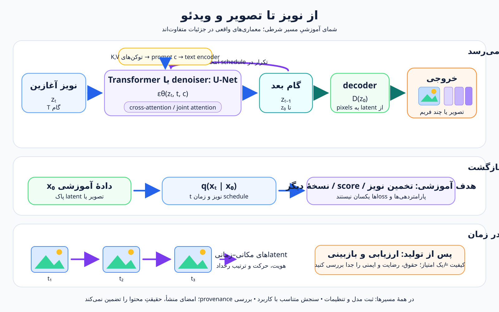

شکل ۴-۷-۱ — دیاگرام آموزشی است، نه تصویر تولیدشده با مدل یا نتیجهٔ آزمایش کیفیت.

برای طراحی سامانه، ورودی، خروجی، محدودیت اندازه/مدت، مجوز استفاده، مخاطب و هزینهٔ خطا را پیش از انتخاب checkpoint ثبت کنید. «عکس زیباست» معیار کافی نیست اگر وظیفه حفظ نوشته، شمار اشیا، ترتیب رویداد، هویت یک فرد یا رضایت صاحب تصویر را می‌طلبد.

## ۲. Diffusion به‌صورت فرایند پیش‌رو و معکوس

در یک فرایند گسستهٔ رایج، گام پیش‌رو از دادهٔ پاک کمی نویز Gaussian می‌سازد. در نمادگذاری DDPM، β<sub>t</sub> مقدار نویزِ افزوده‌شده در گام t و α<sub>t</sub>=1−β<sub>t</sub> ضریب باقی‌ماندهٔ سیگنال است. حاصل‌ضرب ᾱ<sub>t</sub> نشان می‌دهد تا آن گام چه سهمی از سیگنال اصلی باقی مانده است:

<math xmlns="http://www.w3.org/1998/Math/MathML" display="block" aria-label="در هر گام پیش‌رو، x با میانگین ریشهٔ آلفا ضرب‌در x قبلی و واریانس بتا نویزی می‌شود؛ آلفا برابر یک منهای بتا و آلفا بار حاصل‌ضرب تجمعی آلفاست">
  <mrow>
    <mi>q</mi><mo>(</mo><msub><mi>x</mi><mi>t</mi></msub><mo>|</mo><msub><mi>x</mi><mrow><mi>t</mi><mo>−</mo><mn>1</mn></mrow></msub><mo>)</mo>
    <mo>=</mo><mi mathvariant="normal">𝒩</mi><mo>(</mo>
    <msqrt><msub><mi>α</mi><mi>t</mi></msub></msqrt><msub><mi>x</mi><mrow><mi>t</mi><mo>−</mo><mn>1</mn></mrow></msub><mo>,</mo>
    <msub><mi>β</mi><mi>t</mi></msub><mi mathvariant="normal">I</mi><mo>)</mo>
  </mrow>
</math>

**متن جایگزین فرمول:** `q(x_t | x_{t−1}) = N(√α_t x_{t−1}, β_t I)`، با `α_t = 1−β_t` و `ᾱ_t = ∏_{s=1}^{t} α_s`. در این نگارش، `β_t` باید بین صفر و یک باشد.

با تکرار گام‌ها، نسخهٔ پرنویزتر به‌دست می‌آید. مدل در جهت معکوس، از یک prior نویزی شروع می‌کند و طی چند گام مقدار قبلی را تخمین می‌زند. این صورت‌بندی یک چارچوب احتمالاتی است؛ خودِ آن نه تضمین می‌کند خروجی واقعی باشد و نه تضمین می‌کند prompt را کامل بفهمد. [۱]

## ۳. نمونه‌گیری مستقیم از هر سطح نویز

برای آموزش لازم نیست هزار گام کوچک را برای هر نمونه اجرا کنیم. با ترکیب گام‌های Gaussian می‌توان مستقیماً نمونهٔ زمان t را ساخت:

<math xmlns="http://www.w3.org/1998/Math/MathML" display="block" aria-label="نمونهٔ نویزی x در زمان t برابر ریشهٔ آلفا بار ضرب‌در دادهٔ پاک، به‌علاوهٔ ریشهٔ یک منهای آلفا بار ضرب‌در نویز استاندارد اپسیلون است">
  <mrow>
    <msub><mi>x</mi><mi>t</mi></msub><mo>=</mo>
    <msqrt><msub><mover><mi>α</mi><mo>¯</mo></mover><mi>t</mi></msub></msqrt><msub><mi>x</mi><mn>0</mn></msub>
    <mo>+</mo>
    <msqrt><mrow><mn>1</mn><mo>−</mo><msub><mover><mi>α</mi><mo>¯</mo></mover><mi>t</mi></msub></mrow></msqrt><mi>ε</mi>
  </mrow>
</math>

**متن جایگزین فرمول:** `x_t = √ᾱ_t x_0 + √(1−ᾱ_t) ε`؛ `ε` از نرمال استاندارد گرفته می‌شود. در انتهای طیف نویز، `x_t` بیشتر شبیه نویز می‌شود، اما میزان نزدیکی به prior به schedule و داده وابسته است.

این رابطه برای آزمودن shape، dtype و صحت داده مفید است: یک تصویر واقعی را در زمان تصادفی انتخاب کنید، نویز معلوم بسازید و `x_t` را مستقیم محاسبه کنید. در آموزش، هدف معمول آن است که شبکه از `x_t`، زمان t و شرط c، متغیری مرتبط با نویز یا دادهٔ پاک را پیش‌بینی کند.

## ۴. تابع هدف و پارامتردهی مدل

یک هدف متداول، کمینه‌کردن خطای مربعی میان نویز افزوده‌شده و پیش‌بینی شبکه است:

<math xmlns="http://www.w3.org/1998/Math/MathML" display="block" aria-label="زیان سادهٔ diffusion امید ریاضی خطای مربعی میان نویز واقعی اپسیلون و پیش‌بینی شبکه از x در زمان t با شرط c است">
  <mrow>
    <msub><mi>ℒ</mi><mtext>simple</mtext></msub><mo>=</mo>
    <msub><mi>𝔼</mi><mrow><msub><mi>x</mi><mn>0</mn></msub><mo>,</mo><mi>ε</mi><mo>,</mo><mi>t</mi><mo>,</mo><mi>c</mi></mrow></msub>
    <mo>[</mo><msup><mrow><msub><mo>∥</mo><mn>2</mn></msub>
    <mrow><mi>ε</mi><mo>−</mo><msub><mi>ε</mi><mi>θ</mi></msub><mo>(</mo><msub><mi>x</mi><mi>t</mi></msub><mo>,</mo><mi>t</mi><mo>,</mo><mi>c</mi><mo>)</mo></mrow>
    <msub><mo>∥</mo><mn>2</mn></msub></mrow><mn>2</mn></msup><mo>]</mo>
  </mrow>
</math>

**متن جایگزین فرمول:** `L_simple = E_{x0, ε, t}[ || ε − ε_θ(x_t, t, c) ||² ]`. صورت دقیق loss، وزن‌دهی به زمان‌ها، متغیر هدف و شرط‌دهی میان پیاده‌سازی‌ها فرق می‌کند.

بعضی مدل‌ها نویز `ε` را پیش‌بینی می‌کنند؛ برخی `x₀` یا پارامتردهی‌ای مانند velocity را به‌کار می‌گیرند. این تغییر صرفاً عوض‌کردن نام خروجی نیست: هدف آموزشی و فرمول تبدیل پیش‌بینی به گام معکوس با هم سازگار می‌شوند. برای مقایسهٔ دو مقاله یا checkpoint باید هدف آموزش، prediction type، schedule و sampler را کنار هم دید.

## ۵. Score و میانگین گام معکوس

Score گرادیان لگاریتم چگالی در نقطهٔ جاری است. در حالت Gaussian، رابطهٔ آن با نویز شرطی کمک می‌کند خروجی یک مدل نویز‌پیش‌بین را به حرکت معکوس تبدیل کنیم:

<math xmlns="http://www.w3.org/1998/Math/MathML" display="block" aria-label="score توزیع نویزی در زمان t برابر منفی امید نویز شرطی بر x_t تقسیم بر ریشهٔ یک منهای آلفا بار است">
  <mrow>
    <msub><mi>∇</mi><msub><mi>x</mi><mi>t</mi></msub></msub>
    <mi>log</mi><msub><mi>q</mi><mi>t</mi></msub><mo>(</mo><msub><mi>x</mi><mi>t</mi></msub><mo>)</mo>
    <mo>=</mo><mo>−</mo>
    <mfrac><mrow><msub><mi>𝔼</mi><mi>ε</mi></msub><mo>[</mo><mi>ε</mi><mo>|</mo><msub><mi>x</mi><mi>t</mi></msub><mo>]</mo></mrow>
      <msqrt><mrow><mn>1</mn><mo>−</mo><msub><mover><mi>α</mi><mo>¯</mo></mover><mi>t</mi></msub></mrow></msqrt>
    </mfrac>
  </mrow>
</math>

**متن جایگزین فرمول:** `∇_{x_t} log q_t(x_t) = −E[ε | x_t] / √(1−ᾱ_t)`. این رابطه از فرض فرایند Gaussian پیش‌رو می‌آید؛ در عمل شبکه مقدار شرطی را تقریب می‌زند.

در DDPM، میانگین یک گام reverse را می‌توان با پیش‌بینی نویز نوشت:

<math xmlns="http://www.w3.org/1998/Math/MathML" display="block" aria-label="میانگین reverse در DDPM برابر یک تقسیم بر ریشهٔ آلفا ضرب‌در x_t منهای بتا تقسیم بر ریشهٔ یک منهای آلفا بار، ضرب‌در نویز پیش‌بینی‌شده است">
  <mrow>
    <msub><mi>μ</mi><mi>θ</mi></msub><mo>(</mo><msub><mi>x</mi><mi>t</mi></msub><mo>,</mo><mi>t</mi><mo>,</mo><mi>c</mi><mo>)</mo><mo>=</mo>
    <mfrac><mn>1</mn><msqrt><msub><mi>α</mi><mi>t</mi></msub></msqrt></mfrac>
    <mo>(</mo><msub><mi>x</mi><mi>t</mi></msub><mo>−</mo>
    <mfrac><msub><mi>β</mi><mi>t</mi></msub><msqrt><mrow><mn>1</mn><mo>−</mo><msub><mover><mi>α</mi><mo>¯</mo></mover><mi>t</mi></msub></mrow></msqrt></mfrac>
    <msub><mi>ε</mi><mi>θ</mi></msub><mo>(</mo><msub><mi>x</mi><mi>t</mi></msub><mo>,</mo><mi>t</mi><mo>,</mo><mi>c</mi><mo>)</mo><mo>)</mo>
  </mrow>
</math>

**متن جایگزین فرمول:** `μ_θ = 1/√α_t · (x_t − β_t/√(1−ᾱ_t) · ε_θ(x_t,t,c))`. مدل، posterior را با توزیع reverse پارامتردهی‌شده تقریب می‌زند؛ sample نهایی تابع sampler و نویزهای گام‌های معکوس نیز هست.

در یک قرارداد رایج، واریانس posterior شرطیِ `q(x_{t−1} | x_t, x₀)` چنین است:

<math xmlns="http://www.w3.org/1998/Math/MathML" display="block" aria-label="واریانس بتا tilde در posterior دی دی پی ام برابر بتا در زمان t ضرب‌در یک منهای آلفا بار در زمان t منهای یک، تقسیم بر یک منهای آلفا بار در زمان t است">
  <mrow>
    <msub><mover><mi>β</mi><mo>˜</mo></mover><mi>t</mi></msub><mo>=</mo>
    <mfrac>
      <mrow><msub><mi>β</mi><mi>t</mi></msub><mo>(</mo><mn>1</mn><mo>−</mo><msub><mover><mi>α</mi><mo>¯</mo></mover><mrow><mi>t</mi><mo>−</mo><mn>1</mn></mrow></msub><mo>)</mo></mrow>
      <mrow><mn>1</mn><mo>−</mo><msub><mover><mi>α</mi><mo>¯</mo></mover><mi>t</mi></msub></mrow>
    </mfrac>
  </mrow>
</math>

**متن جایگزین فرمول:** `β̃_t = β_t (1−ᾱ_{t−1})/(1−ᾱ_t)`, با `ᾱ₀=1`؛ بنابراین واریانس گام آخر `t=1` صفر است. این واریانسِ posterior با هر انتخاب ممکن برای variance مدل reverse یکی نیست.

فرمول‌های این فصل از `t=1` تا `T` شماره‌گذاری می‌شوند؛ کد آموزشی شاخص آرایه را از صفر می‌گیرد. پس شاخص کد `i` متناظر گام ریاضی `t=i+1` است و `t=0` در کد، همان گام نهاییِ بدون نویزِ فرمولی است.

## ۶. DDPM، DDIM و برنامهٔ نمونه‌گیری

DDPM برای reverse transition از میانگین تخمینی و واریانس تعیین‌شده استفاده می‌کند؛ در گام آخر معمولاً noise تازه افزوده نمی‌شود. DDIM مسیر نمونه‌گیری دیگری را برای همان خانوادهٔ مدل‌های آموزش‌دیده صورت‌بندی می‌کند و در حالت‌های رایج می‌تواند با تعداد گام کمتر اجرا شود. نتیجه به schedule، تعداد گام، پارامتردهی شبکه و نسخهٔ sampler وابسته است؛ «گام کمتر» به‌تنهایی تضمین کیفیت یا سرعتِ سرراست نیست. [۲]

در مستندات آزمایش، دست‌کم model/checkpoint و revision، tokenizer یا text encoder، resolution، seed، scheduler، شمار گام‌ها، guidance و تنظیمات decode را ثبت کنید. بدون این مشخصات، دو نمونهٔ ظاهراً مشابه ممکن است آزمایش قابل‌مقایسه‌ای نباشند.

## ۷. شرط‌دهی و Classifier-Free Guidance

برای متن‌به‌تصویر، مدل معمولاً یک پیش‌بینی بی‌شرط و یک پیش‌بینی شرطی می‌سازد و آن‌ها را ترکیب می‌کند. یک convention رایج برای classifier-free guidance چنین است:

<math xmlns="http://www.w3.org/1998/Math/MathML" display="block" aria-label="در یک قرارداد رایج CFG، پیش‌بینی guided برابر پیش‌بینی بی‌شرط به‌علاوهٔ s ضرب‌در اختلاف پیش‌بینی شرطی و بی‌شرط است">
  <mrow>
    <msub><mi>ε</mi><mtext>guided</mtext></msub><mo>=</mo>
    <msub><mi>ε</mi><mtext>uncond</mtext></msub><mo>+</mo>
    <mi>s</mi><mo>(</mo><msub><mi>ε</mi><mtext>cond</mtext></msub><mo>−</mo><msub><mi>ε</mi><mtext>uncond</mtext></msub><mo>)</mo>
  </mrow>
</math>

**متن جایگزین فرمول:** `ε_guided = ε_uncond + s(ε_cond − ε_uncond)`. این یکی از قراردادهای رایج است؛ مقدار `s` را با نام و معنای همان پیاده‌سازی گزارش کنید. [۳]

افزایش guidance اغلب فشار شرط را بیشتر می‌کند، اما می‌تواند تنوع نمونه یا تعادل بصری را تغییر دهد. مقدار بزرگ‌تر تضمین نمی‌کند همهٔ روابط پیچیده، واژه‌های داخل تصویر یا الزامات ایمنی رعایت شوند. CFG ابزار کنترلِ sampling است، نه جایگزین آزمون prompt و سیاست ایمنی.

## ۸. Latent diffusion: کاهش محاسبه در برابر جزئیات

Latent Diffusion Model تصویر را با autoencoder به نمایش فشرده‌تر می‌برد، diffusion را در latent اجرا می‌کند و در انتها latent را decode می‌کند. این کار معمولاً فضای نمونه‌گیری را کوچک می‌کند، اما کیفیت خروجی به decoder، فشرده‌سازی و جزئیات نمایش وابسته می‌ماند. مدل latent ممکن است جزئیاتی را که encoder حذف کرده، دقیق بازسازی نکند؛ artifactهای VAE هم می‌توانند از artifactهای denoiser جداگانه باشند. [۴]

پس برای عیب‌یابی خروجی، سه مرحله را از هم جدا کنید: (۱) کیفیت ورودی و encoding، (۲) کیفیت latent و denoising، (۳) decode، upscale و post-processing. رزولوشن بالاتر را صرفاً با برچسب «latent» ارزان فرض نکنید؛ شمار tokenها، فضای attention و حافظهٔ فعال‌سازی‌ها همچنان مهم‌اند.

## ۹. Cross-Attention: واردکردن متن به مسیر تصویر

در cross-attention، queryها می‌توانند از tokenهای تصویر/latent بیایند، در حالی که key و value از نمایش متن ساخته می‌شوند. در یک لایهٔ رایج:

<math xmlns="http://www.w3.org/1998/Math/MathML" display="block" aria-label="توجه متقاطع برابر softmax ماتریس Q ضرب‌در ترانهادهٔ K، تقسیم بر ریشهٔ d، سپس ضرب‌در V است؛ Q از latent و K و V از شرط می‌آیند">
  <mrow>
    <mtext>CrossAttn</mtext><mo>(</mo><mi>Q</mi><mo>,</mo><mi>K</mi><mo>,</mo><mi>V</mi><mo>)</mo><mo>=</mo>
    <mi>softmax</mi><mo>(</mo>
    <mfrac><mrow><mi>Q</mi><msup><mi>K</mi><mi>T</mi></msup></mrow><msqrt><mi>d</mi></msqrt></mfrac>
    <mo>)</mo><mi>V</mi>
  </mrow>
</math>

**متن جایگزین فرمول:** `CrossAttn(Q,K,V) = softmax(QKᵀ / √d)V`؛ معمولاً `Q` از tokenهای تصویری/latent و `K,V` از embeddingهای شرط می‌آیند. شکل دقیق لایه و مسیر تبادل اطلاعات به معماری بستگی دارد.

این اتصال، متن را در چند لایه به فرایند تصویری می‌رساند؛ به معنای «ترجمهٔ دقیق prompt به پیکسل» نیست. اگر tokenizer یک نام یا رابطه را خوب بازنمایی نکند، یا مدل دادهٔ کافی برای مفهوم نداشته باشد، cross-attention نیز به‌تنهایی آن را حل نمی‌کند. LDMها از cross-attention برای شرط‌هایی مانند متن و bounding box استفاده کردند، اما معماری‌های بعدی می‌توانند attention مشترک یا راه‌های شرط‌دهی دیگری داشته باشند. [۴]

## ۱۰. U-Net، Diffusion Transformer و تبادل چندوجهی

در U-Net، نمایش‌های مکانی در چند مقیاس پایین و بالا می‌روند و skip connectionها جزئیات را میان مسیرها جابه‌جا می‌کنند. در Diffusion Transformer، تصویر یا latent به patch/token تبدیل و در بلوک‌های transformer پردازش می‌شود؛ timestep و شرط نیز به‌صورت embedding یا token وارد مدل می‌شوند. DiT مقالهٔ Peebles و Xie نشان می‌دهد که transformer را می‌توان به backbone مدل diffusion در فضای latent تبدیل کرد؛ نتیجهٔ آن مقاله را به همهٔ مدل‌ها یا داده‌ها تعمیم ندهید. [۵]

برخی معماری‌های چندوجهی برای تصویر و متن پارامترها یا مسیرهای جدا دارند و تبادل را با joint attention انجام می‌دهند. MM-DiT در گزارش نویسندگان مدل‌های خانوادهٔ Flux، از جریان اطلاعات میان tokenهای متن و تصویر استفاده می‌کند؛ این نمونه را نباید با loss کلاسیک DDPM یکی گرفت، چون گزارش آن از rectified flow استفاده می‌کند. [۶]

## ۱۱. ویدئو: زمان، هویت و ترتیب رخداد

ویدئو یک stack از تصویرهای مستقل نیست. اگر مدل هر فریم را جداگانه تولید کند، ممکن است شیء میان فریم‌ها تغییر شکل یا هویت دهد؛ اگر همهٔ فریم‌ها را به مدل بدهد، طول دنبالهٔ token و محاسبه بیشتر می‌شود. معماری‌ها ممکن است ابتدا ویدئو را در latent زمانی/مکانی فشرده کنند، سپس آن را به patchهای فضا–زمان تبدیل کنند یا attention مکانی و زمانی را جداگانه اعمال کنند.

گزارش فنی Sora، مدل نویسندگان را diffusion transformer روی patchهای latent فضا–زمان توصیف می‌کند و تصاویر را حالت تک‌فریمی می‌گیرد. همان گزارش محدودیت‌هایی مانند ناسازگاری فیزیکی، تغییر نادرست حالت اشیا و ناپیوستگی بعضی نمونه‌های طولانی را نیز بیان می‌کند؛ «ظاهر واقع‌نما» به معنی شبیه‌ساز معتبر فیزیک نیست. [۷] HunyuanVideo و Wan نیز گزارش‌های فنی خود را دربارهٔ latent و معماری video transformer منتشر کرده‌اند؛ مشخصات، وزن‌ها، مجوز و نیازمندی اجرایی را برای نسخهٔ دقیق همان مخزن/مدل بخوانید. [۸، ۹]

## ۱۲. Flow Matching و Rectified Flow با DDPM یکی نیستند

بسیاری از مدل‌های جدید همچنان از توزیع noise و مسیر تدریجی استفاده می‌کنند، اما آموزشِ vector field می‌تواند بر پایهٔ flow matching یا rectified flow باشد. Flow matching یک میدان سرعت را روی مسیرهای احتمال رگرس می‌کند؛ rectified flow تلاش می‌کند مسیر انتقال داده و نویز را مستقیم‌تر کند. این‌ها با مدل diffusion کلاسیک هم‌پوشانی مفهومی دارند، اما objective، مسیر و sampler را نباید صرفاً با واژهٔ «DDPM» یکی دانست. [۱۰، ۱۱]

در گزارش یا کد پژوهشی، نام دقیق objective، نوع target، solver و زمان‌بندی را ثبت کنید. مقایسهٔ تعداد گام‌ها بدون یکسان‌کردن یا توضیح این موارد می‌تواند گمراه‌کننده باشد.

## ۱۳. کنترل، ویرایش و ورودی مرجع

کنترل ممکن است از prompt، تصویر مرجع، mask، depth/pose، edge، تصویر آغازین یا tokenهای شرط دیگر بیاید. در image-to-image مقدار نویز افزوده‌شده به ورودی معمولاً توازن میان حفظ ساختار و تغییر را کنترل می‌کند؛ در inpainting مرز mask و روش ترکیب ناحیهٔ بازسازی‌شده اهمیت دارد. مدل‌های video-editing می‌توانند از فریم‌های مرجع یا clip قبلی شرط بگیرند، اما حفظ هویت و جزئیات در همهٔ زمان‌ها تضمین نمی‌شود.

پروتکل آزمون باید بگوید چه چیزی باید تغییر کند و چه چیزی نباید تغییر کند. برای مثال، در ویرایش یک شیء، prompt پیروی از دستور، حفظ هویت، سازگاری پس‌زمینه و artifact روی مرز را جدا بسنجید؛ یک امتیاز کلی ممکن است شکست در شرط «حفظ» را پنهان کند.

## ۱۴. هزینهٔ استنتاج را به اجزا بشکنید

برای تصویر، تعداد tokenها با رزولوشن و patch/latent stride تغییر می‌کند؛ برای ویدئو، تعداد فریم‌ها نیز وارد می‌شود. یک تقریب ساده برای شمار tokenهای تصویری این است:

<math xmlns="http://www.w3.org/1998/Math/MathML" display="block" aria-label="تعداد tokenهای تصویر تقریباً برابر تعداد patchها در راستای ارتفاع ضرب‌در تعداد patchها در راستای عرض است">
  <mrow>
    <msub><mi>N</mi><mtext>image</mtext></msub><mo>≈</mo>
    <mfrac><mi>H</mi><msub><mi>p</mi><mi>h</mi></msub></mfrac>
    <mo>×</mo>
    <mfrac><mi>W</mi><msub><mi>p</mi><mi>w</mi></msub></mfrac>
  </mrow>
</math>

**متن جایگزین فرمول:** `N_image ≈ (H / p_h) × (W / p_w)`؛ این شمارش سادهٔ patch است، نه مدل دقیق حافظه یا زمان اجرا.

اگر attention سراسری متراکم روی N token باشد، ماتریس جفتی آن می‌تواند مرتبهٔ `N²` داشته باشد؛ معماری‌های واقعی ممکن است پنجره، فاکتورگیری مکانی/زمانی، sparse attention یا routing به‌کار گیرند. ویدئو با T فریم و tokenهای مکانی-زمانی می‌تواند دنباله‌ای بسیار بزرگ‌تر بسازد. هزینهٔ عملی علاوه بر denoiser شامل text encoder، VAE، decoder، تعداد گام‌ها، batch و انتقال داده است. برای سخت‌افزار و benchmark به فصل ۵۴ و اندازه‌گیری واقعی همان محیط مراجعه کنید.

## ۱۵. ارزیابی تصویر: وظیفه را به سنجه وصل کنید

هیچ معیار تصویری منفردی «کیفیت» را کامل نمی‌سنجد. FID توزیع ویژگی‌های مجموعه‌ای از نمونه‌ها را با مرجع مقایسه می‌کند؛ به‌تنهایی پیروی prompt، صحت رابطه‌های مکانی، نوشتهٔ خوانا یا ارزش کاربری یک تصویر را اثبات نمی‌کند. شباهت embedding متنی–تصویری می‌تواند با هم‌ترازی کلی مرتبط باشد، اما جزئیات شمارش، negation، ترتیب و متن درون تصویر را ممکن است از دست بدهد.

برای ارزیابی هدف‌محور، معیارها را تفکیک کنید: هم‌ترازی مفهومی، اشیای خواسته/ناخواسته، رابطهٔ مکانی، خوانایی متن، کیفیت فنی، تنوع، حفظ مرجع در ویرایش و قضاوت انسانیِ blind. promptها، seedها، نسخهٔ مدل و پارامترهای sampling را از پیش ثبت کنید؛ اگر metric یا judge خودش مدل است، نسخه، bias و خطای آن را هم گزارش دهید. نتیجهٔ یک prompt یا یک seed شاهد قابل‌اتکا برای مدل نیست.

## ۱۶. ارزیابی ویدئو: کیفیت زمانی را جدا بسنجید

برای کلیپ، پرسش‌هایی مانند هویت و ظاهر شیء در طول زمان، یکنواختی حرکت، flicker، زمان رخداد، سازگاری camera motion، پیروی از prompt و plausibility فیزیکی جدا هستند. VBench++ ابعاد متعددی از کیفیت ویدئو را تجزیه می‌کند؛ VBench-2.0 بر «intrinsic faithfulness» مانند فیزیک و commonsense تمرکز می‌کند. این benchmarkها ابزارهای سنجش‌اند، نه قاضی نهایی؛ پوشش prompt، evaluator و نسخهٔ benchmark را گزارش کنید. [۱۲، ۱۳]

در مقایسهٔ مدل‌ها، طول کلیپ، FPS، رزولوشن، seed و شرایط نمونه‌گیری را یکسان یا صریح ثبت کنید. نمونه‌های انتخاب‌شده برای نمایش را از مجموعهٔ آزمون تفکیک کنید و نتایج را بر حسب دستهٔ prompt و نوع شکست نیز نشان دهید. اگر کاربرد به ترتیب یا زمان وابسته است، یک امتیاز زیبایی‌شناختی جایگزین آزمون زمانی نیست.

## ۱۷. داده، حقوق و زنجیرهٔ نگه‌داری

دادهٔ آموزش ممکن است تصویر، ویدئو، caption، metadata و اطلاعات چهره/مکان داشته باشد. قبل از استفاده، مالکیت یا مجوز مجموعه، محدودیت بازتوزیع، رضایت اشخاص، provenance، حذف duplicate، کیفیت caption و سیاست نگه‌داری را بررسی کنید. مجوز وزن مدل، خودبه‌خود مجوز تک‌تک نمونه‌های training یا حق استفاده از likeness افراد را اثبات نمی‌کند؛ شرایط سرویس و نسخهٔ مدل هم ممکن است تغییر کنند.

ثبت منشأ داده، filterهای اعمال‌شده، تاریخ و version dataset، حذف‌ها و تغییرات preprocess به بازبینی کمک می‌کند؛ اما به‌تنهایی اثبات نمی‌کند که هیچ محتوای مشکل‌داری در داده یا خروجی نیست. اگر مدل برای محصول است، مسئولیت review و پاسخ به شکایت، علاوه بر انتخاب checkpoint، بخشی از طراحی است.

## ۱۸. Copyright: آموزش، خروجی و مجوز را قاطی نکنید

سه پرسش جدا وجود دارد: آیا استفاده از اثر برای آموزش مجاز بوده است؟ آیا خروجی یا بخش‌هایی از آن حقوق شخص یا اثر دیگری را درگیر می‌کند؟ و چه نوع حمایتی بر تغییرات انسانیِ خروجی اعمال می‌شود؟ پاسخ به این پرسش‌ها به jurisdiction، واقعیت‌ها، قرارداد و قانون جاری وابسته است؛ یک توضیح فنی یا مجوز مدل پاسخ حقوقی نمی‌دهد.

صفحهٔ رسمی U.S. Copyright Office گزارش Part 2 دربارهٔ copyrightability خروجی‌های هوش مولد را در ۲۹ ژانویهٔ ۲۰۲۵ منتشرشده معرفی می‌کند؛ Part 3 دربارهٔ آموزش روی آثار دارای copyright را در نسخهٔ **pre-publication** مورخ ۹ مه ۲۰۲۵ فهرست می‌کند و می‌گوید نسخهٔ نهایی در آینده خواهد آمد. این وضعیت را به نظر حقوقی قطعی برای هر پرونده تبدیل نکنید و پیش از استفادهٔ تجاری، وضعیت فعلی منبع، قوانین و مشاور واجدصلاحیت را بررسی کنید. [۱۴، ۱۵]

در کار عملی، منبع و نسخهٔ مدل، شرایط مجوز، روش تولید، و هر ویرایش انسانی را مستند کنید؛ از بازتولید عمدی اثر مشخص یا likeness حساس بدون مجوز/رضایت خودداری کنید. این توصیهٔ احتیاطی است، نه حکم دربارهٔ قانونی‌بودن یک prompt یا خروجی خاص.

## ۱۹. ایمنی محتوا و رضایت

مولدهای تصویر و ویدئو می‌توانند برای جعل هویت، تصویر صمیمیِ بدون رضایت، فریب، آزار، محتوای خشونت‌آمیز یا آسیب به افراد به‌کار روند. سامانهٔ مسئول باید **چند لایه** داشته باشد: سیاست روشن، مدیریت دسترسی، بازبینی input/output متناسب با ریسک، رسیدگی انسانی، راه گزارش/اعتراض، ثبت رخدادِ حداقلی و حفاظت از داده. برای محتوای حساسِ مربوط به شخص واقعی، رضایت و حق استفاده از تصویر/صدا را پیش از تولید/انتشار بررسی کنید.

فیلتر خودکار هم false positive و هم false negative دارد؛ آن را تضمین ایمنی ننامید. همچنین watermark، برچسب «ساخته‌شده با AI» یا C2PA به‌تنهایی محتوای زیان‌بار را بی‌خطر، قانونی یا درست نمی‌کند. دسترسی محدودتر و review بیشتر را برای پیامدهای بالقوهٔ شدید در نظر بگیرید.

## ۲۰. Provenance: C2PA چه چیزی را ثبت می‌کند؟

C2PA سازوکاری برای ذخیره و دسترسی به manifestهای منشأ محتوا با امضاهای دیجیتال و شواهدِ تغییرناپذیریِ دستکاری است. چنین credentialی می‌تواند اعلام کند چه ابزار/اقدامی به زنجیرهٔ منشأ اضافه شده و آیا manifest با کلید/اعتماد تعریف‌شده قابل‌بررسی است. specification آن، «trustworthiness» را در یک trust model تعریف‌شده ارزیابی می‌کند؛ این با اثبات حقیقت صحنه یا صحت ادعای متن روی تصویر فرق دارد. [۱۶]

manifest ممکن است در تبدیل یا انتشار حذف شود و همهٔ فایل‌ها نیز الزاماً credential ندارند. **وجود امضای معتبر** می‌تواند شاهدی دربارهٔ امضاکننده و دست‌کاری manifest باشد؛ **نبود credential** به‌تنهایی نشان نمی‌دهد فایل جعلی است. برای محصول، منشأ را همراه با consent، policy و انسانی که برای مخاطب لازم است توضیح دهید.

## ۲۱. چند نمونهٔ پژوهشی جدید، با مرز ادعا

- گزارش OpenAI دربارهٔ Sora مدل را diffusion transformer روی patchهای latent ویدئو/تصویر توصیف می‌کند؛ گزارش به‌صراحت برخی محدودیت‌های فیزیک و تداوم را نیز می‌پذیرد. این یک گزارش فنیِ سازنده است و جزئیات پیاده‌سازی کامل را منتشر نمی‌کند. [۷]
- گزارش HunyuanVideo و مقاله/مخزن Wan خانواده‌هایی از معماری‌های ویدئویی و وزن‌های متن‌باز را توصیف می‌کنند. از هر مدل فقط مشخصات همان revision و license را بخوانید؛ عنوان «open» به معنی مناسب‌بودن خودکار برای هر استفاده نیست. [۸، ۹]
- **Motif-Video 2B** و **Temporal Specification Guidance** نمونه‌های preprint در ۲۰۲۶ هستند: اولی specialization معماری/attention را گزارش می‌کند؛ دومی قیدهای زمانی را هنگام sampling می‌آزماید. اعداد یا مقایسه‌های benchmark، ادعای نویسندگان روی setup خودشان‌اند و در این فصل بازتولید نشده‌اند. [۱۷، ۱۸]
- **Mage-Flow** نیز در ۲۰۲۶ به‌صورت preprint یک pipeline تصویر مبتنی بر rectified flow و transformer را گزارش می‌کند. claims مربوط به throughput یا latency را به hardware، resolution، نسخه و آزمایش نویسندگان محدود کنید؛ این فصل آن‌ها را اندازه‌گیری نکرده است. [۱۹]

برای مقالهٔ جدید، ابتدا سؤال پژوهش، داده و split، نسخهٔ مدل، معیار و baseline را بررسی کنید. عنوانی مانند «world model» یا «fast» خودش شاهد تعمیم، صحت فیزیکی، کیفیت زبان یا تناسب حقوقی نیست.

## ۲۲. آزمایشگاه CPU: sampler تحلیلی، نه مولد تصویر

پروژهٔ این فصل در [`projects/53-diffusion-lab/README.md`](book-engineering/projects/53-diffusion-lab/README.md) قرار دارد. fixture، چهار Gaussian دوبعدی با مرکزهای متقارن و واریانس مشخص دارد. برنامهٔ `diffusion_lab.py` schedule خطی می‌سازد، noising بسته‌بسته را آزمون می‌کند، score دقیق چگالی معلوم را محاسبه می‌کند و از آن برای گام‌های معکوس DDPM استفاده می‌کند. وزن شبکه‌ای آموزش داده نشده است؛ score معلوم از ساختار fixture می‌آید.

این انتخاب عمدی است: می‌توان رابطهٔ `score ↔ ε` و واریانس posterior را با آزمون مستقل بررسی کرد، بی‌آنکه download مدل، GPU، دادهٔ تصویر یا ویدئو لازم باشد. در نمونه‌گیری واقعی، score از شبکهٔ آموزش‌دیده تقریب زده می‌شود و دیگر این oracle تحلیلی در دسترس نیست. بخش عملی پروژه برای فهم یک حلقهٔ ریاضی است، نه بازتولید یک مولد متن‌به‌تصویر.

## ۲۳. نتیجهٔ ثبت‌شده و مرز آن

روی Python 3.13.16 و فقط کتابخانهٔ استاندارد، ۴۰/۴۰ آزمون unit پروژه موفق شد. fixture با SHA-256 برابر `7646ab0c0d8cee8fdbf3e29ac88ce9e37b181859e0ff34935f6af7bbe28b208b` audit شد. اجرای demo با `۲۰۰` گام، `۶۴` نقطه و seed برابر `۵۳` به شمار نزدیک‌ترین مرکزهای ساختگی `[۱۹، ۱۷، ۱۶، ۱۲]` رسید؛ `ᾱ_T = 0.002080618226191632` بود. این‌ها خلاصهٔ یک اجرای deterministic روی توزیع کوچکِ تعریف‌شده‌اند، نه metric کیفیت.

آزمون‌ها schedule، معکوس‌سازی جبری با noise معلوم، score تحلیلی، posterior variance، seed، schema و خروجی JSON را می‌سنجند. نه training شبکه، inference مدل واقعی، خواندن تصویر/ویدئو، latency/benchmark، تعمیم، کیفیت فارسی، حقوق، ایمنی، privacy یا سخت‌افزار اجرا نشده است. همهٔ نقاط صرفاً fixture مصنوعی‌اند. جزئیات و فرمان‌ها در [`53-audit-report-fa.md`](53-audit-report-fa.md) و `projects/53-diffusion-lab/results.json` ثبت شده‌اند.

## ۲۴. تمرین‌ها

۱. برای `β₁=0.1` و `x₀=2`، اگر `ε=0` باشد، `x₁` را از رابطهٔ بسته محاسبه کنید. سپس توضیح دهید چرا با `ε≠0` یک مشاهدهٔ منفرد دیگر به‌تنهایی x₀ را تعیین نمی‌کند.

۲. اگر `ᾱ_t=0.25` و `x₀=4` باشد، مقدار `x_t` را برای `ε=1` بیابید. در این مثال سهم سیگنال و noise هرکدام چه اندازه‌اند؟

۳. رابطهٔ تبدیل پیش‌بینی نویز به `x₀` را بنویسید و بگویید چرا وقتی `ᾱ_t` بسیار کوچک است، خطای کوچک در noise prediction می‌تواند مسئله‌ساز شود.

۴. در CFG اگر `ε_uncond=0.2`، `ε_cond=0.8` و `s=2` باشد، مقدار guided چیست؟ چرا نمی‌توان از این مقدار نتیجه گرفت که تصویر از نظر همهٔ معیارها بهتر خواهد شد؟

۵. سه مرحلهٔ latent diffusion را مشخص کنید. برای هر مرحله یک نوع خطا یا artifact که ممکن است در آن ایجاد شود، نام ببرید.

۶. در cross-attention تصویر–متن، `Q`, `K`, `V` معمولاً از کدام tokenها می‌آیند؟ اگر طول متن L و طول تصویر M باشد، ماتریس `QKᵀ` چه شکل دارد؟

۷. برای یک تصویر `1024×1024` با patch `16×16`، tokenهای مکانیِ ساده را بشمارید. اگر فریم‌ها ۲۴ تا باشند و همین شمارش برای هر فریم تکرار شود، دنبالهٔ خام تقریباً چند token می‌شود؟ بگویید چرا این محاسبه به‌تنهایی حافظهٔ واقعی مدل را پیش‌بینی نمی‌کند.

۸. دو سنجهٔ مناسب برای text-to-image و دو بُعد زمانی برای text-to-video پیشنهاد کنید. برای هرکدام یک شکست مهمی را توضیح دهید که آن سنجه نمی‌سنجد.

۹. با زبان خود توضیح دهید چرا manifest معتبر C2PA اثبات نمی‌کند که صحنهٔ داخل تصویر واقعی است؛ نبود manifest نیز چه معنایی را به‌تنهایی ثابت نمی‌کند؟

۱۰. برای ساخت یک نمونهٔ تصویری تبلیغاتی با چهرهٔ فرد واقعی، پیش از استفاده چه بررسی‌های حقوق، رضایت، ایمنی و افشا را انجام می‌دهید؟ پاسخ باید مرز میان توصیهٔ فنی و نظر حقوقی را حفظ کند.

پاسخ‌های تشریحی مستقل در [`answers/53-image-video-generation-fa.md`](book-engineering/answers/53-image-video-generation-fa.md) آمده‌اند.

## ۲۵. جمع‌بندی و مسیر فصل بعد

Diffusion با schedule نویز و reverse sampler تعریف می‌شود؛ prediction type، شرط‌دهی و solver را باید صریح ثبت کرد. Latentها و Transformerها محاسبه را با نمایش‌های فشرده یا tokenها سازمان می‌دهند، اما کیفیت به داده، decoder، معماری و شرایط اجرا وابسته است. ویدئو بعد زمانی و سنجش ثبات/ترتیب را اضافه می‌کند. ارزیابی، حقوق، رضایت، ایمنی و provenance پرسش‌های جداگانه‌اند و هیچ metric یا credential به‌تنهایی پاسخ همه را نمی‌دهد.

پروژهٔ CPU این فصل فقط یک توزیع دوبعدی ساختگی و score تحلیلی را می‌آزماید؛ آن را نمونهٔ مدل تصویر/ویدئو معرفی نکنید. فصل بعد، سراسری ۵۴، از همین مرز عبور می‌کند و برآورد وزن‌ها، فعال‌سازی‌ها، gradientها و حالت optimizer را برای workloadهای واقعی به‌صورت مرحله‌ای بررسی خواهد کرد.

## ۲۶. منابع و تاریخ بازبینی

**تاریخ بررسی لینک‌ها و وضعیت منابع: ۶ نوامبر ۲۰۲۶.** مقاله‌های arXiv با عنوان «preprint» گزارش/پیش‌چاپ‌اند؛ جدول‌های عملکرد و benchmark به setup نویسندگان همان منبع محدودند.

۱. Ho, J., Jain, A., و Abbeel, P. “Denoising Diffusion Probabilistic Models,” NeurIPS 2020, arXiv:2006.11239. <https://arxiv.org/abs/2006.11239>

۲. Song, J., Meng, C., و Ermon, S. “Denoising Diffusion Implicit Models,” ICLR 2021, arXiv:2010.02502. <https://arxiv.org/abs/2010.02502>

۳. Ho, J. و Salimans, T. “Classifier-Free Diffusion Guidance,” arXiv:2207.12598, 2022. <https://arxiv.org/abs/2207.12598>

۴. Rombach, R. و همکاران. “High-Resolution Image Synthesis with Latent Diffusion Models,” CVPR 2022, arXiv:2112.10752. <https://arxiv.org/abs/2112.10752>

۵. Peebles, W. و Xie, S. “Scalable Diffusion Models with Transformers,” ICCV 2023, arXiv:2212.09748. <https://arxiv.org/abs/2212.09748>

۶. Esser, P. و همکاران. “Scaling Rectified Flow Transformers for High-Resolution Image Synthesis,” arXiv:2403.03206, 2024. <https://arxiv.org/abs/2403.03206>

۷. OpenAI. “Video generation models as world simulators,” گزارش فنی دربارهٔ Sora، ۱۵ فوریهٔ ۲۰۲۴. <https://openai.com/index/video-generation-models-as-world-simulators/>

۸. Kong, W. و همکاران. “HunyuanVideo: A Systematic Framework For Large Video Generative Models,” arXiv:2412.03603, v6, ۲۰۲۵. <https://arxiv.org/abs/2412.03603>

۹. Team Wan و همکاران. “Wan: Open and Advanced Large-Scale Video Generative Models,” arXiv:2503.20314, v2, ۲۰۲۵؛ [مخزن رسمی Wan2.2](https://github.com/Wan-Video/Wan2.2), بازبینی‌شده در ۶ نوامبر ۲۰۲۶.

۱۰. Lipman, Y. و همکاران. “Flow Matching for Generative Modeling,” ICLR 2023, arXiv:2210.02747. <https://arxiv.org/abs/2210.02747>

۱۱. Liu, X., Gong, C. و Liu, Q. “Flow Straight and Fast: Learning to Generate and Transfer Data with Rectified Flow,” arXiv:2209.03003, 2022. <https://arxiv.org/abs/2209.03003>

۱۲. Huang, Z. و همکاران. “VBench++: Comprehensive and Versatile Benchmark Suite for Video Generative Models,” arXiv:2411.13503, 2024. <https://arxiv.org/abs/2411.13503>

۱۳. Zheng, D. و همکاران. “VBench-2.0: Advancing Video Generation Benchmark Suite for Intrinsic Faithfulness,” arXiv:2503.21755, v2, ۲۰۲۵. <https://arxiv.org/abs/2503.21755>

۱۴. U.S. Copyright Office. “Copyright and Artificial Intelligence, Part 2: Copyrightability,” اطلاعیهٔ انتشار، ۲۹ ژانویهٔ ۲۰۲۵. <https://www.copyright.gov/newsnet/2025/1060.html>

۱۵. U.S. Copyright Office. “Copyright and Artificial Intelligence, Part 3: Generative AI Training,” صفحهٔ رسمی و نسخهٔ pre-publication مورخ ۹ مهٔ ۲۰۲۵؛ وضعیت صفحه در تاریخ بازبینی همچنان pre-publication بود. <https://www.copyright.gov/ai/> و <https://www.copyright.gov/ai/Copyright-and-Artificial-Intelligence-Part-3-Generative-AI-Training-Report-Pre-Publication-Version.pdf>

۱۶. C2PA. “Content Credentials, Technical Specification 2.5.” <https://spec.c2pa.org/specifications/specifications/2.5/specs/ContentCredentials.html>

۱۷. Lim, J. و همکاران. “Motif-Video 2B: Technical Report,” arXiv:2604.16503, v2, ۲۰۲۶؛ preprint. <https://arxiv.org/abs/2604.16503>

۱۸. Khare, A. و همکاران. “Temporal Specification Guidance for Text-to-Video Generation,” arXiv:2610.20822, ۲۰۲۶؛ preprint. <https://arxiv.org/abs/2610.20822>

۱۹. Zhang, X. و همکاران. “Mage-Flow: An Efficient Native-Resolution Foundation Model for Image Generation and Editing,” arXiv:2607.19064, v2, ۲۰۲۶؛ preprint. <https://arxiv.org/abs/2607.19064>

## ۲۷. پیوست اجرایی: فایل آزموده‌شدهٔ پروژه

این پیوست باید با `projects/53-diffusion-lab/diffusion_lab.py` بایت‌به‌بایت یکسان بماند. برنامه مستقل و فقط با Python standard library است.

```python
"""A tiny DDPM sampler using the exact score of a synthetic 2-D mixture.

This is an analytic teaching fixture, not a trained neural image/video model.
It uses only Python's standard library and writes a JSON audit/demo record.
"""
from __future__ import annotations

import argparse
import hashlib
import json
import math
import random
import sys
from dataclasses import dataclass
from pathlib import Path
from typing import Any, Sequence


DEFAULT_FIXTURE = Path(__file__).with_name("sample_mixture.json")
BETA_START = 0.0005
BETA_END = 0.06
DEFAULT_STEPS = 200
DEFAULT_SAMPLES = 64
DEFAULT_SEED = 53


@dataclass(frozen=True)
class DiffusionSchedule:
    betas: tuple[float, ...]
    alphas: tuple[float, ...]
    alpha_bars: tuple[float, ...]


def _time_index(t: int, steps: int) -> int:
    if isinstance(t, bool) or not isinstance(t, int) or not 0 <= t < steps:
        raise ValueError(f"t must be an integer in [0, {steps - 1}]")
    return t


def _finite_vector(values: Sequence[float], name: str) -> tuple[float, ...]:
    if isinstance(values, (str, bytes)):
        raise ValueError(f"{name} must be a numeric sequence")
    try:
        result = tuple(float(value) for value in values)
    except (TypeError, ValueError) as exc:
        raise ValueError(f"{name} must be a numeric sequence") from exc
    if not result or not all(math.isfinite(value) for value in result):
        raise ValueError(f"{name} must contain finite values")
    return result


def validate_fixture(fixture: Any) -> None:
    """Validate the deliberately narrow, synthetic 2-D fixture schema."""
    if not isinstance(fixture, dict):
        raise ValueError("fixture must be a JSON object")
    if fixture.get("schema_version") != 1:
        raise ValueError("unsupported fixture schema_version")
    if fixture.get("label_source") != "synthetic_fixture":
        raise ValueError("fixture label_source must be synthetic_fixture")
    if fixture.get("dimension") != 2:
        raise ValueError("this teaching sampler accepts only dimension=2")

    variance = fixture.get("component_variance")
    if isinstance(variance, bool) or not isinstance(variance, (int, float)):
        raise ValueError("component_variance must be numeric")
    if not math.isfinite(float(variance)) or float(variance) <= 0:
        raise ValueError("component_variance must be finite and positive")

    components = fixture.get("components")
    if not isinstance(components, list) or len(components) < 2:
        raise ValueError("fixture must contain at least two components")
    identifiers: list[str] = []
    weights: list[float] = []
    for component in components:
        if not isinstance(component, dict):
            raise ValueError("each component must be an object")
        identifier = component.get("id")
        if not isinstance(identifier, str) or not identifier.strip():
            raise ValueError("each component needs a non-empty id")
        if identifier in identifiers:
            raise ValueError("component ids must be unique")
        identifiers.append(identifier)
        mean = _finite_vector(component.get("mean", ()), "component mean")
        if len(mean) != 2:
            raise ValueError("each component mean must have two coordinates")
        weight = component.get("weight")
        if isinstance(weight, bool) or not isinstance(weight, (int, float)):
            raise ValueError("component weight must be numeric")
        weight = float(weight)
        if not math.isfinite(weight) or weight < 0:
            raise ValueError("component weights must be finite and non-negative")
        weights.append(weight)
    if not math.isclose(sum(weights), 1.0, rel_tol=0.0, abs_tol=1e-12):
        raise ValueError("component weights must sum to 1")
    if not any(weight > 0 for weight in weights):
        raise ValueError("at least one component weight must be positive")

    metadata = fixture.get("metadata")
    required_false = (
        "image_files_included",
        "video_files_included",
        "real_world_observations_included",
        "trained_weights_included",
    )
    if not isinstance(metadata, dict):
        raise ValueError("fixture metadata is required")
    if any(metadata.get(field) is not False for field in required_false):
        raise ValueError("fixture must explicitly exclude images, videos, observations, and trained weights")


def load_fixture(path: str | Path) -> tuple[dict[str, Any], str]:
    fixture_path = Path(path)
    raw = fixture_path.read_bytes()
    try:
        fixture = json.loads(raw.decode("utf-8"))
    except (UnicodeDecodeError, json.JSONDecodeError) as exc:
        raise ValueError(f"fixture is not valid UTF-8 JSON: {fixture_path.name}") from exc
    validate_fixture(fixture)
    return fixture, hashlib.sha256(raw).hexdigest()


def linear_beta_schedule(
    steps: int = DEFAULT_STEPS,
    beta_start: float = BETA_START,
    beta_end: float = BETA_END,
) -> DiffusionSchedule:
    """Create a linear beta schedule and its alpha / cumulative-alpha values."""
    if isinstance(steps, bool) or not isinstance(steps, int) or steps < 2:
        raise ValueError("steps must be an integer of at least 2")
    if not math.isfinite(beta_start) or not math.isfinite(beta_end):
        raise ValueError("beta endpoints must be finite")
    if not 0 < beta_start <= beta_end < 1:
        raise ValueError("beta endpoints must satisfy 0 < start <= end < 1")
    betas = tuple(
        beta_start + (beta_end - beta_start) * index / (steps - 1)
        for index in range(steps)
    )
    alphas = tuple(1.0 - beta for beta in betas)
    cumulative = 1.0
    alpha_bars: list[float] = []
    for alpha in alphas:
        cumulative *= alpha
        alpha_bars.append(cumulative)
    return DiffusionSchedule(betas, alphas, tuple(alpha_bars))


def q_sample(
    x0: Sequence[float],
    noise: Sequence[float],
    t: int,
    schedule: DiffusionSchedule,
) -> tuple[float, ...]:
    """Draw x_t from the closed-form forward marginal, given explicit noise."""
    t = _time_index(t, len(schedule.betas))
    clean = _finite_vector(x0, "x0")
    epsilon = _finite_vector(noise, "noise")
    if len(clean) != len(epsilon):
        raise ValueError("x0 and noise must have the same dimension")
    alpha_bar = schedule.alpha_bars[t]
    signal_scale = math.sqrt(alpha_bar)
    noise_scale = math.sqrt(1.0 - alpha_bar)
    return tuple(signal_scale * value + noise_scale * eps for value, eps in zip(clean, epsilon))


def predict_x0_from_epsilon(
    x_t: Sequence[float],
    epsilon_prediction: Sequence[float],
    t: int,
    schedule: DiffusionSchedule,
) -> tuple[float, ...]:
    """Invert the forward marginal when the noise value is known exactly."""
    t = _time_index(t, len(schedule.betas))
    noisy = _finite_vector(x_t, "x_t")
    epsilon = _finite_vector(epsilon_prediction, "epsilon_prediction")
    if len(noisy) != len(epsilon):
        raise ValueError("x_t and epsilon_prediction must have the same dimension")
    alpha_bar = schedule.alpha_bars[t]
    return tuple(
        (value - math.sqrt(1.0 - alpha_bar) * eps) / math.sqrt(alpha_bar)
        for value, eps in zip(noisy, epsilon)
    )


def ddpm_posterior_variance(t: int, schedule: DiffusionSchedule) -> float:
    """Return beta-tilde for q(x_(t-1) | x_t, x_0); it is zero at t=0."""
    t = _time_index(t, len(schedule.betas))
    previous_alpha_bar = 1.0 if t == 0 else schedule.alpha_bars[t - 1]
    current_alpha_bar = schedule.alpha_bars[t]
    denominator = 1.0 - current_alpha_bar
    variance = schedule.betas[t] * (1.0 - previous_alpha_bar) / denominator
    return max(0.0, variance)


def gaussian_mixture_score(
    x_t: Sequence[float],
    t: int,
    fixture: dict[str, Any],
    schedule: DiffusionSchedule,
) -> tuple[float, float]:
    """Compute the exact score of the noised fixture mixture, not a learned score."""
    validate_fixture(fixture)
    t = _time_index(t, len(schedule.betas))
    point = _finite_vector(x_t, "x_t")
    if len(point) != 2:
        raise ValueError("the fixture score is defined for two-dimensional points")

    alpha_bar = schedule.alpha_bars[t]
    mean_scale = math.sqrt(alpha_bar)
    variance_t = alpha_bar * float(fixture["component_variance"]) + (1.0 - alpha_bar)
    log_constant = -0.5 * 2 * math.log(2.0 * math.pi * variance_t)

    log_probabilities: list[float] = []
    scaled_means: list[tuple[float, float]] = []
    for component in fixture["components"]:
        mean = tuple(mean_scale * value for value in component["mean"])
        scaled_means.append((mean[0], mean[1]))
        weight = float(component["weight"])
        if weight == 0:
            log_probabilities.append(-math.inf)
            continue
        squared_distance = sum((value - center) ** 2 for value, center in zip(point, mean))
        log_probabilities.append(
            math.log(weight) + log_constant - squared_distance / (2.0 * variance_t)
        )

    maximum = max(log_probabilities)
    unnormalized = [math.exp(value - maximum) for value in log_probabilities]
    normalizer = sum(unnormalized)
    posterior_weights = [value / normalizer for value in unnormalized]
    score = tuple(
        sum(
            posterior_weight * (component_mean[axis] - point[axis]) / variance_t
            for posterior_weight, component_mean in zip(posterior_weights, scaled_means)
        )
        for axis in range(2)
    )
    return score[0], score[1]


def epsilon_from_score(
    score: Sequence[float],
    t: int,
    schedule: DiffusionSchedule,
) -> tuple[float, ...]:
    """Use score(x_t) = -E[epsilon | x_t] / sqrt(1-alpha_bar_t)."""
    t = _time_index(t, len(schedule.betas))
    gradient = _finite_vector(score, "score")
    scale = -math.sqrt(1.0 - schedule.alpha_bars[t])
    return tuple(scale * value for value in gradient)


def ddpm_reverse_step(
    x_t: Sequence[float],
    epsilon_prediction: Sequence[float],
    t: int,
    schedule: DiffusionSchedule,
    noise: Sequence[float] | None = None,
) -> tuple[float, ...]:
    """Apply one epsilon-parameterized DDPM reverse step."""
    t = _time_index(t, len(schedule.betas))
    noisy = _finite_vector(x_t, "x_t")
    epsilon = _finite_vector(epsilon_prediction, "epsilon_prediction")
    if len(noisy) != len(epsilon):
        raise ValueError("x_t and epsilon_prediction must have the same dimension")
    alpha_bar = schedule.alpha_bars[t]
    beta = schedule.betas[t]
    alpha = schedule.alphas[t]
    mean = tuple(
        (value - beta * eps / math.sqrt(1.0 - alpha_bar)) / math.sqrt(alpha)
        for value, eps in zip(noisy, epsilon)
    )
    variance = ddpm_posterior_variance(t, schedule)
    if t == 0:
        if noise is not None:
            raise ValueError("the final t=0 reverse step has zero posterior variance")
        return mean
    if noise is None:
        raise ValueError("noise is required when t > 0")
    random_noise = _finite_vector(noise, "noise")
    if len(random_noise) != len(mean):
        raise ValueError("reverse-step noise must match the point dimension")
    noise_scale = math.sqrt(variance)
    return tuple(value + noise_scale * eps for value, eps in zip(mean, random_noise))


def sample_mixture(
    fixture: dict[str, Any],
    schedule: DiffusionSchedule,
    count: int = DEFAULT_SAMPLES,
    seed: int = DEFAULT_SEED,
) -> tuple[tuple[float, float], ...]:
    """Sample from the toy mixture with an analytic-score DDPM reverse chain."""
    validate_fixture(fixture)
    if isinstance(count, bool) or not isinstance(count, int) or count < 1:
        raise ValueError("count must be a positive integer")
    if isinstance(seed, bool) or not isinstance(seed, int):
        raise ValueError("seed must be an integer")
    rng = random.Random(seed)
    points: list[tuple[float, float]] = [
        (rng.gauss(0.0, 1.0), rng.gauss(0.0, 1.0)) for _ in range(count)
    ]
    for t in reversed(range(len(schedule.betas))):
        updated: list[tuple[float, float]] = []
        for point in points:
            score = gaussian_mixture_score(point, t, fixture, schedule)
            epsilon = epsilon_from_score(score, t, schedule)
            step_noise = None if t == 0 else (rng.gauss(0.0, 1.0), rng.gauss(0.0, 1.0))
            result = ddpm_reverse_step(point, epsilon, t, schedule, step_noise)
            updated.append((result[0], result[1]))
        points = updated
    return tuple(points)


def nearest_component_counts(
    samples: Sequence[Sequence[float]],
    fixture: dict[str, Any],
) -> dict[str, int]:
    """Count nearest synthetic centers; this is a demo summary, not an evaluator."""
    validate_fixture(fixture)
    counts = {component["id"]: 0 for component in fixture["components"]}
    for sample in samples:
        point = _finite_vector(sample, "sample")
        if len(point) != 2:
            raise ValueError("samples must be two-dimensional")
        nearest = min(
            fixture["components"],
            key=lambda component: sum(
                (point[axis] - float(component["mean"][axis])) ** 2 for axis in range(2)
            ),
        )
        counts[nearest["id"]] += 1
    return counts


def _fixture_record(fixture: dict[str, Any], fixture_hash: str, path: Path) -> dict[str, Any]:
    return {
        "path": path.name,
        "sha256": fixture_hash,
        "fixture_id": fixture["fixture_id"],
        "label_source": fixture["label_source"],
        "dimension": fixture["dimension"],
        "components": len(fixture["components"]),
        "image_files_included": fixture["metadata"]["image_files_included"],
        "video_files_included": fixture["metadata"]["video_files_included"],
        "real_world_observations_included": fixture["metadata"]["real_world_observations_included"],
        "trained_weights_included": fixture["metadata"]["trained_weights_included"],
    }


def run_audit(fixture: dict[str, Any], fixture_hash: str, fixture_path: Path) -> dict[str, Any]:
    return {
        "status": "synthetic_diffusion_fixture_audit_complete",
        "mode": "audit",
        "training_performed": False,
        "neural_model_loaded": False,
        "model_downloaded": False,
        "image_files_loaded": False,
        "video_files_loaded": False,
        "device": "CPU; Python standard library only",
        "fixture": _fixture_record(fixture, fixture_hash, fixture_path),
        "claims_not_supported": [
            "quality of a trained image or video model",
            "Persian-language output quality",
            "hardware performance or benchmark results",
            "copyright clearance, privacy compliance, or legal conclusions",
        ],
    }


def run_demo(
    fixture: dict[str, Any],
    fixture_hash: str,
    fixture_path: Path,
    steps: int = DEFAULT_STEPS,
    sample_count: int = DEFAULT_SAMPLES,
    seed: int = DEFAULT_SEED,
    beta_start: float = BETA_START,
    beta_end: float = BETA_END,
) -> dict[str, Any]:
    schedule = linear_beta_schedule(steps, beta_start, beta_end)
    samples = sample_mixture(fixture, schedule, sample_count, seed)
    means = [sum(sample[axis] for sample in samples) / len(samples) for axis in range(2)]
    return {
        "status": "analytic_synthetic_mixture_ddpm_demo_complete",
        "mode": "demo",
        "training_performed": False,
        "neural_model_loaded": False,
        "model_downloaded": False,
        "image_files_loaded": False,
        "video_files_loaded": False,
        "analytic_score_used": True,
        "score_source": "closed_form_density_of_known_synthetic_gaussian_mixture",
        "device": "CPU; Python standard library only",
        "fixture": _fixture_record(fixture, fixture_hash, fixture_path),
        "sampling": {
            "method": "epsilon-parameterized DDPM reverse updates",
            "initial_prior": "standard-normal approximation at the terminal timestep",
            "timesteps": steps,
            "beta_start": beta_start,
            "beta_end": beta_end,
            "terminal_alpha_bar": schedule.alpha_bars[-1],
            "sample_count": sample_count,
            "seed": seed,
            "posterior_noise_added_at_t0": False,
        },
        "nearest_synthetic_center_counts": nearest_component_counts(samples, fixture),
        "sample_mean": means,
        "samples": [list(sample) for sample in samples],
        "interpretation_limit": "Toy 2-D distribution only; not image/video generation or model evaluation.",
    }


def _write_json(path: Path, payload: dict[str, Any]) -> None:
    path.parent.mkdir(parents=True, exist_ok=True)
    path.write_text(
        json.dumps(payload, ensure_ascii=False, indent=2, allow_nan=False) + "\n",
        encoding="utf-8",
    )


def main(argv: Sequence[str] | None = None) -> int:
    parser = argparse.ArgumentParser(description="Audit a synthetic diffusion fixture or run its analytic toy sampler")
    parser.add_argument("--mode", choices=("audit", "demo"), required=True)
    parser.add_argument("--fixture", type=Path, default=DEFAULT_FIXTURE)
    parser.add_argument("--output", type=Path, required=True, help="directory for run.json")
    parser.add_argument("--steps", type=int, default=DEFAULT_STEPS)
    parser.add_argument("--samples", type=int, default=DEFAULT_SAMPLES)
    parser.add_argument("--seed", type=int, default=DEFAULT_SEED)
    parser.add_argument("--beta-start", type=float, default=BETA_START)
    parser.add_argument("--beta-end", type=float, default=BETA_END)
    args = parser.parse_args(argv)

    fixture, fixture_hash = load_fixture(args.fixture)
    if args.mode == "audit":
        result = run_audit(fixture, fixture_hash, args.fixture)
    else:
        result = run_demo(
            fixture,
            fixture_hash,
            args.fixture,
            steps=args.steps,
            sample_count=args.samples,
            seed=args.seed,
            beta_start=args.beta_start,
            beta_end=args.beta_end,
        )
    result["python"] = ".".join(map(str, sys.version_info[:3]))
    output_file = args.output / "run.json"
    _write_json(output_file, result)
    print(json.dumps({"status": result["status"], "output": str(output_file), "fixture_sha256": fixture_hash}, ensure_ascii=False))
    return 0


if __name__ == "__main__":
    raise SystemExit(main())
```

---

# برآورد منابع مدل‌های هوش مصنوعی: استنتاج، Fine-tuning و آموزش از صفر

> **جایگاه در نقشه:** فصل محلی ۸ از ۱۵ فصل جلد چهارم؛ فصل سراسری ۵۴. جلد چهارم طبق نقشهٔ راه ۱۵ فصل دارد.
>
> **مرز موضوعی:** فصل ۵۳ هزینهٔ محاسباتی تولید تصویر/ویدئو را به اجزا می‌شکست. این فصل روش حساب‌کردن حافظه و FLOPs را برای استنتاج، Fine-tuning و آموزش از صفر می‌آموزد؛ فهرست قطعات و طراحی آزمایشگاه موضوع فصل ۵۵ است و قیمت، بودجه و هزینهٔ مالکیت موضوع فصل ۵۶.
>
> **حد ادعا:** فرمول‌ها برآورد مرتبهٔ اول‌اند. پروژهٔ همراه فقط روی ورودی ساختگی حساب انجام می‌دهد؛ سخت‌افزار یا مدل واقعی را نمی‌سنجد و benchmark نیست. در این فصل هیچ فهرست قطعه، قیمت روز، تضمین جا شدن مدل یا توصیهٔ خریدی ارائه نمی‌شود.

## ۱. چرا پیش از انتخاب دستگاه باید صورت مسئله را بنویسیم؟

«مدل هفت‌میلیاردپارامتری» به‌تنهایی نیاز حافظه را تعیین نمی‌کند. استنتاج تک‌کاربره با دنبالهٔ کوتاه با سرو هم‌زمان چند ده گفتگو تفاوت دارد؛ تنظیم adapter با آموزش همهٔ وزن‌ها یکسان نیست؛ طول توالی، اندازهٔ micro-batch، dtype، روش attention، cache، optimizer و checkpointing همگی حساب را عوض می‌کنند.

هدف این فصل ساختن یک **دفترچهٔ فرض‌ها** است: هر عدد باید به مؤلفه‌ای روشن وصل باشد و معلوم باشد اندازه‌گیری شده، از مشخصات استخراج شده یا صرفاً برای مثال فرض شده است. اندازهٔ وزن‌ها، activationها، gradientها، حالت optimizer، cache، بافر موقت و ذخیره‌سازی را در یک عدد مبهم «حافظهٔ مدل» ادغام نکنید.

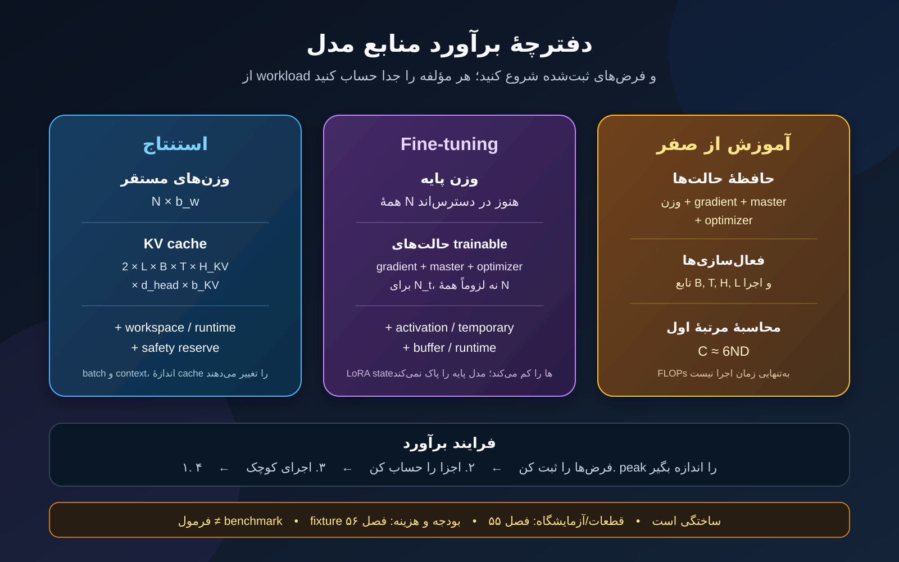

## ۲. پیش از ضرب‌کردن، workload را مشخص کنید

برای هر سناریو ثبت کنید:

- **کار:** استنتاج، تنظیم کامل، adapter/LoRA، ادامهٔ پیش‌آموزش یا آموزش از صفر؛
- **معماری و پارامترها:** تعداد لایه‌ها، عرض پنهان، headهای query و KV، MoE یا dense، و تعداد پارامترهای یکتا؛
- **شکل ورودی:** batch یا تعداد درخواست‌های هم‌زمان، طول prompt، طول خروجی، طول زمینه و رزولوشن/تعداد فریم در کار چندوجهی؛
- **حالت عددی:** وزن، gradient، optimizer و KV cache ممکن است dtypeهای جدا داشته باشند؛
- **روش اجرا:** DDP یا شاردینگ، optimizer، attention backend، quantization، activation checkpointing و offload؛
- **قید هدف:** فقط جا شدن، زمان پاسخ، throughput، اندازهٔ batch یا تعداد کاربر هم‌زمان.

در مدل‌های Mixture-of-Experts، تعداد پارامترهای ذخیره‌شده با تعداد پارامترهای فعال در هر token یکی نیست: ظرفیت حافظه بیشتر به کل وزن‌های مستقر و هزینهٔ محاسبه به routing و expertهای فعال وابسته است. وزن‌های tied را دوبار نشمارید. اگر پیکربندی ناشناخته است، نتیجه را بازه یا چند سناریوی مشروط گزارش کنید، نه یک مقدار ظاهراً دقیق.

## ۳. GB با GiB یکی نیست

سازنده‌ها و ابزارها ممکن است از واحدهای متفاوت استفاده کنند. در این فصل GB ده‌دهی است و GiB دودویی:

<math xmlns="http://www.w3.org/1998/Math/MathML" display="block" aria-label="یک گیبی‌بایت برابر دو به توان سی بایت و تقریباً یک ممیز صفر هفتاد و چهار گیگابایت ده‌دهی است">
  <mrow><mn>1</mn><mtext> GiB</mtext><mo>=</mo><msup><mn>2</mn><mn>30</mn></msup><mtext> bytes</mtext><mo>≈</mo><mn>1.073742</mn><mtext> GB</mtext></mrow>
</math>

**متن جایگزین فرمول:** `1 GiB = 1,073,741,824 bytes ≈ 1.073742 GB`؛ پس عدد GB روی برچسب و GiB در گزارش ابزار را بی‌تبدیل مقایسه نکنید.

یک ترابایت ده‌دهی نیز با یک tebibyte برابر نیست. در کد پروژه، تعداد بایت اصل داده است و GB و GiB فقط دو نمایش کمکی‌اند. اگر واحد دقیق روشن نیست، پیش از نتیجه‌گیری آن را از مستندات همان ابزار یا سازنده تأیید کنید.

## ۴. کف حافظهٔ وزن‌ها را از تعداد پارامتر بگیرید

اگر مدل N پارامتر ذخیره کند و هر پارامتر به‌طور متوسط b وزن-بایت داشته باشد، کف نظری فضای وزن‌ها چنین است:

<math xmlns="http://www.w3.org/1998/Math/MathML" display="block" aria-label="حافظهٔ وزن‌ها تقریباً برابر تعداد پارامترهای ذخیره‌شده ضرب‌در بایت هر پارامتر است">
  <mrow><msub><mi>M</mi><mtext>weights</mtext></msub><mo>≈</mo><mi>N</mi><mo>×</mo><msub><mi>b</mi><mi>w</mi></msub></mrow>
</math>

**متن جایگزین فرمول:** `M_weights ≈ N × b_w` بایت؛ b_w اندازهٔ واقعیِ قالب ذخیره‌شده برای هر پارامتر است.

برای تخمین ابتدایی، FP32 چهار بایت، FP16/BF16 دو بایت، INT8 یک بایت و INT4 به‌صورت اسمی نیم‌بایت به‌ازای هر وزن دارند. در quantization چهار‌بیتی، بسته‌بندی، scale/zero-point، گروه‌بندی، tensorهای باقی‌مانده با دقت بالاتر و kernel مورد استفاده می‌توانند اندازهٔ واقعی را تغییر دهند؛ «چهاربیتی» مساوی تضمینی با `0.5 byte × N` روی دستگاه نیست. فایل checkpoint هم ممکن است نسخه‌ها یا metadataهایی داشته باشد که با footprint زمان اجرا یکی نیستند.

## ۵. آموزش، چهار دفتر متفاوت دارد

در آموزش، وزن‌ها فقط یکی از اجزای پایدارند. جداگانه بنویسید:

| مؤلفه | تقریب حسابی | نکته |
|---|---:|---|
| وزن‌های مدل | `N × b_w` | همهٔ وزن‌های موردنیاز forward؛ بخش منجمد هم حذف نمی‌شود |
| gradientها | `N_t × b_g` | `N_t` تعداد پارامترهای قابل‌آموزش است؛ dtype و نگه‌داری به پیاده‌سازی وابسته‌اند |
| کپی master | `N_t × b_m` | فقط اگر مسیر optimizer کپی دقت‌بالاتر نگه دارد |
| حالت optimizer | `N_t × b_o` | مثلاً دو moment از نوع FP32 در Adam هشت بایت برای پارامتر قابل‌آموزش می‌خواهند |

در نتیجهٔ ساده‌شده:

<math xmlns="http://www.w3.org/1998/Math/MathML" display="block" aria-label="حافظهٔ حالت‌های آموزش برابر وزن‌های همهٔ پارامترها به‌علاوهٔ gradient و master و optimizer برای پارامترهای قابل‌آموزش است">
  <mrow>
    <msub><mi>M</mi><mtext>states</mtext></msub><mo>≈</mo>
    <mi>N</mi><msub><mi>b</mi><mi>w</mi></msub><mo>+</mo>
    <msub><mi>N</mi><mi>t</mi></msub>
    <mo>(</mo><msub><mi>b</mi><mi>g</mi></msub><mo>+</mo><msub><mi>b</mi><mi>m</mi></msub><mo>+</mo><msub><mi>b</mi><mi>o</mi></msub><mo>)</mo>
  </mrow>
</math>

**متن جایگزین فرمول:** `M_states ≈ N·b_w + N_t·(b_g + b_m + b_o)`؛ وزن پایه برای همهٔ پارامترها، اما gradient و optimizer برای پارامترهای قابل‌آموزش حساب می‌شوند.

این فرمول activationها، workspace، bufferهای ارتباطی، allocator و fragmentation را هنوز شامل نمی‌شود. ممکن است برخی tensorها فقط در بخشی از گام وجود داشته باشند؛ جمع مؤلفه‌ها یک accounting محافظه‌کارانه است، نه زمان‌بندی دقیق lifetime آن‌ها.

## ۶. چرا «بایت به‌ازای پارامتر» قانون ثابتی نیست؟

مستند Hugging Face برای یک نمونهٔ mixed-precision AdamW حدود ۱۸ بایت به‌ازای پارامتر، به‌علاوهٔ activationها را تجزیه می‌کند: وزن کم‌دقت به‌همراه کپی FP32، gradient چهار‌بایتی و دو moment هشت‌بایتی. این **پیکربندی نمونه** است، نه ثابت همهٔ مدل‌ها یا همهٔ optimizerها [۳]. در تنظیمی دیگر ممکن است کپی master حذف شود، gradientها دقت متفاوت داشته باشند، optimizer کم‌حافظه‌تر باشد، optimizer state تنبل تخصیص یابد یا پارامترهای زیادی frozen باشند.

برای نمونه، اگر مفروضات خودمان را `b_w=2`, `b_g=4`, `b_m=4`, `b_o=8` بگیریم، مدل کاملاً آموزش‌پذیر ۱۸ بایت حالت به‌ازای هر پارامتر می‌دهد. اگر gradientها دو‌بایتی فرض شوند، همان سطرها ۱۶ بایت می‌شوند. اعداد را از مستندات framework/optimizer و dtype واقعی استخراج کنید؛ از یک headline عددی به workload دیگر تعمیم ندهید. ZeRO نیز به‌جای حذف مؤلفه‌ها، افزونگیِ نگه‌داری آن‌ها میان رتبه‌ها را هدف می‌گیرد [۱].

## ۷. DDP حافظهٔ مدل را تقسیم نمی‌کند؛ شاردینگ می‌تواند

در data parallel معمولی، هر رتبه نسخه‌ای از وزن‌ها و optimizer state را نگه می‌دارد؛ gradientها میان رتبه‌ها همگام می‌شوند، اما اضافه‌کردن GPU به‌تنهایی حافظهٔ مدل روی هر GPU را بر تعداد رتبه‌ها تقسیم نمی‌کند. در خانوادهٔ ZeRO، به‌طور خلاصه، stage 1 optimizer state را، stage 2 علاوه بر آن gradientها را، و stage 3 علاوه بر هر دو پارامترها را shard می‌کند [۱].

برای حساب ایدئالِ هر رتبه، اگر `s_p`, `s_g`, `s_o` ضریب تقسیم وزن، gradient و حالت optimizer باشند، می‌توان نوشت:

<math xmlns="http://www.w3.org/1998/Math/MathML" display="block" aria-label="حافظهٔ حالت هر رتبه تقریباً برابر وزن بر ضریب تقسیم پارامتر به‌علاوهٔ gradient بر ضریب تقسیم gradient به‌علاوهٔ master و optimizer بر ضریب تقسیم حالت است">
  <mrow>
    <msub><mi>M</mi><mtext>states,rank</mtext></msub><mo>≈</mo>
    <mfrac><mi>N</mi><msub><mi>s</mi><mi>p</mi></msub></mfrac><msub><mi>b</mi><mi>w</mi></msub><mo>+</mo>
    <mfrac><msub><mi>N</mi><mi>t</mi></msub><msub><mi>b</mi><mi>g</mi></msub><msub><mi>s</mi><mi>g</mi></msub></mfrac><mo>+</mo>
    <mfrac><msub><mi>N</mi><mi>t</mi></msub><mo>(</mo><msub><mi>b</mi><mi>m</mi></msub><mo>+</mo><msub><mi>b</mi><mi>o</mi></msub><mo>)</mo><msub><mi>s</mi><mi>o</mi></msub></mfrac>
  </mrow>
</math>

**متن جایگزین فرمول:** `M_states,rank ≈ N·b_w/s_p + N_t·b_g/s_g + N_t·(b_m+b_o)/s_o`؛ در شاردینگ ایدئال، stage 1/2/3 به‌ترتیب حالت optimizer، سپس gradient و سپس پارامتر را بر تعداد رتبه‌ها تقسیم می‌کنند.

این رابطه فقط مدل حافظهٔ حالت است. all-gather/reduce-scatter، bucket، padding، پارامترهای ناهم‌اندازه، bufferهای موقت، ارتباط شبکه، CPU offload و رفتار نسخهٔ framework در آن نیست. بنابراین خروجی «حافظهٔ کافی برای اجرای واقعی» را اثبات نمی‌کند. Tensor/pipeline parallelism نیز هزینهٔ ارتباط و تقسیم متفاوتی دارد.

## ۸. Activationها: حافظه‌ای که با شکل batch و توالی تغییر می‌کند

برای محاسبهٔ gradient، مسیر backward به بخشی از خروجی‌های forward نیاز دارد. activation memory به micro-batch، طول دنباله، عرض پنهان، عمق، نوع attention و MLP، dtype، عملیات fused و این‌که autograd چه چیزی را نگه می‌دارد وابسته است. در بعضی مسیرهای attention، نگه‌داری ماتریس score کامل می‌تواند با طول دنباله به‌شکل درجه‌دو رشد کند؛ kernel حافظه‌بهینه ممکن است آن ماتریس را materialize نکند. پس یک tensor پنهان را در لایه‌ها ضرب‌کردن، حافظهٔ واقعی را به‌تنهایی پیش‌بینی نمی‌کند.

برای تمرین، پروژهٔ ما یک سناریوی **معادل‌های tensor پنهان** را حساب می‌کند: فرض می‌کنیم در هر لایه S tensor با ابعاد `microbatch × tokens × hidden` و b بایت برای هر عنصر ذخیره می‌شود:

<math xmlns="http://www.w3.org/1998/Math/MathML" display="block" aria-label="مرجع ساده‌شدهٔ فعال‌سازی برابر micro-batch ضرب‌در tokenها ضرب‌در عرض پنهان ضرب‌در لایه‌ها ضرب‌در شمار معادل tensorهای ذخیره‌شده ضرب‌در بایت هر عنصر است">
  <mrow>
    <msub><mi>M</mi><mtext>act,ref</mtext></msub><mo>=</mo>
    <mi>B</mi><mo>×</mo><mi>T</mi><mo>×</mo><mi>H</mi><mo>×</mo><mi>L</mi><mo>×</mo><mi>S</mi><mo>×</mo><mi>b</mi>
  </mrow>
</math>

**متن جایگزین فرمول:** `M_act,ref = B × T × H × L × S × b`؛ S فرض صریح کاربر است و «شمار activation واقعی مدل» محسوب نمی‌شود.

در fixture آموزشی، `B=1`, `T=4096`, `H=4096`, `L=32`, `S=4`, `b=2` به **۴ GiB** مرجع حسابی می‌رسد. این عدد را نه اندازه‌گیری و نه برآورد معتبر activation یک مدل واقعی بنامید؛ S برای همین مثال انتخاب شده است.

## ۹. Checkpointing و gradient accumulation کدام دفتر را کم می‌کنند؟

Activation checkpointing بخشی از activationها را به‌جای نگه‌داشتن، در backward دوباره محاسبه می‌کند؛ عموماً trade-off حافظه در برابر محاسبه و زمان است. PyTorch مستند می‌کند که checkpointed segment در backward دوباره اجرا می‌شود و حفظ RNG state نیز ممکن است سربار داشته باشد [۴]. صرف وجود این گزینه درصد ثابتی از حافظه را آزاد نمی‌کند؛ محل checkpoint، ساختار مدل و پیاده‌سازی را اندازه بگیرید.

Gradient accumulation چند micro-batch را پیش از update جمع می‌کند. این کار می‌تواند batch فیزیکی هر forward را کوچک نگه دارد و در نتیجه قلهٔ activation هر micro-step را پایین بیاورد؛ اما وزن‌ها و optimizer state را خودبه‌خود از هر رتبه حذف نمی‌کند. معادل‌بودن با batch بزرگ هم به scheduler، normalization، رفتار dropout و جزئیات optimizer وابسته است.

## ۱۰. Fine-tuning کامل در برابر LoRA و روش‌های adapter

در full fine-tuning تقریباً همهٔ وزن‌ها trainable هستند؛ بنابراین gradient و optimizer state روی بخش بزرگی از N حساب می‌شود. در LoRA، بخش بزرگی از وزن پایه frozen می‌ماند و `N_t` به تعداد پارامترهای adapter نزدیک می‌شود. در مدل معادله، این کار می‌تواند gradient، کپی master و optimizer state را برای بخش منجمد حذف کند؛ اما **وزن پایه هنوز باید در دسترس forward باشد** و فعالیت‌های لازم برای عبور gradient از لایه‌ها نیز ممکن است همچنان مهم باشند. بنابراین PEFT برابر «یک درصد از حافظهٔ کل» نیست.

QLoRA و quantization می‌توانند footprint وزن پایه را کاهش دهند، اما metadata، dequantization، activationها و kernel/runtime باید جداگانه بررسی شوند. دستورالعمل Hugging Face برای PEFT نیز freezeکردن پایه و کاهش stateهای قابل‌آموزش را توضیح می‌دهد؛ نه حذف مدل پایه از محاسبه [۵]. در این فصل هیچ مدل واقعی یا adapter آموزش داده نمی‌شود.

## ۱۱. استنتاج: وزن‌ها به‌علاوهٔ KV cache و فضای اجرا

در استنتاج، معمولاً optimizer state و gradient آموزشی نداریم؛ اما باید وزن‌ها، cache، tensorهای موقت، runtime و حاشیهٔ اطمینان را جا بدهیم:

<math xmlns="http://www.w3.org/1998/Math/MathML" display="block" aria-label="حافظهٔ استنتاج تقریباً برابر وزن‌ها به‌علاوهٔ KV cache به‌علاوهٔ workspace و runtime به‌علاوهٔ حاشیهٔ ایمنی است">
  <mrow>
    <msub><mi>M</mi><mtext>infer</mtext></msub><mo>≈</mo>
    <msub><mi>M</mi><mtext>weights</mtext></msub><mo>+</mo>
    <msub><mi>M</mi><mtext>KV</mtext></msub><mo>+</mo>
    <msub><mi>M</mi><mtext>runtime/temp</mtext></msub><mo>+</mo>
    <msub><mi>M</mi><mtext>margin</mtext></msub>
  </mrow>
</math>

**متن جایگزین فرمول:** `M_infer ≈ M_weights + M_KV + M_runtime/temp + M_margin`؛ اجزای آخر باید با workload و اندازه‌گیری همان محیط تعیین شوند.

KV cache در decode علّی، key و value قبلی را برای استفادهٔ مجدد نگه می‌دارد. برای cache متراکمِ decoder معمولی، تخمین مرتبهٔ اول چنین است:

<math xmlns="http://www.w3.org/1998/Math/MathML" display="block" aria-label="اندازهٔ KV cache تقریباً دو ضرب‌در لایه‌ها ضرب‌در batch فعال ضرب‌در طول زمینه ضرب‌در تعداد KV head ضرب‌در بُعد head ضرب‌در بایت هر عنصر است">
  <mrow>
    <msub><mi>M</mi><mtext>KV</mtext></msub><mo>≈</mo><mn>2</mn><mo>×</mo><mi>L</mi><mo>×</mo><mi>B</mi><mo>×</mo><mi>T</mi><mo>×</mo><msub><mi>H</mi><mtext>KV</mtext></msub><mo>×</mo><msub><mi>d</mi><mi>head</mi></msub><mo>×</mo><msub><mi>b</mi><mtext>KV</mtext></msub>
  </mrow>
</math>

**متن جایگزین فرمول:** `M_KV ≈ 2 × L × B × T × H_KV × d_head × b_KV` بایت؛ عامل ۲ برای K و V است.

T باید با سقف یا طول واقعی prompt به‌علاوهٔ tokenهای تولیدی سازگار باشد؛ B تعداد sequenceهای هم‌زمان است. در Multi-Query/Grouped-Query attention، `H_KV` از headهای query کمتر است و همین تعداد headهای KV را در فرمول می‌آوریم. Sliding-window، cache کوانتیزه، offload، cacheهای مدل‌های state-space و پیاده‌سازی‌های خاص به اصلاح فرمول نیاز دارند. مستندات Transformers بین cache پویا، ثابت، کوانتیزه و offloaded تفاوت می‌گذارد؛ انتخاب‌ها trade-off حافظه/سرعت دارند [۶].

## ۱۲. مثال استنتاج با ابعاد فرضی

برای شکل ساختگیِ fixture ــ `N=7.035B`, وزن دو‌بایتی، ۳۲ لایه، batch چهار، ۸۱۹۲ token، هشت KV head، بعد head برابر ۱۲۸ و cache دو‌بایتی ــ وزن‌ها **۱۴٫۰۷ GB ده‌دهی** و cache برابر **۴ GiB** می‌شود. جمع همین دو قلم **۱۸٫۳۶۴۹۶۷ GB** یا **۱۷٫۱۰۳۷۰۹ GiB** است.

این جمع عمدیْ فقط وزن‌ها و KV را دارد: fixture برای runtime، workspace و safety reserve صفر گذاشته است. بنابراین ۱۷٫۱۰ GiB را نباید با ظرفیت واقعی دستگاه مقایسه و نتیجه گرفت که «مدل حتماً جا می‌شود». ظرفیت قابل‌استفاده از کل حافظهٔ تبلیغی کمتر می‌تواند باشد؛ cache پویا/ثابت، processهای دیگر و bufferها نیز مؤثرند. افزوده‌شدن درخواست هم‌زمان، context یا طول خروجی، KV را تغییر می‌دهد.

## ۱۳. محاسبهٔ آموزشی: FLOPs بدون ادعای زمان اجرا

برای Transformer متراکم، یک قرارداد مرتبهٔ اول برای آموزش این است که forward حدود `2ND` و backward حدود `4ND` FLOPs داشته باشد؛ پس:

<math xmlns="http://www.w3.org/1998/Math/MathML" display="block" aria-label="تقریب FLOPs آموزش برابر شش ضرب‌در تعداد پارامترها ضرب‌در تعداد tokenهای دیده‌شده است">
  <mrow><mi>C</mi><mo>≈</mo><mn>6</mn><mo>×</mo><mi>N</mi><mo>×</mo><mi>D</mi></mrow>
</math>

**متن جایگزین فرمول:** `C_train ≈ 6 × N × D` FLOPs؛ N پارامترها و D تعداد tokenهای پردازش‌شده‌اند.

این تقریب با تحلیل FLOPs پیوست F مقالهٔ Hoffmann و همکاران تطبیق دارد؛ خود مقاله نیز مقایسهٔ محاسبهٔ خود را با قرارداد `6ND` گزارش می‌کند [۲]. attention با دنبالهٔ بلند، padding، embedding، MoE، activation recomputation، optimizer، evaluation، تعداد epochها و کارایی kernel می‌توانند محاسبهٔ واقعی را تغییر دهند. برای نمونه، `7B` پارامتر و `140B` token فقط در این قرارداد برابر **`5.88 × 10²¹` FLOPs** می‌شود؛ نه زمان آموزش، هزینه، کیفیت یا benchmark.

داده/پارامتر بهینه برای یک هدف کیفیت و compute خاص مسئلهٔ تجربی است؛ نتیجهٔ Chinchilla دربارهٔ تخصیص compute-optimal در setup آن مقاله است، نه نسخهٔ عمومی «همیشه فلان تعداد token به‌ازای پارامتر» [۲]. برای Fine-tuning هم D را تعداد tokenهای واقعاً پردازش‌شده ــ نه شمار ردیف‌های dataset ــ تعریف کنید و مشخص کنید padding و تکرار داده چطور شمرده شده‌اند.

## ۱۴. FLOPs استنتاج: prompt و decode را از هم جدا ببینید

برای لایه‌های خطی متراکم، forward روی هر token مرتبهٔ `2N` FLOPs دارد. بنابراین یک جمع‌بندی ساده برای prompt و خروجی چنین است:

<math xmlns="http://www.w3.org/1998/Math/MathML" display="block" aria-label="FLOPs خطی استنتاج تقریباً دو ضرب‌در پارامترها ضرب‌در batch ضرب‌در مجموع tokenهای prompt و tokenهای تولیدشده است">
  <mrow><msub><mi>C</mi><mtext>linear,infer</mtext></msub><mo>≈</mo><mn>2</mn><mo>×</mo><mi>N</mi><mo>×</mo><mi>B</mi><mo>×</mo><mo>(</mo><msub><mi>T</mi><mtext>prompt</mtext></msub><mo>+</mo><msub><mi>T</mi><mtext>generated</mtext></msub><mo>)</mo></mrow>
</math>

**متن جایگزین فرمول:** `C_linear,infer ≈ 2 × N × B × (T_prompt + T_generated)`؛ این فقط تقریب بخش‌های خطی است.

در prefill، attention روی توالی prompt نیز هزینه دارد و برای attention متراکم می‌تواند با طول توالی به مرتبهٔ درجه‌دو برسد؛ در decode، cache باعث می‌شود کل prompt از نو محاسبه نشود، ولی tokenها همچنان ترتیبی تولید می‌شوند. ضرب FLOPs به peak FLOPs سخت‌افزار تقسیم‌کردن، به‌تنهایی latency را به دست نمی‌دهد.

## ۱۵. Compute bound یا bandwidth bound؟

یک کرنل ممکن است با ظرفیت محاسبات محدود شود یا با سرعت جابه‌جایی داده. مدل roofline ساده، حد پایین زمانی را از بیشینهٔ زمان حساب FLOPs و زمان جابه‌جایی بایت‌ها می‌سازد:

<math xmlns="http://www.w3.org/1998/Math/MathML" display="block" aria-label="حد پایین زمان برابر بیشینهٔ FLOPs تقسیم بر نرخ محاسبهٔ مؤثر و بایت‌های جابه‌جاشده تقسیم بر پهنای‌باند مؤثر است">
  <mrow><msub><mi>t</mi><mtext>lower</mtext></msub><mo>=</mo><mi>max</mi><mo>(</mo><mfrac><mi>F</mi><msub><mi>P</mi><mtext>eff</mtext></msub></mfrac><mo>,</mo><mfrac><mi>Q</mi><msub><mi>B</mi><mtext>eff</mtext></msub></mfrac><mo>)</mo></mrow>
</math>

**متن جایگزین فرمول:** `t_lower = max(F / P_eff, Q / B_eff)`؛ F FLOPs، Q بایت ترافیک، P_eff نرخ محاسبه و B_eff پهنای‌باند مؤثر است.

این فقط حد پایینِ یک مدل ساده است. `P_eff` و `B_eff` باید برای workload و kernel نزدیک به اجرای هدف سنجیده شوند؛ نرخ تبلیغی peak را نرخ پایدار واقعی فرض نکنید. تأخیر شبکه، synchronization، launch، tokenizer، dataloader، cache miss، شکل ماتریس، اندازهٔ batch و رقابت با process دیگر در این یک خط ظاهر نمی‌شوند. راهنمای CUDA انویدیا نیز توصیه می‌کند کارایی و پهنای‌باند مؤثر اندازه‌گیری شوند و optimization چرخه‌ای از ارزیابی و سنجش باشد [۷].

## ۱۶. دفترچهٔ کل workload؛ فقط VRAM را جمع نزنید

| دفتر | مثال مؤلفه‌ها | پرسشی که باید پاسخ دهید |
|---|---|---|
| حافظهٔ شتاب‌دهنده | وزن، gradient، optimizer، activation، KV، workspace | کدام tensorها هم‌زمان در peak زنده‌اند؟ |
| RAM میزبان | dataloader، offload، staging، بارگذاری checkpoint | داده از کجا می‌آید و چه چیزی در CPU نگه داشته می‌شود؟ |
| ذخیره‌سازی | checkpoint، dataset، cache، نسخه‌های قبلی | checkpoint شامل optimizer state هست یا فقط وزن؟ |
| compute | forward/backward، تعداد token/step، recomputation | چه تعداد FLOPs و با چه نرخ مؤثری؟ |
| انتقال داده | PCIe/شبکه، all-reduce، gather/scatter | مدل یا optimizer میان کدام دستگاه‌ها جابه‌جا می‌شود؟ |

فصل حاضر اندازهٔ قطعه یا قیمت را انتخاب نمی‌کند. پس از ساختن همین دفترچه، فصل ۵۵ به طراحی آزمایشگاه و فصل ۵۶ به مقایسهٔ بودجه و هزینهٔ مالکیت می‌پردازند.

## ۱۷. روش عملی: از کاغذ تا اجرای آزمایشی

۱. با نسخه و پیکربندی ثابت، N، dtypeها، optimizer، trainable params، طول توالی، batch/هم‌زمانی و روش شاردینگ را ثبت کنید.
۲. مؤلفه‌های پایدار را جدا حساب کنید: وزن، gradient، master، optimizer و KV cache.
۳. activation و temporary را به‌صورت سناریوی شفاف اضافه کنید؛ اگر ضریب معلوم نیست، بازه یا unknown بنویسید.
۴. تعداد tokenها و قرارداد FLOPs را ثبت کنید؛ تبدیل FLOPs به زمان را فقط با نرخ مؤثر سنجیده‌شده انجام دهید.
۵. پیش از workload کامل، روی همان مدل و software stack یک forward/backward/optimizer step یا درخواست inference با بدترین ورودی مورد انتظار اجرا کنید.
۶. قله را در مرزهای یکسان اندازه بگیرید؛ warm-up، synchronization و reset peak counter را مستند کنید. PyTorch بین حافظهٔ tensorهای تخصیص‌یافته و حافظهٔ نگه‌داشته‌شده توسط caching allocator تمایز می‌گذارد؛ `memory_allocated`, `max_memory_allocated`, `memory_reserved` و سطح دستگاه پاسخ‌های یکسانی نمی‌دهند [۸].
۷. نسخهٔ framework/driver، GPU، dtype، batch، طول prompt/output، attention backend، checkpointing، optimizer و concurrency را کنار هر اندازه‌گیری ذخیره کنید. یک سناریوی موفق را به شکل‌های ورودی دیگر تعمیم ندهید.

در تخمین اولیه، فضای باقی‌مانده‌ای برای بافرها، تغییر طول ورودی، processهای دیگر و خطای برآورد در نظر بگیرید. حاشیه را به‌عنوان ورودی صریح ثبت کنید؛ یک درصد ثابت برای همهٔ مدل‌ها و runtimeها وجود ندارد. خطای OOM یا افت throughput را هم به مشاهدهٔ همان نسخه و workload وصل کنید، نه نتیجه‌ای عمومی.

## ۱۸. خروجی پروژه و مرز نتیجهٔ آن

`projects/54-resource-estimation/` یک برنامهٔ Python استاندارد دارد که fixture را با schema محدود اعتبارسنجی می‌کند، SHA-256 می‌سازد، اجزای حافظه را جدا چاپ می‌کند، محاسبهٔ ایدئال stageهای ZeRO را نشان می‌دهد، FLOPs مرتبهٔ اول را می‌شمارد و GB/GiB را جدا گزارش می‌کند. چهار profile آن فرضی‌اند: GQA برای cache، آموزش همهٔ پارامترها، adapter با تعداد trainable کمتر، و شاردینگ ایدئال stage 3 روی چهار رتبه.

اجرای ثبت‌شده روی Python 3.13.16، fixture با SHA-256 برابر `9648418ea1cd039a5554d489d79e5d688314240f7c254d2d5215d03e372a4a57` و **۴۵/۴۵ آزمون unit موفق** داشت. از خروجی‌های سناریوی آموزشی: inference با وزن و KV برابر `18.364967 GB` (runtime و margin صفر در fixture)، full training با مرجع activation برابر `130.924967 GB` در هر رتبه، adapter برابر `18.924967 GB` و stage 3 چهاررتبه‌ای برابر `35.952467 GB` در هر رتبه. مقادیر آموزش شامل مرجع activation ساختگی‌اند؛ نه اجرا، نه benchmark و نه اندازه‌گیری حافظه نیستند. فایل‌های کامل خروجی در `projects/54-resource-estimation/results.json` و فرمان/محدودیت‌ها در README پروژه ثبت شده‌اند.

آزمون‌ها حساب بایت، واحدها، KV cache، activation reference، trainable subset، sharding، FLOPs، roofline، اعتبار fixture، CLI و ثبات خروجی را بررسی می‌کنند. آن‌ها کیفیت مدل واقعی، فارسی، سرعت، سخت‌افزار، مصرف برق، هزینه یا امکان اجرای workload روی GPU مشخص را نمی‌آزمایند.

## ۱۹. تمرین‌ها

۱. مدلی با ۷ میلیارد پارامتر را با وزن BF16 و سپس INT8 حساب کنید. وزن‌ها چند GB ده‌دهی و چند GiB دودویی می‌شوند؟ چرا مقدار INT8 را footprint قطعی روی GPU نمی‌دانید؟

۲. برای `L=32`, `B=4`, `T=8192`, `H_KV=8`, `d_head=128`, `b_KV=2` حافظهٔ cache را محاسبه کنید. اگر batch دوبرابر شود، با ثابت‌ماندن بقیه چه تغییری رخ می‌دهد؟

۳. در مثال `N=7.035B` و مفروضات `b_w=2`, `b_g=4`, `b_m=4`, `b_o=8`, حافظهٔ حالت‌ها را برای full fine-tuning حساب کنید. activation و runtime را فعلاً جدا نگه دارید.

۴. همان N را نگه دارید، اما فقط ۳۵ میلیون پارامتر را trainable فرض کنید. کدام اجزا کم می‌شوند و کدام‌ها در حساب باقی می‌مانند؟ این پاسخ چرا «حافظه یک‌دویستم شد» را ثابت نمی‌کند؟

۵. با فرض‌های پرسش ۳، مدل کاملاً trainable و چهار rank را در ZeRO stage 2 حساب کنید. وزن‌ها چه‌طور تقسیم می‌شوند؟ کدام stateها بر چهار تقسیم می‌شوند؟ بافرهای ارتباطی را کجا ثبت می‌کنید؟

۶. با قرارداد `C≈6ND`, برای `N=7B` و `D=140B` تعداد FLOPs را بیابید. فهرست کنید دست‌کم چهار چیز را که از این عدد به‌تنهایی نمی‌دانید.

۷. برای استنتاج batch چهار، prompt با ۴۰۹۶ token و خروجی ۱۰۲۴ token و N=7B، FLOPs خطی تقریبی را حساب کنید. بگویید چرا این مقدار latency واقعی نیست و کدام بخش attention در آن ساده‌سازی شده است.

۸. برای کاهش peak activation، دو روش پیشنهاد کنید و توضیح دهید هرکدام کدام دفتر را کم می‌کند و چه trade-off یا شرطی دارد.

۹. یک پروتکل کوتاه برای سنجش واقعی peak حافظه بنویسید که تفاوت allocated و reserved را رعایت کند. چه metadataهایی باید کنار نتیجه بماند؟

۱۰. یک گزارش می‌گوید «مدل 8B با چهار GPU حتماً جا می‌شود، چون هر GPU یک‌چهارم دارد». با توجه به DDP، ZeRO، KV cache و workspace، این ادعا چه اطلاعاتی کم دارد؟

پاسخ‌های تشریحی مستقل در [`پاسخ‌نامهٔ فصل ۵۴`](book-engineering/answers/54-resource-estimation-fa.md) آمده‌اند.

## ۲۰. جمع‌بندی

برآورد مفید از نام مدل یا یک قاعدهٔ ثابتِ byte/parameter شروع نمی‌شود؛ از workload و فرض‌های ثبت‌شده شروع می‌شود. وزن‌ها، gradient، master، optimizer، activation، KV، workspace و حاشیهٔ اطمینان را جدا حساب کنید. Fine-tuning منجمد ممکن است optimizer state را کم کند، اما وزن پایه و بخش‌هایی از forward/activation باقی می‌مانند. Data parallel مدل را خودبه‌خود shard نمی‌کند؛ ZeRO stageها اجزای متفاوتی از state را تقسیم می‌کنند و هزینهٔ ارتباطی/موقت دارند.

`6ND`, `2N` به‌ازای token و رابطهٔ roofline ابزارهای تقریب‌اند، نه benchmark یا زمان اجرای قطعی. پس از برآورد، workload واقعی را در محیط هدف با همان ورودی و نسخه اندازه بگیرید. فصل بعد از حساب اجزا به طراحی آزمایشگاه، حافظه و زیرساخت می‌رود؛ قیمت و هزینهٔ مالکیت در فصل ۵۶ بررسی خواهد شد.

## ۲۱. منابع و تاریخ بازبینی

**لینک‌ها و نسخه‌های مستندات در ۶ نوامبر ۲۰۲۶ بازبینی شدند.** ضرایب تقریبی در متن به مؤلفه‌های همان منبع و محدودهٔ آزمایش آن مقیدند.

۱. Rajbhandari, S., Rasley, J., Ruwase, O., و He, Y. “ZeRO: Memory Optimizations Toward Training Trillion Parameter Models.” arXiv:1910.02054, نسخهٔ ۳ مورخ ۱۳ مهٔ ۲۰۲۰؛ مقاله دربارهٔ partitioning optimizer state، gradient و parameter. <https://arxiv.org/abs/1910.02054>

۲. Hoffmann, J. و همکاران. “Training Compute-Optimal Large Language Models.” NeurIPS 2022, arXiv:2203.15556, ۲۹ مارس ۲۰۲۲؛ Appendix F دربارهٔ تقریب FLOPs و مقایسه با `6ND`. <https://arxiv.org/abs/2203.15556>

۳. Hugging Face Transformers. “Model training anatomy.” مستند نسخهٔ 4.47.1؛ نمونهٔ accounting mixed-precision AdamW و جداسازی وزن/optimizer/gradient/activation/temporary. <https://huggingface.co/docs/transformers/v4.47.1/en/model_memory_anatomy>

۴. PyTorch. “torch.utils.checkpoint.” مستند نسخهٔ 2.15.0؛ آخرین به‌روزرسانی صفحه ۲۷ ژوئیهٔ ۲۰۲۶. <https://docs.pytorch.org/docs/2.15/checkpoint.html>

۵. Hugging Face Transformers. “Methods and tools for efficient training on a single GPU.” نسخهٔ 4.42.0؛ بخش PEFT/LoRA و اجزای باقی‌ماندهٔ حافظه. <https://huggingface.co/docs/transformers/v4.42.0/perf_train_gpu_one>

۶. Hugging Face Transformers. “Cache strategies.” نسخهٔ 5.22.1؛ cache پویا، ثابت، quantized و offload، و محدودیت معماری‌های خاص. <https://huggingface.co/docs/transformers/v5.22.1/en/kv_cache>

۷. NVIDIA. “CUDA C++ Best Practices Guide.” نسخهٔ جاری مستند آنلاین 13.5 هنگام بازبینی؛ bandwidth مؤثر و چرخهٔ assess/profile/optimize. <https://docs.nvidia.com/cuda/cuda-c-best-practices-guide/>

۸. PyTorch. “CUDA semantics.” مستند نسخهٔ 2.15.0؛ آخرین به‌روزرسانی صفحه ۵ سپتامبر ۲۰۲۶، بخش caching allocator و سنجه‌های allocated/reserved. <https://docs.pytorch.org/docs/2.15/notes/cuda.html>

۹. Pope, R. و همکاران. “Efficiently Scaling Transformer Inference.” arXiv:2211.05102, ۹ نوامبر ۲۰۲۲؛ تحلیل وزن‌ها، KV cache، context، batch و محدودیت‌های استنتاج. <https://arxiv.org/abs/2211.05102>

## ۲۲. پیوست اجرایی: کد آزموده‌شدهٔ پروژه

این پیوست با `projects/54-resource-estimation/resource_estimator.py` یکسان است؛ برنامه فقط با کتابخانهٔ استاندارد Python کار می‌کند و هیچ GPU یا مدل واقعی را بارگذاری نمی‌کند.

```python
"""First-order, configuration-driven estimates for model memory and FLOPs.

The module performs arithmetic on an explicitly synthetic fixture. It does not
load a model, inspect a GPU, train, benchmark, or predict real-world quality.
"""
from __future__ import annotations

import argparse
import hashlib
import json
import math
from pathlib import Path
from typing import Any


DEFAULT_FIXTURE = Path(__file__).with_name("sample_profiles.json")
BYTES_PER_GB = 1_000_000_000
BYTES_PER_GIB = 1024**3
SCHEMA_VERSION = 1


class EstimationInputError(ValueError):
    """Raised when a workload profile is malformed or outside the model."""


def _integer(name: str, value: Any, *, minimum: int = 0) -> int:
    if isinstance(value, bool) or not isinstance(value, int) or value < minimum:
        raise EstimationInputError(f"{name} must be an integer >= {minimum}")
    return value


def _number(name: str, value: Any, *, minimum: float = 0.0) -> int | float:
    if isinstance(value, bool) or not isinstance(value, (int, float)):
        raise EstimationInputError(f"{name} must be a finite number >= {minimum}")
    if isinstance(value, float) and not math.isfinite(value):
        raise EstimationInputError(f"{name} must be a finite number >= {minimum}")
    if value < minimum:
        raise EstimationInputError(f"{name} must be a finite number >= {minimum}")
    return value


def _normalize(value: int | float) -> int | float:
    if isinstance(value, float) and math.isfinite(value) and value.is_integer():
        return int(value)
    return value


def _scaled(count: int, bytes_per_item: int | float) -> int | float:
    return _normalize(count * bytes_per_item)


def _divided(value: int | float, divisor: int) -> int | float:
    return _normalize(value / divisor)


def byte_units(byte_count: int | float) -> dict[str, int | float]:
    """Return bytes plus decimal GB and binary GiB; GB and GiB are not equal."""
    count = _number("byte_count", byte_count)
    return {
        "bytes": _normalize(count),
        "decimal_GB": round(count / BYTES_PER_GB, 6),
        "binary_GiB": round(count / BYTES_PER_GIB, 6),
    }


def _require_mapping(name: str, value: Any) -> dict[str, Any]:
    if not isinstance(value, dict):
        raise EstimationInputError(f"{name} must be an object")
    return value


def estimate_kv_cache(
    *,
    layers: int,
    active_sequences: int,
    context_tokens: int,
    kv_heads: int,
    head_dim: int,
    bytes_per_element: int | float,
) -> int | float:
    """Estimate uncompressed K and V storage for a decoder KV cache.

    The estimate is 2 * layers * batch * tokens * KV-heads * head-dimension
    * bytes-per-element. It is not applicable unchanged to every architecture.
    """
    layer_count = _integer("layers", layers, minimum=1)
    batch = _integer("active_sequences", active_sequences)
    tokens = _integer("context_tokens", context_tokens)
    key_value_heads = _integer("kv_heads", kv_heads, minimum=1)
    dimension = _integer("head_dim", head_dim, minimum=1)
    element_bytes = _number("bytes_per_element", bytes_per_element, minimum=0.000001)
    return _normalize(
        2 * layer_count * batch * tokens * key_value_heads * dimension * element_bytes
    )


def estimate_activation_reference(
    *,
    microbatch: int,
    sequence_tokens: int,
    hidden_size: int,
    layers: int,
    saved_tensors_per_layer: int,
    bytes_per_element: int | float,
) -> int | float:
    """Count a declared number of hidden-state-sized activation equivalents.

    This deliberately transparent scenario is not a framework-level prediction
    of actual activation memory. Attention, MLP intermediates, rematerialization,
    fusion, tensor layouts, and implementation details can change the peak.
    """
    batch = _integer("microbatch", microbatch, minimum=1)
    tokens = _integer("sequence_tokens", sequence_tokens, minimum=1)
    width = _integer("hidden_size", hidden_size, minimum=1)
    layer_count = _integer("layers", layers, minimum=1)
    saved_count = _integer("saved_tensors_per_layer", saved_tensors_per_layer)
    element_bytes = _number("bytes_per_element", bytes_per_element, minimum=0.000001)
    return _normalize(batch * tokens * width * layer_count * saved_count * element_bytes)


def estimate_inference(
    *,
    model_parameters: int,
    weight_bytes_per_parameter: int | float,
    kv_cache_bytes: int | float = 0,
    runtime_and_temporary_bytes: int | float = 0,
    safety_bytes: int | float = 0,
) -> dict[str, Any]:
    """Add explicitly supplied inference memory components for one device."""
    parameters = _integer("model_parameters", model_parameters, minimum=1)
    weight_size = _number("weight_bytes_per_parameter", weight_bytes_per_parameter)
    kv_size = _number("kv_cache_bytes", kv_cache_bytes)
    runtime_size = _number("runtime_and_temporary_bytes", runtime_and_temporary_bytes)
    margin = _number("safety_bytes", safety_bytes)

    weights = _scaled(parameters, weight_size)
    total = weights + kv_size + runtime_size + margin
    return {
        "kind": "inference_memory",
        "model_weights": byte_units(weights),
        "kv_cache": byte_units(kv_size),
        "runtime_and_temporary": byte_units(runtime_size),
        "safety_reserve": byte_units(margin),
        "total_estimate": byte_units(total),
        "scope": "configured arithmetic; not a device-fit guarantee",
    }


def estimate_training(
    *,
    model_parameters: int,
    trainable_parameters: int,
    weight_bytes_per_parameter: int | float,
    gradient_bytes_per_trainable_parameter: int | float,
    master_weight_bytes_per_trainable_parameter: int | float,
    optimizer_state_bytes_per_trainable_parameter: int | float,
    world_size: int = 1,
    zero_stage: int = 0,
    activation_model: dict[str, Any] | None = None,
    activation_bytes_override: int | float | None = None,
    temporary_bytes: int | float = 0,
    safety_bytes: int | float = 0,
) -> dict[str, Any]:
    """Estimate per-rank model-state and declared non-state memory.

    ``zero_stage`` uses idealized ZeRO divisors: stage 1 partitions optimizer
    state/master copies, stage 2 additionally partitions gradients, and stage 3
    additionally partitions parameters. Communication/all-gather buffers,
    padding, fragmentation, and framework-specific behavior are not modelled.
    """
    parameters = _integer("model_parameters", model_parameters, minimum=1)
    trainable = _integer("trainable_parameters", trainable_parameters)
    if trainable > parameters:
        raise EstimationInputError("trainable_parameters cannot exceed model_parameters")
    ranks = _integer("world_size", world_size, minimum=1)
    stage = _integer("zero_stage", zero_stage)
    if stage > 3:
        raise EstimationInputError("zero_stage must be an integer in [0, 3]")

    weight_b = _number("weight_bytes_per_parameter", weight_bytes_per_parameter)
    gradient_b = _number(
        "gradient_bytes_per_trainable_parameter", gradient_bytes_per_trainable_parameter
    )
    master_b = _number(
        "master_weight_bytes_per_trainable_parameter",
        master_weight_bytes_per_trainable_parameter,
    )
    optimizer_b = _number(
        "optimizer_state_bytes_per_trainable_parameter",
        optimizer_state_bytes_per_trainable_parameter,
    )
    temporary = _number("temporary_bytes", temporary_bytes)
    margin = _number("safety_bytes", safety_bytes)

    if activation_model is not None and activation_bytes_override is not None:
        raise EstimationInputError(
            "supply activation_model or activation_bytes_override, not both"
        )
    if activation_model is not None:
        activation_inputs = _require_mapping("activation_model", activation_model)
        activation_bytes = estimate_activation_reference(**activation_inputs)
        activation_basis = {
            "kind": "hidden_state_equivalents",
            "inputs": activation_inputs,
            "interpretation": "user-configured reference scenario, not a measured peak",
        }
    elif activation_bytes_override is not None:
        activation_bytes = _number("activation_bytes_override", activation_bytes_override)
        activation_basis = {
            "kind": "externally_supplied_bytes",
            "interpretation": "user-supplied value; no measurement performed by this program",
        }
    else:
        activation_bytes = 0
        activation_basis = {
            "kind": "not_estimated",
            "interpretation": "zero is a placeholder; actual activations must be measured or supplied",
        }

    parameter_divisor = ranks if stage == 3 else 1
    gradient_divisor = ranks if stage >= 2 else 1
    optimizer_divisor = ranks if stage >= 1 else 1

    weights = _divided(_scaled(parameters, weight_b), parameter_divisor)
    gradients = _divided(_scaled(trainable, gradient_b), gradient_divisor)
    master_weights = _divided(_scaled(trainable, master_b), optimizer_divisor)
    optimizer_states = _divided(_scaled(trainable, optimizer_b), optimizer_divisor)
    state_total = weights + gradients + master_weights + optimizer_states
    total = state_total + activation_bytes + temporary + margin

    return {
        "kind": "training_memory_per_rank",
        "assumptions": {
            "model_parameters": parameters,
            "trainable_parameters": trainable,
            "world_size": ranks,
            "zero_stage": stage,
            "weight_bytes_per_parameter": weight_b,
            "gradient_bytes_per_trainable_parameter": gradient_b,
            "master_weight_bytes_per_trainable_parameter": master_b,
            "optimizer_state_bytes_per_trainable_parameter": optimizer_b,
        },
        "idealized_sharding_divisors": {
            "parameters": parameter_divisor,
            "gradients": gradient_divisor,
            "master_and_optimizer_states": optimizer_divisor,
        },
        "model_states_per_rank": {
            "model_weights": byte_units(weights),
            "trainable_gradients": byte_units(gradients),
            "trainable_master_weights": byte_units(master_weights),
            "trainable_optimizer_states": byte_units(optimizer_states),
            "subtotal": byte_units(state_total),
        },
        "non_state_memory_per_rank": {
            "activation_reference": byte_units(activation_bytes),
            "activation_basis": activation_basis,
            "temporary_workspaces": byte_units(temporary),
            "safety_reserve": byte_units(margin),
        },
        "total_estimate_per_rank": byte_units(total),
        "scope": (
            "first-order per-rank accounting; excludes unmodelled communication buffers, "
            "allocator effects, offload copies, and other implementation-specific memory"
        ),
    }


def estimate_training_flops(
    *, model_parameters: int, training_tokens: int, flops_per_parameter_token: int = 6
) -> int:
    """Return C ≈ k*N*D; k=6 is a dense-transformer first-order convention."""
    parameters = _integer("model_parameters", model_parameters, minimum=1)
    tokens = _integer("training_tokens", training_tokens)
    factor = _integer("flops_per_parameter_token", flops_per_parameter_token, minimum=1)
    return factor * parameters * tokens


def estimate_inference_flops(
    *,
    model_parameters: int,
    prompt_tokens: int,
    generated_tokens: int,
    batch_size: int = 1,
    flops_per_parameter_token: int = 2,
) -> int:
    """Approximate dense linear-layer FLOPs over prompt and generated tokens.

    This omits the sequence-quadratic attention term in prefill and many
    architecture/runtime costs; it is not a latency prediction.
    """
    parameters = _integer("model_parameters", model_parameters, minimum=1)
    prompt = _integer("prompt_tokens", prompt_tokens)
    generated = _integer("generated_tokens", generated_tokens)
    batch = _integer("batch_size", batch_size, minimum=1)
    factor = _integer("flops_per_parameter_token", flops_per_parameter_token, minimum=1)
    return factor * parameters * batch * (prompt + generated)


def roofline_lower_bound_seconds(
    *,
    floating_point_operations: int,
    bytes_moved: int,
    effective_flops_per_second: int | float,
    effective_bytes_per_second: int | float,
) -> dict[str, float]:
    """Compute a roofline-style lower bound from user-supplied effective rates."""
    operations = _integer("floating_point_operations", floating_point_operations)
    traffic = _integer("bytes_moved", bytes_moved)
    compute_rate = _number("effective_flops_per_second", effective_flops_per_second, minimum=0.000001)
    bandwidth = _number("effective_bytes_per_second", effective_bytes_per_second, minimum=0.000001)
    compute_bound = operations / compute_rate
    bandwidth_bound = traffic / bandwidth
    return {
        "compute_bound_seconds": compute_bound,
        "bandwidth_bound_seconds": bandwidth_bound,
        "lower_bound_seconds": max(compute_bound, bandwidth_bound),
        "warning": "a lower bound only; rates are user inputs, not measured by this project",
    }


def validate_fixture(fixture: Any) -> None:
    """Validate the synthetic fixture and every profile before calculating."""
    if not isinstance(fixture, dict):
        raise EstimationInputError("fixture must be a JSON object")
    if fixture.get("schema_version") != SCHEMA_VERSION:
        raise EstimationInputError("unsupported fixture schema_version")
    if fixture.get("label_source") != "synthetic_fixture":
        raise EstimationInputError("fixture label_source must be synthetic_fixture")
    metadata = _require_mapping("metadata", fixture.get("metadata"))
    for field in (
        "real_model_weights_included",
        "real_hardware_measurements_performed",
        "training_performed",
        "benchmark_performed",
    ):
        if metadata.get(field) is not False:
            raise EstimationInputError(f"fixture metadata must explicitly set {field}=false")

    profiles = fixture.get("profiles")
    if not isinstance(profiles, list) or not profiles:
        raise EstimationInputError("fixture profiles must be a non-empty array")
    identifiers: set[str] = set()
    for profile in profiles:
        profile = _require_mapping("profile", profile)
        identifier = profile.get("profile_id")
        if not isinstance(identifier, str) or not identifier.strip():
            raise EstimationInputError("each profile needs a non-empty profile_id")
        if identifier in identifiers:
            raise EstimationInputError("profile_id values must be unique")
        identifiers.add(identifier)
        kind = profile.get("kind")
        if kind == "inference":
            _integer("model_parameters", profile.get("model_parameters"), minimum=1)
            _number("weight_bytes_per_parameter", profile.get("weight_bytes_per_parameter"))
            cache = _require_mapping("kv_cache", profile.get("kv_cache"))
            required = ("layers", "active_sequences", "context_tokens", "kv_heads", "head_dim", "bytes_per_element")
            if any(field not in cache for field in required):
                raise EstimationInputError(f"{identifier}: kv_cache is missing a required field")
            estimate_kv_cache(**{field: cache[field] for field in required})
            _number("runtime_and_temporary_bytes", profile.get("runtime_and_temporary_bytes", 0))
            _number("safety_bytes", profile.get("safety_bytes", 0))
        elif kind == "training":
            parameters = _integer("model_parameters", profile.get("model_parameters"), minimum=1)
            trainable = _integer("trainable_parameters", profile.get("trainable_parameters"))
            if trainable > parameters:
                raise EstimationInputError("trainable_parameters cannot exceed model_parameters")
            for field in (
                "weight_bytes_per_parameter",
                "gradient_bytes_per_trainable_parameter",
                "master_weight_bytes_per_trainable_parameter",
                "optimizer_state_bytes_per_trainable_parameter",
            ):
                _number(field, profile.get(field))
            _integer("world_size", profile.get("world_size", 1), minimum=1)
            stage = _integer("zero_stage", profile.get("zero_stage", 0))
            if stage > 3:
                raise EstimationInputError("zero_stage must be an integer in [0, 3]")
            if "activation_model" in profile:
                activation_model = _require_mapping("activation_model", profile["activation_model"])
                estimate_activation_reference(**activation_model)
            _number("temporary_bytes", profile.get("temporary_bytes", 0))
            _number("safety_bytes", profile.get("safety_bytes", 0))
            if "training_tokens" in profile:
                _integer("training_tokens", profile["training_tokens"])
        else:
            raise EstimationInputError(f"{identifier}: kind must be inference or training")


def load_fixture(path: str | Path = DEFAULT_FIXTURE) -> tuple[dict[str, Any], str]:
    fixture_path = Path(path)
    raw = fixture_path.read_bytes()
    try:
        fixture = json.loads(raw.decode("utf-8"))
    except (UnicodeDecodeError, json.JSONDecodeError) as exc:
        raise EstimationInputError(f"fixture is not valid UTF-8 JSON: {fixture_path.name}") from exc
    validate_fixture(fixture)
    return fixture, hashlib.sha256(raw).hexdigest()


def analyze_profile(profile: dict[str, Any]) -> dict[str, Any]:
    """Evaluate one validated profile, preserving its declared assumptions."""
    common = {"profile_id": profile["profile_id"], "label": profile.get("label", "")}
    if profile["kind"] == "inference":
        cache_inputs = profile["kv_cache"]
        cache_bytes = estimate_kv_cache(**cache_inputs)
        estimate = estimate_inference(
            model_parameters=profile["model_parameters"],
            weight_bytes_per_parameter=profile["weight_bytes_per_parameter"],
            kv_cache_bytes=cache_bytes,
            runtime_and_temporary_bytes=profile.get("runtime_and_temporary_bytes", 0),
            safety_bytes=profile.get("safety_bytes", 0),
        )
        output = {**common, "kind": "inference", "kv_cache_inputs": cache_inputs, "estimate": estimate}
        if "prompt_tokens" in profile or "generated_tokens" in profile:
            output["linear_layer_flops"] = estimate_inference_flops(
                model_parameters=profile["model_parameters"],
                prompt_tokens=profile.get("prompt_tokens", 0),
                generated_tokens=profile.get("generated_tokens", 0),
                batch_size=cache_inputs["active_sequences"],
            )
        return output

    activation_model = profile.get("activation_model")
    estimate = estimate_training(
        model_parameters=profile["model_parameters"],
        trainable_parameters=profile["trainable_parameters"],
        weight_bytes_per_parameter=profile["weight_bytes_per_parameter"],
        gradient_bytes_per_trainable_parameter=profile["gradient_bytes_per_trainable_parameter"],
        master_weight_bytes_per_trainable_parameter=profile["master_weight_bytes_per_trainable_parameter"],
        optimizer_state_bytes_per_trainable_parameter=profile["optimizer_state_bytes_per_trainable_parameter"],
        world_size=profile.get("world_size", 1),
        zero_stage=profile.get("zero_stage", 0),
        activation_model=activation_model,
        temporary_bytes=profile.get("temporary_bytes", 0),
        safety_bytes=profile.get("safety_bytes", 0),
    )
    output = {**common, "kind": "training", "estimate": estimate}
    if "training_tokens" in profile:
        output["training_flops_approximation"] = estimate_training_flops(
            model_parameters=profile["model_parameters"],
            training_tokens=profile["training_tokens"],
        )
    return output


def run_demo(fixture_path: str | Path = DEFAULT_FIXTURE) -> dict[str, Any]:
    """Return deterministic arithmetic results for all fixture profiles."""
    fixture, digest = load_fixture(fixture_path)
    return {
        "schema_version": SCHEMA_VERSION,
        "fixture": {
            "fixture_id": fixture.get("fixture_id", "unnamed"),
            "sha256": digest,
            "label_source": fixture["label_source"],
        },
        "scope": {
            "real_model_loaded": False,
            "real_hardware_measured": False,
            "training_performed": False,
            "benchmark_performed": False,
            "claim": "configured arithmetic and synthetic profiles only",
        },
        "scenarios": [analyze_profile(profile) for profile in fixture["profiles"]],
    }


def main(argv: list[str] | None = None) -> int:
    parser = argparse.ArgumentParser(description="First-order model memory/FLOPs estimator")
    parser.add_argument("--fixture", type=Path, default=DEFAULT_FIXTURE)
    parser.add_argument("--output", type=Path, help="write JSON to this path (default: stdout)")
    args = parser.parse_args(argv)
    result = run_demo(args.fixture)
    serialized = json.dumps(result, ensure_ascii=False, indent=2, allow_nan=False) + "\n"
    if args.output:
        args.output.parent.mkdir(parents=True, exist_ok=True)
        args.output.write_text(serialized, encoding="utf-8")
        print(f"Wrote arithmetic-only report: {args.output}")
    else:
        print(serialized, end="")
    return 0


if __name__ == "__main__":
    raise SystemExit(main())
```

---

# جلد چهارم، فصل ۹ — طراحی آزمایشگاه یادگیری ماشین: از میز شخصی تا زیرساخت سازمانی

> **جایگاه در نقشه:** فصل محلی ۹ از ۱۵ فصل جلد چهارم؛ فصل سراسری ۵۵. جلد چهارم طبق نقشهٔ راه ۱۵ فصل دارد.
>
> **مرز موضوعی:** فصل ۵۴ نیاز حافظه و محاسبه را برآورد می‌کند؛ این فصل آن نیاز را به معماری و اجزای یک آزمایشگاه شخصی، حرفه‌ای یا سازمانی ترجمه می‌کند. فصل ۵۶ بودجه، خرید در برابر اجاره و هزینهٔ مالکیت را بررسی می‌کند؛ در این فصل قیمت و توصیهٔ خرید نداریم.
>
> **حد ادعا:** آزمایشگاه یعنی مجموعه‌ای از سخت‌افزار، برق، خنک‌کاری، ذخیره‌سازی، شبکه و عملیات. نمونه‌های پروژه ساختگی‌اند و هیچ SKU، نصب، اندازه‌گیری، benchmark یا تأیید ایمنی ارائه نمی‌کنند. نام «کم‌هزینه» یک ردهٔ آموزشی نسبی است، نه ادعای قیمت روز.
>
> **تاریخ بازبینی منابع: ۶ نوامبر ۲۰۲۶.**

## ۱. آزمایشگاه را «یک کارت گرافیک» تعریف نکنید

اگر مدل روی GPU اجرا شود، آیا آزمایشگاه همان GPU است؟ نه. برای بار واقعی، میزبان، حافظهٔ سیستم، درایور، نرم‌افزار، فضای داده، برق ورودی، دفع گرما، اتصال شبکه، پشتیبان‌گیری و کسی که خرابی را پیگیری می‌کند نیز جزو سامانه‌اند. گلوگاه ممکن است هیچ ربطی به تعداد هسته‌های شتاب‌دهنده نداشته باشد.

این فصل یک روش برای طراحی **سامانهٔ محاسباتی قابل نگه‌داری** می‌دهد. ابتدا workload و محدودیت محل را می‌نویسیم؛ بعد شکل استقرار را برمی‌گزینیم؛ سپس سازگاری اجزا، توان، گرما، شبکه و بازیابی را روی کاغذ کنترل می‌کنیم. طراحی کاغذی نقطهٔ شروع اجرای آزمایشی است، نه گواهی اینکه سیستم واقعاً کار می‌کند.


شکل ۴-۹-۱ — سه ردهٔ آزمایشگاه با نیازها و مسئولیت‌های متفاوت؛ مسیر راه‌اندازی از تعریف workload تا بازیابی را نشان می‌دهد.

## ۲. خروجی فصل قبل را به الزام‌های قابل بررسی تبدیل کنید

فصل ۵۴ دفتر محاسبه می‌سازد؛ حالا هر برآورد را به نیاز یک جزء تبدیل کنید. به‌جای «یک GPU قوی می‌خواهم» این پرسش‌ها را ثبت کنید:

- **کار:** inference، fine-tuning، آموزش، preprocessing یا چند کار متفاوت؟
- **شکل کار:** حافظهٔ لازم برای هر شتاب‌دهنده چقدر است؟ چند شتاب‌دهنده در هر node و چند node لازم‌اند؟
- **زمان‌بندی:** run کوتاه و آموزشی است یا دستگاه باید شبانه‌روز در دسترس بماند؟
- **داده:** اندازهٔ دادهٔ فعال، تعداد کپی‌های کاری، checkpointها، scratch و نسخهٔ backup چقدر است؟
- **نرم‌افزار:** سیستم‌عامل، driver/runtime، framework، kernelها و روش توزیع‌شده کدام‌اند؟
- **محل:** ظرفیت تخصیص‌یافتهٔ برق و سرمایش، فضا، نویز، تهویه، دسترسی و اتصال شبکه را چه کسی تأیید می‌کند؟
- **معیار:** هدف فقط اجرای یک آزمایش کوچک است، یا تأخیر، توان عملیاتی، uptime و چندکاربره‌بودن هم الزام‌اند؟
- **ریسک:** دادهٔ حساس است؟ backup کجاست؟ چه کسی دسترسی فیزیکی و مدیریتی دارد؟ اگر SSD یا node از کار بیفتد، مسیر بازیابی چیست؟

در جدول نیازمندی‌ها، هر عدد باید **واحد، مبنا، منبع و صاحب تأیید** داشته باشد. برای مثال، «۴۸ GB حافظه» بدون مشخص‌کردن GPU، واحد GB/GiB، حافظهٔ قابل‌استفاده، بارهای دیگر و روش تقسیم مدل، نیازمندی کامل نیست. برآورد فصل ۵۴ را به‌ازای هر device/rank نگه دارید؛ حافظهٔ چند GPU فقط وقتی جمع‌پذیر است که sharding و ارتباط مدل واقعاً اجازه دهد.

## ۳. سه الگوی آزمایشگاه، نه سه رتبهٔ سرعت

«شخصی»، «حرفه‌ای مستقل» و «سازمانی» سه پروفایل نیاز و عملیات‌اند؛ تضمین کارایی یا کیفیت مدل نیستند. یک workstation حرفه‌ایِ چندGPU در اتاقی با برق یا تهویهٔ نامناسب از یک سرور کوچک تک‌گره‌ای ضعیف‌تر عمل می‌کند.

| الگو | وقتی مناسب است | شکل رایج معماری | وابستگی‌ای که زود باید سنجید |
|---|---|---|---|
| **شخصی، کم‌هزینه به معنای نسبی** | یادگیری، inference یا آزمایش کوچکِ تک‌نفره؛ استفاده از دستگاه موجود | یک میزبان، یک شتاب‌دهنده یا مسیر CPU، ذخیره‌سازی محلی، شبکهٔ عادی | حافظهٔ قابل‌استفاده، سازگاری نرم‌افزار، برق محل، گرما و نویز اتاق |
| **حرفه‌ای مستقل** | runهای تکرارپذیر، preprocessing و چند آزمایش موازی | workstation/tower تک‌گره‌ای؛ گاهی چند accelerator؛ scratch سریع و backup جدا | خطوط PCIe و فاصلهٔ کارت‌ها، RAM، پاور/کانکتور، هوای ورودی، نسخهٔ driver و ثبت آزمایش |
| **سازمانی** | تیم، صف کار، دادهٔ مشترک، چند node یا نیاز عملیاتی | nodeهای محاسبه، شبکهٔ مدیریت، fabric داده/collective، ذخیره‌سازی مشترک، scheduler و پایش | برق و سرمایش تأییدشده، مسیر/سوئیچ شبکه، کنترل دسترسی، backup/restore و نقطه‌های شکست |

برای آزمایش تک‌گره‌ای، شبکهٔ پرسرعت بین nodeها ممکن است هیچ گلوگاهی را رفع نکند؛ در آموزش چندگره‌ای، ارتباط می‌تواند به‌اندازهٔ accelerator مهم شود. به همین ترتیب، cluster کوچک بدون مالک نگه‌داری، وصله‌کردن و پایش، لزوماً از workstation ساده قابل‌اعتمادتر نیست. «کم‌هزینه» را به‌جای قیمت، با **کمینه‌کردن قابلیت‌های غیرضروری برای workload** تعریف کنید؛ قیمت‌ها و مقایسهٔ خرید/اجاره به فصل ۵۶ تعلق دارد.

## ۴. شتاب‌دهنده را با نرم‌افزار و حافظهٔ هر device انتخاب‌پذیر کنید

فضای حافظهٔ روی accelerator در بسیاری از workloadها قید اول است، اما عدد درج‌شده روی مشخصات برابر با حافظهٔ آزاد برای مدل نیست: runtime، driver، kernel، بافرها و فرایندهای دیگر هم سهم می‌گیرند. برای یک screen ساده، می‌توان سهم فرضی را چنین نوشت:

<math xmlns="http://www.w3.org/1998/Math/MathML" display="block" aria-label="حافظهٔ قابل‌استفادهٔ تخمینی برابر است با سهم فرضی ضرب‌در حافظهٔ دستگاه">
  <mrow><msub><mi>M</mi><mtext>usable</mtext></msub><mo>=</mo><mi>f</mi><mo>·</mo><msub><mi>M</mi><mtext>device</mtext></msub></mrow>
</math>

**متن جایگزین فرمول:** `M_usable = f × M_device`؛ سهم `f` باید از workload/runtime واقعی یا یک فرض آشکار بیاید، نه از قانون همگانی. برای نمونه، اگر سناریوی فصل ۵۴ به ۴۲ GiB برای **هر** device نیاز دارد، دو device با ۲۴ GiB را به‌عنوان «۴۸ GiB» جمع نزنید؛ صرفاً جمع ظرفیت فیزیکی، مدل را روی یک device جا نمی‌دهد و به‌خودی‌خود مدل موازی را هم راه نمی‌اندازد.

این موارد را از سند همان سامانه بررسی کنید:

- حافظهٔ هر accelerator، نوع آن، شیوهٔ تقسیم مدل، و kernelهایی که workload لازم دارد؛
- پشتیبانی واقعیِ چارچوب از معماری، دقت عددی، driver، runtime و سیستم‌عامل؛
- توان ورودی/حد توان کل **سیستم**، فرم‌فکتور، تعداد/عرض slot و محدودیت دمای کاری؛
- ارتباط درون‌گره‌ای، topology و اینکه deviceها peer-to-peer را پشتیبانی می‌کنند یا خیر؛
- نسخه‌بندی و مسیر دریافت وصلهٔ امنیتی و driver.

از روی نام یک معماری، وجود kernel یا سازگاری framework را قطعی فرض نکنید؛ ماتریس پشتیبانیِ نسخه‌دار را برای workload خود کنترل کنید. نمونهٔ سامانهٔ یکپارچهٔ NVIDIA DGX B200 نشان می‌دهد یک node سازمانی می‌تواند چند GPU، چند PSU، شبکه و ذخیره‌سازی تخصصی داشته باشد و راهنمای همان محصول قواعد ایمنی و محدودیت‌های خودش را تعریف می‌کند؛ اعداد یا کابل آن را به workstation سفارشی تعمیم ندهید [3]. این اشاره endorsement یا پیشنهاد خرید نیست.

## ۵. میزبان، RAM و مسیر فیزیکی کارت‌ها

GPU روی مادربردی نصب نمی‌شود که در خلأ قرار دارد. تعداد خط‌های PCIe، نسل و پهنای اتصال، اشتراک laneها با NVMe یا NIC، تعداد socketهای CPU و توپولوژی NUMA می‌توانند مسیر داده و ارتباط را تغییر دهند. تعداد ظاهری slotها کافی نیست: کارت بلند یا ضخیم ممکن است slot مجاور را بپوشاند یا به کابل و جریان هوا برخورد کند. سند board، chassis، CPU و accelerator را در کنار هم بخوانید و فضای سرویس‌کاری را هم لحاظ کنید.

RAM میزبان برای loader، تبدیل داده، صفحه‌بندی/offload، cache و فرایندهای کنار مدل لازم است؛ «VRAM کافی» جای آن را نمی‌گیرد. بررسی کنید که ظرفیت کل، تعداد channel، نوع پشتیبانی‌شده، امکان ارتقا و چیدمان DIMM با motherboard/CPU مطابقت داشته باشند. اگر workload از NUMA یا حافظهٔ pinned استفاده می‌کند، اندازه‌گیری همان workload و topology همان سیستم را لازم دارد؛ این فصل عدد کارایی برای آن نمی‌سازد.

## ۶. ذخیره‌سازی: دادهٔ فعال، checkpoint و backup را جدا ببینید

حجم «یک مجموعه‌داده» مساوی فضای آزاد لازم نیست. یک نسخهٔ کاری، نسخهٔ پاک‌شده، cache، checkpointهای متعدد، logها و یک کپی پشتیبان ممکن است هم‌زمان فضا بگیرند. تخمین کاغذی ساده:

<math xmlns="http://www.w3.org/1998/Math/MathML" display="block" aria-label="فضای برنامه‌ریزی‌شده برابر است با تعداد کپی‌های کاری ضرب‌در دادهٔ مجموعه، به‌علاوهٔ تعداد نسخه‌های checkpoint ضرب‌در اندازهٔ هر checkpoint، به‌علاوهٔ scratch و backup و log">
  <mrow><msub><mi>S</mi><mtext>plan</mtext></msub><mo>=</mo><mi>c</mi><mo>·</mo><mi>D</mi><mo>+</mo><mi>v</mi><mo>·</mo><mi>C</mi><mo>+</mo><msub><mi>S</mi><mtext>scratch</mtext></msub><mo>+</mo><msub><mi>S</mi><mtext>backup</mtext></msub><mo>+</mo><msub><mi>S</mi><mtext>logs</mtext></msub></mrow>
</math>

**متن جایگزین فرمول:** `S_plan = c×D + v×C + S_scratch + S_backup + S_logs`؛ این جمع، فشرده‌سازی، metadata، فضای رزرو و رشد آینده را خودکار حدس نمی‌زند.

سیستم‌عامل، scratch موقت، دادهٔ کاری و checkpointهای لازم برای resume را در طرح ذخیره‌سازی از هم متمایز کنید. اگر ذخیره‌سازی مشترک است، throughput، latency، شبکه، دسترسی هم‌زمان و ظرفیت واقعی بعد از RAID/metadata را از سندها و آزمون‌ها استخراج کنید. RAID یا mirror می‌تواند بخشی از دسترس‌پذیری را کمک کند، اما کپی جدا و آزمون بازگردانی را حذف نمی‌کند. برای دادهٔ قابل‌حفاظت، سیاست backup، رمزگذاری و مالک بازیابی را تعیین کنید؛ برای خارج‌کردن media از چرخه، NIST SP 800-88 Rev. 2 فرایند sanitization را بر مبنای حساسیت داده توضیح می‌دهد [6]. نام ابزار به‌تنهایی پاک‌شدن داده را تضمین نمی‌کند.

## ۷. شبکه: management، ذخیره‌سازی و collective یک کار نیستند

در یک workstation، NIC برای شبکهٔ اداری/دسترسی و شاید ذخیره‌سازی کافی است؛ در cluster، دست‌کم این مسیرها را مفهومی جدا کنید:

1. **مدیریت:** SSH یا کنسول، inventory، مانیتورینگ و مدیریت سخت‌افزار؛ فقط از شبکه و هویت مجاز.
2. **داده و ذخیره‌سازی:** انتقال corpus، checkpoint و artifact؛ ظرفیت و رقابت آن با بقیهٔ ترافیک را بسنجید.
3. **Collective بین nodeها:** تبادل گرادیان/پارامتر در DDP/FSDP و روش‌های مشابه؛ topology، NIC، switch و oversubscription اهمیت دارند.

سرعت اسمی پورت را throughput تضمین‌شده نخوانید. حد پایینِ انتقال یک فایل در لینک ایدئال فقط مرتبهٔ نظری است:

<math xmlns="http://www.w3.org/1998/Math/MathML" display="block" aria-label="زمان حد پایین نظری بر حسب ثانیه برابر است با هشت ضرب‌در تعداد بایت فایل تقسیم بر نرخ اسمی لینک به گیگابیت در ثانیه ضرب‌در یک میلیارد">
  <mrow><msub><mi>t</mi><mtext>floor</mtext></msub><mo>=</mo><mfrac><mrow><mn>8</mn><mo>·</mo><mi>B</mi></mrow><mrow><msup><mn>10</mn><mn>9</mn></msup><mo>·</mo><mi>R</mi></mrow></mfrac><mtext> seconds</mtext></mrow>
</math>

**متن جایگزین فرمول:** `t_floor = 8×B_bytes/(10^9×R_Gbit/s)`؛ protocol overhead، اشتراک لینک، I/O ذخیره‌سازی، latency و رفتار برنامه در آن نیست.

برای مثال، NCCL مستند می‌کند که در stack خودش topology و ابزارهایی مانند `nvidia-smi topo -m` و `nvbandwidth` برای دیدن مسیر/سنجش ارتباط به کار می‌روند؛ آزمون inter-node نیز باید روی شبکهٔ واقعی انجام شود [4]. این ابزارها عمومی برای همهٔ شتاب‌دهنده‌ها نیستند. نتیجهٔ لینک در fixture یا محاسبهٔ line-rate، سنجش NCCL، latency یا کارایی آموزش نیست.

## ۸. برق: حداکثر ورودی را از توان خروجی PSU جدا کنید

نام توان GPU، TDP، ظرفیت خروجی پاور و توان AC سیستم چهار عدد یکسان نیستند. برای برآورد اولیه، جمع **توان ورودی سیستم‌ها طبق سند معتبر/طرح facility** را از بارهای دیگر جدا نگه دارید:

<math xmlns="http://www.w3.org/1998/Math/MathML" display="block" aria-label="توان ورودی برنامه‌ریزی‌شدهٔ سایت برابر است با جمع تعداد هر نوع سیستم ضرب‌در بیشینه توان ورودی مستند همان سیستم، به‌علاوه توان شبکه و سایر بارهای فناوری اطلاعات">
  <mrow><msub><mi>P</mi><mtext>site</mtext></msub><mo>=</mo><munderover><mo>∑</mo><mrow><mi>i</mi></mrow><mrow><mi>types</mi></mrow></munderover><msub><mi>n</mi><mi>i</mi></msub><mo>·</mo><msub><mi>P</mi><mrow><mi>i</mi><mo>,</mo><mtext>max,in</mtext></mrow></msub><mo>+</mo><msub><mi>P</mi><mtext>network</mtext></msub><mo>+</mo><msub><mi>P</mi><mtext>other IT</mtext></msub></mrow>
</math>

**متن جایگزین فرمول:** `P_site = Σ_i (n_i × P_i,max,input) + P_network + P_other_IT`؛ جمع برنامه‌ریزی با اندازه‌گیری watt-meter یکی نیست.

برای هر node علاوه بر توان سیستم، سوئیچ، ذخیره‌ساز، نمایشگر و تجهیزات جانبی را بشمارید. ظرفیت خروجی DC پاور با ورودی AC دیوار قابل‌جایگزینی نیست؛ بازده، ضریب توان، وضعیت بار، تعداد PSU، افزونگی و محدودیت دمایی در مدل دقیق اثر دارند. از «وات روی جعبهٔ GPU» برای سایزکردن کل مدار استفاده نکنید.

**این فصل ظرفیت مدار شاخه، کابل، سیم‌کشی، ارت، PDU یا UPS را سایز نمی‌کند.** تخصیص برق محل و هر تغییر در تأسیسات باید با کد محلی، مستند محصول و برق‌کار/مهندس واجد صلاحیت هماهنگ شود؛ OSHA برای محیط کار در 29 CFR 1910.333 کار روی بخش برق‌دار را به افراد qualified محدود می‌کند [7]. راهنمای سازنده نیز بر کابل و الزامات مخصوص همان دستگاه تقدم دارد [3].

## ۹. خنک‌کاری: بار گرما فقط دمای اتاق نیست

تقریبِ تبدیل توان گرمایی به واحد رایج HVAC چنین است:

<math xmlns="http://www.w3.org/1998/Math/MathML" display="block" aria-label="بار گرمایی معادل بر حسب بی‌تی‌یو بر ساعت تقریباً برابر است با توان ورودی بر حسب وات ضرب‌در سه ممیز چهارصد و دوازده بی‌تی‌یو بر ساعت به‌ازای هر وات">
  <mrow><msub><mi>Q</mi><mtext>heat</mtext></msub><mo>≈</mo><mn>3.412141633</mn><mtext> Btu/h per W</mtext><mo>·</mo><msub><mi>P</mi><mtext>input</mtext></msub></mrow>
</math>

**متن جایگزین فرمول:** `Q_heat [Btu/h] ≈ 3.412141633 × P_input [W]`؛ این تبدیل واحد است، نه ظرفیت پیشنهادی کولر. ضریب از رابطهٔ ژول و Btu در راهنمای SI گرفته شده است [8].

گرمای محاسباتی فقط یکی از اجزای بار فضاست. گرمای افراد و روشنایی، جریان هوای ورودی/برگشتی، بازچرخش هوای داغ، دمای بیرون، رطوبت، dust/filter، ارتفاع، راندمان HVAC، برقِ تجهیزات سرمایش و هم‌زمانی بارها نتیجه را تغییر می‌دهند. رتبهٔ cooling روی label هم الزاماً سرمایش قابل‌تحویل در محل و شرایط شما نیست.

راهنمای DOE/FEMP مدیریت مسیر هوای سرد و گرم، کابل‌کشی و سنجش در ورودی تجهیزات را از اجزای طراحی مرکز داده می‌داند؛ آن توصیه را مستقیم به اتاق خانه یا همهٔ workstationها تعمیم ندهید [1]. در راهنمای حرارتی ASHRAE TC 9.9، بازهٔ توصیه‌شده برای گروهی از تجهیزات air-cooled با حدود مجاز یکسان نیست؛ برای تجهیزات متراکم H1 نیز بازهٔ جداگانه تعریف شده است. دما را در **inlet دستگاه** و بر اساس کلاس و سند همان وسیله بررسی کنید، نه با یک عدد جهان‌شمول روی thermostat [2].

برای پروفایل ساختگی پروژه، `cooling_design_factor = 1.20` فقط فرض آموزشی است. این ضریب معیار ASHRAE، توصیهٔ مکانیکی یا ضریب طراحی برای ساختمان نیست. طراحی HVAC، آب/مایع‌خنک‌کاری و تخمین ظرفیت اتاق نیازمند اندازه‌گیری و متخصص تأسیسات است؛ دستگاه را با درِ باز، جریان هوای مسدود یا راهکار دست‌ساز مایع‌خنک‌کاری راه‌اندازی نکنید.

## ۱۰. فضا، فرم‌فکتور، کابل و نویز را روی نقشه بیاورید

پیش از نصب، شکل فیزیکی مجموعه را کنترل کنید:

- footprint، وزن، عمق، فضای سرویس، بازشدن درها، محل خروج اضطراری و دسترسی به کلید قطع؛
- جهت ورود/خروج هوا، فاصله از دیوار و منبع گرما، فیلتر و مسیر تعویض قطعه؛
- طول و نوع کابل‌های داده و برق، شعاع خم، مسیر عبور و جداسازی کابل‌ها طبق مقررات محل؛
- صدای فن و تهویه در بار واقعی، گردوغبار، لرزش و شرایط محیطی؛
- در rack، ارتفاع U، وزن بار، rail kit، grounding/bonding و محل نگه‌داری ابزار.

این‌ها را از نقشهٔ motherboard/chassis/vendor یا اندازه‌گیری محل بگیرید، نه از عکس محصول. یک server سنگین یا rack-mounted را تنها جابه‌جا نکنید؛ راهنمای محصول روی کمک مکانیکی و روش‌های ایمنی جابه‌جایی تأکید می‌کند [3].

## ۱۱. پایداری، بازیابی و امنیت، بخشی از طرح‌اند

خاموشی برق، خرابی SSD، به‌روزرسانی ناموفق، ریزش آب، دمای نامناسب یا گم‌شدن credential ممکن است کل آزمایش را از دسترس خارج کند. قبل از خرید، برای هر داده/سرویس مشخص کنید:

- کدام خروجی باید قابل بازیابی باشد و چه checkpointی واقعاً آزموده شده است؟
- آیا backup از دستگاه و شبکهٔ اصلی جداست؟ آیا restore را روی مسیر آزمایشی انجام داده‌اید؟
- کدام حساب‌ها، کنسول‌های مدیریتی و پورت‌های شبکه لازم‌اند؟ چه کسی مجوز دارد؟
- چه کسی driver/firmware را patch و log/دما/توان را مرور می‌کند؟
- چه چیزی باید بماند، حذف یا از media خارج شود و چه کسی deletion را تأیید می‌کند؟

NIST SP 800-53 Rev. 5 Release 5.2.0 کنترل‌های سازمانی برای backup، حفاظت فیزیکی و پایش شرایط محیطی را فهرست می‌کند؛ انتخاب و tailored کردن کنترل به ریسک و سازمان بستگی دارد و خواندن یک استاندارد، انطباق را ثابت نمی‌کند [5]. راهنمای CISA نیز backup آفلاین/رمزشده و آزمون restore را برای تاب‌آوری در برابر ransomware توصیه می‌کند [9]. برای دسترسی فیزیکی محدود و مدیریت secrets اصول را متناسب با محیط اجرا کنید؛ «آزمایشگاه خصوصی» به معنی privacy یا امنیت تضمین‌شده نیست.

## ۱۲. فهرست اجزا را به ماتریس سازگاری تبدیل کنید

به‌جای انتخاب چند قطعهٔ مشهور، از ستون «الزام»، «سند لازم»، «مالک بررسی» و «آزمون پذیرش» استفاده کنید:

| ردیف سامانه | چه چیزی را باید ثبت کرد؟ | روش کنترل پیش از اجرا |
|---|---|---|
| شتاب‌دهنده | حافظه/device، form factor، توان، runtime و kernel | datasheet و ماتریس پشتیبانی همان نسخه؛ بعد از نصب، شناسایی و آزمون محدود |
| CPU و مادربرد | socket، تعداد lane، تقسیم lane، NUMA، BIOS/firmware | manual برد/CPU و نقشهٔ اسلات؛ نه فقط تعداد slot چاپ‌شده |
| RAM | ظرفیت، channel/DIMM، پشتیبانی برد و حد workload | لیست پشتیبانی و آزمون حافظه در پیکربندی واقعی |
| PSU و ورودی | خروجی DC، کانکتور، redundancy و input power سیستم | مشخصات کل سیستم؛ ظرفیت محل را فرد واجد صلاحیت تأیید کند |
| chassis یا rack | ابعاد، تعداد/عرض جایگاه، clearance، وزن، airflow | راهنمای شاسی/ریل و اندازه‌گیری فضا |
| SSD / ذخیره‌ساز | ظرفیت usable، عمر/گارانتی، پروتکل، queue و backup | اندازهٔ واقعی داده؛ آزمون IO برای workload؛ آزمون restore |
| NIC و switch | نرخ اسمی، تعداد مسیر، نوع کابل و topology | manual تجهیز؛ آزمون link/latency/throughput پس از نصب |
| HVAC و پایش | ظرفیت قابل‌تحویل، مسیر هوا، inlet sensors، هشدار | محاسبه/commissioning تأسیسات؛ آزمون در محل و در بار |
| software stack | OS، driver، runtime، framework، package و kernel | ماتریس نسخه و آزمایش smoke روی محیط جدا |
| عملیات | دسترسی، patch، inventory، log، backup و مالک رسیدگی | runbook، دسترسی حداقلی و تمرین بازیابی |

«فهرست قطعات» در این فصل یعنی این کلاس‌ها، رابط‌ها و شرط‌های سازگاری؛ انتخاب SKU، تاریخ بازار و قیمت را به فصل ۵۶ واگذار می‌کنیم. حتی یک سرور یکپارچه باید طبق سند همان مدل و wiring/site plan همان محل پذیرفته شود؛ مرجع فروشگاه آنلاین برای ایمنی نصب کافی نیست [3].

## ۱۳. یک node یا چند node؟ با اندازه‌گیری تصمیم بگیرید

توزیع‌شدن هزینه‌هایی هم دارد: ترافیک collective، synchronization، storage مشترک، scheduler، نصب/patch چند سیستم، لاگ‌های چندمنبعه و failure modeهای جدید. اگر workload با یک node انجام می‌شود، افزودن شبکهٔ سریع یا cluster مدیریت‌شده ممکن است پیچیدگی بیفزاید بدون اینکه هدف را بهتر کند.

در مقابل، چند node زمانی معنا دارد که workload واقعاً به حافظه، تعداد شتاب‌دهنده، throughput موازی یا ظرفیت عملیاتی بیشتری نیاز دارد و کد/چارچوب شیوهٔ تقسیم را پشتیبانی می‌کند. قبل از scale-out کوچک‌ترین پروفایل workload را با benchmark داخلی خود اجرا و bottleneck را طبقه‌بندی کنید: compute، memory bandwidth، VRAM، I/O، شبکه یا CPU. نتیجه به workload شما مربوط است، نه رتبه‌بندی عمومیِ قطعات.

## ۱۴. راه‌اندازی را مرحله‌ای و قابل بازگشت انجام دهید

یک runbook کوتاه می‌تواند مراحل را چنین نگه دارد:

1. **ثبت طراحی:** workload، نام قطعات انتخاب‌شده، نسخهٔ سندها، ظرفیت‌های محل و تغییرهای تأییدشده.
2. **بازبینی ایمنی و فضا:** پیش از برق‌دادن، شخص واجد صلاحیت محل و نصب را بررسی کند؛ این کتاب جای چک‌لیست سازنده و مقررات را نمی‌گیرد.
3. **راه‌اندازی پایه:** firmware/OS/driver از منبع رسمی، patch مشخص، حساب کم‌دسترسی و شبکهٔ محدود.
4. **تأیید inventory:** CPU/RAM/SSD/accelerator/NIC شناخته می‌شوند؛ خطای firmware یا دمای idle بررسی می‌شود.
5. **تأیید topology:** تنها ابزار متناسب با stack خود را به کار ببرید؛ برای نمونه در مسیر NVIDIA، NCCL docs ابزار topology و آزمون ارتباط را شرح می‌دهد [4].
6. **آزمون کم‌خطر:** ابتدا حافظه/دادهٔ ساختگی و کار کوچک؛ سپس مدت و بار را مرحله‌ای بالا ببرید و توان/دما/خطا را ثبت کنید.
7. **آزمون بازیابی:** از فایل checkpoint یا پشتیبان مجاز، restore کنید؛ موفقیت backup قبل از آزمون restore ثابت نیست.
8. **ثبت خروجی:** نسخهٔ نرم‌افزار، تنظیمات، ابعاد کار، ورودی/خروجی، خطا، نمونهٔ مصرف و محدودیت‌ها را ثبت کنید.

فقط پس از این آزمون می‌توان دربارهٔ رفتار همان سیستم و همان workload عددی نوشت. آزمون واحد پروژهٔ همراه، آزمایش سخت‌افزار یا network fabric نیست.

## ۱۵. از ابتدا مسیر ارتقا و نقطهٔ توقف را تعریف کنید

پیش از شروع مشخص کنید چه چیزی را «ارتقا» می‌نامید: RAM، فضای ذخیره‌سازی، accelerator، node، شبکه یا اتاق/تأسیسات. برای هر گزینه سؤال کنید:

- آیا برد، firmware، slot/lanes، chassis و PSU واقعاً جا و پشتیبانی دارند؟
- آیا سرمایش و تخصیص برق محل هم در همان مرحله رشد می‌کنند؟
- آیا فریم‌ورک/مدل از افزایش device یا node سود می‌برد؟
- هزینهٔ عملیات، خرابی احتمالی و ظرفیت تیم چیست؟ فصل ۵۶ برای هزینهٔ چرخهٔ عمر است.
- آیا checkpoint/داده روی storage تازه قابل‌خواندن و قابل‌بازیابی می‌ماند؟

اگر یک قطعهٔ تازه در خانه جا شود، الزاماً ارتقای ایمن یا پشتیبانی‌شده نیست. در طرح سازمانی، مسئله ممکن است منبع تغذیه، switch، مجوز شبکه، UPS، فضای rack، آب یا زمان تحویل تأسیسات باشد، نه GPU.

## ۱۶. دفتر طراحی نمونهٔ فصل را چطور بخوانیم؟

پروژهٔ همراه ظرفیت‌ها را از fixture JSON می‌گیرد و قیود را با arithmetic ساده بررسی می‌کند. «نیاز حافظه به‌ازای هر accelerator»، «حافظهٔ میزبان»، ذخیره‌سازی موردنیاز و ظرفیت‌های اظهارشده را جدا مقایسه می‌کند. بار حرارتی را از توان ورودی برنامه‌ریزی‌شده به Btu/h تبدیل می‌کند؛ نرخ شبکهٔ اسمی را با حداقل ورودی workload می‌سنجد؛ و اعلامیهٔ PSU/stack را با ورودی‌های طرح چک می‌کند.

این پروژه پاسخ نمی‌دهد کدام قطعه را بخرید. حتی وضعیت `paper_feasible` یعنی فقط همان اعداد از همان fixture با فرض `۰٫۹` برای VRAM قابل‌استفاده و ضریب آموزشی `۱٫۲` برای screen سرمایش سازگارند. هیچ‌یک قانون فنی همگانی، ظرفیت محصول واقعی، تأیید سیم‌کشی یا نتیجهٔ benchmark نیست.

## ۱۷. خروجی محلی پروژه و مرز آن

Fixture `v4-ch09-synthetic-lab-design-v1` در Python 3.13.16 و فقط با کتابخانهٔ استاندارد اجرا شد؛ **۵۷/۵۷ آزمون unit موفق** بود. در چهار profile نمونه، سه طرح از screen عددی fixture عبور کردند و طرح چهارم نیاز به بازنگری داشت:

| پروفایل ساختگی | VRAM مؤثر/نیاز هر accelerator | ذخیره‌سازی لازم/اعلام‌شده | توان ورودی برنامه‌ریزی‌شدهٔ کل سایت | نیاز سرمایشِ screen با ضریب fixture | نتیجه |
|---|---:|---:|---:|---:|---|
| شخصی تک‌گره | ۲۱٫۶ / ۱۹ GiB | ۵٫۱ / ۸ TB | ۵۴۵ W | ۲٬۲۳۱٫۵۴ Btu/h | `paper_feasible` |
| حرفه‌ای مستقل | ۴۳٫۲ / ۴۲ GiB | ۱۸٫۲ / ۲۴ TB | ۲٬۱۵۰ W | ۸٬۸۰۳٫۳۳ Btu/h | `paper_feasible` |
| کلاستر سازمانی سه‌گره | ۷۲ / ۷۰ GiB | ۲۳۶ / ۳۰۰ TB | ۱۸٬۱۰۰ W | ۷۴٬۱۱۱٫۷۲ Btu/h | `paper_feasible` |
| طرح عمداً ناکافی | ۵۷٫۶ / ۶۰ GiB | ۱۰۶ / ۸۰ TB | ۱۳٬۱۰۰ W | ۵۳٬۶۳۸٫۸۷ Btu/h | `needs_revision` |

در پروفایل آخر، کمبود VRAM قابل‌استفاده، host RAM، storage و PSU، تجاوز از تخصیص ورودی سایت، سرمایش پایین‌تر از screen، شبکهٔ اسمی کم‌تر و پشتیبانی اعلام‌شدهٔ ناقص ثبت شدند. این جدول فقط حساب همان ورودی‌هاست. هیچ قطعهٔ واقعی وصل نشده؛ هیچ محیط، مدار، PSU، HVAC، شبکه، workload یا دمایی اندازه‌گیری نشده است. هیچ benchmark، قیمت، نصب، آموزش مدل یا توصیهٔ خرید انجام نشده.

## ۱۸. تمرین‌ها

۱. در جدول نیازمندی‌ها، برای یک workload آموزشی کوچک پنج الزام بنویسید؛ برای هرکدام واحد، منبع/فرض و کسی را که باید آن را تأیید کند مشخص کنید.
۲. در پروفایل شخصی، `working_copies` داده را از ۲ به ۳ تغییر دهید. فضای storage لازم چقدر می‌شود؟ آیا نتیجه به قیمت SSD اشاره دارد؟
۳. اگر memory لازم هر accelerator از ۴۲ به ۴۴ GiB برسد، چرا profile workstation از screen فعلی عبور نمی‌کند؟ تغییر «دو GPU داریم» پاسخ مسئله است یا نه؟
۴. برای یک workload تک‌گره‌ای، یک دلیل برای استفاده‌نکردن از cluster و یک شرط لازم برای توجیه scale-out بنویسید.
۵. توان ورودی سیستم و ظرفیت خروجی DC پاور چه تفاوتی دارند؟ دو منبع رسمی سازنده که برای یک طرح واقعی باید خواند نام ببرید.
۶. چرا `Btu/h` محاسبه‌شده از وات، ظرفیت کولر اتاق را تعیین نمی‌کند؟ دست‌کم سه ورودی HVAC/ساختمان را که در پروژه نیستند فهرست کنید.
۷. برای شبکهٔ چندگره‌ای خود، سه benchmark/آزمون متناسب با stack را از مستند همان نسخه پیدا کنید؛ line-rate اسمی و نتیجهٔ واقعی را جدا در گزارش بنویسید.
۸. برای دادهٔ حساس، محل backup، جداسازی، مالک restore و آزمون recovery را در runbook مشخص کنید؛ مدعی compliance نشوید.
۹. در پروفایل «سازمانی»، فرض کنید capacity برق محل هنوز توسط facility تأیید نشده است. چرا status `paper_feasible` نباید برای شروع deployment کافی باشد؟

پاسخ‌نامهٔ مستقل تمرین‌ها در [پاسخ‌نامهٔ فصل ۵۵](book-engineering/answers/55-ai-lab-design.md) آمده است.

## ۱۹. جمع‌بندی و پیوند به فصل بعد

آزمایشگاه از workload شروع می‌شود و تنها پس از طراحی نرم‌افزار، حافظه، توپولوژی، storage، برق، گرما، امنیت و عملیات معنا پیدا می‌کند. سطوح شخصی، حرفه‌ای و سازمانی الگوهای تصمیم‌اند، نه نردبان benchmark. ابتدا سند و ظرفیت محل را بگیرید؛ بعد طرح را مرور کنید؛ سپس با متخصص محل نصب را تأیید کنید و workload کوچک را اندازه بگیرید. قیمت، خرید/اجاره و هزینهٔ مالکیت فصل بعد است.

## ۲۰. منابع و تاریخ بازبینی

تاریخ بررسی منابع: **۶ نوامبر ۲۰۲۶**. برای سندهای آنلاین، مشخصات و نسخهٔ جاریِ تجهیز/نرم‌افزار پیش از طراحی واقعی دوباره کنترل شود.

1. U.S. Department of Energy, Federal Energy Management Program, **Best Practices Guide for Energy-Efficient Data Center Design**, revised July 2024. این راهنما دربارهٔ سامانهٔ مرکز داده است؛ توصیه‌های جریان هوا و سرمایش را بی‌واسطه به هر اتاق کوچک تعمیم ندهید. [PDF رسمی](https://www.energy.gov/sites/default/files/2024-07/best-practice-guide-data-center-design_0.pdf).
2. ASHRAE TC 9.9, **Thermal Guidelines for Data Processing Environments**, 5th edition reference card, accessed 6 November 2026. ردهٔ محیط، محل سنجش و سند هر دستگاه مهم‌اند. [Reference card](https://www.ashrae.org/file%20library/technical%20resources/bookstore/supplemental%20files/therm-gdlns-5th-r-e-refcard.pdf)؛ [Publication errata/updates](https://resourcecenter.ashrae.org/technical-resources/publication-errata-and-updates).
3. NVIDIA, **DGX B200 User Guide**, current online safety and system documentation, accessed 6 November 2026. نمونه‌ای از سند اختصاصی محصول و شرط پیروی از manual همان تجهیز؛ نه توصیهٔ خرید یا منبعی برای تعمیم مشخصات به PC. [Introduction](https://docs.nvidia.com/dgx/dgxb200-user-guide/introduction-to-dgxb200.html) · [Safety](https://docs.nvidia.com/dgx/dgxb200-user-guide/safety.html).
4. NVIDIA, **NCCL 2.32.3 User Guide: Performance and tuning**, current online documentation accessed 6 November 2026. توپولوژی و آزمون ارتباطی باید روی stack/سیستم واقعی بررسی شود. [Guide](https://docs.nvidia.com/deeplearning/nccl/user-guide/docs/troubleshooting/performance_and_tuning.html).
5. NIST, **SP 800-53 Rev. 5, Security and Privacy Controls for Information Systems and Organizations**, Release 5.2.0 minor release note published 27 August 2025; controls are risk-tailored. [NIST page](https://csrc.nist.gov/pubs/sp/800/53/r5/upd1/final) · [DOI](https://doi.org/10.6028/NIST.SP.800-53r5).
6. NIST, **SP 800-88 Rev. 2, Guidelines for Media Sanitization**, final published 26 September 2025. [NIST publication page](https://csrc.nist.gov/pubs/sp/800/88/r2/final) · [DOI](https://doi.org/10.6028/NIST.SP.800-88r2).
7. U.S. Occupational Safety and Health Administration, **29 CFR 1910.333 — Selection and use of work practices**, current online regulation accessed 6 November 2026. دامنه و اجرای مقررات را با حوزهٔ محل کار/مرجع محلی تطبیق دهید؛ این فصل دستور سیم‌کشی نمی‌دهد. [OSHA](https://www.osha.gov/laws-regs/regulations/standardnumber/1910/1910.333).
8. NIST, **Guide to the SI, Appendix B.9: Conversion factors**, web page updated 18 August 2025, accessed 6 November 2026. تبدیل مشتق‌شدهٔ W به Btu/h صرفاً تبدیل واحد است. [Appendix B.9](https://www.nist.gov/pml/special-publication-811/nist-guide-si-appendix-b-conversion-factors/nist-guide-si-appendix-b9).
9. CISA and partner agencies, **#StopRansomware Guide**, online guide accessed 6 November 2026. برای backup رمز‌شده و جدا و آزمون restore؛ این راهنما امنیت یک آزمایشگاه مشخص را تأیید نمی‌کند. [CISA guide](https://www.cisa.gov/stopransomware/ransomware-guide).

## ۲۱. پیوست اجرایی: فایل آزموده‌شدهٔ پروژه

فایل بعدی عیناً از `book-engineering/projects/55-ai-lab-design/lab_design_planner.py` درج شده است. آزمون سازنده نیز برابری byte-for-byte آن را کنترل می‌کند.

```python
"""Arithmetic-only lab design checks using synthetic, user-declared profiles.

This tool is not a hardware selector, benchmark, electrical-code checker, or
engineering approval. It compares supplied requirements with supplied design
limits and reports the assumptions it used.
"""
from __future__ import annotations

import argparse
import hashlib
import json
import math
import sys
from pathlib import Path
from typing import Any

SCHEMA_VERSION = "v4-ch09-lab-design-v1"
BTU_PER_HOUR_PER_WATT = 3.412141633
DEFAULT_FIXTURE = Path(__file__).with_name("sample_labs.json")
REQUIRED_FALSE_METADATA = (
    "real_hardware_measured",
    "real_workload_run",
    "vendor_skus_included",
    "prices_included",
    "benchmark_performed",
    "electrical_code_checked",
    "installation_performed",
    "training_performed",
)
ALLOWED_TIERS = {
    "personal-low-cost",
    "independent-professional",
    "organizational-cluster",
    "synthetic-underprovisioned",
}


class DesignInputError(ValueError):
    """Raised when a lab-design fixture is malformed or unsafe to interpret."""


def _mapping(value: Any, path: str) -> dict[str, Any]:
    if not isinstance(value, dict):
        raise DesignInputError(f"{path} must be an object")
    return value


def _string(value: Any, path: str) -> str:
    if not isinstance(value, str) or not value.strip():
        raise DesignInputError(f"{path} must be a non-empty string")
    return value.strip()


def _number(value: Any, path: str, minimum: float = 0.0) -> float:
    if isinstance(value, bool) or not isinstance(value, (int, float)):
        raise DesignInputError(f"{path} must be a number")
    number = float(value)
    if not math.isfinite(number) or number < minimum:
        raise DesignInputError(f"{path} must be finite and at least {minimum}")
    return number


def _integer(value: Any, path: str, minimum: int = 0) -> int:
    if isinstance(value, bool) or not isinstance(value, int) or value < minimum:
        raise DesignInputError(f"{path} must be an integer at least {minimum}")
    return value


def _string_list(value: Any, path: str) -> list[str]:
    if not isinstance(value, list):
        raise DesignInputError(f"{path} must be a list")
    result = [_string(item, f"{path}[{index}]") for index, item in enumerate(value)]
    if len(set(result)) != len(result):
        raise DesignInputError(f"{path} must not contain duplicates")
    return result


def _validate_storage(storage: Any, path: str) -> None:
    storage = _mapping(storage, path)
    for field in ("dataset_tb", "checkpoint_size_tb", "scratch_tb", "backup_tb"):
        _number(storage.get(field), f"{path}.{field}")
    _integer(storage.get("working_copies"), f"{path}.working_copies", minimum=1)
    _integer(storage.get("checkpoint_versions"), f"{path}.checkpoint_versions", minimum=0)


def validate_fixture(fixture: Any) -> None:
    """Validate schema and explicit boundaries; this never verifies real equipment."""
    fixture = _mapping(fixture, "fixture")
    if fixture.get("schema_version") != SCHEMA_VERSION:
        raise DesignInputError(f"fixture.schema_version must equal {SCHEMA_VERSION}")
    _string(fixture.get("fixture_id"), "fixture.fixture_id")
    if fixture.get("label_source") != "synthetic_fixture":
        raise DesignInputError("fixture.label_source must be synthetic_fixture")

    metadata = _mapping(fixture.get("metadata"), "fixture.metadata")
    for field in REQUIRED_FALSE_METADATA:
        if metadata.get(field) is not False:
            raise DesignInputError(f"fixture.metadata.{field} must be false")

    policy = _mapping(fixture.get("policy"), "fixture.policy")
    usable_fraction = _number(policy.get("usable_vram_fraction"), "fixture.policy.usable_vram_fraction")
    if not 0 < usable_fraction <= 1:
        raise DesignInputError("fixture.policy.usable_vram_fraction must be in (0, 1]")
    _number(policy.get("cooling_design_factor"), "fixture.policy.cooling_design_factor", minimum=1.0)
    _string(policy.get("policy_note"), "fixture.policy.policy_note")

    profiles = fixture.get("profiles")
    if not isinstance(profiles, list) or not profiles:
        raise DesignInputError("fixture.profiles must be a non-empty list")
    identifiers: set[str] = set()
    for index, raw_profile in enumerate(profiles):
        path = f"fixture.profiles[{index}]"
        profile = _mapping(raw_profile, path)
        identifier = _string(profile.get("profile_id"), f"{path}.profile_id")
        if identifier in identifiers:
            raise DesignInputError(f"duplicate profile_id: {identifier}")
        identifiers.add(identifier)
        tier = _string(profile.get("tier"), f"{path}.tier")
        if tier not in ALLOWED_TIERS:
            raise DesignInputError(f"{path}.tier is not an allowed synthetic tier")
        _string(profile.get("topology"), f"{path}.topology")

        workload = _mapping(profile.get("workload"), f"{path}.workload")
        _integer(workload.get("minimum_nodes"), f"{path}.workload.minimum_nodes", minimum=1)
        _integer(workload.get("accelerators_per_node"), f"{path}.workload.accelerators_per_node", minimum=1)
        _number(workload.get("minimum_vram_gib_per_accelerator"), f"{path}.workload.minimum_vram_gib_per_accelerator", minimum=0.000001)
        _number(workload.get("minimum_host_ram_gib"), f"{path}.workload.minimum_host_ram_gib", minimum=0.000001)
        _validate_storage(workload.get("storage"), f"{path}.workload.storage")
        _number(workload.get("minimum_nominal_interconnect_gbps"), f"{path}.workload.minimum_nominal_interconnect_gbps")
        _string_list(workload.get("required_runtime_stack"), f"{path}.workload.required_runtime_stack")

        design = _mapping(profile.get("design"), f"{path}.design")
        _integer(design.get("node_count"), f"{path}.design.node_count", minimum=1)
        _integer(design.get("accelerators_per_node"), f"{path}.design.accelerators_per_node", minimum=1)
        _number(design.get("vram_gib_per_accelerator"), f"{path}.design.vram_gib_per_accelerator", minimum=0.000001)
        _number(design.get("host_ram_gib"), f"{path}.design.host_ram_gib", minimum=0.000001)
        _integer(design.get("documented_accelerator_positions_per_node"), f"{path}.design.documented_accelerator_positions_per_node", minimum=0)
        _number(design.get("usable_storage_tb"), f"{path}.design.usable_storage_tb")
        _number(design.get("estimated_component_dc_load_w_per_node"), f"{path}.design.estimated_component_dc_load_w_per_node")
        _number(design.get("psu_dc_capacity_w_per_node"), f"{path}.design.psu_dc_capacity_w_per_node", minimum=0.000001)
        _number(design.get("system_peak_input_w_per_node"), f"{path}.design.system_peak_input_w_per_node")
        _number(design.get("network_gear_input_w_total"), f"{path}.design.network_gear_input_w_total")
        _number(design.get("other_it_input_w_total"), f"{path}.design.other_it_input_w_total")
        _number(design.get("site_approved_input_capacity_w"), f"{path}.design.site_approved_input_capacity_w", minimum=0.000001)
        _number(design.get("cooling_capacity_btu_per_hour"), f"{path}.design.cooling_capacity_btu_per_hour", minimum=0.000001)
        _number(design.get("nominal_interconnect_gbps"), f"{path}.design.nominal_interconnect_gbps")
        _string_list(design.get("declared_runtime_stack"), f"{path}.design.declared_runtime_stack")
        _string(design.get("basis_note"), f"{path}.design.basis_note")


def load_fixture(path: str | Path = DEFAULT_FIXTURE) -> tuple[dict[str, Any], str]:
    """Load, hash and validate a UTF-8 JSON fixture."""
    fixture_path = Path(path)
    try:
        raw = fixture_path.read_bytes()
        fixture = json.loads(raw.decode("utf-8"))
    except FileNotFoundError as exc:
        raise DesignInputError(f"fixture not found: {fixture_path}") from exc
    except (UnicodeDecodeError, json.JSONDecodeError) as exc:
        raise DesignInputError(f"fixture is not valid UTF-8 JSON: {fixture_path}") from exc
    validate_fixture(fixture)
    return fixture, hashlib.sha256(raw).hexdigest()


def required_storage_tb(storage: dict[str, Any]) -> float:
    """Sum user-declared active data, working copies, checkpoints, scratch and backups."""
    _validate_storage(storage, "storage")
    return (
        float(storage["dataset_tb"]) * int(storage["working_copies"])
        + float(storage["checkpoint_size_tb"]) * int(storage["checkpoint_versions"])
        + float(storage["scratch_tb"])
        + float(storage["backup_tb"])
    )


def _check(name: str, passed: bool, **details: Any) -> dict[str, Any]:
    return {"check": name, "passed": bool(passed), **details}


def evaluate_profile(profile: dict[str, Any], policy: dict[str, Any]) -> dict[str, Any]:
    """Compare the profile's declared arithmetic inputs; never probe a device."""
    workload = profile["workload"]
    design = profile["design"]
    node_count = int(design["node_count"])
    usable_vram = float(design["vram_gib_per_accelerator"]) * float(policy["usable_vram_fraction"])
    required_storage = required_storage_tb(workload["storage"])
    total_site_input = (
        node_count * float(design["system_peak_input_w_per_node"])
        + float(design["network_gear_input_w_total"])
        + float(design["other_it_input_w_total"])
    )
    heat_load = total_site_input * BTU_PER_HOUR_PER_WATT
    cooling_required = heat_load * float(policy["cooling_design_factor"])
    required_stack = set(workload["required_runtime_stack"])
    declared_stack = set(design["declared_runtime_stack"])

    checks = [
        _check(
            "minimum_nodes",
            node_count >= int(workload["minimum_nodes"]),
            required=int(workload["minimum_nodes"]), available=node_count,
        ),
        _check(
            "accelerators_per_node",
            int(design["accelerators_per_node"]) >= int(workload["accelerators_per_node"]),
            required=int(workload["accelerators_per_node"]), available=int(design["accelerators_per_node"]),
        ),
        _check(
            "per_accelerator_memory",
            usable_vram >= float(workload["minimum_vram_gib_per_accelerator"]),
            required_gib=round(float(workload["minimum_vram_gib_per_accelerator"]), 6),
            declared_capacity_gib=round(float(design["vram_gib_per_accelerator"]), 6),
            usable_capacity_gib=round(usable_vram, 6),
            usable_fraction=float(policy["usable_vram_fraction"]),
        ),
        _check(
            "host_ram",
            float(design["host_ram_gib"]) >= float(workload["minimum_host_ram_gib"]),
            required_gib=round(float(workload["minimum_host_ram_gib"]), 6),
            available_gib=round(float(design["host_ram_gib"]), 6),
        ),
        _check(
            "documented_accelerator_positions",
            int(design["documented_accelerator_positions_per_node"]) >= int(design["accelerators_per_node"]),
            required=int(design["accelerators_per_node"]),
            declared_available=int(design["documented_accelerator_positions_per_node"]),
        ),
        _check(
            "usable_storage",
            float(design["usable_storage_tb"]) >= required_storage,
            required_tb=round(required_storage, 6),
            available_tb=round(float(design["usable_storage_tb"]), 6),
        ),
        _check(
            "declared_psu_output_capacity",
            float(design["psu_dc_capacity_w_per_node"]) >= float(design["estimated_component_dc_load_w_per_node"]),
            estimated_component_load_w_per_node=round(float(design["estimated_component_dc_load_w_per_node"]), 6),
            declared_psu_output_w_per_node=round(float(design["psu_dc_capacity_w_per_node"]), 6),
            arithmetic_headroom_w_per_node=round(
                float(design["psu_dc_capacity_w_per_node"]) - float(design["estimated_component_dc_load_w_per_node"]), 6
            ),
        ),
        _check(
            "site_input_power_allocation",
            total_site_input <= float(design["site_approved_input_capacity_w"]),
            planned_input_w=round(total_site_input, 6),
            user_declared_approved_capacity_w=round(float(design["site_approved_input_capacity_w"]), 6),
            arithmetic_margin_w=round(float(design["site_approved_input_capacity_w"]) - total_site_input, 6),
        ),
        _check(
            "cooling_capacity_screen",
            float(design["cooling_capacity_btu_per_hour"]) >= cooling_required,
            estimated_it_heat_btu_per_hour=round(heat_load, 6),
            fixture_policy_factor=float(policy["cooling_design_factor"]),
            screened_requirement_btu_per_hour=round(cooling_required, 6),
            user_declared_capacity_btu_per_hour=round(float(design["cooling_capacity_btu_per_hour"]), 6),
        ),
        _check(
            "nominal_interconnect_rate",
            float(design["nominal_interconnect_gbps"]) >= float(workload["minimum_nominal_interconnect_gbps"]),
            minimum_nominal_gbps=round(float(workload["minimum_nominal_interconnect_gbps"]), 6),
            declared_nominal_gbps=round(float(design["nominal_interconnect_gbps"]), 6),
        ),
        _check(
            "declared_runtime_stack",
            required_stack.issubset(declared_stack),
            required=sorted(required_stack),
            declared=sorted(declared_stack),
            missing=sorted(required_stack - declared_stack),
        ),
    ]
    passed = all(item["passed"] for item in checks)
    return {
        "profile_id": profile["profile_id"],
        "tier": profile["tier"],
        "topology": profile["topology"],
        "status": "paper_feasible" if passed else "needs_revision",
        "inputs_are_synthetic": True,
        "derived": {
            "required_storage_tb": round(required_storage, 6),
            "total_site_input_power_w": round(total_site_input, 6),
            "estimated_it_heat_btu_per_hour": round(heat_load, 6),
            "screened_cooling_requirement_btu_per_hour": round(cooling_required, 6),
            "per_accelerator_usable_vram_gib": round(usable_vram, 6),
        },
        "checks": checks,
        "limitations": [
            "Declared capacities and compatibility notes were not checked against physical devices.",
            "Nominal network rate is not measured throughput or application performance.",
            "Power, cooling and storage calculations are first-order screens, not code or engineering approval.",
        ],
    }


def run_demo(fixture_path: str | Path = DEFAULT_FIXTURE) -> dict[str, Any]:
    """Return deterministic results for all synthetic lab profiles."""
    fixture, digest = load_fixture(fixture_path)
    policy = fixture["policy"]
    profiles = [evaluate_profile(profile, policy) for profile in fixture["profiles"]]
    return {
        "schema_version": SCHEMA_VERSION,
        "fixture": {
            "fixture_id": fixture["fixture_id"],
            "sha256": digest,
            "label_source": fixture["label_source"],
        },
        "scope": {
            "real_hardware_measured": False,
            "real_workload_run": False,
            "vendor_skus_included": False,
            "prices_included": False,
            "benchmark_performed": False,
            "electrical_code_checked": False,
            "installation_performed": False,
            "training_performed": False,
            "claim": "synthetic declared-capacity arithmetic only; not a bill of materials or deployment approval",
        },
        "policy": {
            "usable_vram_fraction": float(policy["usable_vram_fraction"]),
            "cooling_design_factor": float(policy["cooling_design_factor"]),
            "policy_note": policy["policy_note"],
        },
        "summary": {
            "profiles": len(profiles),
            "paper_feasible": sum(profile["status"] == "paper_feasible" for profile in profiles),
            "needs_revision": sum(profile["status"] == "needs_revision" for profile in profiles),
        },
        "profiles": profiles,
    }


def main(argv: list[str] | None = None) -> int:
    parser = argparse.ArgumentParser(description="Check declared lab-design capacity arithmetic")
    parser.add_argument("--fixture", type=Path, default=DEFAULT_FIXTURE)
    parser.add_argument("--output", type=Path, help="write JSON report to a file (default: stdout)")
    args = parser.parse_args(argv)
    try:
        result = run_demo(args.fixture)
    except DesignInputError as exc:
        print(f"input error: {exc}", file=sys.stderr)
        return 2
    serialized = json.dumps(result, ensure_ascii=False, indent=2, allow_nan=False) + "\n"
    if args.output:
        args.output.parent.mkdir(parents=True, exist_ok=True)
        args.output.write_text(serialized, encoding="utf-8")
        print(f"Wrote synthetic design screen: {args.output}")
    else:
        sys.stdout.write(serialized)
    return 0


if __name__ == "__main__":
    raise SystemExit(main())
```

---

# جلد چهارم، فصل ۱۰ — بودجه و هزینهٔ مالکیت سامانه‌های محاسباتی

> **جایگاه:** فصل محلی ۱۰ از ۱۵ فصل جلد چهارم؛ فصل سراسری ۵۶ از ۶۱. این فصل بعد از برآورد workload و منابع در فصل ۵۴ و طراحی اجزای آزمایشگاه در فصل ۵۵ می‌آید. کارش تبدیل یک طرح فنیِ مشروط به بودجه، جریان هزینه، مقایسهٔ سناریوها و نقطه‌های تصمیم است؛ انتخاب GPU یا طراحی دوبارهٔ آزمایشگاه نیست.
>
> **مرز قیمت:** هر عددِ بازار باید همراه تاریخ، محل/منطقه، ارز، واحد صورتحساب و اقلام داخل/خارج از قیمت خوانده شود. نمونهٔ ابر این فصل برای Iowa (`us-central1`) است، نه Dallas. نمونهٔ برق، میانگین تجاری کل Texas است، نه تعرفهٔ Dallas یا قبض مشتری. اعداد خرید و اجارهٔ پروژه synthetic هستند، نه قیمت بازار.
>
> **پیش‌نیاز و خروجی:** از فصل ۵۴، دفتر workload و فرض‌های حافظه/زمان را بیاورید؛ از فصل ۵۵، فهرست اجزا، برق، خنک‌کاری، شبکه، فضا و برنامهٔ ارتقا را. در پایان، یک برگهٔ هزینهٔ قابل بازبینی خواهید داشت. انتخاب و راه‌اندازی چارچوب‌های نرم‌افزاری در فصل بعد، ۵۷، می‌آید.

## ۱. چرا «قیمت یک GPU» بودجهٔ محاسبات نیست؟

قیمتِ یک قطعه فقط یک ورودی است، نه پاسخِ «کدام گزینه کم‌هزینه‌تر است؟». ممکن است یک کارت ارزان به میزبان، برق، خنک‌کاری، حافظه، کابل، نصب، قطعهٔ یدکی، نیروی نگهداری یا توقفی نیاز داشته باشد که در برچسب کالا دیده نمی‌شود. در ابر نیز نرخ ساعتی یک ماشین با قبض کامل یکسان نیست: دیسک، خروج داده، سرویس‌های پیرامونی، ظرفیت بیکار، پشتیبانی و مالیات می‌توانند جدا باشند.

سؤال درست این است: **برای ارائهٔ یک خدمت مشخص، در یک بازهٔ زمانی و بازار معین، با چه سطحی از دسترس‌پذیری و ریسک، چه جریان هزینه‌ای می‌پردازیم؟** پاسخ باید از نیاز به خروجی پذیرفته‌شده برسد؛ نه از یک عدد تبلیغاتی به نتیجه‌ای دربارهٔ سرعت یا صرفه.

فصل ۵۴ تخمین منابع را از شکل بار کاری آغاز کرد. فصل ۵۵ آن را به طرح فیزیکی و فهرست سازگاری تبدیل کرد. این فصل هیچ‌کدام را جایگزین نمی‌کند؛ تنها آن‌ها را به فرض‌های بودجه‌ایِ قابل پیگیری پیوند می‌دهد. اگر فرضِ زمان اجرا هنوز اندازه‌گیری نشده، آن را «نامعلوم/فرض» نگه دارید، نه رقم قطعی.

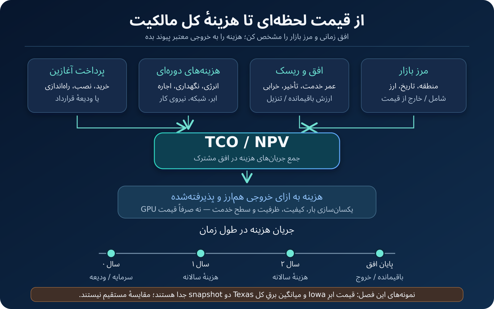

## ۲. واحد تصمیم و مرز مقایسه را پیش از قیمت‌گیری بنویسید

قبل از درخواست پیش‌فاکتور، یک برگهٔ یک‌صفحه‌ای برای هر سناریو بسازید:

- **خروجی:** چه کاری باید تمام شود؟ مثلاً تعداد آزمایش‌های آموزشیِ پذیرفته‌شده، درخواست استنتاج در بار و سطح کیفیت معین، یا حجم دادهٔ پردازش‌شده. «یک ساعت GPU» به‌تنهایی خروجی نیست.
- **کیفیت و ظرفیت:** معیار پذیرش، حجم هم‌زمانی، زمان پاسخ، حافظه و پایداری موردنیاز چیست؟ خروجی ارزان‌تر که نیاز را برآورده نمی‌کند، گزینهٔ هم‌ارز نیست.
- **افق:** چند ماه یا سال استفاده می‌کنیم؟ عمر مفید فنی را با عمر پشتیبانی، قرارداد، سیاست نگهداری داده و دورهٔ بودجه یکی نگیرید.
- **بازار و تاریخ:** کشور/منطقه، ارز، مالیات یا وضعیت معافیت، تاریخ مشاهدهٔ قیمت، تاریخ اعتبار پیشنهاد و زمان تحویل را ثبت کنید.
- **مرز خدمت:** در قیمت چه چیزی هست و چه چیزی نیست؟ برای خرید، تحویل و راه‌اندازی؛ برای اجاره، تعمیر و بازگشت؛ برای ابر، دیسک، شبکه، پشتیبانی، ظرفیت رزروشده و هزینهٔ خروج داده را جداگانه روشن کنید.
- **سطح خدمت و ریسک:** دسترس‌پذیری، زمان تعمیر/جایگزینی، پشتیبان، تحمل توقف و حداکثر بودجهٔ مجاز را بنویسید.

این مشخصات مقایسه را قابل بازتولید می‌کند. دو قیمت با واحد یا مرز متفاوت، حتی اگر هر دو «ماهانه» باشند، مستقیماً قابل قیاس نیستند.

## ۳. هزینهٔ کل مالکیت را به دفترهای جدا بشکنید

یک مدل مفید هزینه‌ها را دست‌کم به چهار دفتر تقسیم می‌کند:

1. **یک‌باره و آغازین:** خرید یا ودیعه، حمل، بیمهٔ حمل، مالیات/عوارض، رک و کابل، UPS، نصب، راه‌اندازی، آزمون پذیرش و انتقال داده.
2. **ثابت و دوره‌ای:** پشتیبانی، نگهداری، قرارداد، بیمه، فضا، مجوز، نیروی بهره‌برداری و هزینهٔ ثابت اتصال.
3. **متغیر با مصرف:** انرژی، مصرف ساعتی ابر، ذخیره‌سازی، خروج داده، ظرفیت‌افزوده، مصرفی‌ها و هزینهٔ وابسته به تعداد اجرا.
4. **ریسک، خروج و ارزش پایانی:** تأخیر عرضه، خرابی، زمان ازکارافتادگی، تعویض، تمدید اجباری، هزینهٔ مهاجرت/پاک‌سازی، بازگرداندن تجهیز، خرید انتهای اجاره و ارزش فروش/باقیمانده.

هزینهٔ مالکیت کل (Total Cost of Ownership, **TCO**) به افق مشخص وابسته است؛ یک تعریف سادهٔ اسمی چنین است:

<math xmlns="http://www.w3.org/1998/Math/MathML" display="block" aria-label="هزینهٔ کل مالکیت اسمی برابر هزینهٔ آغازین به‌علاوهٔ مجموع هزینه‌های هر سال، منهای ارزش باقیمانده در پایان افق است">
  <mrow><msub><mi>TCO</mi><mi>H</mi></msub><mo>=</mo><msub><mi>C</mi><mn>0</mn></msub><mo>+</mo><munderover><mo>∑</mo><mrow><mi>t</mi><mo>=</mo><mn>1</mn></mrow><mi>H</mi></munderover><msub><mi>C</mi><mi>t</mi></msub><mo>−</mo><msub><mi>R</mi><mi>H</mi></msub></mrow>
</math>

**متن جایگزین فرمول:** `TCO_H = C_0 + Σ(t=1..H) C_t − R_H`؛ در این نمایش ساده، `C_0` پرداخت آغازین، `C_t` هزینهٔ سال `t` و `R_H` ارزش باقیمانده در پایان افق است.

این فرمول قرارداد مدل است، نه قاعدهٔ حسابداری. اگر در جریان‌های نقدی، ارزش باقیمانده را از سال پایانی کم کرده‌اید، آن را دوباره از TCO کم نکنید. همچنین استهلاک دفتری را روی خرید نقدی اضافه نکنید، مگر هدف مشخصاً صورت سودوزیان یا مالیات باشد؛ استهلاک با خروج وجه نقد یکسان نیست. برای گزارش مالیاتی/حسابداری از متخصص همان حوزه و همان jurisdiction راهنمایی بگیرید.

## ۴. اسمی یا ارزش فعلی؟ زمان پرداخت را آشکار کنید

جمع اسمی پول در سال‌های مختلف، اثر زمان ارزش پول را نادیده می‌گیرد. برای مقایسهٔ جریان‌ها در یک افق، ارزش فعلی خالص هزینه‌ها (Net Present Value, **NPV**) را می‌توان با نرخ تنزیل سالانهٔ `r` نوشت:

<math xmlns="http://www.w3.org/1998/Math/MathML" display="block" aria-label="ارزش فعلی هزینه برابر هزینهٔ سال صفر به‌علاوهٔ مجموع هزینهٔ سال t تقسیم بر یک به‌علاوهٔ نرخ تنزیل به توان t است؛ ارزش باقیمانده در سال H به صورت جریان منفی وارد می‌شود">
  <mrow><mi>NPV</mi><mo>=</mo><msub><mi>C</mi><mn>0</mn></msub><mo>+</mo><munderover><mo>∑</mo><mrow><mi>t</mi><mo>=</mo><mn>1</mn></mrow><mi>H</mi></munderover><mfrac><msub><mi>C</mi><mi>t</mi></msub><msup><mrow><mo>(</mo><mn>1</mn><mo>+</mo><mi>r</mi><mo>)</mo></mrow><mi>t</mi></msup></mfrac></mrow>
</math>

**متن جایگزین فرمول:** `NPV = C_0 + Σ(C_t / (1+r)^t)`؛ اگر ارزش باقیمانده وجود دارد، آن را به‌صورت جریان هزینهٔ منفی در سال `H` وارد کنید. نرخ `r` باید از سیاست مالی/بودجهٔ سازمان یا فرض مستند بیاید؛ آن را از روی نرخ بهرهٔ دلخواه انتخاب نکنید.

در برگهٔ تصمیم، **هر دو** جمع اسمی و NPV را نگه دارید و زمان‌بندی پرداخت را نشان دهید. نرخ اسمی را با جریان اسمی و نرخ واقعی را با جریان ثابت‌قیمت جفت کنید؛ تورم و افزایش قرارداد را دوبار نشمارید. اگر نرخ تنزیل، عمر خدمت یا ارزش پایانی عوض شود، نتیجه را در سناریوی حساسیت دوباره حساب کنید. این مدل جایگزین تحلیل مالی رسمی نیست.

## ۵. خرید: فراتر از قیمت فاکتور

در سناریوی خرید، نقطهٔ شروع پیش‌فاکتور هم‌دامنه است. ردیف‌های جداگانه را بررسی کنید:

- تجهیز، قطعهٔ جایگزین و زمان تحویل؛
- حمل، بسته‌بندی/بیمه، مالیات و هزینهٔ وارداتِ مربوط به بازار واقعی؛
- میزبان و سازگاری مادربرد، شاسی، مسیر PCIe، RAM و firmware؛
- برق ورودی، مدار/UPS، کابل و آزمون بار؛
- خنک‌کاری و ظرفیت اتاق، رک، فضا و نویز؛
- شبکه و ذخیره‌سازیِ لازم برای بار، backup و انتقال داده؛
- نصب، پذیرش، آموزش، زمان نیروی فنی و پشتیبانی؛
- قطعهٔ یدکی، تعمیر، توقف، تمدید ضمانت و پایان عمر؛
- ارزش باقیمانده و هزینهٔ پاک‌سازی/فروش/حذف در پایان افق.

فصل ۵۵ فهرست سازگاری را نگه می‌دارد؛ بودجه نباید با جمعِ قیمت چند قلم ناسازگار ساخته شود. ردیف «احتیاط» را نیز به نام و دلیل مشخص ثبت کنید؛ درصدی بی‌منبع که همهٔ ریسک‌ها را می‌پوشاند، جایگزین برآورد شفاف نیست.

## ۶. برق: واحد اندازه‌گیری و مرز تأسیسات را اعلام کنید

هزینهٔ انرژی برای تخمین ساده از توان ورودیِ اندازه‌گیری‌شده، ساعت کار و نرخ برق به‌دست می‌آید:

<math xmlns="http://www.w3.org/1998/Math/MathML" display="block" aria-label="هزینهٔ انرژی برابر توان ورودی بر حسب کیلووات ضربدر ساعت روشن‌بودن ضربدر نرخ دلار به ازای هر کیلووات ساعت است">
  <mrow><msub><mi>C</mi><mtext>energy</mtext></msub><mo>=</mo><msub><mi>P</mi><mtext>site,kW</mtext></msub><mo>×</mo><mi>h</mi><mo>×</mo><msub><mi>p</mi><mtext>USD/kWh</mtext></msub></mrow>
</math>

**متن جایگزین فرمول:** `هزینهٔ انرژی = توان ورودیِ سایت (kW) × ساعت (h) × نرخ ($/kWh)`؛ نمونهٔ قابل‌اندازه‌گیری را از توان اسمی یا TDP به‌جای متر/زیرمتر معتبر نسازید.

برای هزینهٔ تأسیسات روشن کنید آیا مرز کنتور فقط node است یا سرمایش، UPS و شبکه را نیز دربرمی‌گیرد. اگر از PUE استفاده می‌کنید، تعریف و اندازه‌گیری آن را ثبت کنید و بار سرمایش را دوباره به هزینهٔ برقِ کل ساختمان اضافه نکنید. تعرفه ممکن است هزینهٔ تقاضا، پلهٔ مصرف، زمان‌مند، مالیات، حداقل قبض یا تعدیل داشته باشد؛ میانگین انرژی را قبض کامل فرض نکنید.

**نمونهٔ بازار، نه تعرفهٔ Dallas:** جدول رسمی EIA برای بخش تجاری Texas، میانگین **8.96 سنت/kWh** را برای **August 2026** گزارش می‌کند؛ جدول در **2026-10-23** منتشر شده و دادهٔ آن statewide و مقدماتی است [۴]. با این نرخ، `1000 kWh × $0.0896/kWh = $89.60` به‌عنوان ضرب آموزشی به‌دست می‌آید؛ این مبلغ قبض، تعرفهٔ Dallas، هزینهٔ demand یا نرخ یک مشتری واقعی نیست.

## ۷. ابر: نرخ ماشین را از فاکتور کامل جدا کنید

برای ماشین‌های ابری، دست‌کم این ردیف‌ها را جدا نگه دارید:

- زمان صورتحساب ماشین (ساعت، دقیقه یا granularity واقعی ارائه‌دهنده) و حداقل/گردکردن؛
- ماشین فعالِ بیکار، ظرفیت رزروشده، commitment و شرایط تخفیف؛
- دیسک، snapshot، ذخیره‌سازی پایدار، IOPS و انتقال داده؛
- شبکه، egress، load balancer، IP و سرویس‌های پیرامونی؛
- منطقه، پشتیبانی، مجوز نرم‌افزار، مالیات و اعتبار/هزینهٔ خروج؛
- ساخت و حذف منابع، quota، نگهداری داده و نیروی بهره‌برداری.

نمونهٔ مستند و تاریخ‌دار این فصل:

| قلم | مشاهدهٔ منتشرشده | بازار و تاریخ | داخل/خارج از عدد |
|---|---|---|---|
| ماشین `g4-standard-48` | **$4.49993 به‌ازای VM-hour** | Iowa, US، منطقهٔ `us-central1`؛ صفحهٔ قیمت واکشی‌شده در 2026-11-06 | قیمت ماشین کاملِ فهرست‌شده؛ دیسک، شبکه/egress، مالیات و سرویس‌های دیگر جدا هستند. نرخ Dallas نیست. |
| پیکربندی منتشرشدهٔ همین نوع ماشین | 48 vCPU، 180 GB حافظهٔ میزبان، یک NVIDIA RTX PRO 6000 با 96 GB GDDR7 | مستندات رسمی خانوادهٔ G4؛ بازبینی 2026-11-06 | مشخصهٔ فهرست‌شدهٔ ماشین؛ تضمین کارایی بار شما یا قیمت خرید محلی نیست. |
| میانگین برق تجاری | **8.96¢/kWh** | Texas statewide؛ دادهٔ August 2026، انتشار 2026-10-23 | میانگین ایالتی EIA؛ نه Dallas tariff و نه قبض/هزینهٔ نهایی مشتری. |

صفحهٔ قیمت Google Cloud در تاریخ بازبینی، نرخ بالا را برای Iowa (`us-central1`) نشان می‌داد [۲]. مستندات ماشین، مشخصهٔ `g4-standard-48` را ثبت می‌کند [۳]. برای **1000 VM-hour**، ضرب مستقیم برابر **$4,499.93** می‌شود؛ این فقط خط محاسبات ماشین در آن snapshot است. ذخیره‌سازی، شبکه/خروج داده، پشتیبانی، مالیات، ساعات بیکار، شرایط قراردادی و تغییر بعدی قیمت را از آن نتیجه نگیرید.

جدول برق و قیمت ابر دو دادهٔ متفاوت‌اند: اولی میانگین ایالتی برق تجاری است، دومی نرخ یک ماشین در یک منطقهٔ ابری. کنار هم آوردن آن‌ها به معنی مقایسهٔ مستقیم خرید در Dallas با cloud نیست. هر نقل‌قول ابری جدید باید همان بازار، منطقه، تاریخ، ارز، نوع خرید و فهرست اقلام را دوباره ثبت کند.

## ۸. اجاره، مالکیت و مصرف ابری را در افق یکسان بسنجید

- **خرید:** پرداخت سرمایه‌ای و هزینهٔ زیرساخت/نگهداری در برابر دسترسی و اختیار کنترل؛ ارزش باقیمانده، ظرفیت بلااستفاده و مسئولیت تعمیر بر عهدهٔ خریدار است.
- **اجاره/لیزینگ:** پرداخت دوره‌ای، ودیعه، مدت اجباری، SLA، نگهداری، جریمهٔ خروج، خرید انتهای دوره، هزینهٔ بازگشت و مسئولیت خرابی را بخوانید. «ماهانه» بدون مدت قرارداد، واحد مقایسه نیست.
- **ابر:** هزینه با مصرف بالا و پایین می‌رود و راه‌اندازی می‌تواند سریع باشد؛ اما انتقال داده، نگهداری منابع، هزینهٔ idle، وابستگی به منطقه/خدمت، تغییر نرخ، شبکه، quota و کنترل حاکمیتی نیز وارد تصمیم می‌شوند.

این‌ها یک رتبه‌بندی ثابت ندارند. خرید می‌تواند برای بار پایدار و ظرفیت واقعاً مصرف‌شده مناسب باشد؛ ابر می‌تواند برای آزمایش کوتاه یا تقاضای ناپایدار ارزش داشته باشد؛ اجاره ممکن است انعطاف قرارداد یا پشتیبانی‌ای بدهد که در خرید جداست. پاسخ را بار کاری، نیاز خدمت، موجودی ظرفیت، قرارداد و مقایسهٔ خروجی می‌سازند، نه برچسب «محلی» یا «ابر».

برای هر گزینه افق زمانی را یکسان کنید. اگر خرید سه ساله را با یک ماه ابر بسنجید، دو مسئلهٔ متفاوت را پاسخ داده‌اید. نرخ مصرف، رشد/کاهش workload، برنامهٔ ارتقا، زمان تحویل، مهاجرت و هزینهٔ پایان قرارداد را همسان‌سازی کنید.

## ۹. نقطهٔ سربه‌سر فقط با واحد و افق مشخص معنا دارد

برای یک مثال خطیِ ساده در افق ثابت، فرض کنید هزینهٔ ثابت مالکیت `F_own`، هزینهٔ متغیر مالکیت به‌ازای ساعت مصرف `v_own`، هزینهٔ ثابت گزینهٔ دوم `F_alt` و هزینهٔ هر ساعت گزینهٔ دوم `r_alt` باشد. آنگاه ساعت مصرفِ سربه‌سرِ فرضی چنین است:

<math xmlns="http://www.w3.org/1998/Math/MathML" display="block" aria-label="ساعت سربه‌سر برابر اختلاف هزینهٔ ثابت مالکیت و گزینهٔ دیگر تقسیم بر اختلاف نرخ متغیر گزینهٔ دیگر و مالکیت است، به شرط مثبت بودن مخرج و یکسان بودن خدمت">
  <mrow><msub><mi>h</mi><mo>*</mo></msub><mo>=</mo><mfrac><mrow><msub><mi>F</mi><mtext>own</mtext></msub><mo>−</mo><msub><mi>F</mi><mtext>alt</mtext></msub></mrow><mrow><msub><mi>r</mi><mtext>alt</mtext></msub><mo>−</mo><msub><mi>v</mi><mtext>own</mtext></msub></mrow></mfrac></mrow>
</math>

**متن جایگزین فرمول:** `h* = (F_own − F_alt) / (r_alt − v_own)`؛ فقط اگر مخرج مثبت و خدمت/خروجی، ظرفیت و افق یکسان باشد. اگر مخرج صفر یا منفی است یا هزینه‌ها غیرخطی/قراردادی‌اند، این رابطه نقطهٔ سربه‌سر قابل استفاده نمی‌دهد.

در خرید چندساله، `F_own` باید هزینهٔ ثابت همان افق، ارزش باقیمانده و زمان پرداخت را مطابق تعریف مدل داشته باشد؛ نرخِ متغیر را با هزینهٔ انرژی/نگهداری واقعی تعریف کنید. برای بار کاری متفاوت، به‌جای «ساعت» از خروجی پذیرفته‌شده یا بار benchmark همسان‌شده استفاده کنید. این تقریب دسترس‌پذیری، خرابی و تأخیر عرضه را مدل نمی‌کند.

## ۱۰. هزینه بر واحد خروجی: نخست، هم‌ارزی را ثابت کنید

اگر افق هزینه `H` سال و تعداد خروجی‌های پذیرفته‌شده `Q` باشد، می‌توان نرخ هزینه را چنین گزارش کرد:

<math xmlns="http://www.w3.org/1998/Math/MathML" display="block" aria-label="هزینهٔ هر خروجی پذیرفته‌شده برابر ارزش فعلی کل هزینه تقسیم بر تعداد خروجی‌های هم‌ارز و پذیرفته‌شده در همان افق است">
  <mrow><msub><mi>C</mi><mtext>per accepted unit</mtext></msub><mo>=</mo><mfrac><mi>NPV</mi><mi>Q</mi></mfrac></mrow>
</math>

**متن جایگزین فرمول:** `هزینهٔ هر واحد پذیرفته‌شده = NPV / Q`؛ `Q` باید تعداد خروجی‌هایی باشد که کیفیت و معیار پذیرش مشترک را گذرانده‌اند، نه تعداد batch فرضی.

برای معتبر بودن این تقسیم، workload، کیفیت، سطح خدمت و معیار پذیرش باید همسان باشد و `Q` از benchmark یا دادهٔ عملیاتیِ قابل تکرار بیاید. هزینهٔ به ازای token، image یا training step بدون مشخصات کیفیت، توالی، batch، وقت‌بیکاری، نرخ شکست و هزینه‌های اطراف می‌تواند گمراه‌کننده باشد. اگر یکی از فرض‌های هم‌ارزی اندازه‌گیری نشده، مقدار را صرفاً یک **سناریوی محاسباتی** و نه ranking گزینه‌ها گزارش کنید.

## ۱۱. عدم‌قطعیت را به یک عددِ ظاهراً دقیق پنهان نکنید

برای هریک از ورودی‌های حساس، بازهٔ معقول و منبع آن را ثبت کنید:

- ساعت مصرف و درصد بیکاری؛
- قیمت معتبر خرید، هزینهٔ تحویل و موعد دسترسی؛
- نرخ انرژی و مرز اندازه‌گیری؛
- عمر خدمت، ارزش باقیمانده و هزینهٔ تعویض؛
- مدت اجاره، جریمهٔ فسخ و شرایط تمدید؛
- نرخ cloud، زمان billed، storage/egress و رشد داده؛
- زمان نیروی نگهداری، توقف و هدف بازیابی.

سه سناریوی **کم/پایه/زیاد** را با فرض‌های مشخص نگه دارید؛ سپس حساسیت یک‌به‌یک را نشان دهید. نمودار tornado یا جدول حساسیت زمانی مفید است که ورودی‌های پرتأثیر و منشأ بازه روشن باشند. اگر احتمال خرابی/تأخیر را به‌کار می‌برید، احتمال و پیامد باید مستند و متعلق به زمینهٔ شما باشد؛ ضرب `احتمال × پیامد` فقط خلاصهٔ مورد انتظارِ همان مفروضات است، نه پیش‌بینی قطعی.

GAO-20-195G بر تعریف هدف و دامنه، مستندسازی فرض‌ها و داده، تحلیل ریسک/عدم قطعیت، بازبینی برآورد و به‌روزرسانی با هزینهٔ واقعی تأکید دارد [۱]. آن را چرخهٔ مدیریت برآورد بخوانید، نه قالبی که به‌تنهایی دقت رقم را تضمین کند. نسخهٔ تاریخ‌دارِ ورودی و دلیل هر تغییر را نگه دارید.

## ۱۲. زمان تحویل و ظرفیت: هزینهٔ توقف هم بخشی از تصمیم است

برای سخت‌افزاری که باید خریداری شود، زمان تحویل و احتمال نبود کالا می‌تواند هزینهٔ واقعی ایجاد کند: تأخیر پژوهش، رزرو نیروی کار، تمدید اجارهٔ موقت، جابه‌جایی برنامهٔ پروژه یا ازدست‌رفتن ظرفیت. این اثرها را با منبع و واحد روشن کنید؛ آن‌ها را بی‌دلیل به مبلغ فاکتور اضافه نکنید.

در برگهٔ خرید، حداقل این ستون‌ها را داشته باشید: تاریخ استعلام، انقضا، فروشنده/کانال مجاز، شمارهٔ دقیق مدل و revision، تحویل، ارز، مالیات/حمل، موجودی، ضمانت، تعمیر/RMA، جایگزین مجاز، شرط فسخ و زمان پرداخت. اگر نرخ یا موجودی فقط شفاهی است، آن را «تأییدنشده» علامت بزنید.

گزینهٔ جایگزین را فقط به‌دلیل قیمت کمتر قبول نکنید. فصل ۵۵ ماتریس سازگاری را حفظ می‌کند؛ تغییری در GPU، PSU، شاسی، firmware، driver یا مسیر داده نیازمند آزمون سازگاری و پذیرشِ دوبارهٔ معماری است.

## ۱۳. ریسک عرضه و بررسی موشکافانهٔ تأمین‌کننده

هزینهٔ پایین روی کاغذ می‌تواند با نبود قطعه، منبع نامعتبر، پشتیبانی ضعیف یا وابستگیِ تک‌تأمین‌کننده دوام نیاورد. بررسی را متناسب با اهمیت سامانه و توان سازمان انجام دهید: مالکیت و کنترل تأمین‌کننده، اصالت و منشأ قطعه، مسیر توزیع، سابقهٔ جایگزینی، تاب‌آوری، امنیت پایه، نگهداری firmware/driver، دسترسی به اصلاحیه، تعمیر، قطعات یدکی، انقضای پشتیبانی، وابستگی‌های زیرتأمین‌کننده و برنامهٔ خروج.

NIST SP 1326، نسخهٔ نهایی منتشرشده در **2026-07-08**، یک راهنمای شروع برای بررسی موشکافانهٔ زنجیرهٔ تأمین سایبریِ ICT در چارچوب SP 800-161 Rev. 1 است [۵][۶]. پنج محور آن عبارت‌اند از: **FOCI** (مالکیت/کنترل/نفوذ خارجی)، **Provenance** (منشأ و زنجیرهٔ نگهداری)، **Resilience** (تاب‌آوری)، **Foundational Cyber Practices** (رویه‌های پایهٔ امنیت سایبری) و **Supply Chain Tiers** (لایه‌های زنجیرهٔ تأمین). این‌ها محورهای بررسی‌اند؛ SP 1326 گواهیِ محصول یا فروشنده نیست، فهرست تضمین خرید نیست و به‌خودی‌خود الزام قانونی برای همهٔ خریداران ایجاد نمی‌کند.

برای پروژهٔ کوچک، می‌توان همین سؤال‌ها را متناسب و مستند کرد؛ برای سامانهٔ حساس، باید مسئولیت، شواهد، سطح دسترسی و مسیر اصلاح/قطع همکاری تعریف شود. هیچ checkbox منفردی ریسک را صفر نمی‌کند. قیمت، مالکیت، کشور ساخت یا برچسب انطباق به‌تنهایی برای نتیجه‌گیری کافی نیست.

## ۱۴. بودجه را مرحله‌ای آزاد کنید، نه با یک تصمیم برگشت‌ناپذیر

یک برنامهٔ نمونهٔ چهاردروازه‌ای:

1. **دروازهٔ تعریف:** خروجی/سطح خدمت، مرز فنی فصل ۵۵، برآورد فصل ۵۴، بازار و تاریخ قیمت، سناریوهای هزینه، ریسک و سقف بودجه را بازبینی کنید. ابهام‌های گران را فهرست کنید.
2. **دروازهٔ آزمون محدود:** پیش از خرید بزرگ، از ظرفیت موجود، اجاره یا سرویس کوتاه‌مدت استفاده کنید تا throughput، کیفیت، انرژی، bottleneck و زمان کار واقعی سنجیده شود. قرارداد و سقف مصرف را محدود کنید.
3. **دروازهٔ توسعه:** فقط اگر آزمون نیاز را برآورده کرد، سازگاری/پشتیبانی/عرضه تأیید شد و هزینه بر خروجی قابل‌قبول بود، ظرفیت را مرحله‌ای اضافه کنید. نقطهٔ توقف و شخص تأییدکننده را تعیین کنید.
4. **دروازهٔ تمدید یا خروج:** پیش از پایان عمر/قرارداد، داده را مهاجرت/پاک‌سازی، رسانه و تجهیز را امن بازگردان/حذف، هزینهٔ باقی‌مانده و ارزش پایانی را بازبینی و تصمیم تمدید، فروش یا بازنشستگی را مستند کنید.

پایلوت، benchmark یا پیش‌فاکتور نتیجهٔ قطعی آینده نیست. هدف مرحله‌بندی این است که ورودی‌های مهم با واقعیت به‌روز شوند و تصمیم بزرگ بعد از یادگیری قابل لغو باشد.

## ۱۵. گردش‌کار برآوردی که بتوان بعداً بازبینی کرد

1. نسخهٔ نیاز و خروجی را قفل کنید؛ تغییر نیاز، تغییر برآورد را ثبت کند.
2. برای هر سناریو، بازار/منطقه، تاریخ، ارز، واحد مصرف و شمول قیمت را مشخص کنید.
3. درخواست‌های خرید/اجاره را با یک فهرست اجزا و سطح خدمت یکسان ارسال کنید.
4. قیمت را به جریان‌های یک‌باره، دوره‌ای، متغیر، خروج/ریسک و باقیمانده تفکیک کنید.
5. زمان تحویل، تعهد، تمدید، قطعات و پشتیبانی را با شاهد قرارداد/فروشنده بررسی کنید.
6. برق و استفاده را در مرز اعلام‌شده اندازه بگیرید؛ تخمین فصل ۵۴ را با آزمون واقعی جایگزین یا اصلاح کنید.
7. TCO اسمی و NPV را در افق یکسان بسازید؛ نرخ تنزیل، تورم، گردکردن و زمان‌بندی را اعلام کنید.
8. بد/پایه/خوب، حساسیت، محدودیت داده و ریسک زنجیره را ثبت کنید.
9. تأییدهای فنی، امنیتی، مالی و عملیاتی را از مسئولان مربوط بگیرید.
10. بعد از خرید یا اجرا، برآورد را با قبض، زمان تعمیر، مصرف، ساعت billed و خروجی پذیرفته‌شده مقایسه و به‌روزرسانی کنید.

راهنمای پروژه یک نسخهٔ محلی و آفلاین از همین حساب‌هاست؛ در بخش بعد، مرز محاسبات آن صریح می‌شود.

## ۱۶. پروژهٔ فصل: مدل آفلاین و fixture تاریخ‌دار

پروژهٔ `56-ai-compute-budget` با `Decimal`، یک fixture JSON را می‌خواند و جریان هزینهٔ سه سناریوی آموزشی را حساب می‌کند: خرید مصنوعی، اجارهٔ مصنوعی و مثال محاسباتی ابر. کد هیچ درخواست شبکه‌ای نمی‌زند و هیچ سخت‌افزاری را اندازه نمی‌گیرد.

در fixture، قیمت ابری `4.49993 USD/VM-hour` با بازار Iowa (`us-central1`) و تاریخ مشاهدهٔ 2026-11-06 ثبت شده است. نرخ `0.0896 USD/kWh`، میانگین تجاری کل Texas برای August 2026 است که 2026-10-23 منتشر شد؛ این ورودی فقط برای ردیف‌های فرضی برق خرید/اجاره استفاده شده و تعرفهٔ Dallas نیست. مبالغ acquisition، اجاره، نگهداری، ساعات مصرف، سایر هزینه‌ها، ارزش باقیمانده و تعداد «تحویل»‌ها همگی `synthetic_fixture` هستند؛ هیچ‌کدام نقل‌قول فروشنده یا اندازه‌گیری واقعی نیستند.

**اجرا از ریشهٔ مخزن:**

```bash
python -m unittest discover -s book-engineering/projects/56-ai-compute-budget -v
python book-engineering/projects/56-ai-compute-budget/budget_model.py \
  --fixture book-engineering/projects/56-ai-compute-budget/sample_budget.json \
  --output book-engineering/projects/56-ai-compute-budget/results.json
```

مدل با نرخ سالانهٔ تنزیل ۵٪ و افق مصنوعی سه‌ساله، جریان اولیه را در سال صفر، هزینه‌های تکرارشونده را در پایان سال و ارزش باقیمانده/خرید پایانی را در افق منظور می‌کند. هزینه‌های هر سال برای گزارش به سنت گرد می‌شوند. صورتحساب واقعی ممکن است granularity و شیوهٔ گردکردن دیگری داشته باشد.

## ۱۷. خروجی نمونه و آنچه از آن **نمی‌توان** نتیجه گرفت

اجرای fixture، این مقادیر را می‌دهد:

| سناریوی مصنوعی | TCO اسمی (USD) | NPV با فرض ۵٪ (USD) | NPV بر «تحویل فرضی» (USD) |
|---|---:|---:|---:|
| خرید synthetic | 8,595.14 | 8,577.77 | 23.83 |
| اجاره synthetic | 14,005.14 | 12,726.99 | 35.35 |
| cloud snapshot illustration | 12,149.82 | 11,028.99 | 30.64 |

این جدول **رتبه‌بندی خرید واقعی نیست**. هزینهٔ خرید/اجاره مصنوعی است، تعداد سالانهٔ تحویل‌ها فرض شده، هم‌ارزی throughput/کیفیت سنجیده نشده، و فقط خط ماشین ابر از snapshot منتشرشده آمده است. مدل نیز مالیات، تامین مالی، تورم/افزایش قیمت، هزینهٔ demand، نیروی کار، downtime، تمدید پشتیبانی، هزینهٔ کامل cloud، outage و هزینهٔ تغییر/خروج را وارد نمی‌کند. قیمت Iowa را برای Dallas به‌کار نبرید و میانگین برق Texas را تعرفهٔ محلی نخوانید.

`results.json` علاوه بر خروجی، SHA-256 fixture، بازار/تاریخ ورودی، تعداد فرضی، جریان‌های سالانه و محدودیت‌ها را نگه می‌دارد. آزمون‌ها هم قیمت/بازار، برچسب synthetic، نرخ تبدیل انرژی، NPV، ورودی‌های منفی/نامتناهی و برابری کد/fixture را بررسی می‌کنند؛ این‌ها آزمون حسابداری کدند، نه آزمون کارایی دستگاه یا پیش‌بینی قیمت.

## ۱۸. تمرین‌ها

۱. برای یک طرح آزمایشگاهی از فصل ۵۵، واحد تصمیم را در یک جمله بنویسید. حداقل سه معیار خروجی یا سطح خدمت را مشخص کنید که باید در خرید، اجاره و ابر برابر باشند.

۲. از نمونهٔ فصل، محاسبهٔ `1000 VM-hour × $4.49993` را بازتولید کنید. دست‌کم پنج قلمی را نام ببرید که از این خط هزینه نمی‌توان درباره‌شان نتیجه گرفت. منطقه و تاریخ مشاهده را نیز ذکر کنید.

۳. با میانگین EIA ثبت‌شده، هزینهٔ ضربی `540 kWh` را محاسبه کنید. توضیح دهید چرا این عدد به‌تنهایی قبض یک مشتری در Dallas نیست و برای تبدیل توان به kWh چه مرز/مدت اندازه‌گیری لازم است.

۴. در یک افق سه‌ساله، هزینهٔ خرید در آغاز `F_own=$10,000` و هزینهٔ متغیر مالکیت `$8/hour` فرض کنید؛ گزینهٔ دیگر `F_alt=$1,000` و نرخ `$20/hour` است. ساعت سربه‌سر را در مدل خطی حساب کنید. دو فرضی را بنویسید که اگر برقرار نباشند، نتیجه معتبر نیست.

۵. چرا استهلاک را نباید بی‌دلیل به پرداخت نقدی خرید اضافه کرد؟ تفاوت TCO نقدی با گزارش مالیاتی را در دو یا سه جمله توضیح دهید.

۶. برای فهرست خرید یک ردیفِ GPU با «قیمت بهتر» پیشنهاد شده، اما مدل دقیق یا revision آن فرق دارد. پیش از پذیرش جایگزین چه موارد فنی/تأمینی را بازبینی می‌کنید؟ چهار مورد کافی نیست؛ حداقل شش مورد بنویسید.

۷. پنج محور NIST SP 1326 را نام ببرید و یک جمله بگویید چرا این راهنما نه گواهی محصول است و نه منبع قیمت.

۸. یک برنامهٔ مرحله‌ای برای خرید یا تمدید خودتان بنویسید: آزمون اول، شرط توسعه، سقف هزینه و شرط توقف/خروج. تفاوت «قیمت» و «هزینه بر خروجی پذیرفته‌شده» را نیز در تصمیم ذکر کنید.

پاسخ‌نامهٔ مستقل و تشریحی تمرین‌ها در [پاسخ‌نامهٔ فصل ۵۶](book-engineering/answers/56-ai-compute-budget-fa.md) آمده است.

## ۱۹. جمع‌بندی

- هزینه را بر یک خدمت، خروجی، کیفیت، سطح دسترس‌پذیری و افق زمانی مشخص بسنجید؛ قیمت قطعه یا نرخ یک ساعت به‌تنهایی TCO نیست.
- جریان یک‌باره، ثابت، متغیر، ریسک/خروج و ارزش پایانی را جدا کنید؛ اسمی و NPV را با نرخ/زمان‌بندی مستند گزارش کنید.
- توان ورودی را در مرز مشخص بسنجید؛ تعرفهٔ برق، انرژی، هزینهٔ تقاضا و سرمایش را با هم خلط نکنید.
- بازار/منطقه/تاریخ و اقلام داخل/خارج از قیمت را روی هر snapshot ثبت کنید. نمونهٔ این فصل: قیمت G4 در Iowa (`us-central1`)، نه Dallas؛ میانگین برق statewide در Texas، نه تعرفهٔ محلی.
- فرض‌های synthetic و نقاط نامعلوم را صریح نگه دارید. بدون benchmark و هم‌ارزی خروجی، جدول هزینه حکم رتبه‌بندی عملکرد یا پیشنهاد خرید ندارد.
- استعلام، عرضه، منشأ، تاب‌آوری، پشتیبانی و برنامهٔ خروج را در کنار رقم بررسی کنید؛ سرمایه را مرحله‌ای آزاد و برآورد را با هزینهٔ واقعی به‌روز کنید.

در فصل ۵۷ وارد Python، PyTorch، JAX و TensorFlow می‌شویم. هزینهٔ فصل حاضر سقفِ خودکارِ انتخاب framework نیست؛ نیازهای اجرا، سازگاری و آزمون‌های workload باید به تصمیم نرم‌افزار پیوند بخورند.

## ۲۰. منابع و تاریخ بازبینی

**تاریخ بازبینی منابع: ۶ نوامبر ۲۰۲۶ (2026-11-06).** تاریخ snapshotهای بازار نیز جداگانه در متن و fixture ثبت شده است. قیمت cloud یک مشاهده از صفحهٔ رسمی در همان تاریخ است، نه quote یا ضمانت نرخ آینده. دادهٔ EIA مربوط به ماه August 2026 و انتشار 2026-10-23 است.

۱. U.S. Government Accountability Office, *Cost Estimating and Assessment Guide: Best Practices for Developing and Managing Program Costs*, GAO-20-195G, 2020-03-12. راهنمای برآورد، دامنه/فرض‌ها، داده، تحلیل ریسک و به‌روزرسانی: [gao.gov/products/gao-20-195g](https://www.gao.gov/products/gao-20-195g).

۲. Google Cloud, *Accelerator-optimized machine family pricing*. جدول قیمت رسمی؛ snapshot مورد استفاده برای `g4-standard-48` در `us-central1` / Iowa، بازبینی 2026-11-06: [cloud.google.com/products/compute/pricing/accelerator-optimized](https://cloud.google.com/products/compute/pricing/accelerator-optimized). نرخ نمایش‌داده‌شدهٔ مورد استفاده `$4.49993/VM-hour` است؛ ردیف‌های دیگر و نرخ مناطق دیگر ممکن است فرق کنند.

۳. Google Cloud, *Accelerator-optimized machines*. مشخصهٔ خانوادهٔ G4 و ماشین‌ها؛ بازبینی 2026-11-06: [docs.cloud.google.com/compute/docs/accelerator-optimized-machines](https://docs.cloud.google.com/compute/docs/accelerator-optimized-machines). مستندات و محل عرضه را برای پیکربندی/زمان خرید خود دوباره بررسی کنید.

۴. U.S. Energy Information Administration, *Electric Power Monthly, Table 5.6.A: Average Price of Electricity to Ultimate Customers by End-Use Sector*. جدول رسمی XLSX: [eia.gov/electricity/monthly/xls/table_5_06_a.xlsx](https://www.eia.gov/electricity/monthly/xls/table_5_06_a.xlsx); صفحهٔ جدول: [eia.gov/electricity/monthly/epm_table_grapher.php?t=epmt_5_6_a](https://www.eia.gov/electricity/monthly/epm_table_grapher.php?t=epmt_5_6_a). مقدار نمونه برای Texas commercial، August 2026: `8.96¢/kWh`; statewide average مقدماتی، نه تعرفهٔ Dallas.

۵. National Institute of Standards and Technology, *NIST Cybersecurity Supply Chain Risk Management: Due Diligence Assessment Quick-Start Guide*, NIST SP 1326, نسخهٔ نهایی منتشرشده در 2026-07-08: [csrc.nist.gov/pubs/sp/1326/final](https://csrc.nist.gov/pubs/sp/1326/final). دامنهٔ این راهنما، بررسی موشکافانهٔ ICT در چارچوب مدیریت ریسک زنجیرهٔ تأمین سایبری است.

۶. NIST, *Cybersecurity Supply Chain Risk Management Practices for Systems and Organizations*, SP 800-161 Rev. 1, Update 1: [csrc.nist.gov/pubs/sp/800/161/r1/upd1/final](https://csrc.nist.gov/pubs/sp/800/161/r1/upd1/final). چارچوب مرجع C-SCRM؛ نیازهای هر سازمان و قرارداد جداگانه بررسی شود.

## ۲۱. پیوست اجرایی: کد آزموده‌شدهٔ پروژه

فایل `budget_model.py` در پروژهٔ فصل، بدون اتصال شبکه، بر fixture محلی اجرا می‌شود. نسخهٔ زیر باید بایت‌به‌بایت با فایل پروژه برابر بماند؛ برای تغییر، ابتدا آزمون‌ها و manifest نتایج را به‌روز کنید.

```python
"""Transparent lifecycle-cost arithmetic for an explicitly synthetic fixture.

This module does not fetch prices, inspect hardware, offer tax/accounting advice,
or establish that different compute services deliver equivalent work.
"""
from __future__ import annotations

import argparse
import hashlib
import json
import sys
from decimal import Decimal, InvalidOperation, ROUND_HALF_UP
from pathlib import Path
from typing import Any

ROOT = Path(__file__).resolve().parent
CENT = Decimal("0.01")
ZERO = Decimal("0")


class BudgetInputError(ValueError):
    """Raised when the fixture is incomplete, inconsistent, or non-finite."""


def decimal_value(value: Any, field: str) -> Decimal:
    if isinstance(value, bool):
        raise BudgetInputError(f"{field} must be a finite decimal, not a boolean")
    try:
        result = Decimal(str(value))
    except (InvalidOperation, ValueError, TypeError) as error:
        raise BudgetInputError(f"{field} must be a finite decimal") from error
    if not result.is_finite():
        raise BudgetInputError(f"{field} must be finite")
    return result


def nonnegative(value: Any, field: str) -> Decimal:
    result = decimal_value(value, field)
    if result < ZERO:
        raise BudgetInputError(f"{field} must be nonnegative")
    return result


def integer(value: Any, field: str, *, minimum: int = 0) -> int:
    if isinstance(value, bool) or not isinstance(value, int) or value < minimum:
        raise BudgetInputError(f"{field} must be an integer >= {minimum}")
    return value


def cents(value: Decimal) -> Decimal:
    return value.quantize(CENT, rounding=ROUND_HALF_UP)


def energy_cost_usd(site_input_kw: Any, powered_hours: Any, rate_usd_per_kwh: Any) -> Decimal:
    """Compute meter-boundary kWh times a user-supplied USD/kWh rate."""
    kw = nonnegative(site_input_kw, "site_input_kw")
    hours = nonnegative(powered_hours, "powered_hours")
    rate = nonnegative(rate_usd_per_kwh, "rate_usd_per_kwh")
    return kw * hours * rate


def cloud_compute_cost_usd(hourly_rate_usd: Any, billed_hours: Any) -> Decimal:
    rate = nonnegative(hourly_rate_usd, "hourly_rate_usd")
    hours = nonnegative(billed_hours, "billed_hours")
    return rate * hours


def net_present_value(cashflows: list[Decimal], annual_discount_rate: Any) -> Decimal:
    """Discount costs at year-end; index 0 is the initial cash flow."""
    if not isinstance(cashflows, list) or not cashflows:
        raise BudgetInputError("cashflows must be a non-empty list")
    rate = nonnegative(annual_discount_rate, "annual_discount_rate")
    if rate >= Decimal("1"):
        raise BudgetInputError("annual_discount_rate must be less than 1 for this teaching model")
    total = ZERO
    factor = Decimal("1") + rate
    for year, amount in enumerate(cashflows):
        cash = decimal_value(amount, f"cashflows[{year}]")
        total += cash / (factor ** year)
    return total


def _require_mapping(value: Any, field: str) -> dict[str, Any]:
    if not isinstance(value, dict):
        raise BudgetInputError(f"{field} must be an object")
    return value


def validate_fixture(fixture: Any) -> dict[str, Any]:
    data = _require_mapping(fixture, "fixture")
    if data.get("schema_version") != 1:
        raise BudgetInputError("unsupported schema_version")
    if data.get("fixture_id") != "v4-ch10-synthetic-budget-v1":
        raise BudgetInputError("fixture_id does not match this chapter")
    if data.get("label_source") != "synthetic_fixture":
        raise BudgetInputError("the worked case must stay labeled synthetic_fixture")

    market = _require_mapping(data.get("market_snapshot"), "market_snapshot")
    cloud = _require_mapping(market.get("cloud_compute"), "market_snapshot.cloud_compute")
    energy = _require_mapping(market.get("electricity"), "market_snapshot.electricity")
    for record, field in ((cloud, "cloud_compute"), (energy, "electricity")):
        for required in ("as_of", "market", "currency", "source_url"):
            if not isinstance(record.get(required), str) or not record[required].strip():
                raise BudgetInputError(f"market_snapshot.{field}.{required} is required")
        if not record["source_url"].startswith("https://"):
            raise BudgetInputError(f"market_snapshot.{field}.source_url must use HTTPS")
    if cloud.get("currency") != "USD" or energy.get("currency") != "USD":
        raise BudgetInputError("the chapter fixture uses USD throughout")
    nonnegative(cloud.get("price_usd_per_instance_hour"), "cloud price")
    nonnegative(energy.get("price_usd_per_kwh"), "electricity price")
    if cloud.get("region") != "us-central1 (Iowa, US)":
        raise BudgetInputError("cloud snapshot region must remain explicit")
    if energy.get("market") != "Texas, US statewide commercial average":
        raise BudgetInputError("electricity snapshot must not be presented as a Dallas tariff")

    assumptions = _require_mapping(data.get("assumptions"), "assumptions")
    horizon = integer(assumptions.get("horizon_years"), "horizon_years", minimum=1)
    discount = nonnegative(assumptions.get("annual_discount_rate"), "annual_discount_rate")
    if discount >= Decimal("1"):
        raise BudgetInputError("annual_discount_rate must be less than 1")
    if assumptions.get("price_escalation_mode") != "held_constant_for_synthetic_demo":
        raise BudgetInputError("price_escalation_mode must disclose the fixture assumption")
    if assumptions.get("performance_parity_measured") is not False:
        raise BudgetInputError("the fixture must not claim measured performance parity")

    scenarios = data.get("scenarios")
    if not isinstance(scenarios, list) or len(scenarios) != 3:
        raise BudgetInputError("exactly three teaching scenarios are required")
    seen: set[str] = set()
    for index, raw in enumerate(scenarios):
        scenario = _require_mapping(raw, f"scenarios[{index}]")
        scenario_id = scenario.get("id")
        if not isinstance(scenario_id, str) or not scenario_id or scenario_id in seen:
            raise BudgetInputError(f"scenarios[{index}].id must be unique and non-empty")
        seen.add(scenario_id)
        if scenario.get("quote_status") != "synthetic_not_a_vendor_quote":
            raise BudgetInputError(f"{scenario_id} must disclose synthetic quote status")
        if scenario.get("strategy") not in {"buy", "lease", "cloud"}:
            raise BudgetInputError(f"{scenario_id}.strategy must be buy, lease, or cloud")
        integer(scenario.get("annual_deliverables"), f"{scenario_id}.annual_deliverables", minimum=1)
        nonnegative(scenario.get("annual_other_cost_usd"), f"{scenario_id}.annual_other_cost_usd")
        nonnegative(scenario.get("upfront_cost_usd"), f"{scenario_id}.upfront_cost_usd")
        if scenario["strategy"] in {"buy", "lease"}:
            nonnegative(scenario.get("site_input_kw"), f"{scenario_id}.site_input_kw")
            integer(scenario.get("annual_powered_hours"), f"{scenario_id}.annual_powered_hours")
            nonnegative(scenario.get("annual_maintenance_usd"), f"{scenario_id}.annual_maintenance_usd")
            if scenario.get("energy_price_source") != "market_snapshot.electricity":
                raise BudgetInputError(f"{scenario_id} must identify its electricity input source")
        if scenario["strategy"] == "buy":
            for key in ("acquisition_cost_usd", "residual_value_usd"):
                nonnegative(scenario.get(key), f"{scenario_id}.{key}")
        elif scenario["strategy"] == "lease":
            for key in ("monthly_lease_payment_usd", "end_of_term_buyout_usd", "residual_value_usd"):
                nonnegative(scenario.get(key), f"{scenario_id}.{key}")
        else:
            if scenario.get("price_source") != "market_snapshot.cloud_compute":
                raise BudgetInputError(f"{scenario_id} must identify the dated cloud price source")
            if decimal_value(scenario.get("instance_hourly_price_usd"), f"{scenario_id}.instance_hourly_price_usd") != decimal_value(
                cloud["price_usd_per_instance_hour"], "market cloud price"
            ):
                raise BudgetInputError("cloud scenario price differs from its dated market snapshot")
            integer(scenario.get("annual_billed_instance_hours"), f"{scenario_id}.annual_billed_instance_hours")
    return data


def _scenario_cashflows(scenario: dict[str, Any], years: int, energy_rate: Decimal, cloud_rate: Decimal) -> tuple[list[Decimal], dict[str, Any]]:
    strategy = scenario["strategy"]
    annual_deliverables = int(scenario["annual_deliverables"])
    annual_other = nonnegative(scenario["annual_other_cost_usd"], "annual_other_cost_usd")
    upfront = nonnegative(scenario["upfront_cost_usd"], "upfront_cost_usd")
    rows: list[dict[str, str]] = []

    if strategy == "buy":
        acquisition = nonnegative(scenario["acquisition_cost_usd"], "acquisition_cost_usd")
        annual_maintenance = nonnegative(scenario["annual_maintenance_usd"], "annual_maintenance_usd")
        annual_energy = energy_cost_usd(
            scenario["site_input_kw"], scenario["annual_powered_hours"], energy_rate
        )
        initial = cents(acquisition + upfront)
        recurring = cents(annual_maintenance + annual_other + annual_energy)
        residual = nonnegative(scenario["residual_value_usd"], "residual_value_usd")
        components = {
            "acquisition_usd": str(cents(acquisition)),
            "upfront_usd": str(cents(upfront)),
            "annual_energy_kwh": str(nonnegative(scenario["site_input_kw"], "site_input_kw") * Decimal(int(scenario["annual_powered_hours"]))),
            "annual_energy_cost_usd": str(cents(annual_energy)),
            "annual_maintenance_usd": str(cents(annual_maintenance)),
            "annual_other_cost_usd": str(cents(annual_other)),
            "terminal_residual_credit_usd": str(cents(residual)),
        }
        cashflows = [initial] + [recurring for _ in range(years)]
        cashflows[-1] -= cents(residual)
    elif strategy == "lease":
        monthly = nonnegative(scenario["monthly_lease_payment_usd"], "monthly_lease_payment_usd")
        annual_lease = cents(monthly * Decimal(12))
        annual_maintenance = nonnegative(scenario["annual_maintenance_usd"], "annual_maintenance_usd")
        annual_energy = energy_cost_usd(
            scenario["site_input_kw"], scenario["annual_powered_hours"], energy_rate
        )
        initial = cents(upfront)
        recurring = cents(annual_lease + annual_maintenance + annual_other + annual_energy)
        buyout = nonnegative(scenario["end_of_term_buyout_usd"], "end_of_term_buyout_usd")
        residual = nonnegative(scenario["residual_value_usd"], "residual_value_usd")
        components = {
            "upfront_usd": str(cents(upfront)),
            "annual_lease_payment_usd": str(annual_lease),
            "annual_energy_kwh": str(nonnegative(scenario["site_input_kw"], "site_input_kw") * Decimal(int(scenario["annual_powered_hours"]))),
            "annual_energy_cost_usd": str(cents(annual_energy)),
            "annual_maintenance_usd": str(cents(annual_maintenance)),
            "annual_other_cost_usd": str(cents(annual_other)),
            "terminal_buyout_usd": str(cents(buyout)),
            "terminal_residual_credit_usd": str(cents(residual)),
        }
        cashflows = [initial] + [recurring for _ in range(years)]
        cashflows[-1] += cents(buyout) - cents(residual)
    else:
        billed_hours = integer(scenario["annual_billed_instance_hours"], "annual_billed_instance_hours")
        compute = cloud_compute_cost_usd(cloud_rate, billed_hours)
        initial = cents(upfront)
        recurring = cents(compute + annual_other)
        components = {
            "upfront_usd": str(cents(upfront)),
            "annual_billed_instance_hours": billed_hours,
            "market_instance_price_usd_per_hour": str(cloud_rate),
            "annual_compute_cost_usd": str(cents(compute)),
            "annual_other_cost_usd": str(cents(annual_other)),
            "annual_energy_cost_usd": None,
            "terminal_residual_credit_usd": "0.00",
        }
        cashflows = [initial] + [recurring for _ in range(years)]

    return cashflows, {
        "id": scenario["id"],
        "strategy": strategy,
        "market": scenario.get("market", "synthetic classroom case"),
        "quote_status": scenario["quote_status"],
        "annual_deliverables_assumed": annual_deliverables,
        "total_deliverables_assumed": annual_deliverables * years,
        "components": components,
        "cashflows_year_0_to_horizon_usd": [str(cents(value)) for value in cashflows],
    }


def build_results(fixture: Any, fixture_bytes: bytes) -> dict[str, Any]:
    data = validate_fixture(fixture)
    assumptions = data["assumptions"]
    horizon = int(assumptions["horizon_years"])
    discount = nonnegative(assumptions["annual_discount_rate"], "annual_discount_rate")
    energy_rate = nonnegative(data["market_snapshot"]["electricity"]["price_usd_per_kwh"], "electricity price")
    cloud_rate = nonnegative(data["market_snapshot"]["cloud_compute"]["price_usd_per_instance_hour"], "cloud price")
    scenarios_out = []
    for scenario in data["scenarios"]:
        flows, details = _scenario_cashflows(scenario, horizon, energy_rate, cloud_rate)
        nominal = sum(flows, ZERO)
        npv_value = net_present_value(flows, discount)
        outputs = details["total_deliverables_assumed"]
        details.update({
            "nominal_tco_usd": str(cents(nominal)),
            "npv_tco_usd": str(cents(npv_value)),
            "npv_cost_per_synthetic_deliverable_usd": str(cents(npv_value / Decimal(outputs))),
        })
        scenarios_out.append(details)
    return {
        "result_schema_version": 1,
        "fixture_id": data["fixture_id"],
        "fixture_sha256": hashlib.sha256(fixture_bytes).hexdigest(),
        "python_version": ".".join(map(str, sys.version_info[:3])),
        "currency": "USD",
        "horizon_years": horizon,
        "annual_discount_rate": str(discount),
        "cashflow_timing": "initial cost at year 0; recurring costs at year end; residual/buyout at horizon; yearly cashflows rounded to cents",
        "market_snapshot": data["market_snapshot"],
        "scenarios": scenarios_out,
        "comparison_status": {
            "performance_parity_measured": False,
            "synthetic_deliverables_are_not_benchmarks": True,
            "purchase_and_lease_amounts_are_vendor_quotes": False,
            "prices_escalated": False,
            "taxes_and_financing_costs_included": False,
            "complete_invoice_or_cost_estimate": False,
        },
        "limitations": [
            "Purchase and lease amounts and annual usage are synthetic assumptions, not offers or market quotes.",
            "The dated cloud list price is one US region snapshot; it is not an all-in invoice or future price guarantee.",
            "The Texas commercial electricity value is a statewide average, not a Dallas customer tariff or marginal bill rate.",
            "Equal synthetic deliverables do not demonstrate equal throughput, quality, availability, or workload suitability.",
            "Taxes, financing, inflation, escalation, demand charges, depreciation rules, downtime, labor, replacement, and all charges not explicit in the fixture are excluded.",
        ],
    }


def load_and_run(fixture_path: Path) -> dict[str, Any]:
    raw = fixture_path.read_bytes()
    try:
        fixture = json.loads(raw.decode("utf-8"))
    except (UnicodeDecodeError, json.JSONDecodeError) as error:
        raise BudgetInputError(f"cannot parse fixture: {error}") from error
    return build_results(fixture, raw)


def main() -> None:
    parser = argparse.ArgumentParser(description="Calculate a synthetic three-way compute TCO illustration")
    parser.add_argument("--fixture", type=Path, default=ROOT / "sample_budget.json")
    parser.add_argument("--output", type=Path, help="write deterministic JSON results instead of stdout")
    args = parser.parse_args()
    try:
        result = load_and_run(args.fixture)
    except (OSError, BudgetInputError) as error:
        parser.error(str(error))
    rendered = json.dumps(result, ensure_ascii=False, indent=2, sort_keys=True) + "\n"
    if args.output:
        args.output.parent.mkdir(parents=True, exist_ok=True)
        args.output.write_text(rendered, encoding="utf-8")
    else:
        print(rendered, end="")


if __name__ == "__main__":
    main()
```

---

# جلد چهارم، فصل ۱۱ — Python، PyTorch، JAX و TensorFlow: مقایسه و راه‌اندازی

> **جایگاه:** فصل محلی ۱۱ از ۱۵ جلد چهارم؛ فصل سراسری ۵۷. فصل ۵۶ هزینهٔ مالکیت و بودجه را بررسی کرد؛ اکنون محیط نرم‌افزاری و چارچوب محاسبه را انتخاب و روی CPU راه‌اندازی می‌کنیم.
>
> **مرز موضوعی:** Python زبان و محیط اجرای برنامه است؛ PyTorch، JAX و TensorFlow چارچوب‌ها/اکوسیستم‌های محاسبه و یادگیری‌اند. فصل ۵۸ به ابزارهای Hugging Face می‌پردازد و فصل ۵۹ سراغ CUDA، ROCm، Triton و مقیاس‌پذیری می‌رود. این فصل آن دو را جایگزین نمی‌کند.
>
> **حد ادعا:** نسخه‌ها یک snapshot تاریخ‌دارند. نصب CPU و مقایسهٔ گرادیان روی fixture کوچک، سازگاری هر GPU، سرعت، کیفیت مدل یا آمادگی استقرار را اثبات نمی‌کند. هر نتیجهٔ عملکردی باید روی workload، سخت‌افزار و محدودیت واقعی خودتان اندازه‌گیری شود.
>
> **تاریخ بازبینی منابع: ۶ نوامبر ۲۰۲۶.**

## ۱. از «کدام چارچوب بهتر است؟» به «کدام قرارداد برای کار من می‌خواند؟»

معمولاً پاسخ یکسانی برای همهٔ تیم‌ها وجود ندارد. چارچوب بخشی از زنجیره‌ای است که زبان، بسته‌ها، سیستم‌عامل، سخت‌افزار، مدل، داده و محیط استقرار را به هم وصل می‌کند. کتابخانه‌ای که همکاران می‌شناسند یا مدل‌های موجودتان از آن پشتیبانی می‌کنند، ممکن است گزینهٔ کم‌ریسک‌تری از گزینه‌ای باشد که در نمودار مقایسه «قابلیت بیشتر» دارد.

هدف این فصل دو خروجی عملی است:

1. با شناخت تفاوت‌های اصلی PyTorch، JAX و TensorFlow، shortlist بسازید و برای هرکدام سؤال‌های سازگاری را بدانید.
2. یک محیط Python جدا بسازید، نسخه/دستگاه نصب را ثبت کنید و یک مسئلهٔ کوچک یکسان را با CPU اجرا کنید.

پیش از انتخاب، بنویسید **چه چیزی باید کار کند**: سیستم‌عامل و معماری CPU، نسخهٔ Python، نوع accelerator، مدل و workload، نیازهای دقت/حافظه، بسته‌های جانبی، مسیر export یا سرو و مهارت تیم. «PyTorch سریع است» یا «JAX مدرن‌تر است» الزام قابل آزمون نیست.

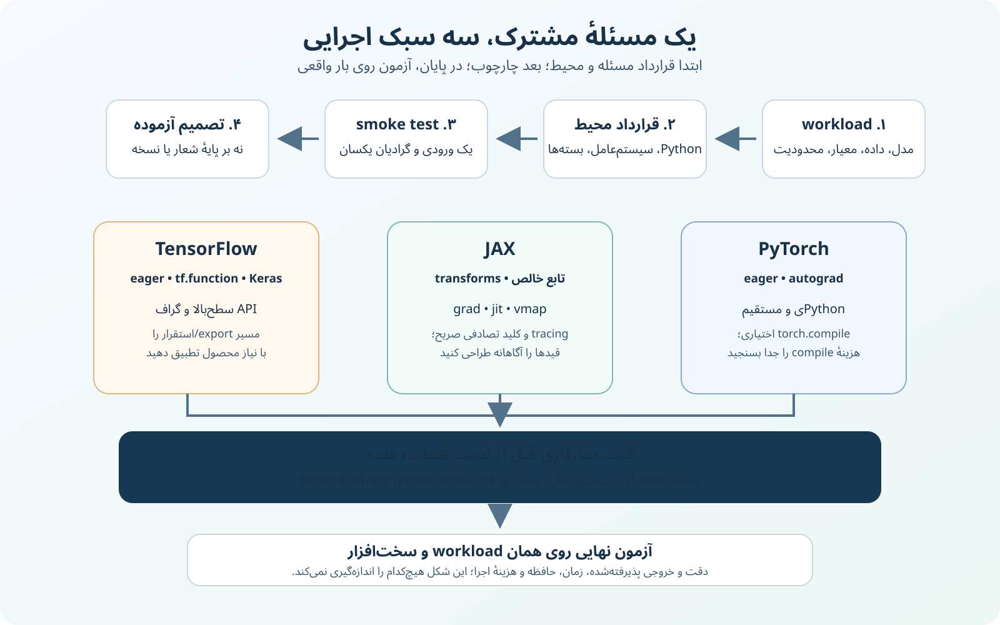

شکل ۴-۱۱-۱ — مسیر انتخاب از قرارداد workload تا smoke test؛ سبک API و پشتیبانی سخت‌افزار را جدا بررسی کنید.

## ۲. Python زبان/مفسر است؛ چارچوب tensor چیز دیگری

Python زبان برنامه‌نویسی و محیط اجرای بسیاری از ابزارهای یادگیری است. PyTorch، JAX و TensorFlow بسته‌هایی هستند که روی Python و وابستگی‌های بومی آن نصب می‌شوند. نصب Python به‌تنهایی هیچ‌یک از آن‌ها را فعال نمی‌کند؛ و نصب یک چارچوب هم تضمین نمی‌کند wheel سازگار با سیستم‌عامل یا شتاب‌دهندهٔ شما پیدا شود.

یک نصب عملی دست‌کم پنج لایه دارد:

1. **مفسر و ABI:** مثلاً CPython 3.12 و نوع build آن؛ نسخهٔ بسته باید برای همین ABI wheel داشته باشد.
2. **محیط مجازی و بسته‌ها:** کدام `python` و `pip` دریافت‌کنندهٔ فرمان‌اند؟ آیا dependencyها با هم سازگارند؟
3. **سیستم و معماری:** Linux/Windows/macOS، نسخهٔ glibc یا حداقل سیستم‌عامل، x86-64 یا ARM64.
4. **شتاب‌دهنده و driver/runtime:** CPU، NVIDIA/CUDA، AMD/ROCm، Apple GPU، Intel یا TPU؛ پشتیبانی بسته و driver باید برای ترکیب دقیق بررسی شود.
5. **کد و داده:** نسخهٔ مدل، کتابخانه‌های همراه، شکل ورودی، dtype، سیاست دسترسی/مجوز و هدف اجرا.

پس هنگام نصب، دستور را با `python -m pip` اجرا کنید؛ این کار احتمال استفاده از `pip` متعلق به Python دیگری را کم می‌کند. هر پروژه را در virtual environment مستقل نگه دارید. «روی لپ‌تاپم import شد» هنوز آزمون مدل، GPU یا production نیست.

## ۳. نسخه‌ها را به‌عنوان snapshot بخوانید، نه فهرست دائمی سازگاری

جدول زیر، نسخه‌ها و نکته‌های منتشرشده در **۶ نوامبر ۲۰۲۶** را ثبت می‌کند. بسته‌های ML سریع عوض می‌شوند؛ پیش از نصب، همان ماتریس رسمی را دوباره باز کنید و نسخهٔ دقیق Python/OS/device را تطبیق دهید.

| جزء | snapshot رسمیِ مورد بررسی | پیام برای نصب |
|---|---|---|
| CPython | `3.15.2`؛ انتشار ۲۵ اکتبر ۲۰۲۶ | تازه‌ترین CPython پایدار در تاریخ این بازبینی است؛ اما جدیدترین نسخهٔ Python لزوماً نقطهٔ مشترک wheelهای همهٔ چارچوب‌ها نیست. |
| PyTorch | `2.15.0`؛ stable در صفحهٔ نصب و انتشار ۲۸ اکتبر ۲۰۲۶؛ نسخه‌های wheel باینری از Python `3.11` به بالا، تا `3.15` در یادداشت انتشار | wheel/اندیس CPU، CUDA یا ROCm را از selector همان نسخه انتخاب کنید. در این release، PyPI به CUDA 13.2 منتقل شده و wheelهای رسمی cu134 هم جداگانه فهرست شده‌اند؛ دستور قدیمی cu118 یا cu126 را بی‌بررسی کپی نکنید. |
| JAX | `0.12.0.1`؛ در changelog رسمی مورخ ۲۳ اکتبر ۲۰۲۶ | `jax` و `jaxlib` بسته‌های جدا هستند؛ نوع wheel و backend برای CPU/GPU/TPU و سیستم‌عامل مهم است. مستند جاری برای CUDA 13 نمونهٔ `jax[cuda13]` دارد؛ جزئیات driver و پلتفرم را همان‌جا کنترل کنید. |
| TensorFlow | `2.21.0`؛ نسخهٔ مستندشده در صفحهٔ رسمی نصب pip | صفحهٔ جاری در متن نیازمندی عمومی Python `3.9–3.12` می‌گوید، ولی جدول wheelهای 2.21 برای بعضی platformها Python 3.13 را هم نشان می‌دهد و هم‌زمان یادآور می‌شود 3.9 پشتیبانی نمی‌شود. این ناهمخوانی را پنهان نکنید؛ برای آموزش مشترک در این فصل Python 3.12 انتخاب شده و برای 3.13 باید wheel دقیق سیستم هدف بررسی شود. |

**قاعدهٔ انتخاب محیط مشترک:** برای آزمایش کوتاهِ هر سه چارچوب، از نسخه‌ای استفاده کنید که همگی آن را پشتیبانی می‌کنند؛ در snapshot بالا، Python 3.12 انتخاب محافظه‌کارانه‌تری از 3.15 است. برای پروژهٔ تولیدی، نسخه را از روی ماتریس همان بسته‌ها، سیستم‌عامل و سخت‌افزار ثبت کنید؛ نه فقط چون «latest» است.

## ۴. مقایسهٔ کوتاه: چه چیزی واقعاً متفاوت است؟

| بُعد | PyTorch | JAX | TensorFlow |
|---|---|---|---|
| مدل ذهنی رایج | عملیات eager و tensorهای Python؛ autograd برای گرادیان | آرایه/تابع و تبدیل‌های صریح مثل `grad`, `jit`, `vmap`؛ اجرا اغلب با tracing/کامپایل XLA | eager mode برای توسعه؛ `GradientTape`، `tf.function` و API سطح‌بالای Keras |
| کِی راحت شروع می‌شود؟ | وقتی می‌خواهید مرحله‌به‌مرحله tensor را ببینید یا از مدل/ابزارهای PyTorch استفاده کنید | وقتی محاسبهٔ عددی را به تابع‌های خالص و تبدیل‌پذیر می‌نویسید و ترکیب گرادیان/vectorization/JIT مهم است | وقتی Keras و قراردادهای TensorFlow در تیم یا مسیر محصول موجودند و eager/graph هر دو به کار می‌آیند |
| چیزی که باید از پیش بدانید | `torch.compile` گزینهٔ بهینه‌سازی/کامپایل است، نه کلید تضمین سرعت؛ graph break، compile time و ورودی واقعی را بسنجید | tracing، آثار جانبی Python و کلیدهای تصادفی صریح می‌توانند مدل ذهنی را تغییر دهند؛ تابع را تا جای ممکن تابعی نگه دارید | `tf.function` می‌تواند تابع را trace کند؛ ورودی‌های متغیر/آثار جانبی Python ممکن است رفتار retracing را پیچیده کنند |
| ریسک انتخاب | تصور اینکه eager برابر «همیشه ساده‌تر/سریع‌تر» است یا همهٔ افزونه‌ها با هر wheel سازگارند | پنداشتن اینکه هر کد NumPy/Python بدون تغییر JIT می‌شود؛ تفاوت پشتیبانی device را نادیده گرفتن | فرض اینکه نصب `tensorflow` به معنی GPU روی هر سیستم‌عامل است؛ در عمل جدول OS/device مهم است |
| پرسش تصمیم | آیا تیم، کد پایه و کتابخانه‌های شما PyTorch محورند؟ | آیا محاسبات شما تابعی/عددی و transformمحورند؟ | آیا Keras، گراف، ابزارهای TensorFlow یا مسیر خروجی شما از قبل به TensorFlow وابسته است؟ |

این جدول «برنده» معرفی نمی‌کند. واژه‌هایی مثل *dynamic graph*، *compiled graph* و *functional transformation* مسیرهای اجرایی را توضیح می‌دهند، نه کیفیت model یا هزینهٔ محصول. PyTorch هم قابلیت‌های کامپایل دارد؛ TensorFlow هم eager اجرا می‌شود؛ و JAX نیز می‌تواند در CPU اجرا شود. تفاوت‌ها مطلق یا ایستا نیستند.

## ۵. PyTorch: tensorهای آشکار و گرادیان خودکار

در حالت معمول، عملیات PyTorch فوراً روی tensor اجرا می‌شود. اگر پارامتری `requires_grad=True` داشته باشد، چارچوب مسیر محاسبه را دنبال می‌کند؛ با `backward()` گرادیان‌های لازم محاسبه می‌شوند. این سبک برای debugging مرحله‌ای و برای codebaseهای Python رایج راحت است.

از PyTorch می‌توانید با CPU شروع کنید و سپس انتخاب wheel/device را بررسی کنید. `torch.compile` می‌تواند بخش‌هایی از کد را کامپایل کند؛ اما compile time، graph break، اندازه/شکل ورودی و سرعت واقعی باید در سناریوی خودتان سنجیده شوند. فقط اجرای دوبارهٔ یک تابع مصنوعی یا اندازه‌گیری یک دور گرم‌نشده مقایسهٔ منصفانه‌ای نیست.

```python
import torch

x = torch.tensor([0.0, 1.0])
y = torch.tensor([1.0, 3.0])
w = torch.tensor(1.0, requires_grad=True)
b = torch.tensor(0.0, requires_grad=True)
loss = ((w * x + b - y) ** 2).mean()
loss.backward()
print(loss.item(), w.grad.item(), b.grad.item())  # 2.5, -2.0, -3.0
```

دستور نصب عمومی ممکن است wheel متفاوتی نسبت به CPU-only یا accelerator داشته باشد. برای کار CPU آموزشی از راهنمای رسمی همان پلتفرم استفاده کنید؛ برای CUDA، ROCm، Intel XPU یا Apple MPS نوع build را صریح انتخاب و بعد از نصب device را وارسی کنید.

## ۶. JAX: تبدیل تابع‌ها به محاسبه‌های قابل ترکیب

JAX آرایه‌های `jax.numpy` و تبدیل‌های تابعی ارائه می‌کند. `jax.grad` یا `jax.value_and_grad` مشتق را می‌گیرد؛ `jax.jit` تابع را برای کامپایل می‌برد؛ `jax.vmap` می‌تواند محاسبه را روی محور batch برداری کند. این تبدیل‌ها را می‌توان ترکیب کرد، اما آن‌ها قواعدی هم دارند: اجرای JIT مرحلهٔ trace دارد، مقدارهای پایتونی/آثار جانبی در زمان trace با اجرا فرق می‌کنند، و تغییر شکل/نوع ورودی ممکن است compilation جدید ایجاد کند.

در JAX معمولاً state تصادفی با PRNG key صریح مدیریت می‌شود. کلید را دوباره مصرف نکنید؛ آن را طبق الگوی `split` تقسیم کنید. این صراحت به بازبینی جریان randomness کمک می‌کند، اما به‌تنهایی reproducibility کامل across-device/version یا یک seed جهانی را تضمین نمی‌کند.

```python
import jax
import jax.numpy as jnp

x = jnp.array([0.0, 1.0])
y = jnp.array([1.0, 3.0])

def loss_fn(params):
    w, b = params
    return jnp.mean((w * x + b - y) ** 2)

loss, (dw, db) = jax.value_and_grad(loss_fn)((jnp.array(1.0), jnp.array(0.0)))
print(float(loss), float(dw), float(db))
```

`jit`، `grad` یا `vmap` را به عنوان قابلیت‌های برنامه‌نویسی ببینید، نه اندازه‌گیری کارایی. نصب CPU با `jax` ساده‌تر است؛ برای NVIDIA GPU، مستند جاری بستهٔ CUDA مناسب و محدودیت‌های driver/OS/معماری را جدا می‌کند. در تاریخ بازبینی، مستند JAX برای Windows x86-64 CPU و Apple GPU وضعیت متفاوتی از Linux NVIDIA GPU نشان می‌دهد؛ یک دستور را به همهٔ سیستم‌ها تعمیم ندهید.

## ۷. TensorFlow: eager برای ساخت، گراف و Keras برای مسیرهای دیگر

TensorFlow از eager اجرا پشتیبانی می‌کند؛ `tf.GradientTape` عملیات لازم برای گرادیان را ثبت می‌کند. Keras API سطح‌بالایی برای تعریف و آموزش مدل است؛ `tf.function` می‌تواند تابع را به مسیر graph ببرد. این ترکیب برای تیم‌هایی که قراردادها یا سامانه‌های TensorFlow دارند مناسب است، اما باید مشخص کنید در توسعه، آموزش و استقرار کدام API/format را واقعاً استفاده می‌کنید.

```python
import tensorflow as tf

x = tf.constant([0.0, 1.0])
y = tf.constant([1.0, 3.0])
w = tf.Variable(1.0)
b = tf.Variable(0.0)
with tf.GradientTape() as tape:
    loss = tf.reduce_mean(tf.square(w * x + b - y))
dw, db = tape.gradient(loss, [w, b])
print(float(loss), float(dw), float(db))
```

برای این فصل لازم نیست شبکهٔ عصبی، Keras model یا optimizer بسازید؛ هدف فقط این است که ببینید همان تابع و گرادیان را چگونه بیان می‌کنیم. TensorFlow نصب CPU را از `tensorflow` می‌گیرد؛ نصب NVIDIA GPU طبق مستند جاری مسیر `tensorflow[and-cuda]` دارد و به OS/driver پشتیبانی‌شده محدود است. مستند TensorFlow GPU را برای macOS رسمی نمی‌داند و Windows native GPU را برای نسخه‌های بالاتر از 2.10 پشتیبانی نمی‌کند؛ از راه قدیمی «نصب CUDA و امید بستن» استفاده نکنید.

## ۸. یک تابع مشترک، یک مرجع ریاضی

برای آنکه مقایسه به API یا نام برند منحرف نشود، همهٔ backendها یک fixture دو‌نقطه‌ای را می‌گیرند:

- ورودی: `x = [0, 1]`
- هدف: `y = [1, 3]`
- پارامتر آغازین: `w = 1`, `b = 0`
- پیش‌بینی: `[0, 1]`؛ باقیماندهٔ `ŷ − y = [-1, -2]`
- معیار: میانگین مربع خطا (Mean Squared Error, MSE)

<math xmlns="http://www.w3.org/1998/Math/MathML" display="block" aria-label="زیان میانگین مربع خطا برای مدل خطی برابر میانگین مربع w x به‌علاوه b منهای y است">
  <mrow><mi>L</mi><mo>=</mo><mfrac><mn>1</mn><mi>n</mi></mfrac><munderover><mo>∑</mo><mrow><mi>i</mi><mo>=</mo><mn>1</mn></mrow><mi>n</mi></munderover><msup><mrow><mo>(</mo><mi>w</mi><msub><mi>x</mi><mi>i</mi></msub><mo>+</mo><mi>b</mi><mo>−</mo><msub><mi>y</mi><mi>i</mi></msub><mo>)</mo></mrow><mn>2</mn></msup></mrow>
</math>

**متن جایگزین فرمول:** `L = (1/n) Σᵢ (w xᵢ + b − yᵢ)²`؛ میانگین مربعات باقیماندهٔ پیش‌بینی است.

در این نقطه، `L = (1 + 4) / 2 = 2.5`. مشتق نسبت به `w` برابر `2/n × Σᵢ (w xᵢ+b−yᵢ)xᵢ = −2` است؛ نسبت به `b` برابر `2/n × Σᵢ (w xᵢ+b−yᵢ) = −3`. بنابراین مرجع پروژه `loss=2.5`, `gradient_weight=-2`, `gradient_bias=-3` دارد.

این fixture عمداً خیلی کوچک و شفاف است. درست‌بودن گرادیان در آن، سازگاری یک مدل زبانی، نرخ یادگیری مطلوب، تعمیم، دقت آماری یا سرعت را اثبات نمی‌کند. روی float32 نیز برابری بیت‌به‌بیت را شرط نکنید؛ پروژه اختلاف مطلق حداکثر `1e-5` را می‌پذیرد.

## ۹. پیش از انتخاب، معیارهای تصمیم را وزن‌دهی کنید

برای هر candidate، یک ردیف در برگهٔ ارزیابی بسازید و وضعیت را «پاسخ مستند»، «آزمون‌شده»، «نامعلوم» یا «رد» علامت بزنید:

| پرسش | شواهدی که جمع می‌کنید |
|---|---|
| مدل/کتابخانهٔ لازم اکنون در کدام چارچوب است؟ | مدل پایه، operatorهای خاص، نسخه و وابستگی‌ها؛ نه فقط یک صفحهٔ معرفی |
| کد را چه کسی نگه می‌دارد؟ | تجربهٔ تیم، debugging، استخدام/آموزش و هزینهٔ مهاجرت |
| محیط اجرا کجاست؟ | سیستم‌عامل، CPU/GPU/TPU، driver، container، سرو یا edge |
| هدف چیست؟ | پژوهش، fine-tuning، inference، batch processing یا محصول پایدار؛ هر workload آزمون خودش را می‌خواهد |
| چه محدودیت‌هایی قابل مذاکره نیستند؟ | مجوز، حفاظت داده، تأخیر، توان عملیاتی، حافظه، قابلیت export یا پشتیبانی vendor/community |
| مقایسه چطور منصفانه می‌شود؟ | همان مدل/وزن، دادهٔ مجاز، split، دقت، batch، سخت‌افزار، warm-up، تعداد اجرا و معیار پذیرش |

اگر مدل مورد نیاز فقط یک چارچوب یا accelerator را پشتیبانی کند، «سلیقهٔ API» ممکن است معیار دوم باشد. برعکس، اگر دو گزینه واقعاً معادل‌اند، هزینهٔ نگه‌داری و مسیر استخدام نیز بخشی از انتخاب است. پیش از benchmark، خروجی صحیح و کیفیت پذیرفته‌شده را تعریف کنید تا سرعتِ خروجی نادرست برنده نشود.

## ۱۰. ساخت محیط مجازی: Python را از پروژه جدا کنید

`venv` محیطی جدا با interpreter و مسیر نصب بسته‌ها می‌سازد. از پوشهٔ پروژه اجرا کنید:

**Linux/macOS:**

```bash
python3.12 -m venv .venv
source .venv/bin/activate
python -m pip install --upgrade pip
python -c "import sys; print(sys.executable); print(sys.version)"
```

**Windows PowerShell:**

```powershell
py -3.12 -m venv .venv
.\.venv\Scripts\Activate.ps1
python -m pip install --upgrade pip
python -c "import sys; print(sys.executable); print(sys.version)"
```

برای پایان جلسه، `deactivate` اجرا کنید. پوشهٔ `.venv` را به Git commit نکنید؛ dependencyها را در manifest نگه دارید. در CI، همان interpreter را صریح تعیین کنید و نصب/آزمون را در clean environment انجام دهید. اگر policy اجرا script در PowerShell فعال نیست، policy سازمان و مستند Python/Windows را دنبال کنید؛ برای دورزدن کنترل امنیتی، execution policy را بی‌فکر تغییر ندهید.

## ۱۱. نصب CPU: یک backend در یک virtual environment

پروژهٔ فصل را بدون چارچوب خارجی می‌توان اجرا کرد. وقتی می‌خواهید adapter واقعی را بیازمایید، یک محیط تازه بسازید؛ **سه دستور نصب را پشت سر هم در یک environment اجرا نکنید.** ترکیب NumPy، compiler، runtimeهای GPU و نسخه‌های وابستگی بین بسته‌ها ممکن است نیازهای متفاوتی داشته باشد.

**PyTorch 2.15.0، نمونهٔ CPU** (بعد از فعال‌سازی `.venv-torch`):

```bash
python -m pip install "torch==2.15.0" --index-url https://download.pytorch.org/whl/cpu
python -m pip check
python framework_compare.py --backend torch
```

**JAX 0.12.0.1، نمونهٔ CPU** (در `.venv-jax`):

```bash
python -m pip install "jax==0.12.0.1"
python -m pip check
python framework_compare.py --backend jax
```

**TensorFlow 2.21.0، نمونهٔ CPU** (در `.venv-tensorflow` و Python 3.12):

```bash
python -m pip install "tensorflow==2.21.0"
python -m pip check
python framework_compare.py --backend tensorflow
```

این دستورها snapshot آموزشی‌اند و محیط کاربر را در این کتاب به‌طور زنده نصب/آزمون نمی‌کنند. اگر سیستم‌عامل یا architecture در ماتریس همان نسخه نیست، wheel در دسترس نیست یا نصب به منبع بومی نیاز دارد، نصب را متوقف کنید و جدول رسمی را بررسی کنید؛ بدون مدرک، نسخه را حدس نزنید.

## ۱۲. GPU: اول ماتریس رسمی، بعد wheel و driver

نصب GPU فقط «یک بستهٔ Python اضافه» نیست. پیش از آن، موارد زیر را کنار هم ثبت کنید:

1. مدل دقیق GPU و معماری آن؛
2. OS، نسخه و architecture؛
3. حداقل driver و نسخه‌های CUDA/ROCm یا SDK مرتبط؛
4. Python ABI و wheel/index دقیق؛
5. container/host و محل libraryهای بومی؛
6. smoke test روی همان device.

- **PyTorch:** صفحهٔ «Start Locally» را با OS، installer، زبان و compute platform انتخاب کنید. CPU، CUDA و ROCm build جدا هستند. wheelهای 2.15 snapshot متفاوتی از releaseهای پیشین دارند؛ کپی‌کردن URL نسخهٔ قدیمی می‌تواند wheel ناسازگار نصب کند.
- **JAX:** مستند جاری CPU، NVIDIA CUDA، AMD ROCm، Intel، Apple و TPU را جداگانه فهرست می‌کند. برای NVIDIA در نسخهٔ مستندشده، wheel CUDA با pip نمونهٔ `jax[cuda13]` دارد؛ سیستم‌عامل/معماری و driver حداقل را پیش از نصب کنترل کنید.
- **TensorFlow:** برای Linux/WSL2 مبتنی بر NVIDIA، مستند pip مسیر `tensorflow[and-cuda]` را می‌آورد؛ Windows native GPU برای نسخه‌های بالاتر از 2.10 پشتیبانی نمی‌شود و در macOS GPU رسمی ندارد. نصب شدن بسته به معنی دیده‌شدن GPU نیست.

در همهٔ چارچوب‌ها، `is_available` یا فهرست deviceها فقط کشف اولیه است؛ اجرای یک tensor هم مدل واقعی را benchmark نمی‌کند. اگر toolkit جداگانه دارید، library path و runtime را با مستند همان wheel تطبیق دهید؛ ترکیب چند نسخهٔ CUDA/ROCm در یک process می‌تواند import یا kernel loading را خراب کند. محاسبهٔ هزینهٔ GPU، انتخاب خرید/اجاره و نرخ بازار در فصل ۵۶ است و در اینجا تکرار نمی‌شود.

## ۱۳. آزمون نصب را مرحله‌ای انجام دهید

ترتیب کم‌ریسک این است:

1. چاپ `sys.executable`, `sys.version` و مسیر `pip`؛ مطمئن شوید virtual environment فعال است.
2. چاپ نسخهٔ بسته و `pip check`؛ این‌ها ناسازگاری dependency را می‌جویند، نه correctness مدل را.
3. یک CPU smoke test کوچک با یک input معلوم؛ مقدار، شکل tensor و finite بودن خروجی را کنترل کنید.
4. اگر GPU لازم است، ابتدا device enumeration و سپس forward/backward خیلی کوچک روی device صریح را اجرا کنید.
5. تنها پس از آن workload واقعی و testهای کیفیت/کارایی را با دادهٔ مجاز اجرا کنید.

پروژهٔ پیوست، همین قاعده را در مقیاس toy نشان می‌دهد. `python framework_compare.py --backend all` فقط adapterهای نصب‌شده را import می‌کند و بسته‌های غایب را skip می‌کند؛ هیچ دانلود مدل/داده یا نصب انجام نمی‌شود. اگر یک adapter عددی با مرجع تفاوت بیش از tolerance داشته باشد، گزارش آن را failure می‌زند.

## ۱۴. نسخه‌گذاری و بازتولیدپذیری: `pip freeze` به‌تنهایی کافی نیست

برای هر محیطی که باید دوباره ساخته شود، حداقل این‌ها را ثبت کنید:

- نسخهٔ دقیق CPython، OS/architecture و manager مورد استفاده؛
- package version و همهٔ direct/transitive dependencies؛
- PyPI یا index سفارشی/wheel channel، hash فایل‌ها یا lockfile با hash؛
- accelerator، driver و runtime/SDK؛
- دستور نصب، commit کد، fixture hash و دستور آزمون؛
- اینکه آزمون CPU یا GPU بوده و آیا download/benchmark واقعی رخ داده است.

`pip freeze` snapshot خوبی برای اشکال‌زدایی است، ولی به‌تنهایی فایل lock قابل بازسازی نیست: index، wheel platform، hash، driver و سخت‌افزار را کامل نمی‌کند. برای محیط محصول، از lock manager مورد تأیید تیم یا container pinشده استفاده کنید و به‌روزرسانی امنیتی را به‌صورت کنترل‌شده بازبینی کنید. secrets و tokenها را در requirements، output و notebook commit نکنید. wheel را فقط از index معتبر بگیرید و provenance/hash را برای pipeline حساس نگه دارید.

## ۱۵. اعداد تصادفی، dtype و رفتار eager/compiled را یکی فرض نکنید

Seed لازم است، اما reproducibility ممکن است به CUDA kernel nondeterministic، ترتیب داده، worker، نسخه، compiler، device و deterministic flag وابسته باشد. JAX key صریح را مصرف/تقسیم می‌کند؛ در PyTorch و TensorFlow نیز generator/seed همان نسخهٔ API را بررسی کنید. ثبت seed، نتیجهٔ دقیق across-device را تضمین نمی‌کند.

همچنین `float32`, `bfloat16`, `float16` یا precision پایین‌تر ممکن است روی deviceهای مختلف kernel، rounding، underflow/overflow و کیفیت متفاوت داشته باشند. در این فصل مقایسه همه در CPU/float32 است. برای انتخاب precision واقعی، فصل ۴۵ را به‌عنوان پیش‌نیاز مفهومی مرور کنید و روی مدل/workload خود معیار کیفیت و خطای عددی بگذارید.

وقتی JIT/compile یا graph را فعال می‌کنید، زمان اجرای نخستین تابع ممکن است شامل tracing/compile باشد؛ warm-up را از اندازه‌گیری جدا کنید. تغییر shape و control flow می‌تواند compile/retrace داشته باشد. اگر عملکرد می‌سنجید، تعداد تکرار، synchronization، warm-up، دمای دستگاه و هزینهٔ انتقال داده را ثبت کنید. پروژهٔ این فصل هیچ‌یک را اندازه نمی‌گیرد.

## ۱۶. خطاهای رایج و مسیر تشخیص

| نشانه | علت‌های محتمل | قدم بعد |
|---|---|---|
| `No matching distribution found` | Python ABI، OS، architecture یا index انتخابی wheel ندارد؛ `pip` قدیمی است | `python -m pip --version`, `python -m pip debug --verbose` و ماتریس رسمی همان release را بررسی کنید؛ نسخه را تصادفی downgrade نکنید. |
| `ModuleNotFoundError` بعد از نصب | `pip` به interpreter دیگری نصب کرده، environment فعال نیست، یا محیط IDE متفاوت است | `python -c "import sys; print(sys.executable)"` را در terminal و IDE مقایسه و با همان interpreter نصب کنید. |
| نصب شد، اما GPU پیدا نشد | CPU wheel، driver ناسازگار، platform خارج از ماتریس، device visibility یا library path | فرمان نصب، driver و device را از مستند framework/version دوباره وارسی کنید؛ یک CPU test را با GPU test اشتباه نگیرید. |
| `pip check` خطا می‌دهد | dependencyهای مشترک در یک محیط به pinهای ناسازگار نیاز دارند | محیط را بازسازی کنید؛ backendها را در venvهای جدا نگه دارید و dependency resolver را با lock بررسی کنید. |
| JAX `Tracer`/آرایهٔ traced را به NumPy/Python تبدیل نمی‌کند | اجرای trace-time با اجرای عادی یکسان فرض شده یا تابع اثر جانبی/host callback دارد | تابع را با عملیات JAX بنویسید؛ ورودی static و dynamic را جدا کنید و مستند tracing را بخوانید. |
| `tf.function` بارها trace می‌شود | شکل/ساختار ورودی یا object پایتونی ناپایدار است | امضای ورودی/shape را تعریف کنید و با profiler/trace count علت را بسنجید؛ فقط برای پنهان‌کردن هشدار decorator اضافه نکنید. |
| PyTorch compile کندتر از eager دیده می‌شود | هزینهٔ compile/warm-up، graph break، ورودی کوچک یا اجراهای بسیار کم | warm-up را جدا کنید، چند اندازه‌گیری همسان انجام دهید و eager را baseline نگه دارید. |

خطا را از stderr کامل، نسخه‌ها و فرمان نصب بازتولید کنید. پیام «device unavailable» را با تغییر دستی library path یا نصب تصادفی چند toolkit پنهان نکنید؛ اول علت ناسازگاری را پیدا کنید.

## ۱۷. تمرین‌ها: از نیاز به تصمیم بازبینی‌پذیر

۱. برای تیمی که یک مدل موجود فقط checkpoint و مثال رسمی PyTorch دارد، ولی deployment نهایی هنوز مشخص نیست، سه سؤال برای shortlisting بنویسید. چرا «PyTorch حتماً برنده است» نتیجهٔ زودهنگام است؟

۲. تیمی محاسبات تابعی، برداری‌سازی batch و JIT را در CPU/GPU پژوهشی می‌خواهد. کدام ویژگی JAX را اول بررسی می‌کنید؟ چه محدودیتی دربارهٔ tracing و hardware wheel باید ثبت شود؟

۳. یک محصول داخلی از Keras/TF استفاده می‌کند، اما توسعه‌دهندهٔ جدید می‌خواهد همه‌چیز را با یک مثال eager ارزیابی کند. چه دو آزمونی پیش از مهاجرت لازم است؟

۴. چرا Python 3.15.2 را نباید تنها به‌خاطر «جدیدترین نسخه» در محیط مشترک TensorFlow 2.21 انتخاب کرد؟ نسخهٔ مشترک محافظه‌کارانهٔ این فصل چیست و چرا؟

۵. اجرای `framework_compare.py --backend all` دو چارچوب را skip می‌کند و PyTorch را پاس می‌کند. چه چیزی واقعاً نشان داده شده و چه چیزی هنوز نامعلوم است؟

۶. `torch.cuda.is_available()` در سیستم NVIDIA مقدار `False` می‌دهد، ولی `import torch` موفق است. سه بررسی را به ترتیب پیشنهاد دهید؛ آیا این خطا ثابت می‌کند GPU خراب است؟

## ۱۸. پاسخ نمونه و مسیر ادامه

پاسخ‌های تشریحی در [پاسخ‌نامهٔ مستقل فصل ۵۷](book-engineering/answers/57-ml-frameworks-fa.md) قرار دارند. پاسخ مناسب ممکن است با نیاز پروژه فرق کند، اما باید فرض و شاهد خود را آشکار کند.

جمع‌بندی اجرایی: **یک interpreter مشخص، یک venv برای هر چارچوب، نسخهٔ snapshot ثبت‌شده، CPU smoke test، سپس ماتریس platform/device و آزمون workload واقعی.** انتخاب framework را با cost/market فصل ۵۶، Hugging Face در فصل ۵۸ یا accelerator programming فصل ۵۹ خلط نکنید.

## ۱۹. منابع و تاریخ بازبینی

منابع رسمی بررسی‌شده در 2026-11-06؛ نسخهٔ آنلاین بعداً ممکن است تغییر کند:

1. Python Software Foundation, [Python 3.15.2 release](https://www.python.org/downloads/release/python-3152/), منتشرشده 2026-10-25؛ مرجع نسخهٔ CPython و artifactهای release.
2. PyTorch Foundation, [PyTorch 2.15 Release Blog](https://pytorch.org/blog/pytorch-2-15-release-blog/), 2026-10-28؛ و [PyTorch 2.15.0 release notes](https://github.com/pytorch/pytorch/releases/tag/v2.15.0), شامل Python/wheel و تغییر release.
3. PyTorch, [Start Locally](https://pytorch.org/get-started/locally/), selector نسخه/OS/installer/compute platform؛ [Autograd mechanics](https://pytorch.org/docs/stable/notes/autograd.html) و [torch.compile tutorial](https://pytorch.org/tutorials/intermediate/torch_compile_tutorial.html).
4. JAX, [Change log](https://docs.jax.dev/en/latest/changelog.html), شامل JAX 0.12.0.1 در 2026-10-23؛ [Installation](https://docs.jax.dev/en/latest/installation.html), ماتریس CPU/GPU و دستورهای backend؛ [JAX versioning](https://docs.jax.dev/en/latest/jep/9419-jax-versioning.html), رابطهٔ `jax` و `jaxlib`.
5. TensorFlow, [Install TensorFlow with pip](https://www.tensorflow.org/install/pip), نسخهٔ stable، Python/wheel matrix و تفاوت CPU/GPU/OS؛ صفحهٔ منبع را دوباره تطبیق دهید، چون متن عمومی Python و جدول wheelهای آن snapshot یکسان نیستند.
6. Python documentation, [`venv`](https://docs.python.org/3/library/venv.html), محیط‌های مجازی و دستورهای platform.
7. PyPA, [Installing Packages](https://packaging.python.org/en/latest/tutorials/installing-packages/) و [Requirements for a packaging tool](https://packaging.python.org/en/latest/specifications/requirements-file-format/), برای نصب و قرارداد فایل requirements.
8. PyTorch, [Get Started](https://pytorch.org/get-started/locally/), JAX, [Installation](https://docs.jax.dev/en/latest/installation.html), و TensorFlow, [pip installation](https://www.tensorflow.org/install/pip), برای ماتریس wheelهای وابسته به سیستم.

این فهرست توصیهٔ خرید، benchmark، endorsement یا تضمین سازگاری نیست. نسخهٔ ثبت‌شده فقط snapshot است؛ پیش از اجرای واقعی، صفحهٔ رسمی را در تاریخ کار خود بررسی کنید.

## ۲۰. پیوست اجرایی: کد آزموده‌شدهٔ پروژه

کد زیر بایت‌به‌بایت با `book-engineering/projects/57-framework-lab/framework_compare.py` نگه داشته می‌شود. اجرای مرجع فقط به کتابخانهٔ استاندارد Python نیاز دارد؛ adapterهای اختیاری فقط چارچوب‌های ازپیش‌نصب‌شده را import می‌کنند.

```python
"""Compare automatic gradients on one tiny, explicitly synthetic CPU fixture.

Only the selected optional framework is imported. No model, dataset, GPU, network,
training loop, or performance benchmark is used by this teaching smoke test.
"""
from __future__ import annotations

import argparse
import hashlib
import importlib
import json
import math
import platform
import sys
from pathlib import Path
from typing import Any

ROOT = Path(__file__).resolve().parent
DEFAULT_FIXTURE = ROOT / "sample_problem.json"
BACKENDS = ("torch", "jax", "tensorflow")
METADATA_KEYS = (
    "real_dataset_loaded",
    "pretrained_model_loaded",
    "training_performed",
    "gpu_used",
    "benchmark_performed",
)


class ComparisonInputError(ValueError):
    """Raised when the synthetic comparison fixture is invalid."""


def _finite_number(value: Any, field: str) -> float:
    if isinstance(value, bool) or not isinstance(value, (int, float)):
        raise ComparisonInputError(f"{field} must be a finite number")
    result = float(value)
    if not math.isfinite(result):
        raise ComparisonInputError(f"{field} must be a finite number")
    return result


def validate_fixture(raw: Any) -> dict[str, Any]:
    if not isinstance(raw, dict):
        raise ComparisonInputError("fixture must be a JSON object")
    if raw.get("schema_version") != 1:
        raise ComparisonInputError("unsupported schema_version")
    if raw.get("fixture_id") != "v4-ch11-synthetic-gradient-v1":
        raise ComparisonInputError("fixture_id does not match this chapter")
    if raw.get("label_source") != "synthetic_fixture":
        raise ComparisonInputError("fixture must remain labeled synthetic_fixture")

    x = raw.get("x")
    y = raw.get("y")
    if not isinstance(x, list) or not isinstance(y, list) or len(x) != len(y) or len(x) < 2:
        raise ComparisonInputError("x and y must be equal-length lists with at least two values")
    for index, value in enumerate(x):
        _finite_number(value, f"x[{index}]")
    for index, value in enumerate(y):
        _finite_number(value, f"y[{index}]")

    parameters = raw.get("initial_parameters")
    if not isinstance(parameters, dict):
        raise ComparisonInputError("initial_parameters must be an object")
    for name in ("weight", "bias"):
        _finite_number(parameters.get(name), f"initial_parameters.{name}")

    tolerance = _finite_number(raw.get("absolute_tolerance"), "absolute_tolerance")
    if not 0 < tolerance <= 0.01:
        raise ComparisonInputError("absolute_tolerance must be greater than 0 and at most 0.01")

    metadata = raw.get("metadata")
    if not isinstance(metadata, dict) or any(metadata.get(key) is not False for key in METADATA_KEYS):
        raise ComparisonInputError("fixture metadata must explicitly disclaim real data, models, training, GPU and benchmarks")
    return raw


def load_fixture(path: Path = DEFAULT_FIXTURE) -> tuple[dict[str, Any], bytes]:
    try:
        fixture_bytes = path.read_bytes()
    except OSError as error:
        raise ComparisonInputError(f"cannot read fixture: {error}") from error
    try:
        fixture = json.loads(fixture_bytes.decode("utf-8"))
    except (UnicodeDecodeError, json.JSONDecodeError) as error:
        raise ComparisonInputError(f"cannot parse fixture JSON: {error}") from error
    return validate_fixture(fixture), fixture_bytes


def reference_result(fixture: dict[str, Any]) -> dict[str, float]:
    """Evaluate MSE and its closed-form gradients without a tensor library."""
    validate_fixture(fixture)
    x = [float(value) for value in fixture["x"]]
    y = [float(value) for value in fixture["y"]]
    weight = float(fixture["initial_parameters"]["weight"])
    bias = float(fixture["initial_parameters"]["bias"])
    residuals = [weight * xv + bias - yv for xv, yv in zip(x, y)]
    count = len(x)
    loss = sum(error * error for error in residuals) / count
    gradient_weight = 2.0 * sum(error * xv for error, xv in zip(residuals, x)) / count
    gradient_bias = 2.0 * sum(residuals) / count
    return {
        "loss": loss,
        "gradient_weight": gradient_weight,
        "gradient_bias": gradient_bias,
    }


def _as_float(value: Any) -> float:
    if hasattr(value, "item"):
        value = value.item()
    result = float(value)
    if not math.isfinite(result):
        raise RuntimeError("framework returned a non-finite scalar")
    return result


def _torch_result(fixture: dict[str, Any]) -> tuple[dict[str, float], str]:
    torch = importlib.import_module("torch")
    device = torch.device("cpu")
    x = torch.tensor(fixture["x"], dtype=torch.float32, device=device)
    y = torch.tensor(fixture["y"], dtype=torch.float32, device=device)
    weight = torch.tensor(float(fixture["initial_parameters"]["weight"]), dtype=torch.float32, device=device, requires_grad=True)
    bias = torch.tensor(float(fixture["initial_parameters"]["bias"]), dtype=torch.float32, device=device, requires_grad=True)
    loss = torch.mean((weight * x + bias - y) ** 2)
    loss.backward()
    return (
        {
            "loss": _as_float(loss),
            "gradient_weight": _as_float(weight.grad),
            "gradient_bias": _as_float(bias.grad),
        },
        str(getattr(torch, "__version__", "unknown")),
    )


def _jax_result(fixture: dict[str, Any]) -> tuple[dict[str, float], str]:
    jax = importlib.import_module("jax")
    jnp = importlib.import_module("jax.numpy")
    cpu_devices = jax.devices("cpu")
    if not cpu_devices:
        raise RuntimeError("JAX reports no CPU device")
    device = cpu_devices[0]
    x = jax.device_put(jnp.asarray(fixture["x"], dtype=jnp.float32), device)
    y = jax.device_put(jnp.asarray(fixture["y"], dtype=jnp.float32), device)
    initial = fixture["initial_parameters"]

    def objective(parameters: tuple[Any, Any]) -> Any:
        weight, bias = parameters
        return jnp.mean((weight * x + bias - y) ** 2)

    parameters = (
        jax.device_put(jnp.asarray(float(initial["weight"]), dtype=jnp.float32), device),
        jax.device_put(jnp.asarray(float(initial["bias"]), dtype=jnp.float32), device),
    )
    loss, gradients = jax.value_and_grad(objective)(parameters)
    return (
        {
            "loss": _as_float(loss),
            "gradient_weight": _as_float(gradients[0]),
            "gradient_bias": _as_float(gradients[1]),
        },
        str(getattr(jax, "__version__", "unknown")),
    )


def _tensorflow_result(fixture: dict[str, Any]) -> tuple[dict[str, float], str]:
    tf = importlib.import_module("tensorflow")
    initial = fixture["initial_parameters"]
    with tf.device("/CPU:0"):
        x = tf.constant(fixture["x"], dtype=tf.float32)
        y = tf.constant(fixture["y"], dtype=tf.float32)
        weight = tf.Variable(float(initial["weight"]), dtype=tf.float32)
        bias = tf.Variable(float(initial["bias"]), dtype=tf.float32)
        with tf.GradientTape() as tape:
            loss = tf.reduce_mean(tf.square(weight * x + bias - y))
        gradient_weight, gradient_bias = tape.gradient(loss, [weight, bias])
    if gradient_weight is None or gradient_bias is None:
        raise RuntimeError("GradientTape did not return both gradients")
    return (
        {
            "loss": _as_float(loss),
            "gradient_weight": _as_float(gradient_weight),
            "gradient_bias": _as_float(gradient_bias),
        },
        str(getattr(tf, "__version__", "unknown")),
    )


_RUNNERS = {
    "torch": _torch_result,
    "jax": _jax_result,
    "tensorflow": _tensorflow_result,
}


def run_backend(name: str, fixture: dict[str, Any]) -> dict[str, Any]:
    if name not in _RUNNERS:
        raise ComparisonInputError(f"unknown backend: {name}")
    try:
        observed, version = _RUNNERS[name](fixture)
    except ModuleNotFoundError as error:
        missing_root = (error.name or "").split(".", maxsplit=1)[0]
        if missing_root == name:
            return {"backend": name, "status": "not_installed"}
        return {"backend": name, "status": "import_error", "error_type": type(error).__name__}
    except Exception as error:
        return {"backend": name, "status": "import_error", "error_type": type(error).__name__}

    expected = reference_result(fixture)
    tolerance = float(fixture["absolute_tolerance"])
    differences = {
        key: abs(observed[key] - expected[key])
        for key in expected
    }
    passed = all(math.isfinite(observed[key]) and differences[key] <= tolerance for key in expected)
    return {
        "backend": name,
        "status": "passed" if passed else "mismatch",
        "version": version,
        "device": "cpu",
        "observed": observed,
        "absolute_difference_from_reference": differences,
        "tolerance": tolerance,
    }


def build_report(fixture: dict[str, Any], fixture_bytes: bytes, requested_backend: str = "all") -> dict[str, Any]:
    validate_fixture(fixture)
    if requested_backend not in ("reference", "all", *BACKENDS):
        raise ComparisonInputError(f"unknown backend: {requested_backend}")
    expected = reference_result(fixture)
    selected = BACKENDS if requested_backend == "all" else (() if requested_backend == "reference" else (requested_backend,))
    backend_results = {name: run_backend(name, fixture) for name in selected}
    passed = [name for name, row in backend_results.items() if row["status"] == "passed"]
    skipped = [name for name, row in backend_results.items() if row["status"] == "not_installed"]
    failed = [name for name, row in backend_results.items() if row["status"] not in {"passed", "not_installed"}]
    if failed:
        status = "failed"
    elif skipped and passed:
        status = "passed_with_skips"
    elif skipped or requested_backend == "reference":
        status = "reference_only"
    else:
        status = "passed"
    return {
        "schema_version": 1,
        "fixture_id": fixture["fixture_id"],
        "fixture_sha256": hashlib.sha256(fixture_bytes).hexdigest(),
        "requested_backend": requested_backend,
        "python_version": ".".join(map(str, sys.version_info[:3])),
        "platform": f"{platform.system()} {platform.machine()}",
        "reference": expected,
        "framework_results": backend_results,
        "summary": {
            "status": status,
            "passed": passed,
            "skipped_not_installed": skipped,
            "failed": failed,
        },
        "scope": {
            "real_dataset_loaded": False,
            "pretrained_model_loaded": False,
            "training_performed": False,
            "gpu_used": False,
            "benchmark_performed": False,
            "network_access_performed": False,
        },
    }


def main(argv: list[str] | None = None) -> int:
    parser = argparse.ArgumentParser(description="Compare MSE gradients using optional CPU framework adapters")
    parser.add_argument("--fixture", type=Path, default=DEFAULT_FIXTURE)
    parser.add_argument("--backend", choices=("reference", "all", *BACKENDS), default="all")
    parser.add_argument("--output", type=Path, help="write JSON to a file instead of stdout")
    args = parser.parse_args(argv)
    try:
        fixture, fixture_bytes = load_fixture(args.fixture)
        report = build_report(fixture, fixture_bytes, args.backend)
    except ComparisonInputError as error:
        print(f"input error: {error}", file=sys.stderr)
        return 2

    rendered = json.dumps(report, ensure_ascii=False, indent=2, sort_keys=True, allow_nan=False) + "\n"
    if args.output:
        args.output.parent.mkdir(parents=True, exist_ok=True)
        args.output.write_text(rendered, encoding="utf-8")
        print(f"Wrote comparison report: {args.output}")
    else:
        sys.stdout.write(rendered)

    if report["summary"]["failed"]:
        return 1
    if args.backend not in {"all", "reference"} and report["framework_results"][args.backend]["status"] == "not_installed":
        return 2
    return 0


if __name__ == "__main__":
    raise SystemExit(main())
```

---

# جلد چهارم، فصل ۱۲ — اکوسیستم Hugging Face: از داده تا آموزش

> **جایگاه:** فصل محلی ۱۲ از ۱۵ جلد چهارم؛ فصل سراسری ۵۸. فصل ۵۷ Python و چارچوب‌های پایه را مقایسه کرد؛ اکنون زنجیره‌ای از ابزارهای Hugging Face را از داده تا batch و یک گام آموزش می‌سازیم. فصل ۵۹ به CUDA، ROCm، Triton و آموزش مقیاس‌پذیر می‌پردازد.
>
> **مرز موضوعی:** فصل‌های ۴۷ تا ۴۹ پس‌آموزش، PEFT و بهینه‌سازی ترجیح را پوشش داده‌اند؛ این فصل روش‌های آن‌ها را تکرار نمی‌کند. آموزش اینجا فقط smoke test کوچکی برای اتصال APIهاست. اجرای چند GPU، kernel optimization و benchmark به فصل بعد واگذار می‌شود.
>
> **حد ادعا:** نسخه‌ها snapshot تاریخ‌دارند. پروژه از fixture ساختگی، tokenizer محلی و مدل تصادفی روی CPU استفاده می‌کند؛ هیچ داده یا وزن pretrained از Hub نمی‌گیرد. خروجی آن نه کیفیت زبان فارسی، نه تعمیم، نه سرعت و نه آمادگی محصول را می‌سنجد.
>
> **تاریخ بازبینی منابع و آزمون محیط: ۶ نوامبر ۲۰۲۶.**

## ۱. از چهار کتابخانه، یک زنجیره بسازید

«Hugging Face» نام یک کتابخانهٔ واحد نیست. **Hub** محل میزبانی مخزن‌های مدل، داده و ابزار است؛ **Transformers** APIهای مدل و آموزش/استنتاج را عرضه می‌کند؛ **Datasets** خواندن و تبدیل مجموعه‌داده‌ها را سامان می‌دهد؛ **Tokenizers** موتورهای سریع tokenization می‌سازد و اجرا می‌کند؛ و **Accelerate** اجرای PyTorch را از CPU تا محیط‌های توزیع‌شده هماهنگ می‌کند. این اجزا می‌توانند کنار هم کار کنند، اما یکی جای دیگری را نمی‌گیرد.

مسیر آموزشی این فصل چنین است:

```text
فایل محلی و مجاز
       ↓
Dataset + splitهای ثبت‌شده
       ↓
Tokenizer + input_ids + attention_mask
       ↓
Collator → batchهای هم‌شکل
       ↓
مدل Transformers از config محلی
       ↓
Accelerate → یک smoke test روی CPU
       ↓
manifest نسخه، hash و محدودیت نتیجه
```

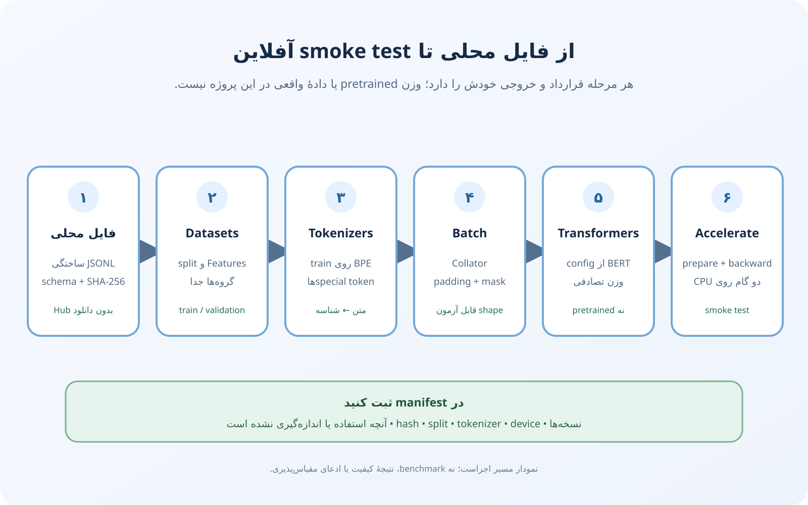

شکل ۴-۱۲-۱ — اتصال اجزا و مرز ادعا؛ Hub در مثال اجرایی استفاده نمی‌شود.

هدف این نیست که چهار نام را حفظ کنید. هدف آن است که برای هر مرحله بدانید **چه داده‌ای وارد می‌شود، کدام نسخه آن را تغییر می‌دهد، چه artifactی بیرون می‌آید و چگونه آن را آزمون می‌کنید**. پروژهٔ فصل مسیر فایل JSONL ساختگی → `DatasetDict` → tokenizer BPE → `DataCollatorWithPadding` → BERT بسیار کوچک و تصادفی → `Accelerator(cpu=True)` را اجرا می‌کند.

## ۲. Hub، کتابخانه و cache یکی نیستند

این سه مفهوم را از هم جدا کنید:

- **Hub repository:** مخزنی با شناسه، نوع (مثلاً `model` یا `dataset`)، تاریخچهٔ commit، فایل‌ها و کارت توضیحی. عمومی‌بودن یک مخزن به معنی مناسب‌بودن داده یا وزن آن برای مسئلهٔ شما نیست.
- **کتابخانه:** کدی که قالب یا معماری را می‌خواند و عملیات را اجرا می‌کند. `transformers`، `datasets`، `tokenizers` و `accelerate` بسته‌های Python هستند؛ خودشان به‌تنهایی وزن مدل یا مجوز داده نیستند.
- **Cache محلی:** نسخه‌های دریافت‌شده و فایل‌های پردازش‌شده‌ای که برای کم‌کردن دانلود یا محاسبهٔ دوباره نگهداری می‌شوند. cache یک روش دسترسی است، نه سند منشأ یا مجوز.

توابعی با نام `from_pretrained` می‌توانند فایل را از Hub دریافت کنند یا از فایل‌های محلی/cache بخوانند؛ نام تابع تضمین نمی‌کند که اجرای شما آفلاین باشد. گزینه‌هایی مانند `local_files_only=True` و متغیرهای حالت آفلاین فقط وقتی کار می‌کنند که artifact لازم از پیش موجود و کامل باشد. شناسهٔ repo و commit مورد استفاده را ثبت کنید؛ عبارت «از Hugging Face گرفتم» برای بازتولید نتیجه کافی نیست.

یک model card یا dataset card ممکن است معماری، کاربرد پیشنهادی، دادهٔ آموزش یا مجوز را توضیح دهد؛ اما کارتِ ناقص را با تضمین رسمی یکی نگیرید. خود فایل‌ها، مجوز واقعی، محدودیت دسترسی، سیاست نگهداری داده و سازگاری‌شان با محصول را جداگانه بررسی کنید.

## ۳. نسخه‌ها snapshot‌اند؛ سازگاری را نصب کنید و بیازمایید

نسخه‌های رسمیِ مشاهده‌شده در **۶ نوامبر ۲۰۲۶**:

| بسته | نسخهٔ stable در snapshot | تاریخ انتشار مشاهده‌شده | نکتهٔ سازگاری در metadata |
|---|---:|---|---|
| Transformers | `5.22.2` | ۶ نوامبر ۲۰۲۶، 15:43 UTC | Python `>=3.11`; backend PyTorch به `torch>=2.6` نیاز دارد؛ `tokenizers>=0.23.1,<0.24.0`; Hub `>=1.31,<3` |
| Datasets | `5.1.0` | ۵ اکتبر ۲۰۲۶ | Python `>=3.10`; core به `pyarrow>=24` و Hub `>=1.31,<3` نیاز دارد؛ برخی قابلیت‌های صوت/ویدئو وابستگی جدا دارند |
| Tokenizers | `0.23.3` | ۹ اکتبر ۲۰۲۶ | Python `>=3.10`; این نسخهٔ Python stable است؛ `1.0.0-rc.3` را stable جا نزنید |
| Accelerate | `1.15.0` | ۹ سپتامبر ۲۰۲۶ | Python `>=3.10`; PyTorch `>=2.0` |

شرط‌های بالای بسته، به‌تنهایی **آزمون ترکیب** نیستند. برای پروژهٔ این فصل، همهٔ چهار pin با CPython `3.13.16` و `torch==2.15.0+cpu` در venv مستقل نصب شدند؛ `pip check` موفق بود و آزمون end-to-end اجرا شد. محیط ثبت‌شده همچنین `huggingface_hub==2.4.0`, `pyarrow==26.0.1` و `fsspec==2026.7.0` داشت. این نتیجه فقط دربارهٔ همان Linux x86-64 / CPU و همان snapshot است؛ سازگاری Windows، macOS، CUDA یا ROCm از آن نتیجه نمی‌شود.

یک نکتهٔ مستندسازی: در زمان بازبینی، selector بعضی صفحه‌های Datasets هنوز `4.8.4` را نشان می‌داد، در حالی که release بستهٔ `5.1.0` در PyPI موجود بود. مرجع نسخهٔ نصب‌شده و آزمون پروژه، wheel pinشده و release note است؛ مثال‌های مستندات را برای همین ترکیب حتماً اجرا کنید. منابع و تاریخ مشاهده در بخش ۲۱ آمده‌اند.

## ۴. revision را به یک نقطهٔ ثابت وصل کنید

شاخه‌ای مثل `main` یا برچسبی مثل `latest` می‌تواند بعداً به محتوای دیگری اشاره کند. برای بازتولید، فقط نام repo را ذخیره نکنید؛ **نوع مخزن، شناسه، commit کامل، نام فایل‌ها و hashهای محلی** را ثبت کنید. برای نمونه، پس از دانلودِ مجاز و بازبینی‌شده می‌توان tokenizer محلی را بدون شبکه خواند:

```python
from transformers import AutoTokenizer

tokenizer = AutoTokenizer.from_pretrained(
    "organization/model-name",
    revision="<full-commit-sha>",
    local_files_only=True,
)
```

`<full-commit-sha>` جایگزین توضیحی است؛ هنگام اجرا باید با شناسهٔ commit واقعی عوض شود. اگر فایل در cache یا مسیر محلی نیست، حالت آفلاین آن را جادووار ایجاد نمی‌کند. `huggingface_hub` توابعی مثل `hf_hub_download` و `snapshot_download` برای دریافت artifact دارد؛ commit را به‌عنوان `revision` بدهید، سپس فهرست فایل‌ها و hash را نگه دارید [۸].

برای دادهٔ محلی، hash بایت‌های ورودی و schema را ثبت کنید. برای تبدیل‌ها، کد، seed، نام ستون‌ها و نسخهٔ کتابخانه را اضافه کنید. Cache یا fingerprint داخلی Datasets سودمند است، اما جایگزین ثبت فایل مبنا و دستورهای تبدیل نیست؛ ورودی بیرونی، تابع تصادفی یا نسخهٔ عوض‌شده می‌تواند خروجی را تغییر دهد.

## ۵. کد مدل و وزن را با اعتماد یکسان نگیرید

هنگام بارگذاری مدل‌های Auto، `trust_remote_code=True` می‌تواند کد Python موجود در repo مدل را اجرا کند. تنها وقتی آن را بپذیرید که کد را مرور کرده‌اید، نسخه را به commit مشخص مقید کرده‌اید، محیط اجرای جدا و مجوز مناسب دارید و به پیامد اجرای آن آگاهید. اگر معماری رسمی کتابخانه کافی است، مسیر پیش‌فرضِ بدون کد سفارشی را ترجیح دهید.

فایل‌های `safetensors` نسبت به بارگذاری سنتی pickle-based برای وزن tensor طراحی شده‌اند و خطر اجرای کد ناشی از deserialize pickle را کاهش می‌دهند؛ این انتخاب **تضمین بی‌خطری مدل، کد همراه، داده یا رفتار خروجی نیست**. منبع، revision، معماری، مجوز، فایل‌ها و کد را جدا بررسی کنید. توکن Hub را در فایل Python، notebook، log، fixture یا history مخزن ننویسید؛ اگر دریافت نیازمند دسترسی است، secret manager یا متغیر محیطی و دسترسی کمینه به کار ببرید.

برای Datasets نیز به راهنمای قدیمی توجه کنید: در release `4.0.0`، loading scriptها حذف و `trust_remote_code` دیگر پشتیبانی نشد؛ این تغییر در `5.1.0` نیز مهم است. دستورهای قدیمی که برای اجرای کد dataset روی Hub `trust_remote_code=True` می‌خواستند، راه‌حل امروز نیستند. قالب فایل پشتیبانی‌شده و سازوکار loader نسخهٔ خود را بررسی کنید [۴].

## ۶. Datasets داده را به schema قابل‌کار تبدیل می‌کند

`Dataset` یک جدول ستونی با schema و رفتار مناسب پردازش است؛ `DatasetDict` معمولاً چند split مانند `train`, `validation` و `test` را کنار هم نگه می‌دارد. `Features` نوع ستون‌ها را آشکار می‌کند: متن، عدد صحیح، کلاس، تصویر یا نوع‌های دیگر. در دادهٔ کوچک می‌توان از فایل محلی به `Dataset.from_list` رسید؛ در دادهٔ بزرگ‌تر، قالب‌هایی مانند Parquet، بارگذاری تدریجی یا حافظهٔ محدود را با نیاز واقعی بسنجید.

در ابتدای ingest این موارد را کنترل کنید:

- ستون ضروری موجود است؟ نوع آن برای همهٔ ردیف‌ها یکسان است؟
- شناسهٔ نمونه و شناسهٔ گروه/منشأ نگهداری می‌شود؟
- مقدارهای تهی، متن خالی، برچسب خارج از دامنه یا ردیف تکراری داریم؟
- مجوز، تاریخ تهیه و محدودیت استفادهٔ داده ثبت شده است؟
- آیا loader واقعاً فایل محلی می‌خواند، یا نام dataset باعث دانلود ناخواسته از Hub می‌شود؟

در پروژهٔ این فصل، `sample_data.jsonl` مستقیم خوانده و `DatasetDict` با `Features` مشخص ساخته می‌شود. هیچ loader از راه دور یا کد dataset اجرا نمی‌شود. دادهٔ تمرین کوچک است؛ برای میلیون‌ها نمونه، هزینهٔ RAM، cache، I/O و تبدیل را جدا اندازه بگیرید.

## ۷. پیش از tokenize، split را درست تعریف کنید

اگر دو ردیف از یک کاربر، سند، خانوادهٔ نزدیک یا منبع مشترک میان train و validation پخش شوند، مدل ممکن است چیزی بسیار شبیه نمونهٔ ارزیابی را هنگام آموزش دیده باشد. تقسیم تصادفی ردیف‌ها همیشه کافی نیست. نخست واحدِ مستقل تحلیل را تعیین کنید؛ سپس همهٔ موارد وابسته به یک `group_id` را یک‌جا به split بدهید و هم‌پوشانی گروه‌ها را بیازمایید.

`train` برای برازش پارامترها و (در این مثال) ساخت tokenizer محلی به کار می‌رود؛ `validation` برای بازبینی تصمیم‌ها و `test` برای سنجش نهاییِ جدا نگه داشته می‌شود. پس از دیدن نتیجهٔ test و تنظیم دوبارهٔ مدل، همان مجموعه دیگر test دست‌نخورده نیست. پروژهٔ فصل فقط train و validation ساختگی دارد و **test مستقل یا ارزیابی کیفیت ندارد**.

برای جلوگیری از leakage در preprocessing، statisticهایی مانند واژگانِ tokenizer، normalizationهای آموخته‌شده، انتخاب feature یا threshold را از دادهٔ validation/test برآورد نکنید، مگر طراحی آزمایش صریحاً چنین دسترسی را مجاز کرده و گزارش آن را آشکار کند. حتی tokenizer بدون برچسب هم می‌تواند از متن holdout اطلاعات بگیرد؛ برای مثال آموزشی، ساخت آن را به train محدود می‌کنیم.

## ۸. `map`, cache و streaming قراردادهای متفاوت‌اند

`Dataset.map` تابعی را روی ردیف‌ها یا batchها اجرا می‌کند و می‌تواند ستون‌های تازه بسازد یا ستون خام را حذف کند. `batched=True` به تابع چند مقدار هم‌زمان می‌دهد؛ اندازهٔ batch تبدیل را با حافظه و API مقصد هماهنگ کنید. `remove_columns` برای کنارگذاشتن متن خام پس از tokenization مفید است، ولی پیش از آن مطمئن شوید شناسه و منشأ لازم را در جای دیگری ثبت کرده‌اید.

دادهٔ map-style معمولاً index و دسترسی به ردیف دارد و امکان cache/تبدیل محلی را می‌دهد. `IterableDataset` در streaming برای پیمایش ترتیبی مناسب است و به معنای همان دسترسی تصادفیِ Dataset نیست؛ shuffle با buffer نمایندهٔ یک permutation سراسری از کل داده نیست. در streaming باید ترتیب shard، seed، اندازهٔ buffer، تعداد تکرار و سیاست resume را روشن کنید. وجود streaming به معنای «داده در حافظه نیست و همهٔ عملیات رایگان‌اند» نیست؛ شبکه، I/O، decoding و backpressure هم گلوگاه‌اند [۵].

در پروژهٔ فصل هیچ streaming انجام نمی‌شود؛ fixture فقط ۱۲ ردیف دارد. این انتخاب عمداً به ما امکان می‌دهد hash، split و محتوای ورودی را قبل از ساخت Dataset ببینیم. APIهای streaming را برای نسخهٔ دقیق خود از مستند رسمی و آزمون کوچک بررسی کنید.

## ۹. Tokenizer یک قرارداد مدل است، نه فقط تابع جداکنندهٔ واژه

Tokenization متن را به شناسه‌های عددی تبدیل می‌کند؛ مسیر معمول می‌تواند normalization، pre-tokenization، مدل واژگان/تقسیم، افزودن special token و decode را شامل شود. «توکن» الزاماً واژهٔ طبیعی نیست؛ ممکن است بخشی از واژه، بایت/نویسه یا نشانه باشد. مبانی BPE و خانواده‌های دیگر در فصل ۳۳ آمده است؛ اینجا قرارداد اجرایی مهم است.

برای زبان فارسی، normalization و سیاست فاصله، نیم‌فاصله، عربی/فارسی‌بودن کدپوینت حروف و نشانه‌گذاری می‌تواند نتیجه را عوض کند. اگر متن برای جست‌وجو، برچسب span یا نمایش highlight به متن اصلی بازمی‌گردد، offsetها را در همان tokenizer و همان normalization بیازمایید. یک tokenizer کوچک که روی چند سطر fixture آموزش دیده، پوشش یا کیفیت زبان فارسی را اثبات نمی‌کند.

`input_ids` عددهایی‌اند که مدل به‌عنوان index واژگان می‌خواند. بنابراین شناسهٔ tokenizer و `vocab_size` مدل به هم وابسته‌اند. عوض‌کردن tokenizer یک مدل pretrained، فقط «تغییر پیش‌پردازش» نیست: ترتیب شناسه‌ها باید با embeddingهای آموزش‌دیده سازگار باشد. resizeکردن embeddingها نیز به‌تنهایی معنای token تازه را یاد نمی‌دهد.

## ۱۰. `AutoTokenizer` موجود یا tokenizer تازه؟

اگر مدل ازپیش‌آموزش‌دیده‌ای را اجرا می‌کنید، tokenizer متناظر با همان مدل و همان revision را بارگذاری کنید؛ `AutoTokenizer` از config و فایل‌های model repo نوع مناسب را انتخاب می‌کند. بارگذاری و دسترسی cache/شبکه باید صریح باشد و revision کامل را ثبت کنید. ابتدا tokenizer و model را از یک artifact سازگار بگیرید؛ سپس special tokenها، `vocab_size`, padding و طول‌های مجاز را کنترل کنید.

اگر واقعاً باید tokenizer تازه بسازید، API کم‌سطح `tokenizers` اجزایی چون `Tokenizer`, `BPE`, pre-tokenizer و trainer را آشکار می‌کند. آن را فقط با داده‌ای بسازید که مجوز و split اجازه می‌دهد. `PreTrainedTokenizerFast` می‌تواند یک tokenizer object را به APIهای Transformers وصل کند. پروژهٔ ما همین مسیر آموزشی را دارد، ولی fixture آن فقط ۸ ردیف train و متن ساختگی است.

```python
from tokenizers import Tokenizer
from tokenizers.models import BPE
from tokenizers.pre_tokenizers import Whitespace
from tokenizers.trainers import BpeTrainer
from transformers import PreTrainedTokenizerFast

raw = Tokenizer(BPE(unk_token="[UNK]"))
raw.pre_tokenizer = Whitespace()
raw.train_from_iterator(train_texts, trainer=BpeTrainer(special_tokens=["[PAD]", "[UNK]"]))
fast_tokenizer = PreTrainedTokenizerFast(
    tokenizer_object=raw, unk_token="[UNK]", pad_token="[PAD]"
)
```

این snippet فقط شکل API را نشان می‌دهد؛ پروژهٔ آزموده‌شده special tokenهای بیشتری دارد و template پردازش `[CLS]`/`[SEP]` را تعریف می‌کند. برای نمونهٔ آموزشی کوچک، کد پیوست همان مرجع اجرایی است.

## ۱۱. truncation، padding و mask را قابل مشاهده کنید

طول دنباله باید با محدودیت معماری و حافظه سازگار باشد. `truncation=True` متن بلندتر از حد را کوتاه می‌کند؛ چه بخشی حذف می‌شود، ممکن است برای مسئله مهم باشد و باید آزموده شود. padding ردیف‌های کوتاه‌تر را هم‌اندازه می‌کند تا به tensor batch تبدیل شوند. `attention_mask` معمولاً token واقعی را از pad جدا می‌کند؛ mask به معنی حذف خودکار همهٔ اثرهای طول یا padding از کد شما نیست.

Padding ثابت تا بیشینهٔ طول ساده است اما برای batch کوتاه می‌تواند محاسبهٔ اضافی ایجاد کند. `DataCollatorWithPadding` معمولاً بر اساس بلندترین عضو هر batch pad می‌کند. برای تولید batch، ستون متنی خام را پس از encode کنار بگذارید یا collator مخصوصی بنویسید؛ اگر رشته‌های متفاوت وارد تبدیل مستقیم به tensor شوند، خطاهای «cannot create tensor» یا شکل نامنظم می‌بینید.

Special tokenهای `[PAD]`, `[UNK]`, `[CLS]`, `[SEP]` یا tokenهای اختصاصی مدل، شناسهٔ ثابت و وظیفهٔ مشخص دارند. مقدار آن‌ها را حدس نزنید: از tokenizer بپرسید و در manifest ثبت کنید. پروژه برای آزمون خود شناسه‌ها را چاپ/ثبت می‌کند؛ عددهای همان fixture قرارداد عمومی همهٔ tokenizerها نیستند.

## ۱۲. از Dataset به مدل: ستون‌ها و اندازه‌ها را تطبیق دهید

الگوی مفهومی تبدیل batch چنین است:

```python
encoded = dataset.map(
    tokenize_batch,
    batched=True,
    remove_columns=["example_id", "group_id", "split", "text"],
)
collator = DataCollatorWithPadding(tokenizer=tokenizer, return_tensors="pt")
```

پیش از آموزش، یک batch واقعی را inspect کنید:

- `input_ids` باید tensor صحیح با shape `[batch, sequence]` و شناسه‌های در دامنهٔ `vocab_size` باشد.
- `attention_mask` باید هم‌شکل باشد و مقادیر قابل‌انتظار برای token/padding داشته باشد.
- برچسب باید dtype و shape مناسب loss داشته باشد؛ collator ممکن است `label` را به کلید `labels` تبدیل کند.
- `max_length` tokenizer باید با `max_position_embeddings` مدل سازگار باشد.
- همهٔ ستون‌های metadata را به مدل پاس ندهید؛ مدل فقط ورودی‌های مورد انتظارش را می‌پذیرد.

عبور موفق `map` یا ساخت DataLoader هنوز نشان نمی‌دهد برچسب‌ها معنا دارند یا split مستقل است. به همین دلیل پروژه پیش از training، schema، تعداد ردیف، هم‌پوشانی گروه و hash را کنترل می‌کند و بعد از map فقط ستون `label`, `input_ids` و `attention_mask` را نگه می‌دارد.

## ۱۳. `Trainer` و `Accelerator` دو سطح API هستند

**`Trainer`** از Transformers API سطح‌بالاست: برای supervised fine-tuning متعارف، تنظیم argumentها، logging، evaluation و checkpointها از حلقهٔ دست‌نویس کوتاه‌تر است. این سطح مسئولیت شما را حذف نمی‌کند؛ split، معیار، callback، سیاست save، بارگذاری امن و نسخه‌ها همچنان باید روشن باشند.

**`Accelerator`** از Accelerate برای ساخت حلقهٔ PyTorch سفارشی مناسب‌تر است: model، optimizer و dataloader را با `prepare` آماده می‌کنید و loss را از مسیر `accelerator.backward` پس‌انتشار می‌دهید. `accelerate launch` راه اجرای همان برنامه با تنظیمات اجراست. در پروژهٔ این فصل یک مسیر سادهٔ Accelerator را استفاده می‌کنیم تا حرکت batch، gradient و optimizer آشکار بماند.

از wrapperهای هر دو سطح بی‌برنامه استفاده نکنید. `Trainer` خودش از زیرساخت Accelerate بهره می‌گیرد؛ معمولاً نباید Trainer را بسازید، اجزای داخلی‌اش را دوباره با `Accelerator.prepare` بپیچید و انتظار رفتار عادی داشته باشید. برای یک حلقهٔ سفارشی، Accelerator را مستقیم برگزینید؛ برای قرارداد استاندارد، Trainer و API مستند همان نسخه را به کار ببرید.

## ۱۴. `Accelerator` به‌تنهایی سرعت یا چند GPU نمی‌سازد

در مثال پروژه، `Accelerator(cpu=True)` دستگاه را صریحاً CPU می‌کند. سپس مدل، optimizer و DataLoader آماده و loss از `accelerator.backward` عبور داده می‌شود. این smoke test ثابت می‌کند مسیر API در محیط ثبت‌شده اجرا شده؛ این نشان نمی‌دهد GPU پیدا شده، چند GPU فعال است یا کد بهینه شده است.

برای اجرا، یک venv با وابستگی‌های pin‌شده لازم است. `accelerate launch` فرایند را با تنظیمات انتخابی اجرا می‌کند؛ برای CPU می‌توان `--cpu --num_processes 1` را آشکار نوشت. config launcher، distributed backend، mixed precision و driver باید با محیط هدف جور باشند. فصل ۵۹ به سخت‌افزار و مقیاس می‌پردازد؛ اینجا از benchmark یا آزمایش شتاب‌دهنده صرف‌نظر می‌کنیم.

## ۱۵. loss عددی است؛ کیفیت نیست

برای طبقه‌بندی چندکلاسه، cross-entropy معمولاً از احتمال مدل به برچسب هدف محاسبه می‌شود. اگر `y[i,c]` نشانگر کلاس درست و `p[i,c]` احتمال پیش‌بینی‌شده باشد، شکل میانگین آن چنین است:

**متن جایگزین فرمول:** میانگین cross-entropy برابر است با منفیِ میانگین روی نمونه‌ها و کلاس‌ها از نشانگر برچسب ضرب‌در لگاریتم احتمال پیش‌بینی‌شده.

<math display="block" aria-label="L equals negative one over N times sum over i and c of y i c times natural logarithm of p i c">
  <mrow>
    <mi mathvariant="script">L</mi><mo>=</mo><mo>−</mo><mfrac><mn>1</mn><mi>N</mi></mfrac>
    <munderover><mo>∑</mo><mrow><mi>i</mi><mo>=</mo><mn>1</mn></mrow><mi>N</mi></munderover>
    <munderover><mo>∑</mo><mrow><mi>c</mi><mo>=</mo><mn>1</mn></mrow><mi>C</mi></munderover>
    <msub><mi>y</mi><mrow><mi>i</mi><mo>,</mo><mi>c</mi></mrow></msub>
    <mi>log</mi><mo>⁡</mo><msub><mi>p</mi><mrow><mi>i</mi><mo>,</mo><mi>c</mi></mrow></msub>
  </mrow>
</math>

`loss` فقط عددی برای تابع هدف است. در پروژه، fixture بسیار کوچک و برچسب‌های آن قراردادی‌اند؛ دو گام با وزن تصادفی نه مدل مفیدی می‌سازند و نه دلیل خوبی برای مقایسهٔ روش‌ها می‌دهند. `validation_loss_smoke_only` در `results.json` صرفاً اثبات می‌کند محاسبهٔ forward روی split کنارگذاشته‌شده اجرا شده؛ آن را امتیاز کیفیت یا نتیجهٔ پژوهشی گزارش نکنید.

## ۱۶. نسخه، داده و اجرا را یک‌جا ثبت کنید

`pip freeze` به‌تنهایی بازتولیدپذیری را تضمین نمی‌کند. حداقل این موارد را ثبت کنید:

1. Python، سیستم‌عامل/معماری، device، driver/runtime و نسخهٔ چارچوب‌ها.
2. فایل ورودی، hash، مجوز، schema، ID گروه‌ها و سیاست split.
3. tokenizer/model repo، نوع artifact، revision commit کامل، hash و فایل‌های مورد استفاده.
4. دستورهای preprocessing، طول حداکثر، truncation/padding، collator و seed.
5. config معماری، optimizer، batch size، تعداد step، دقت محاسبه و هر ارزیابی.
6. آنچه **انجام نشده**: وزن pretrained، GPU، benchmark، دادهٔ واقعی یا معیار تعمیم.

پروژهٔ فصل `requirements.txt` را برای pinهای مستقیم، `requirements-cpu.txt` را برای wheel CPU و `requirements-lock-linux-py313.txt` را برای dependencyهای resolveشدهٔ همان محیط دارد. lock سوم برای Linux/CPython 3.13 نوشته شده و نباید به سیستم‌عامل یا نسخهٔ دیگر تعمیم داده شود. `environment.json` نسخه‌های مهم، `fixture_manifest.json` hash و splitها و `results.json` خروجی اجرای ثبت‌شده را نگه می‌دارند.

## ۱۷. اجرای پروژه و خواندن نتیجه

در Linux x86-64 با CPython 3.13، راه‌اندازی جداگانهٔ PyTorch CPU از index رسمی و سپس نصب lock، بعد از آن `pip check` و آزمون‌های واحد انجام می‌شود. دستورهای کامل در README پروژه آمده‌اند. پس از نصب، اجرای زیر باید بدون تماس با Hub کار کند:

```bash
HF_HUB_OFFLINE=1 HF_DATASETS_OFFLINE=1 \
  python pipeline_demo.py --max-steps 2 --seed 58 --output results.json
```

در snapshot آزموده‌شده، hash fixture برابر `eb21fe6a41dcd4dc828c00a7dc0293370087bb77fc6df022078fc16a20d750a2` بود؛ train شامل ۸ ردیف و ۴ گروه و validation شامل ۴ ردیف و ۲ گروه بود. tokenizer روی ۸ ردیف train آموزش دید و واژگان fixture آن ۹۶ شناسه داشت. مدل BERT کوچک با ۴٬۶۴۲ پارامتر trainable از config تصادفی ساخته شد و دو گام CPU، lossهای `0.6931533` و `0.6891557` و gradientهای متناهی تولید کرد.

این اعداد **trace اجرای همان smoke test** هستند، نه هدف یا benchmark. اختلاف نسخهٔ CPU، کتابخانهٔ عددی یا محیط ممکن است مقدار اعشاری را تغییر دهد؛ نتیجهٔ قابل‌توجه، پایان موفق، finite بودن gradientها، hash و device ثبت‌شده است. هیچ ادعایی دربارهٔ دقت/کارایی مدل از این اعداد استخراج نمی‌شود.

## ۱۸. خطاهای رایج و عیب‌یابی مرحله‌ای

| نشانه | پرسش اول | اقدام امن |
|---|---|---|
| خطای دانلود در حالت آفلاین | آیا همهٔ فایل‌های دقیق همان revision از پیش در cache/مسیر محلی‌اند؟ | manifest و cache را بازبینی کنید؛ offline mode فایل گمشده را تهیه نمی‌کند. |
| خطای `trust_remote_code` یا مدل ناشناخته | آیا repo به معماری یا کد سفارشی نیاز دارد؟ | کد و commit را بررسی و در sandbox جدا اجرا کنید؛ Datasets جدید scriptهای قدیمی را اجرا نمی‌کند. |
| خطای `vocab_size`, index یا embedding | آیا tokenizer و وزن/config از همان revision/واژگان‌اند؟ | `len(tokenizer)`, `config.vocab_size`, شناسهٔ tokenها و حد ورودی را تطبیق دهید؛ IDها را تصادفی remap نکنید. |
| خطای تبدیل tensor به‌خاطر string یا طول‌های متفاوت | آیا متن/metadata در dataset خروجی مانده یا padding فعال است؟ | ستون خام را آگاهانه حذف کنید و `DataCollatorWithPadding` را روی چند ردیف inspect کنید. |
| train خوب به نظر می‌رسد، validation عجیب است | آیا گروه/منبع مشترک، near-duplicate یا preprocessing آموخته‌شده میان splitها نشت کرده؟ | split را بر اساس گروه بازسازی و hash/IDها را آزمون کنید؛ پس از دیدن test آن را برای تنظیم دوباره مصرف نکنید. |
| Accelerate دستگاه یا process متفاوت می‌سازد | آیا launcher config، `--cpu`, تعداد process و device با هدف یکی‌اند؟ | اول تک‌پردازه و CPU را بازتولید کنید؛ بعد distributed را جدا اضافه کنید و ثبت کنید. |

## ۱۹. تمرین‌ها

۱. برای مجموعه‌ای فرضی که چند جمله از یک سند دارد، `group_id` مناسب تعریف کنید. توضیح دهید چرا تقسیم تصادفی جمله‌ها ممکن است نتیجه را خوش‌بینانه کند.

۲. دو سطر validation به fixture اضافه کنید که یک گروه تازه دارند. manifest، hash و آزمون‌ها را به‌روز کنید؛ هیچ متن validation را وارد آموزش tokenizer نکنید.

۳. با بررسی model card و commit یک مدل مجاز، فهرست فایل‌های لازم را بنویسید. مشخص کنید برای اجرای کامل کدام موارد باید محلی cache شوند تا `local_files_only=True` کار کند.

۴. چه زمانی `Dataset` map-style و چه زمانی `IterableDataset` می‌خواهید؟ برای streaming توضیح دهید چرا buffer shuffle همان shuffle سراسری و چرا iteration همان دسترسی تصادفی نیست.

۵. تیمی می‌خواهد `trust_remote_code=True` را روی محیطی با کلیدهای cloud اجرا کند. threat model کوتاهی بنویسید و دست‌کم سه کنترل کم‌هزینه پیشنهاد دهید.

۶. `max_steps` را از ۲ به ۳ تغییر دهید، seed و hash را ثابت نگه دارید و دو خروجی را مقایسه کنید. کدام بخش‌ها باید ثابت باشند و چرا اختلاف lossها اثبات بهترشدن مدل نیست؟

۷. برای آموزش استاندارد یک classifier در برابر حلقهٔ سفارشی با چند منطق loss، بین `Trainer` و `Accelerator` انتخاب کنید. قراردادهای مسئولیت و آزمایش موردنیاز هر انتخاب را بنویسید.

## ۲۰. جمع‌بندی و مسیر بعد

در این فصل دیدیم که مخزن Hub، کتابخانه، cache، Dataset، tokenizer و حلقهٔ آموزش نقش‌های جدا دارند. نسخهٔ دقیق، revision ثابت، fixture hash، split گروهی، tokenizer منطبق با مدل و batchهای inspect‌شده، خط لوله را قابل بازبینی‌تر می‌کنند. اما هیچ‌یک از آن‌ها مجوز داده، ایمنی مدل، کیفیت نتیجه یا کارایی سخت‌افزار را خودکار تضمین نمی‌کند.

تمرین‌ها پاسخ یگانه ندارند؛ پاسخ نمونه با معیار و فرض‌ها در [پاسخ‌نامهٔ مستقل فصل ۵۸](book-engineering/answers/58-huggingface-stack-fa.md) آمده است. پروژه و محدودیت‌های نتیجه در [گزارش ممیزی](book-engineering/chapters/58-audit-report-fa.md) ثبت می‌شوند. فصل ۵۹ از همین مرز عبور می‌کند و به سخت‌افزار، driver، CUDA/ROCm، Triton و مقیاس می‌پردازد؛ این فصل benchmark آن موضوع‌ها نیست.

## ۲۱. منابع و تاریخ بازبینی

صفحه‌های زیر در ۶ نوامبر ۲۰۲۶ بازبینی شده‌اند؛ تاریخ انتشار artifactها در جدول بخش ۳ آمده است. مستندات زنده ممکن است selector نسخه‌شان با wheel مورد استفاده فرق کند؛ نسخه و اجرای واقعی پروژه را معیار سازگاری این مثال بگیرید.

1. Hugging Face, [Transformers releases](https://github.com/huggingface/transformers/releases) و [release `v5.22.2`](https://github.com/huggingface/transformers/releases/tag/v5.22.2), 2026-11-06.
2. Hugging Face, [Transformers installation](https://huggingface.co/docs/transformers/en/installation) و [model loading](https://huggingface.co/docs/transformers/en/models), مشاهده در 2026-11-06.
3. Hugging Face, [Datasets release `5.1.0`](https://github.com/huggingface/datasets/releases/tag/5.1.0), 2026-10-05.
4. Hugging Face, [Datasets release `4.0.0`](https://github.com/huggingface/datasets/releases/tag/4.0.0), 2025-07-09؛ حذف loading scriptها و توقف پشتیبانی `trust_remote_code`.
5. Hugging Face, [Datasets loading](https://huggingface.co/docs/datasets/en/loading) و [stream](https://huggingface.co/docs/datasets/en/stream), مشاهده در 2026-11-06؛ در بازبینی، selector یکی از صفحات هنوز `4.8.4` بود.
6. Hugging Face, [Tokenizers release `0.23.3`](https://github.com/huggingface/tokenizers/releases/tag/v0.23.3), 2026-10-09 و [Quicktour](https://huggingface.co/docs/tokenizers/en/quicktour), مشاهده در 2026-11-06.
7. Hugging Face, [Accelerate release `1.15.0`](https://github.com/huggingface/accelerate/releases/tag/v1.15.0), 2026-09-09 و [Quicktour](https://huggingface.co/docs/accelerate/en/quicktour), مشاهده در 2026-11-06.
8. Hugging Face Hub, [download guide](https://huggingface.co/docs/huggingface_hub/en/guides/download), مشاهده در 2026-11-06؛ cache و pinکردن `revision` روی commit.
9. PyPI JSON metadata برای [`transformers`](https://pypi.org/pypi/transformers/json)، [`datasets`](https://pypi.org/pypi/datasets/json)، [`tokenizers`](https://pypi.org/pypi/tokenizers/json) و [`accelerate`](https://pypi.org/pypi/accelerate/json), استعلام 2026-11-06؛ منبع شرط‌های Python و وابستگی‌ها، نه تضمین سازگاری انتهابه‌انتها.
10. پروژهٔ آزموده‌شده: [README و manifest محیط](book-engineering/projects/58-huggingface-stack/README.md), [fixture و hash](book-engineering/projects/58-huggingface-stack/fixture_manifest.json), [نتایج ثبت‌شده](book-engineering/projects/58-huggingface-stack/results.json); snapshot محلی CPU در 2026-11-06.

## ۲۲. پیوست اجرایی: فایل آزموده‌شدهٔ پروژه

کد زیر همان `book-engineering/projects/58-huggingface-stack/pipeline_demo.py` است. آزمون‌ها در Python 3.13.16/Linux x86-64 با نسخه‌های ثبت‌شده در `environment.json` اجرا شدند. اجرای آن به Hub یا وزن pretrained نیاز ندارد.

```python
"""Run a tiny, offline Hugging Face data-to-CPU-training smoke test.

The project reads only its checked-in synthetic JSONL fixture. It trains a
byte-pair tokenizer on the train split, maps both splits to token IDs, pads
batches, initializes a small random BERT from config, and takes fixed CPU steps
through Accelerate. It never contacts the Hub or loads pretrained weights.
"""
from __future__ import annotations

import argparse
import hashlib
import json
import os
import platform
import random
import sys
from collections import Counter, defaultdict
from pathlib import Path
from typing import Any

os.environ["HF_HUB_OFFLINE"] = "1"
os.environ["HF_DATASETS_OFFLINE"] = "1"
os.environ["HF_DATASETS_DISABLE_PROGRESS_BARS"] = "1"

import accelerate
import datasets
import tokenizers
import torch
import transformers
from accelerate import Accelerator
from datasets import Dataset, DatasetDict, Features, Value, disable_progress_bar
from tokenizers import Tokenizer
from tokenizers.models import BPE
from tokenizers.pre_tokenizers import Whitespace
from tokenizers.processors import TemplateProcessing
from tokenizers.trainers import BpeTrainer
from torch.utils.data import DataLoader
from transformers import (
    BertConfig,
    BertForSequenceClassification,
    DataCollatorWithPadding,
    PreTrainedTokenizerFast,
)

ROOT = Path(__file__).resolve().parent
DEFAULT_FIXTURE = ROOT / "sample_data.jsonl"
DEFAULT_MANIFEST = ROOT / "fixture_manifest.json"
DEFAULT_OUTPUT = ROOT / "results.json"
FIXTURE_ID = "v4-ch12-synthetic-text-pipeline-v1"
MAX_LENGTH = 24
BATCH_SIZE = 2
VOCAB_SIZE = 96
SPECIAL_TOKENS = ("[PAD]", "[UNK]", "[CLS]", "[SEP]", "[MASK]")
FEATURES = Features(
    {
        "example_id": Value("string"),
        "group_id": Value("string"),
        "split": Value("string"),
        "text": Value("string"),
        "label": Value("int64"),
    }
)


class PipelineInputError(ValueError):
    """Raised when the synthetic fixture or its manifest is invalid."""


def _sha256(data: bytes) -> str:
    return hashlib.sha256(data).hexdigest()


def _read_manifest(path: Path) -> dict[str, Any]:
    try:
        manifest = json.loads(path.read_text(encoding="utf-8"))
    except (OSError, UnicodeDecodeError, json.JSONDecodeError) as error:
        raise PipelineInputError(f"cannot read fixture manifest: {error}") from error
    if not isinstance(manifest, dict):
        raise PipelineInputError("fixture manifest must be a JSON object")
    if manifest.get("schema_version") != 1 or manifest.get("fixture_id") != FIXTURE_ID:
        raise PipelineInputError("unsupported fixture manifest identity")
    if manifest.get("label_source") != "synthetic_fixture":
        raise PipelineInputError("fixture manifest must identify labels as synthetic_fixture")
    digest = manifest.get("sha256")
    if not isinstance(digest, str) or len(digest) != 64 or any(char not in "0123456789abcdef" for char in digest):
        raise PipelineInputError("fixture manifest sha256 must be 64 lowercase hexadecimal characters")
    return manifest


def _validate_records(records: Any, manifest: dict[str, Any]) -> list[dict[str, Any]]:
    if not isinstance(records, list) or not records:
        raise PipelineInputError("fixture must contain at least one JSONL record")
    required = {"example_id", "group_id", "split", "text", "label"}
    seen_ids: set[str] = set()
    groups_to_splits: dict[str, set[str]] = defaultdict(set)
    split_counts: Counter[str] = Counter()
    split_groups: dict[str, set[str]] = defaultdict(set)
    label_counts: dict[str, Counter[str]] = defaultdict(Counter)
    cleaned: list[dict[str, Any]] = []
    for row_no, row in enumerate(records, start=1):
        if not isinstance(row, dict) or set(row) != required:
            raise PipelineInputError(f"record {row_no} must contain exactly {sorted(required)}")
        for field in ("example_id", "group_id", "split", "text"):
            if not isinstance(row[field], str) or not row[field].strip():
                raise PipelineInputError(f"record {row_no} field {field} must be a non-empty string")
        if row["split"] not in {"train", "validation"}:
            raise PipelineInputError(f"record {row_no} has unsupported split {row['split']!r}")
        label = row["label"]
        if isinstance(label, bool) or not isinstance(label, int) or label not in (0, 1):
            raise PipelineInputError(f"record {row_no} label must be integer 0 or 1")
        if row["example_id"] in seen_ids:
            raise PipelineInputError(f"duplicate example_id {row['example_id']!r}")
        seen_ids.add(row["example_id"])
        groups_to_splits[row["group_id"]].add(row["split"])
        split_counts[row["split"]] += 1
        split_groups[row["split"]].add(row["group_id"])
        label_counts[row["split"]][str(label)] += 1
        cleaned.append(dict(row))
    leaking_groups = sorted(group for group, splits in groups_to_splits.items() if len(splits) != 1)
    if leaking_groups:
        raise PipelineInputError(f"group_id values cross splits: {leaking_groups}")

    expected_rows = manifest.get("record_count")
    expected_splits = manifest.get("split_record_counts")
    expected_groups = manifest.get("split_group_counts")
    expected_labels = manifest.get("label_counts")
    if len(cleaned) != expected_rows:
        raise PipelineInputError(f"record count {len(cleaned)} does not match manifest {expected_rows}")
    actual_splits = {name: split_counts[name] for name in ("train", "validation")}
    actual_groups = {name: len(split_groups[name]) for name in ("train", "validation")}
    actual_labels = {
        name: {label: label_counts[name][label] for label in ("0", "1")}
        for name in ("train", "validation")
    }
    if actual_splits != expected_splits:
        raise PipelineInputError("split record counts do not match fixture manifest")
    if actual_groups != expected_groups:
        raise PipelineInputError("split group counts do not match fixture manifest")
    if actual_labels != expected_labels:
        raise PipelineInputError("split label counts do not match fixture manifest")
    return cleaned


def load_fixture(
    fixture_path: Path = DEFAULT_FIXTURE,
    manifest_path: Path = DEFAULT_MANIFEST,
) -> tuple[list[dict[str, Any]], dict[str, Any], str]:
    try:
        raw_bytes = fixture_path.read_bytes()
    except OSError as error:
        raise PipelineInputError(f"cannot read fixture: {error}") from error
    manifest = _read_manifest(manifest_path)
    digest = _sha256(raw_bytes)
    if digest != manifest["sha256"]:
        raise PipelineInputError("fixture sha256 does not match fixture manifest")
    records: list[dict[str, Any]] = []
    try:
        text = raw_bytes.decode("utf-8")
    except UnicodeDecodeError as error:
        raise PipelineInputError("fixture must be UTF-8 encoded") from error
    for line_no, line in enumerate(text.splitlines(), start=1):
        if not line.strip():
            raise PipelineInputError(f"blank JSONL line at {line_no}; keep one record per line")
        try:
            records.append(json.loads(line))
        except json.JSONDecodeError as error:
            raise PipelineInputError(f"invalid JSON on line {line_no}: {error.msg}") from error
    return _validate_records(records, manifest), manifest, digest


def split_records(records: list[dict[str, Any]]) -> dict[str, list[dict[str, Any]]]:
    return {
        name: [row for row in records if row["split"] == name]
        for name in ("train", "validation")
    }


def build_datasets(records: list[dict[str, Any]]) -> DatasetDict:
    splits = split_records(records)
    if not splits["train"] or not splits["validation"]:
        raise PipelineInputError("both train and validation splits must be non-empty")
    return DatasetDict(
        {
            name: Dataset.from_list(rows, features=FEATURES)
            for name, rows in splits.items()
        }
    )


def train_fast_tokenizer(train_rows: list[dict[str, Any]]) -> PreTrainedTokenizerFast:
    if not train_rows:
        raise PipelineInputError("tokenizer training requires at least one train row")
    tokenizer = Tokenizer(BPE(unk_token="[UNK]"))
    tokenizer.pre_tokenizer = Whitespace()
    trainer = BpeTrainer(
        vocab_size=VOCAB_SIZE,
        min_frequency=1,
        special_tokens=list(SPECIAL_TOKENS),
    )
    tokenizer.train_from_iterator((row["text"] for row in train_rows), trainer=trainer)
    cls_id = tokenizer.token_to_id("[CLS]")
    sep_id = tokenizer.token_to_id("[SEP]")
    if cls_id is None or sep_id is None:
        raise RuntimeError("tokenizer training did not retain the required special tokens")
    tokenizer.post_processor = TemplateProcessing(
        single="[CLS] $A [SEP]",
        pair="[CLS] $A [SEP] $B:1 [SEP]:1",
        special_tokens=[("[CLS]", cls_id), ("[SEP]", sep_id)],
    )
    fast = PreTrainedTokenizerFast(
        tokenizer_object=tokenizer,
        unk_token="[UNK]",
        pad_token="[PAD]",
        cls_token="[CLS]",
        sep_token="[SEP]",
        mask_token="[MASK]",
    )
    fast.model_max_length = MAX_LENGTH
    return fast


def tokenize_splits(
    raw_datasets: DatasetDict,
    tokenizer: PreTrainedTokenizerFast,
) -> DatasetDict:
    disable_progress_bar()

    def encode_batch(batch: dict[str, list[Any]]) -> dict[str, Any]:
        return tokenizer(batch["text"], truncation=True, max_length=MAX_LENGTH)

    remove_columns = ["example_id", "group_id", "split", "text"]
    return raw_datasets.map(
        encode_batch,
        batched=True,
        remove_columns=remove_columns,
        load_from_cache_file=False,
        desc="Tokenize the fixed synthetic fixture",
    )


def _split_summary(rows: list[dict[str, Any]]) -> dict[str, Any]:
    labels = Counter(str(row["label"]) for row in rows)
    return {
        "records": len(rows),
        "groups": len({row["group_id"] for row in rows}),
        "group_ids": sorted({row["group_id"] for row in rows}),
        "label_counts": {label: labels[label] for label in ("0", "1")},
    }


def _package_versions() -> dict[str, str]:
    return {
        "torch": str(torch.__version__),
        "transformers": str(transformers.__version__),
        "datasets": str(datasets.__version__),
        "tokenizers": str(tokenizers.__version__),
        "accelerate": str(accelerate.__version__),
    }


def run_pipeline(
    fixture_path: Path = DEFAULT_FIXTURE,
    manifest_path: Path = DEFAULT_MANIFEST,
    *,
    seed: int = 58,
    max_steps: int = 2,
) -> dict[str, Any]:
    if isinstance(seed, bool) or not isinstance(seed, int) or seed < 0:
        raise PipelineInputError("seed must be a non-negative integer")
    if isinstance(max_steps, bool) or not isinstance(max_steps, int) or max_steps < 1:
        raise PipelineInputError("max_steps must be a positive integer")

    records, manifest, fixture_sha256 = load_fixture(fixture_path, manifest_path)
    splits = split_records(records)
    if max_steps > (len(splits["train"]) + BATCH_SIZE - 1) // BATCH_SIZE:
        raise PipelineInputError("max_steps exceeds the number of train batches in this one-epoch smoke test")
    raw_datasets = build_datasets(records)
    tokenizer = train_fast_tokenizer(splits["train"])
    tokenized = tokenize_splits(raw_datasets, tokenizer)
    collator = DataCollatorWithPadding(tokenizer=tokenizer, return_tensors="pt")

    torch.manual_seed(seed)
    torch.set_num_threads(1)
    generator = torch.Generator().manual_seed(seed)
    train_loader = DataLoader(
        tokenized["train"],
        batch_size=BATCH_SIZE,
        shuffle=True,
        generator=generator,
        collate_fn=collator,
    )
    validation_loader = DataLoader(
        tokenized["validation"],
        batch_size=BATCH_SIZE,
        shuffle=False,
        collate_fn=collator,
    )

    config = BertConfig(
        vocab_size=len(tokenizer),
        hidden_size=16,
        num_hidden_layers=1,
        num_attention_heads=2,
        intermediate_size=32,
        max_position_embeddings=MAX_LENGTH + 8,
        num_labels=2,
        pad_token_id=tokenizer.pad_token_id,
        hidden_dropout_prob=0.0,
        attention_probs_dropout_prob=0.0,
        classifier_dropout=0.0,
    )
    model = BertForSequenceClassification(config)
    optimizer = torch.optim.AdamW(model.parameters(), lr=1e-3)
    accelerator = Accelerator(cpu=True)
    if accelerator.device.type != "cpu":
        raise RuntimeError(f"CPU-only smoke test received unexpected device {accelerator.device}")
    model, optimizer, train_loader = accelerator.prepare(model, optimizer, train_loader)

    training_losses: list[float] = []
    finite_gradients = True
    model.train()
    for step, batch in enumerate(train_loader):
        if step >= max_steps:
            break
        optimizer.zero_grad(set_to_none=True)
        output = model(**batch)
        loss = output.loss
        if loss is None or not torch.isfinite(loss).item():
            raise RuntimeError("training returned a non-finite loss")
        accelerator.backward(loss)
        finite_gradients = finite_gradients and all(
            parameter.grad is None or torch.isfinite(parameter.grad).all().item()
            for parameter in model.parameters()
        )
        if not finite_gradients:
            raise RuntimeError("training returned a non-finite gradient")
        training_losses.append(float(loss.detach().cpu().item()))
        optimizer.step()
    if len(training_losses) != max_steps:
        raise RuntimeError(f"completed {len(training_losses)} training steps, expected {max_steps}")

    model.eval()
    evaluation_losses: list[float] = []
    validation_loader = accelerator.prepare(validation_loader)
    with torch.no_grad():
        for batch in validation_loader:
            output = model(**batch)
            if output.loss is None or not torch.isfinite(output.loss).item():
                raise RuntimeError("validation smoke loss is non-finite")
            evaluation_losses.append(float(output.loss.detach().cpu().item()))

    return {
        "schema_version": 1,
        "fixture_id": manifest["fixture_id"],
        "fixture_sha256": fixture_sha256,
        "label_source": manifest["label_source"],
        "environment": {
            "python": platform.python_version(),
            "platform": platform.platform(),
            "packages": _package_versions(),
            "accelerator_device": str(accelerator.device),
            "distributed_type": str(accelerator.distributed_type),
        },
        "data": {
            "splits": {
                name: _split_summary(rows)
                for name, rows in splits.items()
            },
            "group_overlap": sorted(
                set(row["group_id"] for row in splits["train"])
                & set(row["group_id"] for row in splits["validation"])
            ),
            "dataset_columns_after_tokenization": {
                name: list(tokenized[name].column_names)
                for name in ("train", "validation")
            },
        },
        "tokenizer": {
            "implementation": "tokenizers BPE wrapped by PreTrainedTokenizerFast",
            "trained_on_split": "train",
            "training_example_ids": [row["example_id"] for row in splits["train"]],
            "training_text_sha256": _sha256(
                "\n".join(row["text"] for row in splits["train"]).encode("utf-8")
            ),
            "vocab_size": len(tokenizer),
            "special_token_ids": {
                name: tokenizer.convert_tokens_to_ids(name)
                for name in SPECIAL_TOKENS
            },
            "max_length": MAX_LENGTH,
        },
        "model": {
            "class": "BertForSequenceClassification",
            "weights": "randomly_initialized_from_config",
            "pretrained_weights_loaded": False,
            "trainable_parameters": sum(parameter.numel() for parameter in model.parameters() if parameter.requires_grad),
            "hidden_size": config.hidden_size,
            "layers": config.num_hidden_layers,
            "num_labels": config.num_labels,
        },
        "training": {
            "performed": True,
            "seed": seed,
            "optimizer": "torch.optim.AdamW",
            "learning_rate": 1e-3,
            "batch_size": BATCH_SIZE,
            "steps": len(training_losses),
            "training_losses": training_losses,
            "all_gradients_finite": finite_gradients,
            "validation_loss_smoke_only": evaluation_losses,
            "validation_used_for_optimization": False,
            "device": str(accelerator.device),
        },
        "scope": {
            "real_user_or_public_data_used": False,
            "hub_access_or_download": False,
            "pretrained_weights_used": False,
            "validation_used_for_optimization": False,
            "gpu_used": False,
            "benchmark_performed": False,
            "model_quality_claim": False,
            "generalization_established": False,
        },
    }


def main(argv: list[str] | None = None) -> int:
    parser = argparse.ArgumentParser(description="Run the offline synthetic Hugging Face CPU pipeline")
    parser.add_argument("--fixture", type=Path, default=DEFAULT_FIXTURE)
    parser.add_argument("--manifest", type=Path, default=DEFAULT_MANIFEST)
    parser.add_argument("--output", type=Path, default=DEFAULT_OUTPUT)
    parser.add_argument("--seed", type=int, default=58)
    parser.add_argument("--max-steps", type=int, default=2)
    args = parser.parse_args(argv)
    try:
        result = run_pipeline(
            args.fixture,
            args.manifest,
            seed=args.seed,
            max_steps=args.max_steps,
        )
    except (PipelineInputError, RuntimeError) as error:
        print(f"ERROR: {error}", file=sys.stderr)
        return 2
    args.output.parent.mkdir(parents=True, exist_ok=True)
    args.output.write_text(json.dumps(result, ensure_ascii=False, indent=2) + "\n", encoding="utf-8")
    print(json.dumps(result, ensure_ascii=False, indent=2))
    return 0


if __name__ == "__main__":
    raise SystemExit(main())
```

---

# جلد چهارم، فصل ۱۳ — CUDA، ROCm، Triton و مقیاس‌پذیری

> **جایگاه در نقشه:** فصل محلی ۱۳ از ۱۵ جلد چهارم؛ فصل سراسری ۵۹. فصل ۵۷ چارچوب‌های Python و tensor را مقایسه کرد و فصل ۵۸ زنجیرهٔ داده تا batch و یک گام آموزش را ساخت. این فصل از مرز «کد مدل» عبور می‌کند: درایور، runtime، kernel و ارتباط توزیع‌شده را از هم جدا می‌کنیم. فصل ۶۰ به ردیابی آزمایش و MLOps می‌پردازد؛ فصل ۶۱ به سرو و بهینه‌سازی استنتاج. تخمین حافظه و هزینه در این فصل تکرار نمی‌شود و به‌ترتیب به فصل‌های ۵۴ و ۵۶ واگذار است.

## ۱. پرسش را از «چند GPU؟» به «کدام گلوگاه؟» تغییر دهید

عبارت «مدل را روی GPU اجرا می‌کنیم» چند قرارداد متفاوت را در یک جمله پنهان می‌کند: آیا سیستم‌عامل و درایور دستگاه را می‌بینند؟ آیا build کتابخانه برای همان backend ساخته شده؟ آیا runtime و کتابخانهٔ ارتباطی بار می‌شوند؟ آیا kernel برای همین معماری قابل‌کامپایل است؟ و آیا فرایندهای چندگانه در شبکه و توپولوژی واقعی به یکدیگر می‌رسند؟ پاسخ مثبت به یکی، پاسخ مثبت به همهٔ آن‌ها نیست.

هدف این فصل شناخت مرزهای CUDA، ROCm/HIP و Triton، و انتخاب آگاهانه میان DDP، FSDP، DeepSpeed ZeRO و محورهای موازی‌سازی Megatron-LM/Core است. پیش از تغییر الگوریتم آموزش، باید لایهٔ شکست را پیدا کرد؛ افزودن worker یا تنظیمات بیشتر به خطای سازگاری، ارتباط یا مسیر داده پاسخ نمی‌دهد.

## ۲. نقشهٔ لایه‌ها: مدل، framework، backend و سخت‌افزار

برای عیب‌یابی، هر گزارش را در لایهٔ درست قرار دهید. **CUDA** پشتهٔ NVIDIA برای برنامه‌نویسی و اجرای محاسبات GPU است؛ **ROCm** پشتهٔ نرم‌افزاری AMD است و **HIP** API/مدل برنامه‌نویسی آن است. **PyTorch** می‌تواند با build متفاوت به یکی از این پشته‌ها متصل شود. **NCCL** و **RCCL** کتابخانه‌های collectives برای ارتباط چند GPU هستند؛ آن‌ها نه launcher هستند و نه الگوریتم آموزش. **Triton** زبان و compiler برای نوشتن kernelهای سفارشی است، نه نام دیگری برای کل runtime.


این جداسازی یک قاعدهٔ عملی می‌دهد: پیام خطای `import torch`، پیام «device unavailable»، خطای collective و خطای کامپایل Triton را یک مسئله تلقی نکنید. خروجیِ گزارش محیط، نسخهٔ wheel، درایور، backend و فرمان launch را کنار هم ثبت کنید؛ فقط عبارت «CUDA 12» یا «ROCm 10» برای بازتولید کافی نیست.

## ۳. CUDA: toolkit، runtime و driver نقش یکسان ندارند

در مسیر NVIDIA دست‌کم این موارد را از هم جدا کنید:

- **GPU و معماری:** مدل دستگاه و قابلیت‌هایی که واقعاً در آن پیاده‌سازی شده‌اند.
- **Driver میزبان:** مؤلفه‌ای که سیستم‌عامل با GPU و برنامه‌های user-space را به هم وصل می‌کند.
- **CUDA Toolkit:** ابزارهای توسعه مانند `nvcc` و کتابخانه‌های لازم برای ساخت بعضی افزونه‌ها یا برنامه‌ها.
- **Runtime وابسته به برنامه:** نسخه‌ای که build مشخص PyTorch یا افزونهٔ آن انتظار دارد.
- **NCCL:** مسیر collectives چند GPU/چند node، جدا از launch و جدا از خود مدل.

درایورهای NVIDIA سازوکارهای سازگاری مستندشده دارند، اما سازگاری minor-version و forward-compatibility محدودیت و پیش‌شرط دارند؛ وجود یک toolkit تازه، درایور قدیمی را خودبه‌خود مناسب نمی‌کند. از سوی دیگر، wheel پیش‌ساختهٔ PyTorch الزاماً به معنی نیاز به نصب کامل toolkit برای هر اجرای عادی نیست؛ ساخت افزونهٔ CUDA یا kernel ممکن است به ابزار توسعه نیاز داشته باشد. برای ترکیب دقیق، راهنمای نصب PyTorch و مستندات همان نسخهٔ CUDA را بخوانید.

فرمان `nvcc --version` نسخهٔ compiler/toolkit قابل‌دسترسی در `PATH` را گزارش می‌کند؛ `torch.version.cuda` مشخصهٔ build نصب‌شدهٔ PyTorch است. این دو را برابر فرض نکنید و صرفاً از نام wheel نتیجه نگیرید که driver، افزونهٔ بومی یا NCCL هم درست‌اند. راهنمای رسمی CUDA سازگاری برنامه و toolkit را به driver و محدودیت‌های هر مسیر ارتقا پیوند می‌دهد.

## ۴. ROCm/HIP: API پایتونی ممکن است واژهٔ `cuda` را نشان دهد

در PyTorch مبتنی بر ROCm، namespace عمومی دستگاه در Python همچنان `torch.cuda` و رشتهٔ دستگاه همچنان `cuda:0` است. بنابراین `torch.cuda.is_available()` به‌تنهایی نمی‌گوید GPU از NVIDIA است. build را با `torch.version.hip` و `torch.version.cuda` بخوانید: مقدار HIP و نبودن build CUDA معمولاً نشان می‌دهد wheel به ROCm ساخته شده؛ سپس مدل GPU و نام build را نیز ثبت کنید.

ROCm یک فایل Python تنها نیست. نسخهٔ ROCm، GPU و معماری `gfx`, توزیع و kernel لینوکس، driver/firmware و نسخهٔ framework باید در ماتریس پشتیبانی‌شده کنار هم باشند. PyTorch می‌تواند در یک build از کتابخانه‌های متناظر AMD و RCCL استفاده کند، اما دسترس‌پذیری یک API در PyTorch تضمین نمی‌کند که هر افزونهٔ CUDA، kernel سفارشی یا نسخهٔ DeepSpeed/Megatron روی AMD نیز کار کند. این‌ها را برای هر ابزار و عملیات جداگانه بیازمایید.

**قاعده:** برای تشخیص NVIDIA/AMD فقط نام متدهای Python را نخوانید؛ build، runtime گزارش‌شده، driver و دستگاه را با هم بخوانید. روی ROCm هم `torch.cuda` می‌تواند API درست باشد.

## ۵. ماتریس پشتیبانی را به‌صورت یک tuple بخوانید

پیش از نصب، یک ترکیب کامل را بررسی کنید؛ نه فقط «PyTorch از GPU پشتیبانی می‌کند». حداقل این tuple را بنویسید:

| مؤلفه | پرسش قابل‌آزمون |
| --- | --- |
| OS، نسخه و kernel | آیا همین انتشار برای این توزیع/نسخه مستند شده است؟ |
| GPU و معماری | آیا شناسهٔ دقیق GPU یا معماری آن در جدول آمده است؟ |
| Driver و runtime | آیا driver میزبان با runtime انتخابی سازگار است؟ |
| PyTorch و Python | آیا wheel همان نسخه برای backend، OS و Python موجود است؟ |
| افزونه و ارتباط | آیا Triton، DeepSpeed، FSDP و کتابخانهٔ collective همین ترکیب را پوشش می‌دهند؟ |
| launcher و شبکه | آیا rankها، پورت rendezvous و interfaceهای شبکه در محیط واقعی قابل‌دسترسی‌اند؟ |

**snapshot اسنادی این فصل، بررسی‌شده در ۷ نوامبر ۲۰۲۶:** راهنمای CUDA که در زمان بررسی برچسب Release 620 دارد، مدل‌های minor-version و forward compatibility را شرح می‌دهد؛ ماتریس ROCm 10.1.0 ترکیب‌های GPU/سیستم‌عامل/driver و framework را نسخه‌بندی می‌کند؛ اسناد PyTorch 2.15.0 مسیر `torchrun` و `fully_shard` را توصیف می‌کنند؛ Triton 3.9.0 در ۲۷ اکتبر ۲۰۲۶ منتشر شده؛ اسناد DeepSpeed در زمان بازبینی نسخهٔ 0.19.9 و مستندات Megatron Core نسخهٔ 0.20.0 را نشان می‌دهند. این‌ها snapshotهای مستندات‌اند، نه ادعای آزمون همهٔ نسخه‌ها در یک محیط سازگار.

جدول‌های vendor با انتشارهای تازه تغییر می‌کنند. تاریخ دسترسی را کنار شمارهٔ نسخه بنویسید و روز اجرا همان selector/matrix را دوباره بررسی کنید. دستور نصب یک ماشین یا wheel قدیمی را به دستور عمومی برای همهٔ GPUها تبدیل نکنید.

## ۶. Preflight: ابتدا build را ثبت کنید، سپس یک عملیات واقعی را بیازمایید

در محیط موردنظر، این گزارش پایه را ذخیره کنید:

```bash
python -m torch.utils.collect_env
python -c "import torch; print('torch=', torch.__version__); print('cuda_build=', torch.version.cuda); print('hip_build=', torch.version.hip); print('device_api_available=', torch.cuda.is_available()); print('device_count=', torch.cuda.device_count())"
```

در ROCm هم نام API در خط چهارم `device_api_available` عمداً خنثی است. اگر build و دستگاه در دسترس‌اند، آزمون بعدی باید یک tensor allocation و یک عملیات واقعی روی همان دستگاه انجام دهد، خروجی را با مرجع CPU بسنجد و در پایان synchronize کند. پس از آن، collective دوفرایندی و سپس مدل/عملیات نماینده را با همان launcher اجرا کنید. صرفاً چاپ `True` از `is_available()`، سازگاری تمام operators یا مقیاس‌پذیری را اثبات نمی‌کند.

پروژهٔ این فصل `gpu_systems_demo.py --mode preflight` را به همین گزارش حداقلی تبدیل می‌کند؛ آن را روی CPU هم می‌توان اجرا کرد. در این محیط بررسی‌شده، build فقط CPU است، `torch.cuda.is_available()` برابر `False` است و Gloo موجود است. پس هیچ نتیجهٔ CUDA یا ROCm از این پیش‌آزمون استنباط نمی‌شود.

## ۷. Triton: kernel سفارشی بنویسید؛ runtime را با زبان اشتباه نگیرید

Triton زبان/کامپایلری tile-oriented برای نوشتن kernelهای محاسباتی است. کاربردش زمانی معنی دارد که trace و profiler نشان دهند kernelهای موجود یا رفت‌وبرگشت‌های متعدد حافظه/launch گلوگاه‌اند و یک kernel سفارشی می‌تواند محاسبه را fuse کند. این ابزار جای PyTorch، CUDA یا ROCm را نمی‌گیرد و با **Triton Inference Server** یکی نیست؛ آن نام به سامانهٔ سرو مدل مربوط است و خارج از مرز این فصل است.

مخزن رسمی Triton، Linux و backendهای NVIDIA و AMD را فهرست می‌کند، اما شرط‌های backend، معماری و toolchain را نیز باید برای همان release کنترل کرد. «یک منبع Python» به معنی یکسان‌بودن binary، دقت عددی، قابلیت‌های سخت‌افزاری یا کارایی در CUDA و HIP نیست. build باید با PyTorch/ROCm یا CUDA انتخاب‌شده جور باشد؛ نصب دلخواه wheel جدا ممکن است زنجیرهٔ سازگاری را برهم بزند.

پیش از بهینه‌سازی، kernel را در شکل‌های کوچک و مرزی با مرجع ساده مقایسه کنید: اندازه‌های غیرمضرب tile، mask انتهایی، dtype، stride و مقادیر NaN/Inf را فراموش نکنید. سپس نسخهٔ Triton، GPU، driver، shape، warm-up، روش زمان‌گیری و خروجی correctness را ثبت کنید. پروژهٔ حاضر هیچ kernel Triton را اجرا یا benchmark نمی‌کند.

## ۸. `torchrun`: launcher فرایند می‌سازد؛ collective داده جابه‌جا می‌کند

در الگوی رایج، launcher برای هر worker یک فرایند Python راه می‌اندازد و هر فرایند همان برنامه را اجرا می‌کند. `torchrun` متغیرهایی مانند `RANK`, `LOCAL_RANK` و `WORLD_SIZE` را فراهم می‌کند؛ `RANK` شناسهٔ worker در کل گروه است، اما `LOCAL_RANK` فقط در همان node معنا دارد. از `LOCAL_RANK` برای نام‌گذاری یکتای checkpoint یا فایل مشترک استفاده نکنید. در اجراهای elastic، world size و rankها ممکن است پس از restart عوض شوند.

برای یک میزبان، `--standalone --nproc-per-node=2` می‌تواند دو worker بسازد؛ برای چند node باید rendezvous، شناسهٔ job، آدرس/پورت مشترک، node count، firewall، DNS و رابط شبکه را نیز درست تعیین کرد. `torchrun` جایگزین collective library نیست: launcher workerها را هماهنگ می‌کند، ولی `init_process_group` و backend انتخابی ارتباط میان آن‌ها را برقرار می‌کنند.

پروژهٔ پیوست فرمان دو-worker را روی CPU/Gloo واقعاً اجرا می‌کند. چون این محیط GPU ندارد، این آزمون فقط launch، متغیرهای rank و یک collective محلی را می‌آزماید؛ نه NCCL، RCCL، شبکهٔ چند node یا یک آموزش واقعی.

## ۹. NCCL، RCCL و Gloo: مسیر ارتباط با نوع دستگاه و build عوض می‌شود

**NCCL** کتابخانهٔ NVIDIA برای collectives و ارتباط point-to-point چند GPU است و topology و interconnect را در نظر می‌گیرد. **RCCL** متناظر AMD برای ارتباط چند GPU و چند node است. **Gloo** backend دیگری است که در این فصل برای آزمون CPU استفاده می‌شود. این کتابخانه‌ها خودشان model-parallel planner یا launcher نیستند؛ آن‌ها عملیات‌هایی مانند AllReduce، AllGather، ReduceScatter و AlltoAll را اجرا می‌کنند.

در DDP، معمولاً gradientها میان replicaها جمع می‌شوند؛ FSDP و ZeRO نیز all-gather و reduce-scatter بیشتری در مسیر وزن/گرادیان دارند؛ TP و EP می‌توانند برای هر لایه یا توزیع expert ارتباط ایجاد کنند. در نتیجه سرعت به تعداد GPU تنها وابسته نیست: placement processها، PCIe/NVLink یا xGMI، شبکهٔ بین nodeها، اندازهٔ پیام، overlap محاسبه و ارتباط و بارگذاری داده مهم‌اند.

برای بررسی خرابی collective، همهٔ rankها را با یک فرمان و محیط یکسان شروع کنید؛ backend، rank، world size، endpoint، interface و log هر worker را ثبت کنید. یک `barrier` یا متغیر محیطی تصادفی را بی‌هدف اضافه نکنید: اگر rankی پیش از collective خطا داده باشد، rankهای دیگر ممکن است همان‌جا منتظر بمانند.

## ۱۰. DDP: مدل تکرار می‌شود، batch میان replicaها تقسیم می‌شود

در DistributedDataParallel معمولی، هر worker یک نسخهٔ کامل از مدل دارد و بخشی از داده را پردازش می‌کند. در مسیر backward، gradientها میان replicaها هماهنگ می‌شوند. بنابراین DDP ابتدا «یک مدل بزرگ را به چند تکه تقسیم» نمی‌کند؛ آن مسئله را باید با sharding یا موازی‌سازی مدل بررسی کرد.

اگر batch محلی، تعداد worker و gradient accumulation را تغییر دهید، batch مؤثر و schedule آموزش هم تغییر می‌کنند. داده را با sampler توزیع‌شده طوری بخش کنید که هر rank سهم معنادار داشته باشد؛ seed، padding/drop-last و تعداد گام‌ها را در همهٔ workerها سازگار کنید. rank صفر می‌تواند مسئول log یا نوشتن فایل یکتا باشد، اما همهٔ rankها باید در ترتیب collectiveها و checkpointهای هماهنگ توافق داشته باشند.

از DDP شروع کنید اگر مدل و حالت‌های آن روی هر device جا می‌شوند و هدف، تقسیم batch است. آن را با `DataParallel` درون یک process یا با FSDP یکی نگیرید. مفهوم batch و تفکیک داده در فصل ۵۸ معرفی شد؛ اینجا مسئله، هماهنگی فرایندها و هزینهٔ ارتباط است.

## ۱۱. FSDP2: state مدل را در گروه داده shard کنید

PyTorch FSDP2 با `fully_shard` از پارامترهای shardشده استفاده می‌کند: وزن‌های لازم پیش از forward/backward جمع می‌شوند، سپس stateها دوباره shard/آزاد می‌شوند و gradientها reduce-scatter می‌شوند. API سطح بالا از `DeviceMesh` و گروه‌های ارتباطی استفاده می‌کند. اندازه و مرز هر گروه مهم است؛ در مدل transformer معمولاً ابتدا blockها و سپس root را به‌شکل bottom-up shard می‌کنند تا گروه‌ها و فرصت overlap روشن باشند.

این رفتار با DDP فرق دارد: FSDP برای کاهش نسخه‌های تکراریِ model state ارتباط بیشتری وارد مسیر اجرا می‌کند. `reshard_after_forward`, مرز moduleها، dtype، optimizer و checkpoint format روی حافظه، تعداد collectiveها و portability اثر می‌گذارند. عبارت «FSDP روشن شد» برای بازتولید کافی نیست؛ نسخهٔ PyTorch، mesh، مرزهای shard، precision policy و روش ذخیره/بارگذاری را ثبت کنید.

اسناد PyTorch در نسخهٔ 2.15.0 API FSDP2 را مستند می‌کنند؛ قطعه‌کدهای FSDP1 و FSDP2 را بی‌بررسی در یک پروژه مخلوط نکنید. این chapter محیط GPU در اختیار ندارد، بنابراین API را توضیح می‌دهد اما اجرای `fully_shard`، آموزش، load/save checkpoint یا سازگاری model-specific را ادعا نمی‌کند.

## ۱۲. DeepSpeed ZeRO: مرحله‌ها دقیقاً چه چیزی را partition می‌کنند؟

DeepSpeed ZeRO افزونگی state در data-parallel workers را مرحله‌به‌مرحله کم می‌کند:

| مرحله | stateهای shardشده | پیامد عملی |
| --- | --- | --- |
| ZeRO-1 | optimizer state | وزن و گرادیان هنوز مانند مرحلهٔ بدون shard تکثیر می‌شوند. |
| ZeRO-2 | optimizer state و gradient | انتقال gradient و مدیریت optimizer باید با stage سازگار باشد. |
| ZeRO-3 | optimizer state، gradient و parameter | پارامترهای موردنیاز باید هنگام forward/backward جمع و دوباره partition شوند. |

DeepSpeed می‌تواند در پیکربندی‌های مشخص state یا محاسبه را به CPU و در بعضی مسیرها به NVMe offload کند. این کار حافظهٔ GPU را با هزینهٔ انتقال داده، CPU، storage و تنظیمات بیشتر معاوضه می‌کند؛ «offload» راه‌حل رایگان یا تضمین سرعت نیست. نصب بعضی operatorها به build/JIT و compiler مناسب نیاز دارد. از راهنمای accelerator setup و مستندات نسخهٔ خود استفاده کنید و سازگاری operatorها را جدا بیازمایید؛ پشتیبانی عمومی accelerator abstraction دلیل کافی برای سازگار فرض‌کردن همهٔ kernelها نیست.

## ۱۳. FSDP یا ZeRO؟ «بهترین» را از نیاز و عملیات استخراج کنید

FSDP2 یک API بومی PyTorch برای شاردینگ ماژول و state است؛ DeepSpeed یک engine و پیکربندی ZeRO/offload فراهم می‌کند. FSDP2 با full sharding و ZeRO-3 از نظر هدف شبیه‌اند، اما پیاده‌سازی، API، optimizer lifecycle، checkpoint و افزونه‌های قابل‌استفاده‌شان یکسان نیست. انتخاب باید به قرارداد مدل، نوع optimizer، نیاز checkpoint/reshard، support matrix، topology، کدهای فعلی و تجربهٔ تیم وابسته باشد.

| نیاز غالب | گزینهٔ آغازین برای بررسی | هزینه‌ای که باید دوباره بسنجید |
| --- | --- | --- |
| مدل در هر GPU جا می‌شود و batch را می‌خواهید توزیع کنید | DDP | حافظهٔ مدل تکثیر است؛ ارتباط gradient را اندازه بگیرید. |
| PyTorch-native sharding و کنترل گروه‌های module لازم است | FSDP2 | API/mesh/checkpoint را در نسخهٔ ثابت و مدل واقعی بیازمایید. |
| ZeRO stageها، engine یا offload موجود در recipe مهم‌اند | DeepSpeed | build operator، driver، offload و checkpoint conversion را بسنجید. |
| لایه یا sequence خودش نیازمند تقسیم مدل است | Megatron TP/PP/CP | topology، schedule و communication گروه‌ها را مشخص کنید. |

از ترکیب چند روش تنها وقتی استفاده کنید که مشخص باشد هرکدام چه state یا بُعدی را مدیریت می‌کند. فعال‌کردن DDP، FSDP و ZeRO با هم بدون تعریف ownership گروه‌ها و checkpoint می‌تواند هزینه و پیچیدگی بسازد، نه ظرفیت رایگان.

## ۱۴. Megatron-LM/Core: موازی‌سازی را روی بُعد درست قرار دهید

Megatron-LM نمونه‌ها و loopهای آموزش مقیاس‌پذیر دارد؛ Megatron Core building blockهای composable و مسیرهای موازی‌سازی را ارائه می‌کند. مستندات جاری Megatron Core محورهایی چون DP، TP، PP، CP، EP و Megatron-FSDP را تفکیک می‌کنند. هر محور مسئلهٔ متفاوتی را تقسیم می‌کند:

| محور | چه چیزی تقسیم می‌شود؟ | معمولاً چه وقت بررسی می‌شود؟ |
| --- | --- | --- |
| Data Parallelism (DP) | نمونه‌ها/batch میان replicaها | مدل در هر worker جا می‌شود و می‌خواهید داده را موازی کنید. |
| Tensor Parallelism (TP) | محاسبه و وزن درون لایه | لایهٔ بزرگ به چند device نیاز دارد؛ ارتباط نزدیک و پرسرعت اهمیت دارد. |
| Pipeline Parallelism (PP) | عمق مدل میان stageها | مدل عمیق است؛ تعداد microbatch و pipeline bubble باید بررسی شود. |
| Context Parallelism (CP) | بخش‌های توالی/context | activationهای sequence بلند گلوگاه‌اند؛ ارتباط KV نیز اضافه می‌شود. |
| Expert Parallelism (EP) | expertهای مدل MoE | واقعاً از MoE استفاده می‌کنید؛ token dispatch و load balance مهم‌اند. |

این نام‌ها گزینه‌های independent برای checkbox زدن نیستند. TP و PP می‌توانند در یک mesh ترکیب شوند؛ CP برای هر معماری یکسان قابل‌فعال‌سازی نیست؛ EP فقط وقتی معنا دارد که لایهٔ MoE وجود داشته باشد. مستندات Megatron Core نسخه، معماری، operator و ترکیب‌های پشتیبانی‌شده را بررسی کنید. از آنجا که این پشته NVIDIA-focused است، پشتیبانی CUDA آن را به ROCm تعمیم ندهید؛ برای AMD ماتریس و backend مشخص همان branch را مطالبه کنید.

## ۱۵. حسابِ workerها و topology را از روی فرض بنویسید

برای یک layout سادهٔ dense با گروه‌های مستقل و یک worker در هر مختصات، رابطهٔ تعداد workerها چنین است:

<math xmlns="http://www.w3.org/1998/Math/MathML" aria-label="در layout سادهٔ dense، world size برابر حاصل‌ضرب اندازه‌های DP، TP، PP و CP است">
  <mrow>
    <mi>world_size</mi><mo>=</mo><mi>DP</mi><mo>×</mo><mi>TP</mi><mo>×</mo><mi>PP</mi><mo>×</mo><mi>CP</mi>
  </mrow>
</math>

**متن جایگزین فرمول:** برای این layout سادهٔ dense، تعداد workerها برابر حاصل‌ضرب اندازه‌های DP، TP، PP و CP است؛ این رابطه EP و meshهای hybrid را مدل نمی‌کند.

فایل `sample_layout.json` فقط قرارداد همین حساب را برای fixture ساختگی کنترل می‌کند: `2 × 2 × 2 × 2 = 16`. این عدد GPU شمارش‌شده یا config اجرایی Megatron نیست. در MoE، EP/ETP، HSDP، multi-node و layoutهای واقعی گروه‌ها ممکن است در هم تنیده شوند و باید از config/version همان framework پیروی کرد.

علاوه بر حاصل‌ضرب، جای هر گروه را روی ماشین‌ها بنویسید. اگر TP درون یک node ارتباط پرتکرار دارد، آن را بی‌دلیل از fabric کند عبور ندهید؛ اگر PP میان nodeهاست، انتقال activation و pipeline bubble را در recipe لحاظ کنید. چند node با یک نام `WORLD_SIZE` یک توپولوژی یکتا نمی‌سازند.

## ۱۶. انتخاب را از گلوگاه شروع کنید؛ تعداد GPU را به‌تنهایی بهینه نکنید

ترتیب تشخیص زیر از افزودن هم‌زمان featureها قابل‌بازتولیدتر است:

۱. مدل کوچک و batch کوچک را روی یک device اجرا و صحت dtype، خروجی و loss را بسنجید.
۲. اگر مدل و optimizer روی هر device جا می‌شوند، DDP را به‌عنوان خط مبنای تقسیم داده بررسی کنید.
۳. اگر model state حافظه را محدود می‌کند، FSDP2 و ZeRO را با model/optimizer/checkpoint واقعی، نه فقط جدول مرحله‌ها، مقایسه کنید.
۴. اگر محدودیت در لایه، عمق، sequence یا MoE است، به‌ترتیب TP، PP، CP یا EP را با topology و schedule متناسب بسنجید.
۵. فقط بعد از smoke correctness، اندازه‌گیری همگام و warm-up را روی workload نماینده انجام دهید؛ وضعیت و محدودیت هر run را ثبت کنید.

برای تخمین حافظه به فصل ۵۴، برای طراحی آزمایشگاه به فصل ۵۵ و برای قیمت/TCO به فصل ۵۶ برگردید. این فصل قیمت سخت‌افزار نمی‌دهد و تعداد workerهای یک fixture ساختگی را پیش‌بینی ظرفیت یا هزینه تلقی نمی‌کند.

## ۱۷. خطاهای رایج را از روی مرز لایه عیب‌یابی کنید

| نشانه | بررسی نخست | از چه نتیجه‌ای پرهیز کنیم؟ |
| --- | --- | --- |
| `torch.cuda.is_available()` نادرست است | نسخهٔ wheel، driver، دسترسی device، متغیرهای visibility و `collect_env` | از اینکه «Python نصب شد» نتیجه نگیرید driver هم درست است. |
| API در دسترس است اما kernel شکست می‌خورد | build CUDA/HIP، معماری GPU، operator، dtype و compiler | `is_available()` را گواه همهٔ operatorها ندانید. |
| `torchrun` منتظر می‌ماند | همهٔ rankها، rank/world size، rendezvous، پورت و log اولین خطای worker | timeout را بی‌تشخیص زیاد نکنید؛ worker مفقود را پیدا کنید. |
| collective در یک node کار می‌کند و چند node نه | DNS، firewall، interface، routing و پیکربندی launcher/backend | نتیجهٔ Gloo محلی را گواه شبکهٔ NCCL/RCCL ندانید. |
| Triton در اجرا JIT نمی‌شود | نسخهٔ package، target معماری، runtime/compiler و کمینه‌ترین kernel | نصب PyPI جدا را خودکار با wheel framework سازگار فرض نکنید. |
| سرعت با worker بیشتر کم می‌شود | زمان محاسبه/ارتباط/داده، batch مؤثر، placement و load balance | از «GPU بیشتر» نتیجه نگیرید throughput بیشتر است. |

در logها token، مسیر خصوصی یا متغیر محرمانه را پاک کنید. برای هر خطا نسخه‌های `torch`, driver/runtime، backend و command line را به‌صورت یک snapshot قابل‌بازبینی کنار گزارش بگذارید.

## ۱۸. چه چیزی را اندازه بگیریم و چه چیزی را ادعا نکنیم؟

Smoke test پاسخ می‌دهد «آیا این مسیر حداقلی کار کرد؟»؛ benchmark پاسخ می‌دهد «این workload تحت پروتکل زمان‌گیری مشخص با چه هزینه/کارایی اجرا شد؟». برای دومی warm-up، همگام‌سازی device، چند تکرار، batch/sequence واقعی، precision، throughput و latency، مصرف/peak memory، تعداد worker، topology و نسخه‌ها را ثبت کنید. overhead راه‌اندازی، جمع‌آوری checkpoint و خواندن داده را با زمان kernel یکی نکنید.

در این پروژه نه GPU در دسترس است، نه CUDA/ROCm اجرا شده، نه kernel Triton و نه DeepSpeed/FSDP/Megatron. دو worker CPU فقط یک `all_reduce` صحیح در Gloo را نشان می‌دهند. نه fixture layout و نه این collective شواهدی برای scaling، سرعت، مصرف حافظه، کیفیت مدل یا برتری AMD/NVIDIA هستند.

## ۱۹. تمرین‌ها

۱. در یک آموزش دوگرهی با ۸ GPU در هر گره، چرا `LOCAL_RANK=3` را نباید به‌عنوان شناسهٔ سراسری فایل checkpoint به کار برد، و چه متغیری جای آن را می‌گیرد؟

۲. چه شواهدی از `torch` باید کنار `torch.cuda.is_available()` ثبت شوند تا یک buildِ ROCm با CUDA اشتباه نشود؟

۳. اگر مدل روی هر GPU جا می‌شود ولی throughput در دو node افت دارد، چرا اضافه‌کردن ZeRO-3 یا TP بدون تشخیص گلوگاه تصمیم زودهنگام است؟

۴. یک تیم می‌خواهد kernelِ Triton را هم روی NVIDIA و هم AMD اجرا کند. چه چیزهایی باید روی هر backend دوباره آزموده شوند، حتی اگر منبع kernel مشترک باشد؟

۵. در layout فرضی `DP=2, TP=2, PP=2, CP=1` چند worker لازم است، و چرا این محاسبه را نمی‌توان بی‌قید به MoE/EP تعمیم داد؟

پاسخ‌های استدلالی در [پاسخ‌نامهٔ مستقل فصل ۵۹](book-engineering/answers/59-gpu-systems-fa.md) آمده‌اند؛ صورت سؤال در آن فایل حفظ شده است. فرمان‌ها، fixture و محدودیت‌های واقعی پروژه در [README پروژه](book-engineering/projects/59-gpu-systems/README.md) و [گزارش ممیزی](book-engineering/chapters/59-audit-report-fa.md) ثبت شده‌اند.

## ۲۰. جمع‌بندی و مسیر ادامه

CUDA، ROCm/HIP، Triton، collective library و launcher لایه‌های متفاوت‌اند؛ نسخه و سازگاری را برای tuple کامل دستگاه/OS/driver/framework بسنجید. `torchrun` فرایند می‌سازد، NCCL/RCCL/Gloo عملیات ارتباطی را اجرا می‌کنند، و DDP/FSDP/ZeRO/Megatron هرکدام state یا بُعد متفاوتی را موازی می‌کنند. استراتژی را از محدودیت واقعی مدل و topology انتخاب کنید، نه از تعداد GPU یا نام framework.

فصل بعدی (محلی ۱۴ / سراسری ۶۰) ثبت و مقایسهٔ آزمایش‌ها و ابزارهای MLOps را جداگانه می‌سازد؛ فصل ۶۱ سپس به serving و بهینه‌سازی استنتاج می‌پردازد. خودِ این فصل PDF/EPUB تولید نمی‌کند؛ جلد وب/PWA و Markdown است.

## ۲۱. منابع و تاریخ بازبینی

**تاریخ بازبینی منابع:** ۷ نوامبر ۲۰۲۶. شماره‌های زیر snapshot مستندات مشاهده‌شده‌اند؛ سازگاری پیکربندی کامل، مگر برای پروژهٔ CPU/Gloo که صریحاً آزموده شد، جداگانه باید بررسی شود.

- NVIDIA, [CUDA Compatibility Guide, Release 620](https://docs.nvidia.com/deploy/cuda-compatibility/latest/)؛ توضیح minor-version compatibility و forward compatibility.
- NVIDIA, [CUDA Toolkit Release Notes](https://docs.nvidia.com/cuda/cuda-toolkit-release-notes/index.html)؛ بررسی الزامات هر release/driver.
- AMD, [ROCm 10.1.0 compatibility matrix](https://rocm.docs.amd.com/en/latest/compatibility/compatibility-matrix.html) و [release notes](https://rocm.docs.amd.com/en/latest/about/release-notes.html)؛ GPU، OS، driver و framework.
- PyTorch, [HIP semantics](https://docs.pytorch.org/docs/2.15/notes/hip.html), [torchrun 2.15](https://docs.pytorch.org/docs/2.15/elastic/run.html), [distributed package](https://docs.pytorch.org/docs/2.15/distributed.html) و [FSDP2 `fully_shard`](https://docs.pytorch.org/docs/2.15/distributed.fsdp.fully_shard.html).
- OpenAI Triton, [release 3.9.0 (۲۷ اکتبر ۲۰۲۶)](https://github.com/triton-lang/triton/releases/tag/v3.9.0) و [مخزن رسمی و ماتریس سازگاری](https://github.com/triton-lang/triton).
- Microsoft DeepSpeed, [ZeRO 0.19.9](https://deepspeed.readthedocs.io/en/stable/zero3.html), [getting started](https://www.deepspeed.ai/getting-started/) و [accelerator setup guides](https://www.deepspeed.ai/tutorials/accelerator-setup-guide/).
- NVIDIA Megatron Core, [parallelism strategies, documentation 0.20.0](https://docs.nvidia.com/megatron-core/developer-guide/latest/user-guide/parallelism-guide.html).
- NVIDIA [NCCL overview](https://docs.nvidia.com/deeplearning/nccl/user-guide/docs/overview.html) و AMD [RCCL documentation](https://rocm.docs.amd.com/projects/rccl/en/latest/index.html).
- پروژهٔ آزموده‌شده: `book-engineering/projects/59-gpu-systems/`; fixture آن فقط layout ساختگی است و نتیجهٔ اجرا در `results.json` آمده است.

## ۲۲. پیوست اجرایی: preflight و آزمون CPU/Gloo

این فایل عیناً با پروژهٔ آزموده‌شده در `book-engineering/projects/59-gpu-systems/gpu_systems_demo.py` برابر است. فرمان و محدودیت‌های snapshot در README پروژه آمده‌اند.

```python
#!/usr/bin/env python3
"""Offline-safe GPU-stack preflight and a CPU/Gloo torchrun smoke test.

The project deliberately does not install vendor drivers or run GPU kernels.
It validates a synthetic dense-parallel layout, reports the active PyTorch
build, and tests process/rank/collective wiring on CPU with Gloo.
"""
from __future__ import annotations

import argparse
import hashlib
import json
import os
import platform
import sys
from datetime import timedelta
from pathlib import Path
from typing import Any, Mapping

import torch
import torch.distributed as dist

PROJECT_DIR = Path(__file__).resolve().parent
FIXTURE_PATH = PROJECT_DIR / "sample_layout.json"
MANIFEST_PATH = PROJECT_DIR / "fixture_manifest.json"


class ContractError(ValueError):
    """Raised when a fixture or worker environment violates its contract."""


def _positive_int(value: Any, name: str) -> int:
    if isinstance(value, bool) or not isinstance(value, int) or value <= 0:
        raise ContractError(f"{name} must be a positive integer")
    return value


def validate_dense_layout(layout: Mapping[str, Any]) -> dict[str, Any]:
    """Validate a simplified dense TP×PP×CP×DP layout; EP is out of scope."""
    if layout.get("schema_version") != "v4-ch13-layout-v1":
        raise ContractError("unsupported layout schema_version")
    if layout.get("label_source") != "synthetic_fixture":
        raise ContractError("layout must be labeled synthetic_fixture")
    metadata = layout.get("metadata")
    required_false = (
        "real_hardware_observed",
        "training_run_performed",
        "benchmark_performed",
        "expert_parallelism_modeled",
    )
    if not isinstance(metadata, dict) or any(metadata.get(key) is not False for key in required_false):
        raise ContractError("fixture metadata must explicitly exclude hardware, training, benchmark, and EP claims")

    world_size = _positive_int(layout.get("world_size"), "world_size")
    dense = layout.get("dense_parallelism")
    if not isinstance(dense, dict):
        raise ContractError("dense_parallelism must be an object")
    dimensions = {name: _positive_int(dense.get(name), name) for name in ("dp", "tp", "pp", "cp")}
    product = dimensions["dp"] * dimensions["tp"] * dimensions["pp"] * dimensions["cp"]
    if product != world_size:
        raise ContractError(
            f"dense parallelism product {product} does not equal world_size {world_size}"
        )
    return {
        "fixture_id": layout.get("fixture_id"),
        "label_source": "synthetic_fixture",
        "world_size": world_size,
        "dense_parallelism": dimensions,
        "dimension_product": product,
        "valid": True,
        "scope": {
            "expert_parallelism_included": False,
            "real_hardware_observed": False,
            "training_run_performed": False,
            "benchmark_performed": False,
        },
    }


def load_fixture(path: Path = FIXTURE_PATH, manifest_path: Path = MANIFEST_PATH) -> tuple[dict[str, Any], str]:
    raw = path.read_bytes()
    digest = hashlib.sha256(raw).hexdigest()
    manifest = json.loads(manifest_path.read_text(encoding="utf-8"))
    if manifest.get("fixture_id") != "v4-ch13-synthetic-dense-layout-v1":
        raise ContractError("fixture manifest id mismatch")
    if manifest.get("sha256") != digest:
        raise ContractError("fixture SHA-256 does not match the manifest")
    if manifest.get("label_source") != "synthetic_fixture":
        raise ContractError("fixture manifest must identify synthetic data")
    layout = json.loads(raw.decode("utf-8"))
    validated = validate_dense_layout(layout)
    if validated["fixture_id"] != manifest["fixture_id"]:
        raise ContractError("fixture and manifest ids differ")
    return layout, digest


def classify_backend(cuda_build: str | None, hip_build: str | None, available: bool) -> str:
    """Distinguish builds using metadata; torch.cuda is also PyTorch's HIP API."""
    if hip_build:
        return "rocm-hip" if available else "rocm-build-no-visible-device"
    if cuda_build:
        return "cuda" if available else "cuda-build-no-visible-device"
    return "cpu-or-no-accelerator-build"


def runtime_snapshot() -> dict[str, Any]:
    available = bool(torch.cuda.is_available())
    backend = classify_backend(torch.version.cuda, torch.version.hip, available)
    count = int(torch.cuda.device_count()) if available else 0
    devices = [torch.cuda.get_device_name(index) for index in range(count)] if available else []
    return {
        "python": platform.python_version(),
        "platform": platform.platform(),
        "torch": str(torch.__version__),
        "torch_cuda_build": torch.version.cuda,
        "torch_hip_build": torch.version.hip,
        "torch_cuda_api_available": available,
        "accelerator_backend_classification": backend,
        "visible_device_count": count,
        "visible_device_names": devices,
        "distributed_available": bool(dist.is_available()),
        "gloo_available": bool(dist.is_available() and dist.is_gloo_available()),
        "nccl_available": bool(dist.is_available() and dist.is_nccl_available()),
    }


def worker_identity(env: Mapping[str, str] | None = None) -> dict[str, int]:
    values = os.environ if env is None else env
    required = ("RANK", "LOCAL_RANK", "WORLD_SIZE")
    missing = [key for key in required if key not in values]
    if missing:
        raise ContractError(f"launch with torchrun; missing environment variables: {', '.join(missing)}")
    try:
        rank, local_rank, world_size = (int(values[key]) for key in required)
    except (TypeError, ValueError) as exc:
        raise ContractError("RANK, LOCAL_RANK, and WORLD_SIZE must be integers") from exc
    if world_size < 2:
        raise ContractError("the Gloo smoke test requires at least two workers")
    if rank < 0 or rank >= world_size:
        raise ContractError("RANK must be in [0, WORLD_SIZE)")
    if local_rank < 0:
        raise ContractError("LOCAL_RANK must be non-negative")
    return {"rank": rank, "local_rank": local_rank, "world_size": world_size}


def _scope_limits() -> dict[str, bool]:
    return {
        "cuda_runtime_tested": False,
        "rocm_runtime_tested": False,
        "triton_kernel_executed": False,
        "deepspeed_training_executed": False,
        "fsdp_training_executed": False,
        "megatron_training_executed": False,
        "gpu_benchmark_performed": False,
        "model_quality_claim": False,
    }


def run_gloo_smoke(output_path: Path) -> dict[str, Any]:
    identity = worker_identity()
    if not dist.is_available() or not dist.is_gloo_available():
        raise RuntimeError("this CPU smoke test requires PyTorch distributed with Gloo support")
    fixture, fixture_hash = load_fixture()
    dist.init_process_group(backend="gloo", timeout=timedelta(seconds=60))
    try:
        if dist.get_rank() != identity["rank"] or dist.get_world_size() != identity["world_size"]:
            raise RuntimeError("torchrun environment and initialized process group disagree")
        rank = dist.get_rank()
        world_size = dist.get_world_size()
        value = torch.tensor([rank + 1], dtype=torch.int64, device="cpu")
        dist.all_reduce(value, op=dist.ReduceOp.SUM)
        observed = int(value.item())
        expected = world_size * (world_size + 1) // 2
        if observed != expected:
            raise RuntimeError(f"all_reduce returned {observed}; expected {expected}")
        result = {
            "schema_version": "v4-ch13-gloo-smoke-v1",
            "fixture_id": fixture["fixture_id"],
            "fixture_sha256": fixture_hash,
            "validated_synthetic_layout": validate_dense_layout(fixture),
            "environment": runtime_snapshot(),
            "process_group": {
                "backend": "gloo",
                "rank": rank,
                "local_rank": identity["local_rank"],
                "world_size": world_size,
                "rank_inputs": list(range(1, world_size + 1)),
            },
            "collective": {
                "operation": "all_reduce_sum",
                "observed": observed,
                "expected": expected,
                "passed": observed == expected,
            },
            "scope": _scope_limits(),
        }
        if rank == 0:
            output_path.parent.mkdir(parents=True, exist_ok=True)
            temporary = output_path.with_name(output_path.name + f".{os.getpid()}.tmp")
            temporary.write_text(json.dumps(result, ensure_ascii=False, indent=2) + "\n", encoding="utf-8")
            temporary.replace(output_path)
        dist.barrier()
        return result
    finally:
        if dist.is_initialized():
            dist.destroy_process_group()


def _json_stdout(value: Any) -> None:
    print(json.dumps(value, ensure_ascii=False, indent=2))


def main(argv: list[str] | None = None) -> int:
    parser = argparse.ArgumentParser(description=__doc__)
    parser.add_argument("--mode", choices=("preflight", "layout", "gloo-smoke"), default="preflight")
    parser.add_argument("--fixture", type=Path, default=FIXTURE_PATH)
    parser.add_argument("--manifest", type=Path, default=MANIFEST_PATH)
    parser.add_argument("--output", type=Path, default=Path("/tmp/ch59-gloo-smoke.json"))
    parser.add_argument("--local-rank", "--local_rank", type=int, default=None,
                        help="accepted for compatibility; torchrun environment variables are authoritative")
    args = parser.parse_args(argv)
    try:
        if args.mode == "preflight":
            _json_stdout(runtime_snapshot())
        elif args.mode == "layout":
            fixture, digest = load_fixture(args.fixture, args.manifest)
            _json_stdout({"fixture_sha256": digest, "layout": validate_dense_layout(fixture)})
        else:
            _json_stdout(run_gloo_smoke(args.output))
    except (ContractError, OSError, json.JSONDecodeError, RuntimeError) as exc:
        print(f"ERROR: {exc}", file=sys.stderr)
        return 2
    return 0


if __name__ == "__main__":
    raise SystemExit(main())
```

---

# جلد چهارم، فصل ۱۴ — ردیابی آزمایش و ابزارهای MLOps

فصل محلی ۱۴ از ۱۵ جلد چهارم؛ فصل سراسری ۶۰. این فصل عملیاتِ ثبت و بازسازی یک اجرای یادگیری ماشین را بررسی می‌کند: کد، داده، پیکربندی، محیط، سنجه و artifact چگونه با هم به یک سابقهٔ قابل‌ردیابی تبدیل می‌شوند؟ موضوع فصل، اجرای آزمایش و خط لولهٔ دسته‌ای است؛ ساخت API سرو، زمان‌بندی استنتاج، batching و بهینه‌سازی تأخیر به فصل ۶۱ واگذار می‌شوند.

## ۱. جایگاه فصل و مرز موضوعی

فصل ۵۷ به چارچوب‌ها و فصل ۵۸ به زنجیرهٔ داده و مدل پرداخته‌اند؛ فصل ۵۹ دستگاه‌های CUDA و ROCm، Triton و موازی‌سازی آموزش را بررسی کرده است. این فصل نتیجهٔ آن مراحل را به یک اجرای قابل‌شناسایی و قابل‌بازرسی پیوند می‌دهد، اما آموزش توزیع‌شده یا سازگاری GPU را دوباره آموزش نمی‌دهد. فصل ۶۱ روی سرو و بهینه‌سازی استنتاج متمرکز است؛ پس Kubernetes Job و CronJob را در این‌جا فقط برای اجرای کار دسته‌ای توضیح می‌دهیم، نه به‌عنوان راهنمای سرو مدل.

در این متن، «MLOps» به معنی ثبت و ادارهٔ اجرای آزمایش است، نه ادعای خودکار دربارهٔ کیفیت مدل یا «استقرار یک‌کلیکی». Git تاریخچهٔ کد را نگه می‌دارد؛ سامانهٔ ردیابی، پیکربندی و سنجهٔ اجرا را سازمان می‌دهد؛ ذخیره‌ساز artifact فایل‌های بزرگ را نگه می‌دارد؛ کانتینر محیط نرم‌افزار را بسته‌بندی می‌کند؛ و ارکستریتور، مانند Kubernetes، محاسبه را زمان‌بندی می‌کند. هیچ‌یک به‌تنهایی جای سه جزء دیگر را نمی‌گیرد.

## ۲. مسئلهٔ عملیاتی: «این عدد از کدام اجرا آمده است؟»

فرض کنید یک جدول گزارش می‌گوید زیان اعتبارسنجی ۰٫۰۹ بوده است. برای تفسیر آن باید بتوان پرسید: کدام کد؟ کدام نسخهٔ داده؟ کدام پیکربندی؟ کدام نسخهٔ کتابخانه‌ها و image؟ آیا پوشهٔ کار Git پاک بوده است؟ سنجه در کدام گام ثبت شده؟ فایل مدل یا گزارش کجاست؟ آیا اجرا به‌طور کامل تمام شده یا فقط یک آزمون دود بوده است؟

اگر پاسخ هر سؤال گم شده باشد، رقم به‌تنهایی قابل بازسازی نیست. یک دفترچهٔ run باید حداقل شناسهٔ اجرا، شناسه و هش داده، پیکربندی، نسخهٔ کد، وضعیت dirty بودن درخت Git، نسخهٔ محیط، سنجه‌های مرحله‌ای، مسیر و هش artifact و وضعیت پایان را ثبت کند. برای کار GPU باید مدل دستگاه، درایور و چارچوب نیز ثبت شود؛ این پروژه فقط محاسبهٔ مصنوعی روی CPU انجام می‌دهد و برای آن ادعای GPU ندارد.

## ۳. شناسهٔ اجرا و هش محتوا

شناسهٔ قابل‌ردیابی را از ورودی‌های پایدار بسازید: نسخهٔ کد، هش fixture، پیکربندی، قفل وابستگی‌ها و digest کانتینر. زمان اجرا را جداگانه ذخیره کنید؛ اگر زمان وارد اثرانگشت شود، دو اجرای یکسان در دو روز بی‌دلیل شناسهٔ متفاوت می‌گیرند.

<math xmlns="http://www.w3.org/1998/Math/MathML" aria-label="اثر انگشت اجرا برابر است با هش SHA256 از JSON کانونی مجموعهٔ ورودی‌های ثابت">
  <mrow><mi>F</mi><mo>=</mo><mi>SHA256</mi><mo>(</mo><mi>CanonicalJSON</mi><mo>(</mo><mi>S</mi><mo>)</mo><mo>)</mo></mrow>
</math>

**متن جایگزین فرمول:** اثرانگشت اجرا برابر SHA-256ِ JSON کانونیِ مجموعهٔ ورودی‌های ثابت است.

«JSON کانونی» در این مثال یعنی کلیدها مرتب، جداکننده‌ها ثابت، متن با UTF-8 و مقادیر غیرمتناهی ممنوع باشند. هش به شناسایی تغییر بایت‌ها کمک می‌کند؛ کیفیت داده، بی‌طرفی مدل، مجوز استفاده یا صحت علمی را ثابت نمی‌کند. اگر Git dirty باشد، صرفاً درج commit کافی نیست؛ پروژه وضعیت و هش diff را نیز ثبت می‌کند. برای بازسازی کامل، اجرای انتشار را از commit پاک انجام دهید یا patch و فایل‌های ثبت‌نشده را طبق سیاست نگهداری خود نگه دارید.


## ۴. آزمایش، اجرا، پارامتر، سنجه و artifact

«آزمایش» گروهی از اجراهای مربوط به یک پرسش است؛ «اجرا» یک پیکربندی مشخص است که واقعاً انجام شده است. پارامترهایی مانند نرخ یادگیری و تعداد گام‌ها در آغاز run ثبت می‌شوند. سنجه‌هایی مانند loss می‌توانند با شمارهٔ گام تغییر کنند؛ میانگین نهایی بدون تاریخچه ممکن است روند ناپایدار را پنهان کند. artifact فایل خروجی نسخه‌دار است؛ برای نمونه، گزارش JSON یا وزن‌های مدل. در این فصل، `model.json` فقط دو ضریب یک تمرین مصنوعی را نگه می‌دارد.

مدل‌رجیستری، مخزن داده و سامانهٔ ردیابی مفاهیم جدا هستند. artifact ثبت‌شده به‌خودی‌خود تأییدشده، قابل‌استقرار یا دارای چرخهٔ انتشار نیست. فرایند پذیرش و مصرف مدل در سرو، موضوع فصل ۶۱ و سیاست سازمان شماست. برای فایل بزرگ، Git commit را به مخزن وزن تبدیل نکنید؛ از ذخیره‌ساز مناسب، مجوز دسترسی، نسخه و هش استفاده کنید.

## ۵. قرارداد داده و fixture کوچک

پروژهٔ فصل از چهار زوج عددی ساختگی استفاده می‌کند. `sample_experiment.json` شناسهٔ fixture، برچسب صریح `synthetic_fixture`، پیکربندی و محدودیت ادعا را دارد. `fixture_manifest.json` تعداد ردیف‌ها و SHA-256 بایت‌های همان فایل را ثبت می‌کند. کد پیش از اجرا هش را دوباره محاسبه می‌کند و اگر fixture تغییر کرده باشد، اجرا را رد می‌کند.

در دادهٔ واقعی، تنها هش معمولاً برای بازتولید کافی نیست؛ نسخهٔ snapshot، محل مجاز بازیابی، تقسیم train/validation، فیلترها، مجوز، نگهدارنده و سیاست حذف را نیز مستند کنید. هش را جایگزین رضایت، مجوز یا ناشناس‌سازی نکنید و دادهٔ حساس را فقط برای راحتی در tracker کپی نکنید. پروژهٔ این فصل دادهٔ واقعی نمی‌خواند و به دادهٔ شخصی نیاز ندارد.

برای معیار خطای نمونه، رگرسیون خطی کوچک از میانگین مربعات استفاده می‌کند:

<math xmlns="http://www.w3.org/1998/Math/MathML" aria-label="میانگین مربعات خطا برابر است با مجموع مربع اختلاف پیش‌بینی و مقدار هدف تقسیم بر تعداد نمونه‌ها">
  <mrow><mi>MSE</mi><mo>=</mo><mfrac><mn>1</mn><mi>n</mi></mfrac><munderover><mo>∑</mo><mrow><mi>i</mi><mo>=</mo><mn>1</mn></mrow><mi>n</mi></munderover><msup><mrow><mo>(</mo><msub><mover><mi>y</mi><mo>^</mo></mover><mi>i</mi></msub><mo>−</mo><msub><mi>y</mi><mi>i</mi></msub><mo>)</mo></mrow><mn>2</mn></msup></mrow>
</math>

**متن جایگزین فرمول:** میانگین مربعات خطا، مجموع مربع اختلاف پیش‌بینی و مقدار هدف را بر تعداد نمونه‌ها تقسیم می‌کند.

این معیار فقط قرارداد ریاضی همان fixture است؛ split مستقل، baseline، آزمون تعمیم یا سنجش کیفیت محصول نداریم. بنابراین کاهش loss در چهار نمونهٔ ساختگی شاهد کیفیت مدل نیست.

## ۶. Git و منشأ کد

Git commit برای شناسهٔ کد نقطهٔ آغاز است، نه تمام داستان. پیش از انتشار، `git rev-parse HEAD` را ثبت کنید و با `git status --porcelain` پاک بودن درخت را بررسی کنید. اگر اجرا ناچاراً از وضعیت dirty انجام شده، هش diff، تعداد فایل‌های ثبت‌نشده و وضعیت را ثبت و آن اجرا را «کاملاً بازتولیدپذیر از commit» معرفی نکنید. این پروژه نام فایل‌ها یا محتوای diff را به tracker نمی‌فرستد؛ فقط هش وضعیت را ثبت می‌کند.

Git برای تغییرات متنی کوچک و review مناسب است. وزن‌های مدل، cache، log و دادهٔ حجیم معمولاً در Git عادی جای نمی‌گیرند. Git LFS نیز به‌تنهایی lineage داده یا کنترل دسترسی کامل نمی‌سازد. پس commit، هش داده و نسخهٔ artifact را در manifest به هم وصل کنید. اگر کد داخل container اجرا می‌شود و پوشهٔ `.git` به‌عمد در image نیست، commit و وضعیت پاک را از pipeline ساخت به‌عنوان metadata غیرمحرمانه تزریق کنید؛ Dockerfile نمونه متغیرهای `SOURCE_*` را برای همین حالت می‌پذیرد.

## ۷. محیط اجرا و قفل وابستگی‌ها

نسخهٔ مستقیم دو tracker کافی نیست: resolver می‌تواند وابستگی‌های انتقالی را در روز دیگری متفاوت انتخاب کند. پروژه هم `requirements.txt` با وابستگی‌های مستقیم دارد و هم `requirements-lock-linux-py313.txt` با نسخه‌های نصب‌شدهٔ محیط آزموده‌شده. این قفل برای CPython 3.13 روی Linux x86-64 است؛ برای معماری یا نسخهٔ پایتون دیگری قفل جدا بسازید و آزمایش کنید. `pip check` سازگاری اعلام‌شدهٔ وابستگی‌ها را بررسی می‌کند، نه صحت همهٔ رفتارها.

اثر انگشت پروژه هش خود قفل را هم ثبت می‌کند. برای اجرای واقعی، زمان، فرمان، locale و timezone، نسخهٔ سیستم‌عامل، image digest، دستگاه و درایور، مقدار seed و تنظیمات precision را نیز متناسب با محاسبه نگه دارید. حتی با lockfile، نتیجهٔ عددی روی سخت‌افزارها یا کرنل‌های متفاوت ممکن است بیت‌به‌بیت یکسان نباشد؛ بازتولیدپذیری باید با دامنهٔ مشخص تعریف شود.

## ۸. انتخاب tracker: چه چیزی را واقعاً می‌خواهیم؟

| نیاز | MLflow | Weights & Biases |
|---|---|---|
| واحد اصلی | آزمایش و run؛ پارامتر، سنجه، tag و artifact | run؛ پیکربندی و تاریخچهٔ سنجه، با Artifact و lineage |
| شروع محلی این پروژه | SQLite و artifact محلی؛ بدون سرور شبکه‌ای | حالت `offline`؛ فایل run در مسیر خروجی |
| چندکاربره یا تیمی | tracking server، backend store و artifact store با پشتیبان‌گیری و دسترسی درست | فضای تیم/سازمان و میزبان پشتیبانی‌شده؛ بررسی محل داده و سیاست دسترسی |
| وابستگی به شبکه در smoke test | ندارد، چون URI محلی است | ندارد، چون SDK صریحاً در حالت `offline` اجرا می‌شود |
| چه چیزی حل نمی‌شود؟ | کیفیت مدل، مدیریت اسرار، نگهداری داده و مجوز | همان؛ به‌علاوه همگام‌سازی آفلاین تا وقتی اپراتور صریحاً آن را انجام ندهد |

این جدول رتبه‌بندی محصول نیست. برای انتخاب، مالکیت داده، دسترسی، محل ذخیره، هزینه، قابلیت پشتیبان‌گیری، احراز هویت، نگهداری نسخه و توان عملیات را ارزیابی کنید. یک SQLite محلی برای تمرین تک‌نفره مناسب است، نه الزاماً پایگاه چندکاربرهٔ تولیدی.

## ۹. MLflow: run و artifact در ذخیرهٔ محلی

MLflow Tracking، پیکربندی و پارامترها، سنجه‌های مرحله‌ای، tagها و فایل‌های artifact را به run مرتبط می‌کند. کد پروژه `mlflow==3.18.0` را در یک virtualenv مستقل نصب می‌کند؛ URI از نوع SQLite به فایل داخل پوشهٔ خروجی اشاره دارد و فایل `model.json` و manifest را در artifact محلی ثبت می‌کند. هیچ tracking server یا سرو عمومی آغاز نمی‌شود. آزمون با `MlflowClient` پارامتر، آخرین سنجه و دو مسیر artifact را از run ذخیره‌شده می‌خواند.

برای تیم، معماری ذخیره‌سازی را جدا طراحی کنید: backend store برای metadata و artifact store برای فایل‌ها، با احراز هویت، TLS، backup، restore، retention و حداقل مجوز. SQLite محلیِ تمرین، سرور مشترک نیست. نشانی endpoint و credential را در سورس یا log چاپ نکنید؛ آن‌ها را از سازوکار اسرار محیط اجرا تزریق کنید.

## ۱۰. W&B: run آفلاین و همگام‌سازی آگاهانه

در API پایتون، `wandb.init` یک run می‌سازد؛ `config` برای پیکربندی و `run.log` برای تاریخچهٔ سنجه است. Artifact خروجی می‌تواند به همان run پیوند بخورد. نمونهٔ پروژه صریحاً `mode="offline"` را تحمیل می‌کند، API key ارث‌رسیده را فقط برای مدت فراخوانی از محیط حذف می‌کند، دریافت خودکار کد و Git را خاموش می‌کند و فقط اطلاعات مصنوعیِ اعلام‌شده را log می‌کند. تست حتی وقتی متغیر محیطی والد روی `online` و یک کلید آزمایشیِ جعلی تنظیم شده باشد، ذخیرهٔ محلی را بررسی می‌کند؛ کلید واقعی لازم نیست.

اجرای آفلاین هنوز فایل محلی می‌سازد. آن پوشه ممکن است سنجه، پیکربندی و artifact را شامل شود؛ محل، دسترسی و زمان حذفش را مدیریت کنید. SDK به‌تنهایی `wandb sync` را از این پروژه اجرا نمی‌کند. همگام‌سازی بعدی تصمیم اپراتور است: پیش از آن بررسی کنید چه چیزی ارسال می‌شود، به کدام میزبان و سازمان می‌رود و سیاست داده اجازه می‌دهد یا نه. نسخهٔ `wandb==0.31.0` در release note اکتبر ۲۰۲۶ تغییر میزبان پیش‌فرض و مسیر پیوند run را گزارش می‌کند؛ پیش از اتصال آنلاین میزبان و credential را با مستندات همان استقرار دوباره بررسی کنید.

## ۱۱. پروژهٔ اجرایی: از fixture تا run

در `experiment_ops.py` چهار کار از هم جدا شده‌اند: اعتبارسنجی قرارداد و هش fixture؛ اجرای رگرسیون خطی ساختگی؛ ساخت `model.json` و `run.json` با اثرانگشت، محیط و منشأ؛ و ارسال metadata به backend انتخابی. حالت پیش‌فرض `manifest` فقط فایل محلی می‌سازد؛ `mlflow` از SQLite محلی استفاده می‌کند؛ `wandb-offline` از SDK رسمی در حالت محلی استفاده می‌کند.

```bash
python -m venv .venv
. .venv/bin/activate
python -m pip install -r requirements-lock-linux-py313.txt
python -m pip check
python experiment_ops.py --backend manifest --output /tmp/ch60-manifest
python experiment_ops.py --backend mlflow --output /tmp/ch60-mlflow
python experiment_ops.py --backend wandb-offline --output /tmp/ch60-wandb
python -m unittest -v
```

در خروجی هر اجرا، `run.json` هش fixture و مدل، پارامترها، سنجهٔ اولیه و نهایی، تاریخچهٔ گام‌ها، قفل وابستگی، commit و وضعیت Git را دارد. زمان تولید ثبت می‌شود اما در اثرانگشت پایدار وارد نمی‌شود. در image بدون `.git`، متغیرهای `SOURCE_COMMIT` و `SOURCE_WORKTREE_CLEAN` و هش‌های وضعیت را از CI تزریق کنید؛ اگر منبع در دسترس نباشد، مقدار نامعلوم صریح می‌ماند و به‌جای دادهٔ ساختگی، `null` ثبت می‌شود.

## ۱۲. خواندن نتایج و مرز شواهد

روی fixture فعلی، MSE آغازین ۲۱ و MSE پس از ۵ گام ۰٫۰۹۰۷۸۷۳۱۸۶۸۷۸۴۱۷۸ است. این مقدار با اجرای خالص پایتون، چهار نقطه و نرخ یادگیری ۰٫۰۵ به دست می‌آید. ۱۶ آزمون unit قرارداد fixture و هش، کانونی‌سازی fingerprint، تشخیص درخت Git پاک/dirty، ذخیرهٔ SQLite محلی، run آفلاین W&B و ساختار ایستای Dockerfile و YAML را بررسی می‌کنند. `results.json` و `environment.json` خلاصهٔ همین اجرا هستند.

این نتایج اثبات نمی‌کنند که Docker image ساخته شده یا Kubernetes Job در cluster اجرا شده است. در محیط نویسندگی Docker، Podman و kubectl در دسترس نبودند؛ YAML فقط با PyYAML parse و قراردادهای منتخب بررسی شد، نه با API server یا schema validator کامل. هیچ dataset واقعی، model checkpoint، GPU، benchmark، upload یا sync آنلاین به‌کار نرفته است. بخش گزارش ممیزی این محدودیت‌ها را جداگانه ثبت می‌کند.

## ۱۳. کانتینر: مرز محیط، نه تضمین بازتولید

`Dockerfile` نمونه، Python `3.13.16-slim` را با digest چندمعماری ثبت‌شده در ۲۱ اکتبر ۲۰۲۶ pin می‌کند، وابستگی‌ها را در stage ساخت نصب می‌کند و فقط لایهٔ محیط و فایل‌های لازم را به runtime می‌برد. کاربر غیرریشه، مسیر خروجی writable و `.dockerignore` مانع ورود اتفاقی `.git`، محیط مجازی، پایگاه tracker، log و فایل `.env` به build context می‌شوند. چون lock این پروژه Linux x86-64 است، نمونهٔ Dockerfile نیز `linux/amd64` را مشخص می‌کند؛ برای ARM64 باید lock و build جداگانه تولید و آزموده شود.

Pin کردن digest، تغییرپذیری tag را کم می‌کند، اما به‌معنای وصلهٔ امنیتی دائمی نیست. برای به‌روزرسانی، image پایه را آگاهانه بررسی و rebuild کنید؛ از `--pull` برای گرفتن مرجع تازه استفاده کنید، ولی تأثیر `--no-cache` را از آن جدا بدانید. Dockerfile را فقط static بررسی کرده‌ایم؛ build و scan image انجام نشده است. `SOURCE_*` در نمونه metadata غیرمحرمانه است؛ هرگز API key را با `ARG`, `ENV`, build log یا لایهٔ image وارد نکنید.

## ۱۴. Kubernetes: Job برای کار تمام‌شونده

`Deployment` برای پردازهٔ پایدار، `Job` برای کار پایان‌پذیر و `CronJob` برای ساخت دوره‌ای Job است. نمونهٔ `job.yaml` یک `batch/v1 Job` با deadline، retry محدود، TTL، resource request/limit، اجرای غیرریشه، filesystem ریشه فقط‌خواندنی و `emptyDir` محدودشده دارد. image با digest نوشته شده، اما دامنهٔ `.invalid` و digest صفر عمداً placeholder غیرقابل‌دریافت است؛ تا زمان جایگزینی با image واقعی، manifest deployable نیست.

این Job فقط demo مصنوعی CPU را می‌نویسد. برای GPU باید device plugin و resource نام‌گذاری‌شدهٔ cluster و محدودیت‌های همان سخت‌افزار را پیکربندی کنید؛ شرح دستگاه‌ها در فصل ۵۹ است. برای اجرای W&B آنلاین یا MLflow تیمی، endpoint، egress، credential و artifact store را جدا طراحی کنید؛ secret را در Git/YAML آشکار وارد نکنید. YAML با یک parser خوانده شده، اما در cluster اجرا نشده است.

## ۱۵. ماندگاری خروجی و عمر artifact

`emptyDir` با حذف Pod از بین می‌رود؛ TTL نیز Job را پس از زمان تعیین‌شده پاک می‌کند. این رفتار برای demo کوتاه مناسب است، نه نگهداری نتیجهٔ باارزش. پیش از حذف، log و artifact را به PVC یا object store مجاز منتقل کنید، نسخه و هش آن را ثبت کنید، و آزمایش restore را هم انجام دهید. اگر data residency یا درخواست حذف مطرح است، cache، نسخه‌های artifact، پشتیبان و runهای آفلاین را هم در محدودهٔ حذف حساب کنید.

مسئولیت tracker این نیست که retention شما را حدس بزند. برای هر artifact، مالک، محل، مدت نگهداری، مجوز خواندن/نوشتن، نسخه، فرایند حذف و هزینهٔ ذخیره‌سازی را تعیین کنید. یک path یا run ID بدون سیاست نگهداری به‌معنای در دسترس بودن همیشگی نیست.

## ۱۶. CI و انتشار امن

CI باید دست‌کم قفل نصب‌شده را با `pip check` بررسی کند؛ آزمون‌های قرارداد را اجرا کند؛ hash fixture و manifest را تطبیق دهد؛ smoke test آفلاین MLflow و W&B را انجام دهد؛ و Dockerfile/YAML را با ادعاهای ثبت‌شده مقایسه کند. اگر image واقعاً build و publish می‌شود، خروجی را با digest تغییرناپذیر و commit منبع پیوند دهید. در این انتشار فقط آزمون‌های پایتون و parse ایستای manifest اجرا می‌شوند؛ build/push image و cluster test در scope نیستند.

برای GitHub Actions، دسترسی `GITHUB_TOKEN` را حداقلی کنید، actionهای شخص ثالث را به commit کامل pin کنید، credential را فقط در job نیازمند آن بدهید و log را از secret پاک نگه دارید. تست offline نباید برای موفقیت به credential یا شبکهٔ tracking نیاز پیدا کند. CI نیز مجوز تولید یا نشر مدل صادر نمی‌کند؛ gateهای validation و approval را جدا تعریف کنید.

## ۱۷. مشاهده‌پذیری و عیب‌یابی در Linux

پیش از تکرار اجرا، فرمان و خروجی خطا را بخوانید، وضعیت دیسک را بررسی کنید، سپس tracker و artifact را جدا ارزیابی کنید. برای پروژهٔ نمونه این فرمان‌ها فقط وضعیت محلی را نشان می‌دهند:

```bash
python -VV
python -m pip check
git rev-parse HEAD
git status --porcelain
find /tmp/ch60-mlflow -maxdepth 3 -type f -printf '%p %s bytes\n'
df -h /tmp
```

در محیط واقعی، log را با شناسهٔ run، زمان UTC و سطح severity پیوند دهید؛ اما token، دادهٔ خام و URI دارای password را چاپ نکنید. از stdout/stderr و exit code برای خطای job استفاده کنید؛ برای GPU، وضعیت driver را مطابق فصل ۵۹ بررسی کنید. «process زنده است» و «Job موفق است» یکسان نیستند؛ exit code، پایان artifact و ثبت سنجه باید با هم تفسیر شوند.

## ۱۸. امنیت، حریم خصوصی و مرز اعتماد

tracking server و artifact store دو محل افشای متفاوت‌اند. فهرست مجازهای جدا برای metadata و فایل‌ها تنظیم کنید؛ رمزگذاری مسیر انتقال و ذخیره را طبق زیرساخت اعمال کنید؛ credential چرخشی و کوتاه‌عمر به کار ببرید؛ و دسترسی CI، کاربر، سرویس و پژوهشگر را از هم تفکیک کنید. W&B offline هم روی دیسک محلی داده می‌نویسد، پس «آفلاین» به معنی «بی‌خطر» یا «بدون نگهداری» نیست.

ثبت کد یا dataset در run باید انتخاب آگاهانه باشد. پیش از logging، log و artifact را از PII، token، مسیر داخلی، دادهٔ دارای مجوز محدود و اطلاعات مشتری پاک کنید. هیچ secret را در پارامتر run، tag، Docker layer یا فایل fixture ثبت نکنید. برای incident، ابتدا دسترسی را مسدود و credential را rotate کنید، سپس دامنهٔ runها و نسخه‌های artifact را پیدا و طبق سیاست پاسخ‌گویی حذف/گزارش کنید.

## ۱۹. خطاهای رایج و پاسخ عملی

| نشانه | علت محتمل | بررسی کم‌خطر | اقدام بعدی |
|---|---|---|---|
| دو run با config یکسان، نتیجهٔ متفاوت | lock، commit، seed، hardware یا nondeterminism فرق دارد | fingerprint و environment دو run را مقایسه کنید | تفاوت‌ها را ثبت کنید؛ صرفاً seed را برای پنهان‌کردن تفاوت عوض نکنید |
| fixture mismatch | فایل بعد از manifest تغییر کرده یا مسیر اشتباه است | SHA-256 فایل و نام fixture را بخوانید | manifest را فقط بعد از review داده به‌روز کنید |
| MLflow run ساخته نشد | مسیر SQLite، مجوز نوشتن یا وابستگی ناقص | `pip check`، مسیر output و traceback | مسیر مجاز محلی بدهید؛ در محیط تیمی از معماری server/store پشتیبانی‌شده استفاده کنید |
| W&B می‌خواهد login شود | حالت offline به adapter نرسیده یا نسخه/تنظیمات متفاوت است | `run.json` و نسخهٔ SDK را بررسی کنید | حالت offline را صریح کنید؛ API key را چاپ نکنید و sync را جداگانه تأیید کنید |
| W&B run بعد از container ناپدید شد | پوشهٔ محلی ephemeral بود | mount و TTL را بررسی کنید | PVC/object store یا انتقال کنترل‌شده را پیاده کنید |
| Job در `ImagePullBackOff` است | placeholder، tag/digest یا مجوز registry نادرست است | image reference و pull permission | image واقعی و digest reviewشده را در pipeline تنظیم کنید |
| run تکرار شده و هزینه بالا رفته | retry یا cron بدون idempotency/حد بودجه | Job history، schedule و نرخ retry | deadline، سقف retry، quota و کلید idempotency اضافه کنید |
| log ناخواسته حاوی secret است | capture خودکار console یا کد روشن است | محل‌های log/artifact و دسترسی‌ها را محدود بررسی کنید | credential را rotate کنید و حذف/گزارش incident را طبق سیاست انجام دهید |

## ۲۰. چک‌لیست یک اجرای قابل‌حسابرسی

پیش از اجرا بپرسید: آیا داده مجاز و نسخه‌دار است؟ آیا fixture/config اعتبارسنجی می‌شود؟ آیا commit پاک یا diff بایگانی شده است؟ آیا lock و image digest ثبت شده‌اند؟ آیا سنجه و گام آن تعریف روشن دارند؟ آیا artifact مسیر، هش، مالک و retention دارد؟ آیا کلیدها و دادهٔ خام از log بیرون مانده‌اند؟ آیا retry و deadline کنترل شده‌اند؟ آیا نتیجه صرفاً smoke test است یا واقعاً evaluation مستقل؟

پس از اجرا، manifest و exit code را با هم بررسی کنید، artifact را با هش verify کنید، گزارش را با محدودیت‌های واقعی بنویسید و فقط سپس نتیجه را به مرحلهٔ بعد بسپارید. اجرای موفق pipeline نشان می‌دهد قراردادهای همان pipeline رد نشده‌اند؛ به‌تنهایی نتیجهٔ علمی یا اجازهٔ استقرار نیست.

## ۲۱. تمرین‌ها

۱. یک آزمایش دو بار با `learning_rate` یکسان اجرا شده، اما lockfile در اجرای دوم فرق دارد. برای مقایسهٔ معتبر چه metadataهایی را ثبت و کدام تفاوت را نمی‌توان با هش fixture توضیح داد؟

۲. دادهٔ مشتری اجازهٔ بارگذاری به tracker را ندارد. چه اطلاعاتی می‌توان ثبت کرد تا lineage حفظ شود، و چه چیزی نباید در log یا artifact کپی شود؟

۳. برای یک پژوهشگر منفرد بدون شبکه و یک تیم چندکاربره، کدام ویژگی‌های اجرای محلی SQLite و W&B آفلاین مفیدند و چه مسئله‌هایی را باید جداگانه حل کرد؟

۴. Dockerfile از `python:3.13-slim` با tag متحرک استفاده می‌کند. برای بازسازی image چه چیزی را pin می‌کنید، و چرا pin کردن digest نیاز به وصلهٔ امنیتی آینده را حذف نمی‌کند؟

۵. Kubernetes Job موفق شده، اما `run.json` پس از TTL دیگر وجود ندارد. علت چیست و چه معماری ذخیره‌سازی/نگهداری باید پیش از اجرای مهم اضافه شود؟

۶. در یک log، API key آشکار شده است. قدم‌های فوری شما برای محدودسازی دسترسی، چرخش credential، تعیین دامنهٔ افشا و رسیدگی به نسخه‌های artifact چیست؟

پاسخ‌نامهٔ مستقل و تشریحی: [پاسخ‌نامهٔ فصل ۶۰](book-engineering/answers/60-mlops-fa.md).

## ۲۲. جمع‌بندی و مرز فصل بعد

یک run قابل‌پیگیری، زنجیره‌ای از شناسه‌هاست: commit و وضعیت کد، نسخه و هش داده، config، lock و digest محیط، سنجهٔ مرحله‌ای و artifact. MLflow و W&B این زنجیره را سازمان می‌دهند؛ Docker محیط نرم‌افزار را بسته‌بندی می‌کند؛ Kubernetes کار را زمان‌بندی می‌کند؛ Git و object store و کنترل دسترسی مسئولیت‌های مکمل دارند. هیچ ابزار منفردی به‌تنهایی بازتولیدپذیری یا کیفیت مدل را تضمین نمی‌کند.

پروژهٔ این فصل تنها چهار نقطهٔ ساختگی را در CPU اجرا کرده و ردیابی محلی و W&B آفلاین را آزموده است. ساخت image و اجرای Kubernetes آزموده نشده‌اند. فصل ۶۱ از مرز اجرا و ثبت عبور می‌کند و به سرو مدل و بهینه‌سازی استنتاج می‌پردازد.

## منابع و تاریخ بازبینی

تاریخ بازبینی منابع: ۷ نوامبر ۲۰۲۶. نسخه‌های نرم‌افزار در این فصل snapshot تاریخ‌دارند؛ پیش از استفادهٔ عملی، release note و مستندات سازگار با محیط خود را دوباره بررسی کنید.

- MLflow 3.18.0، release note: <https://github.com/mlflow/mlflow/releases/tag/v3.18.0>
- MLflow Tracking Quickstart: <https://mlflow.org/docs/latest/ml/tracking/quickstart/>
- MLflow Tracking Server Architecture: <https://mlflow.org/docs/latest/self-hosting/architecture/tracking-server/>
- Weights & Biases 0.31.0، release note: <https://github.com/wandb/wandb/releases/tag/v0.31.0>
- W&B Experiments: <https://docs.coreweave.com/products/wandb/ref/python/experiments>
- W&B Environment Variables: <https://docs.coreweave.com/products/wandb/track/environment-variables>
- W&B Artifacts: <https://docs.coreweave.com/products/wandb/artifacts>
- Docker Build Best Practices: <https://docs.docker.com/build/building/best-practices/>
- Python 3.13.16 image tag/digest: <https://hub.docker.com/v2/repositories/library/python/tags/3.13.16-slim>
- Kubernetes Workloads: <https://kubernetes.io/docs/concepts/workloads/>
- Kubernetes GPU Scheduling: <https://kubernetes.io/docs/tasks/manage-gpus/scheduling-gpus/>
- Git Book، Recording Changes و Branches: <https://git-scm.com/book/en/v2/Git-Basics-Recording-Changes-to-the-Repository> و <https://git-scm.com/book/en/v2/Git-Branching-Branches-in-a-Nutshell>
- GitHub Actions Secure Use: <https://docs.github.com/en/actions/reference/security/secure-use>

## ۲۳. پیوست اجرایی

کد زیر همان فایل آزموده‌شدهٔ `book-engineering/projects/60-mlops/experiment_ops.py` است و باید بایت‌به‌بایت با آن یکسان بماند.

```python
#!/usr/bin/env python3
"""Small, offline-first experiment-tracking example for Volume 4, Chapter 14.

The fixture and model are synthetic and intentionally tiny. No network tracking,
model-quality claim, GPU training, or production deployment is performed.
"""
from __future__ import annotations

import argparse
import hashlib
import importlib.metadata
import json
import math
import os
import platform
import re
import subprocess
import sys
from contextlib import contextmanager
from datetime import datetime, timezone
from pathlib import Path
from typing import Any, Iterator

PROJECT_DIR = Path(__file__).resolve().parent
DEFAULT_FIXTURE = PROJECT_DIR / "sample_experiment.json"
DEFAULT_FIXTURE_MANIFEST = PROJECT_DIR / "fixture_manifest.json"
LOCKFILE = PROJECT_DIR / "requirements-lock-linux-py313.txt"
EXPERIMENT_NAME = "fa-academy-v4-ch14-synthetic-ops"


class ContractError(ValueError):
    """Raised when the fixture or run configuration violates the project contract."""


def sha256_bytes(data: bytes) -> str:
    return hashlib.sha256(data).hexdigest()


def sha256_file(path: Path) -> str:
    return sha256_bytes(path.read_bytes())


def canonical_json_bytes(value: Any) -> bytes:
    """Stable UTF-8 encoding used only for deterministic run fingerprints."""
    return json.dumps(
        value,
        ensure_ascii=False,
        sort_keys=True,
        separators=(",", ":"),
        allow_nan=False,
    ).encode("utf-8")


def write_json(path: Path, value: Any) -> None:
    path.parent.mkdir(parents=True, exist_ok=True)
    path.write_text(
        json.dumps(value, ensure_ascii=False, indent=2, sort_keys=True, allow_nan=False) + "\n",
        encoding="utf-8",
    )


def validate_fixture(data: dict[str, Any]) -> None:
    if data.get("schema_version") != 1:
        raise ContractError("fixture schema_version must be 1")
    if data.get("label_source") != "synthetic_fixture":
        raise ContractError("only the explicitly synthetic fixture is accepted")
    if not isinstance(data.get("fixture_id"), str) or not data["fixture_id"]:
        raise ContractError("fixture_id must be a non-empty string")

    records = data.get("records")
    if not isinstance(records, list) or len(records) < 2:
        raise ContractError("records must contain at least two synthetic rows")
    sample_ids: set[str] = set()
    for row in records:
        if not isinstance(row, dict):
            raise ContractError("every record must be an object")
        sample_id = row.get("sample_id")
        if not isinstance(sample_id, str) or not sample_id or sample_id in sample_ids:
            raise ContractError("sample_id values must be non-empty and unique")
        sample_ids.add(sample_id)
        for key in ("x", "y"):
            value = row.get(key)
            if isinstance(value, bool) or not isinstance(value, (int, float)) or not math.isfinite(value):
                raise ContractError(f"record field {key!r} must be a finite number")

    scope = data.get("scope")
    if not isinstance(scope, dict):
        raise ContractError("fixture scope must be an object")
    required_false = (
        "real_data_used",
        "pretrained_model_used",
        "gpu_used",
        "benchmark_claim",
        "model_quality_claim",
        "production_claim",
    )
    if scope.get("synthetic_only") is not True:
        raise ContractError("scope.synthetic_only must be true")
    if any(scope.get(key) is not False for key in required_false):
        raise ContractError("the project fixture must make no real-data or production claims")


def load_fixture(
    fixture_path: Path = DEFAULT_FIXTURE,
    manifest_path: Path = DEFAULT_FIXTURE_MANIFEST,
) -> tuple[dict[str, Any], str]:
    raw = fixture_path.read_bytes()
    digest = sha256_bytes(raw)
    try:
        manifest = json.loads(manifest_path.read_text(encoding="utf-8"))
    except FileNotFoundError as exc:
        raise ContractError(f"fixture manifest is missing: {manifest_path}") from exc
    if manifest.get("fixture_id") is None:
        raise ContractError("fixture manifest must identify the fixture")
    if manifest.get("fixture_file") != fixture_path.name:
        raise ContractError("fixture manifest filename does not match the selected fixture")
    if manifest.get("sha256") != digest:
        raise ContractError("fixture SHA-256 does not match fixture_manifest.json")
    if manifest.get("record_count") is not None:
        data = json.loads(raw)
        if manifest["record_count"] != len(data.get("records", [])):
            raise ContractError("fixture record count does not match fixture_manifest.json")
    else:
        data = json.loads(raw)
    validate_fixture(data)
    if manifest["fixture_id"] != data["fixture_id"]:
        raise ContractError("fixture ID does not match fixture_manifest.json")
    return data, digest


def fit_toy_linear(
    records: list[dict[str, Any]],
    *,
    steps: int,
    learning_rate: float,
) -> dict[str, Any]:
    """Full-batch gradient descent on a four-row synthetic linear fixture."""
    if isinstance(steps, bool) or not isinstance(steps, int) or not 1 <= steps <= 100:
        raise ContractError("steps must be an integer from 1 through 100")
    if isinstance(learning_rate, bool) or not isinstance(learning_rate, (int, float)):
        raise ContractError("learning_rate must be numeric")
    learning_rate = float(learning_rate)
    if not math.isfinite(learning_rate) or not 0.0 < learning_rate <= 0.1:
        raise ContractError("learning_rate must be finite and in (0, 0.1]")

    xs = [float(row["x"]) for row in records]
    ys = [float(row["y"]) for row in records]
    count = len(records)
    weight = 0.0
    bias = 0.0

    def mse() -> float:
        return sum((weight * x + bias - y) ** 2 for x, y in zip(xs, ys)) / count

    history: list[dict[str, float | int]] = [{"step": 0, "mse": mse()}]
    for step in range(1, steps + 1):
        residuals = [weight * x + bias - y for x, y in zip(xs, ys)]
        grad_weight = (2.0 / count) * sum(error * x for error, x in zip(residuals, xs))
        grad_bias = (2.0 / count) * sum(residuals)
        weight -= learning_rate * grad_weight
        bias -= learning_rate * grad_bias
        loss = mse()
        if not math.isfinite(loss):
            raise ContractError("toy optimizer produced a non-finite metric")
        history.append({"step": step, "mse": loss})

    return {
        "weight": weight,
        "bias": bias,
        "initial_mse": history[0]["mse"],
        "final_mse": history[-1]["mse"],
        "history": history,
    }


def capture_git_provenance(start: Path = PROJECT_DIR) -> dict[str, Any]:
    """Capture commit and cleanliness digests without exporting diffs or file contents."""
    try:
        top = subprocess.run(
            ["git", "rev-parse", "--show-toplevel"],
            cwd=start,
            check=True,
            capture_output=True,
            text=True,
        ).stdout.strip()
        commit = subprocess.run(
            ["git", "rev-parse", "HEAD"],
            cwd=top,
            check=True,
            capture_output=True,
            text=True,
        ).stdout.strip()
        status = subprocess.run(
            ["git", "status", "--porcelain=v1", "--untracked-files=all"],
            cwd=top,
            check=True,
            capture_output=True,
        ).stdout
        diff = subprocess.run(
            ["git", "diff", "--binary", "HEAD"],
            cwd=top,
            check=True,
            capture_output=True,
        ).stdout
    except (FileNotFoundError, subprocess.CalledProcessError):
        declared_commit = os.environ.get("SOURCE_COMMIT")
        if declared_commit in (None, "", "unknown") or not re.fullmatch(r"[0-9a-fA-F]{40}|[0-9a-fA-F]{64}", declared_commit):
            declared_commit = None
        clean_text = os.environ.get("SOURCE_WORKTREE_CLEAN", "unknown").lower()
        declared_clean = True if clean_text == "true" else False if clean_text == "false" else None
        status_hash = os.environ.get("SOURCE_STATUS_SHA256")
        diff_hash = os.environ.get("SOURCE_TRACKED_DIFF_SHA256")
        if status_hash is not None and not re.fullmatch(r"[0-9a-f]{64}", status_hash):
            status_hash = None
        if diff_hash is not None and not re.fullmatch(r"[0-9a-f]{64}", diff_hash):
            diff_hash = None
        untracked_text = os.environ.get("SOURCE_UNTRACKED_PATH_COUNT")
        try:
            untracked_count = int(untracked_text) if untracked_text is not None else None
            if untracked_count is not None and untracked_count < 0:
                untracked_count = None
        except ValueError:
            untracked_count = None
        declared = any((declared_commit, declared_clean is not None, status_hash, diff_hash, untracked_count is not None))
        return {
            "available": False,
            "capture_method": "environment" if declared else "unavailable",
            "commit": declared_commit,
            "worktree_clean": declared_clean,
            "status_sha256": status_hash,
            "tracked_diff_sha256": diff_hash,
            "untracked_path_count": untracked_count,
        }

    return {
        "available": True,
        "capture_method": "git",
        "commit": commit,
        "worktree_clean": len(status) == 0,
        "status_sha256": sha256_bytes(status),
        "tracked_diff_sha256": sha256_bytes(diff),
        "untracked_path_count": sum(line.startswith(b"??") for line in status.splitlines()),
    }


def package_version(distribution: str) -> str | None:
    try:
        return importlib.metadata.version(distribution)
    except importlib.metadata.PackageNotFoundError:
        return None


def environment_snapshot() -> dict[str, Any]:
    lock_hash = sha256_file(LOCKFILE) if LOCKFILE.exists() else None
    digest = os.environ.get("CONTAINER_IMAGE_DIGEST")
    if digest is not None and not re.fullmatch(r"sha256:[0-9a-f]{64}", digest):
        digest = None
    return {
        "python": platform.python_version(),
        "implementation": platform.python_implementation(),
        "platform": platform.system(),
        "machine": platform.machine(),
        "mlflow": package_version("mlflow"),
        "wandb": package_version("wandb"),
        "pyyaml": package_version("PyYAML"),
        "dependency_lock_sha256": lock_hash,
        "container_image_digest": digest,
        "accelerator": "none; pure-Python CPU arithmetic",
    }


def run_fingerprint(
    *,
    fixture_sha256: str,
    config: dict[str, Any],
    environment: dict[str, Any],
    source: dict[str, Any],
) -> str:
    stable_git = {
        key: source.get(key)
        for key in (
            "available",
            "capture_method",
            "commit",
            "worktree_clean",
            "status_sha256",
            "tracked_diff_sha256",
            "untracked_path_count",
        )
    }
    identity = {
        "schema_version": 1,
        "fixture_sha256": fixture_sha256,
        "config": config,
        "environment": environment,
        "source": stable_git,
    }
    return sha256_bytes(canonical_json_bytes(identity))


def create_run(
    *,
    fixture_path: Path,
    fixture_manifest_path: Path,
    output_dir: Path,
    steps: int | None = None,
    learning_rate: float | None = None,
    capture_git: bool = True,
) -> tuple[dict[str, Any], Path, Path]:
    fixture, fixture_hash = load_fixture(fixture_path, fixture_manifest_path)
    config = dict(fixture["config"])
    if steps is not None:
        config["steps"] = steps
    if learning_rate is not None:
        config["learning_rate"] = learning_rate
    result = fit_toy_linear(
        fixture["records"],
        steps=config["steps"],
        learning_rate=config["learning_rate"],
    )

    output_dir.mkdir(parents=True, exist_ok=True)
    model_path = output_dir / "model.json"
    run_path = output_dir / "run.json"
    model_record = {
        "schema_version": 1,
        "artifact_type": "synthetic-toy-linear-output",
        "fixture_id": fixture["fixture_id"],
        "fixture_sha256": fixture_hash,
        "weights": {"weight": result["weight"], "bias": result["bias"]},
        "training_points": len(fixture["records"]),
        "history": result["history"],
        "scope": {
            "synthetic_only": True,
            "model_quality_claim": False,
            "benchmark_claim": False,
            "production_claim": False,
        },
    }
    write_json(model_path, model_record)

    source = capture_git_provenance(PROJECT_DIR) if capture_git else {
        "available": False,
        "commit": None,
        "worktree_clean": None,
        "status_sha256": None,
        "tracked_diff_sha256": None,
        "untracked_path_count": None,
        "capture_requested": False,
    }
    environment = environment_snapshot()
    fingerprint = run_fingerprint(
        fixture_sha256=fixture_hash,
        config=config,
        environment=environment,
        source=source,
    )
    record: dict[str, Any] = {
        "schema_version": 1,
        "experiment_id": fixture["fixture_id"],
        "run_fingerprint_sha256": fingerprint,
        "created_at_utc": datetime.now(timezone.utc).isoformat(),
        "fixture": {
            "fixture_id": fixture["fixture_id"],
            "fixture_file": fixture_path.name,
            "sha256": fixture_hash,
            "record_count": len(fixture["records"]),
            "label_source": fixture["label_source"],
        },
        "config": config,
        "source": source,
        "environment": environment,
        "metrics": {
            "initial_mse": result["initial_mse"],
            "final_mse": result["final_mse"],
            "history": result["history"],
            "training_points": len(fixture["records"]),
        },
        "artifact": {
            "file": model_path.name,
            "sha256": sha256_file(model_path),
            "bytes": model_path.stat().st_size,
        },
        "scope": fixture["scope"],
        "tracking": {
            "backend": "manifest",
            "status": "manifest-only",
            "external_sync_requested": False,
            "api_key_required": False,
        },
    }
    write_json(run_path, record)
    return record, model_path, run_path


@contextmanager
def temporary_environment(values: dict[str, str | None]) -> Iterator[None]:
    old = {key: os.environ.get(key) for key in values}
    try:
        for key, value in values.items():
            if value is None:
                os.environ.pop(key, None)
            else:
                os.environ[key] = value
        yield
    finally:
        for key, value in old.items():
            if value is None:
                os.environ.pop(key, None)
            else:
                os.environ[key] = value


def track_with_mlflow(
    record: dict[str, Any], model_path: Path, run_path: Path, output_dir: Path
) -> dict[str, Any]:
    import mlflow

    tracking_dir = output_dir / "mlflow"
    tracking_dir.mkdir(parents=True, exist_ok=True)
    database = tracking_dir / "tracking.db"
    tracking_uri = f"sqlite:///{database.resolve()}"
    mlflow.set_tracking_uri(tracking_uri)
    mlflow.set_experiment(EXPERIMENT_NAME)

    with mlflow.start_run(run_name=f"ch60-{record['run_fingerprint_sha256'][:12]}") as run:
        mlflow.log_params(
            {
                "fixture_id": record["fixture"]["fixture_id"],
                "fixture_sha256": record["fixture"]["sha256"],
                "learning_rate": record["config"]["learning_rate"],
                "steps": record["config"]["steps"],
                "run_fingerprint_sha256": record["run_fingerprint_sha256"],
            }
        )
        mlflow.set_tags(
            {
                "git_commit": record["source"].get("commit") or "unavailable",
                "git_worktree_clean": str(record["source"].get("worktree_clean")),
                "synthetic_only": "true",
                "external_sync_requested": "false",
            }
        )
        for point in record["metrics"]["history"]:
            mlflow.log_metric("toy/mse", point["mse"], step=point["step"])
        run_id = run.info.run_id
        record["tracking"] = {
            "backend": "mlflow",
            "status": "logged-local-sqlite",
            "experiment_name": EXPERIMENT_NAME,
            "run_id": run_id,
            "storage": "local SQLite plus local artifact directory",
            "external_sync_requested": False,
            "api_key_required": False,
        }
        write_json(run_path, record)
        mlflow.log_artifact(str(model_path), artifact_path="outputs")
        mlflow.log_artifact(str(run_path), artifact_path="provenance")

    return record["tracking"]


def track_with_wandb_offline(
    record: dict[str, Any], model_path: Path, run_path: Path, output_dir: Path
) -> dict[str, Any]:
    # Force local-only mode and remove any inherited API key for this call.
    # No `wandb sync` or login operation is performed by this project.
    env = {
        "WANDB_MODE": "offline",
        "WANDB_CONSOLE": "off",
        "WANDB_DISABLE_GIT": "true",
        "WANDB_SILENT": "true",
        "WANDB_API_KEY": None,
    }
    with temporary_environment(env):
        import wandb

        output_dir.mkdir(parents=True, exist_ok=True)
        settings = wandb.Settings(
            mode="offline",
            save_code=False,
            disable_git=True,
            console="off",
            x_disable_stats=True,
            x_disable_meta=True,
            x_disable_machine_info=True,
        )
        with wandb.init(
            project="fa-academy-v4-ch14-synthetic-ops",
            name=f"ch60-{record['run_fingerprint_sha256'][:12]}",
            mode="offline",
            dir=str(output_dir),
            config={
                "fixture_id": record["fixture"]["fixture_id"],
                "fixture_sha256": record["fixture"]["sha256"],
                "learning_rate": record["config"]["learning_rate"],
                "steps": record["config"]["steps"],
                "run_fingerprint_sha256": record["run_fingerprint_sha256"],
                "synthetic_only": True,
            },
            settings=settings,
        ) as run:
            run.define_metric("step")
            run.define_metric("toy/mse", step_metric="step")
            for point in record["metrics"]["history"]:
                run.log({"step": point["step"], "toy/mse": point["mse"]})
            run.summary["fixture_sha256"] = record["fixture"]["sha256"]
            run.summary["synthetic_only"] = True
            run_id = run.id
            offline_run_dir = Path(run.dir).resolve().parent
            relative_run_dir = offline_run_dir.relative_to(output_dir.resolve()).as_posix()
            record["tracking"] = {
                "backend": "wandb",
                "mode": "offline",
                "status": "saved-locally-not-synced",
                "project": "fa-academy-v4-ch14-synthetic-ops",
                "run_id": run_id,
                "offline_run_directory": relative_run_dir,
                "external_sync_requested": False,
                "api_key_required": False,
                "automatic_code_capture": False,
                "automatic_git_capture": False,
                "system_metrics_capture": False,
            }
            write_json(run_path, record)
            artifact = wandb.Artifact(
                name=f"ch60-output-{record['run_fingerprint_sha256'][:12]}",
                type="synthetic-run-output",
                metadata={
                    "fixture_id": record["fixture"]["fixture_id"],
                    "fixture_sha256": record["fixture"]["sha256"],
                    "run_fingerprint_sha256": record["run_fingerprint_sha256"],
                    "synthetic_only": True,
                },
            )
            artifact.add_file(str(model_path), name="model.json")
            artifact.add_file(str(run_path), name="run.json")
            run.log_artifact(artifact)

    return record["tracking"]


def run_experiment(
    *,
    backend: str,
    output_dir: Path,
    fixture_path: Path = DEFAULT_FIXTURE,
    fixture_manifest_path: Path = DEFAULT_FIXTURE_MANIFEST,
    steps: int | None = None,
    learning_rate: float | None = None,
    capture_git: bool = True,
) -> dict[str, Any]:
    if backend not in {"manifest", "mlflow", "wandb-offline"}:
        raise ContractError(f"unsupported backend: {backend}")
    record, model_path, run_path = create_run(
        fixture_path=fixture_path,
        fixture_manifest_path=fixture_manifest_path,
        output_dir=output_dir,
        steps=steps,
        learning_rate=learning_rate,
        capture_git=capture_git,
    )
    if backend == "mlflow":
        track_with_mlflow(record, model_path, run_path, output_dir)
    elif backend == "wandb-offline":
        track_with_wandb_offline(record, model_path, run_path, output_dir)
    write_json(run_path, record)
    return record


def build_parser() -> argparse.ArgumentParser:
    parser = argparse.ArgumentParser(description=__doc__)
    parser.add_argument(
        "--backend",
        choices=("manifest", "mlflow", "wandb-offline"),
        default="manifest",
        help="manifest-only, local SQLite MLflow, or explicitly offline W&B",
    )
    parser.add_argument("--fixture", type=Path, default=DEFAULT_FIXTURE)
    parser.add_argument("--fixture-manifest", type=Path, default=DEFAULT_FIXTURE_MANIFEST)
    parser.add_argument("--output", type=Path, default=Path("/tmp/fa-academy-ch60-run"))
    parser.add_argument("--steps", type=int, default=None)
    parser.add_argument("--learning-rate", type=float, default=None)
    parser.add_argument(
        "--no-git-provenance",
        action="store_true",
        help="omit local Git state from this demo run; not recommended for real experiments",
    )
    return parser


def main(argv: list[str] | None = None) -> int:
    args = build_parser().parse_args(argv)
    try:
        record = run_experiment(
            backend=args.backend,
            output_dir=args.output,
            fixture_path=args.fixture,
            fixture_manifest_path=args.fixture_manifest,
            steps=args.steps,
            learning_rate=args.learning_rate,
            capture_git=not args.no_git_provenance,
        )
    except (ContractError, OSError, RuntimeError, ValueError) as exc:
        print(f"error: {exc}", file=sys.stderr)
        return 2
    summary = {
        "run_fingerprint_sha256": record["run_fingerprint_sha256"],
        "fixture_sha256": record["fixture"]["sha256"],
        "initial_mse": record["metrics"]["initial_mse"],
        "final_mse": record["metrics"]["final_mse"],
        "git_worktree_clean": record["source"].get("worktree_clean"),
        "tracking": record["tracking"],
        "output": str(args.output.resolve()),
    }
    print(json.dumps(summary, ensure_ascii=False, indent=2, sort_keys=True))
    return 0


if __name__ == "__main__":
    raise SystemExit(main())
```

---

# فصل ۶۱: سرو و بهینه‌سازی استنتاج

فصل محلی ۱۵ از ۱۵ جلد چهارم؛ فصل سراسری ۶۱

این فصل موتورهای اجرای مدل، قالب‌های خروجی، زمان‌بندی درخواست‌ها و ارزیابی کارایی استنتاج را بررسی می‌کند. هدف انتخاب بر اساس مدل، سخت‌افزار، workload و شواهد است؛ نه معرفی یک «بهترین» runtime.

## ۱. جایگاه فصل و مرز موضوعی

پس از فصل ۵۸، که آماده‌سازی مدل و قرارداد tokenizer را می‌سازد، فصل ۵۹ سخت‌افزار، driver، backend و موازی‌سازی را بررسی می‌کند و فصل ۶۰ منشأ اجرا، قفل محیط و ثبت سنجه را پی می‌گیرد. این فصل در لایهٔ بعد قرار می‌گیرد: وزن و قالب به کدام runtime می‌رسد، runtime درخواست‌ها و KV cache را چگونه زمان‌بندی می‌کند، و تغییر را با چه سنجه‌ای می‌سنجیم؟

دامنهٔ ما موتور/runtime است؛ نه طراحی محصول یا API، احراز هویت، محدودیت نرخ، معماری وب، فرایند استقرار سازمانی و پاسخ به رخداد. آن موضوع‌ها در بخش «تبدیل مدل به محصول» نقشهٔ مجموعه، فصل‌های ۶۶ تا ۶۹، جای می‌گیرند. فصل ۶۱ نیز جای فصل ۵۴ را نمی‌گیرد: برآورد جامع وزن، FLOPs و هزینه در آن فصل است؛ اینجا فقط KV cache را به‌عنوان محدودیت زندهٔ runtime محاسبه می‌کنیم.


## ۲. Runtime با محصول یکی نیست

Runtime وزن‌ها را بار می‌کند، عملگرها را اجرا می‌کند، صف و حافظهٔ موقت را مدیریت می‌کند و خروجی توکن‌ها را می‌سازد. «سرو» در این فصل یعنی اجرای چند درخواست مدل زیر یک زمان‌بند و مشاهدهٔ رفتار همان موتور. این بحث با ساخت API مشتری‌محور، مدیریت حساب کاربر یا طراحی frontend متفاوت است.

مرزها را در گزارش هم نگه دارید: قابلیت runtime یک واقعیت نسخه‌مند است؛ پشتیبانی از یک مدل، GPU و dtype را برای release دقیق بررسی کنید. کارایی یک اندازه‌گیری وابسته به workload است. کیفیت خروجی یک ارزیابی جداست. وجود یک endpoint، مثال مستندات یا موفقیت در بارگذاری مدل هیچ‌یک به‌تنهایی این سه ادعا را ثابت نمی‌کند.

## ۳. مسیر درخواست از مدل تا خروجی

پیش از مقایسه، زنجیرهٔ واقعی را ترسیم کنید: artifact مدل و پیکربندی، tokenizer و الگوی گفت‌وگو، تبدیل یا export، backend اجرا، صف پذیرش، prefill متن ورودی، ساخت KV cache، decode توکن‌به‌توکن و پایان پاسخ. هر مرحله هم محل شکست است و هم منشأ تأخیر.

اگر tokenizer یا template عوض شده باشد، ورودی توکنی دیگری به مدل می‌رسد؛ بنابراین مقایسهٔ «همان prompt» الزاماً مقایسهٔ «همان توکن‌ها» نیست. شناسهٔ مدل و revision، hash وزن‌ها، tokenizer/template، نسخهٔ runtime، تنظیمات precision، نسخهٔ driver و runtime شتاب‌دهنده، دستگاه، محدودیت طول، پیکربندی صف و fixture درخواست را کنار هر trace ثبت کنید. زنجیرهٔ منشأ فصل ۶۰ برای همین پیوندها مفید است.

## ۴. سنجه‌هایی که رفتار runtime را آشکار می‌کنند

| سنجه | تعریف عملی | پرسشی که پاسخ می‌دهد |
|---|---|---|
| TTFT | زمان ورود درخواست تا نخستین خروجی متنی/توکنی | صف و prefill چه‌قدر منتظر می‌گذارند؟ |
| ITL | فاصلهٔ زمانی میان خروجی‌های متوالی در جریان decode | خروجی برای کاربر چقدر پیوسته است؟ |
| TPOT | میانگین زمان پاسخ به هر توکن خروجی پس از نخستین توکن | هزینهٔ decode در این بار چقدر است؟ |
| End-to-end | ورود تا پایان خروجی | کل درخواست در این اندازه‌گیری چه‌قدر طول کشید؟ |
| Request/s | درخواست موفق تقسیم بر پنجرهٔ اندازه‌گیری | ظرفیت درخواست با همین توزیع طول چقدر است؟ |
| Prompt/output tokens/s | توکن‌های ورودی و خروجی تقسیم بر پنجره | کار prefill و decode را جداگانه می‌سنجیم؟ |
| Queue/KV metrics | انتظار صف، درخواست‌های در حال اجرا و مصرف/اشغال cache | گلوگاه از admission یا حافظه است؟ |

برای درخواست با بیش از یک توکن خروجی، برآورد TPOT را می‌توان به‌شکل زیر نوشت:

<math xmlns="http://www.w3.org/1998/Math/MathML" aria-label="TPOT برابر است با زمان پایان منهای زمان نخستین خروجی، تقسیم بر تعداد توکن‌های خروجی منهای یک">
  <mrow><mi>TPOT</mi><mo>=</mo><mfrac><mrow><msub><mi>t</mi><mi>finish</mi></msub><mo>−</mo><msub><mi>t</mi><mi>first</mi></msub></mrow><mrow><msub><mi>N</mi><mi>out</mi></msub><mo>−</mo><mn>1</mn></mrow></mfrac></mrow>
</math>

**متن جایگزین فرمول:** TPOT برابر است با زمان پایان منهای زمان نخستین خروجی، تقسیم بر تعداد توکن‌های خروجی منهای یک؛ این برآورد برای بیش از یک توکن تعریف می‌شود.

در benchmark، میانگین به‌تنهایی کافی نیست؛ p50/p95/p99، نرخ خطا و توزیع طول ورودی/خروجی را نیز ببینید. ITL دقیق به timestamp توکن نیاز دارد؛ timestamp یک chunk شبکه که ممکن است چند توکن را یک‌جا حمل کند، اندازه‌گیری دقیق ITL نیست. سنجهٔ سرویس داخلی و زمان‌سنجی مشتری را جدا نام‌گذاری کنید.

## ۵. پیش از انتخاب نام ابزار، ماتریس سازگاری بسازید

| گزینه | نقش غالب | قالب یا مسیر معمول | مرز تصمیم |
|---|---|---|---|
| vLLM | runtime سرو LLM با زمان‌بندی و مدیریت KV | وزن/معماری پشتیبانی‌شده در release جاری | پشتیبانی مدل، GPU، dtype و kernel را در نسخهٔ منتخب بیازمایید. |
| llama.cpp | موتور inference چند backend با پیاده‌سازی C/C++ | اغلب بستهٔ GGUF و کمّی‌سازی متناظر | CPU، offload به GPU و build/backend واقعی را برای دستگاه خود بسنجید. |
| Ollama | تجربهٔ مدیریت مدل و اجرای سرویس محلی/ابری | بسته‌ها و قالب‌های import پشتیبانی‌شدهٔ همان release | لایهٔ راحتی و مدیریت را با موتور پایین‌دستی و کارایی آن یکی نگیرید. |
| ONNX Runtime GenAI | حلقهٔ تولید روی مدل ONNX و Execution Provider | مدل ONNX و پیکربندی generation | عملگر، provider، دستگاه و وضعیت API/version را کنترل کنید. |
| TensorRT-LLM | build و اجرای بهینه‌شده برای GPUهای NVIDIA | engine و pluginهای پشتیبانی‌شدهٔ همان release | ساخت engine، مدل و سخت‌افزار باید با هم سازگار باشند. |

این جدول ranking نیست. ابتدا پرسش «آیا همین مدل و tokenizer روی این build و دستگاه درست اجرا می‌شود؟» را پاسخ دهید؛ سپس کیفیت، کارایی، حافظه، محدودیت مجوز و هزینهٔ نگهداری را در workload خود مقایسه کنید. یک نام نرم‌افزار، جای ماتریس پشتیبانی نسخه را نمی‌گیرد.

## ۶. vLLM: زمان‌بندی و حافظهٔ چند درخواست

vLLM یک runtime سرو است که مدیریت بلوکی KV cache، batch پیوسته و ابزار مشاهده‌پذیری را در مستندات خود توضیح می‌دهد. در PagedAttention، فضای KV به block تقسیم می‌شود و الزاماً در قطعات فیزیکی پیوسته قرار نمی‌گیرد؛ allocation برحسب نیاز می‌تواند اتلاف ناشی از تکه‌تکه‌شدن را کم کند. مقالهٔ اولیه در workloadهای خودش افزایش ۲ تا ۴ برابری throughput را در latency مشابه گزارش می‌کند؛ آن عدد تضمین یک GPU، مدل یا ورودی دیگر نیست.

Automatic Prefix Caching می‌تواند blockهای KV مربوط به پیشوند مشترک را دوباره به‌کار گیرد. مستند طراحی، block را با محتوای خودش و پیشوند قبلی شناسایی می‌کند؛ وقتی درخواست‌ها واقعاً prefix مشترک دارند، prefill تکراری ممکن است کم شود. hit rate به توکن‌های دقیق، طول و مرز block، عمر cache و eviction وابسته است. prefix cache حافظهٔ وضعیت محاسبه است، نه cache پاسخ نهایی.

مستندات metrics سنجه‌هایی برای TTFT، ITL/TPOT، صف، prefill، KV cache و درخواست‌های فعال/منتظر معرفی می‌کنند؛ CLI `vllm bench serve` نیز ابزار benchmark دارد. نام و schema سنجه‌ها و flagها را در مستندات همان نسخه بخوانید؛ مدل/دستگاه پشتیبانی‌شده را از روی مثال benchmark تعمیم ندهید.

## ۷. llama.cpp: اجرای چندسکویی و GGUF

`llama.cpp` یک runtime C/C++ است که buildهای متناسب با backendهای سخت‌افزاری دارد و ابزار server و quantization را عرضه می‌کند. GGUF قالب بسته‌بندی مدل برای اکوسیستم `ggml` است؛ گردش‌کار معمول می‌تواند تبدیل وزن‌های منبع به GGUF و سپس ساخت نسخهٔ کمّی‌شده باشد. دقت عددی، شکل quantization، backend و مسیر offload روی رفتار واقعی اثر می‌گذارند.

«روی CPU اجرا شد» یا «در منوی quantization وجود دارد» دربارهٔ سرعت یا کیفیت چیزی را تضمین نمی‌کند. تبدیل را روی یک نسخهٔ ثابت انجام دهید، hash خروجی را نگه دارید و مدل کمّی را در همان سنجهٔ کیفیت و workload پیش/پس از تغییر بسنجید. server در مخزن رسمی چنددرخواستی و endpointهای سازگار با قالب‌های رایج را فهرست می‌کند؛ جزئیات پروتکل این فصل موضوع اصلی نیست.

## ۸. Ollama: تجربهٔ اجرا و چرخهٔ مدل

Ollama دسترسی و مدیریت مدل و اجرای محلی را ساده می‌کند و مستندات کنونی آن مسیرهای محلی و cloud را پوشش می‌دهد. این سطح برای آزمایش و اجرای محلی مفید است، اما مقایسهٔ runtime را خودکار نمی‌کند: بستهٔ مدل، نسخه، backend، GPU، تعداد درخواست هم‌زمان و تنظیمات cache همچنان باید ثبت شوند.

برای یک benchmark قابل‌تفسیر، بنویسید مدل از کجا آمده، چه قالبی اجرا شده، آیا backend شتاب‌دهنده واقعاً فعال بوده و خروجی چگونه timestamp یا شمارش شده است. یک فرمان کوتاه که «مدل را اجرا کرد» مدرک throughput، پایداری یا معادل‌بودن خروجی با build دیگری نیست.

## ۹. ONNX Runtime GenAI: گراف و Execution Provider

ONNX یک قالب تبادل گراف محاسبات است؛ ONNX Runtime GenAI لایهٔ generation را کنار آن قرار می‌دهد، از جمله tokenizer و تنظیم generation و مدیریت KV cache در مسیر مستندشده. اجرای واقعی به operatorهای مدل، شکل‌های پویا، provider، دستگاه و build وابسته است. Export موفق به ONNX مساوی با اجرای سریع یا حتی اجرای کامل در provider مقصد نیست.

مستندات GenAI در تاریخ بازبینی این فصل API را preview معرفی می‌کردند. بنابراین نسخهٔ بسته، تغییرات API، provider پشتیبانی‌شده و مسیر تبدیل مدل را pin و آزمون کنید؛ از مثال preview نتیجهٔ تضمین سازگاری نسخه‌های آینده نگیرید. مدل‌هایی که custom op دارند یا پیکربندی‌شان در مسیر export پشتیبانی نشده، نیازمند بررسی جدا هستند.

## ۱۰. TensorRT-LLM: engine build و وابستگی سخت‌افزاری

TensorRT-LLM ابزارها و runtimeهای inference برای GPUهای NVIDIA را ارائه می‌کند. مستندات آن قابلیت‌هایی مانند quantization، in-flight batching، chunked context، استفادهٔ مجدد از KV cache و speculative sampling را نسخه‌مند فهرست می‌کنند. بسته به مسیر، لازم است engine با مدل، precision، plugin و دستگاه سازگار ساخته شود؛ artifact به‌دست‌آمده را یک فایل عمومی و قابل‌انتقال میان هر GPU و نسخه فرض نکنید.

این انتخاب وقتی معنا پیدا می‌کند که سود احتمالی بهینه‌سازی از هزینهٔ build، نگهداری نسخه، تغییر سخت‌افزار، پوشش مدل و debugging بیشتر باشد. در هر گزارش، نسخهٔ TensorRT-LLM/CUDA/driver، مدل و digest engine را نگه دارید و release notes را برای همان ترکیب بررسی کنید. فصل ۵۹ مبانی backend و device را پوشش می‌دهد؛ اینجا نتیجهٔ GPU واقعی ادعا نمی‌شود.

## ۱۱. Export و قالب: چه چیزی واقعاً قابل‌انتقال است؟

| Artifact | چه چیزی را نگه می‌دارد؟ | پرسش انتقال |
|---|---|---|
| فایل وزن مانند Safetensors | آرایه‌های وزن؛ نه لزوماً runtime یا graph کامل | آیا معماری و config در runtime مقصد پیاده‌سازی شده‌اند؟ |
| GGUF | ساختار و وزن‌ها با metadata مورد استفادهٔ اکوسیستم مرتبط | آیا نوع quantization، tokenizer و backend موردنیاز در build هست؟ |
| ONNX | گراف و tensorهای مدل در قالب تبادل | آیا عملگرها، dynamic shape و provider مقصد را پشتیبانی می‌کنند؟ |
| engine کامپایل‌شده | برنامهٔ runtime بهینه‌شده برای مسیر build مشخص | برای کدام نسخه، GPU، plugin و precision ساخته شده است؟ |

Tokenizer، special token، chat template، generation config و فایل مجوز ممکن است در artifact واحد جمع نشده باشند. قبل از export manifest بسازید: فایل‌ها و hash، revision کامل منبع، ابزار و نسخهٔ تبدیل، config، tokenizer، dtype، calibration data مجاز، دستگاه مقصد و آزمون صحت. اگر خروجی خام تغییر کرد، rollback باید به artifact شناسه‌دار قبلی بازگردد.

## ۱۲. Quantization: وزن، activation و KV یک متغیر نیستند

کمّی‌سازی وزن، دقت نمایش وزن‌ها را عوض می‌کند؛ کمّی‌سازی KV cache نمایش وضعیت K/V را؛ و mixed precision/activation مسیر محاسبه را. این‌ها اثرهای یکسان ندارند. کوچک‌ترشدن فایل وزن به‌تنهایی مصرف KV، workspace یا زمان اجرا را اندازه نمی‌گیرد. حتی اگر تعداد بایت کمتر شود، سرعت به kernel، پشتیبانی dtype، bandwidth، batch و شکل لایه‌ها وابسته است.

کیفیت را با ارزیابی ثابت و مرتبط با کاربرد بسنجید: نسخهٔ مدل و tokenizer، prompt، decoding، نمونهٔ جدا و معیار ازپیش‌تعریف‌شده را نگه دارید. برای زبان‌های مختلف، طول context و خروجی‌های حساس به عدد/نام خاص، یک average کلی می‌تواند افت موضعی را پنهان کند. اگر quantization نیاز به calibration دارد، منشأ، مجوز و split آن داده را ثبت کنید؛ آن را با test set مخلوط نکنید.

## ۱۳. KV cache: محدودیت زندهٔ طول و هم‌زمانی

در یک decoder با توجه کامل، اگر هر لایه برای هر token یک بردار K و V نگه دارد، تخمین payload ساده چنین است:

<math xmlns="http://www.w3.org/1998/Math/MathML" aria-label="بایت‌های KV برابر است با دو ضرب‌در تعداد لایه‌ها، تعداد سرهای KV، بُعد سر، بایت هر عنصر، تعداد توکن‌ها و تعداد دنباله‌های هم‌زمان">
  <mrow><msub><mi>M</mi><mi>KV</mi></msub><mo>=</mo><mn>2</mn><mo>×</mo><mi>L</mi><mo>×</mo><msub><mi>H</mi><mi>KV</mi></msub><mo>×</mo><msub><mi>d</mi><mi>head</mi></msub><mo>×</mo><mi>b</mi><mo>×</mo><mi>T</mi><mo>×</mo><mi>S</mi></mrow>
</math>

**متن جایگزین فرمول:** بایت‌های KV برابر است با دو ضرب‌در تعداد لایه‌ها، تعداد سرهای KV، بُعد هر سر، بایت هر عنصر، تعداد tokenهای نگه‌داری‌شده و تعداد دنباله‌های هم‌زمان.

مثال فرضی: ۳۲ لایه، ۸ سر KV، بُعد ۱۲۸ و دو بایت برای هر عنصر، به ازای هر token برابر ۱۳۱٬۰۷۲ بایت می‌دهد. با طول ۴٬۰۹۶، payload یک دنباله ۵۳۶٬۸۷۰٬۹۱۲ بایت یا ۰٫۵ GiB است؛ برای ۸ دنبالهٔ هم‌زمان، ۴ GiB می‌شود. این حاصل fixture فرضی است، نه نیاز یا اندازه‌گیری دستگاه.

فرمول ساده، allocator، blockها، fragmentation، workspace، وزن مدل، activation و معماری‌هایی با sliding window یا cache غیرمعمول را پوشش نمی‌دهد. `H_KV` را با تعداد سرهای query اشتباه نگیرید. برای ظرفیت دستگاه، workload کامل و حاشیهٔ ایمنی، به فصل ۵۴ برگردید و اجرای واقعی را اندازه بگیرید.

## ۱۴. Batching و صف: throughput در برابر زمان انتظار

در static batching، گروهی ثابت از درخواست‌ها با هم جلو می‌روند و دنبالهٔ کوتاه ممکن است تا پایان دنبالهٔ بلند منتظر بماند. continuous/in-flight batching اجازه می‌دهد درخواست جدید پس از آزادشدن slot وارد شود. این سیاست می‌تواند استفاده از GPU را بالا ببرد، اما نتیجه به توزیع طول، prefill/decode، اندازهٔ batch، fairness و حد حافظه وابسته است؛ زمان‌بندی تهاجمی هم ممکن است صف یا tail latency را بدتر کند.

حد فعال‌بودن هم‌زمان را فقط با «چند درخواست می‌رسد؟» تعیین نکنید. طول context، توکن خروجی، KV cache، حافظهٔ وزن‌ها و فضای موقت را لحاظ کنید. prefill طولانی می‌تواند decode درخواست‌های موجود را عقب بیندازد؛ chunked prefill بعضی زمان‌بندها را منصفانه‌تر می‌کند، اما باید در نسخه و workload انتخابی آزموده شود.

## ۱۵. Prefix cache: reuse محاسبه، نه متن پاسخ

اگر دو prompt prefix توکنی یکسان داشته باشند، cache ممکن است K/V محاسبه‌شده برای آن قسمت را دوباره استفاده کند و prefill تکراری را کم کند. این سود وقتی وجود دارد که prefix واقعاً مشترک، هنوز resident و قابل‌اشتراک در همان دامنهٔ مدل/adapter و سیاست cache باشد. تفاوت کوچک در tokenization، قالب، اطلاعات dynamic یا مرز block می‌تواند hit را از بین ببرد.

Hit rate را کنار TTFT، مصرف cache و eviction بخوانید. در یک آزمون cold، warm و mixed را جدا کنید؛ مقایسهٔ warm-cache یک runtime با cold-cache دیگری نامنصفانه است. reuse وضعیت داخلی مدل با پاسخ ذخیره‌شده یکی نیست و سازوکار نگهداری پاسخ محصولی هم موضوع این فصل نیست.

## ۱۶. Speculative decoding: پیشنهاد و وارسی

روش speculative decoding از یک draft برای پیشنهاد چند token استفاده می‌کند و مدل هدف آن‌ها را وارسی می‌کند. اگر پذیرش کافی باشد، می‌توان بخشی از decode را با کار کمتر جلو برد؛ اگر draft ضعیف یا وارسی پرهزینه باشد، overhead سود را می‌خورد. اندازهٔ پیشنهاد، نسبت پذیرش، batch و نسبت اندازهٔ draft به target با workload تغییر می‌کنند.

الگوریتم‌های پذیرش/اصلاح دقیق می‌توانند توزیع خروجی مدل هدف را حفظ کنند؛ این ویژگی را به هر پیاده‌سازی با نام speculative تعمیم ندهید. مقالهٔ اولیه نتیجهٔ ۲ تا ۳ برابری را برای آزمایش‌های خودش با T5-XXL/T5X گزارش می‌کند، نه برای هر مدل و GPU. اجرای خود را با مدل، seed/decoding، کیفیت، TTFT، TPOT و throughput پیش/پس از تغییر بسنجید.

## ۱۷. قاعدهٔ بهینه‌سازی: یک متغیر، یک فرضیه، یک rollback

بهینه‌سازی را از سنجهٔ بد آغاز کنید، نه از feature list. TTFT بالا با TPOT خوب می‌تواند به صف یا prefill اشاره کند؛ TPOT بالا با TTFT قابل‌قبول می‌تواند decode یا bandwidth را مطرح کند؛ OOM با درخواست بلند شاید از KV یا workspace باشد. این نشانه‌ها فرضیه‌اند، نه تشخیص قطعی؛ سنجهٔ داخلی runtime، حافظهٔ واقعی و trace را بررسی کنید.

سپس یک تغییر قابل‌بازگشت انتخاب کنید: precision وزن، precision KV، سقف batch، prefix cache، chunked prefill یا speculative decoding. نسخهٔ baseline، کیفیت و خطای آن را ثبت کنید؛ یک گزینه را عوض کنید؛ warm-up و workload ثابت را اجرا کنید؛ نتیجه را در چند بار اندازه‌گیری مقایسه کنید؛ در صورت افت کیفیت یا نقض SLO برگردید. تغییر هم‌زمان runtime، export، quant و scheduler علت را غیرقابل‌تشخیص می‌کند.

## ۱۸. پروتکل benchmark پیش و پس از تغییر

1. مدل، tokenizer، template، revision/hash، runtime/build، driver، GPU، dtype، flags و fixture را ثبت کنید.
2. ورودی/خروجی را در چند bucket طولی بسازید؛ warm-up را از پنجرهٔ سنجش جدا کنید و cold/warm cache را مشخص کنید.
3. نرخ ورود و concurrency را تعریف کنید. بار بسته‌بسته (closed-loop) و بار با نرخ ثابت (open-loop) پدیده‌های صف متفاوتی دارند؛ اگر فقط یکی را اجرا می‌کنید، همان را بنویسید.
4. حداقل TTFT، end-to-end، TPOT یا ITL معتبر، request/s، prompt/output tokens/s، p50/p95/p99، خطا/timeout، peak memory و cache hit/eviction را ثبت کنید.
5. خروجی‌ها را با پروتکل کیفیت مستقل مقایسه کنید. سنجش latency بدون کیفیت ممکن است «سریع‌تر» اما نامعتبر باشد؛ سنجش کیفیت بدون ثابت‌بودن نسخه و prompt نیز مقایسه‌پذیر نیست.
6. تکرارها و تعداد درخواست کافی برای workload هدف داشته باشید. p95 یک fixture شش‌درخواستی، برآورد دقیق tail سازمانی نیست؛ عدم‌قطعیت و تفاوت بین اجرای cold/warm را پنهان نکنید.

نسخهٔ benchmark CLI خود runtime را به‌کار ببرید و schema خروجی را نگه دارید؛ نام flagها و سنجه‌ها نسخه‌مندند. مقایسهٔ throughput فقط با طول خروجی، نرخ ورود، concurrency، سخت‌افزار و تعریف پنجرهٔ یکسان معنا پیدا می‌کند.

## ۱۹. پروژهٔ فصل: تحلیل trace و محاسبهٔ payload KV

پروژهٔ استانداردکتابی `inference_lab.py` ورودی نرمال‌شده را اعتبارسنجی می‌کند، TTFT و end-to-end را می‌سازد، TPOT را از زمان‌های trace برآورد می‌کند و نرخ درخواست/توکن و نرخ خطا را حساب می‌کند. تابع دوم، payload dense KV را بر اساس فرض‌های آشکار برآورد می‌کند. پروژه به runtime وصل نمی‌شود و دو run داخل `sample_trace.json` عمداً ساختگی‌اند.

از پوشهٔ پروژه اجرا کنید:

```bash
python -m unittest -v
python inference_lab.py --fixture sample_trace.json --output /tmp/ch61-analysis.json
```

Trace نرمال‌شده باید timestampهای ورود، نخستین خروجی و پایان، شمار توکن‌های prompt/completion، status و پنجرهٔ اندازه‌گیری را داشته باشد. اگر ابزار اصلی timestamp توکن یا شمار توکن را در اختیار نمی‌گذارد، از تعداد chunkهای شبکه آن‌ها را حدس نزنید؛ محدودیت را در نتیجه ثبت کنید. ساخت fixture واقعی، تبدیل خودکار schema، warm-up، load generation و اتصال به vLLM یا runtime دیگر خارج از این تمرین است.

## ۲۰. خواندن خروجی fixture بدون ادعای کارایی

روی fixture ثابت با hash `e53d085e8386c0c8d8dcb9b8b0c7ab9508bfef8d3f72341ea6c5f58bb9ffaf7c`، هر برچسب پیکربندی ۵ درخواست موفق از ۶ تلاش داشت. هر دو پنجره ۲ ثانیه‌ای‌اند و بنابراین ۲٫۵ درخواست موفق بر ثانیه و ۲۳۴ توکن خروجی بر ثانیه برای هر دو محاسبه می‌شود. p95 TTFT در fixture برچسب `illustrative-static` برابر ۳۵۰ ms و در برچسب `illustrative-candidate` برابر ۲۰۰ ms است؛ p95 end-to-end آن‌ها ۱٬۰۸۰ و ۸۲۰ ms است.

این اختلاف در فایل JSON ساخته شده است؛ runtimeی اجرا نشده تا batching پیوسته را تأیید کند. مصرف محاسبه‌شدهٔ KV نیز همان ۴ GiB فرضی برای ۸ × ۴٬۰۹۶ token است و به دستگاه/مدل واقعی تعلق ندارد. `results.json` و `environment.json` این مرز را حفظ می‌کنند؛ بخش گزارش ممیزی نیز محدودیت آزمون را جداگانه ثبت می‌کند.

## ۲۱. عیب‌یابی و خط مرز عملیاتی

| نشانه | نخست چه چیزی را جدا کنید؟ | گام بعد |
|---|---|---|
| TTFT بالا، TPOT مناسب | queue delay، طول prompt، prefill و warm/cold cache | سنجهٔ queue و prefill را از trace درخواست جدا کنید. |
| TTFT مناسب، TPOT بالا | decode، اندازهٔ batch، bandwidth و precision | workload خروجی و پشتیبانی kernel/device را ثابت نگه دارید. |
| OOM با هم‌زمانی یا context بلند | KV cache، workspace، وزن‌ها و fragmentation | سقف context/concurrency را با دادهٔ واقعی اندازه بگیرید؛ فقط وزن را کمّی نکنید. |
| export اجرا نمی‌شود | op، dtype، shape، tokenizer و provider | نخست یک ورودی ثابت و نسخهٔ دقیق export/runtime را بررسی کنید. |
| throughput بهتر اما کیفیت بدتر | وزن/KV quant، decoding یا تفاوت artifact | baseline کیفی، نمونهٔ جدا و rollback را اجرا کنید. |
| warm-cache نتیجهٔ ناپایدار می‌دهد | hit، eviction، prefix دقیق و cache state | warm-up و cache policy را ثبت و cold/warm را جدا گزارش کنید. |

برای هر تغییر، artifact و config شناسه‌دار و مسیر بازگشت داشته باشید. اما API عمومی، احراز هویت، rate limiting، ثبت رخداد سازمانی، حریم خصوصی محصول و استقرار cloud/on-prem را اینجا طراحی نمی‌کنیم؛ فصل‌های ۶۶ تا ۶۹ مرز محصول و عملیات را ادامه می‌دهند. هزینهٔ دستگاه یا ابر را نیز به فصل ۵۶ ارجاع دهید.

## ۲۲. تمرین‌ها

۱. تیمی یک checkpoint موجود و دو گزینهٔ runtime، vLLM روی GPU سازمانی و llama.cpp در build فعلی، دارد. ماتریس مدل/قالب/دستگاه و آزمون صحتی پیشنهاد دهید که پیش از benchmark انجام می‌دهید.

۲. در trace فرضی، TTFT p95 زیاد است ولی TPOT p95 تغییر نکرده. سه علت محتمل و سه سنجه یا برش workload برای تمایز آن‌ها بنویسید.

۳. کمّی‌سازی وزن، حافظهٔ فایل را کم کرده اما چند گروه ارزیابی کیفیت افت کرده‌اند. پروتکل تصمیم rollback/پذیرش و داده‌هایی را که باید جدا نگه دارید شرح دهید.

۴. با ۳۲ لایه، ۸ سر KV، بُعد ۱۲۸، دو بایت برای هر عنصر، ۴٬۰۹۶ token و ۸ دنباله، payload ایده‌آل KV را محاسبه کنید. حداقل چهار مؤلفهٔ خارج از این حساب را نام ببرید.

۵. prefix-cache hit پایین است. چه تفاوت‌هایی در prompt، tokenization، block، adapter یا عمر cache را بررسی می‌کنید، و چرا این نتیجه به‌تنهایی ثابت نمی‌کند prefix caching بی‌فایده است؟

۶. speculative decoding در یک مجموعهٔ prompt سریع‌تر و در مجموعه‌ای دیگر کندتر شده است. نقش پذیرش draft، طول پیشنهاد، هزینهٔ وارسی، batch و کیفیت را در یک آزمایش جداشدنی توضیح دهید.

۷. benchmark پیش/پس از تغییر runtime طراحی کنید: workload، warm-up، cache state، نرخ ورود، concurrency، سنجه‌های latency/throughput/memory، ارزیابی کیفیت و محدودیت آماری را مشخص کنید.

## ۲۳. جمع‌بندی و پیوند فصل‌ها

vLLM، llama.cpp، Ollama، ONNX Runtime GenAI و TensorRT-LLM نقش و مرز یکسان ندارند؛ تفاوت قالب، export، backend، GPU و نسخه را پیش از مقایسه ثبت کنید. prefill، decode، batch و KV cache اجزای اصلی رفتار runtime هستند. quantization، prefix cache و speculative decoding اهرم‌های وابسته به workload‌اند، نه وعدهٔ speedup.

فصل ۵۴ محاسبهٔ جامع منابع را می‌دهد؛ فصل ۵۸ قرارداد tokenizer و مدل را؛ فصل ۵۹ دستگاه و backend را؛ و فصل ۶۰ ثبت منشأ و اجرای قابل‌ردیابی را. فصل‌های ۶۶ تا ۶۹ در بخش محصول، API، عملیات و استقرار را ادامه خواهند داد. تمرین‌ها پاسخ یگانه ندارند؛ [پاسخ‌نامهٔ مستقل فصل ۶۱](book-engineering/answers/61-inference-serving-fa.md) فرض‌ها و مرز شواهد را شرح می‌دهد. [پروژه](book-engineering/projects/61-inference-serving/README.md) و [گزارش ممیزی](book-engineering/chapters/61-audit-report-fa.md) همراه فصل‌اند.

این فصل و جلد در وب/PWA و Markdown منتشر می‌شوند؛ PDF و EPUB در این کار تولید و آزموده نشده‌اند.

## ۲۴. منابع و تاریخ بازبینی

تاریخ بازبینی منابع: ۷ نوامبر ۲۰۲۶. صفحات زنده و پشتیبانی runtimeها تغییر می‌کنند؛ قبل از استفاده، نسخه و سخت‌افزار خود را با release notes و ماتریس رسمی همان پروژه تطبیق دهید.

1. vLLM, [Automatic Prefix Caching](https://docs.vllm.ai/en/latest/design/automatic_prefix_caching.html)؛ سازوکار blockهای KV و پیشوند مشترک.
2. vLLM, [Production Metrics](https://docs.vllm.ai/en/latest/usage/metrics/) و [Benchmark CLI](https://docs.vllm.ai/en/latest/benchmarking/cli/)؛ سنجه‌ها و ابزارهای نسخه‌مند.
3. Kwon et al., [Efficient Memory Management for Large Language Model Serving with PagedAttention](https://arxiv.org/abs/2309.06180), 2023؛ اعداد مقاله محدود به workloadهای ارزیابی همان پژوهش‌اند.
4. llama.cpp, [HTTP Server README](https://github.com/ggml-org/llama.cpp/blob/master/tools/server/README.md) و [Quantization README](https://github.com/ggml-org/llama.cpp/blob/master/tools/quantize/README.md)؛ سرور و گردش‌کار GGUF/quantization.
5. Ollama, [API Introduction](https://docs.ollama.com/api/introduction)؛ دامنهٔ مستندات اجرای محلی و cloud.
6. ONNX Runtime, [GenAI documentation](https://onnxruntime.ai/docs/genai/) و [Configuration reference](https://onnxruntime.ai/docs/genai/reference/config.html)؛ اجزای generation و وضعیت API در زمان بازبینی.
7. NVIDIA, [TensorRT-LLM Key Features](https://nvidia.github.io/TensorRT-LLM/key-features.html) و [Release Notes](https://nvidia.github.io/TensorRT-LLM/latest/release-notes.html)؛ قابلیت‌ها و وابستگی به نسخه.
8. Leviathan et al., [Fast Inference from Transformers via Speculative Decoding](https://arxiv.org/abs/2211.17192), 2023؛ وارسی speculative و نتیجهٔ آزمایش‌های خود مقاله.
9. پروژهٔ این فصل: [README](book-engineering/projects/61-inference-serving/README.md)، [trace ساختگی](book-engineering/projects/61-inference-serving/sample_trace.json)، [manifest fixture](book-engineering/projects/61-inference-serving/fixture_manifest.json) و [نتایج/محیط آزموده‌شده](book-engineering/projects/61-inference-serving/results.json).

## ۲۵. پیوست اجرایی: فایل آزموده‌شدهٔ پروژه

کد زیر دقیقاً همان `book-engineering/projects/61-inference-serving/inference_lab.py` است. آزمون‌ها با CPython 3.13.16 و کتابخانهٔ استاندارد اجرا شده‌اند؛ این کد runtime مدل یا GPU را اجرا نمی‌کند.

```python
"""Analyze normalized, per-request inference traces and estimate dense KV-cache bytes.

This tool performs deterministic arithmetic on its input trace. It does not load
or serve a model, connect to an inference engine, or benchmark hardware.
"""
from __future__ import annotations

import argparse
import hashlib
import json
import math
from pathlib import Path
from typing import Any


ROOT = Path(__file__).resolve().parent
VALID_STATUSES = {"ok", "error", "timeout"}


def _positive_int(value: Any, name: str) -> int:
    if isinstance(value, bool) or not isinstance(value, int) or value <= 0:
        raise ValueError(f"{name} must be a positive integer")
    return value


def _nonnegative_int(value: Any, name: str) -> int:
    if isinstance(value, bool) or not isinstance(value, int) or value < 0:
        raise ValueError(f"{name} must be a non-negative integer")
    return value


def _finite_number(value: Any, name: str) -> float:
    if isinstance(value, bool) or not isinstance(value, (int, float)) or not math.isfinite(value):
        raise ValueError(f"{name} must be a finite number")
    return float(value)


def estimate_kv_cache_bytes(
    *,
    layers: int,
    kv_heads: int,
    head_dim: int,
    bytes_per_element: int,
    tokens: int,
    sequences: int = 1,
) -> int:
    """Estimate dense full-attention K/V payload bytes, excluding runtime overhead."""
    values = {
        "layers": layers,
        "kv_heads": kv_heads,
        "head_dim": head_dim,
        "bytes_per_element": bytes_per_element,
        "tokens": tokens,
        "sequences": sequences,
    }
    for name, value in values.items():
        _positive_int(value, name)
    return 2 * layers * kv_heads * head_dim * bytes_per_element * tokens * sequences


def nearest_rank_percentile(values: list[float], percentile: float) -> float:
    """Return the nearest-rank percentile; this is descriptive, not an interval."""
    if not values:
        raise ValueError("percentile requires at least one value")
    percentile = _finite_number(percentile, "percentile")
    if not 0 <= percentile <= 100:
        raise ValueError("percentile must be between 0 and 100")
    ordered = sorted(_finite_number(value, "sample value") for value in values)
    rank = max(1, math.ceil(percentile * len(ordered) / 100))
    return ordered[rank - 1]


def validate_fixture(fixture: dict[str, Any]) -> None:
    """Validate the small, normalized trace schema used by the project."""
    if not isinstance(fixture, dict):
        raise ValueError("fixture root must be an object")
    if fixture.get("schema_version") != 1:
        raise ValueError("schema_version must be 1")
    if not isinstance(fixture.get("fixture_id"), str) or not fixture["fixture_id"].strip():
        raise ValueError("fixture_id must be a non-empty string")
    if not isinstance(fixture.get("label_source"), str) or not fixture["label_source"].strip():
        raise ValueError("label_source must be a non-empty string")

    profile = fixture.get("kv_profile")
    if not isinstance(profile, dict):
        raise ValueError("kv_profile must be an object")
    for key in ("layers", "kv_heads", "head_dim", "bytes_per_element", "context_tokens", "concurrent_sequences"):
        _positive_int(profile.get(key), f"kv_profile.{key}")

    runs = fixture.get("runs")
    if not isinstance(runs, list) or not runs:
        raise ValueError("runs must be a non-empty list")
    run_ids: set[str] = set()
    for run_index, run in enumerate(runs, 1):
        prefix = f"runs[{run_index}]"
        if not isinstance(run, dict):
            raise ValueError(f"{prefix} must be an object")
        run_id = run.get("run_id")
        if not isinstance(run_id, str) or not run_id.strip() or run_id in run_ids:
            raise ValueError(f"{prefix}.run_id must be unique and non-empty")
        run_ids.add(run_id)
        if not isinstance(run.get("runtime"), str) or not run["runtime"].strip():
            raise ValueError(f"{prefix}.runtime must be a non-empty string")
        if not isinstance(run.get("configuration"), dict):
            raise ValueError(f"{prefix}.configuration must be an object")
        window_ms = _finite_number(run.get("window_ms"), f"{prefix}.window_ms")
        if window_ms <= 0:
            raise ValueError(f"{prefix}.window_ms must be positive")
        requests = run.get("requests")
        if not isinstance(requests, list) or not requests:
            raise ValueError(f"{prefix}.requests must be a non-empty list")

        request_ids: set[str] = set()
        for request_index, request in enumerate(requests, 1):
            request_prefix = f"{prefix}.requests[{request_index}]"
            if not isinstance(request, dict):
                raise ValueError(f"{request_prefix} must be an object")
            request_id = request.get("request_id")
            if not isinstance(request_id, str) or not request_id.strip() or request_id in request_ids:
                raise ValueError(f"{request_prefix}.request_id must be unique and non-empty")
            request_ids.add(request_id)
            status = request.get("status")
            if not isinstance(status, str) or status not in VALID_STATUSES:
                raise ValueError(f"{request_prefix}.status must be one of {sorted(VALID_STATUSES)}")
            arrival_ms = _finite_number(request.get("arrival_ms"), f"{request_prefix}.arrival_ms")
            finish_ms = _finite_number(request.get("finish_ms"), f"{request_prefix}.finish_ms")
            prompt_tokens = _nonnegative_int(request.get("prompt_tokens"), f"{request_prefix}.prompt_tokens")
            if not 0 <= arrival_ms <= finish_ms <= window_ms:
                raise ValueError(f"{request_prefix} timestamps must satisfy 0 <= arrival <= finish <= window")

            first_output_ms = request.get("first_output_ms")
            completion_tokens = request.get("completion_tokens")
            if status == "ok":
                first_output_ms = _finite_number(first_output_ms, f"{request_prefix}.first_output_ms")
                completion_tokens = _positive_int(completion_tokens, f"{request_prefix}.completion_tokens")
                if not arrival_ms <= first_output_ms <= finish_ms:
                    raise ValueError(f"{request_prefix} timestamps must satisfy arrival <= first output <= finish")
            else:
                if first_output_ms is not None:
                    first_output_ms = _finite_number(first_output_ms, f"{request_prefix}.first_output_ms")
                    if not arrival_ms <= first_output_ms <= finish_ms:
                        raise ValueError(f"{request_prefix}.first_output_ms must be null or within the request")
                if completion_tokens is not None:
                    _nonnegative_int(completion_tokens, f"{request_prefix}.completion_tokens")


def _metric_summary(values: list[float]) -> dict[str, float | int | None]:
    if not values:
        return {"count": 0, "p50_ms": None, "p95_ms": None}
    return {
        "count": len(values),
        "p50_ms": nearest_rank_percentile(values, 50),
        "p95_ms": nearest_rank_percentile(values, 95),
    }


def summarize_run(run: dict[str, Any]) -> dict[str, Any]:
    """Summarize one validated run; latency percentiles include successful requests only."""
    requests = run["requests"]
    successful = [request for request in requests if request["status"] == "ok"]
    failed = len(requests) - len(successful)
    ttft_ms = [request["first_output_ms"] - request["arrival_ms"] for request in successful]
    e2e_ms = [request["finish_ms"] - request["arrival_ms"] for request in successful]
    tpot_ms = [
        (request["finish_ms"] - request["first_output_ms"]) / (request["completion_tokens"] - 1)
        for request in successful
        if request["completion_tokens"] > 1
    ]
    window_s = run["window_ms"] / 1000
    completion_tokens = sum(request["completion_tokens"] for request in successful)
    prompt_tokens = sum(request["prompt_tokens"] for request in successful)
    return {
        "run_id": run["run_id"],
        "runtime": run["runtime"],
        "configuration": run["configuration"],
        "measurement_window_ms": run["window_ms"],
        "requests": {
            "attempted": len(requests),
            "successful": len(successful),
            "failed_or_timed_out": failed,
            "error_rate": failed / len(requests),
            "successful_requests_per_s": len(successful) / window_s,
        },
        "tokens_per_s": {
            "prompt": prompt_tokens / window_s,
            "completion": completion_tokens / window_s,
        },
        "latency": {
            "ttft": _metric_summary(ttft_ms),
            "end_to_end": _metric_summary(e2e_ms),
            "estimated_tpot": _metric_summary(tpot_ms),
        },
        "tpot_definition": "(finish_ms - first_output_ms) / (completion_tokens - 1); client/trace estimate",
        "percentile_method": "nearest rank; descriptive only, not a confidence interval",
    }


def analyze_fixture(fixture: dict[str, Any]) -> dict[str, Any]:
    validate_fixture(fixture)
    profile = fixture["kv_profile"]
    per_sequence_bytes = estimate_kv_cache_bytes(
        layers=profile["layers"],
        kv_heads=profile["kv_heads"],
        head_dim=profile["head_dim"],
        bytes_per_element=profile["bytes_per_element"],
        tokens=profile["context_tokens"],
    )
    total_cache_bytes = estimate_kv_cache_bytes(
        layers=profile["layers"],
        kv_heads=profile["kv_heads"],
        head_dim=profile["head_dim"],
        bytes_per_element=profile["bytes_per_element"],
        tokens=profile["context_tokens"],
        sequences=profile["concurrent_sequences"],
    )
    return {
        "schema_version": 1,
        "fixture_id": fixture["fixture_id"],
        "label_source": fixture["label_source"],
        "scope": fixture.get("scope", {}),
        "kv_cache_estimate": {
            "bytes_per_token": estimate_kv_cache_bytes(
                layers=profile["layers"],
                kv_heads=profile["kv_heads"],
                head_dim=profile["head_dim"],
                bytes_per_element=profile["bytes_per_element"],
                tokens=1,
            ),
            "tokens_per_sequence": profile["context_tokens"],
            "concurrent_sequences": profile["concurrent_sequences"],
            "bytes_per_sequence": per_sequence_bytes,
            "bytes_for_concurrency": total_cache_bytes,
            "GiB_for_concurrency": total_cache_bytes / (1024**3),
            "excludes": [
                "model weights and non-KV activations",
                "allocator fragmentation and block metadata",
                "runtime workspaces, graph capture and temporary buffers",
                "sliding-window or architecture-specific cache savings",
            ],
        },
        "runs": [summarize_run(run) for run in fixture["runs"]],
    }


def run(fixture_path: Path) -> dict[str, Any]:
    raw = fixture_path.read_bytes()
    fixture = json.loads(raw)
    result = analyze_fixture(fixture)
    result["fixture_sha256"] = hashlib.sha256(raw).hexdigest()
    return result


def main() -> None:
    parser = argparse.ArgumentParser(description="Analyze a normalized inference trace and dense KV-cache estimate")
    parser.add_argument("--fixture", type=Path, default=ROOT / "sample_trace.json")
    parser.add_argument("--output", type=Path, default=Path("-"), help="JSON output path, or - for stdout")
    args = parser.parse_args()
    try:
        result = run(args.fixture)
    except (OSError, json.JSONDecodeError, ValueError) as exc:
        parser.error(str(exc))
    text = json.dumps(result, ensure_ascii=False, indent=2, sort_keys=True) + "\n"
    if str(args.output) == "-":
        print(text, end="")
    else:
        args.output.parent.mkdir(parents=True, exist_ok=True)
        args.output.write_text(text, encoding="utf-8")
        print(f"Wrote deterministic analysis to {args.output}")


if __name__ == "__main__":
    main()
```

<!-- END VOLUME 4 -->

---

<a id="volume-5"></a>

<!-- BEGIN VOLUME 5: volume-5-full-fa.md -->

# هنر و علم ساخت هوش — جلد پنجم

**The Art & Science of Building Intelligence | Babak & Ai**

وضعیت: ۱۲ فصل در نقشه؛ ۱۲ فصل تا این انتشار نگارش و آزموده شده‌اند. این فایل Markdown است؛ PDF و EPUB تولید و آزموده نشده‌اند.

## فهرست فصل‌های منتشرشده

- فصل ۱ (سراسری ۶۲) — Benchmarking، طراحی آزمون، معیارها، ارزیابی انسانی، عدم‌قطعیت و آلودگی بنچمارک
- فصل ۲ (سراسری ۶۳) — توهم، سوگیری، استحکام، تبیین‌پذیری و تفسیرپذیری
- فصل ۳ (سراسری ۶۴) — Red Teaming، حملات خصمانه، Prompt Injection، مسموم‌سازی داده، استخراج مدل و حریم خصوصی
- فصل ۴ (سراسری ۶۵) — هم‌ترازی، حاکمیت، مستندسازی، مدل‌کارت، داده‌کارت و مدیریت ریسک
- فصل ۵ (سراسری ۶۶) — API و FastAPI، Backend، Frontend، برنامهٔ وب و موبایل؛ قرارداد داده و آزمایش
- فصل ۶ (سراسری ۶۷) — سرو مدل، بهینه‌سازی استنتاج، Cache، صف، تأخیر و توان عملیاتی
- فصل ۷ (سراسری ۶۸) — احراز هویت، محدودیت نرخ، ثبت رخداد، پایش، حریم خصوصی و پاسخ به رخداد
- فصل ۸ (سراسری ۶۹) — استقرار ابری و محلی، نسخه‌بندی، CI/CD، مقیاس‌پذیری، بازگشت نسخه و هزینهٔ نگه‌داری
- فصل ۹ (سراسری ۷۰) — خواندن مقاله، بررسی ادعا و روش، تحلیل معماری و بازتولید نتایج
- فصل ۱۰ (سراسری ۷۱) — طراحی آزمایش، فرضیه و معیار، ساخت دیتاست، مقایسهٔ مدل‌ها و تحلیل آماری
- فصل ۱۱ (سراسری ۷۲) — توسعهٔ معماری، نوشتن مقاله، مشارکت متن‌باز، تشکیل تیم و برنامهٔ پژوهشی بلندمدت
- فصل ۱۲ (سراسری ۷۳) — پروژهٔ نهایی: طراحی، آموزش، ارزیابی و انتشار مسئولانهٔ مدل مستقل با گزارش قابل‌بازتولید

---

# جلد پنجم، فصل ۱ — Benchmarking، طراحی آزمون و ارزیابی

**نگاشت:** فصل محلی ۱ جلد پنجم = فصل سراسری ۶۲. **تاریخ بازبینی منابع: ۷ نوامبر ۲۰۲۶.** فصل ۶۱ کارایی runtime، مسیر استنتاج و اندازه‌گیری‌های وابسته به workload را پوشش داد؛ این فصل روی کیفیت کارِ تعریف‌شده، طراحی آزمون، سنجه، ارزیابی انسانی، عدم‌قطعیت و خطر آلودگی بنچمارک تمرکز می‌کند. فصل ۶۳ به توهم، سوگیری، استحکام و تبیین‌پذیری می‌پردازد؛ فصل ۶۴ آزمون خصمانه و امنیت را ادامه می‌دهد و فصل ۶۵ حکمرانی و مدیریت ریسک را جمع‌بندی می‌کند. این فصل نه ممیزی جامع ایمنی است، نه معیار نهایی برای انتخاب محصول و نه جایگزین طرح پژوهشی فصل‌های ۷۰ و ۷۱.

**پیش‌نیاز:** تمایز دادهٔ آموزش، اعتبارسنجی و آزمون؛ آشنایی مقدماتی با دسته‌بندی، احتمال، prompt و نسخه‌بندی آزمایش. **خروجی:** بتوانید ادعای قابل‌آزمون را به سناریو و مجموعه‌داده تبدیل کنید، سنجه و مقایسهٔ منصفانه برگزینید، عدم‌قطعیت و توافق ارزیابان را با محدودیت مناسب گزارش کنید، و دربارهٔ آلودگی بنچمارک ادعایی متناسب با شواهد بنویسید.


**شکل ۵-۱-۱ —** عدد پایانی جدا از قراردادهای پیش از آن معنا ندارد: باید دانست چه کسی، روی چه کار و نمونه‌ای، با کدام نسخه و روش امتیازدهی سنجیده شده است.

## ۱. یک امتیاز دقیقاً از چه ادعایی پشتیبانی می‌کند؟

گزارش «مدل الف ۸۷ امتیاز گرفت» هنوز نمی‌گوید ۸۷ از چه چیزی، روی کدام نمونه، در چه شرایطی، با چه خطایی و برای کدام تصمیم به‌دست آمده است. امتیاز نتیجهٔ یک زنجیره است: تعریف کار، جمعیت و سناریو؛ انتخاب و برچسب‌گذاری نمونه؛ آماده‌سازی ورودی؛ نسخهٔ مدل و تنظیمات اجرا؛ تعریف سنجه و scorer؛ تحلیل آماری؛ و تفسیر محدود نتیجه. هر جزء می‌تواند مقایسه را عوض کند.

پرسش درست معمولاً «کدام مدل بهتر است؟» نیست؛ «برای این جمعیت و این کاربرد، روی این رفتارِ ازپیش‌تعریف‌شده، در شرایط X و با معیار Y، آیا گزینهٔ الف از baseline به‌اندازهٔ معناداری بهتر است؟» است. بهتر است پیش از اجرا یک جملهٔ ادعا، پیامد تصمیم اشتباه و شرطی را که نتیجه را باطل می‌کند بنویسید.

## ۲. Benchmark، metric و پروتکل را یکی نگیرید

**بنچمارک (benchmark)** بسته‌ای نسخه‌مند از taskها، داده یا سناریوها، قرارداد اجرا، روش امتیازدهی و مستندات است. **سنجه (metric)** قاعده‌ای است که خروجی‌ها را به کمیت قابل‌گزارش تبدیل می‌کند. **پروتکل ارزیابی** می‌گوید چه نمونه‌هایی، با کدام مدل و ورودی، چه تنظیمات، چه ارزیاب، چه تصادفی‌سازی و چه تحلیل آماری استفاده می‌شوند. **نتیجه** یک مشاهده تحت همان ترکیب است؛ نتیجه به‌تنهایی ویژگی ثابت و عمومی مدل نیست.

دو تیم ممکن است نام یک سنجه را یکسان به‌کار ببرند، اما prompt، نسخهٔ test set، نحوهٔ شکست خروجی، parsing یا روش تجمیع آن‌ها فرق کند. در این حالت، مقایسهٔ عددها الزاماً مقایسهٔ هم‌شرط نیست. بنابراین نسخهٔ داده، کد scorer، prompt، تنظیم تولید و تصمیم‌های حذف/اصلاح باید شناسه‌دار و قابل‌ردیابی باشند.

## ۳. تصمیم را پیش از ساختن آزمون تعریف کنید

ابتدا مشخص کنید نتیجه قرار است از کدام تصمیم پشتیبانی کند: انتخاب میان دو checkpoint، پذیرش تغییر یک سامانه، شناسایی یک شکاف زبانی یا بررسی یک ادعای علمی. جمعیتِ کاربر، محیط، خطر خطا، زبان و پیامد false positive و false negative را بنویسید. یک بنچمارک عمومی نمی‌تواند همهٔ این تصمیم‌ها را هم‌زمان نمایندگی کند.

پروتکل خوب ادعا را محدود می‌کند. اگر نمونه‌ها پرسش‌های کوتاه و ساختگی‌اند، نتیجه دربارهٔ همان پرسش‌هاست؛ اگر فقط زبان انگلیسی آزموده شده، از آن نمی‌توان کیفیت فارسی را نتیجه گرفت. اگر خروجی یک endpoint بیرونی است، نسخهٔ دقیق سرویس و زمان درخواست ثبت شود، چون نسخهٔ مدل ممکن است بدون هشدار تغییر کند. سنجهٔ کارایی سرو و تأخیر را با کیفیت task مخلوط نکنید؛ فصل ۶۱ آن شاخهٔ اندازه‌گیری را جداگانه بررسی کرد.

## ۴. سازهٔ موردنظر را عملیاتی کنید

گاهی چیزی که می‌خواهیم بسنجیم مستقیماً مشاهده‌پذیر نیست: «مفیدبودن»، «استدلال»، «درستی»، «بی‌طرفی» یا «کیفیت پاسخ» سازه‌اند. باید آن‌ها را به رفتارها و برچسب‌های قابل‌بررسی تبدیل کرد. برای نمونه، «درستی پاسخ» ممکن است در پرسش حسابی با جواب مرجع سنجیده شود؛ در پاسخ باز، به rubric، منابع و داوری انسانی نیاز داشته باشد. exact match برای پارافرایز درست ممکن است ناعادلانه باشد، و شباهت متنی برای پاسخِ روان اما نادرست امتیاز بسازد.

یک زنجیرهٔ اعتبار بسازید: تعریف سازه ← نشانهٔ مشاهده‌پذیر ← روش ثبت/برچسب‌گذاری ← سنجه ← تصمیم. سپس نمونه‌هایی را بررسی کنید که سنجه در آن‌ها موفق یا شکست می‌خورد. وجود کد، عدد اعشاری و نمودار اعتبار سازه را تضمین نمی‌کند. [HELM](https://arxiv.org/abs/2211.09110) نشان می‌دهد که سناریوها و مطلوبیت‌ها متعددند و سنجش چندمعیاره trade-offهایی را آشکار می‌کند که یک accuracy تنها پنهان می‌سازد.

## ۵. پوشش سناریو را به‌صورت ماتریس طراحی کنید

پیش از گردآوری، محورهای مرتبط را فهرست کنید: نوع task، دشواری، دامنهٔ موضوعی، زبان و گونهٔ زبانی، طول ورودی، منبع و زمان داده، شکل تعامل، گروه کاربر، نوع خطا و حساسیت پیامد. لازم نیست همهٔ خانه‌های ماتریس هم‌اندازه باشند؛ لازم است پوشش واقعی و جاهای خالی آشکار بمانند. اگر سهم داده از هر خانه نامتوازن است، وزن‌دهی یا گزارش تفکیکی را پیشاپیش تعریف کنید.

| محور | پرسش طراحی | آنچه باید گزارش شود |
|---|---|---|
| کار و دامنه | آیا نمونه‌ها همان تصمیم واقعی را بازنمایی می‌کنند؟ | تعریف inclusion/exclusion و موارد خارج از دامنه |
| زبان و جمعیت | کدام زبان، گویش یا گروه کم‌نماینده است؟ | شمار نمونه، روش جذب و محدودیت پوشش |
| دشواری و پیامد | آیا خطاها هزینهٔ یکسان دارند؟ | strata دشواری و وزن/هزینهٔ ازپیش‌تعریف‌شده |
| زمان و منبع | آیا نمونه پس از تاریخ آموزش منتشر شده است؟ | تاریخ، منبع، مجوز و عدم‌قطعیت provenance |
| تعامل | تک‌نوبتی است یا گفت‌وگوی چندمرحله‌ای؟ | تاریخچه، حافظه، ابزار و قواعد توقف |

همهٔ میانگین‌ها را کنار گروه‌های کوچک‌تر بخوانید؛ یک میانگین کل می‌تواند افت شدید در یک زبان یا نوع خطا را پنهان کند. نمایش یک رادارچارت یا leader board به‌تنهایی پوشش را اثبات نمی‌کند. هر نتیجه را با تعداد نمونه و پراکندگی آن همراه کنید.

## ۶. مجموعه‌داده و split را طوری بسازید که آزمون واقعاً تازه بماند

رکوردها را تنها بر اساس ردیف تصادفی تقسیم نکنید، اگر چند سؤال از یک سند، کاربر، مکالمه، قالب، منبع یا خانوادهٔ پارافرایز آمده‌اند. ابتدا **گروه وابستگی** را تعریف کنید؛ سپس گروه‌ها را میان train، validation و test جدا کنید. در غیر این صورت، یک نمونه می‌تواند در train و نسخه‌ای تقریباً یکسان در test باشد و عملکرد تعمیمی را بیش‌برآورد کند.

Validation برای انتخاب prompt، threshold و checkpoint مصرف می‌شود؛ test نهایی را برای همان انتخاب‌ها به‌کار نبرید. اگر test را بارها می‌خوانید و بر اساس آن تغییر می‌دهید، به‌تدریج بخشی از فرایند توسعه شده است؛ این استفاده را ثبت کنید و برای تصمیم نهایی دادهٔ تازه یا ارزیابی تأییدی کنار بگذارید. دادهٔ کلیددار هم خطر را صفر نمی‌کند، اما دامنهٔ دسترسی را محدود می‌سازد.

برای هر ردیف، شناسهٔ پایدار، منبع یا توضیح منشأ، گروه وابستگی، split، برچسب، شیوهٔ برچسب‌گذاری و نسخهٔ schema ثبت کنید. مجوز، رضایت، دادهٔ شخصی و سیاست نگهداری را در طراحی وارد کنید؛ این‌ها بعداً با یک hash جایگزین نمی‌شوند.

## ۷. Baseline و مقایسهٔ منصفانه بسازید

Baseline باید پیش از دیدن test انتخاب شود و برای تصمیم شما معنا داشته باشد: روش ساده، مدل مرجع، نسخهٔ پیشین یا یک قاعدهٔ انسانی. اگر مقایسهٔ انسان و مدل می‌کنید، ابزار، زمان، منابع در دسترس، دستورالعمل و آشنایی با task را هم‌تراز کنید. baseline انسانی «سقف ممکن» نیست و اختلاف با آن به‌تنهایی نمی‌گوید مدل برای مصرف واقعی مناسب است.

گزینه‌ها را روی همان نمونه‌ها و شرایط اجرا کنید؛ تفاوت prompt یا بودجهٔ محاسبه را ثبت کنید. اجرای تکراری با seedهای متعدد مفید است اگر تصادفی‌بودن تولید بخشی از رفتار باشد؛ اما انتخاب بهترین run از میان تعداد زیادی تلاش، برآورد را خوش‌بینانه می‌کند. همهٔ runهای برنامه‌ریزی‌شده و قواعد انتخاب را گزارش کنید.

## ۸. سنجه را از نوع کار و خطا انتخاب کنید

برای دسته‌بندی نامتوازن، accuracy به‌تنهایی ممکن است مدلِ همیشه‌مثبت را موفق نشان دهد. precision می‌پرسد از پیش‌بینی‌های مثبت چند مورد درست بوده‌اند؛ recall می‌پرسد از موارد مثبت چند مورد پیدا شده‌اند؛ F1 میان precision و recall مصالحه می‌کند. macro-F1 به هر کلاس وزن برابر می‌دهد، درحالی‌که micro و weighted رفتار دیگری دارند. پیش از گزارش، تعریف هرکدام و برچسب‌های حاضر را ذکر کنید.

برای تولید آزاد، exact match، معیارهای هم‌پوشانی واژگانی، شباهت معنایی، داوری انسانی یا آزمونِ اجرای کد هرکدام خطاهای متفاوتی دارند. در ترجمه، خلاصه‌سازی، پاسخ factual و تکمیل کد یک scorer واحد را بی‌دلیل به همه تعمیم ندهید. برای امتناع یا abstention، هم **coverage** و هم خطر خطا در میان پاسخ‌های پذیرفته‌شده را بسنجید؛ سامانه‌ای که به همهٔ درخواست‌ها «نمی‌دانم» می‌گوید شاید خطای کمتری داشته باشد، اما کار را هم انجام نداده است.

Calibration، Brier score یا expected calibration error می‌توانند دربارهٔ رابطهٔ confidence و درستی اطلاعات بدهند، اما به bucket، تعداد نمونه و تعریف confidence حساس‌اند. برای چند سنجه یک امتیاز ترکیبی نسازید مگر وزن‌ها، هدف تصمیم و تحلیل حساسیت آن‌ها را صریح اعلام کنید. مدلِ بهتر بر حسب یک معیار لزوماً در معیار یا زیرگروه دیگر بهتر نیست.

<math xmlns="http://www.w3.org/1998/Math/MathML" display="block" aria-label="دقت برابر است با تعداد پیش‌بینی‌های درست تقسیم بر تعداد کل نمونه‌های سنجیده‌شده">
  <mrow><mi>Accuracy</mi><mo>=</mo><mfrac><mrow><mi>تعداد پیش‌بینی‌های درست</mi></mrow><mrow><mi>تعداد کل نمونه‌ها</mi></mrow></mfrac></mrow>
</math>

**متن جایگزین فرمول:** دقت، تعداد پیش‌بینی‌های درست تقسیم بر تعداد کل نمونه‌های سنجیده‌شده است.

## ۹. سنجه نیز می‌تواند خطا کند

در دادهٔ نامتوازن، metric کلی وزن کلاس‌ها را طبق فرمول خودش می‌دهد؛ این الزاماً با هزینهٔ واقعی تصمیم یکی نیست. threshold را با نگاه به test تعیین نکنید. اگر scorer پاسخ ناقص، قالب متفاوت یا خطای parsing را حذف می‌کند، دقیقاً همان رفتار را مستند کنید و تعداد نمونه‌های حذف‌شده را گزارش دهید.

سنجه را در چند نمونه به‌صورت دستی ممیزی کنید: بهترین امتیاز اما پاسخ غلط؛ امتیاز کم اما پاسخ قابل‌قبول؛ و مواردی که rubric در آن‌ها مبهم است. وقتی مدل یا تیم scorer را بهینه می‌کند، رفتار می‌تواند به‌سمت آنچه metric پاداش می‌دهد تغییر کند، نه لزوماً هدف واقعی. یک معیار اولیهٔ ازپیش‌ثبت‌شده و چند سنجهٔ مکمل، همراه با تحلیل خطا، این خطر را کاهش می‌دهد؛ حذف نمی‌کند.

## ۱۰. عدم‌قطعیت را به منبع آن تفکیک کنید

فاصلهٔ اطمینان فقط یک نوع عدم‌قطعیت را خلاصه می‌کند. نوسان ناشی از نمونه‌گیری با تغییر prompt، seed، ارزیاب، روز اجرا، نسخهٔ API یا scorer یکی نیست. اگر داده خوشه‌ای است، چند ردیف یک سند یا یک کاربر را نمونه‌های مستقل فرض نکنید. اگر benchmark تنها یک بار اجرا شده، از عدد دقیق اعشار برای القای قطعیت استفاده نکنید.

برای نسبت دودویی می‌توان فاصلهٔ Wilson را به‌جای تقریب نرمال ساده گزارش کرد؛ آن هم فقط با ذکر اندازهٔ نمونه و فرض نمونه‌گیری. برای اختلاف دو مدل روی ورودی‌های متناظر، resampling یا آزمون باید جفت‌بودن را حفظ کند؛ اگر چند پرسش از یک گروه آمده، گروه را واحد نمونه‌گیری قرار دهید. فاصلهٔ باریک به‌تنهایی bias یا خطای برچسب را پوشش نمی‌دهد.

در پژوهش NLP، آزمون آماری باید با نوع metric، واحد نمونه‌گیری و طراحی جفت‌شده سازگار باشد؛ مرور [Dror و همکاران](https://aclanthology.org/P18-1128/) به همین انتخاب وابسته به ساختار task می‌پردازد. مقدار `p` نه اندازهٔ اثر است، نه احتمال درست‌بودن مدل و نه گواه اهمیت عملی. نتیجه را با اندازهٔ اثر، فاصلهٔ عدم‌قطعیت و هزینهٔ خطا بخوانید.

## ۱۱. مقایسهٔ جفت‌شده، اندازهٔ اثر و چندین آزمون

اگر دو مدل روی همان test اجرا شده‌اند، اختلاف موردی را نگه دارید: کدام ورودی را مدل الف درست کرد و مدل ب نه، و برعکس؟ برای اختلاف accuracy می‌توان bootstrap جفت‌شده یا permutation test به‌کار برد؛ واحد resampling باید متناسب با استقلال داده باشد. آزمون مستقل روی دو فهرست که در واقع همان ورودی‌ها را دارند ساختار مقایسه را دور می‌ریزد.

پیش از اجرا، metric اصلی، جهت مطلوب، زیرگروه‌های تأییدی و اثرِ کمینهٔ مهم را تعیین کنید. آزمودن ده‌ها معیار و انتخاب تنها نتیجهٔ مطلوب خطر false discovery دارد؛ اصلاح چندمقایسه‌ای یا اعلام اکتشافی‌بودن تحلیل را در نظر بگیرید. «معنادار آماری» با «به‌اندازهٔ کافی مفید برای انتشار» یکی نیست.

## ۱۲. توان آماری و اندازهٔ نمونه را پیشاپیش بسنجید

نمونهٔ کافی به نرخ پایه، اندازهٔ اثر مورد انتظار، پراکندگی بین گروه‌ها، وابستگی نمونه‌ها و هزینهٔ خطای نوع اول و دوم بستگی دارد. چند نمونهٔ pilot برای برآورد و طراحی مفیدند، اما اگر با همان داده نتیجهٔ نهایی را انتخاب و گزارش کنید، آن‌ها دیگر آزمون مستقل نیستند. اگر توان مناسب شدنی نیست، مطالعه را اکتشافی بنامید و فاصله‌ها را صادقانه نشان دهید.

در آزمون انسانی، تعداد رأی‌ها با تعداد نمونهٔ مستقل یکی نیست: سه ارزیاب برای یک پاسخ، سه مشاهدهٔ مستقل از جمعیت کاربردی نمی‌سازند. باید هم شمار نمونه‌ها، هم شمار ارزیابان، هم خوشه‌بندی و هم روش جذب را گزارش کرد.

## ۱۳. ارزیابی انسانی را به پروتکل تبدیل کنید

برای هر rubic یا مقیاس، معیارهای «قبول»، «مرزی» و «رد» را با مثال و مرز تصمیم تعریف کنید. ارزیابان را با نمونهٔ آموزشی آشنا کنید؛ ترتیب پاسخ‌ها را تصادفی کنید؛ در مقایسهٔ A/B نام مدل را پنهان کنید؛ تعداد نوبت‌ها و امکان استفاده از ابزار را ثابت نگه دارید؛ و اختلاف نظر را حذف نکنید. پاسخ‌های نادرستِ قانع‌کننده یا زیان‌بار را جداگانه تحلیل کنید.

طراحی نمونه و ارزیاب باید با جمعیتِ مورد ادعا سازگار باشد. اگر کیفیت فارسی یا تجربهٔ یک گروه خاص مهم است، ارزیابی را تنها به ارزیابان مسلط به زبانی دیگر یا یک گروه جمعیتی محدود نکنید. دستورالعمل، معیار جذب، آموزش، جبران خدمت، رضایت آگاهانه، محافظت از دادهٔ حساس، بار کاری و روش حل اختلاف را از ابتدا برنامه‌ریزی کنید.

گزارش کنید چه تعداد ارزیاب و نمونه داشتید، چند برچسب گم شد، نمونه‌های اختلافی چگونه رسیدگی شدند، و rubric چه revisionی داشت. توافق بالا ثابت نمی‌کند برچسب درست یا سازه معتبر است؛ اختلاف پایین نیز ممکن است از دستورالعمل روشن یا از برچسب‌گذاری سطحی ناشی شود. مقالهٔ [James (LREC 2026)](https://aclanthology.org/2026.lrec-1.347/) انتخاب سنجهٔ توافق را وابسته به نوع وظیفه می‌داند و بر عدم‌توازن، دادهٔ گمشده، فاصلهٔ اطمینان و تحلیل الگوی اختلاف تأکید می‌کند.

## ۱۴. ضریب توافق را بی‌توضیح به کار نبرید

درصد توافق خام، Cohen’s kappa، Krippendorff’s alpha و ICC فرض‌ها و نوع دادهٔ متفاوتی دارند. انتخاب به تعداد ارزیاب، اسمی/ترتیبی/پیوسته بودن نمره، دادهٔ گمشده، طرح نمونه و نامتوازن‌بودن برچسب‌ها بستگی دارد. برای مثال، یک درصد توافق بالا ممکن است در داده‌ای که تقریباً همه برچسب‌ها «قبول» است، بدون دیدن توزیع گمراه‌کننده باشد.

هم مقدار و فاصلهٔ عدم‌قطعیت، هم شمار برچسب هر کلاس، هم توزیع اختلاف را گزارش کنید. اگر توافق را برای پالایش rubric استفاده می‌کنید، نسخهٔ دستورالعمل را ثبت کنید و نتیجهٔ پیش و پس از بازآموزی را جدا نگه دارید. ضریب واحد را به «کیفیت داوری» یا «درستی حقیقت» تبدیل نکنید.

## ۱۵. LLM-as-a-judge یک ابزار اندازه‌گیریِ نیازمند کالیبراسیون است

مدل داور می‌تواند حجم زیادی از خروجی را غربال کند، اما خود یک مدل و یک پروتکل دیگر است. نام و revision مدل داور، prompt، ترتیب گزینه‌ها، decoding، rubric، زبان، قالب خروجی و قواعد retry را نسخه‌مند کنید. روی زیرمجموعه‌ای با داوری انسانیِ کور، توافق و نمونه‌های اختلاف را بسنجید.

مطالعهٔ [MT-Bench و Chatbot Arena](https://arxiv.org/abs/2306.05685) در تنظیم‌های خودش سوگیری جایگاه، طول پاسخ و ترجیح پاسخ هم‌خانواده را بررسی می‌کند. این مطالعه مجوزی برای فرض توافق عمومی یا جایگزینی ارزیاب انسانی نیست. گزینه‌ها را جابه‌جا کنید، پاسخ کوتاه و بلند را با معیار یکسان بسنجید، نام مدل را از داور پنهان کنید و پاسخ‌های مرجعِ مصنوعی را از داوریِ ادعای factual جدا کنید.

اگر داور مدل به شواهد بیرونی نیاز دارد، منبع و زمان دسترسی را ثبت کنید. خروجی‌های مبهم، امتناع یا format error را silent drop نکنید. برآورد توافق روی زیرمجموعهٔ انتخاب‌شده را به کل توزیع تعمیم ندهید مگر طرح نمونه‌گیری این تعمیم را پشتیبانی کند.

## ۱۶. آلودگی بنچمارک فقط «پیداشدن رشتهٔ برابر» نیست

**آلودگی (contamination)** وقتی نگران‌کننده است که اطلاعاتی از ارزیابی در دادهٔ آموزش، تنظیم، انتخاب مدل، prompt engineering یا فرایندی که ادعای test نهایی به آن متکی است، وارد شود و برآورد را خوش‌بینانه کند. شکل‌های احتمالی شامل متن دقیق، پارافرایز، پاسخ یا تست عمومی، نسخهٔ مشتق‌شده، و انتخاب مکرر روی test است. دسترسی به سؤال عمومی با اثباتِ استفادهٔ آن در وزن‌های یک checkpoint برابر نیست؛ برعکس، نبود تطابق دقیق هم نبود هرگونه مواجهه را ثابت نمی‌کند.

ثبت منشأ داده، تاریخ انتشار، snapshot مجموعه، cutoff اعلام‌شدهٔ آموزش و نسخهٔ checkpoint شواهد مهم‌اند، اما metadata ممکن است ناقص باشد. بررسی n-gram، شباهت معنایی، جست‌وجوی retrieval، آزمون عضویت یا سؤال‌های تازه هرکدام فرض‌هایی دارند. [Fu و همکاران](https://arxiv.org/abs/2410.18966) نشان می‌دهند روش‌های تشخیص بر فرض‌هایی متکی‌اند که در همهٔ وضعیت‌ها برقرار نیستند؛ در مطالعهٔ آن‌ها بعضی روش‌های membership inference به عملکرد نزدیک حد تصادفی رسیدند. پس یک ابزار overlap را گواه «پاک‌بودن» یا «آلودگی قطعی» نخوانید.

گزارش شواهد را درجه‌بندی کنید: «موردِ هم‌پوشانی در منبع قابل‌دسترسی پیدا شد»؛ «این روش جست‌وجو پرچمی نداد»؛ «provenance کافی برای نتیجه‌گیری نداریم». روش جست‌وجو، threshold، corpus قابل‌دسترسی و محدودهٔ ناشناخته را شرح دهید. [Chunyuan Deng و همکاران، «Investigating Data Contamination in Modern Benchmarks for Large Language Models»](https://aclanthology.org/2024.naacl-long.482/) retrieval و probeهای test-set را به‌عنوان راه بررسی احتمالی مطرح می‌کنند، نه اثبات قطعی منشأ. مرور [Chen و همکاران، EMNLP 2025](https://aclanthology.org/2025.emnlp-main.511/) مصالحهٔ بنچمارک ایستا و پویا را بررسی می‌کند و خلأ معیارهای استاندارد برای آزمون‌های پویا را نیز برجسته می‌سازد.

## ۱۷. آزمون ایستا، آزمون زمان‌مند و هزینهٔ مقایسه‌پذیری

بنچمارک ایستا تکرارپذیری و مقایسهٔ تاریخی را ساده می‌کند، اما عمومی‌شدن آن احتمال مواجهه، بهینه‌سازی مستقیم روی leaderboard یا حفظ پاسخ‌ها در گردش کار را بالا می‌برد. آزمون پویا سؤال‌های تازه یا بازه‌های انتشار زمانی را وارد می‌کند؛ اما بدون snapshot، نسخه و پروتکل ثابت، مقایسهٔ مدل‌ها می‌تواند مخدوش شود.

[LiveCodeBench](https://livecodebench.github.io/) نمونه‌ای از ثبت تاریخ انتشار مسئله و ارزیابی پیوسته در وظایف کدنویسی است. تازه‌بودنِ زمان‌مند می‌تواند ریسک مواجههٔ پیشین را کاهش دهد؛ تضمینِ نبود آن نیست. برای هر snapshot پویا، شناسهٔ task، تاریخ قطع، scorer، تغییرات و قاعدهٔ بازتولید نتیجه را منتشر کنید، مگر محدودیت حقوقی یا خطر سوءاستفاده انتشار را نامناسب کند.

## ۱۸. گزارش بازتولیدپذیر چه چیزهایی را ثبت می‌کند؟

| جزء | حداقل اطلاعات لازم |
|---|---|
| ادعا و جمعیت | تصمیم، کار، دامنه و موارد خارج از ادعا |
| داده | نسخه، منبع، split، گروه وابستگی، برچسب و hash |
| مدل و اجرا | شناسهٔ checkpoint/API، تاریخ، prompt، ابزار و decoding |
| scorer | کد و نسخه، قواعد parse، metric و موارد حذف‌شده |
| ارزیابی انسانی | rubric، تعداد، جذب، کورسازی، توافق و اختلاف |
| تحلیل | metric اصلی، واحد نمونه‌گیری، فاصله/آزمون و چندمقایسه‌ای |
| محدودیت | پوشش جاافتاده، آلودگی احتمالی و عدم‌قطعیت provenance |

Hash به بازشناسی بایت‌های همان فایل کمک می‌کند؛ درستی، مجوز، بی‌خطر بودن یا نبود دادهٔ شخصی را اثبات نمی‌کند. نسخهٔ داده را بدون افشای محتوای محدود یا حساس شناسه‌دار کنید. اگر نتایج را بازتولیدناپذیر می‌کند، دلیل و artefact جایگزین را ثبت کنید.

## ۱۹. مثال عددیِ ساختگی: چرا «۸۳٫۳٪» کافی نیست؟

آزمایشگاه همراه فصل شش مورد test در سه گروه ساختگی دارد. در همین fixture، baseline چهار مورد از شش مورد را درست می‌کند و گزینهٔ دوم پنج مورد را: اختلاف مشاهده‌شده یک ششم، حدود ۱۶٫۷ واحد درصد است. فاصلهٔ Wilsonِ محاسبه‌شده برای baseline حدود ۰٫۳۰ تا ۰٫۹۰ و برای گزینهٔ دوم حدود ۰٫۴۴ تا ۰٫۹۷ است؛ این فاصله‌ها استقلال نمونه‌ها را فرض می‌کنند و اثر خوشه‌بندی را لحاظ نمی‌کنند. bootstrap خوشه‌ای با تنها سه گروه، در اجرای seed=۶۲ بازهٔ صدکی ۹۵٪ از −۰٫۵ تا ۰٫۵ و سهم اختلاف مثبت ۷۴٫۶۵٪ را داد. این تعداد و بازه برای نتیجه‌گیری دربارهٔ برتری پایدار یا توان کافی نیست.

فایل رأی‌گیری شامل رأی‌های فرضی و دست‌ساز است: ۱۲ توافق جفتی از ۱۸ مقایسه، یعنی ۶۶٫۷٪ توافق خام. هیچ انسانی آن را برچسب نزده است؛ این عدد فقط کنترل محاسبه است. یک prompt با corpus ساختگی هم‌پوشانی دقیق دارد و به‌عنوان سرنخ بازبینی علامت می‌خورد؛ نه آنکه آموزش مدل بر آن ثابت شود. هش‌ها، محیط و محدودیت‌ها در `results.json` ثبت شده‌اند.

این مثال به‌عمد کوچک است تا مسیر محاسبه خوانا بماند، نه برای نمایش روش مطالعهٔ واقعی. برای ادعای تجربی باید نمونهٔ نماینده، طراحی توان‌مند، برچسب معتبر، دادهٔ مستقل و روش آماری سازگار داشت.

## ۲۰. پروژهٔ فصل: ممیزی یک پروتکل کوچک

در `book-engineering/projects/62-evaluation-lab/` برنامه‌ای کتابخانه‌استاندارد schema را بررسی می‌کند، نشت group میان splitها را رد می‌کند، metricهای دوکلاسه و فاصلهٔ Wilson را می‌سازد، اختلاف جفت‌شده را با resampling گروهی خلاصه می‌کند، توافق خام را با مخرج گزارش می‌دهد و هم‌پوشانی را فقط برای بازبینی پرچم می‌زند. پیش از اجرا، سطرهای JSONL و سه فایل fixture را بخوانید و مطمئن شوید همه ساختگی‌اند.

آزمون‌ها را با `python -m unittest -v` و گزارش مرجع را با `python evaluation_lab.py --output results.json` بازتولید کنید. برنامهٔ اصلی خود را حفظ می‌کند؛ برای آزمایش تغییر، مسیر خروجی موقت بدهید. نتیجهٔ CLI را کنار hash ورودی، نسخهٔ Python و محدودیت‌ها نگه دارید.

## ۲۱. خطاهای رایج در گزارش بنچمارک

- اعلام «بهترین مدل» از یک میانگین بدون جمعیت، نسخه، تعداد نمونه و فاصلهٔ عدم‌قطعیت.
- گزینش metric، prompt یا threshold پس از دیدن test و سپس معرفی همان test به‌عنوان ارزیابی مستقل.
- مخلوط‌کردن داده‌های وابسته در splitهای مختلف یا فرض استقلال چند پرسش از یک سند.
- گزارش accuracy در کلاس نامتوازن، بدون precision/recall و ماتریس خطا.
- انتخاب آزمون آماری صرفاً بر اساس این‌که نتیجهٔ مطلوب بدهد، نه ساختار جفت‌شده و خوشه‌ای.
- معرفی توافق LLM-as-a-judge یا ارزیاب انسانی به‌عنوان حقیقتِ بی‌خطا.
- ادعای «آلودگی ندارد» به‌دلیل نبود تطابق دقیق یا «آلوده است» به‌دلیل یک شباهت سطحی.
- تبدیل آزمون شش نمونهٔ ساختگی به ادعای کیفیت زبان، کاربرد، کارایی یا ایمنی.

برای هر یک بپرسید: کدام داده یا تصمیم این ادعا را پشتیبانی می‌کند؟ کدام توضیح بدیل باقی است؟ اگر پاسخ روشن نیست، دامنهٔ جملهٔ گزارش را کوچک کنید.

## ۲۲. چک‌لیست پیش از اعلام نتیجه

1. ادعا، جمعیت، سناریو و تصمیمِ وابسته را پیش از اجرا ثبت کرده‌ام.
2. نسخهٔ داده، منبع، split و گروه وابستگی معلوم است و test در تنظیم مدل مصرف نشده است.
3. baseline، metric اصلی، زیرگروه‌ها و قواعد حذف یا parse مشخص شده‌اند.
4. دو گزینه روی شرایط و نمونه‌های هم‌تراز سنجیده شده‌اند؛ seed و تغییر تنظیم ثبت است.
5. عدم‌قطعیت و واحد resampling با استقلال/خوشه‌بندی داده سازگارند.
6. ارزیابی انسانی rubric، جذب، کورسازی، توافق، اختلاف و محافظت از داده را ثبت کرده است.
7. داور ماشینی روی زیرمجموعهٔ انسانی کالیبره شده و سوگیری‌های محتمل بررسی شده‌اند.
8. آلودگی به‌صورت شواهد محدود، روش بررسی و ناحیهٔ ناشناخته گزارش شده، نه حکم مطلق.
9. محدودیت پوشش، هزینهٔ خطا و مواردی که اصلاً آزموده نشدند در کنار عدد آمده‌اند.

## ۲۳. تمرین‌ها

۱. جملهٔ «مدل الف از مدل ب بهتر است چون امتیازش بیشتر است» را به ادعایی محدود و قابل‌آزمون برای یک تصمیم مشخص بازنویسی کنید.

۲. یک دادهٔ گفت‌وگوی چندنوبتی بسازید که split تصادفی ردیفی در آن نشت ایجاد کند. گروه وابستگی مناسب را تعریف و روش تقسیم را توضیح دهید.

۳. برای داده‌ای با ۹۵٪ برچسب منفی و یک هزینهٔ بالا برای false negative، دو metric مکمل پیشنهاد دهید و بگویید چرا accuracy تنها کافی نیست.

۴. دو checkpoint روی همان ۲۰۰ مکالمه سنجیده شده‌اند؛ شش مکالمه از هر مشتری و چندین مشتری وجود دارد. واحد resampling و شکل گزارش اختلاف را تعیین کنید.

۵. سه ارزیاب روی یک prompt امتیازهای ترتیبی ۱ تا ۵ داده‌اند و برخی رأی‌ها گم‌اند. پیش از نام‌بردن از ضریب توافق، چه ویژگی‌هایی از طرح باید روشن شود؟

۶. یک داور LLM معمولاً پاسخ طولانی‌تر را برمی‌گزیند. طرحی برای آزمون این سوگیری و مقایسه با داور انسانی پیشنهاد کنید.

۷. ابزار جست‌وجو روی test set تطابقی نیافته است. یک جملهٔ دقیق دربارهٔ آلودگی بنویسید و دست‌کم دو محدودیت آزمون را ذکر کنید.

۸. در fixture فصل، اختلاف accuracy برابر ۱/۶ است، اما فقط سه گروه مستقل وجود دارد. کدام نتیجه را می‌توان گزارش کرد و کدام نتیجه را نمی‌توان ادعا کرد؟

## ۲۴. جمع‌بندی و پیوند فصل‌ها

Benchmark یک عدد نیست؛ قرارداد نسخه‌مند میان ادعا، سناریو، نمونه، مدل، scorer و تحلیل است. کیفیت سنجه به اعتبار سازه، پوشش، split، baseline، مدیریت وابستگی، عدم‌قطعیت و روش ارزیابی انسانی وابسته است. توافق، significance، hash و آزمون overlap هرکدام پاسخ محدود خود را دارند؛ هیچ‌کدام به‌تنهایی حقیقت، کاربردپذیری یا پاکی داده را ثابت نمی‌کنند.

فصل ۶۱ روش سنجش workload استنتاج را از این پرسش‌ها جدا می‌کند. فصل ۶۳ الگوهای خطا، سوگیری و استحکام را به موضوع اصلی بدل می‌سازد؛ فصل ۶۴ حمله و حریم خصوصی را می‌آزماید؛ فصل ۶۵ مدیریت و مستندسازی ریسک را ادامه می‌دهد. تمرین‌ها پاسخ یگانه ندارند؛ [پاسخ‌نامهٔ مستقل فصل ۶۲](book-engineering/answers/62-benchmarking-evaluation-fa.md) فرض‌ها و مرز شواهد را شرح می‌دهد. [پروژهٔ فصل](book-engineering/projects/62-evaluation-lab/README.md) و [گزارش ممیزی](book-engineering/chapters/62-audit-report-fa.md) همراه این متن‌اند.

## ۲۵. منابع و تاریخ بازبینی

منابع زیر در ۷ نوامبر ۲۰۲۶ بازبینی شدند. این فهرست برای پیگیری روش‌هاست، نه تأییدِ مستقل همهٔ نتیجه‌های هر مقاله.

- [Percy Liang و همکاران، “Holistic Evaluation of Language Models (HELM),” TMLR 2023 / arXiv:2211.09110](https://arxiv.org/abs/2211.09110) — پوشش چند سناریو و چند مطلوبیت و شفاف‌کردن جاهای خالی.
- [Rotem Dror، Gili Baumer، Segev Shlomov و Roi Reichart، “The Hitchhiker’s Guide to Testing Statistical Significance in Natural Language Processing,” ACL 2018](https://aclanthology.org/P18-1128/) — انتخاب آزمون متناسب با نوع task، metric و طراحی.
- [Joseph H. F. James، “Counting on Consensus: Selecting the Right Inter-Annotator Agreement Metric for NLP Annotation and Evaluation,” LREC 2026](https://aclanthology.org/2026.lrec-1.347/) — فرض‌ها و محدودیت‌های سنجهٔ توافق برحسب وظیفه، عدم‌توازن، دادهٔ گمشده و گزارش فاصله/اختلاف.
- [Lianmin Zheng و همکاران، “Judging LLM-as-a-Judge with MT-Bench and Chatbot Arena,” NeurIPS 2023 Datasets and Benchmarks / arXiv:2306.05685](https://arxiv.org/abs/2306.05685) — مطالعهٔ داور LLM و سوگیری‌های جایگاه، verbosity و self-enhancement در تنظیم‌های بررسی‌شده.
- [Yujuan Fu و همکاران، “Does Data Contamination Detection Work (Well) for LLMs?,” NAACL Findings 2025 / arXiv:2410.18966](https://arxiv.org/abs/2410.18966) — فرض‌های روش‌های تشخیص و محدودیت تعمیم.
- [Simin Chen و همکاران، “Benchmarking Large Language Models Under Data Contamination: A Survey from Static to Dynamic Evaluation,” EMNLP 2025](https://aclanthology.org/2025.emnlp-main.511/) — مقایسهٔ بنچمارک ایستا/پویا و چالش معیارهای استاندارد.
- [Yue Deng و همکاران، مقالهٔ بررسی آلودگی و probeهای بنچمارک، NAACL 2024](https://aclanthology.org/2024.naacl-long.482/) — retrieval و probe به‌عنوان نشانهٔ بررسی، نه اثبات منشأ.
- [NIST AI 600-1, Generative AI Profile (July 2024)](https://nvlpubs.nist.gov/nistpubs/ai/NIST.AI.600-1.pdf) — ارزیابی پیش از استقرار، شفافیت دربارهٔ روش و محدودیت، و توجه به زمینهٔ کاربرد.
- [LiveCodeBench](https://livecodebench.github.io/) و [Jain و همکاران، arXiv:2403.07974](https://arxiv.org/abs/2403.07974) — نمونهٔ ارزیابی زمان‌مند؛ تاریخ تازه خطر مواجهه را کاهش می‌دهد، نه آنکه نبود آلودگی را تضمین کند.

## پیوست اجرایی: کد دقیق پروژهٔ آزموده‌شده

کد زیر بایت‌به‌بایت با `evaluation_lab.py` پروژهٔ پیوندشده در بالا تطبیق داده می‌شود. نتیجه‌های آن فقط fixture کوچک ساختگی را توصیف می‌کنند.

```python
"""Small, deterministic audit helpers for an explicitly synthetic benchmark fixture.

This module is teaching code, not a production evaluator. It uses only the Python
standard library and deliberately labels overlap results as review flags, not proof
of training-data contamination.
"""
from __future__ import annotations

import argparse
import hashlib
import json
import math
import platform
import random
import re
import sys
import unicodedata
from collections import defaultdict
from itertools import combinations
from pathlib import Path
from typing import Any, Sequence

ROOT = Path(__file__).resolve().parent
VALID_SPLITS = {"train", "validation", "test"}
LABELS = (0, 1)
REQUIRED_FIELDS = {"case_id", "group_id", "split", "prompt", "reference", "baseline", "candidate"}


def load_jsonl(path: Path) -> list[dict[str, Any]]:
    rows: list[dict[str, Any]] = []
    with path.open(encoding="utf-8") as handle:
        for line_number, line in enumerate(handle, 1):
            if not line.strip():
                continue
            try:
                value = json.loads(line)
            except json.JSONDecodeError as exc:
                raise ValueError(f"invalid JSON on line {line_number}: {exc.msg}") from exc
            if not isinstance(value, dict):
                raise ValueError(f"line {line_number} must be a JSON object")
            rows.append(value)
    return rows


def validate_rows(rows: Sequence[dict[str, Any]]) -> dict[str, int]:
    """Validate schema, unique cases, labels, and group-disjoint data splits."""
    if not rows:
        raise ValueError("benchmark fixture must contain at least one case")
    seen: set[str] = set()
    group_split: dict[str, str] = {}
    counts = {split: 0 for split in sorted(VALID_SPLITS)}
    for index, row in enumerate(rows):
        missing = REQUIRED_FIELDS - row.keys()
        if missing:
            raise ValueError(f"row {index} is missing fields: {sorted(missing)}")
        case_id = row["case_id"]
        group_id = row["group_id"]
        split = row["split"]
        if not isinstance(case_id, str) or not case_id.strip():
            raise ValueError(f"row {index} has an empty or non-string case_id")
        if not isinstance(group_id, str) or not group_id.strip():
            raise ValueError(f"row {index} has an empty or non-string group_id")
        if case_id in seen:
            raise ValueError(f"duplicate case_id: {case_id}")
        seen.add(case_id)
        if split not in VALID_SPLITS:
            raise ValueError(f"unknown split {split!r} for case {case_id}")
        previous = group_split.setdefault(group_id, split)
        if previous != split:
            raise ValueError(f"group {group_id!r} crosses splits {previous!r} and {split!r}")
        counts[split] += 1
        if not isinstance(row["prompt"], str) or not row["prompt"].strip():
            raise ValueError(f"case {case_id} has an empty prompt")
        for field in ("reference", "baseline", "candidate"):
            value = row[field]
            if isinstance(value, bool) or value not in LABELS:
                raise ValueError(f"case {case_id} has invalid binary label in {field}: {value!r}")
    return counts


def wilson_interval(successes: int, total: int, z: float = 1.96) -> tuple[float, float]:
    """Wilson score interval for a binomial proportion; not cluster-adjusted."""
    if total <= 0 or successes < 0 or successes > total:
        raise ValueError("require 0 <= successes <= total and total > 0")
    p = successes / total
    z2 = z * z
    denominator = 1.0 + z2 / total
    center = (p + z2 / (2.0 * total)) / denominator
    margin = z * math.sqrt((p * (1.0 - p) / total) + (z2 / (4.0 * total * total))) / denominator
    return max(0.0, center - margin), min(1.0, center + margin)


def classification_metrics(truth: Sequence[int], predictions: Sequence[int]) -> dict[str, Any]:
    """Return accuracy, macro-F1, per-class scores, and a Wilson interval."""
    if len(truth) != len(predictions) or not truth:
        raise ValueError("truth and predictions must have equal, nonzero length")
    if any(isinstance(value, bool) or not isinstance(value, int) or value not in LABELS for value in (*truth, *predictions)):
        raise ValueError("labels must be integer 0 or 1")
    per_class: dict[str, dict[str, float | int]] = {}
    f1_values: list[float] = []
    for label in LABELS:
        tp = sum(actual == label and predicted == label for actual, predicted in zip(truth, predictions))
        fp = sum(actual != label and predicted == label for actual, predicted in zip(truth, predictions))
        fn = sum(actual == label and predicted != label for actual, predicted in zip(truth, predictions))
        precision = tp / (tp + fp) if tp + fp else 0.0
        recall = tp / (tp + fn) if tp + fn else 0.0
        f1 = 2 * precision * recall / (precision + recall) if precision + recall else 0.0
        support = sum(actual == label for actual in truth)
        per_class[str(label)] = {
            "precision": precision,
            "recall": recall,
            "f1": f1,
            "support": support,
        }
        f1_values.append(f1)
    correct = sum(actual == predicted for actual, predicted in zip(truth, predictions))
    low, high = wilson_interval(correct, len(truth))
    return {
        "n": len(truth),
        "correct": correct,
        "accuracy": correct / len(truth),
        "accuracy_wilson_95": [low, high],
        "macro_f1": sum(f1_values) / len(f1_values),
        "per_class": per_class,
    }


def paired_group_bootstrap(
    rows: Sequence[dict[str, Any]], *, repetitions: int = 2000, seed: int = 62
) -> dict[str, Any]:
    """Bootstrap paired accuracy difference by resampling whole group clusters."""
    if repetitions < 100:
        raise ValueError("use at least 100 bootstrap repetitions")
    groups: dict[str, list[dict[str, Any]]] = defaultdict(list)
    for row in rows:
        groups[row["group_id"]].append(row)
    group_ids = sorted(groups)
    if len(group_ids) < 2:
        raise ValueError("group bootstrap requires at least two groups")
    observed = sum(r["candidate"] == r["reference"] for r in rows) / len(rows) - sum(
        r["baseline"] == r["reference"] for r in rows
    ) / len(rows)
    rng = random.Random(seed)
    deltas: list[float] = []
    for _ in range(repetitions):
        sampled_ids = [rng.choice(group_ids) for _ in group_ids]
        sample = [row for group_id in sampled_ids for row in groups[group_id]]
        base = sum(r["baseline"] == r["reference"] for r in sample) / len(sample)
        candidate = sum(r["candidate"] == r["reference"] for r in sample) / len(sample)
        deltas.append(candidate - base)
    deltas.sort()

    def percentile(q: float) -> float:
        position = (len(deltas) - 1) * q
        lo = math.floor(position)
        hi = math.ceil(position)
        if lo == hi:
            return deltas[lo]
        return deltas[lo] * (hi - position) + deltas[hi] * (position - lo)

    return {
        "groups": len(group_ids),
        "repetitions": repetitions,
        "seed": seed,
        "observed_candidate_minus_baseline_accuracy": observed,
        "percentile_95_interval": [percentile(0.025), percentile(0.975)],
        "bootstrap_fraction_delta_positive": sum(value > 0 for value in deltas) / repetitions,
        "warning": "Fixture-sized descriptive bootstrap; not a significance claim or a substitute for a prespecified study.",
    }


def _normalize_text(text: str) -> str:
    text = unicodedata.normalize("NFKC", text).casefold()
    return " ".join(re.findall(r"\w+", text, flags=re.UNICODE))


def _token_jaccard(left: str, right: str) -> float:
    a = set(_normalize_text(left).split())
    b = set(_normalize_text(right).split())
    if not a or not b:
        return 0.0
    return len(a & b) / len(a | b)


def screen_for_overlap(
    evaluation_texts: Sequence[str], training_texts: Sequence[str], *, threshold: float = 0.8
) -> list[dict[str, Any]]:
    """Flag exact/near overlaps for manual review; never infer training provenance."""
    if not 0.0 <= threshold <= 1.0:
        raise ValueError("threshold must be between 0 and 1")
    normalized_training: dict[str, list[int]] = defaultdict(list)
    for index, text in enumerate(training_texts):
        normalized_training[_normalize_text(text)].append(index)
    output: list[dict[str, Any]] = []
    for eval_index, text in enumerate(evaluation_texts):
        normalized = _normalize_text(text)
        exact = normalized_training.get(normalized, []) if normalized else []
        best_score = 0.0
        best_training_index: int | None = None
        for train_index, train_text in enumerate(training_texts):
            score = _token_jaccard(text, train_text)
            if score > best_score:
                best_score, best_training_index = score, train_index
        flagged = bool(exact) or best_score >= threshold
        reason = "normalized_exact_match" if exact else ("high_token_jaccard_review" if flagged else "no_flag")
        output.append({
            "evaluation_index": eval_index,
            "flagged_for_review": flagged,
            "reason": reason,
            "exact_training_indices": exact,
            "best_token_jaccard": best_score,
            "best_training_index": best_training_index,
            "interpretation": "Overlap is a review lead only; it does not establish whether a model trained on this text.",
        })
    return output


def pairwise_percent_agreement(votes_by_case: dict[str, Sequence[int]]) -> dict[str, Any]:
    """Uncorrected pairwise agreement; report counts and disagreements, not only a score."""
    agreements = 0
    comparisons = 0
    items_with_votes = 0
    for votes in votes_by_case.values():
        if len(votes) < 2:
            continue
        items_with_votes += 1
        for left, right in combinations(votes, 2):
            comparisons += 1
            agreements += left == right
    return {
        "items_with_at_least_two_votes": items_with_votes,
        "pair_comparisons": comparisons,
        "pair_agreements": agreements,
        "percent_agreement": agreements / comparisons if comparisons else None,
        "warning": "Raw pairwise agreement is not chance-corrected and is not a measure of label validity.",
    }


def sha256_file(path: Path) -> str:
    digest = hashlib.sha256()
    with path.open("rb") as handle:
        for block in iter(lambda: handle.read(1024 * 1024), b""):
            digest.update(block)
    return digest.hexdigest()


def run_fixture() -> dict[str, Any]:
    data_path = ROOT / "sample_evaluation.jsonl"
    rows = load_jsonl(data_path)
    split_counts = validate_rows(rows)
    test_rows = [row for row in rows if row["split"] == "test"]
    corpus_path = ROOT / "training_corpus_fixture.txt"
    training_texts = [line.strip() for line in corpus_path.read_text(encoding="utf-8").splitlines() if line.strip()]
    vote_path = ROOT / "human_votes_fixture.json"
    votes = json.loads(vote_path.read_text(encoding="utf-8"))
    return {
        "scope": "Synthetic, hand-authored teaching fixture only; no external benchmark or model was used.",
        "fixture_sha256": {
            data_path.name: sha256_file(data_path),
            corpus_path.name: sha256_file(corpus_path),
            vote_path.name: sha256_file(vote_path),
        },
        "split_counts": split_counts,
        "test_case_count": len(test_rows),
        "baseline": classification_metrics(
            [row["reference"] for row in test_rows], [row["baseline"] for row in test_rows]
        ),
        "candidate": classification_metrics(
            [row["reference"] for row in test_rows], [row["candidate"] for row in test_rows]
        ),
        "paired_group_bootstrap": paired_group_bootstrap(test_rows),
        "human_vote_fixture": pairwise_percent_agreement(votes),
        "overlap_screen": screen_for_overlap([row["prompt"] for row in test_rows], training_texts),
        "limitations": [
            "The labels, predictions, annotator votes, and corpus lines are fabricated for teaching.",
            "The test contains six cases in three groups; intervals and bootstrap output are unstable and illustrative.",
            "Wilson intervals assume independent Bernoulli trials; this code does not make that assumption valid for clustered or distribution-shifted data.",
            "Overlap flags are heuristics and cannot prove contamination or prove its absence.",
            "No human annotators, language model, benchmark, deployment workload, or sensitive data were used.",
        ],
    }


def main() -> None:
    parser = argparse.ArgumentParser(description=__doc__)
    parser.add_argument("--output", type=Path, default=ROOT / "results.json")
    args = parser.parse_args()
    result = run_fixture()
    args.output.parent.mkdir(parents=True, exist_ok=True)
    args.output.write_text(json.dumps(result, ensure_ascii=False, indent=2) + "\n", encoding="utf-8")
    print(json.dumps({
        "output": str(args.output),
        "python": platform.python_version(),
        "implementation": platform.python_implementation(),
        "test_cases": result["test_case_count"],
        "baseline_accuracy": result["baseline"]["accuracy"],
        "candidate_accuracy": result["candidate"]["accuracy"],
        "limitations": "synthetic fixture only; see results.json",
    }, ensure_ascii=False, indent=2))


if __name__ == "__main__":
    main()
```

---

# جلد پنجم، فصل ۲ — توهم، سوگیری، استحکام، تبیین‌پذیری و تفسیرپذیری

**نگاشت:** فصل محلی ۲ جلد پنجم = فصل سراسری ۶۳. **تاریخ بازبینی منابع: ۷ نوامبر ۲۰۲۶.** فصل ۶۲ طراحی ارزیابی، معیارها، ارزیابان انسانی و عدم‌قطعیت اندازه‌گیری را صورت‌بندی کرد؛ این فصل آن ابزارها را برای ممیزی رفتار مدل در چهار محورِ حقیقت و شواهد، سوگیری، استحکام و توضیح‌پذیری به‌کار می‌گیرد. فصل ۶۴ حمله‌های خصمانه، Prompt Injection، مسموم‌سازی و حریم خصوصی را بررسی می‌کند؛ فصل ۶۵ حکمرانی و مدیریت ریسک را پوشش می‌دهد. این فصل نه گواهی ایمنی محصول است، نه آزمون امنیتی و نه حکم کلی دربارهٔ «خوب» یا «منصفانه» بودن یک مدل.

**پیش‌نیاز:** تفکیک دادهٔ آزمون از آموزش، آشنایی مقدماتی با احتمال و معیارهای طبقه‌بندی، توانایی خواندن یک گزارش ارزیابی. **خروجی:** بتوانید پشتیبانی شواهد را از حقیقت و وفاداری جدا کنید، شکاف گروهی را بدون تبدیل آن به حکم ارزشی تفسیر کنید، تغییر توزیع را با جفت‌های معناییِ معتبر بیازمایید، و برای یک توضیح post-hoc آزمون وفاداری و کاربری طراحی کنید.


**شکل ۵-۲-۱ —** چهار پرسش به‌هم‌مرتبط‌اند، اما یک معیار مشترک ندارند؛ گزارش باید زمینه، مخرج، روش و محدودیت هر آزمون را جدا نگه دارد.

## ۱. جایگاه فصل و مرزهای ممیزی رفتار

«ممیزی رفتار» در این فصل یعنی آزمون مستندِ ادعاهای محدود دربارهٔ خروجی و شرایط آن؛ نه وارسی کامل وزن‌ها و نه تضمین رفتار همهٔ کاربران. ممکن است سامانه‌ای پاسخ factual نادرست بدهد، برای دو گروه با ورودی‌های هم‌معنا رفتار متفاوتی داشته باشد، با تغییر بی‌ضرر ورودی ناپایدار شود، یا توضیحی بسازد که از تصمیم واقعی پشتیبانی نکند. هر مورد پرسش، داده، معیار و مرز تعمیم خودش را دارد.

فصل ۶۲ می‌پرسد «آزمون را چگونه طراحی و اندازه‌گیری کنیم؟»؛ این فصل می‌پرسد «کدام نوع رفتار را چگونه ممیزی کنیم؟»؛ فصل ۶۴ سراغ مهاجم و قابلیت سوءاستفاده می‌رود. یک prompt نامعمول می‌تواند آزمون تغییر توزیعِ بی‌خطر باشد؛ اگر هدفش دورزدن کنترل یا استخراج داده است، مسئلهٔ امنیتی است و باید با پروتکل فصل ۶۴ بررسی شود. این مرزبندی مانع از آن می‌شود که یک score عادی را به آزمون red-team تعبیر کنیم.

## ۲. حقیقت، پشتیبانی از منبع و وفاداری یکی نیستند

در متن مولد سه پرسش جداگانه داریم. **درستی factual** می‌پرسد آیا ادعا با واقعیتِ قابل‌راستی‌آزمایی در زمان و زمینهٔ مشخص سازگار است. **پشتیبانی از منبع** می‌پرسد آیا سندِ ارجاع‌شده واقعاً همان ادعا را پشتیبانی می‌کند. **وفاداری به زمینه** می‌پرسد آیا پاسخ با متن فراهم‌شده، دستور معتبر یا دادهٔ ورودی تناقض دارد و آیا چیزی بیرون از آن را به‌عنوان شاهدِ همان زمینه جا می‌زند.

ادعایی می‌تواند در جهان درست ولی در سندِ داده‌شده بی‌پشتوانه باشد؛ می‌تواند از سند پشتیبانی شود ولی سند قدیمی یا نادرست باشد؛ و می‌تواند بدون منبع آشکار درست از آب درآید. پس citation، بازیابی سند یا توافق دو مدل، به‌تنهایی truth oracle نیست. ثبت تاریخ، نسخه و دامنهٔ منبع بخشی از تعریف آزمون است.

## ۳. خطاهای factual را ریز و قابل‌بررسی نام‌گذاری کنید

واژهٔ رایج «توهم» چند پدیده را در یک برچسب مبهم جمع می‌کند. برای گزارش دقیق‌تر دست‌کم این موارد را جدا کنید: ادعای ناسازگار با شواهد معتبر؛ ادعای بی‌پشتوانه؛ منبع یا نقل‌قول نادرست؛ نسبت‌دادن گفته به شخص یا سند اشتباه؛ نتیجه‌گیری فراتر از داده؛ تناقض درون پاسخ؛ و موردی که با شواهد موجود قابل‌تأیید نیست. «تأییدناپذیر» را بی‌دلیل «نادرست» ننامید و «روان بودن» را شاهد درستی نگیرید.

NIST در پروفایل GenAI از اصطلاح *confabulation* برای محتوای ظاهراً روان اما نادرست یا ساختگی استفاده می‌کند. اصطلاح «توهم» در این فصل نام کوتاه و رایج حوزه است، نه ادعایی دربارهٔ تجربه یا باور انسانیِ مدل. هر پروژه باید rubric خود را بنویسد و «نامعلوم»، «متناقض» و «تأییدشده» را از هم تفکیک کند.

## ۴. از پاسخِ بلند به ادعاهای اتمی برسید

پاسخ ترکیبی را به گزاره‌های کوچک‌تر بشکنید تا هر جزء با مدرک متناظر سنجیده شود. برای نمونه، پاسخ «این درمان در سال ۲۰۲۱ تأیید شد و نرخ موفقیتش ۸۰ درصد است» دو ادعا دارد: تاریخ تأیید و مقدار نرخ. ممکن است یکی درست و دیگری بی‌پشتوانه باشد. برش ادعا باید معنای اصلی، قید زمانی، نفی و نسبت‌دهی را حفظ کند؛ تجزیهٔ نادرست خودش منبع خطاست.

FActScore به ارزیابی factual بر پایهٔ ادعاهای اتمی و شواهد منبع‌دار می‌پردازد؛ FactReasoner رابطهٔ شواهد و گزاره را با تفکیک entailment و contradiction بررسی می‌کند. هر دو وابسته به کیفیت atomization، بازیابی، منبع و تصمیم برچسب‌زن‌اند. یک گزارهٔ خردتر لزوماً «حقیقت ساده» یا شاهد قطعی ندارد.

<math xmlns="http://www.w3.org/1998/Math/MathML" display="block" aria-label="کسر پشتیبانی برابر است با شمار ادعاهای پشتیبانی‌شده تقسیم بر مجموع ادعاهای پشتیبانی‌شده و متناقض؛ ادعاهای نامعلوم در مخرج نیستند">
  <mrow><mi>SupportFraction</mi><mo>=</mo><mfrac><mrow><mi>Supported</mi></mrow><mrow><mi>Supported</mi><mo>+</mo><mi>Contradicted</mi></mrow></mfrac></mrow>
</math>

**متن جایگزین فرمول:** کسر پشتیبانی روی ادعاهای حل‌شده حساب می‌شود؛ مورد نامعلوم در مخرج قرار نمی‌گیرد و نتیجه فقط به همان rubric و شواهد مربوط است.

## ۵. قرارداد شواهد و منشأ را پیش از امتیازدهی ثبت کنید

برای هر ادعا ثبت کنید: متن دقیق ادعا، برچسب و تعریف برچسب، سند یا قطعهٔ شاهد، تاریخ و نسخهٔ سند، حوزهٔ اعتبار، روش جست‌وجو، ارزیاب و درجهٔ اطمینان. سندِ بی‌تاریخ دربارهٔ موضوع متغیر، شاهد کافی برای وضعیت فعلی نیست. در پاسخ‌های حوزهٔ علمی، قانونی یا سلامت، اختلافِ نسخه، جمعیت هدف و قیدهای کاربرد را در rubric نگه دارید.

نمونهٔ «نامعلوم» باید مسیر مستقلی داشته باشد: آیا سند در دسترس نبود؟ شواهد ناسازگار بودند؟ پرسش مبهم بود؟ یا ارزیاب تخصص کافی نداشت؟ ادغام این وضعیت‌ها، نرخ خطا را به تعریف انتخابی وابسته و تفسیر را دشوار می‌کند. اگر برچسب‌ها با نظر متخصص حل می‌شوند، شمار ارزیابان، دستورالعمل، اختلاف‌ها و روش adjudication را گزارش کنید.

## ۶. بازیابی و citation کمک‌اند، نه تضمین

سامانهٔ RAG می‌تواند پاسخ را به سند متصل کند، اما سند نامرتبط، تاریخ‌گذشته یا ناقص را هم بازیابی می‌کند؛ مدل نیز ممکن است از سند فراتر برود یا citation ظاهراً معتبر بسازد. retrieval recall، پشتیبانی گزاره، درستی factual و کیفیت citation معیارهای متفاوتی هستند. در آزمون RAG، سندهای زمینه را همراه پاسخ ارزیابی کنید و ببینید کدام گزاره از کدام قطعه پشتیبانی می‌شود.

TRIVIA+ در ACL 2026 بر سنجشِ تشخیص hallucination در زمینهٔ RAG بلند و نویز برچسب تمرکز دارد؛ SciFactCheck در EMNLP 2026 انواعی چون ادعای تأییدناپذیر، overclaim و attribution را در promptهای علمی جدا می‌کند. این‌ها نمونه‌هایی از مسئله‌های پژوهشی و benchmarkهای پیشنهادی‌اند، نه استاندارد نهایی یا اثبات اینکه یک ابزار fact-checking برای همهٔ حوزه‌ها معتبر است.

## ۷. سنجهٔ factuality را همراه مخرج و خطای برچسب گزارش کنید

اگر نمرهٔ واحد می‌سازید، روشن کنید چه چیزی واحد شمارش است: پاسخ، جمله، ادعای اتمی یا منبع. نرخ ادعای پشتیبانی‌شده را از روی تعداد ادعاهای برچسب‌خورده حساب کنید؛ سپس موارد متناقض و نامعلوم را جداگانه گزارش دهید. اگر سامانه پاسخ را کوتاه‌تر می‌کند، می‌تواند با حذف ادعاها نرخ پشتیبانی را بهتر جلوه دهد؛ بنابراین coverage، شمار ادعا، abstention و طول پاسخ را هم بسنجید.

FActScore و سنجه‌های مشابه در تشخیص ادعا و ارزیابی مدرک به مدل یا ارزیاب کمکی وابسته‌اند. نتایج را روی نمونهٔ انسانیِ کور ممیزی کنید، نمونه‌های اختلاف را بخوانید و حساسیت به تغییر rubric را نشان دهید. اختلاف scorer خودکار و ارزیاب را به‌عنوان خطای ابزار اندازه‌گیری ببینید، نه چیزی که با میانگین‌گیری ناپدید می‌شود.

## ۸. Calibration و اطمینان، فقط با تعریف دقیق معنا دارند

Calibration می‌پرسد وقتی مدل یا classifier روی مجموعه‌ای از پیش‌بینی‌ها اطمینان مشخصی اعلام می‌کند، چه نسبتی از آن‌ها درست از آب درمی‌آید؛ این ویژگی گروهی/توزیعی است، نه گواه درست بودن تک‌پیش‌بینی. در متن مولد، «اعتماد به نفس» نمرهٔ توکنی، احتمال دنباله، خوداظهاری زبانی، نمرهٔ retrieval یا داوری مدل دیگر می‌تواند باشد؛ آن‌ها را با هم یکی نگیرید.

برای classifier، Brier score و expected calibration error از خانوادهٔ ابزارهای رایج‌اند. ECE، برای مثال، اختلاف میان accuracy و confidence را در بازه‌های bucketشده تجمیع می‌کند؛ تعداد و مرز bucketها نتیجه را عوض می‌کنند. نمرهٔ پایین روی نمونهٔ کوچک یا binning نامناسب، calibration عمومی یا اطمینان یک پاسخ مولد را ثابت نمی‌کند. Guo و همکاران calibration شبکه‌های عصبیِ طبقه‌بند را بررسی کردند؛ انتقال مستقیم آن نتیجه به ادعاهای متن آزاد نیازمند اعتبارسنجی جداست.

<math xmlns="http://www.w3.org/1998/Math/MathML" display="block" aria-label="ECE برابر است با مجموع وزن هر بازهٔ اطمینان در نمونه، ضرب در قدر مطلق اختلاف دقت همان بازه و میانگین confidence آن">
  <mrow><mi>ECE</mi><mo>=</mo><munderover><mo>∑</mo><mrow><mi>m</mi><mo>=</mo><mn>1</mn></mrow><mi>M</mi></munderover><mfrac><mrow><mo>|</mo><msub><mi>B</mi><mi>m</mi></msub><mo>|</mo></mrow><mi>n</mi></mfrac><mo>|</mo><mi>accuracy</mi><mo>(</mo><msub><mi>B</mi><mi>m</mi></msub><mo>)</mo><mo>−</mo><mi>confidence</mi><mo>(</mo><msub><mi>B</mi><mi>m</mi></msub><mo>)</mo><mo>|</mo></mrow>
</math>

**متن جایگزین فرمول:** ECE میانگین وزنیِ فاصلهٔ دقت و میانگین اطمینان در bucketهاست؛ تعریف confidence، تعداد نمونه و انتخاب مرز bucketها باید گزارش شود.

## ۹. سوگیری را در یک تصمیم و جمعیت مشخص تعریف کنید

«مدل biased است» بدون تعریف گروه، تصمیم، دادهٔ مرجع و پیامد، گزارهٔ آزمون‌پذیر نیست. سوگیری ممکن است از نمونه‌گیری کم‌نماینده، برچسب‌های تاریخی، نماینده‌های نامناسب، زبان و dialect، طراحی prompt، خطای اندازه‌گیری، threshold، یا کاربرد خروجی در تصمیمی متفاوت ناشی شود. «دادهٔ متوازن» به‌تنهایی همهٔ این علت‌ها را رفع نمی‌کند.

تعریف عملیاتی را با ذی‌نفعان و افراد متأثر بنویسید: چه زیانی مهم است، در کدام زیرگروه، برای کدام عمل و در چه افق زمانی؟ دسته‌های جمعیتی در هر جامعه و سامانه یکسان یا بی‌مسئله نیستند. با دادهٔ حساس فقط بر مبنای ضرورت، مجوز، امنیت و روش مستند کار کنید؛ نبود فیلد حساس در dataset، به‌معنای نبودِ اثر نامتوازن نیست.

## ۱۰. شکاف گروهی را با مخرج، نمونه و پیامد نشان دهید

بسته به کار، برش‌ها می‌توانند accuracy، recall/TPR، false-positive rate، precision، نرخ امتناع، نرخ خطای factual، یا کیفیت پاسخ بر حسب زبان، لهجه، سناریو یا روش ورودی را مقایسه کنند. تفاوت نرخ پیش‌بینی مثبت را با تفاوت خطای واقعی یکی نگیرید. یک جدول مفید، تعداد واقعی هر کلاس، شمار پیش‌بینی‌ها، نرخ و بازهٔ عدم‌قطعیت را کنار هر گروه می‌آورد.

گروه‌های تقاطعی را بی‌دلیل در میانگین بزرگ‌تر محو نکنید؛ اما از چند نمونهٔ کم هم نتیجهٔ پرقدرت نسازید. گروه‌های ناموجود، label noise نامتقارن و کاربران بیرون از دسته‌بندی را ثبت کنید. اگر یک گروه به‌اندازهٔ کافی نمونه ندارد، عبارت «داده کافی نیست» دقیق‌تر از «برای این گروه منصفانه است» خواهد بود.

## ۱۱. معیارهای عدالت می‌توانند با هم تعارض داشته باشند

Demographic parity برابری نرخ تصمیم مثبت را می‌سنجد؛ equal opportunity برابری TPR را هدف می‌گیرد؛ equalized odds به هم‌ترازی TPR و FPR مربوط است؛ calibration هم یک خاصیت دیگر می‌سنجد. این معیارها پرسش ارزشی و آماری متفاوتی دارند. انتخاب یکی باید با هزینهٔ خطا، base rate، قواعد تصمیم، قانون و نظر افراد متأثر توجیه شود، نه با اینکه کدام نمودار مطلوب‌تر به نظر می‌رسد.

Chouldechova نشان می‌دهد در مطالعهٔ خاص ارزیابی ریسک، وقتی نرخ پایهٔ رخداد میان گروه‌ها فرق دارد و پیش‌بینی بی‌خطا نیست، برخی خواسته‌های معیارمحور را نمی‌توان هم‌زمان برآورده کرد. این نتیجه را به «عدالت غیرممکن است» یا هر مدل مولد تعمیم ندهید؛ پیام کاربردی آن این است که پیش از optimization، معیارِ انتخاب‌شده و trade-off آن را شفاف کنید.

FairFund-Bench در Findings of EMNLP 2026 توزیع منابع را روی ۶۰۰ درخواست انگلیسی و ۱۴ مدل بررسی می‌کند و اثر قالب ممیزی بر اندازه و جهت تفاوت‌های مطالعهٔ خود را گزارش می‌دهد. این نتیجه اهمیتِ پروتکل را نشان می‌دهد، اما از آن نمی‌توان حکم کلی دربارهٔ همهٔ گروه‌ها، زبان‌ها یا تصمیم‌های تخصیص منابع گرفت.

## ۱۲. پوشش داده، برچسب مرجع و زبان را ممیزی کنید

برای هر برش، بدانید چه کسی و چگونه نمونه‌ها را ساخته یا انتخاب کرده؛ برچسب «حقیقت» از کدام منبع یا فرایند آمده؛ و آیا گروه‌های کم‌نماینده خطای برچسب بیشتری دارند. نمونهٔ تکراری، templateهای آشنا یا source leakage می‌تواند عملکرد را بالا ببرد. یک بنچمارک فقط سازه و جمعیتی را می‌سنجد که واقعاً در آن نماینده دارند.

در آزمون متن چندزبانه، ترجمهٔ ماشینی از یک مجموعهٔ انگلیسی لزوماً هم‌ارزی معنایی، رسم‌الخط، dialect و پیچیدگی فرهنگی را حفظ نمی‌کند. از ارزیابان مناسب و بومیِ زمینه بهره بگیرید؛ اما یک ارزیاب را نمایندهٔ تمام جامعه نگیرید. تعداد، روش جذب، قرارداد اصطلاحات و اختلاف نظر را گزارش کنید. مواردی که برچسب هویتی مبهم یا داوطلبانه است، با احترام و حفاظت داده مدیریت شود.

## ۱۳. از مشاهدهٔ شکاف تا مداخله، یک زنجیرهٔ استدلال بسازید

شکاف مشاهده‌شده علت را مشخص نمی‌کند. آن را به لایه‌ها بشکنید: نمونه‌گیری و پوشش؛ کیفیت/معنای label؛ پردازش متن و tokenization؛ مدل و fine-tuning؛ threshold یا prompt؛ ابزار retrieval؛ تجربهٔ کاربر؛ و قاعدهٔ تصمیم نهایی. مداخلهٔ درست به تشخیص بستگی دارد. افزودن نمونه ممکن است به کیفیت برچسب یا تعریف هدف بد پاسخ دهد؛ حذف ویژگی حساس هم proxyها را حذف نمی‌کند.

پس از تغییر داده، مدل، prompt یا threshold، همان آزمون قبلی را با نسخهٔ تازه اجرا کنید و معیارهای کل و گروهی را همراه با ناحیه‌های تازهٔ آسیب بررسی کنید. نتایج را قبل و بعد از مداخله و روی دادهٔ نگه‌داشته‌شده ثبت کنید. هیچ post-processing یا برابرسازی عددی را «رفع کامل سوگیری» ننامید؛ تصمیم عملی به خطر و الزام کاربرد وابسته است.

## ۱۴. استحکام را از امنیت خصمانه جدا کنید

در این فصل، استحکام یعنی رفتار قابل‌قبول تحت تغییرهایی که برای ارزیابی تعریف شده‌اند: تغییر زمان، دامنه، قالب، زبان یا شکل ورودی؛ یا تغییر بی‌خطری که انتظار می‌رود معنای task را حفظ کند. این با پاسخ‌گویی در برابر مهاجم سازگار، prompt injection، jailbreak، poisoning یا استخراج وزن یکی نیست. آزمون آن‌ها و کنترل دسترسی/حریم خصوصی موضوع فصل ۶۴ است.

پیش از آزمون invariant بودن، مشخص کنید کدام تغییر باید خروجی را ثابت نگه دارد و کدام تغییر باید رفتار را عوض کند. تغییر نام، punctuation، واحد، negation یا ترتیب عبارت می‌تواند معنای واقعی را تغییر دهد. robustness را با تعریف تغییر و مرجع معنایی گزارش کنید، نه با نام کلی «adversarially robust».

## ۱۵. تغییر توزیع را در چند بُعد اندازه بگیرید

توزیع کاربرد می‌تواند در زمان، جغرافیا، زبان، جمعیت، موضوع، طول prompt، دستگاه، منبع retrieval، رفتار کاربر و قالب عوض شود. WILDS برای تغییرهای توزیع در داده‌ها و محیط‌های کاربردی benchmarkهایی گرد آورده است؛ LENS در ACL 2026 تغییر توزیع prompt کاربران را در ۱۹۲ تنظیم زمانی، جمعیتی و جغرافیایی بررسی می‌کند و در طرح خود افت میانگین ۷۳٪ گزارش می‌دهد. این عدد به promptها، مدل‌ها و تعریف همان آزمایش وابسته است؛ نه پیش‌بینی افت همهٔ محصولات و نه برآوردی برای مدل‌های دیگر.

SciFactCheck در EMNLP 2026، برای نمونه، ۲٬۵۰۰ prompt در پنج حوزهٔ علمی و ۱۸ مدل را با برچسب‌های چندنوعی بررسی می‌کند؛ نویسندگان توافق ابزار بررسی factual با متخصصان را در pilot متوسط گزارش می‌کنند. این نتیجه به‌خودی‌خود نشان نمی‌دهد کدام مدل علمیِ «بهترین» است؛ بر اهمیت تعریف نوع خطا و محدودیت labeler تأکید می‌کند.

برای هر محور shift، دادهٔ آزمون، provenance، جمعیت مرجع و تصمیمِ پشتیبانی‌شده را مشخص کنید. افت میانگین را کنار بدترین برش و نمونه‌های خطا بگذارید. اگر اندازه‌گیری از کاربران واقعی است، رضایت، حداقل‌سازی داده و الزامات حریم خصوصی را رعایت کنید؛ اثر drift را از تغییر نسخهٔ سرویس، سنجه یا ترکیب کاربران جدا کنید.

## ۱۶. آزمون جفتی فقط وقتی معتبر است که معنا حفظ شود

برای یک ورودی، یک یا چند variant بسازید: تفاوت فاصله و normalization؛ paraphrase دستی؛ جابه‌جایی نام‌های بی‌اثر در یک task؛ یا قالبی متفاوت. هر جفت را به‌صورت مستقل بررسی کنید که label و intended meaning حفظ شده است. اگر تبدیلْ پاسخ درست را عوض می‌کند، آن جفت آزمون invariance نیست و باید با برچسب جداگانه ارزیابی شود.

می‌توانید consistency، accuracy روی variant، و نرخ تغییر خروجی را محاسبه کنید. برای پاسخ مولد، exact string match معمولاً سخت‌گیرانه‌تر از نیاز است؛ به‌جای آن، ویژگی معنایی یا ادعای factual را با rubric سنجش کنید. هم نمونه‌های ثابت ولی غلط و هم نمونه‌های تغییرکرده اما درست را بخوانید. قاعدهٔ scorer را پیشاپیش اعلام کنید.

## ۱۷. میانگین را با بدترین برش و نوع خطا کامل کنید

گزارش استحکام شامل baseline و variant در هر زیرگروه، اختلاف مطلق و نسبی، تعداد نمونه و برش کم‌عملکرد باشد. «robust accuracy» می‌تواند سهم ورودی‌هایی باشد که در همهٔ تغییرهای ازپیش‌تعریف‌شده درست مانده‌اند؛ ولی مقدار آن فقط برای همان مجموعه و تعریفِ حفظ‌معناست. اگر یک زیرگروه بسیار کوچک است، اندازهٔ آن را پنهان نکنید و با وزن‌دهی بی‌توضیح، میانگین را دست‌کاری نکنید.

برای مدل مولد، شکست را بر حسب نوع ادعا، citation، امتناع، تناقض یا زیان محتمل دسته‌بندی کنید. یک افت کوچک در معیار کلی ممکن است روی یک کاربرد حساس مهم باشد؛ یک افت بزرگ روی variant نامعتبر نیز شاهد خوبی نیست. همراه عدد، چند مورد نماینده و چند مورد مرزی را با حداقل دادهٔ لازم منتشر کنید.

## ۱۸. امتناع و کالیبراسیون را در برابر هم نسنجید

سامانه ممکن است برای عدم‌قطعیت بالا abstain کند. این کار فقط هنگامی مفید است که آستانه روی validation تنظیم شده باشد، coverage و risk هر دو گزارش شوند، و مسیر بعدیِ کاربر روشن باشد. اگر مدل روی یک گروه بیشتر امتناع می‌کند یا fallback دسترس‌پذیر نیست، خطای کم‌تر به‌تنهایی نتیجهٔ مطلوب نیست.

مقایسهٔ «مدل پاسخ داد» با «مدل پاسخ نداد» باید شرایط و هزینهٔ رد را در بر بگیرد. برای تصمیم حساس، confidence خوداظهاری مدل را به‌عنوان تنها trigger انسانی به کار نبرید. در دسترس‌بودن سند، کیفیت retrieval، پیامد پاسخ غلط و دسترسی کاربر به بازبینی مستقل باید در policy کاربرد لحاظ شوند.

## ۱۹. تفسیرپذیری و تبیین‌پذیری را عملیاتی تعریف کنید

واژه‌ها در پژوهش یکدست نیستند؛ در این فصل **تفسیرپذیری** را میزان قابل‌فهم بودن سازوکار/نمایش مدل برای مخاطب و task معین، و **تبیین** را توضیحی دربارهٔ یک پیش‌بینی یا رفتار می‌نامیم. توضیح درونیِ مدل، attribution ویژگی، مثال مشابه، counterfactual و متن تولیدشدهٔ مدل چیزهای یکسانی نیستند. از ابتدا بگویید توضیح برای چه کسی و برای کدام تصمیم است.

این پرسش‌ها را از هم جدا کنید: آیا توضیح با رفتار مدل وفادار است؟ آیا برای کاربر قابل‌فهم است؟ آیا کاربر را بهتر قادر به پیش‌بینی خطا می‌کند؟ آیا می‌فهماند مدل چرا در جهان واقعی این رخداد را پیش‌بینی کرده؟ پاسخ مثبت به یکی، پاسخ مثبت به بقیه نیست. بیشتر ابزارهای XAI به توضیح رفتارِ محاسباتی مدل نزدیک‌اند، نه کشف علت واقعی در جهان.

## ۲۰. مدل ذاتاً تفسیرپذیر را با توضیح post-hoc عوض نکنید

قاعدهٔ ساده، درخت کوچک یا مدل خطی می‌تواند به‌طور مستقیم خوانده و ممیزی شود؛ توضیح LIME یا SHAP معمولاً پس از آموزش یک مدل پیچیده تولید می‌شود. اگر تصمیم پرپیامد است، گاهی بهتر است مدل قابل‌فهم و آزموده انتخاب شود تا به یک لایهٔ توضیح پسینی تکیه کنیم. Rudin این تمایز را در بحث تصمیم‌های high-stakes برجسته می‌کند؛ این پیشنهاد هم به سازه، کاربرد و قیود عملکرد وابسته است.

مدل ساده هم خودبه‌خود عادلانه یا صحیح نیست؛ می‌تواند روی دادهٔ نامناسب ساخته شود و خطاهای مشابه تولید کند. اگر تبیین post-hoc انتخاب شد، نام روش، ورودی، پس‌زمینه، نسخه، target خروجی و روش تولید را ثبت کنید. توضیح را با آزمون‌های وفاداری و آزمون کاربر بسنجید، نه با جذابیت بصری.

## ۲۱. Attribution، surrogate و counterfactual را چگونه بخوانیم؟

LIME یک surrogate محلی را روی نمونه‌های perturbشده پیرامون ورودی می‌آموزد؛ SHAP سهم‌های ویژگی را نسبت به تعریف بازی/پس‌زمینهٔ انتخابی محاسبه می‌کند. هر دو می‌توانند وابسته به انتخاب feature، روش mask، نمونه‌گیری، توزیع زمینه و خروجی مورد توضیح باشند. «ویژگیِ مهم» را به‌تنهایی علت نمی‌خوانیم و سهم‌ها را با تغییر پیاده‌سازی یا زمینه مقایسه می‌کنیم.

Counterfactual می‌گوید اگر ویژگی‌ای تغییر کند، پیش‌بینی طبق مدل چگونه عوض می‌شود؛ تغییر باید ممکن و سازگار با قیود task باشد. مثال «اگر جنسیت یا قومیتت فرق می‌کرد، تصمیم عوض می‌شد» شاید از نظر اجتماعی و علّی نامعتبر یا زیان‌بار باشد. counterfactualهای ناممکن یا خارج از اختیار کاربر را به‌عنوان توصیهٔ عملی ارائه نکنید.

مهم‌تر از واژه، پرسش قابل‌آزمون است: آیا حذف ویژگیِ معرفی‌شده خروجی را مطابق توضیح جابه‌جا می‌کند؟ آیا perturbation معنادار نتیجهٔ متفاوتی می‌دهد؟ آیا توضیح روی ورودی نزدیک بی‌دلیل واژگون می‌شود؟ هر آزمون فقط تعریف مشخصی از fidelity را می‌سنجد.

## ۲۲. متن توضیحی و attention، گزارش مستقیم «فرایند فکر» نیستند

نقشهٔ attention یا saliency را تنها به‌دلیل رنگ یا هم‌راستایی با متن، توضیح faithful ننامید. مطالعهٔ Jain و Wallace نشان داد attention weights در تنظیمات بررسی‌شده همیشه توضیح یکتای خروجی نیستند؛ کارهای بعدی هم دربارهٔ تعریف و استفادهٔ آن بحث کرده‌اند. نتیجهٔ محتاطانه این است که اگر attention را به‌عنوان توضیح عرضه می‌کنید، آزمون مداخله، حساسیت و کاربر را هم ارائه کنید.

متن استدلالیِ تولیدشده پس از پاسخ نیز تضمین نمی‌کند سازوکار واقعی درونی را آشکار کند. FaithLM در EACL 2026 روش‌هایی برای ارزیابی و بهبود fidelity توضیح‌های LLM با مداخله بررسی می‌کند؛ این benchmark و تعریف عملیاتیِ مقاله است، نه اثبات دسترسی به «زنجیرهٔ فکر» پنهان. عبارت «مدل به‌خاطر X چنین تصمیمی گرفت» را تنها هنگامی بنویسید که آزمایشِ معتبر همان ادعا را پشتیبانی کند.

## ۲۳. آزمون وفاداری و sanity check طراحی کنید

چند خانوادهٔ آزمون را ترکیب کنید: **completeness**، آیا سهم‌ها با خروجی تعریف‌شده سازگارند؟ **sensitivity**، آیا تغییر ویژگیِ مهم پاسخ را آن‌طور که پیش‌بینی شده جابه‌جا می‌کند؟ **stability**، آیا ورودی نزدیک توضیح بی‌دلیل متفاوت می‌سازد؟ **randomization/sanity**، آیا توضیح وقتی وزن‌ها یا labelها تصادفی می‌شوند، به مدل حساس است؟ **counterfactual validation**، آیا تغییرات پیشنهادی واقع‌بینانه‌اند؟ نتیجه را با baselineهای ساده و روش‌های جایگزین مقایسه کنید.

هر sanity check وابسته به روش است. اگر مدل ثابت بماند ولی explainer هر بار خروجی متفاوت بدهد، مشکل می‌تواند از explainer باشد؛ اگر خروجی مدل تغییر کند ولی attribution ثابت بماند، توضیح ممکن است اطلاعات لازم را ندهد. «جمع سهم‌ها دقیقاً برابر score است» تنها برای قراردادهایی با خاصیت completeness معنا دارد؛ fidelity همهٔ رفتارها یا causal validity را اثبات نمی‌کند.

## ۲۴. فهم‌پذیری کاربر را جداگانه بسنجید

برای مخاطب واقعی، آزمون کنید آیا توضیح به فرد کمک می‌کند پاسخ مدل را پیش‌بینی، خطا را پیدا، میزان اعتماد خود را تنظیم یا تصمیم مناسب را بگیرد. وضوح ظاهری و رضایت پرسش‌نامه کافی نیست؛ یک توضیح قانع‌کننده ممکن است اعتماد بی‌جا بسازد. آزمایش کاربر باید task، اطلاعات در دسترس، زمان، تصادفی‌سازی و متغیر سنجیده را گزارش کند.

مخاطب را مشخص کنید: توسعه‌دهنده، متخصص دامنه، ارزیاب یا کاربر نهایی نیاز متفاوت دارد. برچسب feature فنی می‌تواند برای کاربر بی‌معنا باشد؛ توضیح ساده‌شده می‌تواند محدودیت مدل را پنهان کند. اگر توضیح برای تصمیم پرپیامد است، بررسی مستقل، امکان اعتراض، منبع قابل‌بررسی و مسئول انسانی را از رابط جداگانه فراهم کنید.

## ۲۵. پروتکل ممیزی از سؤال تا گزارش

پروتکل را پیش از دیدن خروجی به این زنجیره تبدیل کنید: ادعا و کاربرد؛ جمعیت و خطر؛ داده و منشأ؛ rubric و گروه‌ها؛ مدل و نسخه؛ run و تنظیمات؛ معیار اصلی و مکمل؛ بازه و تحلیل خطا؛ محدودیت تعمیم؛ و قاعدهٔ توقف یا اقدام. شناسهٔ دقیق داده، hash فایل‌ها، کد scorer، prompt و تاریخ اجرا را ثبت کنید. این روش کمک می‌کند ممیز دیگری همان آزمایش را بازسازی و نقاط تصمیم‌گیری را ببیند.

| محور | پرسش ممیزی | شاهد قابل‌گزارش | نتیجه‌ای که نباید تعمیم داد |
|---|---|---|---|
| حقیقت و وفاداری | ادعا از کدام منبع و زمینه پشتیبانی می‌شود؟ | ادعای اتمی، منبع، تاریخ و status | حقیقت همهٔ پاسخ‌ها یا نبود hallucination |
| سوگیری | چه تصمیم و گروهی مقایسه شده است؟ | مخرج، خطا، معیار، گروه و عدم‌قطعیت | «منصفانه برای همه» از یک نرخ |
| استحکام | کدام تغییر باید معنا را حفظ کند؟ | جفت معتبر، افت و برش بدترین | امنیت در برابر مهاجم از آزمون عادی |
| تبیین | آیا توضیح از نظر روش faithful است و به چه کسی کمک می‌کند؟ | آزمون مداخله، پایداری و کاربر | دسترسی مستقیم به علت درونی یا جهان |

نتیجهٔ «آزموده نشد» را با «قبول شد» یکی نکنید. اگر داده، ارزیاب، زبان یا دستگاهی در دسترس نیست، آن را صریحاً به‌عنوان پوشش‌نداده ثبت کنید. برای انتشار، آزمون اکتشافی را از تأییدی جدا کنید و نتیجهٔ منفی را نیز نگه دارید.

## ۲۶. مداخله را به علت و خطر پیوند دهید

برای factuality، منبع تاریخ‌دار، نمایش دقیق citation، پاسخ محدود به evidence، abstention و اعتبارسنجی مستقل را آزمایش کنید؛ retrieval بهتر تضمین truth نیست. برای شکاف گروهی، پوشش و کیفیت برچسب را اصلاح کنید، معیارهای ناسازگار را آشکار سازید و اثر تغییر threshold یا policy را برای هر گروه بسنجید. برای shift، مجموعهٔ نماینده و آزمون drift را به‌روزرسانی کنید؛ تغییر مصنوعی را با بازبینی معنایی همراه کنید. برای تبیین، مدل ساده‌تر یا توضیحِ آزموده‌شده را با سنجش وفاداری و استفاده مقایسه کنید.

بعد از هر مداخله، side effectها را بسنجید: آیا کم‌شدن خطای یک گروه، coverage گروه دیگر را کم کرد؟ آیا توضیح ساده‌شده اعتماد بیش‌ازحد ساخت؟ آیا نسخهٔ تازه روی زبان یا task دیگری افت کرد؟ مداخله فقط وقتی گزارش‌پذیر است که داده و معیار پس از تغییر روشن باشند. از تغییر score به‌تنهایی ادعای حل ریشه‌ای نکنید.

## ۲۷. پروژهٔ فصل: آزمایشگاه رفتار با fixture ساختگی

پروژهٔ [آزمایشگاه رفتار مدل فصل ۶۳](book-engineering/projects/63-model-behavior-lab/README.md) با کتابخانهٔ استاندارد Python چهار محاسبهٔ محدود انجام می‌دهد: شمارش status شواهد؛ accuracy، Brier، ECE و برش‌های ساختگی؛ consistency روی جفت‌هایی که در fixture «حفظ‌معنا» علامت خورده‌اند؛ و کنترل جمع‌پذیری یک تابع خطیِ معلوم. پروژه مدل زبانی بارگیری نمی‌کند، شبکه نمی‌زند و حقیقت هیچ ادعای بیرونی را راستی‌آزمایی نمی‌کند.

در پوشهٔ پروژه fixture، manifest، محیط اجرا، خروجی مرجع و ۱۵ آزمون واحد قرار دارد. اجرا:

```text
cd book-engineering/projects/63-model-behavior-lab
python -m unittest -v
python model_behavior_lab.py --output results.json
```

## ۲۸. نتیجهٔ پروژه را درست بخوانید

در fixture، ۴ ادعا «پشتیبانی‌شده»، ۲ «متناقض» و ۲ «نامعلوم» هستند؛ کسر پشتیبانی روی ۶ مورد resolved برابر ۴/۶ است. این عدد تنها حساب همان statusهای ساختگی با rubric پروژه است؛ نرخ توهم هیچ مدل واقعی نیست. `unverified` را از مخرجِ نسبتِ حل‌شده کنار می‌گذاریم، نه اینکه وانمود کنیم درست یا نادرست است.

طبقه‌بند ساختگی ۱۲ ردیف دارد: accuracy برابر ۸/۱۲، Brier حدود ۰٫۱۶۹۸ و ECE پنج‌بازه‌ای حدود ۰٫۱۳۴۲ است. دقت دو cohort ساختگی به‌ترتیب ۵/۶ و ۳/۶ می‌شود و اختلاف توصیفی ۱/۳ است. هر گروه فقط شش ردیف دارد؛ نه فاصلهٔ اطمینان داریم، نه توان استنباط دربارهٔ جمعیت یا ادعای تبعیض.

در شش جفت مصنوعی، prediction consistency برابر ۴/۶، دقت baseline برابر ۵/۶ و دقت variant برابر ۳/۶ است. برچسب «حفظ‌معنا» در دادهٔ آموزشی ساخته شده و اعتبارسنجی انسانی ندارد؛ اعداد فقط نشان می‌دهند برنامه همان داده را چگونه حساب می‌کند. توضیح چهار تابع خطی با جمع‌پذیری دقیق و خطای حذف ویژگی در حد خطای ممیز شناور سازگار است؛ این آزمون ریاضی، faithfulness هیچ توضیح post-hoc را ثابت نمی‌کند.

## ۲۹. محدودیت‌ها و مواردی که این پروژه نمی‌آزماید

هیچ مدل، API، وزن یا پاسخ انسانی به پروژه داده نشده است؛ fixture کوچک، ساختگی و بدون نویز واقعی است. گروه‌های `synthetic_cohort_a` و `synthetic_cohort_b` انسان یا ویژگی حساس را نمایندگی نمی‌کنند. شش جفت تغییریافته داوری معنایی نشده‌اند. ECE به bucket و اندازهٔ نمونه وابسته است؛ این پروژه فاصله، bootstrap، آزمون معناداری یا برآورد توان ندارد.

آزمایش factuality با برچسب fixture، بازیابی منبع، حقیقت بیرونی، سلامت یا حقوقی را بررسی نمی‌کند. آزمون consistency معادل shift واقعی، حمله یا prompt injection نیست. توضیح‌ها متعلق به تابع خطی شناخته‌شده‌اند، نه مدل جعبه‌سیاه؛ کاربر، utility، causal explanation و اعتماد انسانی سنجیده نشده‌اند. مشاهده یا نتیجه را تنها به دامنهٔ آزموده‌شده محدود کنید؛ خروجی CLI گزارش ممیزی محصول نیست.

## ۳۰. چک‌لیست گزارش‌نویسی فصل

- کاربرد، جمعیت هدف، نسخهٔ مدل/داده و ادعای قابل‌ابطال را ثبت کنید.
- برچسب‌های supported، contradicted و unverified و قواعد حل اختلاف را تعریف کنید.
- مخرج، نمونه، گروه، معیار، بازهٔ عدم‌قطعیت و نوع تحلیل را کنار عدد بیاورید.
- برای fairness، معیار انتخابی، معیارهای متعارض، نرخ پایه و پیامد خطا را توضیح دهید.
- برای robustness، معتبر بودن حفظ‌معنا و محور shift را مستند کنید؛ امنیت را از فصل ۶۴ و آزمون عادی جدا نگه دارید.
- برای explanation، روش، مدل مبنا، آزمون وفاداری، مخاطب و utility را از هم گزارش کنید.
- نتیجهٔ نامعلوم، دادهٔ کم، پوشش‌نداده و شکست ابزار را به‌عنوان محدودیت ثبت کنید.
- از نتیجهٔ یک benchmark، میانگین، citation، score توضیح یا آزمون کوچک، گواه کلی نسازید.

## ۳۱. تمرین‌ها

۱. اگر ۴ ادعا supported، ۲ ادعا contradicted و ۲ ادعا unverified باشند، نسبت پشتیبانیِ resolved چند است و چرا نباید آن را ۴/۸ گزارش کرد؟
۲. در fixture فصل، دقت دو cohort برابر ۵/۶ و ۳/۶ است. دقیقاً چه چیزی از این اختلاف می‌توان گفت و چه چیزی دربارهٔ عدالت نمی‌توان نتیجه گرفت؟
۳. ECE پنج‌بازه‌ای چه رابطه‌ای را اندازه می‌گیرد و چرا مقدار آن روی ۱۲ ردیف گواه calibration عمومی نیست؟
۴. consistency جفت‌های مصنوعی ۴/۶ و اختلاف accuracy روی variant برابر منفی ۱/۳ است. دو محدودیت این نتیجه را توضیح دهید.
۵. چرا attention map یا متن استدلالی مدل به‌تنهایی توضیح faithful نیست؟ دو آزمون مناسب پیشنهاد کنید.
۶. در یک مثال RAG، فرق factual truth، پشتیبانی منبع و وفاداری به زمینه را شرح دهید.
۷. برای تصمیمی که نرخ پایهٔ گروه‌ها متفاوت است، دو معیار fairness را مقایسه کنید و بگویید چه اطلاعاتی پیش از انتخاب لازم است.
۸. برای دستیار پاسخ‌گوی پرسش‌های علمی فارسی، طرح ممیزی کوچکی شامل ادعاها، منبع، زیرگروه، تغییر توزیع، معیار uncertainty، کاربر ارزیاب و محدودیت تعمیم بنویسید.

## ۳۲. جمع‌بندی

توهم، سوگیری، استحکام و تبیین‌پذیری چهار نوع پرسش‌اند، نه چهار نام برای یک score. حقیقت را از پشتیبانی و وفاداری جدا کنید؛ برچسب نامعلوم را حفظ کنید؛ مخرج، گروه، منبع و نسخه را ثبت کنید؛ و معیار fairness را با پیامد و trade-off انتخاب کنید. آزمون استحکام به تغییرهای معتبر و حفظ معنا نیاز دارد؛ توضیح هم باید از نظر fidelity و utility آزموده شود.

پروژهٔ فصل، فقط محاسبات fixture کوچک و ساختگی را تأیید می‌کند. نتیجهٔ آن دربارهٔ مدل واقعی، مردم یا محصول نیست. حملهٔ هدفمند و حریم خصوصی در فصل ۶۴، و حاکمیت و مستندسازی در فصل ۶۵ دنبال می‌شوند؛ برای طراحی آزمون و تحلیل عدم‌قطعیت به [فصل ۶۲](62-benchmarking-evaluation.md) بازگردید. [پاسخ‌نامهٔ مستقل فصل ۶۳](book-engineering/answers/63-hallucination-bias-robustness-fa.md)، [گزارش ممیزی](book-engineering/chapters/63-audit-report-fa.md) و [پروژهٔ فصل](book-engineering/projects/63-model-behavior-lab/README.md) تکمیل‌کنندهٔ این فصل‌اند.

## ۳۳. منابع و تاریخ بازبینی

تاریخ بررسی منابع و پیوندهای رسمی: ۷ نوامبر ۲۰۲۶. منابع زیر پشتیبان تعریف‌ها و نمونه‌های پژوهشی‌اند؛ benchmarkهای تازه را استاندارد قطعی یا نتیجهٔ جهان‌شمول تلقی نکنید.

- NIST. *Artificial Intelligence Risk Management Framework: Generative Artificial Intelligence Profile* (AI 600-1), 2024. [گزارش رسمی](https://nvlpubs.nist.gov/nistpubs/ai/NIST.AI.600-1.pdf)
- Zhang et al. “Siren’s Song in the AI Ocean: A Survey on Hallucination in Large Language Models.” *Computational Linguistics*, 2025. [ACL Anthology](https://aclanthology.org/2025.cl-4.9/)
- Min et al. “FActScore: Fine-grained Atomic Evaluation of Factual Precision in Long Form Text Generation.” EMNLP, 2023. [ACL Anthology](https://aclanthology.org/2023.emnlp-main.741/)
- Marinescu et al. “FactReasoner.” Findings of EMNLP, 2025. [ACL Anthology](https://aclanthology.org/2025.findings-emnlp.785/)
- Chen et al. “TRIVIA+.” ACL, 2026. [ACL Anthology](https://aclanthology.org/2026.acl-long.680/)
- Abu Ahmad et al. “Does Finetuning with Scientific Data Increase Hallucinations? (SciFactCheck).” EMNLP, 2026. [ACL Anthology](https://aclanthology.org/2026.emnlp-main.610/)
- Seegmiller & Preum. “Measuring Distribution Shift in User Prompts and Its Effects on LLM Performance (LENS).” ACL, 2026. [ACL Anthology](https://aclanthology.org/2026.acl-long.1508/)
- Lukk. “FairFund-Bench: Evaluating Distributive Bias in LLM Resource Allocation.” Findings of EMNLP, 2026. [ACL Anthology](https://aclanthology.org/2026.findings-emnlp.1340/)
- Parrish et al. “BBQ: A hand-built bias benchmark for question answering.” Findings of ACL, 2022. [ACL Anthology](https://aclanthology.org/2022.findings-acl.165/)
- Koh et al. “WILDS: A Benchmark of in-the-Wild Distribution Shifts.” ICML/PMLR, 2021. [PMLR](https://proceedings.mlr.press/v139/koh21a.html)
- Guo et al. “On Calibration of Modern Neural Networks.” ICML/PMLR, 2017. [PMLR](https://proceedings.mlr.press/v70/guo17a.html)
- Chouldechova. “Fair Prediction with Disparate Impact: A Study of Bias in Recidivism Prediction Instruments.” *Big Data*, 2017. [SAGE](https://journals.sagepub.com/doi/abs/10.1089/big.2016.0047)
- Ribeiro et al. “Why Should I Trust You? Explaining the Predictions of Any Classifier.” NAACL, 2016. [ACL Anthology](https://aclanthology.org/N16-3020/)
- Lundberg & Lee. “A Unified Approach to Interpreting Model Predictions.” NeurIPS, 2017. [NeurIPS proceedings](https://proceedings.neurips.cc/paper_files/paper/2017/hash/8a20a8621978632d76c43dfd28b67767-Abstract.html)
- Jain & Wallace. “Attention is not Explanation.” NAACL, 2019. [ACL Anthology](https://aclanthology.org/N19-1357/)
- Adebayo et al. “Sanity Checks for Saliency Maps.” NeurIPS, 2018. [Google Research](https://www.research.google/pubs/sanity-checks-for-saliency-maps/)
- Rudin. “Stop explaining black box machine learning models for high stakes decisions and use interpretable models instead.” *Nature Machine Intelligence*, 2019. [Nature](https://www.nature.com/articles/s42256-019-0048-x)
- Choudhury et al. “FaithLM: Towards Faithful Explanations for Large Language Models.” EACL, 2026. [ACL Anthology](https://aclanthology.org/2026.eacl-long.177/)

## ۳۴. پیوست اجرایی: کد کامل آزمایشگاه

کد زیر بایت‌به‌بایت با فایل آزموده‌شدهٔ پروژه تطبیق داده می‌شود. کد یک fixture محلی می‌خواند؛ مدل یا شبکهٔ بیرونی را فراخوانی نمی‌کند.

```python
"""Audit a deliberately synthetic model-behavior fixture.

This teaching utility computes descriptive claim-evidence, group-slice,
calibration, paired-perturbation, and toy-linear-explanation summaries. It does
not load a model, retrieve real evidence, infer social fairness, or certify safety.
"""
from __future__ import annotations

import argparse
import hashlib
import json
import math
from pathlib import Path
from typing import Any

ROOT = Path(__file__).resolve().parent
DEFAULT_FIXTURE = ROOT / "synthetic_behavior_fixture.json"
CLAIM_STATUSES = {"supported", "contradicted", "unverified"}


def _finite_number(value: Any, name: str) -> float:
    if isinstance(value, bool) or not isinstance(value, (int, float)) or not math.isfinite(value):
        raise ValueError(f"{name} must be a finite number")
    return float(value)


def _binary(value: Any, name: str) -> int:
    if type(value) is not int or value not in (0, 1):
        raise ValueError(f"{name} must be integer 0 or 1")
    return value


def _unique_ids(rows: list[dict[str, Any]], name: str) -> None:
    ids = [row.get("id") for row in rows]
    if any(not isinstance(item, str) or not item.strip() for item in ids):
        raise ValueError(f"{name} rows need non-empty string IDs")
    if len(ids) != len(set(ids)):
        raise ValueError(f"{name} IDs must be unique")


def validate_fixture(data: dict[str, Any]) -> dict[str, Any]:
    if not isinstance(data, dict) or data.get("synthetic") is not True:
        raise ValueError("fixture must explicitly identify itself as synthetic")
    if data.get("fixture_id") != "v5-ch02-synthetic-behavior-v1":
        raise ValueError("unexpected fixture_id")
    required = ("claims", "classification_cases", "robustness_pairs", "explanation_cases")
    for key in required:
        if not isinstance(data.get(key), list) or not data[key]:
            raise ValueError(f"{key} must be a non-empty list")
        _unique_ids(data[key], key)

    for row in data["claims"]:
        if row.get("status") not in CLAIM_STATUSES:
            raise ValueError(f"claim {row.get('id')} has an unsupported evidence status")
        if not isinstance(row.get("evidence_id"), str) or not row["evidence_id"].strip():
            raise ValueError(f"claim {row.get('id')} needs a fixture evidence_id")

    for row in data["classification_cases"]:
        _binary(row.get("label"), f"{row.get('id')}.label")
        probability = _finite_number(row.get("probability_positive"), f"{row.get('id')}.probability_positive")
        if not 0.0 <= probability <= 1.0:
            raise ValueError(f"{row.get('id')}.probability_positive must be in [0, 1]")
        group = row.get("group")
        if not isinstance(group, str) or not group.strip():
            raise ValueError(f"{row.get('id')} needs a non-empty synthetic group label")

    for row in data["robustness_pairs"]:
        _binary(row.get("true_label"), f"{row.get('id')}.true_label")
        _binary(row.get("baseline_prediction"), f"{row.get('id')}.baseline_prediction")
        _binary(row.get("variant_prediction"), f"{row.get('id')}.variant_prediction")
        if row.get("label_preserving") is not True:
            raise ValueError(f"{row.get('id')} is not declared label-preserving in the synthetic fixture")
        if not isinstance(row.get("transformation"), str) or not row["transformation"].strip():
            raise ValueError(f"{row.get('id')} needs a transformation label")

    for row in data["explanation_cases"]:
        _finite_number(row.get("intercept"), f"{row.get('id')}.intercept")
        weights, features = row.get("weights"), row.get("features")
        if not isinstance(weights, dict) or not isinstance(features, dict) or not weights:
            raise ValueError(f"{row.get('id')} needs non-empty weights and features")
        if set(weights) != set(features):
            raise ValueError(f"{row.get('id')} weight and feature names must match")
        for name in weights:
            _finite_number(weights[name], f"{row.get('id')}.weights.{name}")
            _finite_number(features[name], f"{row.get('id')}.features.{name}")
    return data


def audit_claim_evidence(claims: list[dict[str, Any]]) -> dict[str, Any]:
    counts = {status: 0 for status in sorted(CLAIM_STATUSES)}
    for row in claims:
        counts[row["status"]] += 1
    resolved = counts["supported"] + counts["contradicted"]
    return {
        "claim_count": len(claims),
        "counts_by_fixture_status": counts,
        "resolved_count": resolved,
        "support_fraction_among_resolved": counts["supported"] / resolved if resolved else None,
        "unverified_count_excluded_from_denominator": counts["unverified"],
        "interpretation": "fixture evidence labels only; not a measured hallucination rate or a truth oracle",
    }


def _classification_metrics(rows: list[dict[str, Any]], bins: int = 5) -> dict[str, Any]:
    tp = tn = fp = fn = 0
    brier_total = 0.0
    confidence_rows: list[tuple[float, int]] = []
    for row in rows:
        label = row["label"]
        probability = float(row["probability_positive"])
        prediction = int(probability >= 0.5)
        if prediction == 1 and label == 1:
            tp += 1
        elif prediction == 0 and label == 0:
            tn += 1
        elif prediction == 1 and label == 0:
            fp += 1
        else:
            fn += 1
        brier_total += (probability - label) ** 2
        confidence = probability if prediction == 1 else 1.0 - probability
        confidence_rows.append((confidence, int(prediction == label)))

    total = len(rows)
    accuracy = (tp + tn) / total if total else None
    calibration_bins: list[dict[str, Any]] = []
    ece = 0.0
    for index in range(bins):
        lower = 0.5 + 0.5 * index / bins
        upper = 0.5 + 0.5 * (index + 1) / bins
        members = [
            (confidence, correct)
            for confidence, correct in confidence_rows
            if (
                lower <= confidence <= upper
                if index == bins - 1
                else lower <= confidence < upper
            )
        ]
        mean_confidence = sum(item[0] for item in members) / len(members) if members else None
        bin_accuracy = sum(item[1] for item in members) / len(members) if members else None
        gap = abs(mean_confidence - bin_accuracy) if members else None
        if members:
            ece += len(members) / total * float(gap)
        calibration_bins.append({
            "lower_inclusive": round(lower, 6),
            "upper_inclusive": index == bins - 1,
            "upper": round(upper, 6),
            "count": len(members),
            "mean_confidence": mean_confidence,
            "accuracy": bin_accuracy,
            "absolute_gap": gap,
        })

    return {
        "count": total,
        "threshold": 0.5,
        "confusion": {"tp": tp, "tn": tn, "fp": fp, "fn": fn},
        "accuracy": accuracy,
        "true_positive_rate": tp / (tp + fn) if tp + fn else None,
        "false_positive_rate": fp / (fp + tn) if fp + tn else None,
        "brier_score": brier_total / total if total else None,
        "top_label_ece_equal_width_5_bins": ece if total else None,
        "calibration_bins": calibration_bins,
        "calibration_note": "top-label ECE depends on binning and sample size; it is not a complete calibration certificate",
    }


def audit_classification(cases: list[dict[str, Any]]) -> dict[str, Any]:
    overall = _classification_metrics(cases)
    groups = sorted({row["group"] for row in cases})
    by_group = {
        group: _classification_metrics([row for row in cases if row["group"] == group])
        for group in groups
    }

    def gap(metric: str) -> float | None:
        values = [item[metric] for item in by_group.values() if item[metric] is not None]
        return max(values) - min(values) if len(values) >= 2 else None

    return {
        "overall": overall,
        "synthetic_group_slices": by_group,
        "max_absolute_group_gap": {
            "accuracy": gap("accuracy"),
            "true_positive_rate": gap("true_positive_rate"),
            "false_positive_rate": gap("false_positive_rate"),
        },
        "scope": "descriptive fixture slices; no real population, protected group, or fairness criterion is represented",
    }


def audit_robustness_pairs(pairs: list[dict[str, Any]]) -> dict[str, Any]:
    count = len(pairs)
    unchanged = sum(row["baseline_prediction"] == row["variant_prediction"] for row in pairs)
    baseline_correct = sum(row["baseline_prediction"] == row["true_label"] for row in pairs)
    variant_correct = sum(row["variant_prediction"] == row["true_label"] for row in pairs)
    return {
        "label_preserving_pair_count": count,
        "prediction_consistency": unchanged / count if count else None,
        "prediction_changed_count": count - unchanged,
        "baseline_accuracy_on_pairs": baseline_correct / count if count else None,
        "variant_accuracy_on_pairs": variant_correct / count if count else None,
        "accuracy_difference_variant_minus_baseline": (variant_correct - baseline_correct) / count if count else None,
        "interpretation": "synthetic paired stress cases only; transformations are not human-validated and this is not an adversarial-security test",
    }


def audit_toy_explanations(rows: list[dict[str, Any]]) -> dict[str, Any]:
    case_results = []
    max_additivity_error = 0.0
    max_ablation_error = 0.0
    for row in rows:
        contributions = {
            name: float(row["weights"][name]) * float(row["features"][name])
            for name in sorted(row["weights"])
        }
        score = float(row["intercept"]) + sum(contributions.values())
        reconstructed = float(row["intercept"]) + sum(contributions.values())
        additivity_error = abs(score - reconstructed)
        max_additivity_error = max(max_additivity_error, additivity_error)
        ablation_errors = {}
        for name in contributions:
            ablated_score = float(row["intercept"]) + sum(
                contribution for other, contribution in contributions.items() if other != name
            )
            ablation_delta = score - ablated_score
            ablation_errors[name] = abs(ablation_delta - contributions[name])
            max_ablation_error = max(max_ablation_error, ablation_errors[name])
        top_feature = max(contributions, key=lambda name: abs(contributions[name]))
        case_results.append({
            "id": row["id"],
            "toy_score": score,
            "contributions": contributions,
            "largest_absolute_contribution": top_feature,
            "additivity_error": additivity_error,
            "ablation_errors": ablation_errors,
        })
    return {
        "case_count": len(rows),
        "max_additivity_error": max_additivity_error,
        "max_ablation_error": max_ablation_error,
        "cases": case_results,
        "interpretation": "arithmetic checks for a known toy linear function only; not evidence of causal or human-faithful explanations for a black-box model",
    }


def analyze(data: dict[str, Any], fixture_bytes: bytes) -> dict[str, Any]:
    validate_fixture(data)
    return {
        "fixture_id": data["fixture_id"],
        "fixture_sha256": hashlib.sha256(fixture_bytes).hexdigest(),
        "claim_evidence_audit": audit_claim_evidence(data["claims"]),
        "classification_audit": audit_classification(data["classification_cases"]),
        "paired_robustness_audit": audit_robustness_pairs(data["robustness_pairs"]),
        "toy_explanation_audit": audit_toy_explanations(data["explanation_cases"]),
        "limitations": [
            "All records, labels, evidence statuses, groups, probabilities, transformations, and model scores are synthetic.",
            "No real language model, external source, human annotation, or deployment was queried.",
            "Small group slices and calibration bins are descriptive; no confidence interval or significance test is estimated.",
            "Fixture evidence support is not a truth oracle; unresolved claims are excluded from the support fraction.",
            "The perturbation pairs are not human-validated, and robustness to these pairs does not imply robustness to distribution shift or attack.",
            "Toy linear additivity does not establish the faithfulness, causality, or usefulness of post-hoc explanations for a black-box model.",
        ],
    }


def main() -> None:
    parser = argparse.ArgumentParser(description=__doc__)
    parser.add_argument("--fixture", type=Path, default=DEFAULT_FIXTURE)
    parser.add_argument("--output", type=Path, help="write deterministic JSON to this path")
    args = parser.parse_args()
    raw = args.fixture.read_bytes()
    data = json.loads(raw.decode("utf-8"))
    result = analyze(data, raw)
    rendered = json.dumps(result, ensure_ascii=False, indent=2, sort_keys=True) + "\n"
    if args.output:
        args.output.parent.mkdir(parents=True, exist_ok=True)
        args.output.write_text(rendered, encoding="utf-8")
        print(f"Wrote synthetic behavior audit: {args.output}")
    else:
        print(rendered, end="")


if __name__ == "__main__":
    main()
```

---

# جلد پنجم، فصل ۳ — Red Teaming، حملات خصمانه، Prompt Injection، مسموم‌سازی داده، استخراج مدل و حریم خصوصی

**نگاشت:** فصل محلی ۳ جلد پنجم = فصل سراسری ۶۴. **تاریخ بازبینی منابع: ۷ نوامبر ۲۰۲۶.** فصل ۶۳ کیفیت رفتاری، حقیقت، سوگیری، تغییر توزیع و توضیح را در قالب ارزیابی محدود بررسی کرد؛ این فصل همان سامانه را از دید مهاجمی می‌سنجد که می‌خواهد محرمانگی، یکپارچگی یا دسترس‌پذیری را نقض کند یا اختیار سامانه را به کار بگیرد. فصل ۶۵ حاکمیت، هم‌ترازی، مستندسازی و مدیریت ریسک را می‌پوشاند. Red Teaming جایگزین آزمون نرم‌افزار، threat modeling یا کنترل‌های امنیتی نیست و موفقیت در چند آزمون به‌معنای امنیت محصول نیست.

**پیش‌نیاز:** شناخت چرخهٔ عمر مدل و داده، API و مجوزهای نرم‌افزاری، تقسیم داده، اجرای آزمون و تفاوت مدل با محصول متصل به ابزار. **خروجی:** بتوانید دامنه و مجوز یک آزمون خصمانه را دقیق کنید، مدل تهدید و سناریوهای قابل‌تکرار بسازید، Prompt Injection را از آسیب‌پذیریِ سطح ابزار و داده جدا کنید، خطرهای poisoning، استخراج مدل و حریم خصوصی را با کنترل‌های متناسب بررسی کنید، و شواهد و محدودیت را بدون ادعای کلی گزارش دهید.


**شکل ۵-۳-۱ —** آزمون خصمانه یک چرخهٔ مجاز، نسخه‌مند و تکرارشونده است؛ کنترل‌های مستقل باید اثر حمله را محدود و شواهد را برای اصلاح قابل‌بررسی کنند.

## ۱. از ارزیابی رفتار به آزمون امنیتی

آزمون فصل ۶۳ می‌پرسد مدل در یک جمعیت یا مجموعهٔ ورودی چه رفتاری دارد؛ Red Teaming می‌پرسد آیا کنشگرِ دارای هدف و دسترسی مشخص می‌تواند مرز امنیتی سامانه را نقض کند. این دو روش هم‌پوشانی دارند، اما مترادف نیستند. ورودیِ غیرمعمول می‌تواند آزمون استحکام باشد؛ اگر هدفش افشای داده، اجرای عمل غیرمجاز یا دورزدن کنترل است، یک سناریوی خصمانه است. نتیجه باید به همان هدف و پیکربندی محدود بماند.

داراییِ مورد آزمون فقط وزن مدل نیست. برنامهٔ کاربردی، promptها، حافظه، منابع RAG، ابزارها، حساب‌های کاربری، پایپ‌لاین آموزش، مدل‌های پایه و adapterها، لاگ‌ها و سرویس inference هم مرزهای امنیتی دارند. آسیب‌پذیری ممکن است در مدل، اتصال‌های نرم‌افزاری، سیاست مجوز یا گردش کار انسانی باشد؛ بنابراین گزارش «مدل امن/ناامن است» معمولاً بیش از شواهد نتیجه می‌گیرد.

## ۲. هدف امنیتی را به ناوردای قابل‌آزمون تبدیل کنید

پیش از ساخت سناریو بگویید کدام خاصیت نباید نقض شود: پاسخ‌دهی نباید رازِ متعلق به کاربر دیگری را افشا کند؛ محتوای بازیابی‌شده نباید به‌تنهایی مجوز اجرای ابزار بسازد؛ درخواست یک هویت کم‌دسترسی نباید با هویت سرویسِ پُرامتیاز اجرا شود؛ یا دادهٔ بی‌منشأ نباید بی‌بررسی وارد آموزش شود. جملهٔ «مدل نباید بد باشد» آزمون‌پذیر نیست؛ «این درخواست با این هویت و در این نسخه نباید عملیات نوشتن را انجام دهد» قابل‌بررسی است.

برای هر ناوردا دارایی، مرز اعتماد، عامل مجاز، پیامد نقض و شاهد موفقیت یا شکست را تعریف کنید. محرمانگی، یکپارچگی و دسترس‌پذیری محورهای مفیدی‌اند، اما در سیستم‌های AI باید اثر بر فرد، تصمیم یا عملیات پایین‌دستی را نیز بنویسید. یک پاسخ متنیِ بی‌ضرر می‌تواند در یک محصولِ متصل به پرداخت یا پروندهٔ پزشکی، آغازگر پیامد جدی‌تری شود.

## ۳. مجوز و قواعد توقف، بخشی از طراحی آزمون‌اند

آزمون خصمانه فقط در دامنه‌ای انجام می‌شود که مالک سیستم کتبی و روشن مجاز کرده است. پیش از اجرا، هدف، محیط، URL یا سرویس، حساب‌ها و نقش‌ها، بازهٔ زمانی، نوع داده، حجم درخواست، عملیات مجاز و ممنوع، افراد تماس و شیوهٔ نگهداری شواهد را ثبت کنید. آزمون را از داده و حساب واقعیِ خارج از مجوز جدا نگه دارید؛ برای سناریوی افشا از canary ساختگی استفاده کنید، نه راز واقعی.

قواعد توقف را از پیش بنویسید: مشاهدهٔ دادهٔ واقعیِ خارج از scope، اثر روی کاربر ثالث، افزایش غیرمنتظرهٔ هزینه یا بار، انجام عملیات برگشت‌ناپذیر، یا از دست‌رفتن کنترل محیط. در این حالت آزمون متوقف، شواهد لازم حداقلی نگهداری و مالک سیستم مطلع می‌شود. مجوزِ نوشتن روی یک محیط آزمایشی، مجوزِ استخراج داده از کاربر یا سرویس دیگری نیست.

## ۴. مدل تهدید را برای سامانهٔ کامل بسازید

یک threat model کوتاه باید عامل، هدف، دانسته‌ها، دسترسی، سطح ورود، دارایی هدف، پیامد، کنترل موجود و نقطهٔ تشخیص را کنار هم بیاورد. مهاجم ممکن است کاربر عادی، شریک زنجیرهٔ تأمین، صاحب دادهٔ آلوده، یا فردی با دسترسی query-only باشد؛ فرض‌ها را به «مهاجم همه‌چیز می‌داند» یا «مهاجم هیچ نمی‌داند» تقلیل ندهید. سامانهٔ سادهٔ گفتگو، RAG و agent دارای ابزار، سطح حملهٔ یکسان ندارند.

| پرسش | نمونهٔ تصمیمی که باید ثبت شود |
|---|---|
| چه چیزی ارزش حفاظت دارد؟ | سند خصوصی، وزن مدل، دادهٔ آموزش، credential، اعتبار تصمیم یا دسترس‌پذیری |
| مهاجم از کجا وارد می‌شود؟ | UI، API، محتوای بازیابی، فایل، tool response، dataset یا artifact ثالث |
| چه توان و دانشی دارد؟ | query-only، نقش داخلی محدود، دسترسی به artifact یا شناخت کنترل‌های دفاعی |
| چه کاری نباید رخ دهد؟ | افشا، تغییر داده، اجرای ابزار، استخراج مدل، تخریب یا مصرف غیرمجاز منابع |
| چه شاهدی کافی است؟ | شناسهٔ نسخه، request ID، تصمیم policy، اثر ابزار، دادهٔ ساختگی و زمان ثبت |

## ۵. دسترسی سیاه‌جعبه‌ای، خاکستری و سفید را قاطی نکنید

در مدل تهدید **black-box** ممکن است مهاجم فقط به رابط عادی و خروجی دسترسی داشته باشد؛ **gray-box** می‌تواند معماری، بخشی از پیکربندی یا نمونه‌ای از توزیع داده را بداند؛ **white-box** فرض می‌کند اطلاعاتی مانند معماری و پارامترها در دسترس است. این دسته‌ها درجهٔ واقع‌گرایی یا اخلاقی‌بودن آزمون نیستند؛ فرض‌های آزمون‌اند. آزمون white-box برای بررسی بدترین حالت یا ارزیابی دفاع می‌تواند مفید باشد، هرچند با دسترسی مهاجم معمولی برابر نیست.

برای هر سناریو مشخص کنید پاسخ شامل label، score، token log-probability، متن آزاد، tool call یا artifact است. میزان اطلاعات خروجی، تعداد queryهای مجاز و امکان تکرار را هم ثبت کنید. تفاوت دو آزمایش را به «مدل بهتر دفاع کرد» نسبت ندهید اگر یکی به logits و دیگری فقط به پاسخ نهایی دسترسی داشته است.

## ۶. خانواده‌های حمله را با هدف و مرحله دسته‌بندی کنید

NIST در گزارش AI 100-2e2025 حمله‌های adversarial machine learning را با واژگان و مفروضات مربوط به هدف، مرحلهٔ چرخهٔ عمر، دانش و دسترسی دسته‌بندی می‌کند؛ از جمله evasion، poisoning و privacy attacks، با ملاحظات ویژهٔ سامانه‌های مولد. در این فصل این طبقه‌بندی را نقشهٔ طراحی آزمون می‌گیریم، نه فهرست جامع یا استانداردِ قبولی.

| خانواده | مرحله یا نقطهٔ ورود | پرسش امنیتی نمونه |
|---|---|---|
| Evasion و ورودی خصمانه | زمان استنتاج | آیا تغییر ورودیِ تعریف‌شده تصمیم را به‌نحوی زیان‌بار عوض می‌کند؟ |
| Prompt Injection و jailbreak | ورودی یا زمینهٔ مدل | آیا ورودی نامطمئن، دستور مجاز یا کنترل را دور می‌زند؟ |
| Poisoning و backdoor | داده، آموزش، fine-tuning یا حافظه | آیا نمونه یا trigger کنترل‌نشده رفتار هدف‌دار می‌سازد؟ |
| Privacy و استخراج | API، خروجی یا دادهٔ آموزش | آیا queryها اطلاعات عضویت، نمونه‌ها یا رفتار/مدل را آشکار می‌کنند؟ |
| سوءاستفاده از اختیار عامل | ابزار و سرویس پایین‌دستی | آیا خروجی مدل به عملِ خارج از اختیار تبدیل می‌شود؟ |
| مصرف بی‌مهار | درخواست، مدل یا ابزار | آیا ورودی/حلقهٔ پرهزینه منابع یا ظرفیت را بی‌تناسب مصرف می‌کند؟ |

در محصول واقعی خانواده‌ها به‌هم متصل‌اند: تزریق در سند می‌تواند به tool call برسد، و دسترسی ابزار به داده ممکن است افشا را ممکن کند. ثبت زنجیرهٔ رخداد از انتخاب یک برچسب حملهٔ واحد دقیق‌تر است.

## ۷. حمله را در سراسر چرخهٔ عمر ردیابی کنید

سطح حمله از گردآوری داده آغاز می‌شود، از label کردن، پیش‌آموزش، fine-tuning و تبدیل مدل می‌گذرد و به retrieval، inference، ابزارها، telemetry و بازنشستگی می‌رسد. تیم‌ها گاهی تنها ورودی endpoint را red-team می‌کنند، درحالی‌که مهاجم می‌تواند data pipeline یا artifactی را دست‌کاری کند که بعداً «ورودی معتبر» به نظر می‌رسد. inventory و provenance باید شامل کد، مدل، adapter، tokenizer، dataset، prompt و اتصال پایین‌دستی باشد.

تغییر provider، revision مدل، index، prompt، ابزار، نقش، policy یا محیط می‌تواند فرض آزمون را باطل کند. ثبت شناسهٔ نسخه و hash کمک می‌کند بدانیم دقیقاً چه چیزی آزموده شده است؛ اما hash به‌تنهایی کیفیت یا بی‌خطری محتوا را تضمین نمی‌کند. تغییر مؤثر باید trigger بازبینی ریسک و آزمون متناسب باشد.

## ۸. Prompt Injection و jailbreak را هم‌معنا نگیرید

**Prompt Injection** حمله‌ای است که با دست‌کاری ورودی یا محتوای دیده‌شده به‌وسیلهٔ مدل، آن را به رفتار ناخواسته می‌کشاند؛ **jailbreak** معمولاً تلاش برای دورزدن محدودیت‌های رفتاری یا محتوایی مدل را توصیف می‌کند. این دو می‌توانند هم‌زمان باشند، اما هر jailbreak به ابزار یا دادهٔ بیرونی نیاز ندارد و هر prompt injection الزاماً به تولید محتوای ممنوع ختم نمی‌شود. معیار امنیتی باید پیامد تعریف‌شده باشد، نه صرفاً اینکه مدل عبارتی نامعمول گفته است.

MITRE ATLAS برای Prompt Injection شناسهٔ AML.T0051 را نگه می‌دارد و زیرنوع‌های direct، indirect و triggered را جدا می‌کند. OWASP Top 10 for LLM Applications 2026 نیز Prompt Injection را LLM01 و ریسک‌هایی مانند افشای اطلاعات حساس، اختیار بیش‌ازحد و مسموم‌سازی داده/مدل را در ورودی‌های جداگانه فهرست می‌کند. این دسته‌بندی‌ها برای سازمان‌دهی آزمون مفیدند؛ رتبه یا شمارهٔ یک فهرست، احتمال رخداد برای محصول خاص را اندازه نمی‌گیرد.

## ۹. تزریق مستقیم، غیرمستقیم و وابسته به رویداد

در تزریق مستقیم، ورودیِ خصمانه از همان رابطی می‌آید که کاربر با آن تعامل می‌کند. در تزریق غیرمستقیم، دستور در داده‌ای قرار می‌گیرد که مدل بنا بر وظیفه‌اش می‌خواند: صفحهٔ وب، ایمیل، فایل، سند بازیابی‌شده، پاسخ ابزار یا حافظه. در حالت triggered، دستور تنها پس از رخدادی مانند خواندن منبع، رسیدن به وضعیت معین یا فراخوانی مرحلهٔ بعدی فعال می‌شود. بنابراین آزمونِ فقط روی کادر prompt می‌تواند سطح‌های ورود واقعی را از قلم بیندازد.

NIST AI 600-1 در بخش Information Security، prompt injection مستقیم و غیرمستقیم را در زمرهٔ ریسک‌های امنیتی GenAI می‌آورد. اقدام پیشنهادی MS-2.7-007 صریحاً Red Teaming را برای سنجش تاب‌آوری در برابر سوءاستفادهٔ تسهیل‌شده با AI، prompt injection و حمله‌هایی مانند adversarial example/prompt، data poisoning، membership inference و model extraction مطرح می‌کند. این «اقدام پیشنهادی» در یک پروفایل داوطلبانه است، نه گواهی اجباری یا تضمین فنی.

## ۱۰. دادهٔ نامطمئن را با دستور معتبر یکی نکنید

مدل‌های زبانی متن دستورگونه را در همان کانال زبانی می‌خوانند که متن عادی را؛ برچسب «محتوای نامطمئن» در prompt کمک می‌کند، اما مرز امنیتی قطعی نیست. دادهٔ بیرونی را منشأدار، محدود و جداگانه نمایش دهید؛ متن بازیابی‌شده را از مجوز برنامه جدا نگه دارید؛ و هر اقدام پایین‌دستی را پیش از اجرا با policy قطعیِ خارج از مدل بررسی کنید. درخواست از مدل برای «نادیده‌گرفتن دستور مخرب» به‌تنهایی کنترل دسترسی نیست.

آزمون باید هم دو پرسش را بپرسد: آیا مدل محتوای نامطمئن را به‌عنوان داده تفسیر کرده است؟ و اگر نه، آیا کنترل مستقل جلوی افشا یا عمل را گرفت؟ آزمون اول دربارهٔ رفتار احتمالاتی مدل است؛ آزمون دوم دربارهٔ مرز امنیتی سامانه. محصولی که در پرسش اول شکست می‌خورد اما عمل غیرمجاز را با مجوز مستقل مسدود می‌کند، هنوز نیازمند کاهش ریسک است، ولی اثرش با اجرای واقعی عمل برابر نیست.

## ۱۱. RAG، پایگاه برداری و حافظه را سطح حمله بدانید

در Retrieval-Augmented Generation، سند و metadata از ورودیِ قابل‌اعتمادترِ برنامه نیستند مگر منشأ و مجوزشان اثبات شده باشد. دسترسی کاربر را پیش از retrieval اعمال کنید تا chunk متعلق به tenant دیگر وارد زمینه نشود؛ منشأ، نسخه و سطح محرمانگی chunk را تا پاسخ نگه دارید؛ و index، cache و حافظهٔ پایدار را در آزمون‌های حذف و تغییر دسترسی بگنجانید. کنترل دسترسی بعد از تولید پاسخ، اگر داده از مرز گذشته باشد، کافی نیست.

برای هر منبع، آزمون‌های جداگانه بسازید: سند سالم و مرتبط؛ سند سالم اما دسترسی‌ندار؛ سند با دستور نامطمئن؛ دادهٔ تاریخ‌گذشته؛ metadata ناسازگار؛ و نتیجهٔ خالی یا مبهم. در خروجی بررسی کنید آیا سند غیرمجاز بازیابی، خلاصه، نقل یا به کاربر دیگری نسبت داده شده است. prompt injection داخل متن بازیابی‌شده را با fixture بی‌خطر و سند ساختگی بسنجید؛ هیچ سند واقعیِ محرمانه‌ای را به‌عنوان «طعمه» منتشر نکنید.

## ۱۲. اختیار ابزار را به مجوز کاربر و برنامه گره بزنید

ریسک عامل زمانی بیشتر می‌شود که مدل بتواند ابزار، پایگاه داده، ایمیل، فایل یا گردش کار را صدا بزند. طراحی امن تعداد ابزارها و هر ابزار را به حداقل لازم می‌رساند، schema ورودی را در کد اعتبارسنجی می‌کند، مجوز را برای هر عمل در سامانهٔ پایین‌دستی دوباره می‌سنجد و حساب کاربریِ جاری را به فراخوانی منتقل می‌کند. مدل ممکن است پیشنهاد دهد؛ policy مستقل باید تصمیم بگیرد که آیا عملیات مجاز است.

برای عمل حساس، reversible بودن، مبلغ، دامنهٔ اثر، مقصد و وضعیت حساب را پیش از اجرا کنترل کنید. عمل پرپیامد یا برگشت‌ناپذیر را برای تأیید انسانی متوقف کنید؛ برای عملِ محدود و قابل‌بازگشت می‌توان policy مرحله‌ای داشت. لاگِ tool call و نتیجهٔ واقعی را به همان شناسهٔ درخواست متصل کنید. پاسخ متنیِ «من این کار را انجام دادم» شاهد اجرای ابزار نیست؛ و نبود چنین جمله‌ای نیز اثبات نمی‌کند عمل رخ نداده است.

## ۱۳. ورودی چندوجهی و تبدیل‌های میانی را بگنجانید

مدل ممکن است از تصویر، OCR، PDF، صوت، زیرنویس، ویدئو، metadata یا خروجی transcriber دستور بگیرد. محتوای نامطمئن می‌تواند در یک modality وارد شود، در مرحلهٔ دیگری به متن تبدیل شود و سپس مانند زمینهٔ عادی به مدل برسد. فیلتر متنیِ پیش از OCR ممکن است چیزی را نبیند که بعداً وارد prompt می‌شود؛ فیلتر پس از OCR نیز همهٔ ابهام‌های بصری یا زبانی را حل نمی‌کند.

آزمون چندوجهی باید مسیر تبدیل را ثبت کند: فایل خام، ابزار استخراج، متن نهایی و provenance. نسخه‌های مجاز و ساختگی برای بررسی OCR، caption، metadata و ترکیب چندورودی استفاده کنید. نتیجه را به همان preprocessing، مدل و مسیر محدود کنید؛ عبور از یک نمونهٔ تصویر یا صوتی، مقاومت عمومی چندوجهی را ثابت نمی‌کند.

## ۱۴. پروندهٔ آزمون خصمانه را قابل‌بازتولید تعریف کنید

هر test case باید شناسه، هدف امنیتی، دارایی، نقطهٔ ورود، توان مهاجم، پیش‌شرط، نسخهٔ سامانه، اقدام مجاز، ناوردای موردانتظار، شاهد، معیار شدت، روش توقف و محدودیت را داشته باشد. به‌جای نگهداری راز یا payload حساس در گزارش، از canary ساختگی یا نمایش پالایش‌شده استفاده کنید. برای سناریوهای تعاملی، تاریخچهٔ نوبت‌ها، ابزارهای در دسترس، وضعیت حافظه، seed و قواعد تکرار را ثابت یا ثبت کنید.

یک test case فقط زمانی شکست کنترل است که معیار موفقیت از پیش تعریف شده و شاهد آن ثبت شده باشد. صرف تولید یک پاسخ نامطلوب، بدون نشان‌دادن نقض مرز یا هدف، ممکن است finding با اولویت پایین‌تر باشد؛ برعکس، یک tool call غیرمجاز حتی اگر خروجی متنی بی‌ضرر باشد، ممکن است شکست امنیتی مهمی باشد. «محل خطا»، «اثر» و «شدت» را جداگانه گزارش کنید.

## ۱۵. نرخ موفقیت را با مخرج و هدف روشن گزارش دهید

اگر نرخ موفقیت حمله را گزارش می‌کنید، تعریف «موفقیت» باید با هدف و پیامد سازگار باشد: آیا یک پاسخ خاص کافی است، آیا داده افشا شده، آیا عمل پایین‌دستی واقعاً اجرا شده یا آیا اثر روی کاربر دیده شده است؟ تعداد تلاش‌های معتبر، تعداد تغییرهای prompt، نسخهٔ policy، معیار adjudication و موارد نامعتبر را ثبت کنید. promptهای تکراری و وابسته را مشاهدات مستقل نشمارید.

<math xmlns="http://www.w3.org/1998/Math/MathML" display="block" aria-label="نرخ موفقیت حمله برابر است با شمار آزمون‌های معتبر که هدف امنیتی ازپیش‌تعریف‌شده را محقق کرده‌اند، تقسیم بر شمار کل آزمون‌های معتبر همان هدف">
  <mrow><mi>ASR</mi><mo>=</mo><mfrac><mrow><mi>تعداد آزمون‌های معتبر با هدف محقق‌شده</mi></mrow><mrow><mi>کل آزمون‌های معتبر همان هدف</mi></mrow></mfrac></mrow>
</math>

**متن جایگزین فرمول:** نرخ موفقیت فقط روی تلاش‌های معتبر با هدف و معیار ازپیش‌ثبت‌شده محاسبه می‌شود؛ آن را با احتمال حمله در دنیای واقعی یکی نگیرید.

ASR بدون severity، پوشش، هزینهٔ مهاجم و محدودیت روش تصویر ناقصی است. «صفر از شش» فقط یعنی در شش مورد تعریف‌شده، آن هدف در این اجرا رخ نداده است؛ نه اینکه احتمال رخداد صفر است. اگر آزمونگر پاسخِ موفق را به‌صورت ذهنی انتخاب کند، اندازه‌گیری به سلیقهٔ ارزیاب وابسته می‌شود؛ rubric و بازبینی دوم برای موارد مبهم لازم است.

## ۱۶. پوشش و شکست را از هم جدا کنید

گزارش کنید کدام دارایی‌ها، modalityها، نسخه‌ها، نقش‌ها، ابزارها، tenantها، منابع داده و خانواده‌های حمله آزموده شده‌اند و کدام پوشش داده نشده‌اند. تعداد caseها به‌تنهایی معیار پوشش نیست: صد پارافرایز از یک سناریو الزاماً از یک آزمون برای هر مرز امنیتی مفیدتر نیست. سناریوها را به risk register یا threat model نگاشت کنید و خانه‌های خالی را نشان دهید.

برای هر مورد یافته، شدت پیامد، احتمال در threat model، دامنهٔ اثر، سهولت تکرار و وجود کنترل جبرانی را جدا کنید. یک احتمال یا score عددیِ ساختگی از واژهٔ «بحرانی» دقیق‌تر نیست. تصمیم‌گیر باید بداند چه چیزی ثابت شده، چه چیزی به‌صورت فرض باقی مانده و چه نوع حمله‌ای هنوز آزموده نشده است.

## ۱۷. آزمون تطبیقی و تکرارپذیری لازم‌اند

دفاع را فقط در برابر نمونه‌های شناخته‌شده نسنجید. آزمونگرِ تطبیقی می‌داند فیلتر یا policy چیست و سناریو را برای همان دفاع تغییر می‌دهد؛ این سناریو می‌تواند برای تحلیل بدترین حالت مفید باشد، هرچند دسترسی‌اش باید در مدل تهدید ثبت شود. NIST دربارهٔ evasion و دفاع‌های یادگیری ماشین به ضعف ارزیابی در برابر حمله‌های سازگار هشدار می‌دهد و آزمون قوی‌تر را توصیه می‌کند؛ مقاومتِ مشاهده‌شده همیشه به فرض‌ها و دامنهٔ آزمون وابسته است.

برای بازتولید، نسخهٔ مدل و برنامه، policy، prompt، tool schema، منبع retrieval، زمان، هویت آزمونگر، seed، تعداد تلاش و خروجی پالایش‌شده را نگه دارید. اجرای مجدد پس از اصلاح را به همان سناریو و نسخهٔ قبلی متصل کنید، اما از ثابت‌بودن جواب در یک run نتیجهٔ پایداری همیشگی نگیرید. در سامانهٔ مولد، نوسان بین اجراها خود بخشی از نتیجه است.

## ۱۸. دفاع چندلایه بسازید؛ از prompt به‌تنهایی انتظار مرز نداشته باشید

دفاع ترکیبی می‌تواند شامل سخت‌سازی ورودی، جداسازی منشأ، retrieval مبتنی بر مجوز، policy قطعیِ ابزار، sandbox، محدودکردن خروجی، نظارت و مسیر پاسخ به رخداد باشد. هدف لایه‌ها یکی نیست: فیلتر می‌تواند موارد شناخته‌شده را علامت بزند؛ مجوز پایین‌دستی عمل غیرمجاز را رد کند؛ sandbox دامنهٔ اثر را کوچک کند؛ و مانیتورینگ کشف و مهار را تسهیل کند. هیچ‌یک به‌تنهایی تضمین نمی‌کند همهٔ ورودی‌های خصمانه را بشناسد.

کنترل را در جایی اجرا کنید که بتواند اثر موردنظر را واقعاً متوقف کند. اگر خط دفاعی فقط مدل است، ابزار همان هویت پرقدرت را دارد و خروجی بدون بررسی اجرا می‌شود، فیلتر متنی تنها نقطهٔ شکست است. برای کنترل مستقل، دو لایه باید تا حد ممکن در مرزهای جداگانه و با مسئولیت روشن باشند، نه دو prompt متنی که هر دو را همان مدل تفسیر می‌کند.

## ۱۹. مجوز ابزار را در کد و سرویس پایین‌دستی enforce کنید

برای هر ابزار allowlist محدود، schema صریح، محدودیت طول و نوع داده، timeout، سقف فراخوانی و سطح مجوز مشخص کنید. برای خواندن، از credential خواندنی؛ برای هر کاربر، از هویت و scope همان کاربر؛ برای نوشتن، از یک عمل کوچک و نام‌دار به‌جای اجرای دستور آزاد استفاده کنید. اجازهٔ مدل برای فراخوانی ابزار هرگز جای authorization در application یا downstream service را نمی‌گیرد.

در زنجیرهٔ چندعامل، identity، scope و provenance را در هر hop حفظ کنید. tool response را نیز دادهٔ بیرونی بدانید؛ ممکن است آلوده، اشتباه یا حاوی دستور باشد. در صورت خروج از schema، تغییر نقش، تکرار غیرعادی یا افزایش ارزش تجمعی پارامتر، فراخوانی را رد یا برای بازبینی متوقف کنید. Human-in-the-loop برای اعمال حساس کمک می‌کند، اما باید متن و اثر واقعیِ عمل را به بازبین نشان دهد.

## ۲۰. Poisoning داده را از خطای برچسب جداگانه بررسی کنید

**Data poisoning** یعنی مهاجم داده یا فرایندی را آن‌قدر تحت نفوذ قرار دهد که رفتار یا دسترس‌پذیری مدل تغییر کند؛ هر رکورد نامناسب، bias یا label اشتباه الزاماً poisoning خصمانه نیست. حمله می‌تواند به هدف integrity رفتار مدل را دست‌کاری کند، به هدف availability کیفیت را کاهش دهد، یا در شکل backdoor تنها با trigger معینی اثر بگذارد. در GenAI، دادهٔ pretraining، fine-tuning، بازخورد، RAG و حافظه می‌توانند مرزهای متفاوتی باشند.

کنترل‌ها شامل inventory منابع، provenance و مجوز، کنترل دسترسی به pipeline، ثبت نسخه و transform، بازبینی نمونه‌های مشکوک، جداسازی ارزیابی از دادهٔ توسعه و آزمون رفتار روی triggerهای تعریف‌شده است. Deduplication، anomaly detection یا بررسی آماری می‌توانند علامت بدهند، اما دادهٔ آلودهٔ هدف‌دار ممکن است به توزیع عادی شباهت داشته باشد. «هیچ پرچمی دیده نشد» مساوی «داده پاک است» نیست.

## ۲۱. Backdoor و trigger را در آموزش و نسخهٔ نهایی بجویید

در backdoor، رفتار ناخواسته ممکن است در حضور pattern یا شرطی خاص فعال شود و در نمونه‌های عادی دیده نشود. این الگو می‌تواند از دادهٔ آلوده، checkpoint یا فرایند fine-tuning وارد شود. آزمون عمومیِ accuracy ممکن است آن را نبیند؛ باید threat model مشخص کند چه triggerها یا ورودی‌های غیرعادی در scope هستند و چه رفتار قابل‌قبولی برای هرکدام انتظار می‌رود.

تغییر وزن یا مدل فقط با hash قابل‌تشخیص نیست اگر از نسخهٔ سالمِ منتشرشده hash مرجع نداشته باشید؛ و artifact همسان با upstream، تضمین رفتار امن نیست. نسخهٔ پایه، adapterها، مسیر merge، quantization، تبدیل format، ابزار بارگذاری و محیط اجرا را ثبت کنید و آزمون را روی همان artifact نهاییِ deployشده تکرار کنید. assurance پیش از تبدیل الزاماً به فایل تبدیل‌شده منتقل نمی‌شود.

## ۲۲. زنجیرهٔ تأمین مدل و داده را نسخه‌مند کنید

زنجیرهٔ AI می‌تواند شامل dataset، model checkpoint، adapter، tokenizer، کتابخانه، container، کد تبدیل، registry، سرویس میزبان و pipeline انتشار باشد. ریسک‌ها فقط وابستگی نرم‌افزاری قدیمی نیستند؛ artifact جایگزین‌شده، منبع نامعلوم یا دست‌کاری در مرحلهٔ merge هم می‌تواند رفتار را عوض کند. فهرست اجزا، revision ثابت، hash، منشأ، مجوز و نقش مسئول را کنار هم نگه دارید.

امضای دیجیتال یا digest می‌تواند تمامیت فایل نسبت به یک مرجع و هویت امضاکننده را پشتیبانی کند؛ ثابت نمی‌کند محتوا بی‌خطر، قانونی، بی‌سوگیری یا برای task مناسب است. artifactِ درست‌امضا‌شده هم می‌تواند آسیب‌پذیر یا از منبع مورد اعتمادِ آلوده آمده باشد. در release gate هم provenance و هم آزمون رفتاریِ artifact نهایی را مطالبه کنید.

## ۲۳. Evasion را با Prompt Injection یکی نکنید

در **evasion** مهاجم ورودیِ زمان استنتاج را چنان تغییر می‌دهد که پیش‌بینی یا رفتار مدل از هدف موردنظر منحرف شود. در مدل‌های تصویری، perturbationهای عددی و تغییرهای فیزیکی موضوع پژوهش بوده‌اند؛ در متن، فضای ورودی گسسته است و تغییر کوچکِ ظاهری ممکن است معنا را عوض کند. Prompt injection نوعی دست‌کاری ورودی یا زمینه برای منحرف‌کردن پیروی از دستور است، اما threat model، معیار موفقیت و کنترل آن با evasion یکسان نیست.

آزمون white-box می‌تواند از دسترسی داخلی و آزمون black-box از queryهای قابل‌دسترس استفاده کند؛ انتقال حمله از یک مدل به مدل دیگر نیز فرض جداگانه دارد. نتیجه را با مدل، modality، perturbation، بودجهٔ query و معیار موفقیت گزارش کنید. دفاع adversarial training، randomized smoothing یا روش‌های دیگر فقط در دامنهٔ تعریف‌شده و با هزینه‌ها و محدودیت‌های خودشان قابل ارزیابی‌اند؛ نام آن‌ها گواه مصونیت محصول نیست.

## ۲۴. Model Extraction با Membership Inference متفاوت است

**Model extraction** با پرس‌وجو از یک سرویس یا مشاهدهٔ خروجی، هدف بازسازی یا تقریب رفتار/پارامترهای مدل را دنبال می‌کند؛ جزئیات موفقیت به نوع API، تعداد و کیفیت query، هدف و امکان دسترسی به خروجی بستگی دارد. دریافت مستقیمِ وزنِ منتشرشده یا دزدیده‌شده نوع دیگری از دسترسی است و نباید همه را یک حمله بنامیم. محدودیت نرخ، کنترل دسترسی، بودجهٔ استفاده، کاهش دقت خروجی و پایش الگوی query می‌توانند هزینه را بالا ببرند، اما extraction را به‌طور کلی ناممکن نمی‌کنند.

**Membership inference** تلاش می‌کند بفهمد یک رکورد مشخص در دادهٔ آموزش بوده یا نه؛ این سؤال با بازیابی متن همان رکورد یکی نیست. **Model inversion** می‌کوشد ویژگی یا اطلاعاتی را از رفتار مدل استنتاج یا بازسازی کند. **Training-data extraction** بر آشکارشدن نمونه یا بخش‌های memorized تمرکز می‌کند. این تهدیدها از نظر هدف و معیار فرق دارند و به پروتکل‌های جدا نیاز دارند؛ یک پاسخ نمونه نمی‌تواند همهٔ آن‌ها را اندازه بگیرد.

## ۲۵. حریم خصوصی را در ورودی، retrieval، خروجی و telemetry ببینید

دادهٔ حساس ممکن است در ورودی کاربر، سندِ بازیابی‌شده، دادهٔ آموزش، state مشترک، output، trace یا log باشد. کمینه‌سازی داده، جداسازی tenant، کنترل دسترسی پیش از retrieval، کوتاه‌کردن retention، پالایش و محدودسازی logها و فرایند مدیریت رخداد را از ابتدا طراحی کنید. secret را در system prompt قرار ندهید با این امید که مدل آن را مخفی نگه می‌دارد؛ prompt محل نگهداری credential نیست.

رمزنگاری در انتقال و ذخیره‌سازی مهم است، اما مانع افشای داده‌ای نیست که مدل یا ابزار به‌طور مجاز به آن دسترسی دارد. Privacy-preserving training، differential privacy یا confidential computing ممکن است برای threat model خاص مناسب باشد، اما هرکدام تعریف، هزینه و مصالحه دارند و سامانهٔ اطراف را خودکار امن نمی‌کنند. نسخه، داده، تنظیمات و معیار آزمونِ هر ادعای حریم خصوصی را دقیق بنویسید.

## ۲۶. مصرف بی‌مهار و رفتارهای پرهزینه را اندازه بگیرید

درخواست‌های بسیار بلند، حلقه‌های agent، retrieval تکراری، تولید طولانی، ابزار پرهزینه یا پرس‌وجوی هم‌زمان می‌توانند هزینه یا ظرفیت را تحت فشار بگذارند. NIST AI 600-1 در اقدام MS-2.7-007 از sponge examples نیز نام می‌برد؛ این اشاره در فهرست آزمون است، نه شاهد اینکه یک ورودی معین واقعاً سرویس را از کار می‌اندازد. سناریو باید روی محیط مجاز و با سقف هزینه، timeout و قاعدهٔ توقف اجرا شود.

برای کنترل availability، سقف context و output، timeout، concurrency، بودجهٔ query و tool call، circuit breaker و هشدار هزینه را لایه‌ای تعریف کنید. نرخ‌محدودسازی را بر اساس هویت، tenant و هزینهٔ تجمعی طراحی کنید؛ حد صرفاً IP ممکن است بی‌اثر یا برای کاربران مشترک ناعادلانه باشد. نتیجه را روی workload مصنوعی یا محیط آزمایشی گزارش کنید، نه با تولید بار مخرب روی سرویس عمومی.

## ۲۷. فیلتر و guardrail را دفاع کامل معرفی نکنید

تشخیص prompt injection از روی واژه‌ها، الگوهای شناخته‌شده یا classifier می‌تواند بخشی از ورودی‌ها را علامت بزند؛ مهاجم ممکن است متن را بازنویسی، پنهان یا از modality دیگری وارد کند. مدل دیگری برای بازبینی نیز یک مدل و وابستگی تازه است. guardrail مفید است، اما حد دسترسی ابزار، مجوز downstream و کنترل data boundary باید مستقل باشند.

NIST AI 100-2e2025 و کارهای red-team نشان می‌دهند دفاع‌های adversarial باید در برابر حملهٔ سازگار سنجیده شوند؛ بسیاری از روش‌های پیشنهادی وابسته به فرض‌های خاص و بدون تضمین عمومی‌اند. اگر آزمون دفاع را دور زد، ابتدا سطح شکست را تعیین کنید: مدل، prompt، policy، مجوز، داده، ابزار، monitoring یا فرایند. تغییر prompt به‌تنهایی شاید هشدار را کم کند، اما مرز امنیتی واقعی را برقرار نکند.

## ۲۸. آزمون را پس از تغییر و در عملیات ادامه دهید

Red Teaming یک event سالانه نیست. تغییر مدل پایه، adapter، داده، index، prompt، tool، schema، permission، serving stack یا نوع کاربر می‌تواند سطح حمله را عوض کند. در CI یا پیش از release، سناریوهای ثابت و کم‌خطر را اجرا کنید؛ برای ارزیابی تطبیقی و پراثرتر، محیط و زمان جدا، مجوز مشخص و بررسی انسانی داشته باشید. یافتهٔ قدیمی را پس از اصلاح به regression test تبدیل کنید، اگر آزمون کم‌خطر و نماینده باقی مانده است.

در عملیات، پایش فقط ذخیرهٔ همهٔ promptها نیست. رویدادهای ابزار، تصمیم مجوز، خطا، حجم و الگوی query را با حداقل دادهٔ لازم ثبت کنید؛ PII و secret را پالایش یا محدود کنید؛ دسترسی به telemetry را کنترل کنید و retention را تعیین کنید. سامانهٔ پایش باید توان توقف یا محدودسازی را داشته باشد و سنجش اثر هشدارهای نادرست نیز بخشی از برنامه باشد.

## ۲۹. پاسخ به رخداد را از پیش تمرین کنید

اگر افشای داده یا عمل غیرمجاز رخ داد، دسترسی و اثر را مهار کنید: token یا credential درگیر را revoke کنید، ابزار یا مسیر پرخطر را موقتاً غیرفعال کنید، artifact یا index مشکوک را قرنطینه کنید و اجرای دوبارهٔ سناریو را تا حفظ شواهد متوقف کنید. سپس شناسهٔ نسخه، درخواست‌های مرتبط، تصمیم policy، tool call و دامنهٔ دادهٔ متأثر را با حداقل اطلاعات ضروری بازسازی کنید. هر مرحله باید مالک و زمان مشخص داشته باشد.

پس از مهار، علت ریشه‌ای را در زنجیرهٔ مدل تا برنامه جست‌وجو کنید؛ فقط متن prompt را عوض نکنید اگر مجوز یا جداسازی داده مسئله بوده است. اصلاح را در محیط آزمون تکرار، regression test و کنترل جبرانی را بازبینی کنید، افراد مسئول را مطلع سازید و الزامات قانونی/قراردادی اطلاع‌رسانی را با مشاور مربوط بررسی کنید. گزارش عمومی نباید PII یا جزئیاتی را افشا کند که همان حمله را آسان‌تر کند.

## ۳۰. برای انتشار، شواهد و ریسک باقی‌مانده را امضا کنید

release gate باید نشان دهد چه نسخه‌ای با چه روش‌هایی آزموده شد، چه findingهایی باز یا بسته‌اند، کدام کنترل‌ها مستقل‌اند، کدام گروه/زبان/modality در scope نبوده، و ریسک باقیمانده را چه کسی پذیرفته است. پذیرش ریسک تصمیم سازمانی است، نه نتیجهٔ خودکار «مدل قبول شد». برای کاربرد پرپیامد، آزمون مستقل و ارزیابی پیوسته می‌تواند لازم باشد؛ سطح اطمینان باید متناسب با پیامد خطا باشد.

حداقل شواهد شامل مجوز، threat model، فهرست caseها، نسخهٔ دقیق، گزارش خطا و severity، شاهد پالایش‌شده، محدودیت تعمیم، اصلاح، نتیجهٔ بازآزمون، مالک ریسک و تاریخ بازبینی بعدی است. اگر یک کنترل فقط روی fixture یا unit test اجرا شده، همان را بنویسید؛ از آن نتیجهٔ امنیتی دربارهٔ محیط production نگیرید.

## ۳۱. پروژهٔ فصل: آزمایشگاه کنترل‌های امنیتی با fixture ساختگی

پروژهٔ [آزمایشگاه سناریوهای امنیتی فصل ۶۴](book-engineering/projects/64-red-team-lab/README.md) با کتابخانهٔ استاندارد Python هفت تصمیم سیاستیِ ساختگی را اجرا می‌کند: شش هدف خصمانهٔ تعریف‌شده شامل درخواست افشای canary، تزریق در متن بازیابی‌شده، عبور از scope ابزار، رکورد آموزشی بی‌منشأ، پرس‌وجوی membership و عبور از query budget؛ و یک کنترل سالم برای خواندن عمومی. آزمون‌ها هم baseline و هم چند پیکربندی عمداً تضعیف‌شده را بررسی می‌کنند تا نشان دهند fixture در صورت حذف کنترل مرتبط، شکست را تشخیص می‌دهد.

در پوشهٔ پروژه fixture، `fixture_manifest.json` با SHA-256، `environment.json`، خروجی مرجع `results.json`، کد و آزمون‌های واحد قرار دارند. اجرا:

```text
cd book-engineering/projects/64-red-team-lab
python -m unittest -v
python red_team_lab.py --output results.json
```

این پروژه هدف آموزشیِ مرزهای policy را نشان می‌دهد؛ نه سیستم زبان طبیعی، مدل یادگیری ماشین، RAG، ابزار بیرونی، pipeline واقعی، تحلیل آماری privacy یا engagement انسانی را. برچسب provenance در fixture یک Boolean ساختگی است و به‌معنای امضای دیجیتال نیست.

## ۳۲. نتیجهٔ fixture را دقیق و باریک تفسیر کنید

خروجی مرجع شامل ۷ case، ۶ هدف شبیه‌سازی‌شده و یک درخواست سالم است. در اجرای محلی، هر ۷ نتیجه با انتظار fixture برابر بود؛ صفر از شش هدف شبیه‌سازی‌شده محقق شد و یک مورد query از بودجهٔ محلی فراتر رفت و rate-limit شد. آزمون‌های unit بیست مورد را گذراندند؛ پنج آزمون تغییر سیاست نشان دادند که با غیرفعال‌کردن کنترلِ canary، مرز محتوای بازیابی‌شده، scope ابزار، منشأ داده یا query budget، انتظار ساختگی نقض می‌شود.

عدد صفر از شش **نرخ موفقیت حمله علیه مدل یا محصول نیست**؛ این فقط نتیجهٔ تصمیم‌های ثابت در کد و fixture است. برنامه هیچ model، API، tool، فایل وزن، corpus واقعی یا دادهٔ شخصی را بارگیری نمی‌کند. بنابراین این اجرا دربارهٔ مقاومت مدل در برابر Prompt Injection، کیفیت privacy defense، امنیت pipeline، احتمال رخداد یا آمادگی انتشار چیزی ثابت نمی‌کند. جزئیات و محدودیت‌ها در [گزارش ممیزی فصل ۶۴](book-engineering/chapters/64-audit-report-fa.md) آمده‌اند.

## ۳۳. سناریوی تمرینی را به کنترل مستقل وصل کنید

برای یک دستیار RAG که می‌تواند سند را بخواند و ایمیل پیش‌نویس کند، threat model را از ابتدا بنویسید: سندهای tenantهای مختلف، credential ایمیل، متن بازیابی‌شده، پیش‌نویس، tool call و کاربرِ تأییدکننده دارایی‌اند. سناریوی خصمانه می‌تواند ورودی مستقیم یا محتوای ساختگیِ بازیابی‌شده باشد که از عامل می‌خواهد داده‌ای خارج از وظیفه را بخواند یا ایمیلی ارسال کند. ناوردا این است که متن سند به‌تنهایی اختیار نمی‌دهد و ارسال بدون مجوز و تأیید لازم انجام نمی‌شود.

کنترل‌های مستقل می‌توانند دسترسی retrieval بر مبنای کاربر، credential محدود به draft، tool مجزای read/write، schema مقصد، policy برنامه برای ارسال، تأیید صریح انسان و ثبت نتیجهٔ downstream باشند. آزمون فقط با حساب، سند و مقصد ساختگیِ مجاز اجرا می‌شود؛ خروجی باید نشان دهد هم پاسخ مدل و هم اثر واقعی ابزار چگونه ثبت شده‌اند. در فصل ۶۵ این یافته‌ها به مالک ریسک، مدل‌کارت و برنامهٔ بازبینی وصل می‌شوند.

## ۳۴. دست‌به‌کار: طرح، اجرا، اصلاح و بازبینی

برای هر سناریو این چرخه را تکمیل کنید: **هدف** و پیامد نقض؛ **scope و مجوز**؛ **نسخه و مرز اعتماد**؛ **مهاجم و دسترسی**؛ **ورودی/حالت ساختگی**؛ **ناوردا و معیار**؛ **شاهد بی‌خطر**؛ **قاعدهٔ توقف**؛ **کنترل مستقل**؛ **اصلاح و آزمون دوباره**؛ و **محدودیت تعمیم**. قبل از اجرای واقعی، این طرح را با مالک سامانه و security reviewer مرور کنید. اگر دادهٔ ساختگی یا محیط ایزوله برای آزمون کافی است، از دادهٔ تولید استفاده نکنید.

یافتهٔ ارزشمند صرفاً «مدل را فریب دادیم» نیست. ارزش آن در پیوند قابل‌بررسی میان فرض تهدید، شواهد، اثر، مالک اصلاح و کنترل تکرارپذیر است. اگر آزمایش به خروجی حساس رسید، کار را متوقف کنید، داده را خارج از گزارش عمومی نگه دارید و از مسیر مسئول disclosure پیروی کنید.

## تمرین‌ها

۱. یک دستیار RAG را در برابر تزریق مستقیم و غیرمستقیم مقایسه کنید. برای هرکدام نقطهٔ ورود، ناوردای امنیتی و کنترل مستقلی بنویسید که فقط به prompt مدل متکی نباشد.

۲. عاملی می‌تواند ایمیل بخواند و ارسال کند، اما کار موردنظر فقط خلاصه‌سازی است. دو کنترل متفاوت برای کم‌کردن خطر excessive agency شرح دهید و بگویید کدام‌یک باید در downstream اجرا شود.

۳. تفاوت data poisoning، خطای عادی برچسب و backdoor را با مثال سطح‌بالا توضیح دهید. برای یک dataset ثالث چه شواهد منشأ و چه آزمون رفتاری درخواست می‌کنید؟

۴. در یک پروتکل مجاز، از ۱۲ تلاش معتبر برای یک هدف مشخص، ۳ مورد هدف را محقق می‌کنند. ASR مشاهده‌شده چیست؟ چرا از این نسبت نمی‌توان احتمال حمله به محصول یا نرخ شکست عمومی را نتیجه گرفت؟

۵. model extraction، membership inference و training-data extraction چه هدف‌های متفاوتی دارند؟ برای هرکدام یک کنترل یا آزمون متناسب پیشنهاد کنید و محدودیت آن را بنویسید.

۶. اقدام NIST AI 600-1 با شناسهٔ MS-2.7-007 چه نوع ارزیابی‌ای را پیشنهاد می‌کند؟ چرا نباید آن را گواهی الزامی یا تضمینِ مقاومت تلقی کرد؟

۷. پروژهٔ فصل ۶۴ صفر هدف محقق‌شده از شش مورد را گزارش می‌کند. دقیقاً چه نتیجه‌ای مجاز است و دست‌کم سه چیزی که از آن نمی‌توان نتیجه گرفت چیست؟

۸. یک طرح آزمون مجاز برای agent متصل به RAG بنویسید که scope، هدف، ابزار، دادهٔ ساختگی، شاهد، معیار، قاعدهٔ توقف و کنترل مستقل را مشخص کند.

## جمع‌بندی

Red Teaming باید از تهدید و پیامد آغاز شود، نه از فهرست payload. برای هر آزمون، مجوز، دسترسی، دارایی، ناوردا، مخرج، نسخه، شاهد و قاعدهٔ توقف را ثبت کنید. Prompt Injection را با دفاع صرفاً متنی حل‌شده ندانید؛ اجازهٔ ابزار و داده را بیرون از مدل و در هویت واقعی enforce کنید. داده و artifact را با منشأ و نسخه ردیابی کنید؛ خطرهای poisoning، استخراج، privacy و availability را جداگانه بسنجید؛ و یافته را به اصلاح، مالک ریسک و آزمون دوباره متصل کنید. موفقیت fixture یا red-team محدود، امنیت کامل را ثابت نمی‌کند.

**پاسخ‌نامهٔ مستقل:** [پاسخ‌نامهٔ فصل ۶۴](book-engineering/answers/64-red-teaming-security-fa.md). **پروژهٔ فصل:** [آزمایشگاه سناریوهای امنیتی](book-engineering/projects/64-red-team-lab/README.md). **گزارش ممیزی:** [دامنه، نتیجه و محدودیت اجرای محلی](book-engineering/chapters/64-audit-report-fa.md).

## منابع و تاریخ بازبینی منابع

تاریخ مراجعه و بازبینی همهٔ منابع زیر: ۷ نوامبر ۲۰۲۶. منابع چارچوبی برای طبقه‌بندی، طراحی و آزمون‌اند؛ مفادشان را با مقررهٔ اجباری یا تضمین امنیتی اشتباه نگیرید.

- Autio, C. و همکاران، *Artificial Intelligence Risk Management Framework: Generative Artificial Intelligence Profile*, NIST AI 600-1، ژوئیهٔ ۲۰۲۴، به‌ویژه خطرهای Information Security و اقدام پیشنهادی **MS-2.7-007** در بخش Measure 2.7؛ [DOI](https://doi.org/10.6028/NIST.AI.600-1) · [نسخهٔ رسمی PDF](https://nvlpubs.nist.gov/nistpubs/ai/NIST.AI.600-1.pdf). پروفایل و اقدام‌هایش داوطلبانه و وابسته به زمینه‌اند.
- Vassilev, A. و همکاران، *Adversarial Machine Learning: A Taxonomy and Terminology of Attacks and Mitigations*, NIST AI 100-2e2025، ۲۴ مارس ۲۰۲۵؛ [صفحه و DOI رسمی NIST](https://csrc.nist.gov/pubs/ai/100/2/e2025/final) · [نسخهٔ رسمی PDF](https://nvlpubs.nist.gov/nistpubs/ai/NIST.AI.100-2e2025.pdf) · [یادداشت به‌روزرسانی‌های احتمالی](https://csrc.nist.gov/files/pubs/ai/100/2/e2025/final/docs/nist.ai.100-2e2025_potential_updates.pdf). این گزارش taxonomy و محدودیت‌های mitigations را فراهم می‌کند؛ certification محصول نیست. یادداشت errata که در ۳ ژوئن ۲۰۲۵ به‌روزرسانی شده، یک اصلاح احتمالیِ فهرستِ شناسه‌های availability را ثبت می‌کند؛ taxonomyهای مورد استفادهٔ این فصل به آن شناسه‌ها متکی نیستند.
- OWASP GenAI Security Project، *OWASP Top 10 for LLM Applications 2026*، ۴ اوت ۲۰۲۶؛ [PDF رسمی](https://genai.owasp.org/download/56857/) · [صفحهٔ معرفی](https://genai.owasp.org/resource/owasp-genai-llm-top-10-2026/). از LLM01، LLM02، LLM03، LLM04 و LLM05 برای طبقه‌بندیِ prompt injection، افشا، اختیار، زنجیرهٔ تأمین و poisoning استفاده شده است؛ شمارهٔ رتبه احتمال مستقلِ رخداد نیست.
- MITRE ATLAS، *LLM Prompt Injection*, AML.T0051، زیرنوع‌های direct، indirect و triggered؛ [نسخهٔ پایدار v2026.10](https://atlas.mitre.org/v/2026.10/techniques/AML.T0051/) · [صفحهٔ زنده و mitigationها](https://atlas.mitre.org/techniques/AML.T0051). پایگاه دانش زنده است؛ برای بازتولید، snapshot استفاده‌شده را ثبت کنید.

## پیوندهای آموزشی و ادامهٔ مسیر

- [فصل ۶۳: ممیزی رفتار مدل](63-hallucination-bias-robustness.md) — کیفیت، سوگیری، استحکام و تبیین.
- [فصل ۶۵ در نقشهٔ جلد پنجم](../../BOOK_ROADMAP_FA.md) — هم‌ترازی، حاکمیت، مستندسازی و مدیریت ریسک.
- [راهنمای سبک و انتشار تدریجی جلد پنجم](../VOLUME5_STYLE_GUIDE_FA.md) — ساخت، آزمون و انتشار مستقل هر فصل.

## پیوست اجرایی: آزمایشگاه کنترل‌های امنیتی

فایل زیر دقیقاً با `red_team_lab.py` در پوشهٔ پروژهٔ فصل ۶۴ برابر است. این پیوست فقط منطقِ fixture ساختگی را اجرا می‌کند؛ اجرای موفق آن آزمون عملی روی مدل یا محصول نیست.

```python
"""Run a deterministic, synthetic check of selected AI security controls.

This program does not load or attack a language model, service, tool, or dataset.
It checks only the policy branches explicitly represented in its local fixture.
"""
from __future__ import annotations

import argparse
import hashlib
import json
from pathlib import Path
from typing import Any

BASE_DIR = Path(__file__).resolve().parent
DEFAULT_FIXTURE = BASE_DIR / "synthetic_security_fixture.json"
DEFAULT_POLICY: dict[str, Any] = {
    "deny_synthetic_canary": True,
    "treat_retrieved_instructions_as_untrusted": True,
    "enforce_tool_scopes": True,
    "require_verified_data_provenance": True,
    "deny_membership_confirmation": True,
    "enforce_query_budget": True,
    "query_budget": 2,
}
CATEGORIES = {
    "direct_prompt_injection",
    "indirect_prompt_injection",
    "tool_scope",
    "data_poisoning",
    "membership_probe",
    "excessive_querying",
    "benign_public_read",
}
POLICY_KEYS = set(DEFAULT_POLICY)


def validate_fixture(data: dict[str, Any]) -> None:
    """Reject malformed or ambiguous fixture records before calculating results."""
    if not isinstance(data, dict) or not isinstance(data.get("fixture_id"), str):
        raise ValueError("fixture must contain a string fixture_id")
    cases = data.get("cases")
    if not isinstance(cases, list) or not cases:
        raise ValueError("fixture cases must be a non-empty list")
    ids: set[str] = set()
    for case in cases:
        if not isinstance(case, dict):
            raise ValueError("each fixture case must be an object")
        case_id = case.get("id")
        if not isinstance(case_id, str) or not case_id:
            raise ValueError("each fixture case needs a non-empty id")
        if case_id in ids:
            raise ValueError(f"duplicate case id: {case_id}")
        ids.add(case_id)
        if case.get("category") not in CATEGORIES:
            raise ValueError(f"unknown category in {case_id}: {case.get('category')!r}")
        if not isinstance(case.get("is_attack"), bool):
            raise ValueError(f"is_attack must be boolean in {case_id}")
        if not isinstance(case.get("expected_outcome"), str):
            raise ValueError(f"expected_outcome must be a string in {case_id}")
        if case.get("is_attack") and not isinstance(case.get("success_outcome"), str):
            raise ValueError(f"attack case needs a fixture-specific success_outcome in {case_id}")
        if not case.get("is_attack") and case.get("success_outcome") is not None:
            raise ValueError(f"benign case success_outcome must be null in {case_id}")
        if case["category"] == "excessive_querying":
            count = case.get("queries_in_window")
            if not isinstance(count, int) or isinstance(count, bool) or count < 0:
                raise ValueError(f"queries_in_window must be a non-negative integer in {case_id}")
        if case["category"] == "tool_scope" and not isinstance(case.get("principal_scopes"), list):
            raise ValueError(f"principal_scopes must be a list in {case_id}")


def _effective_policy(overrides: dict[str, Any] | None = None) -> dict[str, Any]:
    policy = DEFAULT_POLICY.copy()
    if overrides:
        unknown = set(overrides) - POLICY_KEYS
        if unknown:
            raise ValueError(f"unknown policy keys: {sorted(unknown)}")
        policy.update(overrides)
    for key in POLICY_KEYS - {"query_budget"}:
        if not isinstance(policy[key], bool):
            raise ValueError(f"policy {key} must be boolean")
    budget = policy["query_budget"]
    if not isinstance(budget, int) or isinstance(budget, bool) or budget < 0:
        raise ValueError("query_budget must be a non-negative integer")
    return policy


def decide(case: dict[str, Any], policy: dict[str, Any] | None = None) -> str:
    """Return the toy policy outcome for a fixture case; this is not model inference."""
    controls = _effective_policy(policy)
    category = case["category"]
    if category == "direct_prompt_injection":
        if case.get("asks_for_synthetic_canary") and controls["deny_synthetic_canary"]:
            return "blocked"
        return "canary_disclosed"
    if category == "indirect_prompt_injection":
        is_untrusted = case.get("instruction_origin") == "untrusted_retrieved_content"
        if is_untrusted and controls["treat_retrieved_instructions_as_untrusted"]:
            return "blocked"
        return "action_executed" if case.get("requests_tool_action") else "allowed"
    if category == "tool_scope":
        requested = case.get("requested_action")
        scopes = case.get("principal_scopes", [])
        if requested not in scopes and controls["enforce_tool_scopes"]:
            return "blocked"
        return "action_executed" if requested not in scopes else "allowed"
    if category == "data_poisoning":
        if not case.get("provenance_verified") and controls["require_verified_data_provenance"]:
            return "quarantined"
        return "sample_accepted"
    if category == "membership_probe":
        if case.get("requests_membership_confirmation") and controls["deny_membership_confirmation"]:
            return "blocked"
        return "membership_confirmed"
    if category == "excessive_querying":
        if (case.get("queries_in_window", 0) > controls["query_budget"]
                and controls["enforce_query_budget"]):
            return "rate_limited"
        return "query_served"
    if category == "benign_public_read":
        return "allowed"
    raise ValueError(f"unsupported category: {category!r}")


def analyze(data: dict[str, Any], fixture_bytes: bytes,
            policy: dict[str, Any] | None = None) -> dict[str, Any]:
    validate_fixture(data)
    controls = _effective_policy(policy)
    case_results = []
    for case in data["cases"]:
        observed = decide(case, controls)
        case_results.append({
            "id": case["id"],
            "category": case["category"],
            "is_attack": case["is_attack"],
            "expected_outcome": case["expected_outcome"],
            "observed_outcome": observed,
            "control_check_passed": observed == case["expected_outcome"],
            "simulated_goal_reached": bool(
                case["is_attack"] and observed == case.get("success_outcome")
            ),
        })
    attack_cases = [result for result in case_results if result["is_attack"]]
    goal_count = sum(result["simulated_goal_reached"] for result in attack_cases)
    passed = sum(result["control_check_passed"] for result in case_results)
    attempts = len(attack_cases)
    return {
        "fixture_id": data["fixture_id"],
        "fixture_sha256": hashlib.sha256(fixture_bytes).hexdigest(),
        "policy_id": "synthetic-control-policy-v1",
        "case_count": len(case_results),
        "attack_case_count": attempts,
        "benign_control_count": len(case_results) - attempts,
        "control_checks_passed": passed,
        "control_checks_failed": len(case_results) - passed,
        "simulated_attack_goals_reached": goal_count,
        "simulated_attack_goal_rate": goal_count / attempts if attempts else None,
        "rate_limited_cases": sum(
            result["observed_outcome"] == "rate_limited" for result in case_results
        ),
        "cases": case_results,
        "scope": (
            "Deterministic decisions against seven synthetic policy cases only; "
            "not a red-team test of an AI model or deployed system."
        ),
        "limitations": [
            "No language model, classifier, API, network, external tool, model weight, training pipeline, or real dataset is executed.",
            "The fixture contains synthetic labels and no personal data, credentials, or production secrets.",
            "The simulated goal rate is computed from six hand-authored cases and is not an empirical attack-success rate.",
            "The query-budget case checks a local threshold branch only; it does not test model extraction, distributed accounts, or privacy leakage.",
            "A provenance flag is not a cryptographic signature or proof that data is safe, lawful, accurate, or unbiased.",
            "Passing these unit tests does not establish prompt-injection resistance, privacy, security, safety, or deployment readiness.",
        ],
    }


def main() -> None:
    parser = argparse.ArgumentParser(description=__doc__)
    parser.add_argument("--fixture", type=Path, default=DEFAULT_FIXTURE)
    parser.add_argument("--output", type=Path, help="write deterministic JSON to this path")
    args = parser.parse_args()
    fixture_bytes = args.fixture.read_bytes()
    data = json.loads(fixture_bytes.decode("utf-8"))
    result = analyze(data, fixture_bytes)
    rendered = json.dumps(result, ensure_ascii=False, indent=2, sort_keys=True) + "\n"
    if args.output:
        args.output.parent.mkdir(parents=True, exist_ok=True)
        args.output.write_text(rendered, encoding="utf-8")
        print(f"Wrote synthetic security-control results: {args.output}")
    else:
        print(rendered, end="")


if __name__ == "__main__":
    main()
```

---

# جلد پنجم، فصل ۴ — هم‌ترازی، حاکمیت، مستندسازی، مدل‌کارت، داده‌کارت و مدیریت ریسک

**نگاشت:** فصل محلی ۴ جلد پنجم = فصل سراسری ۶۵. **تاریخ بازبینی منابع: ۷ نوامبر ۲۰۲۶.** این فصل «هم‌ترازی» را در سطح هدفِ سازمانی، کاربرد مقصود، مسئولیت انسانی و کنترل ریسک بررسی می‌کند؛ الگوریتم‌های ترجیح‌محورِ پس‌آموزش در فصل ۴۹ جلد چهارم‌اند. فصل ۶۴ حمله‌ها و آزمون خصمانه را می‌کاود؛ این فصل نشان می‌دهد یافته‌ها چگونه به مالک، سند، تصمیم و بازبینی وصل می‌شوند. ساخت API در فصل ۶۶ و سرو و بهینه‌سازی استنتاج در فصل ۶۷ می‌آید؛ آن‌ها را با حکمرانی این فصل یکی نگیرید.

**پیش‌نیاز:** آشنایی با چرخهٔ عمر داده و مدل، ارزیابی فصل‌های ۶۲ و ۶۳، و تهدیدهای فصل ۶۴. **خروجی:** بتوانید مرز سامانه و نقش‌ها را ثبت کنید؛ قانون را از استاندارد و راهنمای داوطلبانه جدا کنید؛ یک ارزیابی اثر و دفتر ثبت ریسک بسازید؛ کاربرد، محدودیت، منشأ و شواهد را در کارت مدل و داده‌کارت مستند کنید؛ و تصمیمِ توقف یا ادامهٔ مشروط را به مالک انسانی و مدرک قابل‌ردیابی پیوند دهید.


**شکل ۵-۴-۱ —** حکمرانی یک چرخهٔ قابل‌ردیابی است: دامنه و اثر به ریسک و شاهد می‌رسند؛ مالک پاسخ‌گو تصمیم می‌گیرد؛ تغییر مهم ارزیابی را دوباره باز می‌کند.

## ۱. از آزمون خصمانه به حکمرانی

فصل ۶۴ پرسید مهاجمِ دارای دسترسی و هدف مشخص چه مرزی را می‌تواند نقض کند. فصل ۶۵ می‌پرسد چه کسی دامنهٔ قابل‌قبول را تعیین می‌کند، چه کسانی متأثر می‌شوند، چه شواهدی برای تصمیم لازم است و چه کسی پاسخ‌گوی ریسک باقی‌مانده است. نتیجهٔ یک آزمون، خودبه‌خود تصمیم سازمانی نیست: باید به نسخهٔ آزموده‌شده، سناریو، محدودیت و صاحب تصمیم پیوند بخورد.

حکمرانی در این فصل به معنی داشتن سازوکارهای تصمیم، اختیار، پاسخ‌گویی و بازبینی است؛ نه فقط تصویب یک بیانیهٔ اخلاقی یا تکمیل فرم. «هم‌ترازی» نیز به معنی یک ادعای فنیِ کلی دربارهٔ مدل نیست؛ یعنی مقصد و حدود سامانه با نیاز مشروع، حقوق و ایمنی افراد، الزامات الزام‌آور و توان واقعی سازمان برای نظارت سازگار باشند. هیچ کارت یا چارچوبی این سازگاری را به‌تنهایی ثابت نمی‌کند.

## ۲. مرز سامانه و سطح مسئولیت

مدل به‌تنهایی معمولاً محصول نیست. سامانه می‌تواند مدل پایه، adapter، prompt، دادهٔ بازیابی‌شده، فهرست ابزارها، رابط کاربر، قواعد دسترسی، حافظه، ثبت رخداد و فرایند انسانی را در بر بگیرد. خروجی‌ای که از یک مدل بی‌خطر به نظر می‌رسد، اگر به تصمیم استخدام، پرداخت، درمان یا دسترسی به خدمت وصل شود، ممکن است اثر پرریسکی پیدا کند. بنابراین فهرست اجزا باید همراه با جریان داده و تصمیم پایین‌دستی باشد، نه فقط نام مدل و شمار پارامترها.

برای هر مرز بنویسید چه چیزی داخل دامنه است، چه چیزی بیرون می‌ماند، چه نهادی آن را فراهم می‌کند و چه تیمی اختیار تغییرش را دارد. اگر سرویس مدلِ بیرونی تغییر نسخه می‌دهد، یا موتور بازیابی پایگاه داده‌ای را می‌خواند که تیم محصول مالک آن نیست، این وابستگی در inventory ثبت شود. نمودار معماری یا فهرست دارایی جای تحلیل اثر را نمی‌گیرد، اما بدون آن‌ها ممکن است ریسک و پاسخ‌گو از قلم بیفتند.

## ۳. چرخهٔ عمر، مالکیت و شاهد

مسئولیت در یک نقطهٔ «ساخت مدل» تمام نمی‌شود. آن را از تعریف مسئله و تهیهٔ داده تا آموزش یا انتخاب مدل، ادغام، استفاده، تغییر، رسیدگی به شکایت و بازنشستگی دنبال کنید. برای هر مرحله صاحب کار، صاحب تصمیم و منبع شواهد را مشخص کنید. تیمی که روی داده یا مدل نظارت می‌کند، لزوماً اختیار پذیرش اثر بر کاربر یا انطباق حقوقی را ندارد؛ اختیارها باید روشن و قابل‌ارجاع باشند.

سه چیز را جدا نگه دارید: **ادعا** آن چیزی است که سازمان می‌گوید؛ **شاهد** داده، آزمون، سند یا تصمیم ثبت‌شده‌ای است که ادعا را پشتیبانی می‌کند؛ **داوری** تفسیر فرد صاحب‌صلاحیت از کفایت شاهد برای یک کاربرد و نسخهٔ مشخص است. برای مثال، «آزمون‌ها گذشتند» بدون نام آزمون، نسخه، نمونه، معیار و محدودیت شاهد کافی نیست. قبولی یک schema check نیز ادعای انطباق حقوقی یا ایمنی محصول را پشتیبانی نمی‌کند.

در کنار هر ادعا، نسخهٔ محصول، زمان بازبینی، محیط، محدودهٔ آزمون و مالک را ثبت کنید. اگر داده ناقص است، به‌جای پرکردن شکاف با قطعیت، «نامعلوم»، «تأییدنشده» یا «بررسی‌نشده» بنویسید و تعیین کنید چه تصمیمی تا رفع ابهام مجاز نیست. این روش با درس فصل‌های ۶۲ تا ۶۴ هم‌راستاست: نتیجه را فقط تا جایی تعمیم دهید که طرح و شواهد اجازه می‌دهند.

## ۴. قانون، استاندارد، چارچوب و سیاست داخلی

واژه‌های «مقرره»، «استاندارد»، «چارچوب» و «سیاست» هم‌معنا نیستند. قانون می‌تواند الزام حقوقی و پیامد اجرا داشته باشد؛ استاندارد، سند فنی یا مدیریتی با دامنه و قواعد خودش است؛ چارچوب راهی برای سازمان‌دهی کار و شواهد پیشنهاد می‌کند؛ و سیاست داخلی تصمیمِ یک سازمان دربارهٔ شیوهٔ عمل خودش است. گاهی قرارداد یا قانون به سندی ارجاع می‌دهد و جایگاه آن را برای مورد خاص تغییر می‌دهد؛ پس از نام سند به‌تنهایی نتیجهٔ حقوقی نگیرید.

| نوع سند | پرسش اصلی | نمونه در این فصل | چیزی که به‌تنهایی ثابت نمی‌کند |
|---|---|---|---|
| قانون الزام‌آور | چه کسی، در کدام حوزه و از چه تاریخی چه وظیفه‌ای دارد؟ | مقررهٔ هوش مصنوعی اتحادیهٔ اروپا | اینکه هر سامانه در هر کشور مشمول یک بند معین است |
| استاندارد | چه الزامات یا راهنمای فنی/مدیریتی برای دامنهٔ استاندارد آمده است؟ | ISO/IEC 42001 و 42005 | انطباق خودکار با تمام قوانین یا پیامد واقعیِ مطلوب |
| چارچوب راهنما | کار را با چه تابع‌ها و دسته‌هایی سازمان‌دهی کنیم؟ | NIST AI RMF 1.0 | گواهی اجباری یا مجوز انتشار |
| سیاست سازمانی | در همین سازمان چه کاربردی مجاز، نیازمند تأیید یا ممنوع است؟ | سیاست نگهداری داده و مسیر اعتراض | درستی سیاست یا کفایت آن در برابر قانون |

فهرست منابع در پایان فصل، صفحه‌های رسمی را برای راستی‌آزمایی فراهم می‌کند؛ اما این فصل مشاورهٔ حقوقی نیست. سازمان باید دامنه، نقش، کشور، قرارداد، بخش صنعتی و نسخهٔ جاری متن الزام‌آور را برای کاربرد خودش بررسی کند.

## ۵. EU AI Act: دامنه، طبقه‌بندی و نقش‌ها

مقررهٔ ۲۰۲۴/۱۶۸۹ قانون اتحادیهٔ اروپاست و برای نقش‌ها و دسته‌های تعریف‌شده تکلیف مشخص می‌کند؛ عنوان «هوش مصنوعی» یا میزان نوآوری محصول به‌تنهایی طبقه‌بندی حقوقی را تعیین نمی‌کند. کاربرد مقصود، محل عرضه یا استفاده، جایگاه سازمان در زنجیره و پیوست‌ها و ماده‌های مرتبط باید بررسی شوند. بعضی تکلیف‌ها به provider، بعضی به deployer و بعضی به مدل‌های عمومی یا نقش‌های دیگر مربوط‌اند؛ از آنجا که تعریف‌ها و استثناها فنی‌اند، آن‌ها را از متن جاری مادهٔ مربوط تطبیق دهید [۱، ۲، ۱۱].

برای تیم محصول، حداقل inventory باید شناسهٔ سامانه، نسخه، کاربرد مقصود، نقش سازمان، کشور/بازار، مدل‌های ثالث، جریان‌های داده و تصمیم‌های پایین‌دستی را نشان دهد. «مدل عمومی است» پاسخِ طبقه‌بندی سامانهٔ نهایی نیست؛ سامانهٔ یکپارچه ممکن است کاربرد و وظیفه‌ای متفاوت داشته باشد. همچنین همهٔ وظایف AI Act در یک تاریخ آغاز نمی‌شوند و هر پرسش‌نامهٔ مشتری الزام قانونی تازه‌ای ایجاد نمی‌کند.

## ۶. تقویم اجرا تا ۲۰۲۸، در تاریخ ۷ نوامبر ۲۰۲۶

کمیسیون اروپا اعلام کرده مقررهٔ اصلاحی Digital Omnibus on AI، یعنی Regulation (EU) 2026/1744، در ۲۷ ژوئیهٔ ۲۰۲۶ لازم‌الاجرا شده است. خط زمانی رسمی، شروع اعمال بعضی قواعد را جداگانه نشان می‌دهد؛ «لازم‌الاجراشدن اصلاحیه» با «شروع اجرای تمام تکلیف‌ها» یکی نیست [۱، ۲]. جدول زیر خلاصهٔ همان خط زمانی رسمی در روز بازبینی منابع است، نه تقویم کامل همهٔ تکلیف‌ها یا نظر حقوقی برای محصول خاص.

| تاریخ | رویداد یا زمان‌بندی اعلام‌شده | تفسیر محتاطانه |
|---|---|---|
| ۱ اوت ۲۰۲۴ | مقررهٔ اصلی وارد مرحلهٔ لازم‌الاجراشدن شد | این تاریخ به‌معنای اجرای هم‌زمان همهٔ مواد نیست |
| ۲ اوت ۲۰۲۵ | قواعد مدل‌های عمومی و سازوکارهای حکمرانی مربوط، طبق خط زمانی، وارد مرحلهٔ اعمال شدند | نقش ارائه‌دهندهٔ مدل عمومی را با نقش ارائه‌دهندهٔ سامانهٔ نهایی خلط نکنید |
| ۲ اوت ۲۰۲۶ | شفافیت مادهٔ ۵۰ و اجرای قواعدی که تا آن تاریخ قابل‌اعمال شده‌اند آغاز شد | شفافیت را به تاریخ‌های بعدی قواعد high-risk موکول نکنید |
| ۲ دسامبر ۲۰۲۶ | خط زمانی، ممنوعیت‌های تازهٔ مشخص و پایان مهلت انتقالیِ مادهٔ ۵۰(۲) برای بعضی سامانه‌های مولدِ ازپیش‌عرضه‌شده را فهرست می‌کند | این مهلت، تعویق عمومی همهٔ تکلیف‌های شفافیت یا مجوز عرضه نیست |
| ۲ دسامبر ۲۰۲۷ | قواعد مربوط به سامانه‌های پرریسکِ پیوست III طبق اصلاحیه اعمال می‌شوند | هر کاربرد را جداگانه با متن و نقش حقوقی تطبیق دهید |
| ۲ اوت ۲۰۲۸ | قواعد سامانه‌های پرریسکِ تعبیه‌شده در محصولات مشمول پیوست I اعمال می‌شوند | این تاریخ را با همهٔ دسته‌های high-risk یکی نگیرید |

کمیسیون همچنین برای ۲ دسامبر ۲۰۲۶ زمان‌بندی ممنوعیت‌های جدید مربوط به تولید برخی محتوای صمیمیِ بدون رضایت و محتوای سوءاستفادهٔ جنسی از کودکان را درج کرده است. جزئیات، استثناها و متن اصلاح‌شده را از Regulation (EU) 2026/1744 و خط زمانی رسمی بخوانید؛ از این خلاصه برای تصمیم حقوقی دربارهٔ یک قابلیت خاص استفاده نکنید [۱، ۲]. برای انطباق عملی، هر تاریخ را به دارایی، نقش، بازار، مالک و مدرک تبدیل کنید و تقویم را پیش از انتشار دوباره بررسی کنید.

## ۷. از ماده تا مدرک: ماتریس تعهد و شواهد

در AI Act نمونه‌هایی از تکلیف‌های سامانه‌های پرریسک دربارهٔ مدیریت ریسک، نظام مدیریت کیفیت، وظایف بهره‌بردار و ارزیابی اثر بر حقوق بنیادین در موارد مشخص وجود دارد؛ شفافیت مادهٔ ۵۰ نیز دامنه و نقش‌های خودش را دارد [۲، ۳، ۱۱]. این‌ها مثال‌هایی برای ساخت ماتریس‌اند، نه فهرست تمام تعهدها. پیوند هر ماده را به منبع رسمی و نسخهٔ جاری نگه دارید، چون طبقه‌بندی، زمان‌بندی و استثنا می‌توانند با اصلاح مقرره تغییر کنند.

یک ماتریس ساده چهار ستون دارد: منبع و ماده؛ نقش و کاربردی که احتمالاً مشمول است؛ مسئول داخلی و تاریخ بررسی؛ و مدرکِ موجود/مفقود. مدرک ممکن است سیاست، گزارش ارزیابی، ثبت آزمون، سند مدل/داده یا تصمیم مصوب باشد. صرف نوشتن «مطابق مادهٔ X» مدرک نیست؛ و وجود یک سند مدیریتی نیز ثابت نمی‌کند اجرای روزمره با آن هم‌خوان است.

## ۸. NIST AI RMF 1.0: چهار تابع، یک چرخه

NIST AI Risk Management Framework 1.0 چارچوبی داوطلبانه برای بهترکردن مدیریت ریسک و واردکردن ملاحظه‌های اعتمادپذیری در طراحی، توسعه، استفاده و ارزیابی سامانه‌هاست. چهار تابع آن **GOVERN، MAP، MEASURE و MANAGE** هستند؛ GOVERN نقش‌ها و سیاست‌ها را پشتیبانی می‌کند و سه تابع دیگر زمینه، سنجش و پاسخ را سامان می‌دهند. آن‌ها را یک‌بار و به‌ترتیب خطی اجرا نمی‌کنیم: یادگیری از سنجش یا رخداد می‌تواند نقشه و کنترل را تغییر دهد [۴].

- **GOVERN:** فرهنگ ریسک، مالکیت، اختیار تصمیم، سیاست، منابع، نظارت و رویهٔ ارجاع را روشن کنید.
- **MAP:** کاربرد، بافت، افراد متأثر، وابستگی‌ها، حدود دانسته‌ها و پیامدهای ممکن را توصیف کنید.
- **MEASURE:** روش، داده، معیار، آستانه، عدم‌قطعیت و محدودیت شواهد را ثبت کنید؛ نتیجه را به ادعای بزرگ‌تر تبدیل نکنید.
- **MANAGE:** ریسک‌ها را اولویت‌بندی کنید، درمان یا توقف را تعیین کنید و بازبینی را به تغییرها و رخدادها پیوند دهید.

وب‌سایت NIST در زمان بازبینی می‌گوید AI RMF 1.0 در حال بازنگری است. چارچوب را به‌عنوان سند داوطلبانهٔ جاریِ منتشرشده بشناسید و هنگام استفاده، صفحهٔ NIST را برای نسخه یا به‌روزرسانی تازه بررسی کنید [۴]. داوطلبانه‌بودن خود چارچوب، تکلیف قراردادی یا حقوقی جداگانهٔ سازمان را حذف نمی‌کند.

## ۹. پروفایل مولد NIST AI 600-1

NIST AI 600-1 یک پروفایل مقطعی برای کاربرد چارچوب در سامانه‌های مولد است. سند در سال ۲۰۲۴ منتشر شد و خطرهای خاص یا تشدیدشدهٔ هوش مولد و اقدام‌های پیشنهادی برای GOVERN، MAP، MEASURE و MANAGE را گرد می‌آورد. نویسندگان چهار ملاحظهٔ اصلیِ کارگروه را governance، content provenance، pre-deployment testing و incident disclosure می‌نامند؛ این چهار مورد، محورهای آن پروفایل‌اند، نه فهرست بستهٔ همهٔ خطرها یا استاندارد قبولی [۵].

برای هر اقدام پیشنهادی مشخص کنید چه کسی آن را اجرا می‌کند، روی کدام نسخه و دامنه، با چه مدرکی و با چه محدودیتی. اگر «آزمون پیش از عرضه» فقط روی fixture انجام شده، آن را آزمون fixture بنویسید، نه اعتبارسنجی سامانهٔ واقعی. اگر منشأ محتوا نامعلوم است، نبود فراداده را به «اثبات‌شدهٔ اصیل» تبدیل نکنید. هم‌چنین «افشا/گزارش رخداد» را به یک فیلد تماس محدود نکنید؛ آستانه، اختیار، مخاطب، نگهداری شواهد و یادگیری پس از رخداد را در نظر بگیرید.

## ۱۰. ISO/IEC 42001:2023؛ سیستم مدیریت

ISO/IEC 42001:2023 الزامات ایجاد، اجرا، نگه‌داری و بهبود مستمر یک Artificial Intelligence Management System را برای سازمان‌های ارائه‌دهنده یا استفاده‌کننده از محصولات و خدمات هوش مصنوعی مشخص می‌کند. این استاندارد دربارهٔ سازمان و فرایند مدیریت است؛ جایگزین ارزیابی فنی هر مدل یا تحلیل اثر یک کاربرد معین نیست [۶].

کاربرد آموزشی آن در این فصل، یادآوری چرخهٔ مدیریتی است: محدودهٔ سیستم را تعیین کنید، نقش و سیاست را تصویب کنید، منابع و شایستگی را فراهم کنید، ریسک و اثر را بررسی کنید، اجرای کنترل را ثبت کنید، ممیزی و بازنگری انجام دهید و نارسایی را اصلاح کنید. متن کامل استاندارد و معیارهای انطباق در این خلاصه بازتولید نشده‌اند. پیروی از چارچوب داخلی، ادعای certification، گواهی طرف ثالث یا انطباق با قانون خاص را مجاز نمی‌کند؛ آن‌ها ادعاهای جدا و نیازمند دامنه و شواهد خودشان‌اند.

## ۱۱. ISO/IEC 42005:2025؛ ارزیابی اثر

ISO/IEC 42005:2025 راهنمای انجام ارزیابی اثر سامانهٔ هوش مصنوعی است و می‌پرسد سامانه و کاربردهای قابل‌پیش‌بینی آن چه اثری بر افراد، گروه‌ها یا جامعه می‌گذارند. صفحهٔ رسمی ISO انتشار نسخهٔ نخست را در مه ۲۰۲۵ ثبت می‌کند و آن را مکمل استانداردهای مدیریت و حکمرانی معرفی می‌کند [۷]. نشانی رسمی این استاندارد `https://www.iso.org/standard/42005` است؛ پسوند `.html` نشانی درستی نیست.

ارزیابی اثر را در طراحی آغاز کنید و با تغییر کاربرد، داده، گروه مخاطب، تصمیم پایین‌دستی یا وابستگی مهم باز کنید. حداقل ثبت کنید چه افراد یا گروه‌هایی ممکن است سود یا زیان ببینند، مسیر اثر چیست، چه کسی شواهد را بررسی کرده، چه گزینهٔ کم‌خطر‌تری وجود دارد و کدام عدم‌قطعیت تصمیم را محدود می‌کند. یک جدول ساده در این فصل الگویی آموزشی است؛ متن خریداری‌شدهٔ استاندارد یا ارزیابی منطبق با آن نیست.

## ۱۲. Crosswalk: هم‌ترازی بدون تیک‌زنی

یک crosswalk می‌تواند بندهای چند چارچوب را به یک artifact مشترک وصل کند؛ برای مثال، «مالک ریسک»، «نسخهٔ مدل» و «تاریخ بازبینی» در چند فرم تکرار می‌شوند. اما هم‌نامی ستون‌ها به معنی هم‌ارزی حقوقی نیست. مادهٔ الزام‌آور، پروفایل داوطلبانه و کنترل داخلی ممکن است دامنه، مخاطب، شدت و معیار اثبات متفاوتی داشته باشند.

برای هر نگاشت، منبع و نسخه، دلیل تطبیق، شکاف باقی‌مانده و فرد تأییدکننده را ثبت کنید. کنترل را به فرم تبدیل نکنید که فقط «بله/خیر» می‌پرسد: «ارزیابی شد؟» بدون اینکه روش، تاریخ، نسخه و نتیجه را نشان دهد، قابلیت ممیزی ندارد. از artifactهای مشترک برای کم‌کردن دوباره‌کاری استفاده کنید، ولی هر تکلیف را در متن مرجع خودش تفسیر کنید.

## ۱۳. کاربرد مقصود و مرز منع‌کاربرد

شرح کاربرد باید از زبان نقش و تصمیم واقعی نوشته شود: چه کسی از چه ورودی استفاده می‌کند، چه خروجی می‌گیرد، برای کدام تصمیم یا خدمت، با چه اختیار و در کدام محیط. عبارت «دستیار هوشمند» نه کاربرد مقصود است و نه محدودیت. برای مثال، می‌توان گفت سامانه فقط قواعد منتشرشده را توضیح می‌دهد و کاربر را به منبع رسمی ارجاع می‌دهد؛ تصمیم واجدشرایط‌بودن، پذیرش یا رد را انسان یا فرایند رسمی می‌گیرد.

«منع‌کاربرد» را هم صریح کنید: سامانه برای جمعیت، زبان، نوع سند یا تصمیمی که بررسی نشده استفاده نشود. اگر کاربرد دیگری بعداً اضافه شد، آن را توسعهٔ بی‌اهمیت رابط تلقی نکنید؛ ممکن است بافت اثر، نقش حقوقی، داده و سطح ریسک را تغییر دهد و به ارزیابی دوباره نیاز داشته باشد.

## ۱۴. ذی‌نفعان و اثرهای قابل‌پیش‌بینی

از دید کسی که روی سامانه اثر می‌پذیرد، فهرست ذی‌نفعان بسازید: کاربر مستقیم، فردی که درباره‌اش تصمیم گرفته می‌شود، کارکنان پشتیبان، گروه‌های کم‌نماینده، مدیر، ارائه‌دهندهٔ زیرساخت و نهاد پاسخ‌گو. «مشتری» همیشه تنها فرد متأثر نیست؛ خروجی ممکن است به تصمیم‌گیر دیگری برسد یا برای مدتی نگه داشته شود.

برای هر گروه بپرسید: چه منفعتی انتظار می‌رود؟ چه خطایی محتمل است؟ آیا می‌توان خروجی را رد یا اصلاح کرد؟ آیا راه دیگری برای دریافت خدمت باقی می‌ماند؟ چه زبانی و چه شکل دسترس‌پذیری در دامنه است؟ اگر دیدگاه افراد متأثر دریافت نشده، آن را «گفت‌وگو انجام نشده» ثبت کنید؛ فرض نکنید تیم فنی نمایندهٔ تجربهٔ آنان است.

## ۱۵. ارزیابی اثر را از سناریو شروع کنید

ارزیابی اثر، فهرست کلی «خوب و بد» نیست. برای هر مسیر از ورودی به پیامد، عامل تصمیم، واسطهٔ انسانی، امکان اعتراض و کنترل را دنبال کنید. یک خروجی نادرست می‌تواند در کاربرد کم‌اثر به اتلاف زمان، و در کاربردی که دسترسی به خدمت را تعیین می‌کند به زیان جدی منجر شود. پس شدت اثر فقط از متن خروجی مدل استنتاج نمی‌شود؛ وابستگی تصمیم پایین‌دستی و زمینه را نیز ببینید.

محدودهٔ ارزیابی و دلیل حذف احتمالات را ثبت کنید. اگر افراد یا دادهٔ واقعی در مطالعه نیستند، به‌جای «هیچ اثر منفی مشاهده نشد» بنویسید «اثر انسانی در این مرحله بررسی نشده است». اگر خطر به کنترل وابسته است، خود کنترل را هم بیازمایید یا وضعیتش را «برنامه‌ریزی‌شده» علامت بزنید؛ وجود بند در سیاست، اجرای واقعی را ثابت نمی‌کند.

## ۱۶. از آسیب به سناریوی ریسک

یک نگرانی کلی را به زنجیرهٔ قابل‌بررسی تبدیل کنید: **بافت و شرط** → **رویداد یا خطا** → **قرارگرفتن فرد در معرض** → **پیامد** → **شدت و احتمال** → **کنترل و ریسک باقی‌مانده**. مثلاً در یک راهنمای ساختگی بورسیه، اگر پاسخ قدیمی به‌عنوان تصمیم رسمی تلقی شود، ممکن است فرد مهلت یا حق درخواست را از دست بدهد؛ مسیر کم‌کردن اثر می‌تواند ارجاع به متن رسمی و منع تصمیم نهایی باشد.

سناریو را از نتیجهٔ آزمون جدا کنید. «ممکن است اطلاعات منقضی باشد» خطر فرضی است؛ «نسخهٔ تاریخ‌دار X در محیط Y پاسخ Z داد» مشاهدهٔ مشخص است. هر دو مهم‌اند، اما یکی را به‌جای دیگری گزارش نکنید. برای خطرهای فصل ۶۴، به گزارش همان آزمون، scope و نسخه وصل شوید؛ شرح دوبارهٔ payload یا روش حمله در این فصل لازم نیست.

## ۱۷. ثبت ریسک: مالک و شاهد

دفتر ثبت ریسک، فهرست زندهٔ تصمیم‌هاست؛ یک قالب مناسب دست‌کم این فیلدها را دارد:

| فیلد | چه چیزی ثبت می‌شود؟ |
|---|---|
| شناسه و نسخه | ریسک و نسخهٔ سامانه‌ای که درباره‌اش تصمیم می‌گیرید |
| سناریو و افراد متأثر | شرط وقوع، مسیر اثر و کسی که ممکن است زیان ببیند |
| شدت و احتمال ذاتی | ارزیابی پیش از کنترل، همراه با تعریف مقیاس |
| مالک و درمان | فرد پاسخ‌گو و اقدام: پرهیز، کاهش، انتقال یا پذیرش |
| کنترل و مدرک | کنترل مشخص، آزمون/سند، وضعیت و محدودهٔ شاهد |
| ریسک باقی‌مانده | آنچه پس از کنترل هنوز می‌تواند رخ دهد |
| تصمیم و بازبینی | قبول/توقف، دلیل، تاریخ انقضا و محرک بازنگری |

هر ریسک باید یک مالک انسانیِ قابل‌تماس و اختیار روشن داشته باشد. عنوان کلی «تیم هوش مصنوعی» مالک نیست؛ و ثبت یک شاهد placeholder، تأیید آن شاهد محسوب نمی‌شود. وضعیت‌ها را از هم تفکیک کنید: طراحی‌شده، اجراشده، بازبینی‌شده، ناکام، پذیرفته‌شده یا منقضی‌شده.

## ۱۸. رتبه‌بندی کیفی، بدون نمرهٔ جعلی

شدت، احتمال، میزان مواجهه و برگشت‌پذیری می‌توانند برای مرتب‌سازی کیفی به‌کار روند؛ اما رتبه‌های ترتیبی را بی‌توضیح ضرب یا جمع نکنید و حاصل را «احتمال واقعی» ننامید. تعریف «بالا» باید برای سازمان و بافت روشن باشد؛ دو ارزیاب ممکن است با شواهد متفاوت به رتبه‌های متفاوت برسند. اختلاف دیدگاه را ثبت کنید، نه اینکه آن را با میانگین‌گیری ناپدید سازید.

<math xmlns="http://www.w3.org/1998/Math/MathML" display="block" aria-label="نمای کیفی ریسک با چهار مؤلفه: شدت، احتمال، میزان مواجهه و برگشت‌پذیری؛ این بردار عدد جمع‌پذیر یا احتمال آماری نیست."><mrow><mi>R</mi><mo>=</mo><mo>(</mo><mi>S</mi><mo>,</mo><mi>L</mi><mo>,</mo><mi>E</mi><mo>,</mo><mi>V</mi><mo>)</mo></mrow></math>

**متن جایگزین فرمول:** `R` یک بردار کیفی از شدت اثر `S`، احتمال `L`، میزان مواجهه `E` و امکان جبران `V` است؛ این نمایش، امتیاز عددی یا احتمال آماری تولید نمی‌کند.

از آستانه برای پرسیدن «چه چیزی نیازمند بازبینی بیشتر است؟» استفاده کنید، نه برای حذف نظر متخصص یا حق فرد متأثر. حتی اگر دو سناریو برچسب یکسان داشته باشند، ممکن است برگشت‌پذیری، دامنهٔ آسیب یا امکان اعتراضشان متفاوت باشد. قاعدهٔ توقف و ریسک‌های غیرقابل‌پذیرش را پیشاپیش تعیین کنید.

## ۱۹. درمان ریسک و باقی‌مانده

چهار انتخاب رایج عبارت‌اند از پرهیز از کاربرد، کاهش احتمال یا اثر، انتقال قراردادی بخشی از مسئولیت، و پذیرش آگاهانهٔ ریسک باقی‌مانده. انتقال به تأمین‌کننده یا بیمه، مسئولیت قانونی و اخلاقی سازمان را خودکار حذف نمی‌کند. برای هر اقدام، مالک، موعد، شاخص تکمیل و شاهد را ثبت کنید؛ «آموزش کاربر» اگر اختیار، زمان و مسیر اعتراض در کار واقعی وجود نداشته باشد کنترل کافی نیست.

پس از کنترل دوباره ارزیابی کنید و بنویسید کدام فرض تغییر کرده است. اگر ریسک هنوز بالاست، نام «ریسک باقی‌مانده» را صادقانه حفظ کنید؛ با تغییر برچسب یا انتقال کار به کاربر آن را ناپدید نکنید. پذیرش فقط در صورتی معنا دارد که اختیار پذیرش، دلیل، دامنه، محدودیت، تاریخ بازبینی و مسیر توقف مشخص باشند؛ ریسک ممنوع یا الزام‌آور را نمی‌توان با یک امضای داخلی مجاز کرد.

## ۲۰. دروازهٔ تصمیم، معیار توقف و بازگشایی

دروازهٔ انتشار یا ادامهٔ پایلوت باید معیار داشته باشد: آیا کاربرد و نسخه مشخص است؟ آیا مالک و کارشناس مستقل در دسترس‌اند؟ آیا شواهد مربوط به مهم‌ترین مسیرهای اثر وجود دارد؟ آیا ابهام بحرانی، ریسک بازِ غیرقابل‌قبول یا راه اعتراضِ ناموجود باقی مانده است؟ آیا تصمیم را می‌توان در بازهٔ محدود و با توقف سریع بازبینی کرد؟ اگر نه، گزینه‌ها «توقف»، «کاهش دامنه»، «طراحی کنترل تازه» یا «درخواست شواهد بیشتر» هستند.

تصمیم را زمان‌دار کنید و محرک بازگشایی بگذارید: تغییر مدل یا provider، داده، مخاطب، کاربرد، بازار، ابزار، policy، قانون، رخداد یا شواهدِ تازه. «تأیید شد» نباید به مجوز دائمی برای هر نسخه و گروه کاربری تبدیل شود. تأیید یک بستهٔ مستندات، رأی انسانی دربارهٔ کاربرد معین است، نه خاصیت ذاتی مدل.

## ۲۱. نقش‌ها، RACI و استقلال

RACI می‌تواند مسئول اجرا (Responsible)، پاسخ‌گوی نهایی (Accountable)، مشورت‌شونده (Consulted) و مطلع (Informed) را برای هر فعالیت جدا کند. برای یک تصمیم مهم، یک پاسخ‌گوی نهایی نام‌دار لازم است؛ اگر چند نفر یا کمیته حضور دارند، مرجع نهایی و شیوهٔ ثبت رأی را مشخص کنید. نقش‌ها را بر اساس وظیفه تعیین کنید، نه فقط عنوان شغلی.

توسعه‌دهنده نباید تنها داور کنترل خودش باشد؛ بازبینی متناسب با ریسک می‌تواند شامل متخصص داده، امنیت، privacy، حقوق، accessibility، کارکنان پشتیبانی یا نمایندهٔ افراد متأثر باشد. استقلال کامل همیشه ممکن نیست، اما تضاد منافع، دامنهٔ بازبینی و محدودیت منابع باید ثبت شود. این جدول نقش‌ها، جایگزین مسئولیت قانونی هیچ طرفی نیست.

## ۲۲. Model card: سندِ تصمیم

Model card روشی پیشنهادی برای همراه‌کردن مدل آموزش‌دیده با توضیح کاربرد مقصود، زمینه، روش‌های ارزیابی و ویژگی‌های عملکرد است. مقالهٔ Mitchell و همکاران بر گزارش شرایط ارزیابی و گروه‌های مرتبط با کاربرد تأکید می‌کند [۸]. هدف، کمک به سازنده و استفاده‌کننده برای دیدن محدودهٔ دانسته‌هاست؛ کارت نه تضمین کیفیت است، نه برچسب رسمی انطباق و نه گواهی «ایمن»بودن.

کارت را برای مخاطب واقعی بنویسید: تیم ادغام، خریدار، کارشناس ریسک، کاربر حرفه‌ای یا ناظر ممکن است به جزئیات متفاوت نیاز داشته باشند. عنوان دقیق مدل، شناسهٔ نسخه و وضعیت ناشر را بیاورید؛ اگر اطلاعات را از تأمین‌کننده نگرفته‌اید، فیلد را «نامعلوم» بگذارید. برداشت از یک کارت قدیمی را به نسخهٔ فعلی مدل تعمیم ندهید.

## ۲۳. اجزای مدل‌کارت

قالب سازمانی می‌تواند این موارد را پوشش دهد: شناسه و نسخه؛ سازنده و راه توزیع؛ مقصود و کاربردهای بیرون‌ازدامنه؛ زبان‌ها و جمعیت‌هایی که بررسی شده‌اند؛ داده‌ها یا منشأهای شناخته‌شده؛ روش ارزیابی و معیارها؛ شرایط هر آزمون؛ محدودیت‌ها و شکست‌های شناخته‌شده؛ نیاز به نظارت انسانی؛ تاریخ و مالک بازبینی؛ و پیوند به شواهد. اگر model card معیارهایی مانند accuracy یا نرخ خطا دارد، مخرج، مجموعه، نسخه، شرایط و عدم‌قطعیت را نیز ثبت کنید؛ فصل ۶۲ دربارهٔ طراحی خود معیار و فصل ۶۳ دربارهٔ تحلیل رفتار تفصیلی‌تر است.

فقط شاخص‌هایی را بیاورید که به کاربرد مربوط‌اند و پشتوانه دارند. عددِ میانگین ممکن است تفاوت زیرگروه‌ها، تفاوت زبان یا هزینهٔ خطا را پنهان کند. اگر دادهٔ لازم برای ارزیابی یک گروه موجود نیست، آن را اعلام کنید؛ جای خالی را با ادعای «عملکرد برابر» پر نکنید.

## ۲۴. کارت مدل و کارت سامانه یکی نیستند

| سند | واحد توصیف | سؤال محوری |
|---|---|---|
| Model card | مدل یا نسخهٔ مدل | این مدل با چه کاربرد و شرایطی ارزیابی یا عرضه شده است؟ |
| Data card / datasheet | مجموعه‌داده یا منبع داده | داده از کجا آمده، چگونه ساخته شده و چه خلأیی دارد؟ |
| System card | سامانهٔ ادغام‌شده | مدل، prompt، retrieval، ابزار، رابط و انسان چگونه با هم عمل می‌کنند؟ |
| Risk register | سناریوی ریسک | چه کسی ریسک را پیگیری می‌کند و تصمیم درمان چیست؟ |
| ارزیابی اثر | کاربرد در بافت مشخص | چه افرادی و با چه مسیرهایی ممکن است متأثر شوند؟ |

نام این سندها در صنعت یکدست نیست؛ پس دامنه را در سربرگ تعریف کنید. ممکن است یک سازمان «AI system card» بسازد که چند بخش را در خود دارد، اما نگه‌داشتن پیوندهای جدا به مدل، داده، کاربرد و شاهد هنوز ارزشمند است. کارت مدل یک جزء را توصیف می‌کند؛ نمی‌تواند همهٔ رفتارهایی را پیش‌بینی کند که از اتصال چند جزء به وجود می‌آیند.

## ۲۵. حدود ادعا در کارت مدل

کارت، آنچه گزارش نشده را آشکار می‌کند؛ اما نمی‌تواند خوداظهاری را به تأیید مستقل تبدیل کند. «مناسب همهٔ کاربران» به نمونه‌گیری و آزمون گسترده نیاز دارد؛ «داده ناشناس است» به تعریف تهدید و روش ارزیابی؛ «کم‌سوگیری است» به هدف، گروه، معیار و زمینه. از عبارت‌های فراگیر مثل «منصفانه»، «ایمن» یا «بی‌طرف» بدون دامنه و سنجه پرهیز کنید.

اگر مدل از تأمین‌کننده آمده، اطلاعات عمومی، مستند قراردادی و آزمون سازمان را از هم برچسب بزنید. کارت تجاری یا یک صفحهٔ بازاریابی می‌تواند سرنخ باشد، اما شاهدِ آزمون سازمان شما نیست. حریم محرمانهٔ تجاری را هم محترم بشمارید؛ برای بازبینی به‌جای افشای اطلاعات حساس در کارت عمومی، پیوند کنترل‌شده و دسترسی‌محدود نگه دارید.

## ۲۶. مستندسازی مجموعه‌داده

مدل‌کارت را با مستند داده کامل کنید. برای هر منبع بنویسید سازنده چه هدفی داشته، داده چگونه گردآوری یا تولید شده، چه پردازش و برچسب‌گذاری‌ای انجام شده، چه نسخه‌ای استفاده می‌شود، چه گروهی نمایندگی نمی‌شود و چه کاربردی مجاز یا نامناسب است. یک پروژه ممکن است چند منبع با مجوز و کیفیت متفاوت داشته باشد؛ نام پوشهٔ «training data» منشأ یا مجوز هیچ‌کدام را ثابت نمی‌کند.

اگر دادهٔ حساس، شخصی یا قراردادی در کار است، مستند را به محل نگهداری هر فیلد حساس تبدیل نکنید. شناسه، مسیر دسترسی امن و نقش مجاز کافی است؛ از انتشار نمونهٔ واقعی برای «شفافیت» پرهیز کنید. مستندسازی به معنی جمع‌آوری اطلاعات بیشتر نیست؛ اصل کمینه‌سازی داده همچنان برقرار است.

## ۲۷. Datasheets و Data Cards

Gebru و همکاران پیشنهاد کردند datasheet همراه مجموعه‌داده، انگیزه، ترکیب، فرایند گردآوری و کاربردهای توصیه‌شده را توضیح دهد تا سازنده و مصرف‌کننده دربارهٔ داده گفت‌وگوی دقیق‌تری داشته باشند [۹]. Pushkarna و همکاران Data Cards را به‌صورت خلاصه‌های ساختاریافته و انسان‌محور معرفی می‌کنند که منشأ، توسعه، هدف، ملاحظه‌های اخلاقی و روش جمع‌آوری/برچسب‌گذاری را در چرخهٔ عمر داده به مخاطبان مختلف منتقل کند [۱۰]. این‌ها الگوهای مستندسازی پژوهشی‌اند، نه قانون یا قالب اجباری واحد.

نام ابزار مهم‌تر از پوشش سؤال‌ها نیست. «datasheet»، «data card» و «dataset statement» می‌توانند ساختارهای متفاوتی داشته باشند؛ هدف مشترک، کاهش فاصلهٔ میان کسی است که داده را ساخته و کسی که آن را دوباره به‌کار می‌گیرد. قالب باید قابل‌مقایسه، قابل‌به‌روزرسانی و متناسب با حساسیت داده باشد.

## ۲۸. فیلدهای داده‌کارت

برای یک مجموعه‌داده، این پرسش‌ها را پاسخ دهید: چه کسی و چرا آن را ایجاد کرد؟ منبع و بازهٔ گردآوری چیست؟ چه فرایندی برای پاک‌سازی، انتخاب، برچسب‌گذاری یا تولید به‌کار رفت؟ واحد نمونه‌گیری و معیار حذف چه بود؟ مجوز و حقوق استفاده از کجا معلوم می‌شود؟ چه زبان، جمعیت، زمان یا شرایطی کم‌نمایی شده‌اند؟ کاربردهای موردانتظار و خارج از دامنه کدام‌اند؟ چگونه خطا یا درخواست اصلاح ثبت می‌شود؟

برای مصرف‌کننده، «کیفیت داده» را به یک امتیاز کلی فرو نکاهید. کیفیت باید نسبت به هدف، پوشش، تازه‌بودن، برچسب، خطا و هزینهٔ اشتباه توضیح داده شود. اگر روش نمونه‌گیری معلوم نیست، آن را مجهول نگه دارید؛ و اگر فهرست فیلدها از vendor آمده، منبع و تاریخ دریافت را کنار آن ثبت کنید.

## ۲۹. منشأ، حقوق، privacy و نگهداری

برای هر منبع، زنجیرهٔ گردآوری، انتقال، تبدیل و نسخه را ثبت کنید؛ در کنار آن، مبنای مجاز استفاده، محدودیت قرارداد، دادهٔ شخصی احتمالی، دورهٔ نگهداری و مسیر حذف را جداگانه بررسی کنید. علامت «public» به معنای مجاز برای هر آموزش یا کاربرد ثانویه نیست. مجوزِ repository یا مدل نیز مجوزِ دادهٔ آموزشی را ثابت نمی‌کند.

اگر نمونه‌ای برای ممیزی لازم است، دسترسی محدود و کمینه را انتخاب کنید و مالک، مقصد، مدت نگهداری و روش پاک‌سازی را ثبت کنید. فیلد `personal_data: false` در fixture این پروژه فقط یک مقدار ساختگی است؛ در دادهٔ واقعی، تشخیص و تفسیر آن نیاز به بررسی مسئول privacy و تعریف‌های قانونی مربوط دارد. Hash می‌تواند تغییر بایت را آشکار کند، نه رضایت، مالکیت، صحت یا بی‌طرفی را.

## ۳۰. تبار، شواهد و پیوند نسخه‌ها

برای هر artifact شناسهٔ پایدار و نسخهٔ قابل‌ردیابی نگه دارید: مدل، داده، prompt، مجموعهٔ ارزیابی، کد، پیکربندی، گزارش و تصمیم. پیوندها باید نشان دهند کدام شاهد به کدام کاربرد و نسخه مربوط است؛ لینک شکسته یا نام فایلِ مبهم زنجیرهٔ بررسی را قطع می‌کند. اگر داده محرمانه است، شناسه و مسیر کنترل‌شده را ثبت کنید، نه لزوماً خود داده را در گزارش عمومی.

Hash برای تمامیت فایل مفید است، اما «hash ثبت شد» به‌معنای provenance کامل نیست؛ باید روشن باشد چه کسی فایل را از کجا گرفته و قبل از hash چه تبدیلی انجام شده است. ثبت زمان، ابزار، نسخه و صاحب خروجی به بازتولید کمک می‌کند؛ امضای دیجیتال در صورت استفاده، هویت امضاکننده و مدیریت کلید می‌خواهد و باز هم کیفیت محتوا را ثابت نمی‌کند.

## ۳۱. تأمین‌کننده و اجزای ثالث

در خرید یا اتصال مدل و دادهٔ بیرونی، اطلاعاتی را که فروشنده می‌دهد به‌عنوان ورودی بازبینی ثبت کنید: revision، کاربرد اعلام‌شده، محدودیت، سطح سرویس، رخدادهای قابل‌گزارش، نگهداری داده، تغییر نسخه، مسیر حذف و حقوق استفاده. قرارداد می‌تواند مسئولیت‌ها را تقسیم کند، اما سازمان باید همچنان بداند خودش چه استفاده‌ای می‌کند و چه گروهی متأثر است.

اگر vendor پاسخ نمی‌دهد، سؤال را به ریسک با مالک و تصمیم تبدیل کنید؛ ناتوانی در دریافت شواهد را «نبود ریسک» تعبیر نکنید. بستهٔ مستندات تأمین‌کننده ممکن است به مدل دیگری، نسخهٔ قدیمی یا کاربرد عمومی مربوط باشد؛ hash، تاریخ و دامنهٔ آن را مقایسه کنید. پیش از انتخاب، امکان تعویض یا توقف سرویس را نیز به‌عنوان تصمیم حکمرانی ثبت کنید.

## ۳۲. شفافیت و منشأ محتوای تولیدشده

NIST AI 600-1 منشأ محتوا را یکی از ملاحظه‌های اصلی خود می‌گیرد و بر ضرورت اطلاعاتی تأکید دارد که برای فهم منشأ و تاریخچهٔ محتوای تولیدی به‌کار می‌آید [۵]. در سطح محصول، سازمان باید روشن کند چه کسی به چه اطلاعاتی برای اعتماد یا بازبینی نیاز دارد، چه محتوایی مصنوعی است و چه داده‌ای باید همراه خروجی بماند. این موضوع با صدق پاسخ فرق دارد: برچسب «ساخت AI» حقیقت یا مجوز را اثبات نمی‌کند.

مادهٔ ۵۰ AI Act تکلیف‌های شفافیت مشخصی برای بعضی سامانه‌ها و نقش‌ها دارد و طبق خط زمانی کمیسیون از ۲ اوت ۲۰۲۶ شروع به اعمال کرده است؛ دامنهٔ دقیق هر بند را از متن جاری بررسی کنید [۲، ۳، ۱۱]. انتقال مسئولیت به یک واترمارک یا برچسب واحد کافی نیست؛ روش فنی باید با مسیر انتشار، حذف metadata، مصرف‌کننده و الزامات قانونیِ همان مورد سازگار باشد.

## ۳۳. رخداد، شکایت و افشا

پیش از استفاده، مشخص کنید چه چیزی «رخداد» محسوب می‌شود، چه کسی می‌تواند آن را گزارش کند، چه کسی شدت را ارزیابی می‌کند و چه زمانی موضوع به مدیر، حقوقی، privacy، مشتری یا نهاد مربوط ارجاع می‌شود. آستانهٔ داخلی نباید باعث شود سازمان گزارش الزام‌آور قانونی را از دست بدهد؛ متن و زمان‌بندی مربوط را جداگانه بررسی کنید.

مستند رخداد را به کمینهٔ لازم محدود کنید: شناسهٔ نسخه و زمان، شرح اثر، افراد/سامانه‌های متأثر، کنترل فعال، تصمیم گرفته‌شده و اقدام اصلاحی. اطلاعات شخصی یا راز را بی‌دلیل در ticket و گزارش تکثیر نکنید. پس از رسیدگی، تحلیل علت، تغییر کنترل، به‌روزرسانی اسناد و اطلاع‌رسانی لازم را ثبت کنید؛ یک گزارش بسته‌شده بدون یادگیری، چرخهٔ حکمرانی را کامل نمی‌کند.

## ۳۴. بازبینی دوره‌ای و تغییرهای محرک

تاریخ بازبینی را برای هر سند و تصمیم تعیین کنید؛ «آخرین ویرایش» بدون موعد بعدی تضمین نمی‌کند اطلاعات هنوز درست است. بازبینی زودتر از موعد را در صورت تغییر هدف، مدل، prompt، داده، vendor، زبان، گروه مخاطب، ابزار، سطح دسترسی، کشور/بازار، قانون یا رخداد فعال کنید. تغییر کوچکِ UI ممکن است مسیر استفاده را عوض کند و تغییر ظاهراً بزرگِ وزن‌ها ممکن است برای یک کاربرد هیچ اثری نداشته باشد؛ دامنهٔ بازبینی را با اثر واقعی تنظیم کنید.

سندهای قدیمی را بی‌علامت جایگزین نکنید: نسخهٔ پیشین، تاریخ اثرگذاری، دلیل تغییر و تصویب را نگه دارید. اگر تصمیم قبلی دیگر معتبر نیست، آن را «منقضی» یا «جایگزین‌شده» نشان دهید و بگویید چه استفاده‌ای تا بازبینی مجدد متوقف می‌شود. این کار از تفسیر یک کارت قدیمی به‌عنوان گواه نسخهٔ جاری جلوگیری می‌کند.

## ۳۵. مطالعهٔ موردی: CampusGuide

فرض کنید یک کالج خیالی دستیار متنی برای توضیح قواعد منتشرشدهٔ انتخاب واحد و بورسیه می‌سازد. هدف، یافتن صفحهٔ مرتبط و توضیح زبان ساده است؛ سامانه نباید دربارهٔ پذیرش یا واجدشرایط‌بودن تصمیم بگیرد. مخاطب اصلی دانشجوست، اما مشاور آموزشی نیز ممکن است خروجی را ببیند. این کاربرد می‌تواند کار جست‌وجو را آسان کند، اما پاسخ منقضی، افشای رکورد شخصی یا پوشش زبانی نابرابر پیامد دارد.

| مسیر | کنترل مدیریتی یا محصولی | شاهدی که باید پیش از ادعای تکمیل بررسی شود |
|---|---|---|
| پاسخ قدیمی دربارهٔ مهلت بورسیه | تاریخ و مالک محتوا؛ لینک مستقیم به منبع رسمی؛ منع تصمیم نهایی | بررسی منبع و نسخهٔ قواعد؛ آزمون مسیر ارجاع در نسخهٔ معین |
| ورود رکورد دانشجو | جلوگیری از ورود دادهٔ شخصی تا پایان بازبینی مجاز | طراحی جریان داده و تصمیم privacy؛ نه فقط جملهٔ «داده ذخیره نمی‌شود» |
| کاربر فارسی‌زبان با پاسخ ناقص | اعلام دامنهٔ زبانِ بررسی‌نشده و دسترسی به مشاور | آزمون متناسب با جمعیت و کاربرد؛ اگر انجام نشده، ثبت شکاف |
| تغییر ارائه‌دهنده یا پایگاه قواعد | بازشدن دوبارهٔ مرور نسخه و ریسک | ثبت وابستگی، تاریخ تغییر و تصمیمِ نسخهٔ جدید |

در مثال آموزشی این فصل، تصمیم «hold» است: هیچ مطالعهٔ حقوقی، privacy، ارزیابی کاربر یا آزمون مدل واقعی انجام نشده است. کنترل‌های پیشنهادی، برنامه‌اند و شواهدِ کارکردشان باید پیش از هر کاربرد واقعی جداگانه فراهم شوند.

## ۳۶. بستهٔ حاکمیت نمونه و آزمایشگاه

بستهٔ نمونه در [پروژهٔ فصل](book-engineering/projects/65-governance-lab/README.md) یک فایل JSON، model card، data card، چهار سناریوی ریسک، پنج شناسهٔ شاهد و تصمیم `hold` دارد. همهٔ داده ساختگی است. `governance_check.py` فقط وجود فیلدهای لازم، مقادیر کیفی مجاز، یکتایی شناسه‌ها و پیوندهای داخلی را کنترل می‌کند؛ `structurally_valid: true` نمی‌گوید شاهد واقعی کافی است، پرونده مطابق قانون است یا انتشار مجاز است. خروجی `release_authorized` همیشه `false` باقی می‌ماند.

از پوشهٔ پروژه، این دو فرمان را اجرا کنید: `python -m unittest discover -v` و `python governance_check.py --output results.json`. دوازده آزمون واحد، از جمله ورودی‌های بدساخت با نوع نامناسب، نبود مالک، شناسهٔ تکراری، رتبهٔ نامعتبر، شاهدِ پیوندنشده و تأیید انسانیِ ناقص را پوشش می‌دهند. `fixture_manifest.json` hash همان ورودی را ثبت می‌کند؛ `environment.json` محیط و نبود شبکه/مدل را مشخص می‌کند؛ `results.json` خروجی CLI است. این آزمایشگاه روش مستندسازی را تمرین می‌دهد، نه ممیزی واقعی یا گواهی انطباق را.

## ۳۷. ضدالگوها و چک‌لیست ۳۰روزه

**تیک‌زنی بی‌شاهد:** «تست شد» بدون نسخه و خروجی؛ **مالکیت مبهم:** نام تیم به‌جای تصمیم‌گیر پاسخ‌گو؛ **عددسازی:** ضرب چند رتبهٔ ترتیبی و نامیدن آن به‌عنوان احتمال؛ **سند تبلیغاتی:** فقط موفقیت‌ها، بدون شکست و جمعیت بررسی‌نشده؛ **کپی کورکورانه:** استفاده از کارت مدل برای سامانهٔ ادغام‌شده؛ **انتقال مسئولیت:** فرض اینکه تأمین‌کننده یا کاربر همهٔ پاسخ‌گویی را برعهده دارد؛ و **کهنه‌ماندن:** سندی بدون تاریخ بازبینی یا محرک تغییر.

برای شروع محدود: هفتهٔ اول inventory، کاربرد، نقش‌ها و بازار را ثبت کنید؛ هفتهٔ دوم افراد متأثر، مسیر اثر و ریسک‌های اولویت‌دار را با مالک مرور کنید؛ هفتهٔ سوم کارت مدل/داده، crosswalk تعهدها و پیوند شواهد را کامل کنید؛ هفتهٔ چهارم شکاف‌ها، معیار توقف، تصمیم‌گیر نهایی و تاریخ بازبینی را تعیین کنید. این برنامه به‌تنهایی «انطباق در ۳۰ روز» نمی‌دهد؛ خروجی آن فهرست کار و ابهام‌های باز است.

## ۳۸. تمرین‌ها

۱. برای دستیار خیالیِ پاسخ‌گویی به کارکنان، یک مثال از قانون، استاندارد، چارچوب و سیاست داخلی بنویسید و توضیح دهید چرا عنوان سند به‌تنهایی دامنهٔ الزام را تعیین نمی‌کند.

۲. در جدول زمان‌بندی فصل، تفاوت ۲۷ ژوئیهٔ ۲۰۲۶، ۲ اوت ۲۰۲۶، ۲ دسامبر ۲۰۲۶، ۲ دسامبر ۲۰۲۷ و ۲ اوت ۲۰۲۸ را توضیح دهید. کدام نتیجه‌ها را بدون بررسی نقش و دامنه نمی‌توان گرفت؟

۳. برای CampusGuide یک خروجی نمونه از هر چهار تابع NIST AI RMF بنویسید و مشخص کنید چرا «چارچوب داوطلبانه» به‌تنهایی جای بررسی قانون یا قرارداد را نمی‌گیرد.

۴. Model card، data card، system card، risk register و ارزیابی اثر را از نظر واحد توصیف و پرسش اصلی با هم مقایسه کنید.

۵. برای یک خطرِ پاسخ منقضی در CampusGuide، چهار مؤلفهٔ بردار کیفی ریسک را جدا بنویسید. چرا نباید رتبه‌های ترتیبی را بی‌توضیح در هم ضرب کنید؟

۶. اگر یک ریسک باقی‌مانده «شدید» است، شاهد فقط fixture ساختگی است و مالک انسانی نام‌گذاری نشده، چه تصمیمی برای دروازهٔ انتشار می‌گیرید و کدام شکاف‌ها را اول می‌بندید؟

۷. خروجی پروژهٔ فصل می‌گوید `structurally_valid: true` و `release_authorized: false`. دقیقاً چه چیزی بررسی شده است و دست‌کم سه چیزی که نمی‌توان از آن نتیجه گرفت چیست؟

۸. سه تغییر را که باید بازبینی را دوباره فعال کنند نام ببرید و برای یکی از آن‌ها پیوند نسخه، مالک، مدرک و تصمیم موردنیاز را شرح دهید.

## ۳۹. جمع‌بندی

حکمرانی کارِ اتصالِ کاربرد، فرد متأثر، نقش، قانون یا چارچوب، سند، شاهد، مالک و تصمیم است. AI Act قانون الزام‌آور با زمان‌بندی و نقش‌های خاص است؛ NIST AI RMF و استانداردهای ISO ابزارهای متفاوتی برای سازمان‌دهی کارند؛ و کارت مدل و داده راهی برای مستندسازی زمینه و محدودیت‌اند، نه مهر تأیید. ریسک باقی‌مانده را با تعریف روشن ثبت کنید؛ مقدار نامعلوم را پنهان نکنید؛ و با تغییر نسخه یا کاربرد، ارزیابی را باز کنید.

برای مرور سؤال‌ها از [پاسخ‌نامهٔ مستقل فصل ۶۵](book-engineering/answers/65-alignment-governance-fa.md)، برای اجرای schema checker از [README آزمایشگاه](book-engineering/projects/65-governance-lab/README.md) و برای دامنه و نتیجهٔ آزمون‌ها از [گزارش ممیزی فصل ۶۵](book-engineering/chapters/65-audit-report-fa.md) استفاده کنید. خروجی این milestone وب/PWA و Markdown است؛ PDF و EPUB تولید یا آزموده نشده‌اند.

## ۴۰. منابع و تاریخ بازبینی منابع

منابع زیر برای ادعاهای مقرراتی، چارچوبی و مستندسازی استفاده شده‌اند. صفحه‌های وب و متن‌های رسمی در ۷ نوامبر ۲۰۲۶ بازبینی شدند؛ زمان‌بندی حقوقی باید پیش از استفادهٔ واقعی دوباره از منبع جاری کنترل شود.

- ۱ — European Commission. AI Omnibus enters into force. Published 27 July 2026.
   <https://digital-strategy.ec.europa.eu/en/news/ai-omnibus-enters-force>

- ۲ — European Commission AI Act Service Desk. Timeline for the Implementation of the EU AI Act.
   <https://ai-act-service-desk.ec.europa.eu/en/ai-act/timeline/timeline-implementation-eu-ai-act>

- ۳ — European Union. Regulation (EU) 2026/1744, Digital Omnibus on AI; EUR-Lex, in force.
   <https://eur-lex.europa.eu/eli/reg/2026/1744/oj/eng>

- ۴ — National Institute of Standards and Technology. Artificial Intelligence Risk Management Framework (AI RMF 1.0), NIST AI 100-1; official status page.
   <https://www.nist.gov/itl/ai-risk-management-framework>
   <https://nvlpubs.nist.gov/nistpubs/ai/NIST.AI.100-1.pdf>

- ۵ — National Institute of Standards and Technology. Artificial Intelligence Risk Management Framework: Generative Artificial Intelligence Profile, NIST AI 600-1, July 2024.
   <https://doi.org/10.6028/NIST.AI.600-1>
   <https://nvlpubs.nist.gov/nistpubs/ai/NIST.AI.600-1.pdf>

- ۶ — International Organization for Standardization and International Electrotechnical Commission. ISO/IEC 42001:2023, Artificial intelligence — Management system.
   <https://www.iso.org/standard/42001>

- ۷ — International Organization for Standardization and International Electrotechnical Commission. ISO/IEC 42005:2025, AI system impact assessment.
   <https://www.iso.org/standard/42005>

- ۸ — Mitchell, M., et al. Model Cards for Model Reporting. FAT* 2019. DOI: 10.1145/3287560.3287596.
   <https://doi.org/10.1145/3287560.3287596>
   <https://arxiv.org/abs/1810.03993>

- ۹ — Gebru, T., et al. Datasheets for Datasets. Communications of the ACM, 64(12), 2021. DOI: 10.1145/3458723.
   <https://doi.org/10.1145/3458723>
   <https://arxiv.org/abs/1803.09010>

- ۱۰ — Pushkarna, M., Zaldivar, A., and Kjartansson, O. Data Cards: Purposeful and Transparent Dataset Documentation for Responsible AI. ACM FAccT 2022. DOI: 10.48550/arXiv.2204.01075.
   <https://doi.org/10.48550/arXiv.2204.01075>
   <https://arxiv.org/abs/2204.01075>

- ۱۱ — European Union. Regulation (EU) 2024/1689, consolidated text as of 27 July 2026; read with the amendments and application dates in Regulation (EU) 2026/1744.
   <https://eur-lex.europa.eu/legal-content/EN/TXT/?uri=CELEX:02024R1689-20260727>

## پیوست اجرایی

فایل زیر همان برنامهٔ آزموده‌شدهٔ پروژه است؛ برای کار با بستهٔ نمونه، به‌جای تغییر کد، یک کپی از JSON بسازید و تغییرهایش را جداگانه ممیزی کنید.

```python
"""Validate the structure of a synthetic AI-governance evidence pack."""
from __future__ import annotations

import argparse
from datetime import date
import hashlib
import json
from pathlib import Path
from typing import Any

ROOT = Path(__file__).resolve().parent
DEFAULT_FIXTURE = ROOT / "governance_pack.json"
SCHEMA_VERSION = "1.0"
SEVERITY_LEVELS = {"low", "moderate", "high", "critical"}
LIKELIHOOD_LEVELS = {"rare", "possible", "likely"}
TREATMENTS = {"avoid", "mitigate", "transfer", "accept"}
EVIDENCE_STATES = {"planned", "fixture_only", "reviewed"}
RISK_STATES = {"planned", "in_progress", "mitigated", "accepted"}


def _has_text(value: Any) -> bool:
    return isinstance(value, str) and bool(value.strip())


def _has_text_items(value: Any) -> bool:
    return isinstance(value, list) and bool(value) and all(_has_text(item) for item in value)


def _is_allowed(value: Any, allowed: set[str]) -> bool:
    return isinstance(value, str) and value in allowed


def _require_fields(value: Any, fields: tuple[str, ...], path: str,
                    errors: list[str]) -> None:
    if not isinstance(value, dict):
        errors.append(f"{path} must be an object")
        return
    for field in fields:
        if not _has_text(value.get(field)):
            errors.append(f"{path}.{field} must be a non-empty string")


def validate_pack(pack: Any) -> list[str]:
    """Return schema/completeness errors; this function is not a compliance audit."""
    errors: list[str] = []
    if not isinstance(pack, dict):
        return ["pack must be a JSON object"]

    if pack.get("schema_version") != SCHEMA_VERSION:
        errors.append(f"schema_version must equal {SCHEMA_VERSION!r}")
    if not _has_text(pack.get("pack_id")):
        errors.append("pack_id must be a non-empty string")
    if not _has_text(pack.get("fixture_id")):
        errors.append("fixture_id must be a non-empty string")

    system = pack.get("system")
    _require_fields(
        system,
        ("system_id", "name", "provider", "deployer", "version", "intended_use", "review_by"),
        "system",
        errors,
    )
    if isinstance(system, dict):
        if not _has_text_items(system.get("out_of_scope_uses")):
            errors.append("system.out_of_scope_uses must be a non-empty list of non-empty strings")
        try:
            date.fromisoformat(system.get("review_by", ""))
        except (TypeError, ValueError):
            errors.append("system.review_by must be an ISO date")

    model_card = pack.get("model_card")
    _require_fields(
        model_card,
        ("model_id", "provider", "revision", "intended_use", "evaluation_status"),
        "model_card",
        errors,
    )
    if isinstance(model_card, dict) and not _has_text_items(model_card.get("limitations")):
        errors.append("model_card.limitations must be a non-empty list of non-empty strings")

    evidence = pack.get("evidence")
    evidence_ids: set[str] = set()
    if not isinstance(evidence, list) or not evidence:
        errors.append("evidence must be a non-empty list")
        evidence = []
    for index, item in enumerate(evidence):
        path = f"evidence[{index}]"
        _require_fields(item, ("id", "kind", "scope"), path, errors)
        if not isinstance(item, dict):
            continue
        evidence_id = item.get("id")
        if _has_text(evidence_id):
            if evidence_id in evidence_ids:
                errors.append(f"{path}.id is duplicated: {evidence_id}")
            evidence_ids.add(evidence_id)
        if not _is_allowed(item.get("status"), EVIDENCE_STATES):
            errors.append(f"{path}.status must be one of {sorted(EVIDENCE_STATES)}")

    data_cards = pack.get("dataset_cards")
    if not isinstance(data_cards, list) or not data_cards:
        errors.append("dataset_cards must be a non-empty list")
        data_cards = []
    dataset_ids: set[str] = set()
    for index, card in enumerate(data_cards):
        path = f"dataset_cards[{index}]"
        _require_fields(
            card,
            ("dataset_id", "name", "source", "collection_method", "license_status", "intended_use", "review_by"),
            path,
            errors,
        )
        if not isinstance(card, dict):
            continue
        dataset_id = card.get("dataset_id")
        if _has_text(dataset_id):
            if dataset_id in dataset_ids:
                errors.append(f"{path}.dataset_id is duplicated: {dataset_id}")
            dataset_ids.add(dataset_id)
        if not _has_text_items(card.get("known_gaps")):
            errors.append(f"{path}.known_gaps must be a non-empty list of non-empty strings, including known unknowns")
        if not isinstance(card.get("personal_data"), bool):
            errors.append(f"{path}.personal_data must be an explicit boolean")
        try:
            date.fromisoformat(card.get("review_by", ""))
        except (TypeError, ValueError):
            errors.append(f"{path}.review_by must be an ISO date")

    risks = pack.get("risk_register")
    if not isinstance(risks, list) or not risks:
        errors.append("risk_register must be a non-empty list")
        risks = []
    risk_ids: set[str] = set()
    high_residual_open = []
    for index, risk in enumerate(risks):
        path = f"risk_register[{index}]"
        if not isinstance(risk, dict):
            errors.append(f"{path} must be an object")
            continue
        for field in ("id", "scenario", "control_owner"):
            if not _has_text(risk.get(field)):
                errors.append(f"{path}.{field} must be a non-empty string")
        risk_id = risk.get("id")
        if _has_text(risk_id):
            if risk_id in risk_ids:
                errors.append(f"{path}.id is duplicated: {risk_id}")
            risk_ids.add(risk_id)
        if not _has_text_items(risk.get("affected_parties")):
            errors.append(f"{path}.affected_parties must be a non-empty list of non-empty strings")
        if not _is_allowed(risk.get("inherent_severity"), SEVERITY_LEVELS):
            errors.append(f"{path}.inherent_severity is not a defined qualitative level")
        if not _is_allowed(risk.get("residual_severity"), SEVERITY_LEVELS):
            errors.append(f"{path}.residual_severity is not a defined qualitative level")
        if not _is_allowed(risk.get("inherent_likelihood"), LIKELIHOOD_LEVELS):
            errors.append(f"{path}.inherent_likelihood is not a defined qualitative level")
        if not _is_allowed(risk.get("treatment"), TREATMENTS):
            errors.append(f"{path}.treatment must be one of {sorted(TREATMENTS)}")
        if not _is_allowed(risk.get("status"), RISK_STATES):
            errors.append(f"{path}.status must be one of {sorted(RISK_STATES)}")
        if not _has_text_items(risk.get("controls")):
            errors.append(f"{path}.controls must be a non-empty list of non-empty strings")
        refs = risk.get("evidence_refs")
        if not isinstance(refs, list) or not refs:
            errors.append(f"{path}.evidence_refs must be a non-empty list")
        elif any(not _has_text(ref) for ref in refs):
            errors.append(f"{path}.evidence_refs must contain non-empty string ids")
        elif any(ref not in evidence_ids for ref in refs):
            errors.append(f"{path}.evidence_refs contains an unknown evidence id")
        if _is_allowed(risk.get("residual_severity"), {"high", "critical"}) and risk.get("status") != "accepted":
            high_residual_open.append(risk_id or f"risk-{index}")

    decision = pack.get("decision")
    if not isinstance(decision, dict):
        errors.append("decision must be an object")
        decision = {}
    if not _is_allowed(decision.get("gate_status"), {"hold", "approved", "rejected"}):
        errors.append("decision.gate_status must be hold, approved, or rejected")
    if not _has_text(decision.get("rationale")):
        errors.append("decision.rationale must be a non-empty string")
    if decision.get("gate_status") == "approved":
        if not _has_text(decision.get("approved_by")) or not _has_text(decision.get("approved_at")):
            errors.append("an approved gate needs a named human approver and approval date")
        if high_residual_open:
            errors.append("an approved gate cannot leave high or critical residual risks without explicit acceptance")

    return errors


def analyze(pack: Any, fixture_bytes: bytes) -> dict[str, Any]:
    """Produce a deterministic schema-check report without authorizing deployment."""
    errors = validate_pack(pack)
    risks = pack.get("risk_register", []) if isinstance(pack, dict) else []
    evidence = pack.get("evidence", []) if isinstance(pack, dict) else []
    decision = pack.get("decision", {}) if isinstance(pack, dict) else {}
    if not isinstance(risks, list):
        risks = []
    if not isinstance(evidence, list):
        evidence = []
    if not isinstance(decision, dict):
        decision = {}
    return {
        "fixture_id": pack.get("fixture_id") if isinstance(pack, dict) else None,
        "fixture_sha256": hashlib.sha256(fixture_bytes).hexdigest(),
        "risk_count": len(risks),
        "evidence_count": len(evidence),
        "structurally_valid": not errors,
        "validation_errors": errors,
        "gate_status": decision.get("gate_status"),
        "release_authorized": False,
        "scope": (
            "Structural validation of one synthetic governance pack only; "
            "not a compliance audit, certification, legal opinion, or release authorization."
        ),
        "limitations": [
            "The fixture is synthetic and contains no personal data, actual model, or production evidence.",
            "The validator checks field presence and internal references, not the truth, quality, or sufficiency of evidence.",
            "Qualitative severity and likelihood labels are not probabilities and are not aggregated into a numeric score.",
            "A valid schema does not establish legal applicability, conformity, safety, fairness, privacy, or fitness for use.",
            "The release_authorized field is always false; approval belongs to an accountable human process.",
        ],
    }


def main() -> int:
    parser = argparse.ArgumentParser(description=__doc__)
    parser.add_argument("--fixture", type=Path, default=DEFAULT_FIXTURE)
    parser.add_argument("--output", type=Path, help="write deterministic JSON to this path")
    args = parser.parse_args()
    fixture_bytes = args.fixture.read_bytes()
    pack = json.loads(fixture_bytes.decode("utf-8"))
    result = analyze(pack, fixture_bytes)
    rendered = json.dumps(result, ensure_ascii=False, indent=2, sort_keys=True) + "\n"
    if args.output:
        args.output.parent.mkdir(parents=True, exist_ok=True)
        args.output.write_text(rendered, encoding="utf-8")
        print(f"Wrote synthetic governance-pack validation: {args.output}")
    else:
        print(rendered, end="")
    return 0 if result["structurally_valid"] else 2


if __name__ == "__main__":
    raise SystemExit(main())
```

---

# جلد پنجم، فصل ۵ — API و FastAPI، Backend، Frontend، برنامهٔ وب و موبایل؛ قرارداد داده و آزمایش

**نگاشت:** فصل محلی ۵ جلد پنجم = فصل سراسری ۶۶. **تاریخ بازبینی منابع: ۷ نوامبر ۲۰۲۶.** فصل ۶۵ دربارهٔ حکمرانی، مالکیت تصمیم و ریسک بود؛ این فصل آن مرزها را به یک رابط محصولِ قابل‌آزمون تبدیل می‌کند. تمرکز بر API، قرارداد داده، backend، frontend و آزمون رابط است؛ بهینه‌سازی runtime، Cache، صف، تأخیر و توان عملیاتی برای فصل ۶۷ می‌ماند. احراز هویت، مجوز، محدودیت نرخ، ثبت رخداد، پایش و پاسخ به رخداد موضوع فصل ۶۸ است؛ انتشار، CI/CD و بازگشت نسخه در فصل ۶۹ می‌آید. نمونهٔ این فصل یک fixture ساختگی دارد و هیچ مدل زنده‌ای را اجرا نمی‌کند.

**پیش‌نیاز:** آشنایی با JSON، HTTP، آزمون نرم‌افزار، فصل‌های ۶۲ تا ۶۵ و چرخهٔ داده/مدل. **خروجی:** بتوانید نیاز کاربر را به قرارداد نسخه‌دار تبدیل کنید، endpoint و پاسخ/خطا را با FastAPI پیاده‌سازی کنید، یک رابط وب راست‌به‌چپ را به همان قرارداد وصل کنید، و با fixture ثابت، آزمون API و آزمون مرورگر بنویسید؛ بدون آنکه موفقیت ساختاری را با کیفیت مدل، امنیت یا آمادگی انتشار یکی بگیرید.

![شکل ۵-۵-۱ — دو مصرف‌کنندهٔ وب و موبایل از قرارداد نسخهٔ ۱٫۰ برای فرستادن پرسش ساختگی به endpoint `POST /v1/assist` استفاده می‌کنند؛ قرارداد ورودی را به پرسشِ حداکثر ۳۰۰ نویسه محدود می‌کند و پاسخ موفق را با وضعیت ۲۰۰ یا خطای ساختاری را با وضعیت ۴۲۲ به رابط برمی‌گرداند. backend ورودی را اعتبارسنجی و از fixture محلی پاسخ نمایشی می‌سازد؛ رابط حالت بارگذاری، موفقیت یا خطا را نشان می‌دهد. آزمون‌های schema، API و رابط هر دو مسیر را می‌سنجند. رنگ‌ها تزئینی‌اند و نمودار کیفیت مدل، امنیت، تأخیر یا آمادگی استقرار را نمی‌سنجد.](../diagrams/v5-ch05-api-contract.svg)

**شکل ۵-۵-۱ —** یک قرارداد ماشین‌خوان، ورودی و خروجی مشترک وب و موبایل را مشخص می‌کند؛ اعتبارسنجی backend، پاسخ ساختگی و حالت‌های UI جداگانه اما به‌هم‌پیوسته آزموده می‌شوند.

## ۱. از تصمیم حکمرانی تا محصول قابل‌استفاده

در فصل ۶۵ برای کاربرد، افراد متأثر، مالک تصمیم و محدودیت‌ها مرز گذاشتیم. API جایی است که بخشی از آن تصمیم‌ها به پیام‌های دقیقِ ماشینی تبدیل می‌شوند: کدام ورودی پذیرفته است، چه خروجی‌ای تضمین می‌شود، خطا چگونه اعلام می‌شود و کلاینت با کدام نسخه گفت‌وگو می‌کند. قرارداد خوب جای حکمرانی را نمی‌گیرد؛ اما بدون قرارداد، تصمیم‌های فصل قبل در چند کلاینت، چند تیم و چند تفسیر ناسازگار پخش می‌شوند.

در این فصل «محصول» را نه خود مدل، بلکه تجربه‌ای می‌گیریم که کاربر می‌تواند در بافت معین استفاده کند: رابط، API، backend، منبع داده یا مدلِ پشت آن، و مرزهای اعتماد. آزمایشگاه پیوست عمداً فقط fixture می‌خواند. این انتخاب امکان آزمودن قرارداد را می‌دهد، اما هیچ شاهدی دربارهٔ سودمندی یا درستی پاسخ یک مدل واقعی فراهم نمی‌کند.

## ۲. از کاربر و تصمیم به نیازمندی آزمون‌پذیر

«یک دستیار هوش مصنوعی بسازیم» نیازمندی محصول نیست؛ معلوم نمی‌کند چه کسی چه کاری می‌کند، پاسخ چه اثری دارد، کدام ورودی مجاز است یا چه خطایی قابل‌قبول نیست. نیازمندی را از مسیر کاربر بنویسید: «کاربرِ فارسی‌زبان پرسش کوتاهی دربارهٔ راهنمای منتشرشده می‌فرستد؛ محصول یا منبع ساختگی را نشان می‌دهد یا خطای قابل‌فهم می‌دهد؛ هیچ پاسخ ماشینی به‌تنهایی تصمیم واجدشرایط‌بودن نمی‌سازد.» همین جمله scope، قرارداد و آزمون را محدود می‌کند.

برای هر نیازمندی، ورودی، پیش‌شرط، پاسخ قابل‌مشاهده و شکست موردانتظار را تعیین کنید. عباراتی مثل «سریع»، «دقیق» و «امن» باید به سنجه و برنامهٔ جداگانه تبدیل شوند؛ این فصل فقط قرارداد و چند مسیر رابط را می‌آزماید. هدف کیفیت پاسخ، ریسک و معیار پذیرش باید در فصل‌های مربوط به خود تعریف شوند، نه با نام endpoint پوشانده شوند.

## ۳. برش کوچک محصول و معیار پذیرش

پیش از انتخاب framework، کوچک‌ترین برشی را انتخاب کنید که یک کاربر بتواند از ابتدا تا انتها انجام دهد. برای نمونه: صفحه پرسش را نشان دهد؛ درخواستِ معتبر ارسال شود؛ backend فیلدها را بررسی کند؛ پاسخ ثابت همراه شناسهٔ منبع برگردد؛ رابط آن را به‌صورت متن نمایش دهد؛ و کاربر در خطا پیام قابل‌فهم ببیند. این برش یک رفتار قابل‌آزمون است، نه «پروژهٔ کامل هوش مصنوعی».

معیار پذیرش باید از بیرون سیستم قابل‌مشاهده باشد: درخواست ۳۰۱ نویسه رد می‌شود؛ فیلد ناشناخته پذیرفته نمی‌شود؛ status و media type خطا مشخص‌اند؛ رابط در ۳۲۰ پیکسل پیمایش افقی ناخواسته ندارد؛ متن پاسخ به‌عنوان HTML اجرا نمی‌شود. ثبت معیار پیش از کدنویسی مانع آن می‌شود که بعداً آزمون‌ها فقط پیاده‌سازی موجود را توجیه کنند.

## ۴. مرز سامانه و جریان داده

یک نمودار زمینه دست‌کم کاربر، برنامهٔ وب/موبایل، API، backend، منبع داده یا مدل، و سرویس‌های بیرونی را از هم جدا می‌کند. پیکان‌ها را با نوع داده و مالک مشخص کنید: آیا متن خام، شناسه، فایل، embedding یا خروجی مدل جابه‌جا می‌شود؟ کدام بخش آن را اعتبارسنجی می‌کند؟ کدام مرز ممکن است داده را نگه دارد؟ اگر نمی‌دانید، آن را «نامعلوم» بنویسید، نه اینکه در نمودار حذفش کنید.

فصل ۶۶ معماری واقعیِ سرویس بیرونی یا سیاست نگه‌داری را طراحی نمی‌کند. شکل آزمایشگاه فقط درخواست کلاینت، backend و fixture محلی را نشان می‌دهد؛ بنابراین نمودار شاهدی برای امنیت، معماری تولیدی یا کیفیت مدل نیست. کنترل‌های عملیاتی، حریم خصوصی و زنجیرهٔ تأمین در فصل‌های ۶۸ و ۶۹ بررسی می‌شوند.

## ۵. سهم backend، frontend و قرارداد

**Frontend** ورودی را گردآوری، حالت کار را نمایش و دادهٔ پاسخ را برای کاربر قابل‌فهم می‌کند. **Backend** قرارداد را سمت سرویس اعتبارسنجی می‌کند، منطق کاربرد را صدا می‌زند و پاسخ پایدار می‌سازد. رابط کاربری هرگز مرجع نهایی برای مجازبودن ورودی، دسترسی یا تصمیم پرپیامد نیست؛ کاربر می‌تواند نسخهٔ قدیمی کلاینت داشته باشد یا درخواست را بیرون از رابط بسازد.

قرارداد میان این دو است: به کلاینت می‌گوید چه چیزی باید بفرستد و چه چیزی می‌تواند انتظار داشته باشد. این قرارداد اجازه نمی‌دهد backend جزئیات داخلی یا secret را به پاسخ تبدیل کند؛ همچنین UI را از بررسی status code بی‌نیاز نمی‌کند. هر لایه مسئولیت خودش را دارد و هر سه باید با هم آزموده شوند.

## ۶. وب و موبایل مصرف‌کنندگان مستقل‌اند

وب و موبایل ممکن است اندازهٔ صفحه، روش ورودی، اتصال، قابلیت دسترس‌پذیری و چرخهٔ به‌روزرسانی متفاوت داشته باشند؛ اما اگر یک کار واحد انجام می‌دهند، بهتر است معنای قرارداد API مشترک باشد. ساخت دو endpoint با دو نام برای یک عملیات می‌تواند به تفاوت‌های ناخواستهٔ اعتبارسنجی، خطا و حریم داده منجر شود. تفاوت رابط را با منطق presentation حل کنید، نه با تکثیر بی‌دلیل مدل داده.

موبایل می‌تواند مدت بیشتری نسخهٔ قدیمی را نگه دارد و گاه شبکهٔ ناپایدار داشته باشد؛ این واقعیت روی سازگاری قرارداد اثر می‌گذارد، اما پیاده‌سازی صف و بهینه‌سازی آفلاین در این فصل نیست. credential را در کد برنامه hard-code نکنید؛ سازوکار احراز هویت و نگه‌داری امن آن در فصل ۶۸ است. آزمایشگاه ما UI وب را در viewportهای باریک می‌سنجد و ادعای ساخت برنامهٔ native موبایل ندارد.

## ۷. قرارداد را قبل از route روشن کنید

قرارداد را می‌توان به‌صورت چهارتایی درخواست و پاسخ دید: روش و مسیر، سرآیندها، بدنهٔ داده، و نتیجهٔ قابل‌مشاهده. هر جزء باید با دیگری سازگار باشد: مثلاً `POST /v1/assist` یک JSON با `question` می‌گیرد؛ پاسخ موفق `200` شامل `answer` و `sources` است؛ و ورودی ناسازگار status `422` و بدنهٔ خطای ماشین‌خوان دارد. روش، body و status نامرتبط به هم اضافه نکنید.

<math xmlns="http://www.w3.org/1998/Math/MathML" display="block" aria-label="درخواست HTTP از روش، مسیر، سرآیند و بدنه ساخته می‌شود؛ پاسخ از وضعیت، سرآیند و بدنه ساخته می‌شود. این یک مدل مفهومی قرارداد است، نه سنجهٔ کیفیت یا تضمین امنیت."><mrow><mi>Request</mi><mo>=</mo><mo>(</mo><mi>Method</mi><mo>,</mo><mi>Path</mi><mo>,</mo><mi>Headers</mi><mo>,</mo><mi>Body</mi><mo>)</mo><mo>;</mo><mspace width="0.5em"/><mi>Response</mi><mo>=</mo><mo>(</mo><mi>Status</mi><mo>,</mo><mi>Headers</mi><mo>,</mo><mi>Body</mi><mo>)</mo></mrow></math>

**متن جایگزین فرمول:** درخواست شامل روش، مسیر، سرآیند و بدنه است؛ پاسخ شامل وضعیت HTTP، سرآیند و بدنه. این نمایش فقط اجزای ارتباط را یادآوری می‌کند.

## ۸. منبع، مجموعه و عملیات را از هم جدا کنید

اگر API از یک مجموعه منبع می‌خواند، مسیر را حول منبع نام‌گذاری کنید: `GET /v1/catalog` فهرست، `GET /v1/catalog/items/guide-001` یک مورد، و `POST /v1/assist` عملیاتی با ورودی و پاسخ مستقل. نام مسیر باید به مصرف‌کننده کمک کند بفهمد چه عملی رخ می‌دهد؛ endpoint را به نام تابع داخلی یا مدل پشت سرویس گره نزنید.

انتخاب REST، RPC یا GraphQL به نیاز دامنه، کلاینت، ابزار و محدودیت‌ها وابسته است. «REST همیشه بهتر است» یا «GraphQL همیشه کارآمدتر است» حکم عمومی نیست. برای پروژهٔ کوچک این فصل، endpointهای HTTP/JSON ساده و قابل‌آزمون‌اند؛ اگر چند تیم مصرف‌کننده، پیچیدگی query یا جریان داده متفاوت دارند، گزینه‌ها را با نیاز واقعی مقایسه کنید.

## ۹. مسیر و نسخه را در سطح قرارداد معنا کنید

مسیر `/v1/` در پروژه نسخهٔ سطح API را نشان می‌دهد، نه نسخهٔ FastAPI، مدل یا build نرم‌افزار. مسیر نسخه‌دار ساده است که دو کلاینت نسخه‌های متفاوت را از هم جدا کنند، اما به‌تنهایی سازگاری یا زمان پشتیبانی را تعیین نمی‌کند. قرارداد باید روشن کند هر نسخه چه فیلد، رفتار و دورهٔ پشتیبانی دارد؛ اجرا و زمان بازنشستگی، موضوع release management است.

تغییر نام یک فیلد، تغییر نوع از string به object، اجباری‌کردن مقدار اختیاری، عوض‌کردن معنی status یا تغییر enum می‌تواند کلاینت قدیمی را بشکند، حتی اگر URL ثابت بماند. تغییر افزایشی نیز همیشه بی‌خطر نیست: مصرف‌کننده‌ای که فیلدهای ناشناخته را رد می‌کند ممکن است با فیلد تازه شکست بخورد. سازگاری را با قرارداد واقعی مشتریان و آزمون مصرف‌کننده بررسی کنید.

## ۱۰. معنای روش HTTP را حفظ کنید

RFC 9110 معنای روش‌ها را تعریف می‌کند. `GET` برای دریافت representation است و نباید تغییر عمدیِ حالت سرور را انجام دهد؛ `PUT` و `DELETE` از دید معنای HTTP idempotent هستند، یعنی تکرار همان درخواست باید همان اثر موردنظر را داشته باشد؛ `POST` برای پردازش یا ایجاد منبع به‌کار می‌رود و صرفاً به‌خاطر نامش idempotent نیست. پیاده‌سازی باید این واژه‌ها را با رفتار واقعی هماهنگ کند.

این تفاوت بر طراحی کلاینت اثر دارد: اگر پاسخ POST گم شد، کلاینت نمی‌داند درخواست انجام شده یا نه و تکرار کورکورانه ممکن است کار را دوباره انجام دهد. سازوکار deduplication یا retry را باید با دامنه، ذخیره‌سازی و تهدیدها طراحی کرد؛ این فصل فقط قرارداد را مشخص می‌کند و پیاده‌سازی صف/تکرار را به فصل ۶۷ و کنترل سوءاستفاده را به فصل ۶۸ واگذار می‌کند.

## ۱۱. status code بخشی از پاسخ است

status code را به پیام رابط یا JSON پنهان نکنید؛ کتابخانه‌ها و کلاینت‌های HTTP از آن برای فهم نتیجه استفاده می‌کنند. الگوی رایج: `200` برای پاسخ موفق، `201` برای ایجاد موفق، `202` برای پذیرش پردازش ناتمام، `204` برای موفقیت بدون body، `400` برای درخواست بدساخت، `404` برای منبع پیدا نشد، `409` برای تعارض وضعیت، `413` برای محتوای بیش‌ازحد، `415` برای media type پشتیبانی‌نشده، `422` برای محتوای قابل‌خواندن اما ناسازگار با قرارداد، و `5xx` برای شکست سمت سرویس.

برای `401` و `403`، معنای HTTP را با ورود و مجوز واقعی پیاده کنید؛ جزئیات کنترل در فصل ۶۸ می‌آید. `429` نیز به سیاست محدودیت نرخ وابسته است و در فصل ۶۸ بررسی می‌شود؛ این فصل فقط آن را به‌عنوان status قابل‌مشاهده می‌شناسد. `202` را برای درخواست synchronous که همین حالا تمام شده استفاده نکنید، و `200` را به پاسخ خطایی تبدیل نکنید که کلاینت باید حدس بزند.

## ۱۲. media type و JSON باید روشن باشند

درخواست و پاسخ باید نوع رسانه را نشان دهند. برای JSON، معمولاً `Content-Type: application/json` در درخواست و پاسخ می‌آید؛ درخواست با `Accept` می‌تواند نوع پاسخ مطلوب را مشخص کند. پاسخ Problem Details از `application/problem+json` استفاده می‌کند. صرف اینکه بدنه شبیه JSON است، قرارداد media type را جایگزین نمی‌کند؛ و parser کلاینت نباید هر پاسخ را بدون بررسی به JSON تبدیل کند.

ساختار را یک‌بار برای همان عملیات تعریف کنید. برای نمونه، پاسخ `POST /v1/assist` دارای `contract_version`, `request_id`, `status`, `answer` و `sources` است. اگر نسخهٔ ساختار یا language tag اهمیت دارد، آن را در فیلد یا media type مستند کنید؛ از اضافه‌کردن چند envelope تو در تو که هیچ مصرف‌کننده‌ای به آن نیاز ندارد خودداری کنید.

## ۱۳. null، نبودن فیلد و مقدار خالی یکی نیستند

این سه وضعیت را از هم جدا کنید: فیلد اصلاً ارسال نشده، فیلد با مقدار `null` ارسال شده، یا رشتهٔ خالی فرستاده شده. در JSON این‌ها معنای متفاوت دارند؛ در Pydantic هم «اختیاری‌بودن» به‌تنهایی الزاماً به معنی پذیرفتن `null` نیست. برای هر فیلد بنویسید اجباری است یا نه، `null` مجاز است یا نه، مقدار پیش‌فرض چیست، و حذف فیلد در پاسخ چه معنایی دارد.

مقدار پیش‌فرض را به‌عنوان رفتار پنهان API اضافه نکنید. اگر locale پیش‌فرض فارسی است، قرارداد و OpenAPI باید آن را نشان دهند؛ اگر backend به نبودن `locale` و `locale: null` پاسخ یکسان نمی‌دهد، آزمون بنویسید. تغییر از فیلد optional به required در یک نسخهٔ زنده می‌تواند client قدیمی را بشکند.

## ۱۴. ورودی را نزدیک مرز و با schema اعتبارسنجی کنید

اعتبارسنجی سمت کلاینت تجربهٔ بهتر می‌دهد، ولی کنترل اصلی سمت سرور است؛ درخواست مستقیم می‌تواند UI را دور بزند. schema را با type، طول، enum، محدودهٔ عددی و فیلدهای مجاز تعریف کنید. در آزمایشگاه `question` رشته‌ای با طول ۱ تا ۳۰۰ نویسه و `locale` برابر `fa` یا `en` است؛ فیلد اضافه رد می‌شود. «اعتبارسنجی شد» را به تعداد فیلدهای بررسی‌شده یا سناریوی آزموده‌شده محدود کنید.

FastAPI از type annotation و Pydantic برای تبدیل و اعتبارسنجی داده استفاده می‌کند. مدل ورودی DTO مرز شبکه است، نه الزاماً مدل پایگاه داده یا کلاس دامنه. در صورت نیاز، normalization را آشکار بنویسید: trim فاصلهٔ ابتدا/انتها، canonicalize کد زبان یا اعتبارسنجی شناسه. هر normalization می‌تواند ورودی‌های متفاوت را یکی کند؛ آن را پنهانی انجام ندهید.

## ۱۵. پاسخ را به مدل خروجی محدود کنید

API نباید هر داده‌ای را که backend یا مدل برگردانده بدون پالایش به کلاینت بفرستد. مدل خروجی، فیلدهای قابل‌مشاهده را صریح می‌کند؛ دادهٔ داخلی، prompt، stack trace، metadata محرمانه یا شناسهٔ منبع غیرمجاز نباید صرفاً به‌دلیل حضور در شیء پایتون بیرون برود. DTO پاسخ را از ساختار داخلی جدا کنید و آزمون کنید که فیلدهای خصوصی در JSON وجود ندارند.

در پروژه، رکورد fixture هم `answer_fa` و هم `answer_en` دارد، ولی endpoint کاتالوگ فقط `id`, `title`, `url` را برمی‌گرداند. این یک مرز پاسخ است و آزمون دقیقاً نبودن دو فیلد پاسخ را بررسی می‌کند. از آن نمی‌توان نتیجه گرفت که دادهٔ واقعی امن یا کمینه شده است؛ برای همان ادعا به schema، منبع داده و سیاست دسترسیِ محیط واقعی نیاز است.

## ۱۶. خطا را برای ماشین و انسان قابل‌فهم کنید

RFC 9457 قالب استاندارد Problem Details را برای جزئیات ماشین‌خوانِ خطای HTTP تعریف می‌کند. `type` نوع خطا را مشخص می‌کند؛ `title` خلاصهٔ پایدارتر است؛ `detail` شرح همین رخداد است؛ `instance` و extension memberها اختیاری‌اند. status واقعی HTTP مرجع معناست؛ اگر body فیلد `status` دارد، آن را با پاسخ واقعی هماهنگ کنید. در کلاینت بر اساس `type` یا کد پایدار تصمیم بگیرید، نه متن محلی‌سازی‌شدهٔ `title` و `detail`.

خطا باید اطلاعات کافی برای اقدام مصرف‌کننده بدهد و در عین حال ورودی ردشده یا جزئیات داخلی را فاش نکند. در نمونه، بدنه با `application/problem+json` بازمی‌گردد و رشتهٔ ورودی نامعتبر را echo نمی‌کند. UI خطای فنی را عیناً نمایش نمی‌دهد و پیام عمومی می‌دهد. برای زبان‌ها و مسیرهای پشتیبانیِ واقعی، قرارداد و privacy را جداگانه بازبینی کنید.

## ۱۷. فهرست، صفحه‌بندی و ترتیب را قرارداد کنید

اگر endpoint فهرست بزرگ می‌شود، `limit`, `cursor`, فیلتر و ترتیب باید معنی دقیق داشته باشند. `limit=0` یا مقدار منفی را چگونه پاسخ می‌دهید؟ آیا ترتیب پایدار است؟ اگر موردی در میانهٔ پیمایش افزوده شود، کلاینت چه می‌بیند؟ cursor را به جای offset، شناسهٔ داخلی یا state حساس افشا نکنید مگر طراحی آگاهانه باشد. این‌ها بخش قراردادند، حتی اگر پیاده‌سازی کارایی به فصل ۶۷ تعلق داشته باشد.

در نمونه فقط یک رکورد ساختگی وجود دارد و `next_cursor` همیشه `null` است؛ `limit` در بازهٔ ۱ تا ۱۰ اعتبارسنجی می‌شود. این آزمایش ادعای پشتیبانی از pagination در مقیاس ندارد. اگر پروژهٔ واقعی چند هزار منبع دارد، شکل pagination و رفتار تغییر هم‌زمان را با مشتریان واقعی و دادهٔ آزمون جدا بسنجید.

## ۱۸. OpenAPI: توصیف ماشین‌خوان، نه جایگزین توافق

OpenAPI Specification یک توصیف زبان‌مستقل از رابط HTTP است که انسان و ابزار می‌توانند از آن برای کشف عملیات، ورودی، پاسخ و schema استفاده کنند. در تاریخ بازبینی این فصل، نسخهٔ منتشرشدهٔ جاری OAS 3.2.1 است. نسخهٔ generator باید با ابزارهای تولید client، validator و سرور شما آزموده شود؛ عوض‌کردن فیلد `openapi` به‌تنهایی پشتیبانی از قابلیت‌های نسخهٔ جدید را ایجاد نمی‌کند.

نسخهٔ فعلی FastAPI در این محیط سند OpenAPI 3.1.0 تولید می‌کند و آزمایشگاه نیز همین خروجی واقعی را assert می‌کند. این تصمیم نمونه‌ای است از تفاوت «آخرین نسخهٔ مشخصه» و «نسخه‌ای که toolchain شما واقعاً تولید و مصرف می‌کند». schema را در CI بررسی کنید، ولی قرارداد محصول باید تصمیم‌های مهمی مثل سازگاری، دادهٔ مجاز، error semantics و پشتیبانی را نیز مستند کند.

## ۱۹. FastAPI route را به مدل ورودی و خروجی وصل کنید

FastAPI decoratorهایی مانند `@app.get` و `@app.post` را به تابع route وصل می‌کند. annotation برای query/path/body و مدل‌های Pydantic به framework کمک می‌کند درخواست را parse و validate کند و سند OpenAPI بسازد. route باید کوتاه بماند: ورودی را بگیرد، use-case را فراخوانی کند و نتیجه یا خطای قراردادی را بازگرداند. قرار دادن کل منطق محصول، SQL، prompt و فراخوانی provider در یک تابع بزرگ نگه‌داری و آزمون را سخت می‌کند.

در پروژه `POST /v1/assist` ورودی `AssistRequest`، پاسخ `AssistResponse` و خطای `Problem` دارد. `operation_id` پایدار برای ابزار تولید client کمک می‌کند؛ تغییر آن نیز می‌تواند خروجی SDK را عوض کند. برای محصول واقعی مسیر، اسم عملیات، نام schema و رفتار را با مصرف‌کنندگان بررسی کنید؛ نام‌گذاری تصادفیِ generator را بی‌بازبینی منتشر نکنید.

## ۲۰. dependency injection را برای وابستگی‌های قابل‌تعویض به‌کار ببرید

FastAPI وابستگی‌های قابل تزریق دارد؛ برای نمونه، تنظیمات، repository، سرویس دامنه یا هویت درخواست از dependency بیاید تا در آزمون بتوان جایگزین ساختگی تزریق کرد. این الگو از سراسری‌بودن state و اتصال سخت route به پایگاه داده یا provider جلوگیری می‌کند. استفاده از dependency فقط برای پنهان‌کردن فراخوانی عادی یا ساخت زنجیره‌ای غیرقابل‌فهم ارزش ندارد.

در fixture lab، داده از فایل محلی خوانده می‌شود تا رفتار deterministic بماند. در پروژهٔ واقعی، dependency graph باید محدود و قابل‌ردیابی باشد؛ dependency injection امنیت دسترسی را خودکار حل نمی‌کند، و fake provider نیز صحت provider واقعی را ثابت نمی‌کند. قراردادهای فصل ۶۸ برای هویت و مجوز و فصل ۶۹ برای configuration/deployment لازم‌اند.

## ۲۱. لایه‌ها را در حد نیاز جدا کنید

یک جداسازی ساده می‌تواند این باشد: route/adapter شبکه؛ schema ورودی و خروجی؛ use-case یا سرویس دامنه؛ adapter برای داده، مدل یا سرویس بیرونی؛ و لایهٔ ذخیره‌سازی. این تقسیم‌بندی مرز تغییر را روشن می‌کند: FastAPI یک انتخاب transport است، ولی منطق «ساخت پاسخ نمایشی از fixture» می‌تواند بدون framework هم آزموده شود. معماری را متناسب با اندازهٔ محصول انتخاب کنید؛ برای یک نمونهٔ کوچک، ده‌ها abstraction فقط هزینه می‌سازند.

هر adapter بیرونی زمان، خطا، مجوز، retry و version خاص خود را دارد. آن‌ها را در قرارداد محصول پنهان نکنید؛ خطای upstream ممکن است به status متفاوت و پیام امن نیاز داشته باشد. ما در این نمونه از adapter بیرونی استفاده نمی‌کنیم، بنابراین موفقیت fixture فقط شاهد همان کد محلی است.

## ۲۲. کلاینت وب: پاسخ HTTP را درست مصرف کنید

`fetch()` یک Promise برمی‌گرداند؛ پاسخ `404` یا `422` لزوماً Promise را reject نمی‌کند. کلاینت باید `response.ok` یا `status` را بررسی کند، media type و schema را در محدودهٔ نیاز parse کند، و خطای شبکه را از پاسخ خطای سرور جدا کند. سپس فقط فیلدهای قراردادی را به view model تبدیل کند؛ نه اینکه همهٔ JSON را بی‌بررسی در DOM جا دهد.

اگر body خالی، HTML یا JSON ناسازگار آمد، رابط نباید crash کند. پیام کاربر را از `detail` خام نسازید و دادهٔ سرور را با `innerHTML` وارد صفحه نکنید. در نمونهٔ `demo.html` از `textContent` استفاده شده؛ آزمون مرورگر پاسخ دارای `<script>` را متن عادی می‌بیند و هیچ عنصر اجرایی جدیدی نمی‌سازد. این آزمون محدود، ممیزی امنیتی کامل نیست.

## ۲۳. کلاینت موبایل: قرارداد مشترک، تجربهٔ متناسب

برنامهٔ موبایل همان schema را consume می‌کند، ولی باید فضای کم، صفحه‌کلید مجازی، چرخش صفحه، اتصال ناپایدار و به‌روزرسانی دیرهنگام را در طراحی رابط در نظر بگیرد. تاریخ، زبان، حالت خالی و خطای شبکه نباید فقط برای صفحهٔ دسکتاپ تعریف شوند. شناسه و مقدار enum را به نمایش انسانیِ محلی‌شده تبدیل کنید؛ متن فارسی را با شکستن دستی فاصله‌ها برای یک صفحهٔ خاص قالب ندهید.

کلید سرویس یا secret را در bundle کلاینت قرار ندهید؛ هر چیزی که به دستگاه کاربر می‌رسد قابل استخراج است. احراز هویت، secure storage، محدودیت نرخ و مدیریت رخداد در فصل ۶۸ است. این بخش فقط می‌گوید قرارداد را برای پلتفرم‌های مصرف‌کننده طراحی کنید؛ پروژهٔ پیوست برنامهٔ native یا Android/iOS را نمی‌سازد.

## ۲۴. حالت UI را آشکار و کامل مدل کنید

یک فرم واقعی دست‌کم این حالت‌ها را دارد: آمادهٔ ورود، در حال ارسال، پاسخ موفق، نتیجهٔ خالی، خطای اعتبارسنجی، خطای سرویس و خطای شبکه. اگر فقط «موفق/ناموفق» دارید، کاربر نمی‌فهمد چه باید بکند؛ و اگر دو درخواست پشت‌سرهم اجرا شوند، پاسخ قدیمی ممکن است وضعیت تازه را بازنویسی کند. در این فصل concurrency یا cancellation را پیاده‌سازی نمی‌کنیم، اما حالت و آزمونش را از قبل در نظر می‌گیریم.

در هنگام ارسال، وضعیت را به فناوری کمکی اعلام کنید و دکمه را موقتاً غیرفعال کنید؛ در پایان، آن را دوباره فعال کنید. در خطا دادهٔ موفقیت قبلی را به‌اشتباه تازه نشان ندهید. پاسخ خالی باید حالت خالی باشد، نه صفحهٔ سفید. هر transition از یک رویداد قابل‌آزمون بیاید، نه از رنگ یا انیمیشن به‌تنهایی.

## ۲۵. دسترس‌پذیری جزئی از قرارداد تجربه است

هر ورودی برچسب مرتبط و قابل‌فوکوس صفحه‌کلید داشته باشد؛ خطا را به فیلد مربوط وصل کنید؛ تغییر وضعیت را با `role="status"` یا الگوی مناسب به فناوری کمکی اعلام کنید؛ ترتیب headingها منطقی باشد؛ و focus پس از خطا یا dialog گم نشود. رنگ تنها راه تمایز موفقیت و خطا نباشد. در صفحهٔ کوچک، هدف لمسی، بزرگ‌نمایی و پنهان‌نشدن focus را بررسی کنید.

WCAG 2.2 معیارهای آزمون‌پذیر و فناوری‌مستقل دارد، اما چند assertion در Playwright مساوی conformance نیست. پروژه برچسب، اعلان وضعیت و overflow در سه viewport را بررسی می‌کند؛ آزمون screen reader، کنتراست کامل، کاربر واقعی یا ممیزی رسمی انجام نمی‌دهد. دامنهٔ آزمون و محدودیت آن را همین‌قدر دقیق گزارش کنید.

## ۲۶. فارسی، راست‌به‌چپ و دادهٔ محلی‌شده

جهت سند را با `dir="rtl"` و زبان را با `lang="fa"` مشخص کنید؛ برای شناسه، URL، کد، تاریخ و متن انگلیسی از جداسازی جهت‌دار مناسب استفاده کنید، نه فاصله یا شکست دستی. از «ترجمه‌کردن» مقدار قراردادی مانند `status` یا `id` در JSON بپرهیزید؛ مقدار ماشین‌خوان پایدار است و UI آن را به برچسب فارسی نمایش می‌دهد. رقم‌های محلی در رابط با شناسهٔ قابل‌ارسال یکسان نیستند مگر قرارداد این را صریح کند.

تاریخ باید منطقهٔ زمانی و قالب مشخص داشته باشد، اگر برای تصمیم کاربردی است؛ timestamp را بدون معنای UTC یا offset به کلاینت نسپارید. در پروژه اصلاً زمان واقعی یا PII نداریم. حروف فارسی، نیم‌فاصله، Unicode normalization و نام‌های راست‌به‌چپ را در fixtureها و آزمون‌ها به‌عنوان دادهٔ متنی واقعی بگذارید؛ فونت محلی فقط ظاهر را عوض می‌کند و وجود نویسه را تعیین نمی‌کند.

## ۲۷. CORS را با مجوز اشتباه نگیرید

مرورگر برای درخواست cross-origin سیاست CORS را اعمال می‌کند تا origin وب‌سایت به پاسخ دسترسی داشته باشد. CORS یک سازوکار authorization سمت backend نیست و درخواست‌های غیرمرورگری را متوقف نمی‌کند. در محصول واقعی originهای لازم، روش‌ها و headerها را محدود و با flowهای احراز هویت هماهنگ کنید؛ فعال‌کردن wildcard به‌عنوان راه‌حل همیشگی را از روی نمونه‌کد کپی نکنید.

پروژهٔ آزمایشگاهی از همان origin سرو می‌شود و اصلاً middleware CORS ندارد. به همین دلیل آزمون آن شاهد درست‌بودن CORS در deployment نیست. تصمیم دربارهٔ credential، cross-origin، CSRF و policy امنیتی در فصل ۶۸ بررسی می‌شود؛ مسئلهٔ deployment و proxy در فصل ۶۹ است.

## ۲۸. قرارداد داده و کمینه‌سازی

هر فیلد ورودی را از دید کاربرد توجیه کنید: آیا برای کار لازم است؟ کجا پردازش می‌شود؟ آیا در پاسخ برمی‌گردد؟ آیا ذخیره می‌شود؟ اگر endpoint فقط پرسش کوتاه می‌خواهد، افزودن نام، ایمیل، محل زندگی یا تاریخچهٔ کامل گفتگو را «شاید لازم شود» توجیه نکنید. schema کوچک‌تر هم سطح خطا و هم مسئولیت داده را کاهش می‌دهد؛ حذف فیلد بی‌مصرف از قرارداد اغلب از توضیح اضافه‌اش بهتر است.

حذف یک فیلد از response نیز ممکن است سازگاری client را بشکند، پس کاهش داده را با نسخه و آزمون مدیریت کنید. آزمون fixture در این پروژه هیچ اطلاعات شخصی ندارد؛ این به معنی privacy-preserving بودن API واقعی نیست. مبانی حریم خصوصی و نگه‌داری داده در فصل ۶۸ و ارزیابی اثر/مسئولیت در فصل ۶۵ می‌ماند.

## ۲۹. آزمون قرارداد و schema

آزمون قرارداد باید ورودی معتبر، مرز طول، فیلد ناشناخته، مقدار enum نامعتبر، status، media type و شکل خروجی را بسنجد. سند OpenAPI را از اجرای واقعی API بگیرید و بررسی کنید که محدودیت `maxLength`, `additionalProperties` و error response در آن وجود دارد. در آزمون regression، تغییر ناخواستهٔ schema باید شکست روشن بدهد؛ مقایسهٔ کل JSON خام ممکن است ترتیب یا metadata بی‌اهمیت را ناپایدار کند، پس assertionهای معنایی بسازید.

`test_api.py` سند `/openapi.json` را می‌خواند و `POST /v1/assist` را با status و `application/problem+json` می‌سنجد. این رفتار درون‌فرایندی است، نه آزمون proxy، TLS، DNS، packet، latency یا سرو واقعی. «قرارداد سازگار است» را به نسخهٔ schema، مصرف‌کننده و سناریوی مشخص نسبت دهید.

## ۳۰. آزمون route و منطق دامنه

آزمون کوچک باید علت شکست را روشن کند: مدل ورودی حد ۳۰۰ را enforce می‌کند؛ route برای whitespace-only خطای دامنه می‌دهد؛ فهرست کاتالوگ فقط دادهٔ عمومی را می‌فرستد؛ و locale انگلیسی همان ساختار خروجی را نگه می‌دارد. آزمون واحد use-case را می‌توان جدا از FastAPI نوشت، اما برای نمونهٔ کوچک TestClient راه مستقیمی است برای آزمودن قرارداد HTTP در ASGI.

TestClient در این پروژه به برنامهٔ FastAPI وصل است و با `httpx2` کار می‌کند؛ درخواست به شبکهٔ بیرونی نمی‌رود. fixture hash و تعداد آزمون در `results.json` ثبت می‌شوند. اگر آزمون به provider یا مدل زنده وصل شود، نتیجه به نسخه، دسترسی، هزینه و تغییر سرویس وابسته می‌شود؛ برای آزمون قرارداد از fakeِ صریح و دادهٔ ثابت استفاده کنید.

## ۳۱. آزمون رابط با پاسخ کنترل‌شده

آزمون frontend باید stateهای قابل‌مشاهده را بسنجد: برچسب فرم، اعلان بارگذاری، غیرفعال‌شدن موقت دکمه، نمایش پاسخ، خطای عمومی، و بازگشت دکمه به حالت فعال. پاسخ را با route interception کنترل کنید تا آزمون تصادفی به اینترنت یا مدل وابسته نباشد. برای آزمون success، fixture پاسخ را بدهید؛ برای خطا، Problem Details دارای یک sentinel خصوصی بسازید و assert کنید رابط آن را نشان نمی‌دهد.

در `test_frontend.py` همین دو مسیر در viewportهای ۳۲۰، ۳۹۰ و ۷۶۸ پیکسل آزموده می‌شوند؛ یکی از متن‌ها عمداً `<script>` دارد تا نشان دهد UI آن را به‌صورت متن درج می‌کند. این آزمون ثابت نمی‌کند همهٔ مرورگرها، زبان‌ها یا screen readerها رفتار یکسان دارند. آزمون رابط باید علاوه بر کلاس CSS، آنچه کاربر با role/label می‌بیند را assert کند.

## ۳۲. آزمون یکپارچه و end-to-end را مرزبندی کنید

آزمون واحد یک تابع یا schema کوچک را می‌سنجد؛ آزمون API با TestClient چند route و middleware درون فرایند را می‌سنجد؛ آزمون integration دو adapter یا datastore واقعی را به هم وصل می‌کند؛ و end-to-end از رابط واقعی تا سرویس و وابستگی‌های واقعی می‌رود. هرچه آزمون بزرگ‌تر است، failureهای بیشتری را پوشش می‌دهد اما تشخیص علت و بازتولید دقیق سخت‌تر می‌شود. suite کم‌هزینه را زیاد و چند آزمون end-to-end هدفمند را جدا نگه دارید.

پروژهٔ این فصل E2E با API زنده یا مدل را اجرا نمی‌کند؛ آزمون مرورگر شبکهٔ API را intercept می‌کند و TestClient سرویس را جدا می‌سنجد. بنابراین نتیجهٔ دو suite را «کل مسیر در production تأیید شد» ننامید. اگر در آینده backend و frontend کنار هم اجرا شوند، آن مسیر را با environment و fixture همان deployment و بدون دسترسی به دادهٔ واقعی به‌طور مجزا بیازمایید.

## ۳۳. Fixture، محیط و نتیجهٔ قابل‌بازتولید

Fixture باید شناسه، منشأ، نسخه، نوع داده، hash و محدودیت داشته باشد. آن را با دادهٔ ساختگی بسازید، نه از یک کاربر واقعی یا خروجی زندهٔ یک provider. محیط را شامل نسخهٔ Python، FastAPI، Starlette، Pydantic، TestClient، مرورگر و دستور اجرا ثبت کنید؛ اگر نتیجه از همان fixture hash متفاوت است، مقایسه دیگر بازتولید همان اجرا نیست.

پروژهٔ پیوست `synthetic_fixture.json` را با SHA-256 در `fixture_manifest.json` پیوند می‌دهد و `audit.py` هر دو suite را دوباره اجرا می‌کند. `results.json` فقط ۱۲ آزمون API و ۲ آزمون browser در environment ثبت‌شده را گزارش می‌کند. آن عدد نه اندازهٔ کیفیت محصول است و نه نرخ خطای آماری؛ تنها نتیجهٔ اجرای همین آزمون‌هاست.

## ۳۴. سازگاری قرارداد و تغییر تدریجی

مصرف‌کننده را از ابتدا شریک قرارداد بدانید. برای هر تغییر سؤال کنید: آیا ورودی اجباری تازه شده؟ آیا خروجی حذف یا تغییرنوع یافته؟ آیا enum جدید برای client قدیمی قابل‌تحمل است؟ آیا status/error type عوض شده؟ آیا SDK تولیدشده تغییر ناخواسته دارد؟ تغییر شکستن‌ناپذیر را نیز با کلاینتی که فیلد ناشناخته را نمی‌پذیرد بررسی کنید؛ قانون سازگاری فقط به نظریهٔ schema وابسته نیست.

در rollout محصول، روش اعلام، پشتیبانی هم‌زمان، انتقال مشتری و توقف نسخه مهم‌اند؛ آن برنامه در فصل ۶۹ است. اینجا صرفاً قرارداد را از لحاظ معنایی نسخه‌گذاری و با آزمون backward compatibility می‌سنجیم. مهاجرت schema را بدون فهرست مصرف‌کننده و شواهد استفاده واقعی، «سازگار» اعلام نکنید.

## ۳۵. خطا، timeout و تجربهٔ بازیابی

کلاینت باید تفاوت پاسخ خطای HTTP، قطع اتصال، timeout و پاسخ خراب را بداند. یک timeout به‌تنهایی نمی‌گوید سرور کار را انجام نداده؛ برای عملیات نوشتنی retry کور می‌تواند عارضه داشته باشد. متن کاربر باید بگوید چه کاری می‌تواند انجام دهد، اما تکرار را تنها وقتی پیشنهاد دهید که semantics و قرارداد درخواست اجازه دهد. retry policy، صف و circuit breaker موضوع runtime/امنیت عملیاتی‌اند و در این فصل پیاده‌سازی نمی‌شوند.

برای پاسخ مدلِ در حال تولید، streaming یا job asynchronous قرارداد متفاوت می‌خواهد: status `202`، شناسهٔ job، مسیر پیگیری یا channel جریان باید صریح باشد. از `202` به‌عنوان «پاسخ موفقِ معمولی» استفاده نکنید. چون فصل ۶۷ دربارهٔ serving و جریان اجراست، پروژهٔ این فصل synchronous، کوتاه و fixture-backed می‌ماند.

## ۳۶. خطاهای طراحی و بازبینی پیش از تحویل

چند خطای رایج را با چک‌لیست کوتاه پیدا کنید: استفاده از `200` برای همهٔ اتفاق‌ها؛ بدنهٔ خطای مخصوص هر route؛ واژه‌های ثابت در انگلیسی به‌جای type پایدار؛ درخواست بدون محدودیت طول؛ خروجی‌ای که فیلد داخلی را هم می‌فرستد؛ UI که status را نمی‌خواند؛ client که متن خطای سرور را بدون پالایش نمایش می‌دهد؛ CORS باز برای رفع سریع مشکل؛ و schemaای که فقط از روی کد route حدس زده شده است.

پیش از تحویل فصل، endpoint، method، request schema، response schema، خطاها و OpenAPI را روبه‌روی هم بگذارید. سپس fixture را با hash وارسی کنید، suite API و UI را اجرا کنید، محدودیت آزمون را ثبت کنید و پیوند فصل/پاسخ‌نامه/پروژه/گزارش را کنترل کنید. این چک‌لیست release pipeline یا تأیید امنیتی نیست؛ مرزهای آن در فصل‌های ۶۷ تا ۶۹ حفظ می‌شود.

## ۳۷. منابع و تاریخ بازبینی

منابع زیر در ۷ نوامبر ۲۰۲۶ بازبینی شدند. نسخهٔ FastAPI در محیط مثال `0.162.2` و نسخه‌های وابستگی مستقیم در `book-engineering/projects/66-ai-product-api/requirements.txt` ثبت شده‌اند؛ نسخهٔ واقعی نصب‌شده را هنگام بازتولید با `environment.json` تطبیق دهید.

- [۱] FastAPI، [First Steps](https://fastapi.tiangolo.com/tutorial/first-steps/)، [Response Model](https://fastapi.tiangolo.com/tutorial/response-model/)، [Testing](https://fastapi.tiangolo.com/tutorial/testing/) و [Release Notes](https://fastapi.tiangolo.com/release-notes/). راهنمای چارچوب، نه استاندارد HTTP.
- [۲] OpenAPI Initiative، [OpenAPI Specification 3.2.1](https://spec.openapis.org/oas/v3.2.1.html)، منتشرشده در ۱۰ سپتامبر ۲۰۲۶. پروژه عمداً خروجی تولیدشدهٔ 3.1.0 را assert می‌کند.
- [۳] IETF، [RFC 9110: HTTP Semantics](https://www.rfc-editor.org/rfc/rfc9110)، ژوئن ۲۰۲۲.
- [۴] IETF، [RFC 9457: Problem Details for HTTP APIs](https://www.rfc-editor.org/rfc/rfc9457)، ژوئیهٔ ۲۰۲۳؛ جایگزین RFC 7807.
- [۵] Pydantic، [Models](https://docs.pydantic.dev/latest/concepts/models/) و [Fields](https://docs.pydantic.dev/latest/concepts/fields/)، برای مدل‌سازی و اعتبارسنجی داده در نسخهٔ نصب‌شده.
- [۶] W3C، [Web Content Accessibility Guidelines 2.2](https://www.w3.org/TR/WCAG22/)، Recommendation مورخ ۱۲ دسامبر ۲۰۲۴.
- [۷] WHATWG، [Fetch Standard](https://fetch.spec.whatwg.org/)، معنای درخواست/پاسخ Fetch در مرورگر.
- [۸] JSON Schema، [Draft 2020-12](https://json-schema.org/draft/2020-12)، برای مفاهیم schema و validation؛ OpenAPI و ابزارهای آن dialectهای موردپشتیبانی خود را نیز دارند.

خلاصهٔ این فصل جای متن استاندارد، راهنمای جاری کتابخانه، ارزیابی حقوقی، آزمون با کاربر واقعی یا بررسی دسترس‌پذیری متخصص را نمی‌گیرد. در صورت تغییر نسخهٔ toolchain، OpenAPI یا استانداردها، منابع و نتایج را دوباره بررسی کنید.

## ۳۸. تمرین‌ها

۱. قرارداد `POST /v1/assist` برای پرسشی با طول ۳۰۱ نویسه چه status و media type خطایی می‌دهد، و کدام آزمون آن را تأیید می‌کند؟
۲. تفاوت نبودن `locale`، مقدار `null` و رشتهٔ خالی چیست؟ برای هر وضعیت، رفتار موردانتظار را در schema و آزمون بنویسید.
۳. چرا `GET /v1/catalog` نباید تغییری در state سرور ایجاد کند، و این قاعده چه اثری بر retry کلاینت دارد؟
۴. در OpenAPI خروجی پروژه، `question` چه محدودیت طولی دارد و فیلدهای ناشناخته چگونه رفتار می‌کنند؟
۵. پاسخ fixture دارای `<script>` را رابط چگونه نمایش می‌دهد، و آزمون browser چه چیزی را ثابت نمی‌کند؟
۶. چرا status `202` برای endpoint synchronous این آزمایشگاه نامناسب است؟ یک قرارداد مناسب برای job asynchronous چه شناسه یا مسیر تازه‌ای می‌خواهد؟
۷. کدام بخش‌های احراز هویت، محدودیت نرخ، ثبت رخداد و استقرار عمداً از پیوست حذف شده‌اند، و در کدام فصل ادامه می‌یابند؟
۸. نتایج ۱۲ آزمون API و ۲ آزمون مرورگر تا چه اندازه به ادعای کیفیت یک مدل واقعی اجازه می‌دهند؟ دو محدودیت آزمون را ذکر کنید.

## ۳۹. جمع‌بندی

قرارداد API یک توافق صریح دربارهٔ ورودی، خروجی، status، media type، schema و نسخه است. FastAPI و Pydantic ابزار پیاده‌سازی‌اند؛ OpenAPI توصیف ماشین‌خوان می‌سازد؛ و تست API و رابط باید با هم اما در دامنهٔ درست اجرا شوند. frontend وب و موبایل مصرف‌کنندگان مستقل همان قراردادند، نه مرجع امنیت یا حقیقت مدل.

پروژهٔ همراه با fixture ساختگی، ۱۲ آزمون API و ۲ آزمون مرورگر در سه viewport اجرا می‌شود؛ خروجی فقط دربارهٔ همان قرارداد و همان fixture است. **پاسخ‌نامهٔ مستقل** در [فایل پاسخ‌ها](../answers/66-ai-product-api-fa.md)، **پروژهٔ فصل** در [آزمایشگاه API](../projects/66-ai-product-api/README.md)، و **گزارش ممیزی** در [گزارش فصل ۶۶](66-audit-report-fa.md) است. برای مرور دامنهٔ قبلی به [فصل ۶۵](65-alignment-governance.md) بازگردید؛ ادامهٔ runtime، امنیت محصول و استقرار به‌ترتیب در فصل‌های ۶۷، ۶۸ و ۶۹ است.

## ۴۰. پیوست اجرایی — سرویس FastAPI و قرارداد

فایل کاملِ آزموده‌شدهٔ `app.py` در زیر آمده است؛ نسخهٔ اجرایی و fixture، آزمون‌ها، محیط و نتیجه در [پوشهٔ پروژه](../projects/66-ai-product-api/README.md) هستند.

```python
"""Synthetic FastAPI contract demo for Volume 5, Chapter 5 / global Chapter 66."""
from __future__ import annotations

import json
from pathlib import Path
from typing import Literal

from fastapi import FastAPI, Query, Request
from fastapi.exceptions import RequestValidationError
from fastapi.responses import FileResponse, JSONResponse
from pydantic import BaseModel, ConfigDict, Field

ROOT = Path(__file__).resolve().parent
FIXTURE = json.loads((ROOT / "synthetic_fixture.json").read_text(encoding="utf-8"))
RECORDS = {record["id"]: record for record in FIXTURE["records"]}


class Problem(BaseModel):
    """Small RFC 9457-style error representation for this teaching API."""

    type: str
    title: str
    status: int
    detail: str


class CatalogItem(BaseModel):
    model_config = ConfigDict(extra="forbid")

    id: str = Field(pattern=r"^[a-z0-9-]+$", description="Stable identifier for this synthetic source.")
    title: str = Field(min_length=1, max_length=120)
    url: str = Field(description="Reserved example.invalid URL; it is not a live source.")


class CatalogResponse(BaseModel):
    contract_version: Literal["1.0"] = "1.0"
    items: list[CatalogItem]
    next_cursor: str | None = None


class AssistRequest(BaseModel):
    model_config = ConfigDict(extra="forbid")

    question: str = Field(min_length=1, max_length=300, description="Synthetic demo input; do not send personal data.")
    locale: Literal["fa", "en"] = "fa"


class SourceRef(BaseModel):
    id: str
    title: str


class AssistResponse(BaseModel):
    contract_version: Literal["1.0"] = "1.0"
    request_id: str
    status: Literal["completed"]
    answer: str
    sources: list[SourceRef]


PROBLEM_SCHEMA = Problem.model_json_schema()
PROBLEM_404 = {
    "description": "The requested synthetic catalog item does not exist.",
    "content": {"application/problem+json": {"schema": PROBLEM_SCHEMA}},
}
PROBLEM_422 = {
    "description": "The request does not satisfy the published input contract.",
    "content": {"application/problem+json": {"schema": PROBLEM_SCHEMA}},
}

app = FastAPI(
    title="CampusGuide synthetic product API",
    description="A deterministic, fixture-backed teaching example; it does not call an AI model.",
    version="1.0.0",
)


def problem_response(status: int, title: str, detail: str, slug: str) -> JSONResponse:
    body = {
        "type": f"https://example.invalid/problems/{slug}",
        "title": title,
        "status": status,
        "detail": detail,
    }
    return JSONResponse(status_code=status, content=body, media_type="application/problem+json")


@app.exception_handler(RequestValidationError)
async def request_validation_problem(_request: Request, _exc: RequestValidationError) -> JSONResponse:
    # The response intentionally does not echo rejected values or internal validator details.
    return problem_response(
        422,
        "درخواست با قرارداد سازگار نیست",
        "ساختار یا مقدار یکی از فیلدهای ورودی پذیرفته نشد.",
        "invalid-request",
    )


@app.get("/v1/catalog", response_model=CatalogResponse, operation_id="listCatalog")
def list_catalog(limit: int = Query(default=10, ge=1, le=10, description="Maximum items in this synthetic fixture.")) -> CatalogResponse:
    records = [CatalogItem.model_validate({key: row[key] for key in ("id", "title", "url")}) for row in FIXTURE["records"][:limit]]
    return CatalogResponse(items=records, next_cursor=None)


@app.get(
    "/v1/catalog/items/{item_id}",
    response_model=CatalogItem,
    responses={404: PROBLEM_404},
    operation_id="getCatalogItem",
)
def get_catalog_item(item_id: str) -> CatalogItem | JSONResponse:
    record = RECORDS.get(item_id)
    if record is None:
        return problem_response(404, "منبع پیدا نشد", "شناسه در fixture ساختگی وجود ندارد.", "not-found")
    return CatalogItem.model_validate({key: record[key] for key in ("id", "title", "url")})


@app.post(
    "/v1/assist",
    response_model=AssistResponse,
    responses={422: PROBLEM_422},
    operation_id="createAssistResponse",
)
def create_assist_response(payload: AssistRequest) -> AssistResponse | JSONResponse:
    question = payload.question.strip()
    if not question:
        return problem_response(
            422,
            "پرسش خالی است",
            "یک پرسش کوتاه و غیرشخصی وارد کنید.",
            "empty-question",
        )

    record = FIXTURE["records"][0]
    answer = record["answer_fa"] if payload.locale == "fa" else record["answer_en"]
    return AssistResponse(
        request_id="req-demo-001",
        status="completed",
        answer=answer,
        sources=[SourceRef(id=record["id"], title=record["title"])],
    )


@app.get("/demo", include_in_schema=False)
def demo() -> FileResponse:
    return FileResponse(ROOT / "demo.html", media_type="text/html; charset=utf-8")
```

---

# جلد پنجم، فصل ۶ — سرو مدل در سطح محصول، صف، cache پاسخ و توان عملیاتی

**نگاشت:** فصل محلی ۶ جلد پنجم = فصل سراسری ۶۷. **تاریخ بازبینی منابع: ۷ نوامبر ۲۰۲۶.** پیش از نگارش، نقشهٔ هر پنج جلد و ترتیب فصل‌ها دوباره بررسی شد؛ در جلد پنجم فصل ۶۶ ساخت API و قرارداد محصول را می‌سازد، فصل ۶۷ رفتار صف، cache پاسخ و زمان‌بندی سرویس را می‌سنجد، و فصل ۶۸ به احراز هویت، محدودیت نرخ، ثبت رخداد، پایش، حریم خصوصی و پاسخ به رخداد می‌پردازد. فصل ۶۹ استقرار و CI/CD را دنبال می‌کند. در جلد چهارم، فصل ۶۱ از پیش runtimeهای مدل، زمان‌بندی داخلی موتور، KV/prefix cache، batchهای inference و benchmark سطح موتور را پوشش می‌دهد؛ این فصل آن موضوع‌ها را بازنویسی نمی‌کند و در صورت نیاز به همان فصل ارجاع می‌دهد.

**پیش‌نیاز:** قرارداد درخواست/پاسخ فصل ۶۶، آشنایی مقدماتی با احتمال و آزمون نرم‌افزار، و تمایز سنجه‌های runtime در فصل ۶۱. **خروجی:** بتوانید مسیر خدمت‌رسانی را از cache تا صف و worker ترسیم کنید، ظرفیت و تأخیر را با فرض‌های روشن تحلیل کنید، برای microbatch و cache پاسخ معیار بگذارید، و یک trace ساختگی را بدون ادعای benchmark واقعی بازتولید کنید. پروژهٔ همراه شبیه‌ساز CPU با کتابخانهٔ استاندارد است؛ هیچ مدل، GPU، سرویس بیرونی یا دادهٔ کاربر را اجرا یا فراخوانی نمی‌کند.


**شکل ۵-۶-۱ —** نمودار مفهومیِ صف محصول و cache پاسخ دقیق؛ hit صف محاسبه را دور می‌زند، درحالی‌که miss با سقف صف و زمان انتظار محدود به worker می‌رسد.

## ۱. جایگاه فصل و مرز موضوعی

فصل ۶۶ می‌پرسید رابط وب یا موبایل چه قراردادی با backend دارد؛ این فصل از همان مرز محصول می‌پرسد: پس از پذیرفته‌شدن یک درخواست معتبر، چه زمانی پاسخ می‌رسد و درخواست‌های هم‌زمان چگونه منابع محدود را تقسیم می‌کنند؟ تمرکز بر رفتار خدمت‌رسانی در سطح محصول است، نه ساخت endpoint، طراحی فرم، انتخاب موتور GPU یا پیاده‌سازی یک runtime.

واژه‌های «صف»، «batch» و «cache» در چند لایه به‌کار می‌روند. در فصل ۶۱، موضوع اصلی زمان‌بندی داخل موتور inference، KV cache و سنجش runtime است. در این فصل، صفِ جلوی worker محصول، microbatch سطح درخواست و cache پاسخ کامل محورند. برای جزئیات PagedAttention، quantization، prefix reuse، مدل‌های vLLM/llama.cpp یا برآورد KV به فصل ۶۱ برگردید؛ آن مفاهیم را با cache پاسخ این فصل یکی نگیرید.

## ۲. سرویس محصول، API و runtime سه سطح مرتبط‌اند

**API** در فصل ۶۶ معنای درخواست و پاسخ را تثبیت می‌کند. **سرویس محصول** درخواست‌های معتبر را می‌پذیرد، ممکن است cache را بررسی کند، صف را مدیریت کند و کار را به worker بدهد. **runtime مدل** وزن‌ها را اجرا می‌کند و prefill/decode را انجام می‌دهد. پاسخ کاربر ممکن است از cache برگردد یا از ترکیب زمان انتظار سرویس، اجرای runtime و انتقال شبکه ساخته شود.

این تفکیک برای یافتن گلوگاه لازم است. اگر زمان انتظار پیش از worker بالا باشد، تعویض kernel یا کوچک‌کردن وزن شاید علت اصلی را برطرف نکند. اگر صف کوتاه باشد اما decode کند، افزایش ظرفیت جلوی صف همان مدل را سریع‌تر نمی‌کند. زمان‌های هر لایه را جدا اندازه بگیرید؛ نام یک محصول یا یک feature به‌تنهایی تشخیص نیست.

## ۳. مسیر درخواست را به رویدادهای قابل‌اندازه‌گیری بشکنید

یک مسیر ساده این نقاط را دارد: ورود درخواست، بررسی cache، انتظار برای batch، آغاز worker، نخستین خروجی، پایان پاسخ و ثبت نتیجه. hit دقیق cache می‌تواند از صف محاسبه عبور نکند؛ miss باید منتظر worker یا نوبت batch بماند. هر نقطه timestamp و معنای خودش را می‌خواهد.

در نمودار، سقف «۸» فقط تعداد درخواست‌های منتظر را نشان می‌دهد و درخواست‌های در حال اجرا را نمی‌شمارد. این قراردادِ شبیه‌ساز است، نه قاعده‌ای برای هر سامانه. در یک پیاده‌سازی واقعی، ظرفیت صف، workerهای فعال، batchهای runtime و صف شبکه ممکن است چند لایه باشند؛ نام‌گذاری را طوری انتخاب کنید که جمع‌کردن سنجه‌های لایه‌های مختلف یک عدد گمراه‌کننده نسازد.

## ۴. معیار پذیرش را پیش از تنظیم بنویسید

«سریع‌تر باشد» یا «بتواند درخواست بیشتری بگیرد» معیار کامل نیست. برای یک مسیر مشخص بنویسید: چه نسبت درخواست‌هایی باید پیش از deadline پاسخ بگیرند؟ آیا حداقل کیفیت یا صحت لازم است؟ پاسخ cache‌شده باید چقدر تازه باشد؟ در فشار بار چه رفتاری پذیرفته است: انتظار، رد سریع یا پاسخ جایگزین؟ هر شرط باید با سنجه و آزمونی مستقل پیوند بخورد.

زمان پاسخِ پایین‌تر کافی نیست اگر پاسخ اشتباه، قدیمی یا ناسازگار با قرارداد باشد. در این فصل «درست‌بودن خروجی مدل» از روی trace ساختگی نتیجه نمی‌شود؛ ارزیابی کیفیت به معیارهای مستقل فصل‌های ۶۲ و ۶۳ وابسته است. پروژه فقط برابری یک رشتهٔ ثابت با مرجع fixture را کنترل می‌کند.

## ۵. بودجهٔ latency را به اجزا تقسیم کنید

برای miss می‌توان یک تجزیهٔ مفهومی نوشت:

<math xmlns="http://www.w3.org/1998/Math/MathML" aria-label="زمان پاسخ یک درخواست cache miss برابر است با زمان انتظار صف به‌علاوهٔ انتظار جمع‌شدن batch، اجرای prefill، تولید decode و انتقال پاسخ؛ این جمع یک مدل مفهومی است و زمان واقعی هر لایه باید جدا اندازه‌گیری شود."><mrow><msub><mi>T</mi><mi>response</mi></msub><mo>=</mo><msub><mi>T</mi><mi>queue</mi></msub><mo>+</mo><msub><mi>T</mi><mi>batch</mi></msub><mo>+</mo><msub><mi>T</mi><mi>prefill</mi></msub><mo>+</mo><msub><mi>T</mi><mi>decode</mi></msub><mo>+</mo><msub><mi>T</mi><mi>transport</mi></msub></mrow></math>

**متن جایگزین فرمول:** زمان پاسخِ یک miss از انتظار صف، انتظار جمع‌شدن batch، اجرای prefill، تولید decode و انتقال تشکیل می‌شود؛ این جمع فقط چارچوبی مفهومی است و برابری یا مستقل‌بودن زمان‌های واقعی را تضمین نمی‌کند.

برای hit، مسیر معمولاً lookup و بازگرداندن پاسخ را دارد و زمان prefill/decode مدل را ندارد؛ اما اتصال، serialization، شبکه و محل cache همچنان می‌توانند تأخیر بسازند. فصل ۶۱، TTFT و فاصلهٔ توکن‌های خروجی را از end-to-end جدا می‌کند. در سطح محصول نیز TTFT را با latency کامل پاسخ و زمان انتظار صف اشتباه نگیرید.

## ۶. latency تنها میانگین نیست

میانگین پایین می‌تواند با tail کند پنهان همراه باشد. p50 میانهٔ تجربه را توصیف می‌کند؛ p95 و p99 نشان می‌دهند بخش کندتر توزیع چه می‌کند. علاوه بر percentile، نرخ خطا، timeout، رد صف و تفکیک درخواست‌های cache-hit از model-miss را گزارش کنید. اگر خروجی streaming است، زمان نخستین token و زمان پایان پاسخ دو پرسش متفاوت‌اند.

Percentile روی ۲۰ درخواست ساختگی فقط خلاصهٔ همان ۲۰ مورد است؛ برآورد قابل‌اتکای tail در یک جمعیت واقعی نیست. برای نتیجهٔ استنباطی، workload نماینده، حجم نمونه و عدم‌قطعیت لازم است؛ طراحی آزمون و تفسیر آماری در فصل ۶۲ بررسی می‌شود.

## ۷. throughput و goodput را جدا تعریف کنید

Throughput می‌تواند تعداد پاسخ‌های کامل‌شده بر ثانیه یا تعداد tokenهای خروجی بر ثانیه باشد. این سنجه‌ها با طول ورودی/خروجی، نسبت hit، نرخ خطا و پنجرهٔ اندازه‌گیری تغییر می‌کنند. «تعداد درخواست بر ثانیه» بدون گفتن شکل workload و مخرج، برای مقایسه کافی نیست.

در برخی سامانه‌ها goodput تعداد پاسخ‌هایی است که معیار پذیرشِ ازپیش‌تعریف‌شده—برای نمونه، صحت قراردادی و deadline—را می‌گذرانند، تقسیم بر زمان؛ تعریف و مخرج را همراه عدد گزارش کنید. در این پروژه، `completed_responses_per_second` نرخ تکمیل است. `fixture_correct_responses_per_second` فقط پاسخ‌های کامل‌شده‌ای را می‌شمارد که رشتهٔ ساختگی‌شان با مرجع برابر است؛ deadline را در شرط پذیرش وارد نمی‌کند. چون پاسخِ مسیر model-miss از خود fixture می‌آید و برابری‌اش در شبیه‌ساز به‌صورت پیش‌فرض درست است، این عدد نه goodput یک محصول واقعی است و نه سنجهٔ کیفیت مدل.

## ۸. قانون Little برای میانگین تعداد درخواست‌ها

در یک سامانهٔ ایستا با میانگین‌های بلندمدت متناهی و مرز اندازه‌گیری سازگار، رابطهٔ Little میان نرخ ورود، زمان ماندن و تعداد متوسط درخواست‌ها چنین است:

<math xmlns="http://www.w3.org/1998/Math/MathML" aria-label="L برابر lambda ضرب‌در W است؛ L میانگین تعداد درخواست‌ها در کل سامانه، lambda نرخ ورود بر ثانیه و W میانگین زمان ماندن بر حسب ثانیه است. رابطه برای میانگین‌های پایدار است و p95 را محاسبه نمی‌کند."><mrow><mi>L</mi><mo>=</mo><mi>λ</mi><mo>×</mo><mi>W</mi></mrow></math>

**متن جایگزین فرمول:** L میانگین تعداد درخواست‌ها در کل سامانه است، λ نرخ ورود بر ثانیه و W میانگین زمان ماندن بر حسب ثانیه؛ L برابر λ ضرب‌در W است. این رابطه میانگین را می‌دهد، نه p95.

اگر به‌طور فرضی در بلندمدت ۲۰ درخواست در ثانیه برسد و زمان میانگین حضور در کل سامانه ۰٫۲۵ ثانیه باشد، میانگین تعداد درخواست‌های هم‌زمان برابر ۵ است. این عدد مجموع منتظر و در حال سرویس است، نه سقف صف یا تعداد workerها. قانون از یک trace کوتاه به‌تنهایی، burst، p95 یا علت تأخیر را تعیین نمی‌کند؛ شرایط و حدود مقالهٔ Little را رعایت کنید.

## ۹. ورود پایدارِ بالاتر از ظرفیت صف را پر می‌کند

برای یک worker و تعریف سازگار از «واحد کار»، نسبت تقریبی بار چنین است:

<math xmlns="http://www.w3.org/1998/Math/MathML" aria-label="نسبت بار rho برابر نرخ ورود lambda تقسیم بر ظرفیت خدمت mu است؛ برای یک worker پایدار، ورودی بلندمدت باید از ظرفیت خدمت کمتر باشد. این نسبتِ آموزشی پیک بار، ناهمگنی درخواست‌ها یا محدودیت حافظه را به‌تنهایی مدل نمی‌کند."><mrow><mi>ρ</mi><mo>=</mo><mfrac><mi>λ</mi><mi>μ</mi></mfrac></mrow></math>

**متن جایگزین فرمول:** ρ برابر λ تقسیم بر μ است؛ λ نرخ ورود و μ ظرفیت خدمت در واحدهای سازگارند. برای یک worker پایدار، نرخ ورودی بلندمدت باید از ظرفیت کمتر باشد؛ نسبت به‌تنهایی burst و تفاوت هزینهٔ درخواست‌ها را مدل نمی‌کند.

اگر λ از μ بیشتر بماند، کارِ منتظر در سامانهٔ بدون محدودیت رشد می‌کند؛ بزرگ‌ترکردن صف، توان محاسبه نمی‌سازد. نزدیک‌شدن به اشباع نیز headroom را برای نوسان و درخواست سنگین کم می‌کند. برای درخواست‌های با هزینهٔ متفاوت، واحد «تعداد درخواست» ممکن است کافی نباشد؛ توکن ورودی/خروجی یا زمان محاسبهٔ واقعی را جدا ببینید.

## ۱۰. صف محدود، backpressure و ردِ زودهنگام

صف بدون حد می‌تواند حافظه مصرف کند و زمان انتظار را زیاد کند، بی‌آنکه ظرفیت خدمت را بالا ببرد. صف محدود یک policy صریح می‌خواهد: وقتی پر شد، درخواست تازه را نپذیرید، پاسخ مناسب قرارداد را برگردانید یا بار را به مسیر دیگری هدایت کنید. رد زودهنگام می‌تواند از انتظار طولانیِ بی‌فایده بهتر باشد، اما آستانه باید با workload و هدف محصول سنجیده شود.

در Python، `asyncio.Queue(maxsize=N)` برای `N` مثبت رفتار صفِ محدود را دارد؛ `put()` در صف پُر منتظر می‌ماند و `put_nowait()` می‌تواند `QueueFull` بدهد. نکتهٔ ظریف: `maxsize=0` یعنی صف نامحدود، نه «هیچ‌درخواستی پذیرفته نشود». API و status پاسخ واقعی را طبق قرارداد فصل ۶۶ تعریف کنید؛ rate limit، سهمیه و هویت کاربر فصل ۶۸ هستند، نه این پروژه.

## ۱۱. deadline از انتظارِ بی‌پایان بهتر است

هر درخواست ممکن است deadline کلاینت داشته باشد. اگر زمان باقی‌مانده از زمان تخمینی انتظار و سرویس کمتر باشد، نگه‌داشتن درخواست در صف می‌تواند حافظه و ظرفیت را مصرف کند درحالی‌که کلاینت دیگر پاسخ را نمی‌پذیرد. timeout صف، deadline پاسخ و timeout شبکه سه مفهوم جدا هستند؛ یکی را جای دیگری ننشانید.

سرویس واقعی باید تصمیم بگیرد آیا درخواستِ دیرشده لغو می‌شود، آیا لغو به runtime می‌رسد و آیا کارِ در جریان منابع را آزاد می‌کند. شبیه‌ساز فصل deadline miss را فقط می‌شمارد و cancellation اجرا نمی‌کند. retry کور نیز بار اضافه می‌سازد؛ policy تکرار، بودجهٔ retry و امنیت درخواست در این پروژه پیاده‌سازی نمی‌شوند.

## ۱۲. microbatch زمان را با ظرفیت معامله می‌کند

در microbatch، scheduler تا رسیدن batch به اندازهٔ حداکثر یا گذشتن پنجرهٔ انتظار، درخواست‌های سازگار را جمع می‌کند. انتظار کوتاه ممکن است هزینهٔ ثابت اجرای هر گروه را میان چند درخواست تقسیم کند؛ همان انتظار به latency درخواست نخست اضافه می‌شود. batch بزرگ‌تر هم همیشه بهتر نیست: زمان گام می‌تواند با اندازه بالا برود، خروجی‌های کوتاه در گروه بلند منتظر بمانند و حافظه مصرف شود.

این سیاست سطح درخواست را از continuous/in-flight batching داخل runtime جدا می‌کند. فصل ۶۱ الگوریتم‌های runtime را توضیح می‌دهد؛ پروژهٔ اینجا فقط یک batch ایستا و یک worker فرضی دارد. مدل، revision، تنظیم generation، شکل ورودی و محدودیت منابع باید برای اعضای یک batch سازگار باشند؛ جزئیات هر engine نسخه‌مندند.

## ۱۳. FIFO ساده است، اما همهٔ هزینه‌ها برابر نیستند

FIFO ترتیب ورود را حفظ می‌کند و فهم رفتار را آسان می‌سازد. در workload ناهمگون، یک prompt بلند ممکن است کار کوتاه را عقب بیندازد؛ در batch، خروجی بلند می‌تواند worker را تا پایان نگه دارد. مرتب‌سازی بر اساس تخمین کار شاید tail را برای گروهی کم کند، اما fairness و starvation را بدتر کند.

اول از همه، توزیع طول prompt و completion و هدف latency را اندازه بگیرید. سیاست‌های priority یا انتخاب tenant می‌توانند اثرهای دسترسی و انصاف داشته باشند و در فصل‌های مربوط بررسی می‌شوند. هیچ سیاستی را فقط از روی میانگین throughput انتخاب نکنید؛ p95 و سهم درخواست‌های دیرشده را کنار آن ببینید.

## ۱۴. سه cache را با هم اشتباه نگیرید

| نوع | چه چیزی را بازاستفاده می‌کند؟ | کدام مسئله را پاسخ می‌دهد؟ |
|---|---|---|
| cache پاسخ محصول | بدنهٔ کامل پاسخ برای یک کلید درخواست | آیا همین درخواستِ هم‌ارز پیش‌تر پاسخ داشته است؟ |
| KV/prefix cache موتور | وضعیت میانی K/V برای پیشوند توکنی | آیا بخشی از محاسبهٔ مدل برای prompt مشترک قابل‌بازاستفاده است؟ |
| cache آفلاین/PWA | فایل ثابت کتاب، شکل، پاسخ‌نامه یا کد | آیا asset وب بدون شبکه در دسترس است؟ |

این فصل فقط cache پاسخ محصول را در fixture شبیه‌سازی می‌کند. Prefix/KV cache متن پاسخ را ذخیره نمی‌کند و موضوع فصل ۶۱ است؛ cache آفلاین کتاب نیز به فایل‌های ثابت مربوط است، نه پاسخ تولیدی. وجود یکی از این cacheها به معنی hit در دیگری نیست.

## ۱۵. کلید cache باید تمام عوامل پاسخ را بازتاب دهد

یک کلید نمونه می‌تواند شامل revision مدل، شناسه یا hash prompt دقیق و قالب system prompt، تنظیم decoding، locale، revision شاخص بازیابی و نسخهٔ زمینهٔ ابزار باشد. تغییر مؤثر بر پاسخ باید کلید تازه بسازد یا ورودی قبلی را invalidate کند. کلید ناقص می‌تواند پاسخ مدل یا زبان قبلی را به درخواست تازه نسبت دهد.

RFC 9111 برای cacheهای HTTP از هویت representation، freshness و انتخاب headerها مانند `Vary` حرف می‌زند؛ این مفاهیم برای طراحی مفیدند، اما قرارداد cache پاسخ LLM را خودکار تعریف نمی‌کنند. در خروجی تصادفی، cache می‌تواند با برگرداندن یک پاسخ ثابت، semantics نمونه‌گیری را عوض کند؛ seed و sampling parameters را در policy لحاظ کنید و پیشاپیش تصمیم بگیرید تکرار باید پاسخ قبلی را بدهد یا تولید تازه انجام دهد.

## ۱۶. freshness و invalidation بخشی از correctness هستند

پاسخ cache می‌تواند با عوض‌شدن مدل، template، policy، سند بازیابی یا tool result قدیمی شود. زمان انقضای ثابت برای همهٔ جواب‌ها الزاماً درست نیست؛ برای برخی پاسخ‌ها باید freshness بر اساس منبع یا وضعیت داده تعریف شود، و برای بعضی اصلاً cache پاسخ مناسب نباشد. invalidation باید در release و تغییر محتوا آزموده شود، نه فقط در کد cache.

HTTP cache از freshness و validation طبق headerهای استاندارد پیروی می‌کند؛ cache داخلی پاسخ مدل باید policy محصول خودش را داشته باشد. اگر cache یک پاسخ stale را می‌دهد، آن را با یک hit «درست» گزارش نکنید. این فصل TTL، stale-while-revalidate، دسترسی شخصی یا حذف داده را پیاده‌سازی نمی‌کند؛ حریم خصوصی و مجوزها به فصل ۶۸ مربوط‌اند.

## ۱۷. اندازهٔ cache، eviction و حافظه

یک cache محدود می‌تواند سقف تعداد ورودی، سقف بایت، TTL و policy eviction داشته باشد. LRU هنگام ورود مورد تازه، مورد کم‌استفاده‌تر را بیرون می‌گذارد؛ این انتخاب فقط وقتی مناسب است که الگوی مراجعه با تازگی استفاده هم‌خوانی داشته باشد. اگر یک کلید پرهزینه مدام بیرون می‌رود یا hit rate پایین می‌ماند، افزایش کور ظرفیت لزوماً سودمند نیست.

برای payload متنی می‌توان طول UTF-8 کلید و پاسخ را جمع کرد، ولی این فقط کران payload همان دو رشته است. overhead شیء، hash table، allocator، metadata، هم‌زمانی و حافظهٔ process را نمی‌سنجد. این محاسبه KV cache یا VRAM نیست؛ فصل ۶۱ آن تخمین را جدا توضیح می‌دهد.

## ۱۸. cache، batch و صف با یکدیگر اثر متقابل دارند

Hit پاسخ، اگر policy اجازه دهد، معمولاً worker مدل را مصرف نمی‌کند؛ اما missها هنوز از سقف صف عبور می‌کنند. اگر چند درخواست هم‌کلید پیش از پایان اولین پاسخ برسند، ممکن است همگی miss شوند و محاسبهٔ تکراری بسازند؛ جلوگیری از این وضعیت به سازوکارهایی مانند single-flight نیاز دارد. پروژه عمداً in-flight deduplication را ندارد تا این محدودیت پنهان نشود.

Cache hit می‌تواند میانگین latency را پایین بیاورد و هم‌زمان حافظه یا freshness را بدتر کند. Microbatch می‌تواند batchهای کم‌تعداد یا انتظار اضافه بسازد، به‌ویژه وقتی بخش زیادی از درخواست‌ها hit می‌شوند. بنابراین hit rate، compute work، صف، latency miss و latency hit را جدا گزارش کنید؛ یک سنجهٔ تجمیعی علت تغییر را نشان نمی‌دهد.

## ۱۹. پروتکل پیش/پس از تغییر

- نسخهٔ API، مدل و template، decoding، fixture، سخت‌افزار، runtime و زمان اندازه‌گیری را ثبت کنید؛ اگر runtime/دستگاه را اجرا نمی‌کنید، صریح بنویسید.
- workload را با توزیع prompt/output، burst، concurrency و نسبت تکرار طراحی کنید؛ trace ساختگی را به بار واقعی تعمیم ندهید.
- baseline و candidate را با یک فرض ثابت مقایسه کنید؛ در هر مرحله یک متغیر مانند batch wait، queue cap یا cache را تغییر دهید.
- warm/cold، p50/p95/p99، TTFT، پاسخ کامل، queue depth/wait، cache hit/eviction، رد و deadline miss را جدا بسنجید.
- correctness و کیفیت را مستقل و پیش‌تعریف‌شده ارزیابی کنید؛ تغییر latency به‌تنهایی اجازهٔ افت کیفیت را نمی‌دهد.
- اندازهٔ نمونه، تکرارها، عدم‌قطعیت، بار آزمایش‌شده و محدودیت‌ها را ثبت کنید؛ trace کوتاه پایداری تولیدی را ثابت نمی‌کند.

اگر نرخ ورود یا طول‌ها با اجرا عوض شود، مقایسه قابل‌تفسیر نیست. در workload open-loop، درخواست‌ها طبق زمان‌بندی ورود می‌رسند؛ در load بسته، client بعد از هر پاسخ دوباره می‌فرستد و ازدحام را می‌تواند پنهان کند. نوع بار را گزارش کنید. اجرای واقعی runtime و ابزار benchmark آن به فصل ۶۱ و طراحی آزمون/تحلیل عدم‌قطعیت به فصل ۶۲ مربوط است.

## ۲۰. پروژهٔ فصل: یک trace، چهار policy

پروژه در [پوشهٔ `67-serving-lab`](../projects/67-serving-lab/README.md) است. `serving_lab.py` صف FIFO با سقف، batch wait و اندازهٔ حداکثر، مدل زمان فرضی، cache پاسخ دقیق با LRU و بایت محدود، و شاخص‌های latency/throughput را در زمان گسسته شبیه‌سازی می‌کند. fixture شامل ۱۲ کلید تکراری در دو burst است؛ رشتهٔ پاسخ ثابت از fixture می‌آید، نه از مدل.

از ریشهٔ مخزن اجرا کنید:

```bash
(cd book-engineering/projects/67-serving-lab && python -m unittest -v)
python book-engineering/projects/67-serving-lab/serving_lab.py \
  --fixture book-engineering/projects/67-serving-lab/synthetic_serving_trace.json \
  --output /tmp/ch67-results.json
cmp /tmp/ch67-results.json book-engineering/projects/67-serving-lab/results.json
```

مدل زمانی ساده برای هر batch چنین فرض می‌کند: سربار آغاز ثابت ۵ ms، prefill برابر ۰٫۴ ms ضرب‌در بیشترین prompt در گروه، و زمان هر گام decode برابر ۴ ms به‌علاوهٔ ۰٫۷۵ ms برای هر عضو افزوده. worker تا پایان خروجی طولانی‌ترین درخواست درگیر فرض می‌شود. این ضرایب فقط برای نشان‌دادن اثر سیاست‌ها هستند؛ از آن‌ها سرعت یک GPU، runtime یا محصول واقعی استنتاج نکنید.

## ۲۱. خواندن نتیجهٔ fixture

`results.json` از همان trace چهار run قطعی دارد. baseline صف را تا سقف ۸ پر کرد و ۴ درخواست را رد کرد. microbatch با batch حداکثر ۴ و انتظار ۱۲ ms در این trace ۲۴ پاسخ را کامل کرد؛ exact cacheِ تنها ۱۰ hit داشت، چون بخشی از درخواست‌های burst اول پیش از ذخیرهٔ پاسخ رد شده بودند؛ ترکیب microbatch و cache، ۱۲ miss را محاسبه و ۱۲ تکرار را از cache پاسخ داد.

| سیاست | پاسخ کامل / رد صف | محاسبهٔ ساختگی / hit دقیق | batchهای مدل | p50 / p95 latency پاسخ (ms) | p95 انتظار صف (ms) | deadline miss | پاسخ بر ثانیه در trace |
|---|---:|---:|---:|---:|---:|---:|---:|
| تک‌درخواست، بدون cache | ۲۰ / ۴ | ۲۰ / ۰ | ۲۰ | ۱۷۷٫۰ / ۳۳۳٫۶ | ۳۰۲٫۲ | ۱۰ | ۸٫۴۶۲ |
| microbatch، بدون cache | ۲۴ / ۰ | ۲۴ / ۰ | ۶ | ۱۰۱٫۳ / ۱۷۹٫۵ | ۱۱۴٫۰۵ | ۰ | ۱۰٫۸۷۷ |
| cache دقیق، بدون batch | ۲۲ / ۲ | ۱۲ / ۱۰ | ۱۲ | ۲۸٫۲ / ۳۰۸٫۲ | ۳۰۲٫۲ | ۵ | ۱۰٫۴۲۸ |
| microbatch و cache دقیق | ۲۴ / ۰ | ۱۲ / ۱۲ | ۳ | ۱٫۵ / ۱۷۶٫۲۵ | ۱۱۴٫۰۵ | ۰ | ۱۱٫۷۹۷ |

در این خروجی، p95 انتظار صف و p95 زمان TTFT فقط پاسخ‌های model-miss را می‌گیرند؛ p95 latency پاسخ شامل miss و hit است. نرخ `completed_responses_per_second` تکمیل‌های دیرشده را نیز می‌شمارد. `fixture_correct_responses_per_second` نیز deadline را شرط نمی‌کند؛ در مسیر model-miss، شبیه‌ساز رشتهٔ مرجع را از fixture می‌گیرد، پس تطبیق آن به‌صورت پیش‌فرض برقرار است و آزمون مستقلِ انتقال یا کیفیت نیست. نسبت hit در این fixture به‌تنهایی سود cache در دادهٔ واقعی را نشان نمی‌دهد. بیشینهٔ payload cache ترکیبی ۲٬۴۶۰ بایت است، نه peak حافظهٔ پردازه یا GPU. خروجی مرجع، hash fixture و هر چهار run در [نتایج](../projects/67-serving-lab/results.json) ثبت شده‌اند.

## ۲۲. آنچه fixture ثابت نمی‌کند

۱۷ آزمون واحد، schema، صف محدود، batch، زمان‌بندی ساختگی، کلید، hit پس از تکمیل، LRU و آشکارشدنِ یک پاسخ cacheشدهٔ ناسازگار با مرجع را وارسی می‌کنند. برای پاسخ‌های model-miss، `output_integrity_rate` در شبیه‌ساز از این فرض می‌آید که رشتهٔ مرجع fixture بازگردانده می‌شود؛ پس مقدار ۱٫۰ مشاهدهٔ کیفیت یا آزمون مستقل انتقال نیست. این تعداد، آزمون کیفیت مدل نیست. پروژه هیچ prompt واقعی، endpoint، شبکه، مدل، GPU، runtime، cache توزیع‌شده یا load generator را اجرا نمی‌کند.

زمان throughput از کل پنجرهٔ trace، شامل فاصلهٔ ساختگی بین burstها، حساب شده است. sample کوچک است و فاصلهٔ اطمینان، توزیع تولیدی، چند worker، fairness آماری، مصرف واقعی حافظه، هزینه، امنیت، حریم خصوصی و دسترس‌پذیری را نمی‌سنجد. پاسخ‌های fixture عمداً ثابت‌اند؛ ۱۰۰٪ تطبیق رشته در نتایج فقط صحت مسیر قراردادی همین fixture است، نه امتیاز یک مدل.

## ۲۳. تحولات و اسنادِ بررسی‌شده تا نوامبر ۲۰۲۶

مستندات پایدار CLI رسمی `vLLM` در ۷ نوامبر ۲۰۲۶، گزینهٔ `--max-num-queued-tokens` را برای سقف tokenهای prompt منتظر در prefill توضیح می‌دهند و رد درخواست تازه با HTTP 503 را هنگام رسیدن به حد، به‌عنوان سازوکاری برای هدف TTFT توصیف می‌کنند. این مثال به یک runtime و نسخهٔ مستندات وابسته است؛ آن را به محصول دیگر تعمیم ندهید یا با احراز هویت/محدودیت نرخ محصول یکی نگیرید. راهنمای نسخهٔ دقیق مورد استفاده را پیش از تنظیم بررسی کنید.

در همان تاریخ، RFC 9111 برای HTTP cache استاندارد، freshness و validation را تعریف می‌کرد و مستندات رسمی Python 3.15 رفتار صفِ محدود `asyncio.Queue` را توضیح می‌دادند. استاندارد HTTP، API کتابخانه و مستند runtime سه منبع متفاوت‌اند؛ یک اصطلاح مشابه تضمین رفتار مشترک نمی‌دهد. منابع و تاریخ دسترسی در بخش بعد فهرست شده‌اند.

## ۲۴. عیب‌یابی بر اساس شواهد

| نشانه | ابتدا چه چیزی را جدا کنید؟ | پرسش بعدی |
|---|---|---|
| TTFT بالا و پاسخ نهایی کند | انتظار صف، پنجرهٔ batch، prefill و مسیر انتقال | افزایش تأخیر در کدام timestamp آغاز می‌شود؟ |
| queue depth پیوسته بالا می‌رود | نرخ ورود و خدمت، طول‌ها، cache miss و سقف منابع | آیا ورودی بلندمدت از ظرفیت می‌گذرد، یا burst محدود است؟ |
| hit کم است | کلید، revision، تفاوت prompt، eviction و freshness | آیا درخواست‌ها واقعاً از نظر semantics هم‌ارزند؟ |
| latency متوسط خوب و p95 بد است | صف و طول‌های سنگین، outputهای بلند، batchهای دیر | کدام برش workload دنبالهٔ کند را می‌سازد؟ |
| پاسخ cache قدیمی یا نامربوط است | نسخهٔ مدل، زمینه، locale، sampling و invalidation | کدام بُعد در کلید یا policy جا افتاده است؟ |
| بایت cache کم است ولی process سنگین است | overhead، index، objectها و bufferهای دیگر | آیا payload estimate را با RSS یا VRAM اشتباه گرفته‌اید؟ |

جدول فرضیه می‌سازد، تشخیص قطعی نمی‌دهد. برای رخداد، telemetry، privacy، محدودیت درخواست و پیگیری عملیاتی به فصل ۶۸؛ برای deployment و rollback به فصل ۶۹؛ و برای benchmark موتور به فصل ۶۱ بازگردید.

## ۲۵. منابع و تاریخ بازبینی

منابع زیر در **۷ نوامبر ۲۰۲۶** بازبینی شدند. صفحه‌های مستندات زنده ممکن است بدون نسخهٔ ثابت تغییر کنند؛ نتیجهٔ این فصل فقط به متن و تاریخ بررسی‌شده محدود است.

- [۱] Little, J. D. C.، «A Proof for the Queuing Formula: L = λW»، *Operations Research*، جلد ۹، شمارهٔ ۳، صص. ۳۸۳–۳۸۷، ۱۹۶۱، [DOI: 10.1287/opre.9.3.383](https://doi.org/10.1287/opre.9.3.383). فرض‌های پایداری و میانگین‌های متناهی در تفسیر رابطه اهمیت دارند.
- [۲] Google، *Site Reliability Engineering*، فصل‌های [Addressing Cascading Failures](https://sre.google/sre-book/addressing-cascading-failures/) و [Handling Overload](https://sre.google/sre-book/handling-overload/)، دربارهٔ اشباع منابع، صف، deadline و load shedding.
- [۳] IETF، [RFC 9111: HTTP Caching](https://www.rfc-editor.org/rfc/rfc9111)، ژوئن ۲۰۲۲؛ استاندارد cache پیام‌های HTTP، نه policy کامل cache پاسخ مدل.
- [۴] IETF، [RFC 9110: HTTP Semantics](https://www.rfc-editor.org/rfc/rfc9110)، ژوئن ۲۰۲۲؛ از جمله semantics پاسخ‌های HTTP.
- [۵] Python Software Foundation، [asyncio — Queues](https://docs.python.org/3/library/asyncio-queue.html)، مستندات Python 3.15.2؛ `maxsize` مثبت صف را محدود می‌کند و صفر به‌معنای نامحدود است.
- [۶] vLLM، [vllm serve CLI reference](https://docs.vllm.ai/en/stable/cli/serve/)، مرجع پایدارِ بررسی‌شده در ۷ نوامبر ۲۰۲۶؛ flagها و معنا وابسته به نسخه‌اند.
- [۷] برای runtime، KV/prefix cache و benchmark به [فصل ۶۱](../chapters/61-inference-serving.md)؛ برای قرارداد API به [فصل ۶۶](66-ai-product-api.md)؛ برای quality و طراحی آزمون به فصل‌های ۶۲–۶۳ رجوع کنید.

## ۲۶. تمرین‌ها

۱. در trace فصل، متوسط ۲۰ درخواست بر ثانیه و متوسط زمان ماندگاری ۰٫۲۵ s است؛ با قانون Little میانگین تعداد درخواست‌های سیستم را محاسبه کنید و بگویید چرا از آن p95 به‌دست نمی‌آید.
۲. در یک worker فرضی نرخ ورود پایدار ۲۴ درخواست بر ثانیه و ظرفیت سنجیده‌شده ۲۰ درخواست بر ثانیه است؛ با ρ=λ/μ چه می‌گویید و چرا بزرگ‌کردن صف مشکل را حل نمی‌کند؟
۳. صف FIFO سقف ۸ منتظر دارد و batch حداکثر ۴ با حداکثر ۱۲ ms انتظار؛ توضیح دهید کدام مورد باعث رد صف می‌شود و کدام باعث TTFT اضافه.
۴. سه نوع cache در فصل‌های ۶۷ و ۶۱ و PWA را از نظر محتوای ذخیره‌شده و رفتار hit مقایسه کنید.
۵. کلید پاسخ شامل `model_revision`، `prompt_id`، `decoding`، `locale` و `context_revision` است. کدام تغییرها باید hit را باطل کنند و چه چیزی این کلید را هنوز برای سامانهٔ چندمستأجری کافی نمی‌کند؟
۶. در fixture، چرا نرخ exact cache-only ده hit است نه دوازده؟ microbatch چه trade-offی اضافه می‌کند؟
۷. نتیجهٔ `output_integrity_rate=1.0` در پروژه چه ادعایی را اجازه می‌دهد و کدام ادعا را اجازه نمی‌دهد؟
۸. پروتکل آزمایش روی runtime واقعی طراحی کنید؛ چه چیزی را ثابت، چه سنجه‌هایی را اندازه می‌گیرید و کدام فصل‌ها را برای کیفیت، امنیت و استقرار به‌کار می‌برید؟

## ۲۷. جمع‌بندی

در سطح محصول، صف محدود، پنجرهٔ batch و cache پاسخ می‌توانند زمان انتظار، رد درخواست، مصرف حافظه و کار محاسباتی را تغییر دهند؛ هیچ‌کدام بدون workload و معیار مستقل تضمین سرعت یا کیفیت نیست. قانون Little دربارهٔ میانگین پایدار است، microbatch latency جمع‌شدن را اضافه می‌کند، و cache فقط هنگامی پاسخ را درست بازمی‌گرداند که کلید، freshness و دامنهٔ استفاده درست طراحی شده باشند.

برای ادامه، [پاسخ‌نامهٔ مستقل فصل ۶۷](../answers/67-model-serving-operations-fa.md)، [README و پروژهٔ قابل‌بازتولید](../projects/67-serving-lab/README.md)، [fixture ساختگی](../projects/67-serving-lab/synthetic_serving_trace.json)، [نتایج](../projects/67-serving-lab/results.json) و [گزارش ممیزی](67-audit-report-fa.md) را ببینید. فصل ۶۶ قرارداد و رابط را می‌سازد؛ فصل ۶۸ کنترل‌های امنیت و پایش محصول را ادامه می‌دهد. محصول این milestone وب/PWA و Markdown است؛ PDF و EPUB تولید یا آزموده نشده‌اند.

## ۲۸. پیوست اجرایی — شبیه‌ساز صف و cache پاسخ

فایل کاملِ آزموده‌شدهٔ `serving_lab.py` در زیر آمده است؛ نسخهٔ اجرایی، آزمون‌ها، trace، environment و خروجی مرجع در [پوشهٔ پروژه](../projects/67-serving-lab/README.md) قرار دارند.

```python
"""Synthetic service-level queue, microbatch, and exact-response-cache simulator.

This module is a deterministic discrete-event teaching model. It does not load
an inference runtime, model, GPU, or network client.
"""
from __future__ import annotations

import argparse
from collections import OrderedDict
import hashlib
import json
import math
from pathlib import Path
from typing import Any

FIXTURE_ID = "v5-ch06-serving-synthetic-v1"
DEFAULT_FIXTURE = Path(__file__).with_name("synthetic_serving_trace.json")

SERVICE_MODEL = {
    "launch_overhead_ms": 5.0,
    "prefill_ms_per_prompt_token": 0.4,
    "decode_step_base_ms": 4.0,
    "decode_step_ms_per_extra_sequence": 0.75,
    "cache_lookup_ms": 1.5,
}

CONFIGURATIONS = [
    {
        "name": "baseline_one_at_a_time",
        "batch_size": 1,
        "batch_wait_ms": 0.0,
        "max_queue_size": 8,
        "cache_enabled": False,
        "max_cache_entries": 0,
        "max_cache_bytes": 0,
    },
    {
        "name": "microbatch_only",
        "batch_size": 4,
        "batch_wait_ms": 12.0,
        "max_queue_size": 8,
        "cache_enabled": False,
        "max_cache_entries": 0,
        "max_cache_bytes": 0,
    },
    {
        "name": "exact_response_cache_only",
        "batch_size": 1,
        "batch_wait_ms": 0.0,
        "max_queue_size": 8,
        "cache_enabled": True,
        "max_cache_entries": 16,
        "max_cache_bytes": 4096,
    },
    {
        "name": "microbatch_plus_exact_cache",
        "batch_size": 4,
        "batch_wait_ms": 12.0,
        "max_queue_size": 8,
        "cache_enabled": True,
        "max_cache_entries": 16,
        "max_cache_bytes": 4096,
    },
]


class FixtureError(ValueError):
    """Raised when the synthetic request trace violates its schema."""


def _finite_number(value: Any, name: str, minimum: float = 0.0) -> float:
    if isinstance(value, bool) or not isinstance(value, (int, float)):
        raise ValueError(f"{name} must be a finite number")
    result = float(value)
    if not math.isfinite(result) or result < minimum:
        raise ValueError(f"{name} must be finite and >= {minimum}")
    return result


def _positive_integer(value: Any, name: str, minimum: int = 1) -> int:
    if type(value) is not int or value < minimum:
        raise ValueError(f"{name} must be an integer >= {minimum}")
    return value


def response_cache_key(request: dict[str, Any]) -> str:
    """Build an exact fixture key from all response-affecting dimensions.

    ``prompt_id`` stands for the exact, versioned tokenized request in this
    synthetic trace. A real product must define its own safe scope and key.
    """
    required = (
        "model_revision", "prompt_id", "decoding", "locale", "context_revision"
    )
    missing = [field for field in required if field not in request]
    if missing:
        raise ValueError(f"request is missing cache-key fields: {', '.join(missing)}")
    payload = {field: request[field] for field in required}
    try:
        return json.dumps(
            payload, ensure_ascii=False, sort_keys=True, separators=(",", ":"),
            allow_nan=False,
        )
    except (TypeError, ValueError) as error:
        raise ValueError("cache-key values must be finite JSON data") from error


def little_average_in_system(arrival_rate_per_second: float, mean_time_seconds: float) -> float:
    """Return L = lambda * W for stable long-run averages."""
    rate = _finite_number(arrival_rate_per_second, "arrival_rate_per_second")
    duration = _finite_number(mean_time_seconds, "mean_time_seconds")
    return rate * duration


def nearest_rank_percentile(values: list[float], percentile: float) -> float | None:
    """Nearest-rank percentile; returns None for an empty sample."""
    if not values:
        return None
    p = _finite_number(percentile, "percentile", 0.0)
    if p > 100.0:
        raise ValueError("percentile must be <= 100")
    ordered = sorted(float(value) for value in values)
    rank = max(1, math.ceil((p / 100.0) * len(ordered)))
    return ordered[rank - 1]


def validate_fixture(fixture: dict[str, Any]) -> None:
    if not isinstance(fixture, dict) or fixture.get("fixture_id") != FIXTURE_ID:
        raise FixtureError(f"fixture_id must equal {FIXTURE_ID!r}")
    if fixture.get("synthetic") is not True:
        raise FixtureError("fixture must be explicitly marked synthetic")
    requests = fixture.get("requests")
    if not isinstance(requests, list) or not requests:
        raise FixtureError("requests must be a nonempty list")
    ids: set[str] = set()
    for index, request in enumerate(requests):
        label = f"requests[{index}]"
        if not isinstance(request, dict):
            raise FixtureError(f"{label} must be an object")
        request_id = request.get("request_id")
        if not isinstance(request_id, str) or not request_id:
            raise FixtureError(f"{label}.request_id must be a nonempty string")
        if request_id in ids:
            raise FixtureError(f"duplicate request_id: {request_id}")
        ids.add(request_id)
        try:
            _finite_number(request.get("arrival_ms"), f"{label}.arrival_ms")
            _positive_integer(request.get("prompt_tokens"), f"{label}.prompt_tokens")
            _positive_integer(request.get("output_tokens"), f"{label}.output_tokens")
            _positive_integer(request.get("deadline_ms"), f"{label}.deadline_ms")
        except ValueError as error:
            raise FixtureError(str(error)) from error
        for field in ("model_revision", "prompt_id", "locale", "context_revision"):
            if not isinstance(request.get(field), str) or not request[field]:
                raise FixtureError(f"{label}.{field} must be a nonempty string")
        if not isinstance(request.get("decoding"), dict):
            raise FixtureError(f"{label}.decoding must be an object")
        if not isinstance(request.get("expected_output"), str) or not request["expected_output"]:
            raise FixtureError(f"{label}.expected_output must be a nonempty string")
        try:
            response_cache_key(request)
        except ValueError as error:
            raise FixtureError(f"{label}: {error}") from error


def validate_config(config: dict[str, Any]) -> dict[str, Any]:
    if not isinstance(config, dict):
        raise ValueError("config must be an object")
    checked = dict(config)
    if not isinstance(checked.get("name"), str) or not checked["name"]:
        raise ValueError("config.name must be a nonempty string")
    checked["batch_size"] = _positive_integer(checked.get("batch_size"), "batch_size")
    checked["max_queue_size"] = _positive_integer(checked.get("max_queue_size"), "max_queue_size")
    checked["batch_wait_ms"] = _finite_number(checked.get("batch_wait_ms"), "batch_wait_ms")
    cache_enabled = checked.get("cache_enabled")
    if not isinstance(cache_enabled, bool):
        raise ValueError("cache_enabled must be a boolean")
    checked["cache_enabled"] = cache_enabled
    checked["max_cache_entries"] = _positive_integer(
        checked.get("max_cache_entries"), "max_cache_entries", minimum=0
    )
    checked["max_cache_bytes"] = _positive_integer(
        checked.get("max_cache_bytes"), "max_cache_bytes", minimum=0
    )
    service_overrides = checked.get("service_model", {})
    if not isinstance(service_overrides, dict):
        raise ValueError("service_model must be an object")
    service = dict(SERVICE_MODEL)
    service.update(service_overrides)
    for field in (
        "launch_overhead_ms", "prefill_ms_per_prompt_token",
        "decode_step_base_ms", "decode_step_ms_per_extra_sequence", "cache_lookup_ms",
    ):
        service[field] = _finite_number(service[field], f"service_model.{field}")
    checked["service_model"] = service
    if not checked["cache_enabled"]:
        checked["max_cache_entries"] = 0
        checked["max_cache_bytes"] = 0
    return checked


class ResponseCache:
    """Small LRU response cache with explicit entry and UTF-8 payload limits."""

    def __init__(self, max_entries: int, max_bytes: int) -> None:
        self.max_entries = max_entries
        self.max_bytes = max_bytes
        self.entries: OrderedDict[str, dict[str, Any]] = OrderedDict()
        self.payload_bytes = 0
        self.peak_payload_bytes = 0

    def get(self, key: str, now_ms: float) -> str | None:
        entry = self.entries.get(key)
        if entry is None or entry["ready_at_ms"] > now_ms:
            return None
        self.entries.move_to_end(key)
        return entry["response"]

    def store(self, key: str, response: str, ready_at_ms: float) -> bool:
        size = len(key.encode("utf-8")) + len(response.encode("utf-8"))
        if self.max_entries == 0 or self.max_bytes == 0 or size > self.max_bytes:
            return False
        old = self.entries.pop(key, None)
        if old is not None:
            self.payload_bytes -= old["payload_bytes"]
        self.entries[key] = {
            "response": response,
            "ready_at_ms": ready_at_ms,
            "payload_bytes": size,
        }
        self.payload_bytes += size
        self.entries.move_to_end(key)
        while len(self.entries) > self.max_entries or self.payload_bytes > self.max_bytes:
            _, evicted = self.entries.popitem(last=False)
            self.payload_bytes -= evicted["payload_bytes"]
        self.peak_payload_bytes = max(self.peak_payload_bytes, self.payload_bytes)
        return key in self.entries


def _round_ms(value: float | None) -> float | None:
    return None if value is None else round(float(value), 3)


def simulate(fixture: dict[str, Any], raw_config: dict[str, Any]) -> dict[str, Any]:
    """Simulate one FIFO service worker, microbatch wait, and optional exact cache."""
    validate_fixture(fixture)
    config = validate_config(raw_config)
    requests = sorted(
        fixture["requests"], key=lambda request: (request["arrival_ms"], request["request_id"])
    )
    waiting: list[dict[str, Any]] = []
    records: dict[str, dict[str, Any]] = {}
    cache = ResponseCache(config["max_cache_entries"], config["max_cache_bytes"])
    queue_peak = 0
    batch_summaries: list[dict[str, Any]] = []
    next_batch_number = 1
    index = 0
    now_ms = 0.0
    active: dict[str, Any] | None = None
    service = config["service_model"]

    def admit(request: dict[str, Any], arrival_ms: float) -> None:
        nonlocal queue_peak
        key = response_cache_key(request)
        if config["cache_enabled"]:
            cached_response = cache.get(key, arrival_ms)
            if cached_response is not None:
                completion_ms = arrival_ms + service["cache_lookup_ms"]
                latency_ms = completion_ms - arrival_ms
                matches = cached_response == request["expected_output"]
                records[request["request_id"]] = {
                    "request_id": request["request_id"],
                    "arrival_ms": _round_ms(arrival_ms),
                    "status": "cache_hit",
                    "cache_hit": True,
                    "model_compute": False,
                    "batch_id": None,
                    "batch_size": 0,
                    "queue_wait_ms": 0.0,
                    "ttft_ms": _round_ms(latency_ms),
                    "response_latency_ms": _round_ms(latency_ms),
                    "completed_at_ms": _round_ms(completion_ms),
                    "deadline_ms": request["deadline_ms"],
                    "deadline_missed": latency_ms > request["deadline_ms"],
                    "output_matches_reference": matches,
                }
                return

        if len(waiting) >= config["max_queue_size"]:
            records[request["request_id"]] = {
                "request_id": request["request_id"],
                "arrival_ms": _round_ms(arrival_ms),
                "status": "rejected_queue_full",
                "cache_hit": False,
                "model_compute": False,
                "batch_id": None,
                "batch_size": 0,
                "queue_wait_ms": None,
                "ttft_ms": None,
                "response_latency_ms": None,
                "completed_at_ms": None,
                "deadline_ms": request["deadline_ms"],
                "deadline_missed": None,
                "output_matches_reference": None,
            }
            return

        waiting.append(request)
        queue_peak = max(queue_peak, len(waiting))

    def start_batch(batch: list[dict[str, Any]], start_ms: float) -> dict[str, Any]:
        nonlocal next_batch_number
        batch_id = f"batch-{next_batch_number:03d}"
        next_batch_number += 1
        batch_size = len(batch)
        max_prompt_tokens = max(request["prompt_tokens"] for request in batch)
        prefill_ms = (
            service["launch_overhead_ms"]
            + max_prompt_tokens * service["prefill_ms_per_prompt_token"]
        )
        decode_step_ms = (
            service["decode_step_base_ms"]
            + max(0, batch_size - 1) * service["decode_step_ms_per_extra_sequence"]
        )
        events = []
        for request in batch:
            first_token_ms = start_ms + prefill_ms
            completion_ms = first_token_ms + request["output_tokens"] * decode_step_ms
            response_latency_ms = completion_ms - request["arrival_ms"]
            queue_wait_ms = start_ms - request["arrival_ms"]
            records[request["request_id"]] = {
                "request_id": request["request_id"],
                "arrival_ms": _round_ms(request["arrival_ms"]),
                "status": "model_response",
                "cache_hit": False,
                "model_compute": True,
                "batch_id": batch_id,
                "batch_size": batch_size,
                "queue_wait_ms": _round_ms(queue_wait_ms),
                "ttft_ms": _round_ms(first_token_ms - request["arrival_ms"]),
                "response_latency_ms": _round_ms(response_latency_ms),
                "completed_at_ms": _round_ms(completion_ms),
                "deadline_ms": request["deadline_ms"],
                "deadline_missed": response_latency_ms > request["deadline_ms"],
                # The mock computation returns the fixed reference string. This
                # is a transport/integrity check, not a model-quality score.
                "output_matches_reference": True,
            }
            events.append((completion_ms, request["request_id"], request, response_cache_key(request)))
        events.sort(key=lambda event: (event[0], event[1]))
        batch_end = max(event[0] for event in events)
        batch_summaries.append({
            "batch_id": batch_id,
            "batch_size": batch_size,
            "start_ms": _round_ms(start_ms),
            "prefill_assumption_ms": _round_ms(prefill_ms),
            "decode_step_assumption_ms": _round_ms(decode_step_ms),
            "engine_release_ms": _round_ms(batch_end),
        })
        return {"events": events, "next_event": 0, "end_ms": batch_end}

    while index < len(requests) or waiting or active is not None:
        if active is None:
            if not waiting:
                if index >= len(requests):
                    break
                now_ms = max(now_ms, float(requests[index]["arrival_ms"]))
                admit(requests[index], now_ms)
                index += 1
                continue

            first_waiter = waiting[0]
            dispatch_deadline = max(
                now_ms, float(first_waiter["arrival_ms"]) + config["batch_wait_ms"]
            )
            while (
                len(waiting) < config["batch_size"]
                and index < len(requests)
                and float(requests[index]["arrival_ms"]) <= dispatch_deadline
            ):
                now_ms = float(requests[index]["arrival_ms"])
                admit(requests[index], now_ms)
                index += 1

            if len(waiting) >= config["batch_size"]:
                start_ms = now_ms
            else:
                start_ms = dispatch_deadline
                now_ms = start_ms
            take = min(config["batch_size"], len(waiting))
            batch = waiting[:take]
            del waiting[:take]
            active = start_batch(batch, start_ms)
            continue

        completion_index = active["next_event"]
        next_completion_ms = active["events"][completion_index][0]
        next_arrival_ms = (
            float(requests[index]["arrival_ms"]) if index < len(requests) else math.inf
        )
        if next_completion_ms <= next_arrival_ms:
            now_ms = next_completion_ms
            _, request_id, request, key = active["events"][completion_index]
            if config["cache_enabled"]:
                cache.store(key, request["expected_output"], now_ms)
            active["next_event"] += 1
            if active["next_event"] >= len(active["events"]):
                active = None
        else:
            now_ms = next_arrival_ms
            admit(requests[index], now_ms)
            index += 1

    if len(records) != len(requests):
        raise RuntimeError("simulation ended before every request received a terminal status")

    successful = [record for record in records.values() if record["status"] in {"model_response", "cache_hit"}]
    model_responses = [record for record in successful if record["model_compute"]]
    correct = [record for record in successful if record["output_matches_reference"] is True]
    rejected = [record for record in records.values() if record["status"] == "rejected_queue_full"]
    latency_values = [record["response_latency_ms"] for record in successful]
    ttft_values = [record["ttft_ms"] for record in model_responses]
    queue_wait_values = [record["queue_wait_ms"] for record in model_responses]
    first_arrival = min(float(request["arrival_ms"]) for request in requests)
    last_completion = max(float(record["completed_at_ms"]) for record in successful)
    elapsed_ms = max(0.0, last_completion - first_arrival)
    elapsed_seconds = elapsed_ms / 1000.0
    successful_tokens = sum(
        request["output_tokens"]
        for request in requests
        if records[request["request_id"]]["status"] in {"model_response", "cache_hit"}
    )
    fixture_match_rate = len(correct) / elapsed_seconds if elapsed_seconds > 0 else None
    response_rate = len(successful) / elapsed_seconds if elapsed_seconds > 0 else None
    token_rate = successful_tokens / elapsed_seconds if elapsed_seconds > 0 else None

    return {
        "name": config["name"],
        "batch_size_limit": config["batch_size"],
        "batch_wait_ms_limit": _round_ms(config["batch_wait_ms"]),
        "max_queue_size": config["max_queue_size"],
        "response_cache_enabled": config["cache_enabled"],
        "max_cache_entries": config["max_cache_entries"],
        "max_cache_payload_bytes": config["max_cache_bytes"],
        "request_count": len(requests),
        "successful_responses": len(successful),
        "queue_rejections": len(rejected),
        "model_compute_requests": len(model_responses),
        "response_cache_hits": sum(record["cache_hit"] for record in successful),
        "output_integrity_matches": len(correct),
        "output_integrity_rate": _round_ms(len(correct) / len(successful) if successful else 0.0),
        "deadline_misses": sum(record["deadline_missed"] is True for record in successful),
        "max_waiting_queue_depth": queue_peak,
        "model_batches": len(batch_summaries),
        "max_batch_observed": max((batch["batch_size"] for batch in batch_summaries), default=0),
        "response_latency_p50_ms": _round_ms(nearest_rank_percentile(latency_values, 50)),
        "response_latency_p95_ms": _round_ms(nearest_rank_percentile(latency_values, 95)),
        "model_ttft_p95_ms": _round_ms(nearest_rank_percentile(ttft_values, 95)),
        "queue_wait_p95_ms": _round_ms(nearest_rank_percentile(queue_wait_values, 95)),
        "trace_elapsed_ms": _round_ms(elapsed_ms),
        "completed_responses_per_second": _round_ms(response_rate),
        "fixture_correct_responses_per_second": _round_ms(fixture_match_rate),
        "fixture_output_tokens_per_second": _round_ms(token_rate),
        "response_cache_payload_bytes_final": cache.payload_bytes,
        "response_cache_payload_bytes_peak": cache.peak_payload_bytes,
        "batch_schedule": batch_summaries,
        "per_request": [records[request["request_id"]] for request in requests],
    }


def analyze_fixture(fixture: dict[str, Any], fixture_sha256: str) -> dict[str, Any]:
    validate_fixture(fixture)
    keys = {response_cache_key(request) for request in fixture["requests"]}
    runs = [simulate(fixture, config) for config in CONFIGURATIONS]
    return {
        "project_id": FIXTURE_ID,
        "fixture_id": FIXTURE_ID,
        "fixture_sha256": fixture_sha256,
        "synthetic": True,
        "request_count": len(fixture["requests"]),
        "unique_exact_cache_keys": len(keys),
        "run_count": len(runs),
        "runs": runs,
        "external_http_requests": 0,
        "live_model_calls": 0,
        "gpu_used": False,
        "production_trace_used": False,
        "personal_records": 0,
        "model_quality_evaluated": False,
        "scope": (
            "Deterministic discrete-event illustration of one synthetic service worker, "
            "bounded FIFO waiting queue, optional microbatching, and bounded exact-response cache. "
            "The model response is a fixed fixture string; no inference runtime is executed."
        ),
        "limitations": [
            "All arrivals, token counts, reference strings, capacities, and service-time coefficients are invented; no production trace is represented.",
            "The single-worker service-time formula is a teaching assumption, not a GPU, model, vLLM, or hardware benchmark.",
            "The mock returns fixture reference strings, so output-integrity equality is not model quality, factuality, safety, or human evaluation.",
            "The response-cache payload estimate counts UTF-8 key and body bytes only; it omits Python object, allocator, index, and process overhead.",
            "Cache freshness, personalized or tenant isolation, authorization, rate limiting, telemetry, cancellation, retry policy, deployment, and autoscaling are not implemented.",
            "The simulator has one worker, FIFO queueing, no in-flight duplicate coalescing, and no stochastic variation or confidence interval."
        ],
    }


def analyze_file(fixture_path: Path) -> dict[str, Any]:
    raw = fixture_path.read_bytes()
    fixture = json.loads(raw.decode("utf-8"))
    return analyze_fixture(fixture, hashlib.sha256(raw).hexdigest())


def main() -> None:
    parser = argparse.ArgumentParser(
        description="Simulate a synthetic service queue, microbatch policy, and exact response cache"
    )
    parser.add_argument("--fixture", type=Path, default=DEFAULT_FIXTURE)
    parser.add_argument("--output", type=Path, default=Path("-"))
    args = parser.parse_args()
    result = analyze_file(args.fixture)
    rendered = json.dumps(result, ensure_ascii=False, indent=2, sort_keys=True) + "\n"
    if str(args.output) == "-":
        print(rendered, end="")
    else:
        args.output.parent.mkdir(parents=True, exist_ok=True)
        args.output.write_text(rendered, encoding="utf-8")
        print(f"Wrote {args.output}")


if __name__ == "__main__":
    main()
```

---

# جلد پنجم، فصل ۷ — امنیت عملیاتی، پایش و حریم خصوصی محصول هوش مصنوعی

**نگاشت:** فصل محلی ۷ جلد پنجم = فصل سراسری ۶۸. **تاریخ بازبینی منابع: ۴ نوامبر ۲۰۲۶.** فصل ۶۵ دربارهٔ حکمرانی، مالکیت ریسک و شواهد سازمانی است؛ فصل ۶۶ قرارداد API و رابط محصول را می‌سازد؛ فصل ۶۷ صف، cache، زمان پاسخ و ظرفیت سرویس را تحلیل می‌کند. این فصل کنترل هویت، مجوز، محدودیت درخواست، ثبت رخداد، پایش و پاسخ به رخداد را در مرز محصول دنبال می‌کند. طراحی استقرار، CI/CD، نسخه‌بندی محیط و بازگشت نسخه برای فصل ۶۹ است؛ ارزیابی مدل و Red Teaming در فصل‌های ۶۲ تا ۶۴ می‌مانند. پروژهٔ همراه فقط یک سیاست‌سنج قطعی روی fixture ساختگی است؛ نه سامانهٔ احراز هویت یا امنیت تولیدی.

**پیش‌نیاز:** قرارداد فصل ۶۶، تمایز صف محصول از محدودیت نرخ در فصل ۶۷، و آشنایی مقدماتی با HTTP و آزمون نرم‌افزار. **خروجی:** بتوانید مرز احراز هویت و مجوز را طراحی کنید، محدودیت درخواست را با هویت و هزینهٔ کار هماهنگ کنید، رخداد امنیتی را بدون ثبت محتوای حساس پایش کنید، و یک playbook را با نقش و شواهدِ روشن تمرین کنید.

![شکل ۵-۷-۱ — مسیر از کاربر یا سرویس به درگاه ورودی می‌رسد؛ هویت معتبر از credential بررسی‌شده به دست می‌آید، سپس محدودیت نرخ و مجوز tenant/object اعمال می‌شود و فقط نتیجهٔ کمینه به رویداد ممیزی می‌رود. مسیر مشاهده‌پذیری از شمارنده‌های کم‌جزئیات، log ساخت‌یافتهٔ پالایش‌شده و trace هم‌بسته تشکیل می‌شود؛ alert به triage و playbook رخداد می‌رسد. مسیر دادهٔ prompt و credential وارد log ممیزی نمی‌شود. برچسب‌ها و پیکان‌ها رابطه را نشان می‌دهند، نه رنگ؛ نمودار مفهومی است و پیاده‌سازی یا ایمنی یک محصول واقعی را ثابت نمی‌کند.](../diagrams/v5-ch07-product-security-flow.svg)

**شکل ۵-۷-۱ —** مرز هویت، مجوز، سهمیه و پایشِ حریم‌خصوصی‌محور در یک محصول AI؛ محتوای prompt و credential از مسیر log امنیتی خارج می‌ماند.

## ۱. جایگاه فصل و مرز موضوعی

فصل ۶۶ می‌پرسید کلاینت و backend بر سر چه request و responseای توافق می‌کنند. فصل ۶۷ می‌پرسید درخواست معتبر چه‌طور در صف و worker سرو می‌شود. فصل حاضر می‌پرسد «چه کسی یا چه سرویسی این درخواست را فرستاده، به کدام داده و عمل مجاز است، چه مقدار از منابع می‌تواند مصرف کند، چه رخدادی را ثبت می‌کنیم و اگر کنترل شکست خورد چه کسی چه می‌کند؟»

احراز هویت یعنی سنجیدن ادعای هویت؛ مجوز یعنی تصمیم‌گیری دربارهٔ عمل مشخص روی منبع مشخص؛ محدودیت نرخ، بودجه و concurrency مصرف را کنترل می‌کنند؛ پایش سیگنال می‌دهد که رفتار سامانه از انتظار خارج شده است. هیچ‌کدام جای ارزیابی کیفیت یا حملهٔ مجاز فصل‌های ۶۲ تا ۶۴ را نمی‌گیرد. فصل ۶۵ سیاست و پاسخ‌گویی کلان را طرح می‌کند؛ اینجا آن سیاست به کنترل‌های اجرایی و شواهد عملیاتی ترجمه می‌شود. فصل ۶۹ انتشار نسخه و زیرساخت را ادامه می‌دهد.

## ۲. مرز اعتماد را پیش از انتخاب ابزار رسم کنید

در یک برنامهٔ مکالمه‌محور، داده از مرورگر یا موبایل، درگاه API، سرویس برنامه، ارائه‌دهندهٔ هویت، صف یا runtime، پایگاه داده، vector store و گاهی provider بیرونی عبور می‌کند. هر مرز می‌تواند هویت، داده یا خطای متفاوتی داشته باشد. مرورگرِ خود کاربر محیط قابل‌اعتماد backend نیست؛ فیلد `tenant_id`، نام نقش یا `is_admin` در JSON ورودی به‌تنهایی مدرک هویت و مجوز نیست.

نقشهٔ جریان داده باید برای هر مرحله نشان دهد چه داده‌ای وارد می‌شود، چه تصمیمی گرفته می‌شود، کجا ذخیره یا ارسال می‌شود، چه نقش‌هایی به آن دسترسی دارند و چه زمانی حذف می‌شود. اگر یک component متن prompt را برای debug می‌گیرد، همان log sink یک مخزن دادهٔ حساس شده است. مرز را با نمودار ساده شروع کنید، اما پیکان‌ها و برچسب‌ها را با configuration واقعی و providerهای قراردادشده تطبیق دهید.

## ۳. سه پرسش مستقل: هویت، اختیار و سهمیه

برای هر درخواست جداگانه پاسخ دهید: **هویت** از کدام credential تأییدشده به دست آمده است؟ **اختیار** برای این action و این object با چه policy سنجیده شده است؟ **سهمیه** بر اساس کدام principal، tenant، route یا مصرف محاسباتی اعمال می‌شود؟ موفقیت در یکی، دو مورد دیگر را ثابت نمی‌کند.

در محصول چندمستأجری ممکن است یک bearer token از نظر رمزنگاری معتبر باشد، اما برای API مخاطب دیگری صادر شده باشد؛ یا برای خواندن یک پرونده مجوز داشته باشد، اما برای export همهٔ tenantها نه. همچنین کاربری که احراز هویت شده، می‌تواند از نظر quota عبور کند. هر کنترل را در نقطهٔ مناسب، با failure mode و لاگ امن خودش آزمون کنید؛ پاسخ ۲۰۰، ثبت یک log یا وجود یک limiter به‌تنهایی شواهدِ پایان کار نیست.

## ۴. احراز هویت با مجوز یکی نیست

احراز هویت (authentication) بررسی می‌کند credential به کدام principal وابسته است و آیا هنوز معتبر است. مجوز (authorization) می‌سنجد آن principal، با نقش و context موجود، اجازهٔ انجام همین عملیات را روی همین منبع دارد یا نه. برای نمونه، پاسخ API می‌تواند در نبود یا نامعتبر بودن credential با `401` و challenge مناسب رد شود؛ `403` یعنی سرور درخواست را فهمیده اما دسترسی را مجاز نمی‌داند [۴]. جزئیات خطا نباید وجود حساب، tenant یا منبع محرمانه را به مهاجم آشکار کند.

برای API فقط پذیرشِ token به معنی مجوز نیست. هر route و object باید policy خود را اجرا کند؛ بررسی در frontend یا مخفی‌کردن دکمهٔ admin کنترل سمت سرور را جایگزین نمی‌کند. در فصل ۶۶ semantics پاسخ و schema بررسی شد؛ این فصل دربارهٔ تصمیم واقعیِ مجوز و حفاظت از منابع است.

## ۵. هویت دیجیتال را به provider آزموده‌شده بسپارید

اگر محصول login یا federation دارد، معمولاً از identity provider و کتابخانهٔ شناخته‌شدهٔ پروتکل استفاده می‌کنید، نه این‌که رمزنگاری، OAuth یا مدیریت گذرواژه را از صفر بنویسید. OAuth چارچوب واگذاری دسترسی است؛ OpenID Connect لایهٔ هویت را روی آن می‌افزاید. OAuth 2.0 Security BCP در RFC 9700 روش‌های ناامن یا قدیمی را محدود می‌کند و راهنمایی‌هایی مانند اتصال امن authorization code، کنترل redirect URI و حفاظت از token را به‌روز می‌کند [۱]. پیکربندی واقعی باید با نوع client، provider، threat model و مقررات سازمان شما تطبیق داشته باشد.

NIST SP 800-63-4 راهنمای هویت دیجیتال برای سامانه‌هایی است که در دامنهٔ کاربرد آن قرار می‌گیرند؛ سطح assurance را بر اساس ریسک و کاربرد انتخاب می‌کند و همهٔ وب‌اپ‌ها را خودکار ملزم به یک روش واحد نمی‌سازد [۲]. یک نمونهٔ آموزشی یا چک‌لیست عمومی نیز جای آزمون integration، بررسی تغییر provider و بازبینی امنیتی را نمی‌گیرد.

## ۶. Token را نه decode ساده، نه رازِ بی‌خطر فرض کنید

در API مبتنی بر bearer token، هر کسی که token را به‌دست آورد ممکن است بتواند آن را تا زمان انقضا یا ابطال replay کند. Resource server باید امضا یا سازوکار اعتبارسنجی تعریف‌شده را با الگوریتم مجاز بررسی کند، issuer و audience را تطبیق دهد، زمان‌های `exp` و `nbf` را در صورت وجود درست تفسیر کند، scope یا claim لازم را بررسی کند و خطا را به تصمیم مجوز پیوند دهد. صرفاً base64-decode کردن JWT، اعتبارسنجی نیست.

کلیدهای signing و API secrets باید در محل مدیریت راز با دسترسی محدود نگهداری شوند، نه در source، URL، screenshot، ticket یا log. برای clientهای public، secret پنهان‌پذیر فرض نشود؛ برای server-to-server، هر credential scope و مقصد محدود، عمر مشخص، چرخش و مسیر ابطال داشته باشد. بازیابی یا rotation را دوره‌ای تمرین کنید؛ صرف انقضا تضمین نمی‌کند token دزدیده‌شده پیش از آن بی‌خطر باشد.

## ۷. هویت workload را از هویت کاربر جدا نگه دارید

یک agent یا backend ممکن است با هویت سرویس به provider مدل، vector store یا API داخلی وصل شود. این workload identity با هویت انسانی که درخواست را آغاز کرده یکی نیست. در audit trail، زنجیره را به‌صورت «principal انسانی → سرویسِ اقدام‌کننده → resource» با شناسه‌های حداقلی نشان دهید؛ token کاربر را در همهٔ سرویس‌ها کپی نکنید مگر معماری delegation و مرز اعتماد آن صریحاً طراحی و آزموده شده باشد.

برای هر سرویس credential جدا، حداقل دسترسی و امکان revoke مستقل داشته باشید. از key ثابتِ مشترک در همهٔ محیط‌ها دوری کنید؛ اگر یک کلید مشترک لو رفت، تشخیص این‌که کدام سرویس یا محیط از آن استفاده کرده دشوار می‌شود. جزئیات تزریق secret به pipeline و deployment به فصل ۶۹ واگذار می‌شود؛ اینجا فقط قرارداد هویت و اختیار سرویس را مشخص می‌کنیم.

## ۸. اصل حداقل دسترسی و رد پیش‌فرض

Policy باید برای هر action صریح باشد: چه role، scope یا attributeای لازم است؟ حالت پیش‌فرض، deny است؛ نبود policy یا خطای بارگذاری آن نباید ناخواسته دسترسی بدهد. role-based control برای نقش‌های پایدار ساده است؛ attribute-based policy می‌تواند contextهایی مانند tenant، نوع داده، هدف پردازش یا وضعیت درخواست را هم بسنجد. این ابزارها خودبه‌خود درست نیستند؛ policy را کوچک، قابل‌فهم، نسخه‌مند و قابل‌آزمون نگه دارید.

اصل حداقل دسترسی را برای کاربر، اپراتور، service account، پشتیبانی و سامانهٔ log جدا اعمال کنید. اگر یک role برای export لازم نیست، داشتن دسترسی به API نباید export را هم مجاز کند. تغییر role یا grant پرقدرت باید رخداد امنیتی قابل‌ممیزی باشد و مسیر اضطراری آن مالک، مدت و بازبینی داشته باشد.

## ۹. مجوز object، field و function را جدا بسنجید

در یک API می‌توان برای یک record مجوز داشت، اما بعضی propertyهای آن را ندید یا تغییر نداد؛ همچنین مجوز خواندن الزاماً مجوز export، delete یا تغییر تنظیمات نیست. OWASP API Security Top 10:2023 به Broken Object Level Authorization، Broken Object Property Level Authorization و Broken Function Level Authorization به‌عنوان دسته‌های جدا اشاره می‌کند [۳]. هر بار که شناسهٔ object از request می‌آید، کنترل دسترسی به خود object را در backend انجام دهید.

در tenant isolation، tenant مؤثر را از context هویتی معتبر به‌دست آورید، نه از `tenant_id` ارسالی کاربر. اگر resource واقعاً متعلق به tenant دیگری است، باید پیش از خواندن یا تغییر داده رد شود. آزمون منفی را با دو tenant ساختگی بسازید: کاربر A با تغییر شناسه، به resource B دسترسی نگیرد؛ response نیز نباید دادهٔ B را در error، cache، log یا trace نشت دهد.

## ۱۰. Policy باید به request context متصل باشد

یک تصمیم مجوز فقط «role=admin» نیست. آن را با principal، action، object، tenant، scope، purpose، state و نسخهٔ policy بسنجید. احراز هویت موفق می‌تواند context را در یک شیء داخلیِ تغییرناپذیر بسازد؛ routeهای پایین‌دستی همان context را دریافت می‌کنند و دوباره از body یا header نامطمئن principal نمی‌سازند.

برای هر تصمیم، outcome و reason code پایدار داشته باشید؛ متن خام policy، token یا attribute محرمانه را به کلاینت بازنگردانید. `decision_id` یا `request_id` تولیدشده در server می‌تواند مسیر میان API، policy engine و audit event را هم‌بسته کند. مقدار هم‌بستگی نباید token، email یا prompt را در خود کد کند.

## ۱۱. ردِ مجوز و ردِ سهمیه را از هم جدا کنید

`403` به‌تنهایی علت فنی یا policy را برای کلاینت روشن نمی‌کند؛ پیام عمومی بدهید و reason code داخلیِ کم‌جزئیات ثبت کنید. `429` برای محدودیت نرخ یا سهمیهٔ یک client/tenant است، نه برای هر overload عمومیِ backend. `503` می‌تواند وضعیت موقتیِ خود سرویس را نشان دهد [۴]؛ قرارداد پاسخ و retry باید با فصل ۶۶ و رفتار صف در فصل ۶۷ هماهنگ باشد.

همهٔ ردها یکسان نیستند: credential نامعتبر، تجاوز از quota، object خارج از tenant و سرویس ناتوان از پاسخ، تصمیم‌های متفاوت‌اند و پاسخ کلاینت و alert متفاوتی می‌خواهند. اگر همه را به ۵۰۰ تبدیل کنید، می‌توانید عیب را مبهم کنید؛ اگر جزئیات بیش‌ازحد برگردانید، امکان enumeration یا افشای سیاست می‌سازید.

## ۱۲. محدودیت نرخ با صف و ظرفیت یکی نیست

Rate limit سهم مصرف یک principal، tenant، endpoint یا بازهٔ زمانی را محدود می‌کند؛ quota می‌تواند سقف دوره‌ای مانند روزانه یا ماهانه باشد؛ concurrency cap تعداد عملیات هم‌زمان را مهار می‌کند؛ backpressure و صف فصل ۶۷ بار ورودی را با ظرفیت جاری هماهنگ می‌کنند. یک محصول ممکن است هر چهار مورد را لازم داشته باشد.

Limiter به‌تنهایی جلوی درخواست گران یا ورودی بسیار بزرگ را نمی‌گیرد، مگر اندازه و هزینه را هم لحاظ کند. برعکس، صف محدود لزوماً مانع یک client نمی‌شود که سهم دیگران را مصرف کند. OWASP API4:2023 دربارهٔ مصرف بی‌مهار منابع به bandwidth، CPU، حافظه، storage و هزینهٔ provider اشاره می‌کند [۳]. کنترل را بر اساس دارایی و الگوی سوءاستفاده انتخاب کنید، نه فقط یک عدد درخواست بر ثانیه.

## ۱۳. واحد شمارش را با هزینهٔ واقعی مرتبط کنید

محدودیت می‌تواند بر تعداد درخواست، اندازهٔ body، تعداد token ورودی/خروجی، تعداد فایل، طول context، عملیات جست‌وجو، زمان پردازش، هزینهٔ provider یا ترکیبی از آن‌ها اعمال شود. دو درخواست HTTP ممکن است هزینهٔ بسیار متفاوت داشته باشند؛ یک prompt کوتاه و یک درخواست با context بلند نباید لزوماً یک بودجهٔ یکسان بسوزانند.

هزینه را بر اساس تخمین server-side و policy نسخه‌مند حساب کنید، نه عددی که client خودش برای سهمیه می‌فرستد. سقف تعداد token و حجم ورودی را پیش از فراخوانی provider بررسی کنید و output را نیز محدود کنید. برای مدل‌های مختلف قیمت/سهمیه ممکن است متفاوت باشد؛ در این فصل قیمت ثابت نمی‌دهیم، چون قرارداد provider و بازار تغییر می‌کند. فصل ۵۶ برای قیمت و بودجهٔ محاسبات تاریخ و بازار مشخص می‌خواهد.

## ۱۴. الگوریتم را با نیاز burst و انصاف هماهنگ کنید

Fixed window پیاده‌سازی ساده‌ای دارد، اما در مرز دو پنجره می‌تواند burst نزدیک به دو برابر سقف ایجاد کند. Sliding window شمارش را نرم‌تر می‌کند ولی ممکن است state بیشتری بخواهد. Token bucket ظرفیت burst را با refill پایدار ترکیب می‌کند؛ leaky bucket یا صف زمان‌بندی‌شده خروجی را هموار می‌کند، اما می‌تواند انتظار بسازد. انتخاب به هدف latency، fairness، محل state و هزینهٔ پیاده‌سازی وابسته است.

در token bucket با ظرفیت `C` و نرخ بازپرکردن `r`، مقدار اعتبار در زمان `t` از مقدار پیشین بالا می‌رود تا از `C` فراتر نرود. درخواست با هزینهٔ `c` فقط وقتی پذیرفته می‌شود که اعتبار دست‌کم `c` باشد؛ سپس `c` واحد کم می‌شود. این رابطه مدل آموزشی است؛ threshold تولیدی را بدون بارنمایی، threat model و اندازه‌گیری انتخاب نکنید.

<math xmlns="http://www.w3.org/1998/Math/MathML" display="block" aria-label="اعتبار سطل در زمان t برابر کمینهٔ ظرفیت C و اعتبار قبلی به‌علاوهٔ نرخ بازپرکردن r ضربدر زمان سپری‌شده است؛ درخواست فقط وقتی پذیرفته می‌شود که اعتبار از هزینهٔ server-side آن کمتر نباشد."><mtable><mtr><mtd><mrow><mi>T</mi><mo>(</mo><mi>t</mi><mo>)</mo><mo>=</mo><mo>min</mo><mo>(</mo><mi>C</mi><mo>,</mo><mi>T</mi><mo>(</mo><msub><mi>t</mi><mi>0</mi></msub><mo>)</mo><mo>+</mo><mi>r</mi><mo>(</mo><mi>t</mi><mo>−</mo><msub><mi>t</mi><mi>0</mi></msub><mo>)</mo><mo>)</mo></mrow></mtd></mtr><mtr><mtd><mrow><mi>accept</mi><mo>⇔</mo><mi>T</mi><mo>(</mo><mi>t</mi><mo>)</mo><mo>≥</mo><mi>c</mi></mrow></mtd></mtr></mtable></math>

**متن جایگزین فرمول:** اعتبار به‌اندازهٔ نرخ `r` در زمان سپری‌شده بازمی‌گردد اما سقف آن ظرفیت `C` است؛ درخواست با هزینهٔ server-side `c` فقط در صورت داشتن اعتبار کافی پذیرفته می‌شود. این فرمول به‌تنهایی تنظیم مناسب یا تضمین انصاف را ثابت نمی‌کند.

## ۱۵. محل و کلید limiter مهم‌اند

اگر هر worker limiter مستقل و memory-local داشته باشد، کاربری که بین چند replica جابه‌جا می‌شود ممکن است از مجموع سهمیهٔ چند worker استفاده کند. state مشترک یا تقسیم دقیق سهمیه لازم می‌شود، اما خود store مشترک نقطهٔ شکست، latency، race condition، partition و نیازهای fail-open/fail-closed می‌آورد. مشخص کنید اگر store از دسترس خارج شد، کدام endpoint و کدام داده باید چگونه رفتار کنند.

محدودکردن فقط بر اساس IP ممکن است چند کاربر پشت NAT را با هم جریمه کند یا با چرخاندن IP دور زده شود. از identity معتبر، tenant، endpoint و هزینهٔ server-side، متناسب با ریسک، استفاده کنید؛ IP را فقط با سیاست روشن و دادهٔ حداقلی نگه دارید. Headerهایی مثل `X-Forwarded-For` فقط وقتی trusted هستند که مسیر proxy و مرزهای اعتماد آن صریح باشد؛ client می‌تواند header دلخواه بسازد.

## ۱۶. پاسخ 429 و رفتار retry

RFC 6585 status `429 Too Many Requests` را برای درخواست‌های بیش‌ازحد در یک بازه تعریف می‌کند؛ representation باید وضعیت را توضیح دهد، `Retry-After` می‌تواند پیشنهاد شود و پاسخ 429 نباید در cache ذخیره شود [۴]. RFC 9110 برای `Retry-After` مقدار ثانیه یا تاریخ HTTP را تعریف می‌کند [۴]. این RFCها آستانهٔ quota یا کلید شمارش را تعیین نمی‌کنند؛ آن سیاست با سرویس است.

کلاینت باید `Retry-After` معتبر را رعایت کند؛ اگر وجود ندارد، retry محدود با backoff و jitter و سقف تعداد تلاش‌ها طراحی شود. retry خودکار روی عملیات غیر-idempotent بدون کلید idempotency می‌تواند کار را دوباره انجام دهد. retry فوری همهٔ clientها پس از بازشدن quota، خود یک burst می‌سازد. `429` را با `503` اشتباه نگیرید و پاسخ نرخ‌محدود را در proxy cache نکنید.

## ۱۷. «چه چیزی رخ داد؟» را از «چرا؟» جدا کنید

Metrics تعداد و روند را برای سرویس یا policy نشان می‌دهند؛ logs رخدادهای جزئی را برای بازبینی و investigation ثبت می‌کنند؛ traces یک مسیر درخواست را در چند سرویس هم‌بسته می‌کنند. Security audit trail برای انتساب actionهای حساس است و ممکن است نیازهای دسترسی، نگه‌داری و integrity متفاوتی از debug log داشته باشد. OWASP توصیه می‌کند کاربردهای operational و security logging را با هدف و مقدار دادهٔ مناسب طراحی کنید [۵].

برای نمونه، metric کم‌جزئیات `auth_failure_total` می‌گوید تعداد شکست‌ها بالا رفته؛ audit event می‌گوید actionی با outcome رد شده؛ trace نشان می‌دهد مسیر درخواست از کدام component گذشته است. هیچ‌کدام به‌تنهایی علت ریشه‌ای را ثابت نمی‌کند. با timestamp هماهنگ و request ID سرورساخته می‌توانید شواهد را کنار هم ببینید؛ هرکدام را جداگانه از نظر retention و دسترسی حفاظت کنید.

## ۱۸. Audit event را ساخت‌یافته و کمینه بسازید

برای یک رویداد امنیتی، معمولاً timestamp، request/correlation ID، principal یا pseudonymous reference، tenant لازم، action، resource type، outcome، reason code، نسخهٔ policy و سرویسِ اجراکننده مفیدند. برای deny هم باید تصمیم ثبت شود تا مسیر سوءاستفاده یا اشکال policy قابل بررسی باشد. دادهٔ user-supplied را trust نکنید؛ متن حاوی newline یا control character ممکن است log را جعل کند.

از schema ساخت‌یافته و allowlist field استفاده کنید؛ blacklist ناقص از یک body دلخواه شکننده‌تر است. مقدار resource را تا حد نیاز کمینه کنید: ثبت `record.read` ممکن است برای audit کافی باشد و شناسهٔ کامل record ضرورتی نداشته باشد. رشتهٔ خام خطا، stack trace یا متن ورودی را به event عمومی نچسبانید. در صورت نیاز به دادهٔ حساس‌تر برای investigation، مسیر مجزا با مالک و مجوز محدود تعریف کنید.

## ۱۹. چه چیزی را به log راه ندهیم

Password، session token، API key، header کامل `Authorization`، private key، connection string، محتوای prompt، فایل آپلودی، پاسخ مدل، دادهٔ شخصی و متن حساس کاربر نباید به‌طور پیش‌فرض در log عمومی ذخیره شوند. Prompt می‌تواند password، پرونده، دادهٔ سلامت، code یا راز سازمانی داشته باشد؛ نبود فیلد «نام» در schema، آن را بی‌خطر نمی‌کند. OWASP Logging Cheat Sheet نمونه‌هایی از داده‌های حساسِ نامناسب برای ثبت مستقیم را فهرست می‌کند و حذف، masking، sanitization یا pseudonymization را بسته به نیاز پیشنهاد می‌کند [۵].

Allowlist ساده‌تر است: رخداد فقط مقدارهایی را می‌نویسد که برای آن تصمیم مشخصاً مجاز شده‌اند. اگر debugging به نمونهٔ محتوا نیاز دارد، جمع‌آوری باید انتخابی، آگاهانه، مدت‌دار، محدود به محیط امن و پس از ارزیابی privacy باشد؛ قرار دادن raw prompt در metrics یا alert راه‌حل کم‌هزینه‌ای نیست. حذف در log application کافی نیست اگر proxy، analytics یا provider همان محتوا را جدا ثبت می‌کند.

## ۲۰. Pseudonymization، حریم خصوصی و نگه‌داری

شناسهٔ جایگزین می‌تواند اتصال رخدادها را ممکن کند، اما اگر کلید نگاشت یا راه بازشناسی وجود دارد، داده ناشناس نشده است. hash سادهٔ email نیز ممکن است با حدس‌زدن ورودی‌ها برگشت‌پذیر باشد. جدا نگه‌داشتن جدول نگاشت، دسترسی محدود، چرخش شناسه و کاهش عمر داده می‌تواند ریسک را کم کند؛ اثر دقیق به داده، threat model و قانون مربوط وابسته است.

برای هر data field، هدف، basis/شرط جمع‌آوری، خواننده، گیرندهٔ ثالث، محل پردازش، نگه‌داری و حذف را روشن کنید. NIST Privacy Framework ابزار داوطلبانه‌ای برای مدیریت ریسک privacy است؛ صفحهٔ جاری NIST نسخهٔ ۱٫۱ را در وضعیت Initial Public Draft نشان می‌دهد، پس آن را final نخوانید [۶]. تصمیم حقوقی دربارهٔ consent، retention یا notification به حوزهٔ قضایی، قرارداد و مشاور ذی‌صلاح وابسته است؛ این متن راهنمای حقوقی نیست.

## ۲۱. از لاگ محافظت کنید؛ خودِ لاگ هم دارایی حساس است

Log store باید دسترسی خواندن، نوشتن، حذف و پیکربندی را تفکیک کند. سرویس محصول شاید اجازهٔ append داشته باشد، اما پاک‌کردن یا تغییر رخدادهای قدیمی باید محدود و قابل‌ردیابی باشد. انتقال امن، رمزنگاری در حال سکون، retention و حذف کنترل‌شده، نسخهٔ پشتیبان، ساعت همگام، دسترس‌پذیری و سلامت pipeline را بررسی کنید. رمزنگاری storage به‌تنهایی دسترسی نامجازِ کاربری که کلید دارد یا overcollection را حل نمی‌کند.

اگر log pipeline متوقف یا پر شود، امنیت و قابلیت تشخیص هر دو تحت تأثیرند. اندازهٔ صف، افت event، تاخیر دریافت و شکست parse را monitor کنید؛ برای رخدادهای حیاتی مسیر fail behavior تعریف کنید. «Append-only» یا «tamper-proof» را فقط وقتی ادعا کنید که پیکربندی و آزمون فنی آن را نشان داده باشد، نه چون سرویس log نام audit دارد.

## ۲۲. Metric کم‌جزئیات و قابل‌اقدام انتخاب کنید

برای داشبورد آغازین می‌توان نرخ درخواست، latency و error class را در سطح endpoint یا سرویس دید؛ برای کنترل امنیتی شمارش 401، 403، 429، شکست validation، تغییر role و عملیات حساس را با دسته‌های ثابت دنبال کرد. Google SRE چهار signal متداول برای سرویس کاربرمحور—latency، traffic، errors و saturation—را به‌عنوان شروع مطرح می‌کند، نه فهرست کامل همهٔ ریسک‌های امنیتی [۹]. فصل ۶۷ جزئیات latency و صف را پوشش می‌دهد؛ اینجا از آن‌ها برای تشخیص رخداد سرویس بهره می‌گیریم، نه تکرار benchmark.

برچسب metric را کم‌کاردینال نگه دارید. `user_id`، `tenant_id`، prompt hash، request ID و IP روی هر سری زمانی می‌توانند هم هزینه و cardinality را بالا ببرند و هم شناسهٔ پیوندپذیر بسازند. برای بررسی یک درخواست از trace/log با دسترسی کنترل‌شده استفاده کنید، نه این‌که همهٔ شناسه‌ها را در label metric تکثیر کنید. `429` به‌تنهایی حمله را ثابت نمی‌کند؛ می‌تواند کاربر پرترافیک، تنظیم نامناسب quota یا retry storm باشد.

## ۲۳. Alert باید مالک، آستانه و اقدام داشته باشد

هر alert باید پرسشی را جواب دهد: چه signal از چه حدی خارج شده، چه کسی مسئول triage است، چه زمان/شدتی دارد و اولین اقدام امن چیست؟ Alert روی هر 401 ممکن است انبوه false positive بسازد؛ شکست‌های مکرر از یک زمینه، تغییر ناگهانی الگو یا چند نوع کنترل کنار هم ممکن است با بررسی انسان ارزشمندتر شوند. Threshold را از baseline و هزینهٔ missed detection انتخاب کنید و آن را پس از تغییر ترافیک بازبینی کنید.

Pager، ticket و dashboard سطح فوریت متفاوت دارند. موردی که فقط باید فردا بررسی شود نباید همان page اضطراری outage باشد. Rule و route را با دادهٔ ساختگی یا تمرین کنترل‌شده بیازمایید؛ اگر تست alert بدون عبور از مسیر واقعیِ log/metric اجرا شود، شاید wiring اصلی هنوز خراب باشد. پس از incident alertهای پرصدا را tune کنید، نه این‌که شواهد را به‌طور خودکار حذف کنید.

## ۲۴. Observability در مسیر AI با privacy پیوند دارد

در یک گردش‌کار AI، prompt ممکن است از فرم، فایل، retrieval، ابزار یا پیام چندمستأجری بیاید؛ بخشی از آن به provider بیرونی می‌رود و ممکن است در کنترل‌های retention یا monitoring provider نیز قرار گیرد. خروجی مدل هم می‌تواند اطلاعات حساس، نقل‌قول متن ورودی یا دادهٔ یک tenant را بازتاب دهد. مشخص کنید چه کسی متن را می‌بیند، کجا پردازش می‌شود، چه telemetry به provider می‌رسد و چه policy برای حذف یا نگه‌داری وجود دارد.

استفاده از provider خصوصی، feature «عدم آموزش»، TLS یا تشخیص خودکار PII به‌تنهایی privacy را اثبات نمی‌کند. قراردادها، subprocessors، محل داده، مدت نگه‌داری، سطح دسترسی و مسیر درخواست حذف را بررسی کنید؛ آن‌ها با عوض‌شدن مدل یا تنظیمات می‌توانند تغییر کنند. در صورت امکان، داده را پیش از ارسال کمینه کنید و policyهای logging را در هر hop اعمال کنید. پروفایل NIST AI 600-1 ریسک‌های مولد را در چارچوب مدیریت ریسک سازمانی طرح می‌کند؛ در این فصل فقط منبع زمینه است و دستورالعمل اختصاصی برای log یا تضمین privacy نیست [۸]. ارزیابی privacy برنامه‌ای به فصل ۶۵ و آزمون prompt/دادهٔ خصمانه به فصل ۶۴ ارجاع دارد.

## ۲۵. دادهٔ عملیاتی را از محتوای محصول جدا کنید

Audit event می‌تواند بگوید `assistant.generate` برای tenant ساختگی انجام شد، outcome چه بود و کدام policy revision اجرا شد، بی‌آن‌که prompt یا پاسخ کامل ذخیره شود. اگر برای quality review نمونهٔ محتوا لازم باشد، آن را در مخزن دیگری با sampling محدود، دسترسی reviewer، مدت نگه‌داری مشخص و مسیر حذف نگه دارید. از log عادی backend به‌عنوان آرشیو دائمی مکالمه استفاده نکنید.

همچنین cache پاسخ، provider trace و incident evidence را یک مخزن واحد تلقی نکنید؛ هرکدام purpose، freshness و دسترسی متفاوت دارند. اگر کاربر درخواست حذف داده دارد، mapping میان شناسهٔ pseudonymous و دادهٔ اصلی باید در فرآیند حذف تعریف شود؛ hash بی‌نام‌شده را «غیرشخصی» فرض نکنید.

## ۲۶. از alert به incident با فرضیه، نه نتیجه‌گیری قطعی

Alert یک signal برای بررسی است؛ incident طبقه‌بندی‌شده‌ای است که اثر و پاسخ سازمانی می‌خواهد. ابتدا زمان، سامانه، credential family، tenantهای احتمالی، action، مدل/provider و دادهٔ در معرض خطر را از شواهد مجاز جمع کنید. زمان را UTC و مسیر درخواست را با ID هم‌بسته دنبال کنید. هم‌بستگی دو log علت را ثابت نمی‌کند؛ clock skew، sampling، missing events و منبع غیرقابل‌اعتماد را نیز در نظر بگیرید.

NIST SP 800-61 Rev. 3 پاسخ به رخداد را در مدیریت ریسک و CSF 2.0 جای می‌دهد؛ آماده‌سازی با Govern, Identify و Protect پشتیبانی می‌شود، کار اصلی رخداد بر Detect, Respond و Recover تمرکز دارد و improvement پیوسته است [۷]. این نسخه را با lifecycle قدیمی چهارمرحله‌ای یکی نگیرید؛ سازمان می‌تواند playbook عملی خود را داشته باشد، اما باید آن را با چارچوب منتخب و نقش‌های واقعی سازگار کند.

## ۲۷. نقش‌ها و کانال ارتباط را از قبل مشخص کنید

Incident commander هماهنگی و اولویت را نگه می‌دارد؛ responder فنی containment و شواهد را انجام می‌دهد؛ privacy/legal/security به بررسی دامنه و الزام‌های اطلاع‌رسانی کمک می‌کنند؛ مالک محصول تصمیم‌های اثر بر کاربر را می‌گیرد. یک نفر نباید هم‌زمان تمام این نقش‌ها را بپذیرد، مگر تیم کوچک آن را آگاهانه ثبت کرده باشد. contact list، escalation path و deputy را بیرون از سامانهٔ درگیر نیز در دسترس بگذارید.

برای پیام داخلی/کاربر، فقط facts تأییدشده، دامنهٔ نامعلوم، اقدام انجام‌شده و زمان به‌روزرسانی را بگویید. وعدهٔ «هیچ داده‌ای لو نرفته» را از نبود log یا نبود alert نتیجه نگیرید. مهلت قانونی یا قراردادی اطلاع‌رسانی را مشاور مسئول بر اساس محل، نقش پردازش و نوع داده تعیین می‌کند.

## ۲۸. Playbook: credential مشکوک یا افشاشده

۱) مسیر استفاده را محدود یا credential را revoke کنید؛ کلید تازه را از مسیر امن و با scope محدود بسازید. ۲) زمان و بازهٔ احتمالی افشا، service، audience، مجوز و درخواست‌های مربوط را با log پالایش‌شده بررسی کنید. ۳) شواهد لازم را حفظ کنید، اما token خام یا prompt را در ticket و پیام تیمی کپی نکنید. ۴) scope آسیب را برای tenantها، عملیات و providerهای وابسته برآورد کنید؛ uncertainty را مشخص کنید. ۵) بهبود key rotation، secret scanning، access review یا alert rule را مالک‌دار کنید و پس از recovery آزمون کنید.

Rotation بدون revoke نسخهٔ قبلی ممکن است credential درزکرده را فعال بگذارد؛ revoke بدون بررسی scope ممکن است کاربر بی‌گناه را ناخواسته قطع کند. ترتیب باید با provider و threat model سنجیده شود. هر action، زمان، مسئول و evidence reference را در incident record نگه دارید؛ secret را وارد record نکنید.

## ۲۹. Playbook: دسترسی بین‌مستأجری یا prompt leak

ابتدا endpoint، feature، cache، retrieval، log sink و نسخه‌های درخواست‌پذیرِ درگیر را شناسایی کنید. اگر exposure ادامه دارد، مسیر را محدود یا feature را غیرفعال کنید؛ عوض‌کردن prompt یا پیام کاربری، جای containment را نمی‌گیرد. سپس tenantهای احتمالاً درگیر، نوع و مدت داده، actorهای دسترسی‌دار، providerهای دریافت‌کننده و logهای موجود را با privacy/security تیم بررسی کنید.

مدرک‌های لازم را با دسترسی محدود حفظ کنید و raw content را به کانال عمومی تکثیر نکنید. اشکال را با آزمون tenant-isolation و fixture ساختگی بازتولید کنید؛ آزمون تولیدی را بدون مجوز و با دادهٔ واقعی انجام ندهید. پس از اصلاح، cache و indexهای کپی‌شده، log retention و درخواست حذف را هم ارزیابی کنید؛ بازیابی سرویس بدون بررسی اثر بر فرد یا سازمان، پایان incident نیست.

## ۳۰. Containment، recovery و improvement شواهد می‌خواهند

Containment می‌تواند revoke، محدودسازی scope، کاهش access یا disable feature باشد؛ recovery یعنی کنترل اصلاح‌شده را با آزمون و مانیتورینگ معتبر فعال کنید؛ closure باید مسئول، دامنهٔ اثر، تصمیم‌های اطلاع‌رسانی، شواهد و اقدام‌های باقیمانده را ثبت کند. این phaseها در پروژهٔ همراه فقط state transition ساختگی‌اند و اجرای واقعیِ disable، rotation یا اطلاع‌رسانی را انجام نمی‌دهند.

Post-incident review را برای یادگیری و اصلاح سیستم به‌کار ببرید، نه سرزنش فرد. Root cause ممکن است ترکیب نقص policy، فرض نادرست در data flow، log ناقص و قرارداد provider باشد. اقدام اصلاحی باید مالک، مهلت و آزمون اثربخشی داشته باشد؛ در غیر این صورت درس‌آموخته در سند باقی می‌ماند و ریسک تغییر نمی‌کند.

## ۳۱. پروژهٔ فصل: آزمایشگاه کنترل دسترسی و ممیزی امن

`book-engineering/projects/68-product-security-lab/` یک trace دست‌ساز را با credential registry ساختگی، کنترل tenant و role، token bucket، audit allowlist، metric کم‌جزئیات، detector ساده و state machine رخداد تحلیل می‌کند. شناسه‌ها، prompt markerها و credential markerها همه ساختگی‌اند؛ fixture نه token قابل‌استفاده دارد، نه PII، شبکه، مدل، provider یا storage بیرونی. پروژه صحت یک policy کوچک را می‌آزماید، نه انطباق یا امنیت محصول واقعی را.

سیاست‌سنج tenant را از credential registry می‌گیرد و `claimed_tenant_ref` در request را برای اعطای دسترسی نادیده می‌گیرد. درخواست‌های فاقد credential یا با credential ناشناخته/غیرفعال 401 می‌گیرند؛ سپس محدودیت نرخ بر اساس tenantِ احرازشده بررسی می‌شود؛ بعد role و tenant منبع ارزیابی می‌شوند. Audit event از allowlist فیلدهای محدود ساخته می‌شود؛ raw prompt، token marker، email و IP در آن نیستند. در fixture، سه شکست احراز هویت در پنجرهٔ زمانی ساختگی یک alert می‌سازند و سه evidence reference ساختگی یک incident را تا closed می‌برند.

## ۳۲. اجرا و خواندن نتیجهٔ آزمایشگاه

از ریشهٔ repository:

```bash
(cd book-engineering/projects/68-product-security-lab && python -m unittest -v)
python book-engineering/projects/68-product-security-lab/security_ops.py \
  --fixture book-engineering/projects/68-product-security-lab/synthetic_security_events.json \
  --output /tmp/ch68-results.json
cmp /tmp/ch68-results.json book-engineering/projects/68-product-security-lab/results.json
```

`results.json` تعداد درخواست‌های allow/deny/429، تعداد audit eventها، alertها و وضعیت نهایی playbook را گزارش می‌کند. خروجی fixture برای policy نسخهٔ `synthetic-v1` قطعی است. تعداد 401 یا 429 در ۱۴ رکورد ساختگی، نرخ حمله یا حد مناسب production نیست. Retry timer در fixture میلی‌ثانیه‌ای و deterministic است؛ توزیع واقعی بار، race condition، shared store، token validation cryptographic و latency network بررسی نمی‌شود.

## ۳۳. دامنهٔ نتیجه و ضدالگوها

این آزمایشگاه سیستم auth، OAuth/OIDC، JWT، API server، limiter توزیع‌شده، secret store، log sink، SIEM، privacy workflow یا on-call pager نمی‌سازد. تست role و tenant فقط منطق fixture را نشان می‌دهد. Alert ساده ممکن است false positive یا false negative داشته باشد؛ schema امن نیز به معنی storage امن، حذف موفق یا مجوز قانونی نیست. هیچ مدل، کیفیت خروجی، fairness، privacy کامل، انطباق یا آمادگی حادثه تأیید نمی‌شود.

از این ضدالگوها دوری کنید: `tenant_id` ارسالی client را مرجع مجوز بگیرید؛ هر 401 را attack بدانید؛ فقط با IP quota را اعمال کنید؛ prompt یا full bearer token را برای debug ذخیره کنید؛ log redaction را فقط در dashboard انجام دهید؛ `403`، `429` و `503` را یکی کنید؛ alert بسازید که مالک و اقدام ندارد؛ incident را به‌خاطر نبود شواهد «منتفی» اعلام کنید؛ یا rotation را بدون revoke و بررسی scope تمام‌شده بدانید.

## ۳۴. منابع و تاریخ بازبینی منابع

منابع زیر در ۴ نوامبر ۲۰۲۶ بازبینی شدند. استاندارد یا چارچوب عمومی جای threat model، آزمون و بازبینی حقوقی کاربرد شما را نمی‌گیرد.

۱) Lodderstedt و همکاران، [RFC 9700: Best Current Practice for OAuth 2.0 Security](https://www.rfc-editor.org/rfc/rfc9700.html)، IETF، ژانویهٔ ۲۰۲۵؛ BCP 240.
۲) NIST، [SP 800-63-4: Digital Identity Guidelines](https://csrc.nist.gov/pubs/sp/800/63/4/final)، نسخهٔ نهایی، ژوئیهٔ ۲۰۲۵؛ راهنمای دامنه‌مند هویت دیجیتال.
۳) OWASP، [API Security Top 10 — 2023](https://api-security.owasp.org/editions/2023/en/0x11-t10/)، شامل ریسک‌های authorization و مصرف منابع API.
۴) Nottingham و Fielding، [RFC 6585 §4](https://www.rfc-editor.org/rfc/rfc6585.html#section-4)، آوریل ۲۰۱۲؛ status `429` و رفتار cache. Fielding و همکاران، [RFC 9110 §10.2.3](https://www.rfc-editor.org/rfc/rfc9110.html#section-10.2.3)، ژوئن ۲۰۲۲؛ قالب `Retry-After`.
۵) OWASP, [Logging Cheat Sheet](https://cheatsheetseries.owasp.org/cheatsheets/Logging_Cheat_Sheet.html)، راهنمای پیوستهٔ logging امنیتی؛ تاریخ دسترسی: ۴ نوامبر ۲۰۲۶.
۶) NIST، [Privacy Framework](https://www.nist.gov/privacy-framework)، نسخهٔ ۱٫۰ نهایی؛ [CSWP 40: Privacy Framework 1.1 Initial Public Draft](https://csrc.nist.gov/pubs/cswp/40/nist-privacy-framework-11/ipd)، پیش‌نویس اولیهٔ عمومی در زمان بازبینی.
۷) Nelson و همکاران، [SP 800-61 Rev. 3: Incident Response Recommendations and Considerations](https://csrc.nist.gov/pubs/sp/800/61/r3/final)، آوریل ۲۰۲۵؛ پروفایل CSF 2.0.
۸) NIST، [AI 600-1: Generative Artificial Intelligence Profile](https://doi.org/10.6028/NIST.AI.600-1)، ژوئیهٔ ۲۰۲۴؛ منبع زمینه برای ریسک‌ها و incident disclosure در کاربردهای GAI.
۹) Ewaschuk، [Monitoring Distributed Systems](https://sre.google/sre-book/monitoring-distributed-systems/)، Google SRE Book، فصل ۶؛ چهار signal به‌عنوان نقطهٔ آغاز پایش، نه فهرست امنیت کامل.

## ۳۵. تمرین‌ها

۱. یک request دارای token معتبر اما `audience` نادرست است. کدام مرحله باید آن را رد کند و چرا پاسخ موفق endpoint دیگری مجوز دسترسی به این API نیست؟

۲. یک کاربر A شناسهٔ record متعلق به tenant B را در request قرار می‌دهد. سه نقطه‌ای را نام ببرید که باید object-level authorization را کنترل کنند و بگویید `tenant_id` ارسالی client را چگونه تفسیر می‌کنید.

۳. برای یک endpoint تولید تصویر، سه محدودیت متفاوت پیشنهاد کنید: یکی بر تعداد درخواست، یکی بر concurrency و یکی بر هزینهٔ server-side. توضیح دهید چرا یک limit بر اساس IP کافی نیست.

۴. Token bucket ظرفیت ۵ واحد دارد، با نرخ ۲ واحد بر ثانیه بازپر می‌شود و اکنون ۱ واحد دارد. پس از ۱٫۵ ثانیه، آیا درخواست با هزینهٔ ۴ پذیرفته می‌شود؟ فرض‌ها و سقف ظرفیت را نشان دهید.

۵. یک API سه 429 و یک 503 در یک دقیقه ثبت کرده است. چه اطلاعاتی برای تشخیص quota فردی از overload کل سرویس لازم دارید؟ چرا شمارش خام به‌تنهایی حمله را ثابت نمی‌کند؟

۶. برای یک request دارای prompt، token، tenant، action و response size، یک audit event کمینه طراحی کنید. چه فیلدهایی را ثبت نمی‌کنید و چه شناسه‌ای را برای correlation به‌کار می‌برید؟

۷. پس از مشاهدهٔ credential مشکوک، ترتیب containment، بررسی دامنه، rotation، recovery و اطلاع‌رسانی را بنویسید. کدام تصمیم‌ها به threat model و قانون/قرارداد وابسته‌اند؟

۸. Alert یک log pipeline متوقف شده را نشان می‌دهد، اما درخواست‌ها ظاهراً پاسخ می‌گیرند. چه شواهدی را جمع می‌کنید، چه چیزی را فرض نمی‌کنید و چگونه مشخص می‌کنید incident بسته شده است؟

## ۳۶. جمع‌بندی

امنیت محصول با «هویت معتبر» تمام نمی‌شود: هر action باید authorization object/tenant و محدودیت مصرف مناسب داشته باشد. Rate limit از quota و صف جداست؛ eventهای امنیتی باید با schema قابل‌بررسی و دادهٔ حداقلی ثبت شوند؛ prompt، token و PII را از logهای عادی بیرون نگه دارید. Metrics و alertها signal می‌دهند، نه حکم قطعی. برای رخداد، مالک، containment، recovery، اطلاع‌رسانی و improvement را پیشاپیش تعریف کنید و شواهد واقعی را از fixture یا فرض جدا گزارش دهید.

برای ادامه، [پاسخ‌نامهٔ مستقل فصل ۶۸](../answers/68-product-security-monitoring-fa.md)، [README آزمایشگاه](../projects/68-product-security-lab/README.md)، [fixture ساختگی](../projects/68-product-security-lab/synthetic_security_events.json)، [نتایج](../projects/68-product-security-lab/results.json) و [گزارش ممیزی](68-audit-report-fa.md) را ببینید. فصل ۶۹ به استقرار و CI/CD می‌پردازد. محصول این milestone وب/PWA و Markdown است؛ PDF و EPUB تولید یا آزموده نشده‌اند.

## پیوست اجرایی — سیاست‌سنج و شبیه‌ساز رخداد

```python
"""Synthetic policy audit for identity, tenant checks, quotas, safe logs, and response."""
from __future__ import annotations

import argparse
import copy
import hashlib
import json
import math
import re
from pathlib import Path
from typing import Any

PROJECT_ID = "v5-ch07-security-ops-synthetic-v1"
ALLOWED_ACTIONS = {
    "record.read": {"reader", "security-admin"},
    "audit.export": {"security-admin"},
}
ALLOWED_RESOURCE_TYPES = {"record", "audit-log"}
SAFE_REQUEST_ID = re.compile(r"^[A-Za-z0-9_-]{1,64}$")
REASON_CODES = {
    "policy_allow",
    "missing_credential",
    "invalid_credential",
    "rate_limit_exceeded",
    "tenant_boundary",
    "role_required",
    "action_not_permitted",
}
RESPONSE_TRANSITIONS = {
    "open": ("contain", "contained", "credential_revocation_record"),
    "contained": ("recover", "recovered", "rotation_verified"),
    "recovered": ("close", "closed", "postmortem_reviewed"),
}


class TokenBucket:
    """A deterministic per-key token bucket; this is not distributed state."""

    def __init__(self, capacity: int, refill_units_per_second: int):
        if type(capacity) is not int or capacity <= 0:
            raise ValueError("capacity must be a positive integer")
        if type(refill_units_per_second) is not int or refill_units_per_second <= 0:
            raise ValueError("refill rate must be a positive integer")
        self.capacity = capacity
        self.refill_rate = refill_units_per_second
        self.tokens = float(capacity)
        self.updated_ms: int | None = None

    def consume(self, timestamp_ms: int, cost: int) -> tuple[bool, int]:
        if type(timestamp_ms) is not int or timestamp_ms < 0:
            raise ValueError("timestamp_ms must be a non-negative integer")
        if type(cost) is not int or cost <= 0 or cost > self.capacity:
            raise ValueError("cost must be a positive integer no greater than capacity")
        if self.updated_ms is None:
            self.updated_ms = timestamp_ms
        else:
            if timestamp_ms < self.updated_ms:
                raise ValueError("timestamps for one bucket must be monotonic")
            elapsed_ms = timestamp_ms - self.updated_ms
            self.tokens = min(
                float(self.capacity),
                self.tokens + (elapsed_ms * self.refill_rate / 1000.0),
            )
            self.updated_ms = timestamp_ms
        if self.tokens + 1e-12 >= cost:
            self.tokens = max(0.0, self.tokens - cost)
            return True, 0
        seconds_to_refill = (cost - self.tokens) / self.refill_rate
        retry_after_ms = max(1, math.ceil(seconds_to_refill * 1000.0 - 1e-9))
        return False, retry_after_ms


def validate_fixture(fixture: dict[str, Any]) -> None:
    """Validate the fixed schema and synthetic-only scope before evaluation."""
    if not isinstance(fixture, dict) or fixture.get("fixture_id") != PROJECT_ID:
        raise ValueError("unexpected fixture id")
    if fixture.get("synthetic") is not True:
        raise ValueError("fixture must be explicitly marked synthetic")
    if fixture.get("contains_personal_data") is not False:
        raise ValueError("fixture must declare no personal data")
    if fixture.get("contains_real_credentials") is not False:
        raise ValueError("fixture must declare no real credentials")
    policy = fixture.get("policy")
    if not isinstance(policy, dict) or not isinstance(policy.get("version"), str) or not SAFE_REQUEST_ID.fullmatch(policy["version"]):
        raise ValueError("policy version must be a safe non-empty identifier")
    if type(policy.get("bucket_capacity")) is not int or policy["bucket_capacity"] <= 0:
        raise ValueError("bucket_capacity must be a positive integer")
    if type(policy.get("refill_units_per_second")) is not int or policy["refill_units_per_second"] <= 0:
        raise ValueError("refill rate must be a positive integer")
    if type(policy.get("auth_failure_threshold")) is not int or policy["auth_failure_threshold"] < 2:
        raise ValueError("auth failure threshold must be at least two")
    if type(policy.get("auth_failure_window_ms")) is not int or policy["auth_failure_window_ms"] <= 0:
        raise ValueError("auth failure window must be a positive integer")

    credentials = fixture.get("credential_registry")
    if not isinstance(credentials, dict) or not credentials:
        raise ValueError("credential_registry must be a non-empty object")
    for credential_ref, identity in credentials.items():
        if not isinstance(credential_ref, str) or not SAFE_REQUEST_ID.fullmatch(credential_ref):
            raise ValueError("credential references must be safe non-empty identifiers")
        if not isinstance(identity, dict):
            raise ValueError("credential entry must be an object")
        for key in ("principal_ref", "tenant_ref"):
            if not isinstance(identity.get(key), str) or not SAFE_REQUEST_ID.fullmatch(identity[key]):
                raise ValueError(f"credential entry needs a safe {key}")
        if not isinstance(identity.get("roles"), list) or not all(isinstance(role, str) and SAFE_REQUEST_ID.fullmatch(role) for role in identity["roles"]):
            raise ValueError("credential roles must be a safe string list")
        if not isinstance(identity.get("active"), bool):
            raise ValueError("credential active flag must be boolean")

    events = fixture.get("events")
    if not isinstance(events, list) or not events:
        raise ValueError("events must be a non-empty list")
    event_ids: set[str] = set()
    prior_timestamp = -1
    for event in events:
        if not isinstance(event, dict):
            raise ValueError("each event must be an object")
        event_id = event.get("event_id")
        request_id = event.get("request_id")
        timestamp_ms = event.get("timestamp_ms")
        if not isinstance(event_id, str) or not SAFE_REQUEST_ID.fullmatch(event_id) or event_id in event_ids:
            raise ValueError("event ids must be safe and unique")
        if not isinstance(request_id, str) or not SAFE_REQUEST_ID.fullmatch(request_id):
            raise ValueError("request_id must use the safe fixture identifier alphabet")
        if type(timestamp_ms) is not int or timestamp_ms < 0 or timestamp_ms < prior_timestamp:
            raise ValueError("event timestamps must be non-negative and monotonic")
        if not isinstance(event.get("action"), str) or not event["action"]:
            raise ValueError("action is required")
        if event.get("resource_type") not in ALLOWED_RESOURCE_TYPES:
            raise ValueError("resource_type is outside the fixed example schema")
        if type(event.get("estimated_cost_units")) is not int or not 1 <= event["estimated_cost_units"] <= policy["bucket_capacity"]:
            raise ValueError("estimated_cost_units must be within the server-side bucket capacity")
        event_ids.add(event_id)
        prior_timestamp = timestamp_ms

    steps = fixture.get("response_steps")
    if not isinstance(steps, list):
        raise ValueError("response_steps must be a list")
    for step in steps:
        if not isinstance(step, dict) or not all(isinstance(step.get(key), str) and SAFE_REQUEST_ID.fullmatch(step[key]) for key in ("incident_id", "phase", "evidence_type", "evidence_ref")):
            raise ValueError("response steps require safe incident, phase, evidence type, and evidence reference identifiers")


def _audit_event(
    event: dict[str, Any],
    identity: dict[str, Any] | None,
    outcome: str,
    status_code: int,
    reason_code: str,
    policy_version: str,
) -> dict[str, Any]:
    """Construct an event from an allowlist; never copy arbitrary request fields."""
    if reason_code not in REASON_CODES:
        raise ValueError("reason code is not in the fixed low-cardinality set")
    action = event.get("action")
    safe_action = action if action in ALLOWED_ACTIONS else "unknown_action"
    resource_type = event.get("resource_type")
    safe_resource_type = resource_type if resource_type in ALLOWED_RESOURCE_TYPES else "other"
    return {
        "timestamp_ms": event["timestamp_ms"],
        "request_id": event["request_id"],
        "actor_ref": identity["principal_ref"] if identity else "unknown",
        "tenant_ref": identity["tenant_ref"] if identity else "unknown",
        "action": safe_action,
        "resource_type": safe_resource_type,
        "outcome": outcome,
        "status_code": status_code,
        "reason_code": reason_code,
        "policy_version": policy_version,
    }


def _advance_incident(incident: dict[str, Any], step: dict[str, Any]) -> dict[str, Any]:
    updated = copy.deepcopy(incident)
    current_state = updated["state"]
    transition = RESPONSE_TRANSITIONS.get(current_state)
    if transition is None:
        raise ValueError("incident is already closed or in an unknown state")
    expected_phase, next_state, expected_evidence = transition
    if step.get("incident_id") != updated["incident_id"]:
        raise ValueError("response step references a different incident")
    if step.get("phase") != expected_phase:
        raise ValueError(f"expected incident phase {expected_phase}")
    if step.get("evidence_type") != expected_evidence or not step.get("evidence_ref"):
        raise ValueError(f"phase {expected_phase} requires evidence type {expected_evidence}")
    updated["state"] = next_state
    updated["timeline"].append({
        "phase": expected_phase,
        "state": next_state,
        "evidence_ref": step["evidence_ref"],
    })
    return updated


def simulate(fixture: dict[str, Any], fixture_sha256: str) -> dict[str, Any]:
    validate_fixture(fixture)
    policy = fixture["policy"]
    credentials = fixture["credential_registry"]
    buckets: dict[str, TokenBucket] = {}
    decisions: list[dict[str, Any]] = []
    audit_events: list[dict[str, Any]] = []
    auth_failure_times: list[tuple[int, str]] = []
    alerts: list[dict[str, Any]] = []
    alert_emitted = False

    for event in fixture["events"]:
        credential_ref = event.get("credential_ref")
        identity = credentials.get(credential_ref) if isinstance(credential_ref, str) else None
        if identity is None or not identity.get("active"):
            reason_code = "missing_credential" if credential_ref is None else "invalid_credential"
            decision = {
                "event_id": event["event_id"],
                "request_id": event["request_id"],
                "outcome": "denied",
                "status_code": 401,
                "reason_code": reason_code,
                "retry_after_ms": 0,
            }
            auth_failure_times.append((event["timestamp_ms"], event["request_id"]))
            cutoff = event["timestamp_ms"] - policy["auth_failure_window_ms"]
            auth_failure_times = [(ts, rid) for ts, rid in auth_failure_times if ts >= cutoff]
            if not alert_emitted and len(auth_failure_times) >= policy["auth_failure_threshold"]:
                window_events = auth_failure_times[-policy["auth_failure_threshold"]:]
                alerts.append({
                    "alert_code": "AUTH_FAILURE_BURST",
                    "severity": "review",
                    "count": len(window_events),
                    "window_ms": policy["auth_failure_window_ms"],
                    "evidence_request_ids": [request_id for _, request_id in window_events],
                    "source_ip_logged": False,
                    "credential_value_logged": False,
                })
                alert_emitted = True
            audit_events.append(_audit_event(event, None, "denied", 401, reason_code, policy["version"]))
            decisions.append(decision)
            continue

        tenant_ref = identity["tenant_ref"]
        bucket = buckets.setdefault(
            tenant_ref,
            TokenBucket(policy["bucket_capacity"], policy["refill_units_per_second"]),
        )
        admitted, retry_after_ms = bucket.consume(event["timestamp_ms"], event["estimated_cost_units"])
        if not admitted:
            decision = {
                "event_id": event["event_id"],
                "request_id": event["request_id"],
                "outcome": "rate_limited",
                "status_code": 429,
                "reason_code": "rate_limit_exceeded",
                "retry_after_ms": retry_after_ms,
            }
            audit_events.append(_audit_event(event, identity, "rate_limited", 429, "rate_limit_exceeded", policy["version"]))
            decisions.append(decision)
            continue

        roles = set(identity["roles"])
        allowed_roles = ALLOWED_ACTIONS.get(event["action"])
        if allowed_roles is None:
            outcome, status_code, reason_code = "denied", 403, "action_not_permitted"
        elif event.get("resource_tenant_ref") != tenant_ref:
            outcome, status_code, reason_code = "denied", 403, "tenant_boundary"
        elif roles.isdisjoint(allowed_roles):
            outcome, status_code, reason_code = "denied", 403, "role_required"
        else:
            outcome, status_code, reason_code = "allowed", 200, "policy_allow"
        decision = {
            "event_id": event["event_id"],
            "request_id": event["request_id"],
            "outcome": outcome,
            "status_code": status_code,
            "reason_code": reason_code,
            "retry_after_ms": 0,
        }
        audit_events.append(_audit_event(event, identity, outcome, status_code, reason_code, policy["version"]))
        decisions.append(decision)

    incidents: list[dict[str, Any]] = []
    if alert_emitted:
        incident = {
            "incident_id": "incident-001",
            "alert_code": "AUTH_FAILURE_BURST",
            "state": "open",
            "timeline": [],
        }
        for step in fixture["response_steps"]:
            if step["incident_id"] == incident["incident_id"]:
                incident = _advance_incident(incident, step)
        incidents.append(incident)
    elif fixture["response_steps"]:
        raise ValueError("fixture contains response steps but did not trigger a matching alert")

    reason_counts: dict[str, int] = {}
    for event in audit_events:
        reason_counts[event["reason_code"]] = reason_counts.get(event["reason_code"], 0) + 1
    outcome_counts = {
        "allowed": sum(item["outcome"] == "allowed" for item in decisions),
        "denied": sum(item["outcome"] == "denied" for item in decisions),
        "rate_limited": sum(item["outcome"] == "rate_limited" for item in decisions),
    }
    return {
        "project_id": PROJECT_ID,
        "fixture_id": fixture["fixture_id"],
        "fixture_sha256": fixture_sha256,
        "synthetic": True,
        "request_count": len(fixture["events"]),
        "decision_counts": outcome_counts,
        "reason_counts": dict(sorted(reason_counts.items())),
        "decisions": decisions,
        "auth_failure_count": sum(item["status_code"] == 401 for item in decisions),
        "authorization_denial_count": sum(item["status_code"] == 403 for item in decisions),
        "rate_limited_count": sum(item["status_code"] == 429 for item in decisions),
        "audit_event_count": len(audit_events),
        "audit_events": audit_events,
        "alerts": alerts,
        "incident_count": len(incidents),
        "incidents": incidents,
        "metrics": {
            "request_count": len(decisions),
            "allowed": outcome_counts["allowed"],
            "denied": outcome_counts["denied"],
            "rate_limited": outcome_counts["rate_limited"],
            "alert_count": len(alerts),
            "private_fields_logged": 0,
            "dimension_fields": ["outcome", "reason_code"],
        },
        "external_http_requests": 0,
        "live_auth_provider_calls": 0,
        "live_model_calls": 0,
        "gpu_used": False,
        "personal_records": 0,
        "real_credentials_used": False,
        "scope": "Synthetic deterministic policy simulation; not an authentication implementation, production limiter, security audit, or incident-response service.",
        "limitations": [
            "All identities, tenants, credentials, request times, resource references, and canary strings are invented; no user or production trace is represented.",
            "Credential references select synthetic registry entries; no OAuth, OIDC, JWT signature validation, password verifier, identity provider, or cryptographic key is implemented.",
            "The token bucket is single-process deterministic state; it does not model distributed consistency, real network latency, concurrent races, or provider quotas.",
            "Audit events are assembled by a fixed allowlist for this fixture; this does not prove that another logger, proxy, provider, or storage system is privacy-safe.",
            "The alert threshold and response evidence are synthetic policy choices; they are not an attack probability, compliance finding, or proof of actual credential revocation/recovery.",
            "No legal review, human incident response, notification decision, model-quality evaluation, penetration test, or production security control was performed."
        ],
    }


def run_file(fixture_path: Path) -> dict[str, Any]:
    raw = fixture_path.read_bytes()
    fixture = json.loads(raw.decode("utf-8"))
    return simulate(fixture, hashlib.sha256(raw).hexdigest())


def main(argv: list[str] | None = None) -> int:
    parser = argparse.ArgumentParser(description=__doc__)
    default_fixture = Path(__file__).with_name("synthetic_security_events.json")
    default_output = Path(__file__).with_name("results.json")
    parser.add_argument("--fixture", type=Path, default=default_fixture)
    parser.add_argument("--output", type=Path, default=default_output)
    args = parser.parse_args(argv)
    result = run_file(args.fixture)
    args.output.parent.mkdir(parents=True, exist_ok=True)
    args.output.write_text(json.dumps(result, ensure_ascii=False, sort_keys=True, indent=2) + "\n", encoding="utf-8")
    print(f"Wrote {args.output}")
    return 0


if __name__ == "__main__":
    raise SystemExit(main())
```

---

# جلد پنجم، فصل ۸ — استقرار، CI/CD و نگه‌داری سامانهٔ هوش مصنوعی

**نگاشت:** فصل محلی ۸ جلد پنجم = فصل سراسری ۶۹. **تاریخ بازبینی منابع: ۴ نوامبر ۲۰۲۶.** فصل ۶۶ مرز API و محصول را می‌سازد؛ فصل ۶۷ رفتار سرو، صف و cache را می‌سنجد؛ فصل ۶۸ هویت، محدودیت مصرف، رخداد و پایش امنیتی را پوشش می‌دهد. این فصل تغییر کنترل‌شدهٔ نسخه از مخزن تا محیط اجرا، gateهای انتشار، rollback و هزینهٔ نگه‌داری را دنبال می‌کند؛ مبانی امنیت محصول یا تحلیل ظرفیت را دوباره تدریس نمی‌کند و به فصل‌های ۶۷ و ۶۸ ارجاع می‌دهد. فصل ۷۰ به خواندن و بازتولید مقاله می‌پردازد. پروژهٔ فصل یک شبیه‌ساز و smoke service محلیِ ساختگی است؛ نه زیرساخت ابری، نه مدل و نه استقرار production.

**پیش‌نیاز:** Git، آزمون نرم‌افزار، HTTP، قرارداد API فصل ۶۶، ظرفیت فصل ۶۷ و کنترل‌های فصل ۶۸. **خروجی:** بتوانید واحد انتشار هوش مصنوعی را نسخه‌بندی کنید، pipeline را از اعتماد و شواهد جدا بسازید، راهبرد rollout را با هزینه و امکان بازگشت بسنجید و استقرار را روی یک سرویس محلیِ بی‌خطر بازتولید کنید.


## ۱. استقرار یعنی تغییر کنترل‌شدهٔ وضعیت

استقرار (deployment) انتقال یک بستهٔ نسخه‌بندی‌شده به محیطی برای اجراست. انتشار (release) تصمیمی جداست که مشخص می‌کند چه کسی یا چه سهمی از کاربر، قابلیت تازه را می‌بیند. یک artifact می‌تواند در staging مستقر باشد اما هنوز برای کاربر منتشر نشده باشد؛ feature flag یا تغییر مسیر ترافیک ممکن است انتشار را جدا از استقرار کنترل کند.

این تمایز عملی است: اگر یک candidate روی staging آزموده شده ولی traffic production همچنان به نسخهٔ قبلی می‌رود، artifact مستقر شده است اما release کاربر آغاز نشده است. در رخداد، باید بدانیم کدام digest در کدام محیط اجرا می‌شود و کدام مسیر ترافیک به آن رسیده است؛ یک برچسب متنی به‌تنهایی پاسخ این پرسش‌ها نیست.

## ۲. CI، تحویل پیوسته و استقرار پیوسته یکی نیستند

یکپارچه‌سازی پیوسته (CI) تغییرهای کوچک را مرتب به شاخهٔ مشترک می‌آورد و برای آن‌ها build و آزمون تکرارپذیر اجرا می‌کند. هدف، دریافت سریع بازخورد و کوچک نگه‌داشتن فاصلهٔ میان تغییرهاست؛ سبزشدن CI به‌تنهایی مجوز استقرار نیست.

تحویل پیوسته (continuous delivery) یعنی نرم‌افزار در چرخهٔ عمر خود در وضعیت قابل‌استقرار بماند و بتوان آن را در زمان نیاز با ریسک کنترل‌شده منتشر کرد. ممکن است gate انسانی یا پنجرهٔ انتشار لازم باشد. استقرار پیوسته (continuous deployment) مرحله‌ای خودکارتر است: تغییر واجد شرایط، پس از gateهای تعریف‌شده، بدون تصمیم انتشار جداگانه به production می‌رود. هر تیم یا محصول الزاماً نباید استقرار پیوسته را انتخاب کند؛ تحویل پیوسته هم بدون آن ارزش دارد [۱].

## ۳. واحد انتشار برای یک سامانهٔ هوش مصنوعی

در یک محصول مدل‌محور، «نسخهٔ مدل» به‌تنهایی واحد کافی نیست. بستهٔ release ممکن است شامل کد سرو، وزن یا adapter مدل، tokenizer، preprocessing/postprocessing، prompt یا policy version، کتابخانه‌ها و نسخهٔ runtime، قرارداد داده، index بازیابی و گزارش ارزیابی باشد. اگر یکی از این اجزا عوض شود اما شناسهٔ بسته ثابت بماند، بازتولید یا rollback دشوار می‌شود.

برای هر جزء ثبت کنید: شناسهٔ منبع، نسخه یا digest محتوا، روش تولید، وابستگی‌ها، مالک، مجوز، schema ورودی/خروجی و شواهد آزمون. در صورت وجود داده یا index، شناسه و منشأ آن‌ها را ثبت کنید؛ محتوای کاربر را به‌صورت پیش‌فرض در manifest یا log کپی نکنید. نگه‌داری اطلاعات رخداد و دسترسی را مطابق فصل ۶۸ طراحی کنید.

## ۴. نام نسخه با هویت artifact فرق دارد

نامی مانند `release-2026.11` برای انسان خواناست، اما ممکن است tag یا alias در registry به محتوای دیگری اشاره کند. digest رمزنگارانه، در مقابل، هویت محتوا را نشان می‌دهد. برای استقرار دقیق، manifest و رجیستری باید artifact نهایی را به digest پیوند دهند؛ aliasهایی مانند `latest` برای یافتن نسخهٔ جاری مفیدند، اما مرجع یگانهٔ promotion یا rollback نباشند [۲].

Pin کردن digest جلوی تغییر بی‌خبر محتوا پشت tag را می‌گیرد، اما به‌خودی‌خود به‌روزرسانی امنیتی را نصب نمی‌کند. وابستگی pin‌شده را پایش و به‌روزرسانی، آزمون و انتشارش را ثبت کنید. بازسازی image از همان Dockerfile هم لزوماً به‌تنهایی ثابت نمی‌کند همهٔ ورودی‌های زمان build ثابت یا امن بوده‌اند.

## ۵. Manifest، provenance و SBOM سه نقش مکمل دارند

Manifest release فهرست نسخه‌ها و قرارداد اجزای همان بسته است. فهرست اجزای نرم‌افزار (SBOM) inventory اجزای نرم‌افزاری را توصیف می‌کند. Provenance شواهدی دربارهٔ این است که کدام builder، از چه ورودی‌ها و فرایندی، artifact معین را ساخته است. این اسناد مکمل‌اند؛ یکی جای دیگری را نمی‌گیرد.

SLSA یک مشخصات تدریجی برای شواهد زنجیرهٔ تأمین است. در مشخصهٔ نسخهٔ ۱٫۲، Build Track از L0 تا L3 پیش می‌رود: L1 provenance می‌خواهد، L2 provenance امضاشده از platform می‌خواهد و L3 کنترل‌های سخت‌گیرانه‌تر builder را اضافه می‌کند. نسخهٔ ۱٫۲ Source Track را نیز تعریف می‌کند. سطح SLSA گواه امن‌بودن منطق برنامه، کیفیت مدل، قانونی‌بودن داده یا درستی یک ادعای تولیدی نیست؛ مصرف‌کننده باید provenance و digest را در برابر انتظار خود بررسی کند [۳].

در سامانهٔ هوش مصنوعی، این زنجیره را تا حد امکان به وزن، کد preprocessing، tokenizer، دادهٔ آموزشی یا ارزیابی، pipeline و مشتقات مدل امتداد دهید. NIST SP 800-218A پروفایل تکمیلیِ SSDF برای توسعهٔ GenAI و مدل‌های foundation دوکاربردی است و بر حفاظت و ردیابی اجزای هوش مصنوعی تأکید دارد؛ آن را کنار SP 800-218 بخوانید، نه به‌عنوان جایگزین همهٔ الزامات سازمانی [۴].

## ۶. محل استقرار را با محدودیت‌ها انتخاب کنید

استقرار محلی، ابر یا ترکیبی را فقط بر اساس قیمت فهرستی انتخاب نکنید. جدول زیر چارچوب تصمیم است، نه رتبه‌بندی قطعی:

| گزینه | مزیت محتمل | هزینه یا ریسک اجرایی | پرسش پیش از انتخاب |
|---|---|---|---|
| محلی یا مرکز دادهٔ خودسازمان | کنترل نزدیک‌تر بر محیط، اتصال و سیاست نگه‌داری داده | خرید/نگه‌داری سخت‌افزار، ظرفیت محدود، patch و مسئولیت on-call | چه کسی ظرفیت، برق، شبکه، backup و بازیابی را اداره می‌کند؟ |
| ابر عمومی | قابلیت‌های مدیریت‌شده، ظرفیت قابل تغییر و دسترسی به محیط‌های گوناگون | سهمیه، وابستگی به provider، egress و هزینهٔ مشاهده‌پذیری/ذخیره | اگر region یا سرویس در دسترس نباشد، مسیر جایگزین چیست؟ |
| ترکیبی | تقسیم workload و امکان نگه‌داشتن بعضی داده یا سرویس در محل مناسب | هماهنگی هویت، نسخه، شبکه، failover و هزینهٔ دو محیط | آیا قرارداد و آزمون میان دو محیط واقعاً یکسان‌اند؟ |

تصمیم باید از نیازمندی‌های latency، دسترسی، residency، حساسیت داده، پشتیبانی سخت‌افزار، رشد بار، مهارت تیم، RTO/RPO و هزینهٔ خروج از provider بیاید. تکرار inference روی چند replica یا منطقه نیز هزینه و سطح حمله را بالا می‌برد. تخمین منابع و قیمت بازار موضوع فصل ۵۶ است؛ این فصل قیمت روز برای provider یا GPU معرفی نمی‌کند.

## ۷. تفاوت محیط‌ها را آشکار کنید، نه پنهان

توسعه، آزمون، staging و production باید از نظر قرارداد و تنظیمات قابل‌مقایسه باشند، اما credential و دادهٔ یکسان نداشته باشند. اگر staging همان secret production را بگیرد، یک تست کم‌خطر می‌تواند به‌اشتباه عمل حساس انجام دهد. اگر staging از نسخهٔ dependency، schema یا feature flag متفاوت استفاده کند، smoke test ممکن است خرابی production را پیش‌بینی نکند.

Infrastructure as Code (IaC) تعریف محیط را نسخه‌بندی می‌کند؛ خودش صحت، مجوز یا ظرفیت را تضمین نمی‌کند. تغییر زیرساخت را بازبینی و آزمون کنید، state و secret را از repository جدا نگه دارید و drift بین پیکربندی اعلام‌شده و محیط واقعی را آشکار کنید. drift حل‌نشده باید gate یا هشدارِ مالک‌دار داشته باشد.

## ۸. Pipeline از چه gateهایی تشکیل می‌شود؟

یک pipeline قابل‌ممیزی معمولاً از تغییر کنترل‌شده آغاز می‌شود، سپس lint و unit test، integration contract، scan وابستگی و secret، ارزیابی مدل متناسب با خطر، build artifact، تولید provenance، انتشار artifact به registry، آزمون staging، approval در صورت نیاز، rollout تدریجی و ثبت نتیجه را می‌گذراند. ترتیب و gate دقیق به سطح ریسک بستگی دارد؛ فهرست ابزار، معیار موفقیت نیست.

هر gate باید بگوید چه ورودی را می‌سنجد، چه شاهدی ذخیره می‌کند، چه کسی مالک آن است و شکست چه اثری دارد. «اسکن انجام شد» بدون نگه‌داری گزارش، severity، استثنا و تصمیم دربارهٔ استثنا قابل‌ممیزی نیست. «آزمون گذشت» نیز باید به نسخهٔ کد و artifact مشخص پیوند بخورد.

## ۹. یک‌بار بسازید؛ همان artifact را promote کنید

اگر برای staging و production هر بار از source جداگانه build کنید، دو artifact ممکن است حتی با نام نسخهٔ یکسان محتوا یا وابستگی متفاوت داشته باشند. الگوی امن‌تر آن است که candidate از ورودی نسخه‌بندی‌شده یک‌بار build شود، digest و provenance آن ثبت شود، همان artifact در staging آزموده و سپس با همان digest به محیط بعدی promote شود.

ترتیب قابل‌ردیابی می‌تواند چنین باشد: commit → build/test → artifact + digest + provenance → staging → approval یا policy gate → canary → rollout یا rollback. وقتی لازم است یک artifact دوباره build شود، آن را release تازه با شناسه و شواهد تازه بدانید؛ صرفاً tag را بازنویسی نکنید.

## ۱۰. مرز اعتماد GitHub Actions را محدود کنید

یک workflow فایل پیکربندی است و اختیار اجرا می‌گیرد؛ بنابراین خودش بخشی از سطح حمله است. `GITHUB_TOKEN` را با کمترین permission لازم تعریف کنید، permission نوشتن را فقط به jobی بدهید که به آن نیاز دارد و job آزمون کدِ pull request نامطمئن را از job استقرارِ دارای دسترسی جدا کنید. دادهٔ کنترل‌شده توسط pull request را مستقیم در shell interpolation نگذارید.

برای workflowهای عمومی، به کد fork یا pull request نامطمئن secret deploy ندهید. از `pull_request_target` برای checkout و اجرای کد pull request نامطمئن استفاده نکنید. به‌روزرسانی actionهای شخص ثالث را بازبینی کنید؛ مستندات GitHub پین‌کردن action به SHA کامل را راهی برای ارجاع immutable می‌داند و در صورت پشتیبانی، dependency lockfile را نیز مطرح می‌کند [۵].

## ۱۱. Secret پایدار را تا حد ممکن از pipeline حذف کنید

به‌جای نگه‌داری credential بلندمدت cloud به‌عنوان secret عمومی repository، در صورت پشتیبانی provider از OpenID Connect استفاده کنید: workflow هویت موقت می‌گیرد، cloud claimها را با trust policy از پیش‌تعریف‌شده می‌سنجد و token کوتاه‌عمر با scope محدود برمی‌گرداند. این الگو secret پایدار را کم می‌کند، اما اگر trust policy به repository، branch، environment و workflow درست محدود نشده باشد، مجوز باز باقی می‌ماند [۶].

اجازهٔ `id-token: write` را فقط برای jobی که token می‌خواهد بدهید. Secretهای محیط production را به jobهای غیرضروری ندهید؛ logها و خطاها را بعد از آزمون ورودی نامعتبر نیز بازبینی کنید. در GitHub، required reviewer و قواعد branch/tag برای environment می‌توانند gate ایجاد کنند، ولی availability برخی قابلیت‌ها به plan و عمومی/خصوصی بودن repository بستگی دارد؛ پیش از تکیه بر آن‌ها دسترسی واقعی مخزن را بررسی کنید [۷].

## ۱۲. قرارداد آزمون پیش از جابه‌جایی ترافیک

قبل از deployment، آزمون contract و schema، startup/readiness، smoke test، integration با وابستگی‌های لازم و بررسی configuration را تعریف کنید. برای سرو مدل، آزمون سلامت endpoint به‌تنهایی کافی نیست؛ یک ورودی ساختگی و مجاز باید پاسخ با شکل و نسخهٔ مورد انتظار بگیرد. تست عملیاتی باید با سازگاری فصل ۶۶، latency/throughput فصل ۶۷ و policy امنیت/حریم خصوصی فصل ۶۸ هم‌راستا باشد.

برای artifact مدل، حداقل نسخهٔ مدل، tokenizer، preprocessing، runtime، precision، schema و گزارش ارزیابی را کنار هم ثبت کنید. تغییرِ فقط prompt، quantization، index یا policy نیز ممکن است رفتار را تغییر دهد؛ مسیر release باید این اجزا را به نسخهٔ موثر پیوند دهد، نه فقط وزن مدل را.

## ۱۳. راهبرد rollout را با شکل شکست تطبیق دهید

| راهبرد | روش | مزیت یا هزینهٔ اصلی | شرط مهم بازگشت |
|---|---|---|---|
| بازسازی (recreate) | نسخهٔ قدیمی متوقف و نسخهٔ تازه جایگزین می‌شود | ساده، اما downtime محتمل | توقف پیش از آماده‌شدن نسخهٔ جدید را بپذیرید |
| rolling update | نمونه‌های جدید تدریجی جای نمونه‌های قبلی را می‌گیرند | ظرفیت اضافهٔ گذرا و هم‌زیستی نسخه‌ها لازم است | هر دو نسخه باید در دورهٔ گذار با schema و درخواست سازگار باشند |
| blue/green | محیط دوم آماده و پس از آزمون مسیر ترافیک جابه‌جا می‌شود | تغییر مسیر سریع؛ هزینهٔ محیط موازی | نسخهٔ قبلی تا پایان پنجرهٔ بازگشت باقی بماند |
| canary | سهم کوچکی از بار واقعی به نسخهٔ تازه می‌رسد | اثر شکست محدودتر و شاهد واقعی‌تر | کنترل و candidate با سنجهٔ ازپیش‌تعریف‌شده مقایسه شوند |
| shadow | candidate ورودیِ کپی‌شده را می‌بیند اما پاسخ آن به کاربر برنمی‌گردد | رفتار با ترافیک واقعی دیده می‌شود، با هزینه و ملاحظات privacy | جلوگیری از side effect و رعایت مجوز کپی داده ضروری است |
| feature flag | قابلیت یا مسیر پاسخ برای گروهی فعال می‌شود | خاموش‌کردن سریع رفتار جدید | flag منقضی و مالک و مقدار پیش‌فرضش مشخص باشد |

Rolling و canary واژه‌های جایگزین هم نیستند؛ rolling روش جایگزینی نمونه‌هاست و canary قاعدهٔ ارزیابی و تقسیم مواجهه. Shadow یا A/B نیز فقط با ورودی مجاز و حذف side effect امن‌اند. راهبردهای تدریجی باید مدت مشاهده، گروه کنترل، سیگنال و نقطهٔ توقف داشته باشند [۸، ۹].

## ۱۴. آستانهٔ canary را پیش از مشاهده تعیین کنید

برای هر مرحله، پیشاپیش baseline، حداقل حجم نمونه، مدت مشاهده، شاخص کیفیت و شاخص سرو را ثبت کنید. اگر error rate، p95 یا شکست readiness از آستانه عبور کرد، promotion را متوقف کنید؛ اگر شاهد کم است، rollout را «نامعلوم» یا «hold» بگذارید، نه «موفق». یک نمونهٔ کوچکِ بدون خطا، تضمین نبود خطای نادر نیست.

آستانه‌ها وابسته به سرویس‌اند. اعداد ۲٪ خطا و ۸۰۰ میلی‌ثانیه در پروژهٔ این فصل فقط policy یک fixture است؛ نباید بدون baseline، حجم واقعی، هزینهٔ خطا و SLO به production منتقل شوند. معیارهای canary نیز در فصل ۶۸ باید privacy-preserving و قابل‌اقدام بمانند.

## ۱۵. کیفیت مدل را کنار سلامت زیرساخت بسنجید

پاسخ ۲۰۰، latency مناسب یا memory پایین کیفیت model behavior را ثابت نمی‌کند. در صورت تغییر مدل یا ورودی‌هایش، gateهای offline و holdout مناسب، محدودیت گروه‌ها، schema، latency و failure mode را با پروتکل فصل ۶۲ و موضوعات فصل ۶۳ بسنجید؛ ارزیابی حمله و حریم خصوصی نیز به فصل ۶۴ و ۶۸ مربوط است. پس از تغییر مدل، صرفاً موفق‌شدن health check برای promotion کافی نیست.

آزمون آنلاین با دادهٔ واقعی ممکن است اثرات دیگری ببیند، اما نیازمند مجوز، کمینه‌سازی، نگه‌داری روشن و تحلیل آسیب است. در fixture ساختگی یا canary کوتاه، نتیجه را به کیفیت عمومی، ایمنی یا fairness مدل تعمیم ندهید. راهنمای reliability هوش مصنوعی Google Cloud نیز نسخه‌بندی، آزمون پیش از تغییر ترافیک، canary و پایش/rollback را کنار هم می‌گذارد؛ این راهنما توصیهٔ عملیاتی است، نه الزام عمومی یا اثبات نتیجه [۱۰].

## ۱۶. مقیاس‌پذیری deployment را با ظرفیت سرو اشتباه نگیرید

Deployment چگونگی انتقال نسخه است؛ scaling چگونگی تغییر ظرفیت در برابر بار. Rollout ممکن است موقتاً دو نسخه را هم‌زمان اجرا کند، وزن‌ها را دوباره بارگیری کند یا درخواست‌های warm-up بسازد؛ این تغییر می‌تواند ظرفیت و هزینه را بالا ببرد. قواعد replica، صف، batch، cache و goodput را با سنجه‌های فصل ۶۷ هماهنگ کنید، ولی این فصل الگوریتم runtime را بازنویسی نمی‌کند.

برای سرو مدل، readiness واقعی، زمان بارگیری وزن، سقف حافظه، warmup، حد replica، سهمیهٔ GPU و رفتار هنگام scale-in را قبل از rollout بسنجید. autoscaling جای ظرفیت‌بندی یا آزمون overload نیست؛ اگر candidate فقط با replica اضافی latency هدف را می‌گیرد، هزینه و ظرفیت وابستگی‌ها را هم ثبت کنید.

## ۱۷. Rollback فقط بازگرداندن image نیست

Rollback باید کل bundle سازگار را به نسخه‌ای شناخته‌شده برگرداند: کد، مدل، tokenizer، preprocessing، تنظیمات، policy و هر artifact مرتبط. مشخص کنید مسیر traffic، feature flag و alias registry چگونه برمی‌گردند و آیا دادهٔ درحال‌نوشتن با نسخهٔ قبلی قابل‌خواندن است. ارجاع به revision قبلی Kubernetes، برای مثال، فقط اجزایی را بازمی‌گرداند که در revision مدیریت می‌کند؛ این کار database یا دادهٔ بیرونی را خودکار به عقب نمی‌برد [۱۱].

برای schema، راهبرد expand/contract خطر را کم می‌کند: ابتدا تغییر سازگار با نسخهٔ جاری را اضافه کنید؛ سپس کدی deploy کنید که schema قدیم و جدید را می‌فهمد؛ بعد مهاجرت یا dual-write را تأیید کنید؛ و حذف ستون یا رفتار قدیمی را تا پایان پنجرهٔ rollback عقب بیندازید. برای مهاجرت برگشت‌ناپذیر، forward-fix یا بازیابی از backup ممکن است امن‌تر از rollback فوری باشد.

## ۱۸. Rollback را واقعاً تمرین کنید

در staging یا محیط آزمایشی، failure gate، نسخهٔ قبلی، بازگشت ترافیک، readiness و صحت endpoint را تمرین کنید؛ فقط فرمان rollback را از روی wiki نخوانید. زمان تشخیص، زمان تصمیم، زمان بازگشت، مالک، دادهٔ باقی‌مانده و معیار پایان را ثبت کنید. برای roll-forward نیز مرز تصمیم و مسیر دستی در صورت خرابی خود pipeline داشته باشید.

پس از هر شکست، artifact و log مجاز را حفظ کنید، علت را از هم‌بستگی صرف جدا کنید و action item را به owner و موعد وصل کنید. کنترل rollback بدون artifact قبلی، migration سازگار، دسترسی اضطراری و health check قابل‌اعتماد، بیشتر شبیه وعده است تا قابلیت بازیابی.

## ۱۹. هزینهٔ نگه‌داری را در کل چرخه ببینید

هزینهٔ یک release تنها هزینهٔ GPU یا درخواست inference نیست. محاسبه و ظرفیت مازاد canary/blue-green، storage وزن و index، شبکه و egress، registry، log و metric، test environment، پشتیبانی، patch dependency، بازآموزی یا ارزیابی، on-call، drill بازیابی و زمان مهندسی را جداگانه ثبت کنید. محیط دوم ممکن است rollback را سریع کند ولی تا زمان حذف، هزینهٔ دوگانه بسازد.

<math xmlns="http://www.w3.org/1998/Math/MathML" display="block" aria-label="هزینهٔ ماهانهٔ نگه‌داری برابر مجموع محاسبه، ذخیره‌سازی، شبکه، پایش، نیروی انسانی و بازیابی است.">
  <mtable columnalign="left">
    <mtr><mtd><mrow><msub><mi>C</mi><mi>monthly</mi></msub><mo>=</mo><msub><mi>C</mi><mi>compute</mi></msub><mo>+</mo><msub><mi>C</mi><mi>storage</mi></msub><mo>+</mo><msub><mi>C</mi><mi>network</mi></msub></mrow></mtd></mtr>
    <mtr><mtd><mrow><mo>+</mo><msub><mi>C</mi><mi>observability</mi></msub><mo>+</mo><msub><mi>C</mi><mi>staff</mi></msub><mo>+</mo><msub><mi>C</mi><mi>recovery</mi></msub></mrow></mtd></mtr>
  </mtable>
</math>

**متن جایگزین فرمول:** هزینهٔ ماهانهٔ کل، هزینهٔ محاسبه، ذخیره‌سازی، شبکه، مشاهده‌پذیری، نیروی انسانی و بازیابی را با هم جمع می‌کند.

برای مقایسه، افق زمانی، بار موفق، سطح دسترس‌پذیری، مدت نگه‌داری، منطقه و روش اندازه‌گیری را ثابت کنید. اگر دلار یا قیمت provider را وارد می‌کنید، تاریخ، بازار/منطقه، واحد و منبع رسمی را کنار عدد بنویسید؛ برآورد بازار و TCO فصل ۵۶ است. پروژهٔ این فصل عمداً قیمت یا برآورد دلاری تولید نمی‌کند.

## ۲۰. هزینهٔ پنهانِ release ناموفق را هم اندازه بگیرید

میانگین هزینهٔ ماهانه می‌تواند تغییرهای کوچک اما مکرر را پنهان کند. برای تیم، زمان انتظار برای approval، نرخ gateهای flaky، تعداد rollback، زمان بازیابی و درصد تغییرهایی که نیاز به کار اضطراری دارند را ثبت کنید؛ این سنجه‌ها باید برای تصمیم بهتر باشند، نه برای رتبه‌بندی فردی.

برای deployment، هزینهٔ مورد انتظار را می‌توان به‌صورت احتمال شکست ضرب‌در اثر، در کنار هزینهٔ اجرای معمول سنجید؛ این برآورد یک مدل تصمیم است، نه احتمال واقعی مگر دادهٔ تاریخی معتبر داشته باشید. هزینهٔ ناشناخته را «صفر» ثبت نکنید؛ آن را به‌عنوان شکاف اندازه‌گیری به owner بسپارید.

## ۲۱. پروژهٔ فصل: gate و rollout در sandbox محلی

پروژه در `book-engineering/projects/69-deployment-cicd-lab/` یک manifest JSON ساختگی را با قواعد نسخه، componentهای bundle، provenance، gateهای آزمون، approval، سازگاری نسخه و سنجه‌های rollout بررسی می‌کند. سپس یک smoke service واقعی روی loopback بالا می‌آورد که health/version را پاسخ می‌دهد و برای شناسهٔ نمونهٔ ساختگی فقط یک label ثابت برمی‌گرداند.

سناریوی سالم در fixture تا ۱۰۰٪ promotion می‌شود؛ سناریوی latency در مرحلهٔ ۲۵٪ rollback شبیه‌سازی می‌کند؛ سناریوی provenance تأییدنشده پیش از rollout مسدود می‌شود. شاخص‌های ۵/۲۵/۱۰۰ درصد، ۲٪ خطا، p95 برابر ۸۰۰ ms و حداقل ۱۰۰ درخواست فقط ورودی آزمون‌اند، نه نسخهٔ عمومی policy. `results.json` هش بایت‌های خام fixture را ثبت می‌کند. هیچ artifact واقعی یا درخواست production وجود ندارد.

## ۲۲. اجرا و تفسیر نتیجه

از پوشهٔ پروژه، `python3 -m unittest -v` **۴۱ از ۴۱ آزمون** را گذراند: ۳۵ آزمون دروازهٔ انتشار و ۶ آزمون HTTP loopback. اجرای `deployment_gate.py` روی fixture سه تصمیم قطعی داد: یک promotion ساختگی، یک rollback ساختگی و یک block پیش از rollout. پنج درخواست HTTP محلی، health، version، prediction ثابت، رد ورودی دارای prompt اضافه و route ناشناخته را آزمودند؛ سرور از loopback خارج نمی‌شود.

این آزمون‌ها قواعد همان تابع و endpoint نمونه را می‌سنجند. عبور تست واحد، signature معتبر SLSA، scan امنیتی واقعی، quality evaluation مدل، تأیید انسانی، load production یا موفقیت deployment ابری را اثبات نمی‌کند. به‌ویژه مقدار `model_evaluation_record: passed` در fixture فقط یک ورودی ساختگی به policy gate است، نه ارزیابی مدل.

## ۲۳. عیب‌یابی gate و rollout

اگر manifest با digest ثبت‌شده جور نیست، اول بررسی کنید artifact بعد از تولید provenance دوباره بسته‌بندی نشده باشد؛ در production digest artifact نهایی را با subject attestation تطبیق دهید. اگر gate به‌دلیل evidence ناقص block شد، مرحله‌ای را که مدرک ندارد پرچم «تأییدشده» نکنید؛ شاهد معتبر را بسازید یا release را متوقف نگه دارید.

اگر rollout روی `hold` است، حجم نمونه یا duration را در برابر policy ازپیش‌ثبت‌شده بررسی کنید؛ دادهٔ کم به معنی سلامت نیست. اگر p95 یا نرخ خطا خراب است، promotion را متوقف، اثر را محدود و مسیر recovery آزموده را اجرا کنید. اگر rollback روی schema یا index شکست می‌خورد، تغییر را با backup، migration و سازگاری مصرف‌کننده تحلیل کنید؛ کپی‌کردن alias قدیمی لزوماً state بیرونی را برنمی‌گرداند.

## ۲۴. دامنهٔ نتیجه و ضدالگوها

این پروژه یک pipeline واقعی CI/CD، cloud deploy، container build، SLSA signer، model registry، deployment controller یا rollback عملیاتی را اجرا نمی‌کند. مقادیر fixture و hashهای bundle فقط از توصیف‌های JSON ساختگی مشتق شده‌اند؛ نتیجه دربارهٔ کیفیت، امنیت یا هزینهٔ مدل واقعی نیست. سرور loopback نیز endpoint production یا inference engine نیست.

از این ضدالگوها دوری کنید: ساخت artifact مجزا برای هر محیط؛ tag متحرک به‌عنوان تنها هویت release؛ اجرای کد pull request نامطمئن با secret deploy؛ اعتماد به provenance بدون verify؛ approval بی‌مالک؛ rollout بی‌آستانه؛ rollback بدون نسخهٔ قبلی و سازگاری داده؛ نگه‌داری نامحدود staging و وزن؛ و هزینه‌ای که فقط compute را می‌شمارد.

## ۲۵. آخرین تحولات و اسنادِ بررسی‌شده تا نوامبر ۲۰۲۶

در بازبینی ۴ نوامبر ۲۰۲۶، صفحهٔ رسمی SLSA نسخهٔ ۱٫۲ را نشان می‌داد؛ متن فصل Build و Source Track را از هم تفکیک می‌کند. NIST SP 800-218 نسخهٔ نهایی SSDF 1.1 است و SP 800-218A پروفایل تکمیلیِ توسعهٔ GenAI/مدل‌های foundation است. راهنمای جاری GitHub برای Actions، Environments و OIDC زنده است؛ permission، plan، claim و قابلیت‌های آن را هنگام هر تغییر دوباره از مرجع رسمی بسنجید.

مستند Kubernetes دربارهٔ Deployment و rollback، Google SRE دربارهٔ canary و راهنمای Docker دربارهٔ build و digest نیز بازبینی شدند. یک pattern یا عدد در مستندات محصول، الزام برای همهٔ orchestratorها نیست. توسعهٔ actionها، runner، cloud service و specها ادامه دارد؛ نسخهٔ ابزار، runner image و نتیجهٔ CI باید در هر انتشار ثبت شود، نه این‌که از روی اجرای قدیمی فرض گرفته شود.

## ۲۶. منابع و تاریخ بازبینی

۱. DORA، [Continuous delivery](https://dora.dev/capabilities/continuous-delivery/)، مستند جاری؛ تاریخ انتشار صفحه مشخص نیست، دسترسی ۴ نوامبر ۲۰۲۶. تعریف تحویل پیوسته را از استقرار پیوسته جدا می‌کند.

۲. Docker Docs، [Building best practices](https://docs.docker.com/build/building/best-practices/)، مستند زنده؛ تاریخ انتشار صفحه مشخص نیست، دسترسی ۴ نوامبر ۲۰۲۶. دربارهٔ pin کردن ورودی‌ها، mutable بودن tagها و rebuild امن توضیح می‌دهد.

۳. SLSA، [Specification v1.2](https://slsa.dev/spec/v1.2/)، [Build Track basics](https://slsa.dev/spec/v1.2/build-track-basics) و [Build Provenance](https://slsa.dev/spec/v1.2/build-provenance)، مشخصهٔ رسمی نسخهٔ ۱٫۲؛ دسترسی ۴ نوامبر ۲۰۲۶.

۴. NIST، [SP 800-218، SSDF 1.1](https://doi.org/10.6028/NIST.SP.800-218)، نهایی فوریهٔ ۲۰۲۲؛ و [SP 800-218A، Secure Software Development Practices for Generative AI and Dual-Use Foundation Models](https://doi.org/10.6028/NIST.SP.800-218A)، نهایی ژوئیهٔ ۲۰۲۴؛ دسترسی صفحات رسمی ۴ نوامبر ۲۰۲۶.

۵. GitHub Docs، [Secure use reference for GitHub Actions](https://docs.github.com/en/actions/reference/security/secure-use)، مستند جاری؛ تاریخ انتشار صفحه مشخص نیست، دسترسی ۴ نوامبر ۲۰۲۶. حداقل‌سازی permission، خطر اجرای کد نامطمئن و مدیریت وابستگی action را شرح می‌دهد.

۶. GitHub Docs، [OpenID Connect](https://docs.github.com/en/actions/concepts/security/openid-connect)، مستند جاری؛ دسترسی ۴ نوامبر ۲۰۲۶. token کوتاه‌عمر و trust claimهای workflow را توضیح می‌دهد.

۷. GitHub Docs، [Managing environments for deployment](https://docs.github.com/en/actions/how-tos/deploy/configure-and-manage-deployments/manage-environments)، مستند جاری؛ دسترسی ۴ نوامبر ۲۰۲۶. reviewer، secret و محدودیت دسترس‌پذیری environment را شرح می‌دهد.

۸. Google SRE Workbook، [Canarying Releases](https://sre.google/workbook/canarying-releases/)، متن آموزشی جاری؛ تاریخ انتشار صفحه مشخص نیست، دسترسی ۴ نوامبر ۲۰۲۶. canary را rollout جزئی و زمان‌دار با ارزیابی تعریف می‌کند.

۹. Kubernetes، [Deployments](https://kubernetes.io/docs/concepts/workloads/controllers/deployment/)، مستند جاری؛ دسترسی ۴ نوامبر ۲۰۲۶. rolling update، rollout status و محدودهٔ rollback را شرح می‌دهد.

۱۰. Google Cloud Architecture Center، [AI and ML perspective: Reliability](https://docs.cloud.google.com/architecture/framework/perspectives/ai-ml/reliability)، راهنمای vendor-specific؛ دسترسی ۴ نوامبر ۲۰۲۶. version، آزمون پیش از جابه‌جایی ترافیک و rollback را در زمینهٔ AI/ML مطرح می‌کند.

۱۱. Kubernetes، همان [راهنمای Deployment و revision](https://kubernetes.io/docs/concepts/workloads/controllers/deployment/#rolling-back-a-deployment)، دسترسی ۴ نوامبر ۲۰۲۶؛ history مربوط به Pod template را توضیح می‌دهد و rollback پایگاه دادهٔ بیرونی را تضمین نمی‌کند.

## ۲۷. تمرین‌ها

۱. برای یک سرو داخلی با دادهٔ حساس و burst فصلی، بین استقرار محلی، ابر و ترکیبی تصمیم بگیرید. دو محدودیت غیرقابل‌مذاکره، سه هزینهٔ جاری و یک مسیر بازیابی را مشخص کنید؛ قیمت بدون تاریخ و بازار ننویسید.

۲. manifest یک release فرضی را با پنج جزء بسازید: serving، مدل، tokenizer، preprocessing و runtime. بگویید برای هر جزء کدام شناسه immutable است و کدام evidence باید به digest بسته پیوند بخورد.

۳. در canary فرضی، ۲۷ خطا از ۱٬۰۰۰ درخواست و p95 برابر ۷۵۰ ms ثبت شده است. اگر policy آزمایشگاه به‌ترتیب حداکثر ۲٪ خطا و ۸۰۰ ms باشد، تصمیم این مرحله چیست؟ کدام نکته باعث می‌شود این تصمیم را مستقیماً به production تعمیم ندهید؟

۴. pipeline شما برای candidate جدید به migration پایگاه داده نیاز دارد. یک ترتیب expand/contract طراحی کنید که نسخهٔ قدیم و جدید در پنجرهٔ بازگشت دادهٔ قابل‌خواندن داشته باشند؛ اگر migration برگشت‌ناپذیر است، چه recovery جایگزینی می‌گذارید؟

۵. برای blue/green و canary، هزینه‌هایی را فهرست کنید که در compute خام دیده نمی‌شوند. یک برآورد ماهانه بسازید که resource، کار انسانی و بازیابی را جدا کند؛ اگر نرخ بازار ندارید، کدام اعداد را باید خالی بگذارید؟

۶. یک workflow روی pull request fork، کد آزمون را اجرا می‌کند و job دیگری به cloud deploy دسترسی دارد. مرز jobها، permissionهای token، secretها، OIDC trust و نقطهٔ approval را طوری بازطراحی کنید که اجرای کد نامطمئن اختیار استقرار نگیرد.

۷. مدل و وزن ثابت‌اند اما tokenizer و preprocessing عوض می‌شوند. توضیح دهید چرا release تازه لازم است و چه gateهای offline، API، کیفیت و latency را پیش از جابه‌جایی ترافیک اجرا می‌کنید.

۸. پروژه را گسترش دهید تا در صورت نبود artifact پایدار، مفقودبودن provenance یا نقض p95، هیچ promotion انجام نشود. یک آزمون خطا و یک آزمون بازیابی اضافه کنید و دقیقاً بنویسید کدام بخش هنوز فقط شبیه‌سازی است.

## ۲۸. جمع‌بندی

CI/CD فقط اجرای خودکار یک فایل نیست؛ زنجیره‌ای از تغییر کنترل‌شده، artifact قابل‌شناسایی، gate قابل‌ممیزی، دسترسی کمینه و مسیر بازیابی آزموده است. برای مدل، release به مدل و runtime محدود نیست و باید preprocessing، tokenizer، schema و ارزیابی را هم به نسخهٔ سرو وصل کند. rollout تدریجی ریسک را حذف نمی‌کند؛ فقط فرصت مشاهده و توقف می‌دهد. اگر هزینه، داده، migration یا بازگشت روشن نیست، انتخاب درست می‌تواند نگه‌داشتن release در staging باشد.

برای ادامه، [پاسخ‌نامهٔ مستقل فصل ۶۹](../answers/69-deployment-cicd-fa.md)، [README پروژه و دستور بازتولید](../projects/69-deployment-cicd-lab/README.md)، [fixture ساختگی](../projects/69-deployment-cicd-lab/synthetic_release_scenarios.json)، [نتایج](../projects/69-deployment-cicd-lab/results.json) و [گزارش ممیزی](69-audit-report-fa.md) را ببینید. فصل ۷۰ به خواندن و بازتولید مقاله می‌پردازد. خروجی این milestone وب/PWA و Markdown است؛ PDF و EPUB تولید یا آزموده نشده‌اند.

## پیوست اجرایی — شبیه‌ساز دروازهٔ انتشار

```python
#!/usr/bin/env python3
"""Deterministic release-gate simulator for synthetic AI deployment evidence."""
from __future__ import annotations

import argparse
import hashlib
import json
import math
import re
from pathlib import Path
from typing import Any

DIGEST_PATTERN = re.compile(r"sha256:[0-9a-f]{64}\Z")
REQUIRED_COMPONENTS = ("service", "model", "tokenizer", "preprocessing", "runtime")
DEFAULT_FIXTURE = Path(__file__).with_name("synthetic_release_scenarios.json")


def canonical_bytes(value: Any) -> bytes:
    """Return stable JSON bytes for this exercise's synthetic manifest."""
    return json.dumps(
        value, ensure_ascii=False, sort_keys=True, separators=(",", ":")
    ).encode("utf-8")


def sha256_digest(value: Any) -> str:
    """Hash a JSON value using the exercise's canonical serialization."""
    return "sha256:" + hashlib.sha256(canonical_bytes(value)).hexdigest()


def is_digest(value: Any) -> bool:
    return isinstance(value, str) and DIGEST_PATTERN.fullmatch(value) is not None


def _current_release_errors(current: Any) -> list[str]:
    errors: list[str] = []
    if not isinstance(current, dict):
        return ["current_release_missing"]
    if not isinstance(current.get("release_id"), str) or not current["release_id"].strip():
        errors.append("current_release_id_missing")
    components = current.get("components")
    if not isinstance(components, dict) or not all(key in components for key in REQUIRED_COMPONENTS):
        errors.append("current_release_components_incomplete")
    elif current.get("bundle_digest") != sha256_digest(components):
        errors.append("current_release_digest_mismatch")
    if not is_digest(current.get("bundle_digest")):
        errors.append("current_release_digest_invalid")
    return errors


def _preflight_errors(
    scenario: Any, current: Any, policy: Any
) -> list[str]:
    errors: list[str] = []
    if not isinstance(scenario, dict):
        return ["scenario_not_object"]
    if not isinstance(policy, dict):
        return ["policy_not_object"]
    errors.extend(_current_release_errors(current))

    name = scenario.get("name")
    if not isinstance(name, str) or not name.strip():
        errors.append("scenario_name_missing")
    if scenario.get("target") not in {"staging", "production"}:
        errors.append("target_not_supported")

    candidate = scenario.get("candidate")
    if not isinstance(candidate, dict):
        return errors + ["candidate_not_object"]
    release_id = candidate.get("release_id")
    if not isinstance(release_id, str) or not release_id.strip():
        errors.append("candidate_release_id_missing")
    elif isinstance(current, dict) and release_id == current.get("release_id"):
        errors.append("candidate_release_id_not_new")

    components = candidate.get("components")
    if not isinstance(components, dict) or not all(key in components for key in REQUIRED_COMPONENTS):
        errors.append("candidate_components_incomplete")
    else:
        computed_digest = sha256_digest(components)
        if not is_digest(candidate.get("bundle_digest")):
            errors.append("candidate_digest_invalid")
        elif candidate.get("bundle_digest") != computed_digest:
            errors.append("candidate_digest_mismatch")

    provenance = candidate.get("provenance")
    if not isinstance(provenance, dict) or provenance.get("verified") is not True:
        errors.append("provenance_not_verified")
    elif candidate.get("bundle_digest") != provenance.get("subject_digest"):
        errors.append("provenance_subject_mismatch")

    required_gates = policy.get("required_gates")
    gates = candidate.get("gates")
    if not isinstance(required_gates, list) or not required_gates:
        errors.append("required_gates_policy_missing")
    elif not isinstance(gates, dict):
        errors.append("candidate_gates_missing")
    else:
        errors.extend(
            f"gate_not_passed:{gate}"
            for gate in required_gates
            if gates.get(gate) != "passed"
        )

    if policy.get("require_backward_compatibility", True) and candidate.get("backward_compatible") is not True:
        errors.append("rollback_compatibility_not_confirmed")
    if scenario.get("target") == "production" and policy.get("require_production_approval", True):
        if scenario.get("approval_status") != "approved":
            errors.append("production_approval_missing")

    stages = policy.get("rollout_stages_percent")
    if (
        not isinstance(stages, list)
        or not stages
        or any(not isinstance(value, int) or isinstance(value, bool) for value in stages)
        or stages != sorted(set(stages))
        or stages[-1] != 100
        or stages[0] <= 0
    ):
        errors.append("rollout_policy_invalid")

    if isinstance(current, dict) and candidate.get("bundle_digest") == current.get("bundle_digest"):
        errors.append("candidate_matches_current_release")
    return errors


def _observation_error(observation: Any) -> str | None:
    if not isinstance(observation, dict):
        return "observation_not_object"
    requests = observation.get("requests")
    errors = observation.get("errors")
    p95_ms = observation.get("p95_ms")
    traffic_percent = observation.get("traffic_percent")
    if not isinstance(traffic_percent, int) or isinstance(traffic_percent, bool):
        return "traffic_percent_invalid"
    if not isinstance(requests, int) or isinstance(requests, bool) or requests <= 0:
        return "request_count_invalid"
    if not isinstance(errors, int) or isinstance(errors, bool) or errors < 0 or errors > requests:
        return "error_count_invalid"
    if not isinstance(p95_ms, (int, float)) or isinstance(p95_ms, bool) or not math.isfinite(p95_ms) or p95_ms < 0:
        return "p95_latency_invalid"
    return None


def evaluate_scenario(scenario: dict[str, Any], current: dict[str, Any], policy: dict[str, Any]) -> dict[str, Any]:
    """Evaluate a fixture scenario without making any external deployment call."""
    errors = _preflight_errors(scenario, current, policy)
    current_id = current.get("release_id") if isinstance(current, dict) else None
    if errors:
        return {
            "scenario": scenario.get("name") if isinstance(scenario, dict) else None,
            "decision": "blocked",
            "preflight_passed": False,
            "blocked_reasons": errors,
            "active_release_id": current_id,
            "promoted_stages_percent": [],
            "rollback_performed": False,
            "simulated_only": True,
        }

    candidate = scenario["candidate"]
    expected_stages = policy["rollout_stages_percent"]
    observations = scenario.get("observations")
    if not isinstance(observations, list):
        observations = []
    observed_stages = [item.get("traffic_percent") if isinstance(item, dict) else None for item in observations]
    if observed_stages != expected_stages:
        return {
            "scenario": scenario["name"],
            "decision": "blocked",
            "preflight_passed": True,
            "blocked_reasons": ["rollout_observations_do_not_match_policy"],
            "active_release_id": current_id,
            "promoted_stages_percent": [],
            "rollback_performed": False,
            "simulated_only": True,
        }

    promoted: list[int] = []
    minimum_requests = policy.get("minimum_requests_per_stage")
    max_error_rate = policy.get("max_error_rate")
    max_p95_ms = policy.get("max_p95_ms")
    if (
        not isinstance(minimum_requests, int) or isinstance(minimum_requests, bool) or minimum_requests <= 0
        or not isinstance(max_error_rate, (int, float)) or isinstance(max_error_rate, bool)
        or not 0 <= max_error_rate <= 1
        or not isinstance(max_p95_ms, (int, float)) or isinstance(max_p95_ms, bool) or max_p95_ms <= 0
    ):
        return {
            "scenario": scenario["name"],
            "decision": "blocked",
            "preflight_passed": True,
            "blocked_reasons": ["health_policy_invalid"],
            "active_release_id": current_id,
            "promoted_stages_percent": [],
            "rollback_performed": False,
            "simulated_only": True,
        }

    for observation in observations:
        invalid = _observation_error(observation)
        if invalid:
            return {
                "scenario": scenario["name"],
                "decision": "blocked",
                "preflight_passed": True,
                "blocked_reasons": [invalid],
                "active_release_id": current_id,
                "promoted_stages_percent": promoted,
                "rollback_performed": False,
                "simulated_only": True,
            }
        stage = observation["traffic_percent"]
        if observation["requests"] < minimum_requests:
            return {
                "scenario": scenario["name"],
                "decision": "hold",
                "preflight_passed": True,
                "blocked_reasons": ["insufficient_canary_sample"],
                "active_release_id": current_id,
                "promoted_stages_percent": promoted,
                "held_at_percent": stage,
                "rollback_performed": False,
                "simulated_only": True,
            }
        error_rate = observation["errors"] / observation["requests"]
        if error_rate > max_error_rate:
            return {
                "scenario": scenario["name"],
                "decision": "rolled_back",
                "preflight_passed": True,
                "blocked_reasons": ["canary_error_rate_over_limit"],
                "active_release_id": current_id,
                "candidate_release_id": candidate["release_id"],
                "promoted_stages_percent": promoted,
                "failed_at_percent": stage,
                "observed_error_rate": round(error_rate, 6),
                "rollback_performed": True,
                "simulated_only": True,
            }
        if observation["p95_ms"] > max_p95_ms:
            return {
                "scenario": scenario["name"],
                "decision": "rolled_back",
                "preflight_passed": True,
                "blocked_reasons": ["canary_p95_over_limit"],
                "active_release_id": current_id,
                "candidate_release_id": candidate["release_id"],
                "promoted_stages_percent": promoted,
                "failed_at_percent": stage,
                "observed_p95_ms": observation["p95_ms"],
                "rollback_performed": True,
                "simulated_only": True,
            }
        promoted.append(stage)

    return {
        "scenario": scenario["name"],
        "decision": "promoted",
        "preflight_passed": True,
        "blocked_reasons": [],
        "active_release_id": candidate["release_id"],
        "candidate_release_id": candidate["release_id"],
        "previous_release_id": current_id,
        "promoted_stages_percent": promoted,
        "rollback_performed": False,
        "simulated_only": True,
    }


def run_fixture(payload: dict[str, Any], fixture_sha256: str) -> dict[str, Any]:
    if not isinstance(payload, dict) or payload.get("synthetic") is not True:
        raise ValueError("fixture must be a synthetic JSON object")
    fixture_id = payload.get("fixture_id")
    if not isinstance(fixture_id, str) or not fixture_id.strip():
        raise ValueError("fixture_id is required")
    current = payload.get("current_release")
    policy = payload.get("policy")
    scenarios = payload.get("scenarios")
    if not isinstance(scenarios, list) or not scenarios:
        raise ValueError("fixture must contain at least one scenario")
    names = [item.get("name") if isinstance(item, dict) else None for item in scenarios]
    if any(not isinstance(name, str) or not name.strip() for name in names) or len(names) != len(set(names)):
        raise ValueError("scenario names must be non-empty and unique")
    results = [evaluate_scenario(scenario, current, policy) for scenario in scenarios]
    decision_counts = {name: sum(result["decision"] == name for result in results) for name in ("blocked", "hold", "rolled_back", "promoted")}
    return {
        "project_id": fixture_id,
        "fixture_id": fixture_id,
        "fixture_sha256": fixture_sha256,
        "synthetic": True,
        "scenario_count": len(results),
        "decision_counts": decision_counts,
        "results": results,
        "external_network_requests": 0,
        "cloud_deployments": 0,
        "production_writes": 0,
        "model_inference_calls": 0,
        "gpu_used": False,
        "personal_records": 0,
    }


def main() -> int:
    parser = argparse.ArgumentParser(description=__doc__)
    parser.add_argument("--fixture", type=Path, default=DEFAULT_FIXTURE)
    parser.add_argument("--output", type=Path, help="write deterministic JSON to this path")
    args = parser.parse_args()
    try:
        raw = args.fixture.read_bytes()
        payload = json.loads(raw.decode("utf-8"))
        result = run_fixture(payload, hashlib.sha256(raw).hexdigest())
    except (OSError, UnicodeDecodeError, json.JSONDecodeError, ValueError) as exc:
        parser.error(str(exc))
    serialized = json.dumps(result, ensure_ascii=False, indent=2) + "\n"
    if args.output:
        args.output.parent.mkdir(parents=True, exist_ok=True)
        args.output.write_text(serialized, encoding="utf-8")
    else:
        print(serialized, end="")
    return 0


if __name__ == "__main__":
    raise SystemExit(main())
```

---

# جلد پنجم، فصل ۹ — خواندن مقاله و بازتولید نتیجه

**نگاشت:** فصل محلی ۹ جلد پنجم = فصل سراسری ۷۰. **تاریخ بازبینی منابع: ۴ نوامبر ۲۰۲۶.** فصل ۶۹ مسیر استقرار را تا artifact و محیط اجرا دنبال کرد؛ این فصل از یک ادعای پژوهشی به زنجیرهٔ شاهد، روش، داده، کد و نتیجه برمی‌گردد. در نقشهٔ جلد، فصل ۷۰ خواندن و بازتولید مطالعه را پوشش می‌دهد و فصل ۷۱ پس از آن به طراحی آزمایش، فرضیه، معیار، ساخت دیتاست، مقایسهٔ مدل‌ها و تحلیل آماری می‌پردازد؛ این فصل روش و شاهدِ پژوهش موجود را می‌سنجد و آن موضوع‌ها را جایگزین نمی‌کند. فصل ۶۲ طراحی ارزیابی و benchmark را می‌سازد؛ مبانی آن دوباره تدریس نمی‌شوند، بلکه به خواندن و آزمودن یک مقاله پیوند می‌خورند. پروژهٔ فصل یک بستهٔ آموزشیِ کاملاً ساختگی است، نه بازتولید یک پژوهش واقعی.

**پیش‌نیاز:** خواندن جدول و نمودار، مفاهیم ارزیابی فصل ۶۲ و آشنایی مقدماتی با Git و پایتون. **خروجی:** بتوانید ادعای مشخص را از دامنه و شواهدش جدا کنید، روش و معماری گزارش‌شده را بازسازی کنید، artifact و دستور لازم را ممیزی کنید و نتیجهٔ بازتولید را با مرز ادعا و عدم‌قطعیت گزارش دهید.


## ۱. مقاله را مانند زنجیرهٔ ادعا تا شاهد بخوانید

مقاله فقط چکیده، عدد بزرگ جدول آخر یا مخزن کد آن نیست. یک نتیجه از پرسش و تعریف دامنه آغاز می‌شود، از داده و روش عبور می‌کند، به metric و نمودار می‌رسد و در متن به ادعایی دربارهٔ یک جمعیت، مدل یا شرایط تبدیل می‌شود. خواندن نقادانه یعنی بازسازی این زنجیره، نه جست‌وجوی یک عدد برای تأیید باور قبلی.

در جلد پنجم، فصل ۶۸ امنیت سامانهٔ محصول و فصل ۶۹ انتشار آن را پوشش می‌دهند؛ فصل حاضر پژوهش را نه با عملیات production یکی می‌کند و نه با آزمون محصول. همچنین فصل ۵۶ برای قیمت و TCO بازار و تاریخ مشخص دارد؛ برآورد هزینهٔ محاسبهٔ مقاله باید از منابع و دامنهٔ همان پژوهش خوانده شود، نه از قیمت‌گذاری این فصل.

## ۲. واژگان یکسان نیستند؛ تعریف انتخاب‌شده را اعلام کنید

رشته‌ها و نهادهای مختلف دو واژهٔ کلیدی را گاه به‌صورت متفاوت به‌کار می‌برند. آکادمی‌های ملی آمریکا هم صریحاً دربارهٔ این ناسازگاری هشدار می‌دهند؛ بنابراین عنوان یک badge یا واژهٔ «بازتولید» بدون تعریف عملیاتی کافی نیست [۱].

در این کتاب، برای گزارش علمی از تعریف NASEM استفاده می‌کنیم. اصطلاح محاسباتی به انگلیسی:

`Reproducibility`

یعنی گروهی مستقل، با همان داده‌ها و مراحل، روش‌ها، کد و شرایط محاسباتیِ گزارش‌شده، نتیجهٔ محاسباتی را دوباره به‌دست آورد. برای تکرار یک پرسش علمی با داده‌های تازه، اصطلاح انتخاب‌شده این است:

`Replicability`

در ACM نسخهٔ ۱٫۱، برچسب‌های نتایج در محاسبات تعریف عملیاتی دیگری هم دارند: «نتیجهٔ بازتولیدشده» از artifactهای عرضه‌شدهٔ نویسنده بهره می‌گیرد و «نتیجهٔ تکرارشده» با artifactهایی که مستقل ساخته شده‌اند به دست می‌آید [۲]. این واژگان را به تعریف NASEM فرو نمی‌کاهیم؛ اگر مجله یا کنفرانس دیگری اصطلاح متفاوتی دارد، همان تعریف و دامنهٔ آن را کنار نتیجه ثبت کنید.

## ۳. سه گذر برای خواندن مقاله

در گذر نخست، چکیده، پرسش، شکل‌های اصلی، نتیجه‌گیری و محدودیت‌ها را بخوانید و بپرسید مقاله دقیقاً چه ادعایی دارد و برای چه دامنه‌ای. در گذر دوم، روش، داده، پیوست، جدول‌ها، منابع کد و توضیح metric را دنبال کنید؛ ادعای اصلی را به شاهد معین وصل کنید. در گذر سوم، یک ادعای قابل‌سنجش را انتخاب کنید، پیش‌نیازهای اجرا و معیار مقایسه را بنویسید و فقط سپس artifact را راه‌اندازی کنید.

این ترتیب جلوی دو خطای پرهزینه را می‌گیرد: اجرای مخزن بدون فهمیدن اینکه کدام ادعا را می‌آزماید، و برداشت کلی از نتیجه‌گیری بدون بررسی داده و روش. برای هر گذر، پرسش و ابهام باقی‌مانده را یادداشت کنید؛ آن‌ها را پس از اجرای کد از حافظه بازسازی نکنید [۴].

## ۴. نخست ادعاها را از هم جدا کنید

یک مقاله معمولاً چند ادعا دارد: یک روش روی benchmark معین بهتر بوده، سرعت یا حافظه کمتر مصرف کرده، یک جزء معماری علت بهبود بوده، یا نتیجه به محیط تازه تعمیم می‌یابد. این‌ها یک گزارهٔ واحد نیستند. برای هر ادعا شناسه‌ای مانند `C1` بدهید و فعل، جمعیت یا مجموعهٔ داده، مقایسه‌گر، پیامد و شرایط را صریح کنید.

واژه‌هایی مانند «بهتر»، «قوی»، «کارآمد» و «عمومی» را به معیار و دامنه تبدیل کنید. «بهتر» یعنی کدام metric و در کدام split؟ «کارآمد» یعنی latency، زمان آموزش، انرژی یا هزینه؟ «عمومی» یعنی کدام زبان، گروه یا محیطِ دیده‌نشده؟ اگر متن مقاله پاسخ نمی‌دهد، ابهام را ثبت کنید؛ به‌جای نویسنده جواب نسازید.

## ۵. دامنه و نردبان استنتاج را علامت بزنید

از مشاهدهٔ یک benchmark تا ادعای کلی چند گام است. نتیجهٔ روی مجموعهٔ آزمون، شاهد عملکرد همان روش در همان پروتکل و داده است؛ به‌تنهایی کیفیت در همهٔ کاربران، زبان‌ها، محیط‌ها یا کاربردهای آینده را ثابت نمی‌کند. ادعای علّی نیز به مقایسه و طراحی‌ای نیاز دارد که اثر عامل موردنظر را از گزینه‌های دیگر جدا کند.

هر بار که متن از «در این مجموعه» به «در کاربرد واقعی» یا از «همراهی» به «علت» می‌رسد، بنویسید کدام فرض یا دادهٔ تازه لازم است. اگر مقاله آن را نمی‌آزماید، نتیجه را با مرز خودش نقل کنید؛ نه آن را به توصیهٔ محصولی تبدیل کنید و نه به‌علت نقص گزارش فوراً به تقلب یا بی‌اعتباری متهم کنید.

## ۶. دفتر ادعا–شاهد بسازید

یک ردیف برای هر ادعای مهم بسازید. حداقل ستون‌ها: شناسه و متن آزمون‌پذیر ادعا، شکل/جدول/بخش روش که شاهد را می‌دهد، داده و split، metric و مقایسه‌گر، نتیجهٔ گزارش‌شده، فرض‌های باز، و محدودیت دامنه. شناسهٔ شکل یا صفحه را بیاورید تا خواننده بتواند ادعا را به منشأ آن دنبال کند.

این دفترچه، فهرست چک‌باکس‌های «مقاله را خواندم» نیست؛ ابزاری است برای اینکه هر عدد و نتیجه‌گیری به شاهد قابل‌بررسی وصل بماند. اگر یک عدد در شکل از جدولی بیرون می‌آید یا چند مرحلهٔ preprocessing دارد، مسیر هر دو را ثبت کنید [۴].

| شناسه | گزارهٔ آزمون‌پذیر | شاهد اولیه | داده و روش | ابهام یا مرز |
|---|---|---|---|---|
| `C1` | روش روی split ثابت، از baseline بهبود دارد | جدول و پیوست ارزیابی | split، metric، نسخهٔ کد | seed و پراکندگی نتیجه |
| `C2` | هزینهٔ inference کمتر است | جدول latency و تنظیم سخت‌افزار | batch، دقت، طول ورودی | زمان warm-up و نرخ بار |
| `C3` | نتیجه به دامنهٔ تازه تعمیم می‌یابد | آزمون بیرونی یا گروهِ نگه‌داشته‌شده | منشأ، جداسازی و ترکیب گروه | نمایندگی داده و تغییر دامنه |

## ۷. معماری و مسیر داده را از شکل و متن بازسازی کنید

برای مقالهٔ یادگیری ماشین، جعبه‌های معماری را به مسیر اجرایی تبدیل کنید: ورودی خام، پاک‌سازی و tokenization، split، آموزش، انتخاب checkpoint، inference، پس‌پردازش و محاسبهٔ metric. برای روش‌های دیگر، همان نقش‌ها را با اجزای واقعی جایگزین کنید. روی هر یال بنویسید چه داده‌ای جابه‌جا می‌شود و روی هر جزء نسخه یا تنظیم مؤثر را ثبت کنید.

شکل معماری می‌تواند ساده‌سازی یا نام‌گذاری مبهم داشته باشد؛ متن روش و پیوست را نیز بررسی کنید. اگر مقاله در شکل از دو مرحله می‌گوید اما کد فقط یک مسیر دارد، اختلاف را با file/line یا نسخه ثبت کنید. شکل، خودِ پیاده‌سازی نیست و README، خودِ نتیجهٔ مقاله نیست.

## ۸. داده و split را با واحد آزمایش بخوانید

نام dataset برای شناسایی نسخه کافی نیست. نسخه یا snapshot، مجوز و منشأ، معیار ورود/خروج، preprocessing، deduplication و نحوهٔ برچسب‌گذاری را بخوانید. واحد جداسازی را پیدا کنید: ردیف، فرد، سند، ویدئو، زمان، سازمان یا منبع. اگر واحدهای مرتبط میان train و test پخش شده باشند، نشت داده می‌تواند ارزیابی را خوش‌بینانه کند.

ثبت کنید split تصادفی، زمانی یا گروهی است؛ validation برای انتخاب مدل استفاده شده یا نه؛ test چندبار و با چه قاعده‌ای دیده شده؛ و آیا دادهٔ بیرونی همان توزیع هدف را می‌نمایاند. جایگزین کردن dataset غیرقابل‌دسترسی با dataset مشابه، همان آزمایش نیست؛ چنین کاری را به‌عنوان تغییر پروتکل و تحلیل جداگانه گزارش کنید.

## ۹. baseline، ablation و انتخاب مدل را ممیزی کنید

مقایسه فقط وقتی معنا دارد که baseline روشن و اجرای آن منصفانه باشد. بودجهٔ جست‌وجوی hyperparameter، تعداد آموزش‌ها، دادهٔ مجاز، دقت عددی، اندازهٔ مدل، زمان/سخت‌افزار و قاعدهٔ انتخاب checkpoint را کنار هم بگذارید. اگر روش تازه چند برابر فرصت تنظیم داشته، عدد برتر را بی‌قید به خود معماری نسبت ندهید.

Ablation باید عامل مورد ادعا را تا حد ممکن جدا کند: حذف جزء باید با بقیهٔ تنظیمات مقایسه‌پذیر بماند. از یک ablation به‌تنهایی سازوکار علّی قطعی نتیجه نگیرید؛ ممکن است چند جزء یا تعامل آن‌ها دخیل باشند. جزئیات کامل طرح و انتخاب baseline را در دفتر ادعا–شاهد نگه دارید.

## ۱۰. metric و جدول را با مخرج و واحد بخوانید

برای هر metric، تعریف، جهت بهترشدن، واحد، مقدار مرجع، مجموعهٔ محاسبه و تجمیع را پیدا کنید. میانگین macro با micro یکی نیست؛ average ممکن است روی ردیف، کاربر، زبان یا task گرفته شده باشد. در classification، معیار per-class و آستانه را ببینید؛ در generation، پروتکل داوری و نسخهٔ judge را؛ در زمان‌سنجی، batch size، warm-up و سخت‌افزار را.

از جدول عددها را تنها رونویسی نکنید. تعداد نمونه یا task، denominator، metricهای جاافتاده، علامت ± و توضیح پانویس را هم بخوانید. اگر مبنای normalization یا درصد بهبود مبهم است، عبارت دقیق را نقل کنید و ابهام را ثبت کنید. تعریف پیشرفتهٔ آماری و طراحی benchmark در فصل ۶۲ آمده‌اند؛ اینجا فقط از آن‌ها برای تفسیر ادعای مشخص استفاده می‌کنیم.

## ۱۱. تغییرپذیری و عدم‌قطعیت را پنهان نکنید

در روش تصادفی، یک seed یا یک split لزوماً تصویر پایداری را نشان نمی‌دهد. تعداد اجراها، seedها، splitها و قاعدهٔ خلاصه‌سازی را بیابید. اگر error bar وجود دارد، مشخص کنید انحراف معیار، خطای معیار یا فاصلهٔ اطمینان است و تغییرپذیریِ کدام عامل را نشان می‌دهد. NeurIPS نیز می‌خواهد روش محاسبه و فرض‌های error bar برای نتیجهٔ پشتیبان ادعا روشن باشد [۳].

«میانگین بالاتر» به‌تنهایی آزمون تفاوت معنی‌دار نیست؛ هم‌پوشانی error bar هم به‌تنهایی حکم عمومی نمی‌دهد. به‌جای استنتاج آماری از شکل کم‌جزئیات، uncertainty گزارش‌شده و محدودیت توان آزمون را بنویسید. اگر مقاله پراکندگی را ندارد، آن را از حدس خود پر نکنید.

## ۱۲. منابع محاسباتی و هزینهٔ بازتولید را ثبت کنید

برای اجرای محاسباتی، نوع CPU/GPU/شتاب‌دهنده، حافظه، تعداد worker، نسخهٔ runtime و کتابخانه‌ها، زمان اجرا و ذخیره‌سازی لازم را جست‌وجو کنید. اگر بخش بزرگی از هزینه مربوط به پیش‌آموزش، جست‌وجوی مدل یا اجراهای ناموفق است، هزینهٔ نهاییِ همان یک آزمایش را معادل هزینهٔ کل پژوهش نگیرید. چک‌لیست NeurIPS دربارهٔ compute worker، حافظه، زمان و هزینهٔ کل سؤال می‌کند [۳].

برآورد هزینه برای تصمیم‌گیری به دامنهٔ زمانی و بازار نیاز دارد. اگر مقاله سخت‌افزار و تعداد اجرا را نمی‌گوید، نیازمندی را «نامعلوم» علامت بزنید؛ قیمت روزی را از یک provider وارد نتیجهٔ علمی نکنید. هر تخمین تازه باید از اجرای اندازه‌گیری‌شده، نرخ بازار تاریخ‌دار و فرض‌های روشن ساخته شود.

## ۱۳. زنجیرهٔ artifact را نسخه‌بندی کنید

برای ادعای محاسباتی، فهرست artifact لازم ممکن است شامل نسخهٔ مقاله و supplement، کد، داده و snapshot، تنظیمات، seed، محیط، checkpoint یا وزن‌ها، tokenizer، scriptهای ساخت شکل و خروجی خام باشد. شناسهٔ branch یا tag متحرک کافی نیست؛ commit یا digest ثابت و مسیر ذخیره‌شده را ثبت کنید. به هر خروجی اصلی پیوند دهید که از کدام ورودی و script تولید شده است [۴].

وجود کد بدون داده، یا داده بدون مجوز بازتوزیع، زنجیره را کامل نمی‌کند. hash، منشأ و مجوز را نگه‌دارید؛ محتوای حساس یا credential را در notebook و log عمومی کپی نکنید. artifact ناشناس یا قدیمی را از mirror دلخواه دریافت و بی‌بررسی اجرا نکنید.

## ۱۴. «در دسترس»، «ارزیابی‌شده» و «نتیجه‌سازگار» یکی نیستند

یک پیوند عمومی ممکن است فقط بگوید artifact در دسترس است. اجرای آن و بررسی عملکرد، ارزیابی جداگانه است؛ آزمودن نتیجهٔ اصلی با یک تیم دیگر نیز ادعای مستقل دیگری است. در سیاست ACM، این‌ها badgeهای متمایزند: در دسترس بودن artifact، بررسی ویژگی‌های آن، و اعتبارسنجی نتیجه را یکی نگیرید [۲].

برای هر نشان، تعریف venue، هویت ارزیاب، دامنهٔ آزمون و زمان را بخوانید. badge به‌تنهایی همهٔ جدول‌های مقاله را تأیید نمی‌کند؛ ممکن است فقط یک نتیجه یا بخشی از artifact سنجیده شده باشد. نبود badge نیز به‌تنهایی نشان نمی‌دهد مقاله نادرست است.

## ۱۵. دقیقاً چه چیزی را بازتولید یا تکرار می‌کنید؟

پیش از اجرا، در گزارش خود بگویید کدام تعریف را به‌کار می‌برید. طبق انتخاب این فصل از NASEM، بازتولید محاسباتی یعنی اجرای مستقلِ همان داده، روش و کد/مراحل با شرایط مستند؛ پرسش واحد با دادهٔ جدید در این واژگان تکرار مطالعه است [۱]. این واژگان، بازتولیدپذیری کامل علم یا تعمیم به همهٔ دامنه‌ها را ادعا نمی‌کند.

با تعریف ACM برای برچسب‌های محاسباتی، اجرای مستقل با artifact نویسنده و اجرای مستقل با artifactهای تازه دو برچسب متفاوت‌اند [۲]. برای جلوگیری از سوءتفاهم، در گزارش هر دو را با فعل روشن توصیف کنید: «همان داده و کد»، «پیاده‌سازی مستقل»، «دادهٔ جدید» یا «آزمون دامنهٔ تازه». یک واژهٔ کوتاه جای این توضیح را نمی‌گیرد.

## ۱۶. پیش از اجرا، run card بنویسید

run card یک صفحهٔ کوتاه برای اجرای قابل‌ممیزی است. در آن شناسهٔ ادعا، محدودهٔ نتیجه، commit و digest، داده و مجوز، فرمان، محیط، seed، منابع، metric، معیار پذیرش، انحراف‌های مجاز و شرط توقف را پیشاپیش ثبت کنید. قاعدهٔ مقایسه را بعد از دیدن خروجی تغییر ندهید؛ اگر تغییر کرد، نسخه و دلیل تازه ثبت کنید.

یک اجرای کم‌خطر و محدود ابتدا مسیر داده و کد را می‌آزماید، نه اینکه با خروجی کوچک‌تر به‌جای عدد مقاله بنشیند. در اجرای پرهزینه، سقف زمان/هزینه، محدودیت credential و حذف داده را قبل از شروع تعیین کنید. اگر مجوز داده یا مدل اجازهٔ اجرا نمی‌دهد، محدودیت را ثبت کنید؛ با دور زدن آن «بازآفرینی» نکنید.

## ۱۷. فرمان، محیط و شواهد اجرا را نگه دارید

فرمان دقیق، working directory، نسخهٔ interpreter و package، قفل وابستگی، سخت‌افزار، seed، ورودی‌ها و آرگومان‌ها را ثبت کنید. اگر container یا environment lock دارید، digest یا lockfile را نگه دارید. نسخه‌های متحرک، dependencyهایی که هنگام اجرا خودکار دانلود می‌شوند یا secretهای تعریف‌نشده، اجرای دوم را مبهم می‌کنند.

خروجی خام و log را با run ID و timestamp به نسخهٔ ورودی پیوند دهید. فرمان نهایی را از workflow اجرا کنید، نه از یادداشت دست‌نویس جداگانه؛ این کار احتمال ناهمخوانی مستندات و اجرا را کم می‌کند [۴]. دادهٔ شخصی یا prompt خصوصی را در log نگه ندارید، مگر با مبنای مجاز و کنترل دسترسی روشن.

## ۱۸. بازتولید با تکرار و توسعه فرق دارد

در بازتولید محاسباتی، هدف سنجش این است که گزارش و artifactهای یک تحلیل با همان داده و شرایط چه نتیجه‌ای می‌دهند. در تکرار مطالعه، دادهٔ تازه برای همان پرسش گردآوری یا آزموده می‌شود؛ نتیجهٔ آن دربارهٔ پایداری شاهد است، نه فقط اجرای کد. در توسعه، پرسش، روش، جمعیت یا metric عوض می‌شود؛ آن را به‌عنوان نتیجهٔ تازه گزارش کنید.

یک اجرای مستقل می‌تواند روش را تأیید، رد یا محدود کند؛ اما سه کار را در یک عبارت مبهم ادغام نکنید. برنامه‌های reproducibility در یادگیری ماشین نشان داده‌اند که checklist، artifact policy و اجرای مستقل هرکدام سهم جداگانه‌ای در فهم نتایج دارند [۵].

## ۱۹. خطاهای متداولِ بازتولید

دلایل شکست رایج‌اند: URL داده منقضی، license ناسازگار، dependency حذف‌شده، API تغییرکرده، GPU یا حافظهٔ ناکافی، seed ناقص، نسخهٔ tokenizer متفاوت، split نامشخص، مسیر نسبی اشتباه یا preprocessing گزارش‌نشده. هر کدام را با شاهد ثبت کنید؛ پیام خطا را به یک نتیجهٔ روش‌شناختی تبدیل نکنید.

اگر می‌خواهید به‌جای آن dependency تازه، mirror، مدل کوچک‌تر یا دادهٔ جانشین بگذارید، این کار را در اجرای جداگانه و با diff تنظیمات انجام دهید. اجرای سازگار با نسخهٔ جدید ممکن است یک تحلیل مفید باشد، ولی دیگر بازتولید دقیق همان شرایط نیست. از مقاله و نسخهٔ artifact snapshot نگه دارید تا بررسی بعدی با نسخهٔ تازهٔ repository اشتباه نشود.

## ۲۰. اختلاف نتیجه را تشخیص دهید؛ علت را حدس نزنید

اگر نتیجه فرق دارد، نخست پروتکل را خط‌به‌خط مقایسه کنید: نسخهٔ داده، deduplication، split، preprocessing، metric و aggregation، seed، checkpoint selection، dependency، سخت‌افزار و rounding. اختلاف را به چند اندازهٔ قابل‌آزمون بشکنید و هر تغییر را جداگانه ثبت کنید. «نسخهٔ من بهتر شد» توضیح علت نیست.

اگر شاهد کافی برای علت ندارید، بنویسید «علت اختلاف تعیین نشد». اجرای ناموفق می‌تواند از نقص بسته، تغییر محیط، خطای پیاده‌سازی یا نوسان تصادفی ناشی شود؛ به‌تنهایی نادرستی یا سوءرفتار نویسنده را ثابت نمی‌کند. بازتولید موفق نیز به‌تنهایی درستی فرض، اعتبار اندازه‌گیری یا تعمیم‌پذیری را تضمین نمی‌کند [۱].

## ۲۱. دفتر ادعای نمونه: یک نتیجهٔ محدود، دو شکاف روشن

fixture آموزشی فصل هشت ردیف ساختگی دارد. برای ادعای `C1`، MAE baseline برابر ۰٫۵۰، مقدار گزارش‌شدهٔ روش برابر ۰٫۴۰ و مقدار اجرای دوباره برابر ۰٫۴۲ است. اختلافِ مقدار دوباره با عدد منتشرشدهٔ داخل fixture برابر ۰٫۰۲ و تلورانس ازپیش‌ثبت‌شده ۰٫۰۳ است؛ بهبود نسبی نسبت به baseline برابر ۱۶ درصد و حداقل مقرر ۱۵ درصد است. پس وضعیت `C1` در همین مثال `reproduced_within_tolerance` است.

<math xmlns="http://www.w3.org/1998/Math/MathML" display="block" aria-label="MAE برابر مجموع قدرمطلق اختلاف y زیرنویس i و y کلاه زیرنویس i برای i از یک تا n، تقسیم بر n است.">
  <mrow><mi>MAE</mi><mo>=</mo><mfrac><mn>1</mn><mi>n</mi><mrow><munderover><mo>∑</mo><mrow><mi>i</mi><mo>=</mo><mn>1</mn></mrow><mi>n</mi></munderover><mrow><mo>|</mo><msub><mi>y</mi><mi>i</mi></msub><mo>−</mo><msub><mi>ŷ</mi><mi>i</mi></msub><mo>|</mo></mrow></mrow></mfrac></mrow>
</math>

**متن جایگزین فرمول:** MAE برابر مجموع قدرمطلق اختلاف مقدار واقعی و پیش‌بینی‌شده در n ردیف، تقسیم بر n است.

`C2` به checkpoint و tokenizer نیاز دارد که در بسته موجود نیستند؛ پروژه آن را `blocked` می‌گذارد. `C3` برای دامنهٔ تازه به گروه دادهٔ مستقل نیاز دارد که ثبت نشده؛ نتیجه `not_assessed` است. نتیجهٔ کلی `partial_or_unassessed` می‌ماند. هیچ‌یک از این خروجی‌ها نتیجهٔ پژوهش واقعی یا آزمون مدل بیرونی نیستند.

## ۲۲. پروژهٔ عملی و اجرای آفلاین

فایل‌های پروژه در [پوشهٔ آزمایش فصل ۷۰](../projects/70-reading-papers-lab/README.md) هستند؛ بستهٔ داده در `synthetic_paper_packet.json`، گزارش محیط در `environment.json` و digest و مرز fixture در `fixture_manifest.json` ثبت شده است. پایتون کتابخانهٔ استاندارد را به‌کار می‌گیرد؛ شبکه، GPU، credential، دادهٔ شخصی یا مدل زنده لازم نیست.

از پوشهٔ پروژه اجرا کنید:

```sh
python3.13 -m unittest -v test_paper_reproduction.py
python3.13 paper_reproduction.py --packet synthetic_paper_packet.json --output /tmp/paper-results.json
cmp results.json /tmp/paper-results.json
```

اجرای پیش‌فرض نتیجهٔ `C1` را از داده‌های ردیفی دوباره محاسبه می‌کند، کمبود artifact و دامنه را برای `C2` و `C3` جداگانه ثبت می‌کند و hash ورودی را کنار خروجی می‌گذارد. `cmp` باید بدون پیام و با exit code صفر تمام شود؛ این فقط پایداری اجرای محلی همین fixture را می‌سنجد.

## ۲۳. خروجی پروژه، حکم مقاله نیست

`results.json` در اجرای مرجع یک claim را در تلورانس، یک claim را blocked و یک claim را ارزیابی‌نشده گزارش می‌کند. این همان چیزی است که آزمون می‌سنجد: پایداری parser و قواعد محدودِ fixture، نه صحت مقاله، کیفیت روش علمی یا تعمیم‌پذیری مدل.

اگر عددها را تغییر دهید و دوباره اجرا کنید، اجرای برنامه پیش از تولید نتیجه hash و تعداد ردیف را با `fixture_manifest.json` می‌سنجد؛ تغییر bytes به‌طور پیش‌فرض رد می‌شود تا نتیجهٔ ورودی تازه با مرجع مخلوط نشود. برای تغییر عمدی، manifest تازه را جداگانه بسازید، نسخهٔ fixture را افزایش دهید و هر دو digest را ثبت کنید. برای ادعای C2 به‌جای پرکردن مصنوعی checkpoint، دامنهٔ آزمون را «اجرا نشد» گزارش کنید. برای C3 باید داده و طرح بیرونیِ موجه طراحی شود؛ افزودن نام یک گروه در JSON، شاهدی از تعمیم نیست.

## ۲۴. مرزهای استنتاج و ملاحظات اخلاقی

دادهٔ دسترس‌پذیر الزاماً دادهٔ قابل‌بازنشر نیست؛ کد آزاد الزاماً checkpoint یا مجوز استفاده را آزاد نمی‌کند. به privacy، رضایت، مجوز، خطر بازشناسایی، شروط استفاده از مدل و داده و سیاست امنیتی دقت کنید. یک reproduction مسئولانه می‌تواند از اجرای بخشی از artifact صرف‌نظر کند و دلیل را روشن بنویسد.

نتیجهٔ ناموافق را فقط در حد روش و شواهدی که اجرا شد تفسیر کنید. آن را به برچسب «مقاله نادرست است» تبدیل نکنید مگر ادعای مشخص، طراحی مقایسه و شاهد کافی دارید. نتیجهٔ سازگار هم محدود به شرایط آزموده‌شده است؛ مستقل‌بودن تیم یا یک عدد برابر، همهٔ فرض‌ها را بررسی نمی‌کند.

## ۲۵. چک‌لیست خواندن مقاله

پیش از ارجاع به نتیجه یا اجرای artifact، این پرسش‌ها را پاسخ دهید. چک‌لیست راهنمای مشاهده است، نه امتیاز کیفیت قطعی؛ با موضوع پژوهش تطبیقش دهید [۳].

- آیا ادعای اصلی و دامنهٔ آن را می‌توان در یک جملهٔ قابل‌سنجش نوشت؟
- آیا هر ادعا به شکل، جدول، بخش روش یا دادهٔ معینی پیوند دارد؟
- آیا نسخه و منشأ داده، split و واحد استقلال روشن است؟
- آیا metric، مقایسه‌گر، denominator و قاعدهٔ انتخاب مدل مشخص‌اند؟
- آیا seed، تعداد اجرا، عدم‌قطعیت و روش error bar گزارش شده‌اند؟
- آیا محیط، dependency، سخت‌افزار، زمان و حافظه برای اجرا روشن‌اند؟
- آیا کد، داده، checkpoint، تنظیمات و مجوزهای لازم در دسترس و نسخه‌دارند؟
- آیا دستور اجرا دقیق است و به همان ورودی و نتیجه وصل می‌شود؟
- آیا معلوم است artifact فقط موجود است، ارزیابی شده یا نتیجه‌ای مستقلاً اعتبارسنجی شده است؟
- آیا محدودیت، هزینه، حریم خصوصی و خطر کاربردهای منفی در دامنهٔ مقاله بررسی شده‌اند؟

## ۲۶. جمع‌بندی

مقاله را از ادعا به شاهد بخوانید: دامنه را محدود کنید، روش و معماری را بازسازی کنید، داده و metric را بررسی کنید و زنجیرهٔ artifact را نسخه‌دار نگه دارید. پیش از اجرا، تعریف reproducibility یا replicability، معیار پذیرش، فرمان، محیط و تلورانس را روشن کنید.

هر نتیجه را با همان دامنه‌ای گزارش کنید که واقعاً آزموده‌اید. artifact گمشده یعنی اجرای محدودشده، نه ادعای ردشده؛ نتیجهٔ متفاوت یعنی مسئله‌ای برای بررسی، نه اتهام خودکار؛ و نتیجهٔ سازگار هم تضمین صحت یا تعمیم نیست. فایل‌های اجرای آفلاین در [پروژهٔ فصل ۷۰](../projects/70-reading-papers-lab/README.md)، پاسخ‌ها در [فایل پاسخ‌نامهٔ مستقل فصل ۷۰](../answers/70-reading-papers-reproduction-fa.md) و آزمون‌ها و محدودیت‌ها در [گزارش ممیزی فصل ۷۰](70-audit-report-fa.md) آمده‌اند.

## ۲۷. منابع و تاریخ بازبینی

منابع زیر در ۴ نوامبر ۲۰۲۶ بازبینی شدند. تعریف واژه‌ها، دامنهٔ چک‌لیست و تفاوت میان badgeها در متن صریح شده‌اند؛ پیوند رسمی و مشخصات هر منبع کنار همان مدخل آمده است.

۱. آکادمی‌های ملی علوم، مهندسی و پزشکی آمریکا. ۲۰۱۹. فصل سوم، «درک بازتولیدپذیری و تکرارپذیری».

*Reproducibility and Replicability in Science.* National Academies Press. DOI: 10.17226/25303.

https://nap.nationalacademies.org/read/25303/chapter/6

۲. انجمن ماشین‌های محاسباتی. سیاست مرور artifact و نشان‌گذاری، نسخهٔ ۱٫۱؛ منتشرشده در ۲۴ اوت ۲۰۲۰. تعریف badgeهای artifact و نتایجِ بازتولیدشده/تکرارشده در محاسبات.

*Artifact Review and Badging.*

https://www.acm.org/publications/policies/artifact-review-and-badging-current

۳. NeurIPS. راهنمای جاری چک‌لیست مقاله، شامل دامنهٔ ادعا، artifact و دستور اجرا، جزئیات آزمایش، عدم‌قطعیت و منابع محاسباتی؛ صفحهٔ جاری در زمان بازبینی به قالب ۲۰۲۶ پیوند می‌دهد.

*Paper Checklist Guidelines.*

https://neurips.cc/public/guides/PaperChecklist

۴. Sandve, G. K., Nekrutenko, A., Taylor, J., & Hovig, E. 2013. «ده قاعدهٔ ساده برای پژوهش محاسباتیِ بازتولیدپذیر». *PLOS Computational Biology*, 9(10), e1003285. DOI: 10.1371/journal.pcbi.1003285.

https://doi.org/10.1371/journal.pcbi.1003285

۵. Pineau, J. و همکاران. ۲۰۲۱. «بهبود بازتولیدپذیری در پژوهش یادگیری ماشین: گزارش برنامهٔ بازتولیدپذیری NeurIPS 2019». *Journal of Machine Learning Research*, 22(164):1–20.

*Improving Reproducibility in Machine Learning Research.*

https://jmlr.org/papers/v22/20-303.html

## ۲۸. تمرین‌ها

۱. یک ادعای نتیجه‌گیری از مقاله‌ای که می‌شناسید انتخاب کنید. آن را به گزاره‌ای شامل دامنه، داده یا جمعیت، مقایسه‌گر و metric تبدیل کنید؛ هر بخشی را که مقاله روشن نکرده، جداگانه علامت بزنید.

۲. برای NASEM و ACM نسخهٔ ۱٫۱، یک جمله بنویسید که در آن معنای عملیاتی reproducibility و replicability در هر چارچوب از هم جدا باشد. سپس بگویید در گزارش خود کدام تعریف را انتخاب می‌کنید.

۳. از یک نمودار روش، مسیر داده تا نتیجه را در پنج گام بازسازی کنید. برای هر گام یک artifact و یک نسخه یا شناسهٔ لازم بنویسید.

۴. در یک جدول مقاله، جهت بهترشدن metric، واحد، denominator، دادهٔ ارزیابی و روش تجمیع را پیدا کنید. اگر هرکدام گزارش نشده، دقیقاً همان خلأ را بنویسید.

۵. مقاله‌ای با یک عدد میانگین و بدون error bar تصور کنید. فهرست کنید چه چیزهایی دربارهٔ seed، split، تعداد اجرا و تغییرپذیری نمی‌توان از آن عدد نتیجه گرفت.

۶. در fixture پروژه، چرا وضعیت C2 برابر «ردشده» نیست؟ چه artifactهایی کم‌اند و برای آزمودن ادعای آن چه شواهد دیگری لازم است؟

۷. یک برنامهٔ run card برای اجرای مستقل C1 بنویسید: commit، داده، محیط، فرمان، metric، معیار پذیرش و قاعدهٔ ثبت انحراف را مشخص کنید؛ سپس بگویید کدام بخش هنوز فقط آموزشی است.

۸. تفاوت میان نتیجهٔ سازگار در تلورانس، بازتولید ناموفق، artifact گمشده و تعمیمِ ارزیابی‌نشده را با یک مثال برای هرکدام توضیح دهید و برای هیچ‌کدام ادعای فراتر از شاهد ننویسید.

## پیوست اجرایی — کد تحلیل fixture

کد زیر عیناً از `paper_reproduction.py` پروژهٔ آزموده‌شده درج شده است؛ این پیوست برای همان بستهٔ ساختگی نوشته شده و ابزار عمومی داوری مقاله نیست.

```python
#!/usr/bin/env python3
"""Audit a deliberately synthetic teaching packet; never contacts a network."""
from __future__ import annotations

import argparse
import hashlib
import json
import math
from pathlib import Path
from typing import Any

FIXTURE_ID = "v5-ch09-paper-reproduction-synthetic-v1"
REQUIRED_CLAIMS = {"C1", "C2", "C3"}
ROW_FIELDS = ("row_id", "target", "baseline_prediction", "reported_prediction", "rerun_prediction")


def _finite_number(value: Any, label: str) -> float:
    if isinstance(value, bool) or not isinstance(value, (int, float)) or not math.isfinite(value):
        raise ValueError(f"{label} must be a finite number")
    return float(value)


def validate_packet(packet: dict[str, Any]) -> None:
    if not isinstance(packet, dict) or packet.get("schema_version") != 1:
        raise ValueError("packet must be a version-1 JSON object")
    if packet.get("fixture_id") != FIXTURE_ID or packet.get("synthetic") is not True:
        raise ValueError("only the declared synthetic teaching fixture is accepted")
    paper = packet.get("paper")
    if not isinstance(paper, dict) or not paper.get("title") or not paper.get("paper_version"):
        raise ValueError("paper title and version are required")
    if paper.get("status") != "fictional teaching packet; not a published study":
        raise ValueError("the teaching packet must remain explicitly fictional")

    protocol = packet.get("protocol")
    if not isinstance(protocol, dict) or protocol.get("metric") != "mae":
        raise ValueError("this lab supports only the declared MAE protocol")
    rows = protocol.get("rows")
    if not isinstance(rows, list) or not rows:
        raise ValueError("at least one fixed synthetic observation is required")
    seen_rows: set[str] = set()
    for index, row in enumerate(rows):
        if not isinstance(row, dict) or any(field not in row for field in ROW_FIELDS):
            raise ValueError(f"row {index} is missing a required field")
        row_id = row["row_id"]
        if not isinstance(row_id, str) or not row_id or row_id in seen_rows:
            raise ValueError(f"row {index} has an empty or duplicate row_id")
        seen_rows.add(row_id)
        for field in ROW_FIELDS[1:]:
            _finite_number(row[field], f"row {row_id} {field}")

    published = protocol.get("published")
    if not isinstance(published, dict):
        raise ValueError("published metric values are required")
    for field in ("baseline_mae", "candidate_mae", "minimum_relative_improvement", "max_absolute_metric_difference"):
        value = _finite_number(published.get(field), f"published.{field}")
        if value < 0:
            raise ValueError(f"published.{field} cannot be negative")

    claims = packet.get("claims")
    if not isinstance(claims, list):
        raise ValueError("claims must be a list")
    claim_ids = [claim.get("id") for claim in claims if isinstance(claim, dict)]
    if len(claim_ids) != len(claims) or set(claim_ids) != REQUIRED_CLAIMS or len(claim_ids) != len(REQUIRED_CLAIMS):
        raise ValueError("the fixture must contain exactly the distinct claims C1, C2, and C3")
    by_id = {claim["id"]: claim for claim in claims}

    c1 = by_id["C1"]
    artifacts = c1.get("artifacts_available")
    required_artifacts = c1.get("required_artifacts")
    if not isinstance(required_artifacts, list) or not required_artifacts or not isinstance(artifacts, dict):
        raise ValueError("C1 must declare required artifacts and their availability")
    if any(not isinstance(name, str) or not name for name in required_artifacts):
        raise ValueError("C1 artifact names must be non-empty strings")
    if any(not isinstance(artifacts.get(name), bool) for name in required_artifacts):
        raise ValueError("C1 artifact availability must be explicit booleans")

    c2 = by_id["C2"]
    c2_required = c2.get("required_artifacts")
    c2_available = c2.get("artifacts_available")
    if not isinstance(c2_required, list) or not c2_required or not isinstance(c2_available, dict):
        raise ValueError("C2 must declare required artifacts and their availability")
    if any(not isinstance(name, str) or not name for name in c2_required):
        raise ValueError("C2 artifact names must be non-empty strings")
    if any(not isinstance(c2_available.get(name), bool) for name in c2_required):
        raise ValueError("C2 artifact availability must be explicit booleans")

    c3 = by_id["C3"]
    required_groups = c3.get("required_groups")
    observed_groups = c3.get("observed_groups")
    if (not isinstance(required_groups, list) or not required_groups
            or not isinstance(observed_groups, list)
            or any(not isinstance(group, str) or not group for group in required_groups + observed_groups)):
        raise ValueError("C3 must declare non-empty group names for required and observed coverage")


def _mae(rows: list[dict[str, Any]], prediction_field: str) -> float:
    return sum(abs(float(row["target"]) - float(row[prediction_field])) for row in rows) / len(rows)


def evaluate(packet: dict[str, Any]) -> dict[str, Any]:
    """Return claim-level results without treating missing evidence as a negative result."""
    validate_packet(packet)
    protocol = packet["protocol"]
    rows = protocol["rows"]
    published = protocol["published"]
    claims = {claim["id"]: claim for claim in packet["claims"]}

    missing_c1 = [name for name in claims["C1"]["required_artifacts"]
                  if not claims["C1"]["artifacts_available"][name]]
    c1_result: dict[str, Any] = {"claim_id": "C1", "scope": claims["C1"]["scope"]}
    if missing_c1:
        c1_result.update({"status": "blocked", "missing_artifacts": missing_c1,
                          "interpretation": "اجرای ادعای محدود C1 به‌علت artifact ناقص آغاز نشد."})
    else:
        baseline_mae = _mae(rows, "baseline_prediction")
        reported_candidate_mae = _mae(rows, "reported_prediction")
        rerun_candidate_mae = _mae(rows, "rerun_prediction")
        candidate_gap = abs(rerun_candidate_mae - float(published["candidate_mae"]))
        reported_gap = abs(reported_candidate_mae - float(published["candidate_mae"]))
        baseline_gap = abs(baseline_mae - float(published["baseline_mae"]))
        relative_improvement = (baseline_mae - rerun_candidate_mae) / baseline_mae if baseline_mae > 0 else None
        within_tolerance = (
            candidate_gap <= float(published["max_absolute_metric_difference"])
            and reported_gap <= float(published["max_absolute_metric_difference"])
            and baseline_gap <= float(published["max_absolute_metric_difference"])
            and relative_improvement is not None
            and relative_improvement >= float(published["minimum_relative_improvement"])
        )
        c1_result.update({
            "status": "reproduced_within_tolerance" if within_tolerance else "not_reproduced",
            "metrics": {
                "baseline_mae": round(baseline_mae, 6),
                "reported_candidate_mae_from_rows": round(reported_candidate_mae, 6),
                "published_candidate_mae": round(float(published["candidate_mae"]), 6),
                "rerun_candidate_mae": round(rerun_candidate_mae, 6),
                "absolute_difference_from_published_candidate": round(candidate_gap, 6),
                "reported_rows_difference_from_published_candidate": round(reported_gap, 6),
                "baseline_difference_from_published": round(baseline_gap, 6),
                "relative_improvement_vs_baseline": (round(relative_improvement, 6)
                                                       if relative_improvement is not None else None),
                "max_absolute_metric_difference": float(published["max_absolute_metric_difference"]),
                "minimum_relative_improvement": float(published["minimum_relative_improvement"]),
            },
            "interpretation": (
                "روی داده و پروتکل ساختگیِ ثابت، نتیجه در تلورانس اعلام‌شده به‌دست آمد؛ این فقط یک بازتولید آموزشی است."
                if within_tolerance else
                "با artifactهای موجود، معیار پذیرش عددی برآورده نشد؛ اختلاف به‌تنهایی علت علمی یا خطای مقاله را تعیین نمی‌کند."
            ),
        })

    missing_c2 = [name for name in claims["C2"]["required_artifacts"]
                  if not claims["C2"]["artifacts_available"][name]]
    c2_result = {
        "claim_id": "C2",
        "scope": claims["C2"]["scope"],
        "status": "blocked" if missing_c2 else "not_assessed",
        "missing_artifacts": missing_c2,
        "interpretation": (
            "ادعای وابسته به checkpoint اجرا نشد؛ نبود artifact شاهدی علیه درستی ادعا نیست."
            if missing_c2 else
            "وجود artifact به‌تنهایی بازتولید ادعا را انجام نمی‌دهد؛ اجرای مستقل هنوز ارزیابی نشده است."
        ),
    }

    c3 = claims["C3"]
    missing_groups = sorted(set(c3["required_groups"]) - set(c3["observed_groups"]))
    c3_result = {
        "claim_id": "C3",
        "scope": c3["scope"],
        "status": "not_assessed",
        "missing_required_groups": missing_groups,
        "interpretation": (
            "برای تعمیم به دامنهٔ جدید، گروه/دادهٔ مستقلِ لازم در این بسته نیست؛ ادعا آزموده نشده است."
            if missing_groups else
            "دادهٔ گروه‌های لازم فهرست شده، اما تحلیل تعمیم در این پروژه پیاده‌سازی نشده است."
        ),
    }

    claim_results = [c1_result, c2_result, c3_result]
    counts: dict[str, int] = {}
    for result in claim_results:
        counts[result["status"]] = counts.get(result["status"], 0) + 1
    overall = "complete_for_declared_claims" if all(
        result["status"] == "reproduced_within_tolerance" for result in claim_results
    ) else "partial_or_unassessed"
    return {
        "project_id": FIXTURE_ID,
        "paper_id": packet["paper"]["paper_id"],
        "paper_status": packet["paper"]["status"],
        "synthetic": True,
        "claim_results": claim_results,
        "status_counts": counts,
        "overall_status": overall,
        "scope_note": "این خروجی فقط کنترل fixture ساختگی را گزارش می‌کند؛ داوری دربارهٔ مقاله یا مدل واقعی نیست.",
    }


def run(packet_path: Path, output_path: Path, manifest_path: Path | None = None) -> dict[str, Any]:
    packet_bytes = packet_path.read_bytes()
    packet = json.loads(packet_bytes.decode("utf-8"))
    validate_packet(packet)
    fixture_hash = hashlib.sha256(packet_bytes).hexdigest()
    manifest_path = manifest_path or packet_path.with_name("fixture_manifest.json")
    manifest = json.loads(manifest_path.read_text(encoding="utf-8"))
    if (manifest.get("fixture_id") != FIXTURE_ID
            or manifest.get("sha256") != fixture_hash
            or manifest.get("synthetic") is not True
            or manifest.get("observation_count") != len(packet["protocol"]["rows"])):
        raise ValueError("fixture bytes do not match the declared manifest")
    if manifest.get("claim_ids") != ["C1", "C2", "C3"]:
        raise ValueError("fixture claim IDs do not match the declared manifest")
    result = evaluate(packet)
    result["fixture_sha256"] = fixture_hash
    output_path.parent.mkdir(parents=True, exist_ok=True)
    output_path.write_text(json.dumps(result, ensure_ascii=False, indent=2) + "\n", encoding="utf-8")
    return result


def main() -> None:
    here = Path(__file__).resolve().parent
    parser = argparse.ArgumentParser(description=__doc__)
    parser.add_argument("--packet", type=Path, default=here / "synthetic_paper_packet.json")
    parser.add_argument("--manifest", type=Path, default=here / "fixture_manifest.json")
    parser.add_argument("--output", type=Path, default=here / "results.json")
    args = parser.parse_args()
    result = run(args.packet, args.output, args.manifest)
    counts = ", ".join(f"{key}={value}" for key, value in sorted(result["status_counts"].items()))
    print(f"{result['overall_status']}: {counts}; synthetic={result['synthetic']}; sha256={result['fixture_sha256']}")


if __name__ == "__main__":
    main()
```

---

# جلد پنجم، فصل ۱۰ — طراحی آزمایش و تحلیل آماری

فصل محلی ۱۰ جلد پنجم = فصل سراسری ۷۱. در این فصل یک سؤال پژوهش را به برآورد هدف، واحد مستقل، مقایسهٔ منصفانه، معیار اصلی، طرح نمونه‌گیری و تحلیل ازپیش‌تعریف‌شده تبدیل می‌کنیم؛ مثال‌های کدنویسی فقط روی fixture ساختگی‌اند و نتیجهٔ هیچ مدل واقعی را نمی‌سنجند.

## ۱. مسئله را پیش از دیدن نتیجه تعریف کنید

تحلیل آماری پس از گردآوری داده نمی‌تواند طراحی نامناسب را جبران کند. اگر ندانیم چه چیزی مستقل است، کدام تغییر را مقایسه می‌کنیم، چه اثر کوچکی از نظر کاربرد مهم است و داده از کجا می‌آید، یک عدد دقیق هم ممکن است پاسخ پرسش ما نباشد. طراحی آزمایش یعنی پیشاپیش تصمیم بگیریم چه مشاهده‌ای می‌تواند بین توضیح‌های رقیب تمایز بگذارد و چه چیزی همچنان نامعلوم می‌ماند.

چرخهٔ زیر، نسخه‌ای کوچک از فرایند پژوهش است؛ در کار واقعی هر گام باید با سامانه، جمعیت هدف، مجوز داده و هزینهٔ پروژه سازگار شود.


## ۲. مرز این فصل در پنج جلد

نقشهٔ پنج‌جلدی از مبانی و برنامه‌نویسی در جلد اول، یادگیری ماشین و شبکهٔ عصبی در جلد دوم، Transformer و ساخت مدل زبانی در جلد سوم، آموزش و زیرساخت در جلد چهارم، و ارزیابی، محصول و پژوهش در جلد پنجم عبور می‌کند. فصل ۷۰ روش خواندن مقاله و بازتولید ادعاهای موجود را بررسی می‌کند؛ این فصل طراحی یک مطالعهٔ تازه و تحلیل آن را تمرین می‌دهد. فصل ۶۲ دربارهٔ طراحی benchmark و گزارش سنجه است، اما اینجا تمرکز بر انتخاب واحد مستقل، مقایسه و استنباط محدود از یک آزمایش مشخص است. ساخت و پاک‌سازی corpus در فصل ۴۳، رفتار مدل در فصل ۶۳، آزمون خصمانه در فصل ۶۴ و استقرار محصول در فصل‌های ۶۶ تا ۶۹ پوشش داده شده‌اند؛ جزئیات آن‌ها را دوباره پیاده‌سازی نمی‌کنیم. مسیر فصل بعد، توسعهٔ معماری و ارتباط پژوهشی است؛ این فصل وعدهٔ ساخت معماری نو یا نگارش مقاله نمی‌دهد.

## ۳. خروجی‌های یادگیری

پس از مطالعه باید بتوانید پرسش قابل‌آزمون و برآورد هدف را از ادعای کلی جدا کنید؛ واحد آزمایش، واحد اندازه‌گیری و واحد تحلیل را نام ببرید؛ baseline، پیامد اصلی و اثر مهم از نظر کاربرد را پیش از اجرا تعریف کنید؛ طرح جفت‌شده یا مستقل، تصادفی‌سازی و بلوک‌بندی را با توجه به وابستگی داده انتخاب کنید؛ حجم نمونه را با هدف استنباط و محدودیت منابع توضیح دهید؛ و اندازهٔ اثر، عدم‌قطعیت، محدودیت و دامنهٔ تعمیم را بدون تبدیل یک p-value به حکم قطعی گزارش کنید.

## ۴. از موضوع تا پرسش پژوهش

«آیا مدل بهتر شده است؟» پرسش اجرایی نیست. باید معلوم شود کدام نسخه، روی چه دامنه‌ای از وظایف و با چه معیار و مقایسه‌گری بهتر است. صورت دقیق‌تر می‌تواند چنین باشد: «روی مجموعهٔ وظایف مجاز و جداشده‌ای که پیش از مقایسه تعریف شده است، تغییر قالب prompt از A به B میانگین امتیاز انجام وظیفه را چقدر عوض می‌کند، وقتی هر دو قالب روی همان وظایف اجرا شوند؟» این جمله هنوز باید جمعیت هدف، نحوهٔ نمونه‌گیری، نسخهٔ مدل، معیار، واحد مستقل و دورهٔ اجرا را روشن کند.

پرسش را طوری بنویسید که پاسخ منفی، صفر یا نامعین هم ممکن باشد. پرسشی که از ابتدا فقط دنبال اثبات برتری candidate است، بررسی گزینه‌های دیگر و تفسیر نتیجهٔ خنثی را دشوار می‌کند.

## ۵. فرضیه، برآورد هدف و ادعا

فرضیه پیش‌بینی قابل‌آزمون است؛ برآورد هدف (estimand) کمیتی است که واقعاً می‌خواهیم درباره‌اش حرف بزنیم. برای مقایسهٔ جفت‌شدهٔ candidate و baseline می‌توان برآورد هدف را «میانگین اختلاف امتیاز در واحدهای مستقلِ جمعیت هدف» تعریف کرد. اگر امتیاز هر واحد `Y` باشد، اختلاف جهت‌دار `candidate − baseline` است؛ پیش از اجرا مشخص کنید مقدار مثبت به نفع کدام گزینه است.

فرض صفر معمولاً یک گزارهٔ ساده دربارهٔ پارامتر است، مانند «میانگین اختلاف برابر صفر است»؛ اما نتیجهٔ پژوهش فقط تصمیم دربارهٔ آن گزاره نیست. فرضیهٔ کاربردی می‌تواند کوچک‌ترین بهبود مهم را هم مشخص کند. بازهٔ این فصل از نتیجهٔ یک آزمایش تا ادعای جمعیتی را جدا نگه می‌دارد؛ وجود اختلاف نمونه‌ای، به‌تنهایی اثر علّی یا تعمیم را ثابت نمی‌کند.

## ۶. واحد آزمایش، واحد اندازه‌گیری و واحد تحلیل

واحد آزمایش همان موجودیتی است که شرط یا مداخله به آن تخصیص می‌یابد؛ واحد اندازه‌گیری چیزی است که از آن نمره یا مشاهده ثبت می‌شود؛ و واحد تحلیل عنصری است که فرض آماری و روش تحلیل روی آن بنا شده است. این سه واحد گاهی یکی‌اند و گاهی نه. در یک مطالعهٔ متن، prompt، نمونهٔ تولیدشده، مکالمه، کاربر، موضوع و روز اجرا می‌توانند سطوح تو‌در‌تو باشند.

فرض کنید ۵۰ prompt را هرکدام با پنج seed اجرا کرده‌ایم. اگر هدف تعمیم به مجموعه‌ای از وظایف مشابه باشد، پنج اجرای هر prompt معمولاً پنج وظیفهٔ مستقل نیستند؛ prompt همان‌قدر اطلاعات مستقل دربارهٔ تنوع وظایف می‌دهد که طراحی اجازه می‌دهد. اگر همهٔ پنج اجرای یک prompt را ۲۵۰ نمونهٔ مستقل بشماریم، خطای معیار می‌تواند مصنوعی کوچک شود؛ این همان شبه‌تکرار است. واحد بازنمونه‌گیری یا تحلیل باید از ساختار نمونه‌گیری و پرسش پژوهش پیروی کند، نه از تعداد ردیف‌های log.

## ۷. دامنهٔ هدف و نمونه‌گیری

«همهٔ کاربران»، «وظایف فارسی»، «مکالمات پزشکی» یا «سؤال‌های استدلالی» جمعیت‌های یکسانی نیستند. دامنهٔ هدف را با زبان، حوزه، طول ورودی، حساسیت، زمان، نسخهٔ مدل و شرایط استفاده تعریف کنید. چارچوب نمونه‌گیری توضیح می‌دهد که چه مواردی امکان ورود داشته‌اند و چه مواردی بیرون مانده‌اند؛ روش انتخاب نمونه باید از این تعریف پیروی کند.

نمونه‌گیری تصادفی از یک چارچوب مناسب می‌تواند مبنای تعمیم آماری باشد، اما دسترس‌پذیری آسان یا نمونه‌های پرتکرار به‌تنهایی نمایندهٔ جامعه نیستند. اگر داده‌ها هدفمند، عمومی، ساختگی یا انتخاب‌شده برای پوشش سناریوها باشند، همان را گزارش کنید و ادعای نمایندگی نکنید. در نمونه‌های کوچک، پوشش دسته‌ها و محدودیت‌ها را به‌جای ادعای نمایندگی پنهان‌شده ثبت کنید.

## ۸. ساخت داده و جداسازی

برای هر رکورد منبع، مجوز، نسخه، زمان گردآوری، شرایط رضایت، دگرگونی‌ها، حذف‌ها و شناسهٔ split را مستند کنید. اطلاعات شناسایی‌پذیر، محتوای حساس و خطر بازشناسایی را بررسی کنید؛ دادهٔ عمومی به‌طور خودکار مجوز استفادهٔ تازه یا بی‌خطر بودن نیست. کاربرد افراد انسانی ممکن است به رضایت آگاهانه، بررسی اخلاقی و قواعد محلی نیاز داشته باشد؛ این فصل مشاورهٔ حقوقی یا جایگزین کمیتهٔ اخلاق نیست.

پیش از دیدن نتیجهٔ نهایی، داده را بر مبنای واحد درست جدا کنید. اگر چند prompt از یک منبع، مکالمه، نویسنده یا کاربر می‌آیند، جداکردن ردیف‌ها به train و test می‌تواند اطلاعات مشترک را نشت دهد. فصل ۴۳ دربارهٔ مجوز و آلودگی corpus، و فصل ۶۲ دربارهٔ آلودگی benchmark جزئیات بیشتری دارد؛ اینجا اصل طراحی آن است که split با واحد تعمیم موردنظر سازگار باشد.

## ۹. baseline و مقایسهٔ منصفانه

baseline باید نمایندهٔ تصمیم واقعی باشد: نسخهٔ فعلی، روش ساده، مدل مرجع یا سیاستی که قرار است جایگزین شود. شرایط مقایسه را تا حد امکان ثابت نگه دارید؛ prompt، زبان، decode settings، ابزارها، داده، طول context، timeout، نسخهٔ tokenizer و بودجهٔ محاسباتی را ثبت کنید. اگر چند مؤلفه هم‌زمان عوض شوند، مشاهدهٔ تفاوت را نمی‌توان بی‌درنگ به یک مؤلفه نسبت داد.

در هر دو شرط، داده‌های مجاز و نمونه‌های مشترک را به‌کار برید تا اختلاف هر واحد قابل‌مقایسه باشد؛ یا اگر طراحی مستقل است، علت نداشتن جفت و روش تخصیص را توضیح دهید. مقایسهٔ یک candidate روی مجموعه‌ای آسان‌تر با baseline روی مجموعه‌ای دشوارتر، اختلاف مدل و اختلاف داده را درهم می‌آمیزد.

## ۱۰. معیار اصلی و جهت سنجه

معیار باید با هدف استفاده سازگار باشد و تعریف عملیاتی آن پیش از اجرا نوشته شود. برای هر سنجه واحد، دامنه، جهت مطلوب، وزن‌دهی و نحوهٔ محاسبه را مشخص کنید. accuracy، macro-F1، MAE، نرخ تکمیل وظیفه، latency و هزینه پرسش‌های متفاوتی را پاسخ می‌دهند؛ انتخاب یک metric فقط به‌دلیل بهترشدن candidate، تحلیل را پس از مشاهدهٔ نتیجه تغییر می‌دهد.

یک پیامد اصلی از پیش انتخاب کنید. معیارهای ثانویه می‌توانند تصویر کامل‌تری بدهند، اما تعداد زیاد آن‌ها احتمال پیدا کردن یک عدد چشمگیر را بالا می‌برد. اگر معیار مرکب می‌سازید، وزن‌ها، قواعد دادهٔ مفقود و حساسیت نتیجه به وزن‌ها را پیشاپیش ثبت کنید؛ عدد مرکب را جایگزین اجزای مهم نکنید.

## ۱۱. اثر مهم از نظر کاربرد

اندازهٔ اثر را از اهمیت عملی جدا کنید. اختلاف ۰٫۰۲ در score ممکن است در یک وظیفه بی‌اهمیت و در وظیفه‌ای دیگر پرهزینه یا حساس باشد. پیشاپیش کوچک‌ترین اختلافی را تعریف کنید که تغییر تصمیم می‌دهد، و دلیلش را با هزینه، خطر، خط مبنا یا ترجیح ذی‌نفعان پیوند دهید. یک فاصلهٔ اطمینان که صفر را دربرمی‌گیرد، لزوماً ثابت نمی‌کند اثر دقیقاً صفر است؛ یک فاصلهٔ باریک هم لزوماً بهبود مهم نیست.

در محصول ایمنی‌حساس، average واحد کافی نیست؛ خطاهای پرخطر، زیرگروه‌ها، پوشش و هزینهٔ شکست باید در پروتکل بررسی شوند. فصل‌های ۶۳ و ۶۴ دربارهٔ رفتار و حمله‌اند؛ اگر آزمون تازه در این حوزه‌هاست، معیارهای خطر را با متخصص و قواعد اخلاقی همان حوزه طراحی کنید.

## ۱۲. طرح آزمایش را انتخاب کنید

| هدف | طرح محتمل | پرسش کنترلی |
|---|---|---|
| مقایسهٔ دو تنظیم روی همان موارد | جفت‌شده | آیا هر دو شرط دقیقاً روی واحدهای مشترک اجرا می‌شوند؟ |
| مقایسهٔ دو گروه جدا | مستقل و تصادفی‌شده | آیا تخصیص، ترکیب و اندازهٔ گروه‌ها قابل‌توجیه است؟ |
| کاهش تغییرپذیری ناشی از batch یا topic | بلوک‌بندی | آیا در هر بلوک همهٔ شرط‌های موردنیاز حاضرند؟ |
| بررسی چند عامل هم‌زمان | عاملی یا طرح مرحله‌ای | آیا تعامل‌ها و تعداد مقایسه‌ها از قبل مشخص شده‌اند؟ |
| صرفاً مشاهدهٔ دادهٔ موجود | مشاهده‌ای | چه مخدوش‌گرهایی اندازه‌گیری نشده‌اند و ادعای علّی تا کجا مجاز است؟ |

طرح جفت‌شده معمولاً تغییرپذیری بین واحدهای مشترک را از اختلاف درون هر جفت جدا می‌کند، اما فقط وقتی معنا دارد که جفت‌سازی معتبر باشد و نشت بین دو شرط ایجاد نکند. آزمایش مشاهده‌ای می‌تواند ارتباط نشان دهد، نه لزوماً اثر علّی؛ تصادفی‌سازیِ اخلاقی یا عملی ممکن نیست همیشه در دسترس باشد.

## ۱۳. تصادفی‌سازی و ترتیب اجرا

وقتی امکان‌پذیر و اخلاقی است، شرط را تصادفی به واحدها تخصیص دهید یا ترتیب اجرا را درون بلوک‌ها تصادفی کنید. این کار احتمال هم‌بستگی شرط با زمان، ترتیب، اپراتور یا تغییرات محیط را کم می‌کند؛ به‌تنهایی نمونهٔ نماینده نمی‌سازد و مخدوش‌گرهای اندازه‌گیری‌نشده را حذف نمی‌کند. seed تخصیص، الگوریتم تصادفی‌سازی، تعداد واحدهای هر شرط و خروجی تخصیص را ثبت کنید تا اجرا بازبینی‌پذیر باشد.

اگر پردازش ترتیبی یا محدودیت rate وجود دارد، ترتیب زمانی را کنترل کنید: نوبت‌های candidate و baseline را در چند بلوک جابه‌جا کنید، پنجرهٔ زمانی، نسخهٔ سرویس و خطاهای retry را نگه دارید. اجرای همیشه baseline در صبح و همیشه candidate در شب، تغییر ترافیک یا سخت‌افزار را با تغییر مدل مخلوط می‌کند.

## ۱۴. بلوک‌بندی و مخدوش‌گرها

بلوک عامل مزاحمی است که بر پاسخ اثر می‌گذارد و می‌توان آن را پیش از تخصیص شناسایی کرد؛ مانند batch، موضوع، زبان، روز اجرا یا منبع داده. شرط‌های مقایسه را درون هر بلوک متوازن کنید و تحلیل را با این ساختار هماهنگ سازید. راهنمای NIST بلوک‌بندی را برای جداکردن بخشی از تغییرپذیری مزاحم از عامل اصلی توضیح می‌دهد و قاعدهٔ «آنچه را می‌توانی بلوک‌بندی کن و آنچه را نمی‌توانی تصادفی کن» را پیشنهاد می‌کند [۱].

بلوک‌بندیِ پسینی بر مبنای نتیجه یا ساختن زیرگروه تا پیدا شدن اختلاف، خطر سوگیری دارد. پیشاپیش تعداد و تعریف زیرگروه‌ها، عامل‌های ثبت‌شده، و روش گزارش تعامل‌ها را تعیین کنید. اگر عاملی را کنترل نکرده‌اید، آن را پنهان نکنید؛ ثبت محدودیت، گاهی از مدل آماری پیچیده‌تر صادقانه‌تر است.

## ۱۵. مدل‌های تصادفی، promptها و seedها

در مدل مولد، خروجی می‌تواند به prompt، ترتیب پیام‌ها، decoding، seed، نسخهٔ API یا سرویس، منطقه، زمان و سیاست فیلتر وابسته باشد. متن دقیق ورودی و خروجی مجاز، پارامترهای sampling، نسخهٔ checkpoint و tokenizer، هزینه، زمان پاسخ و خطای شبکه را ثبت کنید؛ secret یا دادهٔ خصوصی را در log نگذارید. در APIهایی که نسخهٔ دقیق را اعلام نمی‌کنند، تاریخ و شناسهٔ سرویس را ثبت و تغییرپذیری ارائه‌دهنده را محدودیت بنویسید.

تکرار روی یک prompt برای سنجش تغییرپذیری تصادفی مفید است، اما واحد مستقل تازه نمی‌سازد. اگر هدف تعمیم به promptهای دیگر است، promptها یا گروه‌های task باید واحد نمونه‌گیری باشند؛ تکرارهای seed درون آن‌ها نقش تو‌در‌تو دارند. تعداد seed را به‌صورت قاعدهٔ جهان‌شمول انتخاب نکنید؛ آن را با پرسش، بودجه و دقت موردنیاز توجیه کنید.

## ۱۶. حجم نمونه را توجیه کنید

حجم نمونه را پس از تعیین واحد مستقل بنویسید؛ «۱٬۰۰۰ پاسخ» بی‌معناست اگر معلوم نباشد این پاسخ‌ها از چند task مستقل، چند گروه و چند تکرار آمده‌اند. پیش‌بینی اثر کوچک‌تر از اثر موردعلاقه را به‌جای فرض «اثر بزرگ» انتخاب کنید. روش Lakens شش راه برای توجیه حجم نمونه را مرور می‌کند: سنجش تقریباً تمام جمعیت، محدودیت منابع، تحلیل توان پیشینی، دقت هدف، قاعدهٔ تجربیِ مستند، یا اذعان صریح به نبود توجیه [۲]. هیچ‌کدام مجوز پنهان‌کردن محدودیت نیست.

برای مقایسهٔ جفت‌شدهٔ میانگین، تقریب سادهٔ برنامه‌ریزی چنین است؛ `σ_d` انحراف معیار موردانتظارِ اختلاف‌های مستقل، `Δ` کوچک‌ترین اختلاف مهم، `α` سطح خطای نوع اول و `1−β` توان هدف است:

<math xmlns="http://www.w3.org/1998/Math/MathML" display="block" aria-label="حجم نمونهٔ جفت‌شده تقریباً برابر است با مربع مجموع ضریب نرمال مربوط به آلفا و توان، ضرب در انحراف معیار اختلاف و تقسیم بر کوچک‌ترین اختلاف مهم">
  <mrow><mi>n</mi><mo>≈</mo><msup><mrow><mo>(</mo><mfrac><mrow><mo>(</mo><msub><mi>z</mi><mrow><mn>1</mn><mo>−</mo><mi>α</mi><mo>/</mo><mn>2</mn></mrow></msub><mo>+</mo><msub><mi>z</mi><mrow><mn>1</mn><mo>−</mo><mi>β</mi></mrow></msub><mo>)</mo><msub><mi>σ</mi><mi>d</mi></msub></mrow><mi>Δ</mi></mfrac><mo>)</mo></mrow><mn>2</mn></msup></mrow>
</math>

**متن جایگزین فرمول:** در یک تقریب جفت‌شده، تعداد واحدهای مستقل `n` با مربع نسبتِ `(z_(1−α/2) + z_(1−β)) × σ_d` به کوچک‌ترین اختلاف مهم `Δ` متناسب است؛ فرض‌های مدل و تعریف واحد مستقل باید برقرار باشند.

این تقریب تضمین توان برای اثر واقعی ناشناخته نیست؛ به توزیع، استقلال، روش آزمون و تخمین `σ_d` وابسته است. برای معیارهای گسسته، دادهٔ خوشه‌ای، چند پیامد یا توزیع نامتقارن ممکن است شبیه‌سازی طراحی یا روش تخصصی‌تری لازم باشد. اگر بودجه فقط اجازهٔ شمار کمی واحد می‌دهد، آن را صریح بنویسید و هدف را به برآورد توصیفی یا مطالعهٔ امکان‌سنجی محدود کنید.

## ۱۷. توان آماری در برابر دقت برآورد

توان آماری احتمال رد فرض صفر در شرایطی است که اثر فرض‌شده وجود دارد؛ این احتمال دربارهٔ مجموعه‌ای از آزمایش‌های تکراری و بر اساس فرض‌های مدل تعریف می‌شود. توانِ زیاد برای اثر بسیار کوچک شاید از نظر تصمیم بی‌اهمیت باشد؛ توانِ کم هم نتیجهٔ غیرمعنادار را به شاهد نبود اثر تبدیل نمی‌کند. «توان پس از مشاهده» بر اساس اثر مشاهده‌شده معمولاً جایگزین مناسبی برای بازهٔ عدم‌قطعیت نیست.

اگر هدف اصلی تخمین اندازهٔ اثر است، می‌توان دقتِ بازه یا حد بالای اختلاف قابل‌قبول را برنامه‌ریزی کرد. قبل از جمع‌آوری داده تعیین کنید چه پهنای بازه‌ای تصمیم را عوض می‌کند. نمونهٔ کوچک را با precision هدف اشتباه نگیرید؛ اگر منابع محدودند، روش توجیه را از میان گزینه‌های Lakens انتخاب کنید و بگویید چه اندازه‌اثری را نمی‌توان با این طراحی رد یا تأیید کرد.

## ۱۸. طرح تحلیل را پیشاپیش ثبت کنید

پیش از مشاهدهٔ outcome اصلی، پرسش، برآورد هدف، واحد، معیار اصلی، جفت‌سازی، قواعد حذف، دادهٔ مفقود، روش تحلیل، بازهٔ عدم‌قطعیت، مقایسه‌های ثانویه، قاعدهٔ توقف و راهبرد چندآزمونی را در نسخه‌ای زمان‌دار ذخیره کنید. پیش‌ثبت می‌تواند انتخاب‌های پسینی را آشکارتر کند، اما کیفیت طراحی یا صداقت را خودبه‌خود تضمین نمی‌کند. اگر پروتکل را تغییر دادید، نسخهٔ قبلی را حفظ کنید، زمان و دلیل تغییر را بنویسید و مشخص کنید کدام تحلیل ازپیش‌ثبت‌شده و کدام اکتشافی است.

ثبت محلی یا hash فایل به‌تنهایی زمان‌مهر معتبر یا اثبات ثبت پیش از داده نیست. پروژهٔ همراه این فصل عمداً وضعیت `illustrative_only_not_a_preregistration` دارد؛ این تفاوت در گزارش نتیجه هم حفظ می‌شود. معیارها و روش‌های فرعی که پس از دیدن داده اضافه می‌شوند را «ازپیش‌تعیین‌شده» ننامید.

## ۱۹. گردآوری و اخلاق داده

واژه‌نامهٔ داده را پیش از اجرا بسازید: نام فیلد، نوع، واحد، دامنهٔ مجاز، منبع، معنای مقدار تهی و قاعدهٔ نسخه‌بندی. ثبت raw output می‌تواند برای بازبینی مفید باشد، اما ابتدا نیاز واقعی، دسترسی، نگهداری، حذف و خطر بازشناسایی را تعیین کنید. promptهای کاربران، نام‌ها، شناسه‌ها، کلید API و محتوای محرمانه را به fixture، log، تصویر یا گزارش عمومی منتقل نکنید.

اگر ارزیاب انسانی دخیل است، دستورالعمل، معیار داوری، آموزش، تعداد ارزیاب، شیوهٔ رسیدگی به اختلاف، رضایت، جبران خدمت و خطر را پیشاپیش مستند کنید. توافق بین ارزیابان را با یک عدد خام کافی ندانید؛ نوع سنجه و فرض‌هایش مهم است. قواعد اخلاقی و حقوقی وابسته به حوزه و نهاد هستند؛ پیش از مطالعهٔ انسانی، مجوز لازم را از مسئول مربوطه بگیرید.

## ۲۰. اثر را برآورد کنید

برای `n` واحد مستقل جفت‌شده، اختلاف هر واحد `d_i = score(candidate)_i − score(baseline)_i` است و میانگین مشاهده‌شده `mean(d_i)` برآوردی از اثرِ تعریف‌شده در همان طراحی است. با گزارش هر دو مقدار و تعداد واحدها، خواننده می‌تواند جهت و مقیاس را بررسی کند. کنار میانگین، پراکندگی، median یا نمودار اختلاف‌های جفتی را هم در صورت مناسب‌بودن معیار نشان دهید؛ خلاصهٔ مرکزی به‌تنهایی شکل توزیع را آشکار نمی‌کند.

اثر را با واحد اصلی بنویسید: اختلاف ۰٫۰۴ روی امتیاز [۰،۱] چهار واحد درصد از بازهٔ کامل این امتیاز است، نه الزاماً «چهار درصد بهبود کیفیت». اگر نسبت به baseline درصد تغییر گزارش می‌کنید، مخرج و فرمول را بگویید؛ وقتی baseline نزدیک صفر باشد نسبت می‌تواند گمراه‌کننده شود.

## ۲۱. عدم‌قطعیت و بازنمونه‌گیری

بازهٔ اطمینان، دامنه‌ای از مقادیر سازگار با داده و مدل نمونه‌گیری را خلاصه می‌کند؛ «۹۵٪» به‌معنای احتمال ۹۵درصدیِ درست‌بودن فرضیه یا قرارگرفتن پارامتر ثابت در همین بازه نیست. در بازهٔ frequentist، پوشش بلندمدت تابع روش و فرض‌هاست. نمودار دادهٔ خام یا اختلاف‌های مستقل را نیز منتشر کنید تا خلاصه قابل‌بررسی باشد.

Bootstrap با بازنمونه‌گیری واحدهای نمونه و محاسبهٔ دوبارهٔ آماره، می‌تواند توزیع تجربیِ برآورد را برای برخی مسائل تقریب بزند؛ بازنمونه‌گیری باید در سطح واحد مستقل یا خوشهٔ نمونه‌گیری انجام شود، نه از ردیف‌های هم‌بسته به‌طور تصادفی. اگر تخصیص در بلوک‌های topic متوازن شده است، روش بازنمونه‌گیری باید ساختار بلوک را حفظ کند؛ پروژهٔ این فصل گروه‌ها را درون هر topic بازنمونه‌گیری می‌کند. روش percentile، تعداد تکرار، seed، واحد، strata، مقدارهای تهی و روش انتخاب بازه را ثبت کنید. در نمونهٔ بسیار کوچک یا مجموعهٔ غیرنماینده، bootstrap هم جادو نمی‌کند و بازهٔ آن مبنای تعمیم جمعیتی نیست.

## ۲۲. مقدار p چه می‌گوید و چه نمی‌گوید

مقدار p احتمال مشاهدهٔ داده‌ای دست‌کم به‌اندازهٔ دادهٔ دیده‌شده را تحت مدل آماری و فرض صفر تعریف‌شده بیان می‌کند؛ احتمال درست‌بودن فرضیه یا احتمال اینکه نتیجه «فقط شانسی» باشد نیست. انجمن آمار آمریکا تأکید می‌کند که تصمیم علمی یا سیاستی نباید فقط به عبور از آستانهٔ دلخواه p وابسته باشد و p-value اندازه یا اهمیت اثر را نشان نمی‌دهد [۳].

اگر آزمون فرضیه به پرسش می‌خورد، آزمون، فرض‌ها، آماره، جهت یک‌طرفه/دوطرفه، سطح خطا، توقف، واحد نمونه و روش چندآزمونی را پیشاپیش مشخص کنید. به‌جای «p>0.05 پس مدل‌ها مساوی‌اند» بنویسید «این طراحی شواهد کافی برای تمایز در دامنهٔ تعریف‌شده نداد؛ بازه و اثرهای سازگار با داده را گزارش می‌کنیم.» آزمون هم‌ارزی یا non-inferiority پرسش و آستانه‌های خودش را می‌خواهد؛ از نبود معنی‌داری، هم‌ارزی نتیجه نگیرید.

## ۲۳. چند معیار، چند مدل و تعدد آزمون‌ها

اگر ده مدل، پنج سنجه، چند زیرگروه و چند prompt را بررسی کنید، احتمال یک نتیجهٔ تصادفیِ چشمگیر بالا می‌رود. ابتدا یک پیامد اصلی و مقایسهٔ اصلی انتخاب کنید. برای مجموعه‌ای از ادعاهای تأییدی، خانوادهٔ آزمون‌ها و هدف کنترل خطا را مشخص کنید؛ روش‌های کنترل family-wise error یا false discovery rate پرسش‌های متفاوتی دارند. روش Benjamini–Hochberg برای کنترل نرخ کشف کاذب در خانواده‌ای از آزمون‌ها پیشنهاد شده است [۴]؛ انتخاب روش باید با وابستگی آزمون‌ها و هدف مطالعه سازگار باشد.

تحلیل exploratory مفید است؛ فقط برچسب آن را حفظ کنید و برای تأیید به داده یا مطالعهٔ مستقل نیاز داشته باشید. Demšar آزمون‌های Wilcoxon و Friedman را برای مقایسهٔ چند classifier روی چند dataset بررسی می‌کند [۵]. این توصیه را نباید بی‌توجه به ساختار مطالعه به promptهای هم‌بسته یا تکرارهای seed تعمیم داد؛ واحد و طراحی تعیین می‌کنند چه آزمونی مناسب است.

## ۲۴. دادهٔ مفقود و قواعد حذف

پیش از اجرا تعریف کنید چه اتفاقی برای timeout، خطای سرویس، پاسخ خالی، عدم توافق ارزیاب و خروجی نامعتبر می‌افتد. اگر یک شرط خطای بیشتری دارد، حذف آن خطاها ممکن است نتیجه را به نفع همان شرط منحرف کند؛ نرخ خطا را به‌عنوان نتیجه یا محدودیت جدا گزارش کنید. قاعدهٔ حذف باید بر ویژگی پیش از outcome تکیه کند، نه بر نمره‌ای که بعداً نامطلوب دیده شده است.

در گزارش، تعداد برنامه‌ریزی‌شده، اجراشده، حذف‌شده و تحلیل‌شده را برای هر شرط جدا نشان دهید. در صورت تغییر پروتکل، تحلیل اصلی و تحلیل حساسیت را از هم جدا کنید. دادهٔ مفقود را بی‌صدا با صفر، میانگین یا آخرین مقدار جایگزین نکنید؛ روش، فرض و اثر آن بر نتیجه را توضیح دهید.

## ۲۵. جدول گزارش که امکان بازرسی بدهد

| جزء | آنچه باید ثبت شود |
|---|---|
| پرسش و ادعا | دامنه، هدف و گزاره‌ای که آزموده می‌شود |
| جمعیت و نمونه | منبع، معیار ورود، روش نمونه‌گیری، split و تعداد واحد مستقل |
| نسخه و محیط | مدل، tokenizer، prompt، seed، کتابخانه، سخت‌افزار و زمان/هزینه |
| طرح | baseline، تخصیص، جفت‌سازی، بلوک‌ها و مخدوش‌گرهای ثبت‌شده |
| پیامدها | معیار اصلی، جهت، واحد، اثر کاربردی و معیارهای ثانویه |
| تحلیل | برآورد، بازه، آزمون و فرض‌ها، تعدد آزمون و قواعد حذف |
| نتیجه | تعداد، effect size، عدم‌قطعیت، خطاها و انحراف از طرح |
| محدودیت | چه گروه، محیط، نسخه یا ادعایی ارزیابی نشده است |

راهنمای جاری NeurIPS برای چک‌لیست پژوهش از نویسندگان می‌خواهد ادعا و دامنه، محدودیت‌ها، بازتولیدپذیری، error bars و منابع محاسباتی را گزارش کنند؛ این یادآوری است، نه جایگزین راهنمای ارسال هر رویداد [۶]. مقالهٔ علمی باید به‌اندازه‌ای اطلاعات بدهد که خواننده بداند چه چیزی انجام شد، چه چیزی تغییر کرد و چه چیزی از نتیجه نمی‌توان نتیجه گرفت.

## ۲۶. مثال ساختگی: مقایسهٔ دو نسخه

یک مطالعهٔ واقعی فرضی را در نظر بگیرید که دو نسخه را روی چند گروه مستقل از taskها مقایسه می‌کند. طرح پیشاپیش می‌گوید هر شرط روی همان taskها اجرا شود؛ دو تکرار تولید در هر task صرفاً درون گروه قرار گیرند؛ امتیاز در بازهٔ صفر تا یک باشد؛ میانگین اختلاف candidate منهای baseline پیامد اصلی باشد؛ و عدم‌قطعیت روی گروه‌ها بازنمونه‌گیری شود. پیش از هر نتیجه، بودجه، توقف، قواعد خطا و تغییر نسخه ثبت می‌شود.

پروژهٔ همراه همین ساختار را با هشت گروه، شانزده task و ۳۲ ردیف ساختگی تقلید می‌کند. CLI میانگین اختلاف جفت‌شدهٔ ۰٫۰۴۲۱۸۷۵ و بازهٔ صدکیِ bootstrap طبقه‌بندی‌شده برابر `[۰٫۰۳۱۸۷۵، ۰٫۰۵۲۱۸۷]` را روی همان fixture گزارش می‌دهد. یکی از هشت اختلاف گروهی منفی است. این اعداد فقط برای آموزش کد هستند؛ گروه‌ها نمونهٔ تصادفی، مدل‌ها واقعی، تخصیص تصادفی یا پیامدها مشاهده‌شده نیستند. بنابراین از آن‌ها نتیجهٔ برتری، توان، معنی‌داری یا تعمیم استخراج نمی‌کنیم.

## ۲۷. آزمایشگاه فصل و اجزای پروژه

پروژهٔ فصل ۷۱ در [`projects/71-experiment-design-lab/`](../projects/71-experiment-design-lab/README.md) طرح را از نتیجه جدا می‌کند، fixture ساختگی را hash می‌کند، جفت‌بودن و کامل‌بودن گروه‌ها را می‌سنجد و بازنمونه‌گیری را بر گروه‌های مستقل درون بلوک‌های ازپیش‌تعریف‌شدهٔ `topic` انجام می‌دهد. در این آزمایشگاه یک شرط candidate و یک baseline روی همان taskهای فرضی ثبت شده‌اند؛ تکرارها پیش از بازنمونه‌گیری در سطح گروه جمع می‌شوند.

[پاسخ‌نامهٔ مستقل فصل ۷۱](../answers/71-research-design-statistics-fa.md) متن همین هشت پرسش را عیناً نگه می‌دارد. [گزارش ممیزی](71-audit-report-fa.md) محدودهٔ آزمون و محدودیت نتیجه را ثبت می‌کند. فایل `analysis_plan.json` طرح آموزشی است، نه پیش‌ثبت رسمی؛ فایل `fixture_manifest.json` فقط سازگاری بایت‌ها را می‌سنجد و زمان ثبت یا اولویت علمی را ثابت نمی‌کند.

## ۲۸. اجرای آفلاین

با CPython 3.13 و کتابخانهٔ استاندارد، از پوشهٔ پروژه اجرا کنید:

```sh
python3.13 -m unittest -v test_experiment_design.py
python3.13 experiment_design.py --plan analysis_plan.json --fixture synthetic_paired_scores.json --manifest fixture_manifest.json --output /tmp/ch71-results.json
cmp results.json /tmp/ch71-results.json
```

آزمون‌ها schema، یکتایی ردیف، جفت‌بودن، دامنهٔ score، تعداد تکرار، توازن taskها و گروه‌ها، قطعی‌بودن خروجی و رد طرح شبه‌تکراری را بررسی می‌کنند. `cmp` باید exit code صفر بدهد؛ این فقط همان داده و همان کد را تکرار می‌کند، نه آزمایش مستقل پژوهشی.

## ۲۹. خروجی پروژه را محدود بخوانید

`mean_paired_difference` اختلاف میانگین در هشت گروه ساختگی را خلاصه می‌کند. `bootstrap_percentile_interval` با ۲۰۰۰ بازنمونه از همان هشت اختلاف گروهی، درون سه بلوک `topic` و با seed ثابت ساخته شده است. خروجی مقدار `p_value: null`، تعداد درخواست شبکه و inference برابر صفر، `gpu_used: false` و `inference_authorized: false` را نیز ثبت می‌کند. این برچسب‌ها به معنی انجام آزمون واقعی یا تأیید فرضیه نیستند.

این پروژه توان، پوشش بازه در جامعه، کیفیت metric، برتری مدل، رفتار انسانی، انصاف، امنیت، latency، هزینهٔ محصول یا reproducibility بین ماشین‌ها را نمی‌سنجد. برای مطالعهٔ واقعی، جمعیت هدف، مجوز، داده، ارزیاب، احتمال‌های خطا، نمونهٔ مستقل، پروتکل و تحلیل جداگانه لازم است؛ هیچ حدی در fixture آستانهٔ کاربردی محسوب نمی‌شود.

## ۳۰. خطاهای تکرارشونده

- انتخاب metric، split، زیرگروه، seed یا قاعدهٔ حذف پس از دیدن نتیجه و سپس نامیدن آن به‌عنوان تحلیل اصلی.
- شمردن چند خروجی از یک prompt، کاربر، مکالمه یا batch به‌عنوان نمونه‌های مستقل، بدون مدل‌کردن وابستگی.
- مقایسهٔ نسخه‌ها روی داده، بودجه، prompt یا زمان‌های متفاوت و نسبت‌دادن همهٔ اختلاف به مدل.
- استفاده از بهترین seed یا بهترین metric از میان چند سنجه، بدون گزارش تمام کوشش‌ها و تعدد آزمون.
- تفسیر p-value به‌صورت احتمال درست‌بودن فرضیه، و تفسیر عدم‌معنی‌داری به‌صورت اثبات برابری.
- گزارش میانگین بدون تعداد مستقل، اثر، بازه، خطا، هزینه و دامنهٔ محدودیت‌ها.
- ادعای تعمیم به داده، زبان یا گروهی که اصلاً در طراحی حضور نداشته است.

انگیزهٔ انتشار مثبت و فشار انتخاب نتیجه می‌توانند تصمیم‌های پسینی را زیاد کنند. دفتر تحلیل، نسخه‌گذاری، گزارش نتیجهٔ خنثی و مرور مستقل از راه‌های کاهش این خطرند؛ هیچ‌کدام جای طراحی خوب و نقد علمی را نمی‌گیرند. استانداردهای بازتولیدپذیری و تکرارپذیری نیز بسته به نهاد تعریف‌های متفاوت دارند؛ فصل ۷۰ تفاوت NASEM و ACM را بررسی می‌کند و این فصل از کاربرد واژه‌ها برای فراتررفتن از شواهد خودداری می‌کند.

## ۳۱. چک‌لیست پیش از اجرا

۱. پرسش، جمعیت هدف و برآورد هدف به زبان دقیق نوشته شده‌اند؟ ۲. واحد آزمایش، اندازه‌گیری، تحلیل و بازنمونه‌گیری جداگانه مشخص‌اند؟ ۳. baseline، پیامد اصلی، جهت و اثر مهم از نظر کاربرد از پیش تعیین شده‌اند؟ ۴. split، مجوز، حریم خصوصی، جفت‌سازی، تصادفی‌سازی و بلوک‌ها مستندند؟ ۵. حجم نمونه با توان، دقت یا محدودیت منابع توجیه شده است؟ ۶. نسخه، prompt، seed، قواعد خطا، دادهٔ مفقود و توقف ثبت می‌شوند؟ ۷. تحلیل اصلی، چندآزمونی و زیرگروه‌های اکتشافی پیشاپیش برچسب خورده‌اند؟ ۸. قالب گزارش از ابتدا اندازهٔ اثر، عدم‌قطعیت و محدودیت را دربرمی‌گیرد؟ اگر پاسخ هرکدام نامعلوم است، آن را پیش از اجرا حل کنید یا به‌عنوان محدودیت آشکار نگه دارید.

## ۳۲. جمع‌بندی

پژوهش خوب با انتخاب آزمون آماری شروع نمی‌شود؛ با سؤال، برآورد هدف و واحد مستقل شروع می‌شود. baseline، نمونه، split، معیار، اثر مهم، تصادفی‌سازی یا بلوک‌ها، حجم نمونه، قواعد حذف و تحلیل باید پیش از دیدن نتیجه با دامنهٔ ادعا سازگار شوند. سپس نتیجه با اندازهٔ اثر، عدم‌قطعیت و محدودیت گزارش می‌شود؛ مقدار p یا خروجی یک fixture جای قضاوت علمی را نمی‌گیرد.

بازتولید همان اجرا، تکرار روی دادهٔ مستقل و تعمیم به دامنهٔ تازه سه پرسش متفاوت‌اند [۷]. گام بعدی این مجموعه به معماری پژوهش و ارتباط جامعهٔ علمی می‌پردازد؛ هر ادعای تازه همچنان باید با داده، روش و شواهد متناسب سنجیده شود.

همراه‌های این فصل: [پاسخ‌نامهٔ مستقل](../answers/71-research-design-statistics-fa.md)، [پروژهٔ آزمون‌پذیر](../projects/71-experiment-design-lab/README.md) و [گزارش ممیزی](71-audit-report-fa.md).

## ۳۳. منابع و تاریخ بازبینی

**تاریخ بازبینی منابع: ۴ نوامبر ۲۰۲۶.** منابع زیر برای اصول پایدار طراحی و تفسیر بررسی شده‌اند؛ قیمت، عملکرد روز مدل‌ها یا نتیجهٔ پژوهش جاری در این فصل ادعا نمی‌شود.

۱. NIST/SEMATECH, [Engineering Statistics Handbook, 5.3.3.2: Randomized Block Designs](https://www.itl.nist.gov/div898/handbook/pri/section3/pri332.htm). توضیح بلوک‌بندی و نقش تصادفی‌سازی؛ راهنمای مهندسی است و هر طرح یادگیری ماشین را به‌تنهایی تجویز نمی‌کند.
۲. Lakens, D. (2022). [Sample Size Justification](https://doi.org/10.1525/collabra.33267). *Collabra: Psychology, 8*(1), 33267.
۳. Wasserstein, R. L., & Lazar, N. A. (2016). [The ASA’s Statement on p-Values: Context, Process, and Purpose](https://doi.org/10.1080/00031305.2016.1154108). *The American Statistician, 70*(2), 129–133. بیانیه و اصول شش‌گانهٔ تفسیر p-value: [نسخهٔ انجمن آمار آمریکا](https://www.amstat.org/asa/files/pdfs/P-ValueStatement.pdf).
۴. Benjamini, Y., & Hochberg, Y. (1995). [Controlling the False Discovery Rate: A Practical and Powerful Approach to Multiple Testing](https://doi.org/10.1111/j.2517-6161.1995.tb02031.x). *Journal of the Royal Statistical Society: Series B, 57*(1), 289–300.
۵. Demšar, J. (2006). [Statistical Comparisons of Classifiers over Multiple Data Sets](https://www.jmlr.org/papers/v7/demsar06a.html). *Journal of Machine Learning Research, 7*, 1–30. دامنهٔ مقاله مقایسهٔ چند classifier روی چند dataset است.
۶. NeurIPS, [Paper Checklist Guidelines](https://neurips.cc/public/guides/PaperChecklist), صفحهٔ جاری با راهنمای ادعا، محدودیت، بازتولیدپذیری، خطای معیار، منابع و داده/ارزیاب انسانی؛ تاریخ انتشار صفحه در خود آن مشخص نشده است، مراجعه ۴ نوامبر ۲۰۲۶.
۷. National Academies of Sciences, Engineering, and Medicine (2019). [Reproducibility and Replicability in Science, Chapter 3](https://nap.nationalacademies.org/read/25303/chapter/6). DOI: `10.17226/25303`.

## ۳۴. تمرین‌ها

۱. پرسش «مدل B از مدل A بهتر است» را به یک پرسش پژوهش محدود تبدیل کنید؛ جمعیت هدف، معیار اصلی، baseline و برآورد هدف را مشخص کنید.
۲. پنجاه prompt هرکدام با پنج seed اجرا شده‌اند. برای تعمیم به promptهای تازه، واحد مستقل، تکرار تو‌در‌تو و واحد بازنمونه‌گیری را تعریف کنید و توضیح دهید چرا ۲۵۰ خروجی الزاماً ۲۵۰ نمونهٔ مستقل نیست.
۳. برای مقایسهٔ دو نسخه روی taskهای مشترک یک طرح جفت‌شده بنویسید؛ دو عامل مخدوش‌گر محتمل، راه تصادفی‌سازی یا بلوک‌بندی و یک محدودیت آن را نام ببرید.
۴. حداقل اثر مهم و یک راه توجیه حجم نمونه را برای مطالعه‌ای با منابع محدود تعریف کنید؛ بگویید کدام فرض برای تحلیل توان یا precision لازم است و چه محدودیتی در گزارش خواهید نوشت.
۵. p-value برابر ۰٫۰۳ و فاصلهٔ اطمینانِ اختلاف که بازه‌ای از اثرهای مثبت کوچک تا متوسط را پوشش می‌دهد گزارش شده است. دو چیزی را که می‌توان گفت و دو چیزی را که نمی‌توان نتیجه گرفت بیان کنید.
۶. بیست مدل با پنج معیار و سه زیرگروه مقایسه شده‌اند. پیامد اصلی، خانوادهٔ آزمون‌ها و مرز تحلیل تأییدی با اکتشافی را تعیین کنید؛ توضیح دهید چرا انتخاب بهترین عدد پس از دیدن نتایج کافی نیست.
۷. قاعدهٔ ازپیش‌تعیین‌شده‌ای برای timeout، پاسخ خالی و خروجی نامعتبر طراحی کنید؛ توضیح دهید چرا حذف پسینی آن‌ها می‌تواند مقایسه را منحرف کند.
۸. خروجی fixture فصل اختلاف میانگین ۰٫۰۴۲۱۸۷۵ و بازهٔ bootstrap `[۰٫۰۳۱۸۷۵، ۰٫۰۵۲۱۸۷]` را برای هشت گروه ساختگی نشان می‌دهد. سه ادعایی را که مجاز نیستید مطرح کنید و دلیل هرکدام را بنویسید.

## پیوست اجرایی — کد خلاصه‌ساز fixture

فایل زیر فقط fixture ساختگی را می‌خواند؛ کد آن با `projects/71-experiment-design-lab/experiment_design.py` بایت‌به‌بایت تطبیق دارد و آزمون‌های مستقل پروژه آن را بررسی می‌کنند.

```python
#!/usr/bin/env python3
"""Summarize a synthetic paired experiment at its independent group level."""
from __future__ import annotations

import argparse
import hashlib
import json
import math
import random
import statistics
from pathlib import Path
from typing import Any

PROJECT_ID = "v5-ch10-experiment-design-synthetic-v1"
DEFAULT_DIR = Path(__file__).resolve().parent


def _require(condition: bool, message: str) -> None:
    if not condition:
        raise ValueError(message)


def _finite_score(value: Any, label: str) -> float:
    _require(not isinstance(value, bool) and isinstance(value, (int, float)), f"{label} must be numeric")
    score = float(value)
    _require(math.isfinite(score) and 0.0 <= score <= 1.0, f"{label} must be finite and in [0, 1]")
    return score


def validate_plan(plan: dict[str, Any]) -> None:
    _require(isinstance(plan, dict), "analysis plan must be a JSON object")
    _require(plan.get("project_id") == PROJECT_ID, "analysis plan project_id mismatch")
    _require(plan.get("status") == "illustrative_only_not_a_preregistration", "plan must not claim real preregistration")
    design = plan.get("design")
    analysis = plan.get("analysis")
    _require(isinstance(design, dict) and isinstance(analysis, dict), "design and analysis objects are required")
    _require(plan.get("synthetic_only") is True, "plan must be explicitly synthetic-only")
    _require(plan.get("analysis_unit") == "task_group", "analysis unit must be the independent task_group")
    _require(plan.get("resampling_unit") == "task_group", "resampling unit must be the independent task_group")
    group_count = design.get("group_count")
    tasks_per_group = design.get("tasks_per_group")
    repetitions_per_task = design.get("repetitions_per_task")
    _require(isinstance(group_count, int) and not isinstance(group_count, bool) and group_count >= 4,
             "at least four independent groups are required in this teaching fixture")
    _require(isinstance(tasks_per_group, int) and not isinstance(tasks_per_group, bool) and tasks_per_group >= 1
             and isinstance(repetitions_per_task, int) and not isinstance(repetitions_per_task, bool)
             and repetitions_per_task >= 1, "task and repetition counts must be positive integers")
    _require(analysis.get("primary_metric") == "mean_candidate_minus_baseline",
             "the primary metric must be the prespecified paired difference")
    _require(analysis.get("interval_method") == "stratified_percentile_bootstrap_resampling_task_groups_within_topic",
             "the bootstrap must resample task groups within the prespecified topic blocks, not rows")
    _require(analysis.get("report_p_value") is False, "this fixture must not report a p-value")
    _require(isinstance(analysis.get("bootstrap_replicates"), int)
             and analysis["bootstrap_replicates"] >= 100,
             "bootstrap_replicates must be an integer of at least 100")
    _require(isinstance(analysis.get("bootstrap_seed"), int) and analysis["bootstrap_seed"] >= 0,
             "bootstrap_seed must be a non-negative integer")
    confidence = analysis.get("confidence_level")
    _require(isinstance(confidence, (int, float)) and 0.5 < confidence < 1.0,
             "confidence_level must be between 0.5 and 1")


def validate_fixture(payload: dict[str, Any], plan: dict[str, Any]) -> list[dict[str, Any]]:
    _require(isinstance(payload, dict), "fixture must be a JSON object")
    _require(payload.get("synthetic") is True, "fixture must be explicitly synthetic")
    _require(payload.get("fixture_id") == PROJECT_ID, "fixture_id mismatch")
    _require(payload.get("external_data_used") is False, "fixture must not claim external data")
    observations = payload.get("observations")
    _require(isinstance(observations, list) and observations, "observations must be a non-empty list")
    design = plan["design"]
    seen: set[tuple[str, str, int]] = set()
    group_topics: dict[str, str] = {}
    tasks_by_group: dict[str, set[str]] = {}
    task_owners: dict[str, str] = {}
    repeats_by_task: dict[tuple[str, str], set[int]] = {}
    clean: list[dict[str, Any]] = []

    for index, row in enumerate(observations):
        label = f"observation {index + 1}"
        _require(isinstance(row, dict), f"{label} must be an object")
        group_id, topic, task_id, repetition = (
            row.get("group_id"), row.get("topic"), row.get("task_id"), row.get("repetition")
        )
        _require(all(isinstance(value, str) and value.strip() for value in (group_id, topic, task_id)),
                 f"{label} needs non-empty group_id, topic, and task_id")
        _require(isinstance(repetition, int) and not isinstance(repetition, bool) and repetition >= 1,
                 f"{label} repetition must be a positive integer")
        key = (group_id, task_id, repetition)
        _require(key not in seen, f"duplicate paired observation: {key}")
        seen.add(key)
        previous_topic = group_topics.setdefault(group_id, topic)
        _require(previous_topic == topic, f"task group {group_id} has multiple topics")
        previous_group = task_owners.setdefault(task_id, group_id)
        _require(previous_group == group_id, f"task_id {task_id} appears in multiple groups")
        tasks_by_group.setdefault(group_id, set()).add(task_id)
        repeats_by_task.setdefault((group_id, task_id), set()).add(repetition)
        baseline = _finite_score(row.get("baseline_score"), f"{label} baseline_score")
        candidate = _finite_score(row.get("candidate_score"), f"{label} candidate_score")
        clean.append({
            "group_id": group_id,
            "topic": topic,
            "task_id": task_id,
            "repetition": repetition,
            "baseline_score": baseline,
            "candidate_score": candidate,
        })

    expected_groups = design["group_count"]
    expected_tasks = design["tasks_per_group"]
    expected_repetitions = design["repetitions_per_task"]
    _require(len(group_topics) == expected_groups, "fixture group count does not match the locked design")
    _require(set(tasks_by_group) == set(group_topics), "group metadata is incomplete")
    topic_group_counts: dict[str, int] = {}
    for topic in group_topics.values():
        topic_group_counts[topic] = topic_group_counts.get(topic, 0) + 1
    minimum_groups_per_topic = plan["design"].get("minimum_groups_per_topic", 1)
    _require(isinstance(minimum_groups_per_topic, int) and minimum_groups_per_topic >= 1,
             "minimum_groups_per_topic must be a positive integer")
    _require(all(count >= minimum_groups_per_topic for count in topic_group_counts.values()),
             "each topic block has too few independent groups for the locked design")
    expected_task_count = expected_groups * expected_tasks
    for group_id, task_ids in tasks_by_group.items():
        _require(len(task_ids) == expected_tasks, f"task count is unbalanced in group {group_id}")
    _require(len(repeats_by_task) == expected_task_count, "fixture task count does not match the locked design")
    expected_repetitions_set = set(range(1, expected_repetitions + 1))
    for key, repetitions in repeats_by_task.items():
        _require(repetitions == expected_repetitions_set, f"repetitions are incomplete for task {key}")
    _require(len(clean) == expected_groups * expected_tasks * expected_repetitions,
             "observation count does not match the locked design")
    return clean


def _percentile(sorted_values: list[float], probability: float) -> float:
    """Linear interpolation between adjacent order statistics (type 7)."""
    if len(sorted_values) == 1:
        return sorted_values[0]
    position = (len(sorted_values) - 1) * probability
    lower = math.floor(position)
    upper = math.ceil(position)
    fraction = position - lower
    return sorted_values[lower] * (1.0 - fraction) + sorted_values[upper] * fraction


def analyze(payload: dict[str, Any], plan: dict[str, Any], fixture_sha256: str,
            plan_sha256: str) -> dict[str, Any]:
    validate_plan(plan)
    observations = validate_fixture(payload, plan)
    group_rows: dict[str, list[dict[str, Any]]] = {}
    for row in observations:
        group_rows.setdefault(row["group_id"], []).append(row)

    group_results = []
    differences = []
    topic_differences: dict[str, list[float]] = {}
    for group_id in sorted(group_rows):
        rows = group_rows[group_id]
        baseline = statistics.fmean(row["baseline_score"] for row in rows)
        candidate = statistics.fmean(row["candidate_score"] for row in rows)
        difference = candidate - baseline
        differences.append(difference)
        topic_differences.setdefault(rows[0]["topic"], []).append(difference)
        group_results.append({
            "group_id": group_id,
            "topic": rows[0]["topic"],
            "baseline_mean": round(baseline, 6),
            "candidate_mean": round(candidate, 6),
            "paired_difference": round(difference, 6),
        })

    mean_difference = statistics.fmean(differences)
    confidence = float(plan["analysis"]["confidence_level"])
    tail = (1.0 - confidence) / 2.0
    replicates = int(plan["analysis"]["bootstrap_replicates"])
    rng = random.Random(int(plan["analysis"]["bootstrap_seed"]))
    bootstrap_means = []
    for _ in range(replicates):
        sample = []
        for topic in sorted(topic_differences):
            values = topic_differences[topic]
            sample.extend(rng.choice(values) for _ in values)
        bootstrap_means.append(statistics.fmean(sample))
    bootstrap_means.sort()

    return {
        "project_id": PROJECT_ID,
        "fixture_id": payload["fixture_id"],
        "synthetic": True,
        "analysis_plan_sha256": plan_sha256,
        "fixture_sha256": fixture_sha256,
        "design": {
            "independent_groups": len(group_results),
            "tasks_per_group": int(plan["design"]["tasks_per_group"]),
            "repetitions_per_task": int(plan["design"]["repetitions_per_task"]),
            "paired_observation_rows": len(observations),
            "resampling_unit": "task_group",
        },
        "primary_result": {
            "estimand": plan["estimand"],
            "metric": "mean_candidate_minus_baseline",
            "mean_paired_difference": round(mean_difference, 7),
            "median_group_difference": round(statistics.median(differences), 6),
            "bootstrap_percentile_interval": {
                "confidence_level": confidence,
                "lower": round(_percentile(bootstrap_means, tail), 6),
                "upper": round(_percentile(bootstrap_means, 1.0 - tail), 6),
                "replicates": replicates,
                "seed": int(plan["analysis"]["bootstrap_seed"]),
                "unit_resampled": "task_group_within_topic",
                "stratification_factor": "topic",
                "strata_count": len(topic_differences),
            },
            "p_value": None,
        },
        "group_results": group_results,
        "interpretation": (
            "محاسبهٔ قطعی روی fixture آموزشی ساختگی است؛ نه نتیجهٔ مدل واقعی، نه آزمون فرضیهٔ جمعیتی، "
            "و نه مجوز تعمیم یا استقرار."
        ),
        "external_network_requests": 0,
        "model_inference_calls": 0,
        "gpu_used": False,
        "personal_records": 0,
        "inference_authorized": False,
    }


def run(plan_path: Path, fixture_path: Path, manifest_path: Path, output_path: Path) -> dict[str, Any]:
    plan_bytes = plan_path.read_bytes()
    fixture_bytes = fixture_path.read_bytes()
    plan = json.loads(plan_bytes.decode("utf-8"))
    payload = json.loads(fixture_bytes.decode("utf-8"))
    manifest = json.loads(manifest_path.read_text(encoding="utf-8"))
    plan_hash = hashlib.sha256(plan_bytes).hexdigest()
    fixture_hash = hashlib.sha256(fixture_bytes).hexdigest()
    _require(manifest.get("project_id") == PROJECT_ID, "fixture manifest project_id mismatch")
    _require(manifest.get("analysis_plan_sha256") == plan_hash, "analysis plan bytes do not match manifest")
    _require(manifest.get("fixture_sha256") == fixture_hash, "fixture bytes do not match manifest")
    _require(manifest.get("observation_count") == len(payload.get("observations", [])),
             "fixture observation count does not match manifest")
    _require(manifest.get("group_count") == plan["design"]["group_count"],
             "fixture group count does not match manifest")
    result = analyze(payload, plan, fixture_hash, plan_hash)
    output_path.parent.mkdir(parents=True, exist_ok=True)
    output_path.write_text(json.dumps(result, ensure_ascii=False, indent=2) + "\n", encoding="utf-8")
    return result


def main() -> int:
    parser = argparse.ArgumentParser(description=__doc__)
    parser.add_argument("--plan", type=Path, default=DEFAULT_DIR / "analysis_plan.json")
    parser.add_argument("--fixture", type=Path, default=DEFAULT_DIR / "synthetic_paired_scores.json")
    parser.add_argument("--manifest", type=Path, default=DEFAULT_DIR / "fixture_manifest.json")
    parser.add_argument("--output", type=Path, default=DEFAULT_DIR / "results.json")
    args = parser.parse_args()
    try:
        result = run(args.plan, args.fixture, args.manifest, args.output)
    except (OSError, UnicodeDecodeError, json.JSONDecodeError, KeyError, TypeError, ValueError) as exc:
        parser.error(str(exc))
    interval = result["primary_result"]["bootstrap_percentile_interval"]
    print(
        f"synthetic fixture only: groups={result['design']['independent_groups']}; "
        f"mean paired difference={result['primary_result']['mean_paired_difference']}; "
        f"interval=[{interval['lower']}, {interval['upper']}]; inference_authorized=false"
    )
    return 0


if __name__ == "__main__":
    raise SystemExit(main())
```

---

# جلد پنجم، فصل ۱۱ — توسعهٔ معماری، نگارش پژوهش و مشارکت

فصل محلی ۱۱ جلد پنجم = فصل سراسری ۷۲. **تاریخ بازبینی منابع: ۴ نوامبر ۲۰۲۶.** این فصل طرح پژوهش را به پروندهٔ معماریِ قابل بازبینی، مقالهٔ دقیق، مشارکت منصفانه و برنامهٔ پژوهشی پیوند می‌دهد؛ هیچ نتیجهٔ تجربی واقعی در این فصل گزارش نمی‌شود.

فصل ۷۰ مهارت خواندن مقاله و وارسی ادعا را می‌سازد؛ فصل ۷۱ طرح آزمایش و استنباط را پوشش می‌دهد؛ فصل حاضر بر شکل‌دادن به سهم علمی و مسیر تیمی آن تمرکز دارد؛ اجرای capstone در فصل ۷۳ است. [فصل ۷۰](70-reading-papers-reproduction.md) · [فصل ۷۱](71-research-design-statistics.md) · [فصل ۷۳ در نقشهٔ راه](../../BOOK_ROADMAP_FA.md).

## ۱. از طرح آزمایش به سهم پژوهشی

در پایان فصل ۷۱ ممکن است پرسشی محدود، معیارهای ازپیش‌تعریف‌شده و برنامهٔ مقایسه داشته باشید. هنوز این موارد به‌تنهایی سهم علمی نیستند. اکنون باید توضیح دهید چه مسئله‌ای حل می‌شود، چرا یک تصمیم معماری می‌تواند پاسخ تازه‌ای بدهد، چه چیزی آن پاسخ را رد می‌کند و چگونه دیگران می‌توانند مسیر استدلال را بازبینی کنند.

«طرح» آینده‌نگر است؛ «نتیجه» نیازمند مشاهدهٔ واقعی است؛ «سهم» گزاره‌ای است که مقاله می‌تواند با شواهد پشتیبانی کند. تا وقتی ارزیابی انجام نشده، از فعل‌هایی مانند «بهبود می‌دهد» یا «ثابت می‌کند» استفاده نکنید؛ بنویسید «پیشنهاد می‌کنیم»، «فرض می‌کنیم» یا «برنامه‌ریزی شده است».


**شرح متنی شکل:** مسئله و بافت به نقشهٔ کارهای پیشین می‌رسد؛ آن نقشه فرضیهٔ معماری را محدود می‌کند؛ فرضیه با گزینه‌ها و مصالحه‌ها به artifact و طرح ارزیابی تبدیل می‌شود؛ سپس ادعا و مقاله، تیم و برنامهٔ بلندمدت را شکل می‌دهند. در صورت شکست یا ناسازگاری، پیکان بازخورد مسیر را به تصمیم‌های قبلی بازمی‌گرداند.

## ۲. مرز این فصل در مسیر پنج‌جلدی

پنج جلد کتاب از مبانی و مدل‌سازی تا ساخت، ارزیابی و پژوهش را مرحله‌به‌مرحله پوشش می‌دهند. در این فصل به دانسته‌های پیشین تکیه می‌کنیم، اما فصل‌های ۷۰ و ۷۱ را دوباره تدریس نمی‌کنیم و capstone فصل ۷۳ را پیشاپیش اجرا نمی‌کنیم.

| فصل | مسئولیت اصلی | این فصل چه چیزی را واگذار می‌کند؟ |
|---|---|---|
| ۷۰ | خواندن مقاله، ردیابی ادعا و بازتولید محدود | وارسی متن مقاله را از نو آموزش نمی‌دهد؛ فقط برای ساخت نقشهٔ کار مرتبط به آن ارجاع می‌دهد. |
| ۷۱ | طراحی آزمایش، واحد مستقل، برآورد و تفسیر آماری | محاسبهٔ توان، آزمون و تحلیل را تکرار نمی‌کند؛ برای طراحی ارزیابی معماری به آن ارجاع می‌دهد. |
| ۷۲ | توسعهٔ معماری به‌عنوان سهم، نگارش مقاله، مشارکت متن‌باز، تیم و roadmap پژوهشی | اجرای کامل مدل یا پروژهٔ تولیدی ندارد. |
| ۷۳ | پروژهٔ نهایی مستقل و یکپارچه | capstone را به این فصل منتقل نمی‌کند. |

## ۳. دستاوردهای یادگیری

پس از مطالعه باید بتوانید یک artifact معماری را از ادعای علمی آن جدا کنید؛ صورت مسئله و مرز سامانه را بنویسید؛ سناریوهای کیفیت، گزینه‌ها و مصالحه‌ها را در تصمیم‌های بازبینی‌پذیر ثبت کنید؛ طرح مقاله را با ادعا و شواهد هم‌راستا کنید؛ سهم همکاران و مراحل مشارکت را شفاف کنید؛ و یک برنامهٔ پژوهشی چندمرحله‌ای با دروازه‌های توقف و بازنگری بسازید.

## ۴. artifact و ادعای پژوهش یک چیز نیستند

Artifact می‌تواند معماری، الگوریتم، داده، ابزار، تحلیل، روش یا مستندات باشد. وجود artifact فقط نشان می‌دهد چیزی ساخته یا صورت‌بندی شده است؛ به‌تنهایی تازگی، کارایی، اعتبار، تعمیم‌پذیری یا اهمیت آن را ثابت نمی‌کند. ادعای پژوهشی باید محدوده، مخاطب و نوع شواهد لازم را مشخص کند.

نمونهٔ محدود: «این کار یک قرارداد و ماژول دروازه‌دار برای یک بلوک بازنمایی پیشنهاد می‌کند.» ادعای بزرگ‌ترِ «این روش در همهٔ مدل‌ها بهتر است» به شواهد بسیار گسترده‌تری نیاز دارد. اگر شواهد فقط یک سناریو را پوشش می‌دهند، ادعا نیز باید همان سناریو را نام ببرد.

## ۵. مسئله را در بافت و دامنه تعریف کنید

شرح مسئله را با چهار جزء بنویسید: مخاطب یا کاربرد پژوهشی؛ وضعیت کنونی و محدودیت آن؛ هزینهٔ علمیِ حل‌نشدن مسئله؛ و محدوده‌ای که این پروژه واقعاً می‌تواند بررسی کند. «مدل‌ها باید بهتر شوند» مسئلهٔ پژوهشی نیست؛ نوع مدل، وظیفه، شرط‌ها و آنچه «بهتر» معنا می‌دهد باید روشن باشد.

یک «خارج از دامنه» هم درج کنید. برای نمونه، پیشنهاد معماری آزمایشگاهی ممکن است دربارهٔ سرویس‌دهی، کاربران، دادهٔ خصوصی یا انتشار محصول هیچ ادعایی نداشته باشد. این مرزبندی مانع از آن می‌شود که خواننده از یک prototype محدود، آمادگی عملیاتی یا کاربرد واقعی را برداشت کند.

## ۶. نقشهٔ کارهای پیشین بسازید، نه انبار ارجاع

برای هر کار مرتبط، مسئله، artifact، شرط ارزیابی، محدودیت و نسبت آن با پرسش خود را ثبت کنید. جدول مقایسه‌ایِ کوتاه معمولاً از فهرستی طولانی از خلاصه‌ها مفیدتر است: ستون‌هایی مانند «پرسش»، «سازوکار»، «شرایط»، «شواهد» و «تفاوت ادعای ما» اضافه کنید.

جست‌وجوی محدود، شکاف را اثبات نمی‌کند. «در جست‌وجوی ما نیامد» با «هیچ‌کس این کار را نکرده» برابر نیست. از ادعاهای «نخستین» یا «بهترین» فقط وقتی استفاده کنید که دامنهٔ جست‌وجو، واژه‌ها، پایگاه‌ها، تاریخ و معیارهای مقایسه مستند و برای آن ادعا کافی باشند. روش خواندن انتقادی مقاله در [فصل ۷۰](70-reading-papers-reproduction.md) است؛ اینجا بر جایگاه‌گذاریِ سهم تمرکز می‌کنیم.

## ۷. فرضیهٔ معماری: سازوکار، پیش‌بینی و شرط رد

فرضیهٔ مفید سه پرسش را پاسخ می‌دهد: چه جزء یا مرزی تغییر می‌کند؟ چرا آن تغییر ممکن است پیامد موردنظر را داشته باشد؟ چه مشاهده‌ای با فرضیه ناسازگار خواهد بود؟ عبارت «معماری تازه عملکرد را بالا می‌برد» نه سازوکار دارد، نه معیار و نه شرط ابطال.

نمونهٔ صرفاً آموزشی: «افزودن یک دروازه به مسیر باقیمانده شاید در بودجهٔ ثابت، کیفیت بازنمایی را در دامنهٔ محدودِ تعریف‌شده بالا ببرد؛ اگر مقایسهٔ ازپیش‌مشخص‌شده چنین تغییری نبیند یا قرارداد جزء را نقض کند، این فرضیه پشتیبانی نمی‌شود.» این مثال پیشنهاد است، نه یافته، و تازگی‌اش هم معلوم نیست.

## ۸. مرز سامانه و قرارداد اجزا را ترسیم کنید

یک نمودار معماری پژوهشی باید ورودی، خروجی، اجزا، رابط‌ها، جریان داده و جریان کنترل را نشان دهد. کنار هر جزء، نسخه و مسئولیتش را بنویسید؛ پیکان‌های مبهمی مانند «داده می‌رود به مدل» جای قرارداد را نمی‌گیرند. برای رابط‌ها شکل داده، نوع، فرض‌ها، خطاها و state پنهان را مشخص کنید.

شکل آغاز فصل مسیر یک پروندهٔ پژوهشی را نشان می‌دهد، نه معماری یک محصول اجراشده. بازخورد از بازبینی ادعا یا مصالحه می‌تواند به مسئله یا تصمیم معماری برگردد.

## ۹. ویژگی کیفی را به سناریو تبدیل کنید

«قابل نگه‌داری»، «سریع» یا «قابل‌اعتماد» بدون موقعیت و پاسخ، شعار است. سناریو را با محرک، بافت، پاسخ مورد انتظار، معیار یا شواهد لازم و اولویت بنویسید؛ مثلاً «اگر دروازه تغییر کرد، قرارداد خروجی بدون تغییر باقی بماند و بازبین بتواند این شرط را از مشخصات تشخیص دهد.» این مثال یک معیار طراحی است، نه اندازه‌گیری اجرا.

روش ATAM در مهندسی نرم‌افزار برای پیوند اهداف کیفیت با سناریوها و آشکارکردن ریسک و مصالحه مفید است [۲]. از آن به‌عنوان ابزار پرسش‌گری استفاده کنید، نه پروتکل واحد و اجباری برای همهٔ پژوهش‌های هوش مصنوعی. برنامهٔ کمّی و استنباط آماری به فصل ۷۱ تعلق دارد.

## ۱۰. گزینه‌ها و مصالحه‌ها را در تصمیم ثبت کنید

برای هر تصمیم معماری مهم، یک ADR کوتاه نگه دارید: شناسه و تاریخ؛ مسئله؛ گزینه‌های واقعی؛ معیارها؛ تصمیم موقت؛ دلیل؛ پیامدهای مثبت و منفی؛ فرض‌های باز؛ و شرطی که با تحقق آن تصمیم را دوباره بررسی می‌کنید. گزینه‌ای که عملاً هرگز بررسی نشده را «رقیب» جا نزنید.

مصالحه‌ها معمولاً چندمعیاره‌اند: ماژولارشدن ممکن است خوانایی را بهتر و پیچیدگی را بیشتر کند؛ افزونگی ممکن است تاب‌آوری را بالا ببرد و منابع را مصرف کند؛ ساده‌سازی ممکن است قابلیت تفسیر را افزایش و انعطاف را کم کند. هدف این نیست که همهٔ معیارها را به یک امتیاز تبدیل کنید؛ هدف آن است که بفهمید چه چیزی را به چه بهایی انتخاب می‌کنید.

## ۱۱. قراردادها، ناورداها و بدهی طراحی

یک architecture note باید invariantهای اصلی را تصریح کند: سازگاری ورودی و خروجی، مسیر پایه، مدیریت خطا، حالت داخلی، وابستگی‌های مجاز و نسخهٔ artifact. مشخص کنید کدام تصمیم فرض موقت است و کدام قرارداد باید در همهٔ پیاده‌سازی‌ها برقرار بماند.

ثبت بدهی طراحی هم بخشی از دقت است. اگر یک رابط موقت، وابستگی خاص یا ابزار دست‌ساز انتخاب شده، دلیل و پیامدش را بنویسید. پنهان‌کردن تصمیم ناتمام، معماری را تمیزتر نمی‌کند؛ فقط بازسازی آن را دشوارتر می‌کند.

## ۱۲. پیچیدگی و منابع را جدا از ادعای تجربی نگه دارید

تحلیل مرتبهٔ زمانی، شمار پارامتر، حافظهٔ نظری، اندازه‌گیری روی سخت‌افزار و هزینهٔ بازار پنج نوع اطلاعات متفاوت‌اند. آن‌ها را در یک جمله ادغام نکنید. اگر عددی هنوز اندازه‌گیری نشده است، آن را «بودجهٔ هدف» یا «فرض طراحی» بنامید، نه نتیجه.

برآورد قیمت و مشخصات باید با تاریخ و بازار همراه باشد و جای خود را در فصل‌های مربوط داشته باشد؛ فصل حاضر فقط قیدهای منابع را ثبت می‌کند. طراحی آزمون برای مقایسهٔ تجربی نیز به [فصل ۷۱](71-research-design-statistics.md) واگذار می‌شود.

## ۱۳. prototype را با معماری نهایی اشتباه نگیرید

نمونهٔ اولیه برای پاسخ به یک پرسش مشخص ساخته می‌شود: آیا رابط قابل پیاده‌سازی است؟ آیا یک فرض مرزی می‌شکند؟ آیا دو گزینه را می‌توان به‌صورت منصفانه مقایسه کرد؟ برای هر prototype حداقل هدف، معیار توقف، اجزای حذف‌شده و نتیجه‌ای که از آن نمی‌توان گرفت را ثبت کنید.

Prototype موفق، شاهد کافی برای کارایی کلی یا آمادگی محصول نیست. در این فصل کد مدل، سامانهٔ تولیدی یا benchmark واقعی نمی‌سازیم؛ آن سطح از اجرا به capstone مستقل فصل ۷۳ تعلق دارد.

## ۱۴. بازبینی معماری و سناریوهای فشار

بازبین از اعضای تیم بپرسد: کدام فرض اگر نادرست باشد کل طرح را بی‌اعتبار می‌کند؟ کدام جزء بیشترین وابستگی را دارد؟ کدام سناریو مصالحه‌ای را آشکار می‌کند که نمودار پنهان کرده است؟ آیا گزینهٔ ساده‌تر یا خط مبنا واقعاً منصفانه است؟ آیا مسیر شکست یا بازگشت وجود دارد؟

جلسهٔ بازبینی را با فهرست خطرها، نقاط حساس، پرسش‌های باز و مالک هر پیگیری تمام کنید. نام یک روش معتبر معماری به‌خودی‌خود ارزیابی را معتبر نمی‌کند؛ تحلیل باید به سناریو و زمینهٔ همین پرونده برگردد.

## ۱۵. چرخهٔ پژوهش طراحی را به زمینه محدود کنید

روش‌شناسی DSRM، در زمینهٔ پژوهش سامانه‌های اطلاعاتی، چرخه‌ای از شناسایی مسئله، تعیین هدف، طراحی و ساخت، نمایش، ارزیابی و ارتباط نتیجه پیشنهاد می‌کند [۱]. این یک الگوی مفید برای فکرکردن است، نه قالب یگانه‌ای که هر حوزه یا هر پروژه باید عیناً اجرا کند.

در پژوهش معماری، «نمایش» می‌تواند prototype یا مشخصات باشد؛ «ارزیابی» ممکن است تحلیل، آزمایش یا بازبینی باشد؛ و «ارتباط» می‌تواند مقاله، کد یا مستند باشد. نوع ادعا تعیین می‌کند چه شواهدی کافی‌اند؛ آمادگی artifact را با اثبات فرضیه یکی نگیرید.

## ۱۶. از تصمیم معماری به طرح ارزیابی

برای هر ادعای اصلی یک زنجیرهٔ ردیابی بسازید: ادعا ← سازوکار ← گزینهٔ مقایسه ← مشاهدهٔ لازم ← محدودیت. اگر یک ادعا به مشاهده‌ای نیاز دارد که در طرح نیست، یا آن مشاهده را اضافه کنید یا ادعا را کوچک‌تر کنید. هر نتیجه‌ای که قرار است در چکیده بیاید باید از این زنجیره عبور کند.

در این مرحله فقط پرسش، گزینه و نوع شواهد را تعریف می‌کنیم؛ انتخاب واحد مستقل، کنترل، توان و تحلیل آماری در [فصل ۷۱](71-research-design-statistics.md) است. اگر آن فصل تغییر کرد، طرح مقاله را نیز هم‌زمان بازبینی کنید تا زبان مقاله از پروتکل جلو نزند.

## ۱۷. معیار توقف، بازنگری و نتیجهٔ منفی

پیش از مشاهدهٔ نتیجه، بنویسید چه چیزی موجب ادامه، بازنگری، توقف یا تغییر دامنه می‌شود. معیار توقف می‌تواند نقض قرارداد، هزینهٔ ناممکن، فقدان مجوز، شواهد ناکافی برای فرض اصلی یا دشواری بازتولید باشد. «ادامه تا وقتی نتیجهٔ مثبت به‌دست آید» معیار علمی نیست.

نتیجهٔ منفی ممکن است پرسش را روشن‌تر کند، فرض معماری را رد کند یا محدودیت روش را نشان دهد. آن را پنهان یا به «تقریباً موفق» بازنویسی نکنید. مقالهٔ مفید باید روشن کند چه چیزی آزموده شد و چه چیزی با دادهٔ موجود قابل نتیجه‌گیری نیست.

## ۱۸. مقاله یک استدلال قابل ممیزی است

مقاله مجموعه‌ای از بخش‌های مستقل نیست؛ هر بخش باید به پرسش مرکزی کمک کند. خواننده باید بتواند مسیر مسئله، سهم، روش، شواهد و محدودیت را بدون حدس‌زدن دنبال کند. راهنمای Mensh و Kording برای ساخت روایت مقاله بر روشن‌بودن پیام اصلی و انسجام ساختار تأکید می‌کند [۳]؛ آن را الگو بدانید، نه قانون جهان‌شمول.

قبل از نوشتن متن کامل، یک جمله برای «چه چیزی می‌دانیم که پیش‌تر نمی‌دانستیم؟» بنویسید. اگر پاسخ فقط «مدل را ساختیم» است، هنوز سهم علمی یا شواهدش روشن نیست.

## ۱۹. مخاطب و محل انتشار را با موضوع و سیاست بسنجید

ابتدا مشخص کنید مخاطب اصلی کدام اجتماع علمی است و آن اجتماع چه نوع سهمی را داوری می‌کند: روش، معماری، تحلیل، artifact، کاربرد یا نظریه. سپس راهنمای همان نشریه یا کنفرانس را برای دامنه، قالب، صفحه، داوری دوسوکور، مواد تکمیلی، checklist، کد و داده، هزینه و سیاست ابزارهای هوش مصنوعی بخوانید.

انتخاب محل انتشار را بر اساس «عدد پرستیژ» انجام ندهید. سیاست‌ها تغییر می‌کنند و یک checklist، محدودیت صفحه یا شرط افشای خاص یک venue را نباید به همهٔ ناشران تعمیم داد. شرایط را نزدیک زمان ارسال دوباره بررسی کنید.

## ۲۰. سهم مرکزی را از فهرست قابلیت‌ها جدا کنید

بیانیهٔ سهم با فعل روشن و دامنهٔ محدود نوشته می‌شود: «ما X را برای مسئلهٔ Y پیشنهاد می‌کنیم؛ ارزیابی Z نشان می‌دهد در شرایط C چه چیزی رخ داده است.» تا وقتی Z انجام نشده، جمله را به «پیشنهاد می‌کنیم» و «قرار است ارزیابی شود» تغییر دهید.

از پنج سهم کم‌اهمیت، یک سهم واحد نسازید. روش، تحلیل، artifact، مجموعه‌داده و مشاهدهٔ تجربی را جداگانه نام ببرید و برای هرکدام شواهد متناظر را نشان دهید. این جداسازی به خواننده اجازه می‌دهد بفهمد چه چیز به کار پژوهشی افزوده شده و چه چیز فقط ابزار اجرا بوده است.

## ۲۱. عنوان، چکیده و مقدمه را هم‌راستا کنید

عنوان دامنه و سهم را منعکس کند، نه نتیجه‌ای را که هنوز وجود ندارد. چکیدهٔ یک مقالهٔ کامل معمولاً مسئله، روش، نتیجهٔ واقعی و محدودیت مهم را پوشش می‌دهد؛ چکیدهٔ proposal باید صریحاً «طرح» یا «پیشنهاد» باشد و نتیجهٔ آینده را جعل نکند.

در مقدمه، بافت و مسئله را تعریف کنید، خلأ مستند را توضیح دهید، سهم را فهرست کنید و نقشهٔ مقاله را بدهید. از مقدمه‌ای که ادعاهای بزرگ را پیش از ارائهٔ شواهد می‌سازد پرهیز کنید. یک خوانندهٔ بی‌طرف باید بتواند در پایان مقدمه بگوید دقیقاً چه ادعایی قرار است بررسی شود.

## ۲۲. کار مرتبط جایگاه را نشان می‌دهد

مرور ادبیات را حول سؤال‌ها و خانواده‌های روش سازمان دهید، نه یک بند برای هر مقاله. برای هر خانواده، شباهت و تفاوت با طرح خود را با معیار روشن شرح دهید: فرض مسئله، سازوکار، محدودیت، نوع شواهد یا هزینهٔ موردنظر.

به منابع اولیه ارجاع دهید، ادعاهای منابع را از متن خودتان جدا کنید و نقل‌قول یا نتیجه را از اصل منبع کنترل کنید. جست‌وجوی انجام‌شده را به تاریخ، پایگاه و عبارت‌های کلیدی محدود کنید تا خواننده بداند چه محدوده‌ای پوشش داده شده است؛ ادعای جامعیت را بی‌دلیل به متن اضافه نکنید.

## ۲۳. روش و معماری را برای بازسازی توصیف کنید

گزارش معماری باید نسخه، اجزا، رابط‌ها، پارامترهای لازم، فرض‌های اجرایی و تفاوت با خط مبنا را روشن کند. اصطلاح‌های مبهم مانند «نسخهٔ بزرگ‌تر» یا «ماژول بهتر» کافی نیستند. اگر artifact به کتابخانه، وزن، داده یا ابزار وابسته است، نسخه و منشأ آن را ثبت کنید.

روش به اندازهٔ ادعای مقاله جزئیات می‌خواهد. آنچه لازم است، توصیف قابل بررسی است؛ نه انتشار اجباری اطلاعاتی که محرمانه، حساس یا دارای محدودیت مجوز است. اگر موردی قابل انتشار نیست، محدودیت و مسیر دسترسی مجاز را توضیح دهید.

## ۲۴. نتایج را بر اساس پرسش سازمان دهید

هر جدول و شکل باید به پرسشی از پیش‌تعریف‌شده پاسخ دهد. نتیجه را با شرایط، گزینهٔ مقایسه، تعداد و نوع مشاهده و عدم‌قطعیت گزارش کنید؛ ارقام خام بدون زمینه خواننده را به تعمیم نادرست سوق می‌دهند. همهٔ شرط‌های مقایسه و خروجی‌های مهم را گزارش دهید، نه فقط آن‌هایی را که داستان را زیباتر می‌کنند.

فصل ۷۱ مبنای طراحی و تفسیر تحلیل است. اینجا فقط تأکید می‌کنیم که متن «نتایج» از دادهٔ واقعی و نسخهٔ واقعی artifact پیروی کند؛ اعداد ساختگی، برنامهٔ آینده یا log ناقص را جای نتیجه نگذارید.

## ۲۵. بحث و محدودیت ادعا

در بحث، نتیجهٔ اصلی را در حدود شرایطی که واقعاً آزموده شده تفسیر کنید. بگویید چه چیزی با شواهد سازگار است، چه توضیح‌های دیگری باقی می‌ماند، کدام محدودیت‌ها بر تفسیر اثر می‌گذارند و چه دامنه‌ای هنوز بررسی نشده است. «کار آینده» جای گزارش محدودیت فعلی را نمی‌گیرد.

اگر معماری فقط روی یک خانواده، داده یا وظیفه ارزیابی شده است، تعمیم به خانواده‌های دیگر را فرضیهٔ آینده بنویسید. صداقت دربارهٔ محدوده ضعف مقاله نیست؛ راهی است برای جداکردن نتیجهٔ موجود از امید پژوهشگر.

## ۲۶. داوری، بازخورد و بازنویسی

برای دریافت بازخورد، از خواننده بخواهید پرسش‌های مشخصی را پاسخ دهد: آیا ادعای اصلی در متن پیدا می‌شود؟ آیا نمودار و روش قابل فهم‌اند؟ آیا شواهد با ادعا متناسب‌اند؟ آیا محدودیت مهمی حذف شده است؟ بازخورد کلیِ «خوب است» برای تصمیم‌گیری کافی نیست.

پیش از ارسال، نسخهٔ ناشناس، قالب، فایل‌های پیوست، checklist، راهنمای استناد و سیاست افشای ابزارها را کنترل کنید. در پاسخ به داوری، هر نکته را به یک تغییر یا توضیح قابل ردیابی وصل کنید؛ پاسخ مؤدبانه تضمین پذیرش نیست و اختلاف علمی باید مستند و حرفه‌ای بماند.

## ۲۷. checklist محل انتشار را به‌عنوان راهنما بخوانید

Checklist کنفرانس NeurIPS برای ارسال‌های خودش نمونه‌ای از پرسش دربارهٔ دقت ادعا، محدودیت، فرض‌ها، بازتولیدپذیری، منابع و اخلاق است [۴]. صفحهٔ راهنمای آن تصریح می‌کند که پاسخ منفی لزوماً رد مقاله نیست و توضیح لازم است؛ این قاعده را فقط برای همان venue و نسخهٔ راهنما به‌کار ببرید.

از checklist برای پیدا کردن خلأ در مقاله استفاده کنید، نه برای علامت‌زدن «بله»های بی‌پشتوانه. هر پاسخ مثبت باید به جایی در متن یا مواد تکمیلی ارجاع دهد؛ پاسخ منفی باید دلیل و اثرش را روشن کند. راهنمای venue را پیش از هر submission دوباره بخوانید.

## ۲۸. artifactهای پژوهشی را مسئولانه منتشر کنید

کد، پیکربندی، داده، وزن، محیط، مستندات و اسکریپت‌ها ممکن است بخشی از خروجی علمی باشند. پیش از انتشار، نسخه‌بندی، مجوز، وابستگی، دادهٔ شخصی، محدودیت قراردادی، کلیدهای محرمانه، فایل حجیم و امکان بازتولید را بررسی کنید. چیزی که از نظر حقوقی یا اخلاقی قابل انتشار نیست، نباید صرفاً برای تکمیل چک‌لیست افشا شود.

برای هر فایل مشخص کنید چرا لازم است، از کجا آمده، چه مجوزی دارد و چه محدودیتی همراه آن است. اگر امکان اشتراک کامل وجود ندارد، توضیح دهید کدام بخش منتشر نمی‌شود و چرا. راهنمای حاکمیت و ریسک داده را با فصل ۶۵ و کار با artifact را با فصل ۴۳ و فصل ۶۹ هماهنگ کنید.

## ۲۹. مشارکت متن‌باز از issue تا PR

پیش از تغییر، README، راهنمای مشارکت، Code of Conduct، مجوز، سیاست امنیتی، آزمون‌ها و سابقهٔ تصمیم‌های پروژه را بخوانید. مستندات GitHub هم توصیه می‌کند ابتدا فرایند و نیاز پروژه را بشناسید، سپس یک issue مناسب انتخاب کنید، تغییر را با آزمون و توضیح روشن ارائه دهید و با نگه‌دارندگان هماهنگ بمانید [۹].

برای مشارکت نخست، بهبود کوچک مستندات یا بازتولید یک خطای ثبت‌شده می‌تواند شروع مناسبی باشد. پیش از کار روی ویژگی بزرگ، در issue بپرسید آیا نگه‌دارندگان آن را می‌خواهند. PR باید مسئله، دامنهٔ تغییر، آزمون‌ها و اثر سازگاری را توضیح دهد؛ پذیرش آن را تضمین نکنید و تصمیم نگه‌دارنده را محترم بدانید.

## ۳۰. تیم پژوهشی: هدف مشترک، نقش روشن و ارتباط

تیم را صرفاً با فهرست تخصص‌ها نمی‌سازند. ابتدا هدف پژوهشی، وابستگی کارها، زمان در دسترس، اختیار تصمیم‌گیری و نوع حمایت را روشن کنید. در پروژهٔ میان‌رشته‌ای، اختلاف اصطلاح‌ها و استانداردهای شواهد طبیعی است؛ واژه‌نامه و ثبت تصمیم‌ها از سوءتفاهم می‌کاهد.

برنامهٔ تیمی باید جلسه‌های تصمیم، محل ثبت کار، پاسخ به تعارض، چگونگی تغییر دامنه و مسئول هر خروجی را مشخص کند. گزارش National Research Council دربارهٔ team science بر ترکیب، رهبری، توسعه و پشتیبانی سازمانی تأکید می‌کند [۸]؛ هیچ چک‌لیست کوتاهی جای زمینه و گفت‌وگوی واقعی تیم را نمی‌گیرد.

## ۳۱. نویسندگی و انتساب مشارکت را زودتر گفت‌وگو کنید

در آغاز پروژه دربارهٔ انتساب، ترتیب نام‌ها، مسئولیت نگارش، نگهداری داده و شرایط تغییر مشارکت حرف بزنید؛ سپس با تغییر نقش‌ها دوباره مرور کنید. معیارهای نویسندگی میان رشته‌ها، ناشران و مؤسسه‌ها فرق می‌کند؛ راهنمای همان محل انتشار و سیاست مؤسسه را بررسی کنید و تصمیم را مکتوب نگه دارید.

CRediT چهارده نقش مشارکت را نام‌گذاری می‌کند و برای توصیف «چه کسی چه کاری انجام داد» مفید است [۵]. این taxonomy به‌تنهایی احراز نویسندگی یا ترتیب نام‌ها را تعیین نمی‌کند. راهنمای COPE دربارهٔ اختلاف نویسندگی نیز برای گفت‌وگوی زودهنگام مفید است، اما صفحهٔ آن اعلام می‌کند که در حال بازبینی است؛ نسخه و سیاست‌های جاری را کنترل کنید [۶].

## ۳۲. ابزار هوش مصنوعی در نگارش: پاسخ‌گویی با انسان است

اگر از ابزار مولد برای ویرایش، نوشتن، تصویر یا تحلیل استفاده می‌کنید، سیاست همان venue را بخوانید و میزان استفاده را دقیق ثبت کنید. نقل‌قول، مرجع، عدد، کد و ادعای تولیدشده را با منبع اولیه وارسی کنید؛ نام مقاله‌ای که ابزار ساخته است ارجاع معتبر نیست. دادهٔ محرمانه یا دست‌نویس داوری را بدون مجوز در ابزار بیرونی وارد نکنید.

موضع COPE می‌گوید ابزارهای هوش مصنوعی نباید به‌عنوان نویسنده فهرست شوند و استفادهٔ مرتبط باید شفاف باشد؛ مسئولیت متن با نویسندگان انسانی است [۷]. این راهنمای اخلاقی را با سیاست جاری مجله یا کنفرانس تطبیق دهید؛ هیچ ابزار خودکاری جای بازبینی انسانی یا مسئولیت نویسنده را نمی‌گیرد.

## ۳۳. roadmap چندساله را به سبد پرسش تبدیل کنید

نقشهٔ پژوهشی بلندمدت نباید فهرست وعده‌های قطعی باشد. پرسش‌ها را در چند سطح بچینید: فهم مسئله؛ آزمودن سازوکار؛ ارزیابی در بافت‌های تازه؛ ساخت ابزارهای مشترک؛ و نگهداری یا کنارگذاشتن شاخه‌ای که شواهد کافی ندارد. برای هر شاخه فرض، وابستگی، منبع، ریسک، دروازهٔ تصمیم و زمان بازبینی ثبت کنید.

یک roadmap نمونه می‌تواند چهار بازه داشته باشد: صورت‌بندی و نقشهٔ ادبیات؛ قرارداد معماری و prototype؛ ارزیابی و بازبینی مستقل؛ نگارش و تصمیم انتشار. در هر دروازه بپرسید «چه چیزی یاد گرفتیم؟» نه «چند milestone را تیک زدیم؟» اگر فرض مرکزی شکست خورد، مسیر جایگزین یا توقف باید امکان‌پذیر باشد.

## ۳۴. معیارها را برای یادگیری به‌کار ببرید، نه جانشینی کیفیت

تعداد مقاله، ارجاع، ستارهٔ GitHub یا عامل‌تأثیر مجله به‌تنهایی کیفیت پژوهش یا سهم فرد را نمی‌سنجد. DORA توصیه می‌کند خروجی را بر شایستگی خود آن ارزیابی کنیم و نرم‌افزار و داده را نیز در کنار مقاله ببینیم [۱۰]. معیارهای کمی می‌توانند سرنخ باشند، اما باید با زمینه، محدودیت و داوری کیفی همراه شوند.

در بازبینی تیمی، کیفیت پرسش، استحکام استدلال، دسترس‌پذیری artifact، یادگیری از نتیجهٔ منفی، کیفیت همکاری و سودمندی برای جامعه را نیز بررسی کنید. از یک عدد واحد برای تصمیم استخدام، بودجه یا ترفیع استفاده نکنید مگر آنکه محدودیت و پیامد آن به‌درستی توجیه شود.

## ۳۵. پروژهٔ کوچک فصل: بستهٔ طراحی را وارسی کنید

پروژهٔ همراه، یک packet کاملاً ساختگی را از نظر انسجام میان مسئله، فرضیهٔ معماری، گزینه‌ها، سناریوهای کیفیت، برنامهٔ ارزیابی، طرح مقاله، نقش مشارکت‌کنندگان و roadmap بررسی می‌کند. fixture منشأ روشن و هش SHA-256 دارد؛ فهرست منابع کتاب‌شناختی واقعی است، اما packet، افراد و سناریوهای آن ساختگی‌اند.

برای نمونهٔ تمرینی، خروجی ثبت‌شده به یک جزء معماری، دو گزینه، سه سناریوی کیفیت، دو ارزیابی برنامه‌ریزی‌شده، یازده بخش مقاله، سه مشارکت‌کنندهٔ فرضی و چهار milestone اشاره می‌کند. این اعداد فقط شمار فیلدهای packet هستند؛ امتیاز کیفیت یا نتیجهٔ پژوهش نیستند.

## ۳۶. اجرای آفلاین و معنای دقیق خروجی

در پوشهٔ پروژه آزمون‌ها و CLI را اجرا کنید:

```bash
python3 -m unittest -v
python3 research_architecture.py --packet research_packet.json --manifest fixture_manifest.json --output results.json
```

اجرای ثبت‌شده با CPython 3.13.16 و بدون وابستگی ثالث، شبکه، GPU، دادهٔ واقعی یا inference انجام شد؛ ۲۵ آزمون از ۲۵ آزمون گذشت. `results.json` وضعیت `structural_consistency_passed` را فقط برای سازگاری ساختاری گزارش می‌کند. `environment.json` همین محدودیت را ثبت می‌کند و hash فایل fixture در `fixture_manifest.json` قابل بازبینی است.

## ۳۷. چه چیزی پروژه اثبات نمی‌کند؟

این checker داور علمی نیست. عبور از آن تازگی، ارزش فرضیه، کیفیت معماری، کارایی، اعتبار پروتکل، اخلاق، مجوز، نویسندگی، داوری همتا یا آمادگی انتشار را تأیید نمی‌کند. هیچ مدل یا داده‌ای اجرا نشده است و هیچ استنباطی مجاز نیست؛ `novelty_confirmed` و `hypothesis_tested` عمداً `false` هستند.

این مرز برای یک پروژهٔ آموزشی اهمیت دارد: آزمون خودکار می‌تواند ارجاع گم‌شده یا تصمیم ناتمام را آشکار کند، اما فقط پژوهشگر و بازبین انسانی می‌توانند محتوای علمی را ارزیابی کنند. برای اجرای آزمایش فصل ۷۱ یا capstone فصل ۷۳، این پروژه کافی نیست.

## ۳۸. خطاهای تکرارشونده

ادعای «نخستین» بدون جست‌وجوی قابل ردیابی؛ انتخاب معماری بدون خط مبنا؛ قاطی‌کردن prototype با محصول؛ تبدیل roadmap به تعهد قطعی؛ گزارش‌نکردن نتیجهٔ منفی؛ استفاده از checklist نامربوط؛ فهرست‌کردن CRediT به‌عنوان حکم نویسندگی؛ و ارسال PR بزرگ بدون هماهنگی از خطاهای پرهزینه‌اند.

راه پیشگیری، کوچک‌کردن ادعا و ثبت فرض‌ها و تصمیم‌هاست. برای هر جملهٔ اصلی بپرسید: چه منبعی یا مشاهده‌ای آن را پشتیبانی می‌کند؟ در چه دامنه‌ای؟ چه چیزی آن را رد می‌کند؟ چه کسی باید پیش از انتشار آن را بازبینی کند؟

## ۳۹. چک‌لیست پیش از ثبت طرح یا ارسال مقاله

- صورت مسئله، مخاطب و مرز «خارج از دامنه» روشن است.
- نقشهٔ کارهای پیشین قابل ردیابی است و ادعای تازگی را بیش از شواهد گسترش نمی‌دهد.
- معماری، نسخه، قرارداد اجزا، گزینه‌ها، مصالحه‌ها و شرط بازنگری ثبت شده‌اند.
- هر ادعای اصلی به سازوکار، شواهد لازم و محدودیت پیوند دارد.
- پروتکل ارزیابی، معیار توقف و برنامهٔ تحلیل به فصل ۷۱ ارجاع دارند و مستقل بازبینی شده‌اند.
- چکیده و مقدمه فقط ادعاهایی را بیان می‌کنند که متن و شواهد پوشش می‌دهند.
- نقش‌ها، انتساب، مجوز، داده، ابزار و سیاست هوش مصنوعی با مقررات جاری تطبیق داده شده‌اند.
- roadmap دروازهٔ توقف و بازنگری دارد و معیارها کیفیت را با یک عدد جایگزین نمی‌کنند.

## ۴۰. جمع‌بندی

توسعهٔ معماری پژوهشی، تصمیم دربارهٔ مرزها و مصالحه‌هاست؛ نگارش مقاله، تبدیل آن تصمیم‌ها به استدلالی قابل بازبینی؛ مشارکت و تشکیل تیم، توافق روشن دربارهٔ مسئولیت و سهم؛ و roadmap، سازوکاری برای یادگیری و توقف به‌موقع است. artifact تنها نقطهٔ آغاز است. ادعا باید متناسب با شواهد بماند و هر نتیجهٔ آینده، با ارزیابی واقعی و سیاست‌های همان venue سنجیده شود.

برای کار عملی به [پاسخ‌نامهٔ مستقل](../answers/72-research-architecture-community-fa.md)، [پروژهٔ packet ساختگی](../projects/72-research-architecture-lab/README.md) و [گزارش ممیزی](72-audit-report-fa.md) بروید.

## ۴۱. منابع و تاریخ بازبینی

منابع وب زیر در ۴ نوامبر ۲۰۲۶ بازبینی شدند. سیاست‌های نشریه و کنفرانس ممکن است تغییر کنند؛ نسخهٔ جاری را هنگام ارسال کنترل کنید.

1. Peffers, K. et al. (2007). “A Design Science Research Methodology for Information Systems Research.” *Journal of Management Information Systems*, 24(3), 45–77. [DOI: 10.2753/MIS0742-1222240302](https://doi.org/10.2753/MIS0742-1222240302). دامنهٔ مقاله سامانه‌های اطلاعاتی است؛ چرخهٔ آن در این فصل الگو است، نه نسخهٔ یگانه.
2. Software Engineering Institute, Carnegie Mellon University. [Architecture Tradeoff Analysis Method (ATAM) collection](https://www.sei.cmu.edu/library/architecture-tradeoff-analysis-method-collection/).
3. Mensh, B. & Kording, K. (2017). “Ten simple rules for structuring papers.” *PLOS Computational Biology*, 13(9), e1005619. [DOI: 10.1371/journal.pcbi.1005619](https://doi.org/10.1371/journal.pcbi.1005619).
4. NeurIPS. [Paper Checklist Guidelines](https://neurips.cc/public/guides/PaperChecklist), نسخهٔ راهنمای ۲۰۲۶ هنگام بازبینی. این checklist فقط مثال سیاست یک venue است.
5. NISO. [CRediT — Contributor Role Taxonomy](https://credit.niso.org/). استاندارد ANSI/NISO Z39.104-2022؛ چهارده نقش برای توصیف مشارکت، نه قاعدهٔ مستقل نویسندگی.
6. COPE. [How to handle authorship disputes: a guide for new researchers](https://publicationethics.org/guidance/guideline/how-handle-authorship-disputes-guide-new-researchers). صفحه هنگام بازبینی در حال بازبینی اعلام شده بود؛ سیاست مؤسسه و venue را نیز بررسی کنید.
7. COPE Council. [Authorship and AI tools](https://doi.org/10.24318/cCVRZBms), موضع COPE دربارهٔ نویسندگی و افشای استفاده از ابزارهای هوش مصنوعی؛ سیاست جاری هر محل انتشار را جداگانه کنترل کنید.
8. National Research Council. (2015). *Enhancing the Effectiveness of Team Science*. National Academies Press. [DOI: 10.17226/19007](https://doi.org/10.17226/19007).
9. GitHub Docs. [Contributing to open source](https://docs.github.com/en/get-started/exploring-projects-on-github/contributing-to-open-source).
10. DORA. [Read the Declaration](https://sfdora.org/read/). ارزیابی خروجی بر محتوای خود آن، نه استفاده از سنجهٔ مجله به‌عنوان جانشین کیفیت.
11. فایل‌های همراه همین جلد: [فصل ۷۰](70-reading-papers-reproduction.md)، [فصل ۷۱](71-research-design-statistics.md)، [پروژهٔ فصل ۷۲](../projects/72-research-architecture-lab/README.md)، [پاسخ‌نامه](../answers/72-research-architecture-community-fa.md)، [گزارش ممیزی](72-audit-report-fa.md).

## ۴۲. تمرین‌ها

پاسخ‌ها در [پاسخ‌نامهٔ مستقل فصل ۷۲](../answers/72-research-architecture-community-fa.md) آمده‌اند؛ شماره‌گذاری و متن هر سؤال در دو فایل یکسان است.

۱. برای یک مسئلهٔ مشخص از حوزهٔ خود، سه جمله بنویسید: مسئله و دامنه؛ artifact پیشنهادی؛ سهم علمی‌ای که هنوز باید اثبات شود. دو ادعایی را که فعلاً نمی‌توانید مطرح کنید، جدا کنید.
۲. برای یک تغییر معماری فرضی، فرضیه‌ای با سازوکار، شرط مقایسه و نتیجه‌ای که فرضیه را رد می‌کند بنویسید؛ سپس حداقل دو توضیح رقیب را نام ببرید.
۳. برای سه مقالهٔ نزدیک به ایده‌تان یک نقشهٔ کار مرتبط بسازید: سؤال، سهم، محدودیت، ارتباط با ایدهٔ شما و منبع اولیه؛ نشان دهید چرا «در جست‌وجوی من نیافتم» برابر «نخستین» نیست.
۴. دو گزینهٔ معماری را برای سه سناریوی کیفیت مقایسه کنید؛ برای هرکدام یک ریسک و نقطهٔ حساس ثبت کنید و یک تصمیمی را با شرط بازبینی بنویسید.
۵. از ادعای مرکزی، یک عنوان، چکیدهٔ چهار جمله‌ای و طرح کلی مقاله بسازید؛ برای هر جملهٔ نتیجه، مدرک لازم را نشان دهید و یک محدودیت برجسته بنویسید.
۶. برای یک تیم سه‌نفره نقش‌های CRediT را پیشنهاد دهید و بنویسید چه توافقی دربارهٔ نویسندگی باید پیش از نگارش و هنگام تغییر مشارکت دوباره بررسی شود؛ توضیح دهید چرا taxonomy خودبه‌خود حق نویسندگی نمی‌دهد.
۷. یک گام کم‌خطر برای مشارکت در یک پروژهٔ متن‌باز انتخاب کنید؛ پیش از تغییر، کدام اسناد، مجوز، test و راه گفت‌وگو با نگه‌دارندگان را بررسی می‌کنید؟
۸. برای پروندهٔ ساختگی پروژه خروجی JSON را تفسیر کنید: چه چیزی دربارهٔ انسجام packet تأیید شده و چه چهار موردی همچنان ارزیابی‌نشده‌اند؟

## ۴۳. پیوست اجرایی — کد وارسی بستهٔ طراحی

کد زیر با فایل `research_architecture.py` پروژهٔ همراه یکسان است. این ابزار فقط سازگاری ساختاری را بررسی می‌کند؛ از آزمون‌های علمی، اخلاقی یا آماری پشتیبانی نمی‌کند.

```python
#!/usr/bin/env python3
"""Check the internal consistency of a fictional research-architecture packet.

This tool validates fields and cross-references only. It does not evaluate
scientific novelty, architectural quality, empirical results, or authorship.
"""
from __future__ import annotations

import argparse
import hashlib
import json
import sys
from pathlib import Path
from typing import Any

PROJECT_ID = "v5-ch11-research-architecture-synthetic-v1"
KNOWN_CREDIT_ROLES = {
    "Conceptualization",
    "Data curation",
    "Formal analysis",
    "Funding acquisition",
    "Investigation",
    "Methodology",
    "Project administration",
    "Resources",
    "Software",
    "Supervision",
    "Validation",
    "Visualization",
    "Writing – original draft",
    "Writing – review & editing",
}
REQUIRED_PAPER_SECTIONS = {
    "title",
    "abstract",
    "introduction",
    "related_work",
    "method",
    "architecture",
    "evaluation",
    "results",
    "limitations",
    "ethics_and_availability",
    "conclusion",
}


def require(condition: bool, message: str) -> None:
    if not condition:
        raise ValueError(message)


def unique_ids(items: list[dict[str, Any]], label: str) -> set[str]:
    require(isinstance(items, list) and items, f"{label} must be a non-empty list")
    identifiers = [item.get("id") for item in items if isinstance(item, dict)]
    require(len(identifiers) == len(items) and all(isinstance(value, str) and value for value in identifiers),
            f"{label} contains an item without an id")
    require(len(identifiers) == len(set(identifiers)), f"{label} contains duplicate ids")
    return set(identifiers)


def validate_packet(packet: dict[str, Any]) -> dict[str, Any]:
    require(isinstance(packet, dict), "packet must be a JSON object")
    require(packet.get("project_id") == PROJECT_ID, "unexpected project_id")
    require(packet.get("fixture_id") == PROJECT_ID, "fixture_id does not match project_id")
    require(packet.get("synthetic") is True, "fixture must be explicitly synthetic")
    require(packet.get("real_data_used") is False, "real_data_used must be false")
    require(packet.get("real_model_outputs") is False, "real_model_outputs must be false")
    require(packet.get("network_used") is False, "network_used must be false")
    require(packet.get("status") == "proposal_not_tested", "packet must remain an untested proposal")

    problem = packet.get("problem")
    require(isinstance(problem, dict), "problem block missing")
    for field in ("context", "boundary", "question"):
        require(isinstance(problem.get(field), str) and problem[field].strip(), f"problem.{field} is required")
    boundary = problem["boundary"].strip().lower()
    safe_boundary_phrases = ("خارج از دامنهٔ تولید", "بیرون از دامنهٔ تولید", "not a production", "not production", "outside production", "exclude production")
    require(any(phrase in boundary for phrase in safe_boundary_phrases),
            "problem boundary must exclude production use")

    contribution = packet.get("contribution")
    require(isinstance(contribution, dict), "contribution block missing")
    require(contribution.get("type") == "architecture", "contribution type must be architecture")
    for field in ("candidate_claim", "mechanism", "falsification_condition"):
        require(isinstance(contribution.get(field), str) and contribution[field].strip(),
                f"contribution.{field} is required")
    require(contribution.get("status") == "proposal_not_tested", "contribution status must remain untested")
    require(contribution.get("novelty_status") == "not_assessed", "novelty must remain unassessed")

    architecture = packet.get("architecture")
    require(isinstance(architecture, dict), "architecture block missing")
    require(isinstance(architecture.get("baseline"), str) and architecture["baseline"].strip(),
            "architecture baseline is required")
    require(isinstance(architecture.get("version"), str) and architecture["version"].strip(),
            "architecture version is required")
    component_ids = unique_ids(architecture.get("components", []), "architecture components")
    for component in architecture["components"]:
        for field in ("name", "input_contract", "output_contract"):
            require(isinstance(component.get(field), str) and component[field].strip(),
                    f"component {component.get('id')} needs {field}")
        require(component.get("status") == "proposed", "components must be labeled proposed")
        require(component.get("evidence_state") == "none", "proposal fixture must not imply measured evidence")
    alternatives = architecture.get("alternatives", [])
    alternative_ids = unique_ids(alternatives, "architecture alternatives")
    require(len(alternative_ids) >= 2, "at least two architecture alternatives are required")
    require(isinstance(architecture.get("invariants"), list) and architecture["invariants"],
            "architecture invariants are required")

    experiments = packet.get("evaluation_plan", [])
    experiment_ids = unique_ids(experiments, "evaluation plan")
    for experiment in experiments:
        require(experiment.get("status") == "planned" and experiment.get("has_results") is False,
                f"evaluation {experiment.get('id')} must be planned with no results")
        require(isinstance(experiment.get("question"), str) and experiment["question"].strip(),
                f"evaluation {experiment.get('id')} needs a question")
        require(isinstance(experiment.get("comparison"), str) and experiment["comparison"].strip(),
                f"evaluation {experiment.get('id')} needs a comparison")
    scenarios = packet.get("quality_scenarios", [])
    scenario_ids = unique_ids(scenarios, "quality scenarios")
    for scenario in scenarios:
        for field in ("attribute", "stimulus", "response", "priority"):
            require(isinstance(scenario.get(field), str) and scenario[field].strip(),
                    f"quality scenario {scenario.get('id')} needs {field}")
        require(scenario.get("evaluation_ref") in experiment_ids,
                f"quality scenario {scenario.get('id')} references an unknown evaluation")

    sources = packet.get("sources", [])
    source_ids = unique_ids(sources, "source registry")
    for source in sources:
        require(isinstance(source.get("title"), str) and source["title"].strip(),
                f"source {source.get('id')} needs a title")
        require(isinstance(source.get("url"), str) and source["url"].startswith("https://"),
                f"source {source.get('id')} needs an HTTPS URL")
    related_work = packet.get("related_work")
    require(isinstance(related_work, dict), "related_work block missing")
    require(related_work.get("search_status") == "illustrative_map_not_exhaustive",
            "literature map must not claim exhaustive novelty review")
    require(isinstance(related_work.get("source_refs"), list) and related_work["source_refs"],
            "related_work needs source references")
    require(set(related_work["source_refs"]).issubset(source_ids), "related_work cites an unknown source")

    claims = packet.get("claims", [])
    claim_ids = unique_ids(claims, "claim registry")
    for claim in claims:
        require(claim.get("status") == "hypothesis", f"claim {claim.get('id')} must remain a hypothesis")
        references = claim.get("evaluation_refs")
        require(isinstance(references, list) and references, f"claim {claim.get('id')} needs planned evaluations")
        require(set(references).issubset(experiment_ids), f"claim {claim.get('id')} references an unknown evaluation")

    paper_sections = packet.get("paper_outline", [])
    require(isinstance(paper_sections, list) and paper_sections, "paper_outline is required")
    section_ids = [item.get("id") for item in paper_sections if isinstance(item, dict)]
    require(len(section_ids) == len(paper_sections) and len(section_ids) == len(set(section_ids)),
            "paper_outline has missing or duplicate section ids")
    require(REQUIRED_PAPER_SECTIONS.issubset(set(section_ids)), "paper_outline omits a required section")

    contributors = packet.get("contributors", [])
    contributor_ids = unique_ids(contributors, "contributors")
    for contributor in contributors:
        roles = contributor.get("credit_roles")
        require(isinstance(roles, list) and roles, f"contributor {contributor.get('id')} needs roles")
        require(set(roles).issubset(KNOWN_CREDIT_ROLES),
                f"contributor {contributor.get('id')} has an unsupported CRediT role")
        require(contributor.get("authorship_status") == "not_decided",
                "CRediT roles must not be treated as an authorship decision")

    milestones = packet.get("roadmap", [])
    milestone_ids = unique_ids(milestones, "roadmap")
    require(len(milestone_ids) >= 3, "roadmap needs at least three milestones")
    for milestone in milestones:
        for field in ("period", "deliverable", "decision_gate"):
            require(isinstance(milestone.get(field), str) and milestone[field].strip(),
                    f"milestone {milestone.get('id')} needs {field}")
        require(milestone.get("status") == "planned", "fixture milestones must not be marked complete")

    release = packet.get("release_plan")
    require(isinstance(release, dict), "release_plan block missing")
    require(release.get("target_venue") == "not_selected", "fixture must not imply a selected venue")
    require(release.get("license_review") == "pending", "license review must remain pending")
    require(release.get("artifact_review") == "not_started", "artifact review must remain not started")
    require(release.get("human_subjects_review") == "not_assessed", "ethics review must remain unassessed")

    return {
        "project_id": PROJECT_ID,
        "fixture_id": PROJECT_ID,
        "synthetic": True,
        "validation_status": "structural_consistency_passed",
        "counts": {
            "architecture_components": len(component_ids),
            "architecture_alternatives": len(alternative_ids),
            "quality_scenarios": len(scenario_ids),
            "planned_evaluations": len(experiment_ids),
            "hypotheses": len(claim_ids),
            "paper_sections": len(section_ids),
            "contributors": len(contributor_ids),
            "roadmap_milestones": len(milestone_ids),
            "registered_sources": len(source_ids),
        },
        "scientific_conclusions": {
            "novelty_confirmed": False,
            "architecture_evaluated": False,
            "hypothesis_tested": False,
            "paper_peer_reviewed": False,
            "authorship_decided": False,
            "license_or_ethics_approved": False,
        },
        "scope": "Synthetic proposal-packet consistency only; no empirical, novelty, quality, ethics, or publication assessment.",
        "limitations": [
            "A structurally complete packet is not evidence that the architecture works.",
            "The literature map is illustrative and does not establish novelty or priority.",
            "Planned evaluations are not results and do not authorize statistical inference.",
            "Contributor roles do not decide authorship; venue and institutional rules were not checked.",
            "No real data, model, human participant, license, or artifact was reviewed.",
        ],
    }


def analyze_files(packet_path: Path, manifest_path: Path) -> dict[str, Any]:
    packet_bytes = packet_path.read_bytes()
    fixture_hash = hashlib.sha256(packet_bytes).hexdigest()
    manifest = json.loads(manifest_path.read_text(encoding="utf-8"))
    require(manifest.get("project_id") == PROJECT_ID, "manifest project_id mismatch")
    require(manifest.get("fixture_sha256") == fixture_hash, "fixture SHA-256 mismatch")
    require(manifest.get("synthetic") is True, "manifest must mark the fixture synthetic")
    packet = json.loads(packet_bytes.decode("utf-8"))
    result = validate_packet(packet)
    result["fixture_sha256"] = fixture_hash
    return result


def main() -> int:
    parser = argparse.ArgumentParser(description=__doc__)
    parser.add_argument("--packet", type=Path, default=Path("research_packet.json"))
    parser.add_argument("--manifest", type=Path, default=Path("fixture_manifest.json"))
    parser.add_argument("--output", type=Path, default=Path("results.json"))
    args = parser.parse_args()
    try:
        result = analyze_files(args.packet, args.manifest)
    except (OSError, json.JSONDecodeError, UnicodeDecodeError, ValueError) as exc:
        print(f"ERROR: {exc}", file=sys.stderr)
        return 1
    args.output.parent.mkdir(parents=True, exist_ok=True)
    args.output.write_text(json.dumps(result, ensure_ascii=False, indent=2) + "\n", encoding="utf-8")
    print(f"synthetic proposal only: components={result['counts']['architecture_components']}; "
          f"alternatives={result['counts']['architecture_alternatives']}; "
          f"novelty_confirmed={str(result['scientific_conclusions']['novelty_confirmed']).lower()}; "
          f"hypothesis_tested={str(result['scientific_conclusions']['hypothesis_tested']).lower()}")
    return 0


if __name__ == "__main__":
    raise SystemExit(main())
```

---

# پروژهٔ نهایی: ساخت، ارزیابی و انتشار مسئولانهٔ یک مدل مستقل

**پیش‌نیاز:** ارزیابی، طراحی آزمایش، مستندسازی داده و مدل، انتشار نرم‌افزار و مسیر پژوهش در فصل‌های ۶۵ و ۶۹ تا ۷۲. **خروجی:** یک بستهٔ مستقل و آزمون‌پذیر شامل داده‌کارت، کد، checkpoint، ارزیابی، مدل‌کارت، گزارش محیط و تصمیم انتشار.

فصل محلی ۱۲ جلد پنجم = فصل سراسری ۷۳. **تاریخ بازبینی منابع: ۴ نوامبر ۲۰۲۶.** این فصل پروژهٔ نهایی را در یک بستهٔ کوچک و مستقل اجرا می‌کند؛ نتایج نمونه، شواهد عملکرد واقعی نیستند.


## ۱. پایان جلد، نه بازگویی فصل‌های پیشین

پروژهٔ نهایی قرار نیست دوباره آموزشِ خواندن مقاله، طراحی آماری، معماری سامانه، نوشتن مقاله یا استقرار محصول باشد. این مفاهیم را از فصل‌های مجاور برمی‌داریم و به‌صورت ورودی، سند یا گیت قابل‌بررسی کنار هم قرار می‌دهیم. ارزش این فصل در زنجیرهٔ تحویل است: هر ادعا باید به داده، کد، وزن، سنجه، محدودیت و تصمیم انتشار متصل شود.

در پروژهٔ نمونه یک رگرسیون لجستیکِ دوویژگی را از صفر روی چند ردیف ساختگی آموزش می‌دهیم. اندازهٔ کوچک آن عمدی است: آزمون سریع، قابل‌تکرار و بی‌نیاز از GPU یا شبکه می‌ماند، درحالی‌که اجزای یک تحویل واقعی را نشان می‌دهد. نتیجه دربارهٔ عملکرد هوش مصنوعی در جهان واقعی نیست.

## ۲. مرز با فصل‌های ۷۰ تا ۷۲

فصل ۷۰ ادعا را به شاهد و artifact پیوند می‌دهد؛ اینجا همین انضباط را در بستهٔ خودمان به‌کار می‌بریم، نه اینکه مقالهٔ بیرونی را دوباره بازسازی کنیم. فصل ۷۱ طراحی آزمایش، split، معیار و استنباط را توضیح می‌دهد؛ اینجا پیکربندی محدود را پیشاپیش ثبت می‌کنیم و از چهار نمونهٔ test نتیجهٔ آماری نمی‌گیریم. فصل ۷۲ معماری پژوهش، مقاله، مشارکت و نقشهٔ راه را می‌سازد؛ اینجا یک پروژهٔ مستقل را تحویل‌پذیر می‌کنیم، نه اینکه آن packet را دوباره طراحی کنیم.

از جلدهای پیشین نیز خروجی مناسب را مصرف می‌کنیم: حکمرانی و مستندسازی از فصل ۶۵، CI/CD از فصل ۶۹، و امنیت و عملیات از فصل ۶۸. ارجاع به یک گیت به‌معنای اجرای دوبارهٔ همهٔ درس‌ها یا تأیید محصول نیست.

## ۳. قرارداد تحویل نهایی

| جزء | پرسش بازبینی | شاهد پروژه |
|---|---|---|
| دامنه و هدف | برای چه کسی و چه کاری ساخته شده است؟ | شرح فصل و `run_card.json` |
| داده و منشأ | ردیف‌ها از کجا آمده‌اند و چه چیزهایی نیستند؟ | `synthetic_fixture.json` و `data_card.md` |
| کد و محیط | آیا اجرا و وابستگی‌ها روشن‌اند؟ | `capstone.py` و `environment.json` |
| مدل | چه چیزی آموزش دیده و با چه ورودی‌ای؟ | `checkpoint.json` |
| ارزیابی | چه split و مخرجی واقعاً سنجیده شد؟ | `results.json` |
| مستندسازی مدل | استفادهٔ مناسب و محدودیت چیست؟ | `model_card.md` |
| انتشار | چه چیزی منتشر می‌شود و چه چیزی مسدود است؟ | `release_decision.json` و `release_manifest.json` |

بسته زمانی قابل‌قبول است که اجزای لازم موجود، به هم ارجاع‌پذیر و آزموده باشند؛ قبول‌شدن ساختار با ارزش علمی، ایمنی یا آمادگی تولید برابر نیست.

## ۴. از brief تا ادعای محدود

در brief یک جمله برای هدف، یک جمله برای کاربر فرضی، و یک جمله برای کاربرد خارج از دامنه بنویسید. مثال این فصل فقط می‌گوید: «یک طبقه‌بند خطی می‌تواند برچسب‌های ساختگیِ تعریف‌شده با قاعدهٔ `x1 + x2 > 0` را روی همین fixture بازتولید کند.» واژه‌هایی مانند «بهتر»، «هوشمند»، «منصف» یا «آمادهٔ استفاده» به‌خودی‌خود هدف آزمون‌پذیر نیستند.

اگر پروژهٔ واقعی شما هدفی مانند کمک به تصمیم استخدام، تشخیص بیماری یا رتبه‌بندی مشتری دارد، از این fixture آموزشی برای استنتاج دربارهٔ آن استفاده نکنید. پیش از آموزش، مسئله و مسیر اثر بر افراد را با ذی‌نفعان، مالک داده و مسئول حقوقی یا ایمنیِ مربوط بازبینی کنید؛ گاهی نتیجهٔ درستِ گیت «ساخته نشود» است.

## ۵. واحد تحویل و مرز سامانه

بستهٔ این فصل شامل یک اسکریپت آموزش/ارزیابی، یک fixture نسخه‌دار، یک نقطهٔ وارسی کوچک، دو کارت مستندات، سه فایل خروجی و آزمون‌های واحد است. سرویس وب، API، صف، telemetry، رابط کاربر یا deployment ندارد. این مرز مهم است: مرور یک checkpoint محلی، ارزیابی رفتار محصولی یا زیرساخت را پوشش نمی‌دهد.

در پروژهٔ بزرگ‌تر مرز را از ورودی خام تا اثر تصمیم دنبال کنید: پیش‌پردازش، مدل پایه، post-processing، رابط کاربر، مسیر بازبینی انسانی و مصرف‌کنندهٔ نتیجه ممکن است همگی بخشی از سامانه باشند. مدل‌کارتِ وزن‌ها جای مستنداتِ سامانهٔ کامل را نمی‌گیرد.

## ۶. خروجی‌های قابل‌قبول را از ابتدا تعیین کنید

قبل از اجرا فهرست تحویل و معیار پذیرش را ثبت کنید. این پروژه قبول می‌شود اگر fixture با manifest منطبق باشد؛ splitها ردیف مشترک نداشته باشند؛ مدل فقط از train وزن بگیرد؛ اجرای دوم checkpoint و نتیجهٔ یکسان بسازد؛ مخرج هر سنجه معلوم باشد؛ فایل محیط وابستگی‌ها و محدودیت را ثبت کند؛ و تصمیم انتشار deployment را صریحاً تأیید نکند.

قبول نمی‌شود اگر خروجی test برای انتخاب ابرپارامتر مصرف شده باشد، دادهٔ ورودی بی‌منشأ باشد، کارت مدل سنجه را بدون شمارش گزارش کند، hashها کهنه باشند، یا README از دقت مصنوعی ادعای کیفیت واقعی بسازد. همهٔ این‌ها را می‌توان پیش از دیدن عدد نهایی به آزمون تبدیل کرد.

## ۷. داده‌کارت، بخشی از قرارداد پروژه

داده‌کارت می‌گوید مجموعه برای چه هدفی ساخته شده، چه فیلدهایی دارد، منشأ و تبدیل آن چیست، splitها چگونه تعریف شده‌اند، چه استفاده‌ای مناسب یا نامناسب است و مجوز یا نگه‌داری چه وضعی دارد. چارچوب‌های مستندسازی داده پرسش‌های سازنده و مصرف‌کننده را کنار هم می‌آورند [۱]. قالب مشخص ممکن است بین سازمان‌ها فرق کند؛ الزام اصلی این است که خواننده بتواند بفهمد چه چیزی را دریافت کرده و چه چیزی از آن نباید نتیجه بگیرد.

در fixture ما منشأ روشن است: مقدارها دستی و ساختگی‌اند؛ دو ویژگی عددی و یک برچسب دارند؛ برچسب از قاعدهٔ اعلام‌شده می‌آید؛ دادهٔ شخصی یا بیرونی ندارند. این گزاره‌ها در `data_card.md` و metadata خود fixture ثبت شده‌اند تا تنها در prose پراکنده نمانند.

## ۸. منشأ را از fingerprint جدا کنید

منشأ می‌گوید داده چگونه و از کجا تولید شده، چه مجوز یا رضایتی لازم دارد و چه تبدیل‌هایی روی آن انجام شده است. fingerprint مانند SHA-256 فقط به شما می‌گوید bytes امروز با bytes ثبت‌شده برابر است یا نه. digest نمی‌گوید فایل معتبر، مجاز، نماینده، بی‌سوگیری یا درست است؛ اگر فایل از آغاز نادرست باشد، hash آن هم صرفاً به‌طور دقیق همان نادرستی را fingerprint می‌کند.

برای fixture این پروژه، `fixture_manifest.json` digest و شمار ردیف‌ها را ثبت می‌کند و کارت داده توضیح انسانیِ منشأ را می‌دهد. برای دادهٔ واقعی باید علاوه بر hash، منبع، نسخه، مالکیت، اجازهٔ استفاده، گردآوری، پاک‌سازی، حذف، دادهٔ تهی و محدودیت دسترسی را مستند کنید.

## ۹. دادهٔ ساختگی هم نیازمند توصیف است

در این مثال، «ساختگی» یعنی مقدارها از یک قاعدهٔ آموزشی و با دست ساخته شده‌اند، نه اینکه دادهٔ واقعی را ناشناس‌سازی کرده باشیم. این تفاوت را بنویسید؛ برچسب synthetic به‌تنهایی منشأ یا خطر را روشن نمی‌کند. دادهٔ مصنوعیِ تولیدشده از رکوردهای واقعی ممکن است الگو یا اطلاعات حساس را نگه دارد و به ارزیابی جداگانه نیاز دارد.

Fixture ما ۱۶ ردیف دارد: ۸ train، ۴ validation و ۴ test. تعداد کم آن برای فهم اجرای کد کافی است، نه برای تخمین عملکرد. هیچ شخص، زبان، حوزه، گروه آسیب‌پذیر یا محیط طبیعی را مدل نمی‌کند.

## ۱۰. split را به مدل متصل نگه دارید

شناسه‌های ردیف باید یکتا باشند و هدف ارزیابی پیش از آموزش معلوم باشد. اگر یک فرد، سند، گفت‌وگو یا نسخهٔ نزدیک از یک نمونه در دو split دیده شود، نشت می‌تواند نتیجه را خوش‌بینانه کند. در پروژهٔ حاضر هر ردیف شناسهٔ ساختگی دارد؛ checker هم یکتایی را می‌سنجد و هم قاعدهٔ برچسب را.

جزئیات نمونه‌گیری، واحد مستقل، طرح جفت‌شده، توان و تحلیل را از فصل ۷۱ بگیرید؛ اینجا بازتدریس نمی‌شوند. قاعدهٔ سادهٔ پروژه فقط می‌گوید `train` برای به‌روزرسانی وزن‌هاست، `validation` و `test` پس از fit گزارش می‌شوند و هیچ‌کدام برای انتخاب پارامتر مصرف نمی‌شوند.

## ۱۱. run card را پیش از اجرا ثابت کنید

`run_card.json` پیکربندی، split مجاز، معیارها، baseline، آستانهٔ تصمیم و مرز تفسیر را ثبت می‌کند. برای نمونه، ۲۰۰ دور گرادیان‌کاهشی دسته‌ای، نرخ یادگیری ۰٫۵، مقداردهی اولیهٔ صفر و آستانهٔ ۰٫۵ از ابتدا ثابت شده‌اند. اجرای قطعی و بدون seed تصادفی، تغییر fixture یا انتخاب نتیجه پس از مشاهده را پنهان نمی‌کند.

اگر پس از دیدن test عددهای پیکربندی را تغییر دهید، همان test دیگر مجموعهٔ نگه‌داشته‌شدهٔ بی‌طرف برای تصمیم تازه نیست. تغییر را با نسخهٔ تازهٔ طرح و داده ثبت کنید؛ اگر پرسش تازه است، split تازه‌ای که قبلاً برای تنظیم مصرف نشده لازم است.

## ۱۲. انتخاب مدل به اندازهٔ مسئله

مدل نمونه رگرسیون لجستیک دودویی با دو وزن و یک بایاس است؛ احتمال کلاس یک از `sigmoid(w1*x1 + w2*x2 + b)` به‌دست می‌آید. این مدل به‌دلیل کوچکی و قابلیت ممیزی انتخاب شده، نه به‌علت برتری پژوهشی. هیچ مدل pretrained، شبکهٔ بزرگ یا سرویس بیرونی در کار نیست.

در کاربرد واقعی معماری باید از محدودیت داده، latency، خطر، حریم خصوصی، قابلیت نگه‌داری و گزینهٔ ساده‌تر پیروی کند. «بزرگ‌تر» یا «جدیدتر» خود معیار موفقیت نیست؛ این فصل هم ادعای بهترین معماری یا سهم نوآورانه مطرح نمی‌کند.

## ۱۳. آموزش را به split مجاز محدود کنید

کد در هر epoch فقط gradient ردیف‌های `train` را میانگین می‌گیرد و وزن‌ها و بایاس را با همان مقدار ثابت به‌روز می‌کند. هیچ متغیر validation یا test به تابع `train_model` داده نمی‌شود. این مرزبندی در نام تابع و آزمون‌ها هم روشن است؛ صرفاً توضیح README نیست.

وقتی مدل واقعی‌تر می‌شود، باید پیش‌پردازش آموخته‌شده، انتخاب checkpoint، توقف زودهنگام، تصادفی‌سازی، seed، batch، optimizer و hardware را نیز ثبت کنید. هر تصمیمی که از validation استفاده می‌کند بخشی از فرایند انتخاب مدل است؛ آن را در گزارش پنهان نکنید.

## ۱۴. خط پایه و سنجهٔ مستقیم

روی همین fixture خط پایه، برچسب پرتکرار train را برای همهٔ test پیش‌بینی می‌کند؛ در صورت تساوی، کلاس صفر انتخاب می‌شود. گزارش دقت مدل را کنار خط پایه می‌آورد و confusion matrix، شمار درست، تعداد و cross-entropy را برای هر split نگه می‌دارد. این انتخاب فقط به خواننده کمک می‌کند مثال محاسباتی را دنبال کند.

برای مسئلهٔ واقعی معیار را از هزینهٔ خطا و کاربرد هدف استخراج کنید؛ accuracy ممکن است برای دادهٔ نامتوازن یا خطای نامتقارن گمراه‌کننده باشد. فصل ۷۱ دربارهٔ انتخاب معیار و تحلیل است؛ خروجی ۴/۴ این fixture توجیهی برای انتخاب معیار در محصول نیست.

## ۱۵. مخرج را کنار عدد بخوانید

دقت test در این اجرای ثبت‌شده ۴ از ۴ است و خط پایه ۲ از ۴. مخرج چهار، معنای عدد را محدود می‌کند؛ نوشتن «۱۰۰٪» بدون شمارش، دامنه را بزرگ‌تر از آنچه آزموده شده نشان می‌دهد. `results.json` برای هر split شمار درست، کل ردیف، دقت، cross-entropy و ماتریس خطا را کنار هم ذخیره می‌کند.

سنجه‌های train و validation هم به‌صورت توصیفی ثبت شده‌اند؛ این سه عدد فاصلهٔ تعمیم را تخمین نمی‌زنند. در fixture ما همهٔ برچسب‌ها از رابطهٔ مستقیم همان دو ویژگی ساخته شده‌اند، پس هم‌خوانی مدل و برچسب تا حد زیادی پیامد ساخت مثال است.

## ۱۶. چه چیزی از ارزیابی نتیجه نمی‌شود

این اجرا آزمون فرضیه، بازهٔ اطمینان، ارزیابی بیرونی، بررسی subgroup، آزمون robustness، مطالعهٔ انسانی یا مقایسهٔ علمی نیست. `statistical_inference_authorized` عمداً false ثبت شده است. یک test کوچک را با تکرار تصادفی یا بازچینی گزارش، به شاهد مستقل تبدیل نکنید.

برای هر ادعای محصولی باید جمعیت و محیط مربوط، خطاهای پرهزینه، شرایط عملیاتی، مقایسه‌گر و روش جمع‌آوری داده معلوم باشد. اگر این اطلاعات ندارید، وضعیت را «ارزیابی‌نشده» بنویسید؛ عدد مصنوعی جای دادهٔ واقعی را نمی‌گیرد.

## ۱۷. خطاها را قابل‌ردیابی کنید

چهار نمونهٔ test در این مثال همه درست پیش‌بینی می‌شوند؛ چون همان قواعد ساده برای تولید داده و ارزیابی استفاده شده‌اند، این موفقیت از پیش برای نشان‌دادن مسیر محاسبه مناسب است. اگر یک نمونه غلط بود، شناسه، ویژگی، برچسب، score و نسخهٔ کد را گزارش می‌کردیم؛ داده را بی‌صدا حذف یا برچسب را پس از دیدن خروجی اصلاح نمی‌کردیم.

در کاربرد واقعی، خطا را به مسیر علّیِ محتمل نسبت ندهید مگر اینکه شواهد داشته باشید. دسته‌بندی خطا، بازبینی کیفی و سنجه‌های زیرگروهی نیازمند طرح و دسترسی مجازند؛ هر کدام را پیش از جمع‌آوری داده و انتشار در نقشهٔ ارزیابی ثبت کنید.

## ۱۸. checkpoint یک artifact است، نه نتیجهٔ کامل

`checkpoint.json` وزن‌ها، بایاس، ویژگی‌ها، آستانه، الگوریتم و پارامترهای آموزش را ثبت می‌کند. همچنین digest fixture، کد و run card را نگه می‌دارد تا خواننده بتواند ورودی و نسخهٔ اجرا را به هم وصل کند. فایل کوچک آن مدل مستقل همین پروژه است؛ با مدل ازپیش‌آموزش‌دیده یا وزن بیرونی اشتباه نشود.

checkpoint به‌تنهایی نمی‌گوید استفادهٔ مناسب چیست، داده از کجا آمده یا چه آسیب‌هایی ممکن است. برای همین همراه کارت داده، مدل‌کارت، نتایج، محیط و تصمیم انتشار بسته‌بندی می‌شود. انتشار وزن بدون قرارداد اجرا و محدودیت، انتقال مسئولیت به کاربر است.

## ۱۹. محیط و وابستگی‌ها را صریح ثبت کنید

`environment.json` در اجرای audit، CPython 3.13.16، وابستگی ثالث صفر، شبکهٔ صفر و GPU استفاده‌نشده را ثبت می‌کند. همچنین می‌گوید آموزش واقعاً روی fixture انجام شده و ادعای عملکرد واقعی، fairness یا آمادگی deployment وجود ندارد. اگر محیط شما فرق کند، نسخهٔ runtime را تغییر دهید؛ فایل snapshot را به‌عنوان حقیقت همیشگی کپی نکنید.

برای پروژهٔ بزرگ‌تر علاوه بر نسخهٔ زبان، lockfile یا digest image، سخت‌افزار، نسخهٔ کتابخانه، متغیرهای مؤثر، سیاست seed، فرمان کامل، وضعیت network و علت skip را ثبت کنید. نام محیط به‌تنهایی بازتولید را تضمین نمی‌کند.

## ۲۰. بازتولیدپذیری را به آزمون تبدیل کنید

اجرای تکراریِ همین کد روی همین bytes در همین محیط باید `checkpoint.json`، `results.json` و manifest یکسان تولید کند. آزمون‌های پروژه این پایداری را بررسی می‌کنند. نتیجه فقط می‌گوید این مثال محاسباتی دوباره ساخته شد؛ اجرای مستقل روی دادهٔ تازه یا بازتولید یک ادعای مقاله نیست.

`release_manifest.json` برای فایل‌های انتخاب‌شدهٔ source و output digest جداگانه ثبت می‌کند. این manifest برای کشف تغییر ناخواسته سودمند است، اما امضا، زنجیرهٔ اعتماد، مالکیت، دسترسی‌پذیری، صحت علمی یا سلامت همهٔ سامانه را اثبات نمی‌کند.

## ۲۱. آزمون‌ها، قراردادهای شکست و CI

۲۵ آزمون واحد fixture، قواعد برچسب، شناسه‌های یکتا، split، پایداری آموزش، مخرج سنجه، baseline، تصمیم منع deployment و تشخیص دست‌کاری فایل را بررسی می‌کنند. آزمون واحد یک مسیر کد را می‌سنجد؛ نه اینکه مدل را در دامنهٔ واقعی معتبر یا عادلانه اعلام کند.

در مخزن بزرگ‌تر گیت انتشار باید builder/checker کتاب، آزمون پروژه، اعتبارسنجی artifact، لینک‌ها، آزمون مرورگر و آفلاین را اجرا کند. مرحله‌های حساس را در CI بدون secret و بدون دسترسی شبکه تا جای ممکن نگه دارید؛ اگر برای یک مرحله credential لازم است، آن را جدا و با کمترین دسترسی محافظت کنید.

## ۲۲. کارت داده و مدل‌کارت جای هم نیستند

داده‌کارت ساخت و ویژگی‌های داده را توصیف می‌کند؛ مدل‌کارت الگوریتم، پیکربندی آموزش، کاربرد هدف، ارزیابی، محدودیت و احتیاط مدل را. این اسناد به هم ارجاع می‌دهند اما یکی را نمی‌توان با دیگری جایگزین کرد. مدل‌کارت در اصل برای شفاف‌کردن زمینهٔ کاربرد و مشخصات ارزیابی مدل پیشنهاد شد [۲].

در این پروژه کارت مدل می‌گوید وزن‌ها روی هشت ردیف ساختگی آموزش دیده‌اند، test چهار ردیف دارد، و استفاده از این مدل برای تصمیم دربارهٔ انسان‌ها خارج از دامنه است. کارت داده هم می‌گوید هر برچسب با چه قاعده‌ای ساخته شده است؛ ترکیب این دو، منشأ و تفسیر را روشن‌تر می‌کند.

## ۲۳. مدل‌کارت را برای مخاطب واقعی بنویسید

مخاطب باید پیش از دانلود وزن بداند مدل چه می‌کند، چه نمی‌کند، روی چه داده‌ای سنجیده شده، چه معیار و مخرجی دارد، چه محدودیت‌هایی ثبت شده و برای چه استفاده‌هایی مناسب نیست. «عملکرد خوب» را جای عدد، split و دامنه ننویسید؛ کارت، تضمین کیفیت یا مهر تأیید نیست.

اگر مدل به چند زبان، گروه سنی، محیط سخت‌افزاری یا نسخهٔ داده مربوط است، فقط زیرگروه‌های موجه و قابل‌سنجش را گزارش کنید. نبود دادهٔ مجاز برای یک گروه یعنی وضعیت «ارزیابی‌نشده»، نه اینکه اختلاف وجود ندارد. افشای محدودیت‌ها بخشی از تحویل است، نه جمله‌ای برای رفع مسئولیت.

## ۲۴. دروازهٔ خطر را در چرخه نگه دارید

چارچوب مدیریت ریسک هوش مصنوعی NIST فعالیت‌ها را در کارکردهای حکمرانی، زمینه‌یابی، سنجش و مدیریت سازمان می‌دهد؛ خود NIST آن را راهنمای داوطلبانه معرفی کرده و در صفحهٔ رسمیِ بازبینی‌شده در ۴ نوامبر ۲۰۲۶ نوشته است که نسخهٔ ۱٫۰ در حال بازنگری است [۳]. این چارچوب قانون، استاندارد محصولیِ یگانه یا گواهی ایمنی نیست.

برای پروژهٔ واقعی، با توجه به دامنه و توان تیم، خطرهای اشخاص و جامعه، امنیت، حریم خصوصی، شفافیت، پایداری و پایش را map کنید، شواهد قابل‌سنجش انتخاب کنید و مالک اقدام اصلاحی تعیین کنید. این مثال فقط وجود یک تصمیم مستند را نشان می‌دهد؛ ممیزی NIST یا ارزیابی خطرِ یک کاربرد واقعی انجام نداده است.

## ۲۵. حریم خصوصی، انصاف و ایمنی را با «ساختگی» خلاصه نکنید

fixture دستیِ این فصل رکورد شخصی ندارد؛ بنابراین نمی‌توان از آن نتیجه گرفت که کاربردی بر کاربران واقعی بی‌خطر است. در یک پروژهٔ واقعی، منشأ داده، رضایت یا مجوز، حداقل‌سازی، نگه‌داری، حذف، دسترسی، احتمال بازشناسایی، گروه‌های اثرپذیر، خطاهای نامتقارن و مسیر اعتراض را بررسی کنید.

اگر دادهٔ حساس یا اثر پرخطر وجود دارد، پیش از آموزش مسیر بررسی ethics، حقوقی، امنیت و نمایندگان ذی‌نفعان را فعال کنید. افزایش اندازهٔ test یا افزودن واژهٔ «مسئولانه» به README جای این بررسی‌ها را نمی‌گیرد.

## ۲۶. مجوز، حقوق و نگه‌داری

بستهٔ موجود در مخزن در خودش مجوز مستقل برای بازاستفاده یا توزیع downstream تعریف نمی‌کند. پیش از انتشار وزن یا دادهٔ واقعی باید مجوز کد، داده، مدل پایه، اسناد، علامت تجاری و اجزای مشتق را جداگانه بررسی کنید؛ license یک فایل، حقوق فایل دیگر را اعطا نمی‌کند.

در `release_decision.json` وضعیت مجوز مستقل «بررسی‌نشده» می‌ماند. این وضعیت مانع از آن است که کاربر از دسترسی عمومی به فایل‌ها، اجازهٔ استفادهٔ تجاری یا حقوقی را برداشت کند. مالک نگه‌داری، نشانی گزارش آسیب‌پذیری و فرایند نسخه‌برداری نیز در انتشار واقعی باید معلوم باشند.

## ۲۷. دو تصمیم متفاوت: انتشار بسته و deployment مدل

انتشار یک بستهٔ تعلیمی در مخزن با تأیید مدل برای مصرف محصولی یکی نیست. بستهٔ ما شامل code، fixture ساختگی، آزمون و مستندات است و برای آموزش مسیر بازتولید منتشر می‌شود؛ اما `release_decision.json` deployment را تأیید نمی‌کند. تفکیک این دو، از تبدیل یک آزمایش کوچک به توصیهٔ استفاده جلوگیری می‌کند.

برای هر نسخه تصمیم را با مخاطب، artifact، دامنه، مالک، تاریخ، وابستگی‌ها، وضعیت حقوق و معیار بازبینی ثبت کنید. اگر یکی از گیت‌های پرخطر هنوز پاسخ ندارد، وضعیت را «متوقف/در انتظار» بگذارید و بگویید چه کسی و چه شاهدی برای ادامه لازم است.

## ۲۸. stop/go را بر پایهٔ شواهد بنویسید

در این پروژه، go فقط برای نگه‌داشتن و اجرای آموزشیِ بستهٔ نمونه صادر شده است. no-go برای deployment، تصمیم دربارهٔ انسان‌ها، ادعای تعمیم، انصاف، ایمنی و بازتوزیع بدون بررسی حقوقی ثبت شده است. این نمونه نشان می‌دهد خروجی صحیحِ پروژه می‌تواند یک مدلِ آموزش‌دیده و در عین حال تصمیم «به کاربر ندهید» باشد.

در محصول واقعی سطح خطر، مسیر توقف، استثناها، مالک تصمیم و تاریخ بازبینی را متناسب تعیین کنید. «همهٔ تست‌ها پاس شدند» یک شرط فنی است؛ به‌تنهایی مجوز انتشار یا پذیرش ریسک نیست.

## ۲۹. بستهٔ انتشار و manifest

بسته خروجی‌های ضروری و اسناد را در کنار هم نگه می‌دارد: checkpoint، نتیجه، محیط، داده‌کارت، مدل‌کارت، تصمیم انتشار، کد، fixture و manifest. `release_manifest.json` برای فایل‌های فهرست‌شده hash دارد و خود manifest را hash نمی‌کند تا ارجاع دوری نسازد. برای ریشهٔ اعتماد قوی‌تر به امضا و نگه‌داری امن نیاز است.

در سامانهٔ بزرگ‌تر، manifest می‌تواند commit کد، نسخهٔ container، شناسهٔ artifact store، tokenizer، پیکربندی، فایل داده یا نسخهٔ دسترسی‌پذیر، و digestهای مدل پایه را نیز ثبت کند. فایل گم‌شده را با placeholder یا هش حدسی پر نکنید؛ وضعیت آن باید صریح باشد.

## ۳۰. README دستور اجرا را بی‌ابهام می‌کند

README پروژه از مسیر خود، Python لازم، dependencyهای ثالث، command، فایل ورودی و مقصد خروجی می‌گوید. هر فرمان در سطر جداگانه است و continuation یا `\` ندارد. اجرای نمونه در پوشهٔ موقت انجام می‌شود تا فایل‌های مرجع tracked بی‌صدا جایگزین نشوند؛ سپس `cmp` نتیجه و checkpoint را با snapshot مقایسه می‌کند.

README باید پیش‌نیاز شبکه یا وزن بزرگ را هم اعلام کند. اگر استفاده از token، storage خصوصی یا نصب افزونه لازم است، فرمان‌های آن را از اجرای آفلاین جدا کنید و هرگز secret را در fixture، log یا صفحهٔ کتاب وارد نکنید.

## ۳۱. پروژه را از مسیر واقعی اجرا کنید

فایل‌های آزمایشگاه در [پوشهٔ پروژهٔ نهایی](../projects/73-capstone-responsible-model/README.md) هستند. پروژه با کتابخانهٔ استاندارد Python اجرا می‌شود؛ شبکه، GPU، credential، دادهٔ واقعی و مدل پایه نمی‌خواهد. آزمون‌ها و خروجی مرجع در همان پوشه‌اند تا reader بتواند شرح فصل را به artifact واقعی وصل کند.

ابتدا آزمون‌ها را اجرا کنید، سپس CLI را به پوشهٔ موقت هدایت کنید. مقایسهٔ بایت‌به‌بایت `checkpoint.json` و `results.json` پایداری محاسبات را می‌سنجد. چون `environment.json` نسخهٔ واقعی runtime را ثبت می‌کند و manifest هش آن را نیز نگه می‌دارد، در محیط متفاوت این دو را با snapshot مقایسه نکنید؛ `--verify-only` را روی manifest همان اجرا بزنید. اگر checkpoint یا نتیجه متفاوت شد، کد، fixture، plan، نسخهٔ کتابخانه و فرمان را بررسی کنید.

## ۳۲. نتیجه را با تصمیم انتشار بخوانید

در فایل `results.json` دقت test برابر ۱٫۰ روی ۴ نمونه و baseline برابر ۰٫۵ روی همان ۴ نمونه است. ماتریس خطا و cross-entropy هم ثبت شده‌اند. این عدد در هیچ leaderboard یا معیار بیرونی مقایسه نشده و از نمونه‌ای که با قاعدهٔ ساده تولید شده به دست آمده است.

در فایل `environment.json` نسخهٔ Python، وابستگی صفر، آزمون‌ها و محدودیت‌ها آمده است. در فایل `release_manifest.json` hashهای بسته قرار دارند. هیچ‌کدام به‌تنهایی مجوز انتشار، کیفیت مدل، صحت تمام زنجیره یا تعمیم را ثابت نمی‌کنند؛ معنی هر فایل را فقط در دامنهٔ خودش تفسیر کنید.

## ۳۳. چرا deployment این مدل متوقف می‌شود

test چهار ردیف دارد، دادهٔ بیرونی ندارد، مسئلهٔ واقعی را نمایندگی نمی‌کند، subgroup یا خطای پرهزینه را نمی‌سنجد و مسیر عملیاتی ندارد. حقوق بازاستفاده هم مستقل بررسی نشده است. بنابراین حتی با نتیجهٔ محاسباتی درست، تصمیم حرفه‌ای deployment برابر «تأیید نشده» است.

این تصمیم شکست پروژه نیست. پروژه به هدف آموزشی خود رسیده: مدل را آموزش داده، خروجی‌ها را قابل‌ردیابی کرده، محدودیت را مستند و مرز انتشار را حفظ کرده است. پروژهٔ کاربردی برای ادامه نیازمند تعریف جمعیت و پیامد، دادهٔ مجاز، ارزیابی متناسب، آزمون خطر، مالک عملیات و بازبینی انسانی است.

## ۳۴. بازتولید مستقل با اجرای دوباره یکی نیست

اجرای دوبارهٔ command توسط نویسنده یا خواننده، پایداری همان input و code را می‌سنجد. اگر artifact دیگری برای همان ادعا بسازید، طراحی تازه، منشأ و معیار باید گزارش شود؛ اگر دادهٔ تازه یا محیط تازه دارید، دامنهٔ ادعا هم عوض می‌شود. این واژگان را با فصل ۷۰ هماهنگ کنید و برای این پروژه ادعای بازتولید پژوهش بیرونی ننویسید.

برای بازبینی مستقل، از بازبین بخواهید commit، digestها، فرمان، Python و محدودیت شبکه را ثبت کند؛ سپس خروجی را با معیار ازپیش‌اعلام‌شده مقایسه کند. بازبین باید بتواند بگوید چه چیزی اجرا نشد و کدام نتیجه هنوز باز است.

## ۳۵. تیم، مشارکت و تحویل مالکیت

در تیم واقعی مسئول داده، مالک آموزش، بازبین ارزیابی، مسئول حقوق/ایمنی و نگه‌دارندهٔ انتشار را مشخص کنید. نقش‌ها می‌توانند هم‌پوشان باشند، اما تصمیم حساس باید صاحب پاسخ‌گو و مسیر escalation داشته باشد. فصل ۷۲ دربارهٔ همکاری و نقش‌های مشارکت است؛ اینجا فقط می‌خواهیم در artifact نهایی هیچ مسئولیتی میان «تیم» گم نشود.

برای handoff، README، issueهای باز، تاریخ بازبینی، محدودیت‌های شناخته‌شده، مالک artifact و روش بازگشت نسخه را تحویل دهید. مشارکت در کد یا داده به‌تنهایی دربارهٔ نویسندگی، اعتبار علمی یا اختیار deployment حکم نمی‌دهد.

## ۳۶. گیت پذیرش پروژهٔ نهایی

ارزیابی نهایی را بر completeness و مرزبندی بسنجید: آیا هدف و out-of-scope روشن‌اند؟ آیا داده و مجوز منشأ دارند؟ آیا train/validation/test جدا و ثبت شده‌اند؟ آیا checkpoint به code و fixture متصل است؟ آیا سنجه مخرج و baseline دارد؟ آیا مدل‌کارت از ادعا فراتر نمی‌رود؟ آیا گیت حقوق/خطر تصمیم deployment را ثبت می‌کند؟ آیا اجرای clean در CI و گزارش محیط موجود است؟

یک rubric ساده می‌تواند برای هر مورد «پاس»، «نیازمند اصلاح» یا «ارزیابی‌نشده» بگذارد. «ارزیابی‌نشده» را به «پاس» تبدیل نکنید تا جدول سبزتر به نظر برسد؛ هر مورد مسدود باید مالک، علت و شرطِ بازگشایی داشته باشد.

## ۳۷. نمونهٔ معیار قبولی و توقف

| مورد | نمونهٔ قبولی | نمونهٔ توقف |
|---|---|---|
| منشأ | fixture و manifest منطبق‌اند | دادهٔ بی‌منشأ یا hash منقضی |
| آموزش | فقط train در update وزن مصرف شد | test در تنظیم مدل به‌کار رفت |
| ارزیابی | شمار و سنجه در `results.json` هستند | دقت بی‌مخرج یا ادعای تعمیم |
| مستندات | کاربرد و بیرون‌ازدامنه روشن‌اند | کارت فقط تبلیغ قابلیت است |
| حقوق و خطر | وضعیت و مالک بازبینی ثبت‌اند | «عمومی است» به‌جای بررسی مجوز |
| انتشار | تصمیم آموزشی از deployment جداست | بستهٔ نمونه به‌عنوان محصول معرفی شده |

این جدول معیار پژوهشی یا قانونی عام نیست؛ قرارداد تمرینیِ همین پروژه است. کاربرد واقعی نیازمند معیارهای تخصصی و ذی‌نفعان واقعی است.

## ۳۸. خطاهای رایج در تحویل capstone

۱. دقت مصنوعی را به‌عنوان نتیجهٔ بیرونی نقل می‌کنند. ۲. manifest را به‌جای داده‌کارت می‌گذارند. ۳. checkpoint را بدون نسخهٔ پیش‌پردازش تحویل می‌دهند. ۴. مجموعهٔ test را چندبار نگاه می‌کنند و همچنان «دست‌نخورده» می‌نامند. ۵. کارت مدل را از روی template پر می‌کنند اما نتیجه و محدودیت را به‌روز نمی‌کنند. ۶. «تست‌ها سبز شدند» را با تأیید ایمنی یکی می‌گیرند. ۷. وضعیت مجوز را خالی می‌گذارند و عمومی‌بودن repository را مجوز تلقی می‌کنند.

راه‌حل این نیست که فرم‌های بیشتری به‌صورت صوری اضافه کنیم. برای هر artifact بنویسید چه تصمیمی را پشتیبانی می‌کند، چه چیزی را نمی‌گوید و چه کسی باید آن را بازبینی کند.

## ۳۹. چک‌لیست handoff

- مسئله، مخاطب، کاربرد مجاز و بیرون‌ازدامنه نوشته شده‌اند.
- fixture یا منبع داده و مجوز آن قابل‌پیگیری است.
- split، plan، baseline، معیار، مخرج و محدودیت پیش از گزارش روشن‌اند.
- code، checkpoint، environment و result به نسخه و digest مرتبط‌اند.
- داده‌کارت و مدل‌کارت همراه artifact هستند و با خروجی هماهنگ‌اند.
- خطر، حریم خصوصی، امنیت، انصاف و حقوق متناسب با دامنه بازبینی شده‌اند یا «ارزیابی‌نشده» مانده‌اند.
- تصمیم انتشار، deployment، پایش، مالکیت و تاریخ بازبینی جداگانه ثبت شده‌اند.
- فرمان clean، آزمون‌ها، CI و محدودیت‌های اجرا در README آمده‌اند.

برای مثال همین فصل، هر بند را با artifact واقعی بررسی کنید؛ صرفاً چون این چک‌لیست در یک فایل است، همهٔ گیت‌ها پاس نمی‌شوند.

## ۴۰. جمع‌بندی و پایان مسیر پنج‌جلدی

در این جلد ارزیابی، حکمرانی، محصول، عملیات و پژوهش را جداگانه آموختیم؛ capstone آن‌ها را در یک زنجیرهٔ قابل‌ردیابی جمع می‌کند. خروجی نهایی نه بزرگ‌ترین مدل، بلکه پروژه‌ای است که معلوم می‌کند چه داده‌ای وارد شد، چه کدی اجرا شد، چه چیزی اندازه‌گیری شد، چه محدودیتی باقی ماند و چرا انتشار یا deployment اجازه دارد یا ندارد.

از همین نقطه می‌توان پروژهٔ تازه‌ای طراحی کرد؛ اما پیش از جایگزینی fixture با دادهٔ واقعی، باید مرز و مالکیت را دوباره تعریف کرد. محصول جلد پنجم وب/PWA و Markdown است؛ PDF و EPUB تولید و آزموده نشده‌اند.

پاسخ‌های تشریحی در [پاسخ‌نامهٔ مستقل فصل ۷۳](../answers/73-capstone-responsible-model-fa.md)، پروژهٔ فصل ۷۳ در [آزمایشگاه فصل ۷۳](../projects/73-capstone-responsible-model/README.md)، و جزئیات بررسی در [گزارش ممیزی فصل ۷۳](73-audit-report-fa.md) آمده‌اند.

## ۴۱. منابع و تاریخ بازبینی

منابع مستندات داده و مدل و چارچوب خطر در ۴ نوامبر ۲۰۲۶ بازبینی شدند. NIST در صفحهٔ رسمی می‌گوید چارچوب نسخهٔ ۱٫۰ داوطلبانه است و در حال بازنگری قرار دارد؛ این فصل از آن به‌عنوان زبان مشترک برای گیت‌های خطر استفاده می‌کند، نه گواهی انطباق.

۱. Gebru, T. et al. (2021).
*Datasheets for Datasets.*
*Communications of the ACM, 64*(12), 86–92. [DOI: 10.1145/3458723](https://doi.org/10.1145/3458723).

۲. Mitchell, M. et al. (2019).
*Model Cards for Model Reporting.*
Proceedings of the ACM Conference on Fairness, Accountability, and Transparency, pp. 220–229. [DOI: 10.1145/3287560.3287596](https://doi.org/10.1145/3287560.3287596). [نسخهٔ نویسندگان در arXiv](https://arxiv.org/abs/1810.03993).

۳. National Institute of Standards and Technology (2023).
*Artificial Intelligence Risk Management Framework (AI RMF 1.0).* NIST AI 100-1. [DOI: 10.6028/NIST.AI.100-1](https://doi.org/10.6028/NIST.AI.100-1). [صفحهٔ رسمی چارچوب](https://www.nist.gov/itl/ai-risk-management-framework)، بازبینی‌شده در ۴ نوامبر ۲۰۲۶.

## ۴۲. تمرین‌ها

۱. برای یک مدل واقعی که می‌شناسید، یک جملهٔ هدف، یک کاربرد مجاز و دو کاربرد بیرون از دامنه بنویسید؛ مشخص کنید کدام‌یک هنوز به تأیید ذی‌نفع نیاز دارد.
۲. در fixture این فصل، قاعدهٔ برچسب، منشأ، اندازهٔ هر split و محدودیت تعمیم را در چهار گزارهٔ جداگانه خلاصه کنید.
۳. توضیح دهید چرا برابر بودن SHA-256 fixture با manifest، مجوز استفاده یا اعتبار علمی داده را اثبات نمی‌کند.
۴. دقت ۴ از ۴ مدل و ۲ از ۴ خط پایه را تفسیر کنید و دو دلیل بنویسید که چرا این اختلاف شاهد کیفیت در کاربرد واقعی نیست.
۵. اگر checkpoint با نتیجه سازگار باشد ولی مجوز دادهٔ پایه نامعلوم بماند، چه چیزی را می‌توان منتشر کرد و کدام تصمیم باید متوقف بماند؟
۶. برای یک checkpoint قابل‌بازتولید، چهار فیلد لازم را از میان شناسهٔ مدل، digest داده، پیکربندی آموزش، برچسب تبلیغاتی، نسخهٔ کد و رنگ نمودار انتخاب و دلیل بیاورید.
۷. یک پروژهٔ حساس را نام ببرید و برای پیش از deployment، یک خطر، یک ارزیابی لازم، یک مالک پاسخ‌گو و یک شرط توقف پیشنهاد کنید.
۸. با شواهد همین فصل یک تصمیم انتشارِ دوگانه بنویسید: آیا بستهٔ آموزشی قابل‌انتشار است و آیا مدل برای تصمیم‌گیری دربارهٔ انسان‌ها تأیید شده است؟


## ۴۳. پیوست اجرایی

کد زیر همان `capstone.py` آزموده‌شدهٔ پروژه است؛ نسخهٔ همراه آن در مخزن نگه‌داری می‌شود تا پیوند متن، اجرا و آزمون قابل‌بررسی بماند.

```python
"""Train and package a tiny deterministic logistic model on a synthetic fixture."""
from __future__ import annotations

import argparse
import hashlib
import json
import math
import platform
import sys
from pathlib import Path
from typing import Any

PROJECT_ID = "v5-ch12-capstone-responsible-model-synthetic-v1"
ROOT = Path(__file__).resolve().parent
FIXTURE_NAME = "synthetic_fixture.json"
MANIFEST_NAME = "fixture_manifest.json"
PLAN_NAME = "run_card.json"
STATIC_FILES = (
    "README.md",
    "capstone.py",
    FIXTURE_NAME,
    MANIFEST_NAME,
    PLAN_NAME,
    "data_card.md",
    "model_card.md",
    "release_decision.json",
    "requirements.txt",
    "test_capstone.py",
)
OUTPUT_FILES = ("checkpoint.json", "results.json", "environment.json")


class CapstoneError(ValueError):
    """Raised when an input packet violates the declared project contract."""


def sha256_bytes(data: bytes) -> str:
    return hashlib.sha256(data).hexdigest()


def sha256_file(path: Path) -> str:
    return sha256_bytes(path.read_bytes())


def read_json(path: Path) -> dict[str, Any]:
    value = json.loads(path.read_text(encoding="utf-8"))
    if not isinstance(value, dict):
        raise CapstoneError(f"expected a JSON object: {path}")
    return value


def write_json(path: Path, value: dict[str, Any]) -> None:
    path.parent.mkdir(parents=True, exist_ok=True)
    path.write_text(
        json.dumps(value, ensure_ascii=False, sort_keys=True, indent=2) + "\n",
        encoding="utf-8",
    )


def validate_fixture(fixture: dict[str, Any]) -> None:
    if fixture.get("schema_version") != 1:
        raise CapstoneError("unsupported fixture schema_version")
    if fixture.get("project_id") != PROJECT_ID or fixture.get("synthetic") is not True:
        raise CapstoneError("fixture identity or synthetic declaration mismatch")
    provenance = fixture.get("provenance")
    if not isinstance(provenance, dict):
        raise CapstoneError("fixture provenance is missing")
    if provenance.get("real_records") is not False or provenance.get("personal_data") is not False:
        raise CapstoneError("this teaching run accepts only the declared non-personal fixture")
    if provenance.get("real_model_outputs") is not False or provenance.get("external_source") is not None:
        raise CapstoneError("fixture must not claim external data or model outputs")
    if fixture.get("features") != ["x1", "x2"] or fixture.get("target") != "toy_label":
        raise CapstoneError("unexpected feature or target schema")

    splits = fixture.get("splits")
    if not isinstance(splits, dict) or set(splits) != {"train", "validation", "test"}:
        raise CapstoneError("fixture must define exactly train, validation, and test splits")
    expected_sizes = {"train": 8, "validation": 4, "test": 4}
    all_ids: set[str] = set()
    for split_name, expected_size in expected_sizes.items():
        rows = splits[split_name]
        if not isinstance(rows, list) or len(rows) != expected_size:
            raise CapstoneError(f"{split_name} must contain exactly {expected_size} rows")
        split_labels: set[int] = set()
        for row in rows:
            if not isinstance(row, dict) or set(row) != {"id", "x1", "x2", "toy_label"}:
                raise CapstoneError(f"invalid row schema in {split_name}")
            row_id = row["id"]
            if not isinstance(row_id, str) or not row_id or row_id in all_ids:
                raise CapstoneError("row ids must be non-empty and unique across splits")
            all_ids.add(row_id)
            for feature in ("x1", "x2"):
                value = row[feature]
                if isinstance(value, bool) or not isinstance(value, (int, float)) or not math.isfinite(value):
                    raise CapstoneError(f"{feature} must be a finite number")
            label = row["toy_label"]
            if isinstance(label, bool) or label not in (0, 1):
                raise CapstoneError("toy_label must be the integer 0 or 1")
            expected_label = int(row["x1"] + row["x2"] > 0)
            if label != expected_label:
                raise CapstoneError(f"label rule mismatch for {row_id}")
            split_labels.add(label)
        if split_labels != {0, 1}:
            raise CapstoneError(f"{split_name} must contain both toy labels")


def load_fixture(fixture_path: Path, manifest_path: Path | None = None) -> tuple[dict[str, Any], str]:
    fixture_bytes = fixture_path.read_bytes()
    fixture_hash = sha256_bytes(fixture_bytes)
    manifest_path = manifest_path or fixture_path.with_name(MANIFEST_NAME)
    manifest = read_json(manifest_path)
    if manifest.get("project_id") != PROJECT_ID or manifest.get("synthetic") is not True:
        raise CapstoneError("fixture manifest identity mismatch")
    if manifest.get("fixture_sha256") != fixture_hash:
        raise CapstoneError("fixture SHA-256 does not match fixture_manifest.json")
    fixture = json.loads(fixture_bytes.decode("utf-8"))
    if not isinstance(fixture, dict):
        raise CapstoneError("fixture must be a JSON object")
    validate_fixture(fixture)
    return fixture, fixture_hash


def load_plan(project_root: Path) -> dict[str, Any]:
    plan = read_json(project_root / PLAN_NAME)
    if plan.get("project_id") != PROJECT_ID:
        raise CapstoneError("run card project_id mismatch")
    config = plan.get("configuration")
    expected = {
        "epochs": 200,
        "learning_rate": 0.5,
        "l2": 0.0,
        "decision_threshold": 0.5,
        "tie_rule": "score equal to threshold predicts class 0",
        "initial_weights": [0.0, 0.0],
        "initial_bias": 0.0,
        "randomness": "none",
    }
    if config != expected:
        raise CapstoneError("run card configuration differs from the tested reference plan")
    if plan.get("training_split") != "train only":
        raise CapstoneError("training must use only the declared train split")
    if plan.get("validation_split") != "report descriptive metrics after fitting; do not update weights":
        raise CapstoneError("validation split contract mismatch")
    if plan.get("test_split") != "report descriptive metrics once after fitting; do not select parameters":
        raise CapstoneError("test split contract mismatch")
    return plan


def sigmoid(value: float) -> float:
    if value >= 0:
        exponent = math.exp(-min(value, 700.0))
        return 1.0 / (1.0 + exponent)
    exponent = math.exp(max(value, -700.0))
    return exponent / (1.0 + exponent)


def train_model(rows: list[dict[str, Any]], config: dict[str, Any]) -> dict[str, Any]:
    if not rows:
        raise CapstoneError("training split must not be empty")
    labels = {row["toy_label"] for row in rows}
    if labels != {0, 1}:
        raise CapstoneError("training split must contain both labels")
    weights = [float(value) for value in config["initial_weights"]]
    bias = float(config["initial_bias"])
    learning_rate = float(config["learning_rate"])
    regularization = float(config["l2"])
    epochs = int(config["epochs"])
    if len(weights) != 2 or epochs <= 0 or learning_rate <= 0 or regularization < 0:
        raise CapstoneError("invalid logistic-regression configuration")

    for _ in range(epochs):
        gradient_weights = [0.0, 0.0]
        gradient_bias = 0.0
        for row in rows:
            score = bias + weights[0] * row["x1"] + weights[1] * row["x2"]
            error = sigmoid(score) - row["toy_label"]
            gradient_weights[0] += error * row["x1"]
            gradient_weights[1] += error * row["x2"]
            gradient_bias += error
        scale = 1.0 / len(rows)
        weights = [
            weight - learning_rate * (gradient * scale + regularization * weight)
            for weight, gradient in zip(weights, gradient_weights)
        ]
        bias -= learning_rate * gradient_bias * scale

    return {"weights": weights, "bias": bias}


def probability(row: dict[str, Any], model: dict[str, Any]) -> float:
    score = model["bias"] + model["weights"][0] * row["x1"] + model["weights"][1] * row["x2"]
    return sigmoid(score)


def _rounded(value: float) -> float:
    return round(float(value), 12)


def evaluate_rows(
    rows: list[dict[str, Any]],
    model: dict[str, Any],
    threshold: float = 0.5,
) -> tuple[dict[str, Any], list[dict[str, Any]]]:
    if not rows:
        raise CapstoneError("evaluation split must not be empty")
    if not 0.0 < threshold < 1.0:
        raise CapstoneError("decision threshold must be strictly between zero and one")
    confusion = {"tn": 0, "fp": 0, "fn": 0, "tp": 0}
    predictions: list[dict[str, Any]] = []
    losses: list[float] = []
    correct = 0
    for row in rows:
        score = probability(row, model)
        predicted = int(score > threshold)
        actual = row["toy_label"]
        correct += int(predicted == actual)
        if actual == 0 and predicted == 0:
            confusion["tn"] += 1
        elif actual == 0 and predicted == 1:
            confusion["fp"] += 1
        elif actual == 1 and predicted == 0:
            confusion["fn"] += 1
        else:
            confusion["tp"] += 1
        clipped = min(max(score, 1e-12), 1.0 - 1e-12)
        losses.append(-(actual * math.log(clipped) + (1 - actual) * math.log(1 - clipped)))
        predictions.append({
            "id": row["id"],
            "expected": actual,
            "predicted": predicted,
            "score": _rounded(score),
        })
    metrics = {
        "count": len(rows),
        "correct": correct,
        "accuracy": _rounded(correct / len(rows)),
        "binary_cross_entropy": _rounded(sum(losses) / len(losses)),
        "confusion_matrix": confusion,
    }
    return metrics, predictions


def evaluate_majority_baseline(
    rows: list[dict[str, Any]],
    training_rows: list[dict[str, Any]],
) -> dict[str, Any]:
    if not training_rows:
        raise CapstoneError("baseline requires a non-empty training split")
    if not rows:
        raise CapstoneError("baseline evaluation split must not be empty")
    positives = sum(row["toy_label"] for row in training_rows)
    negatives = len(training_rows) - positives
    label = 1 if positives > negatives else 0
    confusion = {"tn": 0, "fp": 0, "fn": 0, "tp": 0}
    correct = 0
    for row in rows:
        actual = row["toy_label"]
        correct += int(actual == label)
        if actual == 0 and label == 0:
            confusion["tn"] += 1
        elif actual == 0 and label == 1:
            confusion["fp"] += 1
        elif actual == 1 and label == 0:
            confusion["fn"] += 1
        else:
            confusion["tp"] += 1
    return {
        "policy": "training-split majority; ties resolve to class 0",
        "label": label,
        "count": len(rows),
        "correct": correct,
        "accuracy": _rounded(correct / len(rows)),
        "confusion_matrix": confusion,
    }


def _manifest_file_map(project_root: Path, output_dir: Path) -> dict[str, str]:
    mapping: dict[str, str] = {}
    for name in STATIC_FILES:
        path = project_root / name
        if not path.is_file():
            raise CapstoneError(f"release source file missing: {name}")
        mapping[f"source/{name}"] = sha256_file(path)
    for name in OUTPUT_FILES:
        path = output_dir / name
        if not path.is_file():
            raise CapstoneError(f"release output file missing: {name}")
        mapping[f"output/{name}"] = sha256_file(path)
    return mapping


def verify_release(manifest_path: Path, project_root: Path, output_dir: Path) -> dict[str, Any]:
    manifest = read_json(manifest_path)
    if manifest.get("project_id") != PROJECT_ID:
        raise CapstoneError("release manifest project_id mismatch")
    expected = _manifest_file_map(project_root, output_dir)
    if manifest.get("files") != expected:
        raise CapstoneError("release manifest contains a missing, changed, or unexpected file hash")
    return manifest


def run_project(
    fixture_path: Path,
    output_dir: Path,
    project_root: Path = ROOT,
) -> dict[str, Any]:
    output_dir.mkdir(parents=True, exist_ok=True)
    fixture, fixture_hash = load_fixture(fixture_path)
    plan = load_plan(project_root)
    config = plan["configuration"]
    code_hash = sha256_file(project_root / "capstone.py")
    run_card_hash = sha256_file(project_root / PLAN_NAME)
    model_parameters = train_model(fixture["splits"]["train"], config)
    model = {
        "weights": [_rounded(value) for value in model_parameters["weights"]],
        "bias": _rounded(model_parameters["bias"]),
    }
    checkpoint = {
        "format_version": 1,
        "project_id": PROJECT_ID,
        "model_id": "v5-ch12-logistic-toy-demo-v1",
        "algorithm": "binary logistic regression; full-batch gradient descent",
        "features": fixture["features"],
        "target": fixture["target"],
        "weights": model["weights"],
        "bias": model["bias"],
        "threshold": config["decision_threshold"],
        "training_config": {
            "epochs": config["epochs"],
            "learning_rate": config["learning_rate"],
            "l2": config["l2"],
            "decision_threshold": config["decision_threshold"],
            "tie_rule": config["tie_rule"],
            "initial_weights": config["initial_weights"],
            "initial_bias": config["initial_bias"],
            "randomness": config["randomness"],
            "split_used_for_weight_updates": "train",
        },
        "fixture_sha256": fixture_hash,
        "source_code_sha256": code_hash,
        "run_card_sha256": run_card_hash,
    }
    checkpoint_path = output_dir / "checkpoint.json"
    write_json(checkpoint_path, checkpoint)
    checkpoint_hash = sha256_file(checkpoint_path)

    split_metrics: dict[str, Any] = {}
    test_predictions: list[dict[str, Any]] = []
    for split_name in ("train", "validation", "test"):
        metrics, predictions = evaluate_rows(
            fixture["splits"][split_name], model, float(config["decision_threshold"])
        )
        split_metrics[split_name] = metrics
        if split_name == "test":
            test_predictions = predictions
    baseline = evaluate_majority_baseline(fixture["splits"]["test"], fixture["splits"]["train"])
    results = {
        "project_id": PROJECT_ID,
        "model_id": checkpoint["model_id"],
        "fixture_sha256": fixture_hash,
        "source_code_sha256": code_hash,
        "run_card_sha256": run_card_hash,
        "checkpoint_sha256": checkpoint_hash,
        "synthetic_fixture_only": True,
        "real_data_used": False,
        "pretrained_model_used": False,
        "external_api_calls": 0,
        "training": {
            "split": "train",
            "row_count": len(fixture["splits"]["train"]),
            "epochs": config["epochs"],
            "learning_rate": config["learning_rate"],
            "l2": config["l2"],
            "randomness": "none",
        },
        "metrics": split_metrics,
        "majority_baseline_test": baseline,
        "test_predictions": test_predictions,
        "claims": {
            "real_world_quality_established": False,
            "generalization_established": False,
            "fairness_assessed_for_real_groups": False,
            "safety_or_security_approved": False,
            "statistical_inference_authorized": False,
            "deployment_approved": False,
        },
        "interpretation": "Descriptive execution results on one deterministic synthetic fixture only.",
    }
    results_path = output_dir / "results.json"
    write_json(results_path, results)

    environment = {
        "project_id": PROJECT_ID,
        "audit_date": "2026-11-08",
        "runtime": {
            "implementation": platform.python_implementation(),
            "version": platform.python_version(),
            "platform": sys.platform,
        },
        "dependencies": [],
        "input": {
            "fixture_sha256": fixture_hash,
            "source_code_sha256": code_hash,
            "run_card_sha256": run_card_hash,
        },
        "execution": {
            "unit_tests": "25/25 passed",
            "training_executed": True,
            "external_network_requests": 0,
            "external_api_calls": 0,
            "gpu_used": False,
            "real_data_used": False,
            "personal_data_used": False,
            "pretrained_model_used": False,
            "randomness_used": False,
            "result_reproduced_from_saved_fixture": True,
        },
        "interpretation_limits": {
            "synthetic_fixture_only": True,
            "real_world_quality_assessed": False,
            "generalization_assessed": False,
            "fairness_for_real_groups_assessed": False,
            "safety_or_security_reviewed_for_deployment": False,
            "deployment_authorized": False,
        },
    }
    environment_path = output_dir / "environment.json"
    write_json(environment_path, environment)

    release_files = _manifest_file_map(project_root, output_dir)
    release_manifest = {
        "format_version": 1,
        "project_id": PROJECT_ID,
        "decision": "educational_source_packet_only",
        "deployment_approved": False,
        "hash_algorithm": "SHA-256",
        "files": release_files,
        "self_hash_included": False,
    }
    manifest_path = output_dir / "release_manifest.json"
    write_json(manifest_path, release_manifest)
    verify_release(manifest_path, project_root, output_dir)
    return {
        "checkpoint": checkpoint,
        "results": results,
        "environment": environment,
        "release_manifest": release_manifest,
    }


def main(argv: list[str] | None = None) -> int:
    parser = argparse.ArgumentParser(description=__doc__)
    parser.add_argument("--fixture", type=Path, default=ROOT / FIXTURE_NAME)
    parser.add_argument("--output-dir", type=Path, default=ROOT)
    parser.add_argument("--verify-only", action="store_true")
    args = parser.parse_args(argv)
    try:
        if args.verify_only:
            verify_release(args.output_dir / "release_manifest.json", ROOT, args.output_dir)
            print("release packet hashes verified; deployment remains unapproved")
            return 0
        packet = run_project(args.fixture, args.output_dir, ROOT)
    except (OSError, json.JSONDecodeError, UnicodeDecodeError, CapstoneError) as exc:
        print(f"ERROR: {exc}", file=sys.stderr)
        return 1
    test = packet["results"]["metrics"]["test"]
    baseline = packet["results"]["majority_baseline_test"]
    print(
        "synthetic teaching run only: "
        f"test_accuracy={test['correct']}/{test['count']}; "
        f"majority_baseline={baseline['correct']}/{baseline['count']}; "
        "deployment_approved=false"
    )
    return 0


if __name__ == "__main__":
    raise SystemExit(main())
```

<!-- END VOLUME 5 -->

---
