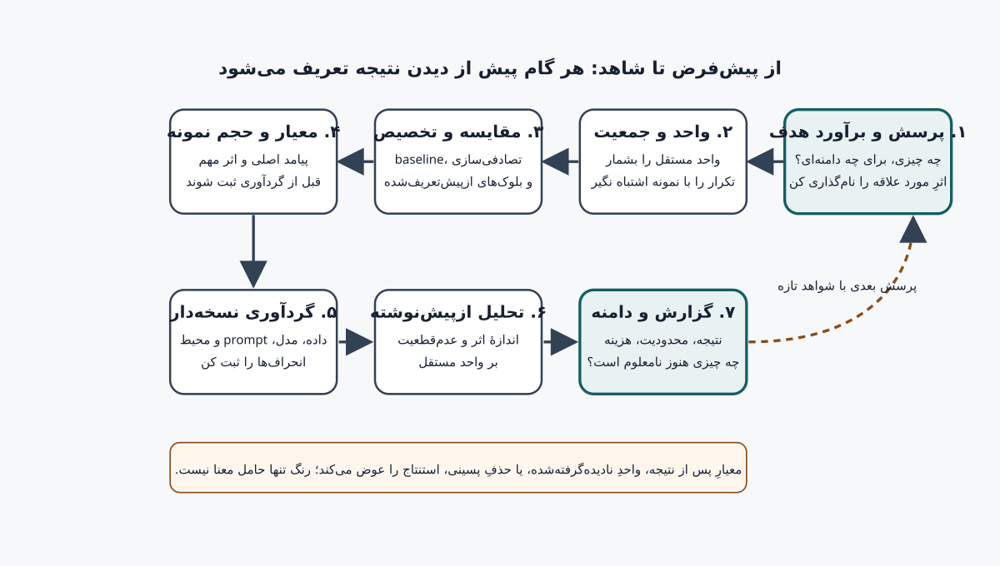

# جلد پنجم، فصل ۱۰ — طراحی آزمایش و تحلیل آماری

فصل محلی ۱۰ جلد پنجم = فصل سراسری ۷۱. در این فصل یک سؤال پژوهش را به برآورد هدف، واحد مستقل، مقایسهٔ منصفانه، معیار اصلی، طرح نمونه‌گیری و تحلیل ازپیش‌تعریف‌شده تبدیل می‌کنیم؛ مثال‌های کدنویسی فقط روی fixture ساختگی‌اند و نتیجهٔ هیچ مدل واقعی را نمی‌سنجند.

## ۱. مسئله را پیش از دیدن نتیجه تعریف کنید

تحلیل آماری پس از گردآوری داده نمی‌تواند طراحی نامناسب را جبران کند. اگر ندانیم چه چیزی مستقل است، کدام تغییر را مقایسه می‌کنیم، چه اثر کوچکی از نظر کاربرد مهم است و داده از کجا می‌آید، یک عدد دقیق هم ممکن است پاسخ پرسش ما نباشد. طراحی آزمایش یعنی پیشاپیش تصمیم بگیریم چه مشاهده‌ای می‌تواند بین توضیح‌های رقیب تمایز بگذارد و چه چیزی همچنان نامعلوم می‌ماند.

چرخهٔ زیر، نسخه‌ای کوچک از فرایند پژوهش است؛ در کار واقعی هر گام باید با سامانه، جمعیت هدف، مجوز داده و هزینهٔ پروژه سازگار شود.



## ۲. مرز این فصل در پنج جلد

نقشهٔ پنج‌جلدی از مبانی و برنامه‌نویسی در جلد اول، یادگیری ماشین و شبکهٔ عصبی در جلد دوم، Transformer و ساخت مدل زبانی در جلد سوم، آموزش و زیرساخت در جلد چهارم، و ارزیابی، محصول و پژوهش در جلد پنجم عبور می‌کند. فصل ۷۰ روش خواندن مقاله و بازتولید ادعاهای موجود را بررسی می‌کند؛ این فصل طراحی یک مطالعهٔ تازه و تحلیل آن را تمرین می‌دهد. فصل ۶۲ دربارهٔ طراحی benchmark و گزارش سنجه است، اما اینجا تمرکز بر انتخاب واحد مستقل، مقایسه و استنباط محدود از یک آزمایش مشخص است. ساخت و پاک‌سازی corpus در فصل ۴۳، رفتار مدل در فصل ۶۳، آزمون خصمانه در فصل ۶۴ و استقرار محصول در فصل‌های ۶۶ تا ۶۹ پوشش داده شده‌اند؛ جزئیات آن‌ها را دوباره پیاده‌سازی نمی‌کنیم. مسیر فصل بعد، توسعهٔ معماری و ارتباط پژوهشی است؛ این فصل وعدهٔ ساخت معماری نو یا نگارش مقاله نمی‌دهد.

## ۳. خروجی‌های یادگیری

پس از مطالعه باید بتوانید پرسش قابل‌آزمون و برآورد هدف را از ادعای کلی جدا کنید؛ واحد آزمایش، واحد اندازه‌گیری و واحد تحلیل را نام ببرید؛ baseline، پیامد اصلی و اثر مهم از نظر کاربرد را پیش از اجرا تعریف کنید؛ طرح جفت‌شده یا مستقل، تصادفی‌سازی و بلوک‌بندی را با توجه به وابستگی داده انتخاب کنید؛ حجم نمونه را با هدف استنباط و محدودیت منابع توضیح دهید؛ و اندازهٔ اثر، عدم‌قطعیت، محدودیت و دامنهٔ تعمیم را بدون تبدیل یک p-value به حکم قطعی گزارش کنید.

## ۴. از موضوع تا پرسش پژوهش

«آیا مدل بهتر شده است؟» پرسش اجرایی نیست. باید معلوم شود کدام نسخه، روی چه دامنه‌ای از وظایف و با چه معیار و مقایسه‌گری بهتر است. صورت دقیق‌تر می‌تواند چنین باشد: «روی مجموعهٔ وظایف مجاز و جداشده‌ای که پیش از مقایسه تعریف شده است، تغییر قالب prompt از A به B میانگین امتیاز انجام وظیفه را چقدر عوض می‌کند، وقتی هر دو قالب روی همان وظایف اجرا شوند؟» این جمله هنوز باید جمعیت هدف، نحوهٔ نمونه‌گیری، نسخهٔ مدل، معیار، واحد مستقل و دورهٔ اجرا را روشن کند.

پرسش را طوری بنویسید که پاسخ منفی، صفر یا نامعین هم ممکن باشد. پرسشی که از ابتدا فقط دنبال اثبات برتری candidate است، بررسی گزینه‌های دیگر و تفسیر نتیجهٔ خنثی را دشوار می‌کند.

## ۵. فرضیه، برآورد هدف و ادعا

فرضیه پیش‌بینی قابل‌آزمون است؛ برآورد هدف (estimand) کمیتی است که واقعاً می‌خواهیم درباره‌اش حرف بزنیم. برای مقایسهٔ جفت‌شدهٔ candidate و baseline می‌توان برآورد هدف را «میانگین اختلاف امتیاز در واحدهای مستقلِ جمعیت هدف» تعریف کرد. اگر امتیاز هر واحد `Y` باشد، اختلاف جهت‌دار `candidate − baseline` است؛ پیش از اجرا مشخص کنید مقدار مثبت به نفع کدام گزینه است.

فرض صفر معمولاً یک گزارهٔ ساده دربارهٔ پارامتر است، مانند «میانگین اختلاف برابر صفر است»؛ اما نتیجهٔ پژوهش فقط تصمیم دربارهٔ آن گزاره نیست. فرضیهٔ کاربردی می‌تواند کوچک‌ترین بهبود مهم را هم مشخص کند. بازهٔ این فصل از نتیجهٔ یک آزمایش تا ادعای جمعیتی را جدا نگه می‌دارد؛ وجود اختلاف نمونه‌ای، به‌تنهایی اثر علّی یا تعمیم را ثابت نمی‌کند.

## ۶. واحد آزمایش، واحد اندازه‌گیری و واحد تحلیل

واحد آزمایش همان موجودیتی است که شرط یا مداخله به آن تخصیص می‌یابد؛ واحد اندازه‌گیری چیزی است که از آن نمره یا مشاهده ثبت می‌شود؛ و واحد تحلیل عنصری است که فرض آماری و روش تحلیل روی آن بنا شده است. این سه واحد گاهی یکی‌اند و گاهی نه. در یک مطالعهٔ متن، prompt، نمونهٔ تولیدشده، مکالمه، کاربر، موضوع و روز اجرا می‌توانند سطوح تو‌در‌تو باشند.

فرض کنید ۵۰ prompt را هرکدام با پنج seed اجرا کرده‌ایم. اگر هدف تعمیم به مجموعه‌ای از وظایف مشابه باشد، پنج اجرای هر prompt معمولاً پنج وظیفهٔ مستقل نیستند؛ prompt همان‌قدر اطلاعات مستقل دربارهٔ تنوع وظایف می‌دهد که طراحی اجازه می‌دهد. اگر همهٔ پنج اجرای یک prompt را ۲۵۰ نمونهٔ مستقل بشماریم، خطای معیار می‌تواند مصنوعی کوچک شود؛ این همان شبه‌تکرار است. واحد بازنمونه‌گیری یا تحلیل باید از ساختار نمونه‌گیری و پرسش پژوهش پیروی کند، نه از تعداد ردیف‌های log.

## ۷. دامنهٔ هدف و نمونه‌گیری

«همهٔ کاربران»، «وظایف فارسی»، «مکالمات پزشکی» یا «سؤال‌های استدلالی» جمعیت‌های یکسانی نیستند. دامنهٔ هدف را با زبان، حوزه، طول ورودی، حساسیت، زمان، نسخهٔ مدل و شرایط استفاده تعریف کنید. چارچوب نمونه‌گیری توضیح می‌دهد که چه مواردی امکان ورود داشته‌اند و چه مواردی بیرون مانده‌اند؛ روش انتخاب نمونه باید از این تعریف پیروی کند.

نمونه‌گیری تصادفی از یک چارچوب مناسب می‌تواند مبنای تعمیم آماری باشد، اما دسترس‌پذیری آسان یا نمونه‌های پرتکرار به‌تنهایی نمایندهٔ جامعه نیستند. اگر داده‌ها هدفمند، عمومی، ساختگی یا انتخاب‌شده برای پوشش سناریوها باشند، همان را گزارش کنید و ادعای نمایندگی نکنید. در نمونه‌های کوچک، پوشش دسته‌ها و محدودیت‌ها را به‌جای ادعای نمایندگی پنهان‌شده ثبت کنید.

## ۸. ساخت داده و جداسازی

برای هر رکورد منبع، مجوز، نسخه، زمان گردآوری، شرایط رضایت، دگرگونی‌ها، حذف‌ها و شناسهٔ split را مستند کنید. اطلاعات شناسایی‌پذیر، محتوای حساس و خطر بازشناسایی را بررسی کنید؛ دادهٔ عمومی به‌طور خودکار مجوز استفادهٔ تازه یا بی‌خطر بودن نیست. کاربرد افراد انسانی ممکن است به رضایت آگاهانه، بررسی اخلاقی و قواعد محلی نیاز داشته باشد؛ این فصل مشاورهٔ حقوقی یا جایگزین کمیتهٔ اخلاق نیست.

پیش از دیدن نتیجهٔ نهایی، داده را بر مبنای واحد درست جدا کنید. اگر چند prompt از یک منبع، مکالمه، نویسنده یا کاربر می‌آیند، جداکردن ردیف‌ها به train و test می‌تواند اطلاعات مشترک را نشت دهد. فصل ۴۳ دربارهٔ مجوز و آلودگی corpus، و فصل ۶۲ دربارهٔ آلودگی benchmark جزئیات بیشتری دارد؛ اینجا اصل طراحی آن است که split با واحد تعمیم موردنظر سازگار باشد.

## ۹. baseline و مقایسهٔ منصفانه

baseline باید نمایندهٔ تصمیم واقعی باشد: نسخهٔ فعلی، روش ساده، مدل مرجع یا سیاستی که قرار است جایگزین شود. شرایط مقایسه را تا حد امکان ثابت نگه دارید؛ prompt، زبان، decode settings، ابزارها، داده، طول context، timeout، نسخهٔ tokenizer و بودجهٔ محاسباتی را ثبت کنید. اگر چند مؤلفه هم‌زمان عوض شوند، مشاهدهٔ تفاوت را نمی‌توان بی‌درنگ به یک مؤلفه نسبت داد.

در هر دو شرط، داده‌های مجاز و نمونه‌های مشترک را به‌کار برید تا اختلاف هر واحد قابل‌مقایسه باشد؛ یا اگر طراحی مستقل است، علت نداشتن جفت و روش تخصیص را توضیح دهید. مقایسهٔ یک candidate روی مجموعه‌ای آسان‌تر با baseline روی مجموعه‌ای دشوارتر، اختلاف مدل و اختلاف داده را درهم می‌آمیزد.

## ۱۰. معیار اصلی و جهت سنجه

معیار باید با هدف استفاده سازگار باشد و تعریف عملیاتی آن پیش از اجرا نوشته شود. برای هر سنجه واحد، دامنه، جهت مطلوب، وزن‌دهی و نحوهٔ محاسبه را مشخص کنید. accuracy، macro-F1، MAE، نرخ تکمیل وظیفه، latency و هزینه پرسش‌های متفاوتی را پاسخ می‌دهند؛ انتخاب یک metric فقط به‌دلیل بهترشدن candidate، تحلیل را پس از مشاهدهٔ نتیجه تغییر می‌دهد.

یک پیامد اصلی از پیش انتخاب کنید. معیارهای ثانویه می‌توانند تصویر کامل‌تری بدهند، اما تعداد زیاد آن‌ها احتمال پیدا کردن یک عدد چشمگیر را بالا می‌برد. اگر معیار مرکب می‌سازید، وزن‌ها، قواعد دادهٔ مفقود و حساسیت نتیجه به وزن‌ها را پیشاپیش ثبت کنید؛ عدد مرکب را جایگزین اجزای مهم نکنید.

## ۱۱. اثر مهم از نظر کاربرد

اندازهٔ اثر را از اهمیت عملی جدا کنید. اختلاف ۰٫۰۲ در score ممکن است در یک وظیفه بی‌اهمیت و در وظیفه‌ای دیگر پرهزینه یا حساس باشد. پیشاپیش کوچک‌ترین اختلافی را تعریف کنید که تغییر تصمیم می‌دهد، و دلیلش را با هزینه، خطر، خط مبنا یا ترجیح ذی‌نفعان پیوند دهید. یک فاصلهٔ اطمینان که صفر را دربرمی‌گیرد، لزوماً ثابت نمی‌کند اثر دقیقاً صفر است؛ یک فاصلهٔ باریک هم لزوماً بهبود مهم نیست.

در محصول ایمنی‌حساس، average واحد کافی نیست؛ خطاهای پرخطر، زیرگروه‌ها، پوشش و هزینهٔ شکست باید در پروتکل بررسی شوند. فصل‌های ۶۳ و ۶۴ دربارهٔ رفتار و حمله‌اند؛ اگر آزمون تازه در این حوزه‌هاست، معیارهای خطر را با متخصص و قواعد اخلاقی همان حوزه طراحی کنید.

## ۱۲. طرح آزمایش را انتخاب کنید

| هدف | طرح محتمل | پرسش کنترلی |
|---|---|---|
| مقایسهٔ دو تنظیم روی همان موارد | جفت‌شده | آیا هر دو شرط دقیقاً روی واحدهای مشترک اجرا می‌شوند؟ |
| مقایسهٔ دو گروه جدا | مستقل و تصادفی‌شده | آیا تخصیص، ترکیب و اندازهٔ گروه‌ها قابل‌توجیه است؟ |
| کاهش تغییرپذیری ناشی از batch یا topic | بلوک‌بندی | آیا در هر بلوک همهٔ شرط‌های موردنیاز حاضرند؟ |
| بررسی چند عامل هم‌زمان | عاملی یا طرح مرحله‌ای | آیا تعامل‌ها و تعداد مقایسه‌ها از قبل مشخص شده‌اند؟ |
| صرفاً مشاهدهٔ دادهٔ موجود | مشاهده‌ای | چه مخدوش‌گرهایی اندازه‌گیری نشده‌اند و ادعای علّی تا کجا مجاز است؟ |

طرح جفت‌شده معمولاً تغییرپذیری بین واحدهای مشترک را از اختلاف درون هر جفت جدا می‌کند، اما فقط وقتی معنا دارد که جفت‌سازی معتبر باشد و نشت بین دو شرط ایجاد نکند. آزمایش مشاهده‌ای می‌تواند ارتباط نشان دهد، نه لزوماً اثر علّی؛ تصادفی‌سازیِ اخلاقی یا عملی ممکن نیست همیشه در دسترس باشد.

## ۱۳. تصادفی‌سازی و ترتیب اجرا

وقتی امکان‌پذیر و اخلاقی است، شرط را تصادفی به واحدها تخصیص دهید یا ترتیب اجرا را درون بلوک‌ها تصادفی کنید. این کار احتمال هم‌بستگی شرط با زمان، ترتیب، اپراتور یا تغییرات محیط را کم می‌کند؛ به‌تنهایی نمونهٔ نماینده نمی‌سازد و مخدوش‌گرهای اندازه‌گیری‌نشده را حذف نمی‌کند. seed تخصیص، الگوریتم تصادفی‌سازی، تعداد واحدهای هر شرط و خروجی تخصیص را ثبت کنید تا اجرا بازبینی‌پذیر باشد.

اگر پردازش ترتیبی یا محدودیت rate وجود دارد، ترتیب زمانی را کنترل کنید: نوبت‌های candidate و baseline را در چند بلوک جابه‌جا کنید، پنجرهٔ زمانی، نسخهٔ سرویس و خطاهای retry را نگه دارید. اجرای همیشه baseline در صبح و همیشه candidate در شب، تغییر ترافیک یا سخت‌افزار را با تغییر مدل مخلوط می‌کند.

## ۱۴. بلوک‌بندی و مخدوش‌گرها

بلوک عامل مزاحمی است که بر پاسخ اثر می‌گذارد و می‌توان آن را پیش از تخصیص شناسایی کرد؛ مانند batch، موضوع، زبان، روز اجرا یا منبع داده. شرط‌های مقایسه را درون هر بلوک متوازن کنید و تحلیل را با این ساختار هماهنگ سازید. راهنمای NIST بلوک‌بندی را برای جداکردن بخشی از تغییرپذیری مزاحم از عامل اصلی توضیح می‌دهد و قاعدهٔ «آنچه را می‌توانی بلوک‌بندی کن و آنچه را نمی‌توانی تصادفی کن» را پیشنهاد می‌کند [۱].

بلوک‌بندیِ پسینی بر مبنای نتیجه یا ساختن زیرگروه تا پیدا شدن اختلاف، خطر سوگیری دارد. پیشاپیش تعداد و تعریف زیرگروه‌ها، عامل‌های ثبت‌شده، و روش گزارش تعامل‌ها را تعیین کنید. اگر عاملی را کنترل نکرده‌اید، آن را پنهان نکنید؛ ثبت محدودیت، گاهی از مدل آماری پیچیده‌تر صادقانه‌تر است.

## ۱۵. مدل‌های تصادفی، promptها و seedها

در مدل مولد، خروجی می‌تواند به prompt، ترتیب پیام‌ها، decoding، seed، نسخهٔ API یا سرویس، منطقه، زمان و سیاست فیلتر وابسته باشد. متن دقیق ورودی و خروجی مجاز، پارامترهای sampling، نسخهٔ checkpoint و tokenizer، هزینه، زمان پاسخ و خطای شبکه را ثبت کنید؛ secret یا دادهٔ خصوصی را در log نگذارید. در APIهایی که نسخهٔ دقیق را اعلام نمی‌کنند، تاریخ و شناسهٔ سرویس را ثبت و تغییرپذیری ارائه‌دهنده را محدودیت بنویسید.

تکرار روی یک prompt برای سنجش تغییرپذیری تصادفی مفید است، اما واحد مستقل تازه نمی‌سازد. اگر هدف تعمیم به promptهای دیگر است، promptها یا گروه‌های task باید واحد نمونه‌گیری باشند؛ تکرارهای seed درون آن‌ها نقش تو‌در‌تو دارند. تعداد seed را به‌صورت قاعدهٔ جهان‌شمول انتخاب نکنید؛ آن را با پرسش، بودجه و دقت موردنیاز توجیه کنید.

## ۱۶. حجم نمونه را توجیه کنید

حجم نمونه را پس از تعیین واحد مستقل بنویسید؛ «۱٬۰۰۰ پاسخ» بی‌معناست اگر معلوم نباشد این پاسخ‌ها از چند task مستقل، چند گروه و چند تکرار آمده‌اند. پیش‌بینی اثر کوچک‌تر از اثر موردعلاقه را به‌جای فرض «اثر بزرگ» انتخاب کنید. روش Lakens شش راه برای توجیه حجم نمونه را مرور می‌کند: سنجش تقریباً تمام جمعیت، محدودیت منابع، تحلیل توان پیشینی، دقت هدف، قاعدهٔ تجربیِ مستند، یا اذعان صریح به نبود توجیه [۲]. هیچ‌کدام مجوز پنهان‌کردن محدودیت نیست.

برای مقایسهٔ جفت‌شدهٔ میانگین، تقریب سادهٔ برنامه‌ریزی چنین است؛ `σ_d` انحراف معیار موردانتظارِ اختلاف‌های مستقل، `Δ` کوچک‌ترین اختلاف مهم، `α` سطح خطای نوع اول و `1−β` توان هدف است:

<math xmlns="http://www.w3.org/1998/Math/MathML" display="block" aria-label="حجم نمونهٔ جفت‌شده تقریباً برابر است با مربع مجموع ضریب نرمال مربوط به آلفا و توان، ضرب در انحراف معیار اختلاف و تقسیم بر کوچک‌ترین اختلاف مهم">
  <mrow><mi>n</mi><mo>≈</mo><msup><mrow><mo>(</mo><mfrac><mrow><mo>(</mo><msub><mi>z</mi><mrow><mn>1</mn><mo>−</mo><mi>α</mi><mo>/</mo><mn>2</mn></mrow></msub><mo>+</mo><msub><mi>z</mi><mrow><mn>1</mn><mo>−</mo><mi>β</mi></mrow></msub><mo>)</mo><msub><mi>σ</mi><mi>d</mi></msub></mrow><mi>Δ</mi></mfrac><mo>)</mo></mrow><mn>2</mn></msup></mrow>
</math>

**متن جایگزین فرمول:** در یک تقریب جفت‌شده، تعداد واحدهای مستقل `n` با مربع نسبتِ `(z_(1−α/2) + z_(1−β)) × σ_d` به کوچک‌ترین اختلاف مهم `Δ` متناسب است؛ فرض‌های مدل و تعریف واحد مستقل باید برقرار باشند.

این تقریب تضمین توان برای اثر واقعی ناشناخته نیست؛ به توزیع، استقلال، روش آزمون و تخمین `σ_d` وابسته است. برای معیارهای گسسته، دادهٔ خوشه‌ای، چند پیامد یا توزیع نامتقارن ممکن است شبیه‌سازی طراحی یا روش تخصصی‌تری لازم باشد. اگر بودجه فقط اجازهٔ شمار کمی واحد می‌دهد، آن را صریح بنویسید و هدف را به برآورد توصیفی یا مطالعهٔ امکان‌سنجی محدود کنید.

## ۱۷. توان آماری در برابر دقت برآورد

توان آماری احتمال رد فرض صفر در شرایطی است که اثر فرض‌شده وجود دارد؛ این احتمال دربارهٔ مجموعه‌ای از آزمایش‌های تکراری و بر اساس فرض‌های مدل تعریف می‌شود. توانِ زیاد برای اثر بسیار کوچک شاید از نظر تصمیم بی‌اهمیت باشد؛ توانِ کم هم نتیجهٔ غیرمعنادار را به شاهد نبود اثر تبدیل نمی‌کند. «توان پس از مشاهده» بر اساس اثر مشاهده‌شده معمولاً جایگزین مناسبی برای بازهٔ عدم‌قطعیت نیست.

اگر هدف اصلی تخمین اندازهٔ اثر است، می‌توان دقتِ بازه یا حد بالای اختلاف قابل‌قبول را برنامه‌ریزی کرد. قبل از جمع‌آوری داده تعیین کنید چه پهنای بازه‌ای تصمیم را عوض می‌کند. نمونهٔ کوچک را با precision هدف اشتباه نگیرید؛ اگر منابع محدودند، روش توجیه را از میان گزینه‌های Lakens انتخاب کنید و بگویید چه اندازه‌اثری را نمی‌توان با این طراحی رد یا تأیید کرد.

## ۱۸. طرح تحلیل را پیشاپیش ثبت کنید

پیش از مشاهدهٔ outcome اصلی، پرسش، برآورد هدف، واحد، معیار اصلی، جفت‌سازی، قواعد حذف، دادهٔ مفقود، روش تحلیل، بازهٔ عدم‌قطعیت، مقایسه‌های ثانویه، قاعدهٔ توقف و راهبرد چندآزمونی را در نسخه‌ای زمان‌دار ذخیره کنید. پیش‌ثبت می‌تواند انتخاب‌های پسینی را آشکارتر کند، اما کیفیت طراحی یا صداقت را خودبه‌خود تضمین نمی‌کند. اگر پروتکل را تغییر دادید، نسخهٔ قبلی را حفظ کنید، زمان و دلیل تغییر را بنویسید و مشخص کنید کدام تحلیل ازپیش‌ثبت‌شده و کدام اکتشافی است.

ثبت محلی یا hash فایل به‌تنهایی زمان‌مهر معتبر یا اثبات ثبت پیش از داده نیست. پروژهٔ همراه این فصل عمداً وضعیت `illustrative_only_not_a_preregistration` دارد؛ این تفاوت در گزارش نتیجه هم حفظ می‌شود. معیارها و روش‌های فرعی که پس از دیدن داده اضافه می‌شوند را «ازپیش‌تعیین‌شده» ننامید.

## ۱۹. گردآوری و اخلاق داده

واژه‌نامهٔ داده را پیش از اجرا بسازید: نام فیلد، نوع، واحد، دامنهٔ مجاز، منبع، معنای مقدار تهی و قاعدهٔ نسخه‌بندی. ثبت raw output می‌تواند برای بازبینی مفید باشد، اما ابتدا نیاز واقعی، دسترسی، نگهداری، حذف و خطر بازشناسایی را تعیین کنید. promptهای کاربران، نام‌ها، شناسه‌ها، کلید API و محتوای محرمانه را به fixture، log، تصویر یا گزارش عمومی منتقل نکنید.

اگر ارزیاب انسانی دخیل است، دستورالعمل، معیار داوری، آموزش، تعداد ارزیاب، شیوهٔ رسیدگی به اختلاف، رضایت، جبران خدمت و خطر را پیشاپیش مستند کنید. توافق بین ارزیابان را با یک عدد خام کافی ندانید؛ نوع سنجه و فرض‌هایش مهم است. قواعد اخلاقی و حقوقی وابسته به حوزه و نهاد هستند؛ پیش از مطالعهٔ انسانی، مجوز لازم را از مسئول مربوطه بگیرید.

## ۲۰. اثر را برآورد کنید

برای `n` واحد مستقل جفت‌شده، اختلاف هر واحد `d_i = score(candidate)_i − score(baseline)_i` است و میانگین مشاهده‌شده `mean(d_i)` برآوردی از اثرِ تعریف‌شده در همان طراحی است. با گزارش هر دو مقدار و تعداد واحدها، خواننده می‌تواند جهت و مقیاس را بررسی کند. کنار میانگین، پراکندگی، median یا نمودار اختلاف‌های جفتی را هم در صورت مناسب‌بودن معیار نشان دهید؛ خلاصهٔ مرکزی به‌تنهایی شکل توزیع را آشکار نمی‌کند.

اثر را با واحد اصلی بنویسید: اختلاف ۰٫۰۴ روی امتیاز [۰،۱] چهار واحد درصد از بازهٔ کامل این امتیاز است، نه الزاماً «چهار درصد بهبود کیفیت». اگر نسبت به baseline درصد تغییر گزارش می‌کنید، مخرج و فرمول را بگویید؛ وقتی baseline نزدیک صفر باشد نسبت می‌تواند گمراه‌کننده شود.

## ۲۱. عدم‌قطعیت و بازنمونه‌گیری

بازهٔ اطمینان، دامنه‌ای از مقادیر سازگار با داده و مدل نمونه‌گیری را خلاصه می‌کند؛ «۹۵٪» به‌معنای احتمال ۹۵درصدیِ درست‌بودن فرضیه یا قرارگرفتن پارامتر ثابت در همین بازه نیست. در بازهٔ frequentist، پوشش بلندمدت تابع روش و فرض‌هاست. نمودار دادهٔ خام یا اختلاف‌های مستقل را نیز منتشر کنید تا خلاصه قابل‌بررسی باشد.

Bootstrap با بازنمونه‌گیری واحدهای نمونه و محاسبهٔ دوبارهٔ آماره، می‌تواند توزیع تجربیِ برآورد را برای برخی مسائل تقریب بزند؛ بازنمونه‌گیری باید در سطح واحد مستقل یا خوشهٔ نمونه‌گیری انجام شود، نه از ردیف‌های هم‌بسته به‌طور تصادفی. اگر تخصیص در بلوک‌های topic متوازن شده است، روش بازنمونه‌گیری باید ساختار بلوک را حفظ کند؛ پروژهٔ این فصل گروه‌ها را درون هر topic بازنمونه‌گیری می‌کند. روش percentile، تعداد تکرار، seed، واحد، strata، مقدارهای تهی و روش انتخاب بازه را ثبت کنید. در نمونهٔ بسیار کوچک یا مجموعهٔ غیرنماینده، bootstrap هم جادو نمی‌کند و بازهٔ آن مبنای تعمیم جمعیتی نیست.

## ۲۲. مقدار p چه می‌گوید و چه نمی‌گوید

مقدار p احتمال مشاهدهٔ داده‌ای دست‌کم به‌اندازهٔ دادهٔ دیده‌شده را تحت مدل آماری و فرض صفر تعریف‌شده بیان می‌کند؛ احتمال درست‌بودن فرضیه یا احتمال اینکه نتیجه «فقط شانسی» باشد نیست. انجمن آمار آمریکا تأکید می‌کند که تصمیم علمی یا سیاستی نباید فقط به عبور از آستانهٔ دلخواه p وابسته باشد و p-value اندازه یا اهمیت اثر را نشان نمی‌دهد [۳].

اگر آزمون فرضیه به پرسش می‌خورد، آزمون، فرض‌ها، آماره، جهت یک‌طرفه/دوطرفه، سطح خطا، توقف، واحد نمونه و روش چندآزمونی را پیشاپیش مشخص کنید. به‌جای «p>0.05 پس مدل‌ها مساوی‌اند» بنویسید «این طراحی شواهد کافی برای تمایز در دامنهٔ تعریف‌شده نداد؛ بازه و اثرهای سازگار با داده را گزارش می‌کنیم.» آزمون هم‌ارزی یا non-inferiority پرسش و آستانه‌های خودش را می‌خواهد؛ از نبود معنی‌داری، هم‌ارزی نتیجه نگیرید.

## ۲۳. چند معیار، چند مدل و تعدد آزمون‌ها

اگر ده مدل، پنج سنجه، چند زیرگروه و چند prompt را بررسی کنید، احتمال یک نتیجهٔ تصادفیِ چشمگیر بالا می‌رود. ابتدا یک پیامد اصلی و مقایسهٔ اصلی انتخاب کنید. برای مجموعه‌ای از ادعاهای تأییدی، خانوادهٔ آزمون‌ها و هدف کنترل خطا را مشخص کنید؛ روش‌های کنترل family-wise error یا false discovery rate پرسش‌های متفاوتی دارند. روش Benjamini–Hochberg برای کنترل نرخ کشف کاذب در خانواده‌ای از آزمون‌ها پیشنهاد شده است [۴]؛ انتخاب روش باید با وابستگی آزمون‌ها و هدف مطالعه سازگار باشد.

تحلیل exploratory مفید است؛ فقط برچسب آن را حفظ کنید و برای تأیید به داده یا مطالعهٔ مستقل نیاز داشته باشید. Demšar آزمون‌های Wilcoxon و Friedman را برای مقایسهٔ چند classifier روی چند dataset بررسی می‌کند [۵]. این توصیه را نباید بی‌توجه به ساختار مطالعه به promptهای هم‌بسته یا تکرارهای seed تعمیم داد؛ واحد و طراحی تعیین می‌کنند چه آزمونی مناسب است.

## ۲۴. دادهٔ مفقود و قواعد حذف

پیش از اجرا تعریف کنید چه اتفاقی برای timeout، خطای سرویس، پاسخ خالی، عدم توافق ارزیاب و خروجی نامعتبر می‌افتد. اگر یک شرط خطای بیشتری دارد، حذف آن خطاها ممکن است نتیجه را به نفع همان شرط منحرف کند؛ نرخ خطا را به‌عنوان نتیجه یا محدودیت جدا گزارش کنید. قاعدهٔ حذف باید بر ویژگی پیش از outcome تکیه کند، نه بر نمره‌ای که بعداً نامطلوب دیده شده است.

در گزارش، تعداد برنامه‌ریزی‌شده، اجراشده، حذف‌شده و تحلیل‌شده را برای هر شرط جدا نشان دهید. در صورت تغییر پروتکل، تحلیل اصلی و تحلیل حساسیت را از هم جدا کنید. دادهٔ مفقود را بی‌صدا با صفر، میانگین یا آخرین مقدار جایگزین نکنید؛ روش، فرض و اثر آن بر نتیجه را توضیح دهید.

## ۲۵. جدول گزارش که امکان بازرسی بدهد

| جزء | آنچه باید ثبت شود |
|---|---|
| پرسش و ادعا | دامنه، هدف و گزاره‌ای که آزموده می‌شود |
| جمعیت و نمونه | منبع، معیار ورود، روش نمونه‌گیری، split و تعداد واحد مستقل |
| نسخه و محیط | مدل، tokenizer، prompt، seed، کتابخانه، سخت‌افزار و زمان/هزینه |
| طرح | baseline، تخصیص، جفت‌سازی، بلوک‌ها و مخدوش‌گرهای ثبت‌شده |
| پیامدها | معیار اصلی، جهت، واحد، اثر کاربردی و معیارهای ثانویه |
| تحلیل | برآورد، بازه، آزمون و فرض‌ها، تعدد آزمون و قواعد حذف |
| نتیجه | تعداد، effect size، عدم‌قطعیت، خطاها و انحراف از طرح |
| محدودیت | چه گروه، محیط، نسخه یا ادعایی ارزیابی نشده است |

راهنمای جاری NeurIPS برای چک‌لیست پژوهش از نویسندگان می‌خواهد ادعا و دامنه، محدودیت‌ها، بازتولیدپذیری، error bars و منابع محاسباتی را گزارش کنند؛ این یادآوری است، نه جایگزین راهنمای ارسال هر رویداد [۶]. مقالهٔ علمی باید به‌اندازه‌ای اطلاعات بدهد که خواننده بداند چه چیزی انجام شد، چه چیزی تغییر کرد و چه چیزی از نتیجه نمی‌توان نتیجه گرفت.

## ۲۶. مثال ساختگی: مقایسهٔ دو نسخه

یک مطالعهٔ واقعی فرضی را در نظر بگیرید که دو نسخه را روی چند گروه مستقل از taskها مقایسه می‌کند. طرح پیشاپیش می‌گوید هر شرط روی همان taskها اجرا شود؛ دو تکرار تولید در هر task صرفاً درون گروه قرار گیرند؛ امتیاز در بازهٔ صفر تا یک باشد؛ میانگین اختلاف candidate منهای baseline پیامد اصلی باشد؛ و عدم‌قطعیت روی گروه‌ها بازنمونه‌گیری شود. پیش از هر نتیجه، بودجه، توقف، قواعد خطا و تغییر نسخه ثبت می‌شود.

پروژهٔ همراه همین ساختار را با هشت گروه، شانزده task و ۳۲ ردیف ساختگی تقلید می‌کند. CLI میانگین اختلاف جفت‌شدهٔ ۰٫۰۴۲۱۸۷۵ و بازهٔ صدکیِ bootstrap طبقه‌بندی‌شده برابر `[۰٫۰۳۱۸۷۵، ۰٫۰۵۲۱۸۷]` را روی همان fixture گزارش می‌دهد. یکی از هشت اختلاف گروهی منفی است. این اعداد فقط برای آموزش کد هستند؛ گروه‌ها نمونهٔ تصادفی، مدل‌ها واقعی، تخصیص تصادفی یا پیامدها مشاهده‌شده نیستند. بنابراین از آن‌ها نتیجهٔ برتری، توان، معنی‌داری یا تعمیم استخراج نمی‌کنیم.

## ۲۷. آزمایشگاه فصل و اجزای پروژه

پروژهٔ فصل ۷۱ در [`projects/71-experiment-design-lab/`](../projects/71-experiment-design-lab/README.md) طرح را از نتیجه جدا می‌کند، fixture ساختگی را hash می‌کند، جفت‌بودن و کامل‌بودن گروه‌ها را می‌سنجد و بازنمونه‌گیری را بر گروه‌های مستقل درون بلوک‌های ازپیش‌تعریف‌شدهٔ `topic` انجام می‌دهد. در این آزمایشگاه یک شرط candidate و یک baseline روی همان taskهای فرضی ثبت شده‌اند؛ تکرارها پیش از بازنمونه‌گیری در سطح گروه جمع می‌شوند.

[پاسخ‌نامهٔ مستقل فصل ۷۱](../answers/71-research-design-statistics-fa.md) متن همین هشت پرسش را عیناً نگه می‌دارد. [گزارش ممیزی](71-audit-report-fa.md) محدودهٔ آزمون و محدودیت نتیجه را ثبت می‌کند. فایل `analysis_plan.json` طرح آموزشی است، نه پیش‌ثبت رسمی؛ فایل `fixture_manifest.json` فقط سازگاری بایت‌ها را می‌سنجد و زمان ثبت یا اولویت علمی را ثابت نمی‌کند.

## ۲۸. اجرای آفلاین

با CPython 3.13 و کتابخانهٔ استاندارد، از پوشهٔ پروژه اجرا کنید:

```sh
python3.13 -m unittest -v test_experiment_design.py
python3.13 experiment_design.py --plan analysis_plan.json --fixture synthetic_paired_scores.json --manifest fixture_manifest.json --output /tmp/ch71-results.json
cmp results.json /tmp/ch71-results.json
```

آزمون‌ها schema، یکتایی ردیف، جفت‌بودن، دامنهٔ score، تعداد تکرار، توازن taskها و گروه‌ها، قطعی‌بودن خروجی و رد طرح شبه‌تکراری را بررسی می‌کنند. `cmp` باید exit code صفر بدهد؛ این فقط همان داده و همان کد را تکرار می‌کند، نه آزمایش مستقل پژوهشی.

## ۲۹. خروجی پروژه را محدود بخوانید

`mean_paired_difference` اختلاف میانگین در هشت گروه ساختگی را خلاصه می‌کند. `bootstrap_percentile_interval` با ۲۰۰۰ بازنمونه از همان هشت اختلاف گروهی، درون سه بلوک `topic` و با seed ثابت ساخته شده است. خروجی مقدار `p_value: null`، تعداد درخواست شبکه و inference برابر صفر، `gpu_used: false` و `inference_authorized: false` را نیز ثبت می‌کند. این برچسب‌ها به معنی انجام آزمون واقعی یا تأیید فرضیه نیستند.

این پروژه توان، پوشش بازه در جامعه، کیفیت metric، برتری مدل، رفتار انسانی، انصاف، امنیت، latency، هزینهٔ محصول یا reproducibility بین ماشین‌ها را نمی‌سنجد. برای مطالعهٔ واقعی، جمعیت هدف، مجوز، داده، ارزیاب، احتمال‌های خطا، نمونهٔ مستقل، پروتکل و تحلیل جداگانه لازم است؛ هیچ حدی در fixture آستانهٔ کاربردی محسوب نمی‌شود.

## ۳۰. خطاهای تکرارشونده

- انتخاب metric، split، زیرگروه، seed یا قاعدهٔ حذف پس از دیدن نتیجه و سپس نامیدن آن به‌عنوان تحلیل اصلی.
- شمردن چند خروجی از یک prompt، کاربر، مکالمه یا batch به‌عنوان نمونه‌های مستقل، بدون مدل‌کردن وابستگی.
- مقایسهٔ نسخه‌ها روی داده، بودجه، prompt یا زمان‌های متفاوت و نسبت‌دادن همهٔ اختلاف به مدل.
- استفاده از بهترین seed یا بهترین metric از میان چند سنجه، بدون گزارش تمام کوشش‌ها و تعدد آزمون.
- تفسیر p-value به‌صورت احتمال درست‌بودن فرضیه، و تفسیر عدم‌معنی‌داری به‌صورت اثبات برابری.
- گزارش میانگین بدون تعداد مستقل، اثر، بازه، خطا، هزینه و دامنهٔ محدودیت‌ها.
- ادعای تعمیم به داده، زبان یا گروهی که اصلاً در طراحی حضور نداشته است.

انگیزهٔ انتشار مثبت و فشار انتخاب نتیجه می‌توانند تصمیم‌های پسینی را زیاد کنند. دفتر تحلیل، نسخه‌گذاری، گزارش نتیجهٔ خنثی و مرور مستقل از راه‌های کاهش این خطرند؛ هیچ‌کدام جای طراحی خوب و نقد علمی را نمی‌گیرند. استانداردهای بازتولیدپذیری و تکرارپذیری نیز بسته به نهاد تعریف‌های متفاوت دارند؛ فصل ۷۰ تفاوت NASEM و ACM را بررسی می‌کند و این فصل از کاربرد واژه‌ها برای فراتررفتن از شواهد خودداری می‌کند.

## ۳۱. چک‌لیست پیش از اجرا

۱. پرسش، جمعیت هدف و برآورد هدف به زبان دقیق نوشته شده‌اند؟ ۲. واحد آزمایش، اندازه‌گیری، تحلیل و بازنمونه‌گیری جداگانه مشخص‌اند؟ ۳. baseline، پیامد اصلی، جهت و اثر مهم از نظر کاربرد از پیش تعیین شده‌اند؟ ۴. split، مجوز، حریم خصوصی، جفت‌سازی، تصادفی‌سازی و بلوک‌ها مستندند؟ ۵. حجم نمونه با توان، دقت یا محدودیت منابع توجیه شده است؟ ۶. نسخه، prompt، seed، قواعد خطا، دادهٔ مفقود و توقف ثبت می‌شوند؟ ۷. تحلیل اصلی، چندآزمونی و زیرگروه‌های اکتشافی پیشاپیش برچسب خورده‌اند؟ ۸. قالب گزارش از ابتدا اندازهٔ اثر، عدم‌قطعیت و محدودیت را دربرمی‌گیرد؟ اگر پاسخ هرکدام نامعلوم است، آن را پیش از اجرا حل کنید یا به‌عنوان محدودیت آشکار نگه دارید.

## ۳۲. جمع‌بندی

پژوهش خوب با انتخاب آزمون آماری شروع نمی‌شود؛ با سؤال، برآورد هدف و واحد مستقل شروع می‌شود. baseline، نمونه، split، معیار، اثر مهم، تصادفی‌سازی یا بلوک‌ها، حجم نمونه، قواعد حذف و تحلیل باید پیش از دیدن نتیجه با دامنهٔ ادعا سازگار شوند. سپس نتیجه با اندازهٔ اثر، عدم‌قطعیت و محدودیت گزارش می‌شود؛ مقدار p یا خروجی یک fixture جای قضاوت علمی را نمی‌گیرد.

بازتولید همان اجرا، تکرار روی دادهٔ مستقل و تعمیم به دامنهٔ تازه سه پرسش متفاوت‌اند [۷]. گام بعدی این مجموعه به معماری پژوهش و ارتباط جامعهٔ علمی می‌پردازد؛ هر ادعای تازه همچنان باید با داده، روش و شواهد متناسب سنجیده شود.

همراه‌های این فصل: [پاسخ‌نامهٔ مستقل](../answers/71-research-design-statistics-fa.md)، [پروژهٔ آزمون‌پذیر](../projects/71-experiment-design-lab/README.md) و [گزارش ممیزی](71-audit-report-fa.md).

## ۳۳. منابع و تاریخ بازبینی

**تاریخ بازبینی منابع: ۴ نوامبر ۲۰۲۶.** منابع زیر برای اصول پایدار طراحی و تفسیر بررسی شده‌اند؛ قیمت، عملکرد روز مدل‌ها یا نتیجهٔ پژوهش جاری در این فصل ادعا نمی‌شود.

۱. NIST/SEMATECH, [Engineering Statistics Handbook, 5.3.3.2: Randomized Block Designs](https://www.itl.nist.gov/div898/handbook/pri/section3/pri332.htm). توضیح بلوک‌بندی و نقش تصادفی‌سازی؛ راهنمای مهندسی است و هر طرح یادگیری ماشین را به‌تنهایی تجویز نمی‌کند.
۲. Lakens, D. (2022). [Sample Size Justification](https://doi.org/10.1525/collabra.33267). *Collabra: Psychology, 8*(1), 33267.
۳. Wasserstein, R. L., & Lazar, N. A. (2016). [The ASA’s Statement on p-Values: Context, Process, and Purpose](https://doi.org/10.1080/00031305.2016.1154108). *The American Statistician, 70*(2), 129–133. بیانیه و اصول شش‌گانهٔ تفسیر p-value: [نسخهٔ انجمن آمار آمریکا](https://www.amstat.org/asa/files/pdfs/P-ValueStatement.pdf).
۴. Benjamini, Y., & Hochberg, Y. (1995). [Controlling the False Discovery Rate: A Practical and Powerful Approach to Multiple Testing](https://doi.org/10.1111/j.2517-6161.1995.tb02031.x). *Journal of the Royal Statistical Society: Series B, 57*(1), 289–300.
۵. Demšar, J. (2006). [Statistical Comparisons of Classifiers over Multiple Data Sets](https://www.jmlr.org/papers/v7/demsar06a.html). *Journal of Machine Learning Research, 7*, 1–30. دامنهٔ مقاله مقایسهٔ چند classifier روی چند dataset است.
۶. NeurIPS, [Paper Checklist Guidelines](https://neurips.cc/public/guides/PaperChecklist), صفحهٔ جاری با راهنمای ادعا، محدودیت، بازتولیدپذیری، خطای معیار، منابع و داده/ارزیاب انسانی؛ تاریخ انتشار صفحه در خود آن مشخص نشده است، مراجعه ۴ نوامبر ۲۰۲۶.
۷. National Academies of Sciences, Engineering, and Medicine (2019). [Reproducibility and Replicability in Science, Chapter 3](https://nap.nationalacademies.org/read/25303/chapter/6). DOI: `10.17226/25303`.

## ۳۴. تمرین‌ها

۱. پرسش «مدل B از مدل A بهتر است» را به یک پرسش پژوهش محدود تبدیل کنید؛ جمعیت هدف، معیار اصلی، baseline و برآورد هدف را مشخص کنید.
۲. پنجاه prompt هرکدام با پنج seed اجرا شده‌اند. برای تعمیم به promptهای تازه، واحد مستقل، تکرار تو‌در‌تو و واحد بازنمونه‌گیری را تعریف کنید و توضیح دهید چرا ۲۵۰ خروجی الزاماً ۲۵۰ نمونهٔ مستقل نیست.
۳. برای مقایسهٔ دو نسخه روی taskهای مشترک یک طرح جفت‌شده بنویسید؛ دو عامل مخدوش‌گر محتمل، راه تصادفی‌سازی یا بلوک‌بندی و یک محدودیت آن را نام ببرید.
۴. حداقل اثر مهم و یک راه توجیه حجم نمونه را برای مطالعه‌ای با منابع محدود تعریف کنید؛ بگویید کدام فرض برای تحلیل توان یا precision لازم است و چه محدودیتی در گزارش خواهید نوشت.
۵. p-value برابر ۰٫۰۳ و فاصلهٔ اطمینانِ اختلاف که بازه‌ای از اثرهای مثبت کوچک تا متوسط را پوشش می‌دهد گزارش شده است. دو چیزی را که می‌توان گفت و دو چیزی را که نمی‌توان نتیجه گرفت بیان کنید.
۶. بیست مدل با پنج معیار و سه زیرگروه مقایسه شده‌اند. پیامد اصلی، خانوادهٔ آزمون‌ها و مرز تحلیل تأییدی با اکتشافی را تعیین کنید؛ توضیح دهید چرا انتخاب بهترین عدد پس از دیدن نتایج کافی نیست.
۷. قاعدهٔ ازپیش‌تعیین‌شده‌ای برای timeout، پاسخ خالی و خروجی نامعتبر طراحی کنید؛ توضیح دهید چرا حذف پسینی آن‌ها می‌تواند مقایسه را منحرف کند.
۸. خروجی fixture فصل اختلاف میانگین ۰٫۰۴۲۱۸۷۵ و بازهٔ bootstrap `[۰٫۰۳۱۸۷۵، ۰٫۰۵۲۱۸۷]` را برای هشت گروه ساختگی نشان می‌دهد. سه ادعایی را که مجاز نیستید مطرح کنید و دلیل هرکدام را بنویسید.

## پیوست اجرایی — کد خلاصه‌ساز fixture

فایل زیر فقط fixture ساختگی را می‌خواند؛ کد آن با `projects/71-experiment-design-lab/experiment_design.py` بایت‌به‌بایت تطبیق دارد و آزمون‌های مستقل پروژه آن را بررسی می‌کنند.

```python
#!/usr/bin/env python3
"""Summarize a synthetic paired experiment at its independent group level."""
from __future__ import annotations

import argparse
import hashlib
import json
import math
import random
import statistics
from pathlib import Path
from typing import Any

PROJECT_ID = "v5-ch10-experiment-design-synthetic-v1"
DEFAULT_DIR = Path(__file__).resolve().parent


def _require(condition: bool, message: str) -> None:
    if not condition:
        raise ValueError(message)


def _finite_score(value: Any, label: str) -> float:
    _require(not isinstance(value, bool) and isinstance(value, (int, float)), f"{label} must be numeric")
    score = float(value)
    _require(math.isfinite(score) and 0.0 <= score <= 1.0, f"{label} must be finite and in [0, 1]")
    return score


def validate_plan(plan: dict[str, Any]) -> None:
    _require(isinstance(plan, dict), "analysis plan must be a JSON object")
    _require(plan.get("project_id") == PROJECT_ID, "analysis plan project_id mismatch")
    _require(plan.get("status") == "illustrative_only_not_a_preregistration", "plan must not claim real preregistration")
    design = plan.get("design")
    analysis = plan.get("analysis")
    _require(isinstance(design, dict) and isinstance(analysis, dict), "design and analysis objects are required")
    _require(plan.get("synthetic_only") is True, "plan must be explicitly synthetic-only")
    _require(plan.get("analysis_unit") == "task_group", "analysis unit must be the independent task_group")
    _require(plan.get("resampling_unit") == "task_group", "resampling unit must be the independent task_group")
    group_count = design.get("group_count")
    tasks_per_group = design.get("tasks_per_group")
    repetitions_per_task = design.get("repetitions_per_task")
    _require(isinstance(group_count, int) and not isinstance(group_count, bool) and group_count >= 4,
             "at least four independent groups are required in this teaching fixture")
    _require(isinstance(tasks_per_group, int) and not isinstance(tasks_per_group, bool) and tasks_per_group >= 1
             and isinstance(repetitions_per_task, int) and not isinstance(repetitions_per_task, bool)
             and repetitions_per_task >= 1, "task and repetition counts must be positive integers")
    _require(analysis.get("primary_metric") == "mean_candidate_minus_baseline",
             "the primary metric must be the prespecified paired difference")
    _require(analysis.get("interval_method") == "stratified_percentile_bootstrap_resampling_task_groups_within_topic",
             "the bootstrap must resample task groups within the prespecified topic blocks, not rows")
    _require(analysis.get("report_p_value") is False, "this fixture must not report a p-value")
    _require(isinstance(analysis.get("bootstrap_replicates"), int)
             and analysis["bootstrap_replicates"] >= 100,
             "bootstrap_replicates must be an integer of at least 100")
    _require(isinstance(analysis.get("bootstrap_seed"), int) and analysis["bootstrap_seed"] >= 0,
             "bootstrap_seed must be a non-negative integer")
    confidence = analysis.get("confidence_level")
    _require(isinstance(confidence, (int, float)) and 0.5 < confidence < 1.0,
             "confidence_level must be between 0.5 and 1")


def validate_fixture(payload: dict[str, Any], plan: dict[str, Any]) -> list[dict[str, Any]]:
    _require(isinstance(payload, dict), "fixture must be a JSON object")
    _require(payload.get("synthetic") is True, "fixture must be explicitly synthetic")
    _require(payload.get("fixture_id") == PROJECT_ID, "fixture_id mismatch")
    _require(payload.get("external_data_used") is False, "fixture must not claim external data")
    observations = payload.get("observations")
    _require(isinstance(observations, list) and observations, "observations must be a non-empty list")
    design = plan["design"]
    seen: set[tuple[str, str, int]] = set()
    group_topics: dict[str, str] = {}
    tasks_by_group: dict[str, set[str]] = {}
    task_owners: dict[str, str] = {}
    repeats_by_task: dict[tuple[str, str], set[int]] = {}
    clean: list[dict[str, Any]] = []

    for index, row in enumerate(observations):
        label = f"observation {index + 1}"
        _require(isinstance(row, dict), f"{label} must be an object")
        group_id, topic, task_id, repetition = (
            row.get("group_id"), row.get("topic"), row.get("task_id"), row.get("repetition")
        )
        _require(all(isinstance(value, str) and value.strip() for value in (group_id, topic, task_id)),
                 f"{label} needs non-empty group_id, topic, and task_id")
        _require(isinstance(repetition, int) and not isinstance(repetition, bool) and repetition >= 1,
                 f"{label} repetition must be a positive integer")
        key = (group_id, task_id, repetition)
        _require(key not in seen, f"duplicate paired observation: {key}")
        seen.add(key)
        previous_topic = group_topics.setdefault(group_id, topic)
        _require(previous_topic == topic, f"task group {group_id} has multiple topics")
        previous_group = task_owners.setdefault(task_id, group_id)
        _require(previous_group == group_id, f"task_id {task_id} appears in multiple groups")
        tasks_by_group.setdefault(group_id, set()).add(task_id)
        repeats_by_task.setdefault((group_id, task_id), set()).add(repetition)
        baseline = _finite_score(row.get("baseline_score"), f"{label} baseline_score")
        candidate = _finite_score(row.get("candidate_score"), f"{label} candidate_score")
        clean.append({
            "group_id": group_id,
            "topic": topic,
            "task_id": task_id,
            "repetition": repetition,
            "baseline_score": baseline,
            "candidate_score": candidate,
        })

    expected_groups = design["group_count"]
    expected_tasks = design["tasks_per_group"]
    expected_repetitions = design["repetitions_per_task"]
    _require(len(group_topics) == expected_groups, "fixture group count does not match the locked design")
    _require(set(tasks_by_group) == set(group_topics), "group metadata is incomplete")
    topic_group_counts: dict[str, int] = {}
    for topic in group_topics.values():
        topic_group_counts[topic] = topic_group_counts.get(topic, 0) + 1
    minimum_groups_per_topic = plan["design"].get("minimum_groups_per_topic", 1)
    _require(isinstance(minimum_groups_per_topic, int) and minimum_groups_per_topic >= 1,
             "minimum_groups_per_topic must be a positive integer")
    _require(all(count >= minimum_groups_per_topic for count in topic_group_counts.values()),
             "each topic block has too few independent groups for the locked design")
    expected_task_count = expected_groups * expected_tasks
    for group_id, task_ids in tasks_by_group.items():
        _require(len(task_ids) == expected_tasks, f"task count is unbalanced in group {group_id}")
    _require(len(repeats_by_task) == expected_task_count, "fixture task count does not match the locked design")
    expected_repetitions_set = set(range(1, expected_repetitions + 1))
    for key, repetitions in repeats_by_task.items():
        _require(repetitions == expected_repetitions_set, f"repetitions are incomplete for task {key}")
    _require(len(clean) == expected_groups * expected_tasks * expected_repetitions,
             "observation count does not match the locked design")
    return clean


def _percentile(sorted_values: list[float], probability: float) -> float:
    """Linear interpolation between adjacent order statistics (type 7)."""
    if len(sorted_values) == 1:
        return sorted_values[0]
    position = (len(sorted_values) - 1) * probability
    lower = math.floor(position)
    upper = math.ceil(position)
    fraction = position - lower
    return sorted_values[lower] * (1.0 - fraction) + sorted_values[upper] * fraction


def analyze(payload: dict[str, Any], plan: dict[str, Any], fixture_sha256: str,
            plan_sha256: str) -> dict[str, Any]:
    validate_plan(plan)
    observations = validate_fixture(payload, plan)
    group_rows: dict[str, list[dict[str, Any]]] = {}
    for row in observations:
        group_rows.setdefault(row["group_id"], []).append(row)

    group_results = []
    differences = []
    topic_differences: dict[str, list[float]] = {}
    for group_id in sorted(group_rows):
        rows = group_rows[group_id]
        baseline = statistics.fmean(row["baseline_score"] for row in rows)
        candidate = statistics.fmean(row["candidate_score"] for row in rows)
        difference = candidate - baseline
        differences.append(difference)
        topic_differences.setdefault(rows[0]["topic"], []).append(difference)
        group_results.append({
            "group_id": group_id,
            "topic": rows[0]["topic"],
            "baseline_mean": round(baseline, 6),
            "candidate_mean": round(candidate, 6),
            "paired_difference": round(difference, 6),
        })

    mean_difference = statistics.fmean(differences)
    confidence = float(plan["analysis"]["confidence_level"])
    tail = (1.0 - confidence) / 2.0
    replicates = int(plan["analysis"]["bootstrap_replicates"])
    rng = random.Random(int(plan["analysis"]["bootstrap_seed"]))
    bootstrap_means = []
    for _ in range(replicates):
        sample = []
        for topic in sorted(topic_differences):
            values = topic_differences[topic]
            sample.extend(rng.choice(values) for _ in values)
        bootstrap_means.append(statistics.fmean(sample))
    bootstrap_means.sort()

    return {
        "project_id": PROJECT_ID,
        "fixture_id": payload["fixture_id"],
        "synthetic": True,
        "analysis_plan_sha256": plan_sha256,
        "fixture_sha256": fixture_sha256,
        "design": {
            "independent_groups": len(group_results),
            "tasks_per_group": int(plan["design"]["tasks_per_group"]),
            "repetitions_per_task": int(plan["design"]["repetitions_per_task"]),
            "paired_observation_rows": len(observations),
            "resampling_unit": "task_group",
        },
        "primary_result": {
            "estimand": plan["estimand"],
            "metric": "mean_candidate_minus_baseline",
            "mean_paired_difference": round(mean_difference, 7),
            "median_group_difference": round(statistics.median(differences), 6),
            "bootstrap_percentile_interval": {
                "confidence_level": confidence,
                "lower": round(_percentile(bootstrap_means, tail), 6),
                "upper": round(_percentile(bootstrap_means, 1.0 - tail), 6),
                "replicates": replicates,
                "seed": int(plan["analysis"]["bootstrap_seed"]),
                "unit_resampled": "task_group_within_topic",
                "stratification_factor": "topic",
                "strata_count": len(topic_differences),
            },
            "p_value": None,
        },
        "group_results": group_results,
        "interpretation": (
            "محاسبهٔ قطعی روی fixture آموزشی ساختگی است؛ نه نتیجهٔ مدل واقعی، نه آزمون فرضیهٔ جمعیتی، "
            "و نه مجوز تعمیم یا استقرار."
        ),
        "external_network_requests": 0,
        "model_inference_calls": 0,
        "gpu_used": False,
        "personal_records": 0,
        "inference_authorized": False,
    }


def run(plan_path: Path, fixture_path: Path, manifest_path: Path, output_path: Path) -> dict[str, Any]:
    plan_bytes = plan_path.read_bytes()
    fixture_bytes = fixture_path.read_bytes()
    plan = json.loads(plan_bytes.decode("utf-8"))
    payload = json.loads(fixture_bytes.decode("utf-8"))
    manifest = json.loads(manifest_path.read_text(encoding="utf-8"))
    plan_hash = hashlib.sha256(plan_bytes).hexdigest()
    fixture_hash = hashlib.sha256(fixture_bytes).hexdigest()
    _require(manifest.get("project_id") == PROJECT_ID, "fixture manifest project_id mismatch")
    _require(manifest.get("analysis_plan_sha256") == plan_hash, "analysis plan bytes do not match manifest")
    _require(manifest.get("fixture_sha256") == fixture_hash, "fixture bytes do not match manifest")
    _require(manifest.get("observation_count") == len(payload.get("observations", [])),
             "fixture observation count does not match manifest")
    _require(manifest.get("group_count") == plan["design"]["group_count"],
             "fixture group count does not match manifest")
    result = analyze(payload, plan, fixture_hash, plan_hash)
    output_path.parent.mkdir(parents=True, exist_ok=True)
    output_path.write_text(json.dumps(result, ensure_ascii=False, indent=2) + "\n", encoding="utf-8")
    return result


def main() -> int:
    parser = argparse.ArgumentParser(description=__doc__)
    parser.add_argument("--plan", type=Path, default=DEFAULT_DIR / "analysis_plan.json")
    parser.add_argument("--fixture", type=Path, default=DEFAULT_DIR / "synthetic_paired_scores.json")
    parser.add_argument("--manifest", type=Path, default=DEFAULT_DIR / "fixture_manifest.json")
    parser.add_argument("--output", type=Path, default=DEFAULT_DIR / "results.json")
    args = parser.parse_args()
    try:
        result = run(args.plan, args.fixture, args.manifest, args.output)
    except (OSError, UnicodeDecodeError, json.JSONDecodeError, KeyError, TypeError, ValueError) as exc:
        parser.error(str(exc))
    interval = result["primary_result"]["bootstrap_percentile_interval"]
    print(
        f"synthetic fixture only: groups={result['design']['independent_groups']}; "
        f"mean paired difference={result['primary_result']['mean_paired_difference']}; "
        f"interval=[{interval['lower']}, {interval['upper']}]; inference_authorized=false"
    )
    return 0


if __name__ == "__main__":
    raise SystemExit(main())
```
