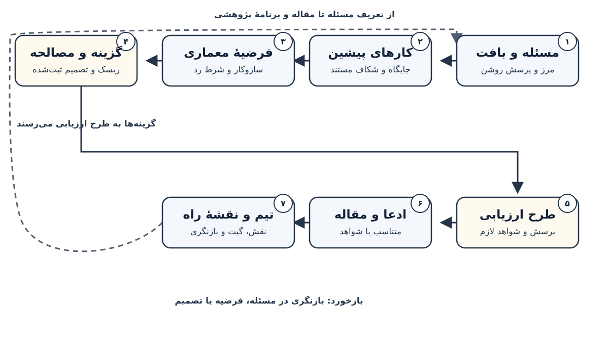

# جلد پنجم، فصل ۱۱ — توسعهٔ معماری، نگارش پژوهش و مشارکت

فصل محلی ۱۱ جلد پنجم = فصل سراسری ۷۲. **تاریخ بازبینی منابع: ۴ نوامبر ۲۰۲۶.** این فصل طرح پژوهش را به پروندهٔ معماریِ قابل بازبینی، مقالهٔ دقیق، مشارکت منصفانه و برنامهٔ پژوهشی پیوند می‌دهد؛ هیچ نتیجهٔ تجربی واقعی در این فصل گزارش نمی‌شود.

فصل ۷۰ مهارت خواندن مقاله و وارسی ادعا را می‌سازد؛ فصل ۷۱ طرح آزمایش و استنباط را پوشش می‌دهد؛ فصل حاضر بر شکل‌دادن به سهم علمی و مسیر تیمی آن تمرکز دارد؛ اجرای capstone در فصل ۷۳ است. [فصل ۷۰](70-reading-papers-reproduction.md) · [فصل ۷۱](71-research-design-statistics.md) · [فصل ۷۳ در نقشهٔ راه](../../BOOK_ROADMAP_FA.md).

## ۱. از طرح آزمایش به سهم پژوهشی

در پایان فصل ۷۱ ممکن است پرسشی محدود، معیارهای ازپیش‌تعریف‌شده و برنامهٔ مقایسه داشته باشید. هنوز این موارد به‌تنهایی سهم علمی نیستند. اکنون باید توضیح دهید چه مسئله‌ای حل می‌شود، چرا یک تصمیم معماری می‌تواند پاسخ تازه‌ای بدهد، چه چیزی آن پاسخ را رد می‌کند و چگونه دیگران می‌توانند مسیر استدلال را بازبینی کنند.

«طرح» آینده‌نگر است؛ «نتیجه» نیازمند مشاهدهٔ واقعی است؛ «سهم» گزاره‌ای است که مقاله می‌تواند با شواهد پشتیبانی کند. تا وقتی ارزیابی انجام نشده، از فعل‌هایی مانند «بهبود می‌دهد» یا «ثابت می‌کند» استفاده نکنید؛ بنویسید «پیشنهاد می‌کنیم»، «فرض می‌کنیم» یا «برنامه‌ریزی شده است».



**شرح متنی شکل:** مسئله و بافت به نقشهٔ کارهای پیشین می‌رسد؛ آن نقشه فرضیهٔ معماری را محدود می‌کند؛ فرضیه با گزینه‌ها و مصالحه‌ها به artifact و طرح ارزیابی تبدیل می‌شود؛ سپس ادعا و مقاله، تیم و برنامهٔ بلندمدت را شکل می‌دهند. در صورت شکست یا ناسازگاری، پیکان بازخورد مسیر را به تصمیم‌های قبلی بازمی‌گرداند.

## ۲. مرز این فصل در مسیر پنج‌جلدی

پنج جلد کتاب از مبانی و مدل‌سازی تا ساخت، ارزیابی و پژوهش را مرحله‌به‌مرحله پوشش می‌دهند. در این فصل به دانسته‌های پیشین تکیه می‌کنیم، اما فصل‌های ۷۰ و ۷۱ را دوباره تدریس نمی‌کنیم و capstone فصل ۷۳ را پیشاپیش اجرا نمی‌کنیم.

| فصل | مسئولیت اصلی | این فصل چه چیزی را واگذار می‌کند؟ |
|---|---|---|
| ۷۰ | خواندن مقاله، ردیابی ادعا و بازتولید محدود | وارسی متن مقاله را از نو آموزش نمی‌دهد؛ فقط برای ساخت نقشهٔ کار مرتبط به آن ارجاع می‌دهد. |
| ۷۱ | طراحی آزمایش، واحد مستقل، برآورد و تفسیر آماری | محاسبهٔ توان، آزمون و تحلیل را تکرار نمی‌کند؛ برای طراحی ارزیابی معماری به آن ارجاع می‌دهد. |
| ۷۲ | توسعهٔ معماری به‌عنوان سهم، نگارش مقاله، مشارکت متن‌باز، تیم و roadmap پژوهشی | اجرای کامل مدل یا پروژهٔ تولیدی ندارد. |
| ۷۳ | پروژهٔ نهایی مستقل و یکپارچه | capstone را به این فصل منتقل نمی‌کند. |

## ۳. دستاوردهای یادگیری

پس از مطالعه باید بتوانید یک artifact معماری را از ادعای علمی آن جدا کنید؛ صورت مسئله و مرز سامانه را بنویسید؛ سناریوهای کیفیت، گزینه‌ها و مصالحه‌ها را در تصمیم‌های بازبینی‌پذیر ثبت کنید؛ طرح مقاله را با ادعا و شواهد هم‌راستا کنید؛ سهم همکاران و مراحل مشارکت را شفاف کنید؛ و یک برنامهٔ پژوهشی چندمرحله‌ای با دروازه‌های توقف و بازنگری بسازید.

## ۴. artifact و ادعای پژوهش یک چیز نیستند

Artifact می‌تواند معماری، الگوریتم، داده، ابزار، تحلیل، روش یا مستندات باشد. وجود artifact فقط نشان می‌دهد چیزی ساخته یا صورت‌بندی شده است؛ به‌تنهایی تازگی، کارایی، اعتبار، تعمیم‌پذیری یا اهمیت آن را ثابت نمی‌کند. ادعای پژوهشی باید محدوده، مخاطب و نوع شواهد لازم را مشخص کند.

نمونهٔ محدود: «این کار یک قرارداد و ماژول دروازه‌دار برای یک بلوک بازنمایی پیشنهاد می‌کند.» ادعای بزرگ‌ترِ «این روش در همهٔ مدل‌ها بهتر است» به شواهد بسیار گسترده‌تری نیاز دارد. اگر شواهد فقط یک سناریو را پوشش می‌دهند، ادعا نیز باید همان سناریو را نام ببرد.

## ۵. مسئله را در بافت و دامنه تعریف کنید

شرح مسئله را با چهار جزء بنویسید: مخاطب یا کاربرد پژوهشی؛ وضعیت کنونی و محدودیت آن؛ هزینهٔ علمیِ حل‌نشدن مسئله؛ و محدوده‌ای که این پروژه واقعاً می‌تواند بررسی کند. «مدل‌ها باید بهتر شوند» مسئلهٔ پژوهشی نیست؛ نوع مدل، وظیفه، شرط‌ها و آنچه «بهتر» معنا می‌دهد باید روشن باشد.

یک «خارج از دامنه» هم درج کنید. برای نمونه، پیشنهاد معماری آزمایشگاهی ممکن است دربارهٔ سرویس‌دهی، کاربران، دادهٔ خصوصی یا انتشار محصول هیچ ادعایی نداشته باشد. این مرزبندی مانع از آن می‌شود که خواننده از یک prototype محدود، آمادگی عملیاتی یا کاربرد واقعی را برداشت کند.

## ۶. نقشهٔ کارهای پیشین بسازید، نه انبار ارجاع

برای هر کار مرتبط، مسئله، artifact، شرط ارزیابی، محدودیت و نسبت آن با پرسش خود را ثبت کنید. جدول مقایسه‌ایِ کوتاه معمولاً از فهرستی طولانی از خلاصه‌ها مفیدتر است: ستون‌هایی مانند «پرسش»، «سازوکار»، «شرایط»، «شواهد» و «تفاوت ادعای ما» اضافه کنید.

جست‌وجوی محدود، شکاف را اثبات نمی‌کند. «در جست‌وجوی ما نیامد» با «هیچ‌کس این کار را نکرده» برابر نیست. از ادعاهای «نخستین» یا «بهترین» فقط وقتی استفاده کنید که دامنهٔ جست‌وجو، واژه‌ها، پایگاه‌ها، تاریخ و معیارهای مقایسه مستند و برای آن ادعا کافی باشند. روش خواندن انتقادی مقاله در [فصل ۷۰](70-reading-papers-reproduction.md) است؛ اینجا بر جایگاه‌گذاریِ سهم تمرکز می‌کنیم.

## ۷. فرضیهٔ معماری: سازوکار، پیش‌بینی و شرط رد

فرضیهٔ مفید سه پرسش را پاسخ می‌دهد: چه جزء یا مرزی تغییر می‌کند؟ چرا آن تغییر ممکن است پیامد موردنظر را داشته باشد؟ چه مشاهده‌ای با فرضیه ناسازگار خواهد بود؟ عبارت «معماری تازه عملکرد را بالا می‌برد» نه سازوکار دارد، نه معیار و نه شرط ابطال.

نمونهٔ صرفاً آموزشی: «افزودن یک دروازه به مسیر باقیمانده شاید در بودجهٔ ثابت، کیفیت بازنمایی را در دامنهٔ محدودِ تعریف‌شده بالا ببرد؛ اگر مقایسهٔ ازپیش‌مشخص‌شده چنین تغییری نبیند یا قرارداد جزء را نقض کند، این فرضیه پشتیبانی نمی‌شود.» این مثال پیشنهاد است، نه یافته، و تازگی‌اش هم معلوم نیست.

## ۸. مرز سامانه و قرارداد اجزا را ترسیم کنید

یک نمودار معماری پژوهشی باید ورودی، خروجی، اجزا، رابط‌ها، جریان داده و جریان کنترل را نشان دهد. کنار هر جزء، نسخه و مسئولیتش را بنویسید؛ پیکان‌های مبهمی مانند «داده می‌رود به مدل» جای قرارداد را نمی‌گیرند. برای رابط‌ها شکل داده، نوع، فرض‌ها، خطاها و state پنهان را مشخص کنید.

شکل آغاز فصل مسیر یک پروندهٔ پژوهشی را نشان می‌دهد، نه معماری یک محصول اجراشده. بازخورد از بازبینی ادعا یا مصالحه می‌تواند به مسئله یا تصمیم معماری برگردد.

## ۹. ویژگی کیفی را به سناریو تبدیل کنید

«قابل نگه‌داری»، «سریع» یا «قابل‌اعتماد» بدون موقعیت و پاسخ، شعار است. سناریو را با محرک، بافت، پاسخ مورد انتظار، معیار یا شواهد لازم و اولویت بنویسید؛ مثلاً «اگر دروازه تغییر کرد، قرارداد خروجی بدون تغییر باقی بماند و بازبین بتواند این شرط را از مشخصات تشخیص دهد.» این مثال یک معیار طراحی است، نه اندازه‌گیری اجرا.

روش ATAM در مهندسی نرم‌افزار برای پیوند اهداف کیفیت با سناریوها و آشکارکردن ریسک و مصالحه مفید است [۲]. از آن به‌عنوان ابزار پرسش‌گری استفاده کنید، نه پروتکل واحد و اجباری برای همهٔ پژوهش‌های هوش مصنوعی. برنامهٔ کمّی و استنباط آماری به فصل ۷۱ تعلق دارد.

## ۱۰. گزینه‌ها و مصالحه‌ها را در تصمیم ثبت کنید

برای هر تصمیم معماری مهم، یک ADR کوتاه نگه دارید: شناسه و تاریخ؛ مسئله؛ گزینه‌های واقعی؛ معیارها؛ تصمیم موقت؛ دلیل؛ پیامدهای مثبت و منفی؛ فرض‌های باز؛ و شرطی که با تحقق آن تصمیم را دوباره بررسی می‌کنید. گزینه‌ای که عملاً هرگز بررسی نشده را «رقیب» جا نزنید.

مصالحه‌ها معمولاً چندمعیاره‌اند: ماژولارشدن ممکن است خوانایی را بهتر و پیچیدگی را بیشتر کند؛ افزونگی ممکن است تاب‌آوری را بالا ببرد و منابع را مصرف کند؛ ساده‌سازی ممکن است قابلیت تفسیر را افزایش و انعطاف را کم کند. هدف این نیست که همهٔ معیارها را به یک امتیاز تبدیل کنید؛ هدف آن است که بفهمید چه چیزی را به چه بهایی انتخاب می‌کنید.

## ۱۱. قراردادها، ناورداها و بدهی طراحی

یک architecture note باید invariantهای اصلی را تصریح کند: سازگاری ورودی و خروجی، مسیر پایه، مدیریت خطا، حالت داخلی، وابستگی‌های مجاز و نسخهٔ artifact. مشخص کنید کدام تصمیم فرض موقت است و کدام قرارداد باید در همهٔ پیاده‌سازی‌ها برقرار بماند.

ثبت بدهی طراحی هم بخشی از دقت است. اگر یک رابط موقت، وابستگی خاص یا ابزار دست‌ساز انتخاب شده، دلیل و پیامدش را بنویسید. پنهان‌کردن تصمیم ناتمام، معماری را تمیزتر نمی‌کند؛ فقط بازسازی آن را دشوارتر می‌کند.

## ۱۲. پیچیدگی و منابع را جدا از ادعای تجربی نگه دارید

تحلیل مرتبهٔ زمانی، شمار پارامتر، حافظهٔ نظری، اندازه‌گیری روی سخت‌افزار و هزینهٔ بازار پنج نوع اطلاعات متفاوت‌اند. آن‌ها را در یک جمله ادغام نکنید. اگر عددی هنوز اندازه‌گیری نشده است، آن را «بودجهٔ هدف» یا «فرض طراحی» بنامید، نه نتیجه.

برآورد قیمت و مشخصات باید با تاریخ و بازار همراه باشد و جای خود را در فصل‌های مربوط داشته باشد؛ فصل حاضر فقط قیدهای منابع را ثبت می‌کند. طراحی آزمون برای مقایسهٔ تجربی نیز به [فصل ۷۱](71-research-design-statistics.md) واگذار می‌شود.

## ۱۳. prototype را با معماری نهایی اشتباه نگیرید

نمونهٔ اولیه برای پاسخ به یک پرسش مشخص ساخته می‌شود: آیا رابط قابل پیاده‌سازی است؟ آیا یک فرض مرزی می‌شکند؟ آیا دو گزینه را می‌توان به‌صورت منصفانه مقایسه کرد؟ برای هر prototype حداقل هدف، معیار توقف، اجزای حذف‌شده و نتیجه‌ای که از آن نمی‌توان گرفت را ثبت کنید.

Prototype موفق، شاهد کافی برای کارایی کلی یا آمادگی محصول نیست. در این فصل کد مدل، سامانهٔ تولیدی یا benchmark واقعی نمی‌سازیم؛ آن سطح از اجرا به capstone مستقل فصل ۷۳ تعلق دارد.

## ۱۴. بازبینی معماری و سناریوهای فشار

بازبین از اعضای تیم بپرسد: کدام فرض اگر نادرست باشد کل طرح را بی‌اعتبار می‌کند؟ کدام جزء بیشترین وابستگی را دارد؟ کدام سناریو مصالحه‌ای را آشکار می‌کند که نمودار پنهان کرده است؟ آیا گزینهٔ ساده‌تر یا خط مبنا واقعاً منصفانه است؟ آیا مسیر شکست یا بازگشت وجود دارد؟

جلسهٔ بازبینی را با فهرست خطرها، نقاط حساس، پرسش‌های باز و مالک هر پیگیری تمام کنید. نام یک روش معتبر معماری به‌خودی‌خود ارزیابی را معتبر نمی‌کند؛ تحلیل باید به سناریو و زمینهٔ همین پرونده برگردد.

## ۱۵. چرخهٔ پژوهش طراحی را به زمینه محدود کنید

روش‌شناسی DSRM، در زمینهٔ پژوهش سامانه‌های اطلاعاتی، چرخه‌ای از شناسایی مسئله، تعیین هدف، طراحی و ساخت، نمایش، ارزیابی و ارتباط نتیجه پیشنهاد می‌کند [۱]. این یک الگوی مفید برای فکرکردن است، نه قالب یگانه‌ای که هر حوزه یا هر پروژه باید عیناً اجرا کند.

در پژوهش معماری، «نمایش» می‌تواند prototype یا مشخصات باشد؛ «ارزیابی» ممکن است تحلیل، آزمایش یا بازبینی باشد؛ و «ارتباط» می‌تواند مقاله، کد یا مستند باشد. نوع ادعا تعیین می‌کند چه شواهدی کافی‌اند؛ آمادگی artifact را با اثبات فرضیه یکی نگیرید.

## ۱۶. از تصمیم معماری به طرح ارزیابی

برای هر ادعای اصلی یک زنجیرهٔ ردیابی بسازید: ادعا ← سازوکار ← گزینهٔ مقایسه ← مشاهدهٔ لازم ← محدودیت. اگر یک ادعا به مشاهده‌ای نیاز دارد که در طرح نیست، یا آن مشاهده را اضافه کنید یا ادعا را کوچک‌تر کنید. هر نتیجه‌ای که قرار است در چکیده بیاید باید از این زنجیره عبور کند.

در این مرحله فقط پرسش، گزینه و نوع شواهد را تعریف می‌کنیم؛ انتخاب واحد مستقل، کنترل، توان و تحلیل آماری در [فصل ۷۱](71-research-design-statistics.md) است. اگر آن فصل تغییر کرد، طرح مقاله را نیز هم‌زمان بازبینی کنید تا زبان مقاله از پروتکل جلو نزند.

## ۱۷. معیار توقف، بازنگری و نتیجهٔ منفی

پیش از مشاهدهٔ نتیجه، بنویسید چه چیزی موجب ادامه، بازنگری، توقف یا تغییر دامنه می‌شود. معیار توقف می‌تواند نقض قرارداد، هزینهٔ ناممکن، فقدان مجوز، شواهد ناکافی برای فرض اصلی یا دشواری بازتولید باشد. «ادامه تا وقتی نتیجهٔ مثبت به‌دست آید» معیار علمی نیست.

نتیجهٔ منفی ممکن است پرسش را روشن‌تر کند، فرض معماری را رد کند یا محدودیت روش را نشان دهد. آن را پنهان یا به «تقریباً موفق» بازنویسی نکنید. مقالهٔ مفید باید روشن کند چه چیزی آزموده شد و چه چیزی با دادهٔ موجود قابل نتیجه‌گیری نیست.

## ۱۸. مقاله یک استدلال قابل ممیزی است

مقاله مجموعه‌ای از بخش‌های مستقل نیست؛ هر بخش باید به پرسش مرکزی کمک کند. خواننده باید بتواند مسیر مسئله، سهم، روش، شواهد و محدودیت را بدون حدس‌زدن دنبال کند. راهنمای Mensh و Kording برای ساخت روایت مقاله بر روشن‌بودن پیام اصلی و انسجام ساختار تأکید می‌کند [۳]؛ آن را الگو بدانید، نه قانون جهان‌شمول.

قبل از نوشتن متن کامل، یک جمله برای «چه چیزی می‌دانیم که پیش‌تر نمی‌دانستیم؟» بنویسید. اگر پاسخ فقط «مدل را ساختیم» است، هنوز سهم علمی یا شواهدش روشن نیست.

## ۱۹. مخاطب و محل انتشار را با موضوع و سیاست بسنجید

ابتدا مشخص کنید مخاطب اصلی کدام اجتماع علمی است و آن اجتماع چه نوع سهمی را داوری می‌کند: روش، معماری، تحلیل، artifact، کاربرد یا نظریه. سپس راهنمای همان نشریه یا کنفرانس را برای دامنه، قالب، صفحه، داوری دوسوکور، مواد تکمیلی، checklist، کد و داده، هزینه و سیاست ابزارهای هوش مصنوعی بخوانید.

انتخاب محل انتشار را بر اساس «عدد پرستیژ» انجام ندهید. سیاست‌ها تغییر می‌کنند و یک checklist، محدودیت صفحه یا شرط افشای خاص یک venue را نباید به همهٔ ناشران تعمیم داد. شرایط را نزدیک زمان ارسال دوباره بررسی کنید.

## ۲۰. سهم مرکزی را از فهرست قابلیت‌ها جدا کنید

بیانیهٔ سهم با فعل روشن و دامنهٔ محدود نوشته می‌شود: «ما X را برای مسئلهٔ Y پیشنهاد می‌کنیم؛ ارزیابی Z نشان می‌دهد در شرایط C چه چیزی رخ داده است.» تا وقتی Z انجام نشده، جمله را به «پیشنهاد می‌کنیم» و «قرار است ارزیابی شود» تغییر دهید.

از پنج سهم کم‌اهمیت، یک سهم واحد نسازید. روش، تحلیل، artifact، مجموعه‌داده و مشاهدهٔ تجربی را جداگانه نام ببرید و برای هرکدام شواهد متناظر را نشان دهید. این جداسازی به خواننده اجازه می‌دهد بفهمد چه چیز به کار پژوهشی افزوده شده و چه چیز فقط ابزار اجرا بوده است.

## ۲۱. عنوان، چکیده و مقدمه را هم‌راستا کنید

عنوان دامنه و سهم را منعکس کند، نه نتیجه‌ای را که هنوز وجود ندارد. چکیدهٔ یک مقالهٔ کامل معمولاً مسئله، روش، نتیجهٔ واقعی و محدودیت مهم را پوشش می‌دهد؛ چکیدهٔ proposal باید صریحاً «طرح» یا «پیشنهاد» باشد و نتیجهٔ آینده را جعل نکند.

در مقدمه، بافت و مسئله را تعریف کنید، خلأ مستند را توضیح دهید، سهم را فهرست کنید و نقشهٔ مقاله را بدهید. از مقدمه‌ای که ادعاهای بزرگ را پیش از ارائهٔ شواهد می‌سازد پرهیز کنید. یک خوانندهٔ بی‌طرف باید بتواند در پایان مقدمه بگوید دقیقاً چه ادعایی قرار است بررسی شود.

## ۲۲. کار مرتبط جایگاه را نشان می‌دهد

مرور ادبیات را حول سؤال‌ها و خانواده‌های روش سازمان دهید، نه یک بند برای هر مقاله. برای هر خانواده، شباهت و تفاوت با طرح خود را با معیار روشن شرح دهید: فرض مسئله، سازوکار، محدودیت، نوع شواهد یا هزینهٔ موردنظر.

به منابع اولیه ارجاع دهید، ادعاهای منابع را از متن خودتان جدا کنید و نقل‌قول یا نتیجه را از اصل منبع کنترل کنید. جست‌وجوی انجام‌شده را به تاریخ، پایگاه و عبارت‌های کلیدی محدود کنید تا خواننده بداند چه محدوده‌ای پوشش داده شده است؛ ادعای جامعیت را بی‌دلیل به متن اضافه نکنید.

## ۲۳. روش و معماری را برای بازسازی توصیف کنید

گزارش معماری باید نسخه، اجزا، رابط‌ها، پارامترهای لازم، فرض‌های اجرایی و تفاوت با خط مبنا را روشن کند. اصطلاح‌های مبهم مانند «نسخهٔ بزرگ‌تر» یا «ماژول بهتر» کافی نیستند. اگر artifact به کتابخانه، وزن، داده یا ابزار وابسته است، نسخه و منشأ آن را ثبت کنید.

روش به اندازهٔ ادعای مقاله جزئیات می‌خواهد. آنچه لازم است، توصیف قابل بررسی است؛ نه انتشار اجباری اطلاعاتی که محرمانه، حساس یا دارای محدودیت مجوز است. اگر موردی قابل انتشار نیست، محدودیت و مسیر دسترسی مجاز را توضیح دهید.

## ۲۴. نتایج را بر اساس پرسش سازمان دهید

هر جدول و شکل باید به پرسشی از پیش‌تعریف‌شده پاسخ دهد. نتیجه را با شرایط، گزینهٔ مقایسه، تعداد و نوع مشاهده و عدم‌قطعیت گزارش کنید؛ ارقام خام بدون زمینه خواننده را به تعمیم نادرست سوق می‌دهند. همهٔ شرط‌های مقایسه و خروجی‌های مهم را گزارش دهید، نه فقط آن‌هایی را که داستان را زیباتر می‌کنند.

فصل ۷۱ مبنای طراحی و تفسیر تحلیل است. اینجا فقط تأکید می‌کنیم که متن «نتایج» از دادهٔ واقعی و نسخهٔ واقعی artifact پیروی کند؛ اعداد ساختگی، برنامهٔ آینده یا log ناقص را جای نتیجه نگذارید.

## ۲۵. بحث و محدودیت ادعا

در بحث، نتیجهٔ اصلی را در حدود شرایطی که واقعاً آزموده شده تفسیر کنید. بگویید چه چیزی با شواهد سازگار است، چه توضیح‌های دیگری باقی می‌ماند، کدام محدودیت‌ها بر تفسیر اثر می‌گذارند و چه دامنه‌ای هنوز بررسی نشده است. «کار آینده» جای گزارش محدودیت فعلی را نمی‌گیرد.

اگر معماری فقط روی یک خانواده، داده یا وظیفه ارزیابی شده است، تعمیم به خانواده‌های دیگر را فرضیهٔ آینده بنویسید. صداقت دربارهٔ محدوده ضعف مقاله نیست؛ راهی است برای جداکردن نتیجهٔ موجود از امید پژوهشگر.

## ۲۶. داوری، بازخورد و بازنویسی

برای دریافت بازخورد، از خواننده بخواهید پرسش‌های مشخصی را پاسخ دهد: آیا ادعای اصلی در متن پیدا می‌شود؟ آیا نمودار و روش قابل فهم‌اند؟ آیا شواهد با ادعا متناسب‌اند؟ آیا محدودیت مهمی حذف شده است؟ بازخورد کلیِ «خوب است» برای تصمیم‌گیری کافی نیست.

پیش از ارسال، نسخهٔ ناشناس، قالب، فایل‌های پیوست، checklist، راهنمای استناد و سیاست افشای ابزارها را کنترل کنید. در پاسخ به داوری، هر نکته را به یک تغییر یا توضیح قابل ردیابی وصل کنید؛ پاسخ مؤدبانه تضمین پذیرش نیست و اختلاف علمی باید مستند و حرفه‌ای بماند.

## ۲۷. checklist محل انتشار را به‌عنوان راهنما بخوانید

Checklist کنفرانس NeurIPS برای ارسال‌های خودش نمونه‌ای از پرسش دربارهٔ دقت ادعا، محدودیت، فرض‌ها، بازتولیدپذیری، منابع و اخلاق است [۴]. صفحهٔ راهنمای آن تصریح می‌کند که پاسخ منفی لزوماً رد مقاله نیست و توضیح لازم است؛ این قاعده را فقط برای همان venue و نسخهٔ راهنما به‌کار ببرید.

از checklist برای پیدا کردن خلأ در مقاله استفاده کنید، نه برای علامت‌زدن «بله»های بی‌پشتوانه. هر پاسخ مثبت باید به جایی در متن یا مواد تکمیلی ارجاع دهد؛ پاسخ منفی باید دلیل و اثرش را روشن کند. راهنمای venue را پیش از هر submission دوباره بخوانید.

## ۲۸. artifactهای پژوهشی را مسئولانه منتشر کنید

کد، پیکربندی، داده، وزن، محیط، مستندات و اسکریپت‌ها ممکن است بخشی از خروجی علمی باشند. پیش از انتشار، نسخه‌بندی، مجوز، وابستگی، دادهٔ شخصی، محدودیت قراردادی، کلیدهای محرمانه، فایل حجیم و امکان بازتولید را بررسی کنید. چیزی که از نظر حقوقی یا اخلاقی قابل انتشار نیست، نباید صرفاً برای تکمیل چک‌لیست افشا شود.

برای هر فایل مشخص کنید چرا لازم است، از کجا آمده، چه مجوزی دارد و چه محدودیتی همراه آن است. اگر امکان اشتراک کامل وجود ندارد، توضیح دهید کدام بخش منتشر نمی‌شود و چرا. راهنمای حاکمیت و ریسک داده را با فصل ۶۵ و کار با artifact را با فصل ۴۳ و فصل ۶۹ هماهنگ کنید.

## ۲۹. مشارکت متن‌باز از issue تا PR

پیش از تغییر، README، راهنمای مشارکت، Code of Conduct، مجوز، سیاست امنیتی، آزمون‌ها و سابقهٔ تصمیم‌های پروژه را بخوانید. مستندات GitHub هم توصیه می‌کند ابتدا فرایند و نیاز پروژه را بشناسید، سپس یک issue مناسب انتخاب کنید، تغییر را با آزمون و توضیح روشن ارائه دهید و با نگه‌دارندگان هماهنگ بمانید [۹].

برای مشارکت نخست، بهبود کوچک مستندات یا بازتولید یک خطای ثبت‌شده می‌تواند شروع مناسبی باشد. پیش از کار روی ویژگی بزرگ، در issue بپرسید آیا نگه‌دارندگان آن را می‌خواهند. PR باید مسئله، دامنهٔ تغییر، آزمون‌ها و اثر سازگاری را توضیح دهد؛ پذیرش آن را تضمین نکنید و تصمیم نگه‌دارنده را محترم بدانید.

## ۳۰. تیم پژوهشی: هدف مشترک، نقش روشن و ارتباط

تیم را صرفاً با فهرست تخصص‌ها نمی‌سازند. ابتدا هدف پژوهشی، وابستگی کارها، زمان در دسترس، اختیار تصمیم‌گیری و نوع حمایت را روشن کنید. در پروژهٔ میان‌رشته‌ای، اختلاف اصطلاح‌ها و استانداردهای شواهد طبیعی است؛ واژه‌نامه و ثبت تصمیم‌ها از سوءتفاهم می‌کاهد.

برنامهٔ تیمی باید جلسه‌های تصمیم، محل ثبت کار، پاسخ به تعارض، چگونگی تغییر دامنه و مسئول هر خروجی را مشخص کند. گزارش National Research Council دربارهٔ team science بر ترکیب، رهبری، توسعه و پشتیبانی سازمانی تأکید می‌کند [۸]؛ هیچ چک‌لیست کوتاهی جای زمینه و گفت‌وگوی واقعی تیم را نمی‌گیرد.

## ۳۱. نویسندگی و انتساب مشارکت را زودتر گفت‌وگو کنید

در آغاز پروژه دربارهٔ انتساب، ترتیب نام‌ها، مسئولیت نگارش، نگهداری داده و شرایط تغییر مشارکت حرف بزنید؛ سپس با تغییر نقش‌ها دوباره مرور کنید. معیارهای نویسندگی میان رشته‌ها، ناشران و مؤسسه‌ها فرق می‌کند؛ راهنمای همان محل انتشار و سیاست مؤسسه را بررسی کنید و تصمیم را مکتوب نگه دارید.

CRediT چهارده نقش مشارکت را نام‌گذاری می‌کند و برای توصیف «چه کسی چه کاری انجام داد» مفید است [۵]. این taxonomy به‌تنهایی احراز نویسندگی یا ترتیب نام‌ها را تعیین نمی‌کند. راهنمای COPE دربارهٔ اختلاف نویسندگی نیز برای گفت‌وگوی زودهنگام مفید است، اما صفحهٔ آن اعلام می‌کند که در حال بازبینی است؛ نسخه و سیاست‌های جاری را کنترل کنید [۶].

## ۳۲. ابزار هوش مصنوعی در نگارش: پاسخ‌گویی با انسان است

اگر از ابزار مولد برای ویرایش، نوشتن، تصویر یا تحلیل استفاده می‌کنید، سیاست همان venue را بخوانید و میزان استفاده را دقیق ثبت کنید. نقل‌قول، مرجع، عدد، کد و ادعای تولیدشده را با منبع اولیه وارسی کنید؛ نام مقاله‌ای که ابزار ساخته است ارجاع معتبر نیست. دادهٔ محرمانه یا دست‌نویس داوری را بدون مجوز در ابزار بیرونی وارد نکنید.

موضع COPE می‌گوید ابزارهای هوش مصنوعی نباید به‌عنوان نویسنده فهرست شوند و استفادهٔ مرتبط باید شفاف باشد؛ مسئولیت متن با نویسندگان انسانی است [۷]. این راهنمای اخلاقی را با سیاست جاری مجله یا کنفرانس تطبیق دهید؛ هیچ ابزار خودکاری جای بازبینی انسانی یا مسئولیت نویسنده را نمی‌گیرد.

## ۳۳. roadmap چندساله را به سبد پرسش تبدیل کنید

نقشهٔ پژوهشی بلندمدت نباید فهرست وعده‌های قطعی باشد. پرسش‌ها را در چند سطح بچینید: فهم مسئله؛ آزمودن سازوکار؛ ارزیابی در بافت‌های تازه؛ ساخت ابزارهای مشترک؛ و نگهداری یا کنارگذاشتن شاخه‌ای که شواهد کافی ندارد. برای هر شاخه فرض، وابستگی، منبع، ریسک، دروازهٔ تصمیم و زمان بازبینی ثبت کنید.

یک roadmap نمونه می‌تواند چهار بازه داشته باشد: صورت‌بندی و نقشهٔ ادبیات؛ قرارداد معماری و prototype؛ ارزیابی و بازبینی مستقل؛ نگارش و تصمیم انتشار. در هر دروازه بپرسید «چه چیزی یاد گرفتیم؟» نه «چند milestone را تیک زدیم؟» اگر فرض مرکزی شکست خورد، مسیر جایگزین یا توقف باید امکان‌پذیر باشد.

## ۳۴. معیارها را برای یادگیری به‌کار ببرید، نه جانشینی کیفیت

تعداد مقاله، ارجاع، ستارهٔ GitHub یا عامل‌تأثیر مجله به‌تنهایی کیفیت پژوهش یا سهم فرد را نمی‌سنجد. DORA توصیه می‌کند خروجی را بر شایستگی خود آن ارزیابی کنیم و نرم‌افزار و داده را نیز در کنار مقاله ببینیم [۱۰]. معیارهای کمی می‌توانند سرنخ باشند، اما باید با زمینه، محدودیت و داوری کیفی همراه شوند.

در بازبینی تیمی، کیفیت پرسش، استحکام استدلال، دسترس‌پذیری artifact، یادگیری از نتیجهٔ منفی، کیفیت همکاری و سودمندی برای جامعه را نیز بررسی کنید. از یک عدد واحد برای تصمیم استخدام، بودجه یا ترفیع استفاده نکنید مگر آنکه محدودیت و پیامد آن به‌درستی توجیه شود.

## ۳۵. پروژهٔ کوچک فصل: بستهٔ طراحی را وارسی کنید

پروژهٔ همراه، یک packet کاملاً ساختگی را از نظر انسجام میان مسئله، فرضیهٔ معماری، گزینه‌ها، سناریوهای کیفیت، برنامهٔ ارزیابی، طرح مقاله، نقش مشارکت‌کنندگان و roadmap بررسی می‌کند. fixture منشأ روشن و هش SHA-256 دارد؛ فهرست منابع کتاب‌شناختی واقعی است، اما packet، افراد و سناریوهای آن ساختگی‌اند.

برای نمونهٔ تمرینی، خروجی ثبت‌شده به یک جزء معماری، دو گزینه، سه سناریوی کیفیت، دو ارزیابی برنامه‌ریزی‌شده، یازده بخش مقاله، سه مشارکت‌کنندهٔ فرضی و چهار milestone اشاره می‌کند. این اعداد فقط شمار فیلدهای packet هستند؛ امتیاز کیفیت یا نتیجهٔ پژوهش نیستند.

## ۳۶. اجرای آفلاین و معنای دقیق خروجی

در پوشهٔ پروژه آزمون‌ها و CLI را اجرا کنید:

```bash
python3 -m unittest -v
python3 research_architecture.py --packet research_packet.json --manifest fixture_manifest.json --output results.json
```

اجرای ثبت‌شده با CPython 3.13.16 و بدون وابستگی ثالث، شبکه، GPU، دادهٔ واقعی یا inference انجام شد؛ ۲۵ آزمون از ۲۵ آزمون گذشت. `results.json` وضعیت `structural_consistency_passed` را فقط برای سازگاری ساختاری گزارش می‌کند. `environment.json` همین محدودیت را ثبت می‌کند و hash فایل fixture در `fixture_manifest.json` قابل بازبینی است.

## ۳۷. چه چیزی پروژه اثبات نمی‌کند؟

این checker داور علمی نیست. عبور از آن تازگی، ارزش فرضیه، کیفیت معماری، کارایی، اعتبار پروتکل، اخلاق، مجوز، نویسندگی، داوری همتا یا آمادگی انتشار را تأیید نمی‌کند. هیچ مدل یا داده‌ای اجرا نشده است و هیچ استنباطی مجاز نیست؛ `novelty_confirmed` و `hypothesis_tested` عمداً `false` هستند.

این مرز برای یک پروژهٔ آموزشی اهمیت دارد: آزمون خودکار می‌تواند ارجاع گم‌شده یا تصمیم ناتمام را آشکار کند، اما فقط پژوهشگر و بازبین انسانی می‌توانند محتوای علمی را ارزیابی کنند. برای اجرای آزمایش فصل ۷۱ یا capstone فصل ۷۳، این پروژه کافی نیست.

## ۳۸. خطاهای تکرارشونده

ادعای «نخستین» بدون جست‌وجوی قابل ردیابی؛ انتخاب معماری بدون خط مبنا؛ قاطی‌کردن prototype با محصول؛ تبدیل roadmap به تعهد قطعی؛ گزارش‌نکردن نتیجهٔ منفی؛ استفاده از checklist نامربوط؛ فهرست‌کردن CRediT به‌عنوان حکم نویسندگی؛ و ارسال PR بزرگ بدون هماهنگی از خطاهای پرهزینه‌اند.

راه پیشگیری، کوچک‌کردن ادعا و ثبت فرض‌ها و تصمیم‌هاست. برای هر جملهٔ اصلی بپرسید: چه منبعی یا مشاهده‌ای آن را پشتیبانی می‌کند؟ در چه دامنه‌ای؟ چه چیزی آن را رد می‌کند؟ چه کسی باید پیش از انتشار آن را بازبینی کند؟

## ۳۹. چک‌لیست پیش از ثبت طرح یا ارسال مقاله

- صورت مسئله، مخاطب و مرز «خارج از دامنه» روشن است.
- نقشهٔ کارهای پیشین قابل ردیابی است و ادعای تازگی را بیش از شواهد گسترش نمی‌دهد.
- معماری، نسخه، قرارداد اجزا، گزینه‌ها، مصالحه‌ها و شرط بازنگری ثبت شده‌اند.
- هر ادعای اصلی به سازوکار، شواهد لازم و محدودیت پیوند دارد.
- پروتکل ارزیابی، معیار توقف و برنامهٔ تحلیل به فصل ۷۱ ارجاع دارند و مستقل بازبینی شده‌اند.
- چکیده و مقدمه فقط ادعاهایی را بیان می‌کنند که متن و شواهد پوشش می‌دهند.
- نقش‌ها، انتساب، مجوز، داده، ابزار و سیاست هوش مصنوعی با مقررات جاری تطبیق داده شده‌اند.
- roadmap دروازهٔ توقف و بازنگری دارد و معیارها کیفیت را با یک عدد جایگزین نمی‌کنند.

## ۴۰. جمع‌بندی

توسعهٔ معماری پژوهشی، تصمیم دربارهٔ مرزها و مصالحه‌هاست؛ نگارش مقاله، تبدیل آن تصمیم‌ها به استدلالی قابل بازبینی؛ مشارکت و تشکیل تیم، توافق روشن دربارهٔ مسئولیت و سهم؛ و roadmap، سازوکاری برای یادگیری و توقف به‌موقع است. artifact تنها نقطهٔ آغاز است. ادعا باید متناسب با شواهد بماند و هر نتیجهٔ آینده، با ارزیابی واقعی و سیاست‌های همان venue سنجیده شود.

برای کار عملی به [پاسخ‌نامهٔ مستقل](../answers/72-research-architecture-community-fa.md)، [پروژهٔ packet ساختگی](../projects/72-research-architecture-lab/README.md) و [گزارش ممیزی](72-audit-report-fa.md) بروید.

## ۴۱. منابع و تاریخ بازبینی

منابع وب زیر در ۴ نوامبر ۲۰۲۶ بازبینی شدند. سیاست‌های نشریه و کنفرانس ممکن است تغییر کنند؛ نسخهٔ جاری را هنگام ارسال کنترل کنید.

1. Peffers, K. et al. (2007). “A Design Science Research Methodology for Information Systems Research.” *Journal of Management Information Systems*, 24(3), 45–77. [DOI: 10.2753/MIS0742-1222240302](https://doi.org/10.2753/MIS0742-1222240302). دامنهٔ مقاله سامانه‌های اطلاعاتی است؛ چرخهٔ آن در این فصل الگو است، نه نسخهٔ یگانه.
2. Software Engineering Institute, Carnegie Mellon University. [Architecture Tradeoff Analysis Method (ATAM) collection](https://www.sei.cmu.edu/library/architecture-tradeoff-analysis-method-collection/).
3. Mensh, B. & Kording, K. (2017). “Ten simple rules for structuring papers.” *PLOS Computational Biology*, 13(9), e1005619. [DOI: 10.1371/journal.pcbi.1005619](https://doi.org/10.1371/journal.pcbi.1005619).
4. NeurIPS. [Paper Checklist Guidelines](https://neurips.cc/public/guides/PaperChecklist), نسخهٔ راهنمای ۲۰۲۶ هنگام بازبینی. این checklist فقط مثال سیاست یک venue است.
5. NISO. [CRediT — Contributor Role Taxonomy](https://credit.niso.org/). استاندارد ANSI/NISO Z39.104-2022؛ چهارده نقش برای توصیف مشارکت، نه قاعدهٔ مستقل نویسندگی.
6. COPE. [How to handle authorship disputes: a guide for new researchers](https://publicationethics.org/guidance/guideline/how-handle-authorship-disputes-guide-new-researchers). صفحه هنگام بازبینی در حال بازبینی اعلام شده بود؛ سیاست مؤسسه و venue را نیز بررسی کنید.
7. COPE Council. [Authorship and AI tools](https://doi.org/10.24318/cCVRZBms), موضع COPE دربارهٔ نویسندگی و افشای استفاده از ابزارهای هوش مصنوعی؛ سیاست جاری هر محل انتشار را جداگانه کنترل کنید.
8. National Research Council. (2015). *Enhancing the Effectiveness of Team Science*. National Academies Press. [DOI: 10.17226/19007](https://doi.org/10.17226/19007).
9. GitHub Docs. [Contributing to open source](https://docs.github.com/en/get-started/exploring-projects-on-github/contributing-to-open-source).
10. DORA. [Read the Declaration](https://sfdora.org/read/). ارزیابی خروجی بر محتوای خود آن، نه استفاده از سنجهٔ مجله به‌عنوان جانشین کیفیت.
11. فایل‌های همراه همین جلد: [فصل ۷۰](70-reading-papers-reproduction.md)، [فصل ۷۱](71-research-design-statistics.md)، [پروژهٔ فصل ۷۲](../projects/72-research-architecture-lab/README.md)، [پاسخ‌نامه](../answers/72-research-architecture-community-fa.md)، [گزارش ممیزی](72-audit-report-fa.md).

## ۴۲. تمرین‌ها

پاسخ‌ها در [پاسخ‌نامهٔ مستقل فصل ۷۲](../answers/72-research-architecture-community-fa.md) آمده‌اند؛ شماره‌گذاری و متن هر سؤال در دو فایل یکسان است.

۱. برای یک مسئلهٔ مشخص از حوزهٔ خود، سه جمله بنویسید: مسئله و دامنه؛ artifact پیشنهادی؛ سهم علمی‌ای که هنوز باید اثبات شود. دو ادعایی را که فعلاً نمی‌توانید مطرح کنید، جدا کنید.
۲. برای یک تغییر معماری فرضی، فرضیه‌ای با سازوکار، شرط مقایسه و نتیجه‌ای که فرضیه را رد می‌کند بنویسید؛ سپس حداقل دو توضیح رقیب را نام ببرید.
۳. برای سه مقالهٔ نزدیک به ایده‌تان یک نقشهٔ کار مرتبط بسازید: سؤال، سهم، محدودیت، ارتباط با ایدهٔ شما و منبع اولیه؛ نشان دهید چرا «در جست‌وجوی من نیافتم» برابر «نخستین» نیست.
۴. دو گزینهٔ معماری را برای سه سناریوی کیفیت مقایسه کنید؛ برای هرکدام یک ریسک و نقطهٔ حساس ثبت کنید و یک تصمیمی را با شرط بازبینی بنویسید.
۵. از ادعای مرکزی، یک عنوان، چکیدهٔ چهار جمله‌ای و طرح کلی مقاله بسازید؛ برای هر جملهٔ نتیجه، مدرک لازم را نشان دهید و یک محدودیت برجسته بنویسید.
۶. برای یک تیم سه‌نفره نقش‌های CRediT را پیشنهاد دهید و بنویسید چه توافقی دربارهٔ نویسندگی باید پیش از نگارش و هنگام تغییر مشارکت دوباره بررسی شود؛ توضیح دهید چرا taxonomy خودبه‌خود حق نویسندگی نمی‌دهد.
۷. یک گام کم‌خطر برای مشارکت در یک پروژهٔ متن‌باز انتخاب کنید؛ پیش از تغییر، کدام اسناد، مجوز، test و راه گفت‌وگو با نگه‌دارندگان را بررسی می‌کنید؟
۸. برای پروندهٔ ساختگی پروژه خروجی JSON را تفسیر کنید: چه چیزی دربارهٔ انسجام packet تأیید شده و چه چهار موردی همچنان ارزیابی‌نشده‌اند؟

## ۴۳. پیوست اجرایی — کد وارسی بستهٔ طراحی

کد زیر با فایل `research_architecture.py` پروژهٔ همراه یکسان است. این ابزار فقط سازگاری ساختاری را بررسی می‌کند؛ از آزمون‌های علمی، اخلاقی یا آماری پشتیبانی نمی‌کند.

```python
#!/usr/bin/env python3
"""Check the internal consistency of a fictional research-architecture packet.

This tool validates fields and cross-references only. It does not evaluate
scientific novelty, architectural quality, empirical results, or authorship.
"""
from __future__ import annotations

import argparse
import hashlib
import json
import sys
from pathlib import Path
from typing import Any

PROJECT_ID = "v5-ch11-research-architecture-synthetic-v1"
KNOWN_CREDIT_ROLES = {
    "Conceptualization",
    "Data curation",
    "Formal analysis",
    "Funding acquisition",
    "Investigation",
    "Methodology",
    "Project administration",
    "Resources",
    "Software",
    "Supervision",
    "Validation",
    "Visualization",
    "Writing – original draft",
    "Writing – review & editing",
}
REQUIRED_PAPER_SECTIONS = {
    "title",
    "abstract",
    "introduction",
    "related_work",
    "method",
    "architecture",
    "evaluation",
    "results",
    "limitations",
    "ethics_and_availability",
    "conclusion",
}


def require(condition: bool, message: str) -> None:
    if not condition:
        raise ValueError(message)


def unique_ids(items: list[dict[str, Any]], label: str) -> set[str]:
    require(isinstance(items, list) and items, f"{label} must be a non-empty list")
    identifiers = [item.get("id") for item in items if isinstance(item, dict)]
    require(len(identifiers) == len(items) and all(isinstance(value, str) and value for value in identifiers),
            f"{label} contains an item without an id")
    require(len(identifiers) == len(set(identifiers)), f"{label} contains duplicate ids")
    return set(identifiers)


def validate_packet(packet: dict[str, Any]) -> dict[str, Any]:
    require(isinstance(packet, dict), "packet must be a JSON object")
    require(packet.get("project_id") == PROJECT_ID, "unexpected project_id")
    require(packet.get("fixture_id") == PROJECT_ID, "fixture_id does not match project_id")
    require(packet.get("synthetic") is True, "fixture must be explicitly synthetic")
    require(packet.get("real_data_used") is False, "real_data_used must be false")
    require(packet.get("real_model_outputs") is False, "real_model_outputs must be false")
    require(packet.get("network_used") is False, "network_used must be false")
    require(packet.get("status") == "proposal_not_tested", "packet must remain an untested proposal")

    problem = packet.get("problem")
    require(isinstance(problem, dict), "problem block missing")
    for field in ("context", "boundary", "question"):
        require(isinstance(problem.get(field), str) and problem[field].strip(), f"problem.{field} is required")
    boundary = problem["boundary"].strip().lower()
    safe_boundary_phrases = ("خارج از دامنهٔ تولید", "بیرون از دامنهٔ تولید", "not a production", "not production", "outside production", "exclude production")
    require(any(phrase in boundary for phrase in safe_boundary_phrases),
            "problem boundary must exclude production use")

    contribution = packet.get("contribution")
    require(isinstance(contribution, dict), "contribution block missing")
    require(contribution.get("type") == "architecture", "contribution type must be architecture")
    for field in ("candidate_claim", "mechanism", "falsification_condition"):
        require(isinstance(contribution.get(field), str) and contribution[field].strip(),
                f"contribution.{field} is required")
    require(contribution.get("status") == "proposal_not_tested", "contribution status must remain untested")
    require(contribution.get("novelty_status") == "not_assessed", "novelty must remain unassessed")

    architecture = packet.get("architecture")
    require(isinstance(architecture, dict), "architecture block missing")
    require(isinstance(architecture.get("baseline"), str) and architecture["baseline"].strip(),
            "architecture baseline is required")
    require(isinstance(architecture.get("version"), str) and architecture["version"].strip(),
            "architecture version is required")
    component_ids = unique_ids(architecture.get("components", []), "architecture components")
    for component in architecture["components"]:
        for field in ("name", "input_contract", "output_contract"):
            require(isinstance(component.get(field), str) and component[field].strip(),
                    f"component {component.get('id')} needs {field}")
        require(component.get("status") == "proposed", "components must be labeled proposed")
        require(component.get("evidence_state") == "none", "proposal fixture must not imply measured evidence")
    alternatives = architecture.get("alternatives", [])
    alternative_ids = unique_ids(alternatives, "architecture alternatives")
    require(len(alternative_ids) >= 2, "at least two architecture alternatives are required")
    require(isinstance(architecture.get("invariants"), list) and architecture["invariants"],
            "architecture invariants are required")

    experiments = packet.get("evaluation_plan", [])
    experiment_ids = unique_ids(experiments, "evaluation plan")
    for experiment in experiments:
        require(experiment.get("status") == "planned" and experiment.get("has_results") is False,
                f"evaluation {experiment.get('id')} must be planned with no results")
        require(isinstance(experiment.get("question"), str) and experiment["question"].strip(),
                f"evaluation {experiment.get('id')} needs a question")
        require(isinstance(experiment.get("comparison"), str) and experiment["comparison"].strip(),
                f"evaluation {experiment.get('id')} needs a comparison")
    scenarios = packet.get("quality_scenarios", [])
    scenario_ids = unique_ids(scenarios, "quality scenarios")
    for scenario in scenarios:
        for field in ("attribute", "stimulus", "response", "priority"):
            require(isinstance(scenario.get(field), str) and scenario[field].strip(),
                    f"quality scenario {scenario.get('id')} needs {field}")
        require(scenario.get("evaluation_ref") in experiment_ids,
                f"quality scenario {scenario.get('id')} references an unknown evaluation")

    sources = packet.get("sources", [])
    source_ids = unique_ids(sources, "source registry")
    for source in sources:
        require(isinstance(source.get("title"), str) and source["title"].strip(),
                f"source {source.get('id')} needs a title")
        require(isinstance(source.get("url"), str) and source["url"].startswith("https://"),
                f"source {source.get('id')} needs an HTTPS URL")
    related_work = packet.get("related_work")
    require(isinstance(related_work, dict), "related_work block missing")
    require(related_work.get("search_status") == "illustrative_map_not_exhaustive",
            "literature map must not claim exhaustive novelty review")
    require(isinstance(related_work.get("source_refs"), list) and related_work["source_refs"],
            "related_work needs source references")
    require(set(related_work["source_refs"]).issubset(source_ids), "related_work cites an unknown source")

    claims = packet.get("claims", [])
    claim_ids = unique_ids(claims, "claim registry")
    for claim in claims:
        require(claim.get("status") == "hypothesis", f"claim {claim.get('id')} must remain a hypothesis")
        references = claim.get("evaluation_refs")
        require(isinstance(references, list) and references, f"claim {claim.get('id')} needs planned evaluations")
        require(set(references).issubset(experiment_ids), f"claim {claim.get('id')} references an unknown evaluation")

    paper_sections = packet.get("paper_outline", [])
    require(isinstance(paper_sections, list) and paper_sections, "paper_outline is required")
    section_ids = [item.get("id") for item in paper_sections if isinstance(item, dict)]
    require(len(section_ids) == len(paper_sections) and len(section_ids) == len(set(section_ids)),
            "paper_outline has missing or duplicate section ids")
    require(REQUIRED_PAPER_SECTIONS.issubset(set(section_ids)), "paper_outline omits a required section")

    contributors = packet.get("contributors", [])
    contributor_ids = unique_ids(contributors, "contributors")
    for contributor in contributors:
        roles = contributor.get("credit_roles")
        require(isinstance(roles, list) and roles, f"contributor {contributor.get('id')} needs roles")
        require(set(roles).issubset(KNOWN_CREDIT_ROLES),
                f"contributor {contributor.get('id')} has an unsupported CRediT role")
        require(contributor.get("authorship_status") == "not_decided",
                "CRediT roles must not be treated as an authorship decision")

    milestones = packet.get("roadmap", [])
    milestone_ids = unique_ids(milestones, "roadmap")
    require(len(milestone_ids) >= 3, "roadmap needs at least three milestones")
    for milestone in milestones:
        for field in ("period", "deliverable", "decision_gate"):
            require(isinstance(milestone.get(field), str) and milestone[field].strip(),
                    f"milestone {milestone.get('id')} needs {field}")
        require(milestone.get("status") == "planned", "fixture milestones must not be marked complete")

    release = packet.get("release_plan")
    require(isinstance(release, dict), "release_plan block missing")
    require(release.get("target_venue") == "not_selected", "fixture must not imply a selected venue")
    require(release.get("license_review") == "pending", "license review must remain pending")
    require(release.get("artifact_review") == "not_started", "artifact review must remain not started")
    require(release.get("human_subjects_review") == "not_assessed", "ethics review must remain unassessed")

    return {
        "project_id": PROJECT_ID,
        "fixture_id": PROJECT_ID,
        "synthetic": True,
        "validation_status": "structural_consistency_passed",
        "counts": {
            "architecture_components": len(component_ids),
            "architecture_alternatives": len(alternative_ids),
            "quality_scenarios": len(scenario_ids),
            "planned_evaluations": len(experiment_ids),
            "hypotheses": len(claim_ids),
            "paper_sections": len(section_ids),
            "contributors": len(contributor_ids),
            "roadmap_milestones": len(milestone_ids),
            "registered_sources": len(source_ids),
        },
        "scientific_conclusions": {
            "novelty_confirmed": False,
            "architecture_evaluated": False,
            "hypothesis_tested": False,
            "paper_peer_reviewed": False,
            "authorship_decided": False,
            "license_or_ethics_approved": False,
        },
        "scope": "Synthetic proposal-packet consistency only; no empirical, novelty, quality, ethics, or publication assessment.",
        "limitations": [
            "A structurally complete packet is not evidence that the architecture works.",
            "The literature map is illustrative and does not establish novelty or priority.",
            "Planned evaluations are not results and do not authorize statistical inference.",
            "Contributor roles do not decide authorship; venue and institutional rules were not checked.",
            "No real data, model, human participant, license, or artifact was reviewed.",
        ],
    }


def analyze_files(packet_path: Path, manifest_path: Path) -> dict[str, Any]:
    packet_bytes = packet_path.read_bytes()
    fixture_hash = hashlib.sha256(packet_bytes).hexdigest()
    manifest = json.loads(manifest_path.read_text(encoding="utf-8"))
    require(manifest.get("project_id") == PROJECT_ID, "manifest project_id mismatch")
    require(manifest.get("fixture_sha256") == fixture_hash, "fixture SHA-256 mismatch")
    require(manifest.get("synthetic") is True, "manifest must mark the fixture synthetic")
    packet = json.loads(packet_bytes.decode("utf-8"))
    result = validate_packet(packet)
    result["fixture_sha256"] = fixture_hash
    return result


def main() -> int:
    parser = argparse.ArgumentParser(description=__doc__)
    parser.add_argument("--packet", type=Path, default=Path("research_packet.json"))
    parser.add_argument("--manifest", type=Path, default=Path("fixture_manifest.json"))
    parser.add_argument("--output", type=Path, default=Path("results.json"))
    args = parser.parse_args()
    try:
        result = analyze_files(args.packet, args.manifest)
    except (OSError, json.JSONDecodeError, UnicodeDecodeError, ValueError) as exc:
        print(f"ERROR: {exc}", file=sys.stderr)
        return 1
    args.output.parent.mkdir(parents=True, exist_ok=True)
    args.output.write_text(json.dumps(result, ensure_ascii=False, indent=2) + "\n", encoding="utf-8")
    print(f"synthetic proposal only: components={result['counts']['architecture_components']}; "
          f"alternatives={result['counts']['architecture_alternatives']}; "
          f"novelty_confirmed={str(result['scientific_conclusions']['novelty_confirmed']).lower()}; "
          f"hypothesis_tested={str(result['scientific_conclusions']['hypothesis_tested']).lower()}")
    return 0


if __name__ == "__main__":
    raise SystemExit(main())
```
