# هنر و علم ساخت هوش — جلد اول: پایه‌های ساخت هوش
**The Art & Science of Building Intelligence — Babak & Ai**

**شناسنامه:** جلد اول؛ نسخه کاری 0.9.0-rc (در حال ممیزی، نه انتشار نهایی)؛ مبنای تغییرات: fb733b65a65d6f511aed87e533c7e15b7f199ef4؛ تاریخ ۵ نوامبر ۲۰۲۶. مجوز انتشار: مشخص نشده و نیازمند تصمیم صاحب اثر است. روش ارجاع: Babak & Ai، هنر و علم ساخت هوش، جلد اول، نسخه و commit مورد استفاده. محدودیت: برخی آزمون‌ها و بررسی‌های نشر هنوز باز هستند.

این فایل نسخه یکپارچهٔ متن ۲۱ فصل جلد اول برای مطالعه و بازبینی است. منابع، کدها و بخش‌های تکمیلی هر فصل حفظ شده‌اند.

[پروژه‌ها](https://github.com/mvbabababak-spec/fa-academy/tree/gh-pages/book-engineering/projects) · [نقشه پنج جلد](https://github.com/mvbabababak-spec/fa-academy/blob/gh-pages/BOOK_ROADMAP_FA.md)

## فهرست فصل‌ها

1. هوش چیست؟ از انسان تا ماشین — [فایل منبع فصل](https://raw.githubusercontent.com/mvbabababak-spec/fa-academy/gh-pages/book-engineering/chapters/01-intelligence.md)
2. خانواده هوش مصنوعی: از الگوریتم تا مدل زبانی — [فایل منبع فصل](https://raw.githubusercontent.com/mvbabababak-spec/fa-academy/gh-pages/book-engineering/chapters/02-ai-families.md)
3. چرخه حیات مدل: از داده تا استنتاج و بازخورد — [فایل منبع فصل](https://raw.githubusercontent.com/mvbabababak-spec/fa-academy/gh-pages/book-engineering/chapters/03-model-lifecycle.md)
4. تاریخ هوش مصنوعی: از پرسپترون تا مدل‌های مدرن — [فایل منبع فصل](https://raw.githubusercontent.com/mvbabababak-spec/fa-academy/gh-pages/book-engineering/chapters/04-history.md)
5. کامپیوتر از درون: CPU، حافظه و ذخیره‌سازی — [فایل منبع فصل](https://raw.githubusercontent.com/mvbabababak-spec/fa-academy/gh-pages/book-engineering/chapters/05-computer-foundations.md)
6. GPU و NPU: محاسبات موازی و حافظه مدل — [فایل منبع فصل](https://raw.githubusercontent.com/mvbabababak-spec/fa-academy/gh-pages/book-engineering/chapters/06-gpu-parallelism.md)
7. اکوسیستم‌های محاسبات هوش مصنوعی: CUDA، ROCm، TPU و Apple Silicon — [فایل منبع فصل](https://raw.githubusercontent.com/mvbabababak-spec/fa-academy/gh-pages/book-engineering/chapters/07-compute-ecosystems.md)
8. چند GPU، شبکه، انرژی و محاسبات توزیع‌شده — [فایل منبع فصل](https://raw.githubusercontent.com/mvbabababak-spec/fa-academy/gh-pages/book-engineering/chapters/08-distributed-infrastructure.md)
9. نخستین گام برنامه‌نویسی و Python — [فایل منبع فصل](https://raw.githubusercontent.com/mvbabababak-spec/fa-academy/gh-pages/book-engineering/chapters/09-first-program.md)
10. Python از پایه: متغیر، داده، شرط و حلقه — [فایل منبع فصل](https://raw.githubusercontent.com/mvbabababak-spec/fa-academy/gh-pages/book-engineering/chapters/10-python-basics.md)
11. توابع، ماژول‌ها و ساختمان داده‌ها — [فایل منبع فصل](https://raw.githubusercontent.com/mvbabababak-spec/fa-academy/gh-pages/book-engineering/chapters/11-functions-data-structures.md)
12. کلاس‌ها، خطاها، فایل، JSON و API — [فایل منبع فصل](https://raw.githubusercontent.com/mvbabababak-spec/fa-academy/gh-pages/book-engineering/chapters/12-classes-files-json-api.md)
13. Linux، Bash، Git و محیط‌های مجازی — [فایل منبع فصل](https://raw.githubusercontent.com/mvbabababak-spec/fa-academy/gh-pages/book-engineering/chapters/13-linux-git-environments.md)
14. عیب‌یابی، آزمون، طراحی نرم‌افزار، SQL و امنیت — [فایل منبع فصل](https://raw.githubusercontent.com/mvbabababak-spec/fa-academy/gh-pages/book-engineering/chapters/14-debug-testing-sql-security.md)
15. NumPy، Pandas، Matplotlib و Jupyter — [فایل منبع فصل](https://raw.githubusercontent.com/mvbabababak-spec/fa-academy/gh-pages/book-engineering/chapters/15-data-analysis.md)
16. جبر، معادله، تابع، توان، لگاریتم و نمودار — [فایل منبع فصل](https://raw.githubusercontent.com/mvbabababak-spec/fa-academy/gh-pages/book-engineering/chapters/16-algebra-functions.md)
17. بردار، ماتریس، ابعاد و مقادیر ویژه — [فایل منبع فصل](https://raw.githubusercontent.com/mvbabababak-spec/fa-academy/gh-pages/book-engineering/chapters/17-linear-algebra.md)
18. مشتق، انتگرال، قاعده زنجیره‌ای و گرادیان — [فایل منبع فصل](https://raw.githubusercontent.com/mvbabababak-spec/fa-academy/gh-pages/book-engineering/chapters/18-calculus.md)
19. احتمال، آمار، توزیع‌ها، نمونه‌گیری و بیز — [فایل منبع فصل](https://raw.githubusercontent.com/mvbabababak-spec/fa-academy/gh-pages/book-engineering/chapters/19-probability-statistics.md)
20. بهینه‌سازی، گرادیان‌کاهشی و پایداری عددی — [فایل منبع فصل](https://raw.githubusercontent.com/mvbabababak-spec/fa-academy/gh-pages/book-engineering/chapters/20-optimization.md)
21. نظریه اطلاعات: آنتروپی، آنتروپی متقاطع و KL — [فایل منبع فصل](https://raw.githubusercontent.com/mvbabababak-spec/fa-academy/gh-pages/book-engineering/chapters/21-information-theory.md)

---

# فصل ۱ — هوش چیست؟ از انسان تا ماشین

**هنر و علم ساخت هوش | جلد اول | Babak & Ai**

[مسیر پیشنهادی یادگیری جلد اول](book-engineering/LEARNING_PATH_FA.md) — زمان‌های تقریبی، پیش‌نیازها و پروژه‌های تلفیقی پیشنهادی.
**نسخه کاری RC · تاریخ مراجعه به منابع: ۴ نوامبر ۲۰۲۶؛ بازبینی منابع: ۵ نوامبر ۲۰۲۶**

## ۱. دروازه ورود: چرا ساخت هوش را با پرسش آغاز می‌کنیم؟

تصور کنید دو نفر پشت پنجره‌ای ایستاده‌اند. آسمان ابری است. یکی می‌گوید: «چتر ببر؛ ممکن است باران ببارد.» دیگری دستگاهی ساخته که با اندازه‌گیری رطوبت و دما هشدار می‌دهد. هر دو از نشانه‌ها برای تصمیم استفاده می‌کنند، اما از همین شباهت ظاهری نمی‌توان نتیجه گرفت که دستگاه همان تجربه، انگیزه یا فهم انسان را دارد. همین فاصله میان **عملکرد قابل مشاهده** و **سازوکار درونی** نقطه آغاز کتاب ماست.

در این فصل یاد می‌گیریم یک رفتار را با هدف، اطلاعات، شرایط و معیار موفقیت توصیف کنیم؛ هوش انسانی و ماشینی را بدون انسان‌انگاری مقایسه کنیم؛ یک سیستم قاعده‌محور ساده را بسازیم و محدودیت‌هایش را آزمایش کنیم. پیش‌نیاز علمی و برنامه‌نویسی ندارد. قرار نیست در این فصل شبکه عصبی یا مدل زبانی بسازیم؛ آن‌ها بعداً بر پایه همین مفاهیم ساخته می‌شوند.

**نقشه یادگیری:** مشاهده مسئله ← تعریف هدف و معیار ← طراحی رفتار ← آزمون روی نمونه‌های تازه ← تحلیل خطا ← بازطراحی.

**در پایان باید بتوانید:** (۱) سه توانایی مرتبط با هوش نام ببرید؛ (۲) مثال سامانه قاعده‌محور و یادگیرنده را متمایز کنید؛ (۳) دقت یک آزمون را محاسبه کنید؛ (۴) یک برنامه کوچک اجرا و برای آن نمونه شکست بسازید؛ (۵) توضیح دهید چرا عملکرد خوب، به‌تنهایی اثبات آگاهی نیست.

## ۲. هوش: یک واژه، چند پرسش

در زبان روزمره، «باهوش» ممکن است به کسی گفته شود که خوب استدلال می‌کند، سریع یاد می‌گیرد، در موقعیت تازه راه‌حل می‌سازد یا دیگران را درک می‌کند. در علم، این توانایی‌ها یکسان نیستند و تعریف یگانه‌ای که همه دانشمندان و فیلسوفان بر آن توافق داشته باشند وجود ندارد [۱]. بنابراین در این کتاب، به‌جای تکیه بر یک صفت کلی، از **توانایی‌های مشخص در شرایط مشخص** حرف می‌زنیم.

برای تحلیل یک فعالیت می‌توان این اجزا را مشخص کرد:

- **ادراک (Perception):** دریافت و تفسیر نشانه‌ها؛ مثلاً دیدن عابر. خودِ حسگر لزوماً تشخیص نمی‌دهد چه چیزی در تصویر است.
- **حافظه (Memory):** نگهداری و بازیابی اطلاعات گذشته؛ مثلاً به خاطر آوردن مسیر. انواع حافظه در انسان و ماشین سازوکارهای متفاوتی دارند.
- **یادگیری (Learning):** تغییر در قابلیت انجام یک کار بر اثر تجربه یا داده. تغییر موقتی یک پاسخ، الزاماً آموزش پایدار پارامترهای یک مدل نیست.
- **استدلال (Reasoning):** رسیدن به نتیجه از اطلاعات یا قواعد، مانند نتیجه‌گیری از «همه پستانداران تنفس می‌کنند» و «نهنگ پستاندار است». در موقعیت واقعی مقدمات هم ممکن است خطا داشته باشند.
- **برنامه‌ریزی (Planning):** انتخاب زنجیره‌ای از اقدامات برای رسیدن به هدف، با توجه به محدودیت و پیامدها.
- **تعمیم (Generalization):** عملکرد مناسب روی موارد تازه‌ای که عیناً در تجربه یا داده آموزشی دیده نشده‌اند. تعمیم مطلق و تضمین‌شده نیست.

این فهرست تعریف نهایی هوش نیست؛ یک جعبه‌ابزار تحلیلی است. یک ماشین‌حساب در ضرب بزرگ از بیشتر انسان‌ها سریع‌تر است، اما از یک عملکرد برتر نمی‌توان نتیجه گرفت همه جنبه‌های هوش انسانی را دارد. برعکس، کندی در محاسبه نیز به معنی نبود سایر توانایی‌ها نیست.

**تمرین شهودی:** سامانه مسیریابی را در نظر بگیرید. ورودی‌هایش چیست؟ هدف آن چیست؟ اگر جاده بسته شود چه اطلاعات تازه‌ای لازم دارد؟ آیا الزاماً تجربه ذهنی ترافیک دارد؟ سه سؤال اول را می‌توان با آزمایش بررسی کرد؛ سؤال آخر از جنس متفاوتی است و پاسخ قطعی آن را از این رفتار تنها نمی‌توان استخراج کرد.

## ۳. انسان و ماشین: شباهت در مسئله، تفاوت در سازوکار

انسان از بدن، حس‌ها، تعامل اجتماعی و تجربه طولانی استفاده می‌کند. توانایی‌های انسانی حاصل عوامل زیستی و محیطی پیچیده‌اند؛ هیچ مدل ساده‌ای در این فصل جایگزین علم اعصاب و روان‌شناسی نیست. یک سیستم ماشینی ممکن است ورودی تصویر یا متن دریافت کند و با قواعد، مدل آماری یا ترکیبی از این‌ها خروجی بسازد. **شباهت خروجی به معنی یکسان بودن راه رسیدن به آن نیست.**

| جنبه | نمونه انسانی | نمونه ماشینی | احتیاط |
|---|---|---|---|
| ورودی | دیدن تابلو با چشم | تصویر ثبت‌شده توسط دوربین | کیفیت حسگر و زمینه متفاوت است |
| تجربه | تمرین رانندگی در موقعیت‌های مختلف | داده آموزش و/یا قواعد طراحی‌شده | میزان و نوع داده قابل مقایسه مستقیم نیست |
| تصمیم | انتخاب واکنش در ترافیک | محاسبه خروجی بر اساس ورودی و طراحی | هر دو ممکن است خطا کنند |
| سازگاری | یادگیری مهارت تازه با راهنمایی | گاهی بازآموزی یا تغییر تنظیمات | هر سیستم مستقرشده خودکار یاد نمی‌گیرد |
| توضیح | ارائه دلیل زبانی، گاهی ناقص | گزارش قاعده یا تولید توضیح | توضیح روان همیشه بیان دقیق علت واقعی نیست |

در پژوهش درباره **آگاهی (Consciousness)** و تجربه ذهنی هنوز اختلاف‌نظر اساسی وجود دارد. ادعای «این مدل قطعاً آگاه است» یا «صرفاً چون خروجی تولید می‌کند ثابت است آگاه نیست» از شواهد همین فصل فراتر می‌رود. تمرکز مهندسی ما بر قابلیت‌های آزمون‌پذیر و پیامدهای استفاده است، بدون تبدیل پرسش فلسفی باز به واقعیت قطعی.

## ۴. یک سیستم هوش مصنوعی چگونه توصیف می‌شود؟

بر اساس تعریف به‌روزشده OECD، سیستم AI یک سیستم مبتنی بر ماشین است که برای اهداف صریح یا ضمنی، از ورودی استنباط می‌کند چگونه خروجی‌هایی مانند پیش‌بینی، محتوا، توصیه یا تصمیم تولید کند؛ میزان خودمختاری و سازگاری پس از استقرار در سیستم‌ها متفاوت است [۲]. این تعریف سیاست‌گذاری، برای دسته‌بندی مفید است، اما مرز هر ابزار ساده را در هر کاربرد به‌طور خودکار تعیین نمی‌کند.

**شکل ۱-۱ — مدل مفهومی یک سیستم تصمیم‌یار**

```text
        هدف و محدودیت‌های تعیین‌شده توسط انسان
                       ↓
ورودی/داده → پردازش با قواعد یا مدل → خروجی → پیامد در محیط
       ↑                                      ↓
       └──── مشاهده و ارزیابی نتیجه ──────────┘
```

پیکان بازخورد نشان می‌دهد انسان یا سامانه می‌تواند نتیجه را بررسی کند؛ **وجود بازخورد به معنی آموزش خودکار مدل نیست**. «هدف» می‌تواند تشخیص پیام مشکوک باشد؛ ورودی، متن پیام؛ خروجی، امتیاز خطر؛ و پیامد، ارسال پیام به پوشه بازبینی. نتیجه به تصمیم‌های طراحی، کیفیت ورودی و محیط واقعی بستگی دارد. یک سیستم کامل همچنین به حسگر یا رابط کاربری، ذخیره‌سازی، کنترل دسترسی و فرایند رسیدگی به خطا نیاز دارد.

**مدل (Model)** در معنای ساده، نمایش یا تابعی است که به تولید خروجی کمک می‌کند؛ **الگوریتم (Algorithm)** دستور یا روش مشخص انجام محاسبه است؛ **داده (Data)** نمونه‌ها و اطلاعات مورد استفاده‌اند؛ و **نرم‌افزار (Software)** مجموعه کدها و اجزایی است که سیستم را اجرا می‌کند. این مفاهیم در فصل‌های ۲ و ۳ دقیق‌تر می‌شوند. مدلی که جواب می‌دهد با کل محصول، و آموزش مدل با استفاده از آن، یکی نیستند.

## ۵. قواعد صریح در برابر یادگیری از داده

فرض کنید می‌خواهیم پیام‌های مشکوک را برای بازبینی علامت‌گذاری کنیم. راه اول، نوشتن قاعده است: «اگر متن شامل عبارت X بود، هشدار بده.» برنامه دقیقاً قواعدی را اجرا می‌کند که انسان نوشته است. مزیت آن سادگی بازرسی و سرعت ساخت است؛ اما اگر مهاجم شکل پیام را تغییر دهد یا عبارت بی‌خطر در متنی آموزشی بیاید، ممکن است شکست بخورد.

راه دوم، جمع‌آوری نمونه‌های برچسب‌خورده، انتخاب یک مدل و تنظیم پارامترهای آن با یک **الگوریتم آموزش** است. مثلاً نمونه‌های پیام را با برچسب «مشکوک» یا «بی‌خطر» به فرایند یادگیری می‌دهیم و سپس بر نمونه‌های جداگانه می‌سنجیم. مزیت بالقوه، یادگیری الگوهایی است که صریحاً ننوشته‌ایم؛ اما داده ناقص، برچسب اشتباه یا تفاوت شرایط واقعی می‌تواند خطا و سوگیری ایجاد کند. هیچ‌کدام از دو راه به‌خودی‌خود ایمن یا دقیق نیست.

یک محصول واقعی ممکن است هر دو رویکرد را ترکیب کند: مدل امتیاز بدهد، قاعده مشخصی برخی موارد را برای بازبینی انسان علامت بزند. مرز «هوش مصنوعی» و اتوماسیون قاعده‌محور در سامانه‌های بسیار ساده همواره بدیهی نیست؛ ما در پروژه زیر، بدون ادعای ساخت یک مدل یادگیرنده، **یک خط پایه قاعده‌محور** می‌سازیم.

**شکل ۱-۲ — دو مسیر ساخت**

```text
قاعده‌محور:  قواعد نوشته‌شده + ورودی جدید → تصمیم
یادگیرنده: داده آموزشی + الگوریتم آموزش → پارامترهای مدل
           مدلِ آموزش‌دیده + ورودی جدید → پیش‌بینی
```

در مسیر دوم، داده آزمون را وارد مرحله تنظیم مدل نمی‌کنیم؛ در غیر این صورت ارزیابی ممکن است خوش‌بینانه شود. در یک مدل رایج، پارامترها هنگام آموزش تنظیم می‌شوند و هنگام استنتاج ثابت‌اند، مگر اینکه فرایند به‌روزرسانی جداگانه‌ای طراحی شده باشد.

## ۶. اندازه‌گیری عملکرد؛ عددها چه می‌گویند و چه نمی‌گویند؟

فرض کنید یک سامانه روی ۱۰ پیام **آزمون جداگانه**، ۸ مورد را مطابق برچسب مرجع تشخیص داده است. دقت (Accuracy) در این مثال چنین است:

```text
دقت = تعداد پیش‌بینی‌های درست ÷ تعداد کل پیش‌بینی‌ها
     = ۸ ÷ ۱۰ = ۰٫۸ = ۸۰٪
```

«پیش‌بینی درست» یعنی خروجی سامانه با برچسب مرجع مطابق باشد؛ «کل» همه نمونه‌های آزمون است. دقت درباره همین داده و همین برچسب‌ها صحبت می‌کند، نه تضمین عملکرد در همه زمان‌ها و گروه‌ها. اگر از ۱۰۰ پیام، ۹۹ پیام بی‌خطر باشند، سامانه‌ای که همیشه «بی‌خطر» می‌گوید ۹۹٪ دقت دارد، ولی هیچ پیام مشکوکی را پیدا نمی‌کند. در چنین مسئله‌ای، هزینه‌های خطا، بازیابی موارد مشکوک (Recall)، دقت مثبت (Precision) و نرخ هشدار اشتباه نیز مهم‌اند و در فصل ۲۶ تعریف می‌شوند.

**دو نوع خطا:** هشدار درباره پیام واقعاً بی‌خطر، «مثبت کاذب» است؛ بی‌خطر دانستن پیام واقعاً مشکوک، «منفی کاذب» است. پیامدها متفاوت‌اند: اولی وقت بازبین را می‌گیرد، دومی ممکن است کاربر را در معرض کلاهبرداری بگذارد. برچسب مرجع نیز ممکن است نادرست باشد؛ برای یک کاربرد حساس باید روش برچسب‌گذاری و بازبینی آن ثبت شود.

**اشتباه رایج:** آزمودن روی همان مثال‌هایی که برای نوشتن قاعده استفاده کردیم و سپس ادعای عملکرد واقعی. بهتر است نمونه‌های تازه و متنوعی را پیش از آزمایش کنار بگذاریم. در یک محصول واقعی، آزمون کوچک این فصل به هیچ وجه برای استفاده امنیتی کافی نیست.

## ۷. پروژه کوچک: یک هشداردهنده قاعده‌محور بسازید

**هدف:** ساخت ابزاری آموزشی که بر اساس دو عبارت فارسی، پیام را برای بازبینی علامت می‌زند؛ این ابزار **فیلتر امنیتی واقعی نیست**. فقط Python استاندارد لازم است، بدون نصب کتابخانه یا GPU. Python چیست و نصب آن چگونه انجام می‌شود در فصل ۹ آموزش داده می‌شود؛ اگر هنوز نصب نیست، فعلاً کد را بخوانید یا از محیط آموزشی معتبر استفاده کنید. کد با Python 3.13.16 در محیط تولید این فصل آزمایش شده است؛ نسخه سیستم خود را با `python --version` یا `python3 --version` بررسی کنید.

فایلی با نام `rule_baseline.py` و محتوای زیر بسازید؛ از UTF-8 برای ذخیره متن فارسی استفاده کنید:

```python
# یک خط پایه آموزشی؛ برای حفاظت واقعی استفاده نکنید.
KEYWORDS = ("برنده جایزه", "رمز عبور")

def classify(message):
    """True یعنی برای بازبینی انسان علامت بزن."""
    text = message.strip()
    return any(word in text for word in KEYWORDS)

def main():
    cases = [
        ("شما برنده جایزه شدید", True),
        ("رمز عبور خود را ارسال کنید", True),
        ("فردا جلسه داریم", False),
        ("این درس درباره امنیت رمز عبور است", False),
        ("برای دریافت پاداش، اطلاعات بانکی بدهید", True),
    ]
    correct = 0
    for text, expected in cases:
        predicted = classify(text)
        correct += predicted == expected
        print(f"prediction={predicted}, expected={expected}: {text}")
    print(f"accuracy={correct}/{len(cases)} = {correct/len(cases):.0%}")

if __name__ == "__main__":
    main()
```

**اجرا:** در پوشه فایل، دستور `python rule_baseline.py` یا `python3 rule_baseline.py` را بزنید. انتظار داریم سه مورد از پنج مورد مطابق برچسب نمونه باشند: خروجی پایانی `accuracy=3/5 = 60%`. مورد چهارم مثبت کاذب و مورد پنجم منفی کاذب است. این پنج مثال مصنوعی‌اند، مستقل از طراحی قواعد نیستند، و بنابراین معیاری برای عملکرد واقعی نیستند.

**خواندن کد:** `KEYWORDS` دو عبارت ثابت دارد؛ `classify` متن را دریافت می‌کند؛ `strip()` فاصله ابتدا و انتها را حذف می‌کند؛ `any` بررسی می‌کند آیا حداقل یکی از عبارات در متن هست یا نه. `True` و `False` به‌ترتیب یعنی علامت‌گذاری و عدم علامت‌گذاری. حلقه، خروجی را با برچسب آموزشی مقایسه می‌کند. برنامه از داده «یاد نمی‌گیرد»؛ هیچ پارامتری با اجرای مثال‌ها تغییر نمی‌کند.

**عیب‌یابی:** اگر فرمان `python` شناخته نشد، `python3` را امتحان و نصب/مسیر Python را بررسی کنید. اگر فایل پیدا نشد، ابتدا وارد پوشه درست شوید. اگر کاراکترهای فارسی ناخوانا بود، ذخیره UTF-8 و تنظیمات ترمینال را بررسی کنید. اگر خروجی تغییر کرد، نسخه فایل و عبارات را با کد بالا مقایسه کنید.

**چالش مهندسی:** قاعده را بدون دست‌زدن به نمونه‌های آزمون جداگانه بهبود دهید. مثلاً در طراحی، «رمز عبور» را همراه با درخواست ارسال بررسی کنید. قبل از ویرایش، حداقل چهار پیام تازه با برچسب و دلیل کنار بگذارید؛ بعد از ویرایش دقت و هر دو نوع خطا را روی آن‌ها گزارش کنید. هیچ مدلی را از روی چند مثال ایمن اعلام نکنید؛ تغییر قاعده ممکن است خطایی را رفع و خطای دیگری بسازد.

## ۸. محدودیت‌ها، مسئولیت و خطاهای رایج

۱. **انسان‌انگاری:** گفتن «مدل می‌خواهد» یا «مدل می‌فهمد» گاهی استعاره است؛ برای ادعای فنی مشخص کنید چه ورودی، پردازش و خروجی قابل سنجشی وجود دارد.
۲. **معادل دانستن متن روان با حقیقت:** یک سامانه مولد ممکن است پاسخ قانع‌کننده اما نادرست بسازد. اطلاعات پزشکی، مالی یا حقوقی به بررسی منبع و متخصص نیاز دارند.
۳. **فرض یادگیری دائمی:** بعضی سامانه‌ها امکان سازگاری دارند؛ بسیاری در استفاده معمول وزن‌های مدل را تغییر نمی‌دهند. حافظه مکالمه با آموزش مدل یکی نیست.
۴. **نادیده گرفتن داده و بافت:** داده نادرست، تغییر توزیع ورودی، برچسب معیوب و تجربه کاربران مختلف همگی می‌توانند ارزیابی را تغییر دهند.
۵. **تصمیم‌گیری بدون نظارت:** برای کاربردهای پرخطر، مسئولیت انسان، روش اعتراض، کنترل دسترسی و طرح پاسخ به خطا ضروری‌اند. چارچوب NIST مدیریت ریسک، تحلیل را در چرخه عمر سیستم قرار می‌دهد [۳].
۶. **یک عدد برای همه چیز:** عملکرد به معیار، آزمون، داده، هزینه خطا و شرایط استقرار وابسته است. گزارش خوب، محدودیت‌ها و موارد شکست را نیز نشان می‌دهد.

## ۹. آخرین تحولات تا نوامبر ۲۰۲۶

**تاریخ بررسی منابع این فصل: ۴ نوامبر ۲۰۲۶.** گزارش شاخص AI استنفورد در فصل عملکرد فنی ۲۰۲۶ افزایش عملکرد سامانه‌ها در بنچمارک‌های متنوع را گزارش می‌کند و هم‌زمان نسبت به اعتبار، اشباع و امکان بازی‌کردن سنجه‌ها هشدار می‌دهد [۴]. نتیجه قابل اتکا این نیست که «یک مدل در همه موقعیت‌ها هوشمند است»، بلکه این است که باید جزئیات مجموعه آزمون، روش ارزیابی و شرایط استفاده را بررسی کرد.

گزارش مسئولیت‌پذیری همان مجموعه نیز برای برخی آزمون‌ها محدودیت‌هایی در حقیقت‌گویی و تمایز دانش و باور گزارش می‌کند [۵]. این نتایج به معیارهای همان مطالعات وابسته‌اند و به همه وظایف یا همه مدل‌ها قابل تعمیم مستقیم نیستند. این فصل از معرفی یک مدل یا نسخه به‌عنوان «بهترینِ مطلق» خودداری می‌کند. مطالعه کامل همه تحولات سال ۲۰۲۶ ادعا نمی‌شود؛ منابع تخصصی هر فصل هنگام تدوین آن فصل دوباره بررسی خواهند شد.

## ۱۰. تمرین، آزمون و معیار عبور

**تمرین مفهومی:** ۱) برای سامانه توصیه فیلم، ورودی، خروجی، هدف و یک پیامد ناخواسته را بنویسید. ۲) چرا تشخیص موفق تصویر به‌تنهایی ثابت نمی‌کند ماشین تجربه دیدن دارد؟ ۳) چه تفاوتی میان قواعد نوشته‌شده و پارامترهایی که با داده تنظیم می‌شوند وجود دارد؟ ۴) چرا ممکن است ابزار دارای بازخورد، خودش را آموزش ندهد؟ ۵) یک نمونه مثبت کاذب و یک نمونه منفی کاذب برای پروژه ارائه کنید.

**تمرین ریاضی:** سامانه‌ای از ۲۰ مورد، ۱۶ مورد را مطابق برچسب گزارش می‌کند. دقت را حساب کنید. سپس توضیح دهید آیا با همین عدد می‌توان تعداد پیام‌های مشکوک ازدست‌رفته را فهمید؟

**تمرین عملی:** برنامه را اجرا کنید، پنج خروجی را با جدول انتظار مقایسه کنید و یک نمونه شکست تازه اضافه کنید. تفاوت نتایج قبل و بعد از تغییر قاعده را در یک جدول بنویسید.

**مینی‌پروژه:** یک تصمیم‌یار ساده برای دسته‌بندی پیام‌های مربوط به برنامه مطالعه طراحی کنید. هدف و محدودیت‌ها را مشخص کنید، دو قاعده بنویسید، حداقل شش نمونه با برچسب دستی بسازید، دو نمونه جدا برای آزمون کنار بگذارید، یک خطا پیدا کنید و توضیح دهید چرا برای تصمیم حساس مناسب نیست.

**معیار عبور:** دست‌کم چهار پاسخ از پنج پرسش مفهومی درست و قابل توضیح، پاسخ صحیح تمرین ریاضی، اجرای موفق کد یا تشریح دقیق خروجی در صورت نداشتن محیط، و گزارش دست‌کم یک نوع خطا در مینی‌پروژه. پس از حل تمرین‌ها می‌توانید [پاسخ‌نامه جداگانه فصل ۱](book-engineering/answers/01-intelligence-answers-fa.md) را ببینید.

## ۱۱. واژه‌نامه، جمع‌بندی و منابع

**واژه‌نامه:** هوش (Intelligence)، ادراک (Perception)، یادگیری (Learning)، استدلال (Reasoning)، تعمیم (Generalization)، سامانه قاعده‌محور (Rule-based System)، مدل (Model)، الگوریتم (Algorithm)، داده (Data)، آموزش (Training)، استنتاج (Inference)، دقت (Accuracy)، مثبت/منفی کاذب (False Positive/False Negative).

**جمع‌بندی:** هوش یک برچسب ساده برای همه توانایی‌ها نیست. مهندسی خوب هدف، ورودی، خروجی و شرایط را روشن می‌کند؛ قواعد و مدل‌های یادگیرنده را از هم تمیز می‌دهد؛ بر نمونه‌های جداگانه ارزیابی می‌کند و محدودیت‌ها را پنهان نمی‌کند. فصل ۲ خانواده‌های AI، یادگیری ماشین، یادگیری عمیق و مدل‌های زبانی را به‌صورت منظم به هم وصل خواهد کرد.

**منابع** — تاریخ مراجعه همگی ۴ نوامبر ۲۰۲۶:

[۱] Bringsjord, S. و Govindarajulu, N. S.، «Artificial Intelligence»، Stanford Encyclopedia of Philosophy، ۲۰۱۸، [مدخل](https://plato.stanford.edu/entries/artificial-intelligence/). درباره تنوع تعریف‌ها و رویکردهای فلسفی.

[۲] OECD، «What is AI? Can you make a clear distinction between AI and non-AI systems?»، ۶ مارس ۲۰۲۴، [توضیح تعریف](https://oecd.ai/en/wonk/definition). درباره تعریف سیستم، هدف، خروجی و سازگاری.

[۳] Autio, C. و همکاران، «Artificial Intelligence Risk Management Framework: Generative Artificial Intelligence Profile»، NIST، ۲۶ ژوئیه ۲۰۲۴، DOI: [10.6028/NIST.AI.600-1](https://doi.org/10.6028/NIST.AI.600-1). درباره مدیریت ریسک در چرخه عمر.

[۴] Stanford Institute for Human-Centered Artificial Intelligence، «AI Index Report 2026: Technical Performance»، ۲۰۲۶، [فصل گزارش](https://hai.stanford.edu/assets/files/ai_index_report_2026_chapter_2_technical.pdf). درباره عملکرد و محدودیت بنچمارک‌ها.

[۵] Stanford Institute for Human-Centered Artificial Intelligence، «AI Index Report 2026: Responsible AI»، ۲۰۲۶، [فصل گزارش](https://hai.stanford.edu/assets/files/ai_index_report_2026_chapter_3_responsible_ai.pdf). درباره آزمون‌های مسئولیت‌پذیری و محدودیت‌هایشان.

---

# فصل ۲ — خانواده هوش مصنوعی: از الگوریتم تا مدل زبانی

**هنر و علم ساخت هوش | جلد اول | Babak & Ai**
**نسخه کاری RC · تاریخ مراجعه به منابع: ۴ نوامبر ۲۰۲۶؛ بازبینی لینک‌ها: ۵ نوامبر ۲۰۲۶**

## ۱. نقشه راه: قرار است چه چیزهایی را از هم تشخیص دهیم؟

تصور کنید دو محصول می‌بینید: یکی رسیدهای پرداخت را به دسته‌های مختلف تقسیم می‌کند؛ دیگری یک متن تازه برای ایمیل می‌نویسد. هر دو ممکن است از هوش مصنوعی استفاده کنند، اما نوع مسئله، داده، مدل و معیار موفقیتشان یکسان نیست. برای مهندسی این محصولات، به واژه‌های دقیق نیاز داریم؛ نه صرفاً نام ابزارها.

**پیش‌نیاز:** فصل اول. برای فهم این فصل به برنامه‌نویسی یا ریاضی پیشرفته نیاز ندارید؛ کدِ آزمایشی قدم‌به‌قدم توضیح داده می‌شود. زمان پیشنهادی مطالعه و تمرین: حدود ۲ تا ۳ ساعت، بسته به تجربه خواننده.

**اهداف قابل سنجش:** در پایان می‌توانید (۱) روابط AI، ML، DL و شبکه عصبی را شرح دهید؛ (۲) تولید محتوا را از پیش‌بینی برچسب متمایز کنید؛ (۳) مدل، داده، الگوریتم و نرم‌افزار را در یک مثال شناسایی کنید؛ (۴) یک مدل ساده مبتنی بر داده را آموزش دهید و روی داده جداگانه آزمایش کنید؛ و (۵) محدودیت مدل زبانی و بنچمارک را توضیح دهید.

## ۲. هوش مصنوعی: چتر بزرگ‌تر

**هوش مصنوعی (Artificial Intelligence یا AI)** حوزه ساخت و بررسی سیستم‌هایی است که فعالیت‌هایی مانند پیش‌بینی، توصیه، برنامه‌ریزی، تولید محتوا یا کمک به تصمیم را انجام می‌دهند. بنا بر تعریف OECD، سیستم AI بر پایه ورودی، برای اهداف صریح یا ضمنی خروجی‌هایی تولید می‌کند که می‌توانند بر محیط فیزیکی یا مجازی اثر بگذارند [۱]. این تعریف عملیاتی است، نه آزمون آگاهی یا تعریف نهایی هوش.

AI فقط یک الگوریتم یا یک محصول نیست. از جمله رویکردهای آن می‌توان به **سیستم‌های دانش‌محور و نمادین (Symbolic / Knowledge-based)**، جست‌وجو و برنامه‌ریزی، و **یادگیری ماشین (Machine Learning)** اشاره کرد. در یک سامانه نمادین ممکن است دانش در قالب قواعد و روابط صریح بیان شود؛ در یادگیری ماشین معمولاً پارامترهای یک مدل از داده یا تجربه تنظیم می‌شوند. این دسته‌ها دیوارهای نفوذناپذیر نیستند: یک سیستم می‌تواند یادگیری را با قواعد نمادین ترکیب کند و بعضی روش‌ها قواعدی را از داده بیاموزند [۱].

**مثال:** نرم‌افزار زمان‌بندی بیمارستان می‌تواند با قواعد تعیین‌شده برای شیفت پزشکان، برنامه‌ای سازگار با محدودیت‌ها بیابد. یک مدل پیش‌بینی تقاضا نیز می‌تواند از داده‌های گذشته به تخمین مراجعه کمک کند. محصول نهایی ممکن است هر دو را به کار ببرد. تصمیم درباره کاربرد واقعی به کیفیت داده، اعتبارسنجی و نظارت انسانی وابسته است.

## ۳. یادگیری ماشین: الگو از تجربه

**یادگیری ماشین (Machine Learning یا ML)** مجموعه روش‌هایی است که به سیستم امکان می‌دهد بر اساس داده یا تجربه، یک مدل یا رفتار را بهبود دهد؛ به‌جای آنکه انسان برای تک‌تک وضعیت‌ها پاسخ را مستقیماً بنویسد [۱، ۲]. این به معنی بی‌نیازی از انسان نیست: انسان هدف، داده، نمایش مسئله، روش آموزش و معیار را انتخاب می‌کند.

مثلاً برای تخمین مصرف برق ساختمان، می‌توان داده‌هایی مانند دما، مساحت و مصرف ثبت‌شده را گرد آورد. الگوریتم آموزش، پارامترهای مدل را طوری تنظیم می‌کند که پیش‌بینی روی نمونه‌های آموزشی با مقادیر مشاهده‌شده سازگارتر شود. سپس پیش‌بینی را روی داده جداگانه بررسی می‌کنیم. مدل ممکن است با تغییر فصل، ساختمان یا رفتار ساکنان دچار افت عملکرد شود؛ داده بیشتر هم به‌تنهایی تضمین کیفیت یا حذف سوگیری نیست.

**سه الگوی مهم یادگیری:**

- **نظارت‌شده (Supervised):** مثال‌ها دارای پاسخ هدف یا برچسب هستند؛ مثل تصویر به‌همراه برچسب «گربه/سگ». پیش‌بینی یک عدد، مانند مصرف برق، معمولاً رگرسیون است؛ پیش‌بینی دسته، طبقه‌بندی.
- **بدون نظارت (Unsupervised):** در مثال‌های آموزشی، برچسب هدفِ مسئله وجود ندارد؛ مثلاً گروه‌بندی نمونه‌های مشابه. گروه پیدا‌شده لزوماً دسته‌ای معنادار یا عادلانه در دنیای واقعی نیست.
- **خودنظارتی (Self-supervised):** هدف آموزشی از خود داده ساخته می‌شود؛ مثلاً در بسیاری از مدل‌های زبانی، بخش بعدی متن از بخش پیشین پیش‌بینی می‌شود. این شیوه هنوز به داده، طراحی هدف و ارزیابی نیاز دارد.

یادگیری تقویتی (Reinforcement Learning) نیز بر تعامل و پاداش تمرکز می‌کند؛ جزئیات آن در فصل‌های بعد می‌آید. این طبقه‌بندی، انواع هدف آموزش را توصیف می‌کند؛ ممکن است یک محصول در مراحل مختلف از چند شیوه استفاده کند.

## ۴. شبکه عصبی و یادگیری عمیق

**شبکه عصبی مصنوعی (Artificial Neural Network)** مدلی از واحدهای محاسباتیِ متصل است. هر واحد، اعدادی را دریافت و با پارامترهایی مانند وزن و گاه یک تابع غیرخطی محاسبه می‌کند. این نام از ایده‌های ساده‌شده زیستی الهام گرفته است، اما شبکه نرم‌افزاری بازسازی کامل مغز نیست.

برای یک واحد بسیار ساده می‌توان نوشت:

```text
z = w × x + b
```

`x` ورودی عددی، `w` وزن، `b` بایاس و `z` خروجی پیش از تابع فعال‌سازی است. مثلاً اگر `x=2`، `w=3` و `b=1` باشد، آنگاه `z=7`. وزن و بایاس پارامترند و معمولاً در فرایند آموزش تنظیم می‌شوند. این یک واحد آموزشی است، نه شرح کامل شبکه‌های مدرن. مفاهیم مشتق، تابع فعال‌سازی و پس‌انتشار را در فصل‌های ریاضی و یادگیری عمیق با جزئیات می‌سازیم.

**یادگیری عمیق (Deep Learning یا DL)** معمولاً به روش‌های یادگیری ماشین مبتنی بر شبکه‌های عصبی دارای چندین لایه پردازشی گفته می‌شود. لایه‌ها می‌توانند نمایش‌های میانی مناسب مسئله را بیاموزند. «عمیق» به معماری اشاره می‌کند، نه عمق فهم یا آگاهی. همه شبکه‌های عصبی لزوماً عمیق نیستند؛ همچنین همه مدل‌های یادگیری ماشین شبکه عصبی نیستند: درخت تصمیم و رگرسیون خطی نمونه‌های دیگری‌اند.

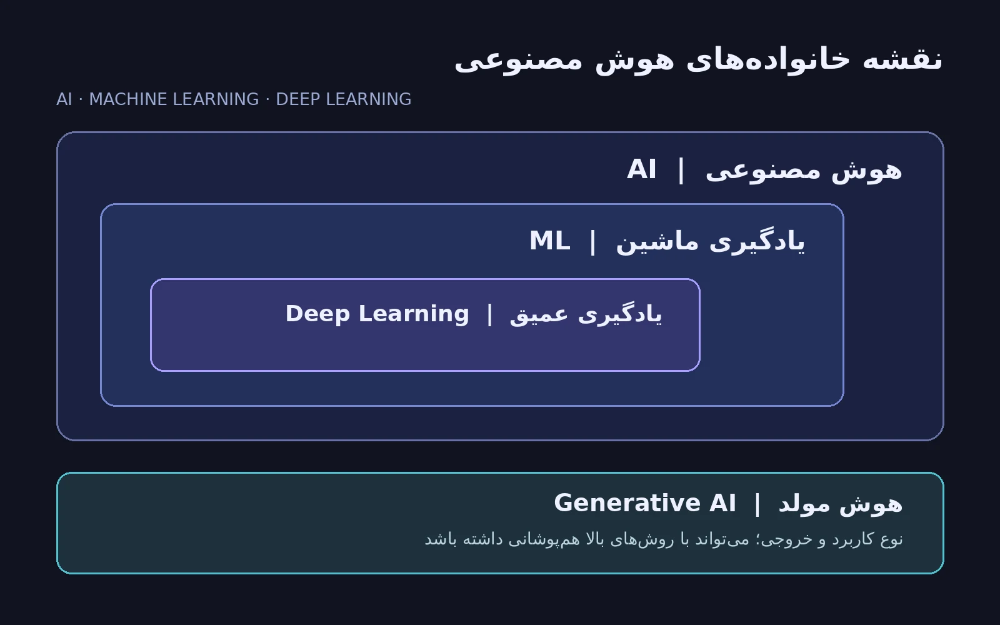

**شکل ۲-۱ — نقشه مفهومی خانواده‌ها.** در این طرح، کادر جداگانه پایین برای نشان دادن هم‌پوشانیِ ممکن است، نه این ادعا که همه مدل‌های مولد عمیق‌اند. ML زیرمجموعه AI است؛ DL زیرمجموعه ML است؛ شبکه عصبی نوعی مدل است و برخی شبکه‌ها عمیق نیستند. هوش مولد بر اساس نوع خروجی و کاربرد دسته‌بندی می‌شود و با این لایه‌ها هم‌پوشانی دارد، نه اینکه الزاماً زیرمجموعه DL باشد.

## ۵. هوش مولد و تفاوت آن با طبقه‌بندی

**هوش مصنوعی مولد (Generative AI)** به سیستم‌هایی گفته می‌شود که می‌توانند محتوایی مانند متن، تصویر، صوت یا کد تولید کنند. خانواده‌ای از مدل‌های مولد به‌صورت احتمالاتی تولید نمونه یا الگوهای داده را مدل می‌کنند [۳]. برای فهم مقدماتی، یک طبقه‌بند پیام را در یکی از دسته‌های ازپیش‌تعریف‌شده قرار می‌دهد؛ یک مولد می‌تواند متن تازه‌ای در پاسخ به درخواست بسازد.

اما این مرز **مطلق نیست**: یک مدل مولد می‌تواند برای طبقه‌بندی به کار رود و یک سیستم تولید محتوا می‌تواند شامل اجزای طبقه‌بند باشد. همچنین «تازه» بودن خروجی به معنی تضمین اصالت، درستی، مجاز بودن استفاده یا عدم شباهت به داده آموزش نیست. در کاربرد واقعی باید حقوق داده، احتمال بازتولید و صحت خروجی بررسی شوند.

| پرسش مهندسی | طبقه‌بندی نمونه | تولید متن نمونه |
|---|---|---|
| ورودی | متن پیام | دستور و متن زمینه |
| خروجی | برچسب «بازبینی/عادی» | پیش‌نویس پاسخ |
| نمونه ارزیابی | مثبت کاذب، منفی کاذب، بازیابی | درستی، ارتباط، ایمنی، کیفیت و هزینه |
| خطر | ازدست‌رفتن پیام خطرناک | اطلاعات ساختگی یا افشای اطلاعات |
| بازبینی | بسته به حساسیت، کنترل انسانی | بررسی منبع و تأیید انسان در محتوای مهم |

مدل مولد نباید با یک سامانه کامل یکسان گرفته شود. رابط کاربری، داده‌های بازیابی‌شده، فیلترها، ابزارها و سیاست دسترسی نیز بر رفتار نهایی اثر می‌گذارند.

## ۶. مدل زبانی بزرگ چیست؟

**مدل زبانی (Language Model)** روابط آماری بین واحدهای متن را مدل می‌کند. در بسیاری از مدل‌های مولد متداول، تولید با پیش‌بینی توکن بعدی بر اساس توکن‌های قبلی پیش می‌رود [۳]. **توکن (Token)** واحدی است که tokenizer به مدل می‌دهد و می‌تواند یک کلمه، بخشی از کلمه یا نشانه‌ای دیگر باشد؛ نباید فرض کرد هر توکن دقیقاً یک کلمه فارسی است.

**مدل زبانی بزرگ (Large Language Model یا LLM)** اصطلاحی برای مدل‌های زبانی با مقیاس نسبتاً بزرگ است؛ مرز عددی ثابت و جهان‌شمولی برای «بزرگ» وجود ندارد. بسیاری از LLMهای امروزی از خانواده Transformer استفاده می‌کنند؛ مقاله اولیه Transformer در ۲۰۱۷ ارائه شد [۴]. همه مدل‌های زبانی یک روش آموزش یا یک سازوکار تولید ندارند: مدل‌های علّی، پوشانده‌شده و رویکردهای دیگر را نباید یکی گرفت.

در یک مدل علّی مولد، به‌طور ساده:

```text
P(t_next | context)
```

`P` احتمالِ مدل، `t_next` توکن بعدی و `context` توکن‌های پیشین یا زمینه است. خروجی مدل یک توزیع روی توکن‌های ممکن است؛ روش رمزگشایی ممکن است محتمل‌ترین توکن را انتخاب یا از توزیع نمونه‌گیری کند. سپس توکن انتخاب‌شده به زمینه اضافه می‌شود. این فرمول **احتمال در مدل** را نشان می‌دهد، نه احتمال درست بودن یک ادعای واقعی. تولیدِ قابل‌قبول زبانی لزوماً حقیقت، استدلال معتبر یا دسترسی به اطلاعات روز را تضمین نمی‌کند.

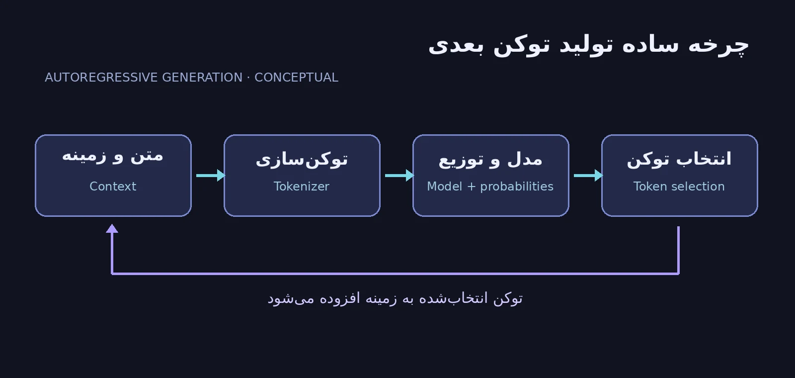

**شکل ۲-۲ — چرخه ساده تولید خودرگرسیو (Autoregressive).** شکل فقط یک الگوی متداول تولید را نمایش می‌دهد، نه همه معماری‌ها. هدف این نمودار توضیح جهت جریان است؛ عدد یا ادعای عملکردی در آن وجود ندارد. Tokenizer و واژگان را در فصل ۳۳ و جزئیات Attention را در فصل ۳۴ خواهیم ساخت.

## ۷. داده، مدل، الگوریتم و نرم‌افزار: یک مثال واحد

فرض کنید یک کتابخانه می‌خواهد تخمین بزند فردا چند کتاب قرض گرفته می‌شود. اطلاعات تاریخی شامل روز هفته، تعداد اعضای حاضر و تعداد امانت‌هاست.

- **داده (Data):** ردیف‌های ثبت‌شده؛ هر ردیف ممکن است شامل ویژگی‌ها (Features) و مقدار هدف یا برچسب (Label) باشد.
- **مدل (Model):** رابطه قابل تنظیمی که از ویژگی‌ها مقدار پیش‌بینی‌شده می‌سازد؛ مثلاً یک فرمول خطی ساده.
- **پارامتر (Parameter):** عدد قابل تنظیم داخل مدل، مانند شیب یا بایاس. **ابَرپارامتر (Hyperparameter)** یک انتخاب بیرونی فرایند است؛ برای مثال تعداد دورهای آموزش یا نرخ یادگیری در روش‌هایی که چنین گزینه‌هایی دارند.
- **الگوریتم آموزش (Training Algorithm):** روش تنظیم پارامترها بر اساس داده و معیار خطا؛ مدل و الگوریتم یکی نیستند.
- **نرم‌افزار (Software):** برنامه‌ای که دریافت داده، آموزش، ذخیره مدل، پیش‌بینی و نمایش را پیاده‌سازی می‌کند.
- **استنتاج (Inference):** به‌کارگیری مدلِ انتخاب‌شده روی ورودی جدید. یک برنامه می‌تواند پیش‌بینی کند بدون اینکه در آن لحظه وزن‌هایش تغییر کنند.

**مثال عددی:** اگر مدل پیش‌بینی کند ۴۰ کتاب امانت می‌رود و مقدار واقعی ۳۵ باشد، خطای خام `40 − 35 = 5` کتاب است. این یک مشاهده است؛ اندازه‌گیری کیفیت معمولاً به نمونه‌های متعدد و معیاری مشخص نیاز دارد. خروجی خوب روی داده آموزش برای تعمیم کافی نیست. فصل ۳ چرخه آموزش، اعتبارسنجی و آزمون را دقیق‌تر بررسی می‌کند.

## ۸. پروژه: مدل بسیار کوچک را واقعاً آموزش دهید

در این پروژه یک مدل طبقه‌بندی یک‌پارامتری می‌سازیم: اگر امتیاز نشانه‌های مشکوک در یک پیام به آستانه برسد، پیام برای بررسی علامت می‌خورد. این امتیاز می‌تواند عدد اعشاری باشد و در اینجا **داده مصنوعیِ ازپیش‌ساخته** است؛ برنامه متن واقعی را تحلیل نمی‌کند و ابزار امنیتی نیست.

**ساختار فایل:** `threshold_model.py`. **محیط:** فقط کتابخانه استاندارد Python؛ این فصل با Python 3.13.16 در محیط تولید آزمایش شده است. GPU و نصب بسته اضافی لازم نیست. راهنمای نصب Python در فصل ۹ می‌آید.

```python
# داده مصنوعی: (امتیاز نشانه ها، برچسب بازبینی)
train = [(0, 0), (1, 0), (2, 0), (4, 1), (5, 1), (6, 1)]
test = [(0.5, 0), (2.5, 0), (3.5, 1), (6.5, 1)]

def predict(x, threshold):
    return int(x >= threshold)

def errors(rows, threshold):
    return sum(predict(x, threshold) != label for x, label in rows)

def fit(rows):
    candidates = range(0, 8)
    return min(candidates, key=lambda t: (errors(rows, t), t))

def main():
    threshold = fit(train)
    mistakes = errors(test, threshold)
    print(f"threshold={threshold}")
    print(f"test_errors={mistakes}/{len(test)}")
    print(f"test_accuracy={(len(test)-mistakes)/len(test):.0%}")
    print(f"prediction_for_3.5={predict(3.5, threshold)}")

if __name__ == "__main__":
    main()
```

در ترمینال در پوشه فایل `python threshold_model.py` یا `python3 threshold_model.py` را اجرا کنید. خروجی مورد انتظار:

```text
threshold=3
test_errors=0/4
test_accuracy=100%
prediction_for_3.5=1
```

**کد را خط‌به‌خط بخوانیم:** `train` نمونه‌های آموزش و `test` نمونه‌های جدا برای سنجش‌اند. هر زوج از یک ورودی عددی و برچسب `0` یا `1` تشکیل شده است. `predict` برای آستانه داده‌شده برچسب می‌دهد؛ `errors` تعداد مغایرت را می‌شمارد. `fit` همه آستانه‌های صحیح ۰ تا ۷ را می‌آزماید و کم‌خطاترین را برمی‌گزیند؛ در صورت تساوی، کوچک‌ترین آستانه انتخاب می‌شود. مدل، **قاعده به‌همراه آستانه یادگرفته‌شده ۳** است؛ الگوریتم آموزش، جست‌وجوی آستانه؛ داده، فهرست زوج‌ها؛ و نرم‌افزار، کل برنامه است.

**چرا این یادگیری است؟** آستانه به جای تعیین مستقیم در تابع `predict`، از داده آموزشی انتخاب می‌شود. اگر داده تغییر کند، آستانه انتخابی نیز ممکن است تغییر کند. این یک نمونه کوچک یادگیری نظارت‌شده است، اما شبکه عصبی یا مدل زبانی نیست. ۱۰۰٪ روی چهار نمونه مصنوعی، اثبات عملکرد واقعی نیست؛ انتخاب نمونه‌ها و ویژگی‌ها ساختگی‌اند و اندازه آزمون بسیار کوچک است.

**تست تکمیلی:** با دست حساب کنید اگر آستانه به ۵ تغییر کند، روی داده آزمون چند خطا رخ می‌دهد؟ اگر دستور Python پیدا نشد، نام `python3` و نصب Python را بررسی کنید؛ اگر فایل پیدا نشد، مسیر جاری ترمینال را بررسی کنید. اگر خروجی متفاوت است، داده‌ها، فاصله‌گذاری و نام فایل را با نمونه مطابقت دهید.

## ۹. روش حرفه‌ای‌تر: خط لوله استاندارد، بدون ادعای اجرا

در پروژه‌های واقعی، ابزارهای استاندارد می‌توانند ساخت مدل، تقسیم داده و ارزیابی را منظم کنند. نمونه زیر نشان می‌دهد یک درخت تصمیم ساده چگونه با **scikit-learn** آموزش و آزمایش می‌شود؛ این درخت از آستانه پروژه قبل پیچیده‌تر است و لزوماً همان مدل یا نتیجه را نمی‌دهد. **این نمونه کتابخانه‌ای در محیط این فصل اجرا نشده است**؛ خروجی عددی آن را به‌عنوان نتیجه آزمایش‌شده گزارش نمی‌کنیم. نسخه کتابخانه و نسخه Python را هنگام اجرا ثبت کنید و نصب را در محیط مجازی فصل ۱۳ انجام دهید.

```python
# ابتدا در یک محیط مجازی، بسته scikit-learn را نصب کنید.
# python -m pip install scikit-learn
from sklearn.tree import DecisionTreeClassifier
from sklearn.metrics import accuracy_score

x_train = [[0], [1], [2], [4], [5], [6]]
y_train = [0, 0, 0, 1, 1, 1]
x_test = [[0.5], [2.5], [3.5], [6.5]]
y_test = [0, 0, 1, 1]
model = DecisionTreeClassifier(max_depth=1, random_state=42)
model.fit(x_train, y_train)
print("test_accuracy=", accuracy_score(y_test, model.predict(x_test)))
```

در این نمونه، `fit` آموزش و `predict` استنتاج است. برای برنامه عملی باید نسخه دقیق بسته، سکو، داده و خروجی ثبت و آزمون شود. اجرای دستور نصب به اینترنت و دسترسی به بسته نیاز دارد. اگر نصب بسته ممکن نیست، پروژه استاندارد کتابخانه Python بخش قبل مستقل و قابل اجراست. آموزش واقعی، تقسیم مناسب داده، مقایسه خط پایه، آزمون خارج از نمونه و بررسی اخلاقی فراتر از این مثال است.

## ۱۰. خطاهای رایج و عیب‌یابی مفهومی

۱. **همه AI را LLM نامیدن:** موتور جست‌وجو، برنامه‌ریزی نمادین و مدل طبقه‌بندی را هم باید با معماری و کاربرد خودشان توصیف کرد.
۲. **«یادگیری عمیق یعنی درک عمیق»:** عمق معماری یک ادعای روان‌شناختی نیست. خروجی روان یا نمره بالا اثبات فهم انسانی یا آگاهی نیست.
۳. **«هوش مولد همیشه شبکه عمیق است»:** تولید و معماری دو محور متفاوت‌اند؛ شکل ۲-۱ را به‌عنوان نقشه مفهومی بخوانید نه دسته‌بندی مطلق همه مدل‌ها.
۴. **آزمودن روی داده آموزش:** ممکن است مدل روی نمونه‌های دیده‌شده خوب و در موارد تازه ضعیف باشد. داده آزمون را پیش از تنظیم مدل کنار بگذارید؛ اگر از آن برای تصمیم‌گیری تکراری استفاده کنید، دیگر آزمون بی‌طرف نهایی نیست.
۵. **اشتباه گرفتن احتمال توکن با صحت گزاره:** مدل به ادامه متن امتیاز می‌دهد؛ برای صحت باید شواهد خارجی و ارزیابی وظیفه داشت.
۶. **ادعای بی‌طرفی به‌سبب عددی‌بودن:** معیار، برچسب‌ها و انتخاب ویژگی ممکن است به افراد مختلف آسیب نامتوازن وارد کند؛ بررسی زیان، حریم خصوصی و نظارت انسانی ضروری است [۵].

**عیب‌یابی در یک کاربرد واقعی:** ابتدا مطمئن شوید تعریف مسئله و برچسب روشن است؛ سپس ورودی‌های خطادار و کیفیت داده را بررسی کنید؛ بعد مدل را با خط پایه مقایسه و عملکرد را برای زیرگروه‌های مناسب گزارش کنید. از داده حساس بدون مجوز استفاده نکنید. اصلاح مدل همیشه پاسخ نیست: گاهی مشکل در جمع‌آوری داده، خط‌مشی کسب‌وکار یا تعریف هدف است.

## ۱۱. تحولات و احتیاط‌ها تا نوامبر ۲۰۲۶

**تاریخ بررسی منابع: ۴ نوامبر ۲۰۲۶.** شاخص AI سال ۲۰۲۶ استنفورد افزایش عملکرد روی مجموعه‌ای از معیارهای زبان، کدنویسی و استدلال را گزارش می‌کند و در عین حال بر محدودیت اعتبار بنچمارک‌ها و عملکرد نامتوازن در وظایف مختلف تأکید دارد [۶]. این گزارش به شرایط آزمون‌های خودش محدود است؛ رتبه در یک بنچمارک، گواه ایمنی یا کارایی در همه محیط‌ها نیست.

آموزش مدل‌های متنی، تصویری و چندوجهی همچنان در حال تحول است. از تعمیم شتاب‌زده مانند «همه مدل‌های آینده خودرگرسیو هستند» یا «هر LLM یک Transformer علّی است» خودداری می‌کنیم. تاریخ مقاله اصلی Transformer، ۲۰۱۷ است [۴]؛ برای اجرای هر کتابخانه یا انتخاب سخت‌افزار، نسخه مستندات و سازگاری باید هنگام اجرای همان پروژه بررسی شود. این مرور ادعای پوشش کامل همه تحولات تا تاریخ مرجع را ندارد.

## ۱۲. تمرین، آزمون و پروژه ارزیابی

**آزمون مفهومی:**

۱. کدام عبارت درست‌تر است: «همه MLها شبکه عصبی‌اند» یا «بعضی مدل‌های ML شبکه عصبی نیستند»؟ مثالی بزنید.
۲. آیا تمام شبکه‌های عصبی عمیق‌اند؟ آیا هر سیستم مولد حتماً مدل عمیق دارد؟
۳. در پروژه آستانه، داده، پارامتر مدل و الگوریتم آموزش را مشخص کنید.
۴. آموزش و استنتاج در کد چگونه از هم جدا می‌شوند؟
۵. چرا احتمال توکن بعدی، احتمال صحت یک پاسخ نیست؟
۶. دو دلیل بیاورید که ۱۰۰٪ روی چهار نمونه مصنوعی برای کاربرد امنیتی کافی نیست.
۷. برای پیش‌بینی تعداد امانت کتاب، هدف عددی را چه نوع مسئله‌ای می‌نامید؟ برای دسته‌بندی پیام چطور؟
۸. آیا مدل مولد می‌تواند برای طبقه‌بندی استفاده شود؟ یک محدودیت این کار را نام ببرید.
۹. چرا داده آزمون نباید برای انتخاب پیاپی آستانه به‌کار رود؟
۱۰. یک روش نمادین و یادگیرنده چگونه می‌توانند در یک محصول ترکیب شوند؟

**تمرین ریاضی:** در پروژه، آستانه را ۵ فرض کنید و به‌ترتیب پیش‌بینی چهار نمونه آزمون را بنویسید. تعداد خطا و دقت را حساب کنید. سپس با آستانه ۳ مقایسه کنید.

**تمرین برنامه‌نویسی:** دو ورودی آموزشی جدید با برچسب دلخواه و توجیه‌شده اضافه کنید؛ آستانه و خطای آموزش را قبل و بعد گزارش کنید. داده آزمون را تغییر ندهید. اگر حداقل خطا میان دو آستانه مساوی بود، توضیح دهید چرا کد مقدار کوچک‌تر را برمی‌گزیند.

**مینی‌پروژه:** برای اولویت‌بندی مطالعه، ویژگی عددی «روز مانده تا آزمون» را تعریف کنید، یک قاعده ساده و یک آستانه مبتنی بر داده آموزشی بسازید. دست‌کم شش نمونه آموزشی و چهار نمونه آزمون جداگانه تولید کنید؛ جهت قاعده را متناسب با مسئله انتخاب کنید، معیار مناسب و خطاها را ثبت کنید، و به کاربر اجازه اصلاح خروجی بدهید. این سامانه برای تصمیم حساس مناسب نیست.

**معیار قبولی:** حداقل ۸ پاسخ درست از ۱۰ پرسش، محاسبه صحیح دقت هر دو آستانه، اجرای کد یا توضیح دقیق خروجی در صورت نبود محیط، و گزارش ویژگی، برچسب، آستانه، خطا و یک محدودیت در مینی‌پروژه.

[پاسخ‌نامه جداگانه فصل ۲](book-engineering/answers/02-ai-families-answers-fa.md) را پس از حل تمرین‌ها باز کنید.

## ۱۳. واژه‌نامه، جمع‌بندی و منابع

**واژه‌نامه:** هوش مصنوعی (AI)، یادگیری ماشین (ML)، یادگیری عمیق (DL)، شبکه عصبی (Neural Network)، هوش مولد (Generative AI)، مدل زبانی بزرگ (LLM)، توکن (Token)، یادگیری نظارت‌شده (Supervised Learning)، ویژگی (Feature)، برچسب (Label)، پارامتر (Parameter)، ابرپارامتر (Hyperparameter)، آموزش (Training)، استنتاج (Inference)، تعمیم (Generalization).

**جمع‌بندی:** AI حوزه‌ای وسیع است؛ ML از داده یا تجربه برای ساخت یا تنظیم مدل استفاده می‌کند؛ DL خانواده‌ای از روش‌های مبتنی بر شبکه‌های عصبی چندلایه است. هوش مولد با این دسته‌ها هم‌پوشانی دارد و LLM یک نوع مدل زبانی در مقیاس بزرگ است. پیش‌بینی قابل سنجش، توضیح داده و آزمون مستقل از کاربرد واژه «هوشمند» مهم‌تر است. در **فصل ۳** چرخه کامل داده، آموزش، اعتبارسنجی، آزمون و استنتاج را عمیق‌تر بررسی می‌کنیم.

**منابع؛ تاریخ مراجعه: ۴ نوامبر ۲۰۲۶.** برای اسناد زنده، تاریخ انتشار در صورت نامشخص بودن ذکر شده است:

[۱] OECD، «What is AI? Can you make a clear distinction between AI and non-AI systems?»، ۶ مارس ۲۰۲۴، [متن رسمی](https://oecd.ai/en/wonk/definition).

[۲] Google for Developers، «Introduction to Machine Learning»، تاریخ انتشار مشخص نشده، [مستندات رسمی](https://developers.google.com/machine-learning/intro-to-ml).

[۳] Google for Developers، «Machine Learning Glossary: Generative AI»، تاریخ انتشار مشخص نشده، [واژه‌نامه رسمی](https://developers.google.com/machine-learning/glossary/generative).

[۴] Vaswani, A. و همکاران، «Attention Is All You Need»، NeurIPS 2017، ۲۰۱۷، [مقاله](https://arxiv.org/abs/1706.03762).

[۵] Autio, C. و همکاران، «Artificial Intelligence Risk Management Framework: Generative Artificial Intelligence Profile»، NIST، ۲۶ ژوئیه ۲۰۲۴، DOI: [10.6028/NIST.AI.600-1](https://doi.org/10.6028/NIST.AI.600-1).

[۶] Stanford Institute for Human-Centered Artificial Intelligence، «AI Index Report 2026: Technical Performance»، ۲۰۲۶، [گزارش](https://hai.stanford.edu/ai-index/2026-ai-index-report/technical-performance).

[۷] scikit-learn developers، «Decision Trees»، تاریخ انتشار مشخص نشده، [مستندات رسمی](https://scikit-learn.org/stable/modules/tree.html). نسخه اجرای نمونه کتابخانه‌ای باید هنگام اجرا ثبت شود.

---

# فصل ۳ — چرخه حیات مدل: از داده تا استنتاج و بازخورد

**هنر و علم ساخت هوش | جلد اول | Babak & Ai**
**نسخه کاری RC · تاریخ مراجعه و بازبینی منابع: ۵ نوامبر ۲۰۲۶**

## ۱. مسئله قبل از مدل

فرض کنید یک کتابخانه می‌خواهد تعداد کتاب‌های امانت‌رفته در روز آینده را پیش‌بینی کند تا برای چیدن کتاب‌ها نیروی کافی داشته باشد. آیا باید نخست یک شبکه عصبی بزرگ بسازد؟ نه. ابتدا باید بداند چه تصمیمی قرار است بهتر شود، پیش‌بینی چه زمانی لازم است، چه داده‌ای واقعاً در آن زمان در دسترس است و پیامد پیش‌بینی اشتباه چیست.

**پیش‌نیاز:** فصل‌های ۱ و ۲. برای خواندن فصل به دانش قبلی برنامه‌نویسی نیاز ندارید. پروژه از Python استاندارد استفاده می‌کند؛ نصب Python در فصل ۹ آموزش داده خواهد شد. زمان پیشنهادی: ۳ تا ۴ ساعت مطالعه و تمرین.

**هدف‌های یادگیری:** در پایان می‌توانید (۱) چرخه یک مدل را رسم کنید، (۲) داده آموزش، اعتبارسنجی و آزمون را تفکیک کنید، (۳) تفاوت پارامتر و ابرپارامتر را شرح دهید، (۴) زیان مربعی میانگین را محاسبه کنید، (۵) کد آموزش و استنتاج یک مدل کوچک را اجرا کنید و (۶) برای پایش و توقف امن سیستم برنامه بدهید.

**یک نکته مهم:** چرخه حیات مدل به‌ندرت خطی و یک‌باره است. یافته‌های پایش می‌توانند ما را به بازنگری داده، هدف یا مدل برگردانند. بازخورد انسانی، ذخیره مکالمه و بازآموزی پارامترها سه کار متفاوت‌اند.

## ۲. نقشه چرخه حیات

چرخه را می‌توان برای آموزش به مراحل زیر شکست [۱، ۲]:

۱. **تعریف مسئله:** تصمیم، کاربر، خروجی، محدودیت، هزینه خطا و معیار موفقیت را تعریف می‌کنیم.
۲. **داده:** با مجوز مناسب گردآوری، بررسی و برچسب‌گذاری می‌کنیم؛ داده‌های نامعتبر و تکراری را طبق سیاست مستند مدیریت می‌کنیم.
۳. **تقسیم:** داده را متناسب با کاربرد به آموزش، اعتبارسنجی و آزمون جدا می‌کنیم؛ سپس تبدیلات آموختنی را فقط با داده آموزش برازش می‌دهیم.
۴. **آموزش:** پارامترهای مدل با یک الگوریتم و داده آموزش تنظیم می‌شوند.
۵. **انتخاب و ارزیابی:** با داده اعتبارسنجی انتخاب‌ها را انجام می‌دهیم و پس از نهایی‌سازی، کیفیت را با مجموعه آزمون کنارگذاشته‌شده گزارش می‌کنیم.
۶. **استقرار و استنتاج:** مدل به محیط استفاده منتقل می‌شود و با ورودی جدید خروجی می‌دهد.
۷. **پایش و بازخورد:** کیفیت، خطا، تغییر داده، هزینه و ایمنی بررسی می‌شود؛ در صورت لزوم مدل یا کل تعریف مسئله بازبینی می‌شود.

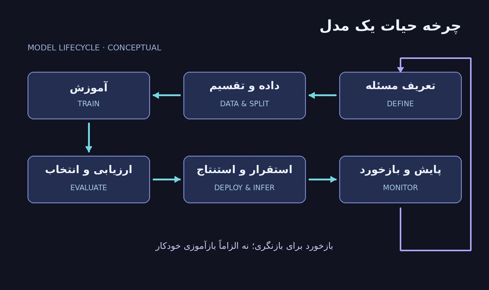

**شکل ۳-۱ — نقشه چرخه حیات.** بازگشت از پایش به ابتدای چرخه به معنی بازآموزی خودکار و بدون کنترل نیست. پیش از انتشار نسخه جدید باید ارزیابی و تأیید مستقل انجام شود.

**خروجی هر مرحله:** تعریف مسئله → سند هدف؛ داده → نسخه داده و مجوز؛ تقسیم → شناسه نمونه‌های هر بخش؛ آموزش → پارامترها و تنظیمات؛ ارزیابی → گزارش معیارها؛ استقرار → نسخه قابل بازگشت؛ پایش → هشدار و تصمیم مسئول. فصل‌های MLOps این اجزا را به زیرساخت واقعی تبدیل می‌کنند.

## ۳. تعریف مسئله و داده معتبر

برای مثال کتابخانه، سؤال «فردا چند کتاب امانت می‌رود؟» یک مسئله رگرسیون است، زیرا خروجی عددی است. «آیا فردا بیش از ۱۰۰ امانت داریم؟» یک مسئله طبقه‌بندی است. ممکن است تصمیم عملی ــ مثلاً تعداد نیروی موردنیاز ــ به هزینه کم‌برآوردکردن و بیش‌برآوردکردن وابسته باشد، نه فقط میانگین خطا.

**ویژگی (Feature)** اطلاعاتی است که در زمان پیش‌بینی می‌دانیم: مثلاً روز هفته و آمار روزهای گذشته. **برچسب (Label/Target)** نتیجه‌ای است که می‌خواهیم تخمین بزنیم: تعداد امانت فردا. تعداد واقعی امانت فردا را نمی‌توان هنگام پیش‌بینی فردا به‌عنوان ورودی استفاده کرد، چون هنوز معلوم نیست. همچنین اگر زمان انتشار یک آمار بعد از زمان تصمیم باشد، استفاده از آن نشت اطلاعات آینده است.

کیفیت داده را با پرسش‌هایی بررسی کنید: داده از کجا آمده و مجوز استفاده‌اش چیست؟ آیا بعضی روزها ثبت نشده‌اند؟ ثبت‌های تکراری وجود دارد؟ آیا تعریف برچسب در طول زمان عوض شده است؟ آیا داده برای کاربران مختلف نماینده کافی است؟ آیا داده شخصی باید حذف یا حفاظت شود؟ پاسخ‌ها و نسخه داده را ثبت کنید. پاک‌سازی خوب به معنی حذف بی‌قاعده مواردی که مدل روی آن‌ها بد عمل می‌کند نیست.

**خط پایه (Baseline):** یک پیش‌بینی ساده مانند «فردا برابر میانگین روزهای مشابه گذشته است» معیاری برای مقایسه می‌سازد. اگر مدل پیچیده با هزینه بیشتر از خط پایه بهتر نیست یا خطر بیشتری دارد، استفاده از آن نیاز به توجیه دارد.

## ۴. آموزش، اعتبارسنجی و آزمون

**آموزش (Training):** الگوریتم با نمونه‌های آموزش پارامترها را تنظیم می‌کند. **اعتبارسنجی (Validation):** برای انتخاب میان گزینه‌ها، تنظیم ابرپارامتر یا انتخاب مرحله توقف استفاده می‌شود. **آزمون (Test):** پس از تثبیت انتخاب‌ها، برآورد نهایی روی داده کنارگذاشته‌شده انجام می‌شود [۱].

| مجموعه | چه چیزی را تعیین می‌کند؟ | چه استفاده‌ای نباید شود؟ |
|---|---|---|
| آموزش | پارامترها و تبدیلات آموختنی | گزارش به‌تنهایی به‌عنوان عملکرد روی داده تازه |
| اعتبارسنجی | انتخاب مدل، ابرپارامتر، مرحله توقف | ادعای ارزیابی نهایی کاملاً مستقل بعد از انتخاب مکرر |
| آزمون | گزارش نهایی مدل تثبیت‌شده | انتخاب مکرر مدل و بازطراحی بر اساس همان نتیجه |

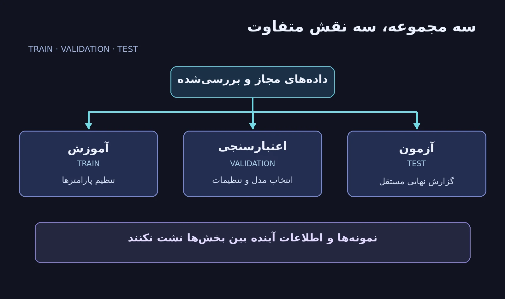

**شکل ۳-۲ — نقش سه مجموعه.** تصویر نسبت عددی توصیه نمی‌کند. نسبت مناسب به حجم داده، هزینه خطا و ساختار مسئله بستگی دارد. اگر نمونه‌های یک شخص، گروه یا شیء بسیار مشابه‌اند، تقسیم تصادفی ردیف‌ها ممکن است به نشت منجر شود؛ تقسیم گروهی یا زمانی را متناسب با سناریوی واقعی بررسی کنید. در پیش‌بینی آینده معمولاً ترتیب زمان باید حفظ شود.

**نشت داده (Data Leakage):** ورود مستقیم یا غیرمستقیم اطلاعات آزمون، آینده یا پاسخ به فرآیند آموزش/انتخاب است. مثلاً محاسبه میانگین نرمال‌سازی از کل داده قبل از تقسیم، اطلاعات مجموعه‌های کنارگذاشته‌شده را به آموزش وارد می‌کند. راه بهتر: تبدیل را فقط روی آموزش برازش، و همان تبدیل را بدون برازش مجدد روی اعتبارسنجی، آزمون و ورودی واقعی اعمال کنید. نمونه‌های تکراری یا تقریباً یکسان در دو بخش نیز ممکن است نتیجه را خوش‌بینانه کنند [۱].

## ۵. مدل، پارامتر و ابرپارامتر

در این فصل یک مدل خطی بسیار ساده داریم:

```text
y_hat = w × x + b
```

`x` ورودی عددی، `y_hat` مقدار پیش‌بینی‌شده، `w` وزن و `b` بایاس است. برای `x=3`، `w=2` و `b=1`، پیش‌بینی `7` می‌شود. وزن و بایاس **پارامتر (Parameter)** مدل‌اند که در آموزش تنظیم می‌شوند. اگر الگوریتم آموزش از **نرخ یادگیری (Learning Rate)** استفاده کند، این نرخ یک **ابرپارامتر (Hyperparameter)** است که اندازه گام تنظیم را کنترل می‌کند. تعداد گام‌های آموزش نیز ابرپارامتر است.

پارامترها از داده یاد گرفته می‌شوند، اما «بهترین» ابرپارامتر عموماً به داده، معماری و معیار وابسته است. نرخ خیلی بزرگ ممکن است سبب ناپایداری یا واگرایی شود؛ نرخ خیلی کوچک می‌تواند آموزش را کند کند. انتخاب فقط از روی داده آموزش ممکن است به بیش‌برازش تصمیم‌های طراحی منجر شود؛ گزینه‌ها را با اعتبارسنجی مقایسه کنید.

مدل خطی همیشه مناسب نیست: رابطه واقعی ممکن است غیرخطی، متغیر در زمان یا تحت تأثیر متغیرهای ثبت‌نشده باشد. در پروژه، داده مصنوعی عمداً از رابطه خطی ساده ساخته شده و نتیجه به مسائل واقعی تعمیم‌پذیر نیست.

## ۶. تابع زیان و معنای یادگیری

**تابع زیان (Loss Function)** عددی است که میزان ناسازگاری پیش‌بینی با هدف را با فرمولی مشخص می‌سنجد. برای رگرسیون، یکی از گزینه‌ها **میانگین مربعات خطا (Mean Squared Error یا MSE)** است:

```text
MSE = (1 / n) × Σ (y_hat_i − y_i)²
```

**معادله ۳-۱** — n تعداد نمونه، y کلاه پیش‌بینی و y مقدار مرجع است.

<math xmlns="http://www.w3.org/1998/Math/MathML" display="block" dir="ltr" aria-label="MSE: sum of squared prediction errors divided by n"><mi>MSE</mi><mo>=</mo><mfrac><mn>1</mn><mi>n</mi></mfrac><munderover><mo>∑</mo><mrow><mi>i</mi><mo>=</mo><mn>1</mn></mrow><mi>n</mi></munderover><msup><mrow><mo>(</mo><msub><mover><mi>y</mi><mo>^</mo></mover><mi>i</mi></msub><mo>−</mo><msub><mi>y</mi><mi>i</mi></msub><mo>)</mo></mrow><mn>2</mn></msup></math>

`n` تعداد نمونه‌ها، `i` شماره نمونه، `y_hat_i` پیش‌بینی مدل و `y_i` مقدار مرجع است. `Σ` یعنی مقادیر تمام نمونه‌ها را جمع می‌کنیم. واحد MSE مربع واحد خروجی است؛ مثلاً اگر خروجی تعداد کتاب باشد، واحد MSE «کتاب به توان دو» است. برای مقایسه با واحد اصلی، می‌توان ریشه MSE را گزارش کرد، اما هیچ معیار واحدی برای همه کاربردها کافی نیست.

**مثال دستی:** اگر مقدارهای واقعی `3` و `5` و پیش‌بینی‌ها `2` و `7` باشند، خطاها `−1` و `2` و مربع‌ها `1` و `4` هستند؛ پس `MSE = (1 + 4) / 2 = 2.5`. مربع‌کردن سبب می‌شود خطاهای بزرگ سهم بیشتری بگیرند؛ در داده دارای مقدار پرت، این ویژگی باید بررسی شود.

در **گرادیان‌کاهشی (Gradient Descent)** پارامترها در جهت کاهش تقریبی زیان تغییر می‌کنند. در پروژه، مشتق‌های MSE برای مدل خطی چنین‌اند:

```text
grad_w = (2 / n) × Σ (y_hat_i − y_i) × x_i
grad_b = (2 / n) × Σ (y_hat_i − y_i)
w_new = w − learning_rate × grad_w
b_new = b − learning_rate × grad_b
```

`grad_w` و `grad_b` حساسیت زیان به تغییر وزن و بایاس، و `learning_rate` اندازه گام است. این یک الگوریتم مشخص است، نه تنها روش آموزش. مشتق و دلیل فرمول را از پایه در فصل‌های ریاضی و شبکه عصبی یاد می‌گیریم. کم شدن زیان آموزش به‌تنهایی تضمین عملکرد روی داده تازه نیست.

## ۷. استنتاج با مدل ثابت و تفاوت بازخورد

پس از انتخاب و تثبیت مدل، **استنتاج (Inference)** یعنی استفاده از پارامترهای موجود برای پیش‌بینی روی ورودی جدید. در مثال خطی، با `w=2` و `b=1`، ورودی `7` به پیش‌بینی `15` می‌رسد. ممکن است مقدار واقعی بعداً ۱۴ یا ۱۷ باشد؛ خروجی مدل گواه حقیقت نیست.

| عملیات | ورودی اصلی | خروجی | آیا لزوماً پارامترها عوض می‌شوند؟ |
|---|---|---|---|
| آموزش | داده آموزش، تنظیمات و الگوریتم | پارامترهای جدید | در این روش بله |
| اعتبارسنجی | مدل و داده اعتبارسنجی | معیار برای انتخاب | خودِ محاسبه معیار نه |
| آزمون | مدل نهایی و داده آزمون | گزارش نهایی | نه |
| استنتاج | مدل نهایی و ورودی تازه | پیش‌بینی/خروجی | معمولاً نه؛ استثناها وجود دارند |
| دریافت بازخورد | مشاهده، برچسب یا نظر کاربر | داده/هشدار برای بررسی | نه، مگر فرایند به‌روزرسانی جدا اجرا شود |

ذخیره سابقه مکالمه یا اضافه‌کردن متن بازیابی‌شده به ورودی، لزوماً به معنی تغییر وزن مدل نیست. در یادگیری آنلاین یا برخی روش‌های سازگارشونده ممکن است به‌روزرسانی در زمان استفاده طراحی شود؛ آن را باید جداگانه با امنیت و معیار روشن ارزیابی کرد. فرق «حافظه برنامه» و «پارامترهای مدل» در فصل‌های بعد مهم می‌شود.

## ۸. پروژه عملی: یک چرخه کامل در Python

**سناریو:** داده ساختگی تابع `y = 2x + 1` را تولید می‌کند. چهار نقطه برای آموزش، یک نقطه برای اعتبارسنجی و دو نقطه برای آزمون کنار گذاشته شده‌اند. دو نرخ یادگیری فقط با اعتبارسنجی مقایسه می‌شوند؛ سپس یک‌بار معیار آزمون و یک استنتاج جدید گزارش می‌شود. هدف، یادگیری جریان کار است، نه ساخت مدل قابل استفاده برای تصمیم واقعی.

**فایل:** `lifecycle.py`؛ فقط Python استاندارد لازم است، بدون GPU یا بسته اضافی. کد زیر با **Python 3.13.16** در محیط تولید کتاب اجرا شده است. با `python --version` یا `python3 --version` نسخه خود را بررسی کنید.

```python
"""A deterministic, synthetic lifecycle demonstration; no external packages."""

TRAIN = [(0.0, 1.0), (1.0, 3.0), (2.0, 5.0), (3.0, 7.0)]
VALIDATION = [(4.0, 9.0)]
TEST = [(5.0, 11.0), (6.0, 13.0)]


def predict(x, weight, bias):
    return weight * x + bias


def mse(rows, weight, bias):
    return sum((predict(x, weight, bias) - y) ** 2 for x, y in rows) / len(rows)


def train(rows, learning_rate, steps):
    weight, bias = 0.0, 0.0
    for _ in range(steps):
        grad_w = sum(2 * (predict(x, weight, bias) - y) * x for x, y in rows) / len(rows)
        grad_b = sum(2 * (predict(x, weight, bias) - y) for x, y in rows) / len(rows)
        weight -= learning_rate * grad_w
        bias -= learning_rate * grad_b
    return weight, bias


def main():
    candidates = []
    for rate in (0.01, 0.1):
        weight, bias = train(TRAIN, rate, steps=500)
        val_loss = mse(VALIDATION, weight, bias)
        candidates.append((val_loss, rate, weight, bias))
        print(f"lr={rate:.2f} val_mse={val_loss:.8f}")

    val_loss, rate, weight, bias = min(candidates)
    print(f"selected_lr={rate:.2f}")
    print(f"weight={weight:.6f} bias={bias:.6f}")
    print(f"test_mse={mse(TEST, weight, bias):.8f}")
    print(f"inference_x_7={predict(7.0, weight, bias):.6f}")


if __name__ == '__main__':
    main()
```

**اجرا:** فایل را با UTF-8 ذخیره کنید و در همان پوشه دستور `python lifecycle.py` یا `python3 lifecycle.py` را بزنید. خروجی ثبت‌شده:

```text
lr=0.01 val_mse=0.00000526
lr=0.10 val_mse=0.00000000
selected_lr=0.10
weight=2.000000 bias=1.000000
test_mse=0.00000000
inference_x_7=15.000000
```

عددهای چاپ‌شده گرد شده‌اند؛ `0.00000000` به معنی صفر دقیق در نمایش داخلی نیست. تفاوت بسیار کوچک نسخه و پردازنده در رقم‌های انتهایی ممکن است رخ دهد. ورودی ۷ بیرون بازه آموزش است؛ موفقیت در این تابع ساختگی، تضمین برون‌یابی در دنیای واقعی نیست.

**راهنمای کد:** `TRAIN`، `VALIDATION` و `TEST` به‌صورت جدا تعریف شده‌اند. `predict` فرمول مدل را اجرا می‌کند و `mse` زیان را حساب می‌کند. `train` با وزن و بایاس صفر شروع می‌کند، در هر گام مشتق‌ها را از تمام داده آموزش حساب می‌کند و هر دو پارامتر را با همان گرادیان‌ها به‌روز می‌کند. `candidates` نتیجه دو نرخ را نگه می‌دارد و `min` گزینه با زیان اعتبارسنجی کمتر را انتخاب می‌کند؛ در تساوی مقدارهای بعدی tuple، از جمله نرخ، ترتیب را تعیین می‌کنند. در پایان آزمون و استنتاج بدون تغییر پارامتر انجام می‌شوند.

**گزارش آزمایش:** داده ساختگی است؛ دو گزینه از پیش تعیین شده‌اند؛ ۵۰۰ گام برای هر گزینه اجرا شده؛ آزمون بسیار کوچک است و مستقل بودن در معنای عملی و آماری را تضمین نمی‌کند. الگوریتم، کتابخانه و داده این مثال نباید به‌عنوان نسخه‌ای برای پیش‌بینی واقعی کتابخانه تلقی شوند.

## ۹. پیاده‌سازی با ابزار استاندارد و آزمون آن

ابزارهای حرفه‌ای می‌توانند جزئیات برازش و ارزیابی را ساده کنند. نمونه زیر یک **مدل خطی کتابخانه‌ای** را روی همان آموزش برازش و روی اعتبارسنجی و آزمون ارزیابی می‌کند؛ از حل‌گر کتابخانه استفاده می‌کند، نه اجرای همان گرادیان‌کاهشی و انتخاب نرخ پروژه قبل. مقایسه یکسان آن‌ها مستلزم طراحی آزمایش دقیق‌تر است.

```python
from sklearn.linear_model import LinearRegression
from sklearn.metrics import mean_squared_error

x_train = [[0.0], [1.0], [2.0], [3.0]]
y_train = [1.0, 3.0, 5.0, 7.0]
x_val, y_val = [[4.0]], [9.0]
x_test, y_test = [[5.0], [6.0]], [11.0, 13.0]
model = LinearRegression().fit(x_train, y_train)
print(f"weight={model.coef_[0]:.3f} bias={model.intercept_:.3f}")
print(f"val_mse={mean_squared_error(y_val, model.predict(x_val)):.6f}")
print(f"test_mse={mean_squared_error(y_test, model.predict(x_test)):.6f}")
```

**وضعیت اجرا:** این نمونه با Python 3.13.16 و scikit-learn 1.6.1 در محیط تولید فصل آزمایش شد. خروجی گرد‌شده: `weight=2.000 bias=1.000`، `val_mse=0.000000` و `test_mse=0.000000`. مستندات رسمی LinearRegression و معیارها را در [۳] ببینید. برای محیط شخصی پس از ساخت محیط مجازی، نصب نسخه سازگار را با `python -m pip install scikit-learn==1.6.1` انجام دهید؛ سازگاری نسخه Python/سیستم‌عامل و منبع بسته را بررسی کنید. نصب اینترنت می‌خواهد؛ اگر در دسترس نیست، پروژه بخش ۸ مستقل از بسته‌های خارجی است.

## ۱۰. از استقرار تا پایش و بازگشت امن

**استقرار (Deployment)** صرفاً ذخیره یک فایل وزن نیست. محصول باید بداند داده ورودی را چگونه معتبرسازی کند، از چه نسخه پیش‌پردازش و مدلی استفاده کند، خطا را چگونه گزارش دهد و در صورت شکست چگونه به وضعیت امن بازگردد. برای کاربرد حساس، مجوز دسترسی، حفظ اطلاعات، تأیید انسان و مسیر اعتراض مهم‌اند [۴].

**پایش (Monitoring)** می‌تواند شامل تأخیر، خطاهای نرم‌افزاری، هزینه، تغییر توزیع ورودی و کیفیت پیش‌بینی پس از رسیدن برچسب‌های واقعی باشد. تغییر توزیع ورودی لزوماً اثبات افت کیفیت نیست و نبود تغییر آشکار نیز صحت را تضمین نمی‌کند. اگر برچسب واقعی دیر برسد، پایش کیفیت نیز تأخیر دارد.

**نمونه برنامه عملیاتی:** (۱) در گزارش ثبت کنید مدل و پیش‌پردازش کدام نسخه‌اند؛ (۲) حد هشدار و مسئول رسیدگی را تعیین کنید؛ (۳) خروجی‌های غیرعادی را مطابق سیاست حریم خصوصی بررسی کنید؛ (۴) در صورت نقض معیار، ارسال به بازبینی انسانی یا توقف را اجرا کنید؛ (۵) نسخه پیشین معتبر و روش بازگشت (Rollback) را نگه دارید؛ (۶) تنها پس از ارزیابی مستقل، نسخه جدید را جایگزین کنید. اگر امکان نظارت مناسب وجود نداشته باشد، تصمیم صحیح می‌تواند **عدم استقرار** باشد.

چارچوب داوطلبانه NIST چهار کارکرد «حاکمیت، ترسیم زمینه، اندازه‌گیری، مدیریت» را برای مدیریت ریسک توصیف می‌کند [۴]. این چارچوب جایگزین الزامات حقوقی محلی یا بازبینی متخصص در کاربرد پرخطر نیست.

## ۱۱. خطاهای رایج و راهنمای عیب‌یابی

- **زیان پایین آموزش، کیفیت ضعیف آزمون:** احتمال بیش‌برازش، اختلاف داده‌ها یا کوچک بودن نمونه را بررسی کنید؛ ابتدا تقسیم و نشت را کنترل کنید، نه اینکه فوراً مدل را بزرگ‌تر کنید.
- **نتایج غیرواقعی عالی:** داده‌های تکراری، ویژگی‌های ساخته‌شده از آینده، برچسب در ورودی و برازش پیش‌پردازش روی کل داده را بررسی کنید.
- **زیان به‌شدت بالا یا نامتناهی:** واحدها، مقیاس ویژگی‌ها، برچسب‌های نامعتبر و نرخ یادگیری بسیار بزرگ را بررسی کنید. ابتدا با داده کوچک و محاسبه دستی صحت فرمول را بسنجید.
- **خطای اجرای Python:** در پوشه درست قرار بگیرید؛ `python3` را در صورت نیاز امتحان کنید؛ تورفتگی کد و کپی کامل فایل را کنترل کنید. اگر بسته scikit-learn یافت نشد، محیط فعال و نصب را بررسی کنید یا پروژه استاندارد را اجرا کنید.
- **تناقض نتایج در استقرار:** نسخه مدل، تبدیل داده، واحد و ترتیب ویژگی‌ها، و تفاوت کد آموزش و سرو را بررسی کنید. از یک قرارداد ورودی ثابت و تست نمونه استفاده کنید.
- **بازآموزی با هر بازخورد:** داده خام ممکن است غلط یا مخرب باشد. بازخورد باید با سیاست، مجوز، کنترل کیفیت و ارزیابی نسخه جدید مدیریت شود.

## ۱۲. تحولات تا نوامبر ۲۰۲۶ و حدود شواهد

**تاریخ بررسی: ۵ نوامبر ۲۰۲۶.** گزارش AI Index 2026 استنفورد به بهبود عملکرد در چند حوزه و هم‌زمان به محدودیت اعتبار و فرسودگی برخی بنچمارک‌ها اشاره می‌کند [۵]. نتیجه عملی برای چرخه مدل این است که هم گزارش کیفیت و هم سناریو، نمونه و محدودیت ارزیابی باید ثبت شوند؛ نمره یک بنچمارک تضمین عملکرد در محیط واقعی نیست.

مستندات Google برای تقسیم داده هشدار می‌دهند که استفاده مکرر از مجموعه آزمون و وجود نمونه تکراری بین بخش‌ها می‌تواند ارزیابی را خوش‌بینانه کند [۱]. مستندات پایپ‌لاین نیز به نیاز مدیریت داده، آموزش، اعتبارسنجی و سرو در طول زمان اشاره می‌کنند [۲]. این منابع مفاهیم را توضیح می‌دهند؛ انتخاب تناوب بازآموزی، خودکارسازی و حدود ایمنی به کاربرد و هزینه واقعی وابسته است. این مرور ادعای بررسی تمام پیشرفت‌های سال ۲۰۲۶ را ندارد.

## ۱۳. آزمون، پروژه ارزیابی و منابع

**آزمون مفهومی:** ۱) نقش مجموعه‌های آموزش، اعتبارسنجی و آزمون چیست؟ ۲) چرا محاسبه نرمال‌سازی روی کل داده پیش از تقسیم می‌تواند نشت ایجاد کند؟ ۳) تفاوت وزن با نرخ یادگیری چیست؟ ۴) آیا هر بازخورد کاربر وزن مدل را تغییر می‌دهد؟ ۵) چرا زیان پایین آموزش برای استقرار کافی نیست؟ ۶) اگر برچسب واقعی با تأخیر برسد، پایش کیفیت چه محدودیتی دارد؟ ۷) تقسیم داده زمانی در چه موقعیتی مهم است؟ ۸) بازگشت نسخه یعنی چه و چه زمانی لازم است؟ ۹) چرا ۱۰۰٪ یا زیان نزدیک صفر روی چند نمونه مصنوعی قابل تعمیم نیست؟ ۱۰) یک معیار و یک خطر برای مثال کتابخانه بنویسید.

**تمرین ریاضی:** اگر واقعی‌ها `2` و `4` و پیش‌بینی‌ها `3` و `2` باشند، MSE را حساب کنید. همچنین اگر وزن ۲ و بایاس ۱ باشند، برای ورودی ۸ پیش‌بینی را حساب کنید.

**تمرین کدنویسی:** برنامه را اجرا کنید؛ سپس فقط تعداد گام‌های آموزش را از ۵۰۰ به ۵۰ تغییر دهید و نرخ انتخاب‌شده و زیان اعتبارسنجی را گزارش کنید. مجموعه آزمون را برای انتخاب تعداد گام استفاده نکنید. قبل از تغییر، مقدار قبلی و بعد از آن نتیجه جدید را ثبت کنید؛ زیان واقعی را اجرا و مشاهده کنید، نه حدس بزنید.

**پروژه ارزیابی:** یک مسئله پیش‌بینی کم‌خطر با داده مصنوعی تعریف کنید؛ هدف، ویژگی و برچسب را بنویسید؛ دست‌کم دو نامزد روی آموزش بسازید؛ با اعتبارسنجی انتخاب و با آزمون جداگانه ارزیابی کنید؛ معیار، خطر نشت، نسخه Python، داده و دستور اجرا را ثبت کنید. برای استقرار فرضی یک هشدار، یک مسئول و یک روش بازگشت تعیین کنید. در پایان یک محدودیت داده را توضیح دهید.

**معیار قبولی:** دست‌کم ۸ پاسخ درست از ۱۰ سؤال، محاسبه صحیح هر دو عدد تمرین ریاضی، اجرای پروژه یا توضیح کامل مراحل آن در صورت نبود محیط، و ارائه گزارش شامل داده‌های تفکیک‌شده، نتیجه، خطر نشت و برنامه پایش.

[پاسخ‌نامه جداگانه فصل ۳](book-engineering/answers/03-model-lifecycle-answers-fa.md) را پس از حل تمرین‌ها باز کنید.

**واژه‌نامه:** چرخه حیات (Lifecycle)، ویژگی (Feature)، برچسب (Label)، آموزش (Training)، اعتبارسنجی (Validation)، آزمون (Test)، نشت داده (Data Leakage)، پارامتر (Parameter)، ابرپارامتر (Hyperparameter)، تابع زیان (Loss Function)، گرادیان‌کاهشی (Gradient Descent)، استنتاج (Inference)، پایش (Monitoring)، بازگشت نسخه (Rollback).

**گام بعد:** فصل ۴ مسیر تاریخی از پرسپترون تا مدل‌های مدرن را بررسی می‌کند؛ فصل‌های آینده ریاضیات، کد و ارزیابی را به‌صورت عمیق‌تر باز می‌کنند.

**منابع** — تاریخ مراجعه: ۵ نوامبر ۲۰۲۶:

[۱] Google for Developers، «Datasets: Dividing the original dataset»، تاریخ انتشار مشخص نشده، [مستندات رسمی](https://developers.google.com/machine-learning/crash-course/overfitting/dividing-datasets).

[۲] Google for Developers، «ML pipelines»، تاریخ انتشار مشخص نشده، [مستندات رسمی](https://developers.google.com/machine-learning/managing-ml-projects/pipelines).

[۳] scikit-learn developers، «LinearRegression»، مستندات نسخه 1.6، تاریخ انتشار صفحه مشخص نشده، [مستندات نسخه](https://scikit-learn.org/1.6/modules/generated/sklearn.linear_model.LinearRegression.html).

[۴] National Institute of Standards and Technology، «Artificial Intelligence Risk Management Framework (AI RMF 1.0)»، ژانویه ۲۰۲۳، DOI: [10.6028/NIST.AI.100-1](https://doi.org/10.6028/NIST.AI.100-1)، [کارکردهای چارچوب](https://airc.nist.gov/airmf-resources/airmf/5-sec-core/).

[۵] Stanford Institute for Human-Centered Artificial Intelligence، «AI Index Report 2026: Technical Performance»، ۲۰۲۶، [گزارش](https://hai.stanford.edu/ai-index/2026-ai-index-report/technical-performance).

---

# فصل ۴ — تاریخ هوش مصنوعی: از پرسپترون تا مدل‌های مدرن

**هنر و علم ساخت هوش | جلد اول | Babak & Ai**
**نسخه کاری RC · تاریخ مراجعه به منابع: ۵ نوامبر ۲۰۲۶**

## ۱. چرا تاریخ را یاد می‌گیریم؟

اگر یک مدل امروز بتواند متنی روان بسازد، آیا مسیر رسیدن به آن از یک کشف و یک آزمایش شروع شده است؟ نه. تاریخ AI آمیزه‌ای از ایده‌های ریاضی، سخت‌افزار، داده، پژوهش جمعی، امید، شکست و تغییر معیار ارزیابی است. شناخت این مسیر به ما کمک می‌کند ادعاهای فنی را در شرایط تاریخی‌شان بسنجیم، راه‌حل‌های قدیمی را بی‌دلیل منسوخ نخوانیم و پیشرفت روی یک آزمون را با حل همه مسائل اشتباه نگیریم.

**پیش‌نیاز:** فصل‌های ۱ تا ۳. پروژه این فصل فقط به Python استاندارد نیاز دارد. **هدف:** پس از مطالعه می‌توانید نقاط عطف مهم را ترتیب دهید، تفاوت سامانه نمادین و یادگیرنده را توضیح دهید، محدودیت یک پرسپترون تک‌لایه را با XOR بررسی کنید و نقش داده، محاسبه و ارزیابی را تحلیل کنید.

این فصل یک روایت گزینشی است، نه تاریخ کامل همه کشورها، پژوهشگران و رویکردها. تاریخ مقاله، محصول و فراگیرشدن یک روش ممکن است متفاوت باشد؛ در هر مورد مشخص می‌کنیم درباره کدام صحبت می‌کنیم.

## ۲. آغازهای پیش از نام‌گذاری

در ۱۹۴۳، وارن مک‌کالاک و والتر پیتس مدلی منطقی از شبکه‌های عصبی ارائه کردند [۱]. این کار مدل ریاضی ساده‌شده‌ای بود، نه بازسازی کامل نورون زیستی یا یک شبکه امروزی. در ۱۹۵۰، آلن تورینگ مقاله «ماشین محاسبه‌گر و هوش» را منتشر و بازی تقلید را مطرح کرد [۲]. نتیجه گفت‌وگو می‌تواند موضوع یک آزمایش رفتاری باشد، اما به‌تنهایی اثبات آگاهی، ایمنی یا درستی پاسخ‌ها نیست.

پیشنهاد پروژه تابستانی دارتموث، نوشته جان مک‌کارتی و همکاران در **۱۹۵۵**، برای گردهمایی **۱۹۵۶** تدوین شد؛ واژه Artificial Intelligence در عنوان پیشنهاد آمده است [۳]. متن در ۲۰۰۶ در AI Magazine بازنشر شد. به‌وجودآمدن نام یک رشته به معنی آغاز تمام ایده‌های مرتبط در همان سال نیست: منطق، آمار، کنترل و علوم اعصاب سابقه‌ای طولانی‌تر دارند.

**تمرین خواندن منبع:** تاریخ نوشته اولیه، تاریخ گردهمایی و تاریخ بازنشر دارتموث را از هم جدا کنید. اگر صرفاً تاریخ بازنشر را سال آغاز پروژه بدانیم، ۵۱ سال خطا می‌کنیم.

## ۳. پرسپترون و یادگیری از مثال

فرانک روزنبلات در ۱۹۵۸ مقاله پرسپترون را منتشر کرد [۴]. یک مدل ساده آموزشی از پرسپترون برای ورودی‌های `x1` و `x2` چنین تصمیم می‌گیرد:

```text
score = w1 × x1 + w2 × x2 + b
prediction = 1 if score ≥ 0, otherwise 0
```

`w1` و `w2` وزن‌ها، `b` بایاس و `score` امتیاز پیش از تصمیم است. در این نمایش، مرز تصمیم یک خط در صفحه دو ویژگی است. نسخه تاریخی روزنبلات و پیاده‌سازی آموزشی ساده این فصل یکسانِ کامل نیستند. الگوریتم می‌تواند پس از خطا وزن‌ها را تغییر دهد، نه اینکه انسان برای تک‌تک نمونه‌ها یک پاسخ مستقل بنویسد.

برای مثال با وزن‌های `w1=1` و `w2=1` و بایاس `b=−1.5`، تنها ورودی `(1,1)` امتیاز غیرمنفی می‌گیرد؛ بنابراین تابع AND نمایش داده می‌شود. این یک مدل ساده طبقه‌بندی است، نه مدل زبانی یا شبیه‌سازی مغز.

**محدودیت هندسی XOR:** خروجی XOR برای `(0,1)` و `(1,0)` برابر ۱ و برای `(0,0)` و `(1,1)` برابر ۰ است. هیچ خط واحدی این دو گروه را در آن صفحه جدا نمی‌کند؛ بنابراین یک پرسپترون آستانه‌ای تک‌لایه با همین ورودی‌ها نمی‌تواند هر چهار برچسب را هم‌زمان درست دهد. این محدودیت، حکم ناممکن بودن یادگیری توسط همه شبکه‌های عصبی یا همه مدل‌ها نیست: لایه‌های بیشتر یا ویژگی‌های مناسب می‌توانند مسئله متفاوتی بسازند.


**شکل ۴-۱ — خط زمانی منتخب.** تاریخ‌ها سال انتشار منابع شاخص‌اند، نه اثبات اینکه ایده‌ها ناگهان یا توسط یک نفر ایجاد شدند. توضیح و منابع هر نقطه در متن فصل آمده‌اند.

## ۴. نمادها، جست‌وجو و سامانه‌های خبره

بخش مهمی از تاریخ AI با **نمایش نمادین (Symbolic Representation)**، منطق، جست‌وجو و برنامه‌ریزی گره خورده است. در این رویکردها مسئله با نمادها، قواعد یا حالت‌ها توصیف می‌شود و الگوریتم می‌کوشد نتیجه یا مسیر مناسبی پیدا کند. برای نمونه، حل یک معما را می‌توان جست‌وجوی مجموعه‌ای از وضعیت‌ها دانست.

**سیستم خبره (Expert System)** می‌تواند قواعد دانشیِ استخراج‌شده از متخصصان را برای کمک به یک حوزه محدود به کار گیرد. مزیت برخی سیستم‌های قاعده‌ای، امکان مشاهده قاعده‌ای است که فعال شده؛ محدودیت آن‌ها هزینه استخراج و نگهداری دانش، پوشش ناکافی موارد استثنایی و دشواری سازگاری با محیط تغییرپذیر است. نظام‌های نمادین هنوز در برنامه‌ریزی، تأیید نرم‌افزار و محصولات ترکیبی کاربرد دارند؛ «قدیمی» بودن به معنی بی‌فایده بودن نیست.

**زمستان‌های AI (AI Winters):** اصطلاحی برای دوره‌هایی با کاهش حمایت یا انتظارات پس از وعده‌های برآورده‌نشده است. علت‌ها بسته به دوره و کشور متفاوت بوده‌اند؛ محدودیت محاسبه، داده، کاربرد عملی و شکاف میان وعده و نتیجه از عوامل مطرح هستند. یک تاریخ خطی که همه افت‌ها را فقط به یک مقاله یا یک عامل نسبت دهد، ساده‌سازی گمراه‌کننده‌ای است.

## ۵. پس‌انتشار و شبکه‌های چندلایه

یک شبکه چندلایه می‌تواند نمایش‌های میانی بسازد و، با فعال‌سازی‌های مناسب، توابع پیچیده‌تری از یک مرز خطی واحد بیان کند. اما چگونه اثر خطای خروجی را به پارامترهای لایه‌های قبلی نسبت دهیم؟ **پس‌انتشار خطا (Backpropagation)** روشی برای محاسبه کارآمد مشتق‌ها با استفاده از قاعده زنجیره‌ای است. مقاله Rumelhart، Hinton و Williams در ۱۹۸۶ در شناساندن آن برای یادگیری نمایش‌ها اثرگذار بود [۵].

پس‌انتشار، به‌تنهایی نام بهینه‌ساز یا معماری کامل نیست: ابتدا مشتق‌ها محاسبه می‌شوند و سپس یک روش بهینه‌سازی، مانند گرادیان‌کاهشی، می‌تواند از آن‌ها برای تغییر وزن‌ها استفاده کند. ایده‌های مرتبط با مشتق‌گیری پیش از ۱۹۸۶ نیز وجود داشته‌اند؛ بنابراین نباید آن مقاله را اختراع بدون پیشینه همه جنبه‌های روش معرفی کرد.

**مقایسه:** پرسپترون تک‌لایه آستانه‌ای در فضای ورودی دوبعدی یک مرز خطی می‌سازد؛ شبکه چندلایه غیرخطی می‌تواند مرزهای پیچیده‌تری نشان دهد. توان بیان بالاتر به‌تنهایی تضمین آموزش موفق، تعمیم، انصاف یا ایمنی نیست.

## ۶. داده، GPU و جهش یادگیری عمیق

در دهه ۲۰۰۰ و آغاز دهه ۲۰۱۰، داده بیشتر، ابزارهای نرم‌افزاری، پیشرفت روش‌های آموزش و محاسبات موازی به پیشرفت بعضی کاربردها کمک کردند. رابطه علت و معلول را نباید به «فقط یک GPU» فروکاست: کیفیت داده، طراحی آزمایش، الگوریتم و مهندسی نیز نقش دارند.

در ۲۰۱۲ مقاله Krizhevsky، Sutskever و Hinton درباره طبقه‌بندی ImageNet با شبکه کانولوشنی عمیق، که معمولاً AlexNet نامیده می‌شود، در NeurIPS منتشر شد [۶]. این کار در طبقه‌بندی تصویر نقطه عطف مهمی بود؛ نتیجه آن به داده، وظیفه و معیار همان آزمون مربوط است و به معنی حل بینایی عمومی نیست. شبکه‌های کانولوشنی پیش از AlexNet هم وجود داشتند. در فصل ۳۱ آن‌ها را دقیق‌تر بررسی می‌کنیم.

برندگان یک مسابقه را باید همراه با تعریف مسئله، نسخه داده و شرایط اجرا بررسی کرد. تغییر این شرایط ممکن است مقایسه عددها را نامعتبر کند. یک مدل خوب تصویر می‌تواند در زبانی دیگر یا روی دوربینی متفاوت خطا کند.

## ۷. از توجه تا Transformer

در ۲۰۱۷، Vaswani و همکاران مقاله **Attention Is All You Need** را منتشر کردند [۷]. Transformer اولیه از سازوکار توجه و ساختار encoder–decoder برای ترجمه ماشینی بهره می‌برد و بر خلاف مدل‌های بازگشتی، به recurrence برای پردازش توالی متکی نبود. این مقاله نقطه عطفی مهم است، اما مفهوم توجه پیش از آن نیز در پژوهش وجود داشت.

**توجه (Attention)** روشی برای ترکیب اطلاعات بر اساس ارتباط محاسبه‌شده میان بخش‌های ورودی است؛ جزئیات Query، Key و Value را در فصل ۳۴ پیاده‌سازی می‌کنیم. Transformerهای بعدی در معماری، داده، هدف آموزشی و کاربرد تفاوت‌های زیادی دارند؛ همه مدل‌های زبانی یا همه AI الزاماً Transformer یکسانی نیستند.

مدل‌های زبانی بزرگ و چندوجهی بر پیشرفت‌های متعددی در معماری، داده و مقیاس محاسبات بنا شده‌اند. خروجی روان، صحت یا تجربه ذهنی را تضمین نمی‌کند. ارزیابی باید به سناریو، بنچمارک، حریم خصوصی و پیامدهای خطا توجه کند.

## ۸. پروژه: آزمایش تاریخی AND و XOR

**هدف:** آموزش یک پرسپترون ساده روی دو جدول منطقی و مشاهده محدودیت خطی. پروژه فقط چهار ورودی ممکن را بررسی می‌کند؛ این ارزیابی توان تعمیم روی داده واقعی نیست. **محیط:** Python 3.13.16 در محیط تولید فصل؛ بدون بسته اضافی یا GPU. فایل `perceptron.py` را با محتوای زیر بسازید:

```python
"""Educational binary perceptron; deterministic AND/XOR comparison."""

def predict(x1, x2, weights, bias):
    return int(weights[0] * x1 + weights[1] * x2 + bias >= 0)


def train(rows, epochs=20, rate=1):
    weights, bias = [0, 0], 0
    for _ in range(epochs):
        for x1, x2, label in rows:
            error = label - predict(x1, x2, weights, bias)
            weights[0] += rate * error * x1
            weights[1] += rate * error * x2
            bias += rate * error
    return weights, bias


def main():
    inputs = [(0, 0), (0, 1), (1, 0), (1, 1)]
    for name, labels in [('AND', [0, 0, 0, 1]), ('XOR', [0, 1, 1, 0])]:
        rows = [(x1, x2, y) for (x1, x2), y in zip(inputs, labels)]
        weights, bias = train(rows)
        outputs = [predict(x1, x2, weights, bias) for x1, x2 in inputs]
        mistakes = sum(a != b for a, b in zip(outputs, labels))
        print(f'{name} weights={weights} bias={bias} outputs={outputs} errors={mistakes}')


if __name__ == '__main__':
    main()
```

**اجرا:** `python perceptron.py` یا `python3 perceptron.py`. خروجی آزمایش‌شده:

```text
AND weights=[2, 1] bias=-3 outputs=[0, 0, 0, 1] errors=0
XOR weights=[-1, 0] bias=0 outputs=[1, 1, 0, 0] errors=2
```

`predict` امتیاز و آستانه را محاسبه می‌کند. `train` برای هر مثال خطا را برابر برچسب منهای پیش‌بینی می‌گیرد و وزن و بایاس را اصلاح می‌کند. `epochs` تعداد عبور از داده و `rate` اندازه گام هستند. `main` داده را برای AND و XOR می‌سازد و خطا را گزارش می‌کند. ترتیب نمونه‌ها، قانون آستانه و تعداد دور بر پارامترهای نهایی اثر می‌گذارند.

نتیجه تجربیِ XOR در این اجرا دو خطا است؛ دلیل کلی ناتوانی حل کامل با این مدل، **جداناپذیری خطی XOR** است، نه صرفاً کم بودن تعداد دورها. اگر اجرا متفاوت بود، تورفتگی، نسخه فایل و ترتیب نمونه‌ها را بررسی کنید. تمرین: تعداد دوره را به ۴۰ تغییر دهید؛ آیا آزمون تجربی به‌تنهایی یک اثبات ریاضی است؟ خیر.

## ۹. تحلیل انتقادی: ادعا، شواهد و هزینه

هنگام خواندن یک دستاورد تاریخی، پنج پرسش بپرسید: دقیقاً چه وظیفه‌ای؟ کدام داده و معیار؟ چه خط پایه‌ای؟ چه منابع محاسباتی؟ آیا نتیجه بازتولید و در محیط جدید سنجیده شده است؟ گزارش خوب هم موارد موفقیت و هم شکست و محدودیت را بیان می‌کند.

**اشتباه رایج ۱:** «XOR ثابت کرد شبکه عصبی مفید نیست.» نتیجه درست فقط به خانواده مدل و نمایش ورودی محدود است. **اشتباه ۲:** «Transformer همه روش‌های نمادین را منسوخ کرد.» روش مناسب تابع مسئله، هزینه و محدودیت است و محصولات می‌توانند روش‌ها را ترکیب کنند. **اشتباه ۳:** «از یک بنچمارک می‌توان کیفیت همه کاربردها را نتیجه گرفت.» نمی‌توان؛ سناریو، داده و معیار اهمیت دارند.

پژوهش‌های امروز علاوه بر عملکرد به هزینه انرژی و محاسبه، دسترسی، حقوق داده، سوگیری، امنیت و پایش توجه می‌کنند. این ملاحظات بخشی از مهندسی محصول‌اند، نه ضمیمه‌ای اختیاری پس از انتشار.

## ۱۰. آخرین تحولات تا نوامبر ۲۰۲۶

**تاریخ بررسی: ۵ نوامبر ۲۰۲۶.** گزارش AI Index 2026 استنفورد افزایش عملکرد مدل‌ها در برخی ارزیابی‌ها و هم‌زمان پرسش‌های مربوط به اعتبار، اشباع و امکان بازی‌کردن بنچمارک‌ها را گزارش کرده است [۸]. از این شواهد نمی‌توان نتیجه گرفت یک مدل در تمام محیط‌ها بهترین یا ایمن است. گزارش به ارزیابی‌های مشخص و روش‌های همان مطالعه محدود است.

این فصل فهرست کامل رویدادهای سال ۲۰۲۶ نیست و رتبه روز مدل‌ها را تثبیت نمی‌کند. برای اجرای کتابخانه یا خرید سخت‌افزار، مستندات نسخه و تاریخ بررسی هر پروژه ملاک‌اند. تاریخ علم همچنان در حال نوشته‌شدن است.

## ۱۱. تمرین‌ها، پروژه و معیار قبولی

**آزمون مفهومی:** ۱) تاریخ پیشنهاد دارتموث و سال پروژه چیست؟ ۲) پرسپترون تک‌لایه چه نوع مرزی می‌سازد؟ ۳) چرا شکست XOR ناتوانی همه شبکه‌ها را اثبات نمی‌کند؟ ۴) پس‌انتشار چه چیزی محاسبه می‌کند؟ ۵) دو عامل علاوه بر سخت‌افزار در موفقیت یادگیری عمیق نام ببرید. ۶) Transformer اولیه برای چه کاری معرفی شد؟ ۷) چرا یک بنچمارک معادل هوش عمومی نیست؟ ۸) چرا روش نمادین ممکن است هنوز مفید باشد؟

**تمرین ریاضی:** برای `w1=1`، `w2=1`، `b=−1.5` پیش‌بینی هر چهار ورودی دودویی را حساب کنید. برای XOR توضیح دهید چرا برچسب‌های مثبت در گوشه‌های متقابل قرار دارند.

**تمرین برنامه‌نویسی:** پروژه را اجرا و خروجی‌ها را با برچسب‌ها مقایسه کنید. سپس `epochs` را افزایش دهید و نتیجه را ثبت کنید؛ ادعای نظری را به آزمایش چند دور محدود نکنید.

**پروژه ارزیابی:** یک خط زمانی دست‌کم پنج‌نقطه‌ای با منبع اولیه، سال انتشار، مسئله، محدودیت و یک پرسش باز بسازید. برای دو نقطه توضیح دهید داده و محاسبه چه نقشی داشتند. یک ادعای مشهور را با اصل مقاله مقایسه کنید و منبع ادعا و محدودیتش را بنویسید.

**معیار عبور:** دست‌کم ۷ پاسخ صحیح از ۸ پرسش، جدول درست AND، اجرای برنامه یا توضیح دقیق خروجی در صورت نبود محیط، و خط زمانی مستند با پنج منبع/ارجاع و دست‌کم دو محدودیت. [پاسخ‌نامه جداگانه فصل ۴](book-engineering/answers/04-history-answers-fa.md) را پس از حل تمرین‌ها ببینید.

## ۱۲. واژه‌نامه، ارتباط بعدی و منابع

**واژه‌نامه:** پرسپترون (Perceptron)، سامانه نمادین (Symbolic AI)، سیستم خبره (Expert System)، جدایی‌پذیری خطی (Linear Separability)، پس‌انتشار (Backpropagation)، شبکه کانولوشنی (CNN)، توجه (Attention)، ترنسفورمر (Transformer)، بنچمارک (Benchmark).

در فصل بعد، از تاریخ به **اجزای کامپیوتر و جریان داده** می‌رویم: CPU، حافظه، ذخیره‌سازی و سیستم‌عامل، تا بدانیم مدل روی چه زیرساختی اجرا می‌شود.

**منابع؛ تاریخ مراجعه: ۵ نوامبر ۲۰۲۶:**

[۱] McCulloch, W. S. و Pitts, W.، «A Logical Calculus of the Ideas Immanent in Nervous Activity»، Bulletin of Mathematical Biophysics، ۱۹۴۳، DOI: [10.1007/BF02478259](https://doi.org/10.1007/BF02478259).

[۲] Turing, A. M.، «Computing Machinery and Intelligence»، Mind، ۱۹۵۰، DOI: [10.1093/mind/LIX.236.433](https://doi.org/10.1093/mind/LIX.236.433).

[۳] McCarthy, J. و همکاران، «A Proposal for the Dartmouth Summer Research Project on Artificial Intelligence»، پیشنهاد ۱۹۵۵؛ بازنشر AI Magazine، ۲۰۰۶، DOI: [10.1609/aimag.v27i4.1904](https://doi.org/10.1609/aimag.v27i4.1904).

[۴] Rosenblatt, F.، «The Perceptron»، Psychological Review، ۱۹۵۸، DOI: [10.1037/h0042519](https://doi.org/10.1037/h0042519).

[۵] Rumelhart, D. E.، Hinton, G. E. و Williams, R. J.، «Learning representations by back-propagating errors»، Nature، ۱۹۸۶، DOI: [10.1038/323533a0](https://doi.org/10.1038/323533a0).

[۶] Krizhevsky, A.، Sutskever, I. و Hinton, G. E.، «ImageNet Classification with Deep Convolutional Neural Networks»، NeurIPS، ۲۰۱۲، [مقاله](https://proceedings.neurips.cc/paper_files/paper/2012/hash/c399862d3b9d6b76c8436e924a68c45b-Abstract.html).

[۷] Vaswani, A. و همکاران، «Attention Is All You Need»، NeurIPS، ۲۰۱۷، [مقاله](https://arxiv.org/abs/1706.03762).

[۸] Stanford HAI، «AI Index 2026: Technical Performance»، ۲۰۲۶، [گزارش](https://hai.stanford.edu/ai-index/2026-ai-index-report/technical-performance).

---

# فصل ۵ — کامپیوتر از درون: CPU، حافظه و ذخیره‌سازی

**هنر و علم ساخت هوش | جلد اول | Babak & Ai**
**نسخه کاری RC · تاریخ مراجعه به منابع: ۵ نوامبر ۲۰۲۶**

## ۱. از فشار دادن دکمه تا اجرای مدل

وقتی فایلی را باز می‌کنید یا مدل هوش مصنوعی را اجرا می‌کنید، داده فقط در یک محل ساکن نیست. سیستم‌عامل برنامه را مدیریت می‌کند، داده ممکن است از ذخیره‌سازی به حافظه اصلی برسد و پردازنده دستورها و داده‌های لازم را از مسیر سلسله‌مراتب حافظه دریافت کند. مسیر دقیق به دستگاه، سیستم‌عامل، حافظه نهان، شتاب‌دهنده و نرم‌افزار وابسته است؛ تصویر ساده این فصل نقشه مفهومی است، نه ادعای نمایش مدار واقعی همه دستگاه‌ها.

**پیش‌نیاز:** فصل‌های ۱ تا ۴؛ آشنایی قبلی با سخت‌افزار لازم نیست. پروژه با Python استاندارد قابل اجراست. **اهداف:** تشخیص بیت و بایت؛ توضیح CPU، هسته، کش، RAM و SSD؛ فرق ظرفیت، تأخیر و پهنای باند؛ تفکیک NVMe و PCIe و M.2؛ و برآورد تقریبی حافظه وزن‌های مدل.

**چرا برای AI مهم است؟** حتی اگر آموزش را به یک GPU بسپارید، CPU، RAM و ذخیره‌سازی برای خواندن، آماده‌سازی و انتقال داده مهم‌اند. داده و مدل باید جایی جا بگیرند؛ گاهی گلوگاه، نه تعداد عملیات، بلکه انتظار برای داده است. GPU و VRAM در فصل ۶ بررسی می‌شوند.

## ۲. بیت، بایت و نمایش اطلاعات

**بیت (Bit)** یک رقم دودویی است که یکی از دو مقدار ۰ یا ۱ را می‌گیرد. **بایت (Byte)** در کاربرد معمول رایانه‌ای ۸ بیت است. مجموعه‌ای از بیت‌ها بسته به قرارداد می‌تواند عدد، متن، رنگ یا دستور را نمایش دهد؛ همان بیت‌ها بدون دانستن قالب و نوع داده معنا و تفسیر مشخصی ندارند.

مثلاً عدد دودویی `00000101` در تفسیر صحیحِ بدون علامت برابر ۵ است. متن فارسی هنگام ذخیره به رمزگذاری وابسته است؛ در UTF-8، کاراکترها لزوماً یک بایت نیستند. تصویر از اعداد و فراداده ساخته می‌شود. وزن‌های یک مدل ممکن است با قالب‌های عددی متفاوتی ذخیره شوند؛ تفاوت FP32، BF16 و فشرده‌سازی را بعداً دقیق بررسی می‌کنیم.

**واحدها را جدا کنید:** `1 GB = 1,000,000,000 bytes` و `1 GiB = 1,073,741,824 bytes` است. سازندگان ذخیره‌سازی معمولاً ظرفیت را با GB/TB ده‌دهی گزارش می‌کنند، در حالی‌که بعضی ابزارها ظرفیت دودویی را به GiB/TiB نشان می‌دهند. همین تفاوت می‌تواند بخشی از اختلاف عدد مشاهده‌شده باشد؛ قالب‌بندی و فضای رزروشده نیز می‌توانند اثر داشته باشند.

**محاسبه مقدماتی:** ۱٬۰۰۰٬۰۰۰ مقدار که هرکدام دقیقاً ۴ بایت باشند، فقط برای داده خام `4,000,000 bytes` یعنی `4 MB` ده‌دهی نیاز دارند. این حجم شامل سربار قالب فایل، فراداده، اشیای زبان برنامه‌نویسی یا حافظه کاری نیست.

## ۳. CPU: اجرای دستورها

**پردازنده مرکزی (Central Processing Unit یا CPU)** بخش عمومی مهمی از رایانه است که دستورهای برنامه را اجرا و عملیات را هماهنگ می‌کند. در توصیف ساده، پردازنده دستور را دریافت (Fetch)، رمزگشایی (Decode) و اجرا (Execute) می‌کند. پردازنده‌های مدرن می‌توانند چند دستور را هم‌زمان در مراحل مختلف داشته باشند و از اجرای خارج از ترتیب بهره ببرند؛ توصیف سه‌مرحله‌ای یک مدل آموزشی ساده است [۱].

**هسته (Core)** یک واحد پردازشی در CPU است. چند هسته می‌توانند بسته به نرم‌افزار و منابع، کارهای قابل تفکیک را هم‌زمان پیش ببرند. **رشته نرم‌افزاری (Software Thread)** یک مسیر اجرای برنامه است؛ یک هسته ممکن است بنا بر معماری از بیش از یک پردازنده منطقی یا رشته سخت‌افزاری پشتیبانی کند. تعداد رشته‌های گزارش‌شده لزوماً برابر تعداد هسته فیزیکی نیست.

**فرکانس** معمولاً بر حسب GHz بیان می‌شود و تعداد چرخه‌ها در ثانیه را نشان می‌دهد، نه تعداد ثابت کارهای مفید. مقایسه صرفاً بر اساس GHz یا تعداد هسته کافی نیست: معماری، تعداد عملیات در هر چرخه، مصرف برق، خنک‌سازی، پهنای باند و موازی‌شدن برنامه مهم‌اند. CPU می‌تواند برای مدل‌های کوچک یا بهینه‌شده استنتاج انجام دهد؛ اینکه برای یک کار مشخص کافی یا اقتصادی است باید اندازه‌گیری شود.

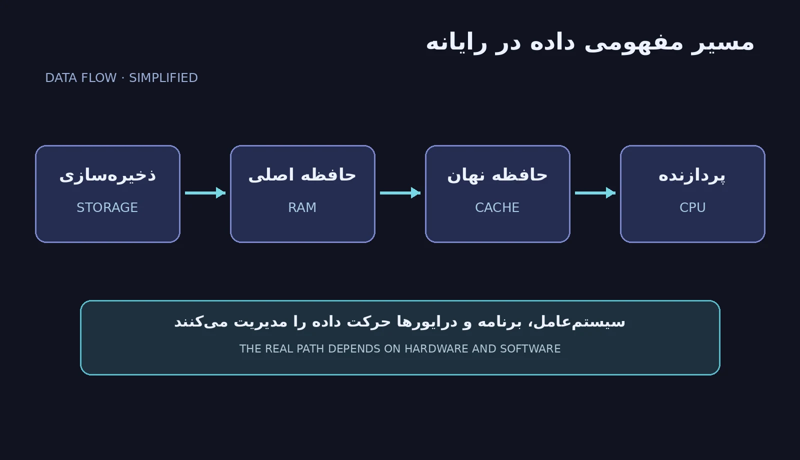

**شکل ۵-۱ — جریان ساده‌شده داده.** پیکان‌ها انتقال مفهومی را نشان می‌دهند. همه معماری‌ها و مسیرهای I/O دقیقاً این ترتیب را طی نمی‌کنند و نمودار نشان‌دهنده طراحی داخلی یک CPU مشخص نیست.

## ۴. ثبات، کش و سلسله‌مراتب حافظه

**ثبات‌ها (Registers)** محل‌های بسیار کوچک و سریع در پردازنده برای نگهداری داده‌های نزدیک به عملیات‌اند. **حافظه نهان (Cache)** کپی‌هایی از داده‌ها یا دستورهای پرکاربرد را نزدیک هسته نگه می‌دارد تا نیاز به مراجعه مکرر به حافظه اصلی کمتر شود. سطوح L1، L2 و گاهی L3 در معماری‌های مختلف اندازه و نحوه اشتراک متفاوت دارند [۲].

وقتی داده در کش مناسب موجود باشد، دسترسی می‌تواند سریع‌تر از مراجعه به حافظه اصلی باشد. در غیر این صورت **Cache Miss** رخ می‌دهد و داده از سطح دیگری جست‌وجو می‌شود. این یک مدل مفهومی است؛ سرعت دقیق به پردازنده، محل داده و بار سیستم بستگی دارد. افزایش کش یا هسته همیشه برنامه را به همان نسبت سریع‌تر نمی‌کند.

| لایه | نقش معمول | ماندگاری پس از خاموشی | محدودیت کلی |
|---|---|---|---|
| ثبات و کش CPU | داده و دستور نزدیک محاسبه | معمولاً خیر | ظرفیت محدود |
| RAM | مجموعه کاری برنامه‌ها | معمولاً خیر | ظرفیت و پهنای باند محدود |
| SSD/HDD | ذخیره فایل و داده پایدار | معمولاً بله | کندتر از RAM در بسیاری از الگوهای دسترسی |

این جدول رتبه‌بندی تقریبی است، نه تضمین تأخیر همه دستگاه‌ها. سامانه‌های چندپردازنده و حافظه‌های تخصصی می‌توانند مسیرهای دیگری داشته باشند.

## ۵. RAM: فضای کاری برنامه‌ها

**حافظه دسترسی تصادفی (Random Access Memory یا RAM)** معمولی سیستم، فضای کاری موقت برای داده‌ها و برنامه‌های در حال اجراست. RAM رایج مبتنی بر DRAM معمولاً با قطع برق محتوا را از دست می‌دهد؛ ذخیره دائمی فایل باید در جای مناسب انجام شود. واژه RAM به‌طور منطقی مفهوم دسترسی را توصیف می‌کند و همه فناوری‌های دارای دسترسی تصادفی لزوماً فرّار نیستند [۳].

اگر داده و برنامه از حافظه فیزیکی بیشتر شوند، سیستم‌عامل بسته به پیکربندی ممکن است از **حافظه مجازی (Virtual Memory)** و فضای swap/pagefile روی ذخیره‌سازی استفاده کند، یا برنامه با خطای کمبود حافظه متوقف شود. Swap می‌تواند کمک کند اما جایگزین هم‌سرعت RAM نیست و تضمین نمی‌کند همه بارها اجرا شوند. داده در RAM نیز ممکن است به دلیل فایل موقت، swap یا تنظیمات دیگر روی دیسک ثبت شود؛ در طراحی حریم خصوصی این موضوع را لحاظ کنید.

**ظرفیت** پاسخ می‌دهد چه مقدار داده هم‌زمان جا می‌شود؛ **پهنای باند (Bandwidth)** میزان داده منتقل‌شده در واحد زمان و **تأخیر (Latency)** مدت انتظار برای یک دسترسی یا عملیات است. ممکن است ظرفیت کافی داشته باشید ولی پردازنده برای انتقال داده منتظر بماند. مقدار اعلام‌شده سازنده اغلب سقف نظری است؛ عملکرد واقعی به کانال حافظه، ترکیب ماژول‌ها و بار کاری وابسته است.

## ۶. ذخیره‌سازی: HDD، SSD، NVMe و M.2

**HDD** از دیسک چرخان و سازوکار مکانیکی استفاده می‌کند؛ **SSD** معمولاً از حافظه فلش و کنترلر بهره می‌برد. SSD معمولاً برای بسیاری از دسترسی‌های تصادفی تأخیر کمتری از HDD دارد، اما عملکرد دقیق، قیمت، دوام و مصرف به مدل و بار وابسته‌اند. هر دو برای نگهداری فایل پس از خاموشی طراحی شده‌اند، ولی خرابی ممکن است؛ نسخه پشتیبان جداگانه ضروری است.

**SATA** یک رابط/استاندارد اتصال و پروتکل ذخیره‌سازی رایج است. **PCIe** یک گذرگاه اتصال پرسرعت برای انواع دستگاه‌هاست. **NVMe** مجموعه استانداردهای دسترسی به ذخیره‌سازی غیرفرّار است؛ NVMe روی PCIe رایج است و نسخه‌های مبتنی بر شبکه نیز وجود دارند [۴]. **M.2** یک قالب فیزیکی/اتصال است، نه مترادف NVMe؛ یک درایو M.2 می‌تواند بسته به دستگاه و پشتیبانی، از مسیرهای متفاوتی استفاده کند. پیش از خرید، سازگاری مشخصات درایو و مادربرد را در اسناد سازنده بررسی کنید.

| گزینه | کاربرد متداول | محدودیت/نکته انتخاب |
|---|---|---|
| HDD | آرشیو ظرفیت‌بالا و پشتیبان | تأخیر مکانیکی؛ آسیب‌پذیری در برابر ضربه؛ پشتیبان جدا لازم است |
| SATA SSD | سیستم‌عامل، فایل و بسیاری از پروژه‌های کوچک | عملکرد وابسته به دستگاه و محدودیت رابط |
| NVMe SSD روی PCIe | بارهای ذخیره‌سازی پرتقاضا و دسترسی موازی | سازگاری، حرارت، ظرفیت، پایداری سرعت و قیمت را بررسی کنید |
| فضای ابری/شبکه‌ای | همکاری، اشتراک یا نسخه بیرونی | هزینه انتقال، حریم خصوصی، دسترس‌پذیری و تأخیر شبکه |

هیچ گزینه‌ای برای همه بارها بهترین نیست. قیمت و مدل‌ها وابسته به بازار و تاریخ‌اند؛ این فصل عدد قیمت یا مدل خریدِ تأییدنشده معرفی نمی‌کند.

## ۷. سیستم‌عامل و حرکت یک فایل

**سیستم‌عامل (Operating System)** منابع دستگاه را میان برنامه‌ها مدیریت می‌کند و خدماتی مانند فایل، فرایند، حافظه، زمان‌بندی و دسترسی به دستگاه را فراهم می‌کند. وقتی برنامه فایلی را می‌خواند، درخواست معمولاً از API سیستم‌عامل و لایه‌های نرم‌افزار/درایور عبور می‌کند. داده ممکن است قبلاً در کش سیستم‌عامل باشد؛ بنابراین هر بار خواندن لزوماً یک مراجعه فیزیکی جدید به SSD نیست.

مسیر رایج و ساده‌شده برای مدل: فایل وزن‌ها در ذخیره‌سازی ← خواندن/بارگذاری و احتمالاً تبدیل در RAM ← دسترسی CPU یا انتقال مناسب به شتاب‌دهنده ← محاسبه ← ذخیره یا نمایش خروجی. در بعضی فناوری‌ها، نگاشت حافظه، حافظه مشترک یا مسیرهای انتقال بهینه این تصویر را تغییر می‌دهند. جزئیات GPU در فصل ۶ و زیرساخت در فصل‌های بعد بررسی می‌شوند.

**نکته امنیتی:** فایل ناشناخته را صرفاً به دلیل اینکه «مدل» نام دارد اجرا یا بارگذاری نکنید؛ فرمت‌ها و روش‌های بارگذاری می‌توانند خطر اجرای کد یا دسترسی ناخواسته داشته باشند. منبع، مجوز و راهنمای امنیتی ابزار را بررسی کنید.

## ۸. ظرفیت، پهنای باند و برآورد مدل

برای مدل دارای `N` پارامتر که هر پارامتر به‌طور ثابت `B` بایت استفاده کند، حجم خام وزن‌ها تقریباً چنین است:

```text
weight_bytes = N × B
```

مثلاً یک مدل با یک میلیارد پارامتر و ذخیره خام FP32، اگر هر وزن ۴ بایت باشد، حدود `4,000,000,000 bytes` یعنی `4 GB` ده‌دهی یا حدود `3.73 GiB` وزن خام دارد. این محاسبه فایل کامل یا حافظه لازم برای اجرا نیست: سربار قالب، بافر، برنامه، حافظه موقت، فعال‌سازی‌ها، KV cache و در آموزش گرادیان‌ها و حالت بهینه‌ساز می‌توانند فضای اضافه بخواهند. روش‌های فشرده‌سازی و offload نیز مدل واقعی محاسبه را تغییر می‌دهند.

برای انتقال ایده‌آل داده، تقریب حداقلی زیر مفید است:

```text
time_seconds ≥ data_bytes / bandwidth_bytes_per_second
```

اگر ۴ GB داده با پهنای باند **واقعی و پایدار فرضی** ۲ GB/s و بدون سربار منتقل شود، کف ساده زمان ۲ ثانیه است؛ سربار، تأخیر، اشتراک منابع و انتقال‌های دیگر می‌توانند زمان را بیشتر کنند. عدد فرضی، مشخصات یک SSD یا تضمین عملکرد نیست. فرمول برای تقریب یک مسیر انتقال است؛ ممکن است پردازش و انتقال هم‌پوشانی داشته باشند.

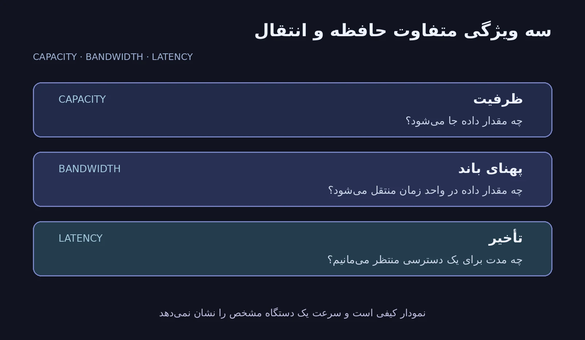

**شکل ۵-۲ — سه پرسش متفاوت درباره حافظه.** نمودار کیفی است و داده عددی یا رتبه عملکرد دستگاه‌ها نشان نمی‌دهد.

## ۹. پروژه عملی: یک فایل عددی بسازید و بخوانید

**هدف:** چهار عدد را در قالب float32 استاندارد داخل یک فایل موقت بنویسیم، تعداد بایت را ببینیم و دوباره بخوانیم. فایل داخل پوشه موقت ساخته و در پایان حذف می‌شود؛ این برنامه هیچ سخت‌افزاری را تغییر نمی‌دهد و **بنچمارک سرعت SSD نیست**.

**پیش‌نیاز:** Python استاندارد؛ نمونه با **Python 3.13.16** اجرا شده است. فایل `storage_demo.py` را با متن زیر بسازید:

```python
"""Tiny temporary binary file: float32 payload, not a hardware benchmark."""
from pathlib import Path
from tempfile import TemporaryDirectory
import struct


def main():
    values = (1.0, 2.5, -3.0, 4.0)
    payload = struct.pack('<4f', *values)
    with TemporaryDirectory() as folder:
        path = Path(folder) / 'sample.bin'
        path.write_bytes(payload)
        raw = path.read_bytes()
        recovered = struct.unpack('<4f', raw)
        print(f'number_of_values={len(values)}')
        print(f'bytes_per_value={struct.calcsize("<f")}')
        print(f'payload_bytes={len(payload)}')
        print(f'file_bytes={path.stat().st_size}')
        print(f'recovered={recovered}')
        assert recovered == values


if __name__ == '__main__':
    main()
```

در همان پوشه `python storage_demo.py` یا `python3 storage_demo.py` را اجرا کنید. خروجی آزمایش‌شده:

```text
number_of_values=4
bytes_per_value=4
payload_bytes=16
file_bytes=16
recovered=(1.0, 2.5, -3.0, 4.0)
```

**خواندن برنامه:** `values` چهار عدد است؛ `struct.pack('<4f', ...)` آن‌ها را با ترتیب بایت little-endian و چهار عدد شناور ۳۲بیتی استاندارد به ۱۶ بایت تبدیل می‌کند. `TemporaryDirectory` پوشه موقتی می‌سازد و پس از خروج آن را پاک می‌کند؛ `write_bytes` و `read_bytes` فایل را می‌نویسند و می‌خوانند. `unpack` بایت‌ها را مطابق همان قالب بازیابی می‌کند و `assert` تطابق این چهار عدد دقیقاً قابل نمایش را کنترل می‌کند [۵].

همه اعداد اعشاری لزوماً در float32 دقیقاً نمایش‌پذیر نیستند؛ برای داده‌های دیگر معمولاً مقایسه با تلورانس مناسب لازم است. حجم ۱۶ بایت اندازه داده/فایل خام این مثال است، نه کل RAM مصرفی برنامه Python، نه مصرف واقعی بلوک‌های فایل‌سیستم و نه حافظه لازم یک مدل.

**عیب‌یابی:** اگر فرمان شناخته نشد، `python3` و نصب Python را بررسی کنید. اگر اجازه ساخت فایل موقت ندارید، مسیر موقت و مجوز سیستم را بررسی کنید. خطای `struct.error` ممکن است از تعداد بایت یا ناسازگاری قالب هنگام خواندن باشد. از فایل‌های حساس برای آزمایش استفاده نکنید.

## ۱۰. انتخاب و عیب‌یابی بدون حدس

**سناریو ۱: برنامه با خطای کمبود حافظه متوقف می‌شود.** مصرف RAM، اندازه مجموعه داده، تعداد فرایندها و حافظه موقت را مشاهده کنید؛ به جای بارگذاری کل داده ممکن است پردازش دسته‌ای یا داده جریانی مناسب باشد. پیش از خرید RAM سازگاری و امکان ارتقا را بررسی کنید. اگر خطا مربوط به حافظه GPU باشد، افزایش RAM سیستم الزاماً آن را رفع نمی‌کند.

**سناریو ۲: بارگذاری فایل‌ها کند است.** داده را با ابزار معتبر روی سیستم واقعی اندازه بگیرید؛ تعداد فایل‌های کوچک، دسترسی شبکه، فضای آزاد، وضعیت SSD و مصرف CPU را بررسی کنید. فایل‌های کش‌شده می‌توانند نتیجه تکرار را تغییر دهند؛ یک بارخوانی، بنچمارک جامع نیست.

**سناریو ۳: استفاده CPU بالاست اما برنامه سریع نمی‌شود.** بررسی کنید آیا پردازش قابل موازی‌سازی است، منابع دیگری مانند حافظه/ذخیره‌سازی گلوگاه‌اند یا برنامه منتظر قفل و ورودی است. قبل از تعویض قطعه یک خط پایه و معیار روشن ثبت کنید.

**سناریو ۴: خاموشی یا دمای بالا.** محیط، خنک‌سازی و مشخصات سازنده را بررسی کنید؛ دستگاه را ناایمن باز نکنید و برای برق‌کشی یا تعمیر از متخصص کمک بگیرید. پشتیبان مستقل و آزمون بازیابی را فراموش نکنید.

## ۱۱. تحولات تا نوامبر ۲۰۲۶

**تاریخ بررسی: ۵ نوامبر ۲۰۲۶.** JEDEC می‌گوید استاندارد DDR5 نخستین‌بار در ژوئیه ۲۰۲۰ منتشر و در نسخه **JESD79-5D** در نوامبر ۲۰۲۵ به‌روزرسانی شده است [۶]. این نسخه استاندارد است، نه تضمین پشتیبانی هر CPU، مادربرد یا ماژول؛ مشخصات همان محصول و تاریخ خرید ملاک‌اند.

کنسرسیوم NVM Express، NVMe را خانواده‌ای از استانداردهای دسترسی به حافظه غیرفرّار معرفی می‌کند و انتقال‌های مختلف را توضیح می‌دهد [۴]. هیچ عدد قیمت، آخرین مدل سخت‌افزار یا سرعت قطعیِ دستگاه در این فصل بدون بررسی محصول مشخص ادعا نمی‌شود. برای انتخاب عملی، ظرفیت، تأخیر، پهنای باند، توان، قیمت، دسترس‌پذیری و پشتیبانی نرم‌افزار را با تاریخ و بازار مشخص مقایسه کنید.

## ۱۲. تمرین، آزمون و پروژه ارزیابی

**آزمون مفهومی:** ۱) تفاوت بیت و بایت چیست؟ ۲) چرا GHz به‌تنهایی معیار کافی سرعت CPU نیست؟ ۳) فرق RAM و SSD در نقش و ماندگاری معمول چیست؟ ۴) کش CPU چه مشکلی را کاهش می‌دهد؟ ۵) تفاوت ظرفیت با پهنای باند چیست؟ ۶) آیا هر M.2 لزوماً NVMe است؟ ۷) آیا افزایش RAM سیستم الزاماً خطای VRAM را رفع می‌کند؟ ۸) چرا سرعت اولین و دومین بار خواندن فایل ممکن است فرق کند؟ ۹) چرا حجم خام وزن‌ها کل حافظه آموزش نیست؟ ۱۰) چرا SSD جایگزین پشتیبان مستقل نیست؟

**تمرین ریاضی:** (الف) ۲ میلیون عدد ۴بایتی چند بایت خام‌اند؟ (ب) ۸ GB داده در مسیر فرضی با سرعت پایدار ۲ GB/s و بدون سربار حداقل چند ثانیه می‌گیرد؟ (ج) ۱ GiB چند بایت است؟

**تمرین کدنویسی:** پروژه را اجرا کنید. برای هشت عدد، قالب را به `<8f` تغییر و هشت مقدار قابل نمایش تعریف کنید؛ پیش‌بینی و سپس اندازه فایل را ثبت کنید. چهار بایت در هر عدد یعنی ۳۲ بایت داده خام. از تغییر فایل‌های موجود یا نوشتن روی دستگاه‌های سیستم خودداری کنید.

**پروژه ارزیابی:** برای یک سامانه آموزشی فرضی که باید فایل وزن ۴ GB را بخواند، یک نقشه شامل CPU، RAM، ذخیره‌سازی و سیستم‌عامل بکشید. سه نیاز را بنویسید: ظرفیت، داده انتقالی و برنامه پشتیبان. دو گزینه ذخیره‌سازی را با کاربرد، محدودیت، سازگاری و هزینه نسبی مقایسه کنید؛ عدد قیمت و سرعت را تنها در صورت داشتن منبع و تاریخ محصول ذکر کنید. توضیح دهید چرا تنها با حجم وزن نمی‌توان حافظه کل را تعیین کرد.

**معیار قبولی:** دست‌کم ۸ پاسخ درست از ۱۰ سؤال، حل درست سه محاسبه، اجرای برنامه یا توضیح دقیق در نبود محیط، و گزارش پروژه با اجزای خواسته‌شده و یک محدودیت. [پاسخ‌نامه جداگانه فصل ۵](book-engineering/answers/05-computer-foundations-answers-fa.md) را پس از حل تمرین‌ها ببینید.

## ۱۳. واژه‌نامه و منابع

**واژه‌نامه:** بیت (Bit)، بایت (Byte)، پردازنده مرکزی (CPU)، هسته (Core)، رشته (Thread)، ثبات (Register)، حافظه نهان (Cache)، حافظه اصلی (RAM)، ذخیره‌سازی (Storage)، حافظه مجازی (Virtual Memory)، تأخیر (Latency)، پهنای باند (Bandwidth)، SSD، HDD، PCIe، NVMe، M.2.

**گام بعد:** فصل ۶ به GPU، NPU، موازی‌سازی، VRAM و گلوگاه محاسبات ماتریسی می‌پردازد. تا آن زمان هیچ پردازنده یا ظرفیت مشخصی را بدون اندازه‌گیری و بررسی سازگاری، راه‌حل جهانی تلقی نکنید.

**منابع؛ تاریخ مراجعه: ۵ نوامبر ۲۰۲۶:**

[۱] Intel، «How a Data Center Actually Works»، تاریخ انتشار صفحه مشخص نشده، [توضیح پردازنده و حافظه](https://www.intel.com/content/www/us/en/data-center/topics/data-center-basics.html).

[۲] Intel، «IA Cores Level 1 and Level 2 Caches»، دیتاشیت نسل دوازدهم Core، تاریخ انتشار صفحه مشخص نشده، [مستندات](https://edc.intel.com/content/www/us/en/design/ipla/software-development-platforms/client/platforms/alder-lake-desktop/12th-generation-intel-core-processors-datasheet-volume-1-of-2/007/ia-cores-level-1-and-level-2-caches/). این مرجع مثال یک معماری است، نه توصیف همه CPUها.

[۳] IBM، «What is AI hardware?»، تاریخ انتشار صفحه مشخص نشده، [بخش حافظه](https://www.ibm.com/think/topics/ai-hardware).

[۴] NVM Express، «About: A Set of Open Standards»، تاریخ انتشار صفحه مشخص نشده، [مستند رسمی](https://nvmexpress.org/about/).

[۵] Python Software Foundation، «struct — Interpret bytes as packed binary data»، مستندات Python 3.13، تاریخ انتشار صفحه مشخص نشده، [مستندات نسخه](https://docs.python.org/3.13/library/struct.html).

[۶] JEDEC، «Main Memory: DDR SDRAM, HBM»، تاریخ انتشار صفحه مشخص نشده؛ اعلام به‌روزرسانی DDR5 در نوامبر ۲۰۲۵، [فهرست استانداردها](https://www.jedec.org/category/technology-focus-area/main-memory-ddr-sdram).

---

# فصل ۶ — GPU و NPU: محاسبات موازی و حافظه مدل

**هنر و علم ساخت هوش | جلد اول | Babak & Ai**
**نسخه کاری RC · تاریخ مراجعه به منابع: ۵ نوامبر ۲۰۲۶**

## ۱. چرا مدل‌ها به شتاب‌دهنده نیاز پیدا می‌کنند؟

در فصل ۵ دیدیم پردازنده و حافظه چگونه با هم کار می‌کنند. حالا تصور کنید باید یک عمل مشابه را روی میلیون‌ها عدد انجام دهیم؛ مثلاً در یک شبکه عصبی چندین ماتریس را ضرب کنیم. انجام این کار با CPU ممکن است، اما بعضی شتاب‌دهنده‌ها برای اجرای هم‌زمان مقدار زیادی محاسبه و انتقال داده طراحی شده‌اند. انتخاب میان CPU و GPU به اندازه مسئله، انتقال داده، حافظه، نرم‌افزار، مصرف انرژی و هزینه وابسته است؛ GPU همیشه سریع‌ترین یا ارزان‌ترین راه نیست.

**پیش‌نیاز:** فصل ۵ و مفهوم وزن و داده از فصل ۳. **هدف:** بتوانید موازی‌سازی داده، CPU/GPU/NPU، VRAM، ظرفیت و پهنای باند، ضرب ماتریسی، گلوگاه و برآورد مقدماتی حافظه را توضیح دهید؛ یک نمونه ضرب ماتریسی را اجرا و صحت آن را کنترل کنید.

**محدوده:** این فصل یک نقشه مفهومی است، نه دستور خرید یا طراحی مدار یک تراشه خاص. CUDA، ROCm، TPU و Apple Silicon به‌طور دقیق‌تر موضوع فصل ۷ هستند.

## ۲. CPU، GPU و NPU چه تفاوتی دارند؟

**CPU** پردازنده عمومی با قابلیت اجرای انواع برنامه‌ها، کنترل سیستم و پردازش شاخه‌دار است. **GPU (Graphics Processing Unit)** پردازنده‌ای است که برای حجم بالای محاسبات موازی مناسب طراحی شده و علاوه بر گرافیک، در یادگیری ماشین و محاسبات علمی کاربرد دارد. **NPU (Neural Processing Unit)** نام عمومی شتاب‌دهنده‌هایی است که برای برخی عملیات شبکه عصبی بهینه می‌شوند؛ معماری و قابلیت‌های NPUهای سازندگان مختلف یکسان نیست.

| ویژگی | CPU | GPU | NPU |
|---|---|---|---|
| نقش معمول | اجرای عمومی، کنترل، آماده‌سازی داده | حجم زیاد کارهای عددی موازی و گرافیک | برخی محاسبات شبکه عصبی با شتاب‌دهنده تخصصی |
| مزیت احتمالی | انعطاف، مناسب وظایف کوچک یا شاخه‌دار | توان موازی و پهنای باند بالا در بار مناسب | بهره‌وری انرژی یا شتاب برای مدل‌های پشتیبانی‌شده |
| محدودیت | ممکن است در بار بسیار موازی کندتر باشد | انتقال، مصرف برق، ظرفیت حافظه و سازگاری | پشتیبانی عملگر، قالب مدل، دقت و ابزار وابسته به محصول |
| جایگزین | GPU/NPU برای بار مناسب | CPU برای مدل کوچک یا زمان توسعه | CPU/GPU در صورت عدم پشتیبانی مدل |

این جدول گرایش‌های کلی است؛ CPU هم برداری و موازی است و GPU هم کنترل و شاخه دارد. مقایسه واقعی باید بر همان مدل، اندازه ورودی، دقت محاسبه، کیفیت خروجی، تأخیر، مصرف و نسخه نرم‌افزار انجام شود.

## ۳. موازی‌سازی داده و هزینه هماهنگی

**موازی‌سازی داده (Data Parallelism)** به‌معنای تقسیم کار مشابه روی داده‌های گوناگون است. برای مثال، اگر بخواهیم تمام عناصر یک بردار را دو برابر کنیم، محاسبه هر عنصر مستقل از عناصر دیگر است. در مقابل، برخی کارها به نتیجه مراحل قبلی وابسته‌اند و صرفاً با افزودن هسته، بی‌نهایت سریع نمی‌شوند.

در دنیای واقعی، بخشی از زمان صرف آماده‌سازی و انتقال داده، راه‌اندازی کار، هماهنگی و جمع‌کردن نتایج می‌شود. اگر ورودی بسیار کوچک باشد، هزینه ثابت ممکن است از منفعت محاسبه موازی بیشتر شود. چند فرایند موازی ممکن است برای حافظه و پهنای باند با یکدیگر رقابت کنند. بنابراین اندازه‌گیری ابتدا تا انتها مهم‌تر از نگاه به سرعت نظری روی کاغذ است.

برای برآورد محدودیت موازی‌سازی، **قانون آمدال (Amdahl's Law)** در یک مدل ساده می‌گوید:

```text
speedup = 1 / ((1 - p) + p / s)
```

`p` سهمی از زمان برنامه اولیه است که می‌تواند با ضریب `s` سریع‌تر شود؛ `1-p` بخش باقی‌مانده است. اگر `p=0.8` و `s=4` باشد، سرعت کل `1 / (0.2 + 0.2) = 2.5` برابر می‌شود، نه ۴ برابر. فرض می‌کنیم سایر هزینه‌ها تغییر نکنند؛ قانون به‌تنهایی سربار ارتباط، رقابت منابع یا تغییر اندازه مسئله را مدل نمی‌کند.

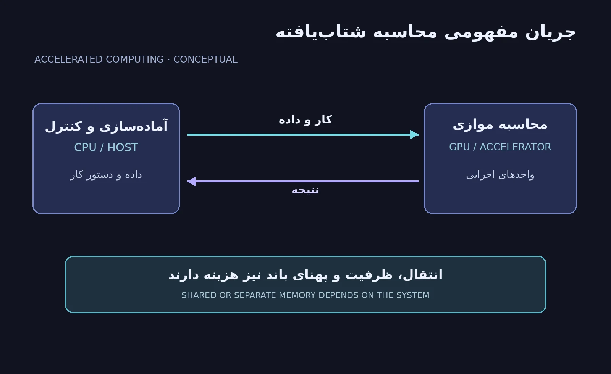

**شکل ۶-۱ — جریان مفهومی محاسبه شتاب‌یافته.** در برخی سیستم‌ها CPU و GPU حافظه فیزیکی مشترک دارند؛ در برخی حافظه دستگاه مجزاست. نمودار، انتقال را مفهومی نشان می‌دهد و ساختار فیزیکی یک دستگاه مشخص نیست.

## ۴. داخل GPU: مدل برنامه‌نویسی و حافظه

در مدل CUDA مربوط به NVIDIA، برنامه‌ای به نام **Kernel** روی تعداد زیادی thread اجرا می‌شود؛ threadها در block و مجموعه blockها در grid سازمان می‌یابند. سخت‌افزار، blockهای قابل اجرا را به **Streaming Multiprocessor یا SM** تخصیص می‌دهد. در راهنمای NVIDIA، threadهای CUDA در گروه‌هایی به نام warp اجرا و زمان‌بندی می‌شوند [۱]. این نام‌ها و جزئیات مختص اکوسیستم NVIDIA هستند؛ AMD و سایر سازندگان نام‌ها و مشخصات خاص خود را دارند.

در همان مدل، **register** به thread، حافظه **shared** به block و حافظه **global** به کار دستگاه مرتبط است. این‌ها فضای نام/دید برنامه‌نویسی‌اند و نحوه پیاده‌سازی و سرعت دقیق به نسل دستگاه بستگی دارد. حافظه shared با **حافظه یکپارچه سیستم (Unified Memory)** یک اصطلاح یکسان نیست. برنامه‌نویس برای داده مشترک و ترتیب عملیات باید قوانین همگام‌سازی را رعایت کند؛ صرف موازی بودن به معنی اجرای ایمن نیست [۱].

برخی GPUها واحدهای تخصصی ضرب ماتریس دارند؛ در NVIDIA نام Tensor Core برای خانواده‌ای از این واحدها استفاده می‌شود. وجود این واحدها تضمین نمی‌کند هر شکل ماتریس، هر نوع داده یا هر کتابخانه از حداکثر توان آن‌ها بهره ببرد. نسخه سخت‌افزار و نرم‌افزار را هنگام آزمایش ثبت کنید.

## ۵. VRAM، حافظه یکپارچه و ظرفیت

**VRAM** معمولاً به حافظه‌ای اشاره می‌کند که برای پردازش گرافیکی/دستگاه در دسترس است. در یک کارت مجزا ممکن است حافظه فیزیکی اختصاصی داشته باشید؛ در برخی سامانه‌های یکپارچه، CPU و شتاب‌دهنده از حافظه فیزیکی مشترک استفاده می‌کنند. یکسان بودن حافظه فیزیکی به معنی حذف همه هزینه‌های دسترسی، محدودیت ظرفیت یا نیاز به رعایت قوانین دستگاه نیست.

برای استنتاج، مصرف واقعی می‌تواند شامل وزن‌ها، بافرها، فعال‌سازی‌ها، داده ورودی، حافظه runtime و در مدل زبانی **KV cache** باشد. برای آموزش، گرادیان‌ها، حالت بهینه‌ساز و فعال‌سازی‌های مورد نیاز پس‌انتشار نیز ممکن است اضافه شوند. دقت محاسبات و روش‌هایی مانند کمّی‌سازی یا checkpointing بر نیاز تغییر ایجاد می‌کنند؛ هیچ عدد ثابتی برای همه مدل‌ها کافی نیست.

**مثال پایه:** دو میلیارد پارامتر با ۲ بایت برای هر وزن، فقط برای وزن خام `4,000,000,000 bytes` یا حدود `3.73 GiB` نیاز دارند. این عدد سقف یا کل حافظه نیست و تضمین نمی‌کند مدل در کارت ۴ GiB اجرا شود. مقداری از حافظه به سیستم، داده و محاسبه اختصاص می‌یابد؛ همچنین فرمت فایل و سربار ممکن است متفاوت باشند.

در PyTorch برای CUDA، `memory_allocated` حافظه اشغال‌شده توسط tensorها و `memory_reserved` حافظه مدیریت‌شده توسط تخصیص‌دهنده کش را گزارش می‌کند. خروجی ابزارهای سیستم ممکن است بیشتر باشد. `empty_cache()` حافظه کشِ بلااستفاده را آزاد می‌کند، اما tensorهای زنده را حذف نمی‌کند [۲].

## ۶. ظرفیت، پهنای باند و گلوگاه

**ظرفیت** یعنی حجم قابل نگهداری؛ **پهنای باند** نرخ انتقال داده؛ **توان محاسبه** سرعت اجرای عملیات تحت شرایط مشخص. اگر داده جا نشود، اجرای مستقیم ممکن است با خطای حافظه متوقف شود؛ اگر جا شود اما داده دیر برسد، واحدهای محاسباتی ممکن است منتظر بمانند. اگر محاسبات نسبت به داده زیاد باشد، محدودیت ممکن است در توان محاسبات باشد.

**شدت محاسباتی (Arithmetic Intensity)** نسبت تعداد عملیات به بایت انتقال‌یافته برای یک سطح حافظه و تعریف مشخص است. برای تقریب ساده و بار مشخص، می‌توان آن را با نسبت توان محاسبه به پهنای باند مقایسه کرد؛ راهنمای NVIDIA تأکید می‌کند این مدل همه جزئیات مانند سلسله‌مراتب کش و سربار اجرا را در نظر نمی‌گیرد [۳]. عدد اعلام‌شده روی جعبه معمولاً سقف نظری است و نتیجه واقعی نیست.

**مثال:** اگر محاسبه‌ای ۸ میلیارد عملیات انجام دهد و ۲ میلیارد بایت از یک سطح حافظه بخواند/بنویسد، شدت آن `4 operation/byte` است؛ این عدد به نحوه شمارش عملیات و بایت، استفاده از کش و پیاده‌سازی وابسته است. برای نتیجه‌گیری درباره گلوگاه باید ظرفیت واقعی و اندازه‌گیری همان بار را نیز داشته باشیم.

## ۷. ضرب ماتریسی: کاری آشنا برای GPU

اگر ماتریس A ابعاد `M×K` و B ابعاد `K×N` داشته باشد، حاصل C ابعاد `M×N` دارد. هر عنصر C از حاصل‌ضرب و جمع یک سطر A و یک ستون B به دست می‌آید:

```text
C[i,j] = Σ A[i,t] × B[t,j]    for t = 0 … K-1
```

`i` شماره سطر خروجی، `j` شماره ستون خروجی و `t` شاخص بعد مشترک است. برای A برابر `[[1,2],[3,4]]` و B برابر `[[5,6],[7,8]]`، عنصر بالا-چپ `1×5 + 2×7 = 19` و خروجی کل `[[19,22],[43,50]]` است.

محاسبه عناصر خروجی و بخش‌های مختلف ضرب می‌تواند به واحدهای متعدد تقسیم شود، ولی دسترسی به داده، اندازه tile، تخصیص و جمع نتایج مهم است. تقریب متداول `2×M×N×K` عملیات شناور را می‌شمارد، با فرض شمارش ضرب و جمع جدا؛ تعداد دقیق به الگوریتم و قرارداد شمارش بستگی دارد [۳]. فصل‌های جبر خطی و PyTorch این عملیات را عمیق‌تر آموزش می‌دهند.

## ۸. پروژه اجرایی: ضرب ماتریسی روی CPU

این پروژه وابستگی خارجی ندارد و نشان می‌دهد نتیجه قبل از بهینه‌سازی باید درست باشد. **فایل:** `matrix_cpu.py`؛ **محیط آزمایش:** Python 3.13.16، CPU؛ نه GPU و نه بنچمارک سرعت.

```python
"""Small CPU-only matrix multiplication; educational, not a benchmark."""

def matmul(a, b):
    if not a or not b or not a[0] or not b[0]:
        raise ValueError('matrices must not be empty')
    k = len(a[0])
    n = len(b[0])
    if any(len(row) != k for row in a) or any(len(row) != n for row in b):
        raise ValueError('matrices must be rectangular')
    if k != len(b):
        raise ValueError('inner dimensions must match')
    return [[sum(a[i][t] * b[t][j] for t in range(k))
             for j in range(n)] for i in range(len(a))]


def main():
    a = [[1, 2], [3, 4]]
    b = [[5, 6], [7, 8]]
    result = matmul(a, b)
    print('A x B =', result)
    assert result == [[19, 22], [43, 50]]
    print('correctness=PASS')
    print('fp32_payload_2x2_matrices_bytes=', 3 * 2 * 2 * 4)


if __name__ == '__main__':
    main()
```

دستور اجرا در همان پوشه: `python matrix_cpu.py` یا `python3 matrix_cpu.py`. خروجی ثبت‌شده:

```text
A x B = [[19, 22], [43, 50]]
correctness=PASS
fp32_payload_2x2_matrices_bytes= 48
```

تابع `matmul` شکل ماتریس‌ها را بررسی می‌کند؛ سپس برای هر خانه خروجی ضرب‌های متناظر را جمع می‌کند. `assert` نتیجه شناخته‌شده را می‌سنجد. عدد ۴۸ یک **برآورد فرضی** برای سه آرایه متراکم ۲×۲ با داده FP32 است؛ فهرست‌ها و عددهای واقعی Python در این برنامه FP32 متراکم نیستند و RAM بیشتری با سربار اشیا مصرف می‌کنند.

**عیب‌یابی:** ورودی خالی یا سطرهای با طول متفاوت `ValueError` می‌دهند؛ ابعاد داخلی باید برابر باشند. اگر فرمان Python در دسترس نبود، نصب یا `python3` را بررسی کنید. نتیجه صحیح این مثال تضمین سرعت یا صحت محاسبه با دقت پایین برای همه داده‌ها نیست.

## ۹. مسیر حرفه‌ای: PyTorch روی دستگاه مناسب

نمونه زیر با PyTorch در صورت موجود بودن backend `cuda` کار را به آن دستگاه می‌فرستد و در غیر این صورت روی CPU اجرا می‌کند. در بعضی نسخه‌های PyTorch ساخته‌شده برای ROCm، نام دستگاه نرم‌افزاری نیز `cuda` است؛ این نام به‌تنهایی سازنده سخت‌افزار را مشخص نمی‌کند [۴]. این مثال **در محیط نگارش اجرا نشده است**؛ PyTorch نصب نبود و GPU مناسب تأیید نشد. نسخه، درایور و backend را هنگام اجرا ثبت کنید.

```python
import torch

device = torch.device('cuda' if torch.cuda.is_available() else 'cpu')
a = torch.tensor([[1., 2.], [3., 4.]], device=device)
b = torch.tensor([[5., 6.], [7., 8.]], device=device)
c = a @ b
expected = torch.tensor([[19., 22.], [43., 50.]], device=device)
assert torch.allclose(c, expected)
print('torch_version=', torch.__version__, 'device=', device)
print(c.cpu())
```

نصب باید از راهنمای رسمی PyTorch و متناسب با OS، CPU/GPU و نسخه درایور انجام شود [۵]. اگر backend `cuda` در دسترس نباشد، اجرای CPU نشانه خراب بودن برنامه نیست. این کد از شتاب‌دهنده‌های دیگر مانند Apple MPS خودکار استفاده نمی‌کند. برای اندازه‌گیری زمان CUDA، گرم‌کردن و همگام‌سازی مناسب و ثبت هزینه انتقال اهمیت دارد؛ این نمونه تنها درستی را کنترل می‌کند.

## ۱۰. خطاهای رایج و انتخاب مسئولانه

- **Out of memory:** اندازه batch، طول توالی، نوع داده، حافظه tensorهای زنده و سایر برنامه‌ها را بررسی کنید. کاهش batch یا offload ممکن است کمک کند اما زمان و رفتار را تغییر می‌دهد. برآورد خام وزن تنها نقطه شروع است.
- **GPU دیده نمی‌شود:** سخت‌افزار، پشتیبانی سیستم‌عامل، نسخه درایور و ساخت کتابخانه را طبق مستندات بررسی کنید. از اجرای فرمان‌های ناشناس یا نصب درایور نامطمئن خودداری کنید.
- **GPU از CPU کندتر است:** مسئله کوچک، انتقال، راه‌اندازی، شکل نامناسب داده یا پیاده‌سازی می‌تواند علت باشد؛ ابتدا کل خط لوله و صحت خروجی را بسنجید.
- **مقایسه نادرست:** توان نظری با دقت‌های مختلف، مدل‌ها و توان برق متفاوت را مستقیم مقایسه نکنید. ثبت داده، بار، warm-up، نسخه، تعداد تکرار و معیار کیفیت لازم است.
- **ایمنی و هزینه:** توان مصرفی، گرما، منبع تغذیه، خنک‌سازی، پشتیبانی، قیمت و مجوز نرم‌افزار را در انتخاب بررسی کنید. کاربر می‌تواند با CPU شروع کند و تنها پس از اندازه‌گیری به GPU یا اجاره ابری نیاز داشته باشد.

## ۱۱. تحولات تا نوامبر ۲۰۲۶

**تاریخ بررسی: ۵ نوامبر ۲۰۲۶.** راهنمای برنامه‌نویسی CUDA درباره سازمان threadها و حافظه دستگاه توضیح می‌دهد [۱]؛ راهنمای عملکرد ضرب ماتریس NVIDIA نیز نشان می‌دهد تعادل محاسبه و انتقال به اندازه و پیاده‌سازی وابسته است [۳]. این اسناد درباره اکوسیستم NVIDIA هستند و نباید ویژگی‌های آن‌ها را بدون بررسی به همه GPUها تعمیم داد.

پشتیبانی نرم‌افزاری، قالب داده و مدل‌های شتاب‌دهنده به‌سرعت تغییر می‌کنند. در این فصل «بهترین GPU سال» یا قیمت تأییدنشده معرفی نمی‌کنیم. تاریخ و نسخه کتابخانه، درایور، دستگاه و بار واقعی هنگام هر خرید یا اجرای پروژه باید جداگانه ثبت شود.

## ۱۲. تمرین، آزمون و پروژه ارزیابی

**آزمون مفهومی:** ۱) یک تفاوت گرایش CPU و GPU چیست؟ ۲) آیا GPU همیشه سریع‌تر است؟ ۳) NPU چه محدودیت نرم‌افزاری ممکن است داشته باشد؟ ۴) فرق ظرفیت و پهنای باند چیست؟ ۵) چه اجزایی علاوه بر وزن حافظه می‌خواهند؟ ۶) shared memory در CUDA و حافظه یکپارچه سیستم یکی هستند؟ ۷) چرا عدد نظری TFLOPS نتیجه واقعی نیست؟ ۸) آیا `empty_cache` tensor زنده را آزاد می‌کند؟ ۹) دو عامل زمان انتقال چیست؟ ۱۰) چرا نتیجه نمونه CPU بنچمارک GPU نیست؟

**تمرین ریاضی:** ۱) برای `p=0.5` و `s=2` سرعت کلی را طبق مدل آمدال حساب کنید. ۲) حافظه خام ۵۰۰ میلیون وزن ۴بایتی چقدر است؟ ۳) ابعاد حاصل ضرب `3×2` در `2×4` را بنویسید.

**تمرین برنامه‌نویسی:** یک ماتریس جدید با ابعاد سازگار بسازید و یک خانه خروجی را دستی کنترل کنید. سپس یک ماتریس با ابعاد ناسازگار بدهید و بررسی کنید `ValueError` رخ می‌دهد. اگر PyTorch و دستگاه سازگار دارید، مثال بخش ۹ را اجرا و نسخه و دستگاه را ثبت کنید، بدون ادعای سرعت تا زمان طراحی بنچمارک.

**مینی‌پروژه:** برای یک مدل فرضی، وزن خام، ظرفیت دستگاه، بافر فرضی، ورودی و محدودیت‌ها را در یک جدول ثبت و دو راه‌حل CPU/GPU را با معیار زمان، انرژی، هزینه و کیفیت پیشنهاد کنید. مقادیر مجهول را صریحاً مجهول بگذارید؛ برای تصمیم واقعی داده واقعی لازم است.

**معیار عبور:** دست‌کم ۸ جواب درست از ۱۰ پرسش، حل صحیح سه تمرین ریاضی، اجرای CPU یا تشریح دقیق آن در نبود محیط، و گزارش مینی‌پروژه شامل یک گلوگاه احتمالی و عدم قطعیت‌ها. [پاسخ‌نامه جداگانه فصل ۶](book-engineering/answers/06-gpu-parallelism-answers-fa.md) را بعد از حل تمرین‌ها ببینید.

## ۱۳. واژه‌نامه و منابع

**واژه‌نامه:** GPU، NPU، محاسبات موازی (Parallel Computing)، Kernel، Thread، Block، VRAM، پهنای باند (Bandwidth)، شدت محاسباتی (Arithmetic Intensity)، گلوگاه (Bottleneck)، ضرب ماتریسی (Matrix Multiplication)، تخصیص‌دهنده کش (Caching Allocator).

**گام بعد:** فصل ۷ اکوسیستم‌های CUDA، ROCm، TPU و Apple Silicon را با تفاوت معماری، ابزار و سازگاری بررسی می‌کند.

**منابع؛ تاریخ مراجعه: ۵ نوامبر ۲۰۲۶:**

[۱] NVIDIA، «Writing SIMT Kernels»، CUDA Programming Guide، تاریخ انتشار صفحه مشخص نشده، [مستندات](https://docs.nvidia.com/cuda/cuda-programming-guide/02-basics/writing-cuda-kernels.html).

[۲] PyTorch Contributors، «CUDA semantics: Memory management»، مستندات PyTorch 2.13، تاریخ انتشار صفحه مشخص نشده، [مستندات نسخه](https://docs.pytorch.org/docs/2.13/notes/cuda.html).

[۳] NVIDIA، «Matrix Multiplication Background User's Guide»، ۲۰۲۳، [راهنما](https://docs.nvidia.com/deeplearning/performance/dl-performance-matrix-multiplication/index.html).

[۴] PyTorch Contributors، «HIP semantics»، تاریخ انتشار صفحه مشخص نشده، [مستندات](https://docs.pytorch.org/docs/stable/notes/hip.html).

[۵] PyTorch Contributors، «Start Locally»، تاریخ انتشار صفحه مشخص نشده، [راهنمای نصب رسمی](https://pytorch.org/get-started/locally/).

---

# فصل ۷ — اکوسیستم‌های محاسبات هوش مصنوعی: CUDA، ROCm، TPU و Apple Silicon

**هنر و علم ساخت هوش | جلد اول | Babak & Ai**
**نسخه کاری RC · تاریخ مراجعه به منابع: ۵ نوامبر ۲۰۲۶**

## ۱. سخت‌افزار بدون نرم‌افزار کافی نیست

فرض کنید یک GPU جدید خریده‌اید، اما کتابخانه یادگیری ماشین دستگاه را نمی‌بیند. آیا حتماً کارت خراب است؟ نه؛ ممکن است سیستم‌عامل، درایور، نسخه کتابخانه یا معماری دستگاه با یکدیگر سازگار نباشند. برای اجرای یک مدل، افزون بر تراشه، زنجیره‌ای از سیستم‌عامل، درایور، runtime، کتابخانه و برنامه لازم است.

**پیش‌نیاز:** فصل‌های ۵ و ۶. **هدف:** پس از مطالعه می‌توانید تفاوت CUDA، ROCm، TPU و Apple Silicon را توضیح دهید؛ برای یک دستگاه جدول سازگاری بسازید؛ تفاوت درایور و Toolkit را تشخیص دهید؛ یک برنامه تشخیص محیط اجرا کنید؛ و هزینه و محدودیت‌های انتخاب سخت‌افزار را بدون ادعای سرعت اثبات‌نشده مقایسه کنید.

**اصل راهنما:** نام یک سازنده به‌تنهایی پشتیبانی تمام مدل‌ها، تمام سیستم‌عامل‌ها و همه عملگرهای یک مدل را تضمین نمی‌کند. پیش از نصب، مشخصات محصول و مستندات همان نسخه را بررسی کنید. هزینه‌ها وابسته به کشور، تاریخ، موجودی و مصرف‌اند؛ این فصل قیمت عددی تأییدنشده ارائه نمی‌دهد.

## ۲. زنجیره نرم‌افزار تا تراشه

یک مدل ممکن است از یک چارچوب مانند PyTorch استفاده کند. چارچوب از backend و کتابخانه‌های عددی مناسب برای تبدیل عملیات به کار قابل اجرا روی دستگاه کمک می‌گیرد. درایور ارتباط سطح پایین با دستگاه و سیستم‌عامل را فراهم می‌کند؛ runtime و کتابخانه‌ها نیز اجرای برنامه و عملیات را پشتیبانی می‌کنند. **Compiler** یا کامپایلر در برخی مسیرها کد یا گراف را برای هدف مناسب تولید یا بهینه می‌کند. بسته‌بندی دقیق این لایه‌ها به پلتفرم و نسخه وابسته است.

```text
برنامه و مدل → چارچوب یادگیری ماشین → backend / کتابخانه / runtime
             → درایور و سیستم‌عامل → شتاب‌دهنده سازگار
```

این ترتیب یک نقشه آموزشی است، نه ساختار دقیق تمام سیستم‌ها. بعضی کتابخانه‌ها با چارچوب توزیع می‌شوند؛ بعضی ابزارها جداگانه نصب می‌شوند. داشتن یک **درایور** الزاماً به معنی نصب کامل ابزار توسعه یا فعال بودن backend در چارچوب نیست.

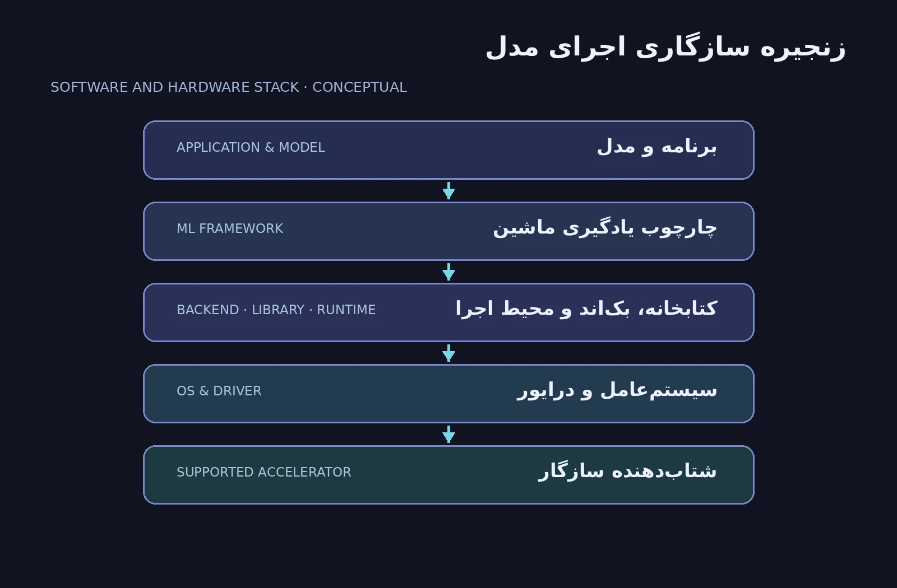

**شکل ۷-۱ — زنجیره سازگاری.** اتصال پیکان‌ها یک وابستگی مفهومی است؛ محل دقیق runtime، درایور و کامپایلر در پلتفرم‌های مختلف تفاوت دارد.

## ۳. CUDA و GPUهای NVIDIA

**CUDA** پلتفرم و مدل برنامه‌نویسی NVIDIA برای محاسبات شتاب‌یافته با GPUهای سازگار آن است. ابزارها و کتابخانه‌ها می‌توانند ساخت و اجرای عملیات عددی را ساده کنند؛ مدل Kernel/Thread/Block در فصل ۶ معرفی شد. CUDA را نباید نام عمومی همه GPUها دانست.

**Driver**، **CUDA Toolkit** و **CUDA runtime/library** مفاهیم متمایزند: درایور ارتباط با GPU را فراهم می‌کند؛ Toolkit شامل ابزار توسعه مانند کامپایلر و کتابخانه‌هاست؛ و یک بسته چارچوب ممکن است برخی runtimeهای موردنیاز را همراه داشته باشد. نصب محلی Toolkit کامل برای هر کاربرد PyTorch الزامی نیست؛ برای ساخت کد CUDA سفارشی یا پروژه‌هایی با نیاز مشخص می‌تواند لازم باشد. راهنمای بسته و نیازمندی واقعی پروژه ملاک است [۱، ۲].

**روند ایمن نصب:** مدل GPU و OS را ثبت کنید؛ راهنمای نصب NVIDIA و ماتریس سازگاری چارچوب را بخوانید؛ درایور سازگار را از منبع رسمی نصب کنید؛ مطابق دستور رسمی چارچوب، بسته مناسب را در محیط مجازی نصب کنید؛ سپس یک عملیات کوچک، نسخه و دستگاه را بررسی کنید. بدون نیاز مشخص، از اجرای فرمان نصب نامتناسب یا تغییر سراسری درایور خودداری کنید. قبل از هر تغییر مهم نسخه پشتیبان و امکان بازگشت را بررسی کنید.

برای مثال، مستندات CUDA Toolkit **13.4** برای Linux می‌گویند بسته Toolkit و درایور مستقل نسخه‌گذاری و نصب می‌شوند [۱]. این نکته مختص نسخه و روش نصب مستند است؛ نمی‌توان آن را بی‌قید به نسخه‌های قدیمی یا هر سیستم تعمیم داد. مقدار `CUDA Version` در `nvidia-smi` لزوماً نسخه Toolkit نصب‌شده یا نسخه کتابخانه‌های هر محیط Python نیست.

## ۴. ROCm و اکوسیستم AMD

**ROCm (Radeon Open Compute)** مجموعه‌ای از ابزارها، runtime و کتابخانه‌های محاسباتی AMD است. پشتیبانی به خانواده GPU، سیستم‌عامل، نسخه درایور، چارچوب و نوع کار وابسته است. **HIP** رابط برنامه‌نویسی برای محاسبات GPU در این اکوسیستم است؛ انتقال یک برنامه CUDA به HIP یا استفاده از بسته‌های آماده همیشه بدون تغییر و بدون محدودیت نیست [۳].

در برخی ساخت‌های PyTorch برای ROCm، رابط `torch.cuda` و نام دستگاه `cuda` نیز استفاده می‌شوند؛ این به معنی استفاده از GPU NVIDIA نیست. برای تشخیص ساخت، `torch.version.hip` را همراه با مستندات بررسی کنید [۴]. تشخیص یک دستگاه به‌تنهایی پشتیبانی تمام عملگرهای مدل یا عملکرد مطلوب را ثابت نمی‌کند.

**نمونه مستند، نه نسخه همگانی:** صفحه AMD برای Radeon/Ryzen، ROCm **7.2.1** را برای خانواده‌هایی از GPU/APUها و مسیرهای مشخص Linux و Windows معرفی می‌کند [۳]. پشتیبانی جزئیات و تفاوت‌های زیادی دارد؛ برای GPU خاص باید ماتریس همان محصول و OS را دید. نام یک محصول در فهرست معرفی، به معنی پشتیبانی همه تنظیمات یا همه چارچوب‌ها نیست.

**روند نصب:** ابتدا جدول رسمی AMD را برای مدل دقیق، OS، درایور و نسخه چارچوب بخوانید؛ مسیر بسته‌بندی همان جدول را در محیط مجزا دنبال کنید؛ دستگاه و عملیات کوچک را آزمایش کنید. در صورت نبود پشتیبانی می‌توانید از CPU، دستگاه سازگار دیگر یا سرویس ابری استفاده کنید؛ انتخاب به هزینه، حریم خصوصی و بار کاری بستگی دارد.

## ۵. TPU و ابزارهای Google Cloud

**TPU (Tensor Processing Unit)** شتاب‌دهنده اختصاصی طراحی‌شده توسط Google برای بارهای یادگیری ماشین، به‌ویژه عملیات ماتریسی است. در معماری مستند Google، واحدهای ضرب ماتریسی (**MXU**) و آرایه‌های systolic در نسل‌های مشخص وجود دارند؛ پیکربندی و ظرفیت به نسل دستگاه وابسته است [۵]. اصطلاح TensorCore در مستند TPU نباید بدون توضیح با نام‌های مشابه در GPUهای سازندگان دیگر یکسان فرض شود.

یک مسیر معمول Cloud TPU از **JAX** و کامپایلر **XLA** استفاده می‌کند؛ مسیرهای دیگری مانند PyTorch/XLA نیز در مستندات وجود دارند. XLA به تولید و بهینه‌سازی محاسبات برای دستگاه هدف کمک می‌کند. در عمل زمان کامپایل، شکل ورودی‌ها، انتقال داده، مدیریت دستگاه و سازگاری عملیات بر عملکرد و هزینه اثر دارند. سرعت یک TPU نسبت به GPU بدون تعیین مدل، اندازه بار، دقت، هزینه و روش آزمون قابل قضاوت نیست [۵، ۶].

استفاده ابری می‌تواند نیاز به خرید اولیه را کم کند اما هزینه اجاره دستگاه، زمان اجرا، ذخیره‌سازی، شبکه و داده را ایجاد می‌کند. منطقه، سهمیه، موجودی، مجوز داده و توقف درست منابع اهمیت دارند. هیچ حساب ابری یا منبع پولی در این فصل ایجاد نشده است.

## ۶. Apple Silicon، Metal، MPS و MLX

**Apple Silicon** به خانواده تراشه‌های Apple اشاره می‌کند که بسته به محصول CPU، GPU و شتاب‌دهنده‌های دیگری مانند Neural Engine دارند. در معماری حافظه یکپارچه، CPU و GPU می‌توانند به حافظه فیزیکی مشترک دسترسی داشته باشند، اما ظرفیت و پهنای باند همچنان محدودند و نرم‌افزار باید سازگاری و همگام‌سازی را رعایت کند [۷].

**Metal** چارچوب محاسبه و گرافیک Apple است. در PyTorch، backend با نام **MPS** برای اجرای عملیات پشتیبانی‌شده روی GPU از فناوری Metal استفاده می‌کند؛ `is_built()` تنها نشان‌دهنده وجود پشتیبانی در ساخت است، در حالی که `is_available()` در دسترس بودن در محیط فعلی را بررسی می‌کند [۸]. این backend را نباید به معنی اجرای خودکار روی Neural Engine دانست.

**MLX** چارچوبی برای محاسبات و یادگیری ماشین روی Apple Silicon است و از طراحی حافظه یکپارچه بهره می‌برد [۷]. **Core ML** مسیری برای تبدیل و اجرای مدل روی دستگاه‌های Apple است که تخصیص عملیات به CPU، GPU یا Neural Engine به پشتیبانی مدل و سیستم وابسته است [۹]. مقایسه واقعی باید همان مدل، دقت، کیفیت و دستگاه را بسنجد؛ RAM مشترک به معنی ظرفیت نامحدود برای مدل نیست.

## ۷. مقایسه و تصمیم بر اساس نیاز

| مسیر | نمونه استفاده | محدودیت/سازگاری | هزینه و جایگزین |
|---|---|---|---|
| CPU | یادگیری، مدل کوچک، خط پایه | زمان اجرا و RAM به بار وابسته است | خرید اضافی ممکن است لازم نباشد؛ در بار سنگین‌تر GPU/ابر |
| NVIDIA + CUDA | کتابخانه‌ها و بارهای پشتیبانی‌شده GPU | GPU، درایور، runtime و نسخه چارچوب سازگار | هزینه GPU، برق و خنک‌سازی؛ CPU یا اجاره ابری |
| AMD + ROCm | GPU/APU و چارچوب‌های پشتیبانی‌شده | فهرست مدل، OS و بسته محدود به نسخه | هزینه سخت‌افزار و نگهداری؛ CPU یا مسیر سازگار دیگر |
| Cloud TPU | بار ماتریسی سازگار و زیرساخت ابری | کامپایل، شکل، سهمیه و پشتیبانی عملیات | اجاره و شبکه/ذخیره‌سازی؛ GPU ابری یا CPU |
| Apple Silicon | اجرای محلی پشتیبانی‌شده با Metal/MPS/MLX | نسخه macOS، عملگر و حافظه مشترک | هزینه دستگاه و محدودیت ارتقا؛ CPU یا GPU/ابر خارجی |

برای تصمیم، ابتدا مدل، دقت و معیار کیفیت را ثابت کنید؛ سپس latency، throughput، حافظه، انرژی، هزینه کل و سهولت نگهداری را روی گزینه‌های واقعاً موجود بسنجید. قیمت‌ها را با تاریخ، کشور، واحد پول، مالیات و منبع ثبت کنید. اگر حفاظت داده اهمیت دارد، محل ذخیره و انتقال به ابر را نیز ارزیابی کنید.

**هزینه تقریبی یک اجاره، مدل ساده:** اگر فقط نرخ شتاب‌دهنده ساعتی `r` و زمان رزرو `h` را داشته باشیم، جزء اصلی `r × h` است. هزینه کل ممکن است ذخیره‌سازی، شبکه، مالیات، حداقل زمان صورتحساب و زمان آماده‌سازی را هم شامل شود. این فرمول قیمت ارائه‌دهنده یا سقف واقعی هزینه را تضمین نمی‌کند.

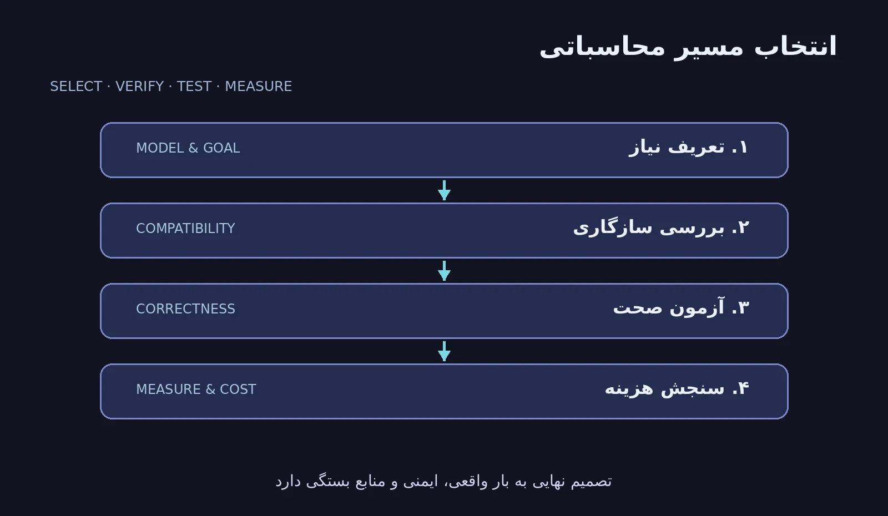

**شکل ۷-۲ — فرایند انتخاب.** نتیجه یک آزمون کوچک فقط شروع ارزیابی است؛ برای تصمیم نهایی، بار واقعی و محدودیت‌های ایمنی و عملیاتی لازم‌اند.

## ۸. پروژه عملی: تشخیص محیط بدون تغییر سیستم

این برنامه فقط نسخه Python و دسترسی backendهای PyTorch را بررسی می‌کند و در صورت موجود بودن PyTorch یک محاسبه کوچک روی دستگاه انتخابی اجرا می‌کند. چیزی نصب نمی‌کند و **TPU را تشخیص نمی‌دهد**. ترتیب انتخاب: CUDA/HIP، سپس MPS، سپس CPU. اگر PyTorch نصب نباشد، برنامه پیام روشن می‌دهد و تلاش محاسبه نمی‌کند.

**فایل:** `device_probe.py`. **آزمایش واقعی این فصل:** Python 3.13.16، بدون نصب PyTorch و بدون تأیید وجود GPU یا TPU. شاخه‌های دارای چارچوب یا دستگاه واقعی در این محیط اجرا نشده‌اند؛ بعد از نصب نسخه سازگار باید جداگانه روی دستگاه هدف آزمایش شوند.

```python
"""Read-only educational PyTorch device probe. TPU is not checked."""
import sys


def detect(torch):
    if torch is None:
        return 'unavailable', 'PyTorch is not installed'
    if torch.cuda.is_available():
        hip = getattr(torch.version, 'hip', None)
        return 'cuda', ('ROCm/HIP build' if hip else 'CUDA build')
    mps = getattr(torch.backends, 'mps', None)
    if mps is not None and mps.is_available():
        return 'mps', 'Apple Metal GPU backend'
    return 'cpu', 'No supported GPU backend detected'


def main():
    try:
        import torch
    except ImportError:
        torch = None
    device, explanation = detect(torch)
    print('python=', sys.version.split()[0])
    print('torch=', getattr(torch, '__version__', 'not installed'))
    print('device=', device)
    print('reason=', explanation)
    print('tpu=not checked')
    if torch is not None:
        x = torch.tensor([1.0, 2.0, 3.0], device=device)
        y = x * 2
        assert y.cpu().tolist() == [2.0, 4.0, 6.0]
        print('result=', y.cpu().tolist())


if __name__ == '__main__':
    main()
```

دستور اجرا: `python device_probe.py` یا `python3 device_probe.py`. خروجی ثبت‌شده در محیط نگارش:

```text
python= 3.13.16
torch= not installed
device= unavailable
reason= PyTorch is not installed
tpu=not checked
```

`detect` ابتدا وجود کتابخانه، سپس `torch.cuda.is_available()` و backend `mps` را بررسی می‌کند. در ساخت HIP، نام خروجی دستگاه همچنان `cuda` است اما توضیح `ROCm/HIP build` چاپ می‌شود. اگر PyTorch باشد، `x * 2` و انتقال نتیجه به CPU یک آزمون کوچک صحت است. این تست پشتیبانی همه مدل‌ها، دستگاه‌های چندگانه، TPU یا عملکرد را تأیید نمی‌کند.

**عیب‌یابی:** اگر import کتابخانه خطا داد، محیط مجازی فعال و نصب سازگار را بررسی کنید. اگر نام دستگاه `cpu` است، ممکن است بسته CPU-only نصب شده، درایور ناسازگار باشد یا دستگاه مناسب وجود نداشته باشد؛ فقط با این پیام علت قطعی معلوم نمی‌شود. اگر import به علت خطایی غیر از نبود بسته شکست خورد، متن خطا و مستندات را بررسی کنید. کد سیستم را تعمیر یا درایور را نصب نمی‌کند.

## ۹. تمرین حرفه‌ای: ثبت سازگاری و نتیجه

برای هر آزمایش یک جدول بسازید: تاریخ، سیستم‌عامل و نسخه، مدل دقیق دستگاه، نسخه درایور، نسخه Python، نسخه چارچوب، نوع ساخت CUDA/HIP/MPS/XLA، مدل، نوع داده، حافظه، ورودی، معیار صحت و زمان. اگر مقدار را نمی‌دانید «نامشخص» بنویسید. اطلاعات شخصی یا شناسه‌های دستگاه را پیش از اشتراک‌گذاری حذف کنید.

**آزمون صحیح:** پس از انتخاب بسته مناسب، یک عملیات کوچک و خروجی مرجع را کنترل کنید. بعد، مدل واقعی را با ورودی ثابت، تعداد تکرار کافی و شرایط مشابه بسنجید. GPUها اغلب غیرهمگام اجرا می‌کنند؛ برای سنجش دقیق به دستور همگام‌سازی backend و گرم‌کردن مناسب نیاز دارید. خطای کیفیت ناشی از تفاوت دقت را نیز گزارش کنید. نتایج اولیه را با هزینه کامل مقایسه کنید، نه فقط با زمان kernel.

**مسیر TPU:** مطابق راهنمای رسمی سرویس، پس از بررسی هزینه، سهمیه و امنیت، محیط TPU و چارچوب/XLA را آماده کنید و دستگاه را با ابزار رسمی همان نسخه تأیید کنید [۶]. برنامه `device_probe.py` برای این مسیر طراحی نشده و هیچ نتیجه‌ای درباره TPU نمی‌دهد. در پایان منابع ابری را طبق راهنما متوقف و صورتحساب را بررسی کنید.

## ۱۰. خطاها و تصمیم‌های پرهزینه

۱. **نصب کورکورانه:** فرمان مناسب یک GPU، نسخه سیستم یا انتشار قدیمی ممکن است سیستم دیگر را خراب یا ناسازگار کند. راهنمای رسمی همان نسخه را انتخاب کنید.
۲. **یکسان فرض کردن CUDA و همه GPUها:** CUDA پلتفرم NVIDIA است؛ ROCm/HIP و Metal اکوسیستم‌های جدا هستند. نام `cuda` در بعضی APIهای HIP یک لایه سازگاری نرم‌افزاری است، نه شناسایی سازنده.
۳. **`is_built` برابر `is_available`:** کتابخانه ممکن است با یک backend ساخته شده باشد اما دستگاه یا محیط لازم در دسترس نباشد [۸].
۴. **اشتباه گرفتن نصب با پشتیبانی مدل:** بعد از شناسایی دستگاه، عملگر، نوع داده و نتیجه مدل واقعی را بیازمایید.
۵. **هزینه پنهان:** سخت‌افزار محلی به برق، خنک‌سازی و نگهداری نیاز دارد؛ ابر ممکن است هزینه زمان، ذخیره، شبکه و مالیات داشته باشد. عدم استفاده از دستگاه اجاره‌ای الزاماً به معنی توقف صورتحساب نیست.
۶. **یکسان دانستن بهره‌وری و معیار نظری:** TOPS/TFLOPS بدون نوع داده، توان مصرفی و بار واقعی برای مقایسه کافی نیست. نتیجه نهایی به کیفیت و کار انجام‌شده در زمان و هزینه مشخص وابسته است.

## ۱۱. تحولات تا نوامبر ۲۰۲۶

**تاریخ بررسی منابع: ۵ نوامبر ۲۰۲۶.** NVIDIA در یادداشت انتشار CUDA Toolkit **13.4** منتشرشده در اکتبر ۲۰۲۶، اجزای بسته و تغییر جداسازی درایور و Toolkit را مستند کرده است [۱]. پیش از اعمال این اطلاعات باید OS، سخت‌افزار و نسخه بسته خود را در همان راهنما کنترل کنید.

AMD در مستند Radeon/Ryzen، پشتیبانی نسخه **ROCm 7.2.1** را برای پیکربندی‌های مشخص معرفی می‌کند [۳]؛ این نقل یک مسیر مستند است، نه ادعای آخرین نسخه برای همه محصولات. مستندات Google در اکتبر ۲۰۲۶ درباره معماری نسل‌های متفاوت TPU و MXUهای آن‌ها توضیح می‌دهند [۵]. ویدیوی رسمی Apple درباره MLX برای Apple Silicon در ۲۰۲۵ منتشر شده است [۷]. این مرور فهرست کامل تمام نسخه‌ها یا محصولات موجود تا تاریخ مرجع نیست.

## ۱۲. تمرین، آزمون و پروژه

**آزمون مفهومی:** ۱) تفاوت درایور و Toolkit چیست؟ ۲) آیا برای هر اجرای PyTorch نصب Toolkit کامل لازم است؟ ۳) نام `cuda` در ساخت ROCm به‌تنهایی چه چیزی را ثابت نمی‌کند؟ ۴) تفاوت `is_built` و `is_available` چیست؟ ۵) آیا MPS به معنی استفاده خودکار از Neural Engine است؟ ۶) XLA چه نقشی در مسیر TPU دارد؟ ۷) چرا هزینه ابر تنها نرخ ساعتی نیست؟ ۸) چرا ظرفیت حافظه مشترک نامحدود نیست؟ ۹) چرا شناسایی GPU پشتیبانی همه عملگرها را ثابت نمی‌کند؟ ۱۰) برنامه این فصل آیا TPU را تشخیص می‌دهد؟

**تمرین ریاضی:** اگر نرخ فرضی دستگاه `r=2` واحد پول در ساعت و زمان رزرو `h=3` ساعت باشد، هزینه ساده دستگاه را حساب کنید. سپس با فرض ۱ واحد هزینه ذخیره و ۲ واحد هزینه شبکه، جمع سه جزء را حساب کنید. مالیات و شرایط صورتحساب را در این مثال در نظر نگیرید.

**تمرین برنامه‌نویسی:** `device_probe.py` را اجرا کنید؛ خروجی واقعی و نسخه‌ها را ثبت کنید. اگر PyTorch وجود ندارد، توضیح دهید چرا پیام «نصب نشده» به معنی نبود سخت‌افزار نیست. اگر دستگاه در دسترس است، نتیجه `x * 2` را با خروجی CPU مقایسه کنید. از انتشار اطلاعات حساس محیط خود خودداری کنید.

**پروژه ارزیابی:** برای دو پلتفرم واقعی یا فرضی، جدول سازگاری با OS، دستگاه، چارچوب، نوع داده، حافظه، هزینه و منبع تهیه کنید. برای موارد اثبات‌نشده «تأیید نشده» بنویسید. مسیر نصب، تست صحت، معیار عملکرد و نقشه بازگشت را مشخص کنید. در صورت مقایسه سرویس ابری، هزینه کل و توقف منابع را لحاظ کنید.

**معیار قبولی:** حداقل ۸ پاسخ درست از ۱۰ سؤال، حل صحیح مسئله هزینه، اجرای برنامه یا توضیح شاخه نبود بسته و ثبت حداقل پنج قلم سازگاری همراه با منابع. [پاسخ‌نامه جداگانه فصل ۷](book-engineering/answers/07-compute-ecosystems-answers-fa.md) را پس از حل تمرین‌ها ببینید.

## ۱۳. واژه‌نامه و منابع

**واژه‌نامه:** درایور (Driver)، محیط اجرا (Runtime)، ابزار توسعه (Toolkit)، کامپایلر (Compiler)، backend، CUDA، ROCm، HIP، TPU، XLA، Metal، MPS، MLX، حافظه یکپارچه (Unified Memory).

**گام بعد:** فصل ۸ PCIe، چند GPU، شبکه، محاسبات توزیع‌شده، مصرف برق و خنک‌سازی را به این نقشه اضافه می‌کند.

**منابع؛ تاریخ مراجعه: ۵ نوامبر ۲۰۲۶:**

[۱] NVIDIA، «CUDA Toolkit Release Notes»، نسخه 13.4، ۱۲ اکتبر ۲۰۲۶، [یادداشت انتشار](https://docs.nvidia.com/cuda/archive/13.4.1/cuda-toolkit-release-notes/index.html)؛ [راهنمای نصب Linux](https://docs.nvidia.com/cuda/archive/13.4.1/cuda-installation-guide-linux/index.html).

[۲] PyTorch Contributors، «Start Locally»، تاریخ انتشار مشخص نشده، [راهنمای رسمی نصب](https://pytorch.org/get-started/locally/).

[۳] AMD، «Use ROCm on Radeon and Ryzen»، مستندات ROCm 7.2.1، تاریخ انتشار صفحه مشخص نشده، [راهنما و ماتریس سازگاری](https://rocm.docs.amd.com/projects/radeon-ryzen/en/docs-7.2.1/index.html).

[۴] PyTorch Contributors، «HIP semantics»، تاریخ انتشار صفحه مشخص نشده، [مستندات](https://docs.pytorch.org/docs/stable/notes/hip.html).

[۵] Google Cloud، «TPU architecture»، به‌روزرسانی اکتبر ۲۰۲۶، [مستندات](https://docs.cloud.google.com/tpu/docs/system-architecture-tpu-vm).

[۶] Google Cloud، «Introduction to Cloud TPU»، به‌روزرسانی اوت ۲۰۲۶، [مستندات](https://docs.cloud.google.com/tpu/docs/intro-to-tpu).

[۷] Apple Developer، «Get started with MLX for Apple silicon»، WWDC25، ژوئن ۲۰۲۵، [ویدیو و متن](https://developer.apple.com/videos/play/wwdc2025/315/).

[۸] PyTorch Contributors، «MPS backend»، مستندات PyTorch 2.13، تاریخ انتشار صفحه مشخص نشده، [مستندات](https://docs.pytorch.org/docs/2.13/notes/mps.html).

[۹] Apple Developer، «Explore machine learning on Apple platforms»، WWDC24، ۲۰۲۴، [ویدیو و متن](https://developer.apple.com/videos/play/wwdc2024/10223/).

---

# فصل ۸ — چند GPU، شبکه، انرژی و محاسبات توزیع‌شده

**هنر و علم ساخت هوش | جلد اول | Babak & Ai**
**نسخه ۱.۰ · بررسی منابع: ۵ نوامبر ۲۰۲۶**

## ۱. چرا یک دستگاه کافی نیست؟

اگر مدل یا مجموعه داده بزرگ باشد، یک GPU ممکن است حافظه کافی نداشته باشد یا آموزش آن بیش از حد طول بکشد. استفاده از چند دستگاه می‌تواند ظرفیت یا توان محاسبه را افزایش دهد، اما ارتباط، هزینه برق، خطا و پیچیدگی را نیز بیشتر می‌کند. دو GPU لزوماً دو برابر سریع‌تر نیستند و ظرفیت حافظه آن‌ها بدون روش نرم‌افزاری مناسب خودکار به یک حافظه بزرگ تبدیل نمی‌شود.

**پیش‌نیاز:** فصل‌های ۵ تا ۷. **هدف:** تفاوت PCIe، اتصال بین GPU و شبکه بین سرورها؛ مفاهیم موازی‌سازی داده و مدل؛ میانگین گرادیان؛ محاسبه انرژی؛ و طراحی مقدماتی یک آزمایش امن. پروژه با CPU و Python استاندارد اجرا می‌شود و شبیه‌سازی است، نه آموزش واقعی چند GPU.

## ۲. PCIe، مسیر داده و توپولوژی

**PCI Express یا PCIe** گذرگاه اتصال دستگاه‌هایی مانند GPU، SSD و کارت شبکه به سیستم است. پهنای لینک با نسل و تعداد مسیر یا **lane** مانند `x4` و `x16` مشخص می‌شود. محل فیزیکی اسلات، تعداد مسیر واقعاً فعال، اشتراک مسیرها و سازگاری مادربرد و پردازنده بر وضعیت واقعی اثر دارند. مسیر اتصال GPUها به CPU، سوئیچ و حافظه را **توپولوژی (Topology)** می‌نامیم.

PCI-SIG در انتشار استاندارد PCIe 6.0 در ۲۰۲۲ نرخ ۶۴ GT/s و حداکثر ۲۵۶ GB/s **دوطرفه مجموع** برای x16 را گزارش می‌کند [۱]. این عدد نظری استاندارد است، نه سرعت یک دستگاه واقعی، و نباید آن را با پهنای باند یک‌طرفه یا مقدار کاربردی قابل دستیابی یکسان گرفت. واحد GT/s نرخ انتقال سیگنال است و تبدیل آن به GB/s بدون لحاظ کدگذاری و سربار خطاست.

اتصال اختصاصی بین GPUها، مانند NVLink در برخی محصولات NVIDIA، می‌تواند بسته به محصول مسیر ارتباطی دیگری فراهم کند؛ وجود آن را برای همه کارت‌ها فرض نکنید. ارتباط بین سرورها ممکن است از Ethernet یا InfiniBand و تجهیزات سازگار استفاده کند. پهنای باند، تأخیر، تعداد دستگاه‌ها و پشتیبانی نرم‌افزار را برای توپولوژی مشخص اندازه بگیرید [۲].

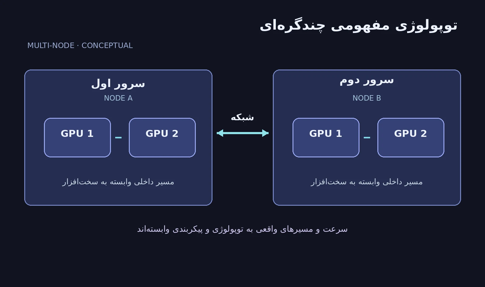

**شکل ۸-۱ — توپولوژی مفهومی چندگره‌ای.** پیکان‌ها مسیر ارتباط ممکن را نشان می‌دهند، نه اتصال مستقیم یا پهنای باند تضمین‌شده هر دستگاه.

## ۳. موازی‌سازی داده و میانگین گرادیان

در **Data Parallelism**، معمولاً نسخه‌ای از مدل روی هر کارگر (Worker) نگهداری می‌شود و هر کارگر بخشی از داده را پردازش می‌کند. سپس گرادیان‌ها برای به‌روزرسانی سازگار ترکیب و همگام می‌شوند. PyTorch DDP گرادیان‌ها را میان نسخه‌های مدل همگام می‌کند، اما خود DDP الزاماً ورودی را تقسیم نمی‌کند؛ برنامه‌نویس باید نمونه‌ها را با ابزار مناسبی مانند sampler تقسیم کند [۳].

مثال ساده با دو batch هم‌اندازه: گرادیان کارگر اول `0.2` و دوم `0.4` است. میانگین `0.3` است. اگر وزن فعلی `1` و نرخ یادگیری `0.1` باشد، به‌روزرسانی گرادیان‌کاهشی `1 − 0.1×0.3 = 0.97` می‌شود. در batchهای با اندازه متفاوت، میانگین ساده همه نمونه‌ها لزوماً برابر میانگینِ بدون وزن میانگین‌های کارگران نیست؛ وزن‌دهی و شیوه کاهش کتابخانه را بررسی کنید.

**AllReduce** یک ارتباط جمعی برای کاهش مقادیر و تحویل نتیجه به شرکت‌کنندگان است؛ جمع یا نوع دیگری از عملیات کاهش ممکن است به کار رود. میانگین ممکن است علاوه بر کاهش، تقسیم بر تعداد مشارکت‌کنندگان بخواهد. NCCL کتابخانه‌ای برای ارتباط GPUهای NVIDIA در توپولوژی‌های پشتیبانی‌شده است، نه یک چارچوب کامل آموزش [۲].

## ۴. موازی‌سازی مدل و حافظه

در **Model Parallelism** اجزای یک مدل بین دستگاه‌ها تقسیم می‌شوند. نمونه‌ها شامل تقسیم لایه‌ها در **Pipeline Parallelism** و تقسیم برخی tensorها یا عملیات در **Tensor Parallelism** هستند. روش‌های sharding می‌توانند پارامتر، گرادیان یا حالت بهینه‌ساز را در دستگاه‌ها توزیع کنند؛ اما هنگام محاسبه ممکن است به گردآوری موقت داده و حافظه اضافه نیاز باشد [۴].

**مقایسه:** تکرار مدل در Data Parallelism معمولاً مدل کامل را در هر دستگاه لازم دارد و به‌خودی‌خود ظرفیت حافظه قابل استفاده برای یک کپی را جمع نمی‌کند. Sharding یا Model Parallelism ممکن است اجرای مدلی بزرگ‌تر را امکان‌پذیر کند، ولی هزینه ارتباط و حافظه موقت دارد. انتخاب به معماری مدل، کتابخانه، اندازه batch، توپولوژی و نوع آموزش بستگی دارد.

در همه روش‌ها، تست صحت روی یک نمونه کوچک، مقایسه با خط پایه تک‌دستگاهی، ثبت seed و آزمون بازیابی پس از شکست اهمیت دارد. تفاوت ترتیب عملیات شناور ممکن است تفاوت عددی کوچکی ایجاد کند و باید با تلورانس مناسب سنجیده شود.

## ۵. سرعت واقعی، گلوگاه و قابلیت اطمینان

**مقیاس‌پذیری (Scaling):** اگر زمان تک‌دستگاه `T1` و زمان چنددستگاه `Tp` باشد، شتاب `T1/Tp` است. با چهار GPU و زمان ۴۰ ثانیه در برابر ۱۰۰ ثانیه روی یک GPU، شتاب `2.5×` و بهره‌وری نسبت به ایده‌آل خطی `2.5/4 = 62.5%` است. این مثال فرضی است و تغییر batch، کیفیت مدل، زمان انتقال یا هزینه را لحاظ نمی‌کند.

کندی می‌تواند از داده‌رسانی، ارتباط شبکه، ناهمگنی GPUها، انتظار برای کندترین worker، ابعاد نامناسب یا سربار همگام‌سازی ناشی شود. مدل آمدال در فصل ۶ دید اولیه می‌دهد ولی مدل کامل ارتباط و هم‌پوشانی نیست. برای مقایسه، کار انجام‌شده، batch مؤثر، کیفیت خروجی، زمان راه‌اندازی و شرایط محیط باید ثابت یا صریحاً گزارش شوند.

**Checkpoint** وضعیت لازم برای ادامه کار را ثبت می‌کند؛ بسته به پروژه ممکن است وزن، حالت optimizer، scheduler، گام و وضعیت تصادفی لازم باشند. بازیابی را واقعاً آزمایش کنید. اطلاعات حساس را رمزگذاری و سطح دسترسی را محدود کنید و برای خرابی ذخیره‌سازی نسخه پشتیبان داشته باشید.

## ۶. برق، انرژی و خنک‌سازی

توان **W** نرخ مصرف انرژی و انرژی **kWh** مقدار مصرف در بازه زمانی است. اگر توان واقعی ثابت فرض شود:

```text
energy_kWh = power_W / 1000 × hours
```

یک سیستم با توان واقعی فرضی ۶۰۰ وات در ۵ ساعت، `3 kWh` مصرف می‌کند؛ با نرخ فرضی `0.25` واحد پول برای هر kWh هزینه انرژی IT برابر `0.75` واحد پول است. توان GPU به‌تنهایی برابر توان کل سیستم نیست؛ توان از پریز، منبع تغذیه و بار واقعی باید اندازه‌گیری شود. تعرفه واقعی و مالیات را از منبع محلی همان تاریخ بگیرید.

**PUE** نسبت انرژی کل مرکز داده به انرژی تجهیزات IT در یک دوره اندازه‌گیری است [۵]. برای مثال، اگر انرژی IT برابر ۱۰ kWh و PUE دوره‌ای ۱٫۲ باشد، برآورد انرژی کل مرکز ۱۲ kWh است. PUE بهره‌وری همه محاسبات، اثر کربن یا مصرف آب را به‌تنهایی نشان نمی‌دهد؛ آن را بی‌دلیل به یک رایانه خانگی تعمیم ندهید.

خنک‌سازی باید در محدوده سازنده، با جریان هوا، دمای ورودی و ایمنی الکتریکی مناسب طراحی شود. توان نامی قطعه با مصرف پایدار یا ظرفیت مطمئن مدار یکی نیست. برای نصب رک، برق‌کشی یا سرمایش حرفه‌ای از متخصص واجد صلاحیت کمک بگیرید؛ این کتاب مجوز دستکاری خطرناک تجهیزات نیست.

## ۷. پروژه: شبیه‌سازی همگام‌سازی و هزینه انرژی

این برنامه روی یک CPU و به‌صورت **ترتیبی** میانگین دو عدد را محاسبه می‌کند؛ شبکه، GPU، NCCL یا آموزش توزیع‌شده واقعی را اجرا نمی‌کند. با Python 3.13.16 آزمایش شده و بسته اضافی لازم ندارد. فایل `simulate.py`:

```python
"""Sequential simulation of gradient averaging; not a distributed implementation."""

def step(weight, gradients, learning_rate):
    if not gradients:
        raise ValueError('at least one gradient required')
    mean_gradient = sum(gradients) / len(gradients)
    return mean_gradient, weight - learning_rate * mean_gradient


def energy_kwh(power_watts, hours):
    if power_watts < 0 or hours < 0:
        raise ValueError('power and duration must be non-negative')
    return power_watts / 1000 * hours


def main():
    mean, updated = step(1.0, [0.2, 0.4], 0.1)
    energy = energy_kwh(600, 5)
    print(f'mean_gradient={mean:.2f}')
    print(f'updated_weight={updated:.2f}')
    print(f'energy_kwh={energy:.2f}')
    assert abs(mean - 0.3) < 1e-9
    assert abs(updated - 0.97) < 1e-9
    assert abs(energy - 3.0) < 1e-9
    print('checks=PASS')


if __name__ == '__main__':
    main()
```

اجرا: `python simulate.py` یا `python3 simulate.py`. خروجی ثبت‌شده:

```text
mean_gradient=0.30
updated_weight=0.97
energy_kwh=3.00
checks=PASS
```

تابع `step` میانگین دو گرادیان فرضی را محاسبه و وزن را به‌روز می‌کند. `energy_kwh` توان فرضی و زمان را به انرژی تبدیل می‌کند. ورودی خالی یا منفی نامعتبر، خطای `ValueError` ایجاد می‌کند. داده واقعی سنجش نشده؛ برای جلوگیری از نتیجه‌گیری غلط، مقدارهای فرضی را با مقادیر اندازه‌گیری‌شده جدا نگه دارید.

**عیب‌یابی:** اگر Python شناخته نشد `python3` و نصب را بررسی کنید. اگر `ValueError` می‌بینید، فهرست گرادیان و علامت توان/زمان را بررسی کنید. در محاسبات اعشاری از تلورانس استفاده شده است.

## ۸. مسیر حرفه‌ای و ایمنی

برای اجرای واقعی، مدل و نسخه PyTorch را مشخص کنید، از مستندات DistributedDataParallel و sampler متناسب استفاده کنید، فرآیندهای worker و گروه ارتباط را با راهنمای رسمی راه‌اندازی و ابتدا روی یک مسئله کوچک صحت را با نسخه تک‌دستگاهی مقایسه کنید [۳]. این فصل کد DDP عملیِ آزموده‌شده بر چند GPU ارائه نمی‌کند؛ چنین اجرا، سخت‌افزار، شبکه و نسخه سازگار می‌خواهد و در فصل‌های پیشرفته توسعه خواهد یافت.

در محیط ابری، افزون بر هزینه GPU، زمان تخصیص، ذخیره checkpoint، انتقال داده و صورتحساب شبکه را بررسی کنید. وضعیت سلامت دستگاه، خطاهای ارتباط و استفاده حافظه را پایش کنید. اگر داده خصوصی است، پیش از انتقال، سیاست دسترسی و محل نگهداری آن را بررسی کنید.

## ۹. تحولات تا نوامبر ۲۰۲۶

**تاریخ مراجعه: ۵ نوامبر ۲۰۲۶.** راهنمای NCCL ارتباط‌های جمعی را روی توپولوژی‌های پشتیبانی‌شده توضیح می‌دهد [۲] و مستندات PyTorch تفکیک داده توسط کاربر در DDP را مشخص می‌کنند [۳]. PCIe 6.0 در ۲۰۲۲ منتشر شده [۱]؛ انتشار استاندارد اثبات وجود آن در هر سیستم یا تحقق سرعت نظری نیست. انتخاب محصول و هزینه باید در تاریخ خرید با منابع رسمی و بازار مربوط بررسی شود.

## ۱۰. تمرین، آزمون و جمع‌بندی

**آزمون:** ۱) چرا دو GPU خودکار دو برابر سریع نیستند؟ ۲) DDP چه چیزی را همگام می‌کند؟ ۳) چه کسی تقسیم داده ورودی را انجام می‌دهد؟ ۴) AllReduce و میانگین چه تفاوتی دارند؟ ۵) چرا مدل تکرارشده از حافظه هر GPU سهم می‌گیرد؟ ۶) تفاوت توان و انرژی چیست؟ ۷) PUE چه چیزی را نشان نمی‌دهد؟ ۸) چرا بازیابی checkpoint باید تست شود؟

**تمرین ریاضی:** سه گرادیان `0.1، 0.2، 0.3` میانگین `0.2` دارند؛ وزن ۱ با نرخ ۰٫۵ به `0.9` می‌رسد. سیستم ۸۰۰ وات برای ۲٫۵ ساعت، با فرض توان ثابت، `2 kWh` انرژی مصرف می‌کند. برای ۴ GPU با شتاب ۳، بهره‌وری `75%` است.

**پروژه ارزیابی:** یک طرح فرضی دو سرور با دو GPU در هر سرور بکشید؛ مسیر ارتباط، نوع موازی‌سازی، سنجه سرعت، بودجه برق، روش checkpoint و یک شکست احتمالی را مشخص کنید. داده و قیمت نامعلوم را «نامشخص» بگذارید. **معیار قبولی:** حداقل ۷ پاسخ صحیح از ۸، سه محاسبه درست، اجرای شبیه‌ساز یا شرح دقیق آن و ارائه طرح با یک محدودیت.

پاسخ کوتاه: ۱) ارتباط و بخش غیرموازی؛ ۲) گرادیان‌ها؛ ۳) برنامه یا sampler؛ ۴) کاهش و سپس احتمالاً تقسیم؛ ۵) هر کپی فضای خود را می‌خواهد؛ ۶) نرخ در برابر مقدار تجمعی؛ ۷) کیفیت محاسبه یا کل اثر کربن؛ ۸) ذخیره موفق تضمین بازیابی نیست. فصل ۹ وارد منطق برنامه‌نویسی، ترمینال و نخستین برنامه Python می‌شود.

**منابع؛ مراجعه ۵ نوامبر ۲۰۲۶:** [۱] PCI-SIG، «PCIe 6.0 Specification Released»، ۲۰۲۲، [منبع](https://pcisig.com/blog/pcie%C2%AE-60-specification-released-members-double-bandwidth-next-generation-applications). [۲] NVIDIA، «Overview of NCCL»، تاریخ انتشار صفحه نامشخص، [مستندات](https://docs.nvidia.com/deeplearning/nccl/user-guide/docs/overview.html). [۳] PyTorch Contributors، «DistributedDataParallel»، تاریخ انتشار نامشخص، [مستندات](https://docs.pytorch.org/docs/main/generated/torch.nn.parallel.DistributedDataParallel.html). [۴] PyTorch Contributors، «FullyShardedDataParallel»، تاریخ انتشار نامشخص، [مستندات](https://docs.pytorch.org/docs/main/distributed/fsdp.html). [۵] US Department of Energy، «Best Practices Guide for Energy-Efficient Data Center Design»، ژوئیه ۲۰۲۴، [PDF](https://www.energy.gov/sites/default/files/2024-07/best-practice-guide-data-center-design_0.pdf).

---

# فصل ۹ — نخستین گام برنامه‌نویسی و Python

**هنر و علم ساخت هوش | جلد اول | Babak & Ai**
**نسخه ۱.۰ · بررسی منابع: ۵ نوامبر ۲۰۲۶**

## ۱. برنامه‌نویسی چیست و از کجا شروع کنیم؟

فرض کنید به کسی می‌خواهید چای درست کردن را آموزش دهید. «چای درست کن» یک هدف است؛ اما توضیح ترتیب آماده‌کردن آب و دم‌کردن چای، مجموعه‌ای از گام‌هاست. برنامه‌نویسی هنر و مهندسی بیان گام‌هایی است که رایانه بتواند طبق قواعد مشخص اجرا کند. رایانه ابهام ما را مثل یک انسان حدس نمی‌زند: دستور، داده و شرایط باید روشن باشند.

**پیش‌نیاز:** هیچ تجربه کدنویسی لازم نیست. این فصل واژه‌ها و اجرای نخستین فایل را از ابتدا آموزش می‌دهد؛ فصل ۱۰ متغیر، ورودی، شرط و حلقه را مفصل بررسی می‌کند. **هدف:** یک الگوریتم کوچک بنویسید، فایل بسازید، ترمینال را باز کنید، نسخه Python را ببینید، برنامه خود را اجرا و یک خطای ساده را رفع کنید.

## ۲. الگوریتم: دستور دقیق برای حل مسئله

**الگوریتم (Algorithm)** روشی با گام‌های روشن برای انجام یک کار یا حل مسئله است. مثال: «دو عدد را بگیر؛ آن‌ها را جمع کن؛ نتیجه را نمایش بده.» ورودی، پردازش و خروجی را می‌توان جدا کرد. یک الگوریتم مفید باید برای شرایط مورد نظر مشخص باشد و در عمل، نیازهای پایان، منابع و خطا را نیز روشن کند.

مثلاً ورودی `2` و `3`، عملیات جمع و خروجی `5` است. اگر ورودی متن باشد یا وجود نداشته باشد چه می‌شود؟ مشخص‌کردن چنین شرایطی بخشی از طراحی است. این گام‌ها هنوز به زبان خاصی وابسته نیستند.

**شبه‌کد (Pseudocode)** توصیف خوانای گام‌ها بدون الزام به قواعد دقیق یک زبان است. نمونه:

```text
شروع
  عدد اول و عدد دوم را دریافت کن
  حاصل جمع را حساب کن
  نتیجه را نشان بده
پایان
```

این متن به‌تنهایی برنامه Python قابل اجرا نیست. تبدیل آن به کد مستلزم رعایت دستور زبان و معنی آن زبان است.

## ۳. فلوچارت و جریان اجرا

**فلوچارت (Flowchart)** نموداری برای نمایش جریان مراحل است. معمولاً بیضی شروع/پایان، مستطیل عملیات و لوزی تصمیم را نشان می‌دهد؛ پیکان‌ها جهت حرکت را مشخص می‌کنند. نمادها به درک کمک می‌کنند اما خودشان نتیجه را تضمین نمی‌کنند.

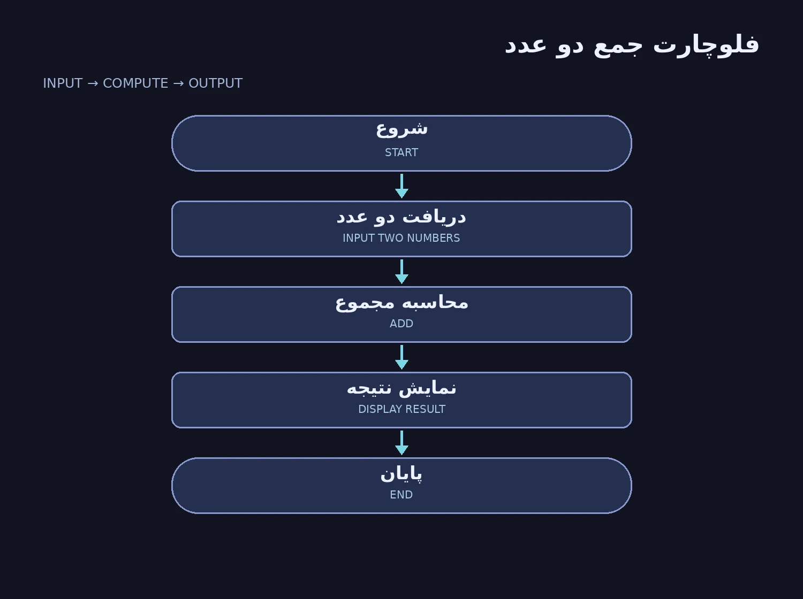

**شکل ۹-۱ — جریان جمع دو عدد.** این یک نمودار آموزشی است و هنوز حالت ورودی نامعتبر را در نظر نمی‌گیرد. در فصل ۱۰، شرط و مدیریت اولیه خطا را اضافه می‌کنیم.

**آزمایش دستی (Dry Run):** مقادیر نمونه را روی کاغذ از نمودار عبور دهید: ورودی‌ها `2` و `3`، نتیجه `5`. با `−1` و `4` هم امتحان کنید؛ نتیجه `3` است. آزمایش دستی موارد انتخابی را بررسی می‌کند، نه تمام ورودی‌های ممکن را.

## ۴. فایل، پوشه و مسیر

**فایل (File)** مجموعه‌ای نام‌دار از داده است؛ برنامه Python معمولاً در فایل با پسوند `.py` ذخیره می‌شود. **پوشه (Directory/Folder)** فایل‌ها و پوشه‌های دیگر را سازمان‌دهی می‌کند. **مسیر (Path)** نشانی فایل است. مسیر نسبی نسبت به پوشه فعلی و مسیر مطلق از یک نقطه مشخص سیستم آغاز می‌شود.

مثلاً پوشه‌ای به نام `ai-start` و در آن فایل `hello.py` بسازید. برای اطمینان از اینکه نام واقعاً `hello.py` است و نه `hello.py.txt`، نمایش پسوندها را در ویرایشگر یا فایل‌منیجر بررسی کنید. فایل را در یک ویرایشگر متن ذخیره کنید، نه با نرم‌افزاری که قالب‌بندی مخفی اضافه می‌کند. UTF-8 برای متن فارسی مناسب است.

**ایمنی:** کد ناشناس را پیش از بررسی اجرا نکنید؛ به‌ویژه فرمان‌هایی که فایل حذف می‌کنند یا سطح دسترسی مدیر می‌خواهند. این فصل هیچ فرمان حذف یا نصب اجباری مدیر اجرا نمی‌کند.

## ۵. ترمینال و مسیر جاری

**ترمینال (Terminal)** محیطی برای تعامل متنی با پوسته یا shell است. **پوشه جاری (Working Directory)** محل پیش‌فرضی است که فرمان‌های نسبی از آنجا تفسیر می‌شوند. فرمان‌های زیر اطلاعاتی یا جابه‌جایی هستند؛ دستورات نمونه را در جای مناسب خود اجرا کنید:

| کار | Linux/macOS در پوسته رایج | Windows PowerShell |
|---|---|---|
| نمایش پوشه جاری | `pwd` | `Get-Location` |
| نمایش محتوا | `ls` | `Get-ChildItem` |
| رفتن به پوشه | `cd ai-start` | `cd ai-start` |
| برگشت به پوشه والد | `cd ..` | `cd ..` |

اگر مسیر فاصله دارد، آن را داخل نقل‌قول بگذارید. `cd ai-start` زمانی کار می‌کند که آن پوشه در محل جاری باشد؛ جایگزین، وارد کردن مسیر درست پوشه شماست. ترمینال با محیط تعاملی Python یکی نیست: علامت `>>>` معمولاً نشان‌دهنده مفسر تعاملی Python است، نه دستور معمول shell [۱].

## ۶. نصب و بررسی Python

**Python** یک زبان برنامه‌نویسی عمومی است. **مفسر (Interpreter)** کد Python را طبق قواعد زبان اجرا می‌کند. برای پروژه‌های این کتاب نسخه و محیط اجرا ثبت می‌شوند؛ نمونه‌های این فصل با **Python 3.13.16** آزمایش شده‌اند. این عدد نسخه آزمایش است، نه ادعای جدیدترین نسخه موجود.

در ترمینال `python --version` یا `python3 --version` را بزنید. در Windows ممکن است `py --version` نیز کار کند. اگر نسخه نمایش داده نشد، Python را از [منبع رسمی Python](https://www.python.org/downloads/) یا روش معتبر سیستم‌عامل با توجه به معماری دستگاه نصب کنید [۲]. برای Windows گزینه‌های نصب و PATH به نسخه نصب‌کننده بستگی دارند؛ راهنمای رسمی همان نسخه را بخوانید. در macOS/Linux معمولاً `python3` استفاده می‌شود؛ نصب‌کننده ناشناس یا فرمان اینترنتی بدون بررسی اجرا نکنید.

**Python تعاملی:** در ترمینال `python3` یا فرمان مناسب را بزنید. پس از `>>>` عبارت `2 + 3` را وارد کنید؛ نتیجه `5` است. با `exit()` از مفسر خارج شوید. خود `>>>` را تایپ نکنید. این مرحله با ذخیره یک برنامه قابل استفاده مجدد تفاوت دارد [۱].

## ۷. نخستین برنامه قابل اجرا

پوشه `ai-start` را بسازید و فایل `hello.py` را با این متن ذخیره کنید:

```python
# My first Python program.
print('Hello, AI engineer!')
print('2 + 3 =', 2 + 3)
```

سپس در ترمینالی که پوشه جاری آن `ai-start` است، `python hello.py` یا `python3 hello.py` را اجرا کنید. در Windows می‌توانید `py hello.py` را نیز در صورت نصب launcher به کار ببرید. خروجی آزمایش‌شده:

```text
Hello, AI engineer!
2 + 3 = 5
```

`#` ابتدای توضیح یا **Comment** است و این خط در اجرای برنامه به‌عنوان دستور محاسباتی اجرا نمی‌شود. `print` خروجی را نمایش می‌دهد؛ متن داخل نقل‌قول یک **رشته (String)** است. در خط دوم، `2 + 3` جمع عددی است. پرانتزها و نقل‌قول‌ها بخشی از دستور زبان هستند و باید درست بسته شوند.

**ساختار پروژه:** تنها یک فایل `hello.py` داریم؛ ورودی تعاملی ندارد؛ خروجی همان دو خط است؛ آزمایش دستی یعنی اجرای فرمان و مقایسه دو خط خروجی. فایل پروژه کتاب در `book-engineering/projects/09-first-python/hello.py` نیز موجود است.

## ۸. عیب‌یابی نخستین خطاها

- **فرمان Python پیدا نشد:** `python3` یا `py` را مطابق سیستم امتحان کنید؛ نصب و PATH را از راهنمای رسمی بررسی کنید. از نصب مجدد بی‌هدف بپرهیزید.
- **فایل پیدا نشد:** `pwd` یا `Get-Location` و فهرست پوشه را ببینید. پوشه جاری، نام دقیق فایل و پسوند را کنترل کنید.
- **SyntaxError:** شماره خط و پیام را بخوانید؛ نقل‌قول، پرانتز و تایپ علائم انگلیسی را بررسی کنید. متن خطا ممکن است محل کشف مشکل را نشان دهد، نه لزوماً علت اصلی را.
- **خروجی متفاوت:** فایل را ذخیره کنید و مطمئن شوید همان فایل در پوشه جاری را اجرا می‌کنید. نسخه Python و محتوا را ثبت کنید.
- **فارسی ناخوانا:** فایل را UTF-8 ذخیره و تنظیم نمایش ترمینال را بررسی کنید؛ فارسی بودن متن به معنی تغییر نحو پرانتز یا نام دستورات Python نیست.

## ۹. محیط مجازی و نسخه‌ها

**محیط مجازی (Virtual Environment)** راهی برای جداکردن بسته‌های یک پروژه از پروژه دیگر است؛ در فصل ۱۳ آن را کامل می‌سازیم. مستندات رسمی از `python -m venv` برای ایجاد محیط استفاده می‌کنند [۳]. برای اجرای `hello.py` این فصل به بسته اضافی یا محیط مجازی اجباری نیازی ندارید.

نسخه Python، سیستم‌عامل و فرمان اجرا را در گزارش پروژه ثبت کنید. اگر چند نسخه نصب است، `python` و `python3` ممکن است به مفسرهای متفاوت اشاره کنند؛ `--version` را برای همان فرمانی بزنید که فایل را اجرا می‌کند. به کد یا نصب‌کننده‌ای که منبعش را نمی‌شناسید اعتماد نکنید.

## ۱۰. تحولات تا نوامبر ۲۰۲۶

**تاریخ بررسی: ۵ نوامبر ۲۰۲۶.** مستندات نسخه Python 3.13 شیوه اجرای فایل و حالت تعاملی را توضیح می‌دهند [۱] و مستندات `venv` روش ایجاد محیط مجازی را ثبت می‌کنند [۳]. مثال‌های فصل روی 3.13.16 آزمایش شده‌اند؛ برای یک پروژه واقعی، سازگاری بسته‌ها با نسخه انتخابی و پشتیبانی امنیتی آن را جداگانه بررسی کنید. این فصل ادعای بررسی همه نسخه‌های منتشرشده را ندارد.

## ۱۱. تمرین و پروژه ارزیابی

**آزمون:** ۱) الگوریتم چیست؟ ۲) شبه‌کد مستقیماً Python است؟ ۳) پوشه جاری چیست؟ ۴) تفاوت ترمینال و مفسر تعاملی چیست؟ ۵) پسوند رایج فایل Python چیست؟ ۶) `print` چه می‌کند؟ ۷) `#` در ابتدای خط چه معنایی دارد؟ ۸) چرا نسخه فرمان اجرا را ثبت می‌کنیم؟

**تمرین:** الگوریتم جمع سه عدد را به شبه‌کد بنویسید و برای ۱، ۲ و ۳ دستی اجرا کنید؛ نتیجه `6` است. در `hello.py` یک خط `print(4 + 6)` اضافه کنید؛ خروجی جدید باید شامل `10` باشد.

**مینی‌پروژه:** در پوشه جدا، `intro.py` بسازید که نام دلخواه و نتیجه `7 * 3` را چاپ کند. ساختار فایل، فرمان اجرا، نسخه Python و خروجی را ثبت کنید؛ یک نقل‌قول را عمداً در نسخه آزمایشی ناقص کنید، پیام `SyntaxError` را ببینید و اصلاح کنید. از داده شخصی واقعی استفاده نکنید.

**معیار قبولی:** ۷ پاسخ درست از ۸، اجرای موفق فایل یا توضیح دقیق مراحل در نبود کامپیوتر، پاسخ درست جمع و مستندسازی خطا و اصلاح پروژه. پاسخ‌ها: ۱) گام‌های مشخص حل مسئله؛ ۲) خیر؛ ۳) مرجع مسیر نسبی؛ ۴) shell در برابر اجرای کد Python؛ ۵) `.py`؛ ۶) نمایش خروجی؛ ۷) توضیح؛ ۸) بازتولید و سازگاری.

## ۱۲. واژه‌نامه و منابع

الگوریتم (Algorithm)، شبه‌کد (Pseudocode)، فلوچارت (Flowchart)، فایل (File)، مسیر (Path)، ترمینال (Terminal)، مفسر (Interpreter)، دستور زبان (Syntax)، خطا (Error)، محیط مجازی (Virtual Environment). در فصل ۱۰ متغیر، انواع داده، شرط و حلقه را با تمرین می‌سازیم.

**منابع؛ مراجعه ۵ نوامبر ۲۰۲۶:** [۱] Python Software Foundation، «Using the Python Interpreter»، مستندات Python 3.13، تاریخ انتشار نامشخص، [مستندات](https://docs.python.org/3.13/tutorial/interpreter.html). [۲] Python Software Foundation، «Download Python»، تاریخ انتشار نامشخص، [سایت رسمی](https://www.python.org/downloads/). [۳] Python Software Foundation، «venv — Creation of virtual environments»، مستندات Python 3.13، تاریخ انتشار نامشخص، [مستندات](https://docs.python.org/3.13/library/venv.html).

---

# فصل ۱۰ — Python از پایه: متغیر، داده، شرط و حلقه

**هنر و علم ساخت هوش | جلد اول | Babak & Ai**
**نسخه ۱.۰ · بررسی منابع: ۵ نوامبر ۲۰۲۶**

## ۱. از نمایش متن به برنامه تعاملی

در فصل ۹ یک فایل ساختیم که دو خط چاپ می‌کرد. اکنون می‌خواهیم برنامه بتواند اطلاعات دریافت کند، آن‌ها را نگه دارد، بر اساس شرایط تصمیم بگیرد و یک کار را تکرار کند. این مهارت‌ها بعدها در پاک‌سازی داده و آموزش مدل به کار می‌آیند.

**پیش‌نیاز:** توانایی ساخت و اجرای `hello.py` در فصل ۹. **اهداف:** تعریف متغیر و نوع داده، تبدیل ورودی، نوشتن شرط و حلقه، تشخیص خطای ورودی، و ساخت یک ثبت‌کننده مطالعه سه‌روزه. مثال‌های اجرایی این فصل با Python 3.13.16 بررسی شده‌اند و به GPU یا بسته اضافی نیاز ندارند.

## ۲. متغیر و انتساب

**متغیر (Variable)** نامی است که به یک مقدار یا شیء ارجاع می‌دهد. در `hours = 2`، ابتدا مقدار سمت راست محاسبه و سپس به نام `hours` نسبت داده می‌شود. علامت `=` در اینجا انتساب است، نه سؤال ریاضی درباره تساوی. بعداً می‌توان نام را به مقدار دیگری نسبت داد:

```python
hours = 2
hours = hours + 1
print(hours)  # 3
```

خط دوم مقدار قبلی را می‌خواند و مقدار جدید را به همان نام نسبت می‌دهد. نام‌های خوانا انتخاب کنید: `study_minutes` بهتر از `x` برای زمان مطالعه است. نام Python به حروف بزرگ و کوچک حساس است؛ `score` و `Score` متفاوت‌اند. نام نباید با رقم شروع شود یا واژه کلیدی زبان باشد. از نام‌های داخلی مانند `print` برای متغیرها استفاده نکنید، چون ممکن است نام تابع اصلی را بپوشانید.

## ۳. انواع داده و عملیات

| نوع | نمونه | کاربرد |
|---|---|---|
| عدد صحیح `int` | `3`، `-2` | شمارش |
| عدد اعشاری `float` | `2.5` | اندازه‌گیری تقریبی |
| متن `str` | `'سلام'` | نام و نوشته |
| منطقی `bool` | `True`، `False` | شرط |

`type(3)` نوع را نشان می‌دهد. در Python عبارت `2 + 3` عدد ۵ و `'2' + '3'` متن `'23'` تولید می‌کند. `+` برای متن‌ها اتصال و برای عددها جمع است؛ اتصال مستقیم متن و عدد بدون تبدیل معمولاً `TypeError` ایجاد می‌کند. اعداد اعشاری دودویی ممکن است برخی کسرهای ده‌دهی را دقیق نشان ندهند؛ برای پول از روش مناسب و واحد مشخص استفاده کنید [۱].

عملگرها شامل جمع `+`، تفریق `-`، ضرب `*`، تقسیم `/`، تقسیم صحیح `//`، باقیمانده `%` و توان `**` هستند. `7 / 2` برابر `3.5`، `7 // 2` برابر `3` و `7 % 2` برابر `1` است. تقسیم بر صفر خطا ایجاد می‌کند. پرانتز اولویت را روشن می‌کند: `(2 + 3) * 4` برابر ۲۰ است.

## ۴. ورودی و تبدیل

`input()` متنی از کاربر می‌گیرد و **رشته** برمی‌گرداند، حتی اگر کاربر رقم تایپ کند. برای عدد صحیح می‌توان از `int` استفاده کرد:

```python
raw = input('Minutes: ')
minutes = int(raw)
print(minutes + 10)
```

اگر ورودی `30` باشد، خروجی `40` است. اگر ورودی مانند `abc` قابل تبدیل نباشد، `ValueError` رخ می‌دهد؛ برنامه پروژه در بخش ۹ آن را مدیریت می‌کند. یک ورودی نامعتبر یا قطع‌شده بخشی طبیعی از طراحی است، نه دلیل فرض اینکه کاربر همیشه درست وارد می‌کند. با `str(42)` عدد به متن تبدیل می‌شود. ورودی‌های خصوصی را بی‌دلیل دریافت یا منتشر نکنید.

## ۵. شرط و مقایسه

**شرط (Condition)** عبارتی است که نتیجه منطقی دارد. `==` برابری را می‌سنجد، `!=` نابرابری، و `<`، `<=`، `>` و `>=` مقایسه عددی انجام می‌دهند. `=` انتساب است؛ به جای `==` در شرط معمول استفاده نکنید.

```python
minutes = 45
if minutes >= 30:
    print('Goal reached')
else:
    print('Keep practicing')
```

پس از `if` و `else` دونقطه و در بدنه تورفتگی لازم است. چهار فاصله رایج است؛ ترکیب نامنظم tab و فاصله می‌تواند مشکل ایجاد کند. `elif` برای شاخه دیگر است. عملگرهای `and`، `or` و `not` شرط‌ها را ترکیب می‌کنند؛ ابتدا با مثال‌های کوچک نتیجه را بررسی کنید [۲].

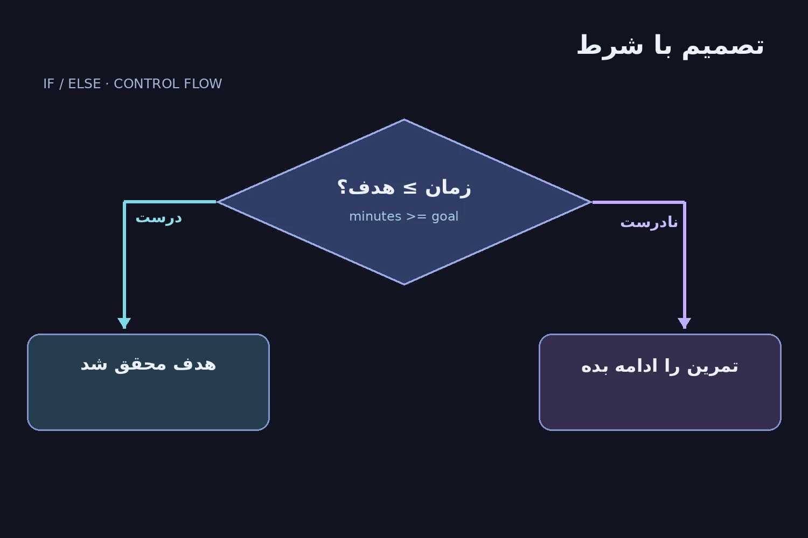

**شکل ۱۰-۱ — تصمیم دوشاخه.** شرط و دو خروجی مشخص‌اند؛ این نمودار درباره یک هدف آموزشی فرضی است، نه توصیه شخصی برای سلامت یا مطالعه.

## ۶. حلقه for و range

وقتی می‌خواهیم کاری را برای چند مقدار تکرار کنیم، از حلقه `for` استفاده می‌کنیم:

```python
for day in range(1, 4):
    print(day)
```

خروجی به‌ترتیب ۱، ۲ و ۳ است. `range(1, 4)` از ۱ شروع می‌کند و **۴ را شامل نمی‌شود**. `range(3)` مقادیر ۰، ۱ و ۲ می‌دهد. `for` می‌تواند روی عناصر یک رشته یا فهرست نیز حرکت کند [۲]. تورفتگی مشخص می‌کند چه دستورهایی عضو بدنه‌اند.

مثال مجموع: `total = 0`؛ در هر دور `total = total + day`؛ پس از سه دور مقدار ۶ است. مراقب باشید چاپ مجموع نهایی را بیرون بدنه قرار دهید، مگر اینکه خروجی هر دور را بخواهید.

## ۷. حلقه while و کنترل تکرار

`while` تا زمانی که شرط درست باشد بدنه را تکرار می‌کند. اگر شرط هرگز تغییر نکند ممکن است حلقه بی‌پایان شود. برای یک شمارنده کوچک:

```python
count = 1
while count <= 3:
    print(count)
    count += 1
```

`count += 1` شکل کوتاه افزایش شمارنده است. `break` حلقه فعلی را پایان می‌دهد؛ `continue` به دور بعدی همان حلقه می‌رود. در برنامه پروژه، `while True` برای درخواست مجدد ورودی است و در صورت ورودی معتبر با `break` پایان می‌یابد. هنگام تمرین، برای قطع برنامه گیرکرده در ترمینال معمولاً `Ctrl+C` قابل استفاده است؛ رفتار محیط ممکن است فرق کند.

## ۸. خطا، محدوده و اعتبارسنجی

**SyntaxError** یعنی ساختار کد با دستور زبان سازگار نیست؛ **ValueError** در مثال ما به‌معنی تبدیل متن نامعتبر به عدد است؛ **TypeError** می‌تواند از عملیات روی نوع‌های ناسازگار ناشی شود. کد باید علاوه بر تبدیل، محدوده منطقی را نیز بررسی کند: مثلاً دقیقه مطالعه یک روز فرضی از ۰ تا ۱۴۴۰ است.

برای این پروژه از `try/except` استفاده می‌کنیم: دستورات تبدیل در `try` قرار می‌گیرند و `except ValueError` خطای تبدیل را مدیریت می‌کند. وقتی ورودی تمام شود، `input` می‌تواند `EOFError` ایجاد کند؛ برنامه با پیامی متوقف می‌شود، نه اینکه نتیجه ناقص را صحیح گزارش کند. این نمونه همه خطاهای ممکن را نمی‌گیرد و نباید با `except` کلی، علت‌های ناشناخته را پنهان کرد.

## ۹. پروژه: ثبت مطالعه سه‌روزه

**هدف:** دریافت سه مقدار صحیح بین صفر و ۱۴۴۰، محاسبه مجموع و میانگین و اعلام رسیدن به هدف فرضی ۱۸۰ دقیقه. داده موقتی است و ذخیره نمی‌شود. برنامه با Python 3.13.16 آزمایش شده و به بسته اضافی نیاز ندارد. فایل `study_planner.py`:

```python
"""Three-day learning log, using only Python's standard library."""

def main():
    total = 0
    for day in range(1, 4):
        while True:
            try:
                raw = input(f'Day {day} minutes (0-1440): ')
                minutes = int(raw)
                if not 0 <= minutes <= 1440:
                    print('Enter a whole number from 0 to 1440.')
                    continue
                break
            except ValueError:
                print('Enter a whole number from 0 to 1440.')
            except EOFError:
                print('\nInput ended; no result calculated.')
                return
        total += minutes
    print(f'Total: {total} minutes')
    print(f'Average: {total / 3:.1f} minutes')
    if total >= 180:
        print('Goal reached')
    else:
        print('Keep practicing')


if __name__ == '__main__':
    main()
```

اجرا: `python study_planner.py` یا `python3 study_planner.py`. وقتی از شما پرسیده می‌شود، به‌ترتیب `30`، `60` و `90` را وارد کنید. خروجی اصلی:

```text
Total: 180 minutes
Average: 60.0 minutes
Goal reached
```

**خواندن کد:** حلقه `for` سه روز را می‌پیماید. حلقه داخلی تا ورود عدد معتبر ادامه می‌یابد. `int(raw)` متن را تبدیل می‌کند؛ شرط محدوده از ۰ تا ۱۴۴۰ را بررسی می‌کند. `continue` درخواست همان روز را تکرار و `break` پس از اعتبارسنجی از حلقه داخلی خارج می‌شود. `total += minutes` مجموع را زیاد می‌کند. پس از پایان سه روز، میانگین و شرط هدف نمایش داده می‌شوند.

**آزمون‌ها:** ورودی `30,60,90` هدف را برآورده می‌کند. `10,20,30` مجموع ۶۰ و پیام `Keep practicing` می‌دهد. برای ورودی `abc` یا `-1` باید پیام خطا ببینید و مجدداً همان روز پرسیده شود. قطع ورودی پیش از تکمیل سه روز پیام `Input ended; no result calculated.` می‌دهد. این پروژه برنامه ثبت دائمی یا سامانه ارزیابی سلامت نیست.

## ۱۰. خطاهای رایج و روش عیب‌یابی

۱. **`'2' + '3'` برابر ۵ نیست:** هر دو رشته‌اند؛ تبدیل عددی را پس از بررسی ورودی انجام دهید.
۲. **`range(1, 4)` شامل ۴ نیست:** مقدار توقف در این شکل انحصاری است.
۳. **استفاده از `=` به جای `==`:** هدف انتساب یا مقایسه را تشخیص دهید.
۴. **تورفتگی نادرست:** بدنه هر شرط/حلقه را با فاصله یکسان مشخص کنید؛ پیام خطا و شماره خط را بخوانید.
۵. **حلقه بی‌پایان:** شرط توقف یا تغییر شمارنده را مشخص کنید؛ نسخه کوچک را دستی دنبال کنید.
۶. **ورودی نامعتبر:** تبدیل را داخل بخش مدیریت خطا بگذارید و محدوده را جداگانه بررسی کنید.
۷. **مقایسه اعشاری:** برخی مقدارها تقریب هستند؛ برای کار عددی مناسب از روش و تلورانس درست استفاده کنید.

## ۱۱. تحولات و نسخه تا نوامبر ۲۰۲۶

**تاریخ بررسی: ۵ نوامبر ۲۰۲۶.** مستندات رسمی Python 3.13 مفاهیم عدد، متن، ساختار کنترل، `for`، `range`، `break` و `continue` را توضیح می‌دهند [۱، ۲]. نمونه پروژه این فصل با Python **3.13.16** اجرا شده است. در پروژه‌های واقعی نسخه مفسر و وابستگی‌ها را ثبت کنید؛ این فصل ادعای جدیدترین بودن نسخه آزمایش را ندارد.

## ۱۲. تمرین و آزمون

**آزمون مفهومی:** ۱) فرق `=` و `==` چیست؟ ۲) نوع خروجی `input` چیست؟ ۳) `range(1,4)` چه مقادیری دارد؟ ۴) `break` چه می‌کند؟ ۵) `continue` چه می‌کند؟ ۶) چرا `int('abc')` خطا می‌دهد؟ ۷) تورفتگی در Python چه نقشی دارد؟ ۸) فرق `7 / 2` و `7 // 2` چیست؟ ۹) چه زمانی حلقه while می‌تواند بی‌پایان شود؟ ۱۰) چرا ورودی باید محدوده‌سنجی شود؟

**تمرین ریاضی:** اگر مطالعه سه روز ۲۰، ۴۰ و ۶۰ دقیقه باشد، مجموع ۱۲۰ و میانگین ۴۰ دقیقه است؛ هدف فرضی ۱۸۰ دقیقه برآورده نشده. برای عدد ۱۷، `17 % 5 = 2` است.

**تمرین برنامه‌نویسی:** برنامه پروژه را اجرا کنید و دو حالت معتبر و نامعتبر را امتحان کنید. سپس در یک نسخه جدا، هدف را از ۱۸۰ به ۱۲۰ تغییر دهید و ورودی `20,40,60` را بسنجید. خروجی مورد انتظار `Goal reached` است. داده یا فایل دیگران را تغییر ندهید.

**مینی‌پروژه ارزیابی:** برنامه‌ای بنویسید که سه عدد صحیح غیرمنفی بگیرد، جمع آن‌ها را چاپ کند و اگر مجموع حداقل ۱۰ بود پیام `OK` بدهد. ورودی نامعتبر را با پیام روشن تکرار کند؛ ورودی پایان‌یافته را بدون چاپ نتیجه ناقص متوقف کند. ساختار فایل، نسخه، نمونه ورودی و دو آزمون، از جمله یک خطا، را ثبت کنید.

**معیار قبولی:** حداقل ۸ پاسخ صحیح از ۱۰، محاسبه درست مجموع/میانگین/باقیمانده، اجرای پروژه یا تشریح آن در نبود محیط و دو آزمون مستند برای مینی‌پروژه. پاسخ‌ها: ۱) انتساب/برابری؛ ۲) `str`؛ ۳) ۱،۲،۳؛ ۴) خروج از حلقه؛ ۵) دور بعد؛ ۶) متن عدد صحیح نیست؛ ۷) تعیین بلوک؛ ۸) ۳٫۵ و ۳؛ ۹) اگر شرط همیشه درست بماند؛ ۱۰) برای رد داده ناسازگار با مسئله.

## ۱۳. واژه‌نامه و منابع

متغیر (Variable)، نوع داده (Data Type)، انتساب (Assignment)، رشته (String)، ورودی (Input)، شرط (Condition)، تورفتگی (Indentation)، حلقه (Loop)، خطا/استثنا (Exception)، اعتبارسنجی (Validation). فصل ۱۱ توابع، ماژول‌ها و ساختمان داده را بررسی خواهد کرد.

**منابع؛ مراجعه ۵ نوامبر ۲۰۲۶:** [۱] Python Software Foundation، «An Informal Introduction to Python»، مستندات Python 3.13، تاریخ انتشار نامشخص، [مستندات](https://docs.python.org/3.13/tutorial/introduction.html). [۲] Python Software Foundation، «More Control Flow Tools»، مستندات Python 3.13، تاریخ انتشار نامشخص، [مستندات](https://docs.python.org/3.13/tutorial/controlflow.html). [۳] Python Software Foundation، «Built-in Functions»، مستندات Python 3.13، تاریخ انتشار نامشخص، [مستندات](https://docs.python.org/3.13/library/functions.html).

---

# فصل ۱۱ — توابع، ماژول‌ها و ساختمان داده‌ها

**هنر و علم ساخت هوش | جلد اول | Babak & Ai**
**نسخه ۱.۰ · بررسی منابع: ۵ نوامبر ۲۰۲۶**

## ۱. چرا کد را به قطعات کوچک تقسیم می‌کنیم؟

اگر برای هر روز مطالعه سه بار کد یکسان جمع را بنویسیم، تغییر و آزمایش آن دشوار می‌شود. **تابع (Function)** مجموعه‌ای نام‌دار از عملیات است که می‌توان با ورودی‌های مختلف فراخوانی کرد. **ساختمان داده (Data Structure)** روشی برای سازمان‌دهی مقدارهاست؛ انتخاب ساختار مناسب کار ما را ساده‌تر و گاهی سریع‌تر می‌کند.

**پیش‌نیاز:** متغیر، شرط و حلقه از فصل ۱۰. **هدف:** تعریف و فراخوانی تابع، تشخیص `return` از `print`، استفاده از list، tuple، set و dict، واردکردن ماژول، و بررسی ابتدایی هزینه الگوریتم. همه پروژه با Python 3.13.16 و کتابخانه استاندارد آزمایش شده است.

## ۲. تعریف تابع، ورودی و خروجی

```python
def add(a, b):
    return a + b

result = add(2, 3)
print(result)  # 5
```

`def` تابع را تعریف می‌کند؛ `a` و `b` **پارامتر** هستند؛ `2` و `3` هنگام فراخوانی **آرگومان**‌اند. `return` مقدار را به محل فراخوانی بازمی‌گرداند. `print` فقط چیزی را نمایش می‌دهد. تابعی که به پایان برسد و مقدار صریحی برنگرداند، `None` برمی‌گرداند [۱]. تورفتگی بدنه را تعیین می‌کند.

درباره قرارداد تابع بپرسید: چه ورودی‌هایی معتبرند، خروجی چیست و برای حالت نامعتبر چه اتفاقی می‌افتد؟ اگر تابع ورودی را تغییر می‌دهد، این رفتار را نیز مستند کنید. یک تابع کوتاه با هدف روشن معمولاً راحت‌تر آزموده می‌شود.

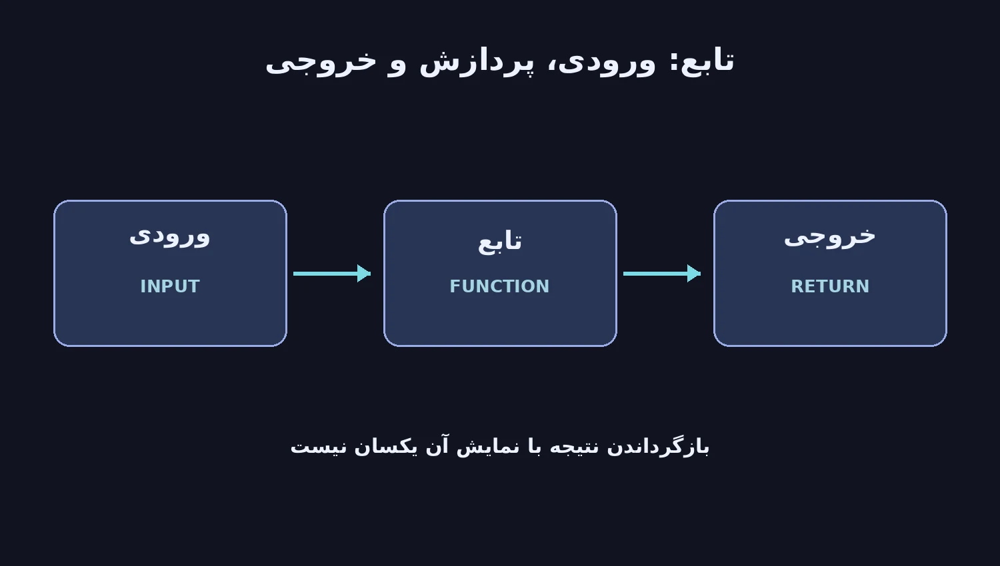

**شکل ۱۱-۱ — قرارداد ساده تابع.** ممکن است توابع علاوه بر خروجی، اثر جانبی مانند نوشتن فایل هم داشته باشند؛ باید آن را مستند کرد.

## ۳. پارامترهای پیش‌فرض، نام‌دار و دامنه

```python
def greet(name, prefix='Hello'):
    return f'{prefix}, {name}'

print(greet('Ali'))
print(greet('Ali', prefix='Hi'))
```

پارامتر `prefix` پیش‌فرض دارد؛ آرگومان نام‌دار معنای فراخوانی را روشن می‌کند. مقدار پیش‌فرض هنگام تعریف تابع ارزیابی می‌شود، نه در هر فراخوانی. استفاده از فهرست تغییرپذیر به‌عنوان پیش‌فرض ممکن است داده را ناخواسته میان فراخوانی‌ها مشترک کند [۱]. روش معمول: پیش‌فرض `None` و ساخت فهرست جدید در بدنه.

نامی که داخل تابع ساخته می‌شود معمولاً **محلی (Local)** است؛ نام‌های بیرون ممکن است در دامنه‌های محصور یا سراسری قابل مشاهده باشند. از تکیه بی‌دلیل بر تغییر وضعیت سراسری پرهیز کنید؛ ورودی صریح و خروجی روشن آزمایش را ساده می‌کند. جزئیات دقیق دامنه در فصل‌های پیشرفته بررسی می‌شود.

## ۴. فهرست و چندتایی

**فهرست (List)** ترتیبی و تغییرپذیر است: `minutes = [30, 60, 90]`. شاخص‌ها از صفر شروع می‌شوند: `minutes[0]` برابر ۳۰ و `minutes[-1]` آخرین مقدار است. `append` عنصری به انتها اضافه می‌کند. دسترسی به شاخص خارج از محدوده `IndexError` ایجاد می‌کند.

**چندتایی (Tuple)** ترتیبی و تغییرناپذیر در ساختار خودش است: `point = (2, 3)`. اگر داخل tuple یک شیء تغییرپذیر باشد، تغییر آن شیء هنوز ممکن است؛ تغییرناپذیری tuple به معنی تغییرناپذیری عمیق همه محتویات نیست. list برای مجموعه قابل تغییر و tuple برای گروه‌بندی ثابت یا قرارداد داده مناسب‌اند [۲].

## ۵. مجموعه و دیکشنری

**مجموعه (Set)** اعضای یکتا دارد و برای آزمون عضویت و حذف تکراری‌ها مفید است. ترتیب نمایش set را ثابت فرض نکنید. مجموعه خالی `set()` است، زیرا `{}` دیکشنری خالی می‌سازد. اعضای set باید قابل هش باشند.

**دیکشنری (Dict)** جفت‌های کلید و مقدار را نگه می‌دارد: `scores = {'math': 80, 'python': 90}`. کلیدها یکتا هستند و باید برای استفاده به‌عنوان کلید مناسب و قابل هش باشند. `scores['math']` مقدار ۸۰ می‌دهد؛ `scores.get('ai', 0)` در نبود کلید مقدار پیش‌فرض ۰ را می‌دهد. در Python مدرن ترتیب درج کلیدهای dict حفظ می‌شود، اما set همان تضمین را ندارد [۲].

برای داده‌های حساس، انتخاب ساختار به‌تنهایی امنیت ایجاد نمی‌کند؛ منبع، مجوز و دسترسی نیز مهم‌اند.

## ۶. الگوریتم و پیچیدگی مقدماتی

برای یافتن عددی در یک فهرست نامرتب، می‌توان از ابتدا تا یافتن مقدار یا پایان لیست حرکت کرد؛ در بدترین حالت ممکن است همه `n` عنصر بررسی شوند. این روش **جست‌وجوی خطی** با هزینه زمانی `O(n)` در این مدل ساده است. `O(n)` رفتار رشد را نشان می‌دهد، نه زمان دقیق روی همه دستگاه‌ها.

برای یافتن مقدار در ساختارهای دیگر، هزینه به پیاده‌سازی و داده وابسته است. عضویت در set/dict مبتنی بر هش در حالت معمول می‌تواند میانگین نزدیک `O(1)` داشته باشد، اما این تضمین برای بدترین حالت، همه داده‌ها و همه پیاده‌سازی‌ها نیست. به‌علاوه ساخت set، حافظه و اعتبار نوع عضو هزینه دارد. پیش از بهینه‌سازی، صحت را کنترل و بار واقعی را اندازه‌گیری کنید.

مثال ریاضی: در فهرست ۱۰۰تایی، جست‌وجوی خطی در بدترین حالت تا ۱۰۰ مقایسه می‌خواهد؛ این شمارش ساده شامل سربار Python نیست. برای داده مرتب و روش دودویی می‌توان مسئله را متفاوت حل کرد، اما شرط مرتب‌بودن و هزینه مرتب‌سازی اهمیت دارد.

## ۷. ماژول و واردکردن کد

یک فایل Python می‌تواند یک **ماژول (Module)** باشد. `import math` ماژول کتابخانه استاندارد را وارد می‌کند؛ `math.sqrt(9)` مقدار `3.0` می‌دهد. فایل خودتان نیز اگر در مسیر مناسب Python قرار گیرد قابل import است [۳]. نام فایل را `math.py` یا نام بسته‌های استاندارد نگذارید تا تعارض و خطای واردکردن ایجاد نشود.

شرط `if __name__ == '__main__':` برای جداکردن اجرای مستقیم فایل از واردکردن آن رایج است؛ import همچنان کدهای سطح بالای خارج از این شرط را اجرا می‌کند. کدهای ناشناس را import نکنید: import خود می‌تواند کد اجرا کند.

## ۸. پروژه: تحلیل دفتر مطالعه

فایل `study_stats.py` را با کد زیر بسازید. ورودی‌ها داده مصنوعی داخل برنامه هستند. توابع مجموع، میانگین و تعداد موضوع‌ها را برمی‌گردانند؛ فهرست خالی برای میانگین و دقیقه منفی رد می‌شوند. این برنامه داده را روی دیسک ذخیره نمی‌کند.

```python
"""Small reusable functions for a synthetic study log."""

def total_minutes(entries):
    if any(value < 0 for value in entries):
        raise ValueError('minutes must be non-negative')
    return sum(entries)


def average_minutes(entries):
    if not entries:
        raise ValueError('at least one entry is required')
    return total_minutes(entries) / len(entries)


def count_topics(topics):
    counts = {}
    for topic in topics:
        counts[topic] = counts.get(topic, 0) + 1
    return counts


def main():
    entries = [30, 60, 90]
    topics = ['python', 'math', 'python']
    print('total=', total_minutes(entries))
    print('average=', average_minutes(entries))
    print('topics=', count_topics(topics))


if __name__ == '__main__':
    main()
```

با `python study_stats.py` یا `python3 study_stats.py` اجرا کنید. خروجی Python 3.13.16:

```text
total= 180
average= 60.0
topics= {'python': 2, 'math': 1}
```

`total_minutes` با `sum` مجموع را می‌سازد؛ `average_minutes` بر تعداد تقسیم می‌کند و برای فهرست خالی خطا می‌دهد. `count_topics` با `dict.get` تعداد را اضافه می‌کند. این نسخه تنها برای ورودی عددی مناسب طراحی شده و اعتبارسنجی کامل انواع، سقف دقیقه یا داده خارجی را انجام نمی‌دهد.

**آزمون دستی:** `total_minutes([])` برابر ۰ است؛ `average_minutes([])` باید `ValueError` بدهد؛ `total_minutes([-1])` نیز باید خطا بدهد. فایل پروژه و تست‌های این فصل همراه کتاب قرار دارند. اگر ماژول پیدا نشد، پوشه جاری و نام فایل را بررسی کنید؛ اگر نوع ناسازگار دادید، قرارداد تابع را کنترل کنید.

## ۹. ارزیابی و تمرین

۱) فرق `return` و `print`؟ ۲) `minutes[-1]` چیست؟ ۳) `{}` مجموعه است یا دیکشنری؟ ۴) آیا ترتیب set تضمین است؟ ۵) تابع بدون `return` صریح چه برمی‌گرداند؟ ۶) هزینه بدترین جست‌وجوی خطی در ۱۰۰ عنصر؟ ۷) چرا پیش‌فرض list تغییرپذیر خطر دارد؟ ۸) آیا import کد فایل را ممکن است اجرا کند؟

**ریاضی:** داده `20, 40, 60` مجموع ۱۲۰ و میانگین ۴۰ دارد. برای ۵۰ عنصر، جست‌وجوی خطی در این مدل حداکثر ۵۰ مقایسه دارد. **تمرین برنامه‌نویسی:** تابعی بنویسید که فهرست اعداد غیرمنفی را بگیرد و بیشینه را بازگرداند؛ فهرست خالی را با خطای روشن رد کند. **پروژه:** تحلیل سه موضوع با تابع، list و dict؛ نمونه خالی و منفی را آزمایش و دستور اجرا ثبت کنید.

**معیار قبولی:** ۷ جواب درست از ۸، دو محاسبه درست و تابع/پروژه با حداقل دو تست. پاسخ‌ها: ۱) برگرداندن در برابر نمایش؛ ۲) آخرین عنصر؛ ۳) دیکشنری؛ ۴) خیر؛ ۵) `None`؛ ۶) تا ۱۰۰ مقایسه؛ ۷) شیء مشترک بین فراخوانی‌ها؛ ۸) بله.

## ۱۰. تحولات، واژه‌نامه و منابع

**بررسی: ۵ نوامبر ۲۰۲۶.** مستندات Python 3.13 ساختار داده، تعریف تابع و ماژول را شرح می‌دهند؛ نسخه اجراشده این فصل 3.13.16 است و ادعای جدیدترین نسخه نیست. فصل ۱۲ کلاس، خطا، فایل، JSON و API را بررسی می‌کند.

واژه‌ها: Function، Parameter، Argument، Return، Scope، List، Tuple، Set، Dictionary، Module، Complexity.

**منابع؛ مراجعه ۵ نوامبر ۲۰۲۶:** [۱] Python Software Foundation، «More Control Flow Tools»، مستندات 3.13، تاریخ انتشار نامشخص، [تعریف تابع](https://docs.python.org/3.13/tutorial/controlflow.html). [۲] Python Software Foundation، «Data Structures»، مستندات 3.13، تاریخ نامشخص، [منبع](https://docs.python.org/3.13/tutorial/datastructures.html). [۳] Python Software Foundation، «Modules»، مستندات 3.13، تاریخ نامشخص، [منبع](https://docs.python.org/3.13/tutorial/modules.html).

---

# فصل ۱۲ — کلاس‌ها، خطاها، فایل، JSON و API

**هنر و علم ساخت هوش | جلد اول | Babak & Ai**
**نسخه ۱.۰ · بررسی منابع: ۵ نوامبر ۲۰۲۶**

## ۱. از تابع به شیء و داده پایدار

در فصل ۱۱ توابع را ساختیم. اکنون می‌خواهیم «یک جلسه مطالعه» را همراه داده و رفتارهایش نمایش دهیم، آن را در فایل ذخیره کنیم و بفهمیم چگونه برنامه‌ها از طریق API با هم ارتباط می‌گیرند. **پیش‌نیاز:** متغیر، تابع، dict و خطاهای پایه. **هدف:** ساخت یک کلاس معتبر، کار با فایل UTF-8، تبدیل JSON، مدیریت خطا و توضیح درخواست/پاسخ HTTP.

## ۲. کلاس، نمونه، ویژگی و متد

**کلاس (Class)** قالبی برای ترکیب داده و رفتار است؛ **نمونه (Instance)** یک شیء ساخته‌شده از آن کلاس است. ویژگی (Attribute) اطلاعات نمونه و متد (Method) تابعی وابسته به کلاس/نمونه است [۱].

```python
class Book:
    def __init__(self, title):
        self.title = title

    def describe(self):
        return self.title

book = Book('AI')
print(book.describe())  # AI
```

`__init__` هنگام ساخت نمونه برای مقداردهی اولیه فراخوانی می‌شود. `self` نام متعارف اشاره به همان نمونه در متد است؛ هنگام `book.describe()` به‌طور خودکار ارسال می‌شود. هر نمونه می‌تواند عنوان خود را داشته باشد. کلاس برای همه مسائل لازم نیست؛ گاهی یک dict و تابع ساده خواناتر است.

## ۳. شیءگرایی و مرزهای آن

**شیءگرایی (Object-Oriented Programming)** یکی از روش‌های سازمان‌دهی برنامه است. **کپسوله‌سازی** یعنی سازمان‌دهی داده و رفتار و مشخص‌کردن نحوه استفاده؛ در Python قراردادهای نام‌گذاری و رابط‌ها مهم‌اند و نباید فرض کرد هر ویژگی با نام خاص امنیت کامل دارد. **وراثت** امکان ساخت نوعی بر اساس نوع دیگر است؛ **چندریختی** به امکان استفاده از رابط‌های سازگار در انواع مختلف اشاره می‌کند. این‌ها ابزار طراحی‌اند نه هدف مستقل.

برای نمونه جلسه مطالعه، ویژگی‌ها `topic` و `minutes` و رفتار `as_dict` می‌توانند کافی باشند. پیش از ساخت سلسله‌مراتب پیچیده، سادگی، قابلیت آزمون و نیاز واقعی را بررسی کنید. اعتبارسنجی در سازنده از ساخت نمونه نامعتبر جلوگیری می‌کند، اما اگر ویژگی عمومی بعداً مستقیماً تغییر کند، بدون محافظ اضافه تضمین دائمی نیست.

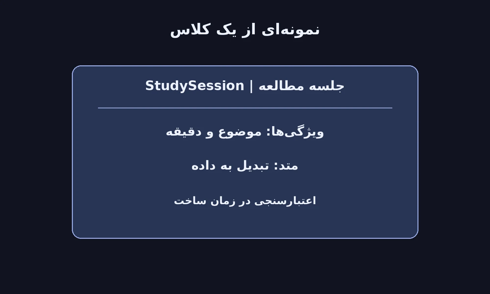

**شکل ۱۲-۱ — مدل آموزشی شیء.** شکل یک نمایش مفهومی است و ادعای خصوصی یا تغییرناپذیر بودن ویژگی‌ها ندارد.

## ۴. خطا و استثنا

**استثنا (Exception)** روشی برای گزارش شرایط خطاست. `try` عملیات و `except` مدیریت نوع مشخص خطا را بیان می‌کند [۲]. مثلاً تبدیل `int('abc')` خطای `ValueError` می‌دهد. با `raise ValueError('message')` نیز می‌توان داده نامعتبر را رد کرد. خطا را نزدیک جایی مدیریت کنید که تصمیم مناسب دارید؛ پنهان‌کردن همه خطاها با `except` کلی ممکن است مشکل جدی را مخفی کند.

```python
try:
    number = int('abc')
except ValueError:
    print('Invalid number')
```

در خواندن JSON نامعتبر `json.JSONDecodeError`، برای نبود فایل `FileNotFoundError` و برای دسترسی نامجاز `PermissionError` ممکن است رخ دهد. این‌ها موقعیت‌های متفاوت‌اند؛ نباید فایل خراب را بی‌صدا با داده خالی جایگزین کرد. پیام خطا را بدون انتشار داده حساس ثبت کنید.

## ۵. خواندن و نوشتن فایل

`with open(..., encoding='utf-8')` فایل متنی را باز و پس از پایان بلوک آن را می‌بندد؛ حتی در صورت بسیاری از خطاها مدیریت منبع بهتر انجام می‌شود. حالت `r` خواندن و `w` نوشتن است؛ **`w` فایل موجود را کوتاه/بازنویسی می‌کند**. پیش از نوشتن مسیر و مجوز را بررسی و از داده مهم نسخه پشتیبان داشته باشید. در پروژه این فصل از پوشه موقت استفاده می‌کنیم.

فایل و مسیر دریافتی از کاربر را بدون محدودسازی و اعتبارسنجی برای کار حساس به‌کار نبرید. روی داده ناشناخته از روش‌های غیرایمن بارگذاری شیء استفاده نکنید. سیستم‌عامل، حجم و مجوزها ممکن است باعث خطا شوند.

## ۶. JSON چیست؟

**JSON (JavaScript Object Notation)** یک قالب متنی برای تبادل داده است. شیء JSON شبیه جفت‌های کلید/مقدار است، اما قواعد آن با literal دیکشنری Python یکسان نیست؛ مثلاً JSON از `true`, `false`, `null` و رشته‌های با نقل‌قول دوگانه استفاده می‌کند. کتابخانه استاندارد Python `json.dump`/`load` را برای فایل و `dumps`/`loads` را برای رشته ارائه می‌دهد [۳].

مثال: `{"topic": "python", "minutes": 45}`. تبدیل JSON به dict به معنی معتبر بودن محتوا نیست: نوع، وجود کلید و محدوده را پس از خواندن کنترل کنید. برای داده نامطمئن اندازه ورودی را محدود کنید، چون تجزیه داده بسیار بزرگ ممکن است CPU و حافظه زیادی مصرف کند [۳].

## ۷. API و HTTP از دید مبتدی

**API (Application Programming Interface)** قراردادی برای تعامل نرم‌افزارهاست؛ API الزاماً وب نیست. در API وب، مشتری درخواست HTTP می‌فرستد و سرور پاسخ می‌دهد. درخواست ممکن است روش، نشانی، سربرگ و بدنه داشته باشد؛ پاسخ شامل وضعیت، سربرگ و گاهی بدنه است.

`GET` معمولاً نمایش یک منبع را درخواست می‌کند و `POST` برای ارسال داده استفاده می‌شود و می‌تواند اثر جانبی داشته باشد [۴]. کد ۲xx عموماً موفقیت و ۴xx/۵xx به‌ترتیب دسته‌هایی از خطای درخواست و سرور را نشان می‌دهند؛ معنای دقیق به کد و API وابسته است. پاسخ ۲۰۰ به‌تنهایی صحت محتوای مدل یا امنیت داده را ثابت نمی‌کند.

برای پروژه واقعی، timeout، محدودیت اندازه، اعتبارسنجی، HTTPS، احراز هویت و حفاظت کلیدها لازم‌اند. کلید API را در کد عمومی، گزارش یا مخزن قرار ندهید. این فصل **درخواست شبکه واقعی ارسال نمی‌کند**؛ ساخت API در بخش محصول آموزش داده خواهد شد.

## ۸. پروژه: شیء جلسه و فایل JSON

فایل `session.py` را مطابق زیر بسازید. برنامه در یک پوشه موقت فایل را می‌نویسد، می‌خواند، بازسازی و مقایسه می‌کند؛ فایل موقت در پایان پاک می‌شود. Python 3.13.16 و کتابخانه استاندارد؛ بدون شبکه یا بسته اضافی.

```python
"""Validate a study session and round-trip it through a temporary JSON file."""
import json
from pathlib import Path
from tempfile import TemporaryDirectory


class StudySession:
    def __init__(self, topic, minutes):
        if not isinstance(topic, str) or not topic.strip():
            raise ValueError('topic must be a non-empty string')
        if type(minutes) is not int or not 0 <= minutes <= 1440:
            raise ValueError('minutes must be an integer from 0 to 1440')
        self.topic = topic.strip()
        self.minutes = minutes

    def as_dict(self):
        return {'topic': self.topic, 'minutes': self.minutes}


def main():
    session = StudySession('python', 45)
    with TemporaryDirectory() as folder:
        path = Path(folder) / 'session.json'
        with path.open('w', encoding='utf-8') as file:
            json.dump(session.as_dict(), file, ensure_ascii=False)
        with path.open('r', encoding='utf-8') as file:
            loaded = json.load(file)
        restored = StudySession(loaded['topic'], loaded['minutes'])
        print('topic=', restored.topic)
        print('minutes=', restored.minutes)
        assert restored.as_dict() == session.as_dict()
        print('roundtrip=PASS')


if __name__ == '__main__':
    main()
```

اجرا: `python session.py` یا `python3 session.py`. خروجی آزمایش‌شده:

```text
topic= python
minutes= 45
roundtrip=PASS
```

`StudySession` ورودی را بررسی می‌کند؛ `type(minutes) is int` در این مثال عمداً مقدار منطقی `True` را نمی‌پذیرد، با اینکه `bool` زیرنوع `int` است. `as_dict` نمایش ساده‌ای می‌سازد. `json.dump` داده را می‌نویسد، `json.load` می‌خواند و سازنده دوباره اعتبارسنجی می‌کند. فایلِ ناسالم یا دارای کلید غایب در این نمونه خطا ایجاد می‌کند؛ پروژه تولیدی باید خطاهای مناسب را مدیریت و اندازه ورودی را محدود کند.

**عیب‌یابی:** اگر Python پیدا نشد فرمان مناسب را بررسی کنید؛ خطای مجوز پوشه موقت، مسیر و دسترسی محیط را بررسی کنید. اگر دقیقه منفی یا موضوع خالی بدهید `ValueError` انتظار می‌رود. این نمونه API واقعی یا ذخیره دائمی نیست.

## ۹. تمرین و معیار قبولی

**آزمون:** ۱) کلاس و نمونه چه تفاوتی دارند؟ ۲) `self` چیست؟ ۳) آیا `w` فایل موجود را نگه می‌دارد؟ ۴) `dump` و `dumps` چه تفاوتی دارند؟ ۵) آیا JSON معتبر الزاماً داده معنادار دارد؟ ۶) `GET` و `POST` معمولاً چه نقشی دارند؟ ۷) چرا کلید API را نباید در مخزن گذاشت؟ ۸) آیا `except` کلی همیشه مناسب است؟

**تمرین عملی:** یک جلسه با موضوع فارسی و ۳۰ دقیقه بسازید، به dict تبدیل و نتیجه را بررسی کنید. دقیقه `-1` و `True` باید رد شوند. فایل JSON ناقص را با `json.loads` امتحان کنید و `JSONDecodeError` را تشخیص دهید. **تمرین ریاضی:** ۴۵ دقیقه + ۳۰ دقیقه = ۷۵ دقیقه. **مینی‌پروژه:** کلاس جلسه با اعتبارسنجی، ذخیره در پوشه موقت، بازیابی و دو تست خطا؛ برای API فرضی ورودی، خروجی و ریسک را بنویسید.

**قبولی:** حداقل ۷ جواب درست از ۸، محاسبه درست، اجرای round-trip و تست دو ورودی نامعتبر. پاسخ: ۱) قالب/شیء؛ ۲) نمونه فعلی؛ ۳) خیر؛ ۴) فایل/رشته؛ ۵) خیر؛ ۶) دریافت/ارسال؛ ۷) سوءاستفاده از اعتبار؛ ۸) خیر.

## ۱۰. تحولات، واژه‌نامه و منابع

**بررسی: ۵ نوامبر ۲۰۲۶.** مثال‌ها با Python 3.13.16 اجرا شدند؛ روش‌های API و رفتار نسخه‌ها با مستندات همان نسخه کنترل می‌شوند. فصل ۱۳ Git، Linux، Bash و محیط مجازی را معرفی می‌کند.

واژه‌ها: Class، Instance، Attribute، Method، Exception، File، JSON، API، HTTP، Request، Response.

**منابع؛ مراجعه ۵ نوامبر ۲۰۲۶:** [۱] Python Software Foundation، «Classes»، مستندات 3.13، تاریخ نامشخص، [منبع](https://docs.python.org/3.13/tutorial/classes.html). [۲] Python Software Foundation، «Errors and Exceptions»، 3.13، تاریخ نامشخص، [منبع](https://docs.python.org/3.13/tutorial/errors.html). [۳] Python Software Foundation، «json»، 3.13، تاریخ نامشخص، [منبع](https://docs.python.org/3.13/library/json.html). [۴] MDN Web Docs، «HTTP request methods»، تاریخ صفحه متغیر، [منبع](https://developer.mozilla.org/en-US/docs/Web/HTTP/Reference/Methods).

---

# فصل ۱۳ — Linux، Bash، Git و محیط‌های مجازی

**هنر و علم ساخت هوش | جلد اول | Babak & Ai**
**نسخه ۱.۰ · بررسی منابع: ۵ نوامبر ۲۰۲۶**

## ۱. چرا محیط پروژه مهم است؟

اگر کدی امروز اجرا شود ولی ماه بعد با نسخه دیگری از کتابخانه شکست بخورد، نتیجه پژوهش به‌سختی تکرار می‌شود. علاوه بر کد باید بدانیم کدام نسخه Python، وابستگی، سیستم‌عامل، داده و فرمان اجرا استفاده شده است. Git تاریخ تغییرات را ثبت می‌کند و محیط مجازی وابستگی‌های پروژه‌ها را جدا نگه می‌دارد؛ هیچ‌کدام به‌تنهایی بازتولید کامل یا امنیت را تضمین نمی‌کنند.

**پیش‌نیاز:** فصل‌های ۹ تا ۱۲. **هدف:** پیمایش امن در shell، تفاوت Git و GitHub، ساخت commit محلی، ایجاد venv، ثبت نسخه‌ها و حفاظت از رمزها. پروژه این فصل کاملاً محلی و موقت است و شبکه یا مخزن کاربر را تغییر نمی‌دهد.

## ۲. Linux، ترمینال و Bash

**Linux** هسته‌ای است که همراه اجزای دیگر در توزیع‌های سیستم‌عامل استفاده می‌شود. **Terminal** رابط متنی و **Bash** یکی از پوسته‌هایی است که فرمان‌ها را تفسیر می‌کند. macOS و Linux می‌توانند shellهای مختلف داشته باشند؛ Windows PowerShell نحو و فرمان‌های خاص خود را دارد. همه نمونه‌های Bash در PowerShell عیناً کار نمی‌کنند [۱].

در Bash، `pwd` مسیر جاری، `ls` فایل‌ها و `cd` جابه‌جایی پوشه را نشان/انجام می‌دهند. مسیر دارای فاصله را نقل‌قول کنید: `cd "my project"`. دستور `mkdir practice` پوشه می‌سازد؛ پیش از اجرا مطمئن شوید در مسیر مناسب هستید. `cd ..` به پوشه والد می‌رود. فرمان ناشناس مخصوصاً دارای حذف، نصب سیستمی یا دسترسی مدیر را بدون بررسی اجرا نکنید.

**خروجی و خطا:** برنامه‌ها معمولاً خروجی عادی و پیام خطا دارند و با کد خروجی وضعیت را گزارش می‌کنند. یک فرمان موفق لزوماً به معنی درست بودن نتیجه علمی نیست. برای یادگیری shell لازم نیست دسترسی مدیر یا داده واقعی حساس داشته باشید.

## ۳. Git، مخزن و commit

**Git** سامانه کنترل نسخه توزیع‌شده است؛ **GitHub** یکی از سرویس‌های میزبانی مخزن است. می‌توان Git را بدون حساب یا شبکه استفاده کرد. مخزن (Repository) شامل تاریخ و وضعیت پروژه است. `git init` در پوشه انتخاب‌شده مخزن محلی ایجاد می‌کند؛ این فرمان را در پروژه موجود بدون فهم وضعیت آن اجرا نکنید.

سه ناحیه مفهومی: فایل‌های کاری (Working Tree)، ناحیه آماده‌سازی (Staging/Index) و تاریخ commit. `git add file` محتوای فعلی فایل را برای commit آماده می‌کند؛ تغییر بعدی باید دوباره اضافه شود. `git status` وضعیت و `git diff --cached` تغییرات آماده‌شده را نشان می‌دهند. `git commit` یک snapshot از وضعیت آماده‌شده ثبت می‌کند [۲].

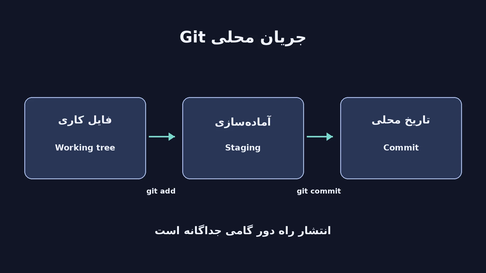

**شکل ۱۳-۱ — جریان مفهومی Git.** هیچ‌یک از این گام‌ها به‌تنهایی کد را روی GitHub منتشر نمی‌کند.

## ۴. تمرین دستی مخزن محلی

در یک پوشه تمرینی جدید و خالی، پس از نصب Git، می‌توانید با دستورهای زیر تمرین کنید. هویت محلی صرفاً برای همین مخزن است؛ به‌جای نمونه، نام و ایمیل مناسب خود را استفاده کنید. ایمیل commit ممکن است بعداً منتشر شود، پس از ایمیل عمومی مناسب استفاده کنید.

```text
mkdir practice-git
cd practice-git
git init
git config user.name "Student"
git config user.email "student@example.invalid"
```

فایل `hello.py` با `print('Hello Git')` بسازید، سپس:

```text
git status
git add hello.py
git diff --cached
git commit -m "First practice commit"
git log -1 --oneline
```

در صورت نبود Git، نصب را از [وب‌سایت رسمی Git](https://git-scm.com/) و راهنمای سیستم انجام دهید. اگر commit درباره هویت خطا داد، تنظیمات محلی را بررسی کنید. از `git add .` بدون بررسی، به‌ویژه در پروژه واقعی، پرهیز کنید: ممکن است فایل ناخواسته یا محرمانه را آماده کند.

## ۵. شاخه، مخزن راه دور و امنیت

**Branch** یک اشاره به مسیر توسعه است؛ **remote** نشانی مخزن دیگری است. `clone` یک کپی محلی می‌سازد، `fetch` اطلاعات راه دور را می‌گیرد، `pull` معمولاً دریافت و ادغام/بازپایه‌گذاری طبق پیکربندی انجام می‌دهد، و `push` commitها را به مخزن راه دور می‌فرستد. این عملیات ممکن است نیازمند دسترسی و شبکه باشد. آدرس و شاخه مقصد را قبل از push بررسی کنید و از `push --force` در پروژه مشترک بدون هماهنگی خودداری کنید.

`.gitignore` مانع آماده‌سازی معمول فایل‌های نادیده‌گرفته‌شده جدید می‌شود؛ **فایلی که قبلاً track شده خودکار از تاریخ یا پیگیری حذف نمی‌شود**. کلید API، token، رمز و داده خصوصی را در مخزن، URL یا خروجی عمومی قرار ندهید. اگر رازی افشا شد، ابتدا طبق راهنمای ارائه‌دهنده آن را لغو/تعویض و رخداد را رسیدگی کنید؛ حذف فایل فعلی ممکن است تاریخ را پاک نکند [۳]. اطلاعات احراز هویت را در مثال‌ها وارد نکنید.

## ۶. محیط مجازی Python

`venv` محیطی جدا برای بسته‌های Python ایجاد می‌کند [۴]. از ریشه یک پوشه تمرینی:

```text
python3 -m venv .venv
```

در Linux/macOS با Bash معمولاً `source .venv/bin/activate` و در Windows PowerShell معمولاً `.\.venv\Scripts\Activate.ps1` محیط را فعال می‌کنند. در Windows ممکن است سیاست اجرای اسکریپت مانع شود؛ به‌جای تغییر شتاب‌زده سیاست سیستم، راهنمای رسمی را بخوانید یا مفسر محیط را با مسیر مستقیم اجرا کنید. فعال‌سازی الزامی نیست: در Linux/macOS، `.venv/bin/python --version` مستقیماً مفسر محیط را اجرا می‌کند؛ مسیر Windows متفاوت است.

`deactivate` در پوسته فعال‌شده محیط را ترک می‌کند. محیط `.venv/` را معمولاً به Git اضافه نمی‌کنیم؛ به جای آن دستور ایجاد، نسخه Python و فهرست وابستگی‌ها را مستند می‌کنیم. خود محیط به معماری و مسیر وابسته است و کپی آن الزاماً قابل حمل نیست.

## ۷. بسته، pip و تکرارپذیری

`python -m pip --version` pip مربوط به همان مفسر را نشان می‌دهد. نصب بسته از شبکه باید با بررسی منبع، مجوز، نسخه و خطر زنجیره تأمین انجام شود؛ مثال این فصل هیچ بسته‌ای نصب نمی‌کند. ثبت نسخه‌ها با ابزار مناسب و قفل‌کردن وابستگی‌ها می‌تواند بازتولید را بهتر کند، اما سیستم‌عامل، درایور، سخت‌افزار، داده و تصادفی‌بودن همچنان اهمیت دارند.

`pip freeze` نسخه‌های بسته‌های محیط را گزارش می‌کند؛ این گزارش به‌تنهایی تضمین نمی‌کند وابستگی‌ها، منبع فایل، مجوز، امنیت یا نصب در همه سکوها یکسان است. در آزمایش واقعی نسخه Python، فایل وابستگی، دستور اجرا، seed و داده/مجوز را ثبت و در محیط تمیز آزمون کنید.

## ۸. پروژه ایمن: Git و venv در پوشه موقت

برنامه زیر مخزنی موقت می‌سازد، `.gitignore` و فایل نمونه را commit می‌کند، یک venv بدون pip می‌سازد و وضعیت را بررسی می‌کند. هیچ push، دسترسی شبکه یا تغییر مخزن فعلی انجام نمی‌دهد؛ پوشه پس از اجرا پاک می‌شود. نیازمند Python و Git روی PATH است. **آزمایش واقعی:** Python 3.13.16 و Git 2.47.3 در محیط Linux.

```python
"""Offline Git and venv exercise in a temporary directory; no network."""
from pathlib import Path
from tempfile import TemporaryDirectory
import subprocess
import sys


def git(folder, *args):
    return subprocess.run(['git', *args], cwd=folder, check=True,
                          text=True, capture_output=True).stdout.strip()


def main():
    with TemporaryDirectory() as temporary:
        root = Path(temporary)
        repo = root / 'demo'
        repo.mkdir()
        git(repo, 'init', '-q')
        git(repo, 'config', 'user.name', 'Student')
        git(repo, 'config', 'user.email', 'student@example.invalid')
        (repo / '.gitignore').write_text('.venv/\n', encoding='utf-8')
        (repo / 'hello.py').write_text("print('Hello Git')\n", encoding='utf-8')
        subprocess.run([sys.executable, '-m', 'venv', '--without-pip',
                        str(repo / '.venv')], check=True, capture_output=True)
        git(repo, 'add', '.gitignore', 'hello.py')
        git(repo, 'commit', '-qm', 'First practice commit')
        print('commit=', git(repo, 'log', '-1', '--format=%s'))
        print('worktree_clean=', not bool(git(repo, 'status', '--porcelain')))
        print('venv_ignored=', git(repo, 'check-ignore', '.venv'))
        print('network=not used')


if __name__ == '__main__':
    main()
```

دستور اجرا: `python local_workflow.py` یا `python3 local_workflow.py`. خروجی ثبت‌شده:

```text
commit= First practice commit
worktree_clean= True
venv_ignored= .venv
network=not used
```

`TemporaryDirectory` محدوده تمرین را جدا می‌کند. تنظیمات نام و ایمیل به همان مخزن محدودند. `--without-pip` صرفاً زمان و نیاز پروژه را کم می‌کند؛ برای نصب بسته در پروژه واقعی، محیط معمول venv را با pip مطابق مستندات ایجاد کنید. `check-ignore` نشان می‌دهد `.venv` نادیده گرفته شده؛ این بررسی به معنی محرمانه‌ماندن داده‌های track‌شده قبلی نیست.

**عیب‌یابی:** اگر `git` پیدا نشد نصب و PATH را بررسی کنید. اگر ایجاد venv خطا داد، نصب پشتیبانی venv و مجوز پوشه موقت را بررسی کنید. اگر commit خطا داد، پیام Git و تنظیمات محلی را ببینید. برنامه منابع موقت را حذف می‌کند؛ روی فایل‌های واقعی کار نمی‌کند.

## ۹. تحولات، تمرین و ارزیابی

**بررسی: ۵ نوامبر ۲۰۲۶.** مستندات Git و Python 3.13 برای فرمان‌ها و venv مبنا هستند [۲، ۴]. نسخه واقعی اجرای نمونه Git 2.47.3 و Python 3.13.16 است، نه ادعای آخرین نسخه. پیش از هر نصب یا اتصال به سرویس راه دور، راهنمای روز و سطح دسترسی را بررسی کنید.

**آزمون:** ۱) Git و GitHub یکی‌اند؟ ۲) `git add` چه می‌کند؟ ۳) آیا commit به‌تنهایی push است؟ ۴) آیا `.gitignore` فایل track‌شده را از تاریخ پاک می‌کند؟ ۵) هدف venv چیست؟ ۶) آیا فعال‌سازی برای اجرای مفسر venv اجباری است؟ ۷) چرا `pip freeze` بازتولید کامل را تضمین نمی‌کند؟ ۸) پس از افشای token چه اقدام فوری لازم است؟

**تمرین ریاضی:** اگر سه بسته نسخه ثبت‌شده دارند و دو مورد با محیط دیگر اختلاف دارند، یک مورد مشترک است؛ این شمارش سازگاری عملکرد را تضمین نمی‌کند. **تمرین:** پروژه محلی را اجرا و پیام commit و ignore را بررسی کنید. **مینی‌پروژه:** در پوشه تمرینی، فایل README و یک برنامه بی‌خطر بسازید، `git status` و diff را ببینید، فایل مشخص را commit کنید و نسخه Python را ثبت کنید؛ هیچ secret یا push لازم نیست.

**معیار قبولی:** ۷ پاسخ صحیح از ۸، اجرای موفق نمونه یا شرح دقیق در نبود ابزار، و پروژه شامل تاریخچه و فهرست نسخه‌ها. پاسخ: ۱) خیر؛ ۲) آماده‌سازی snapshot؛ ۳) خیر؛ ۴) خیر؛ ۵) جداسازی وابستگی؛ ۶) خیر؛ ۷) عوامل محیط و داده دیگر؛ ۸) لغو/تعویض و رسیدگی.

## ۱۰. واژه‌نامه و منابع

Linux، Shell، Bash، Working Directory، Git، Repository، Staging، Commit، Branch، Remote، Push، Virtual Environment، Dependency، Reproducibility. فصل ۱۴ عیب‌یابی، تست نرم‌افزار، SQL و امنیت پایه را ادامه می‌دهد.

**منابع؛ مراجعه ۵ نوامبر ۲۰۲۶:** [۱] GNU، «Bash Reference Manual»، تاریخ صفحه متغیر، [مستندات](https://www.gnu.org/software/bash/manual/bash.html). [۲] Git Project، «gittutorial»، تاریخ انتشار نامشخص، [مستندات](https://git-scm.com/docs/gittutorial). [۳] GitHub Docs، «Keeping your API credentials secure»، تاریخ نامشخص، [راهنما](https://docs.github.com/en/rest/authentication/keeping-your-api-credentials-secure). [۴] Python Software Foundation، «venv»، مستندات 3.13، تاریخ نامشخص، [منبع](https://docs.python.org/3.13/library/venv.html).

---

# فصل ۱۴ — عیب‌یابی، آزمون، طراحی نرم‌افزار، SQL و امنیت

**هنر و علم ساخت هوش | جلد اول | Babak & Ai**
**نسخه ۱.۰ · بررسی منابع: ۵ نوامبر ۲۰۲۶**

## ۱. از «اجرا شد» تا «درست و قابل نگهداری است»

برنامه‌ای که خطا نمی‌دهد الزاماً پاسخ درست نمی‌دهد. هدف این فصل تشخیص خطا، نوشتن آزمون تکرارپذیر، تفکیک مسئولیت‌ها، آشنایی با بانک داده رابطه‌ای و جلوگیری از اشتباهات امنیتی متداول است. **پیش‌نیاز:** توابع، استثنا، فایل و Git از فصل‌های ۱۱ تا ۱۳. **خروجی:** برنامه ثبت زمان مطالعه با SQLite و سه آزمون خودکار.

**نمونه:** اگر جمع ۳۰ و ۴۵ به جای ۷۵ برابر ۷۴ شود، اجرای بدون خطای برنامه نشانه درستی نیست. داده نمونه، خروجی مورد انتظار و آزمونی مستقل از پیاده‌سازی به ما در تشخیص کمک می‌کند. تست هیچ‌گاه همه حالت‌ها و تمام خطرهای امنیتی را ثابت نمی‌کند.

## ۲. عیب‌یابی نظام‌مند

**عیب‌یابی (Debugging)** را از مشاهده شروع کنید: انتظار چه بود، چه رخ داد، با کدام ورودی و نسخه؟ سپس نمونه‌ای کوچک و قابل تکرار بسازید، فرضیه‌ها را یکی‌یکی بررسی کنید و بعد از رفع مشکل آزمونی اضافه کنید که بازگشت همان خطا را آشکار کند. متغیرهای محیط و ورودی را ثبت کنید اما داده خصوصی و رمزها را ثبت نکنید.

**Traceback** مسیر فراخوانی و محل مشاهده خطا را نشان می‌دهد؛ آخرین سطر معمولاً نوع استثنا و پیام آن است، اما علت ریشه‌ای می‌تواند زودتر در مسیر باشد. خطای نحوی مانع تفسیر درست کد است؛ استثنای زمان اجرا مانند `ZeroDivisionError` در هنگام اجرا رخ می‌دهد؛ خطای منطقی ممکن است هیچ استثنایی ندهد [۱]. لاگ و breakpoint در debugger مکمل‌اند. `try/except` را فقط برای خطاهای قابل رسیدگی به‌کار ببرید، نه برای پنهان‌کردن خطا.

## ۳. آزمون خودکار

هر آزمون با چیدمان داده (**Arrange**)، اجرای رفتار (**Act**) و بررسی نتیجه (**Assert**) خوانا می‌شود. آزمون واحد واحدی کوچک را بررسی می‌کند؛ آزمون یکپارچه تعامل اجزا و آزمون سرتاسری جریان گسترده‌تر را می‌سنجد. مرزها، داده خالی، نوع نامعتبر، مسیر خطا و مقدار معمول را بپوشانید. نتایج آزمون‌ها باید مستقل از ترتیب اجرا باشند [۲].

در `unittest`, کلاس از `unittest.TestCase` ارث می‌برد؛ متدهای `test_...` کشف می‌شوند. `assertEqual` خروجی و `assertRaises` خطای مورد انتظار را بررسی می‌کند. هر تست پروژه در `setUp` پایگاه داده مجزا می‌سازد و در `tearDown` اتصال را می‌بندد. گذر آزمون‌ها برای داده‌های منتخب نشانه مفید است، نه اثبات نبود همه خطاها. پوشش خط کد نیز به‌تنهایی کیفیت بررسی نتیجه را نشان نمی‌دهد.

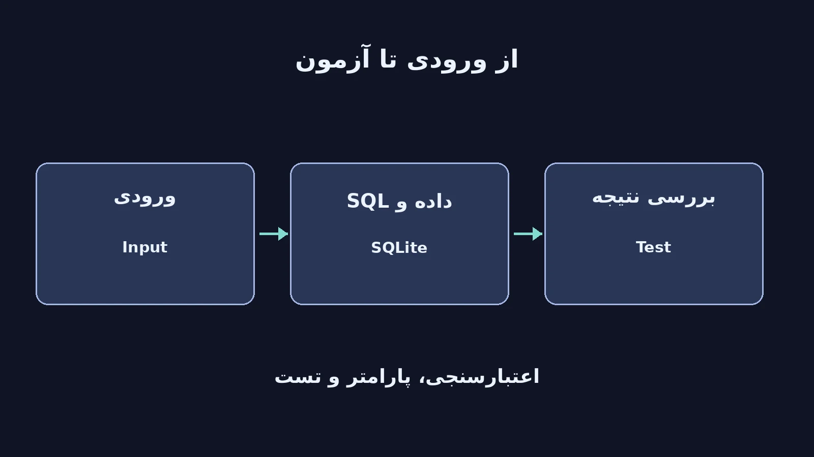

**شکل ۱۴-۱ — مسیر آموزشی و مرز اعتماد.** پارامتری‌کردن به‌تنهایی مجوز دسترسی یا امنیت کامل را تضمین نمی‌کند.

## ۴. طراحی و بازبینی

وظایف را جدا کنید: یک تابع اعتبارسنجی و درج می‌کند، تابع دیگر پرس‌وجو را انجام می‌دهد، و نمایش خروجی در `main` است. نام روشن، ورودی و خروجی مشخص و توابع کوچک آزمون و تغییر را آسان می‌کنند. از تکرار بی‌دلیل بپرهیزید اما تجرید پیچیده را زودهنگام تحمیل نکنید. بازبینی کد شامل خوانایی، درستی، خطاها، کارایی، امنیت و آزمایش است.

برای تغییرات Git، `git diff` را ببینید، فایل‌های مرتبط را stage کنید و آزمون‌ها را قبل از commit اجرا کنید. در پروژه تیمی بازبینی مستقل و اجرای خودکار آزمون‌ها در CI کمک می‌کند، ولی CI جای تصمیم مهندسی را نمی‌گیرد.

## ۵. داده رابطه‌ای و SQL

**پایگاه داده رابطه‌ای (Relational Database)** داده را در جدول‌هایی از سطر و ستون سازمان می‌دهد. **SQL** زبان تعریف و پرس‌وجوی داده است. SQLite یک موتور تعبیه‌شده است؛ در این پروژه `:memory:` یعنی داده فقط در حافظه اتصال است و پس از بسته‌شدن از بین می‌رود، نه ذخیره دائمی.

در مثال، جدول `sessions` دو ستون `topic` و `minutes` دارد. `CREATE TABLE` ساختار را ایجاد و `INSERT` سطر را درج می‌کند؛ `SELECT`، `WHERE` و `SUM` انتخاب، فیلتر و جمع را انجام می‌دهند. `COALESCE(SUM(minutes), 0)` برای مجموعه بدون سطر صفر می‌دهد. در سیستم واقعی برای موجودیت‌ها و روابط مناسب کلید، محدودیت، نسخه‌بندی schema، پشتیبان‌گیری و سیاست دسترسی تعیین کنید.

## ۶. پارامتر، تراکنش و امنیت اولیه

هرگز مقدار نامطمئن را با الحاق رشته داخل SQL قرار ندهید. در SQLite برای **مقدار داده** از `?` و دنباله پارامترها استفاده کنید؛ موتور مقدار را داده در نظر می‌گیرد، نه بخشی از دستور [۳، ۴]. جای‌نگهدار برای نام جدول یا ستون نیست: ساختار پویا را از گزینه‌های ثابت و مجاز برنامه انتخاب کنید. اعتبارسنجی، کمترین سطح دسترسی و بررسی مجوز کاربر همچنان لازم‌اند [۴].

`with db:` تراکنش را در صورت موفقیت commit و در صورت خطا rollback می‌کند؛ **اتصال را نمی‌بندد**، به همین دلیل برنامه در `finally` آن را می‌بندد [۳]. این مثال فقط درج ساده را آموزش می‌دهد، نه طراحی همزمانی یا امنیت production. رمز و کلید را در کد، Git و log نگذارید؛ از مدیریت امن اسرار، احراز هویت، مجوز و محافظت از داده استفاده کنید. روی ورودی نامطمئن `eval` یا دستور shell نسازید.

## ۷. پروژه: دفتر مطالعه در SQLite

دو فایل زیر را کنار هم ذخیره کنید. این کد فقط از کتابخانه استاندارد استفاده می‌کند و فایل یا شبکه را تغییر نمی‌دهد. ورودی موضوع خالی، عدد منفی، بیش از ۱۴۴۰ و `True` را رد می‌کند. محدودیت ۱۴۴۰ قرارداد آموزشی است، نه ویژگی ذاتی SQLite.

**`study_db.py`:**
```python
"""Small in-memory SQLite study log; no external services or files."""
import sqlite3


def create_database():
    db = sqlite3.connect(':memory:')
    db.execute('CREATE TABLE sessions (topic TEXT NOT NULL, minutes INTEGER NOT NULL CHECK(minutes >= 0))')
    return db


def add_session(db, topic, minutes):
    if not isinstance(topic, str) or not topic.strip():
        raise ValueError('topic must be non-empty')
    if type(minutes) is not int or not 0 <= minutes <= 1440:
        raise ValueError('minutes must be an integer from 0 to 1440')
    with db:
        db.execute('INSERT INTO sessions (topic, minutes) VALUES (?, ?)', (topic.strip(), minutes))


def minutes_for(db, topic):
    row = db.execute('SELECT COALESCE(SUM(minutes), 0) FROM sessions WHERE topic = ?', (topic,)).fetchone()
    return row[0]


def main():
    db = create_database()
    try:
        add_session(db, 'python', 30)
        add_session(db, 'python', 45)
        add_session(db, 'math', 60)
        print('python_minutes=', minutes_for(db, 'python'))
        print('missing_minutes=', minutes_for(db, 'missing'))
    finally:
        db.close()


if __name__ == '__main__':
    main()
```

اتصال حافظه‌ای در هر اجرا تازه است. `topic.strip()` فضاهای ابتدا و انتهای متن را در درج حذف می‌کند؛ جست‌وجو در این نمونه مقدار را بدون پاک‌سازی اضافی استفاده می‌کند. در سامانه واقعی این قرارداد باید برای هر دو مسیر دقیق طراحی شود. SQLite بررسی `CHECK` منفی را هم انجام می‌دهد اما سایر اعتبارسنجی‌های برنامه را جایگزین نمی‌کند.

## ۸. آزمون و اجرای پروژه

**`test_study_db.py`:**
```python
import unittest
from study_db import create_database, add_session, minutes_for


class StudyTests(unittest.TestCase):
    def setUp(self):
        self.db = create_database()

    def tearDown(self):
        self.db.close()

    def test_sum_and_missing(self):
        add_session(self.db, 'python', 30)
        add_session(self.db, 'python', 45)
        self.assertEqual(minutes_for(self.db, 'python'), 75)
        self.assertEqual(minutes_for(self.db, 'math'), 0)

    def test_invalid_values(self):
        for topic, minutes in [('', 1), ('x', -1), ('x', True), ('x', 1441)]:
            with self.subTest(topic=topic, minutes=minutes):
                with self.assertRaises(ValueError):
                    add_session(self.db, topic, minutes)

    def test_untrusted_value_is_literal(self):
        add_session(self.db, 'python', 30)
        self.assertEqual(minutes_for(self.db, "python' OR 1=1 --"), 0)
        self.assertEqual(minutes_for(self.db, 'python'), 30)


if __name__ == '__main__':
    unittest.main()
```

در پوشه پروژه `python study_db.py` و `python -m unittest -v` را اجرا کنید. در محیط آزمون Python 3.13.16 خروجی برنامه `python_minutes= 75` و `missing_minutes= 0` و گزارش آزمون شامل `Ran 3 tests` و `OK` بود. آزمون ورودی ظاهراً SQL را **به‌صورت مقدار واقعی** به تابع می‌دهد و انتظار صفر دارد؛ این یک بررسی محدود است و جای ممیزی امنیتی را نمی‌گیرد.

**عیب‌یابی:** `ModuleNotFoundError` برای `study_db` معمولاً یعنی آزمون را بیرون پوشه فایل‌ها اجرا کرده‌اید؛ وارد همان پوشه شوید یا از دستور discover مناسب استفاده کنید. `sqlite3` بخشی از کتابخانه استاندارد Python است، اما در برخی توزیع‌های سفارشی ممکن است ماژول ساخته نشده باشد. خطای تست را با مقدار مورد انتظار و traceback مقایسه کنید، نه اینکه آزمون را برای سبزشدن بی‌دلیل ضعیف کنید.

## ۹. تمرین، ارزیابی و توسعه

**پرسش:** ۱) تفاوت خطای منطقی و استثنا چیست؟ ۲) سه گام Arrange/Act/Assert کدام‌اند؟ ۳) آیا test pass اثبات امنیت است؟ ۴) `WHERE` چه می‌کند؟ ۵) پارامتر `?` برای چه استفاده می‌شود؟ ۶) آیا پارامتر جای نام جدول را می‌گیرد؟ ۷) آیا `with db` اتصال SQLite را می‌بندد؟ ۸) چرا رمز را نباید log کرد؟

**تمرین:** جمع ۳۰، ۴۵ و ۶۰ برابر ۱۳۵ است؛ مجموع موضوع python در برنامه ۷۵ است، نه ۱۳۵. تست ورودی مرزی صفر و ۱۴۴۰ را اضافه کنید و نتایج را بررسی کنید. تست درج موضوع فارسی بنویسید. **مینی‌پروژه:** تعداد جلسه‌ها را با پرس‌وجوی پارامتری به‌دست آورید و آزمون صفر و چند سطر بنویسید؛ پیش از تغییر کد خروجی مورد انتظار را مشخص کنید.

**قبولی:** دست‌کم ۷ پاسخ صحیح، اجرای سه آزمون موجود و دو آزمون جدید. پاسخ: ۱) خروجی غلط بدون الزام استثنا/خطای گزارش‌شده در اجرا؛ ۲) آماده‌سازی، اجرا، بررسی؛ ۳) خیر؛ ۴) فیلتر؛ ۵) اتصال مقدار؛ ۶) خیر؛ ۷) خیر؛ ۸) خطر افشا.

## ۱۰. منابع و واژه‌نامه

**مرور: ۵ نوامبر ۲۰۲۶.** پروژه در Python 3.13.16 با SQLite حافظه‌ای آزموده شد؛ اتصال شبکه، امنیت production و پایگاه داده چندکاربره آزموده نشدند. فصل ۱۵ ابزارهای تحلیل داده و نمودار را معرفی می‌کند.

Debugging، Traceback، Unit Test، Integration Test، Regression، SQL، Database، Transaction، Parameterized Query، Least Privilege.

**منابع؛ مراجعه ۵ نوامبر ۲۰۲۶:** [۱] Python Software Foundation، «Errors and Exceptions»، مستندات Python 3.13، [منبع](https://docs.python.org/3.13/tutorial/errors.html). [۲] Python Software Foundation، «unittest»، مستندات 3.13، [منبع](https://docs.python.org/3.13/library/unittest.html). [۳] Python Software Foundation، «sqlite3»، مستندات 3.13، [منبع](https://docs.python.org/3.13/library/sqlite3.html). [۴] OWASP، «SQL Injection Prevention Cheat Sheet»، تاریخ صفحه نامشخص، [منبع](https://cheatsheetseries.owasp.org/cheatsheets/SQL_Injection_Prevention_Cheat_Sheet.html).

## پیوست تکمیلی: آموزش، پروژه و آزمون‌های بیشتر

### فصل ۱۴ — عیب‌یابی، آزمون، طراحی نرم‌افزار، SQL و امنیت پایه

**هنر و علم ساخت هوش | جلد اول | Babak & Ai**  
**بررسی منابع: ۵ نوامبر ۲۰۲۶**

### ۱. از «کار می‌کند» تا «می‌توان به آن اعتماد کرد»

یک برنامه ممکن است روی داده معمولی کار کند اما برای ورودی خالی، خطای فایل یا داده‌ای نامعمول شکست بخورد. مهندسی نرم‌افزار یعنی مشخص‌کردن انتظار، آزمایش منظم و محدودکردن پیامد خطا؛ نه صرفاً نوشتن خروجی نمونه. در این فصل یک سامانه کوچک ثبت مطالعه می‌سازیم، آن را با SQLite می‌آزماییم و با اصول امنیتی آشنا می‌شویم.

**پیش‌نیاز:** توابع، استثنا و محیط فصل‌های ۱۱ تا ۱۳. **هدف:** خواندن traceback، طراحی تست و مرزهای ورودی، نوشتن SQL پارامتری و درک محدودیت امنیت. نمونه از کتابخانه استاندارد Python استفاده می‌کند.

### ۲. عیب‌یابی گام‌به‌گام

**عیب‌یابی (Debugging)** روند پیدا کردن علت رفتار غیرمنتظره است. ابتدا رفتار مورد انتظار و رفتار واقعی را دقیق بنویسید؛ سپس کوچک‌ترین ورودی بازتولیدکننده را بیابید، نسخه و محیط را ثبت کنید، و فرضیه‌ها را یکی‌یکی بیازمایید. تفاوت بین نشانه و علت مهم است: پیام نبود فایل ممکن است ناشی از پوشه کاری اشتباه باشد، نه محتوای فایل.

Traceback معمولاً زنجیره فراخوانی‌ها و در پایان نوع و پیام استثنا را نشان می‌دهد. از آخر به نوع خطا نگاه کنید، سپس سطرهای برنامه خود را دنبال کنید. `ValueError` معمولاً نشان‌دهنده مقدار نامناسب و `TypeError` ناسازگاری نوع عملیات است؛ همیشه زمینه را بخوانید. قبل از تغییر کد، ورودی‌ها را مشاهده کنید و بعد از اصلاح، آزمون بازگشتی برای جلوگیری از تکرار اضافه کنید.

`logging` برای ثبت رویداد با سطح‌هایی مثل INFO و ERROR مناسب است [۱]. گزارش نباید token، رمز، داده شخصی یا کل payload حساس را در خود داشته باشد. چاپ موقت کمک می‌کند اما لاگ کنترل‌شده با دسترسی و نگهداری مناسب برای پروژه واقعی بهتر است.

### ۳. طراحی و جداسازی مسئولیت

تابعی که ورودی را بررسی، SQL را اجرا، HTML را تولید و شبکه را مدیریت می‌کند دشوارتر آزموده می‌شود. کارها را با رابط مشخص جدا کنید: اعتبارسنجی، عملیات داده و نمایش. جداسازی زیاد هم پیچیدگی می‌آورد؛ بر اساس نیاز، سادگی و خوانایی تصمیم بگیرید.

**قرارداد** مشخص می‌کند چه ورودی‌هایی پذیرفته و چه خروجی یا خطایی انتظار می‌رود. در پروژه، `minutes` عدد صحیح ۰ تا ۱۴۴۰ و موضوع رشته غیرخالی است؛ `True` عمداً رد می‌شود. این دامنه یک انتخاب آموزشی است، نه تعریف همگانی جلسه مطالعه. ورودی نامعتبر با `ValueError` رد می‌شود.

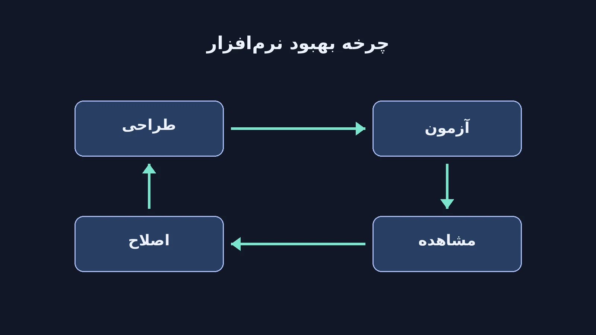

**شکل ۱۴-۱ — چرخه بهبود.** عبور از آزمون فقط آنچه آزموده شده را پوشش می‌دهد، نه همه رفتارهای ممکن.

### ۴. آزمون واحد و یکپارچگی

**آزمون واحد (Unit Test)** رفتاری کوچک را جداگانه بررسی می‌کند. **آزمون یکپارچگی (Integration Test)** همکاری اجزا را می‌سنجد؛ تست پایگاه‌داده واقعی در حافظه در پروژه ما نیز جنبه یکپارچگی دارد. آزمون سر تا سر مسیر گسترده‌تری از کاربر تا نتیجه را بررسی می‌کند. مرزها بسته به پروژه تغییر می‌کنند.

هر آزمون با آماده‌سازی، اجرا و مقایسه نتیجه مورد انتظار ساخته می‌شود. `unittest.TestCase`، `setUp` و `tearDown` به ساخت آزمون‌های مستقل کمک می‌کنند [۲]. افزون بر حالت عادی، خالی، صفر، مرز بالا، خارج محدوده، نوع اشتباه و متن غیرمعمول را بررسی کنید. آزمون موفق اثبات نبود همه باگ‌ها یا امنیت کامل نیست.

### ۵. SQL و داده رابطه‌ای

در یک پایگاه رابطه‌ای داده‌ها به شکل جدول، ستون و سطر سازمان می‌یابند. **SQL** زبان رایج تعریف و پرس‌وجوی داده است؛ جزئیات میان موتورهای مختلف تفاوت دارند. SQLite کتابخانه‌ای سبک است که برای استفاده معمول به فرایند سرور جداگانه نیاز ندارد [۳]. `:memory:` یک پایگاه موقت در حافظه همان اتصال می‌سازد؛ با بستن آن داده از دست می‌رود.

`CREATE TABLE` جدول می‌سازد؛ `INSERT` سطر اضافه می‌کند؛ `SELECT` اطلاعات می‌خواند و `WHERE` فیلتر می‌کند. `SUM` مجموع را برمی‌گرداند؛ در نبود سطر ممکن است NULL باشد، پس در مثال `COALESCE(..., 0)` صفر می‌دهد. `commit` تراکنش تغییرات را ثبت می‌کند؛ برای داده واقعی باید تراکنش، خطا و بازیابی را متناسب با محیط طراحی کرد.

### ۶. تزریق و پارامترگذاری

داده کاربر را با چسباندن رشته داخل SQL قرار ندهید. در SQLite از placeholder `?` و پارامتر جداگانه استفاده کنید: `execute('SELECT ... WHERE topic = ?', (topic,))`. متن ورودی به‌عنوان داده به موتور داده می‌شود، نه بخشی از دستور SQL [۳، ۴]. این حفاظت برای مقدارهاست؛ نام جدول/ستون را نمی‌توان با همین placeholder دلخواه کرد و اگر واقعاً پویا باشند باید از فهرست مجاز دقیق انتخاب شوند.

اعتبارسنجی نوع و محدوده مفید است، اما جایگزین پارامترگذاری نیست. امنیت نیازمند لایه‌های دیگر از جمله کنترل دسترسی، حداقل سطح مجوز، مدیریت امن کلیدها، به‌روزرسانی و بررسی وابستگی‌هاست. مثال حافظه‌ای ما احراز هویت، مجوز، چندکاربری، پشتیبان یا محصول آماده تولید نیست.

### ۷. پروژه: ثبت جلسه و پرس‌وجوی امن

`study_db.py` را بسازید و اجرا کنید. داده‌ها ساختگی و پایگاه موقتی‌اند. خروجی مورد انتظار `python_minutes= 75` و `unknown_minutes= 0` است.

```python
"""A small in-memory study tracker; no network or persistent files."""
import sqlite3


def setup(connection):
    connection.execute('CREATE TABLE sessions (topic TEXT NOT NULL, minutes INTEGER NOT NULL)')


def add_session(connection, topic, minutes):
    if not isinstance(topic, str) or not topic.strip():
        raise ValueError('topic must be a non-empty string')
    if type(minutes) is not int or not 0 <= minutes <= 1440:
        raise ValueError('minutes must be an integer between 0 and 1440')
    connection.execute('INSERT INTO sessions (topic, minutes) VALUES (?, ?)',
                       (topic.strip(), minutes))
    connection.commit()


def total_for(connection, topic):
    row = connection.execute('SELECT COALESCE(SUM(minutes), 0) FROM sessions WHERE topic = ?',
                             (topic,)).fetchone()
    return row[0]


def main():
    connection = sqlite3.connect(':memory:')
    try:
        setup(connection)
        add_session(connection, 'python', 30)
        add_session(connection, 'python', 45)
        add_session(connection, 'math', 20)
        print('python_minutes=', total_for(connection, 'python'))
        print('unknown_minutes=', total_for(connection, 'unknown'))
    finally:
        connection.close()


if __name__ == '__main__':
    main()
```

دو جلسه Python برابر ۳۰ و ۴۵ دقیقه و جلسه math برابر ۲۰ دقیقه درج می‌شوند. `total_for` فقط موضوع مشخص را جمع می‌کند. اتصال در `finally` بسته می‌شود. هر insert در این مثال جداگانه commit می‌شود؛ برای چند عملیات وابسته در محصول واقعی باید مرز تراکنش و rollback را طراحی کنید.

### ۸. پروژه: مجموعه آزمون

فایل `test_study_db.py` را کنار فایل قبلی ذخیره کنید. دستور: `python -m unittest -v test_study_db` از داخل پوشه؛ یا `python -m unittest discover -s book-engineering/projects/14-testing-sql -v` از ریشه مخزن. سه تست مستقل اجرا می‌شود:

```python
import sqlite3
import unittest
from study_db import setup, add_session, total_for


class StudyDBTests(unittest.TestCase):
    def setUp(self):
        self.db = sqlite3.connect(':memory:')
        setup(self.db)

    def tearDown(self):
        self.db.close()

    def test_sum_and_empty(self):
        add_session(self.db, 'python', 30)
        add_session(self.db, 'python', 45)
        self.assertEqual(total_for(self.db, 'python'), 75)
        self.assertEqual(total_for(self.db, 'math'), 0)

    def test_boundaries_and_invalid(self):
        for value in (0, 1440):
            add_session(self.db, 'x', value)
        for value in (-1, 1441, True, 1.5):
            with self.subTest(value=value), self.assertRaises(ValueError):
                add_session(self.db, 'x', value)
        with self.assertRaises(ValueError):
            add_session(self.db, ' ', 10)

    def test_parameter_is_data(self):
        add_session(self.db, 'python', 30)
        self.assertEqual(total_for(self.db, "python' OR 1=1 --"), 0)
        self.assertEqual(total_for(self.db, 'python'), 30)


if __name__ == '__main__':
    unittest.main()
```

تست اول جمع و حالت بدون سطر، دوم مرزها و داده نامعتبر و سوم رفتار متن شبیه تزریق را می‌سنجد. تست سوم یک مثال محدود است، نه ممیزی امنیت جامع. اجرا در Python 3.13.16: `Ran 3 tests ... OK`. اگر import خطا داد، پوشه و دستور اجرا را بررسی کنید.

### ۹. تمرین و ارزیابی

**پرسش‌ها:** ۱) تفاوت نشانه و علت چیست؟ ۲) چرا نمونه حداقلی مفید است؟ ۳) unit و integration چه تفاوتی دارند؟ ۴) چرا تست صفر و حد بالا مهم است؟ ۵) SQL پارامتری چه چیزی را جدا می‌کند؟ ۶) آیا placeholder نام جدول را انتخاب می‌کند؟ ۷) `:memory:` چقدر پایدار است؟ ۸) آیا آزمون موفق امنیت کامل را ثابت می‌کند؟

**تمرین:** تابعی برای شمارش تعداد جلسات یک موضوع با پارامتر SQL بنویسید و برای موضوع نبودنی و موجود تست اضافه کنید. **محاسبه:** سه جلسه ۳۰، ۴۵ و ۲۰ دقیقه مجموعاً ۹۵ دقیقه‌اند؛ مجموع Python در مثال ۷۵ دقیقه است. **مینی‌پروژه:** قرارداد، دو تست مرزی، آزمون موضوع ناموجود، لاگ بدون اطلاعات شخصی و مستندات اجرا تهیه کنید. برای قبولی دست‌کم ۷ پاسخ صحیح و اجرای موفق آزمون‌ها لازم است.

پاسخ‌ها: ۱) مشاهده/منشأ؛ ۲) کاهش عوامل؛ ۳) جزء/همکاری اجزا؛ ۴) کشف خطای مرزی؛ ۵) ساختار و داده؛ ۶) خیر؛ ۷) عمر اتصال؛ ۸) خیر.

### ۱۰. منابع و ادامه مسیر

**واژه‌ها:** Debugging، Traceback، Logging، Unit Test، Integration Test، Contract، SQL، Table، Query، Transaction، Parameterized Query، Injection. فصل ۱۵ ابزارهای داده NumPy، Pandas، Matplotlib و Jupyter را آموزش می‌دهد.

**منابع اولیه؛ بررسی ۵ نوامبر ۲۰۲۶:** [۱] Python Software Foundation، [logging](https://docs.python.org/3.13/library/logging.html)، مستندات Python 3.13. [۲] Python Software Foundation، [unittest](https://docs.python.org/3.13/library/unittest.html). [۳] Python Software Foundation، [sqlite3](https://docs.python.org/3.13/library/sqlite3.html). [۴] OWASP، [Injection Prevention Cheat Sheet](https://cheatsheetseries.owasp.org/cheatsheets/Injection_Prevention_Cheat_Sheet.html)، تاریخ صفحه متغیر.

---

# فصل ۱۵ — NumPy، Pandas، Matplotlib و Jupyter

**هنر و علم ساخت هوش | جلد اول | Babak & Ai**
**نسخه ۱.۰ · بررسی منابع: ۵ نوامبر ۲۰۲۶**

## ۱. از جدول کوچک تا تحلیل داده

داده به‌تنهایی پاسخ نیست: باید منشأ، واحد، خطا، داده گمشده، سؤال و محدودیت آن را بشناسیم. در این فصل آرایه عددی NumPy، جدول Pandas، تصویرسازی Matplotlib و محیط تعاملی Jupyter را می‌آموزیم. **پیش‌نیاز:** Python، تابع، فایل و محیط مجازی. **پروژه:** تحلیل چهار سطر ساختگی مطالعه، با گزارش رکورد ناقص و نمودار WebP.

این داده آموزشی ساختگی است، نه نمونه‌ای نماینده از رفتار انسان‌ها. تحلیل توصیفی آن رابطه علّی یا کیفیت یادگیری را نشان نمی‌دهد. در کار واقعی، رضایت، حریم خصوصی، مجوز داده، واحد اندازه‌گیری و روش نمونه‌گیری اهمیت دارند.

## ۲. NumPy: آرایه و شکل

**NumPy** ابزار محاسبات عددی و `ndarray` ساختار اصلی آن است [۱]. آرایه معمولاً عناصر هم‌نوع با `dtype` مشخص دارد؛ `shape` اندازه هر بُعد است. برخلاف لیست Python، جمع دو آرایه سازگار معمولاً عضو به عضو انجام می‌شود.

```python
import numpy as np
a = np.array([30, 45, 60])
print(a.shape)        # (3,)
print(a + 10)         # [40 55 70]
print(a.mean())       # 45.0
```

اندیس از صفر شروع می‌شود. برش پایه اغلب **view** است، پس تغییرش ممکن است آرایه اصلی را هم تغییر دهد؛ `copy()` نسخه مستقل می‌سازد. **Broadcasting** در شکل‌های سازگار امکان عملیات بین آرایه‌ها با شکل متفاوت می‌دهد؛ سازگاری را بررسی کنید، چون نتیجه‌ای با شکل ناخواسته ممکن است بدون خطا تولید شود. `dtype`، سرریز اعداد صحیح و خطای گردکردن اعشاری در محاسبات بزرگ اهمیت دارند.

## ۳. Pandas: جدول و انتخاب

**DataFrame** جدولی دارای ردیف و ستون و **Series** معمولاً نمایش یک ستون است [۲]. `pd.read_csv` CSV را می‌خواند؛ `head()`, `info()` و `dtypes` برای بازبینی اولیه مفیدند. نام ستون، واحد، نوع، داده‌های تکراری و گمشده را بررسی کنید. CSV نامطمئن ممکن است حجیم باشد؛ داده و خروجی را پیش از اشتراک‌گذاری بازبینی کنید.

```python
import pandas as pd
df = pd.DataFrame({'topic': ['python', 'math'], 'minutes': [30, 60]})
print(df[df['minutes'] >= 45])
```

`groupby('topic')['minutes'].sum()` گروه‌ها را جدا، جمع هر گروه را محاسبه و نتیجه‌ها را ترکیب می‌کند [۳]. `size` تعداد سطرها را می‌شمارد، در حالی که `count` مقادیر غیرگمشده را می‌شمارد. ترتیب و رفتار مقادیر گمشده را با نیاز و نسخه کتابخانه بررسی کنید.

## ۴. داده ناقص و تصمیم تحلیلی

در داده پروژه، یک سطر math دقیقه ندارد. نبود مقدار به معنای صفر نیست. برای این تمرین **حذف سطرهای ناقص** را انتخاب و تعداد آن‌ها را گزارش می‌کنیم؛ ممکن است در پژوهش واقعی این کار سوگیری ایجاد کند. روش جایگزین مانند تکمیل مقدار یا جمع‌آوری مجدد باید بر اساس زمینه، علت مفقودشدن و مستندسازی انتخاب شود. هرگز فرض نکنید یک روش برای همه داده‌ها صحیح است.

پس از حذف یک سطر، سه مقدار ۳۰، ۴۵، ۶۰ می‌ماند. مجموع ۱۳۵ دقیقه و میانگین ۴۵ دقیقه است؛ جمع python برابر ۷۵ و math برابر ۶۰ است. این میانگین روی **جلسه‌های کامل** محاسبه شده، نه روی همه چهار سطر و نه میانگین روزانه یا فردی.

## ۵. Matplotlib: نمودار مسئولانه

`plt.subplots()` یک **Figure** و ناحیه رسم **Axes** می‌سازد؛ `ax.bar` نمودار ستونی و `set` عنوان و برچسب محور را تنظیم می‌کند [۴]. محور و واحد را روشن بنویسید و نمودار مناسب سؤال انتخاب کنید؛ تفاوت مقیاس، حذف داده و تعداد نمونه می‌تواند خواننده را گمراه کند. نمودار ستونی با محور عمودی از صفر برای مقایسه اندازه‌ها معمولاً خواناتر است.

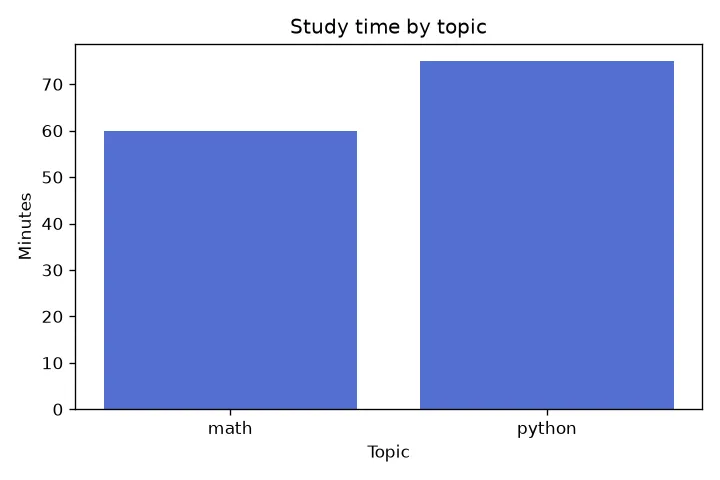

**شکل ۱۵-۱ — داده ساختگی پروژه.** سطر بدون دقیقه حذف شده؛ شکل توسط کد پروژه تولید شده است. این نمودار اختلاف در مجموع جلسه‌های مشاهده‌شده را نشان می‌دهد، نه تفاوت مهارت یا علت.

## ۶. Jupyter: سلول، kernel و تکرارپذیری

Jupyter Notebook سندی تعاملی با سلول‌های کد و متن است؛ کد در فرایند **kernel** اجرا می‌شود [۵]. مثلاً یک سلول واردکردن کتابخانه‌ها و سلول بعدی تعریف داده را در خود جای می‌دهد. خروجی یک سلول می‌تواند به متغیری وابسته باشد که قبلاً در سلولی دیگر ساخته شده است، حتی اگر ترتیب ظاهری سلول‌ها فرق کند. برای بازتولید، kernel را restart و همه سلول‌ها را از ابتدا به ترتیب اجرا کنید.

نسخه Python، کتابخانه‌ها، ورودی و دستور اجرا را یادداشت کنید. پیش از اشتراک‌گذاری، خروجی‌ها را برای داده شخصی و اسرار بررسی کنید؛ notebook ناشناس می‌تواند کد مخرب داشته باشد و نباید بی‌بررسی اجرا شود. پروژه زیر اسکریپت است؛ اجرای رابط Jupyter در این محیط آزمون نشده است.

## ۷. آماده‌سازی پروژه

در پوشه‌ای تمرینی، محیط مجازی فصل ۱۳ را بسازید و فعال کنید. سپس در همان محیط، از منابع بسته معتبر و با توجه به سازگاری سیستم نصب کنید:

```text
python -m pip install numpy pandas matplotlib
```

نصب به شبکه نیاز دارد؛ دستور فوق برای نسخه‌ها محدودیت قرار نمی‌دهد. برای بازتولید، نسخه‌های آزمایش‌شده را ثبت و سازگاری را در سیستم خود بررسی کنید: Python 3.13.16، NumPy 2.3.5، Pandas 2.2.3 و Matplotlib 3.11.2. نصب Jupyter برای اجرای اسکریپت لازم نیست. برای notebook می‌توانید طبق [راهنمای رسمی Jupyter](https://jupyter.org/install) آن را نصب کنید؛ در سرور عمومی بدون احراز هویت راه‌اندازی نکنید.

## ۸. پروژه: تحلیل داده ساختگی

فایل `analyze.py` را بسازید و در پوشه‌ای که اجازه نوشتن دارید با `python analyze.py` اجرا کنید. فایل `study_summary.webp` در **پوشه جاری بازنویسی می‌شود**؛ پیش از اجرا از نبود فایل مهم با همین نام مطمئن شوید. `Agg` برای محیط بدون نمایشگر است؛ داده داخل برنامه است و شبکه یا داده شخصی ندارد.

```python
"""Analyze a tiny synthetic study log; no network or real personal data."""
from io import StringIO
from pathlib import Path
import numpy as np
import pandas as pd
import matplotlib
matplotlib.use('Agg')  # Non-interactive backend for script/headless use.
import matplotlib.pyplot as plt

DATA = '''topic,minutes
python,30
python,45
math,60
math,
'''


def analyze(csv_text):
    df = pd.read_csv(StringIO(csv_text))
    if not {'topic', 'minutes'}.issubset(df.columns):
        raise ValueError('required columns: topic, minutes')
    df['minutes'] = pd.to_numeric(df['minutes'], errors='raise')
    if (df['minutes'].dropna() < 0).any():
        raise ValueError('minutes cannot be negative')
    missing = int(df[['topic', 'minutes']].isna().any(axis=1).sum())
    clean = df.dropna(subset=['topic', 'minutes'])
    if clean.empty:
        raise ValueError('no complete rows')
    totals = clean.groupby('topic', sort=True)['minutes'].sum()
    mean = float(np.mean(clean['minutes'].to_numpy()))
    return missing, totals, mean


def main():
    missing, totals, mean = analyze(DATA)
    print('omitted_rows=', missing)
    print('total_minutes=', int(totals.sum()))
    print('mean_minutes=', f'{mean:.1f}')
    print('by_topic=', totals.to_dict())
    fig, ax = plt.subplots(figsize=(6, 4))
    ax.bar(totals.index, totals.values, color='#536fd1')
    ax.set(title='Study time by topic', xlabel='Topic', ylabel='Minutes')
    fig.tight_layout()
    path = Path('study_summary.webp')
    fig.savefig(path, format='webp', dpi=120)
    plt.close(fig)
    print('chart=', path)


if __name__ == '__main__':
    main()
```

در اجرای آزمایشی خروجی `omitted_rows= 1`, `total_minutes= 135`, `mean_minutes= 45.0` و `by_topic= {'math': 60.0, 'python': 75.0}` بود و WebP ۷۲۰×۴۸۰ تولید شد. `to_numeric(errors='raise')` مقدار غیرعددی را رد می‌کند. این نمونه کنترل جامعی برای مقدارهای نامتناهی، زمان غیرواقعی، برچسب خالی یا فایل بسیار بزرگ ندارد و برای داده واقعی به اعتبارسنجی بیشتر نیاز دارد.

## ۹. آزمون، تمرین و ارزیابی

**آزمون همراه پروژه (`test_analyze.py`):**
```python
import unittest
from analyze import DATA, analyze

class AnalysisTests(unittest.TestCase):
    def test_summary(self):
        missing, totals, mean = analyze(DATA)
        self.assertEqual(missing, 1)
        self.assertEqual(totals.to_dict(), {'math': 60.0, 'python': 75.0})
        self.assertEqual(mean, 45.0)

    def test_invalid_data(self):
        for data in ['topic,minutes\na,-1\n', 'topic,minutes\na,\n', 'wrong,minutes\na,2\n']:
            with self.subTest(data=data), self.assertRaises(ValueError):
                analyze(data)

if __name__ == '__main__':
    unittest.main()
```

از پوشه پروژه `python -m unittest -v` را اجرا کنید؛ دو تست روی نسخه‌های بالا موفق بودند. اگر import خطا داد، محیط فعال و `python -m pip --version` را بررسی کنید. اگر نوشتن تصویر خطا داد، مسیر و پشتیبانی فرمت WebP/Pillow را در نصب خود بررسی کنید. در صورت تفاوت خروجی، نسخه کتابخانه‌ها را مقایسه کنید.

**پرسش:** ۱) shape چیست؟ ۲) آیا برش پایه NumPy همیشه مستقل است؟ ۳) DataFrame چیست؟ ۴) `count` و `size` چه تفاوتی در داده ناقص دارند؟ ۵) چرا مقدار گمشده لزوماً صفر نیست؟ ۶) مجموع سطرهای کامل و میانگین آن‌ها چقدر است؟ ۷) چرا اجرای نامرتب سلول‌ها خطر دارد؟ ۸) آیا نمودار پروژه نشان‌دهنده رابطه علّی است؟

**تمرین:** یک مقدار ۱۵ به موضوع math اضافه کنید؛ مجموع math برابر ۷۵ و میانگین چهار مقدار کامل ۳۷٫۵ می‌شود. تست خودکار این نتیجه را بنویسید. **مینی‌پروژه:** CSV ساختگی با پنج سطر و یک مقدار گمشده بسازید، حذف‌شده‌ها، مجموع و میانگین را با واحد گزارش کنید و نمودار WebP با عنوان و برچسب رسم کنید. برای داده واقعی درباره سوگیری و مجوز توضیح دهید.

**قبولی:** ۷ پاسخ درست، اجرای دو تست و تولید نمودار با مقادیر صحیح. پاسخ: ۱) اندازه ابعاد؛ ۲) خیر؛ ۳) جدول؛ ۴) `count` بدون مقدار گمشده و `size` تعداد سطر؛ ۵) مقدار ناشناخته است؛ ۶) ۱۳۵ و ۴۵؛ ۷) وضعیت پنهان kernel؛ ۸) خیر.

## ۱۰. منابع و واژه‌نامه

**مرور منابع: ۵ نوامبر ۲۰۲۶.** نتایج فقط بر داده مصنوعی و نسخه‌های اعلام‌شده آزمون شده‌اند؛ رابط تعاملی Jupyter آزمون نشده است. فصل ۱۶ به مبانی ریاضی می‌پردازد.

NumPy، Array، Shape، dtype، View، DataFrame، Series، Missing Value، Aggregation، Figure، Axes، Kernel، Notebook.

**منابع؛ مراجعه ۵ نوامبر ۲۰۲۶:** [۱] NumPy، «Absolute basics for beginners»، [منبع](https://numpy.org/doc/stable/user/absolute_beginners.html). [۲] pandas، «What kind of data does pandas handle?»، [منبع](https://pandas.pydata.org/docs/getting_started/intro_tutorials/01_table_oriented.html). [۳] pandas، «Summary statistics»، [منبع](https://pandas.pydata.org/docs/getting_started/intro_tutorials/06_calculate_statistics.html). [۴] Matplotlib، «Quick start guide»، [منبع](https://matplotlib.org/stable/users/explain/quick_start.html). [۵] Jupyter، «Running Code»، [منبع](https://jupyter-notebook.readthedocs.io/en/stable/examples/Notebook/Running%20Code.html). تاریخ صفحه‌ها متغیر یا نامشخص است.

## پیوست تکمیلی: آموزش، پروژه و آزمون‌های بیشتر

### فصل ۱۵ — NumPy، Pandas، Matplotlib و Jupyter

**هنر و علم ساخت هوش | جلد اول | Babak & Ai**  
**بررسی منابع: ۵ نوامبر ۲۰۲۶**

### ۱. تبدیل داده خام به پرسش پاسخ‌پذیر

تحلیل داده صرفاً کشیدن نمودار نیست. ابتدا پرسش را روشن کنید: «در داده ساختگی تمرین، مجموع زمان مطالعه هر موضوع چقدر است؟» سپس منشأ داده، تعریف ستون‌ها، خطا و مقادیر گمشده را بررسی، محاسبه را بازتولید و محدودیت نتیجه را بیان کنید. این نمونه آموزشی یک مشاهده کوچک ساختگی است و درباره رفتار جمعیت، علت موفقیت یا دقت یک مدل نتیجه‌گیری نمی‌کند.

**پیش‌نیاز:** توابع، فایل، محیط مجازی و آزمون. **هدف:** فهم آرایه، شکل و محور در NumPy؛ جدول و گروه‌بندی در Pandas؛ نمودار در Matplotlib؛ و اجرای منظم نوت‌بوک Jupyter.

### ۲. نصب و محیط قابل بازتولید

در محیط مجازی اختصاصی، با توجه به سیستم و منبع رسمی بسته‌ها را نصب کنید: `python -m pip install numpy pandas matplotlib pillow jupyterlab`. این فرمان نیازمند شبکه است؛ قبل از نصب، مجوز، منبع و نسخه‌های سازگار را بررسی کنید. `python -m pip --version` کمک می‌کند pip همان مفسر را صدا بزنید.

**محیط آزمایش واقعی این فصل:** Python 3.13.16، NumPy 2.3.5، Pandas 2.2.3، Matplotlib 3.11.2 و Pillow 13.0.0. نسخه‌ها را برای بازتولید ثبت کنید؛ این فهرست به‌تنهایی قفل کامل زنجیره وابستگی یا تضمین سازگاری همه سیستم‌ها نیست. نوت‌بوک با nbformat 5.11.1 و nbclient اجرا شد؛ آزمون رابط گرافیکی JupyterLab انجام نشده است.

### ۳. NumPy: آرایه، نوع و شکل

NumPy آرایه چندبعدی `ndarray` و عملیات عددی را فراهم می‌کند [۱]. در مثال `a = np.array([[1, 2, 3], [4, 5, 6]])` شکل `a.shape` برابر `(2, 3)` است: دو سطر و سه ستون؛ `a.ndim` برابر ۲ و `a.size` برابر ۶ است. `dtype` نوع داده عناصر را مشخص می‌کند و انتخاب آن بر دقت و حافظه اثر دارد.

`a.sum(axis=0)` سطرها را در امتداد محور صفر کاهش می‌دهد و خروجی `[5, 7, 9]` است؛ `a.sum(axis=1)` برای هر سطر `[6, 15]` می‌دهد. عملیات `a * 2` عنصر به عنصر است؛ برای ضرب ماتریسی از `@` با شکل سازگار استفاده می‌شود. broadcasting قواعد خاص سازگاری ابعاد دارد؛ همیشه شکل ورودی و خروجی را بررسی کنید.

### ۴. Pandas: جدول و پرس‌وجو

`Series` یک ساختار یک‌بعدی دارای برچسب و `DataFrame` جدول دارای ستون‌های نام‌دار است. `pd.read_csv` CSV را می‌خواند؛ `head()`، `dtypes` و `isna().sum()` برای بازرسی اولیه مفیدند. نوع و معنای هر ستون را تأیید کنید: «دقیقه» باید عدد معتبر و یکای اندازه‌گیری مشخص باشد.

در `df.groupby('topic')['minutes'].sum()` داده بر اساس موضوع گروه‌بندی و مجموع هر گروه محاسبه می‌شود [۲]. گروه‌بندی نتیجه را خلاصه می‌کند و ترتیب، مقدارهای گمشده و داده‌های تکراری ممکن است بر پاسخ اثر بگذارند. مقادیر گمشده برابر صفر نیستند: در پروژه یک ردیف بدون دقیقه را **گزارش و فقط برای محاسبه حذف** می‌کنیم؛ این تصمیم به مسئله وابسته است و ممکن است سوگیری ایجاد کند [۳].

### ۵. Matplotlib: نمودار و تفسیر

برای مقایسه مجموع گروه‌های گسسته از نمودار میله‌ای استفاده می‌کنیم. عنوان، نام محور و واحد لازم‌اند. شکل ۱۵-۱ داده ساختگی ما را نشان می‌دهد: Python برابر ۷۵ دقیقه و math برابر ۶۰ دقیقه؛ یک ردیف با دقیقه ناموجود کنار گذاشته شده است. نسبت ۷۵ به ۶۰ برابر ۱٫۲۵ است، اما از آن درباره جامعه یا رابطه علّی نتیجه نمی‌گیریم.

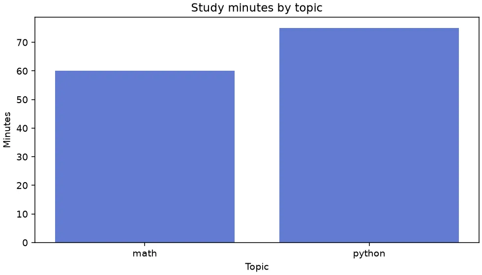

**شکل ۱۵-۱ — خلاصه داده ساختگی.** نمودار با Matplotlib ساخته و WebP ذخیره شده است. محور عمودی از صفر آغاز می‌شود؛ واحد دقیقه است. ساخت `Figure` بدون رابط گرافیکی برای خروجی فایل مناسب است [۴].

### ۶. Jupyter و خطر وضعیت پنهان

نوت‌بوک `.ipynb` سلول‌های کد، متن و خروجی را ذخیره می‌کند؛ **kernel** برنامه اجراکننده را نگه می‌دارد و متغیرها بین اجرای سلول‌ها باقی می‌مانند [۵]. اگر سلول‌ها را نامرتب اجرا کنید، خروجی ممکن است به متغیر قدیمی وابسته باشد. پیش از تحویل، kernel را restart و همه سلول‌ها را از بالا اجرا و خروجی‌ها را بررسی کنید.

فقط نوت‌بوک قابل اعتماد را اجرا کنید؛ کد نوت‌بوک مانند هر برنامه Python می‌تواند به فایل‌ها یا شبکه دسترسی پیدا کند. نوت‌بوک و خروجی‌ها ممکن است حاوی داده حساس باشند. در پروژه ما `study.ipynb` کنار `analyze.py` قرار دارد؛ از همان پوشه با `jupyter lab` باز کنید و سلول‌ها را به‌ترتیب اجرا کنید. اجرای نوت‌بوک با nbclient آزمایش شده، نه رابط JupyterLab.

### ۷. پروژه تحلیل داده ساختگی

فایل `analyze.py` را بسازید. داده داخلی چهار ردیف دارد: سه دقیقه معتبر ۳۰، ۴۵، ۶۰ و یک مقدار ناموجود. تحلیل دقیقه ناموجود را صفر فرض نمی‌کند. توابع از رشته CSV دریافت می‌کنند و نمودار در پوشه موقت ذخیره و پس از اجرا پاک می‌شود؛ برای نگهداری نمودار، با آگاهی مسیر خروجی دیگری به `make_plot` بدهید.

```python
"""Analyze synthetic study sessions, with explicit missing-data policy."""
from io import StringIO
from pathlib import Path
from tempfile import TemporaryDirectory
import numpy as np
import pandas as pd
from matplotlib.figure import Figure

DATA = '''topic,minutes
python,30
python,45
math,60
math,
'''


def analyze(csv_text):
    frame = pd.read_csv(StringIO(csv_text))
    if not {'topic', 'minutes'}.issubset(frame.columns):
        raise ValueError('missing required columns')
    frame['minutes'] = pd.to_numeric(frame['minutes'], errors='raise')
    if frame['topic'].isna().any() or frame['topic'].str.strip().eq('').any():
        raise ValueError('topic missing')
    present = frame['minutes'].dropna().to_numpy()
    if not np.isfinite(present).all() or (present < 0).any():
        raise ValueError('minutes must be finite and nonnegative')
    clean = frame.dropna(subset=['minutes']).copy()
    if clean.empty:
        raise ValueError('no measured minutes')
    totals = clean.groupby('topic')['minutes'].sum().sort_index()
    return clean, totals, int(frame['minutes'].isna().sum())


def make_plot(totals, filename):
    fig = Figure(figsize=(7, 4), layout='constrained')
    ax = fig.subplots()
    ax.bar(totals.index, totals.values, color='#627bd2')
    ax.set(title='Study minutes by topic', ylabel='Minutes', xlabel='Topic')
    fig.savefig(filename, format='webp', dpi=140)


def main():
    clean, totals, missing = analyze(DATA)
    print('valid_rows=', len(clean), 'missing_rows=', missing)
    print('mean_minutes=', float(np.mean(clean['minutes'].to_numpy())))
    print('totals=', {key: float(value) for key, value in totals.items()})
    with TemporaryDirectory() as directory:
        output = Path(directory) / 'study.webp'
        make_plot(totals, output)
        print('webp_created=', output.is_file())


if __name__ == '__main__':
    main()
```

اجرا: `python analyze.py`. خروجی آزمایش‌شده:

```text
valid_rows= 3 missing_rows= 1
mean_minutes= 45.0
totals= {'math': 60.0, 'python': 75.0}
webp_created= True
```

`np.isfinite` مقدار بی‌نهایت را رد می‌کند. ورودی منفی، موضوع ناموجود و نبود همه دقیقه‌ها رد می‌شوند. این مثال همه مشکلات داده مثل نام‌های تکراری با فاصله یا اختلاف واحد را حل نمی‌کند؛ برای داده واقعی طرح اعتبارسنجی باید کامل‌تر باشد.

### ۸. آزمون و بازبینی

فایل زیر را کنار برنامه ذخیره و از همان پوشه `python -m unittest -v test_analyze` اجرا کنید. فایل آزمون به Pillow نیاز دارد و محتوا و فرمت WebP را بررسی می‌کند:

```python
import unittest
from pathlib import Path
from tempfile import TemporaryDirectory
from PIL import Image
from analyze import DATA, analyze, make_plot


class AnalysisTests(unittest.TestCase):
    def test_summary(self):
        clean, totals, missing = analyze(DATA)
        self.assertEqual((len(clean), missing), (3, 1))
        self.assertEqual(totals.to_dict(), {'math': 60.0, 'python': 75.0})
        self.assertEqual(clean['minutes'].mean(), 45.0)

    def test_invalid(self):
        for data in ('topic,minutes\nx,-1\n', 'topic,minutes\nx,inf\n',
                     'topic,minutes\nx,\n', 'topic,minutes\n,5\n'):
            with self.subTest(data=data), self.assertRaises(ValueError):
                analyze(data)

    def test_webp(self):
        _, totals, _ = analyze(DATA)
        with TemporaryDirectory() as folder:
            p = Path(folder) / 'chart.webp'
            make_plot(totals, p)
            with Image.open(p) as image:
                self.assertEqual(image.format, 'WEBP')
                image.verify()


if __name__ == '__main__':
    unittest.main()
```

سه تست اجرا شده‌اند: خلاصه، چهار ورودی نامعتبر و تولید تصویر. نتیجه سه آزمون `OK` است؛ این آزمون‌ها کیفیت علمی تمام داده‌ها یا کارکرد همه نسخه‌ها را تضمین نمی‌کنند. خطای `ModuleNotFoundError` معمولاً نشان‌دهنده نصب نبودن بسته در مفسر فعال است؛ مسیر Python و محیط را بررسی کنید. اگر خروجی WebP ساخته نشد، پشتیبانی WebP در Pillow و مجوز پوشه موقت را بررسی کنید.

### ۹. تمرین و ارزیابی

**پرسش:** ۱) shape آرایه ۲×۳ چیست؟ ۲) `axis=0` در جمع این آرایه چه می‌کند؟ ۳) آیا مقدار گمشده همان صفر است؟ ۴) groupby چه می‌کند؟ ۵) میانگین ۳۰، ۴۵، ۶۰ چیست؟ ۶) چرا اجرای نامرتب نوت‌بوک خطرناک است؟ ۷) آیا نمودار فوق علّیت ثابت می‌کند؟ ۸) چرا نسخه محیط را ثبت می‌کنیم؟

**تمرین:** آرایه دو سطری مثال را بسازید و جمع محورهای ۰ و ۱ را بررسی کنید. سپس مقدار ناموجود را گزارش کرده، سیاست جایگزین مانند حذف یا تکمیل را با دلیل و محدودیت مقایسه کنید؛ به‌صورت خودکار صفرگذاری نکنید. **مینی‌پروژه:** داده ساختگی دیگری با دست‌کم دو گروه، یک داده گمشده، گزارش تعداد، آزمون مجموع و نمودار WebP همراه واحد تهیه کنید. برای قبولی ۷ پاسخ درست و سه آزمون موفق لازم است.

پاسخ‌ها: ۱) `(2, 3)`؛ ۲) جمع در امتداد سطرها؛ ۳) خیر؛ ۴) تقسیم و تجمیع؛ ۵) ۴۵؛ ۶) وضعیت پنهان kernel؛ ۷) خیر؛ ۸) کمک به تکرارپذیری.

### ۱۰. منابع و ادامه

واژه‌ها: ndarray، shape، axis، dtype، DataFrame، missing data، groupby، visualization، kernel و notebook. فصل ۱۶ ورود به جبر، توابع و لگاریتم است.

**منابع؛ بررسی ۵ نوامبر ۲۰۲۶:** [۱] NumPy، [Quickstart](https://numpy.org/doc/stable/user/quickstart.html). [۲] Pandas، [10 minutes to pandas](https://pandas.pydata.org/docs/user_guide/10min.html). [۳] Pandas، [Missing data](https://pandas.pydata.org/docs/user_guide/missing_data.html). [۴] Matplotlib، [FAQ](https://matplotlib.org/stable/users/faq.html). [۵] Project Jupyter، [What is Jupyter?](https://docs.jupyter.org/en/latest/what_is_jupyter.html). تاریخ صفحات متغیر است؛ نسخه آزمایش‌شده بالا مشخص شده است.

---

# فصل ۱۶ — جبر، معادله، تابع، توان، لگاریتم و نمودار

**هنر و علم ساخت هوش | جلد اول | Babak & Ai**
**نسخه ۱.۰ · بررسی منابع: ۵ نوامبر ۲۰۲۶**

## ۱. ریاضی زبان مدل‌سازی است

ریاضی ابزاری برای بیان فرض‌ها، محاسبه و بررسی نتیجه است؛ لازم نیست پیش از این فصل ریاضی پیشرفته بدانید. هدف ما حل معادله ساده، تشخیص دامنه تابع، محاسبه توان و لگاریتم و خواندن نمودار است. **پیش‌نیاز:** چهار عمل اصلی و اعداد منفی. **خروجی:** حل معادله خطی و آزمون تابع معکوس در Python.

نماد `x` می‌تواند تعداد ساعت و `y` هزینه باشد، اما هر مدل محدودیت و واحد دارد. فرمولی که برای یک محدوده داده مناسب است لزوماً بیرون آن معتبر نیست. در یادگیری ماشین، توابع می‌توانند پیش‌بینی، خطا یا تبدیل داده را توصیف کنند؛ معادله به‌تنهایی کیفیت مدل را تضمین نمی‌کند.

## ۲. عبارت، متغیر و ترتیب عملیات

**متغیر (Variable)** نمادی برای یک مقدار است. `2x + 3` عبارت جبری، `2` ضریب، `3` عدد ثابت و `x` متغیر است. اگر `x = 4`، مقدار عبارت `2×4 + 3 = 11` است. ترتیب معمول: پرانتز، توان، ضرب و تقسیم، سپس جمع و تفریق؛ ضرب و تقسیم هم‌اولویت‌اند و از چپ به راست انجام می‌شوند. مثلاً `12 / 3 × 2 = 8` نه ۲.

در Python علامت ضرب `*` و توان `**` است: `2*x + 3` و `2**3`. تقسیم بر صفر در اعداد حقیقی تعریف نشده است. کسر `(x+1)/(x-2)` فقط وقتی تعریف دارد که `x ≠ 2` باشد. ساده‌سازی نباید محدودیت‌های عبارت اصلی را فراموش کند.

## ۳. معادله و نامعادله

**معادله (Equation)** برابری دو عبارت است. با انجام عمل یکسان و مجاز در دو طرف، مجهول را جدا می‌کنیم:

```text
2x + 3 = 11
2x = 8
x = 4
بررسی: 2 × 4 + 3 = 11
```

برای `a*x+b=c` اگر `a ≠ 0` جواب یکتا `x=(c-b)/a` است. اگر `a=0` و `b=c` باشد همه اعداد حقیقی جواب‌اند؛ اگر `a=0` و `b≠c` باشد هیچ جوابی نیست. تقسیم دو طرف بر عبارتی که ممکن است صفر باشد بدون بررسی مجاز نیست. در نامعادله، ضرب یا تقسیم دو طرف در عدد **منفی** جهت علامت را معکوس می‌کند: `-2x > 6` یعنی `x < -3`.

## ۴. تابع، دامنه و بُرد

**تابع (Function)** به هر ورودی مجاز دقیقاً یک خروجی نسبت می‌دهد. در `f(x)=2x+3`، `f(4)=11`. **دامنه (Domain)** مجموعه ورودی‌های مجاز و **برد (Range)** مجموعه خروجی‌های حاصل است. برای تابع خطی روی اعداد حقیقی با شیب غیرصفر، دامنه و برد هر دو اعداد حقیقی‌اند. در `g(x)=1/(x-2)` دامنه همه اعداد حقیقی به‌جز ۲ است.

دو ورودی ممکن است خروجی برابر داشته باشند؛ مثلاً `h(x)=x²` و `h(2)=h(-2)=4`، اما هر ورودی هنوز فقط یک خروجی دارد. تابع معکوس روی دامنه مورد نظر باید مناسب تعریف شود؛ `x²` روی همه اعداد حقیقی وارون تابعی یکتا ندارد، ولی با محدودکردن دامنه به `x≥0` وارونش ریشه غیرمنفی است.

## ۵. نمودار و شیب

نمودار مجموعه نقاط `(x, f(x))` را در دستگاه مختصات نشان می‌دهد. محور افقی x و محور عمودی y است. در `f(x)=2x+3`، عرض از مبدأ `3` یعنی نقطه `(0,3)`، و شیب `2` یعنی به ازای افزایش یک واحد x، مقدار y دو واحد افزایش می‌یابد. به صورت کلی شیب خط غیرعمودی `Δy/Δx` است؛ این نسبت واحد y تقسیم بر واحد x دارد.

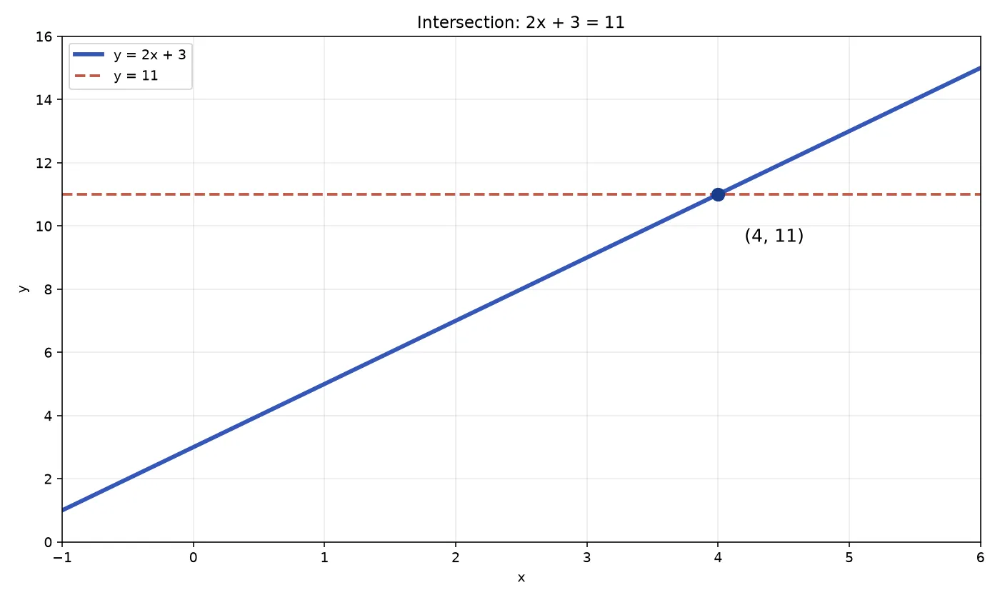

**شکل ۱۶-۱ — حل هندسی معادله.** تقاطع `y=2x+3` و `y=11` نقطه `(4,11)` است. خط‌کش و مقیاس را بررسی کنید؛ مختصات تقریبی از تصویر به‌تنهایی اثبات دقیق نیست. محورهای بریده یا مقیاس غیرخطی می‌توانند تفسیر را تغییر دهند.

## ۶. توان و رشد

برای عدد حقیقی `a` و عدد صحیح مثبت `n`، `a^n` ضرب `n` نسخه از `a` است؛ `2^3=8`. برای `a≠0`, `a^0=1` و `a^(-n)=1/a^n`. قوانین `a^m × a^n = a^(m+n)` و `(a^m)^n = a^(mn)` در دامنه‌هایی که عبارات تعریف‌اند برقرارند. `a^(m+n)` به‌طور کلی برابر `a^m + a^n` نیست.

تابع نمایی `f(x)=b^x` برای پایه مثبت و غیر یک تعریف می‌شود؛ اگر `b>1` افزایشی و اگر `0<b<1` کاهشی است [۱]. مثلاً دوبرابرشدن فرضی ۱۰۰ نمونه در سه مرحله مقدار `100×2³=800` می‌دهد؛ رشد نمایی فرض مدل است و نمی‌توان آن را بدون شواهد به واقعیت تعمیم داد.

## ۷. لگاریتم: توان ناشناخته

برای `b>0`, `b≠1` و `x>0`، رابطه `log_b(x)=y` دقیقاً معادل `b^y=x` است [۲]. پس `log_2(32)=5` و `log_2(1/4)=-2`. `ln(x)` لگاریتم طبیعی با پایه `e≈2.71828` است. لگاریتم حقیقی صفر و عدد منفی تعریف نشده است. دامنه `log_2(x-3)` برابر `x>3` است.

برای `u>0`, `v>0` و پایه مجاز: `log_b(uv)=log_b(u)+log_b(v)`، `log_b(u/v)=log_b(u)-log_b(v)` و `log_b(u^k)=k log_b(u)` برای k حقیقی. اما `log(u+v)` عموماً برابر `log(u)+log(v)` نیست: `log_2(2+2)=2` ولی `log_2(2)+log_2(2)=2` در این مورد تصادفاً برابر است؛ برای ۲ و ۸، طرف اول `log_2(10)≈3.322` و طرف دوم ۴ است. در ML لگاریتم در برخی زیان‌ها و مقیاس‌ها استفاده می‌شود؛ کاربرد و محدودیت آن را در فصل‌های بعد دقیق بررسی می‌کنیم.

## ۸. پروژه: حل و بررسی عددی

فایل `algebra.py` را بسازید؛ فقط کتابخانه استاندارد لازم دارد. برنامه سه حالت معادله را از هم جدا می‌کند و دامنه لگاریتم حقیقی را بررسی می‌کند. در محاسبه ممیز شناور اعداد بسیار بزرگ یا ضریب بسیار کوچک می‌توانند سرریز یا خطای عددی ایجاد کنند؛ این نمونه حل‌گر دقیق یا مقاوم در تمام مقیاس‌ها نیست.

```python
"""Linear equations and logarithms with explicit real-domain checks."""
import math


def solve_linear(a, b, c):
    """Solve a*x + b = c; identify unique, none, or infinitely many."""
    if not all(math.isfinite(v) for v in (a, b, c)):
        raise ValueError('coefficients must be finite')
    if a == 0:
        return ('infinite', None) if b == c else ('none', None)
    return ('unique', (c - b) / a)


def log_base(x, base):
    if not math.isfinite(x) or not math.isfinite(base) or x <= 0 or base <= 0 or base == 1:
        raise ValueError('require x > 0 and base > 0, base != 1, all finite')
    return math.log(x, base)


def main():
    kind, x = solve_linear(2, 3, 11)
    print('equation=', kind, 'x=', x)
    print('residual=', 2*x + 3 - 11)
    value = log_base(32, 2)
    print('log2_32=', value)
    print('roundtrip=', math.isclose(2**value, 32, rel_tol=1e-12))


if __name__ == '__main__':
    main()
```

اجرا: `python algebra.py`. خروجی آزمایش‌شده در Python 3.13.16:

```text
equation= unique x= 4.0
residual= 0.0
log2_32= 5.0
roundtrip= True
```

**باقیمانده (Residual)** اختلاف دو طرف پس از جایگذاری است؛ صفر یا نزدیک صفر برای ورودی محدود نشانه سازگاری عددی است، نه اثبات پایداری در همه شرایط. `math.isclose` با تلرانس مقایسه می‌کند؛ نزدیک صفر ممکن است تعیین `abs_tol` لازم باشد [۳]. مقایسه `a==0` در این پروژه صرفاً شرط دقیق ممیز شناور است و برای مسئله‌های دارای عدم قطعیت باید با توجه به مقیاس و مدل تصمیم گرفت.

## ۹. آزمون، تمرین و سنجش

**فایل `test_algebra.py`:**
```python
import math
import unittest
from algebra import solve_linear, log_base

class AlgebraTests(unittest.TestCase):
    def test_equations(self):
        self.assertEqual(solve_linear(2, 3, 11), ('unique', 4))
        self.assertEqual(solve_linear(0, 3, 3), ('infinite', None))
        self.assertEqual(solve_linear(0, 3, 4), ('none', None))
        with self.assertRaises(ValueError):
            solve_linear(math.inf, 1, 2)

    def test_logarithms(self):
        self.assertTrue(math.isclose(log_base(32, 2), 5, rel_tol=1e-12))
        self.assertTrue(math.isclose(log_base(0.25, 2), -2, rel_tol=1e-12))
        for x, b in [(0, 2), (-1, 2), (2, 1), (2, 0), (math.inf, 2)]:
            with self.subTest(x=x, base=b), self.assertRaises(ValueError):
                log_base(x, b)

if __name__ == '__main__':
    unittest.main()
```

در همان پوشه `python -m unittest -v` را اجرا کنید؛ دو تست شامل حالت‌های جواب یکتا، هیچ جواب، بی‌نهایت جواب و ورودی نامجاز لگاریتم در Python 3.13.16 موفق بودند. اگر import ناموفق است، هر دو فایل را در یک پوشه قرار دهید. `ValueError` برای `log_base(0,2)` رفتار مورد انتظار است.

**پرسش:** ۱) `3x-2=10` را حل کنید. ۲) `0x+3=4` چند جواب دارد؟ ۳) دامنه `1/(x-2)` چیست؟ ۴) `2^-3` چند است؟ ۵) `log_2(8)` چند است؟ ۶) دامنه حقیقی `ln(x-1)` چیست؟ ۷) شیب `y=-3x+2` چیست؟ ۸) آیا تابع `x²` روی تمام اعداد حقیقی وارون تابعی یکتا دارد؟

**تمرین نمودار:** نقاط `(0,3)` و `(4,11)` را رسم و شیب `(11-3)/(4-0)=2` را حساب کنید. **مینی‌پروژه:** برنامه را برای `3x-2=10` اجرا و جواب ۴ را جایگذاری کنید؛ یک آزمون برای پایه `1/2` و ورودی ۴ بنویسید که نتیجه `-2` را با تلرانس بررسی کند. **قبولی:** ۷ پاسخ درست، اجرای دو تست و انجام پروژه. پاسخ‌ها: ۱) ۴؛ ۲) صفر؛ ۳) همه به‌جز ۲؛ ۴) ۱/۸؛ ۵) ۳؛ ۶) `x>1`؛ ۷) `-3`؛ ۸) خیر.

## ۱۰. واژه‌نامه و منابع

**مرور: ۵ نوامبر ۲۰۲۶.** این فصل بر ریاضی حقیقی و محاسبات پایه تمرکز دارد، نه اعداد مختلط یا تضمین پایداری عددی. فصل بعد بردار و ماتریس را معرفی می‌کند.

Algebra، Variable، Equation، Inequality، Function، Domain، Range، Slope، Exponent، Logarithm، Inverse، Residual.

**منابع؛ مراجعه ۵ نوامبر ۲۰۲۶:** [۱] OpenStax، «Key Concepts: Exponential and Logarithmic Functions»، College Algebra 2e، ۲۰۲۱، [منبع](https://openstax.org/books/college-algebra-2e/pages/6-key-concepts). [۲] OpenStax، «Logarithmic Functions»، College Algebra 2e، ۲۰۲۱، [منبع](https://openstax.org/books/college-algebra-2e/pages/6-3-logarithmic-functions). [۳] Python Software Foundation، «math»، Python 3.13، تاریخ صفحه نامشخص، [منبع](https://docs.python.org/3.13/library/math.html).

## پیوست تکمیلی: آموزش، پروژه و آزمون‌های بیشتر

### فصل ۱۶ — جبر، معادله، تابع، توان، لگاریتم و نمودار

**هنر و علم ساخت هوش | جلد اول | Babak & Ai**  
**بررسی منابع: ۵ نوامبر ۲۰۲۶**

### ۱. ریاضیات به‌عنوان زبان مدل

ریاضیات کمک می‌کند رابطه‌ها، فرض‌ها و محدودیت‌های یک مدل را دقیق بیان کنیم. برای یادگیری ماشین باید از پرسش‌های ساده آغاز کرد: ورودی چیست؟ خروجی چگونه تغییر می‌کند؟ آیا معادله جواب دارد؟ در این فصل با جبر و توابع حقیقی کار می‌کنیم؛ آشنایی قبلی با Python کافی است و معانی با مثال توضیح داده می‌شوند.

**هدف:** ساده‌سازی عبارت، حل معادله خطی، تشخیص دامنه تابع، تفسیر شیب و نمودار، محاسبه توان و لگاریتم و بررسی نتیجه با کد. **پیش‌نیاز:** حساب مقدماتی و فصل‌های برنامه‌نویسی. این فصل مقدمه‌ای برای بردار، مشتق و بهینه‌سازی در فصل‌های بعد است.

### ۲. متغیر، عبارت و ترتیب عملیات

متغیر نمادی برای مقدار است. در `2x + 3`، عدد ۲ ضریب x و ۳ جمله ثابت است. این **عبارت** به‌تنهایی علامت برابری ندارد. اگر `x=4`، مقدار آن `2×4+3=11` می‌شود. ابتدا پرانتز، سپس توان، سپس ضرب/تقسیم و در پایان جمع/تفریق را محاسبه می‌کنیم؛ عملیات هم‌رتبه معمولاً از چپ به راست انجام می‌شوند.

توزیع‌پذیری یعنی `a(b+c)=ab+ac`؛ بنابراین `2(x+3)=2x+6`، نه `2x+3`. فقط جمله‌های هم‌نوع جمع می‌شوند: `2x+3x=5x`، ولی `2x+3` را نمی‌توان به `5x` تبدیل کرد. در تقسیم، مخرج صفر مجاز نیست. واحدها نیز اهمیت دارند: جمع دقیقه و ساعت بدون تبدیل واحد نادرست است.

### ۳. حل معادله و حالات استثنایی

**معادله** برابری دو عبارت است و جواب مقداری است که برابری اصلی را برقرار کند. برای `2x+3=11`، از هر دو طرف ۳ کم می‌کنیم: `2x=8`؛ سپس بر ۲ تقسیم می‌کنیم: `x=4`. جای‌گذاری: `2×4+3=11`، پس جواب تأیید می‌شود.

برای `ax+b=c` اگر `a≠0`، جواب `x=(c-b)/a` است. اگر `a=0` نباید بر آن تقسیم کرد: در `0x+3=3` هر عدد حقیقی جواب است؛ در `0x+3=4` هیچ جواب حقیقی وجود ندارد. در معادلات پیچیده‌تر برخی عملیات مانند مربع‌کردن ممکن است جواب اضافی ایجاد کنند، بنابراین پاسخ را در معادله اصلی و دامنه بررسی کنید.

### ۴. تابع، دامنه و برد

**تابع (Function)** به هر ورودی مجاز دقیقاً یک خروجی نسبت می‌دهد. برای `f(x)=2x+3`، `f(4)=11`. **دامنه (Domain)** مجموعه ورودی‌های مجاز و **برد (Range)** مجموعه خروجی‌های حاصل است. برای `g(x)=1/x` در اعداد حقیقی، `x=0` در دامنه نیست؛ برای `h(x)=√x` در اعداد حقیقی `x≥0` است.

در یک مدل ساده قیمت `cost(n)=5n+10`، اگر n تعداد بسته باشد، دامنه کاربردی می‌تواند اعداد صحیح نامنفی باشد، حتی اگر فرمول برای اعداد حقیقی نیز تعریف شود. خروجی باید واحد پول و n واحد بسته داشته باشد. یک فرمول معتبر ریاضی لزوماً مدل معتبر جهان واقعی نیست؛ اعتبار آن به داده و فرض‌ها بستگی دارد.

### ۵. نمودار و نرخ تغییر

نمودار تابع مجموعه نقاط `(x, f(x))` را نمایش می‌دهد. در `f(x)=mx+b`، پارامتر `b` عرض از مبدأ یعنی خروجی هنگام `x=0` است و `m=Δy/Δx` شیب ثابت خط است، به شرط `Δx≠0` [۱]. برای `2x+3`، شیب ۲ و عرض از مبدأ ۳ است؛ افزایش یک واحد x خروجی را دو واحد زیاد می‌کند. واحد شیب، واحد y بر واحد x است.

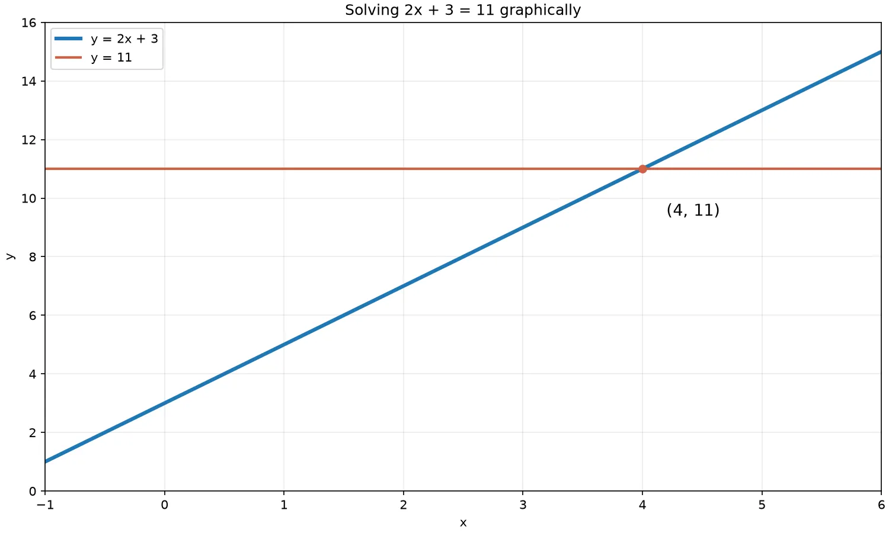

**شکل ۱۶-۱ — حل نموداری.** خط آبی `y=2x+3` و خط افقی `y=11` در `(4,11)` قطع می‌شوند؛ مختصات x جواب معادله است. از تصویر برای تقریب استفاده می‌کنیم؛ محاسبه جبری جواب دقیق را در این مثال می‌دهد. مقیاس محورها و محدوده رسم می‌توانند برداشت بصری را تغییر دهند.

### ۶. توان و رشد نمایی

برای پایه و توان صحیح مثبت، `2³=2×2×2=8`. وقتی `a≠0`، `a⁰=1` و `a⁻¹=1/a`. برای توان‌های صحیح، `aᵐaⁿ=aᵐ⁺ⁿ` و `(aᵐ)ⁿ=aᵐⁿ`؛ قواعد توان‌های حقیقی به دامنه پایه و نوع توان وابسته‌اند، پس آن‌ها را بدون بررسی به پایه منفی تعمیم ندهید.

در رشد نمایی با پایه مثبت، `N(t)=N₀ bᵗ` است. مثلاً `N₀=10` و `b=2`: مقدار در گام‌های ۰، ۱ و ۲ به‌ترتیب ۱۰، ۲۰، ۴۰ است. این رشد در واحد زمان **ضریب ثابت** دارد، نه افزایش مطلق ثابت. یک الگوی نمایی صرفاً فرض مدل است، نه تضمین تداوم رشد واقعی.

### ۷. لگاریتم، دامنه و کاربرد

لگاریتم معکوس توان است: `log_b(x)=y` یعنی `bʸ=x`. در اعداد حقیقی، `b>0`، `b≠1` و `x>0` لازم است [۲]. از `2³=8` نتیجه می‌گیریم `log₂(8)=3`. همچنین `log₂(1)=0` و `log₂(1/4)=-2`؛ منفی بودن خروجی لگاریتم برای ورودی مثبت کوچک‌تر از یک طبیعی است. اگر پایه بین صفر و یک باشد تابع کاهشی است.

با x و y مثبت و پایه مجاز: `log_b(xy)=log_b(x)+log_b(y)` و `log_b(x/y)=log_b(x)-log_b(y)`. اما `log(x+y)` به‌طور کلی برابر `log(x)+log(y)` نیست. `ln` لگاریتم طبیعی با پایه e و `log₁₀` پایه ۱۰ است. در یادگیری ماشین لگاریتم برای تبدیل ضرب احتمال‌های مثبت به جمع و تعریف زیان‌ها کاربرد دارد؛ احتمال صفر نیازمند توجه ویژه است و `log(0)` در اعداد حقیقی تعریف نشده است.

### ۸. پروژه: حل و بررسی عددی

فایل `algebra.py` را بسازید. برنامه معادله خطی، دو حالت ضریب صفر و لگاریتم حقیقی را بررسی می‌کند؛ به شبکه یا بسته جانبی نیاز ندارد.

```python
"""Linear equations and real logarithms for modest finite numeric inputs."""
import math


def solve_linear(a, b, c):
    """Solve a*x + b = c; classify the degenerate a == 0 cases."""
    if not all(math.isfinite(v) for v in (a, b, c)):
        raise ValueError('inputs must be finite')
    if a == 0:
        return ('all', None) if b == c else ('none', None)
    x = (c - b) / a
    if not math.isfinite(x):
        raise ValueError('solution overflowed')
    return 'one', x


def log_base(x, base):
    if not (math.isfinite(x) and math.isfinite(base)):
        raise ValueError('inputs must be finite')
    if x <= 0 or base <= 0 or base == 1:
        raise ValueError('require x > 0, base > 0, base != 1')
    return math.log(x) / math.log(base)


def main():
    kind, x = solve_linear(2, 3, 11)
    print('solution=', x, 'kind=', kind)
    print('check=', math.isclose(2 * x + 3, 11))
    print('log2_8=', log_base(8, 2))
    print('zero_coefficient_cases=', solve_linear(0, 3, 3)[0], solve_linear(0, 3, 4)[0])


if __name__ == '__main__':
    main()
```

در Python 3.13.16 خروجی: `solution= 4.0 kind= one`، سپس `check= True`، `log2_8= 3.0` و `zero_coefficient_cases= all none`. مقادیر شناور تقریبی‌اند؛ `math.isclose` مقایسه تقریبی را انجام می‌دهد و آستانه مناسب به مقیاس مسئله بستگی دارد. این پیاده‌سازی برای مقادیر متعارف آموزشی است؛ نزدیک صفر بودن ضریب و سرریز/لغزش عددی در محاسبات حساس نیازمند تحلیل پایداری و سیاست آستانه است. `math.log` برای دامنه نامعتبر خطا می‌دهد [۳].

### ۹. تست، تمرین و ارزیابی

فایل تست زیر را کنار پروژه قرار دهید و `python -m unittest -v test_algebra` را از همان پوشه اجرا کنید. چهار آزمون حل معمولی، حالات ضریب صفر، دامنه لگاریتم و مقدار غیرمتناهی را بررسی می‌کنند.

```python
import math
import unittest
from algebra import solve_linear, log_base


class AlgebraTests(unittest.TestCase):
    def test_unique_solution(self):
        kind, x = solve_linear(2, 3, 11)
        self.assertEqual(kind, 'one')
        self.assertTrue(math.isclose(x, 4))
        self.assertTrue(math.isclose(2*x+3, 11))

    def test_zero_coefficient(self):
        self.assertEqual(solve_linear(0, 3, 3), ('all', None))
        self.assertEqual(solve_linear(0, 3, 4), ('none', None))

    def test_logs(self):
        self.assertTrue(math.isclose(log_base(8, 2), 3))
        self.assertTrue(math.isclose(log_base(0.25, 2), -2))
        self.assertTrue(math.isclose(log_base(8, 0.5), -3))
        for x, base in [(0, 2), (-1, 2), (2, 1), (2, -1), (float('inf'), 2)]:
            with self.subTest(x=x, base=base), self.assertRaises(ValueError):
                log_base(x, base)

    def test_nonfinite_equation(self):
        with self.assertRaises(ValueError):
            solve_linear(float('nan'), 0, 1)


if __name__ == '__main__':
    unittest.main()
```

**پرسش‌ها:** ۱) `3(x+2)` را باز کنید. ۲) `3x-1=8` را حل کنید. ۳) دامنه حقیقی `1/(x-2)` چیست؟ ۴) شیب و عرض از مبدأ `-2x+5` کدام‌اند؟ ۵) `2⁻³` چیست؟ ۶) `log₂(16)` چیست؟ ۷) چرا `log(0)` حقیقی نیست؟ ۸) اگر `0x+2=2` باشد چند جواب حقیقی دارد؟

**تمرین نمودار:** نقطه‌های `(0,3)` و `(4,11)` را محاسبه و شیب بین آن‌ها را به دست آورید: `(11-3)/(4-0)=2`. **مینی‌پروژه:** جدول مقادیر تابع `3x-1` برای x از صفر تا سه، نمودار با برچسب محورها و تست `f(3)=8` بسازید. درباره دامنه و دقت عددی توضیح دهید. **قبولی:** هفت پاسخ درست از هشت، چهار آزمون موفق و پروژه با نمودار برچسب‌دار.

پاسخ‌ها: ۱) `3x+6`؛ ۲) `x=3`؛ ۳) همه اعداد حقیقی به‌جز ۲؛ ۴) `-2` و `5`؛ ۵) `1/8`؛ ۶) ۴؛ ۷) ورودی لگاریتم حقیقی باید مثبت باشد؛ ۸) بی‌نهایت.

### ۱۰. منابع و ادامه مسیر

واژه‌ها: Variable، Expression، Equation، Function، Domain، Range، Slope، Exponent، Logarithm، Floating Point. فصل ۱۷ بردار، ماتریس و ابعاد را دنبال می‌کند.

**منابع؛ بررسی ۵ نوامبر ۲۰۲۶:** [۱] OpenStax، [Linear Functions، College Algebra 2e](https://openstax.org/books/college-algebra-2e/pages/4-1-linear-functions)، ۲۰۲۱. [۲] OpenStax، [Evaluate and Graph Logarithmic Functions، Intermediate Algebra 2e](https://openstax.org/books/intermediate-algebra-2e/pages/10-3-evaluate-and-graph-logarithmic-functions)، ۲۰۲۰. [۳] Python Software Foundation، [math، Python 3.13](https://docs.python.org/3.13/library/math.html)، تاریخ صفحه متغیر.

---

# فصل ۱۷ — بردار، ماتریس، ابعاد و مقادیر ویژه

**هنر و علم ساخت هوش | جلد اول | Babak & Ai**  
**بررسی منابع: ۵ نوامبر ۲۰۲۶**

## ۱. چرا جبر خطی برای هوش مصنوعی؟

یک ویژگی مانند دمای یک روز یک عدد است؛ مشخصات یک نمونه شامل چند عدد در قالب **بردار (Vector)** و مجموعه‌ای از نمونه‌ها در قالب **ماتریس (Matrix)** نمایش می‌یابد. تصویر، embedding و پارامترهای شبکه نیز می‌توانند در آرایه‌ها نمایش یابند. جبر خطی زبان انجام تبدیل‌های منظم روی این داده‌هاست، نه تضمین اینکه داده یا مدل درست انتخاب شده است.

**پیش‌نیاز:** فصل ۱۶، عدد و تابع؛ فصل ۱۵ برای NumPy. **هدف:** جمع و ضرب داخلی بردارها، شکل ماتریس، ضرب و ترانهاده، تفسیر تبدیل خطی و مقدمات مقادیر و بردارهای ویژه. کد از Python و NumPy استفاده می‌کند.

## ۲. اسکالر، بردار و طول

**اسکالر** یک عدد، مانند `3` است. `v=[3,4]` یک بردار دو مؤلفه‌ای است؛ طول اقلیدسی آن `||v||₂=√(3²+4²)=5` است. جمع بردارهای هم‌بعد مؤلفه‌به‌مؤلفه انجام می‌شود: `[1,2]+[3,4]=[4,6]`. ضرب در اسکالر ۲: `2[1,2]=[2,4]`. یکای طول بردار فقط وقتی معنا دارد که مؤلفه‌ها در مقیاس و واحد مناسب تعریف شده باشند.

**ضرب داخلی (Dot Product):** برای `u=[1,2]` و `v=[3,4]`، `u·v=1×3+2×4=11`. با طول‌های غیرصفر، نسبت `u·v/(||u|| ||v||)` کسینوس زاویه است. برای بردار صفر این نسبت تعریف نشده است. اندازه بزرگی ضرب داخلی به طول‌ها نیز وابسته است، پس به‌تنهایی معیار خالص شباهت زاویه‌ای نیست.

## ۳. ماتریس، سطر، ستون و شکل

ماتریس A با m سطر و n ستون شکل `m×n` دارد [۱]. مثلاً `A=[[1,2,3],[4,5,6]]` شکل `2×3` دارد. یک نمایش رایج داده: هر سطر یک نمونه و هر ستون یک ویژگی؛ اما قرارداد می‌تواند فرق کند و باید صریح نوشته شود. شکل تنسور فقط تعداد عنصرها را نشان می‌دهد؛ معنای محورها را مشخص نمی‌کند.

ترانهاده `Aᵀ` سطر و ستون را جابه‌جا می‌کند و شکل مثال را از `2×3` به `3×2` می‌برد. جمع معمول دو ماتریس زمانی تعریف می‌شود که شکل آن‌ها یکسان باشد؛ broadcasting در NumPy یک قاعده برنامه‌نویسی جداگانه است و نباید بی‌توجه به معنا استفاده شود. ماتریس همانی `I`، مانند `[[1,0],[0,1]]`، بردار سازگار را تغییر نمی‌دهد.

## ۴. ضرب ماتریسی و کنترل ابعاد

اگر شکل A برابر `m×k` و B برابر `k×n` باشد، `AB` شکل `m×n` دارد. عضو سطر i و ستون j نتیجه، ضرب داخلی سطر i از A و ستون j از B است [۱]. برای

```text
A = [[1, 2, 3], [4, 5, 6]]    # 2 × 3
B = [[1, 0], [0, 1], [1, 1]]  # 3 × 2
AB = [[4, 5], [10, 11]]        # 2 × 2
```

برای نمونه، عضو بالا-چپ `1×1+2×0+3×1=4` است. ضرب ماتریسی عموماً جابه‌جاپذیر نیست: `AB` و `BA` ممکن است متفاوت یا یکی تعریف‌نشده باشند. در NumPy، `@` ضرب ماتریسی و `*` برای آرایه‌های سازگار ضرب عضو به عضو است.

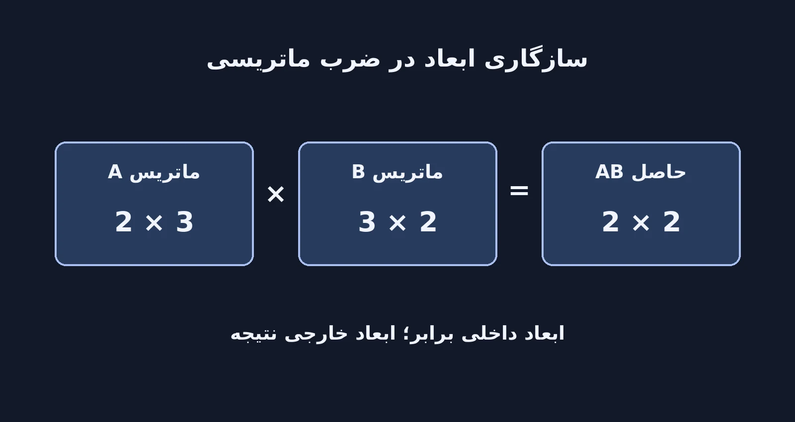

**شکل ۱۷-۱ — قاعده ابعاد.** دو عدد داخلی باید برابر باشند؛ ابعاد بیرونی شکل نتیجه‌اند.

## ۵. تبدیل خطی و شبکه عصبی

اگر x بردار ستونی با n ویژگی و `W` ماتریس `m×n` باشد، `Wx` برداری با m مؤلفه است. تابع `T(x)=Wx` خطی است: `T(u+v)=T(u)+T(v)` و `T(cu)=cT(u)`. اضافه‌کردن بایاس در `Wx+b` تبدیل را به‌طور کلی **آفین** می‌کند، نه خطی محض؛ اگر b صفر باشد خطی است. در یک لایه شبکه، پس از این تبدیل ممکن است تابع فعال‌سازی غیرخطی اضافه شود. آموزش لایه در فصل‌های بعد است.

اگر n=۳ و m=۲، W دارای ۶ وزن است و بایاس دو عدد دارد؛ شمار پارامترهای این لایه ۸ است، بدون احتساب بخش‌های دیگر. قبل از اجرای کد، شکل ورودی، وزن و خروجی را یادداشت کنید و درباره جایگاه batch طبق قرارداد کتابخانه تصمیم بگیرید.

## ۶. مقدار ویژه و بردار ویژه

برای ماتریس مربعی A، بردار **غیرصفر** v و عدد λ اگر `Av=λv` باشند، v بردار ویژه و λ مقدار ویژه است [۲]. λ می‌تواند صفر یا منفی باشد؛ در λ منفی جهت وارونه می‌شود. مثال `A=[[2,0],[0,3]]`: بردار `[1,0]` با λ=۲ و `[0,1]` با λ=۳ هستند. بردار صفر مجاز نیست چون برای هر λ رابطه را برقرار می‌کند و اطلاعاتی نمی‌دهد.

مقادیر ویژه با حل `det(A−λI)=0` به دست می‌آیند؛ برای مثال قطری `(2−λ)(3−λ)=0` است. ماتریس حقیقی لزوماً مقادیر ویژه حقیقی ندارد و هر ماتریس مربعی لزوماً مجموعه کاملی از بردارهای ویژه مستقل ندارد. ترتیب، علامت و مقیاس بردار ویژه عددی یکتا نیست؛ نتیجه عددی را با باقیمانده `Av−λv` و آستانه مناسب بررسی کنید. برخی کاربردهای کاهش بعد در جلد دوم بررسی می‌شوند؛ این فصل ادعای محاسبه PCA ندارد.

## ۷. پروژه: ضرب دستی و NumPy

فایل `linear_algebra.py` را ذخیره و اجرا کنید. ضرب دستی فهرست‌های مستطیلی را بررسی می‌کند؛ NumPy برای مقایسه و محاسبه زوج‌های ویژه استفاده می‌شود. محیط آزمایش: Python 3.13.16 و NumPy 2.3.5، CPU؛ نصب به محیط مجازی و دسترسی شبکه نیاز دارد: `python -m pip install numpy`.

```python
"""Matrix products from scratch and eigenpairs using NumPy."""
import numpy as np


def matmul(a, b):
    if not a or not b or not a[0] or not b[0]:
        raise ValueError('matrices must be nonempty')
    inner = len(a[0])
    columns = len(b[0])
    if any(len(row) != inner for row in a) or any(len(row) != columns for row in b):
        raise ValueError('matrices must be rectangular')
    if inner != len(b):
        raise ValueError('inner dimensions must match')
    return [[sum(a[i][k] * b[k][j] for k in range(inner))
             for j in range(columns)] for i in range(len(a))]


def main():
    a = [[1, 2, 3], [4, 5, 6]]
    b = [[1, 0], [0, 1], [1, 1]]
    manual = matmul(a, b)
    print('product=', manual)
    print('numpy_matches=', bool(np.array_equal(manual, np.array(a) @ np.array(b))))
    matrix = np.array([[2., 0.], [0., 3.]])
    values, vectors = np.linalg.eig(matrix)
    print('eigenvalues_sorted=', sorted(values.tolist()))
    print('eigenpair_check=', bool(np.allclose(matrix @ vectors, vectors * values)))


if __name__ == '__main__':
    main()
```

خروجی آزمایش‌شده:

```text
product= [[4, 5], [10, 11]]
numpy_matches= True
eigenvalues_sorted= [2.0, 3.0]
eigenpair_check= True
```

`np.linalg.eig` ستون‌های بردار ویژه و مقدارهای متناظر را برمی‌گرداند و ترتیب آن‌ها تضمین‌شده نیست [۳]. `np.allclose` مقایسه تقریبی با آستانه پیش‌فرض است، نه اثبات دقیق برای هر مسئله؛ در مسئله واقعی مقیاس و آستانه را بررسی کنید. تابع دستی برای آموزش شکل است، نه جایگزین پیاده‌سازی بهینه و معتبرسازی همه نوع ورودی.

## ۸. آزمون، خطاهای رایج و عیب‌یابی

فایل زیر را کنار برنامه ذخیره کنید و از همان پوشه `python -m unittest -v test_linear_algebra` اجرا کنید. چهار تست، ضرب مستطیلی، مقایسه NumPy، سه شکل نامعتبر و زوج ویژه را پوشش می‌دهند.

```python
import unittest
import numpy as np
from linear_algebra import matmul


class LinearAlgebraTests(unittest.TestCase):
    def test_rectangular_product(self):
        self.assertEqual(matmul([[1, 2, 3], [4, 5, 6]], [[1, 0], [0, 1], [1, 1]]), [[4, 5], [10, 11]])

    def test_against_numpy(self):
        a, b = [[1, -1], [2, 3]], [[2], [4]]
        self.assertTrue(np.array_equal(matmul(a, b), np.array(a) @ np.array(b)))

    def test_invalid_shapes(self):
        for a, b in [([], [[1]]), ([[1, 2]], [[1]]), ([[1], [2, 3]], [[1]])]:
            with self.subTest(a=a, b=b), self.assertRaises(ValueError):
                matmul(a, b)

    def test_eigenpairs(self):
        a = np.array([[2., 0.], [0., 3.]])
        w, v = np.linalg.eig(a)
        self.assertTrue(np.allclose(a @ v, v * w))
        self.assertTrue(np.allclose(sorted(w), [2, 3]))


if __name__ == '__main__':
    unittest.main()
```

اگر `ModuleNotFoundError` دریافت کردید مفسر و محیط نصب NumPy را بررسی کنید. خطای ابعاد یعنی تعداد ستون A با سطر B برابر نیست یا آرایه ناهموار است. اگر نتیجه ویژه برای ماتریس دیگر پیچیده است، این الزاماً باگ نیست؛ مثال ما عمداً قطری و حقیقی انتخاب شده است. چهار آزمون موفق به معنی صحت تمام حالت‌ها نیست.

## ۹. تمرین، ارزیابی و پروژه

**پرسش‌ها:** ۱) شکل ماتریسی با ۳ سطر و ۲ ستون چیست؟ ۲) آیا `2×3` در `3×4` ضرب می‌شود و شکل حاصل چیست؟ ۳) `[1,2]·[3,4]`؟ ۴) تفاوت `*` و `@` در NumPy چیست؟ ۵) ترانهاده `2×3` چه شکلی دارد؟ ۶) آیا بردار ویژه می‌تواند صفر باشد؟ ۷) مقدار ویژه `[1,0]` برای `diag(2,3)` چیست؟ ۸) آیا `Wx+b` با b غیرصفر خطی است؟ ۹) لایه ۳ ورودی، ۲ خروجی و بایاس چند پارامتر دارد؟ ۱۰) آیا ترتیب زوج‌های ویژه تضمین شده است؟

**پروژه کوچک:** با ورودی دو نمونه و سه ویژگی و وزن سه‌در‌دو، خروجی batch را دستی و با NumPy محاسبه کنید؛ شکل‌ها را بنویسید و ورودی ناسازگار را بیازمایید. **چالش مهندسی:** ضرب دستی و NumPy را از نظر خوانایی و مقیاس‌پذیری مقایسه کنید؛ بنچمارک انجام‌نشده را ادعا نکنید. **قبولی:** دست‌کم ۸ پاسخ درست از ۱۰ و اجرای چهار تست.

پاسخ: ۱) `3×2`؛ ۲) بله `2×4`؛ ۳) ۱۱؛ ۴) عضو به عضو/ماتریسی؛ ۵) `3×2`؛ ۶) خیر؛ ۷) ۲؛ ۸) خیر؛ ۹) ۸؛ ۱۰) خیر.

## ۱۰. واژه‌نامه، تحولات و منابع

Vector بردار؛ Scalar اسکالر؛ Matrix ماتریس؛ Shape شکل؛ Dot Product ضرب داخلی؛ Transpose ترانهاده؛ Eigenvalue مقدار ویژه؛ Eigenvector بردار ویژه. **بررسی ۵ نوامبر ۲۰۲۶:** اصول ریاضی پایدارند؛ رفتار API و دقت عددی وابسته به نسخه و محیط‌اند. اجرای نمونه تنها CPU و نسخه‌های فوق را پوشش می‌دهد. فصل ۱۸ به مشتق و گرادیان می‌رسد.

**منابع اولیه؛ مراجعه ۵ نوامبر ۲۰۲۶:** [۱] OpenStax، «Matrices and Matrix Operations»، College Algebra 2e، ۲۰۲۱، [منبع](https://openstax.org/books/college-algebra-2e/pages/7-5-matrices-and-matrix-operations). [۲] Gilbert Strang، «Eigenvalues and Eigenvectors»، MIT، تاریخ نسخه نامشخص، [متن](https://math.mit.edu/~gs/linearalgebra/ila6/ila6_6_1.pdf). [۳] NumPy، «numpy.linalg.eig»، مستندات زنده، تاریخ انتشار نامشخص، [منبع](https://numpy.org/doc/stable/reference/generated/numpy.linalg.eig.html).

---

# فصل ۱۸ — مشتق، انتگرال، قاعده زنجیره‌ای و گرادیان

**هنر و علم ساخت هوش | جلد اول | Babak & Ai**  
**بررسی منابع: ۵ نوامبر ۲۰۲۶**

## ۱. اندازه‌گیری تغییر

یک مدل یادگیری ورودی و پارامترها را به خروجی و زیان تبدیل می‌کند. برای فهم اینکه تغییر کوچک پارامتر چگونه زیان را تغییر می‌دهد، حسابان ابزار اصلی است. **هدف:** تفاوت نرخ متوسط و مشتق، مشتق جزئی، قاعده زنجیره‌ای، بردار گرادیان و انتگرال معین؛ همچنین مقایسه محاسبه تحلیلی و عددی. **پیش‌نیاز:** تابع و نمودار فصل ۱۶، بردار فصل ۱۷.

این فصل مقدمات تغییر را آموزش می‌دهد؛ الگوریتم‌های بهینه‌سازی فصل ۲۰ و پس‌انتشار شبکه فصل ۲۸ هستند. مشتق نشان‌دهنده تغییر محلی است و به‌تنهایی موفقیت یک مدل یا بهینه سراسری را تضمین نمی‌کند.

## ۲. نرخ تغییر و مشتق

نرخ تغییر متوسط f در بازه از x تا `x+h`، برای `h≠0`، برابر `[f(x+h)−f(x)]/h` است. اگر حد این نسبت وقتی h به صفر میل می‌کند وجود داشته باشد، **مشتق** `f′(x)` است [۱]. برای `f(x)=x²` داریم `[(x+h)²−x²]/h=2x+h` و در حد `f′(x)=2x`. در `x=1` شیب مماس ۲ است؛ برای x نزدیک یک، تغییر کوچک خروجی تقریباً دو برابر تغییر x است.

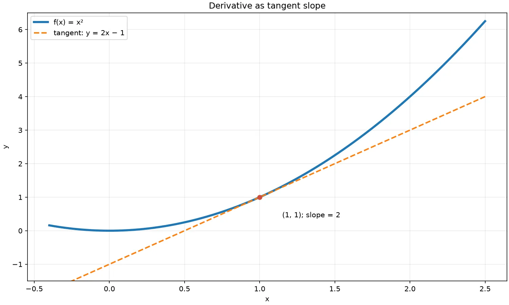

**شکل ۱۸-۱ — شیب مماس.** تقریب خطی نزدیک نقطه معتبرتر است، نه لزوماً در فاصله بزرگ. اگر f بر حسب متر و x بر حسب ثانیه باشد، واحد مشتق متر بر ثانیه است.

## ۳. قواعد مشتق و نقاط نامشتق‌پذیر

مشتق ثابت صفر، مشتق `xⁿ` برای توان صحیح مناسب `n xⁿ⁻¹` و مشتق جمع برابر جمع مشتق‌هاست. مثلاً `d(3x²+2x+5)/dx=6x+2`. در ضرب دو تابع `d(uv)/dx=u′v+uv′`؛ مشتق حاصل‌ضرب عموماً حاصل‌ضرب مشتق‌ها نیست.

مشتق همیشه وجود ندارد: برای `|x|` در صفر شیب سمت چپ −۱ و راست +۱ است، پس مشتق معمول وجود ندارد. یک تابع مشتق‌پذیر در نقطه پیوسته است، اما پیوستگی به‌تنهایی مشتق‌پذیری را تضمین نمی‌کند. نزدیک مرز دامنه یا شکستگی، اختلاف محدود ممکن است پاسخ گمراه‌کننده بدهد.

## ۴. قاعده زنجیره‌ای

برای `h(x)=f(g(x))` با مشتق‌پذیری لازم، `h′(x)=f′(g(x))g′(x)` است [۲]. اگر `h(x)=(2x+1)²`، مشتق بیرونی نسبت به ورودی میانی `2(2x+1)` و مشتق درونی ۲ است؛ بنابراین `h′(x)=4(2x+1)`. در x=۱ مقدار مشتق ۱۲ است.

در مدلی که خروجی از چند تبدیل پیاپی می‌گذرد، قاعده زنجیره‌ای تغییر را در مسیرها منتقل می‌کند. این پایه مفهومی پس‌انتشار است، اما پیاده‌سازی کامل و نحوه جمع مسیرها در فصل ۲۸ بررسی می‌شود.

## ۵. مشتق جزئی و گرادیان

برای تابعی از چند ورودی، مشتق جزئی نسبت به یکی از آن‌ها، دیگر ورودی‌ها را ثابت فرض می‌کند. اگر `f(x,y)=x²+3xy+y²`، آنگاه `∂f/∂x=2x+3y` و `∂f/∂y=3x+2y` است. **گرادیان** بردار این مشتق‌هاست: `∇f=[2x+3y, 3x+2y]`؛ در `(1,2)` برابر `[8,7]` است [۳].

برای تابع مشتق‌پذیر و جهت واحد u، نرخ تغییر جهت‌دار `∇f·u` است. اگر گرادیان غیرصفر باشد، جهت آن بیشترین نرخ افزایش محلی را در میان جهت‌های واحد دارد؛ گرادیان صفر چنین جهت یکتایی تعیین نمی‌کند. مقیاس و واحد متغیرها در تفسیر جهت اهمیت دارند.

## ۶. انتگرال معین و نامعین

انتگرال معین می‌تواند حد مجموع‌های ریمانی و مساحت علامت‌دار زیر نمودار باشد: نواحی زیر محور x علامت منفی دارند. برای تابع پیوسته `f(x)=x²` و پادمشتق `F(x)=x³/3`، قضیه بنیادی حسابان می‌دهد `∫₀² x² dx=F(2)−F(0)=8/3` [۴]. انتگرال نامعین خانواده پادمشتق‌ها را با ثابت C نمایش می‌دهد: `∫x² dx=x³/3+C`.

با تقسیم بازه به n قسمت و نمونه‌برداری وسط هر قسمت می‌توان مقدار را تقریب زد. نتیجه به تعداد قسمت‌ها و ویژگی تابع بستگی دارد؛ انتگرال علامت‌دار لزوماً مساحت هندسی مثبت نیست و عوض‌کردن حدود علامت آن را تغییر می‌دهد.

## ۷. پروژه: گرادیان تحلیلی و عددی

فایل `calculus.py` را بسازید؛ وابستگی خارجی یا شبکه ندارد. اختلاف مرکزی `(f(x+h)−f(x−h))/(2h)` مشتق را برای h کوچک تقریب می‌زند، اما h بیش‌ازحد کوچک ممکن است به دلیل گردکردن و حذف رقم‌ها خطا را افزایش دهد. این تست برای تابع هموار و نقطه مشخص است، نه تضمین عمومی.

```python
"""Analytic and numerical calculus checks for a smooth polynomial."""
import math


def f(x, y):
    return x*x + 3*x*y + y*y


def gradient(x, y):
    return (2*x + 3*y, 3*x + 2*y)


def numerical_gradient(x, y, h=1e-5):
    if not math.isfinite(h) or h <= 0:
        raise ValueError('h must be finite and positive')
    dx = (f(x+h, y) - f(x-h, y)) / (2*h)
    dy = (f(x, y+h) - f(x, y-h)) / (2*h)
    return dx, dy


def midpoint_integral(func, a, b, n):
    if type(n) is not int or n <= 0:
        raise ValueError('n must be a positive integer')
    width = (b - a) / n
    return sum(func(a + (i + 0.5)*width) for i in range(n)) * width


def main():
    exact = gradient(1, 2)
    numeric = numerical_gradient(1, 2)
    print('analytic_gradient=', exact)
    print('numeric_gradient=', tuple(round(v, 6) for v in numeric))
    print('gradient_matches=', all(math.isclose(a, b, rel_tol=1e-8, abs_tol=1e-8)
                                   for a, b in zip(exact, numeric)))
    area = midpoint_integral(lambda x: x*x, 0, 2, 1000)
    print('integral_x2_0_2=', round(area, 6))
    print('exact_integral=', round(8/3, 6))


if __name__ == '__main__':
    main()
```

خروجی Python 3.13.16: `analytic_gradient= (8, 7)`؛ `numeric_gradient= (8.0, 7.0)`؛ `gradient_matches= True`؛ تقریب انتگرال `2.666666` و مقدار دقیق گرد‌شده `2.666667`. اختلاف حدود `6.67×10⁻⁷` است. اعداد نمایش داده‌شده گرد شده‌اند.

## ۸. آزمون و عیب‌یابی

فایل زیر را کنار پروژه قرار دهید و `python -m unittest -v test_calculus` اجرا کنید. چهار تست گرادیان، نقطه صفر، انتگرال با خطای مجاز `10⁻⁶` و ورودی نامعتبر را می‌سنجند.

```python
import math
import unittest
from calculus import f, gradient, numerical_gradient, midpoint_integral


class CalculusTests(unittest.TestCase):
    def test_gradient(self):
        self.assertEqual(gradient(1, 2), (8, 7))
        for a, b in zip(gradient(1, 2), numerical_gradient(1, 2)):
            self.assertTrue(math.isclose(a, b, rel_tol=1e-8, abs_tol=1e-8))

    def test_other_point(self):
        self.assertEqual(gradient(0, 0), (0, 0))
        self.assertEqual(numerical_gradient(0, 0), (0, 0))

    def test_integral(self):
        self.assertAlmostEqual(midpoint_integral(lambda x: x*x, 0, 2, 1000), 8/3, delta=1e-6)
        self.assertAlmostEqual(midpoint_integral(lambda x: x, 2, 0, 100), -2)

    def test_invalid(self):
        for h in (0, -1, float('nan')):
            with self.assertRaises(ValueError): numerical_gradient(1, 2, h)
        for n in (0, -1, True, 2.5):
            with self.assertRaises(ValueError): midpoint_integral(f, 0, 1, n)


if __name__ == '__main__':
    unittest.main()
```

`h` باید مثبت و متناهی و n یک عدد صحیح مثبت باشد. آزمون انتگرال از خطای مطلق متناسب با تقریب استفاده می‌کند؛ برابری دقیق عدد شناور انتظار نمی‌رود. نتیجه نزدیک در چند نقطه ثابت نمی‌کند مشتق تحلیلی برای همه نقاط یا توابع درست است.

## ۹. تمرین و ارزیابی

**پرسش:** ۱) مشتق `x²`؟ ۲) مشتق ثابت؟ ۳) مشتق `(2x+1)²` در x=۱؟ ۴) مشتق جزئی `x²+y²` نسبت به x؟ ۵) گرادیان آن در `(1,2)`؟ ۶) `∫₀² x dx`؟ ۷) آیا `|x|` در صفر مشتق‌پذیر است؟ ۸) چرا h بسیار کوچک همیشه بهتر نیست؟ ۹) آیا انتگرال معین همیشه مثبت است؟ ۱۰) آیا گرادیان صفر جهت بیشترین افزایش یکتایی دارد؟

**تمرین:** برای `g(x,y)=x²+y²` گرادیان تحلیلی و عددی را در دو نقطه مقایسه کنید. **مینی‌پروژه:** نمودار تابع و مماس در یک نقطه و جدول خطای اختلاف مرکزی برای سه h بسازید؛ نتایج و محدودیت دقت را توضیح دهید. **چالش:** تفاوت مشتق تحلیلی و عددی را مقایسه کنید و علت شکست احتمالی هر روش را بنویسید. **قبولی:** حداقل ۸ پاسخ صحیح از ۱۰ و چهار آزمون موفق.

پاسخ: ۱) `2x`؛ ۲) صفر؛ ۳) ۱۲؛ ۴) `2x`؛ ۵) `[2,4]`؛ ۶) ۲؛ ۷) خیر؛ ۸) گردکردن؛ ۹) خیر؛ ۱۰) خیر.

## ۱۰. منابع و ادامه

Derivative مشتق؛ Partial Derivative مشتق جزئی؛ Gradient گرادیان؛ Chain Rule قاعده زنجیره‌ای؛ Integral انتگرال؛ Finite Difference اختلاف محدود. **بررسی ۵ نوامبر ۲۰۲۶:** مبانی پایدارند؛ تقریب عددی وابسته به گام و دقت ماشین است. فصل ۱۹ احتمال و آمار را می‌آموزد.

**منابع؛ مراجعه ۵ نوامبر ۲۰۲۶:** [۱] OpenStax، «Key Concepts: Derivatives»، Calculus Volume 1، ۲۰۱۶، [منبع](https://openstax.org/books/calculus-volume-1/pages/3-key-concepts). [۲] OpenStax، «The Chain Rule»، ۲۰۱۶، [منبع](https://openstax.org/books/calculus-volume-1/pages/3-6-the-chain-rule). [۳] OpenStax، «Directional Derivatives and the Gradient»، Calculus Volume 3، ۲۰۱۶، [منبع](https://openstax.org/books/calculus-volume-3/pages/4-6-directional-derivatives-and-the-gradient). [۴] OpenStax، «The Fundamental Theorem of Calculus»، Calculus Volume 1، تاریخ انتشار نامشخص، [منبع](https://openstax.org/books/calculus-volume-1/pages/5-3-the-fundamental-theorem-of-calculus).

---

# فصل ۱۹ — احتمال، آمار، توزیع‌ها، نمونه‌گیری و بیز

**هنر و علم ساخت هوش | جلد اول | Babak & Ai**  
**بررسی منابع: ۵ نوامبر ۲۰۲۶**

## ۱. چرا عدم قطعیت را اندازه می‌گیریم؟

داده معمولاً تنها نمونه‌ای از جهان است و خروجی مدل نیز ممکن است خطا کند. احتمال و آمار به ما کمک می‌کنند عدم قطعیت، تغییرپذیری و محدودیت نتیجه را بیان کنیم. **پیش‌نیاز:** نسبت و تابع، فصل‌های ۱۶ و ۱۷. **هدف:** محاسبه احتمال شرطی، میانگین و پراکندگی، شناخت توزیع و نمونه‌گیری، و کاربرد قضیه بیز. مثال‌ها ساختگی‌اند و توصیه پزشکی یا نتیجه واقعی درباره جمعیت نیستند.

## ۲. فضای نمونه و احتمال

**آزمایش تصادفی** ممکن است چند نتیجه داشته باشد؛ مجموعه نتایج ممکن **فضای نمونه** و هر زیرمجموعه آن یک **رویداد** است. برای سکه ایده‌آل با دو روی هم‌احتمال، `P(رو)=1/2`. احتمال بین صفر و یک است و احتمال مکمل A برابر `1−P(A)` است. نسبت تعداد حالت‌های مطلوب به همه حالت‌ها فقط وقتی مستقیماً درست است که حالت‌ها هم‌احتمال باشند.

برای دو رویداد مستقل، `P(A و B)=P(A)P(B)`؛ استقلال را نباید بدون بررسی فرض کرد. **احتمال شرطی** `P(A|B)=P(A و B)/P(B)` وقتی `P(B)>0` است. `P(A|B)` معمولاً با `P(B|A)` یکی نیست [۱].

## ۳. میانگین، میانه و پراکندگی

برای داده `2,3,3,4,8` میانگین `(2+3+3+4+8)/5=4` و میانه ۳ است. میانگین به مقدارهای پرت حساس است؛ میانه اغلب در برابر آن‌ها مقاوم‌تر است. انتخاب شاخص به پرسش بستگی دارد و یک عدد نمی‌تواند کل شکل توزیع را نشان دهد [۲].

**واریانس جامعه** میانگین مربع فاصله‌ها از میانگین است و بر n تقسیم می‌شود. **واریانس نمونه** متداول با مخرج `n−1` محاسبه می‌شود و برای n≥۲ است. در داده بالا مجموع مربع فاصله‌ها ۲۲ و واریانس نمونه `22/4=5.5` است؛ واریانس همین پنج مقدار به‌عنوان کل جامعه `22/5=4.4` است. انحراف معیار ریشه دوم واریانس و هم‌واحد داده است. نمونه‌بودن یا جامعه‌بودن را روشن کنید.

## ۴. توزیع‌های احتمالی

یک **متغیر تصادفی** خروجی عددی را به نتیجه آزمایش نسبت می‌دهد. توزیع مشخص می‌کند احتمال چگونه روی مقدارها پخش می‌شود. **برنولی** برای خروجی صفر/یک با احتمال موفقیت p است؛ چند آزمایش مستقل با احتمال یکسان به مدل دوجمله‌ای می‌رسند. توزیع نرمال یک مدل پیوسته زنگوله‌ای است که با میانگین و انحراف معیار مشخص می‌شود؛ هر داده واقعی لزوماً نرمال نیست.

در مدل پیوسته، چگالی در نقطه خودِ احتمال نقطه نیست؛ احتمال یک بازه با انتگرال چگالی در آن بازه محاسبه می‌شود. در یک توزیع پیوسته متعارف، احتمال یک مقدار دقیق منفرد صفر است. مقایسه چگالی و احتمال بدون توجه به واحد و بازه می‌تواند گمراه‌کننده باشد.

## ۵. نمونه‌گیری، سوگیری و عدم قطعیت

**جامعه** مجموعه مورد مطالعه و **نمونه** زیرمجموعه مشاهده‌شده است. در نمونه‌گیری تصادفی ساده، هر زیرمجموعه با اندازه معین شانس برابر دارد. داده در دسترس، کاربران داوطلب یا داده اینترنتی لزوماً نماینده جامعه هدف نیستند [۳]. حجم زیاد، سوگیری انتخاب، خطای اندازه‌گیری یا داده نامناسب را خودکار اصلاح نمی‌کند.

برآورد از نمونه به نمونه تغییر می‌کند. محدوده اطمینان و روش برآورد به طرح نمونه‌گیری و مفروضات بستگی دارند؛ تفسیر دقیق آن با «احتمال قرارگرفتن پارامتر ثابت در بازه مشاهده‌شده» یکسان فرض نمی‌شود. همبستگی نیز به‌تنهایی علت را ثابت نمی‌کند. برای ارزیابی مدل، داده آموزش و آزمون را جدا نگه دارید و نشت داده را کنترل کنید؛ جزئیات طراحی در جلد دوم و ارزیابی در جلد پنجم است.

## ۶. قضیه بیز با مثال عددی

بیز احتمال شرطی را معکوس می‌کند، با شرط اینکه احتمال شواهد مثبت باشد:

```text
P(A|B) = P(B|A) × P(A) / P(B)
P(B) = P(B|A)P(A) + P(B|not A)P(not A)
```

**مثال صرفاً فرضی:** ویژگی A در ۱٪ جمعیت، حساسیت آزمون ۹۰٪ (`P(+|A)=0.9`) و ویژگی آزمون ۹۵٪ (`P(-|not A)=0.95`) باشد. از ۱۰٬۰۰۰ نفر، تعدادهای **مورد انتظار**: ۱۰۰ دارای ویژگی، ۹۰ مثبت واقعی؛ ۹٬۹۰۰ فاقد ویژگی، ۴۹۵ مثبت کاذب. پس از ۵۸۵ مثبت مورد انتظار، `P(A|+)=90/585≈0.153846` یعنی حدود ۱۵٫۴٪ است [۱]. حساسیت ۹۰٪ به معنی احتمال ۹۰٪ داشتن ویژگی پس از مثبت‌شدن نیست. این مثال فرضی است، نه دقت آزمون پزشکی واقعی.

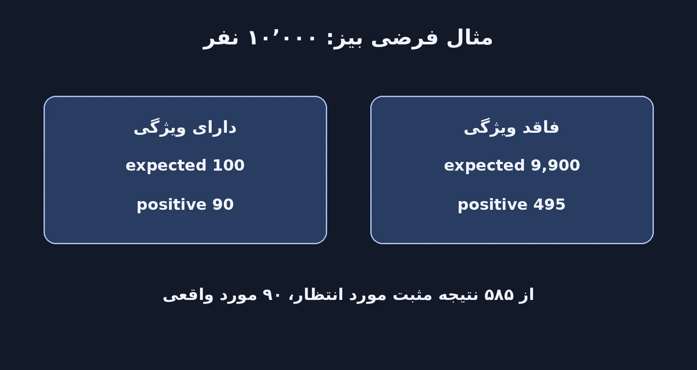

**شکل ۱۹-۱ — اثر نرخ پایه.** مقادیر مورد انتظارند، نه تضمین نتیجه هر نمونه؛ احتمال پسین به مفروضات حساسیت، ویژگی و شیوع وابسته است.

## ۷. پروژه: بیز و شبیه‌سازی

فایل `probability.py` را بسازید. تابع بیز ورودی‌های خارج بازه، نامتناهی و احتمال شواهد صفر را رد می‌کند. شبیه‌سازی سکه از مولد شبه‌تصادفی محلی با seed ثابت استفاده می‌کند؛ داده‌ها ساختگی‌اند و مولد `random` برای رمزنگاری مناسب نیست. Python 3.13.16، بدون بسته خارجی یا شبکه.

```python
"""Bayes calculation and seeded Bernoulli simulation on synthetic data."""
import math
import random
import statistics


def posterior_positive(prevalence, sensitivity, specificity):
    values = (prevalence, sensitivity, specificity)
    if any(not math.isfinite(v) or not 0 <= v <= 1 for v in values):
        raise ValueError('probabilities must be finite and between 0 and 1')
    numerator = prevalence * sensitivity
    positive = numerator + (1 - prevalence) * (1 - specificity)
    if positive == 0:
        raise ValueError('positive result has zero probability')
    return numerator / positive


def coin_fraction(n, seed=42):
    if type(n) is not int or n <= 0:
        raise ValueError('n must be a positive integer')
    rng = random.Random(seed)
    return sum(rng.random() < 0.5 for _ in range(n)) / n


def main():
    data = [2, 3, 3, 4, 8]
    print('mean=', statistics.mean(data), 'median=', statistics.median(data))
    print('sample_variance=', statistics.variance(data))
    print('posterior=', round(posterior_positive(0.01, 0.9, 0.95), 6))
    print('coin_fraction=', round(coin_fraction(10000), 4), 'seed=42')


if __name__ == '__main__':
    main()
```

خروجی آزمایش‌شده: `mean= 4 median= 3`؛ `sample_variance= 5.5`؛ `posterior= 0.153846`؛ `coin_fraction= 0.499 seed=42`. فراوانی نمونه‌ای لزوماً دقیقاً ۰٫۵ نیست و seed ثابت، صحت مدل یا یکسان‌بودن تمام نسخه‌ها و روش‌ها را تضمین نمی‌کند. پاسخ تحلیلی بیز به شبیه‌سازی وابسته نیست.

## ۸. آزمون و خطاهای رایج

فایل زیر را کنار برنامه ذخیره و `python -m unittest -v test_probability` اجرا کنید. چهار تست نتیجه بیز، ورودی خارج دامنه و شواهد ناممکن، بازتولید seed در همین محیط، و n نامعتبر را بررسی می‌کنند.

```python
import unittest
from probability import posterior_positive, coin_fraction


class ProbabilityTests(unittest.TestCase):
    def test_bayes(self):
        self.assertAlmostEqual(posterior_positive(.01, .9, .95), 90/585)
        self.assertEqual(posterior_positive(0, .9, .95), 0)
        self.assertEqual(posterior_positive(1, .9, .95), 1)

    def test_invalid_bayes(self):
        for args in [(-.1, .9, .95), (.1, 1.1, .95), (float('nan'), .9, .95), (0, 1, 1)]:
            with self.subTest(args=args), self.assertRaises(ValueError):
                posterior_positive(*args)

    def test_seed_and_range(self):
        self.assertEqual(coin_fraction(1000, 42), coin_fraction(1000, 42))
        self.assertTrue(0 <= coin_fraction(100, 4) <= 1)

    def test_invalid_n(self):
        for n in (0, -1, 2.5, True):
            with self.assertRaises(ValueError): coin_fraction(n)


if __name__ == '__main__':
    unittest.main()
```

اگر مخرج بیز صفر است، احتمال شرطی روی رویداد با احتمال صفر در این فرمول تعریف نشده و برنامه `ValueError` می‌دهد. عدد ۹۵٪ در مثال **ویژگی** است نه احتمال مثبت کاذب؛ مثبت کاذب برابر ۵٪ است. خروجی شبیه‌سازی نمونه، اثبات قضیه یا ارزیابی پزشکی نیست.

## ۹. تمرین و ارزیابی

**پرسش:** ۱) احتمال مکمل رویداد با احتمال ۰٫۲؟ ۲) میانگین `[2,4,6]`؟ ۳) میانه `[1,2,100]`؟ ۴) فرق واریانس نمونه و جامعه در مخرج چیست؟ ۵) آیا `P(A|B)` الزاماً برابر `P(B|A)` است؟ ۶) آیا نمونه بزرگِ سوگیر خودکار نماینده می‌شود؟ ۷) احتمال مثبت کاذب با ویژگی ۹۵٪؟ ۸) در مثال بیز نسبت مثبت واقعی به همه مثبت‌ها؟ ۹) آیا فراوانی نمونه ۱۰ بار سکه الزاماً ۰٫۵ است؟ ۱۰) آیا `random` برای رمز امنیتی مناسب است؟

**تمرین:** شیوع فرضی را به ۱۰٪ تغییر دهید و با همان حساسیت و ویژگی، احتمال پسین را حساب کنید: `0.09/(0.09+0.045)=2/3`. **مینی‌پروژه:** از داده ساختگی، میانگین، میانه و واریانس نمونه را حساب و با کتابخانه `statistics` مقایسه کنید؛ روش نمونه‌گیری و یک منبع سوگیری را بنویسید. **چالش:** احتمال شرطی تحلیلی و شبیه‌سازی تصادفی را مقایسه و دو علت تفاوتشان را شرح دهید. **قبولی:** حداقل ۸ پاسخ درست و چهار آزمون موفق.

پاسخ: ۱) ۰٫۸؛ ۲) ۴؛ ۳) ۲؛ ۴) `n−1` در برابر `n`؛ ۵) خیر؛ ۶) خیر؛ ۷) ۵٪؛ ۸) `90/585`؛ ۹) خیر؛ ۱۰) خیر.

## ۱۰. منابع و ادامه

Probability احتمال؛ Conditional Probability احتمال شرطی؛ Distribution توزیع؛ Sample نمونه؛ Mean میانگین؛ Median میانه؛ Variance واریانس؛ Bayes بیز؛ Base Rate نرخ پایه. **بررسی ۵ نوامبر ۲۰۲۶:** فرمول‌ها پایدارند، اما نتیجه تجربی به نمونه و مفروضات بستگی دارد. فصل ۲۰ درباره بهینه‌سازی و پایداری عددی است.

**منابع؛ مراجعه ۵ نوامبر ۲۰۲۶:** [۱] OpenStax، «Probability Theory»، Principles of Data Science، ۲۰۲۵، [منبع](https://openstax.org/books/principles-data-science/pages/3-4-probability-theory). [۲] OpenStax، «Key Terms»، Introductory Statistics 2e، ۲۰۲۳، [منبع](https://openstax.org/books/introductory-statistics-2e/pages/2-key-terms). [۳] OpenStax، «Key Terms: Sampling»، Introductory Statistics 2e، ۲۰۲۳، [منبع](https://openstax.org/books/introductory-statistics-2e/pages/1-key-terms). [۴] Python Software Foundation، «random»، Python 3.13، تاریخ نامشخص، [منبع](https://docs.python.org/3.13/library/random.html).

---

# فصل ۲۰ — بهینه‌سازی، گرادیان‌کاهشی و پایداری عددی

**هنر و علم ساخت هوش | جلد اول | Babak & Ai**  
**تاریخ بررسی منابع: ۵ نوامبر ۲۰۲۶**

## ۱. از اندازه‌گیری خطا تا کاهش آن

در فصل ۱۸ مشتق و گرادیان را شناختیم. اکنون می‌پرسیم چگونه مقدار پارامترها را طوری تغییر دهیم که تابع هدف کوچک‌تر شود. **بهینه‌سازی (Optimization)** جست‌وجوی راه‌حلی با مقدار مطلوب برای هدف، با توجه به محدودیت‌هاست. در یادگیری ماشین هدف اغلب کمینه‌کردن زیان روی داده آموزش است، اما زیان آموزش کم به‌تنهایی عملکرد خوب روی داده جدید را تضمین نمی‌کند.

**پیش‌نیاز:** تابع، مشتق، گرادیان و بردار. **اهداف:** محاسبه به‌روزرسانی ساده، بررسی نرخ یادگیری و همگرایی، تشخیص خطای گردکردن و سرریز، و آزمایش یک تابع آموزشی. آموزش رگرسیون کامل فصل ۲۳ و روش‌های Adam و آموزش شبکه فصل ۲۹ است؛ اینجا مبانی را می‌آموزیم.

## ۲. تابع هدف، پارامتر و کمینه

برای مثال ساده `L(x)=(x−3)²`، x پارامتر و L تابع هدف یا زیان است. از آنجا که مربع عدد حقیقی نامنفی است، مقدار کمینه سراسری صفر در `x=3` به دست می‌آید. گرادیان یک‌بعدی `L′(x)=2(x−3)` است؛ در صفر مقدار آن −۶ است. **کمینه محلی** نسبت به نقاط نزدیک پایین‌تر است؛ **کمینه سراسری** در کل دامنه از همه مقادیر پایین‌تر یا مساوی است. تابع‌های غیرمحدب ممکن است چند کمینه محلی یا نقطه زینی داشته باشند.

مقدار گرادیان صفر شرطی مهم برای نقاط درونی مشتق‌پذیر است، اما به‌تنهایی ثابت نمی‌کند نقطه کمینه است: نقطه زینی یا بیشینه نیز می‌تواند گرادیان صفر داشته باشد. در مرز دامنه یا تابع نامشتق‌پذیر شرایط متفاوت است.

## ۳. گرادیان‌کاهشی گام‌به‌گام

**Gradient Descent** پارامتر θ را در خلاف جهت گرادیان تغییر می‌دهد [۱]: `θ_new = θ − η∇L(θ)`؛ η نرخ یادگیری مثبت است. در مثال ما با `x=0` و `η=0.1`، شیب −۶ است و `x_new=0−0.1×(−6)=0.6`. زیان از ۹ به `(0.6−3)²=5.76` کاهش می‌یابد. گام بعد از شیب در نقطه جدید استفاده می‌کند.

برای همین تابع، فاصله از ۳ پس از هر گام در `1−2η` ضرب می‌شود. بنابراین اگر `0<η<1`، فاصله به صفر میل می‌کند؛ در `η=1` فاصله و علامت نوسان می‌کنند و در `η>1` با شروع غیر از ۳ فاصله رشد می‌کند. این محدوده **ویژه همین تابع و به‌روزرسانی** است و نسخه عمومی برای هر مدل نیست. نرخ بزرگ ممکن است واگرا و نرخ بسیار کوچک کند باشد [۱].

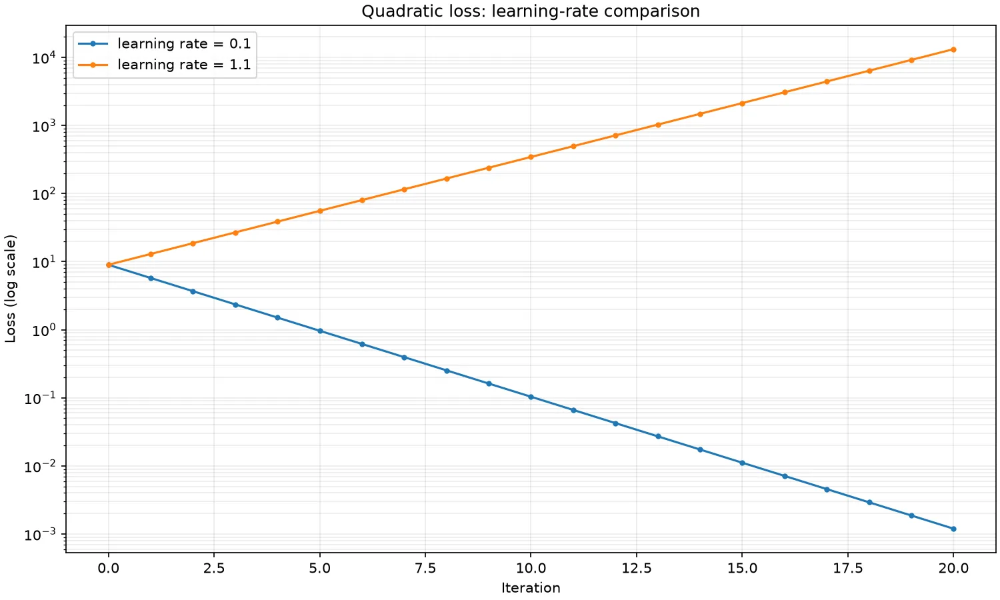

**شکل ۲۰-۱ — نرخ یادگیری و زیان.** منحنی‌ها از `x=0`، بیست به‌روزرسانی و هدف یکسان به دست آمده‌اند؛ محور عمودی لگاریتمی است و فاصله بصری خطی نیست. نمودار یک مثال مشخص است، نه مقایسه جامع بهینه‌سازها.

## ۴. داده، بچ و ارزیابی

در مسئله داده‌محور، زیان ممکن است میانگین خطای چند نمونه باشد. **Batch Gradient Descent** از کل داده آموزش برای گرادیان هر گام استفاده می‌کند؛ **Stochastic** نمونه و **Mini-batch** زیرمجموعه‌ای از داده را به کار می‌برند. برآورد گرادیان مینی‌بچ معمولاً متغیر است، بنابراین زیان هر گام الزاماً کاهش یکنواخت ندارد. ترتیب داده، اندازه بچ، seed و روش ثبت معیار مهم‌اند.

تنظیم نرخ و توقف باید با پروتکل ارزیابی معتبر انجام شود. داده اعتبارسنجی برای انتخاب تنظیمات و داده آزمون جدا برای ارزیابی نهایی به کار می‌رود؛ استفاده مکرر از آزمون برای تنظیم باعث خوش‌بینی می‌شود. جزئیات آموزش/ارزیابی در جلد دوم هستند.

## ۵. توقف، همگرایی و روش‌های عددی

تعداد ثابت گام، کوچکی تغییر پارامتر، کوچکی گرادیان یا تغییر اندک زیان می‌توانند معیار توقف باشند. هرکدام محدودیت دارند: گرادیان کوچک ممکن است در نقطه زینی یا ناحیه تخت رخ دهد؛ ثابت‌شدن ناشی از گردکردن نیز ممکن است. باید وضعیت، محدودیت گام و هزینه را ثبت کرد. همگرایی عددی و تعمیم مدل دو پرسش متفاوت‌اند.

**اختلاف محدود مرکزی** `(L(x+h)−L(x−h))/(2h)` مشتق را تقریب می‌زند و برای آزمون یک گرادیان تحلیلی مفید است. h بزرگ خطای تقریب و h بسیار کوچک خطای گردکردن/حذف ارقام دارد؛ چند مقدار مناسب و مقیاس را بررسی کنید. روش‌های عددی جواب تقریبی می‌دهند و باید خطا و شرایط مسئله را گزارش کرد.

## ۶. دقت شناور و پایداری

بسیاری از کسرهای ده‌دهی مانند ۰٫۱ در نمایش دودویی شناور دقیق نیستند؛ در Python معمولاً `0.1+0.2` به شکل `0.30000000000000004` نمایش داده می‌شود [۲]. مقایسه مستقیم برابری همیشه مناسب نیست؛ `math.isclose` با آستانه نسبی و مطلق متناسب با مسئله کمک می‌کند. نزدیک صفر، در صورت نیاز آستانه مطلق غیرصفر تعیین کنید. هیچ آستانه ثابتی برای همه کاربردها درست نیست.

**Overflow** خروج از دامنه نمایش، **underflow** بسیار کوچک‌شدن نتیجه و **cancellation** از دست‌رفتن ارقام معنی‌دار در تفریق مقادیر نزدیک است. `NaN` و بی‌نهایت نشانه نیاز به بررسی‌اند. نوع داده و ترتیب محاسبه بر دقت و حافظه اثر دارند؛ `numpy.finfo` حدهای نوع شناور را گزارش می‌کند [۳]. در تمرین مدل‌ها نرمال‌سازی با پارامترهای محاسبه‌شده فقط از داده آموزش می‌تواند به شرط‌بندی کمک کند، اما درمان جهانی همه مشکلات نیست.

## ۷. پروژه: تابع مربعی و دو نرخ

فایل `gradient_descent.py` را بسازید. فقط Python 3.13.16 و CPU لازم است؛ داده واقعی، شبکه یا بسته اضافی ندارد. برنامه بیست گام و مقدار اولیه یکسان را برای دو نرخ مقایسه می‌کند.

```python
"""Gradient descent on a known quadratic; educational CPU example."""
import math


def loss(x):
    return (x - 3.0) ** 2


def gradient(x):
    return 2.0 * (x - 3.0)


def optimize(start, learning_rate, steps):
    if not math.isfinite(start):
        raise ValueError('start must be finite')
    if not math.isfinite(learning_rate) or learning_rate <= 0:
        raise ValueError('learning_rate must be positive and finite')
    if type(steps) is not int or steps < 0:
        raise ValueError('steps must be a non-negative integer')
    path = [float(start)]
    for _ in range(steps):
        x = path[-1] - learning_rate * gradient(path[-1])
        if not math.isfinite(x):
            raise ValueError('non-finite update')
        path.append(x)
    return path


def main():
    for rate in (0.1, 1.1):
        path = optimize(0, rate, 20)
        print(f'rate={rate} final_x={path[-1]:.6f} final_loss={loss(path[-1]):.6f}')
    print('float_0.1_plus_0.2=', 0.1 + 0.2)
    print('close_to_0.3=', math.isclose(0.1 + 0.2, 0.3))


if __name__ == '__main__':
    main()
```

خروجی آزمایش‌شده:

```text
rate=0.1 final_x=2.965412 final_loss=0.001196
rate=1.1 final_x=-112.012800 final_loss=13227.944112
float_0.1_plus_0.2= 0.30000000000000004
close_to_0.3= True
```

عددها برای نمایش گرد شده‌اند. حالت نرخ ۱٫۱ در همین مثال رشد می‌کند؛ در مسائل واقعی نرخ مناسب به تابع، مقیاس و روش بستگی دارد. این برنامه یک بهینه‌ساز صنعتی با کنترل سرریز تمام عملیات و توقف خودکار نیست.

## ۸. آزمون و عیب‌یابی

فایل زیر را کنار برنامه بگذارید و `python -m unittest -v test_gradient_descent` را اجرا کنید. چهار تست شامل مقایسه گرادیان با اختلاف محدود، کاهش/رشد زیان، نرخ مرزی و ورودی نامعتبر است.

```python
import math
import unittest
from gradient_descent import loss, gradient, optimize


class OptimizationTests(unittest.TestCase):
    def test_gradient(self):
        self.assertEqual(gradient(0), -6)
        self.assertEqual(gradient(3), 0)
        h = 1e-5
        self.assertTrue(math.isclose((loss(1+h)-loss(1-h))/(2*h), gradient(1), rel_tol=1e-9))

    def test_descent_and_divergence(self):
        good = optimize(0, .1, 20)
        bad = optimize(0, 1.1, 20)
        self.assertLess(loss(good[-1]), loss(good[0]))
        self.assertGreater(loss(bad[-1]), loss(bad[0]))
        self.assertEqual(len(good), 21)

    def test_boundary_rates(self):
        self.assertEqual(optimize(0, 1, 2), [0.0, 6.0, 0.0])
        self.assertEqual(optimize(2, .1, 0), [2.0])

    def test_invalid(self):
        for args in [(0, 0, 1), (0, -1, 1), (0, float('nan'), 1), (float('inf'), .1, 1), (0, .1, True)]:
            with self.subTest(args=args), self.assertRaises(ValueError): optimize(*args)


if __name__ == '__main__':
    unittest.main()
```

`ValueError` برای نرخ نامعتبر یا ورودی نامتناهی مورد انتظار است. اگر نتایج بعد از تغییر نرخ نوسان کرد، منحنی زیان و مقیاس را بررسی کنید؛ صرفاً افزایش تعداد گام کافی نیست. با مقادیر بسیار بزرگ احتمال سرریز عملیات نیز هست. برای اشکال‌زدایی ابتدا مثال کوچک و دامنه محدود را بازتولید کنید.

## ۹. تمرین و ارزیابی

**پرسش‌ها:** ۱) کمینه `L(x)=(x−3)²` کجاست؟ ۲) گرادیان در صفر چیست؟ ۳) گام اول با نرخ ۰٫۱ چیست؟ ۴) آیا هر نرخ بزرگ‌تر بهتر است؟ ۵) آیا گرادیان صفر همواره کمینه سراسری است؟ ۶) mini-batch چه تفاوتی با کل داده دارد؟ ۷) آیا `0.1+0.2` همیشه دقیقاً ۰٫۳ دودویی است؟ ۸) چرا آستانه مطلق نزدیک صفر مهم است؟ ۹) آیا زیان آموزش کم تعمیم را تضمین می‌کند؟ ۱۰) با نرخ ۱ و شروع صفر، گام دوم کجاست؟

**مینی‌پروژه:** نرخ‌های ۰٫۰۱، ۰٫۱ و ۱٫۱ را با مقدار اولیه برابر مقایسه کنید، زیان هر گام و علت تفاوت را گزارش دهید. **چالش مهندسی:** گرادیان تحلیلی و اختلاف محدود را برای سه h بسنجید و هزینه و دقت را مقایسه کنید. **قبولی:** حداقل ۸ پاسخ درست از ۱۰، چهار آزمون موفق و نمودار/گزارش با محور برچسب‌دار.

پاسخ: ۱) ۳؛ ۲) −۶؛ ۳) ۰٫۶؛ ۴) خیر؛ ۵) خیر؛ ۶) زیرمجموعه؛ ۷) خیر؛ ۸) مقایسه نزدیک صفر؛ ۹) خیر؛ ۱۰) صفر.

## ۱۰. منابع و ادامه

واژه‌ها: Objective، Loss، Gradient Descent، Learning Rate، Convergence، Numerical Stability، Overflow، Floating Point. **بررسی ۵ نوامبر ۲۰۲۶:** این فصل قواعد پایه را معرفی می‌کند و نتایج عددی فقط برای محیط و مثال اعلام‌شده تأیید شده‌اند. فصل ۲۱ آنتروپی، آنتروپی متقاطع و KL را پوشش می‌دهد.

**منابع؛ مراجعه ۵ نوامبر ۲۰۲۶:** [۱] Google Developers، «Gradient descent»، ۲۰۲۶، [مستندات](https://developers.google.com/machine-learning/crash-course/linear-regression/gradient-descent). [۲] Python Software Foundation، «Floating-Point Arithmetic»، Python 3.13، تاریخ نامشخص، [مستندات](https://docs.python.org/3.13/tutorial/floatingpoint.html). [۳] NumPy، «numpy.finfo»، تاریخ نامشخص، [مستندات](https://numpy.org/doc/stable/reference/generated/numpy.finfo.html).

---

# فصل ۲۱ — نظریه اطلاعات: آنتروپی، آنتروپی متقاطع و KL

**هنر و علم ساخت هوش | جلد اول | Babak & Ai**  
**تاریخ بررسی منابع: ۵ نوامبر ۲۰۲۶**

## ۱. اطلاعات و عدم قطعیت

پیش‌بینی نتیجه‌ای که پیشاپیش قطعی است، عدم قطعیت کمی باقی می‌گذارد؛ نتیجه‌ای میان گزینه‌های هم‌احتمال نامطمئن‌تر است. نظریه اطلاعات، از جمله در کار شانون در ۱۹۴۸، ابزار کمی برای تحلیل منابع و ارتباط ارائه کرد [۱]. در این فصل به توزیع‌های **گسسته محدود** می‌پردازیم، نه معنای انسانی متن یا همه جنبه‌های هوش.

**پیش‌نیاز:** لگاریتم فصل ۱۶ و احتمال فصل ۱۹. **هدف:** محاسبه آنتروپی، آنتروپی متقاطع و واگرایی KL، تشخیص تفاوت آن‌ها و تحلیل احتمال صفر. این مفاهیم در توابع زیان مدل‌ها نقش دارند؛ آموزش مدل و ارزیابی آن در جلد دوم ادامه می‌یابد.

## ۲. میزان شگفتی و آنتروپی

برای رخدادی با احتمال مثبت p، اطلاعات خودی `I=−log₂(p)` است؛ رخداد کم‌احتمال‌تر شگفتی بیشتری دارد. **آنتروپی شانون** میانگین این مقدار تحت توزیع P است:

```text
H(P) = −Σᵢ pᵢ log₂(pᵢ)
```

احتمال‌ها نامنفی و مجموعشان ۱ است. قرارداد حدی `0 log 0 = 0` به کار می‌رود؛ لازم نیست `log(0)` را مستقیماً حساب کنیم. پایه ۲ واحد بیت و لگاریتم طبیعی واحد نَت می‌دهد. سکه هم‌احتمال `[0.5,0.5]` آنتروپی ۱ بیت و توزیع قطعی `[1,0]` آنتروپی صفر دارد. برای n گزینه هم‌احتمال آنتروپی `log₂(n)` است [۱].

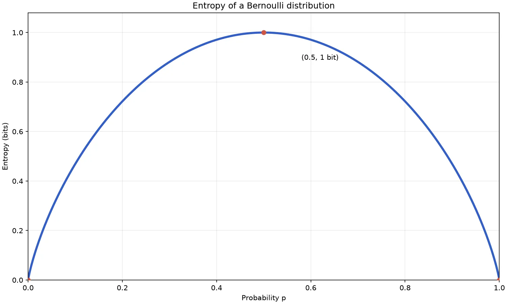

**شکل ۲۱-۱ — آنتروپی توزیع برنولی.** p احتمال یکی از دو خروجی است. نمودار عدم قطعیت توزیع را نشان می‌دهد، نه کیفیت پیش‌بینی برای یک نمونه خاص.

## ۳. آنتروپی متقاطع

اگر P توزیع مرجع و Q توزیع پیش‌بینی روی همان رخدادها باشد، **آنتروپی متقاطع** با پایه ۲ چنین است [۲]:

```text
H(P,Q) = −Σᵢ pᵢ log₂(qᵢ)
```

این میانگین شگفتی طبق احتمال‌های Q، برای رخدادهای وزن‌دهی‌شده با P است. اگر P توزیع یک‌داغ `[1,0]` و Q برابر `[0.8,0.2]` باشد، زیان آن نمونه `−log₂(0.8)≈0.321928` بیت است. برچسب یک‌داغ یک مشاهده را نشان می‌دهد؛ لزوماً توزیع واقعی جامعه را آشکار نمی‌کند. برای چند نمونه معمولاً میانگین زیان‌ها گزارش می‌شود و جزئیات وزن‌دهی باید مشخص باشد.

## ۴. واگرایی KL و جهت آن

**واگرایی Kullback–Leibler** از P نسبت به Q:

```text
D_KL(P||Q) = Σᵢ pᵢ log₂(pᵢ/qᵢ)
H(P,Q) = H(P) + D_KL(P||Q)
```

با قرارداد مناسب برای احتمال‌های صفر، KL نامنفی است و برای دو توزیع یکسان صفر است [۲]. به‌طور کلی `D_KL(P||Q) ≠ D_KL(Q||P)`؛ پس فاصله متقارن متعارف نیست. از نظر شهودی نشان‌دهنده هزینه اضافی متوسط استفاده از Q به جای P است، با فرض اینکه P مدل مرجع درست مسئله باشد. KL نه رابطه علّی ثابت می‌کند و نه به‌تنهایی همه جنبه‌های کیفیت یا انصاف مدل را می‌سنجد.

مثال `P=[0.5,0.5]` و `Q=[0.9,0.1]`: `H(P)=1`، `H(P,Q)≈1.736966` و `D_KL(P||Q)≈0.736966` بیت. ترتیب آرگومان‌ها و پایه لگاریتم باید در گزارش مشخص شوند.

## ۵. صفرها، پایداری و واحدها

اگر `pᵢ>0` و `qᵢ=0`، آنتروپی متقاطع و KL در تعریف توسعه‌یافته بی‌نهایت‌اند؛ زیرا مدل به رخدادی ممکن احتمال صفر داده است. اگر `pᵢ=0`، آن جمله سهم صفر دارد، حتی اگر `qᵢ=0` باشد. جایگزینی صفر با ε یا clipping مقدار محاسبه را تغییر می‌دهد و باید گزارش شود؛ این روش تضمین درستی مدل نیست.

احتمالات بسیار کوچک ممکن است در محاسبه شناور underflow شوند؛ در پروژه‌های واقعی استفاده از فرمول‌های پایدار روی log-probability یا logits و ابزارهای معتبر مناسب است. بیت و نت با ضریب `ln(2)` مرتبط‌اند و مقایسه مستقیم مقادیر با پایه‌های متفاوت اشتباه است. آنتروپی تفاضلی متغیر پیوسته خواص متفاوتی دارد؛ نتیجه‌های فصل برای توزیع گسسته‌اند.

## ۶. کاربرد و محدودیت در یادگیری ماشین

در دسته‌بندی، cross-entropy برچسب و احتمال پیش‌بینی را مقایسه می‌کند؛ اگر برچسب صحیح احتمال کمتری داشته باشد زیان افزایش می‌یابد [۳]. برای مقایسه منصفانه باید داده، پایه لگاریتم، وزن کلاس‌ها و روش میانگین یکسان باشند. زیان پایین‌تر به‌تنهایی دقت عملیاتی، کالیبراسیون، انصاف، امنیت یا عملکرد خارج توزیع را تضمین نمی‌کند.

قضیه‌ها برای توزیع و مفروضات مشخص‌اند. در مسئله واقعی P معمولاً ناشناخته است و توزیع تجربی از نمونه محدود برآورد می‌شود؛ کیفیت داده و عدم قطعیت بر تفسیر نتیجه اثر دارند. مقایسه و ارزیابی سیستماتیک در فصل‌های ۲۲ تا ۲۶ و ۶۲ ادامه دارد.

## ۷. پروژه: محاسبه در بیت

`information.py` را بسازید؛ فقط کتابخانه استاندارد Python 3.13.16 و CPU لازم است. داده ساختگی است و برنامه احتمال‌ها را بررسی می‌کند؛ برخلاف برخی کتابخانه‌ها آن‌ها را خودکار نرمال‌سازی نمی‌کند.

```python
"""Discrete entropy, cross entropy and KL divergence in bits."""
import math


def validate(distribution):
    if not distribution or any(not math.isfinite(p) or p < 0 or p > 1 for p in distribution):
        raise ValueError('probabilities must be finite values in [0, 1]')
    if not math.isclose(math.fsum(distribution), 1.0, rel_tol=0, abs_tol=1e-12):
        raise ValueError('probabilities must sum to one')


def entropy(p):
    validate(p)
    return -math.fsum(x * math.log2(x) for x in p if x > 0)


def cross_entropy(p, q):
    validate(p)
    validate(q)
    if len(p) != len(q):
        raise ValueError('distributions must have the same length')
    if any(x > 0 and y == 0 for x, y in zip(p, q)):
        return math.inf
    return -math.fsum(x * math.log2(y) for x, y in zip(p, q) if x > 0)


def kl_divergence(p, q):
    validate(p)
    validate(q)
    if len(p) != len(q):
        raise ValueError('distributions must have the same length')
    if any(x > 0 and y == 0 for x, y in zip(p, q)):
        return math.inf
    return math.fsum(x * (math.log2(x) - math.log2(y))
                     for x, y in zip(p, q) if x > 0)


def main():
    p, q = [0.5, 0.5], [0.9, 0.1]
    h, ce, kl = entropy(p), cross_entropy(p, q), kl_divergence(p, q)
    print(f'entropy_bits={h:.6f}')
    print(f'cross_entropy_bits={ce:.6f}')
    print(f'kl_bits={kl:.6f}')
    print('identity=', math.isclose(ce, h + kl, abs_tol=1e-12))
    print('zero_q_positive_p=', cross_entropy([1, 0], [0, 1]))


if __name__ == '__main__':
    main()
```

خروجی آزمایش‌شده:

```text
entropy_bits=1.000000
cross_entropy_bits=1.736966
kl_bits=0.736966
identity= True
zero_q_positive_p= inf
```

`math.fsum` به دقت جمع کمک می‌کند، اما محاسبات شناور همچنان تقریبی‌اند. شرط مجموع با تلورانس `10⁻¹²` ارزیابی می‌شود. توزیع مرجع و مدل باید هم‌طول باشند و رخدادهای متناظر در یک ترتیب باشند. مثال به‌صورت نمایشی است، نه پیاده‌سازی صنعتی برای تمام اندازه‌ها یا نوع داده‌ها.

## ۸. آزمون و عیب‌یابی

فایل زیر را کنار پروژه بگذارید و `python -m unittest -v test_information` اجرا کنید. چهار آزمون آنتروپی، هویت و جهت KL، احتمال صفر و ورودی نامعتبر را پوشش می‌دهند.

```python
import math
import unittest
from information import entropy, cross_entropy, kl_divergence


class InformationTests(unittest.TestCase):
    def test_entropy(self):
        self.assertAlmostEqual(entropy([.5, .5]), 1)
        self.assertEqual(entropy([1, 0]), 0)

    def test_identity_and_direction(self):
        p, q = [.5, .5], [.9, .1]
        self.assertAlmostEqual(cross_entropy(p, q), entropy(p) + kl_divergence(p, q))
        self.assertGreater(kl_divergence(p, q), 0)
        self.assertNotAlmostEqual(kl_divergence(p, q), kl_divergence(q, p))
        self.assertAlmostEqual(kl_divergence(p, p), 0)

    def test_zeros(self):
        self.assertTrue(math.isinf(cross_entropy([1, 0], [0, 1])))
        self.assertTrue(math.isinf(kl_divergence([1, 0], [0, 1])))
        self.assertEqual(cross_entropy([1, 0], [1, 0]), 0)

    def test_invalid(self):
        for p in ([], [-.1, 1.1], [.3, .3], [float('nan'), 1]):
            with self.subTest(p=p), self.assertRaises(ValueError): entropy(p)
        with self.assertRaises(ValueError): cross_entropy([1], [.5, .5])


if __name__ == '__main__':
    unittest.main()
```

`ValueError` برای توزیع خالی، منفی، NaN، مجموع نادرست یا طول ناسازگار مورد انتظار است. `inf` برای رخداد با `p>0` و `q=0` خطای برنامه نیست؛ یک نتیجه معنی‌دار در تعریف توسعه‌یافته است. اختلاف کوچک گردکردن ممکن است نتیجه عددی را اندکی تغییر دهد؛ تلورانس مقایسه باید با کاربرد سازگار باشد.

## ۹. تمرین و آزمون فصل

**پرسش:** ۱) آنتروپی سکه هم‌احتمال چند بیت است؟ ۲) آنتروپی نتیجه قطعی؟ ۳) واحد لگاریتم طبیعی؟ ۴) آیا KL متقارن است؟ ۵) اگر `p>0,q=0` چه می‌شود؟ ۶) اگر `p=0` سهم جمله چقدر است؟ ۷) رابطه cross-entropy و KL چیست؟ ۸) آیا احتمال پیش‌بینی و رخدادها باید متناظر باشند؟ ۹) آیا cross-entropy کم همه جنبه‌های کیفیت مدل را اثبات می‌کند؟ ۱۰) آیا می‌توان بیت و نت را بدون تبدیل مقایسه کرد؟

**تمرین:** برای `P=[1,0]` و `Q=[0.5,0.5]`، آنتروپی ۰، cross-entropy ۱ و KL برابر ۱ بیت است. **مینی‌پروژه:** سه توزیع پیش‌بینی برای یک برچسب ساختگی مقایسه کنید، ترتیب کلاس، واحد، حالت احتمال صفر و محدودیت نمونه را گزارش دهید. **قبولی:** دست‌کم ۸ پاسخ درست از ۱۰ و چهار تست موفق.

پاسخ‌ها: ۱) ۱؛ ۲) ۰؛ ۳) نت؛ ۴) خیر؛ ۵) بی‌نهایت؛ ۶) صفر؛ ۷) `H(P,Q)=H(P)+KL(P||Q)`؛ ۸) بله؛ ۹) خیر؛ ۱۰) خیر.

## ۱۰. ارزیابی جامع بخش چهارم و گذار به جلد دوم

پایان فصل ۲۱، پایان **بخش ریاضیات جلد اول طبق نقشه** است؛ به معنی تولید PDF یا تکمیل کل مجموعه نیست. پروژه ارزیابی بخش: ۱) مدل ساختگی `y=2x+1` با ۳ نمونه طراحی کنید؛ ۲) شکل داده و وزن، مشتق زیان و یک گام گرادیان‌کاهشی را دستی بررسی کنید؛ ۳) احتمال‌های یک پیش‌بینی دوتایی را با cross-entropy بسنجید؛ ۴) برای محاسبات و ورودی نامعتبر تست بنویسید؛ ۵) محدودیت داده، دقت شناور و عدم تعمیم را گزارش کنید. داده‌ها صرفاً ساختگی باشند.

**معیار پیشنهادی:** مفاهیم ۲۵٪، ریاضی و ابعاد ۲۵٪، اجرای کد و آزمون خطا ۲۵٪، تحلیل محدودیت و گزارش ۲۵٪؛ دست‌کم ۸۰٪ در هر بخش و هیچ شکست در آزمون خطا. دو روش تحلیلی و عددی را مقایسه و یک حالت شکست را توضیح دهید. این پروژه تکلیف خواننده است؛ نتیجه آن اینجا اجرا نشده است.

واژه‌ها: Entropy آنتروپی؛ Cross-Entropy آنتروپی متقاطع؛ KL Divergence واگرایی؛ Probability احتمال؛ Bit بیت؛ Nat نت. **بررسی ۵ نوامبر ۲۰۲۶:** نتیجه‌های عددی برای محیط اعلام‌شده بررسی شده‌اند. فصل ۲۲ جلد دوم، انواع یادگیری ماشین و تقسیم داده را آغاز می‌کند.

**منابع؛ مراجعه ۵ نوامبر ۲۰۲۶:** [۱] Claude E. Shannon، «A Mathematical Theory of Communication»، Bell System Technical Journal 27، ۱۹۴۸، [متن](https://people.math.harvard.edu/~ctm/home/text/others/shannon/entropy/entropy.pdf). [۲] SciPy، «scipy.stats.entropy»، مستندات زنده، تاریخ نامشخص، [منبع](https://docs.scipy.org/doc/scipy/reference/generated/scipy.stats.entropy.html). [۳] Google Developers، «Logistic regression: Loss and regularization»، ۲۰۲۶، [منبع](https://developers.google.com/machine-learning/crash-course/logistic-regression/loss-regularization).

---
