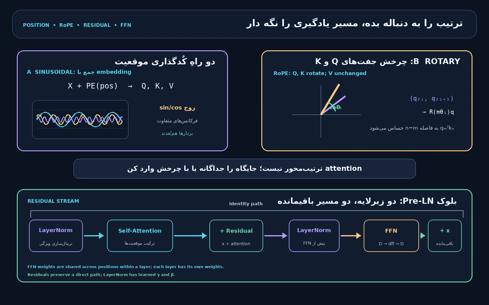
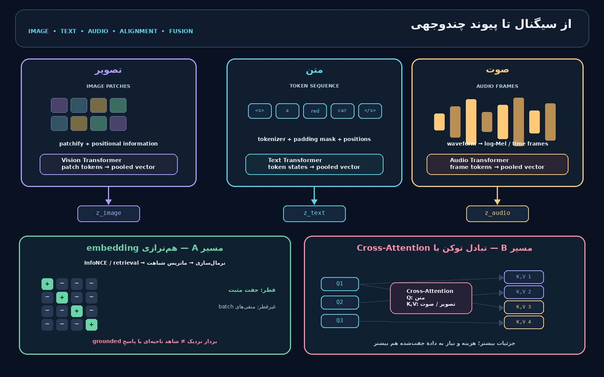
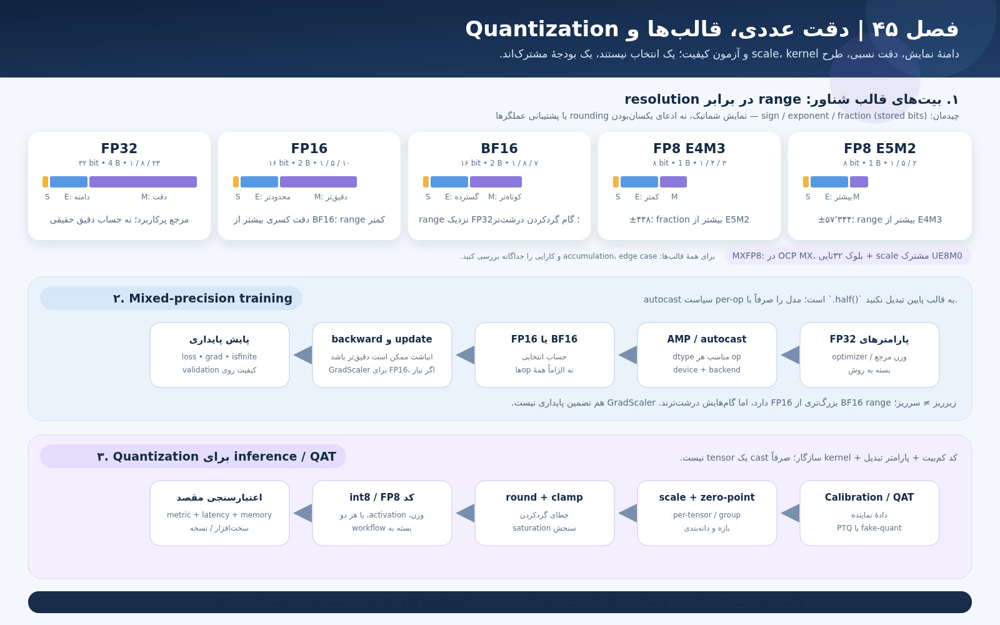

# هنر و علم ساخت هوش — جلد سوم

**The Art & Science of Building Intelligence | Babak & Ai**

وضعیت: ۱۴ فصل در نقشه؛ 14 فصل از ۱۴ فصل تا این انتشار نگارش و آزموده شده‌اند. این فایل Markdown است؛ PDF و EPUB تولید نشده‌اند.

## فهرست فصل‌های منتشرشده

- فصل 1 (سراسری 33) — توکن‌سازی، واژگان و توکن‌های ویژه
- فصل 2 (سراسری 34) — Attention، Query/Key/Value و پیاده‌سازی ماتریسی
- فصل 3 (سراسری 35) — Self-Attention، چندسری و ماسک علّی
- فصل 4 (سراسری 36) — موقعیت، RoPE، اتصال باقیمانده، LayerNorm و FFN
- فصل 5 (سراسری 37) — Encoder، Decoder و مدل‌های Encoder–Decoder
- فصل 6 (سراسری 38) — زمینه بلند، KV Cache، GQA، Sparse Attention و MoE
- فصل 7 (سراسری 39) — Transformer چندوجهی: اتصال رمزگذارهای تصویر و صوت
- فصل 8 (سراسری 40) — پروژه داده کوچک و آماده‌سازی مجاز متن
- فصل 9 (سراسری 41) — نخستین مدل زبانی کوچک: آموزش، ارزیابی و تولید
- فصل 10 (سراسری 42) — طراحی Mini GPT و بودجه آموزش
- فصل 11 (سراسری 43) — Corpus، مجوز، کیفیت و جلوگیری از آلودگی ارزیابی
- فصل 12 (سراسری 44) — پیش‌آموزش، برنامه نرخ یادگیری و Checkpoint
- فصل 13 (سراسری 45) — دقت عددی، BF16، FP16، FP8 و Quantization
- فصل 14 (سراسری 46) — Gradient Checkpointing، آموزش توزیع‌شده و مقیاس

---

# جلد سوم، فصل ۱ — توکن‌سازی، واژگان و شناسه‌های ویژه

**The Art & Science of Building Intelligence | Babak & Ai | فصل سراسری ۳۳ از نقشه پنج‌جلدی**

**تاریخ مرجع: ۵ نوامبر ۲۰۲۶؛ منابع برخط در همین تاریخ بازبینی شدند.**

## ۱. از متن تا ورودی مدل: شش مرحله را یکی نگیریم

مدل زبانی رشته‌ای از نویسه‌های نمایشی را مستقیماً «نمی‌خواند». پیش‌پردازش متن، توکن‌سازی و تبدیل به شناسه، به مدل دنباله‌ای از عددهای صحیح می‌دهد؛ سپس یک جدول تعبیه، برای هر شناسه برداری قابل‌آموزش فراهم می‌کند. شبکه عصبی روی بردارها و دنباله پردازش می‌کند. این مراحل مرتبط‌اند، اما یکی نیستند: توکن‌ساز نه معنا را تضمین می‌کند و نه به‌تنهایی بردار یا پاسخ مدل را می‌سازد.

**پیش‌نیاز:** رشته، تابع و UTF-8 در جلد اول؛ شناسه و تعبیه (Embedding) در فصل ۱۱ جلد دوم، برابر فصل سراسری ۳۲. **هدف:** مسیر متن تا شناسه را توصیف کنید، روش‌های واژه‌سازی را مقایسه کنید، یک Byte-Level BPE کوچک بسازید، شناسه‌های ویژه را بشناسید و ارتباط واژگان و جدول تعبیه را آزمون کنید. **پس از این فصل:** در فصل ۳۴ امتیازهای Query/Key/Value را روی نمایش برداری می‌سازیم؛ این فصل سازوکار Attention را آموزش نمی‌دهد.

نمای ریاضیِ مرحله توکن‌سازی چنین است: یک متن x به دنباله‌ای از شناسه‌های صحیح در واژگان با اندازه V تبدیل می‌شود؛ تعداد شناسه‌ها می‌تواند از تعداد واژه‌ها یا نویسه‌های متن بیشتر یا کمتر باشد.

<math xmlns="http://www.w3.org/1998/Math/MathML" display="block" aria-label="توکن‌ساز T متن x را به دنباله i یک تا i ال تبدیل می‌کند؛ هر شناسه بین صفر و وی منهای یک است"><mrow><mi>T</mi><mo>(</mo><mi>x</mi><mo>)</mo><mo>=</mo><mo>(</mo><msub><mi>i</mi><mn>1</mn></msub><mo>,</mo><msub><mi>i</mi><mn>2</mn></msub><mo>,</mo><mi>…</mi><mo>,</mo><msub><mi>i</mi><mi>L</mi></msub><mo>)</mo><mo>,</mo><mspace width="0.5em"/><msub><mi>i</mi><mi>j</mi></msub><mo>∈</mo><mo>{</mo><mn>0</mn><mo>,</mo><mi>…</mi><mo>,</mo><mi>V</mi><mo>−</mo><mn>1</mn><mo>}</mo></mrow></math>

متن جایگزین فرمول: `T(x)=(i₁,…,iL)`؛ هر `ij` یکی از شناسه‌های صفر تا `V−1` است. نماد `L` طول دنباله توکن‌ها و `V` اندازه واژگان این توکن‌ساز است.

![شکل ۳-۱-۱ — نمونه آموزشی Byte-Level BPE: دو نمونه abab و abac؛ پس از سه بار مشاهده جفت ab، ادغام ab شناسه ۲۶۰ می‌گیرد و abab به [۲۶۰، ۲۶۰] تبدیل می‌شود؛ سپس شناسه‌ها به جدول تعبیه می‌روند. شناسه‌ها متعلق به واژگان اسباب‌بازی این شکل‌اند.](assets/images/babak-ai/v3-ch01-tokenization.webp)

**شکل ۳-۱-۱ — از متن به شناسه و بردار.** راهنمای برچسب‌های دوزبانه در شکل: «متن ورودی / Raw text»، «پیش‌توکن‌ساز / Pre-tokenizer»، «بایت‌های UTF-8 / UTF-8 bytes»، «ادغام پرتکرار / Frequent merge»، «شناسه توکن / Token IDs»، «جدول تعبیه / Embedding table» و «بردارها / Vectors». در مثال کوچک، `ab` در مجموعه آموزش سه بار کنار هم می‌آید؛ ادغام نخست شناسه ۲۶۰ دارد و `abab` به دو توکن `ab` تبدیل می‌شود. شناسه و اندازه بردار نمونه‌اند، نه شناسه‌های مدل زبانی واقعی.

یک خط لوله متداول می‌تواند این مراحل را داشته باشد: ۱) نرمال‌سازی اختیاری، ۲) پیش‌توکن‌سازی (Pre-tokenization)، ۳) الگوریتم واژه‌سازی، ۴) افزودن نشانه‌های ویژه و تبدیل به شناسه، ۵) افزودن تعبیه و ورودی‌های دیگر مدل. کتابخانه‌های مختلف ممکن است مراحل را ترکیب یا جابه‌جا کنند؛ قرارداد دقیق همان مدل را بخوانید [۳، ۵].

## ۲. یونیکد، فارسی و تفاوت «نویسه» با «بایت»

رشته در Python توالی کدپوینت‌های Unicode است؛ کدپوینت، بایت UTF-8 و نویسه‌ای که چشم یک واحد می‌بیند الزاماً یکسان نیستند. یک حرف می‌تواند با علامت ترکیبی نمایش داده شود؛ یک ایموجی هم ممکن است چند کدپوینت داشته باشد. قواعد مرزبندی نویسه دیداری، واژه و جمله در Unicode جداگانه تعریف می‌شوند و برای هر زبان یا کاربرد می‌توان به قواعد عمومی نیاز داشت [۸]. بنابراین `len(text)` در Python تعداد کدپوینت‌ها را می‌شمارد، نه لزوماً تعداد نویسه‌های دیداری و نه تعداد توکن‌های مدل.

در فارسی، فاصله و نیم‌فاصله، اعراب، رقم‌ها و نویسه‌های عربیِ ظاهراً مشابه اهمیت دارند. برای نمونه، «ی» فارسی و «ي» عربی، یا «ک» فارسی و «ك» عربی، کدپوینت‌های متفاوت‌اند؛ نیم‌فاصله U+200C نیز از فاصله معمولی جداست. برخی متن‌ها این تفاوت‌ها را ناخواسته از صفحه‌کلید یا منبع داده به ارث می‌برند. تبدیل خودکار همه آن‌ها به یک صورت می‌تواند در یک مجموعه سودمند و در مجموعه دیگر تغییر معنای شناسه، نام یا متن اصلی باشد؛ تصمیم باید با قرارداد داده و آزمون روشن گرفته شود.

نرمال‌سازی NFC شکل‌های هم‌ارز کانونی را یکسان می‌کند؛ NFKC افزون بر آن، هم‌ارزی‌های سازگاری را نیز اعمال می‌کند و در نتیجه ممکن است تمایزهای نمایشی یا معنایی را حذف کند. استاندارد Unicode شکل‌های نرمال‌سازی را تعریف می‌کند، اما انتخاب شکل مناسب را برای هر مدل تضمین نمی‌کند [۷]. اگر توکن‌ساز متن را تغییر دهد، بازسازی معمولاً متن نرمال‌شده را می‌دهد، نه لزوماً همان بایت‌های ورودی. برای آموزش و استنتاج باید سیاست نرمال‌سازی یکسان باشد؛ برای بازبینی سند اصلی، متن مبنا و نگاشت offsetها را نگه دارید.

نمونه پایتون برای دیدن تفاوت، نه برای اعمال خودکار بر هر متن:

```python
import unicodedata

text = "A\u030a"  # A و علامت حلقه ترکیبی
print(len(text), len(text.encode("utf-8")))
print(unicodedata.normalize("NFC", text))
```

در مثال، دو کدپوینت قبل از نرمال‌سازی به یک نویسه مرکب در NFC تبدیل می‌شوند؛ تعداد بایت‌ها هم با تعداد کدپوینت‌ها برابر نیست. هر نرمال‌ساز باید در فایل تنظیمات توکن‌ساز ثبت و روی ورودی‌های مرزی آزموده شود.

## ۳. پیش‌توکن‌سازی: مرزهای اولیه

پیش‌توکن‌ساز (Pre-tokenizer) متن را با قواعدی مثل فاصله، رقم یا نشانه‌گذاری به قطعه‌های اولیه می‌شکند. این کار می‌تواند جلوی ادغام میان دسته‌های خاص را بگیرد و سرعت آموزش واژگان را بالا ببرد. اما «واژه» تعریف طبیعی و یکسانی برای همه زبان‌ها نیست: اتصال‌واژه، پسوند، نشانه‌گذاری، عدد و کد به تصمیم‌های متفاوت نیاز دارند. یک الگوی ساده Python برای آموزش مناسب است، ولی جایگزین توکن‌ساز مدل نیست [۳].

برای مثال، `AI, model!` را می‌توان به قطعه‌های `AI`، `,`، فاصله، `model` و `!` تقسیم کرد؛ توکن‌ساز دیگری شاید فاصله را به ابتدای قطعه بعدی بچسباند. این تفاوت کوچک روی شناسه‌ها و طول ورودی اثر می‌گذارد. در پروژه این فصل از الگوی آموزشی استفاده می‌کنیم که فاصله‌های پیاپی، دنباله‌های `\w` و هر نویسه غیرواژه‌ای را جدا می‌کند و با آزمون ثابت می‌کند هیچ متن ورودی حذف یا جابه‌جا نشده است. این الگو مرزبندی دقیق Unicode یا مدل زبانی تجاری نیست.

**نکته:** توکن‌سازی، پیش‌توکن‌سازی و نرمال‌سازی سه واژه برای یک عملیات نیستند. اگر قطعه ورودی در نمودار دیده نمی‌شود، ممکن است در نرمال‌سازی حذف یا در پیش‌توکن‌ساز به قطعه دیگری پیوسته باشد؛ ابتدا تنظیمات هر مرحله را بررسی کنید.

## ۴. واژه، نویسه، زیرواژه و بایت

واژه‌سازی در سطح واژه فرهنگ‌نامه‌ای ساده می‌سازد، اما واژه تازه یا شکل صرفی نادیده را ممکن است به `[UNK]` تبدیل کند؛ نگهداری همه صورت‌ها هم اندازه واژگان را بالا می‌برد. در سطح نویسه، مجموعه پایه کوچک است، اما دنباله بلند می‌شود و مدل باید پیوندهای دورتر را یاد بگیرد. روش زیرواژه (Subword) میان اندازه واژگان و طول دنباله مصالحه برقرار می‌کند؛ قطعه زیرواژه الزاماً تکواژ یا بخش معنادار زبان‌شناختی نیست.

| روش | ایده کلی | مزیت احتمالی | محدودیت و وابستگی |
|---|---|---|---|
| واژه‌محور (Word-level) | نگاشت واژه کامل به شناسه | قطعه‌ها برای انسان خوانا هستند | واژگان بزرگ و مسئله واژه خارج از واژگان |
| نویسه‌محور (Character-level) | یک نویسه یا واحد تعریف‌شده در هر گام | پوشش ساده با الفبای کوچک | دنباله معمولاً بلندتر و «نویسه» وابسته به تعریف است |
| BPE | ادغام تکرارشونده جفت‌های پرتکرار | واژگان ثابت با قطعه‌های پرتکرار | نتیجه به داده آموزش، مرزها و ترتیب ادغام وابسته است |
| WordPiece | واژگان زیرواژه و قطعه‌بندی بر اساس مدل | در برخی خانواده‌ها قطعه‌بندی کارآمد | تابع هدف آموزش و علامت‌گذاری وابسته به مدل است |
| Unigram | انتخاب مجموعه قطعه‌ها با مدل احتمالی | امکان چند قطعه‌بندی محتمل در برخی پیاده‌سازی‌ها | نمونه‌گیری یا مسیر قطعه‌بندی به تنظیمات وابسته است |
| Byte-Level BPE | شروع از ۲۵۶ مقدار بایت و ادغام بایت‌های متوالی | پوشش بایتی برای هر متن UTF-8 معتبر | قطعه منفرد ممکن است خوانا نباشد؛ الگوریتم تولیدی پیچیده‌تر است |

BPE در پردازش زبان برای نمایش واژه‌های نادر به صورت چند زیرواحد به کار رفت [۱]. در Byte-Level BPE، چون هر متن UTF-8 معتبر به دنباله‌ای از بایت‌های ۰ تا ۲۵۵ تبدیل می‌شود، داشتن همه بایت‌های پایه امکان بازنمایی متن دیده‌نشده را می‌دهد؛ این ویژگی یعنی «نویسه ناشناخته لازم نیست»، نه اینکه مدل متن ناشناخته را بفهمد [۴]. الگوریتم‌ها و کتابخانه‌ها یکسان نیستند: WordPiece، BPE و Unigram شیوه آموزش و قطعه‌بندی متفاوت دارند؛ SentencePiece می‌تواند مدل زیرواژه را مستقیماً از جمله خام بسازد و هم BPE و هم Unigram را پشتیبانی می‌کند [۲، ۳].

## ۵. یک گام BPE را دستی دنبال کنیم

مجموعه آموزشی کوچک را `abab` و `abac` بگیرید. برای این مثال ASCII هر حرف یک بایت است. جفت‌های مجاور را بشمارید:

| جفت | تعداد در `abab` | تعداد در `abac` | مجموع |
|---|---:|---:|---:|
| `ab` | ۲ | ۱ | ۳ |
| `ba` | ۱ | ۱ | ۲ |
| `ac` | ۰ | ۱ | ۱ |

پس ادغام نخست `ab` است. به طور کلی در گام t جفتی انتخاب می‌شود که شمار وقوع آن در دنباله‌های آموزشی فعلی بیشترین باشد؛ در صورت تساوی باید قاعده رفع تساوی تثبیت شود.

<math xmlns="http://www.w3.org/1998/Math/MathML" display="block" aria-label="در هر گام، جفت پی از مجموعه جفت‌های مجاور که بیشترین تعداد را دارد برای ادغام انتخاب می‌شود"><mrow><msub><mi>p</mi><mi>t</mi></msub><mo>=</mo><munder><mi>argmax</mi><mrow><mo>(</mo><mi>u</mi><mo>,</mo><mi>v</mi><mo>)</mo><mo>∈</mo><mi>P</mi></mrow></munder><msub><mi>count</mi><mi>t</mi></msub><mo>(</mo><mi>u</mi><mo>,</mo><mi>v</mi><mo>)</mo></mrow></math>

متن جایگزین فرمول: در گام `t` جفت مجاور `(u,v)` با بیشترین شمار را از میان جفت‌های مجاز `P` برمی‌گزینیم. این شمار از قطعه‌های آموزش همان گام است، نه از داده آزمون.

در پروژه شناسه ویژه PAD برابر ۰، BOS برابر ۱، EOS برابر ۲ و UNK برابر ۳ است؛ سپس بایت با شناسه `4 + مقدار بایت` نمایش داده می‌شود. پس `a` با کد ASCII برابر ۹۷، شناسه ۱۰۱ دارد و `b` شناسه ۱۰۲. شناسه ادغام اول از `4+256=260` شروع می‌شود. پس از ادغام `ab`، `abab` به `[260, 260]` و `abac` به `[260, 101, 103]` تبدیل می‌شوند. این عددها فقط در همین واژگان اسباب‌بازی درست‌اند؛ با تغییر شناسه‌های ویژه یا ترتیب ادغام، عوض می‌شوند.

## ۶. واژگان، شناسه‌ها و توکن‌های ویژه

واژگان (Vocabulary) نگاشت میان قطعه‌ها و شناسه‌های صحیح است. شناسه فقط جایگاه در یک واژگان مشخص است؛ ۱۰۲ از ۱۰۱ «بزرگ‌تر» یا معنادارتر نیست. شناسه‌های دو توکن‌ساز را بدون واژگان و ترتیب ادغام مشترک نمی‌توان برابر دانست. ذخیره مدل باید هم واژگان و قواعد پیش‌پردازش را داشته باشد و هم، جداگانه، اندازه و وزن‌های شبکه را ثبت کند.

توکن ویژه (Special Token) ورودی ساختاری با شناسه اختصاصی است. نمونه‌های رایج عبارت‌اند از:

| نام رایج | کارکرد معمول | نکته احتیاطی |
|---|---|---|
| BOS | آغاز دنباله یا پیام | همه مدل‌ها آن را نمی‌افزایند |
| EOS | پایان دنباله یا نوبت | معنای پایان در هر مدل و قالب فرق می‌کند |
| PAD | هم‌اندازه‌سازی دسته‌ای | باید ماسک توجه/زیان با قرارداد مدل هماهنگ باشد |
| UNK | نمایش خارج از واژگان | در توکن‌ساز بایتی ممکن است لازم نباشد |
| MASK | نشانه جای خالی برای هدف آموزشی | برای همه مدل‌های مولد علّی به‌کار نمی‌رود |
| SEP و نشانه‌های نقش | جداسازی متن یا نقش‌ها | نام و قالب گفت‌وگو مدل‌محور است |

رشته قابل‌مشاهده مانند `<|bos|>` فقط نگارش انسانی است؛ شناسه داخلی، فهرست ویژه‌ها و رفتار API تعیین می‌کنند که در ورودی واقعاً یک توکن کنترلی باشد یا رشته‌ای معمولی. در کد این فصل، `encode("<|bos|>")` متن را مثل بایت عادی می‌کد؛ BOS فقط با `add_bos=True` افزوده می‌شود. هنگام ساخت قالب گفت‌وگو یا پردازش متن نامطمئن، به ظاهر رشته تکیه نکنید؛ سیاست همان توکن‌ساز و قالب پیام را بیازمایید [۵].

اگر به یک مدل ازپیش‌آموزش‌دیده توکن تازه اضافه کنید، فقط نام آن را به فایل واژگان نوشتن کافی نیست؛ ماتریس تعبیه مدل نیز باید اندازه سازگار بگیرد و ردیف تازه نیازمند مقداردهی و یادگیری مناسب است [۵]. تغییر توکن‌ساز بدون نسخه‌بندی و به‌روزرسانی مدل می‌تواند شناسه‌های قبلی را به ردیف‌های نادرست وصل کند.

## ۷. از شناسه به بردار تعبیه

اگر واژگان `V` توکن و هر بردار `d` مؤلفه داشته باشد، جدول تعبیه `E` شکل `V×d` دارد. برای شناسه `i`، مدل ردیف متناظر را برمی‌دارد؛ این یک lookup است، نه محاسبه معنای واژه از عدد شناسه.

<math xmlns="http://www.w3.org/1998/Math/MathML" display="block" aria-label="جدول تعبیه ای شکل وی در دی دارد و بردار موقعیت j برابر ردیف جدول با شناسه توکن تی j است"><mrow><mi>E</mi><mo>∈</mo><msup><mi>ℝ</mi><mrow><mi>V</mi><mo>×</mo><mi>d</mi></mrow></msup><mo>,</mo><mspace width="0.5em"/><msub><mi>x</mi><mi>j</mi></msub><mo>=</mo><msub><mi>E</mi><mrow><msub><mi>t</mi><mi>j</mi></msub><mo>,</mo><mo>:</mo></mrow></msub></mrow></math>

متن جایگزین فرمول: `E` جدولی با `V` ردیف و `d` ستون است؛ برای شناسه `tj`، بردار `xj` از ردیف همان شناسه برداشته می‌شود.

در یک دسته شامل `B` دنباله، هرکدام با طول `L`، شناسه‌ها شکل `B×L` و خروجی lookup شکل `B×L×d` دارند. PyTorch این رفتار را با `nn.Embedding(num_embeddings, embedding_dim)` ارائه می‌کند؛ ورودی آن شاخص‌های صحیح و خروجی، بردارهای ردیف‌های انتخاب‌شده است [۶]. در نمونه ما `V=261`، `d=8` و سه شناسه به ماتریسی با شکل `(3, 8)` می‌رسند.

<math xmlns="http://www.w3.org/1998/Math/MathML" display="block" aria-label="شناسه‌ها شکل بی در ال دارند و پس از تعبیه، بردارها شکل بی در ال در دی دارند"><mrow><mi>IDs</mi><mo>∈</mo><msup><mi>ℤ</mi><mrow><mi>B</mi><mo>×</mo><mi>L</mi></mrow></msup><mo>⇒</mo><mi>Embedding</mi><mo>(</mo><mi>IDs</mi><mo>)</mo><mo>∈</mo><msup><mi>ℝ</mi><mrow><mi>B</mi><mo>×</mo><mi>L</mi><mo>×</mo><mi>d</mi></mrow></msup></mrow></math>

متن جایگزین فرمول: ورودی شناسه‌ها شکل `B×L` و خروجی تعبیه شکل `B×L×d` دارد؛ `B` تعداد دنباله‌ها، `L` طول و `d` بُعد بردار است.

```python
import torch
from torch import nn

ids = torch.tensor([260, 101, 103], dtype=torch.long)
embedding = nn.Embedding(num_embeddings=261, embedding_dim=8, padding_idx=0)
vectors = embedding(ids)
print(tuple(vectors.shape))  # (3, 8)
```

این نمونه با CPU اجرا شد و در آزمون پروژه، ردیف PAD از گرادیان به‌روزرسانی نشد. بردار lookup اولیه به شناسه وابسته است و برای یک ID ثابت همان ردیف را برمی‌گرداند؛ بازنمایی زمینه‌ای پس از عبور از لایه‌های شبکه تغییر می‌کند. تعبیه و وضعیت زمینه‌ای (Contextual Hidden State) را یکی نگیرید. کد محاسبه Query/Key/Value در فصل بعد می‌آید.

## ۸. طول دنباله، پنجره متن و سنجش

مدل پنجره ورودی را معمولاً با تعداد توکن‌ها می‌سنجد، نه تعداد واژه‌های فارسی، نویسه‌های دیداری یا بایت‌ها. یک متن واحد در دو توکن‌ساز می‌تواند تعداد و مرزهای متفاوت داشته باشد. بنابراین هنگام برش متن، برآورد هزینه یا مقایسه مدل‌ها، همان توکن‌ساز و نسخه‌ای را به‌کار ببرید که مدل با آن آموزش دیده یا مستند شده است. عدد «متوسط تعداد بایت در توکن» برای همه زبان‌ها، مدل‌ها، کدها و نشانه‌گذاری‌ها ثابت نیست [۴].

در آزمایش همین پروژه می‌توان نسبت تشخیصی تعداد توکن‌های خروجی به بایت‌های UTF-8 را گزارش کرد؛ نسبت کمتر از ۱ به معنی فشرده‌ترشدن همین نمایش بایتی است، نه نمره کیفیت مدل.

<math xmlns="http://www.w3.org/1998/Math/MathML" display="block" aria-label="نسبت تشخیصی آر برابر تعداد شناسه‌های خروجی تقسیم بر تعداد بایت‌های متن UTF-8 است"><mrow><mi>r</mi><mo>=</mo><mfrac><msub><mi>N</mi><mtext>tokens</mtext></msub><msub><mi>N</mi><mtext>UTF-8 bytes</mtext></msub></mfrac></mrow></math>

متن جایگزین فرمول: `r = تعداد توکن‌های خروجی / تعداد بایت‌های UTF-8 متن`. این معیار فقط مقایسه قطعه‌بندی همین متن و همین توکن‌ساز است و معیار فهم یا انصاف نیست.

برای بازرسی توکن‌ساز تازه، تنها به میانگین طول بسنده نکنید. چند زبانه و نمونه‌های نیم‌فاصله، رقم فارسی، نشانه‌گذاری، کد، متن ترکیبی و نویسه نادر را جدا بررسی کنید؛ بازسازی رفت‌وبرگشت، نرخ UNK در صورت وجود، توزیع طول دنباله، اندازه واژگان، offsetها، موارد بریده‌شده و مجوز corpus را ثبت کنید. داده ارزیابی باید از آموزش جدا و نماینده کاربرد آینده باشد. طول کمتر یک هدف مهندسی ممکن است، اما به خودی خود فهم بهتر، پوشش برابر زبان‌ها یا کیفیت پایین‌تر/بالاتر را اثبات نمی‌کند.

## ۹. پروژه قابل بازتولید: BPE کوچک روی CPU

پروژه `book-engineering/projects/33-tokenization/` یک توکن‌ساز آموزشی Byte-Level BPE با کتابخانه استاندارد می‌سازد. در مرحله آموزش، شش رشته ساختگی کوتاه به قطعه‌های اولیه تقسیم و به بایت تبدیل می‌شوند؛ ۲۴ ادغام پرتکرار ثبت می‌شود. سه رشته دیگر فقط برای ارزیابی رفت‌وبرگشت و شمار توکن استفاده می‌شوند. این داده‌ها برای تمرین‌اند، نه برای نتیجه‌گیری درباره کیفیت زبان فارسی یا یک مدل واقعی. هیچ وزن LLM آموزش داده نمی‌شود.

کد کامل زیر همان فایل `tokenizer_bpe.py` است که آزموده شد. توکن‌ساز عمداً نرمال‌سازی Unicode نمی‌کند، از regex ساده آموزشی بهره می‌گیرد و میان قطعه‌های پیش‌توکن‌ساز ادغام نمی‌سازد. فایل JSON ذخیره‌شده، قواعد توکن‌ساز را ثبت می‌کند؛ وزن مدل یا جدول تعبیه آموزش‌دیده را ذخیره نمی‌کند.

```python
"""Tiny, deterministic byte-level BPE tokenizer for teaching (standard library only).

This is deliberately not a clone of tiktoken, GPT-2, or SentencePiece. It uses a
small Unicode-aware pre-tokenizer, no Unicode normalization, all 256 UTF-8 byte
values, and deterministic left-to-right application of learned merge ranks.
"""
from __future__ import annotations

from collections import Counter
from pathlib import Path
from typing import Iterable
import json
import re

SPECIAL_TOKENS = {"<|pad|>": 0, "<|bos|>": 1, "<|eos|>": 2, "<|unk|>": 3}
SPECIAL_ID_TO_TOKEN = {value: key for key, value in SPECIAL_TOKENS.items()}
BYTE_OFFSET = len(SPECIAL_TOKENS)
BYTE_COUNT = 256
FORMAT_NAME = "babak-ai-toy-byte-bpe-v1"
PRETOKENIZER_NAME = r"whitespace runs | Unicode \w+ | single non-word characters"
# This simple pedagogical splitter preserves all input characters. It is not a
# production tokenizer's model-specific regular expression.
_PRETOKEN_RE = re.compile(r"\s+|\w+|[^\w\s]", flags=re.UNICODE)


def _pretokenize(text: str) -> list[str]:
    """Split text into chunks while preserving the exact concatenated string."""
    pieces = _PRETOKEN_RE.findall(text)
    if "".join(pieces) != text:
        raise ValueError("pre-tokenizer did not preserve the input")
    return pieces


def _merge_pair(sequence: list[int], pair: tuple[int, int], new_id: int) -> list[int]:
    """Merge non-overlapping occurrences of pair from left to right."""
    merged: list[int] = []
    index = 0
    while index < len(sequence):
        if index + 1 < len(sequence) and (sequence[index], sequence[index + 1]) == pair:
            merged.append(new_id)
            index += 2
        else:
            merged.append(sequence[index])
            index += 1
    return merged


class ByteBPE:
    """A compact byte-level BPE model with stable IDs and reversible decoding."""

    def __init__(self, merges: Iterable[tuple[int, int]] = ()) -> None:
        self._token_bytes: dict[int, bytes] = {
            BYTE_OFFSET + value: bytes([value]) for value in range(BYTE_COUNT)
        }
        normalized: list[tuple[int, int]] = []
        seen_pairs: set[tuple[int, int]] = set()
        known_ids = set(self._token_bytes)

        for rank, raw_pair in enumerate(merges):
            pair = tuple(raw_pair)
            if len(pair) != 2 or any(type(value) is not int for value in pair):
                raise ValueError("each merge must be a pair of integer token IDs")
            if pair in seen_pairs:
                raise ValueError("duplicate merge pair")
            if pair[0] not in known_ids or pair[1] not in known_ids:
                raise ValueError("merge refers to a token not defined earlier")
            new_id = BYTE_OFFSET + BYTE_COUNT + rank
            self._token_bytes[new_id] = self._token_bytes[pair[0]] + self._token_bytes[pair[1]]
            normalized.append(pair)
            seen_pairs.add(pair)
            known_ids.add(new_id)

        self.merges = tuple(normalized)

    @classmethod
    def train(cls, corpus: Iterable[str], num_merges: int = 24) -> "ByteBPE":
        """Learn frequent adjacent-byte merges from a small text corpus.

        Ties are broken by the numeric pair of token IDs. Corpus order therefore
        does not affect the result. Training data is not normalized.
        """
        if isinstance(corpus, str):
            raise TypeError("corpus must be an iterable of strings, not one string")
        if isinstance(num_merges, bool) or not isinstance(num_merges, int) or num_merges < 0:
            raise ValueError("num_merges must be a non-negative integer")
        try:
            texts = list(corpus)
        except TypeError as error:
            raise TypeError("corpus must be an iterable of strings") from error
        if not texts:
            raise ValueError("corpus must contain at least one text")
        if any(not isinstance(text, str) for text in texts):
            raise TypeError("every corpus item must be a string")

        sequences = [
            [BYTE_OFFSET + byte for byte in piece.encode("utf-8")]
            for text in texts
            for piece in _pretokenize(text)
            if piece
        ]
        merges: list[tuple[int, int]] = []

        for _ in range(num_merges):
            counts: Counter[tuple[int, int]] = Counter()
            for sequence in sequences:
                counts.update(zip(sequence, sequence[1:]))
            if not counts:
                break

            # Highest frequency wins; lexicographically smallest ID pair breaks ties.
            best_pair = min(counts, key=lambda pair: (-counts[pair], pair))
            new_id = BYTE_OFFSET + BYTE_COUNT + len(merges)
            sequences = [_merge_pair(sequence, best_pair, new_id) for sequence in sequences]
            merges.append(best_pair)

        return cls(merges)

    @property
    def vocab_size(self) -> int:
        """Number of special, byte, and learned-merge IDs in the model."""
        return BYTE_OFFSET + BYTE_COUNT + len(self.merges)

    def _encode_piece(self, piece: str) -> list[int]:
        ids = [BYTE_OFFSET + byte for byte in piece.encode("utf-8")]
        for rank, pair in enumerate(self.merges):
            if len(ids) < 2:
                break
            if any((ids[index], ids[index + 1]) == pair for index in range(len(ids) - 1)):
                new_id = BYTE_OFFSET + BYTE_COUNT + rank
                ids = _merge_pair(ids, pair, new_id)
        return ids

    def encode(self, text: str, *, add_bos: bool = False, add_eos: bool = False) -> list[int]:
        """Convert text to IDs. Special-token-looking text is treated as ordinary text."""
        if not isinstance(text, str):
            raise TypeError("text must be a string")
        if not isinstance(add_bos, bool) or not isinstance(add_eos, bool):
            raise TypeError("add_bos and add_eos must be booleans")

        ids: list[int] = []
        if add_bos:
            ids.append(SPECIAL_TOKENS["<|bos|>"])
        for piece in _pretokenize(text):
            ids.extend(self._encode_piece(piece))
        if add_eos:
            ids.append(SPECIAL_TOKENS["<|eos|>"])
        return ids

    def decode(self, ids: Iterable[int], *, skip_special_tokens: bool = True) -> str:
        """Reconstruct UTF-8 text; malformed IDs or invalid byte sequences raise errors."""
        if not isinstance(skip_special_tokens, bool):
            raise TypeError("skip_special_tokens must be a boolean")
        output: list[str] = []
        byte_buffer = bytearray()

        def flush_bytes() -> None:
            if byte_buffer:
                output.append(bytes(byte_buffer).decode("utf-8", errors="strict"))
                byte_buffer.clear()

        try:
            values = list(ids)
        except TypeError as error:
            raise TypeError("ids must be an iterable of integers") from error

        for token_id in values:
            if isinstance(token_id, bool) or not isinstance(token_id, int):
                raise TypeError("token IDs must be integers")
            if token_id < 0 or token_id >= self.vocab_size:
                raise ValueError(f"token ID {token_id} is outside the vocabulary")
            if token_id in SPECIAL_ID_TO_TOKEN:
                flush_bytes()
                if not skip_special_tokens:
                    output.append(SPECIAL_ID_TO_TOKEN[token_id])
            else:
                byte_buffer.extend(self._token_bytes[token_id])
        flush_bytes()
        return "".join(output)

    def display_tokens(self, ids: Iterable[int]) -> list[str]:
        """Return diagnostic pieces; incomplete UTF-8 pieces use visible escapes."""
        shown: list[str] = []
        for token_id in ids:
            if isinstance(token_id, bool) or not isinstance(token_id, int):
                raise TypeError("token IDs must be integers")
            if token_id < 0 or token_id >= self.vocab_size:
                raise ValueError(f"token ID {token_id} is outside the vocabulary")
            if token_id in SPECIAL_ID_TO_TOKEN:
                shown.append(SPECIAL_ID_TO_TOKEN[token_id])
            else:
                shown.append(self._token_bytes[token_id].decode("utf-8", errors="backslashreplace"))
        return shown

    def save(self, path: str | Path) -> None:
        """Save every setting required to reproduce IDs; no learned LLM weights."""
        payload = {
            "format": FORMAT_NAME,
            "normalization": "none",
            "pretokenizer": PRETOKENIZER_NAME,
            "special_tokens": SPECIAL_TOKENS,
            "byte_offset": BYTE_OFFSET,
            "byte_count": BYTE_COUNT,
            "merges": [list(pair) for pair in self.merges],
        }
        Path(path).write_text(
            json.dumps(payload, ensure_ascii=False, sort_keys=True, separators=(",", ":")) + "\n",
            encoding="utf-8",
        )

    @classmethod
    def load(cls, path: str | Path) -> "ByteBPE":
        """Load a saved toy tokenizer, rejecting incompatible metadata."""
        payload = json.loads(Path(path).read_text(encoding="utf-8"))
        if not isinstance(payload, dict) or payload.get("format") != FORMAT_NAME:
            raise ValueError("unrecognized tokenizer format")
        if payload.get("normalization") != "none" or payload.get("pretokenizer") != PRETOKENIZER_NAME:
            raise ValueError("tokenizer preprocessing configuration differs")
        if payload.get("special_tokens") != SPECIAL_TOKENS:
            raise ValueError("special-token IDs differ")
        if payload.get("byte_offset") != BYTE_OFFSET or payload.get("byte_count") != BYTE_COUNT:
            raise ValueError("base byte vocabulary differs")
        merges = payload.get("merges")
        if not isinstance(merges, list):
            raise ValueError("merge table must be a list")
        return cls(merges)


TRAIN_CORPUS = (
    "مدل زبانی متن را به شناسه تبدیل می‌کند.",
    "مدل‌های زبانی از توکن‌ها استفاده می‌کنند.",
    "توکن‌سازی، متن را به دنباله‌ای از شناسه‌ها تبدیل می‌کند.",
    "AI models learn patterns from token sequences.",
    "A tokenizer maps text to token IDs and can decode the IDs.",
    "AI models learn patterns from token sequences.",
)
EVAL_TEXTS = (
    "مدل‌های تازه!",
    "tokenizer-v2",
    "می‌آموزد 🤖",
)


def main() -> None:
    # Small hand-check of the first merge, independent of the larger corpus.
    miniature = ByteBPE.train(["abab", "abac"], num_merges=1)
    print("mini_merges=", miniature.merges)
    print("abab_ids=", miniature.encode("abab"))

    baseline = ByteBPE.train(TRAIN_CORPUS, num_merges=0)
    tokenizer = ByteBPE.train(TRAIN_CORPUS, num_merges=24)
    baseline_count = sum(len(baseline.encode(text)) for text in EVAL_TEXTS)
    merged_count = sum(len(tokenizer.encode(text)) for text in EVAL_TEXTS)
    exact_round_trip = all(tokenizer.decode(tokenizer.encode(text)) == text for text in EVAL_TEXTS)
    print(f"train_texts={len(TRAIN_CORPUS)} eval_texts={len(EVAL_TEXTS)}")
    print(f"vocab_size={tokenizer.vocab_size} merges={len(tokenizer.merges)}")
    print(f"eval_tokens_byte_baseline={baseline_count} eval_tokens_bpe={merged_count}")
    print(f"eval_utf8_bytes={sum(len(text.encode('utf-8')) for text in EVAL_TEXTS)}")
    print(f"exact_round_trip={exact_round_trip}")
    sample = "abab"
    print("sample_pieces=", miniature.display_tokens(miniature.encode(sample)))
    print("sample_decoded=", miniature.decode(miniature.encode(sample)))


if __name__ == "__main__":
    main()
```

**اجرای ثبت‌شده:** Python 3.13.16، PyTorch 2.6.0+cpu و Chromium برای آزمون صفحه؛ آموزش BPE خود پروژه با CPU و بدون وابستگی خارجی اجرا می‌شود. از پوشه پروژه `python tokenizer_bpe.py` و `python -m unittest discover -v` را اجرا کنید؛ برای آزمون embedding، PyTorch CPU لازم است. ۱۱ آزمون توکن‌ساز و سه آزمون lookup موفق شدند. خروجی دستی `mini_merges=((101, 102),)` و `abab_ids=[260, 260]` بود. روی سه رشته ارزیابی، baseline بایتی ۵۹ توکن و BPE با ۲۴ ادغام ۳۶ توکن داد؛ ۵۹ بایت UTF-8 بود و بازسازی هر سه رشته دقیق ماند. این کاهش فقط نتیجه همین corpus کوچک و واژگان ساختگی است.

برای نمایش بردار، `nn.Embedding` با `num_embeddings` برابر اندازه همان واژگان و `embedding_dim=8` بسازید. آزمون شکل `(3,8)` و صفرماندن گرادیان ردیف PAD را بررسی می‌کند [۶]. اگر نسخه PyTorch شما متفاوت است، نسخه و خروجی را گزارش کنید. برنامه عمداً ادعا نمی‌کند که مدل زبانی آموزش یا آزمون کیفیت داده واقعی انجام شده است.

**عیب‌یابی:** اگر بازسازی رشته فارسی شکست خورد، ابتدا ادغام بایت‌ها، تبدیل UTF-8، نرمال‌سازی و جداکردن قطعه ویژه را بررسی کنید؛ متن را پیش از ذخیره بی‌صدا پاک‌سازی نکنید. اگر شناسه از اندازه embedding خارج بود، واژگان و وزن مدل ناهمگام‌اند. اگر توکن‌های متنی در خروجی کنسول به شکل `\x..` دیده می‌شوند، قطعه ممکن است وسط توالی چندبایتی UTF-8 افتاده باشد؛ دنباله کامل را decode کنید. خطای نصب `torch` فقط برای آزمون lookup است و آموزش BPE مستقل از آن اجرا می‌شود.

## ۱۰. پرسش‌ها، تمرین و معیار عبور

۱) تفاوت توکن، شناسه و تعبیه چیست؟ ۲) چرا تعداد `len(text)` برابر تعداد توکن مدل نیست؟ ۳) در BPE آموزشی، بعد از انتخاب جفت، ترتیب شناسه ادغام چرا باید ثبت شود؟ ۴) اگر Byte-Level BPE برای نویسه‌ای UNK ندهد، آیا آن نویسه را «می‌فهمد»؟ ۵) NFC و NFKC چه تفاوتی دارند؟ ۶) چرا مرز پیش‌توکن‌ساز در خروجی اثر می‌گذارد؟ ۷) اگر رشته `<|bos|>` در پیام کاربر دیده شود، آیا قطعاً شناسه BOS است؟ ۸) با `V=261` و `d=8` جدول تعبیه چند ردیف و چند ستون دارد؟ ۹) اگر سه شناسه به تعبیه ۸بعدی داده شوند، شکل خروجی چیست؟ ۱۰) چرا تعویض توکن‌ساز یک مدل آماده بدون تطبیق وزن‌ها خطاست؟

**تمرین محاسبه:** برای `abab` و `abac` جفت‌های `ab`، `ba` و `ac` را بشمارید؛ سپس یک ادغام را اجرا و دنباله شناسه‌ها را با بایت‌پایه ۴ محاسبه کنید. **تمرین کد:** `num_merges` را صفر، یک و ۲۴ بگذارید؛ شمار توکن‌ها و بازسازی را مقایسه کنید. یک رشته با نیم‌فاصله و یک متن ترکیبی فارسی–لاتین اضافه کنید. **پروژه تکمیلی:** corpus مجاز و مستند بسازید، متن‌های آموزش و ارزیابی را بر اساس سند یا منبع جدا کنید، baseline بایتی را حفظ کنید و توزیع طول، بازسازی، خطاهای مرزی و محدودیت زبان‌ها را گزارش دهید.

**معیار عبور:** حداقل ۸ پاسخ درست از ۱۰، محاسبه دستی درست، همه آزمون‌های پروژه موفق و گزارش شامل corpus/مجوز، جداسازی ارزیابی، baseline، اندازه و واحد معیار، تحلیل خطا، محدودیت نرمال‌سازی و دستور بازتولید. [پاسخ‌نامه مستقل فصل](book-engineering/answers/33-tokenization-fa.md) را پس از حل تمرین باز کنید.

## ۱۱. جمع‌بندی، به‌روزرسانی و منابع

توکن‌ساز مرز و شناسه می‌سازد؛ مدل از روی شناسه جدول تعبیه را می‌خواند و سپس نمایش‌های زمینه‌ای می‌آموزد. واژگان، نرمال‌سازی، پیش‌توکن‌ساز، ترتیب ادغام و نشانه‌های ویژه بخشی از قرارداد مدل‌اند. **مفهوم پایدار:** شناسه، برچسب قراردادی است و خودْ معنا ندارد. **وابسته به مدل و نسخه:** روش قطعه‌بندی، رشته‌های ویژه، اندازه واژگان و قواعد نرمال‌سازی. **بازبینی تا نوامبر ۲۰۲۶:** نسخه‌های جاری مستندات Transformer، توکن‌سازهای چندوجهی را نیز با توکن‌های ویژه مرتبط با تصویر/صوت توصیف می‌کنند [۵]؛ این نشانه‌ها به معنی نمایش همه محتوای تصویر یا صوت به صورت یک واژه متنی نیستند. هیچ الگوریتم توکن‌سازی «بهترین برای همه زبان‌ها و مدل‌ها» معرفی نمی‌شود. استانداردهای Unicode 18.0 در سال ۲۰۲۶ راهنمای نرمال‌سازی و مرزبندی‌اند؛ خودشان انتخاب توکن‌ساز یک مدل را تعیین نمی‌کنند [۷، ۸].

در فصل ۳۴ به جای تکرار این زنجیره، از دنباله بردارها به امتیازهای Query، Key و Value می‌رویم؛ سپس در فصل ۳۵ ماسک علّی و خطر نشت آینده را آزمون می‌کنیم.

**منابع مستقیم؛ تاریخ دسترسی برای مستندات زنده ۵ نوامبر ۲۰۲۶:**

[۱] Rico Sennrich، Barry Haddow و Alexandra Birch، «Neural Machine Translation of Rare Words with Subword Units»، ACL 2016، DOI: [10.18653/v1/P16-1162](https://doi.org/10.18653/v1/P16-1162)، [متن در ACL Anthology](https://aclanthology.org/P16-1162/). نسخه پیش‌چاپ arXiv:1508.07909 نخست در ۲۰۱۵ ثبت و در ۱۰ ژوئن ۲۰۱۶ بازبینی شد: [arXiv](https://arxiv.org/abs/1508.07909).

[۲] Taku Kudo و John Richardson، «SentencePiece: A simple and language independent subword tokenizer and detokenizer for Neural Text Processing»، EMNLP System Demonstrations، نوامبر ۲۰۱۸، صص. ۶۶–۷۱، DOI: [10.18653/v1/D18-2012](https://doi.org/10.18653/v1/D18-2012)، [ACL Anthology](https://aclanthology.org/D18-2012/).

[۳] Hugging Face, Tokenizers، «Components»، مستندات برخط با تاریخ انتشار صفحه نامشخص؛ مراجعه ۵ نوامبر ۲۰۲۶، [مستندات نرمال‌سازی، پیش‌توکن‌سازها و مدل‌ها](https://huggingface.co/docs/tokenizers/en/components).

[۴] OpenAI، مخزن `tiktoken` و بخش «What is BPE anyway?»؛ مخزن زنده با تاریخ نسخه این توضیح نامشخص، مراجعه ۵ نوامبر ۲۰۲۶، [README و کد](https://github.com/openai/tiktoken). آمار کارایی یا نسبت بایت‌به‌توکن مخزن، نتیجه عمومی برای همه زبان‌ها و مدل‌ها نیست.

[۵] Hugging Face, Transformers، «Tokenizer»، نسخه مستندات 5.22.1 که هنگام بازبینی در دسترس بود، مراجعه ۵ نوامبر ۲۰۲۶، [مستندات](https://huggingface.co/docs/transformers/v5.22.1/en/main_classes/tokenizer).

[۶] PyTorch Contributors، «`torch.nn.Embedding`»، مستندات نسخه 2.6، مراجعه ۵ نوامبر ۲۰۲۶، [مرجع API](https://docs.pytorch.org/docs/2.6/generated/torch.nn.Embedding.html).

[۷] Unicode Consortium، Unicode Standard Annex #15، «Unicode Normalization Forms»، نسخه Unicode 18.0.0، ۱۲ اوت ۲۰۲۶، [UAX #15](https://www.unicode.org/reports/tr15/).

[۸] Unicode Consortium، Unicode Standard Annex #29، «Unicode Text Segmentation»، نسخه Unicode 18.0.0، ۱ سپتامبر ۲۰۲۶، [UAX #29](https://www.unicode.org/reports/tr29/).

---

# جلد سوم، فصل ۲ — توجه: پرس‌وجو، کلید، مقدار و محاسبهٔ ماتریسی

**The Art & Science of Building Intelligence | Babak & Ai | فصل سراسری ۳۴ از نقشهٔ پنج‌جلدی**

**تاریخ مرجع: ۵ نوامبر ۲۰۲۶؛ مستندات و منابع برخط در همین تاریخ بازبینی شدند.**

## ۱. مسئله: کدام بخش از دنباله برای این خروجی لازم است؟

در فصل قبل متن را به شناسه و سپس به بردار تعبیه تبدیل کردیم. حالا دنباله‌ای از بردارها داریم. یک بردار خلاصهٔ ثابت ممکن است برای همهٔ ورودی‌های بلند کافی نباشد؛ سازوکار **توجه (Attention)** به هر موقعیت پرس‌وجو اجازه می‌دهد از میان مجموعه‌ای از بردارهای دیگر، ترکیبِ داده‌محوری بسازد. این نام یک تشبیه مهندسی است: مدل انسان نیست و وزن‌های محاسبه‌شده به‌خودی‌خود اثبات نمی‌کنند که یک واژه را «فهمیده» یا به آن «اهمیت انسانی» داده است.

**پیش‌نیاز:** بردار، ضرب ماتریسی، softmax و تعبیه در فصل‌های پیشین؛ به‌ویژه فصل ۳۳ دربارهٔ شناسه و تعبیه. **هدف این فصل:** نقش Query/Key/Value را توضیح دهید، ابعاد ضرب‌ها را پیش از اجرا کنترل کنید، امتیازهای dot-product را مقیاس و نرمال کنید، خروجی را به صورت جمع وزن‌دار به دست آورید و پیاده‌سازی آموزشی را با PyTorch بسنجید.

**مرز این فصل:** فرمول پایهٔ توجه و یک نمونهٔ میان‌دنباله‌ای را بررسی می‌کنیم. Self-Attention، چندسری (Multi-Head) و ماسک علّی در فصل ۳۵ می‌آیند؛ این فصل آن‌ها را پیاده‌سازی نمی‌کند.

## ۲. «توجه» یک ایدهٔ کلی است؛ این فصل یک صورت‌بندی مشخص را دنبال می‌کند

در پژوهش ترجمهٔ ماشینی، Bahdanau، Cho و Bengio در ۲۰۱۵ سازوکاری برای هم‌ترازی نرم پیشنهاد کردند: در هر گام رمزگشا، بر اساس وضعیت آن گام و حالت‌های رمزگذار، وزن‌هایی می‌سازد و از حالت‌های منبع بردار زمینه‌ای محاسبه می‌کند [۱]. امتیازدهی آن‌ها **افزایشی (additive)** بود؛ پس نباید همهٔ توجه‌ها را با ضرب داخلی یکی دانست.

مقالهٔ Transformer در ۲۰۱۷ صورت‌بندی **Scaled Dot-Product Attention** را ارائه کرد و آن را در معماری چندسری به کار برد [۲]. در این فصل فقط همین صورت‌بندی تک‌سری را باز می‌کنیم. سازوکار عمومی را می‌توان چنین خلاصه کرد: یک پرس‌وجو با کلیدها امتیاز سازگاری می‌گیرد؛ softmax امتیازها را به وزن تبدیل می‌کند؛ سپس همان وزن‌ها بردارهای مقدار را ترکیب می‌کنند. پرس‌وجو/کلید و مقدار می‌توانند از نمایش‌های متفاوتی ساخته شوند.

تمثیل آموزشی: هر **Query** می‌گوید «برای این موقعیت چه چیزی لازم دارم؟»؛ هر **Key** نشانه‌ای برای سنجش سازگاری با آن نیاز است؛ هر **Value** اطلاعاتی است که در صورت سازگاری به خروجی کمک می‌کند. این تمثیل نقش محاسباتی را روشن می‌کند، نه این‌که درون شبکه جست‌وجوی نمادین یا برچسب‌های معنایی آماده وجود داشته باشند.

## ۳. پرس‌وجو، کلید و مقدار از کجا می‌آیند؟

در توجه میان‌دنباله‌ای، برای سادگی یک ماتریس نمایشِ پرس‌وجو `X` و ماتریس نمایش منبع `Z` می‌گیریم. لایه‌های خطیِ آموختنی، هرکدام را به فضای مناسب می‌برند:

<math xmlns="http://www.w3.org/1998/Math/MathML" display="block" aria-label="کیو برابر ایکس دبلیو کیو؛ کی برابر زد دبلیو کی؛ وی برابر زد دبلیو وی"><mrow><mi>Q</mi><mo>=</mo><mi>X</mi><msub><mi>W</mi><mi>Q</mi></msub><mo>,</mo><mspace width="0.5em"/><mi>K</mi><mo>=</mo><mi>Z</mi><msub><mi>W</mi><mi>K</mi></msub><mo>,</mo><mspace width="0.5em"/><mi>V</mi><mo>=</mo><mi>Z</mi><msub><mi>W</mi><mi>V</mi></msub></mrow></math>

متن جایگزین فرمول: `Q=XW_Q`، `K=ZW_K` و `V=ZW_V`. وزن‌های خطی آموخته می‌شوند؛ در این نمایش ساده، bias را ننوشته‌ایم. `X` و `Z` می‌توانند طول‌های متفاوت داشته باشند. در مثال ترجمه، می‌توان `X` را نمایش رمزگشا و `Z` را نمایش رمزگذار گرفت. در صورت‌های دیگر ممکن است این ورودی‌ها از منبعی دیگر بیایند.

هر پرس‌وجو با کلیدها مقایسه می‌شود؛ کلید و مقدار برای هر موقعیت منبع، هم‌تراز می‌مانند، اما دو فرافکنی جداگانه‌اند. بنابراین «کلید» نسخهٔ دیگری از «مقدار» نیست: کلید در امتیازدهی شرکت می‌کند و مقدار در ترکیب خروجی. خود `Q`، `K` و `V` بردارهای آموختنیِ وابسته به داده و پارامترهای مدل‌اند؛ واژه‌ها یا برچسب‌های انسانی نیستند.


**شکل ۳-۲-۱ — از Q/K/V تا بردارهای خروجی.** ابعاد روی شکل نام‌گذاری شده‌اند تا محل هر ضرب روشن بماند. `Lq` تعداد پرس‌وجوها، `Lk` تعداد موقعیت‌های کلید/مقدار، `dk` بُعد کلید و `dv` بُعد مقدار است. در مثال، خروجی یک بردار به ازای هر پرس‌وجو دارد.

## ۴. اول ابعاد را حساب کنیم

فرض کنید در این فصل یک نمونهٔ دسته‌ای با `B` دنباله داریم و برای هر دنباله یک سر توجه به کار می‌بریم. شکل تانسورها چنین است:

| تانسور | شکل | توضیح |
|---|---|---|
| `Q` | `B × Lq × dk` | `B` دسته، `Lq` پرس‌وجو، `dk` مؤلفه برای هر پرس‌وجو |
| `K` | `B × Lk × dk` | `Lk` کلید منبع؛ بُعد ویژگی با `Q` برابر است |
| `V` | `B × Lk × dv` | یک مقدار متناظر با هر کلید؛ بُعد `dv` می‌تواند متفاوت باشد |
| `QKᵀ` | `B × Lq × Lk` | هر ردیف پرس‌وجو را با همهٔ کلیدها مقایسه می‌کند |
| `A` پس از softmax | `B × Lq × Lk` | برای هر پرس‌وجو یک وزن به ازای هر کلید |
| `AV` | `B × Lq × dv` | خروجی به ازای هر پرس‌وجو |

اگر به‌جای ضرب ماتریسیِ هر نمونه از تانسورهای سه‌بعدی استفاده کنیم، `Kᵀ` باید فقط دو محور آخر را جابه‌جا کند؛ در PyTorch این کار `key.transpose(-2, -1)` است. انتقال همهٔ محورهای دسته‌ای را جابه‌جا نمی‌کند.

بدون محور دسته‌ای، صورت ساده این است: `Q` شکل `Lq×dk`، `K` شکل `Lk×dk` و `V` شکل `Lk×dv` دارند. در نتیجه `QKᵀ` شکل `Lq×Lk` و حاصل `AV` شکل `Lq×dv` است. این کنترل ابعاد جلوی خطای رایجِ استفاده از `K` به‌جای `Kᵀ` یا نرم‌سازی روی محور اشتباه را می‌گیرد.

## ۵. امتیاز، مقیاس‌گذاری و نرمال‌سازی

ابتدا سازگاری پرس‌وجو و کلید را با ضرب داخلی می‌سنجیم. سپس امتیاز را بر ریشهٔ بُعد کلید تقسیم می‌کنیم و روی **محور کلیدها** softmax می‌گیریم:

<math xmlns="http://www.w3.org/1998/Math/MathML" display="block" aria-label="اسکور برابر کیو ضربدر ترانهاده کی، تقسیم بر ریشه دی کی؛ آلفای آی جی برابر سافت‌مکس سطری اسکور؛ خروجی او برابر آلفا ضربدر وی"><mrow><mi>S</mi><mo>=</mo><mfrac><mrow><mi>Q</mi><msup><mi>K</mi><mi>T</mi></msup></mrow><msqrt><msub><mi>d</mi><mi>k</mi></msub></msqrt></mfrac><mo>,</mo><mspace width="0.5em"/><msub><mi>α</mi><mrow><mi>i</mi><mi>j</mi></mrow></msub><mo>=</mo><mfrac><mrow><mi>exp</mi><mo>(</mo><msub><mi>S</mi><mrow><mi>i</mi><mi>j</mi></mrow></msub><mo>)</mo></mrow><mrow><munderover><mo>∑</mo><mrow><mi>m</mi><mo>=</mo><mn>1</mn></mrow><msub><mi>L</mi><mi>k</mi></msub></munderover><mi>exp</mi><mo>(</mo><msub><mi>S</mi><mrow><mi>i</mi><mi>m</mi></mrow></msub><mo>)</mo></mrow></mfrac><mo>,</mo><mspace width="0.5em"/><mi>O</mi><mo>=</mo><mi>AV</mi></mrow></math>

متن جایگزین فرمول: `S=QKᵀ/√dk`؛ وزن `αᵢⱼ=exp(Sᵢⱼ)/Σₘ exp(Sᵢₘ)`؛ خروجی `O=AV`. جمع softmax برای هر ردیف `i` روی همهٔ `Lk` کلیدهاست.

از آن‌جا که softmax روی محور آخر اجرا می‌شود، هر ردیف `A` غیرمنفی است و مجموعش، جز خطای گردکردن، ۱ می‌شود. هر ردیف خروجی نیز جمعی وزن‌دار از ردیف‌های `V` است. در حالت بدون ماسک و بدون dropout، این خروجی ترکیب محدبِ بردارهای مقدار همان نمونه است. این گزاره دربارهٔ محاسبهٔ همین لایه است، نه دربارهٔ معنای کلیِ پیش‌بینی نهایی.

### چرا بر `√dk` تقسیم می‌کنیم؟

اگر مؤلفه‌های `q` و `k` مستقل، میانگین‌شان صفر و واریانس هرکدام ۱ باشد، واریانس جمعِ ضرب‌های مؤلفه‌ای در `q·k` با `dk` رشد می‌کند. تقسیم بر `√dk` اندازهٔ معمول امتیازها را برای چنین فرضی در مقیاسی نزدیک‌تر نگه می‌دارد. بدون این مقیاس‌گذاری، softmax ممکن است برای بُعد بزرگ به ناحیهٔ تیز/اشباع برسد؛ در آن ناحیه مشتق نرم‌سازی کوچک می‌شود و یادگیری می‌تواند دشوارتر شود. همین انگیزه در مقالهٔ Transformer آمده است [۲].

این استدلال بر فرضی ساده دربارهٔ مؤلفه‌ها متکی است؛ توزیع‌های واقعی در شبکهٔ آموخته‌شده الزاماً مستقل یا واحد-واریانس نیستند. تقسیم بر `√dk` تضمین نمی‌کند که همهٔ امتیازها کوچک، کالیبره یا از نظر معنا درست باشند. همچنین این کار نرمال‌سازی طول بردار و محاسبهٔ شباهت کسینوسی نیست؛ فقط ضریب مقیاس در این صورت‌بندی است.

## ۶. مثال عددی: دو کلید، دو مقدار

برای دیدن هر مرحله، یک پرس‌وجو و دو موقعیت منبع انتخاب می‌کنیم:

```text
q = [1, 0]
k₁ = [1, 0]       v₁ = [10, 0]
k₂ = [0, 1]       v₂ = [ 0,10]
dk = 2
```

ضرب داخلی خام `q·k₁=1` و `q·k₂=0` است؛ پس امتیازهای مقیاس‌شده برابر `[1/√2, 0] ≈ [0.7071, 0]` می‌شوند. softmax روی همین دو موقعیت می‌دهد:

```text
α ≈ [0.66976, 0.33024]
```

در نتیجه:

```text
o = 0.66976 × [10, 0] + 0.33024 × [0, 10]
  ≈ [6.69762, 3.30238]
```

این نمونه نشان می‌دهد ضرب در `V` چگونه مقدارهای متناسب با وزن‌ها را ترکیب می‌کند. امتیاز بالاتر به معنی «ارزش انسانی بیشتر» نیست؛ فقط در این ماژول، برای این پرس‌وجو و این ورودی، ضریب وزن‌دهی بزرگ‌تری ساخته است.

## ۷. پیاده‌سازی و بررسی‌های پایه

در کد آموزشی، محاسبه را صریح نگه می‌داریم: `Q @ Kᵀ`، تقسیم بر `√dk`، `torch.softmax(..., dim=-1)` و سپس ضرب در `V`. خروجی دوم تابع وزن‌های `A` است تا بتوانیم شکل و مجموع هر ردیف را آزمایش کنیم. تابع تولیدی PyTorch خروجی توجه را می‌دهد و الزاماً خود ماتریس وزن را برنمی‌گرداند.

فایل آزموده‌شده در `book-engineering/projects/34-attention/attention.py` است؛ کد کامل آن در پایان همین فصل آمده است. تابع برای روشن‌بودن درس، ورودی سه‌بعدی، dtype شناور و شکل‌های سازگار را بررسی می‌کند. این نمونه یک سر دارد؛ projectionهای `W_Q/W_K/W_V` را باید مدل پیرامونی فراهم کند. پیاده‌سازی ماسک و dropout ندارد و جایگزین API کامل تولیدی نیست.

اجرای نمونهٔ کوچک:

```bash
cd book-engineering/projects/34-attention
python attention.py
python -m unittest -v
```

در آزمون CPU با PyTorch 2.6، نمونه وزن‌های حدود `[0.66976, 0.33024]` و خروجی حدود `[6.69762, 3.30238]` داد. آزمون‌ها هشت مورد را بررسی می‌کنند: مثال محاسبه‌شده، شکل‌های دسته‌ای با طول متفاوت پرس‌وجو و منبع، نرمال‌شدن ردیف‌ها، برابری خروجی با API مرجع در تلورانس، گرادیان‌های متناهی، softmax برای امتیازهای بزرگ متناهی و رد ورودی‌های ناسازگار. مقادیر ممیزشناور ممکن است با dtype، نسخه و kernel تفاوت‌های کوچک داشته باشند.

مستندات PyTorch 2.6 برای `torch.nn.functional.scaled_dot_product_attention` شکل‌های `query/key/value`، ضریب پیش‌فرض `1/√E` و انتخاب kernelهای بهینه را شرح می‌دهند [۳]. در همان نسخه، اگر `dropout_p` مثبت به تابع داده شود، dropout اعمال می‌شود؛ پس در استنتاج مقدار صفر را صریح بدهید، مگر آن‌که رفتار تصادفی عمداً خواسته شده باشد. اختلاف اندک میان اجرای آموزشی و kernelهای fused، به‌علت ترتیب/دقت عملیات ممیزشناور ممکن است؛ مقایسه با تلورانس مناسب را جایگزین انتظارِ تطبیق بیت‌به‌بیت کنید. مستندات نسخه‌دار را برای نسخهٔ نصب‌شده بخوانید؛ رفتار API می‌تواند تغییر کند.

## ۸. آزمون‌های معنایی و خطاهای رایج

پیش از اعتماد به پیاده‌سازی، این پرسش‌ها را پاسخ دهید:

1. آیا بعد آخر `Q` و `K` یکسان است؟ باید `dk` برابر باشد تا ضرب `QKᵀ` ممکن شود.
2. آیا طول محور کلید در `K` و `V` برابر است؟ هر وزن برای یک موقعیت کلید، همان ردیف مقدار را انتخاب می‌کند.
3. آیا softmax روی محور `Lk` اجرا می‌شود؟ در شکل سه‌بعدی ساده، این `dim=-1` است.
4. آیا شکل خروجی `[B,Lq,dv]` است؟ خروجی به تعداد پرس‌وجوهاست، نه الزاماً به طول منبع.
5. آیا ردیف‌های وزن مجموعی نزدیک ۱ دارند؟ این آزمون جهت softmax و محور نرمال‌سازی را بررسی می‌کند.
6. آیا `output` با `weights @ value` برابر است و گرادیان از `Q/K/V` می‌گذرد؟ این موارد را در آزمون‌ها می‌سنجیم.

خطاهای متداول عبارت‌اند از تقسیم بر `dk` به‌جای `√dk`، استفاده از `K` بدون ترانهاده، اعمال softmax روی محور پرس‌وجو، ناسازگاری طول کلید و مقدار، و این فرض که همهٔ پیاده‌سازی‌ها همواره امتیازها را بر `√dk` تقسیم می‌کنند. در APIهای مختلف ممکن است مقدار پیش‌فرض یا امکان تعیین scale فرق کند؛ پارامتر همان نسخه را بررسی کنید [۳].

در مدل واقعی، sequence padding، mask، dropout، batch، dtype و layout هم اهمیت دارند. در این فصل فقط حالت پایه را آزموده‌ایم و دربارهٔ صحت یک مدل کامل یا عملکرد GPU ادعایی نداریم. فصل ۳۵ به توسعه‌های معماریِ بعدی می‌پردازد.

## ۹. وزن توجه را با توضیح قطعی اشتباه نگیریم

وزن `αᵢⱼ` معنای ریاضی روشنی دارد: ضریب موقعیت `j` در جمع وزن‌دارِ خروجی همان ماژول، برای پرس‌وجوی `i`. اما از این تعریف به‌تنهایی نتیجه نمی‌شود که مقدار وزن، اهمیت علّی یا توضیح وفادارِ پیش‌بینی نهایی است.

Jain و Wallace در ۲۰۱۹ در چند مدل زبانی، شواهدی گزارش کردند که وزن‌ها ممکن است با بعضی سنجه‌های اهمیت ویژگی هم‌راستا نباشند و توزیع‌های متفاوتی بتوانند خروجی مشابه بدهند [۴]. Wiegreffe و Pinter همان سال تأکید کردند که نتیجه به تعریف «توضیح» و طراحی آزمون وابسته است و ارزیابی باید کل مدل را در نظر بگیرد [۵]. این دو مقاله محدودهٔ بحث روش‌شناختی را نشان می‌دهند؛ هیچ‌کدام مجوز نمی‌دهند که هر نقشهٔ توجه در هر معماری را بی‌قیدوشرط رد یا تأیید کنیم.

قاعدهٔ عملی: وزن‌ها را ابتدا به‌عنوان **ضرایب محاسباتی همین لایه** تفسیر کنید. اگر هدف توضیح‌پذیری است، تعریف توضیح و معیار وفاداری را روشن کنید، مدل و لایه را مشخص کنید، مقایسه و آزمون مداخله‌ای مناسب طراحی کنید و نتیجه را به همان شرایط محدود سازید. رنگ‌کردن وزن‌های بزرگ در یک heatmap به‌تنهایی شاهد تصمیم‌گیری مدل نیست.

## ۱۰. هزینهٔ محاسبه و انتخاب پیاده‌سازی

برای محاسبهٔ صریحِ همهٔ امتیازها، جدول `S` و وزن‌های `A` هرکدام `Lq×Lk` خانه دارند؛ هزینهٔ ضرب `QKᵀ` با ابعاد ویژگی رشد می‌کند و ضرب `AV` نیز به `dv` وابسته است. بنابراین طول دنباله، ابعاد و تعداد نمونه‌ها روی حافظه و زمان اثر می‌گذارند. این شمارش آموزشی به‌تنهایی سرعت واقعی را پیش‌بینی نمی‌کند: device، dtype، شکل دقیق ورودی و kernel انتخاب‌شده هم دخیل‌اند.

در PyTorch، API سطح‌بالای Scaled Dot-Product Attention می‌تواند kernel بهینهٔ سازگار با ورودی و backend را انتخاب کند [۳]. این انتخاب ممکن است در محاسبات ممیزشناور تفاوت جزئی ایجاد کند. برای کاربرد واقعی، شکل و dtype واقعی را روی سخت‌افزار هدف benchmark کنید؛ از سرعت اجرای نمونهٔ CPU یا از کوتاهی یک تابع نتیجه‌گیری نکنید. در این فصل صحت فرمول پایه را می‌آزماییم، نه برتری سرعت یک backend را.

## ۱۱. تمرین و جمع‌بندی

### تمرین‌ها

1. با سه کلید و سه مقدار دوبعدی، یک `Q` بسازید و `QKᵀ`، امتیازهای مقیاس‌شده، وزن‌ها و خروجی را دستی یا با ماشین‌حساب دنبال کنید. بررسی کنید وزن‌ها در کدام محور به ۱ جمع می‌شوند.
2. طول پرس‌وجوها را ۲ و طول منبع را ۵ بگذارید. شکل `Q`، `K`, `V`, `A` و `O` را بنویسید و توضیح دهید چرا شکل خروجی `Lq` را دنبال می‌کند.
3. فرض کنید `dk=16`. ضریب درست چیست؟ توضیح دهید چرا این عمل با نرمال‌سازی طول `q` و `k` فرق دارد.
4. در پروژه، `d_v` را از `d_k` متفاوت بگیرید و آزمون شکل را گسترش دهید. سپس آگاهانه softmax را روی محور نادرست اجرا کنید؛ کدام آزمون باید این خطا را آشکار کند؟
5. دو جمله بنویسید: یکی که نقش محاسباتی وزن `αᵢⱼ` را دقیق تعریف کند و دیگری که از ادعای توضیح‌پذیریِ بی‌پشتوانه پرهیز کند.

### آنچه باید به یاد بماند

- Query و Key برای ساخت امتیازها به فضای ویژگی هم‌اندازه فرافکنی می‌شوند؛ Valueها اطلاعات خروجی را حمل می‌کنند.
- صورت‌بندی این فصل `softmax(QKᵀ/√dk)V` است؛ softmax برای هر پرس‌وجو روی کلیدها اعمال می‌شود.
- شکل‌ها را پیش از اجرا بنویسید: امتیاز و وزن `Lq×Lk`، خروجی `Lq×dv`.
- در حالت پایه، وزن هر ردیف مجموعاً ۱ است و خروجی جمع وزن‌دار Valueهاست؛ تفسیر معنایی/توضیحیِ وزن‌ها نیازمند شواهد جداگانه است.
- API، dropout، backend و دقت عددی به نسخه و ورودی وابسته‌اند. این فصل ماسک علّی و Multi-Head را پوشش نمی‌دهد.

[جواب‌نامهٔ تشریحی فصل ۳۴](book-engineering/answers/34-attention-fa.md) · [پروژهٔ اجرایی و هشت آزمون](book-engineering/projects/34-attention/README.md)

## ۱۲. منابع بیرونی

1. Dzmitry Bahdanau, Kyunghyun Cho, Yoshua Bengio. “Neural Machine Translation by Jointly Learning to Align and Translate.” ICLR 2015؛ نسخهٔ arXiv:1409.0473 نخستین‌بار ۱ سپتامبر ۲۰۱۴ ثبت شد. [مقاله در arXiv](https://arxiv.org/abs/1409.0473). منبع اولیه برای توجه افزایشی و جمع وزن‌دار حالت‌های منبع.
2. Ashish Vaswani et al. “Attention Is All You Need.” NeurIPS 2017؛ arXiv:1706.03762، نسخهٔ نخست ۱۲ ژوئن ۲۰۱۷ و نسخهٔ بازنگری‌شدهٔ v7 در ۲ اوت ۲۰۲۳. [مقاله در arXiv](https://arxiv.org/abs/1706.03762) · [نسخهٔ NeurIPS](https://papers.neurips.cc/paper/7181-attention-is-all-you-need.pdf). منبع فرمول Scaled Dot-Product و انگیزهٔ مقیاس‌گذاری.
3. PyTorch. “`torch.nn.functional.scaled_dot_product_attention`.” مستندات نسخهٔ 2.6. [صفحهٔ رسمی API](https://docs.pytorch.org/docs/2.6/generated/torch.nn.functional.scaled_dot_product_attention.html). برای شکل ورودی/خروجی، scale پیش‌فرض، dropout و انتخاب kernel؛ نسخهٔ مستندات در این فصل عمداً مشخص شده است.
4. Sarthak Jain, Byron C. Wallace. “Attention is not Explanation.” NAACL-HLT 2019, pp. 3543–3556. [ACL Anthology](https://aclanthology.org/N19-1357/) · [DOI: 10.18653/v1/N19-1357](https://doi.org/10.18653/v1/N19-1357). یک سوی بحث دربارهٔ محدودیت تفسیر وزن‌های توجه.
5. Sarah Wiegreffe, Yuval Pinter. “Attention is not not Explanation.” EMNLP-IJCNLP 2019, pp. 11–20. [ACL Anthology](https://aclanthology.org/D19-1002/) · [DOI: 10.18653/v1/D19-1002](https://doi.org/10.18653/v1/D19-1002). تأکید بر تعریف توضیح و طراحی ارزیابی.

**دسترسی منابع برخط: ۵ نوامبر ۲۰۲۶.** مستندات API به نسخهٔ 2.6 ارجاع می‌دهند؛ نسخهٔ نصب‌شده و رفتار دقیق backend را برای پروژهٔ واقعی جداگانه وارسی کنید.

## پیوست: پیاده‌سازی کامل پروژه

فایل زیر همان نسخهٔ اجرا و آزمون‌شدهٔ `book-engineering/projects/34-attention/attention.py` است. این نمونهٔ سه‌بعدیِ آموزشی یک سر را اجرا می‌کند و برای روشن‌ماندن مفهوم، mask یا dropout ندارد.

```python
"""Small, explicit scaled dot-product attention for chapter 34 (CPU-friendly)."""
from __future__ import annotations

import math
import torch
import torch.nn.functional as F


def scaled_dot_product_attention(
    query: torch.Tensor,
    key: torch.Tensor,
    value: torch.Tensor,
) -> tuple[torch.Tensor, torch.Tensor]:
    """Compute one-head attention for [batch, sequence, feature] tensors.

    query: [B, Lq, dk], key: [B, Lk, dk], value: [B, Lk, dv]
    returns output [B, Lq, dv] and row-normalized weights [B, Lq, Lk].

    This teaching implementation intentionally has no mask or dropout. Those
    choices are model/training-specific and causal masking is the next chapter.
    """
    tensors = {"query": query, "key": key, "value": value}
    if any(not isinstance(tensor, torch.Tensor) for tensor in tensors.values()):
        raise TypeError("query, key, and value must be torch.Tensor objects")
    if any(tensor.ndim != 3 for tensor in tensors.values()):
        raise ValueError("expected rank-3 [batch, sequence, feature] tensors")
    if any(not tensor.is_floating_point() for tensor in tensors.values()):
        raise TypeError("query, key, and value must have floating-point dtype")
    if not (query.dtype == key.dtype == value.dtype):
        raise TypeError("query, key, and value must use the same dtype")
    if not (query.device == key.device == value.device):
        raise ValueError("query, key, and value must be on the same device")
    if query.size(0) != key.size(0) or key.size(0) != value.size(0):
        raise ValueError("batch dimensions must match")
    if query.size(-1) != key.size(-1):
        raise ValueError("query and key feature dimensions must match")
    if key.size(1) == 0 or value.size(1) == 0:
        raise ValueError("the key/value sequence must contain at least one position")
    if key.size(1) != value.size(1):
        raise ValueError("key and value sequence lengths must match")
    if query.size(-1) == 0 or value.size(-1) == 0:
        raise ValueError("feature dimensions must be non-empty")

    dk = query.size(-1)
    scores = torch.matmul(query, key.transpose(-2, -1)) / math.sqrt(dk)
    weights = torch.softmax(scores, dim=-1)
    output = torch.matmul(weights, value)
    return output, weights


def main() -> None:
    # One query, two keys, and two 2-D values; all calculations are on CPU.
    query = torch.tensor([[[1.0, 0.0]]], dtype=torch.float64)
    key = torch.tensor([[[1.0, 0.0], [0.0, 1.0]]], dtype=torch.float64)
    value = torch.tensor([[[10.0, 0.0], [0.0, 10.0]]], dtype=torch.float64)

    output, weights = scaled_dot_product_attention(query, key, value)
    reference = F.scaled_dot_product_attention(
        query, key, value, dropout_p=0.0, is_causal=False
    )
    print("device=cpu")
    print("scores_scaled=", (query @ key.transpose(-2, -1) / math.sqrt(2)).tolist())
    print("weights=", weights.tolist())
    print("output=", output.tolist())
    print("torch_reference_matches=", torch.allclose(output, reference, atol=1e-12, rtol=1e-12))


if __name__ == "__main__":
    main()
```

---

# جلد سوم، فصل ۳ — Self-Attention، چندسری و ماسک علّی

**The Art & Science of Building Intelligence | Babak & Ai | فصل سراسری ۳۵ از نقشهٔ پنج‌جلدی**

**تاریخ مرجع: ۵ نوامبر ۲۰۲۶؛ منابع برخط در همین تاریخ بازبینی شدند.**

## ۱. از Attention میان‌دنباله‌ای به رابطه‌های درون یک دنباله

در فصل ۳۴ یک پرس‌وجو را با کلیدها مقایسه کردیم و مقدارها را ترکیب کردیم. در **Self-Attention**، پرس‌وجو، کلید و مقدار از یک دنبالهٔ واحد ساخته می‌شوند. اگر ورودی لایه `X` باشد، سه projection آموختنی روی همان `X` اعمال می‌شوند و هر موقعیت می‌تواند از موقعیت‌های دیگر نمایش تازه‌ای بسازد. «Self» به مبدأ مشترک `Q/K/V` اشاره دارد؛ معنایش این نیست که سه ماتریس یا سه نقش یکی هستند.

توجه Self می‌تواند دوسویه باشد: در یک لایهٔ رمزگذار، هر موقعیت اجازه دارد کل دنباله را ببیند. اما مدل خودرگرسیو که واژهٔ بعدی را پیش‌بینی می‌کند، نباید هنگام آموزش از پاسخ‌های آینده استفاده کند؛ برای آن **ماسک علّی (Causal Mask)** لازم است. پس Self-Attention و ماسک علّی دو مفهوم جدا هستند: یکی می‌گوید `Q/K/V` از کجا می‌آیند؛ دیگری تعیین می‌کند هر پرس‌وجو کدام کلیدها را می‌تواند ببیند [۱].

**پیش‌نیاز:** فرمول Attention و شکل‌های `Q/K/V` در فصل ۳۴، بردار و ضرب ماتریسی از جلدهای پیشین. **هدف:** Self-Attention را از توجه میان‌دنباله‌ای تشخیص دهید؛ سرهای متعدد را تقسیم و دوباره ادغام کنید؛ ماسک علّیِ بدون خطای یک‌خانه‌ای بسازید؛ و با تغییر ورودی آینده، آزمون کنید که خروجی‌های گذشته نشت اطلاعات نداشته باشند.


**شکل ۳-۳-۱ — چندسری و دید علّی.** ردیف `i` به پرس‌وجوی موقعیت `i` و ستون `j` به کلید موقعیت `j` مربوط است. خانهٔ سبز مجاز است؛ خانهٔ قرمز آینده است و به softmax راه داده نمی‌شود. در مثال تصویری، موقعیت ۲ خودِ موقعیت ۲ را می‌بیند، اما موقعیت‌های ۳ و ۴ را نه.

## ۲. Self-Attention چه چیزی را محاسبه می‌کند؟

ورودی لایه را `X ∈ R^{B×L×d_model}` بگیرید: `B` تعداد نمونه‌ها، `L` طول دنباله و `d_model` بُعد ویژگی است. این فصل یک طراحی متداول را دنبال می‌کند که در آن ماتریس‌های خطی، `Q`، `K` و `V` را از همین `X` تولید می‌کنند:

<math xmlns="http://www.w3.org/1998/Math/MathML" display="block" aria-label="کیو برابر ایکس دبلیو کیو؛ کی برابر ایکس دبلیو کی؛ وی برابر ایکس دبلیو وی"><mrow><mi>Q</mi><mo>=</mo><mi>X</mi><msub><mi>W</mi><mi>Q</mi></msub><mo>,</mo><mspace width="0.5em"/><mi>K</mi><mo>=</mo><mi>X</mi><msub><mi>W</mi><mi>K</mi></msub><mo>,</mo><mspace width="0.5em"/><mi>V</mi><mo>=</mo><mi>X</mi><msub><mi>W</mi><mi>V</mi></msub></mrow></math>

متن جایگزین فرمول: `Q=XW_Q`، `K=XW_K`، `V=XW_V`. ورودی هر سه projection یکسان است، اما وزن‌های یادگرفتنی‌شان مستقل‌اند.

برای توجه یک‌سر، موقعیت `i` بردارهای `q_i`، `k_i` و `v_i` دارد. امتیاز `q_i` با همهٔ `k_j`ها، وزن هر `v_j` را می‌سازد؛ در self-attention غیرعلّی همهٔ موقعیت‌ها مجازند. در حالت علّی، جایگاه‌های آینده حذف می‌شوند. در هیچ‌کدام نباید فرض کنیم عدد موقعیت به‌تنهایی معنای واژگانی آماده‌ای دارد.

در معماری Transformer، این projectionها بین لایه‌ها بازنمایی‌های زمینه‌ای را تولید می‌کنند. سازوکار توجه فقط یکی از اجزای بلوک Transformer است؛ Residual، LayerNorm، Feed-Forward و نمایش موقعیت در فصل‌های بعدی نقشه می‌آیند و در پروژهٔ این فصل پیاده‌سازی نشده‌اند.

## ۳. چرا چند سر؟

یک سر توجه برای هر پرس‌وجو یک توزیع وزن روی کلیدها و یک جمع وزن‌دار می‌سازد. **Multi-Head Attention** به‌جای یک projection واحد، `h` projection متفاوت برای `Q/K/V` می‌آموزد؛ هر سر در فضای ویژگی خود attention انجام می‌دهد. سپس خروجی سرها کنار هم قرار می‌گیرد و projection نهایی آن‌ها را ترکیب می‌کند [۱].

<math xmlns="http://www.w3.org/1998/Math/MathML" display="block" aria-label="سر ام برابر توجه کیو دبلیو کیو ام، کی دبلیو کی ام، وی دبلیو وی ام؛ چندسر برابر الحاق سرها ضربدر دبلیو او"><mrow><msub><mi>head</mi><mi>m</mi></msub><mo>=</mo><mi>Attention</mi><mo>(</mo><mi>Q</mi><msubsup><mi>W</mi><mi>m</mi><mi>Q</mi></msubsup><mo>,</mo><mi>K</mi><msubsup><mi>W</mi><mi>m</mi><mi>K</mi></msubsup><mo>,</mo><mi>V</mi><msubsup><mi>W</mi><mi>m</mi><mi>V</mi></msubsup><mo>)</mo><mo>,</mo><mspace width="0.5em"/><mi>MultiHead</mi><mo>=</mo><mi>Concat</mi><mo>(</mo><msub><mi>head</mi><mn>1</mn></msub><mo>,</mo><mi>…</mi><mo>,</mo><msub><mi>head</mi><mi>h</mi></msub><mo>)</mo><msup><mi>W</mi><mi>O</mi></msup></mrow></math>

متن جایگزین فرمول: سر `m` attention روی سه projection مخصوص خودش انجام می‌دهد؛ خروجی همهٔ سرها الحاق و در `W_O` ضرب می‌شود. `Concat` اتصال روی محور ویژگی است، نه میانگین‌گیریِ خروجی سرها.

در نمونهٔ اصلی Transformer، `h=8` و در آن پیکربندی `d_k=d_v=d_model/h=64` بود [۱]. در پروژهٔ کوچک این فصل، برای سادگی `d_model` را به `h` بخش مساوی تقسیم می‌کنیم و `d_h=d_model/h` می‌گیریم؛ بنابراین `d_model` باید بر `h` بخش‌پذیر باشد. این یک قرارداد رایجِ پیاده‌سازی است، نه قانون ریاضی برای هر شکل ممکن از attention. یک projection ترکیبی `d_model→d_model` و reshape به سرها، نمایش فشردهٔ همان بخش‌های آموختنی است.

چند سر می‌تواند بازنمایی‌های متفاوتی فراهم کند، اما نام‌گذاری یک سر به «فاعل‌یاب» یا «مرجع‌یاب» بدون تحلیل و آزمون، از معادله نتیجه نمی‌شود. سرها را مستقل بررسی کنید و تفسیر معنایی را فرض قطعی نگیرید.

## ۴. ردگیری شکل‌ها در یک پیاده‌سازی چندسری

در حالت batch-first:

| مرحله | شکل | معنا |
|---|---|---|
| ورودی `X` | `B×L×d_model` | یک بردار برای هر موقعیت دنباله |
| `Q,K,V` پس از projection | `B×L×d_model` برای هرکدام | projectionهای جدا از ورودی مشترک |
| reshape و جابه‌جایی محور | `B×h×L×d_h` | `d_model=h×d_h` در این طراحی |
| ماتریس امتیاز هر سر | `B×h×L×L` | هر پرس‌وجو با همهٔ موقعیت‌های کلید سنجیده می‌شود |
| وزن و خروجی سر | `B×h×L×L` و `B×h×L×d_h` | softmax روی محور کلید، سپس ضرب در `V` |
| الحاق سرها | `B×L×d_model` | بازگشت محور سرها به ویژگی |
| projection خروجی | `B×L×d_model` | ترکیب آموختنی خروجی سرها |

در کد، projection تا زمانی که محور سر ساخته شود `[B,L,h,d_h]` است. سپس `transpose(1,2)` آن را به `[B,h,L,d_h]` می‌برد تا `QKᵀ` روی دو محور آخر درست باشد. پس از `A@V`، جابه‌جایی معکوس و `contiguous().view(...)` محورهای سر و ویژگی را به `[B,L,d_model]` برمی‌گردانند.

برای طول `L`، ماتریس امتیاز استاندارد هر سر `L×L` است. در طراحی dense با همهٔ سرها، حافظهٔ وزن‌ها متناسب با `B×h×L²` و محاسبهٔ ضرب‌های توجه متناسب با `B×h×L²×d_h` رشد می‌کند. این رشد توضیح می‌دهد چرا طول زمینه هزینه‌ساز است؛ ماسک علّی در نسخهٔ صریح این پروژه تعداد خانه‌های ماتریس را کم نمی‌کند، بلکه مسیرهای اطلاعاتی را محدود می‌کند. kernelهای بهینه ممکن است محاسبات را جور دیگری سازمان دهند؛ کارایی باید روی ورودی و سخت‌افزار هدف سنجیده شود [۱، ۳].

## ۵. ماسک علّی: قانون، نه تزئین نمودار

اگر دنباله را از صفر شماره‌گذاری کنیم، پرس‌وجوی `i` فقط اجازه دارد به کلیدهای `j≤i` توجه کند. ماسک جمع‌شوندهٔ `M` برای خانهٔ مجاز صفر و برای آینده منفی بی‌نهایت می‌گذارد:

<math xmlns="http://www.w3.org/1998/Math/MathML" display="block" aria-label="ام آی جی صفر است اگر جی کوچک‌تر مساوی آی باشد، و منفی بی‌نهایت اگر جی بزرگ‌تر از آی باشد؛ وزن آلفا سافت‌مکس امتیاز به اضافه ماسک است"><mrow><msub><mi>M</mi><mrow><mi>i</mi><mi>j</mi></mrow></msub><mo>=</mo><mrow><mo>{</mo><mtable><mtr><mtd><mn>0</mn></mtd><mtd><mtext>اگر </mtext><mi>j</mi><mo>≤</mo><mi>i</mi></mtd></mtr><mtr><mtd><mo>−</mo><mi>∞</mi></mtd><mtd><mtext>اگر </mtext><mi>j</mi><mo>&gt;</mo><mi>i</mi></mtd></mtr></mtable></mrow><mo>,</mo><mspace width="0.5em"/><mi>A</mi><mo>=</mo><mi>softmax</mi><mo>(</mo><mfrac><mrow><mi>Q</mi><msup><mi>K</mi><mi>T</mi></msup></mrow><msqrt><msub><mi>d</mi><mi>h</mi></msub></msqrt></mfrac><mo>+</mo><mi>M</mi><mo>)</mo></mrow></math>

متن جایگزین فرمول: `Mᵢⱼ=0` برای `j≤i` و `−∞` برای `j>i`. `A=softmax(QKᵀ/√d_h + M)`. softmax روی محور آخر است.

افزودن `−∞` پیش از softmax، وزن آن موقعیت را به صفر می‌رساند. برای دنبالهٔ پنج‌تایی، سطر صفر فقط ستون صفر را می‌بیند؛ سطر ۲ فقط ستون‌های صفر، یک و دو را. قطر باید باز بماند تا هر موقعیت بتواند خودش را ببیند. بستن قطر یا جابه‌جایی مثلث، خطای off-by-one یا جهت ماسک می‌سازد.

ماسک علّی با padding mask یکی نیست. اولی به ترتیب مکانی مربوط است و آینده را می‌بندد؛ دومی جایگاه‌های پرکننده را کنار می‌گذارد. در batch با طول‌های ناهمسان ممکن است به هر دو نیاز باشد. پروژهٔ این فصل طول ثابت دارد و padding mask ندارد.

همچنین ماسک علّی به‌تنهایی خط لولهٔ آموزش خودرگرسیو را کامل نمی‌کند: ورودی و هدف باید نسبت به یکدیگر یک موقعیت جابه‌جا باشند تا پیش‌بینیِ توکن بعدی ارزیابی شود، نه بازسازیِ برچسب همان موقعیت. آزمون پروژه تنها خودِ لایهٔ attention را می‌سنجد.

## ۶. چه زمانی ماسک علّی لازم است؟

برای رمزگذار دوسویه‌ای که باید هر موقعیت را با توجه به کل متن بازنمایی کند، دیدن دو سوی توالی می‌تواند بخشی از تعریف مسئله باشد و ماسک علّی لزوماً استفاده نمی‌شود. برای رمزگشای خودرگرسیو، هنگام آموزش همهٔ موقعیت‌ها به‌صورت موازی پردازش می‌شوند، اما هر موقعیت باید فقط متن پیشین و خودش را ببیند؛ ماسک این محدودیت را اعمال می‌کند [۱]. در استنتاج یک توکن در هر گام، مفهوم «آیندهٔ موجود در ورودی» شکل دیگری دارد، اما شرط اطلاعاتیِ نشت نکردنِ هدفِ هنوز پیش‌بینی‌نشده همچنان مهم است.

علّی‌بودن را به معنای «هرچیزی در سیستم از آینده مستقل است» تعمیم ندهید. ماسک این زیرلایه را محدود می‌کند. خطای ترتیب برچسب‌ها، ویژگی‌ای که از آینده محاسبه شده، یا مسیر دیگری در مدل می‌تواند جداگانه نشت بسازد؛ باید کل خط لوله را بر اساس قرارداد مسئله آزمود.

## ۷. آزمون قوی‌تر از نگاه‌کردن به ماسک: تغییر آینده

آزمون وزن‌ها بررسی می‌کند که خانه‌های `j>i` صفر باشند؛ آزمون مداخله‌ای، رفتار لایه را هم می‌سنجد: ورودی را تا موقعیت `k−1` ثابت نگه می‌داریم، مقدار موقعیت‌های `k` به بعد را به‌شدت عوض می‌کنیم و خروجی‌های موقعیت‌های کمتر از `k` را مقایسه می‌کنیم. در لایهٔ مستقلِ علّی و بدون dropout، خروجی‌های قبلی نباید تغییر کنند؛ وزن‌های قبلی هم نباید به کلیدهای آینده حساس باشند.

این آزمون در پروژه با seed ثابت و CPU اجرا می‌شود. هم تغییر خروجی و هم تغییر وزن را بررسی می‌کند؛ آزمون دیگری می‌سنجد که تغییر ورودیِ جاری می‌تواند بر خروجی همان موقعیت اثر بگذارد تا تست عدم نشت، مدل کاملاً بی‌اثر را به‌اشتباه تأیید نکند. این سنجش شواهدی برای همین پیاده‌سازی و ورودی‌هاست، نه اثبات امنیت یا صحت همهٔ پشتهٔ یک مدل زبانی.

## ۸. کد: از projection تا خروجی هر سر

پروژه `book-engineering/projects/35-self-attention/` ماژول را با `nn.Linear` می‌سازد و امتیاز، ماسک، softmax، جمع وزن‌دار و الحاق را آشکار نگه می‌دارد. `weights` را هم برمی‌گرداند تا آزمون‌ها بتوانند خانه‌های آینده را وارسی کنند. برای آموزش این انتخاب روشنگر است؛ در مدل production ممکن است API بهینه‌شده وزن‌ها را برنگرداند و kernelهای fused مسیر دیگری داشته باشند.

یک نکته دربارهٔ APIها: در مستندات نسخهٔ 2.6، ماسک بولی `torch.nn.functional.scaled_dot_product_attention` با `True` یعنی موقعیت **مجاز**؛ در `torch.nn.MultiheadAttention`، ماسک بولی `attn_mask` با `True` یعنی موقعیت **غیرمجاز** [۲، ۳]. یعنی در اولی برای دید علّی `tril` را به عنوان ماسک مجاز می‌دهیم، اما در دومی می‌توان مثلث بالای قطر را به عنوان خانهٔ مسدود داد. قرارداد را بر اساس همان API و نسخه بخوانید؛ یک ماسک را بی‌تبدیل میان دو تابع جابه‌جا نکنید.

در API سطح‌بالا نمونهٔ زیر از `nn.MultiheadAttention` استفاده می‌کند. `need_weights=False` برای مسیری که وزن‌ها لازم نیست، اجازه می‌دهد پیاده‌سازی به SDPA بهینه‌شده متکی باشد؛ رفتار و سرعت بسته به backend است. `is_causal` در مستندات MHA نسخهٔ 2.6 یک hint است و hint نادرست می‌تواند اجرای نادرست ایجاد کند؛ بنابراین در کد واقعی از ماسک درست و قرارداد مستند همان نسخه استفاده کنید [۲].

```python
import torch
from torch import nn

batch, length, d_model, heads = 2, 5, 8, 2
x = torch.randn(batch, length, d_model)
blocked_future = torch.ones(length, length, dtype=torch.bool).triu(diagonal=1)
mha = nn.MultiheadAttention(d_model, heads, batch_first=True)
output, _ = mha(x, x, x, attn_mask=blocked_future, need_weights=False)
print(tuple(output.shape))  # (2, 5, 8)
```

در تابع SDPA، معنای بولی برعکس است. این نمونه فقط یک mask را به F.scaled_dot_product_attention می‌دهد؛ `True` در مثلث پایین به معنی شرکت‌کردن در attention است:

```python
import torch
import torch.nn.functional as F

batch, heads, length, head_dim = 2, 3, 5, 4
q = torch.randn(batch, heads, length, head_dim)
k = torch.randn_like(q)
v = torch.randn_like(q)
allowed = torch.ones(length, length, dtype=torch.bool).tril()
y = F.scaled_dot_product_attention(q, k, v, attn_mask=allowed, dropout_p=0.0)
print(tuple(y.shape))  # (2, 3, 5, 4)
```

در نسخهٔ 2.6، تابع SDPA در صورت `dropout_p>0` dropout اعمال می‌کند؛ برای inference باید `dropout_p=0.0` بدهید. این تابع در همان مستندات beta اعلام شده و بسته به ورودی/backend می‌تواند kernel بهینه را انتخاب کند [۳]. ما در پروژه، dropout را اصلاً به کار نبرده‌ایم.

## ۹. هزینه و مرزهای مدل آموزشی

با `h` سر و طول `L`، ماتریس‌های امتیاز و وزن هر سر `L×L` هستند. در نسخهٔ denseِ این فصل، ماسک علّی پس از محاسبهٔ `QKᵀ` اعمال می‌شود؛ پس صرفِ ماسک در کد آموزشی، محاسبهٔ همهٔ زوج‌های موقعیت را حذف نمی‌کند. مشخصه‌های kernel بهینه و نسبت کار به حافظه به device، dtype، طول و نسخه بستگی دارد. به همین علت اندازه‌گیری زمان یک CPU کوچک را به GPU یا مدل واقعی تعمیم نمی‌دهیم [۱، ۳].

این پروژه همچنین **position encoding**، padding، dropout، Residual، LayerNorm، FFN، target shift، KV Cache، cross-attention و آموزش مدل را ندارد. position در فصل ۳۶ می‌آید؛ معماری کامل Decoder و تولید توکن موضوع فصل‌های بعدی نقشه است. اعداد و شکل‌های تمرین فقط برای توضیح و آزمون‌اند.

## ۱۰. تمرین‌ها و معیار عبور

1. برای `L=4`، ماتریس مجاز و ممنوع را با اندیس‌های صفر تا سه رسم کنید. دقیقاً مشخص کنید موقعیت ۱ چه ستون‌هایی را می‌بیند.
2. اگر `d_model=12` و `h=3` باشد، `d_h` چیست؟ شکل `Q` پس از projection، پس از reshape و ماتریس وزن چندسری را برای batch با اندازهٔ ۲ بنویسید.
3. چرا استفاده از `X` برای ساختن هر سه `Q/K/V` به‌تنهایی کافی نیست تا آینده بسته شود؟ چه قیدی باید بر softmax یا امتیازها اعمال شود؟
4. در `nn.MultiheadAttention` و `F.scaled_dot_product_attention`، مقدار True در ماسک بولی هرکدام چه معنایی دارد؟ یک test کوتاه بنویسید که از اشتباه علامت جلوگیری کند.
5. ورودی‌های موقعیت‌های ۴ و ۵ را عوض کنید. کدام خروجی‌ها باید ثابت بمانند؟ چرا آزمون «همهٔ خروجی‌ها ثابت‌اند» آزمون مناسبی نیست؟
6. چرا کاهش attention وزن‌دار به یک ماتریس `L×L` به معنای حذف هزینهٔ `L²` نیست؟ تفاوت ماسک اطلاعاتی و kernel sparse/بهینه را با زبان خود توضیح دهید.

**معیار عبور:** بتوانید شکل‌های `B×h×L×d_h` و `B×h×L×L` را درست دنبال کنید؛ با دست نشان دهید `j>i` مسدود است؛ ده تست پروژه را اجرا کنید؛ و دست‌کم یک آزمونِ تغییر آینده/ثبات گذشته را خودتان بازتولید کنید. پاسخ‌های تشریحی را پس از تلاش مستقل در [جواب‌نامهٔ فصل ۳۵](book-engineering/answers/35-self-attention-fa.md) ببینید. [پروژه و آزمون‌ها](book-engineering/projects/35-self-attention/README.md)

## ۱۱. جمع‌بندی

- در Self-Attention، `Q/K/V` از یک توالی ساخته می‌شوند؛ در cross-attention مبدأ Query و مبدأ Key/Value می‌توانند متفاوت باشند.
- در Multi-Head، projection هر سر جداست؛ نتایج در محور ویژگی الحاق و با `W_O` ترکیب می‌شوند.
- در ماسک علّی، موقعیت `i` فقط `j≤i` را می‌بیند. مثلث درست و قرارداد mask API را پیش از اجرا بررسی کنید.
- وزن آینده صفر، آزمون عدم نشت مفیدی است؛ تغییر ورودی‌های آینده و ثبات خروجی‌های گذشته آزمون مداخله‌ای مکملی است.
- ماسک علّی با padding mask فرق دارد و به‌تنهایی خط لولهٔ آموزش خودرگرسیو را کامل نمی‌کند.

## ۱۲. منابع بیرونی

1. Ashish Vaswani et al. “Attention Is All You Need.” NeurIPS 2017؛ arXiv:1706.03762، نسخهٔ نخست ۱۲ ژوئن ۲۰۱۷ و نسخهٔ بازنگری‌شدهٔ v7 در ۲ اوت ۲۰۲۳. [متن arXiv](https://arxiv.org/abs/1706.03762) · [نسخهٔ HTML v7](https://arxiv.org/html/1706.03762v7) · [نسخهٔ NeurIPS](https://papers.neurips.cc/paper/7181-attention-is-all-you-need.pdf). بخش‌های 3.2.2 و 3.2.3 برای Multi-Head، self-attention و ماسک علّی؛ بخش 4 برای هزینهٔ Self-Attention.
2. PyTorch. “`torch.nn.MultiheadAttention`.” مستندات نسخهٔ 2.6. [صفحهٔ رسمی API](https://docs.pytorch.org/docs/2.6/generated/torch.nn.MultiheadAttention.html). شکل ورودی، `attn_mask`، `is_causal` و رفتار `need_weights`.
3. PyTorch. “`torch.nn.functional.scaled_dot_product_attention`.” مستندات نسخهٔ 2.6. [صفحهٔ رسمی API](https://docs.pytorch.org/docs/2.6/generated/torch.nn.functional.scaled_dot_product_attention.html). ماسک بولی، `is_causal`, dropout و انتخاب kernel.

**تاریخ دسترسی به منابع برخط: ۵ نوامبر ۲۰۲۶.** قواعد ماسک در این فصل به نسخهٔ مشخص PyTorch 2.6 ارجاع دارند؛ نسخهٔ اجرایی پروژه و نسخهٔ production را هنگام استفاده کنترل کنید.

## پیوست: کد کامل پروژه

این همان `causal_multihead.py` است که پروژه و آزمون‌ها اجرا می‌کنند؛ تمام فرض‌های آن در بالای فایل و README ثبت شده‌اند.

```python
"""Explicit causal multi-head self-attention for chapter 35."""
from __future__ import annotations

import math
import torch
from torch import nn


class CausalMultiHeadSelfAttention(nn.Module):
    """Batch-first, fixed-length, causal self-attention with visible weights.

    Input/output: [batch, sequence, d_model]
    Returned weights: [batch, heads, query_position, key_position]

    This teaching module has no positional encoding, padding mask, or dropout.
    """

    def __init__(self, d_model: int, num_heads: int) -> None:
        super().__init__()
        if isinstance(d_model, bool) or not isinstance(d_model, int):
            raise TypeError("d_model must be an integer")
        if isinstance(num_heads, bool) or not isinstance(num_heads, int):
            raise TypeError("num_heads must be an integer")
        if d_model <= 0 or num_heads <= 0:
            raise ValueError("d_model and num_heads must be positive")
        if d_model % num_heads != 0:
            raise ValueError("d_model must be divisible by num_heads in this design")

        self.d_model = d_model
        self.num_heads = num_heads
        self.head_dim = d_model // num_heads
        self.q_proj = nn.Linear(d_model, d_model, bias=False)
        self.k_proj = nn.Linear(d_model, d_model, bias=False)
        self.v_proj = nn.Linear(d_model, d_model, bias=False)
        self.out_proj = nn.Linear(d_model, d_model, bias=False)

    def forward(self, x: torch.Tensor) -> tuple[torch.Tensor, torch.Tensor]:
        if not isinstance(x, torch.Tensor):
            raise TypeError("x must be a torch.Tensor")
        if x.ndim != 3:
            raise ValueError("expected [batch, sequence, d_model] input")
        if not x.is_floating_point():
            raise TypeError("x must have floating-point dtype")
        if x.size(-1) != self.d_model:
            raise ValueError("input feature dimension must equal d_model")
        if x.size(1) == 0:
            raise ValueError("sequence length must be positive")
        if x.device != self.q_proj.weight.device:
            raise ValueError("input and module must be on the same device")
        if x.dtype != self.q_proj.weight.dtype:
            raise TypeError("input and module must use the same dtype")

        batch, length, _ = x.shape
        # Each projection has a separate learned parameter matrix; reshape splits
        # its output into head channels, then transpose puts heads before length.
        query = self.q_proj(x).view(batch, length, self.num_heads, self.head_dim).transpose(1, 2)
        key = self.k_proj(x).view(batch, length, self.num_heads, self.head_dim).transpose(1, 2)
        value = self.v_proj(x).view(batch, length, self.num_heads, self.head_dim).transpose(1, 2)

        scores = torch.matmul(query, key.transpose(-2, -1)) / math.sqrt(self.head_dim)
        # At query position i, only key positions j <= i are visible.
        allowed = torch.ones(length, length, dtype=torch.bool, device=x.device).tril()
        scores = scores.masked_fill(~allowed, float("-inf"))
        weights = torch.softmax(scores, dim=-1)
        per_head = torch.matmul(weights, value)
        concatenated = per_head.transpose(1, 2).contiguous().view(batch, length, self.d_model)
        return self.out_proj(concatenated), weights


def main() -> None:
    torch.manual_seed(3501)
    model = CausalMultiHeadSelfAttention(d_model=8, num_heads=2).eval()
    x = torch.randn(1, 5, 8)
    output, weights = model(x)
    future = weights.triu(diagonal=1)
    print("device=cpu")
    print("input_shape=", tuple(x.shape))
    print("output_shape=", tuple(output.shape))
    print("per_head_weights_shape=", tuple(weights.shape))
    print("max_future_weight=", future.abs().max().item())


if __name__ == "__main__":
    main()
```

---

# جلد سوم، فصل ۴ — موقعیت، RoPE، اتصال باقیمانده، LayerNorm و FFN

**The Art & Science of Building Intelligence | Babak & Ai | فصل سراسری ۳۶ از نقشهٔ پنج‌جلدی**

**تاریخ مرجع: ۵ نوامبر ۲۰۲۶؛ منابع برخط در همین تاریخ بازبینی شدند.**

## ۱. مسئلهٔ نظم: attention واژهٔ «قبل» را از خود بردار نمی‌خواند

ضرب‌های `QKᵀ` می‌گویند نمایش دو موقعیت چقدر با هم سازگار است؛ اما به‌تنهایی نمی‌گویند یکی پیش از دیگری آمده است. Self-Attention کامل با وزن‌های مشترک، وقتی نشانهٔ جایگاه و ماسک وابسته به اندیس ندارد، نسبت به جابه‌جایی توکن‌های ورودی **هم‌وردا** است: اگر ورودی را جابه‌جا کنیم، خروجی‌ها نیز به همان آرایش جابه‌جا می‌شوند. لایه هنوز نمی‌تواند از خود بردارها بفهمد کدام واژه اول بوده است. در مسئلهٔ زبانی، فرق «گربه دنبال سگ رفت» و «سگ دنبال گربه رفت» اهمیت دارد؛ پس معماری باید اطلاعات موقعیت را به نمایش یا محاسبهٔ attention برساند [۱].

این اطلاعات را نباید با معنا یا ترتیب زمانیِ برچسب‌ها یکی گرفت. مدل فقط یک قرارداد عددی می‌گیرد؛ یادگیری رابطهٔ زبانی کار داده و وزن‌های آموزش‌دیده است. اگر ترتیب در وظیفه مهم نباشد، یا موقعیت‌ها در داده با قرارداد متفاوتی تعریف شوند، همان انتخاب ممکن است مناسب نباشد.

**پیش‌نیاز:** شکل‌های `B×L×d_model` و `Q/K/V` از فصل‌های ۳۴–۳۵، ضرب ماتریسی و توابع از جلدهای پیشین. **هدف:** سه خانوادهٔ موقعیت را از هم تمیز دهید؛ تفاوت جمع‌کردن `PE` با چرخاندن `Q/K` را توضیح دهید؛ مسیر باقیمانده و جایگاه `LayerNorm` را دنبال کنید؛ و FFN را از زیرلایه‌ای که موقعیت‌ها را با هم ترکیب می‌کند تشخیص دهید.



**شکل ۳-۴-۱ — موقعیت و بلوک.** در نمودار بالا دو راه متفاوت برای تزریق ترتیب آمده‌اند. پایین، attention و FFN زیرلایه‌های جدا با مسیرهای باقیمانده‌اند. بلوک تصویرشده Pre-LN است؛ مدل‌های دیگر ممکن است ترتیب LayerNorm را عوض کنند.

## ۲. سه خانوادهٔ پاسخ به مسئلهٔ موقعیت

سه قرارداد پرکاربرد را از هم جدا کنیم:

| خانواده | محل تزریق اطلاعات | نمونه | محدودیت کلیدی |
|---|---|---|---|
| مطلقِ آموختنی | بردار وابسته به هر جایگاه به embedding اضافه می‌شود | جدول `P[pos]` | جدول طول بیشینهٔ معینی دارد؛ خارج آن نیازمند تصمیم تازه است |
| مطلقِ ثابت | بردار تابعی از شمارهٔ موقعیت به embedding اضافه می‌شود | سینوسیِ Transformer اولیه | پارامتر یادگرفتنی ندارد، اما تعمیم به طول‌های خیلی دور تضمین نیست |
| نسبی/چرخشی | رابطهٔ جایگاه در score یا بردارهای `Q/K` وارد می‌شود | RoPE | فرکانس، scaling و الگوی آموزش بر طول مؤثرند |

این دسته‌بندی ساده است؛ طرح‌های واقعی می‌توانند ترکیبی باشند. دو ردیف اول معمولاً «افزودن بردار» به stream بازمانده را نشان می‌دهند؛ RoPE به جای افزودن یک جدول به `X`، جفت مؤلفه‌های پرس‌وجو و کلید را می‌چرخاند.

## ۳. کدگذاری سینوسی: موقعیت به اندازهٔ بُعد ویژگی

در Transformer اولیه، برای هر موقعیت `pos` یک بردار با همان بُعد embedding ساخته و به آن جمع می‌شد. مؤلفه‌های زوج و فرد موج‌هایی با فرکانس‌های متفاوت‌اند:

<math xmlns="http://www.w3.org/1998/Math/MathML" display="block" aria-label="پی ای در موقعیت پوز و بعد دو آی، سینوس پوز تقسیم بر ده هزار به توان دو آی تقسیم بر دی مدل؛ در بعد دو آی به علاوه یک، کسینوس همان زاویه"><mrow><msub><mi>PE</mi><mrow><mi>pos</mi><mo>,</mo><mn>2</mn><mi>i</mi></mrow></msub><mo>=</mo><mi>sin</mi><mo>(</mo><mfrac><mi>pos</mi><msup><mn>10000</mn><mfrac><mrow><mn>2</mn><mi>i</mi></mrow><msub><mi>d</mi><mi>model</mi></msub></mfrac></msup></mfrac><mo>)</mo><mo>,</mo><mspace width="1em"/><msub><mi>PE</mi><mrow><mi>pos</mi><mo>,</mo><mn>2</mn><mi>i</mi><mo>+</mo><mn>1</mn></mrow></msub><mo>=</mo><mi>cos</mi><mo>(</mo><mfrac><mi>pos</mi><msup><mn>10000</mn><mfrac><mrow><mn>2</mn><mi>i</mi></mrow><msub><mi>d</mi><mi>model</mi></msub></mfrac></msup></mfrac><mo>)</mo></mrow></math>

متن جایگزین فرمول: `PE[pos,2i]=sin(pos/10000^(2i/d_model))` و `PE[pos,2i+1]=cos(pos/10000^(2i/d_model))`.

زوج sin/cos برای یک فرکانس یک سیگنال دورانی می‌سازند؛ فرکانس‌های پایین و بالا به فاصله‌های متفاوت حساس‌اند. در `pos=0` همهٔ مؤلفه‌های زوج صفر و مؤلفه‌های فرد یک‌اند. اگر `E` جدول embedding واژه و `PE` ماتریس جایگاه باشد، ورودی block می‌تواند `X=E+PE` باشد. چون هر دو شکل `B×L×d_model` دارند، جمعشان تعریف‌پذیر است. کد فصل بُعد فرد را هم پشتیبانی می‌کند؛ در آن حالت مؤلفهٔ آخر یک زوج کامل ندارد.

روش ثابت پارامتر موقعیتیِ آموختنی نمی‌افزاید. این مزیت به معنی کیفیت برتر یا توانایی نامحدود برای طول توالی نیست؛ موج‌هایی که مدل در یک دامنه دیده، برای فاصله‌های دور ممکن است رفتاری متفاوت داشته باشند. نسبت پایهٔ ۱۰۰۰۰ هم جزئی از یک طرح است، نه ثابت طبیعت.

## ۴. موقعیت مطلق آموختنی و اطلاعات نسبی

جدول `P∈R^{Lmax×d_model}` می‌تواند برای هر خانه یک بردار جدا بیاموزد؛ نمایش ورودی `E+P` است. یادگیری مستقیم انعطاف می‌دهد، ولی تعداد پارامتر و طول جدول را به `Lmax` وابسته می‌کند. هنگام افزایش طول باید ردیف‌های تازه را چگونه تعیین کنیم؟ مقداردهی تصادفی، درون‌یابی یا تغییر دیگری فرض تازه‌ای وارد می‌کند؛ نتیجه باید دوباره سنجیده شود.

کدگذاری نسبی به جای پرسش «توکن در خانهٔ ۱۷ چه برداری دارد؟» می‌پرسد «دو موقعیت چند گام از هم فاصله دارند؟». خانواده‌های مختلف این فاصله را به امتیاز attention یا ویژگی‌های `Q/K` اضافه می‌کنند. RoPE یکی از روش‌هایی است که شمارهٔ مطلق را در بردارها می‌چرخاند و ضرب داخلی را به فاصلهٔ نسبی حساس می‌کند [۲].

## ۵. RoPE: دوران روی زوج مختصات `Q/K`

بُعد head را به زوج‌های `(2r, 2r+1)` تقسیم می‌کنیم. برای جفت `r`، فرکانس `θ_r=base^(−2r/d_h)` و موقعیت `m` زاویهٔ `mθ_r` می‌سازد. یک جفتِ بردار پرس‌وجو چنین می‌چرخد:

<math xmlns="http://www.w3.org/1998/Math/MathML" display="block" aria-label="بردار دو مؤلفه‌ای کیو چرخیده برابر ماتریس چرخش کسینوس و سینوس زاویهٔ ام تتا ضربدر جفت کیو است؛ ضرب داخلی جفت‌های چرخیده به اختلاف ان و ام وابسته می‌شود"><mrow><mo>[</mo><mtable><mtr><mtd><msup><mi>q</mi><mi>R</mi></msup><mo>₍</mo><mi>m</mi><mo>,</mo><mn>2</mn><mi>r</mi><mo>₎</mo></mtd></mtr><mtr><mtd><msup><mi>q</mi><mi>R</mi></msup><mo>₍</mo><mi>m</mi><mo>,</mo><mn>2</mn><mi>r</mi><mo>+</mo><mn>1</mn><mo>₎</mo></mtd></mtr></mtable><mo>]</mo><mo>=</mo><mo>[</mo><mtable><mtr><mtd><mi>cos</mi><mo>(</mo><mi>m</mi><msub><mi>θ</mi><mi>r</mi></msub><mo>)</mo></mtd><mtd><mo>−</mo><mi>sin</mi><mo>(</mo><mi>m</mi><msub><mi>θ</mi><mi>r</mi></msub><mo>)</mo></mtd></mtr><mtr><mtd><mi>sin</mi><mo>(</mo><mi>m</mi><msub><mi>θ</mi><mi>r</mi></msub><mo>)</mo></mtd><mtd><mi>cos</mi><mo>(</mo><mi>m</mi><msub><mi>θ</mi><mi>r</mi></msub><mo>)</mo></mtd></mtr></mtable><mo>]</mo><mo>[</mo><mtable><mtr><mtd><msub><mi>q</mi><mrow><mi>m</mi><mo>,</mo><mn>2</mn><mi>r</mi></mrow></msub></mtd></mtr><mtr><mtd><msub><mi>q</mi><mrow><mi>m</mi><mo>,</mo><mn>2</mn><mi>r</mi><mo>+</mo><mn>1</mn></mrow></msub></mtd></mtr></mtable><mo>]</mo></mrow></math>

متن جایگزین: `q^R_(m,2r:2r+2)=R(mθ_r)q_(m,2r:2r+2)`؛ همان دوران روی `k_n` هم اعمال می‌شود. سپس `(R(mθ)q)^T(R(nθ)k)=q^T R((n−m)θ)k`.

ماتریس دوران متعامد است، پس norm اقلیدسیِ هر جفت حفظ می‌شود؛ ولی جهتش به موقعیت وابسته است. با استفاده از `R(a)^T R(b)=R(b−a)`، ضرب داخلی `Q` در `m` و `K` در `n` به اختلاف `n−m` حساس می‌شود. این راهِ جبریِ ورود فاصلهٔ نسبی به امتیازهاست؛ معنی واژه یا نتیجهٔ ترجمه را خودش فراهم نمی‌کند [۲].

RoPE در استاندارد آموزشی روی `Q` و `K` اعمال می‌شود، نه `V`. پروژه هم همین قرارداد را آشکار می‌کند. برای زوج‌کردن کانال‌ها، `d_h` باید زوج باشد؛ `d_model` بخش‌پذیر بر تعداد سرها شرط جداگانه‌ای است. برای offsetهای cache یا batch ناهمسان قرارداد موقعیت می‌تواند پیچیده‌تر شود؛ تابع نمونه یک بردار موقعیت مشترک برای batch می‌گیرد.

## ۶. تعمیم طول: جدول ثابت، اما نتیجه همچنان تجربی

جدول آموختنیِ موقعیت یک سقف روشن دارد. کدگذاری سینوسی می‌تواند برای عدد موقعیت بزرگ‌تری محاسبه شود و RoPE هم به جدول آموختنی متکی نیست؛ با این حال «قابل محاسبه بودن» مساوی «تعمیم معتبر مدل» نیست. RoPE با فاصلهٔ زیاد الگوی چرخش متفاوتی می‌سازد؛ روش‌هایی مانند Position Interpolation شماره‌های موقعیت را در بازهٔ آموزش نگه می‌دارند و برای مدل‌های RoPE-based با fine-tuning ارزیابی شده‌اند [۶]. این یک روش مشخص و نتیجهٔ تجربی در تنظیم‌های مطالعه‌شده است، نه تضمین عمومی برای هر مدل یا وظیفه. هر تکنیک باید در context طولانی و روی معیارهای هدف آزموده شود، نه با ادعای خودکارِ «بی‌نهایت طول» [۲]. فصل ۳۸ هزینه و بعضی راهکارهای زمینهٔ بلند را جدا بررسی می‌کند.

## ۷. اتصال باقیمانده: شاخهٔ identity را گم نکن

یک زیرلایه مثل attention یا FFN را `F` و ورودی‌اش را `x` بنامیم. اتصال باقیمانده خروجی `F(x)` را با `x` جمع می‌کند: `x+F(x)`. اگر دو شکل یکی نباشند، جمع ساده تعریف ندارد؛ بنابراین زیرلایه‌های این بلوک خروجی را به `d_model` برمی‌گردانند. این شاخه مسیر مستقیمی برای اطلاعات و گرادیان فراهم می‌کند، اما تضمین نمی‌کند هر یادگیری آسان یا بدون افت است. باید آن را از خودِ attention جدا دید: attention روابط بین موقعیت‌ها را می‌آموزد، residual راه ترکیب ورودی با خروجی را می‌دهد [۱].

در یک block با دو زیرلایه، دو جمعِ جدا وجود دارد: یکی پیرامون self-attention و دیگری پیرامون FFN. تصویر فصل همین مسیر را رسم می‌کند. «Residual» به معنای حفظ اجباری یا برابر ماندن نمایش نیست؛ شاخهٔ آموختنی می‌تواند جمع را تغییر دهد.

## ۸. LayerNorm: نرمال‌سازی ویژگی‌ها برای هر موقعیت

برای بردار `x` روی `D` ویژگی، LayerNorm میانگین و واریانس همان محور را می‌گیرد، سپس مقیاس و bias آموختنی اعمال می‌کند:

<math xmlns="http://www.w3.org/1998/Math/MathML" display="block" aria-label="لایه نرمال سازی ایکس برابر ایکس منهای میانگین، تقسیم بر ریشه واریانس به علاوه اپسیلون، ضربدر گاما به علاوه بتا"><mrow><mi>LayerNorm</mi><mo>(</mo><mi>x</mi><mo>)</mo><mo>=</mo><mfrac><mrow><mi>x</mi><mo>−</mo><mi>μ</mi></mrow><msqrt><mrow><msup><mi>σ</mi><mn>2</mn></msup><mo>+</mo><mi>ε</mi></mrow></msqrt></mfrac><mo>⊙</mo><mi>γ</mi><mo>+</mo><mi>β</mi></mrow></math>

متن جایگزین: `y=(x−μ)/sqrt(σ²+ε) ⊙ γ + β`؛ در PyTorch `nn.LayerNorm(d_model)` با ورودی `[B,L,D]` محور آخر `D` را جداگانه برای هر `[b,l]` نرمال می‌کند [۵].

`γ` و `β` شکل `D` دارند و اگر affine فعال باشد آموخته می‌شوند. `ε` برای ثبات عددی افزوده می‌شود. PyTorch 2.6 واریانس biased، معادل `torch.var(..., correction=0)`، به کار می‌برد و آمار را از خود ورودی در train و eval می‌گیرد [۵]. پس unlike BatchNorm به میانگین نمونه‌های batch متکی نیست. انتخاب `normalized_shape` اشتباه می‌تواند ناخواسته ابعاد دیگری را نرمال کند؛ شکل تنسور را با قرارداد API تطبیق دهید.

## ۹. Pre-LN و Post-LN دو ترتیب یکسان نیستند

Transformer اولیه زیرلایه را درون residual جمع می‌کند و بعد LayerNorm می‌زند؛ این فرم **Post-LN** است. در **Pre-LN** اول ورودی زیرلایه نرمال می‌شود و نتیجه با stream باقیمانده جمع می‌شود:

<math xmlns="http://www.w3.org/1998/Math/MathML" display="block" aria-label="Post-LN خروجی لایه نرمال سازی ایکس به علاوه اف از ایکس است؛ Pre-LN خروجی ایکس به علاوه اف از لایه نرمال سازی ایکس است"><mrow><msub><mi>y</mi><mtext>Post</mtext></msub><mo>=</mo><mi>LayerNorm</mi><mo>(</mo><mi>x</mi><mo>+</mo><mi>F</mi><mo>(</mo><mi>x</mi><mo>)</mo><mo>)</mo><mo>,</mo><mspace width="1em"/><msub><mi>y</mi><mtext>Pre</mtext></msub><mo>=</mo><mi>x</mi><mo>+</mo><mi>F</mi><mo>(</mo><mi>LayerNorm</mi><mo>(</mo><mi>x</mi><mo>)</mo><mo>)</mo></mrow></math>

متن جایگزین: `Post-LN: LN(x+F(x))`; `Pre-LN: x+F(LN(x))`.

قرارگیری LayerNorm، مسیر گرادیان را عوض می‌کند. تحلیل Xiong و همکاران دربارهٔ warmup و اندازهٔ گرادیان در Post-LN/Pre-LN، به فرض‌ها و تنظیم‌های بررسی‌شده مربوط است؛ از آن نباید نتیجه گرفت که Pre-LN همیشه در تمام وظایف برنده است [۴]. بعضی Pre-LN معماری‌ها پیش از سر خروجی LayerNorm نهایی می‌افزایند. این پروژه دو ترتیب یک زیرلایه را نشان می‌دهد؛ آن یک معماری GPT کامل نیست.

## ۱۰. شبکهٔ پیش‌خورِ موقعیت‌مند (FFN)

پس از attention، Transformer برای هر موقعیت یک MLP با وزن مشترک میان موقعیت‌ها اعمال می‌کند. ورودی و خروجی `D` بُعد دارند و میانه می‌تواند `d_ff` باشد:

<math xmlns="http://www.w3.org/1998/Math/MathML" display="block" aria-label="اف اف ان از ایکس برابر دبلیو دو، فعال ساز از دبلیو یک ایکس به علاوه بی یک، به علاوه بی دو؛ برای موقعیت‌های مختلف وزن‌ها مشترک‌اند"><mrow><mi>FFN</mi><mo>(</mo><mi>x</mi><mo>)</mo><mo>=</mo><msub><mi>W</mi><mn>2</mn></msub><mi>φ</mi><mo>(</mo><msub><mi>W</mi><mn>1</mn></msub><mi>x</mi><mo>+</mo><msub><mi>b</mi><mn>1</mn></msub><mo>)</mo><mo>+</mo><msub><mi>b</mi><mn>2</mn></msub></mrow></math>

متن جایگزین: `FFN(x)=W₂ φ(W₁x+b₁)+b₂`. در یک لایه، ماتریس‌های `W₁/W₂` برای همهٔ ردیف‌های `X` مشترک‌اند؛ اما لایه‌های مختلف پارامترهای جدا دارند [۱].

در مقالهٔ ۲۰۱۷ فعال‌ساز ReLU و inner dimension برابر `4d_model` در پیکربندی پایه بود. در مدل‌های دیگر GELU یا فعال‌سازهای دیگر و اندازه‌های متفاوت هم رایج‌اند؛ پروژه برای نمونه GELU و `d_ff=4d_model` را پیش‌فرض می‌گیرد. FFN خودش موقعیت‌ها را مخلوط نمی‌کند؛ می‌توان آن را یک تبدیل ویژگیِ جداگانه و یکسان برای هر ردیف دانست.

## ۱۱. دو زیرلایه کنار هم: یک block کوچک

در حالت Pre-LN که پروژه برای نمونه انتخاب می‌کند:

```text
x₁ = x₀ + SelfAttention(LN₁(x₀))
x₂ = x₁ + FFN(LN₂(x₁))
```

در روش سینوسی، `PE` به جریان ورودی اضافه می‌شود و attention از آن `Q/K/V` می‌سازد. در روش RoPE، دوران درون attention و فقط روی `Q/K` انجام می‌شود. پس از آن مسیر residual، LayerNorm و FFN در هر دو حالت شکل یکسانی دارند. این جداسازی کمک می‌کند بپرسیم تغییر نتیجه از encoding آمده یا از چینش زیرلایه‌ها.

این block در پروژه encoder-style و دوسویه است: علّی‌بودن و padding mask ندارد؛ فصل ۳۵ ماسک علّی را بررسی کرد و فصل ۳۷ تفاوت encoder و decoder را دنبال می‌کند. با این تحدید دامنه، آزمون‌های position و residual با ماسک آینده اشتباه نمی‌شوند.

## ۱۲. پروژهٔ قابل اجرا و آزمون‌های تمایزبخش

در `book-engineering/projects/36-position-normalization/` سه قطعه جداست: تابع sinusoidal، تابع RoPE برای `[B,H,L,d_h]`، و `PositionAwareTransformerBlock`. کد شکل attention، تقسیم سرها و residualها را آشکار می‌کند. بلوک تنها یک لایه است، از تمام موقعیت‌ها استفاده می‌کند و dropout ندارد؛ انتظار inference و آموزش مدل واقعی از آن نداشته باشید.

ده آزمون، شکل‌ها و موقعیت صفر را بررسی می‌کنند؛ RoPE norm را حفظ می‌کند و dot product برای دو فاصلهٔ مساوی یکسان می‌ماند؛ هر دو حالت موقعیت و هر دو ترتیب LayerNorm خروجی هم‌شکل می‌دهند؛ و گرادیان ورودی و وزن‌ها متناهی است. دستورها و خروجی نمونه در README پروژه‌اند؛ پاسخ تمرین‌ها نیز جداست تا پاسخ در متن فصل جلوتر از یادگیرنده نیاید.

## ۱۳. تمرین‌ها و معیار عبور

1. اگر ورودی یک self-attention بدون موقعیت جابه‌جا شود، چرا خروجی فقط جابه‌جا می‌شود؟ واژهٔ «هم‌وردا» را با مثال توضیح دهید.
2. برای `d_model=4` و `pos=0` مقادیر زوج و فرد PE را بنویسید. سپس برای `pos=1` فرمول را باز کنید.
3. تفاوت جدول آموختنیِ `P[pos]` و کدگذاری سینوسی را در تعداد پارامتر و طول خارج از دامنه مقایسه کنید؛ چرا از هیچ‌کدام تضمین طول دلخواه نتیجه نمی‌شود؟
4. RoPE کدام بردارها را می‌چرخاند؟ چرا norm حفظ می‌شود و فاصلهٔ نسبی چگونه وارد dot product می‌شود؟
5. `Pre-LN` و `Post-LN` را با فرمول بنویسید. اگر `[B,L,D]` داریم، `LayerNorm(D)` روی کدام محور آمار می‌گیرد؟
6. FFN چه تفاوتی با attention دارد؟ چرا عبارت «موقعیت‌مند» در اینجا به معنی داشتن embedding جایگاه اختصاصی نیست؟

**معیار عبور:** ده آزمون پروژه را اجرا کنید؛ بتوانید با شکل `B×H×L×d_h` محل RoPE را نشان دهید؛ شکل دو جمع residual را ترسیم کنید؛ و تفاوت Pre/Post-LN را بدون ادعای برتری همیشگی بیان کنید. پاسخ تشریحی را پس از تلاش مستقل در [جواب‌نامهٔ فصل ۳۶](book-engineering/answers/36-position-normalization-fa.md) ببینید. [پروژه و آزمون‌ها](book-engineering/projects/36-position-normalization/README.md)

## ۱۴. جمع‌بندی

- بدون نشانهٔ موقعیت، self-attention نسبت به جایگشت هم‌ورداست؛ ترتیب باید وارد نمایش یا امتیاز شود.
- PE سینوسی و learned absolute به embedding افزوده می‌شوند؛ RoPE جفت‌های `Q/K` را می‌چرخاند و `V` را دست‌نخورده می‌گذارد.
- ماتریس دوران norm را حفظ می‌کند و dot product را به اختلاف موقعیت‌ها وابسته می‌کند؛ تعمیم به طول بیشتر همچنان باید سنجیده شود.
- Residual و LayerNorm دو کار متفاوت دارند؛ جای LayerNorm پیش یا پس از زیرلایه، یک انتخاب معماری است.
- FFN موقعیت‌به‌موقعیت اعمال می‌شود و وزن‌های همان لایه را میان موقعیت‌ها به اشتراک می‌گذارد؛ attention ارتباط میان موقعیت‌ها را می‌سازد.

## ۱۵. منابع بیرونی

1. Ashish Vaswani et al. “Attention Is All You Need.” NeurIPS 2017؛ arXiv:1706.03762، نسخهٔ v7 مورخ ۲ اوت ۲۰۲۳. [متن arXiv](https://arxiv.org/abs/1706.03762) · [نسخهٔ HTML v7](https://arxiv.org/html/1706.03762v7). بخش‌های 3.3، 3.5 و 5.4 برای FFN، positional encoding و regularization؛ بخش 3.1 برای residual و LayerNorm.
2. Jianlin Su et al. “RoFormer: Enhanced Transformer with Rotary Position Embedding.” arXiv:2104.09864، نسخهٔ v5 مورخ ۸ نوامبر ۲۰۲۳. [متن arXiv](https://arxiv.org/abs/2104.09864) · [HTML v5](https://arxiv.org/html/2104.09864v5).
3. Jimmy Lei Ba, Jamie Ryan Kiros, Geoffrey E. Hinton. “Layer Normalization.” arXiv:1607.06450, 2016. [arXiv](https://arxiv.org/abs/1607.06450).
4. Ruibin Xiong et al. “On Layer Normalization in the Transformer Architecture.” ICML 2020; arXiv:2002.04745, v2 dated 29 June 2020. [arXiv](https://arxiv.org/abs/2002.04745) · [HTML v2](https://arxiv.org/html/2002.04745v2).
5. PyTorch 2.6.0. [`torch.nn.LayerNorm`](https://docs.pytorch.org/docs/2.6/generated/torch.nn.LayerNorm.html). `normalized_shape`، آخرین محورهای نرمال‌شده، `eps`، `elementwise_affine` و نوع واریانس.
6. Shouyuan Chen et al. “Extending Context Window of Large Language Models via Position Interpolation.” arXiv:2306.15595, v2 dated 28 June 2023. [arXiv](https://arxiv.org/abs/2306.15595) · [HTML v2](https://arxiv.org/html/2306.15595).

**تاریخ دسترسی به منابع برخط: ۵ نوامبر ۲۰۲۶.** فرمول‌های سینوسی و RoPE در متن با نسخه‌های ارجاع‌شده تطبیق داده شدند؛ رفتار API در پیاده‌سازی به PyTorch 2.6 ارجاع دارد. نتیجهٔ Position Interpolation به همان مقاله و تنظیم‌های ارزیابی‌شده محدود است.

## پیوست: کد کامل پروژه

کد زیر همان `transformer_block.py` پروژه است؛ پیاده‌سازی و محدودیت‌ها در README ثبت شده‌اند.


```python
"""Position schemes and a compact Transformer block for volume 3 chapter 36."""
from __future__ import annotations

import math

import torch
from torch import nn


def _positive_int(name: str, value: int) -> None:
    if isinstance(value, bool) or not isinstance(value, int):
        raise TypeError(f"{name} must be an integer")
    if value <= 0:
        raise ValueError(f"{name} must be positive")


def sinusoidal_encoding(
    length: int,
    d_model: int,
    *,
    positions: torch.Tensor | None = None,
    device: torch.device | str | None = None,
    dtype: torch.dtype = torch.float32,
) -> torch.Tensor:
    """Return [length, d_model] sinusoidal absolute position encodings.

    Odd model dimensions are supported; the last even coordinate simply has no
    paired odd coordinate. Positions are shared by all examples in the batch.
    """
    _positive_int("length", length)
    _positive_int("d_model", d_model)
    if not isinstance(dtype, torch.dtype) or not dtype.is_floating_point:
        raise TypeError("dtype must be a floating-point torch.dtype")

    if positions is None:
        pos = torch.arange(length, device=device, dtype=torch.int64)
    else:
        pos = torch.as_tensor(positions, device=device)
        if pos.ndim != 1 or pos.numel() != length:
            raise ValueError("positions must be a rank-1 vector with one value per token")
        if pos.dtype == torch.bool or pos.is_floating_point() or pos.is_complex():
            raise TypeError("positions must use an integer dtype")
        if torch.any(pos < 0).item():
            raise ValueError("positions must be non-negative")

    work_dtype = torch.float64 if dtype == torch.float64 else torch.float32
    pos = pos.to(dtype=work_dtype).unsqueeze(1)
    pair_indices = torch.arange(0, d_model, 2, device=pos.device, dtype=work_dtype)
    frequencies = torch.exp(pair_indices * (-math.log(10000.0) / d_model))
    angles = pos * frequencies.unsqueeze(0)

    encoding = torch.zeros(length, d_model, device=pos.device, dtype=work_dtype)
    encoding[:, 0::2] = torch.sin(angles)
    odd_count = encoding[:, 1::2].shape[1]
    if odd_count:
        encoding[:, 1::2] = torch.cos(angles[:, :odd_count])
    return encoding.to(dtype=dtype)


def apply_rope(
    x: torch.Tensor,
    positions: torch.Tensor | None = None,
    *,
    base: float = 10000.0,
) -> torch.Tensor:
    """Apply RoPE to [batch, heads, length, head_dim] query/key vectors.

    Coordinates are paired as (0,1), (2,3), ... . RoPE rotates queries and
    keys, not values. The teaching implementation uses one shared position
    vector for the batch and requires an even head dimension.
    """
    if not isinstance(x, torch.Tensor):
        raise TypeError("x must be a torch.Tensor")
    if x.ndim != 4:
        raise ValueError("expected [batch, heads, length, head_dim] input")
    if not x.is_floating_point():
        raise TypeError("x must have floating-point dtype")
    if x.size(-1) == 0 or x.size(-1) % 2:
        raise ValueError("head_dim must be a positive even integer for RoPE")
    if isinstance(base, bool) or not isinstance(base, (int, float)):
        raise TypeError("base must be a positive finite number")
    if not math.isfinite(base) or base <= 0:
        raise ValueError("base must be a positive finite number")

    length, head_dim = x.size(-2), x.size(-1)
    if length == 0:
        raise ValueError("sequence length must be positive")
    if positions is None:
        pos = torch.arange(length, device=x.device, dtype=torch.int64)
    else:
        pos = torch.as_tensor(positions, device=x.device)
        if pos.ndim != 1 or pos.numel() != length:
            raise ValueError("positions must be a rank-1 vector with one value per token")
        if pos.dtype == torch.bool or pos.is_floating_point() or pos.is_complex():
            raise TypeError("positions must use an integer dtype")
        if torch.any(pos < 0).item():
            raise ValueError("positions must be non-negative")

    work_dtype = torch.float64 if x.dtype == torch.float64 else torch.float32
    pair_indices = torch.arange(0, head_dim, 2, device=x.device, dtype=work_dtype)
    inv_freq = torch.exp(pair_indices * (-math.log(float(base)) / head_dim))
    angles = pos.to(dtype=work_dtype).unsqueeze(1) * inv_freq.unsqueeze(0)
    cos = angles.cos().to(dtype=x.dtype)[None, None, :, :]
    sin = angles.sin().to(dtype=x.dtype)[None, None, :, :]

    even, odd = x[..., 0::2], x[..., 1::2]
    rotated = torch.empty_like(x)
    rotated[..., 0::2] = even * cos - odd * sin
    rotated[..., 1::2] = even * sin + odd * cos
    return rotated


class PositionAwareTransformerBlock(nn.Module):
    """Single batch-first, full self-attention block with visible sublayers.

    `position_mode` is either `sinusoidal` (add to the residual stream) or
    `rope` (rotate Q and K). `norm_order` is `pre` or `post`. This block has no
    causal/padding mask or dropout; it is an encoder-style teaching example.
    """

    def __init__(
        self,
        d_model: int,
        num_heads: int,
        d_ff: int | None = None,
        *,
        position_mode: str = "sinusoidal",
        norm_order: str = "pre",
        rope_base: float = 10000.0,
    ) -> None:
        super().__init__()
        _positive_int("d_model", d_model)
        _positive_int("num_heads", num_heads)
        if d_model % num_heads:
            raise ValueError("d_model must be divisible by num_heads")
        if position_mode not in {"sinusoidal", "rope"}:
            raise ValueError("position_mode must be 'sinusoidal' or 'rope'")
        if norm_order not in {"pre", "post"}:
            raise ValueError("norm_order must be 'pre' or 'post'")
        if position_mode == "rope" and (d_model // num_heads) % 2:
            raise ValueError("RoPE requires an even head_dim")
        if isinstance(rope_base, bool) or not isinstance(rope_base, (int, float)):
            raise TypeError("rope_base must be a positive finite number")
        if not math.isfinite(rope_base) or rope_base <= 0:
            raise ValueError("rope_base must be a positive finite number")

        if d_ff is None:
            d_ff = 4 * d_model
        _positive_int("d_ff", d_ff)
        self.d_model = d_model
        self.num_heads = num_heads
        self.head_dim = d_model // num_heads
        self.position_mode = position_mode
        self.norm_order = norm_order
        self.rope_base = float(rope_base)

        self.qkv = nn.Linear(d_model, 3 * d_model)
        self.out_proj = nn.Linear(d_model, d_model)
        self.norm1 = nn.LayerNorm(d_model)
        self.norm2 = nn.LayerNorm(d_model)
        self.ffn = nn.Sequential(
            nn.Linear(d_model, d_ff),
            nn.GELU(),
            nn.Linear(d_ff, d_model),
        )

    def _self_attention(self, x: torch.Tensor, positions: torch.Tensor | None) -> torch.Tensor:
        batch, length, _ = x.shape
        qkv = self.qkv(x).view(batch, length, 3, self.num_heads, self.head_dim)
        qkv = qkv.permute(2, 0, 3, 1, 4)
        query, key, value = qkv.unbind(dim=0)
        if self.position_mode == "rope":
            query = apply_rope(query, positions, base=self.rope_base)
            key = apply_rope(key, positions, base=self.rope_base)

        scores = query @ key.transpose(-2, -1) / math.sqrt(self.head_dim)
        weights = torch.softmax(scores, dim=-1)
        per_head = weights @ value
        combined = per_head.transpose(1, 2).contiguous().view(batch, length, self.d_model)
        return self.out_proj(combined)

    def forward(self, x: torch.Tensor, positions: torch.Tensor | None = None) -> torch.Tensor:
        if not isinstance(x, torch.Tensor):
            raise TypeError("x must be a torch.Tensor")
        if x.ndim != 3:
            raise ValueError("expected [batch, sequence, d_model] input")
        if not x.is_floating_point():
            raise TypeError("x must have floating-point dtype")
        if x.size(1) == 0:
            raise ValueError("sequence length must be positive")
        if x.size(-1) != self.d_model:
            raise ValueError("input feature dimension must equal d_model")
        if x.device != self.qkv.weight.device:
            raise ValueError("input and module must be on the same device")
        if x.dtype != self.qkv.weight.dtype:
            raise TypeError("input and module must use the same dtype")

        if self.position_mode == "sinusoidal":
            encoding = sinusoidal_encoding(
                x.size(1), self.d_model, positions=positions,
                device=x.device, dtype=x.dtype,
            )
            x = x + encoding.unsqueeze(0)

        if self.norm_order == "pre":
            x = x + self._self_attention(self.norm1(x), positions)
            x = x + self.ffn(self.norm2(x))
        else:
            x = self.norm1(x + self._self_attention(x, positions))
            x = self.norm2(x + self.ffn(x))
        return x


def main() -> None:
    torch.manual_seed(3601)
    x = torch.randn(2, 6, 16)
    model = PositionAwareTransformerBlock(
        d_model=16, num_heads=4, position_mode="rope", norm_order="pre"
    ).eval()
    positions = torch.arange(10, 16)
    with torch.no_grad():
        output = model(x, positions)
    encoding = sinusoidal_encoding(6, 16)
    print("device=cpu")
    print("mode=rope, norm_order=pre")
    print("input_shape=", tuple(x.shape))
    print("output_shape=", tuple(output.shape))
    print("sinusoidal_shape=", tuple(encoding.shape))
    print("output_finite=", torch.isfinite(output).all().item())


if __name__ == "__main__":
    main()
```

---

# جلد سوم، فصل ۵ — Encoder، Decoder و مدل‌های Encoder–Decoder

**The Art & Science of Building Intelligence | Babak & Ai | فصل سراسری ۳۷ از نقشهٔ پنج‌جلدی**

**تاریخ مرجع: ۵ نوامبر ۲۰۲۶؛ منابع برخط در همین تاریخ بازبینی شدند.**

## ۱. سه آرایش، سه قرارداد برای جریان اطلاعات

در فصل‌های ۳۴ تا ۳۶ سازوکار توجه، ماسک علّی و اجزای یک بلوک را دیدیم. اکنون پرسش در مقیاس کل مدل است: **هر موقعیت چه بخش‌هایی از ورودی را می‌بیند و مدل باید چه نوع خروجی‌ای بسازد؟** پاسخ به این پرسش، سه آرایش مشهور را از هم جدا می‌کند: رمزگذارِ تنها (Encoder-only)، رمزگشایِ تنها (Decoder-only) و رمزگذار–رمزگشا (Encoder–Decoder).

نکتهٔ کلیدی این است که این نام‌ها «سه وظیفهٔ غیرقابل‌تغییر» نیستند. معماری، الگوی اتصال و مسیر اطلاعات را توصیف می‌کند؛ هدف پیش‌آموزش، سر خروجی، داده و روش تنظیم برای وظیفه تعیین می‌کنند مدل چه چیزی یاد بگیرد. یک مدل encoder-only معمولاً برای ساخت بازنمایی و برچسب‌گذاری به کار می‌رود؛ decoder-only معمولاً دنباله را ادامه می‌دهد؛ و encoder–decoder معمولاً ورودی را به خروجی متنیِ شرطی تبدیل می‌کند. واژهٔ «معمولاً» مهم است: این‌ها گرایش‌های رایج‌اند، نه ممنوعیت یا تضمین.

**پیش‌نیاز:** شکل `Q/K/V` و Self-Attention در فصل‌های ۳۴–۳۵، موقعیت و بلوک باقیمانده در فصل ۳۶، و بردار/ماتریس از جلدهای پیشین. **هدف:** شکل سه معماری را رسم کنید؛ تفاوت دید دوسویه، ماسک علّی و cross-attention را توضیح دهید؛ و برای یک قرارداد ورودی/خروجی، انتخاب معماری را همراه با محدودیتش توجیه کنید.


**شکل ۳-۵-۱ — معماری را از مسیر اطلاعات بخوانید.** خانهٔ روشن در سه ماتریس یعنی دسترسی مجاز. در پنل سوم، ورودی منبع فقط یک بردار خلاصه نیست: Decoder می‌تواند در هر گام به موقعیت‌های حافظهٔ رمزگذار توجه کند. نمونه‌های پایین شکل، وظایف رایج‌اند، نه دسته‌بندی انحصاری.

## ۲. Transformer اصلی: Encoder و Decoder کنار هم

Transformer مقالهٔ اصلی برای **تبدیل یک دنباله به دنباله‌ای دیگر** ساخته شد؛ نمونهٔ مهم آن ترجمه است [۱]. اگر `x` دنبالهٔ منبع و `y` دنبالهٔ هدف باشد، Encoder منبع را به دنباله‌ای از بازنمایی‌های زمینه‌ای تبدیل می‌کند. سپس Decoder با دیدن پیشوندِ هدف و خروجی Encoder، توکن‌های هدف را یکی‌یکی پیش‌بینی می‌کند.

<math xmlns="http://www.w3.org/1998/Math/MathML" display="block" aria-label="اچ ای برابر رمزگذار ایکس؛ احتمال وای با شرط ایکس برابر حاصل‌ضرب احتمال هر توکن وای تی با شرط ایکس و توکن‌های پیشین هدف"><mrow><msub><mi>H</mi><mi>E</mi></msub><mo>=</mo><mi>Encoder</mi><mo>(</mo><mi>x</mi><mo>)</mo><mo>,</mo><mspace width="1em"/><mi>p</mi><mo>(</mo><mi>y</mi><mo>|</mo><mi>x</mi><mo>)</mo><mo>=</mo><munderover><mo>∏</mo><mrow><mi>t</mi><mo>=</mo><mn>1</mn></mrow><mi>T</mi></munderover><mi>p</mi><mo>(</mo><msub><mi>y</mi><mi>t</mi></msub><mo>|</mo><mi>x</mi><mo>,</mo><msub><mi>y</mi><mrow><mo>&lt;</mo><mi>t</mi></mrow></msub><mo>)</mo></mrow></math>

متن جایگزین فرمول: `H_E=Encoder(x)` و `p(y|x)=∏_{t=1}^T p(y_t | x, y_<t)`. `H_E` حافظهٔ دنباله‌ای است؛ `y_<t` توکن‌های هدف پیش از گام `t` هستند.

در Encoder اصلی، هر لایه Self-Attention روی توکن‌های ورودی و سپس شبکهٔ پیش‌خور موقعیت‌مند دارد. در Decoder اصلی، Self-Attention ماسک علّی می‌گیرد و یک زیرلایهٔ جداگانهٔ **توجه رمزگذار–رمزگشا** (cross-attention) اضافه می‌شود: پرس‌وجوها از حالت‌های Decoder می‌آیند، کلیدها و مقدارها از خروجی Encoder. پس از هر زیرلایه نیز مسیر باقیمانده و LayerNorm قرار دارد [۱]. جزئیات Pre-LN/Post-LN می‌تواند میان پیاده‌سازی‌ها عوض شود؛ فصل ۳۶ این تفاوت را معرفی کرد.

## ۳. Encoder-only: بازنماییِ دنباله با دید دوطرفه

در Encoder دوطرفه، توکن معتبرِ جایگاه `i` می‌تواند برای ساخت بازنمایی خود از توکن‌های پیش و پس از `i` استفاده کند. توجه اینجا **Self-Attention بدون ماسک علّی** است؛ ماسک padding همچنان لازم است تا مدل به جایگاه‌های خالی توجه نکند. هر لایه دنباله‌ای از بردارهای زمینه‌ای `H=[h₁,…,h_L]` تحویل می‌دهد.

BERT نمونهٔ شناخته‌شدهٔ این خانواده است: پیش‌آموزش آن از Masked Language Modeling استفاده می‌کرد تا بازنمایی توکن پنهان‌شده با بافت چپ و راست پیش‌بینی شود؛ مقالهٔ اصلی همچنین هدف Next Sentence Prediction را بررسی می‌کرد [۲]. چون خروجی Encoder برای همهٔ جایگاه‌ها در دسترس است، می‌توان روی آن سرهای متفاوتی گذاشت: طبقه‌بندی جمله، برچسب‌گذاری توکن (مثلاً NER)، پیش‌بینی بازهٔ آغاز/پایان برای پرسش‌وپاسخ استخراجی، یا سرِ بردارسازی که جداگانه برای بازیابی آموزش دیده باشد.

برای طبقه‌بندی جمله، یک پیاده‌سازی ممکن است نمایش `[CLS]` یا میانگینِ نمایش توکن‌های معتبر را به سر خطی بدهد. این دو انتخاب یکی نیستند و هیچ‌کدام به‌تنهایی تضمین نمی‌کنند embedding برای جست‌وجوی معنایی مناسب باشد؛ هدف آموزش و دادهٔ تطبیق‌یافته اهمیت دارند. Encoder-only استاندارد **به‌طور طبیعی** مسیر تولید خودرگرسیوِ یک متن نامحدود ندارد؛ می‌توان سر یا Decoder دیگری به آن افزود، اما آن‌گاه سامانه دیگر صرفاً همان مدل Encoder-only ساده نیست.

## ۴. Decoder-only: هر گام ادامهٔ پیشوند است

در Decoder-only رایج، هر توکن هنگام پیش‌بینی تنها پیشوند تا جایگاه خودش را می‌بیند. ماسک علّی خانه‌های مربوط به آینده را می‌بندد. مدل با هدف خودرگرسیو آموزش می‌بیند: از پیشوند، توکن بعدی را پیش‌بینی کن. GPT-3 نمونه‌ای پژوهشی از مدل زبانی خودرگرسیو است که در مقاله‌اش وظایف گوناگون با دستور و نمونه‌های درون‌متنی بررسی شدند [۳].

<math xmlns="http://www.w3.org/1998/Math/MathML" display="block" aria-label="زیان زبان‌مدل برابر منفی مجموع لگاریتم احتمال توکن بعدی با شرط پیشوند قبلی"><mrow><msub><mi>ℒ</mi><mi>LM</mi></msub><mo>=</mo><mo>−</mo><munderover><mo>∑</mo><mrow><mi>t</mi><mo>=</mo><mn>1</mn></mrow><mrow><mi>T</mi><mo>−</mo><mn>1</mn></mrow></munderover><mi>log</mi><mi>p</mi><mo>(</mo><msub><mi>x</mi><mrow><mi>t</mi><mo>+</mo><mn>1</mn></mrow></msub><mo>|</mo><msub><mi>x</mi><mrow><mn>1</mn><mo>:</mo><mi>t</mi></mrow></msub><mo>)</mo></mrow></math>

متن جایگزین فرمول: `L_LM = −Σ_{t=1}^{T−1} log p(x_{t+1} | x_{1:t})`. در آموزش، همهٔ جایگاه‌های یک دنباله را می‌توان با ماسک علّی در یک گذرِ موازی محاسبه کرد؛ ولی در **تولید معمول** هر توکن تازه به توکن‌های تولیدشدهٔ قبل وابسته است، پس گام‌های خروجی به ترتیب اجرا می‌شوند. آموزش موازی و استنتاج ترتیبی را با هم اشتباه نگیریم.

واژهٔ «Decoder-only» از شباهت بلوک به Decoder Transformer می‌آید، اما در این نسخه Encoder منبع و cross-attention وجود ندارند؛ فقط Self-Attention علّی و زیرلایه‌های بلوک باقی می‌مانند. ورودی prompt و خروجیِ آینده یک جریان متنی واحدند. این قرارداد برای تکمیل، گفت‌وگو و تولید متن انعطاف‌پذیر است؛ اما مدل را نمی‌توان بی‌درنگ به یک طبقه‌بندِ دوسویه یا یک سامانهٔ پاسخ‌گوییِ استخراجی تبدیل‌شده فرض کرد—باید سر، prompt، داده و معیار مناسب انتخاب شود.

## ۵. Encoder–Decoder: متن منبع، حافظه و متن هدف

در آرایش Encoder–Decoder دو جریان جدا داریم. Encoder با دید دوطرفه دنبالهٔ منبع را می‌خواند و حافظهٔ `H_E` می‌سازد. Decoder ورودیِ شیفت‌داده‌شدهٔ هدف را با ماسک علّی می‌خواند و در هر لایه از cross-attention به `H_E` مراجعه می‌کند. اگر `H_D` خروجیِ میانی Decoder باشد، یکی از سرهای توجه میان‌دنباله‌ای چنین ساخته می‌شود:

<math xmlns="http://www.w3.org/1998/Math/MathML" display="block" aria-label="پرس‌وجو از حالت رمزگشا، کلید و مقدار از حافظه رمزگذار؛ توجه از پرس‌وجوی رمزگشا به همه منبع می‌رود"><mrow><mi>Q</mi><mo>=</mo><msub><mi>H</mi><mi>D</mi></msub><msub><mi>W</mi><mi>Q</mi></msub><mo>,</mo><mspace width="0.7em"/><mi>K</mi><mo>=</mo><msub><mi>H</mi><mi>E</mi></msub><msub><mi>W</mi><mi>K</mi></msub><mo>,</mo><mspace width="0.7em"/><mi>V</mi><mo>=</mo><msub><mi>H</mi><mi>E</mi></msub><msub><mi>W</mi><mi>V</mi></msub><mo>,</mo><mspace width="0.7em"/><mi>CrossAttention</mi><mo>(</mo><mi>Q</mi><mo>,</mo><mi>K</mi><mo>,</mo><mi>V</mi><mo>)</mo></mrow></math>

متن جایگزین فرمول: `Q=H_D W_Q` و `K=H_E W_K`, `V=H_E W_V`; Query از Decoder است و Key/Value از حافظهٔ Encoder.

ترجمه نمونهٔ روشنِ نگاشت منبع به هدف است؛ خلاصه‌سازی، بازنویسی، تصحیح متن و تبدیل متن به قالب ساختاریافته نیز می‌توانند همین قرارداد را داشته باشند. T5 همهٔ مسئله‌های متنیِ مورد بررسی را در چارچوب ورودی‌متن/خروجی‌متن صورت‌بندی کرد و معماری Encoder–Decoder را به کار برد [۴]. BART با Encoder دوسویه و Decoder خودرگرسیو، متنِ خراب‌شده را بازسازی کرد و در مقاله برای تولید و فهم بررسی شد [۵]. این مثال‌ها نشان می‌دهند هدف پیش‌آموزش و شکل معماری دو محور مرتبط اما جدا هستند.

## ۶. سه الگوی دسترسی: کدام خانهٔ توجه باز است؟

برای ماتریس‌های زیر «۱ = مجاز» و «۰ = مسدود» را قرارداد بگیریم؛ ردیف `i` پرس‌وجو و ستون `j` کلید است. فرض کنیم منبع چهار توکن معتبر دارد و هدف سه جایگاه:

| سازوکار | نمونهٔ ماتریس دسترسی | تفسیر |
|---|---|---|
| Encoder self-attention | هر چهار ردیف `[1,1,1,1]` | هر توکن منبع به همهٔ منبع نگاه می‌کند |
| Decoder causal self-attention | `[1,0,0]`; `[1,1,0]`; `[1,1,1]` | ردیف `i` فقط جایگاه‌های `j≤i` را می‌بیند |
| Cross-attention | سه ردیفِ `[1,1,1,1]` | هر پرس‌وجوی هدف می‌تواند همهٔ جایگاه‌های منبع را ببیند |

در هر سه حالت، padding جداگانه پنهان می‌شود. به‌ویژه cross-attention برای ردیف منبعی که padding است نباید وزن معتبر بسازد. در PyTorch 2.6، در `nn.MultiheadAttention` برای ماسک بولی `True` یعنی **مسدود/نادیده گرفته‌شده**؛ این قرارداد با جدول بالا که ۱ را «مجاز» تعریف کردیم وارونه است [۶]. نام و شکل ماسک‌ها را از API همان نسخه بخوانید؛ وارونه‌کردن یک بولی کوچک می‌تواند جهت اطلاعات را عوض کند.

## ۷. معماری با هدف پیش‌آموزش یکی نیست

سه پرسش را جدا نگه داریم: (۱) چه اتصالاتی در مدل وجود دارد؟ (۲) هنگام آموزش چه هدفی بهینه می‌شود؟ (۳) پس از آموزش چه سر یا قالبی برای وظیفه می‌گذاریم؟ مثال‌ها:

- در BERT، Encoder دوطرفه است و هدفِ اصلیِ شناخته‌شدهٔ پیش‌آموزش MLM بود؛ موقعیت‌های ماسک‌شده از بافت چپ و راست پیش‌بینی می‌شوند [۲].
- در یک Decoder-only خودرگرسیو، توکن بعدی از پیشوند پیش‌بینی می‌شود [۳].
- T5 با Encoder–Decoder و هدف‌های text-to-text و span corruption مطالعه شد [۴].
- BART با Encoder–Decoder یاد می‌گیرد متنِ ورودیِ خراب‌شده را بازسازی کند [۵].

در آموزش seq2seq، هدف `y₁,…,y_T` معمولاً به ورودی Decoder با یک توکن آغازین شیفت می‌شود: ورودی `[BOS,y₁,…,y_{T−1}]`، برچسب‌ها `[y₁,…,y_T]`. این «teacher forcing» اجازه می‌دهد پیش‌بینی‌های موقعیت‌های هدف در یک گذر محاسبه شوند، در حالی که ماسک مانع دیدن پاسخ همان موقعیت یا آینده می‌شود. هنگام تولید، مدل فقط پیشوندِ واقعاً در دسترس را دارد و توکن جدید را به آن می‌افزاید. بنابراین یک آرایش ممکن است با هدف‌های آموزشی متفاوت، رفتارهای متفاوتی یاد بگیرد.

## ۸. مقایسهٔ فشردهٔ معماری‌ها

| بُعد | Encoder-only | Decoder-only | Encoder–Decoder |
|---|---|---|---|
| جریان اصلی | یک دنبالهٔ ورودی | یک جریان پیشوند/ادامه | منبع و هدف جدا |
| دید Self-Attention | دوسویه روی منبع معتبر | علّی؛ فقط گذشته و جاری | Encoder دوسویه؛ Decoder علّی |
| توجه بین منبع و هدف | ندارد در نسخهٔ ساده | ندارد در نسخهٔ ساده | cross-attention از هدف به حافظهٔ منبع |
| نمونهٔ پیش‌آموزش | MLM، مانند BERT [۲] | next-token LM، مانند GPT-3 [۳] | text-to-text/denoising، مانند T5 و BART [۴][۵] |
| خروجی معمول | برچسب، برچسب توکن، بازه یا بازنمایی | توکن بعدی و ادامهٔ متن | دنبالهٔ هدفِ شرطی بر منبع |
| پرسش شهودی | «این متن/توکن چیست؟» | «بعد از این پیشوند چه می‌آید؟» | «با دیدن این منبع، چه خروجی‌ای بسازم؟» |

این جدول برای تشخیص الگوست، نه پیش‌بینی قطعی کیفیت. برای مثال، T5 می‌تواند طبقه‌بندی را با تولید نام برچسب صورت‌بندی کند؛ Decoder-only هم می‌تواند برچسب متنی تولید کند. باید نتیجه را با دادهٔ همان وظیفه و آزمون مستقل سنجید.

## ۹. یک مثال گام‌به‌گام: ترجمهٔ جمله

فرض کنیم منبع فارسی «پرنده روی درخت نشست» و هدف انگلیسی «The bird landed on the tree.» باشد.

۱. Tokenizer منبع، توکن‌های `x₁…x_{L_s}` را می‌سازد؛ ترتیب و شناسه‌ها قرارداد tokenizer هستند، نه معنای آماده. ۲. Encoder هر توکن منبع را با بافت چپ و راست بازنمایی می‌کند و ماتریس حافظه `H_E ∈ R^{B×L_s×d}` می‌دهد. ۳. ورودی Decoder با `[BOS]` آغاز می‌شود. در گام نخست، cross-attention می‌تواند از همهٔ موقعیت‌های `H_E` کلید/مقدار بخواند و Decoder توکن اول هدف را حدس می‌زند. ۴. پس از تولید توکن اول، آن توکن به پیشوند اضافه می‌شود؛ گام بعد فقط توکن‌های قبلی هدف را در Self-Attention می‌بیند، اما همچنان به حافظهٔ منبع دسترسی دارد. ۵. تولید با توکن پایان یا شرط توقف مشخص تمام می‌شود.

در آموزش، توکن‌های واقعی هدف را با شیفت یک‌خانه‌ای وارد Decoder می‌کنیم و احتمال هر توکن هدف را می‌سنجیم. در استنتاج، خروجی پیش‌بینی‌شده جای توکن واقعی را می‌گیرد. اگر ترجمه طول منبع `L_s` و طول هدف `L_t` داشته باشد، این دو طول لازم نیست برابر باشند. Cross-attention ماتریسی با ردیف‌های هدف و ستون‌های منبع دارد؛ در سطح مفهومی اندازه‌اش `L_t×L_s` است.

## ۱۰. وظیفه به‌تنهایی معماری را تعیین نمی‌کند

| وظیفه/قرارداد | گزینهٔ رایج برای شروع | چه چیزی باید افزوده/آزموده شود؟ |
|---|---|---|
| طبقه‌بندی احساس یک جمله | Encoder-only با pooling و سر کلاس‌بندی | دادهٔ برچسب‌دار، کالیبراسیون و آزمون دامنهٔ تازه |
| NER یا برچسب هر توکن | خروجی Encoder برای هر جایگاه + سر توکن | نگاشت زیرتوکن به واژه و معیار span/token |
| پرسش‌وپاسخ استخراجی از متن | Encoder دوطرفه با سر آغاز/پایان | متن زمینه و سؤال، حد پاسخ و نبود پاسخ |
| تولید پاسخ/خلاصه از سند | Encoder–Decoder یا Decoder-only شرطی‌شده | کیفیت محتوایی، ارجاع به منبع و توهم |
| ترجمه یا بازنویسی ورودی به خروجی | Encoder–Decoder یک گزینهٔ مستقیم | دادهٔ موازی، طول خروجی و معیار انسانی/وظیفه‌ای |
| تکمیل و گفت‌وگوی باز | Decoder-only یک گزینهٔ رایج | prompt، توقف، ایمنی، تأخیر و ارزیابی چندمرحله‌ای |
| بازیابی متن مشابه | Encoder/embedding مدلِ آموزش‌دیده برای شباهت | contrastive training، منفی‌ها و معیار رتبه‌بندی |
| تولید برچسب به‌صورت متن | هر مدل مولدِ سازگار با قالب | واژگان خروجی محدود، قالب معتبر و هزینهٔ تولید |

«گزینهٔ رایج» به معنی بهترین انتخاب همیشگی نیست. یک سیستم می‌تواند مدل Encoder را با Decoder بیرونی ترکیب کند؛ پاسخ‌گویی می‌تواند استخراجی یا مولد باشد؛ و یک مدل generative می‌تواند خروجی کوتاه مثل `positive` تولید کند. قرارداد مسئله، دادهٔ آموزش و شیوهٔ استقرار را کنار هم بررسی کنید.

## ۱۱. هزینه‌ها، مرزها و سه سوءبرداشت

۱. **«Encoder یعنی فقط فهم، Decoder یعنی فقط تولید.»** این عبارت برای شهود آغازین مفید است، اما کامل نیست. Encoder نمایش می‌سازد و یک head می‌تواند وظیفهٔ متنوعی روی آن اجرا کند؛ Decoder-only هم می‌تواند سؤال را پاسخ دهد یا برچسب تولید کند. Encoder–Decoder هر دو مسیر را در یک مدل ترکیب می‌کند.

۲. **«مدل Encoder–Decoder فقط دو Transformer مستقل است.»** نه؛ در Decoderِ seq2seq، cross-attention اتصال صریح به حافظهٔ Encoder است. حذف این زیرلایه یعنی Decoder دیگر مستقیماً منبع را نمی‌خواند. در نسخهٔ decoder-only ساده، اصلاً حافظهٔ encoder وجود ندارد.

۳. **«ماسک علّی فقط در زمان تولید لازم است.»** نه. در آموزش هدفِ خودرگرسیو نیز باید نشت توکن‌های آینده بسته شود؛ وگرنه هدف هر موقعیت از پاسخ خودش یا آینده قابل مشاهده می‌شود. در مقابل، Encoder دوسویه عمداً متن ورودی را از هر دو سمت می‌بیند.

هزینهٔ دقیق به طول‌ها، عرض مدل، تعداد لایه‌ها، kernel و پیاده‌سازی وابسته است؛ فصل ۳۸ هزینهٔ توجه، KV cache و زمینهٔ بلند را جداگانه بررسی می‌کند. در سطح کیفی، Encoder–Decoder حافظهٔ منبع و cross-attention دارد؛ decoder-only ورودی و تولید را در یک جریان مدل می‌کند؛ Encoder-only برای استخراج بازنمایی و سرهای وظیفه‌ای مناسب است. این توصیف به‌تنهایی سرعت، حافظه یا کیفیت را رتبه‌بندی نمی‌کند.

## ۱۲. پروژهٔ اجرایی: یک ورودی، سه مسیر

در پروژهٔ CPU‌پسند، از `nn.MultiheadAttention` نسخهٔ PyTorch 2.6 برای نشان‌دادن سه الگو استفاده می‌کنیم [۶]. همهٔ مدل‌ها وزن تصادفی دارند و فقط یک لایهٔ کوچک‌اند؛ آن‌ها را LLM آموزش‌دیده یا نمونه‌ای از کیفیت واقعی ندانید. قرارداد شکل‌ها چنین است:

- Encoder-only: `source_ids [B,L_s] → class logits [B,C]`؛ بدنهٔ Encoder نیز برای هر توکن `[B,L_s,d]` بازنمایی می‌دهد.
- Decoder-only: `token_ids [B,L] → logits [B,L,V]`؛ logits هر جایگاه برای پیش‌بینی توکن بعدی به کار می‌رود.
- Encoder–Decoder: `source_ids [B,L_s]` و ورودی شیفت‌شدهٔ هدف `[B,L_t] → logits [B,L_t,V]`.

```python
from transformer_architectures import (
    EncoderOnlyClassifier, DecoderOnlyLanguageModel,
    EncoderDecoderTransformer, make_padding_mask, shift_right,
)
import torch

source = torch.tensor([[1, 4, 5, 0], [1, 6, 7, 0]])
target = torch.tensor([[8, 9, 2], [10, 11, 2]])
decoder_input = shift_right(target, bos_id=1)
src_pad = make_padding_mask(source, pad_id=0)
tgt_pad = make_padding_mask(decoder_input, pad_id=0)
seq2seq = EncoderDecoderTransformer(vocab_size=16)
logits = seq2seq(source, decoder_input, src_pad, tgt_pad)
print(logits.shape)  # torch.Size([2, 3, 16])
```

در `nn.MultiheadAttention`، `batch_first=True` یعنی شکل `[batch, sequence, feature]`; `key_padding_mask=True` یک کلید padding را نادیده می‌گیرد و در `attn_mask` بولی `True` یعنی آن خانه مسدود است [۶]. این دو معنا را در آزمون‌ها عمداً بررسی می‌کنیم. کد کامل و آزمون‌های نشت آینده و اتصال به حافظه در پیوست و پوشهٔ پروژه‌اند.

## ۱۳. تمرین‌ها و معیار عبور

۱. با یک جملهٔ چهارتوکنی، ماتریس مجاز Encoder و Decoder علّی را بنویسید و مشخص کنید در کدام معماری جایگاه سوم می‌تواند توکن چهارم را ببیند. ۲. برای ترجمهٔ طول منبع ۵ و طول هدف ۳، ابعاد ماتریس cross-attention را مشخص کنید. ۳. تفاوت هدف MLM در BERT و next-token در GPT را با یک مثال کوتاه بیان کنید. ۴. چرا Decoder-only می‌تواند در زمان آموزش همهٔ logits را موازی حساب کند، ولی تولید معمول را گام‌به‌گام انجام می‌دهد؟ ۵. برای NER، طبقه‌بندی احساس، خلاصه‌سازی و ترجمه یک گزینهٔ آغازین پیشنهاد دهید و برای هر کدام یک دلیل و یک محدودیت بنویسید. ۶. چرا نمی‌توان از عنوان Encoder-only نتیجه گرفت که embedding آن برای جست‌وجوی معنایی آماده است؟ ۷. ورودی decoder در teacher forcing را برای هدف `[a,b,c,EOS]` و `BOS` مشخص کنید. ۸. پروژه را اجرا کنید و با تغییر یک توکن آینده، بررسی کنید که logits موقعیت‌های قبلی Decoder-only تغییر نکنند؛ سپس در مدل Encoder، همان آزمایش را برای خروجی موقعیت صفر انجام دهید. ۹. یک آزمون گرادیان بنویسید که نشان دهد زیان خروجی seq2seq به embedding دست‌کم یک توکن منبع وابسته است.

**معیار عبور:** دست‌کم ۷ پاسخ از ۹ پاسخ باید شامل قرارداد ماسک و مسیر اطلاعات درست باشد؛ پروژه باید همهٔ آزمون‌ها را بگذراند، خروجی سه معماری finite باشد، و دلیل انتخاب برای هر وظیفه همراه یک محدودیت گزارش شود. پاسخ تشریحی در [پاسخ‌نامهٔ فصل ۳۷](book-engineering/answers/37-encoder-decoder-fa.md) است؛ ابتدا بدون نگاه‌کردن حل کنید.

## ۱۴. جمع‌بندی: ورودی را می‌فهمیم یا ادامه می‌دهیم؟

Encoder-only متن ورودی را با دید دوسویه به نمایش‌های زمینه‌ای تبدیل می‌کند؛ Decoder-only با ماسک علّی توکن بعدی را از پیشوند پیش‌بینی می‌کند؛ Encoder–Decoder یک منبعِ جدا دارد و Decoder از راه cross-attention به نمایش آن سر می‌زند. Transformer اصلی برای تبدیل دنباله به دنباله، هر دو پشتهٔ Encoder و Decoder را به هم وصل کرد. BERT، GPT، T5 و BART مثال‌هایی از انتخاب‌های متفاوت در معماری و هدف آموزش‌اند، نه قانون‌هایی که هر وظیفه فقط یک پاسخ داشته باشد.

برای انتخاب، ابتدا شکل ورودی و خروجی را دقیق کنید؛ سپس الگوی دید، هدف آموزش، head، داده، معیار و هزینه را کنار هم بگذارید. بعد انتخاب را با خط پایه و آزمونِ همان وظیفه بسنجید. در فصل بعد از سطح معماری به هزینهٔ استنتاج و زمینهٔ بلند می‌رویم: پنجرهٔ متن، KV Cache، GQA، توجه پراکنده و MoE.

## ۱۵. منابع بیرونی

همهٔ پیوندهای زیر در ۵ نوامبر ۲۰۲۶ بازبینی شدند. تاریخ مقاله با تاریخ نسخهٔ برخط یکی نیست؛ نتیجه‌های آزمایشی هر مقاله فقط در تنظیم‌ها و داده‌های همان مطالعه معتبرند.

1. Vaswani, A., Shazeer, N., Parmar, N., et al. (2017). “Attention Is All You Need.” *Advances in Neural Information Processing Systems 30*. arXiv نسخهٔ v7، بازنگری ۲ اوت ۲۰۲۳. [متن HTML](https://arxiv.org/html/1706.03762v7) · [DOI arXiv](https://doi.org/10.48550/arXiv.1706.03762).
2. Devlin, J., Chang, M.-W., Lee, K., & Toutanova, K. (2019). “BERT: Pre-training of Deep Bidirectional Transformers for Language Understanding.” *NAACL-HLT 2019*, pp. 4171–4186. [ACL Anthology](https://aclanthology.org/N19-1423/) · [DOI](https://doi.org/10.18653/v1/N19-1423).
3. Brown, T. B., Mann, B., Ryder, N., et al. (2020). “Language Models are Few-Shot Learners.” *NeurIPS 2020*. [صفحهٔ مقاله و چکیده](https://papers.nips.cc/paper/2020/hash/1457c0d6bfcb4967418bfb8ac142f64a-Abstract.html) · [arXiv](https://arxiv.org/abs/2005.14165).
4. Raffel, C., Shazeer, N., Roberts, A., et al. (2020). “Exploring the Limits of Transfer Learning with a Unified Text-to-Text Transformer.” *Journal of Machine Learning Research, 21*(140), 1–67. [متن JMLR](https://jmlr.org/papers/v21/20-074.html).
5. Lewis, M., Liu, Y., Goyal, N., et al. (2020). “BART: Denoising Sequence-to-Sequence Pre-training for Natural Language Generation, Translation, and Comprehension.” *ACL 2020*, pp. 7871–7880. [ACL Anthology](https://aclanthology.org/2020.acl-main.703/) · [DOI](https://doi.org/10.18653/v1/2020.acl-main.703).
6. PyTorch Contributors. “`torch.nn.MultiheadAttention`,” مستندات نسخهٔ 2.6؛ تاریخ انتشار صفحه نامشخص. [API و قرارداد mask](https://docs.pytorch.org/docs/2.6/generated/torch.nn.MultiheadAttention.html).

## پیوست: کد کامل پروژه

فایل زیر با `book-engineering/projects/37-encoder-decoder/transformer_architectures.py` همسان است و آزمون‌های جداگانه در همان پوشه قرار دارند.

```python
"""Small CPU-friendly examples of encoder-only, decoder-only and seq2seq Transformers.

The module is instructional, not a pretrained language model. Boolean attention
masks follow PyTorch nn.MultiheadAttention 2.6 semantics: True means blocked.
"""
from __future__ import annotations

import torch
from torch import Tensor, nn


def _check_config(vocab_size: int, d_model: int, num_heads: int, ff_dim: int,
                  num_layers: int, max_len: int, pad_id: int) -> None:
    if vocab_size < 2:
        raise ValueError("vocab_size must be at least 2")
    if d_model < 1 or num_heads < 1 or d_model % num_heads:
        raise ValueError("d_model must be positive and divisible by num_heads")
    if ff_dim < 1 or num_layers < 1 or max_len < 1:
        raise ValueError("ff_dim, num_layers and max_len must be positive")
    if not 0 <= pad_id < vocab_size:
        raise ValueError("pad_id must be a valid vocabulary id")


def _check_tokens(token_ids: Tensor, vocab_size: int, name: str) -> None:
    if not isinstance(token_ids, Tensor) or token_ids.ndim != 2:
        raise ValueError(f"{name} must have shape [batch, length]")
    if token_ids.dtype != torch.long:
        raise ValueError(f"{name} must use torch.long token ids")
    if token_ids.shape[0] < 1 or token_ids.shape[1] < 1:
        raise ValueError(f"{name} must contain a non-empty batch and sequence")
    if token_ids.min().item() < 0 or token_ids.max().item() >= vocab_size:
        raise ValueError(f"{name} contains an id outside the vocabulary")


def _check_padding_mask(mask: Tensor | None, token_ids: Tensor, name: str) -> Tensor | None:
    if mask is None:
        return None
    if mask.dtype != torch.bool or tuple(mask.shape) != tuple(token_ids.shape):
        raise ValueError(f"{name} must be a boolean tensor with the same [batch, length] shape")
    return mask


def make_padding_mask(token_ids: Tensor, pad_id: int = 0) -> Tensor:
    """Return True at padding tokens, the key_padding_mask convention in PyTorch."""
    if token_ids.ndim != 2 or token_ids.dtype != torch.long:
        raise ValueError("token_ids must be a rank-2 torch.long tensor")
    if pad_id < 0:
        raise ValueError("pad_id must be non-negative")
    return token_ids.eq(pad_id)


def causal_mask(length: int, device: torch.device | None = None) -> Tensor:
    """Boolean [T,T] mask: True blocks keys strictly to the right of each query."""
    if length < 1:
        raise ValueError("length must be positive")
    return torch.ones((length, length), dtype=torch.bool, device=device).triu(1)


def shift_right(target_ids: Tensor, bos_id: int) -> Tensor:
    """Teacher-forcing input: [BOS, y0, ..., y_(T-2)] for target [y0, ..., y_(T-1)]."""
    if target_ids.ndim != 2 or target_ids.dtype != torch.long:
        raise ValueError("target_ids must be a rank-2 torch.long tensor")
    if target_ids.shape[0] < 1 or target_ids.shape[1] < 1 or bos_id < 0:
        raise ValueError("target_ids and bos_id must be non-empty/non-negative")
    bos = torch.full((target_ids.shape[0], 1), bos_id,
                     dtype=torch.long, device=target_ids.device)
    return torch.cat((bos, target_ids[:, :-1]), dim=1)


class TokenPositionEmbedding(nn.Module):
    """Learned token plus absolute position embeddings for a teaching example."""
    def __init__(self, vocab_size: int, d_model: int, max_len: int, pad_id: int) -> None:
        super().__init__()
        self.max_len = max_len
        self.token = nn.Embedding(vocab_size, d_model, padding_idx=pad_id)
        self.position = nn.Embedding(max_len, d_model)

    def forward(self, token_ids: Tensor) -> Tensor:
        length = token_ids.shape[1]
        if length > self.max_len:
            raise ValueError(f"sequence length {length} exceeds max_len={self.max_len}")
        positions = torch.arange(length, device=token_ids.device).unsqueeze(0)
        return self.token(token_ids) + self.position(positions)


class BidirectionalEncoderBlock(nn.Module):
    """Pre-LN encoder block: unmasked self-attention, then a position-wise FFN."""
    def __init__(self, d_model: int, num_heads: int, ff_dim: int) -> None:
        super().__init__()
        self.norm_attn = nn.LayerNorm(d_model)
        self.self_attn = nn.MultiheadAttention(d_model, num_heads, batch_first=True)
        self.norm_ff = nn.LayerNorm(d_model)
        self.ff = nn.Sequential(nn.Linear(d_model, ff_dim), nn.GELU(), nn.Linear(ff_dim, d_model))

    def forward(self, x: Tensor, key_padding_mask: Tensor | None = None) -> Tensor:
        qkv = self.norm_attn(x)
        attended, _ = self.self_attn(
            qkv, qkv, qkv, key_padding_mask=key_padding_mask, need_weights=False
        )
        x = x + attended
        return x + self.ff(self.norm_ff(x))


class CausalDecoderBlock(nn.Module):
    """Pre-LN decoder-only block: causal self-attention and a position-wise FFN."""
    def __init__(self, d_model: int, num_heads: int, ff_dim: int) -> None:
        super().__init__()
        self.norm_attn = nn.LayerNorm(d_model)
        self.self_attn = nn.MultiheadAttention(d_model, num_heads, batch_first=True)
        self.norm_ff = nn.LayerNorm(d_model)
        self.ff = nn.Sequential(nn.Linear(d_model, ff_dim), nn.GELU(), nn.Linear(ff_dim, d_model))

    def forward(self, x: Tensor, key_padding_mask: Tensor | None = None) -> Tensor:
        qkv = self.norm_attn(x)
        attended, _ = self.self_attn(
            qkv, qkv, qkv,
            attn_mask=causal_mask(x.shape[1], device=x.device),
            key_padding_mask=key_padding_mask,
            need_weights=False,
        )
        x = x + attended
        return x + self.ff(self.norm_ff(x))


class EncoderDecoderBlock(nn.Module):
    """Decoder block with causal self-attention, source cross-attention and an FFN."""
    def __init__(self, d_model: int, num_heads: int, ff_dim: int) -> None:
        super().__init__()
        self.norm_self = nn.LayerNorm(d_model)
        self.self_attn = nn.MultiheadAttention(d_model, num_heads, batch_first=True)
        self.norm_cross = nn.LayerNorm(d_model)
        self.cross_attn = nn.MultiheadAttention(d_model, num_heads, batch_first=True)
        self.norm_ff = nn.LayerNorm(d_model)
        self.ff = nn.Sequential(nn.Linear(d_model, ff_dim), nn.GELU(), nn.Linear(ff_dim, d_model))

    def forward(self, target: Tensor, memory: Tensor,
                target_padding_mask: Tensor | None = None,
                memory_padding_mask: Tensor | None = None) -> Tensor:
        q = self.norm_self(target)
        attended, _ = self.self_attn(
            q, q, q,
            attn_mask=causal_mask(target.shape[1], device=target.device),
            key_padding_mask=target_padding_mask,
            need_weights=False,
        )
        target = target + attended

        # Queries come from the decoder; keys and values are the encoder memory.
        cross_query = self.norm_cross(target)
        cross, _ = self.cross_attn(
            cross_query, memory, memory,
            key_padding_mask=memory_padding_mask,
            need_weights=False,
        )
        target = target + cross
        return target + self.ff(self.norm_ff(target))


class BidirectionalEncoder(nn.Module):
    """Encoder backbone returning one contextual vector per source token."""
    def __init__(self, vocab_size: int, d_model: int = 32, num_heads: int = 4,
                 ff_dim: int = 64, num_layers: int = 1, max_len: int = 128,
                 pad_id: int = 0) -> None:
        super().__init__()
        _check_config(vocab_size, d_model, num_heads, ff_dim, num_layers, max_len, pad_id)
        self.vocab_size, self.pad_id = vocab_size, pad_id
        self.embedding = TokenPositionEmbedding(vocab_size, d_model, max_len, pad_id)
        self.layers = nn.ModuleList(
            BidirectionalEncoderBlock(d_model, num_heads, ff_dim) for _ in range(num_layers)
        )
        self.final_norm = nn.LayerNorm(d_model)

    def forward(self, source_ids: Tensor,
                source_padding_mask: Tensor | None = None) -> Tensor:
        _check_tokens(source_ids, self.vocab_size, "source_ids")
        source_padding_mask = _check_padding_mask(
            source_padding_mask, source_ids, "source_padding_mask"
        )
        if source_ids.shape[1] > self.embedding.max_len:
            raise ValueError("source sequence exceeds max_len")
        if source_padding_mask is None:
            source_padding_mask = make_padding_mask(source_ids, self.pad_id)
        x = self.embedding(source_ids)
        for layer in self.layers:
            x = layer(x, key_padding_mask=source_padding_mask)
        return self.final_norm(x)


class EncoderOnlyClassifier(nn.Module):
    """Bidirectional encoder plus a masked-mean classification head."""
    def __init__(self, vocab_size: int, num_classes: int, d_model: int = 32,
                 num_heads: int = 4, ff_dim: int = 64, num_layers: int = 1,
                 max_len: int = 128, pad_id: int = 0) -> None:
        super().__init__()
        if num_classes < 2:
            raise ValueError("num_classes must be at least 2")
        self.pad_id = pad_id
        self.encoder = BidirectionalEncoder(
            vocab_size, d_model, num_heads, ff_dim, num_layers, max_len, pad_id
        )
        self.classifier = nn.Linear(d_model, num_classes)

    def forward(self, source_ids: Tensor,
                source_padding_mask: Tensor | None = None) -> Tensor:
        if source_padding_mask is None:
            source_padding_mask = make_padding_mask(source_ids, self.pad_id)
        hidden = self.encoder(source_ids, source_padding_mask)
        valid = (~source_padding_mask).unsqueeze(-1).to(hidden.dtype)
        pooled = (hidden * valid).sum(dim=1) / valid.sum(dim=1).clamp_min(1.0)
        return self.classifier(pooled)


class DecoderOnlyLanguageModel(nn.Module):
    """Causal decoder-only model; logits at t predict the next target token."""
    def __init__(self, vocab_size: int, d_model: int = 32, num_heads: int = 4,
                 ff_dim: int = 64, num_layers: int = 1, max_len: int = 128,
                 pad_id: int = 0) -> None:
        super().__init__()
        _check_config(vocab_size, d_model, num_heads, ff_dim, num_layers, max_len, pad_id)
        self.vocab_size, self.pad_id = vocab_size, pad_id
        self.embedding = TokenPositionEmbedding(vocab_size, d_model, max_len, pad_id)
        self.layers = nn.ModuleList(
            CausalDecoderBlock(d_model, num_heads, ff_dim) for _ in range(num_layers)
        )
        self.final_norm = nn.LayerNorm(d_model)
        self.lm_head = nn.Linear(d_model, vocab_size)

    def forward(self, token_ids: Tensor,
                padding_mask: Tensor | None = None) -> Tensor:
        _check_tokens(token_ids, self.vocab_size, "token_ids")
        padding_mask = _check_padding_mask(padding_mask, token_ids, "padding_mask")
        if token_ids.shape[1] > self.embedding.max_len:
            raise ValueError("token sequence exceeds max_len")
        if padding_mask is None:
            padding_mask = make_padding_mask(token_ids, self.pad_id)
        x = self.embedding(token_ids)
        for layer in self.layers:
            x = layer(x, key_padding_mask=padding_mask)
        return self.lm_head(self.final_norm(x))


class EncoderDecoderTransformer(nn.Module):
    """Conditional autoregressive Transformer with separate source and target streams."""
    def __init__(self, vocab_size: int, d_model: int = 32, num_heads: int = 4,
                 ff_dim: int = 64, num_layers: int = 1, max_len: int = 128,
                 pad_id: int = 0) -> None:
        super().__init__()
        _check_config(vocab_size, d_model, num_heads, ff_dim, num_layers, max_len, pad_id)
        self.vocab_size, self.pad_id = vocab_size, pad_id
        self.source_embedding = TokenPositionEmbedding(vocab_size, d_model, max_len, pad_id)
        self.target_embedding = TokenPositionEmbedding(vocab_size, d_model, max_len, pad_id)
        self.encoder_layers = nn.ModuleList(
            BidirectionalEncoderBlock(d_model, num_heads, ff_dim) for _ in range(num_layers)
        )
        self.encoder_norm = nn.LayerNorm(d_model)
        self.decoder_layers = nn.ModuleList(
            EncoderDecoderBlock(d_model, num_heads, ff_dim) for _ in range(num_layers)
        )
        self.decoder_norm = nn.LayerNorm(d_model)
        self.lm_head = nn.Linear(d_model, vocab_size)

    def encode(self, source_ids: Tensor,
               source_padding_mask: Tensor | None = None) -> Tensor:
        _check_tokens(source_ids, self.vocab_size, "source_ids")
        source_padding_mask = _check_padding_mask(
            source_padding_mask, source_ids, "source_padding_mask"
        )
        if source_ids.shape[1] > self.source_embedding.max_len:
            raise ValueError("source sequence exceeds max_len")
        if source_padding_mask is None:
            source_padding_mask = make_padding_mask(source_ids, self.pad_id)
        memory = self.source_embedding(source_ids)
        for layer in self.encoder_layers:
            memory = layer(memory, key_padding_mask=source_padding_mask)
        return self.encoder_norm(memory)

    def decode(self, target_input_ids: Tensor, memory: Tensor,
               target_padding_mask: Tensor | None = None,
               memory_padding_mask: Tensor | None = None) -> Tensor:
        _check_tokens(target_input_ids, self.vocab_size, "target_input_ids")
        if target_input_ids.shape[1] > self.target_embedding.max_len:
            raise ValueError("target sequence exceeds max_len")
        target_padding_mask = _check_padding_mask(
            target_padding_mask, target_input_ids, "target_padding_mask"
        )
        if memory.ndim != 3 or memory.shape[0] != target_input_ids.shape[0]:
            raise ValueError("memory must be [same batch, source length, d_model]")
        if memory.shape[1] < 1 or memory.shape[2] != self.lm_head.in_features:
            raise ValueError("memory has an invalid source length or feature dimension")
        if memory_padding_mask is not None:
            if (memory_padding_mask.dtype != torch.bool
                    or tuple(memory_padding_mask.shape) != tuple(memory.shape[:2])):
                raise ValueError("memory_padding_mask must be boolean [batch, source length]")
        x = self.target_embedding(target_input_ids)
        for layer in self.decoder_layers:
            x = layer(
                x, memory,
                target_padding_mask=target_padding_mask,
                memory_padding_mask=memory_padding_mask,
            )
        return self.lm_head(self.decoder_norm(x))

    def forward(self, source_ids: Tensor, target_input_ids: Tensor,
                source_padding_mask: Tensor | None = None,
                target_padding_mask: Tensor | None = None) -> Tensor:
        if source_padding_mask is None:
            source_padding_mask = make_padding_mask(source_ids, self.pad_id)
        if target_padding_mask is None:
            target_padding_mask = make_padding_mask(target_input_ids, self.pad_id)
        memory = self.encode(source_ids, source_padding_mask)
        return self.decode(
            target_input_ids, memory, target_padding_mask, source_padding_mask
        )


def demo() -> None:
    torch.manual_seed(7)
    source = torch.tensor([[1, 4, 5, 0], [1, 6, 7, 0]], dtype=torch.long)
    target = torch.tensor([[8, 9, 2], [10, 11, 2]], dtype=torch.long)
    decoder_input = shift_right(target, bos_id=1)
    source_padding = make_padding_mask(source, pad_id=0)
    target_padding = make_padding_mask(decoder_input, pad_id=0)

    encoder = EncoderOnlyClassifier(vocab_size=16, num_classes=3)
    decoder = DecoderOnlyLanguageModel(vocab_size=16)
    seq2seq = EncoderDecoderTransformer(vocab_size=16)
    print("encoder-only logits:", tuple(encoder(source, source_padding).shape))
    print("decoder-only next-token logits:", tuple(decoder(source, source_padding).shape))
    print("encoder-decoder logits:", tuple(
        seq2seq(source, decoder_input, source_padding, target_padding).shape
    ))
    print("decoder input:", decoder_input.tolist())
    print("all outputs finite:", all(torch.isfinite(x).all().item() for x in (
        encoder(source, source_padding), decoder(source, source_padding),
        seq2seq(source, decoder_input, source_padding, target_padding),
    )))


if __name__ == "__main__":
    demo()
```

---

# جلد سوم، فصل ۶ — پنجرهٔ متن، KV Cache، GQA، توجه پراکنده و MoE

**The Art & Science of Building Intelligence | Babak & Ai | فصل سراسری ۳۸ از نقشهٔ پنج‌جلدی**

**تاریخ مرجع: ۵ نوامبر ۲۰۲۶؛ منابع پژوهشی این فصل در همین تاریخ بازبینی شدند.**

## ۱. یک پنجرهٔ بزرگ، یک مسئلهٔ کوچک‌شده نیست

در فصل‌های پیشین، Query/Key/Value، ماسک علّی، RoPE و بلوک Transformer را ساختیم. این فصل به پرسشی می‌پردازد که هنگام سرو مدل برجسته می‌شود: **اگر متن ورودی از چند هزار به ده‌ها هزار یا صدها هزار توکن برسد، چه چیزی در زمان و حافظه رشد می‌کند و چه تغییری واقعاً کمک می‌کند؟** پاسخ فقط «پنجره را بزرگ‌تر کن» نیست. طول توالی، هزینهٔ توجه، حافظهٔ KV، تعداد درخواست‌های هم‌زمان، الگوی دسترسی، معماری FFN و کیفیت استفاده از شواهد با هم درگیرند.

**هدف‌ها:** پس از این فصل بتوانید (۱) محدودیت پنجرهٔ اسمی را از توانایی مؤثر مدل جدا کنید؛ (۲) حافظهٔ KV را با واحد درست تخمین بزنید؛ (۳) نقش GQA/MQA، مدیریت cache، attention پراکنده و FlashAttention را از هم تشخیص دهید؛ (۴) هزینه و مزیت احتمالی MoE را بدون یکی‌گرفتن پارامتر فعال و کل وزن‌ها توضیح دهید؛ و (۵) یک ارزیابی زمینهٔ بلند طراحی کنید که فقط به «سوزن در انبار کاه» وابسته نباشد.

**پیش‌نیاز:** ضرب ماتریسی و ابعاد تنسور، Self-Attention و ماسک علّی از فصل‌های ۳۴–۳۵، و RoPE/بلوک Transformer از فصل ۳۶. **قرارداد:** `T` تعداد توکن‌ها پس از Tokenizer است؛ یک توکن الزاماً یک واژه نیست.


**شکل ۳-۶-۱ — چهار تصمیم جدا، نه یک دکمهٔ «زمینهٔ بلند».** ماسک‌های پنل چپ الگوهای دسترسی را نشان می‌دهند؛ پنل میانی رابطهٔ تعداد KV head و cache را خلاصه می‌کند؛ پنل راست مسیر sparse routing در MoE را نمایش می‌دهد. تصویر نمودار پیچیدگی نظری است، نه benchmark سخت‌افزار.

## ۲. پنجرهٔ متن با زمینهٔ مؤثر یکی نیست

**پنجرهٔ متن** (context window) حدی معماری/سرویس برای موقعیت‌هایی است که مدل می‌تواند در یک درخواست یا گام پردازش کند. تعریف دقیقِ APIها می‌تواند فرق کند: بعضی سرویس‌ها ورودی و خروجی را در سقف کل می‌شمارند، بعضی حد خروجی جداگانه هم دارند؛ مستندات همان سرویس را بررسی کنید. دستور سیستم، تاریخچه، متن بازیابی‌شده، ابزارها، پیام کاربر و خروجیِ تولیدی همگی می‌توانند بودجه مصرف کنند. پیش از ارسال درخواست، تعداد **توکن**‌ها را با Tokenizer همان مدل حساب کنید، نه با شمارش کلمه یا نویسه.

**زمینهٔ مؤثر** (effective context) پرسش دیگری است: وقتی طول ورودی، محل شاهد، تعداد حواس‌پرت‌کن‌ها یا پیچیدگی استدلال تغییر می‌کند، مدل چه‌قدر از متن استفاده می‌کند؟ این ویژگی به مدل، روش آموزش، وظیفه و معیار بستگی دارد. اعلام سقف ۱۲۸K یا ۱M توکن، تضمین نمی‌کند که مدل همهٔ آن بخش را دقیق بازیابی، مقایسه یا جمع‌بندی کند. حتی بازیابی یک واقعیت منفرد از متن با یافتن چند واقعیت، پیوند دادنشان و محاسبهٔ یک پاسخ جمعی برابر نیست.

اگر ورودی بزرگ‌تر از بودجه است، بریدن خامِ ابتدا یا انتهای متن ممکن است شاهد را حذف کند. گزینه‌ها می‌توانند شامل retrieval/chunking، خلاصهٔ میانیِ قابل بازبینی، پنجرهٔ کوچک‌تر، یا مدل/سرویس دیگری باشند؛ هرکدام اطلاعاتی را از دست می‌دهند و باید روی وظیفهٔ واقعی آزموده شوند. «کل سند را در prompt جا دادیم» به‌تنهایی معیار موفقیت نیست.

## ۳. Attention: پیش‌پردازش و تولید دو هزینهٔ متفاوت دارند

برای دنباله‌ای با `T` توکن، attention متراکمِ معمول در هر لایه و سر، امتیازهای Query-Key را برای همهٔ جفت‌ها می‌سازد. هزینهٔ حسابیِ بخش attention در مرتبهٔ `O(T²d)` است؛ اگر ماتریس وزن‌های توجه به شکل معمول materialize شود، فضای موقت آن نیز با `T²` رشد می‌کند. در attention علّی فقط نیمهٔ پایینی ماتریس قابل استفاده است: تعداد جفت‌های مجاز `T(T+1)/2` است، که همچنان مرتبهٔ درجهٔ دوم دارد.

<math xmlns="http://www.w3.org/1998/Math/MathML" display="block" aria-label="تعداد جفت‌های مجاز در توجه علّی برابر تی ضرب در تی به‌علاوه یک تقسیم بر دو است؛ مرتبهٔ هزینهٔ attention برابر تی به توان دو ضرب در دی است"><mrow><msub><mi>N</mi><mi>pairs</mi></msub><mo>=</mo><mfrac><mrow><mi>T</mi><mo>(</mo><mi>T</mi><mo>+</mo><mn>1</mn><mo>)</mo></mrow><mn>2</mn></mfrac><mo>,</mo><mspace width="1em"/><mi>FLOPs</mi><mo>=</mo><mi>O</mi><mo>(</mo><msup><mi>T</mi><mn>2</mn></msup><mi>d</mi><mo>)</mo></mrow></math>

**پیش‌پردازش (prefill):** prompt حاضر است؛ مدل آن را در یک یا چند گذر پردازش می‌کند. **تولید (decode):** هر گام یک توکن تازه را به دنباله می‌افزاید. با cache، برای همان گام Query جدید با K/V قبلی سنجیده می‌شود؛ هزینهٔ attention هر توکن تازه با طول تاریخچه رشد می‌کند، ولی K/V پیشوند را لازم نیست از نو محاسبه کنیم. تولید چند توکن همچنان گام‌به‌گام وابسته است. «FlashAttention سریع است» نیز معنی نمی‌دهد که محاسبهٔ نظری همهٔ جفت‌های dense حذف شده باشد؛ آن نکته را در بخش ۹ جدا می‌کنیم.

| طول prompt علّی | جفت‌های مجاز در هر سر/لایه (تقریب دقیق با `T(T+1)/2`) | نسبت به 8K |
|---:|---:|---:|
| 8,192 توکن | 33,558,528 | 1× |
| 32,768 توکن | 536,887,296 | تقریباً 16× |

چهار برابر کردن طول، جفت‌های dense را تقریباً شانزده برابر می‌کند؛ این جدول زمان دیواری را پیش‌بینی نمی‌کند. kernel، پهنای باند، دقت عددی، اندازهٔ batch و سخت‌افزار بر زمان اثر دارند.

## ۴. KV Cache: آنچه در decode دوباره لازم نیست بسازیم

در هر لایهٔ خودتوجهی، مدل برای توکن‌های پردازش‌شده Key و Value می‌سازد. هنگام تولید، K/V توکن تازه به وضعیت قبلی افزوده و برای attention گام بعد استفاده می‌شود. این وضعیت موقتیِ وابسته به درخواست **KV Cache** نام دارد؛ با وزن‌های ثابت مدل، با activationهای موقت prefill و با تاریخچهٔ متن خام یکی نیست. در cross-attention یک مدل Encoder–Decoder، K/V حافظهٔ منبع نیز ممکن است جداگانه نگه‌داری شود؛ فرمول زیر فقط cache خودتوجهی را برآورد می‌کند.

اگر `L` تعداد لایه‌ها، `B` اندازهٔ batch، `T` طول cache، `H_KV` شمار KV head، `d` بُعد هر head و `b` بایت هر مقدار باشد، تخمین پایه چنین است:

<math xmlns="http://www.w3.org/1998/Math/MathML" display="block" aria-label="بایت حافظهٔ کی وی برابر دو ضرب در لایه‌ها، batch، طول دنباله، تعداد کی وی سرها، بُعد هر سر و بایت هر مقدار است"><mrow><msub><mi>M</mi><mi>KV</mi></msub><mo>=</mo><mn>2</mn><mo>×</mo><mi>L</mi><mo>×</mo><mi>B</mi><mo>×</mo><mi>T</mi><mo>×</mo><msub><mi>H</mi><mi>KV</mi></msub><mo>×</mo><mi>d</mi><mo>×</mo><mi>b</mi></mrow></math>

ضریب ۲ به K و V اشاره می‌کند. برای FP16 یا BF16 معمولاً `b=2` است؛ برای FP32، `b=4`. اندازه با طول و batch و تعداد KV head **خطی** است. این فرمول ظرفیت وزن‌ها، logits، activationها، workspace کرنل، حافظهٔ allocator، fragmentation، metadata، padding و cacheهای دیگر را شامل نمی‌شود؛ در عمل به‌اندازهٔ برآورد خام VRAM رزرو نکنید.

## ۵. مثال حافظه: 32K توکن روی یک مدل فرضی

فرض کنیم فقط برای برآورد، مدل ۳۲ لایه دارد، `d=128`، دقت cache برابر BF16، batch برابر ۱ و طول `T=32,768` است. شمار Query head را ۳۲ می‌گیریم و فقط تعداد KV head را میان گزینه‌ها عوض می‌کنیم:

| معماری نمونه | `H_KV` | KV Cache محاسبه‌شده برای هر درخواست |
|---|---:|---:|
| MHA | 32 | 16 GiB |
| GQA | 8 | 4 GiB |
| MQA | 1 | 0.5 GiB |

برای نمونهٔ GQA: `2×32×1×32,768×8×128×2 = 4,294,967,296` بایت، یعنی دقیقاً ۴ GiB با تعریف `1 GiB=2³⁰` بایت. در همین فرض‌ها GQA-8 چهار برابر کمتر از MHA-32 و MQA-1 هشت برابر کمتر از GQA-8 cache می‌خواهد. این نسبت دربارهٔ **همان معماری، طول، batch، head dimension و نوع عددی** است؛ از آن به‌تنهایی نسبت سرعت یا برابری کیفیت نتیجه نمی‌گیریم.

اگر همین درخواست‌ها هشت نمونهٔ هم‌زمان با طول کامل باشند، cache خام GQA-8 حدود ۳۲ GiB می‌شود؛ این هنوز وزن‌های مدل و حافظهٔ دیگر را کنار گذاشته است. سرو واقعی ممکن است هر لایه‌ای را با attention متفاوت، cache کم‌دقت، prefix مشترک، سقف طول یا سیاست زمان‌بندی اجرا کند. همیشه «هر درخواست» را با concurrency هدف ضرب کنید و اندازه‌گیری واقعی را کنار برآورد نگه دارید.

## ۶. از MHA به MQA و GQA: چند Query برای یک KV؟

در Multi-Head Attention (MHA)، هر Query head، Key و Value متناظر خودش را دارد (`H_KV=H_Q`). در Multi-Query Attention (MQA)، همهٔ Query headها K/V مشترک دارند (`H_KV=1`)؛ Shazeer این اشتراک را برای کاهش بار خواندن K/V در decode مطرح کرد [۳]. در Grouped-Query Attention (GQA)، Query headها به گروه‌هایی تقسیم می‌شوند و هر گروه یک KV head مشترک دارد؛ اگر `H_Q=32` و `H_KV=8` باشد، در این چینش چهار Query head برای هر KV head است [۴].

<math xmlns="http://www.w3.org/1998/Math/MathML" display="block" aria-label="در جی کیو ای تعداد Query head برابر تعداد KV head ضرب در اندازهٔ گروه است؛ نسبت حافظهٔ cache به نسبت تعداد KV head وابسته است"><mrow><msub><mi>H</mi><mi>Q</mi></msub><mo>=</mo><msub><mi>H</mi><mi>KV</mi></msub><mo>×</mo><mi>G</mi><mo>,</mo><mspace width="1em"/><mfrac><msub><mi>M</mi><mi>GQA</mi></msub><msub><mi>M</mi><mi>MHA</mi></msub></mfrac><mo>≈</mo><mfrac><msub><mi>H</mi><mi>KV</mi></msub><msub><mi>H</mi><mi>Q</mi></msub></mfrac></mrow></math>

با بُعد head ثابت، بخش KV cache به `H_KV` متناسب است. اما Query headها و محاسبهٔ score/output آن‌ها باقی می‌مانند؛ بنابراین GQA چهار برابر cache کم‌تر در مثال بالا به معنی چهار برابر کاهش کل FLOPs، کل VRAM مدل یا latency نیست. تبدیل یک MHA checkpoint به MQA/GQA هم می‌تواند نیازمند uptraining باشد؛ آزمایش GQA روی T5 گزارش می‌کند که در تنظیمات پژوهش، GQA پس از uptraining کیفیتی نزدیک MHA و سرعتی نزدیک MQA داشت، نه اینکه این نتیجه برای هر مدل و هر وظیفه تضمین شود [۴].

## ۷. Cache را فقط فشرده نمی‌کنیم؛ آن را اداره هم می‌کنیم

در سرو هم‌زمان، cache درخواست‌ها طول‌های متغیر دارد و آزاد/رزروکردن قطعه‌های بزرگ پیوسته می‌تواند حافظه را هدر دهد. **PagedAttention**، معرفی‌شده در کار vLLM، K/V را در بلوک‌های ثابت و غیرپیوسته مدیریت می‌کند؛ بلوک‌ها در صورت نیاز تخصیص می‌یابند و بلوک‌های prefix مشترک می‌توانند میان چند دنباله بازاستفاده شوند [۵]. این رویکرد به بهره‌برداری بهتر از حافظه و اشتراک prefix کمک می‌کند؛ cache منطقی هر توکن و محاسبهٔ attention ناپدید نمی‌شوند. عددهای throughput مقالهٔ vLLM به مدل، workload و baselineهای همان آزمایش محدودند.

چند راه دیگر نیز وجود دارد، هرکدام با هزینه:

- **Prefix caching:** پیشوند تکراری (مثلاً دستور ثابت) را میان درخواست‌های سازگار reuse کنید؛ تفاوت در متن، وزن‌ها یا موقعیت‌ها ممکن است مانع reuse شود.
- **Quantization فشردهٔ cache:** بایت هر مقدار را کم می‌کند؛ خطای عددی، کیفیت، kernel و سربار تبدیل باید سنجیده شود. نمونهٔ پژوهشی KIVI برای طراحی ۲بیتی، Key را per-channel و Value را per-token کمّی می‌کند و نتایج خود را روی مدل‌های ارزیابی‌شده گزارش می‌کند؛ آن نسبت‌ها را به مدل/دقت دیگر تعمیم ندهید [۲۳].
- **Eviction یا sliding window:** K/V قدیمی را کنار می‌گذارد؛ حافظه کمتر می‌شود، اما شاهد دور ممکن است دیگر در دسترس نباشد. «token آغازین سراسری» یا retrieval می‌تواند بخشی از این مسئله را تغییر دهد، نه اینکه همهٔ آن را حل کند.
- **Offload و زمان‌بندی batch:** بخشی از cache را به حافظهٔ دیگر منتقل یا درخواست‌ها را زمان‌بندی می‌کند؛ پهنای باند و latency اضافه می‌شود.

برای سرو، معمولاً «چند درخواست هم‌زمان با چه توزیع طولی؟» به‌اندازهٔ طول بیشینه مهم است. یک cache آموزشی ساده که با هر توکن `cat` می‌کند، دادهٔ قبلی را کپی می‌کند؛ آن را با allocator بلوکی تولیدی اشتباه نگیرید. پروژهٔ این فصل همین تفاوت را آشکار می‌کند.

## ۸. Sparse Attention: هر جفتی لازم نیست به هر جفت برسد؟

در **توجه پراکنده** (Sparse Attention) مدل فقط بخشی از ارتباط‌های Query-Key را محاسبه می‌کند. الگو می‌تواند محلی، سراسری، تصادفی یا وابسته به انتخاب یادگرفتنی باشد. Longformer ترکیب پنجرهٔ محلی و توکن‌های سراسری را برای برخی وظایف متن بلند بررسی کرد [۶]؛ BigBird پنجرهٔ محلی، ارتباط‌های تصادفی و توکن‌های global را ترکیب کرد و در مقاله‌اش کاهش مرتبهٔ نظری و آزمایش‌های همان benchmark را گزارش داد [۷].

در یک الگوی ساده با پنجرهٔ محلی `W` و `G` توکن سراسری، تعداد یال‌های attention می‌تواند در حد `O(TW+TG)` باشد (با فرض الگوی مناسب و `W,G` کوچک نسبت به `T`). این مقایسه باید با attention dense از مرتبهٔ `O(T²)` سنجیده شود:

<math xmlns="http://www.w3.org/1998/Math/MathML" display="block" aria-label="برای attention محلی به‌علاوه global، جفت‌های توجه تقریبی از مرتبهٔ تی ضرب در پنجره به‌علاوه تی ضرب در تعداد توکن‌های سراسری‌اند؛ در dense مرتبه تی به توان دو است"><mrow><msub><mi>C</mi><mi>sparse</mi></msub><mo>≈</mo><mi>O</mi><mo>(</mo><mi>T</mi><mi>W</mi><mo>+</mo><mi>T</mi><mi>G</mi><mo>)</mo><mo>,</mo><mspace width="1em"/><msub><mi>C</mi><mi>dense</mi></msub><mo>=</mo><mi>O</mi><mo>(</mo><msup><mi>T</mi><mn>2</mn></msup><mo>)</mo></mrow></math>

این مرتبه فقط شمار جفت‌ها را تقریب می‌زند؛ توکن global، یال‌های تصادفی، طول پنجره، padding، تعداد لایه‌ها و kernel واقعی را باید در محاسبه گنجاند. اگر هر لایه فقط همسایه‌ها را ببیند، اطلاعات دور ممکن است طی چند لایه منتقل شود، اما این با یک دسترسی مستقیم به هر نقطه برابر نیست. توجه sparseِ دقیق روی الگوی مجاز، نسبت به **همان الگو** دقیق است؛ نسبت به denseِ کامل ممکن است اطلاعاتی را حذف کند. ماسکی که فقط روی ماتریس dense اعمال شود، از دید ریاضی sparsity نشان می‌دهد، اما اگر kernel محاسبهٔ خانه‌های بسته را واقعاً skip نکند، صرفاً با افزودن ماسک صرفه‌جویی سرعتی تضمین نمی‌شود.

## ۹. FlashAttention دقیق است؛ Sparse Attention نیست

**FlashAttention** با tiling و محاسبهٔ نرم‌ماکس به‌صورت مرحله‌ای، attention متراکمِ استاندارد را بدون materialize کردن ماتریس کامل امتیازها محاسبه می‌کند و رفت‌وآمد بین حافظهٔ سریع GPU و HBM را کاهش می‌دهد [۱]. در بیان الگوریتمی، خروجی attention دقیقِ همان رابطهٔ dense است (با اختلاف‌های معمول ممیز شناور)؛ اما شمار ضرب‌های اصلی همچنان مرتبهٔ `O(T²d)` است. **FlashAttention-2** نحوهٔ تقسیم کار و موازی‌سازی را تغییر داد و در پیکربندی‌های مقالهٔ خودش بهبودهایی گزارش کرد [۲].

پس دو محور جدا داریم: «چه جفت‌هایی را می‌خواهیم؟» و «آن جفت‌ها را چطور با کمترین I/O و حافظه اجرا کنیم؟» FlashAttention عمدتاً محور دوم است و به‌تنهایی توجه را پراکنده نمی‌کند؛ Sparse Attention محور اول را هم عوض می‌کند. نسخه‌های block-sparse یا kernelهای تخصصی می‌توانند این ایده‌ها را ترکیب کنند. این ترکیب برای سود واقعی باید روی GPU/نسخهٔ هدف benchmark شود؛ داشتن نام FlashAttention یا mask محلی در کد ساده، نتیجهٔ سرعت را ثابت نمی‌کند.

## ۱۰. Mixture of Experts: انتخاب مسیر محاسبه برای هر توکن

در یک لایهٔ **Mixture of Experts (MoE)**، به‌جای یک شبکهٔ پیش‌خور مشترک، چند expert (اغلب شبکه‌های FFN) و یک **router** داریم. Router برای بازنمایی هر توکن امتیاز می‌سازد، سپس یک یا چند expert را برمی‌گزیند. در یک MoE top-`k` ساده:

<math xmlns="http://www.w3.org/1998/Math/MathML" display="block" aria-label="خروجی لایهٔ MoE برابر مجموع خروجی expertهای انتخاب‌شده است که با وزن router ترکیب می‌شوند؛ مجموعهٔ انتخاب‌شده top k expert است"><mrow><mi>p</mi><mo>(</mo><mi>i</mi><mo>|</mo><mi>x</mi><mo>)</mo><mo>=</mo><mi>softmax</mi><mo>(</mo><msub><mi>W</mi><mi>r</mi></msub><mi>x</mi><mo>)</mo><mo>,</mo><mspace width="0.7em"/><mi>y</mi><mo>=</mo><munder><mo>∑</mo><mrow><mi>i</mi><mo>∈</mo><msub><mi>S</mi><mi>k</mi></msub></mrow></munder><msub><mi>g</mi><mi>i</mi></msub><mo>(</mo><mi>x</mi><mo>)</mo><msub><mi>E</mi><mi>i</mi></msub><mo>(</mo><mi>x</mi><mo>)</mo></mrow></math>

ایدهٔ **فعال‌سازی تنک** این است که برای هر توکن فقط بخشی از expertها اجرا شوند؛ در نتیجه ممکن است ظرفیت کل پارامترها از محاسبهٔ فعال هر توکن بزرگ‌تر باشد. این با Sparse Attention فرق دارد: MoE مسیر FFN را انتخاب می‌کند و به‌تنهایی attention یا KV Cache را کوچک نمی‌کند. اگر وزن همهٔ expertها روی چند GPU shard شده باشد، حافظهٔ وزن کل سامانه همچنان باید نگه‌داری/دسترسی شود؛ expert parallelism هم ارتباط شبکه‌ای و all-to-all اضافه می‌کند. عدد «پارامتر فعال» را معادل وزن کل لازم در VRAM نگیرید.

نمونهٔ موردی: گزارش DeepSeek-V3 مدلی با ۶۷۱ میلیارد پارامتر کل و ۳۷ میلیارد پارامتر فعال برای هر توکن را توصیف می‌کند؛ همان گزارش از DeepSeekMoE و Multi-head Latent Attention نیز استفاده می‌کند [۱۰]. این اعداد مشخصات گزارش همان مدل‌اند و به معنی «مدل ۳۷B است» یا تضمین latency/کیفیت برای هر کاربر نیستند. همچنین expertها الزاماً «متخصص انسان‌نام‌گذاری‌شده» نیستند؛ specialization در یک مدل خاص باید با تحلیل و آزمایش بررسی شود.

## ۱۱. Router، توازن بار و هزینهٔ ارتباطی

اگر تقریباً همهٔ توکن‌ها به یک expert بروند، expertهای دیگر کم‌استفاده می‌شوند و همان expertِ پرترافیک bottleneck می‌شود. در routing top-1ِ Switch، `fᵢ` سهم توکن‌هایی است که واقعاً به expert شمارهٔ `i` فرستاده شده‌اند و `Pᵢ` میانگین احتمال router برای همان expert است. یکی از lossهای سادهٔ توازن بار چنین است [۹]:

<math xmlns="http://www.w3.org/1998/Math/MathML" display="block" aria-label="در فرمول Switch، زیان کمکی برابر آلفا ضرب در تعداد expertها ضرب در مجموع سهم واقعی توکن‌های هر expert در میانگین احتمال router همان expert است"><mrow><msub><mi>ℒ</mi><mi>aux</mi></msub><mo>=</mo><mi>α</mi><mo>·</mo><mi>E</mi><mo>·</mo><munderover><mo>∑</mo><mrow><mi>i</mi><mo>=</mo><mn>1</mn></mrow><mi>E</mi></munderover><msub><mi>f</mi><mi>i</mi></msub><msub><mi>P</mi><mi>i</mi></msub></mrow></math>

این **یک نمونهٔ آموزشی top-1** است، نه loss واحد همهٔ MoEها. Capacity محدود، overflow یا حذف/بازگرداندن توکن، routing top-2، expert parallelism و معماری‌های متأخر قراردادهای دیگری دارند. loss یا bias توازن می‌تواند توکن‌ها را پخش‌تر کند، اما توازن تحمیلی با specialization و کیفیت هم مصالحه دارد.

گزارش DeepSeek-V3 راهبردی را شرح می‌دهد که به‌جای اتکای اصلی به loss کمکیِ سراسری، bias انتخاب expertها را برای توازن تنظیم می‌کند؛ نویسندگان همچنان loss کمکی کوچکِ توالی‌محور را برای جلوگیری از عدم‌تعادل شدید در یک توالی نگه می‌دارند [۱۰]. از سوی دیگر، توازن router در آموزش و توازن کارِ GPUها هنگام استنتاج مسئلهٔ یکسان نیست. پیش‌چاپ LLEP در ۲۰۲۶ بار نامتوازن expert parallelism را در زمان اجرا بررسی و rerouting پویا را پیشنهاد می‌کند؛ عددهای سرعت/حافظهٔ آن به اندازهٔ مدل، سخت‌افزار و پیکربندی آزمایش مقاله محدودند [۲۲].

## ۱۲. افزایش طول موقعیت، آموزش و پنجرهٔ API

اگر مدل با RoPE یا طرح موقعیتی دیگری آموزش دیده باشد، اجرای آن روی موقعیت‌های بسیار فراتر از دادهٔ آموزش می‌تواند کیفیت را خراب کند. Position Interpolation و YaRN نمونه‌هایی از روش‌های گسترش طول با تغییر مقیاس موقعیت و/یا ادامهٔ آموزش‌اند [۱۱][۱۲]. LongRoPE و LongRoPE2 نیز راهبردهای خود را برای گسترش پنجره و حفظ عملکرد کوتاه‌زمینه گزارش کرده‌اند [۱۳][۱۴]. این‌ها روش‌های پژوهشی/آموزشی‌اند، نه راهی که هر مدل را صرفاً با بالا بردن پارامتر API به مدل بلندزمینه تبدیل کند.

برای نمونه، LongRoPE2 گزارش می‌کند در آزمایش‌های خودش LLaMA3-8B را به ۱۲۸K زمینهٔ مؤثر رسانده و بیش از ۹۸٫۵٪ عملکرد کوتاه‌زمینه را حفظ کرده است؛ این ادعای مقاله با مدل، داده و benchmarkهای همان پژوهش معنا دارد [۱۴]. عنوان LongRoPE از آزمایش تا ۲ میلیون توکن سخن می‌گوید؛ این را نباید به هر مدل، هر وظیفه یا هر سرویس تعمیم داد [۱۳]. تعمیم موقعیتی، کیفیت شواهد دور، طول ورودی واقعی، بودجهٔ cache و هزینهٔ serving را جداگانه بسنجید.

از روی سقف API هم نتیجه نگیرید که وزن‌های مدل روی همان طول آموزش دیده‌اند؛ از روی طول آموزش نیز نتیجه نگیرید که هر درخواست با آن طول اقتصادی است. گزارش فنی خوب، «حد اعلام‌شده»، «طول آزموده‌شده»، «طول مؤثر در وظیفه» و «سقف/هزینهٔ سرو» را در چهار فیلد جدا می‌نویسد.

## ۱۳. زمینهٔ بلند را چطور ارزیابی کنیم؟

یک Needle-in-a-Haystack ساده می‌تواند مفید باشد، اما پاسخ درست به یک عبارت منفرد، توانایی جمع‌آوری چند قطعه و محاسبه روی آن‌ها را ثابت نمی‌کند. **RULER** بازیابی، تغییر تعداد/ویژگی needleها، چندگام و aggregation را می‌آزماید؛ مطالعهٔ منتشرشده‌اش ۱۷ مدل متن‌باز را در ۱۳ وظیفه بررسی کرد و نشان داد نتیجه با طول و دشواری کار افت می‌کند [۱۵]. نتیجهٔ هر نسخه و threshold همان مطالعه است، نه رتبه‌بندی همهٔ مدل‌های امروز.

**NoLiMa** هم‌پوشانی واژگانیِ سؤال و شاهد را کاهش می‌دهد تا مدل نتواند صرفاً با تطبیق لفظی needle را پیدا کند. در نسخهٔ بررسی‌شده، ۱۱ تا از ۱۳ مدل در طول ۳۲K به کمتر از نصف baseline کوتاه‌زمینهٔ خود رسیدند؛ این نتیجهٔ benchmark و مجموعهٔ مدل‌های مقاله است [۱۶]. **OOLONG** به‌جای یک شاهد، دسته‌بندیِ واحدهای متعدد، شمارش/تجمیع، روابط زمانی و پرسش‌های توزیعی را بررسی می‌کند؛ مقالهٔ COLM 2026 گزارش می‌کند حتی مدل‌های frontier آزمایش‌شده در دو بخش آن در ۱۲۸K زیر ۵۰٪ بودند [۱۷]. این benchmarkها وظایف متفاوت دارند؛ امتیازهایشان را مستقیم در یک جدول رتبه‌بندی ادغام نکنید.

برای محصول خود، پروتکل کوچک اما صریح بسازید: طول‌های چندگانه (مثلاً 4K، 8K، 16K، 32K)، محل شاهد در ابتدا/میانه/انتها، distractor، پرسش چندگامی و یک کار تجمیعی؛ ثابت نگه‌داشتن مدل/tokenizer/prompt؛ اندازه‌گیری دقت یا معیار وظیفه، latency prefill، توکن بر ثانیه در decode، حافظهٔ peak، batch و هزینه. نتیجهٔ کوتاه‌زمینه را baseline کنید. هر تغییر (GQA، mask، quantization، cache eviction) را با خط پایهٔ هم‌سخت‌افزار و هم‌پروتکل مقایسه کنید.

## ۱۴. مروری بر پژوهش‌های جدید تا نوامبر ۲۰۲۶

توجه sparse برای استفادهٔ عملی نیازمند co-design الگوریتم و kernel است. **Native Sparse Attention (NSA)** سه مسیر فشرده‌سازی، انتخاب بلوک و پنجرهٔ محلی را در یک طراحی trainable و hardware-aligned ترکیب می‌کند؛ نسخهٔ منتشرشده در ACL 2025 نتایج خود را با مدل و تنظیم همان مطالعه گزارش می‌کند [۱۸]. **Flash Sparse Attention (FSA)** در ICLR 2026 اجرای kernel NSA را برای اندازه‌های مختلف گروه GQA بازطراحی می‌کند؛ مقاله تا ۳٫۵ برابر کاهش latencyِ kernel نسبت به kernel مرجع خود گزارش می‌کند. این «سرعتِ kernel در پیکربندی‌های آزمایش‌شده» است، نه وعدهٔ همان نسبت برای کل محصول یا GPU دیگر [۱۹].

**COBS**، پیش‌چاپ ژوئیهٔ ۲۰۲۶، برای هر بلوک آمار فشردهٔ مرتبهٔ دوم پیشنهاد می‌کند تا بلوک‌های مهم برای attention انتخاب شوند. نویسندگان در benchmark retrievalِ RULER با زمینهٔ ۳۲K میانگین ۰٫۸۱۹۵ را در برابر ۰٫۲۹۹۹ برای baseline NSA و ۰٫۹۰۴۰ برای dense گزارش می‌کنند [۲۰]. اما این کار یک مطالعهٔ مکانیزم در مقیاس حدود ۱٫۲B، با پیش‌آموزش طول ۴K و fine-tuning روی دادهٔ تولیدشده به سبک RULER است؛ خود مقاله این محدودیت تعمیم را تصریح می‌کند. بنابراین عدد خوب، شاهدِ امیدوارکننده در پروتکل مقاله است، نه تأیید سامانهٔ frontier.

**Virtual Head Attention (VHA)** در پیش‌چاپ اکتبر ۲۰۲۶ از اختلاط خطیِ Queryها برای افزایش تنوع مجازی سرها و کاهش KV head در معماری خودش بهره می‌گیرد؛ نتایج کیفیت و cache آن متعلق به checkpointها و مقیاس‌هایی است که مقاله آزمایش کرده است [۲۱]. چون نسخهٔ بررسی‌شده پیش‌چاپ تازه است، آن را گزینهٔ پژوهشی برای ارزیابی بدانید، نه default تثبیت‌شده. پژوهش LLEP در بخش MoE نیز نشان می‌دهد که حتی بعد از انتخاب مدل، زمان‌بندی بار expert روی دستگاه‌ها مسئله‌ای جداست [۲۲].

**جمع‌بندی این مرور:** عددهای paper-specific را با نوع benchmark، اندازهٔ مدل، طول آموزش، سخت‌افزار و وضعیت انتشار نقل کنید. نتایج preprintهای ۲۰۲۶ برای شناخت جهت تحقیق مفیدند؛ پیش از تصمیم استقرار، نسخهٔ اصلی، کد/مجوز، kernelِ دستگاه هدف و آزمون مستقل خودتان را بازبینی کنید.

## ۱۵. راهنمای انتخاب: اول گلوگاه را اندازه بگیرید

| گلوگاه یا نیاز | گزینهٔ مناسب برای آزمایش | چه چیزی را حل نمی‌کند/چه چیزی باید سنجیده شود؟ |
|---|---|---|
| هزینهٔ I/O و حافظهٔ موقت attention dense در prefill | FlashAttention یا kernel دقیق/بهینهٔ معادل | FLOPs نظری dense را درجهٔ اول کم نمی‌کند؛ زمان واقعی به kernel و GPU وابسته است |
| KV Cache و پهنای باند decode | GQA/MQA، دقت cache، paging و prefix reuse | کیفیت/دقت عددی، latency، مدل وزن‌ها و محدودیت‌های API را جدا بسنجید |
| ورودی طولانی با وابستگی محلی/سراسری ساختاریافته | Sparse یا hybrid attention با kernel واقعی | انتخاب الگو می‌تواند شاهد حذف کند؛ mask dense به‌تنهایی سرعت نمی‌دهد |
| هزینهٔ FFN در مدل بزرگ و conditional compute | MoE و routing | وزن کل، ارتباط all-to-all، توازن بار و رفتار روی هر domain باقی می‌ماند |
| حد موقعیت مدل کوتاه‌زمینه | روش گسترش RoPE/موقعیت به‌علاوهٔ داده/تنظیم | افزایش سقف API تضمین استفادهٔ مؤثر یا حفظ کیفیت کوتاه نیست |
| اسناد بسیار بزرگ، ولی پرسش موضعی | retrieval و chunking؛ متن شواهد منتخب را به مدل بدهید | بازیابی می‌تواند شواهد پراکنده یا وابستگی کل‌سند را جا بیندازد |

این ابزارها می‌توانند ترکیب شوند، اما یکسان نیستند: GQA تعداد K/V را کم می‌کند، paging حافظه را اداره می‌کند، FlashAttention dense را بهتر اجرا می‌کند، Sparse Attention اتصالات را محدود می‌کند و MoE expertهای FFN را انتخاب می‌کند. برای نمونه، دستیار روی هشت سندِ ۳۲K با معماری فرضی مثال بخش ۵، فقط cache خام GQA-8 را حدود ۳۲ GiB می‌خواهد. اگر سؤال به چند بخش محدود است، retrieval شاید ورودی و cache را کم کند؛ اگر باید اطلاعات همهٔ سندها با هم تجمیع شود، ابتدا کیفیت aggregation را با نمونه‌های واقعی بسنجید. سپس concurrency و peak memory را اندازه بگیرید؛ انتخاب معماری از نام «long context» به‌تنهایی درنمی‌آید.

## ۱۶. پروژهٔ اجرایی: mask، GQA، cache و یک MoE کوچک

پروژهٔ CPU در `book-engineering/projects/38-long-context/` چهار جزء دارد: `causal_allowed_mask` و پنجرهٔ محلی؛ `grouped_query_attention` با شکل‌های `[B,H_Q,T_Q,d]` و `[B,H_KV,T_KV,d]`؛ cache افزایشی آموزشی؛ و MoE top-1 به سبک Switch به‌همراه تخمین حافظه. قرارداد mask پروژه **True=مجاز** است—APIهای دیگری ممکن است قرارداد bool-mask وارونه داشته باشند.

نمونهٔ کوچک:

```python
import torch
from efficient_attention import grouped_query_attention

q = torch.randn(1, 8, 4, 16)  # batch, Hq, Tq, d
k = torch.randn(1, 2, 4, 16)  # batch, Hkv, Tk, d
v = torch.randn_like(k)
output, probabilities = grouped_query_attention(q, k, v, causal=True)
print(output.shape)  # [1, 8, 4, 16]
```

اجرای کامل از پوشهٔ پروژه: `python -m unittest discover -v` و `python efficient_attention.py`. آزمون‌ها، هم‌ارزی GQA با مرجع ساده‌ای که K/V را برای سرها تکرار می‌کند، جلوگیری از خواندن آینده، مقایسهٔ decode افزایشی با attention علّی کامل، بایت دقیق مثال BF16، ورودی‌های نامعتبر و مسیر گرادیان/انتخاب expert را کنترل می‌کنند. اعداد وزن مدل تصادفی‌اند؛ پروژه کیفیت زبانی، throughput، latency یا سرعت GPU را اندازه نمی‌گیرد.

**نکتهٔ مهم:** برای شفافیت، `grouped_query_attention` ماتریس score متراکم می‌سازد، حتی وقتی mask محلی داده شود؛ پس کد نمونهٔ الگوریتمی است و kernel Sparse نیست. `KVCache` نیز با `torch.cat` append می‌کند و قبلی‌ها را کپی می‌کند. این محدودیت‌ها در README پروژه ثبت شده‌اند تا آموزش را با پیاده‌سازی production اشتباه نگیریم.

## ۱۷. تمرین‌ها، پروژهٔ تکمیلی و معیار عبور

۱. با فرمول `T(T+1)/2`، تعداد جفت‌های علّی مجاز را برای ۸K و ۳۲K بیابید و نسبت را تفسیر کنید. آیا نتیجهٔ زمان اجرا دقیقاً ۱۶ برابر است؟ چرا؟

۲. در مثال بخش ۵، با batch برابر ۴، cache خام MHA-32 و GQA-8 را محاسبه کنید. پاسخ را هم بایت و هم GiB بنویسید و دست‌کم سه نوع حافظهٔ حذف‌شده از برآورد را نام ببرید.

۳. تفاوت prefill و یک گام decode را شرح دهید. KV Cache کدام محاسبه را از نو انجام نمی‌دهد و کدام رشد را حذف نمی‌کند؟

۴. برای `H_Q=32` و `H_KV=4` اندازهٔ گروه Query را پیدا کنید. نسبت cache آن را به MHA با همان head dimension به دست آورید؛ دربارهٔ کیفیت یا latency چه نتیجه‌ای نمی‌توان گرفت؟

۵. یک ماتریس علّی ۵×۵ و یک پنجرهٔ محلی با `W=2` رسم کنید. در قرارداد پروژه `True` یعنی چه؟ چرا اعمال همان mask بر scoreهای متراکم به‌تنهایی بهبود سرعت را اثبات نمی‌کند؟

۶. با یک مثال توضیح دهید چرا FlashAttention و Sparse Attention دو دستهٔ متفاوت‌اند. کدام‌یک attention دقیق را با I/O کمتر هدف می‌گیرد و کدام‌یک جفت‌های قابل‌توجه را محدود می‌کند؟

۷. در یک MoE با ۶۴ expert و `k=2`، «پارامتر فعال هر توکن» و «پارامتر کل» را تعریف کنید. دو هزینهٔ توزیع expertها میان GPUها را نام ببرید. آیا MoE cache توجه را کاهش می‌دهد؟

۸. RULER، NoLiMa و OOLONG چه نوع دشواری‌هایی را می‌سنجند؟ طرح کوتاهی پیشنهاد دهید که retrieval منفرد، شاهد بدون هم‌پوشانی واژگانی و aggregation را جدا بسنجد.

۹. پروژه را اجرا کنید. تعداد KV head را از ۸ به ۲ تغییر دهید و تخمین حافظهٔ مثال را مقایسه کنید. سپس آزمون cache افزایشی را اجرا کنید؛ چه چیزی را ثابت می‌کند و چه چیزی را ثابت نمی‌کند؟

۱۰. برای سامانه‌ای با هشت درخواست هم‌زمان و اسناد تا ۳۲K توکن، دو طرح کاهش مصرف حافظه پیشنهاد دهید. برای هر طرح یک هزینه/ریسک و یک آزمون کیفیت یا latency بنویسید؛ تنها «حد context را زیاد می‌کنم» پاسخ کافی نیست.

**پروژهٔ تکمیلی:** برای سه طول prompt، یک baseline dense و یک گزینهٔ cache/GQA یا sparse انتخاب کنید؛ در سخت‌افزار قابل‌دسترسی یا شبیه‌ساز شفاف، مقدار cache نظری، peak memory مشاهده‌شده، prefill latency، decode tokens/s و نمرهٔ یک وظیفه را گزارش کنید. اگر GPU یا kernel مناسب ندارید، نتیجه را «اندازه‌گیری نشده» بنویسید و نتیجهٔ فرمول را با benchmark اشتباه نگیرید.

**معیار عبور:** دست‌کم ۸ پاسخ از ۱۰ پاسخ باید واحدها و قراردادهای درست داشته باشد؛ پروژه باید همهٔ آزمون‌های خود را بگذراند؛ و گزارش تکمیلی باید میان ادعای نظری، نتیجهٔ آزمایش مقاله و اندازه‌گیری محلی تمایز بگذارد. پاسخ تشریحی در [پاسخ‌نامهٔ فصل ۳۸](book-engineering/answers/38-long-context-fa.md) است؛ ابتدا خودتان حل کنید.

## ۱۸. جمع‌بندی: سقف، cache و کیفیت سه سؤال‌اند

پنجرهٔ اسمی حداکثر تعداد توکن را مشخص می‌کند؛ زمینهٔ مؤثر عملکرد روی وظیفهٔ واقعی است. Attention dense در prefill با طول به‌طور درجهٔ دوم رشد می‌کند؛ KV Cache در decode از تکرار محاسبهٔ K/V پیشوند جلوگیری می‌کند، اما خودِ حافظه با تعداد لایه، توکن، batch، KV head، بُعد و بایت هر مقدار رشد خطی دارد. GQA/MQA می‌تواند KV را کوچک کند؛ paging و prefix reuse نحوهٔ تخصیص/اشتراک cache را بهبود می‌دهند.

Sparse Attention الگوی ارتباط را محدود می‌کند و برای سود واقعی kernel مناسب می‌خواهد. FlashAttention اجرای dense را از نظر I/O و حافظهٔ موقت بهتر می‌کند، نه اینکه به‌خودی‌خود sparse شود. MoE فقط بخشی از FFNها را برای هر توکن فعال می‌کند، ولی هزینهٔ وزن کل، router، توازن بار و ارتباط بین دستگاه‌ها را حذف نمی‌کند. برای انتخاب، اول پیش‌پردازش، decode، KV، FFN یا کیفیت استدلال را bottleneck کنید؛ بعد گزینه را با معیارهای هم‌پروتکل بسنجید. فصل بعد، معماری Transformer را با تصویر و صوت هم‌تراز می‌کند: فصل ۳۹، Transformer چندوجهی.

## ۱۹. منابع بیرونی و تاریخ بازبینی

پیوندهای زیر در ۵ نوامبر ۲۰۲۶ بازبینی شدند. نتایج عددی هر مقاله فقط برای مدل، benchmark، سخت‌افزار و تنظیم‌هایی است که نویسندگان گزارش کرده‌اند. «پیش‌چاپ» بودن در فهرست مشخص شده است.

1. Dao, T., Fu, D. Y., Ermon, S., Rudra, A., & Ré, C. (2022). “FlashAttention: Fast and Memory-Efficient Exact Attention with IO-Awareness.” *NeurIPS 2022*. [arXiv:2205.14135](https://arxiv.org/abs/2205.14135) · [DOI](https://doi.org/10.48550/arXiv.2205.14135).
2. Dao, T. (2023). “FlashAttention-2: Faster Attention with Better Parallelism and Work Partitioning.” *ICLR 2024*. [arXiv:2307.08691](https://arxiv.org/abs/2307.08691).
3. Shazeer, N. (2019). “Fast Transformer Decoding: One Write-Head is All You Need.” arXiv preprint, arXiv:1911.02150. [متن مقاله](https://arxiv.org/abs/1911.02150).
4. Ainslie, J., Lee-Thorp, J., de Jong, M., Zemlyanskiy, Y., Lebrón, F., & Sanghai, S. (2023). “GQA: Training Generalized Multi-Query Transformer Models from Multi-Head Checkpoints.” *EMNLP 2023*, pp. 4895–4901. [ACL Anthology](https://aclanthology.org/2023.emnlp-main.298/) · DOI: [10.18653/v1/2023.emnlp-main.298](https://doi.org/10.18653/v1/2023.emnlp-main.298).
5. Kwon, W., Li, Z., Zhuang, S., et al. (2023). “Efficient Memory Management for Large Language Model Serving with PagedAttention.” *SOSP 2023*. [arXiv:2309.06180](https://arxiv.org/abs/2309.06180).
6. Beltagy, I., Peters, M. E., & Cohan, A. (2020). “Longformer: The Long-Document Transformer.” arXiv preprint, arXiv:2004.05150. [متن مقاله](https://arxiv.org/abs/2004.05150).
7. Zaheer, M., Guruganesh, G., Dubey, A., et al. (2020). “Big Bird: Transformers for Longer Sequences.” *NeurIPS 2020*. [arXiv:2007.14062](https://arxiv.org/abs/2007.14062).
8. Shazeer, N., Mirhoseini, A., Maziarz, K., et al. (2017). “Outrageously Large Neural Networks: The Sparsely-Gated Mixture-of-Experts Layer.” *ICLR 2017*. [arXiv:1701.06538](https://arxiv.org/abs/1701.06538).
9. Fedus, W., Zoph, B., & Shazeer, N. (2022). “Switch Transformers: Scaling to Trillion Parameter Models with Simple and Efficient Sparsity.” *Journal of Machine Learning Research, 23*(120), 1–39. [JMLR](https://jmlr.org/papers/v23/21-0998.html) · [arXiv:2101.03961](https://arxiv.org/abs/2101.03961).
10. DeepSeek-AI (2024). “DeepSeek-V3 Technical Report.” arXiv preprint, arXiv:2412.19437. [متن مقاله](https://arxiv.org/abs/2412.19437).
11. Chen, S., Wong, S., Chen, L., & Tian, Y. (2023). “Extending Context Window of Large Language Models via Position Interpolation.” arXiv preprint, arXiv:2306.15595. [متن مقاله](https://arxiv.org/abs/2306.15595).
12. Peng, B., Quesnelle, J., Fan, H., & Shippole, E. (2023). “YaRN: Efficient Context Window Extension of Large Language Models.” arXiv preprint, arXiv:2309.00071. [متن مقاله](https://arxiv.org/abs/2309.00071).
13. Ding, Y., Zhang, L. L., Zhang, C., et al. (2024). “LongRoPE: Extending LLM Context Window Beyond 2 Million Tokens.” arXiv preprint, arXiv:2402.13753. [متن مقاله](https://arxiv.org/abs/2402.13753).
14. Shang, N., Zhang, L. L., Wang, S., et al. (2025). “LongRoPE2: Near-Lossless LLM Context Window Scaling.” arXiv preprint, arXiv:2502.20082. [متن مقاله](https://arxiv.org/abs/2502.20082).
15. Hsieh, C.-P., Sun, S., Kriman, S., et al. (2024). “RULER: What’s the Real Context Size of Your Long-Context Language Models?” *COLM 2024*. [arXiv:2404.06654](https://arxiv.org/abs/2404.06654).
16. Modarressi, A., Deilamsalehy, H., Dernoncourt, F., et al. (2025). “NoLiMa: Long-Context Evaluation Beyond Literal Matching.” *ICML 2025*. [arXiv:2502.05167](https://arxiv.org/abs/2502.05167).
17. Bertsch, A., Pratapa, A., Mitamura, T., Neubig, G., & Gormley, M. R. (2026). “Oolong: Evaluating Long Context Reasoning and Aggregation Capabilities.” *COLM 2026*; arXiv version v2, 5 October 2026. [arXiv:2511.02817v2](https://arxiv.org/abs/2511.02817).
18. Yuan, J., Gao, H., Dai, D., et al. (2025). “Native Sparse Attention: Hardware-Aligned and Natively Trainable Sparse Attention.” *ACL 2025*, pp. 23078–23097. [ACL Anthology](https://aclanthology.org/2025.acl-long.1126/) · DOI: [10.18653/v1/2025.acl-long.1126](https://doi.org/10.18653/v1/2025.acl-long.1126) · [arXiv:2502.11089](https://arxiv.org/abs/2502.11089).
19. Yan, R., Jiang, Y., Chen, Z., et al. (2026). “FSA: An Alternative Efficient Implementation of Native Sparse Attention Kernel.” *ICLR 2026*. [arXiv:2508.18224v3](https://arxiv.org/abs/2508.18224) · [OpenReview/ML Anthology](https://mlanthology.org/iclr/2026/yan2026iclr-fsa/).
20. Tian, A., Ghai, A., Neelam, S., Vasania, Z., & Mishra, A. (2026). “COBS: Cumulant Order Block Sparse Attention.” arXiv preprint v1, submitted 10 July 2026, arXiv:2607.09052. [متن مقاله](https://arxiv.org/abs/2607.09052).
21. Ding, X., Wang, G., Zeng, J., et al. (2026). “Virtual Head Attention.” arXiv preprint v1, submitted 13 October 2026, arXiv:2610.17959. [متن مقاله](https://arxiv.org/abs/2610.17959).
22. Nguyen, X.-P., Pandit, S., Xu, A., Xiong, C., & Joty, S. (2026). “Least-Loaded Expert Parallelism: Load Balancing An Imbalanced Mixture-of-Experts.” arXiv preprint v1, submitted 23 January 2026, arXiv:2601.17111. [متن مقاله](https://arxiv.org/abs/2601.17111).
23. Liu, Z., Yuan, J., Jin, H., Zhong, S., Xu, Z., Braverman, V., Chen, B., & Hu, X. (2024). “KIVI: A Tuning-Free Asymmetric 2bit Quantization for KV Cache.” arXiv preprint, arXiv:2402.02750. [متن مقاله](https://arxiv.org/abs/2402.02750).

## ۲۰. پیوست: کد کامل پروژه

کد زیر با `book-engineering/projects/38-long-context/efficient_attention.py` همسان است؛ آزمون‌های خودکار در `test_efficient_attention.py` و راهنمای اجرا/محدودیت‌ها در `README.md` همان پوشه قرار دارند.

```python
"""Small CPU-friendly demos for KV cache, GQA, local masks, and Switch top-1 MoE.

This is instructional PyTorch code, not a fused or benchmarked GPU kernel.
The attention routine intentionally materializes dense score tensors; a boolean
local mask demonstrates semantics but does not itself skip dense computation.
"""
from __future__ import annotations

import math
from typing import Final

import torch
from torch import Tensor, nn


_INT_FIELDS: Final = (
    "query_length", "key_length", "window_size", "num_layers", "batch_size",
    "sequence_length", "num_kv_heads", "head_dim", "bytes_per_element",
)


def _positive_int(value: int, name: str) -> None:
    if isinstance(value, bool) or not isinstance(value, int) or value < 1:
        raise ValueError(f"{name} must be a positive integer")


def causal_allowed_mask(
    query_length: int,
    key_length: int,
    *,
    query_offset: int | None = None,
    device: torch.device | str | None = None,
) -> Tensor:
    """Return [Tq,Tk] bool mask where True means that a query may read a key.

    With cached decoding, the default places the query block at the end of the
    key sequence. For example, Tq=1,Tk=5 lets the query read all five keys.
    """
    _positive_int(query_length, "query_length")
    _positive_int(key_length, "key_length")
    offset = key_length - query_length if query_offset is None else query_offset
    if isinstance(offset, bool) or not isinstance(offset, int) or offset < 0:
        raise ValueError("query_offset must be a non-negative integer")
    if offset + query_length > key_length:
        raise ValueError("query positions must lie within the key sequence")
    q_positions = torch.arange(query_length, device=device) + offset
    k_positions = torch.arange(key_length, device=device)
    return k_positions.unsqueeze(0) <= q_positions.unsqueeze(1)


def local_causal_allowed_mask(
    query_length: int,
    key_length: int,
    window_size: int,
    *,
    query_offset: int | None = None,
    device: torch.device | str | None = None,
) -> Tensor:
    """Causal window: each query reads itself and at most window_size-1 past keys."""
    _positive_int(window_size, "window_size")
    allowed = causal_allowed_mask(
        query_length, key_length, query_offset=query_offset, device=device
    )
    offset = key_length - query_length if query_offset is None else query_offset
    q_positions = torch.arange(query_length, device=device) + offset
    k_positions = torch.arange(key_length, device=device)
    recent_enough = k_positions.unsqueeze(0) >= (
        q_positions.unsqueeze(1) - window_size + 1
    )
    return allowed & recent_enough


def grouped_query_attention(
    query: Tensor,
    key: Tensor,
    value: Tensor,
    *,
    causal: bool = False,
    local_window: int | None = None,
    query_offset: int | None = None,
    allowed_mask: Tensor | None = None,
) -> tuple[Tensor, Tensor]:
    """Compute a transparent GQA reference attention.

    Shapes: query [B,Hq,Tq,D], key/value [B,Hkv,Tk,D], with Hq divisible by
    Hkv. Query heads are arranged in contiguous groups that share one KV head.
    ``allowed_mask`` is bool [Tq,Tk] or [B,Tq,Tk], and True means allowed.
    Returns output [B,Hq,Tq,D] and probabilities [B,Hq,Tq,Tk].

    This reference expands work into a dense score tensor. It checks behavior;
    it does not provide sparse or production-kernel speedups.
    """
    tensors = (query, key, value)
    if any(not isinstance(tensor, Tensor) or tensor.ndim != 4 for tensor in tensors):
        raise ValueError("query, key, and value must be rank-4 tensors")
    if any(not tensor.is_floating_point() for tensor in tensors):
        raise ValueError("query, key, and value must use floating-point dtypes")
    if query.device != key.device or key.device != value.device:
        raise ValueError("query, key, and value must be on the same device")
    if query.dtype != key.dtype or key.dtype != value.dtype:
        raise ValueError("query, key, and value must have the same dtype")
    batch, query_heads, query_length, head_dim = query.shape
    key_batch, kv_heads, key_length, key_dim = key.shape
    if batch < 1 or query_heads < 1 or query_length < 1 or key_length < 1 or head_dim < 1:
        raise ValueError("batch, head counts, sequence lengths, and head_dim must be positive")
    if key_batch != batch or value.shape != key.shape:
        raise ValueError("key and value must have matching [B,Hkv,Tk,D] shapes")
    if key_dim != head_dim:
        raise ValueError("query, key, and value head dimensions must match")
    if kv_heads < 1 or query_heads % kv_heads != 0:
        raise ValueError("the positive number of query heads must be divisible by KV heads")
    if not isinstance(causal, bool):
        raise ValueError("causal must be a bool")
    if local_window is not None:
        _positive_int(local_window, "local_window")
        if not causal:
            raise ValueError("local_window is supported only with causal=True")
    if query_offset is not None and not causal:
        raise ValueError("query_offset is meaningful only with causal=True")

    mask: Tensor | None = None
    if causal:
        if local_window is None:
            mask = causal_allowed_mask(
                query_length, key_length, query_offset=query_offset, device=query.device
            )
        else:
            mask = local_causal_allowed_mask(
                query_length, key_length, local_window,
                query_offset=query_offset, device=query.device,
            )
    if allowed_mask is not None:
        if allowed_mask.dtype != torch.bool or allowed_mask.device != query.device:
            raise ValueError("allowed_mask must be a bool tensor on the query device")
        valid_shapes = ((query_length, key_length), (batch, query_length, key_length))
        if tuple(allowed_mask.shape) not in valid_shapes:
            raise ValueError("allowed_mask must have shape [Tq,Tk] or [B,Tq,Tk]")
        mask = allowed_mask if mask is None else (mask & allowed_mask)
    if mask is not None and not bool(mask.any(dim=-1).all()):
        raise ValueError("every query must have at least one allowed key")

    groups = query_heads // kv_heads
    grouped_query = query.reshape(batch, kv_heads, groups, query_length, head_dim)
    scores = torch.einsum("bhgqd,bhkd->bhgqk", grouped_query, key)
    scores = scores / math.sqrt(head_dim)
    if mask is not None:
        expanded_mask = mask if mask.ndim == 2 else mask[:, None, None, :, :]
        scores = scores.masked_fill(~expanded_mask, torch.finfo(scores.dtype).min)
    work_dtype = torch.float32 if scores.dtype in (torch.float16, torch.bfloat16) else scores.dtype
    probabilities = torch.softmax(scores.to(work_dtype), dim=-1).to(query.dtype)
    grouped_output = torch.einsum("bhgqk,bhkd->bhgqd", probabilities, value)
    output = grouped_output.reshape(batch, query_heads, query_length, head_dim)
    return output, probabilities.reshape(batch, query_heads, query_length, key_length)


class KVCache:
    """Minimal append-only self-attention KV cache for a decoding demonstration.

    ``torch.cat`` copies existing data on append; real serving systems commonly
    preallocate or page KV blocks instead. This class is deliberately simple.
    """
    def __init__(self) -> None:
        self.key: Tensor | None = None
        self.value: Tensor | None = None

    @property
    def num_tokens(self) -> int:
        return 0 if self.key is None else int(self.key.shape[2])

    def append(self, key: Tensor, value: Tensor) -> tuple[Tensor, Tensor]:
        if (not isinstance(key, Tensor) or not isinstance(value, Tensor)
                or key.ndim != 4 or value.ndim != 4):
            raise ValueError("new key and value must be rank-4 [B,Hkv,T,D] tensors")
        if key.shape != value.shape or any(size < 1 for size in key.shape):
            raise ValueError("new key and value must have matching, non-empty shapes")
        if key.device != value.device or key.dtype != value.dtype:
            raise ValueError("new key and value must share device and dtype")
        if not key.is_floating_point():
            raise ValueError("new key and value must be floating point")
        if self.key is None:
            self.key, self.value = key, value
        else:
            assert self.value is not None
            if key.shape[:2] != self.key.shape[:2] or key.shape[3] != self.key.shape[3]:
                raise ValueError("new cache chunk has incompatible batch, head, or feature size")
            if key.device != self.key.device or key.dtype != self.key.dtype:
                raise ValueError("new cache chunk must share the existing device and dtype")
            self.key = torch.cat((self.key, key), dim=2)
            self.value = torch.cat((self.value, value), dim=2)
        return self.key, self.value

    def get(self) -> tuple[Tensor, Tensor]:
        if self.key is None or self.value is None:
            raise ValueError("the KV cache is empty")
        return self.key, self.value


def estimate_kv_cache_bytes(
    *,
    num_layers: int,
    batch_size: int,
    sequence_length: int,
    num_kv_heads: int,
    head_dim: int,
    bytes_per_element: int = 2,
) -> int:
    """Estimate self-attention K+V bytes; excludes weights, workspaces, and metadata."""
    values = {
        "num_layers": num_layers,
        "batch_size": batch_size,
        "sequence_length": sequence_length,
        "num_kv_heads": num_kv_heads,
        "head_dim": head_dim,
        "bytes_per_element": bytes_per_element,
    }
    for name, value in values.items():
        _positive_int(value, name)
    return (
        2 * num_layers * batch_size * sequence_length * num_kv_heads
        * head_dim * bytes_per_element
    )


def switch_top1_load_balance_loss(
    probabilities: Tensor,
    selected_experts: Tensor,
    *,
    alpha: float = 1.0,
) -> Tensor:
    """Switch-style top-1 auxiliary loss: alpha * E * sum_i(f_i * P_i).

    ``probabilities`` is [N,E], ``selected_experts`` is [N]. This formula is
    the simple top-1 case; it is not a universal loss for top-k MoE routers.
    """
    if probabilities.ndim != 2 or selected_experts.ndim != 1:
        raise ValueError("probabilities must be [N,E] and selected_experts [N]")
    token_count, expert_count = probabilities.shape
    if token_count < 1 or expert_count < 2 or selected_experts.shape[0] != token_count:
        raise ValueError("load-balancing inputs must contain tokens and at least two experts")
    if not probabilities.is_floating_point() or selected_experts.dtype != torch.long:
        raise ValueError("probabilities must be floating point and selections torch.long")
    if probabilities.device != selected_experts.device:
        raise ValueError("probabilities and selections must be on the same device")
    if not math.isfinite(alpha) or alpha < 0:
        raise ValueError("alpha must be finite and non-negative")
    if not bool(torch.isfinite(probabilities).all()) or bool((probabilities < 0).any()):
        raise ValueError("router probabilities must be finite and non-negative")
    row_sums = probabilities.sum(dim=-1)
    if not torch.allclose(row_sums, torch.ones_like(row_sums), atol=1e-5, rtol=1e-5):
        raise ValueError("each router probability row must sum to one")
    if bool((selected_experts < 0).any()) or bool((selected_experts >= expert_count).any()):
        raise ValueError("selected expert index is outside the expert range")

    fractions = torch.nn.functional.one_hot(
        selected_experts, num_classes=expert_count
    ).to(probabilities.dtype).mean(dim=0).detach()
    mean_probability = probabilities.mean(dim=0)
    return alpha * expert_count * torch.sum(fractions * mean_probability)


class SwitchTop1MoE(nn.Module):
    """Small token-routed top-1 MoE; no capacity limit or distributed dispatch."""
    def __init__(
        self,
        d_model: int,
        hidden_dim: int,
        num_experts: int = 4,
        *,
        aux_loss_weight: float = 0.01,
    ) -> None:
        super().__init__()
        _positive_int(d_model, "d_model")
        _positive_int(hidden_dim, "hidden_dim")
        if isinstance(num_experts, bool) or not isinstance(num_experts, int) or num_experts < 2:
            raise ValueError("num_experts must be an integer of at least two")
        if not math.isfinite(aux_loss_weight) or aux_loss_weight < 0:
            raise ValueError("aux_loss_weight must be finite and non-negative")
        self.d_model = d_model
        self.num_experts = num_experts
        self.aux_loss_weight = float(aux_loss_weight)
        self.router = nn.Linear(d_model, num_experts, bias=True)
        self.experts = nn.ModuleList(
            nn.Sequential(
                nn.Linear(d_model, hidden_dim),
                nn.GELU(),
                nn.Linear(hidden_dim, d_model),
            )
            for _ in range(num_experts)
        )

    def forward(self, x: Tensor) -> tuple[Tensor, Tensor, Tensor]:
        if not isinstance(x, Tensor) or x.ndim not in (2, 3):
            raise ValueError("x must have shape [N,D] or [B,T,D]")
        if x.shape[-1] != self.d_model or any(size < 1 for size in x.shape):
            raise ValueError("x must be non-empty and end with d_model features")
        if not x.is_floating_point():
            raise ValueError("x must be a floating-point tensor")
        original_shape = x.shape
        flat = x.reshape(-1, self.d_model)
        probabilities = torch.softmax(self.router(flat), dim=-1)
        selected = probabilities.argmax(dim=-1)
        selected_probability = probabilities.gather(1, selected[:, None]).squeeze(1)

        output = torch.zeros_like(flat)
        for expert_index, expert in enumerate(self.experts):
            token_indices = torch.nonzero(selected == expert_index, as_tuple=True)[0]
            if token_indices.numel() == 0:
                continue
            expert_input = flat.index_select(0, token_indices)
            expert_output = expert(expert_input)
            gate_weight = selected_probability.index_select(0, token_indices).unsqueeze(-1)
            output = output.index_add(0, token_indices, expert_output * gate_weight)

        aux_loss = switch_top1_load_balance_loss(
            probabilities, selected, alpha=self.aux_loss_weight
        )
        return output.reshape(original_shape), aux_loss, selected.reshape(original_shape[:-1])


def demo() -> None:
    torch.manual_seed(38)
    batch, query_heads, kv_heads, length, head_dim = 1, 8, 2, 5, 16
    query = torch.randn(batch, query_heads, length, head_dim)
    key = torch.randn(batch, kv_heads, length, head_dim)
    value = torch.randn_like(key)
    output, _ = grouped_query_attention(query, key, value, causal=True)
    print(f"causal GQA output: {tuple(output.shape)}")

    cache = KVCache()
    cached_key, cached_value = cache.append(key[:, :, :2], value[:, :, :2])
    cached_key, cached_value = cache.append(key[:, :, 2:3], value[:, :, 2:3])
    print(f"KV cache tokens after two appends: {cache.num_tokens}")
    print(f"cached shapes: {tuple(cached_key.shape)}, {tuple(cached_value.shape)}")

    gqa_bytes = estimate_kv_cache_bytes(
        num_layers=32, batch_size=1, sequence_length=32768,
        num_kv_heads=8, head_dim=128, bytes_per_element=2,
    )
    mha_bytes = estimate_kv_cache_bytes(
        num_layers=32, batch_size=1, sequence_length=32768,
        num_kv_heads=32, head_dim=128, bytes_per_element=2,
    )
    print(f"illustrative 32K BF16 cache: GQA-8={gqa_bytes / 2**30:.1f} GiB; MHA={mha_bytes / 2**30:.1f} GiB")

    moe = SwitchTop1MoE(d_model=16, hidden_dim=32, num_experts=4)
    hidden = torch.randn(2, 3, 16)
    moe_output, aux_loss, expert_ids = moe(hidden)
    print(f"top-1 MoE output: {tuple(moe_output.shape)}; aux_loss={aux_loss.item():.4f}")
    print(f"selected expert IDs: {expert_ids.tolist()}")


if __name__ == "__main__":
    demo()
```

---

# جلد سوم، فصل ۷ — Transformer چندوجهی: اتصال رمزگذارهای تصویر و صوت

**The Art & Science of Building Intelligence | Babak & Ai | فصل سراسری ۳۹ از نقشهٔ پنج‌جلدی**

**تاریخ مرجع و بازبینی منابع: ۵ نوامبر ۲۰۲۶.** این فصل بخش ۷ جلد سوم را می‌بندد؛ فصل بعدی در نقشه، پروژهٔ دادهٔ کوچک است و هنوز جزو این فصل نیست.

**پیش‌نیاز:** تعبیه و توکن‌سازی از فصل ۳۳، Attention و Q/K/V از فصل ۳۴، ماسک از فصل ۳۵، بلوک Transformer از فصل ۳۶، معماری Encoder/Decoder از فصل ۳۷ و ملاحظات زمینه/هزینه از فصل ۳۸. **هدف:** تبدیل هر سیگنال به توکن‌های مناسب، ساختن بازنمایی‌های قابل‌مقایسه، انتخاب میان هم‌ترازی و ادغام، و تشخیص جاهایی که «نزدیک بودن embedding» را نباید فهم یا استدلال فرض کرد.



**شکل ۳-۷-۱ — دو هدف جدا: هم‌ترازی بردارهای خلاصه برای جست‌وجو، و تبادل اطلاعات میان توکن‌ها برای وظیفهٔ مشترک.** نمودار مفهومی است؛ اندازهٔ بلوک‌ها یا طول پیکان‌ها مقیاس، کیفیت یا سرعت مدل واقعی را اندازه‌گیری نمی‌کند.

## ۱. چرا یک Transformer را به بیش از یک نوع داده وصل می‌کنیم؟

مدلی که تنها متن می‌بیند از عکس، گفتار، صدای محیط یا ویدئو به شکل مستقیم اطلاعات ندارد. در یک مدل چندوجهی (multimodal)، هر ورودی ابتدا به بازنمایی‌ای تبدیل می‌شود که مدل بتواند محاسبه کند؛ بعد باید تصمیم بگیریم بازنمایی‌ها فقط قابل‌مقایسه باشند یا هنگام حل وظیفه با هم تعامل کنند. این دو نیاز متفاوت‌اند: **retrieval** می‌خواهد «کدام متن با این عکس/صوت جورتر است؟» را پاسخ دهد؛ **پرسش‌وپاسخ** ممکن است لازم داشته باشد چند ناحیهٔ تصویر و چند واژهٔ پرسش به‌صورت مرحله‌ای به هم توجه کنند.

مسیر کلی فصل چنین است: (الف) سیگنال‌ها را به توالیِ مناسب هر رمزگذار ببریم؛ (ب) یک فضای مشترک بسازیم و زیان هم‌ترازی را بفهمیم؛ (ج) تفاوت embeddingِ دوسویه با cross-attention را ببینیم؛ (د) زمان، داده، آزمون و محدودیت‌ها را در طراحی وارد کنیم. «چندوجهی» به‌تنهایی نه معماری یگانه‌ای است، نه تضمین فهم همه‌چیز.

## ۲. هر مدالیته باید قرارداد ورودی خودش را داشته باشد

**مدالیته** (modality) نوعی سیگنال با ساختار و واحد ویژهٔ خود است. متن معمولاً به شناسه‌های توکن تبدیل می‌شود؛ تصویر ممکن است به وصله‌های پیکسلی یا ویژگی‌های چندمقیاسی شکسته شود؛ صوت از موج نمونه‌برداری‌شده یا ویژگی‌هایی مانند log-Mel به فریم‌ها/توکن‌ها می‌رسد. برای Transformer نهایی، همه می‌توانند توالیِ بردار باشند؛ اما تبدیل اولیه و معنای موقعیت در هرکدام یکی نیست.

| ورودی | نمونهٔ نمایش خام/میانی | توالی‌ای که encoder می‌بیند | قراردادهایی که باید ثبت شوند |
|---|---|---|---|
| متن | رشته، شناسهٔ توکن | `[B,L,d]` | tokenizer، زبان، نشانه‌های ویژه، padding و ماسک |
| تصویر | RGB یا کانال‌های دیگر | `[B,N_v,d]` | اندازه/نسبت تصویر، patch/crop، normalization و ترتیب وصله‌ها |
| صوت | waveform یا log-Mel | `[B,N_a,d]` | نرخ نمونه‌برداری، کانال، پنجره/گام، مدت، VAD و padding |
| ویدئو | فریم‌ها همراه timestamp؛ گاهی audio track | `[B,N_t,d]` یا توالی interleaved | fps، timestamp، هم‌زمان‌سازی، نرخ فریم و نگه‌داشتن قطعه‌ها |

این شکل‌ها شماتیک‌اند و batch، padding یا tokenهای ویژه را ساده کرده‌اند. اگر دو نمونه از یک صحنه باشند اما timestamp، crop یا transcript ناسازگار داشته باشند، صرفاً هم‌شکل بودن تنسورها جفت معناییِ درست نمی‌سازد.

## ۳. تصویر به توالی: وصله‌های ViT

در Vision Transformer (ViT) ساده، تصویر `H×W` به مربع‌های `p×p` شکسته می‌شود؛ هر وصله مسطح/پروجکت می‌شود تا یک بردار بسازد و به آن موقعیت داده می‌شود. تعداد وصله‌ها، در نبود padding و crop، چنین است:

<math xmlns="http://www.w3.org/1998/Math/MathML" display="block" aria-label="تعداد وصله‌های تصویر برابر ارتفاع تقسیم بر اندازهٔ وصله ضرب در عرض تقسیم بر اندازهٔ وصله است؛ attention متراکم روی N وصله تقریباً با N به توان دو رشد می‌کند"><mrow><mi>N</mi><mo>=</mo><mfrac><mi>H</mi><mi>p</mi></mfrac><mo>×</mo><mfrac><mi>W</mi><mi>p</mi></mfrac><mo>,</mo><mspace width="1em"/><mi>Cost</mi><mo>(</mo><mi>attention</mi><mo>)</mo><mo>≈</mo><mi>O</mi><mo>(</mo><msup><mi>N</mi><mn>2</mn></msup><mi>d</mi><mo>)</mo></mrow></math>

برای تصویر `224×224` و `p=16` داریم `14×14=196` وصله. دو برابر کردن هر بُعد به `448×448` تعداد وصله‌ها را چهار برابر (`784`) و جفت‌های dense را حدود شانزده برابر می‌کند، اگر معماری و mask ثابت بمانند. این نسبت هزینهٔ نظری توجه است، نه پیش‌بینی latency کل؛ patch embedding، MLP، batching، kernel و سخت‌افزار نیز دخیل‌اند. ViT نشان داد Transformer می‌تواند دنبالهٔ وصله‌های تصویر را پردازش کند؛ پیش‌آموزش، داده و انتقال به وظیفه هم در نتیجهٔ آن کار اهمیت داشتند [۱].

**پیام مهندسی:** وضوح را فقط برای «جزئیات بیشتر» بالا نبرید. OCR، نمودار و تصویر سند ممکن است به crop/وضوح بیشتری نیاز داشته باشند؛ طبقه‌بندی کلی شاید با وضوح کمتر کافی باشد. ثبت تعداد وصله‌ها، cropها و معیار خطا کمک می‌کند معلوم شود هزینه کجا صرف شده است.

## ۴. متن هم یک encoder دارد، نه یک رشتهٔ جادویی

در مسیر تصویر–متن، tokenizer متن را به شناسه‌ها تبدیل می‌کند؛ embedding و Transformer بازنمایی توکن‌ها را می‌سازند؛ سپس یک pooling rule (مثلاً end-of-text، توکن ویژه یا میانگین masked) و projection، یک بردار خلاصه تولید می‌کنند. جزئیات انتخاب pooling و tokenizer بخشی از checkpoint است؛ تعویضشان بدون ارزیابی ممکن است فضای embedding را ناسازگار کند.

در CLIP، رمزگذار تصویر و رمزگذار متن جداگانه بازنمایی می‌سازند و با جفت‌های تصویر–شرح آموزش می‌بینند؛ همین طراحی، محاسبهٔ متن‌ها و تصاویر را جدا می‌کند و برای جست‌وجو مناسب است [۲]. مدل متن در چنین سامانه‌ای لزوماً یک LLM مولد نیست. همچنین «بردار متن با بردار تصویر مقایسه شد» به این معنا نیست که مدل توانسته متن را با ناحیهٔ دقیق تصویر یا ترتیب چند رویداد پیوند دهد.

برای متن فارسی، باید tokenizer، داده، نیم‌فاصله، خط، نویسه‌های مخلوط، زبان شرح و شیوهٔ pooling را جدا آزمود. پشتیبانی از چند زبان در مدل‌کارت یا مقاله جایگزین آزمون روی پرس‌وجوها و تصاویر موردنیاز شما نیست.

## ۵. فضای embedding مشترک: نزدیک‌بودن را با چه چیزی می‌سنجیم؟

فرض کنید encoder تصویر بردار `hᵛ` و encoder متن بردار `hᵗ` می‌سازد. projectionهای جدا آن‌ها را به بُعد مشترک می‌برند و معمولاً نرمال‌سازی L2 می‌کنند. شباهت cosine میان بردارهای نرمال‌شده برابر ضرب داخلی آن‌ها است؛ عدد بزرگ‌تر یعنی مدل در فضای آموخته‌شده آن جفت را نزدیک‌تر گذاشته است، نه اینکه یک احتمالِ کالیبره‌شده یا داوریِ انسانی باشد.

<math xmlns="http://www.w3.org/1998/Math/MathML" display="block" aria-label="بردار تعبیهٔ واحد برابر projection بر طول اقلیدسی آن است؛ شباهت کسینوسی دو بردار نرمال‌شده برابر ضرب داخلی آن‌هاست"><mrow><mi>z</mi><mo>=</mo><mfrac><mrow><mi>W</mi><mi>h</mi></mrow><msub><mrow><mo>∥</mo><mi>W</mi><mi>h</mi><mo>∥</mo></mrow><mn>2</mn></msub></mfrac><mo>,</mo><mspace width="1em"/><mi>sim</mi><mo>(</mo><msub><mi>z</mi><mi>i</mi></msub><mo>,</mo><msub><mi>z</mi><mi>j</mi></msub><mo>)</mo><mo>=</mo><msubsup><mi>z</mi><mi>i</mi><mi>⊤</mi></msubsup><msub><mi>z</mi><mi>j</mi></msub></mrow></math>

با داشتن یک پرس‌وجوی تصویری، می‌توان embedding آن را با embedding شرح‌های ازپیش‌محاسبه‌شده مقایسه کرد و top-k را بازیابی کرد. در reverse retrieval، متن query است و تصاویر candidate. این سازوکار **هم‌ترازی سراسری** را بهینه می‌کند؛ ممکن است «یک سگ روی کاناپه» و «یک سگ در پارک» را به‌خاطر واژهٔ مشترک نزدیک بگذارد، هرچند رابطهٔ فضایی متفاوت باشد.

## ۶. InfoNCE: جفت درست را میان جفت‌های دسته پیدا کن

در دسته‌ای با `B` جفت متن–تصویر، encoderها ماتریس شباهت `B×B` می‌سازند. قطر ماتریس جفت‌های مثبتِ داده‌شده است؛ خانه‌های دیگر در حالت ساده منفی فرض می‌شوند. دما/مقیاس logits بر تیزی توزیع اثر دارد. زیان contrastiveِ متن‌به‌تصویر و تصویر‌به‌متن میانگین گرفته می‌شود:

<math xmlns="http://www.w3.org/1998/Math/MathML" display="block" aria-label="لوگیت تصویر متن برابر مقیاس ضربدر ضرب داخلی embeddingهای نرمال‌شده است؛ هدف هر سطر جایگاه مثبت روی قطر ماتریس شباهت است"><mrow><msub><mi>s</mi><mrow><mi>i</mi><mi>j</mi></mrow></msub><mo>=</mo><mi>α</mi><mo>·</mo><msubsup><mi>z</mi><mi>i</mi><mi>image</mi></msubsup><msubsup><mi>z</mi><mi>j</mi><mi>text</mi></msubsup><mo>,</mo><mspace width="0.8em"/><msub><mi>y</mi><mi>i</mi></msub><mo>=</mo><mi>i</mi></mrow></math>

<math xmlns="http://www.w3.org/1998/Math/MathML" display="block" aria-label="زیان تصویر به متن منفی میانگین لگاریتم احتمال کلاس جفت درست است؛ زیان دوطرفه میانگین مسیر تصویر به متن و متن به تصویر است"><mrow><msub><mi>L</mi><mrow><mi>i</mi><mo>→</mo><mi>t</mi></mrow></msub><mo>=</mo><mo>−</mo><mfrac><mn>1</mn><mi>B</mi></mfrac><munderover><mo>∑</mo><mrow><mi>i</mi><mo>=</mo><mn>1</mn></mrow><mi>B</mi></munderover><mi>log</mi><mfrac><mrow><mi>exp</mi><mo>(</mo><msub><mi>s</mi><mrow><mi>i</mi><mi>i</mi></mrow></msub><mo>)</mo></mrow><mrow><munderover><mo>∑</mo><mrow><mi>j</mi><mo>=</mo><mn>1</mn></mrow><mi>B</mi></munderover><mi>exp</mi><mo>(</mo><msub><mi>s</mi><mrow><mi>i</mi><mi>j</mi></mrow></msub><mo>)</mo></mrow></mfrac><mo>,</mo><mspace width="0.8em"/><mi>L</mi><mo>=</mo><mfrac><mrow><msub><mi>L</mi><mrow><mi>i</mi><mo>→</mo><mi>t</mi></mrow></msub><mo>+</mo><msub><mi>L</mi><mrow><mi>t</mi><mo>→</mo><mi>i</mi></mrow></msub></mrow><mn>2</mn></mfrac></mrow></math>

این یک نمونهٔ هدف است، نه تنها راه آموزش چندوجهی. کد پروژه برای هر جفت modality همین زیان متقارن را روی batch کوچک اجرا می‌کند. اگر چند caption واقعاً دربارهٔ یک تصویر باشند، فرض «فقط قطر مثبت است» می‌تواند هم‌معناها را به‌اشتباه منفی بخواند؛ کیفیت داده و ساخت loss را همراه با مدل طراحی کنید.

## ۷. مثبت و منفی را خود داده تعیین نمی‌کند

«مثبت» و «منفی» برچسب‌های آموزشی‌اند، نه حقیقت جهان. دو شرح متفاوت ممکن است هر دو درست باشند؛ دو تصویر متفاوت ممکن است هر دو یک شیء یا مفهوم را نشان دهند. در مقابل، شرح کلی می‌تواند با تصویر جور باشد اما رنگ، شمار، نسبت فضایی یا زمان را جا بیندازد. جفت‌های اشتباه یا شرح‌های کم‌کیفیت به مدل یاد می‌دهند shortcutهای آماری را دنبال کند.

InfoNCE معمولی برای هر جفت، بقیهٔ اعضای همان batch را منفی می‌گیرد. وقتی batch بزرگ‌تر می‌شود، سیگنال منفی بیشتری داریم، ولی احتمال جفت‌های هم‌معنا/تکراری یا false negative هم بالا می‌رود. زیان sigmoid خانوادهٔ SigLIP برای جفت‌ها هدف دودویی را به‌کار می‌گیرد و به نرمال‌سازی سراسری softmax روی ماتریس شباهت به همان شکل CLIP وابسته نیست؛ این یک تغییر تابع زیان است، نه تضمین پاک‌بودن برچسب‌ها یا برتری روی همهٔ داده‌ها [۳].

کنترل‌های عملی: تکرار تصویر و متن را پیدا کنید؛ شرح‌های چندگانه را نگه دارید؛ جفت‌های مبهم را جدا برچسب بزنید؛ در صورت امکان چند مثبت برای یک نمونه ثبت کنید؛ و روی گروه‌هایی با محتوای مشابه معیار بگیرید. افزایش batch به‌تنهایی جای پاک‌سازی، اسناد داده و تحلیل false negative را نمی‌گیرد.

## ۸. Dual-encoder یا cross-encoder: جست‌وجو با فهم جفت فرق دارد

**Dual-encoder:** هر تصویر/متن را یک بار مستقل encode می‌کند؛ سپس شباهت بردارها را برای مقایسهٔ تعداد زیادی candidate می‌سنجد. embeddingهای corpus را می‌توان پیش‌محاسبه و در index جست‌وجو کرد. به همین دلیل این طرح معمولاً مرحلهٔ نخستِ مقیاس‌پذیر برای retrieval است.

**Cross-encoder:** دو ورودی را با هم وارد لایه‌های تعامل می‌کند؛ مثلاً توکن‌های متن مستقیماً به توکن‌های تصویر توجه می‌کنند. از آن‌جا که تعامل هر جفت باید جدا محاسبه شود، معمولاً آن را روی shortlistی که dual-encoder بازیابی کرده اجرا می‌کنند. Cross-encoder ممکن است به رابطهٔ جزئی‌تری پاسخ دهد، اما اگر به تصویر/شرح دقیق وابسته باشد همچنان می‌تواند شکست بخورد؛ اسم معماری کیفیت را تضمین نمی‌کند.

| پرسش محصول | انتخاب اولیهٔ معقول | آنچه باید سنجید |
|---|---|---|
| «از صدها هزار تصویر کدام‌ها با این query می‌خوانند؟» | Dual-encoder + index + reranker اختیاری | Recall@k، latency، زبان/دامنهٔ query |
| «به پرسش دربارهٔ ناحیه یا رابطه پاسخ بده» | encoder تصویری با تعامل متنی، localization یا decoder | شواهد ناحیه‌ای، خطای OCR، grounded answer |
| «جملهٔ شنیده‌شده را از آرشیو صدا پیدا کن» | audio–text encoder یا زنجیرهٔ ASR + retrieval | نویز، لهجه، زبان، طول و زمان‌بندی |

## ۹. Cross-attention: پل میان توکن‌ها

برای queryهای متن، `Q` از توکن‌های متن و `K,V` از توکن‌های تصویر (یا صوت) می‌آیند؛ وزن‌ها تعیین می‌کنند هر query چه بخشی از حافظه را بخواند. باقیمانده، نرمال‌سازی و شبکهٔ پیش‌خور، خروجی را دوباره در مسیر Transformer قرار می‌دهند. اگر متن چند پرسش دارد، هر توکن پرسش می‌تواند به جاهای متفاوتی از تصویر توجه کند؛ این تعامل از یک شباهت میان دو بردار خلاصه غنی‌تر است، ولی به‌تنهایی grounding درست را تضمین نمی‌کند.

BLIP-2 یک نمونه از پل کم‌پارامتر میان encoder تصویری منجمد و LLM منجمد است: Querying Transformer (Q-Former) از encoder تصویر اطلاعات می‌گیرد و به مسیر زبانی می‌رساند [۹]. Flamingo نیز اتصال مدل دیداری و زبانی ازپیش‌آموزش‌دیده و ورودی‌های متن/تصویر درهم‌تنیده را بررسی کرد [۱۰]. این‌ها نمونهٔ طراحی‌اند؛ تفاوت مرحلهٔ آموزش، تعداد پارامترهای قابل‌آموزش و داده را در مقایسه‌ها نگه دارید.

در پروژهٔ این فصل، توکن‌های متن query دو ماژول cross-attention مستقل‌اند: یکی حافظهٔ تصویر را می‌خواند و دیگری صوت را. نسخهٔ آموزشی به دلایل وضوح، temporal mask یا decoder مولد ندارد. پس آن را نمونهٔ **اتصال اطلاعات** بدانید، نه بازسازی معماری BLIP-2 یا Flamingo.

## ۱۰. صوت: از waveform تا فریم‌های قابل‌پردازش

موج دیجیتال دنباله‌ای از دامنهٔ سیگنال در نرخ نمونه‌برداری مشخص است. طول waveform به ثانیه و نرخ نمونه بستگی دارد؛ با تبدیل STFT می‌توان پنجره‌های کوتاه را به طیف و معمولاً فیلترهای Mel را به ویژگی‌های کم‌بعدتر تبدیل کرد. با پنجرهٔ ۲۵ms و گام ۱۰ms، فریم‌ها هر ۱۰ms جابه‌جا می‌شوند؛ مرز دقیق و نرخ‌ها وابسته به مدل و preprocessing است، نه استاندارد واحد همهٔ encoderها.

**نرخ نمونه‌برداری مهم است.** بازتفسیر waveform با نرخ دیگری—بدون resampling—سرعت و pitch مؤثر را عوض می‌کند. همچنین stereo-to-mono، clipping، normalization، silence/VAD و مدت crop روی نتیجه اثر دارند. شکل ورودی «`[B,mel,T]`» فقط قرارداد تنسور است؛ تعداد mel bins، window, hop, sample rate و normalization را باید در metadata مدل ثبت کرد.

کد پروژه waveform نمی‌خواند. ورودی آن feature ساختگیِ شبیه log-Mel است که چند فریم را با Conv1d گروه‌بندی می‌کند؛ این میان‌بُر آموزشی برای نشان‌دادن توکن‌های صوت است و جایگزین frontend صوت واقعی نیست.

## ۱۱. سه وظیفهٔ صوتی را یکی نگیریم

**بازنمایی گفتار:** wav2vec 2.0 روی صوتِ بدون متن، نمایش‌های latent را با هدف خودنظارتی/contrastive می‌آموزد و سپس برای کارهایی چون بازشناسی گفتار fine-tune می‌شود [۵]. **بازشناسی گفتار (ASR):** Whisper یک مسیر نظارت‌شدهٔ ضعیف‌برچسب‌خورده برای پیش‌بینی transcript و کارهای مرتبط بررسی کرد [۶]. **توصیف/جست‌وجوی صوت:** CLAP متن و صوت را برای retrieval و classification صفرنمونه‌ای در آزمایش‌های خودش هم‌تراز کرد [۷].

این دسته‌ها می‌توانند در یک محصول ترکیب شوند، اما برچسب و خروجی یکسان ندارند: transcript حرف‌ها را هدف می‌گیرد؛ embedding صوتی ممکن است ویژگی‌های رویداد را نگه دارد؛ caption می‌تواند «صدای زنگ و ترمز» را توصیف کند؛ تولید گفتار وظیفهٔ دیگری است. یک مدل speech encoder لزوماً صدای موتور، موسیقی یا هم‌زمانی دو گوینده را به‌خوبی تحلیل نمی‌کند.

پیش از انتخاب، پرسش را دقیق بنویسید: آیا به متن پیاده‌شده نیاز است، رخداد صوتی، speaker، زمان شروع رویداد، caption، یا پیوند audio و تصویر؟ سپس encoder، داده، معیار و سیاست حفظ فایل خام را با همین هدف تطبیق دهید.

## ۱۲. اتصال چند مدالیته: فضای مشترک همه‌به‌همه لازم نیست

یک راه ساده، ساخت جفت متن–تصویر و جداگانه متن–صوت است و نگاشت هر encoder به بُعد مشترک. سپس تصویر و صوت هم از طریق متن در گراف جفت‌ها قابل مقایسه می‌شوند، اما کیفیت این مسیر به پوشش مفاهیم و زبان در پیوندها وابسته است. ImageBind نشان داد در تنظیم مقالهٔ آن می‌توان شش مدالیته—تصویر، متن، صوت، عمق، حرارتی و IMU—را به فضای embedding مشترک برد، بدون اینکه هر ترکیب دوتایی مستقیماً دادهٔ paired داشته باشد [۸]. این ادعا به روش و آزمایش همان مقاله محدود است؛ جفت‌شدن از راه یک anchor همهٔ رابطه‌های ظریف یا modal gap را از میان نمی‌برد.

در طراحی داده، می‌توان جفت‌ها را به شکل گراف دید: گره‌ها modality/encoderها و یال‌ها نمونه‌های paired و هدف‌های آموزشی‌اند. یال کم‌پوشش یا نویزی روی مسیرهای چندمرحله‌ای اثر می‌گذارد. بنابراین علاوه بر کیفیت هر جفت، سؤال کنید هر مفهوم، زبان، طول، کانال صوت و شرایط تصویری با چه مسیرهایی به فضای مشترک می‌رسد.

## ۱۳. صوت و تصویر زمان‌مندند؛ هم‌ترازی فقط یک cosine نیست

در تصویر ثابت و جملهٔ کوتاه می‌توان یک embedding برای هر نمونه در نظر گرفت؛ اما ویدئو/صوت دنباله‌های زمان‌مند با نرخ‌های مختلف‌اند. یک ثانیهٔ ویدئو می‌تواند چندین frame داشته باشد و صوت در هر ثانیه هزاران نمونه؛ پس لازم است timestampها، chunkها و موقعیت‌های زمان‌محور را به توکن‌ها نسبت دهیم. هم‌ترازی سراسری شاید «صدای پارس و سگ» را نزدیک کند، ولی نمی‌گوید پارس دقیقاً کدام لحظه/فریم رخ داده است.

Qwen2.5-Omni در گزارش خود، برای ورودی ویدئو/صوت هم‌زمان از chunking encoderها و TMRoPE (Time-aligned Multimodal RoPE) برای موقعیت زمانی یاد می‌کند؛ در همان گزارش Thinker/Talker وظایف فهم/متن و تولید گفتار را در معماری مرتبط می‌کند [۱۳]. پژوهش TaRoPE در ۲۰۲۶ به mismatch نرخ فریم صوت/ویدئو و هم‌ترازی ویژگی‌های زمانی در یک وظیفهٔ خاصِ تشخیص هیجان صوتی–دیداری می‌پردازد؛ نتیجه‌اش را به همهٔ وظایف تعمیم ندهید [۱۵].

پروتکل پایه: timestamp یک رویداد را با دقت معلوم ثبت کنید؛ از frameهای نزدیک و قطعه‌های صوت هم‌زمان نمونه بگیرید؛ بررسی کنید resampling، crop و buffering زمان‌ها را جابه‌جا نکرده باشد؛ سپس هم retrieval کل کلیپ و هم تشخیص زمان رویداد را جدا ارزیابی کنید. بخش ۱۸ نمونه‌های تازه‌تر را مرور می‌کند.

## ۱۴. سه الگوی ادغام و جایی که تعامل رخ می‌دهد

| راهبرد | محل تعامل | مزیت معمول | هزینه/ریسک معمول |
|---|---|---|---|
| **Early fusion** | توکن‌های چند مدالیته زود در یک توالی ادغام می‌شوند | امکان مدل‌کردن وابستگی‌های مشترک در لایه‌ها | طول توالی/ماسک پیچیده‌تر؛ کمبود داده paired می‌تواند مشکل‌ساز شود |
| **Late fusion** | هر encoder جدا کار می‌کند؛ بردار یا score در پایان ترکیب می‌شود | محاسبهٔ مستقل و cache/index ساده‌تر | جزئیات ناحیه‌ای یا زمانی ممکن است در pooling گم شود |
| **Bridge / cross-attention** | چند query یا لایهٔ connector به encoder دیگر دسترسی دارد | راهی برای اتصال encoderهای ازپیش‌آموزش‌دیده و کاهش آموزش کامل | انتخاب تعداد query، اطلاعات حذف‌شده و bias encoder پایه مهم است |
| **Hybrid** | ترکیبی از late/bridge و ادغام در چند مرحله | امکان توازن هزینه و تعامل | دشوارتر برای ablation، اشکال‌زدایی و attribution خطا |

این‌ها خانواده‌های طراحی‌اند، نه ranking. نیاز محصول، نوع داده و بودجه تعیین می‌کند چه چیزی بسازیم. یک ablation منصفانه ثابت نگه می‌دارد: داده، split، pretrained checkpoint، optimizer، تعداد update و معیار؛ سپس فقط محل/نوع fusion را تغییر می‌دهد.

## ۱۵. Encoder را منجمد کنیم یا آموزش دهیم؟

اگر encoderهای ازپیش‌آموزش‌دیده داریم، **freeze** کردن وزن آن‌ها و آموزش یک projection/connector سبک می‌تواند آزمایش را ارزان‌تر و ساده‌تر کند. اما اگر زبان، دامنهٔ تصویر، sampling یا وظیفه با دادهٔ پایه فرق کند، نمای ثابت ممکن است اطلاعات لازم را نداشته باشد. در **partial unfreezing** لایه‌های بالایی یا adapterها آموزش می‌بینند؛ **full fine-tuning** آزادی بیشتری دارد، اما داده/حافظه و خطر forgetting و overfit را هم بالا می‌برد.

یک آزمایش مرحله‌ای: ابتدا baseline منجمد؛ بعد connector/LoRA؛ سپس unfreeze کنترل‌شده؛ همه با validation/test پاک و جدا. هزینه را با trainable parameters تنها نسنجید: activation، optimizer state، decoder و اندازهٔ sequence هم مصرف دارند. دقت روی دادهٔ train یا چند prompt دستی معیار انتخاب نهایی نیست.

## ۱۶. ارزیابی: retrieval، جزئیات و استدلال سه آزمون‌اند

**Retrieval:** Recall@k، MRR یا nDCG را روی gallery ثابت بسنجید؛ هم text→image و image→text، هم زبان‌ها/دامنه‌های جدا. **Local grounding:** برای اینکه تصویر/فریم کدام ناحیه شاهد پاسخ است، IoU/grounding یا بررسی انسانیِ ناحیه‌ای لازم است. **ASR:** WER/CER و خطا برحسب لهجه، نویز و زبان. **زمان‌مندی:** onset/segment، timestamp tolerance و رویداد هم‌زمان. **پرسش‌وپاسخ:** correctness باید همراه با شاهد و خطای hallucination بررسی شود؛ امتیاز embedding similarity جای پاسخ مستند نیست.

MMMU نمونه‌ای از benchmark چندرشته‌ای است که پرسش‌های تصویرمحور و استدلالی در موضوعات دانشگاهی را هدف می‌گیرد [۱۲]. چنین benchmarkی retrieval ساده را با VQA و grounding یکی نمی‌کند. پیش از استناد به امتیاز، نسخهٔ داده، split، روش prompt، ابزار کمکی، metric، آلودگی احتمالی و شرایط اجرای همان paper را ثبت کنید؛ یک بنچمارک به‌تنهایی همهٔ محصول را پوشش نمی‌دهد.

## ۱۷. «هم‌ترازی» چه چیزی را حل نمی‌کند؟

1. **سطحی‌بودن برچسب:** caption کوتاه ممکن است جزئیات ریز، روابط، نفی، تعداد یا ترتیب رخداد را نگوید.
2. **false negative و چند مثبت:** جفت‌های مشابه می‌توانند در batch به‌غلط منفی شوند؛ score یادگرفته‌شده حقیقت قطعی نیست.
3. **سوگیری پوشش:** وب‌داده ممکن است بعضی زبان‌ها/فرهنگ‌ها، صداها، چهره‌ها، اسناد یا شرایط ضبط را بیش/کم‌تر نمایندگی کند. «multilingual» در عنوان paper تضمین برابری برای زبان/وظیفهٔ شما نیست؛ SigLIP 2 مثلاً recipe و ارزیابی چندزبانهٔ خودش را گزارش می‌کند [۴].
4. **leakage و مجوز:** near-duplicate میان train/test، حق استفادهٔ تصویر/صوت، رضایت و دادهٔ حساس باید بررسی شود. مقالهٔ DataComp توجه پژوهش را صریحاً به ساخت/فیلتر مجموعه‌داده و ارزیابی استاندارد می‌برد [۱۱]؛ این کار جایگزین بررسی حقوقی dataset مشخص نیست.
5. **shortcut و تغییر دامنه:** پس‌زمینه یا watermark می‌تواند label را لو بدهد؛ تغییر دوربین/نویز/زبان retrieval را عوض می‌کند.
6. **اعتماد کاذب:** نزدیک‌ترین vector ممکن است نامرتبط باشد، و مدل مولد می‌تواند با اطمینان پاسخ نادرست بسازد. threshold باید با calibration و هزینهٔ خطای محصول سنجیده شود.

برای تصمیم عملی، نمونه‌های خطا را به علت دسته‌بندی کنید: preprocessing، coverage، label, geometry/time, model capacity, evaluation leakage یا prompt. تا وقتی منبع خطا مشخص نیست، اضافه‌کردن داده و پارامتر صرفاً هزینه را زیاد می‌کند.

## ۱۸. پژوهش‌های تازه تا ۵ نوامبر ۲۰۲۶: نشانه‌اند، نه نسخهٔ نهایی

**SigLIP 2 (۲۰۲۵)** خانواده‌ای از encoderهای چندزبانهٔ تصویر–متن را با recipe شامل captioning، self-supervision و data curation گزارش می‌کند و localization/dense feature را هم ارزیابی می‌کند [۴]. **Qwen2.5-Omni (۲۰۲۵)** به stream چندوجهی متن، تصویر، صوت و ویدئو و تولید هم‌زمان متن/گفتار می‌پردازد [۱۳]. این‌ها دو سطح متفاوت‌اند: encoder embedding برای retrieval با سیستم end-to-end که چند نوع خروجی/وظیفه دارد یکی نیست.

**WAVE** در ICLR 2026، از مدل زبانی چندوجهی برای embeddingهای متن، صوت، ویدئو و ورودی صوتی–دیداری، feature fusion سلسله‌مراتبی و آموزش مشترک استفاده می‌کند؛ مقالهٔ خودش retrieval هر-به-هر و embedding وابسته به prompt را در benchmarkهای خودش گزارش می‌کند [۱۴]. این نتیجه را «هر مدل بزرگ خودبه‌خود audio/video را خوب embed می‌کند» تعبیر نکنید.

**Virtual Encoders in Multimodal Transformers** (نسخهٔ ۱۹ اکتبر ۲۰۲۶، مقالهٔ کارگاهی ACCV 2026) بررسی می‌کند که Transformer مشترک، وقتی encoder ادراکیِ کامل جداگانه ندارد، ممکن است در لایه‌های ابتدایی/میانی محاسبهٔ encoderمانندی انجام دهد [۱۶]. این یک تحلیل پژوهشی تازه دربارهٔ مرز عملکردیِ perception است، نه راهنمای قطعی برای حذف همهٔ encoderهای اختصاصی. ادبیات چندوجهی سریع تغییر می‌کند؛ تاریخ نسخه و محدودیت همان کار را کنار هر نتیجه نگه دارید.

## ۱۹. پروژهٔ کوچک، آزمون‌ها و مسیر تصمیم‌گیری

در `projects/39-multimodal-transformer/` سه encoder تصادفی با PyTorch ساخته شده‌اند: وصله‌های تصویر، توکن‌های متن و ویژگی‌های شبیه log-Mel. سه projection به بُعد مشترک می‌رسند؛ زیان سه‌طرفهٔ InfoNCE جفت‌های image–text، image–audio و text–audio را مقایسه می‌کند؛ شاخهٔ جداگانه‌ای نیز توکن‌های متن را با cross-attention به تصویر و صوت وصل می‌کند. خروجی مورد انتظار: embeddingهای `[4,16]`، توکن‌های متنِ ادغام‌شده `[4,6,32]`، loss متناهی و گرادیان.

```bash
cd book-engineering/projects/39-multimodal-transformer
python -m unittest discover -v
python multimodal_alignment.py
```

۱۵ آزمون shape، قرارداد ماسک، طول معتبر صوت، نرمال‌سازی، جفت مرتب/به‌هم‌ریخته، گرادیان شاخه‌ها و ورودی نامعتبر را بررسی می‌کنند. وزن تصادفی و دادهٔ مصنوعی‌اند؛ این پروژه **retrieval، آموزش معنادار، کیفیت alignment، سرعت، waveform واقعی یا تولید زبان را نشان نمی‌دهد**. کد کامل در بخش ۲۰ و توضیح اجرا در [README پروژه](book-engineering/projects/39-multimodal-transformer/README.md) است.

### تمرین و پروژهٔ تکمیلی

1. تصویر `384×256` با وصلهٔ `16×16` چند وصله دارد؟ اگر هر دو بُعد دو برابر شوند، نسبت تعداد وصله و جفت‌های dense چه می‌شود؟ فرض‌های مرزی را بنویسید.
2. در batch چهار، چرا InfoNCE ساده سه عضو دیگر را منفی می‌گیرد؟ یک مثال بیاورید که این فرض false negative بسازد و یک اصلاح داده/loss پیشنهاد کنید.
3. برای جست‌وجوی میلیون تصویر، چرا dual-encoder را می‌توان مرحلهٔ نخست گرفت؟ cross-encoder را در چه مرحله‌ای به‌کار می‌برید؟ هزینه و metric هر مرحله را جدا کنید.
4. نمونهٔ گفتار با نرخ 16 kHz را می‌خواهید برای مدلی با frontend تعریف‌شده در 24 kHz آماده کنید. چرا تغییر برچسب sample rate بدون resampling نادرست است؟ دست‌کم چهار metadata لازم را فهرست کنید.
5. ویدئویی از آشپزی دارید که یک صدای کوتاه هم‌زمان با یک فریم رخ می‌دهد. چه دادهٔ زمانی، fusion و metric لازم است تا رویداد را پیدا کنید، نه فقط کلیپ مشابه را؟
6. طرح dataset متن–تصویر–صوت کوچک بسازید: مجوز/رضایت، چند caption، split براساس منبع، حذف duplicate، annotation خطا و test زبان/گروه‌ها را مستند کنید.
7. در کد، اگر متن هم‌تراز با تصویر است ولی فایل صوتی از کلیپ دیگری آمده، کدام lossها جفت غلط را تشویق می‌کنند؟ چه guard در dataset pipeline اضافه می‌کنید؟
8. پروژهٔ تکمیلی: frozen encoderهای pretrained را جایگزین encoderهای toy کنید؛ retrieval دوطرفه، false negative، زمان استنتاج و دقت روی یک set جدا را گزارش کنید. مدل‌کارت و محدودیت مجوز را ضمیمه کنید.

برای پاسخ تشریحی به [پاسخ‌نامهٔ فصل ۳۹](book-engineering/answers/39-multimodal-transformer-fa.md) رجوع کنید. فصل بعدی طبق نقشه، فصل سراسری ۴۰ است؛ موضوع آن دادهٔ کوچک و آماده‌سازی آن خواهد بود و این فصل آن محتوا را پیشاپیش نمی‌نویسد.

### راهنمای انتخاب در یک دقیقه

- **پیداکردن/مرتب‌کردن تعداد زیادی نمونه:** dual-encoder، embeddingهای cacheشدنی و معیار retrieval.
- **گفت‌وگوی دقیق دربارهٔ ناحیه/جزئیات:** cross-attention یا مدل grounding، همراه با آزمون ناحیه‌ای و شاهد.
- **گفتار به متن:** ASR و معیار transcript؛ **رویداد صوتی به شرح:** audio–text alignment و معیار retrieval/caption.
- **رویداد audio–video زمان‌مند:** timestamp، chunk alignment و آزمون زمانی؛ یک embedding سراسری کافی نیست.
- **مدل موجود را به دامنهٔ تازه ببر:** ابتدا split و خط پایه، سپس connector/adapter و در پایان unfreeze کنترل‌شده.

### منابع بیرونی و تاریخ بازبینی

منابع اولیه/مقالات:

1. Dosovitskiy et al., “An Image is Worth 16×16 Words: Transformers for Image Recognition at Scale,” ICLR 2021, [arXiv:2010.11929](https://arxiv.org/abs/2010.11929). مراجعه: ۵ نوامبر ۲۰۲۶.
2. Radford et al., “Learning Transferable Visual Models From Natural Language Supervision,” 2021, [arXiv:2103.00020](https://arxiv.org/abs/2103.00020). مراجعه: ۵ نوامبر ۲۰۲۶.
3. Zhai et al., “Sigmoid Loss for Language Image Pre-Training,” ICCV 2023, [arXiv:2303.15343](https://arxiv.org/abs/2303.15343). مراجعه: ۵ نوامبر ۲۰۲۶.
4. Tschannen et al., “SigLIP 2: Multilingual Vision-Language Encoders with Improved Semantic Understanding, Localization, and Dense Features,” 2025, [arXiv:2502.14786](https://arxiv.org/abs/2502.14786). مراجعه: ۵ نوامبر ۲۰۲۶.
5. Baevski et al., “wav2vec 2.0: A Framework for Self-Supervised Learning of Speech Representations,” NeurIPS 2020, [arXiv:2006.11477](https://arxiv.org/abs/2006.11477). مراجعه: ۵ نوامبر ۲۰۲۶.
6. Radford et al., “Robust Speech Recognition via Large-Scale Weak Supervision,” 2022, [arXiv:2212.04356](https://arxiv.org/abs/2212.04356). مراجعه: ۵ نوامبر ۲۰۲۶.
7. Wu et al., “Large-scale Contrastive Language-Audio Pretraining with Feature Fusion and Keyword-to-Caption Augmentation,” ICASSP 2023, [arXiv:2211.06687](https://arxiv.org/abs/2211.06687). مراجعه: ۵ نوامبر ۲۰۲۶.
8. Girdhar et al., “ImageBind: One Embedding Space To Bind Them All,” CVPR 2023, [arXiv:2305.05665](https://arxiv.org/abs/2305.05665). مراجعه: ۵ نوامبر ۲۰۲۶.
9. Li et al., “BLIP-2: Bootstrapping Language-Image Pre-training with Frozen Image Encoders and Large Language Models,” ICML 2023, [arXiv:2301.12597](https://arxiv.org/abs/2301.12597). مراجعه: ۵ نوامبر ۲۰۲۶.
10. Alayrac et al., “Flamingo: a Visual Language Model for Few-Shot Learning,” NeurIPS 2022, [arXiv:2204.14198](https://arxiv.org/abs/2204.14198). مراجعه: ۵ نوامبر ۲۰۲۶.
11. Gadre et al., “DataComp: In search of the next generation of multimodal datasets,” NeurIPS 2023 Datasets and Benchmarks, [arXiv:2304.14108](https://arxiv.org/abs/2304.14108). مراجعه: ۵ نوامبر ۲۰۲۶.
12. Yue et al., “MMMU: A Massive Multi-discipline Multimodal Understanding and Reasoning Benchmark for Expert AGI,” CVPR 2024 Oral, [arXiv:2311.16502](https://arxiv.org/abs/2311.16502). مراجعه: ۵ نوامبر ۲۰۲۶.
13. Xu et al., “Qwen2.5-Omni Technical Report,” 2025, [arXiv:2503.20215](https://arxiv.org/abs/2503.20215). مراجعه: ۵ نوامبر ۲۰۲۶.
14. Tang et al., “WAVE: Learning Unified & Versatile Audio-Visual Embeddings with Multimodal LLM,” ICLR 2026، [صفحهٔ رسمی ICLR](https://www.iclr.cc/virtual/2026/poster/10009925)، [arXiv:2509.21990](https://arxiv.org/abs/2509.21990)، [پروژهٔ رسمی](https://github.com/TCL606/WAVE). مراجعه: ۵ نوامبر ۲۰۲۶.
15. Koo et al., “Multimodal Self-Attention Network with Temporal Alignment for Audio-Visual Emotion Recognition,” پذیرفته‌شده در ICASSP 2026، [arXiv:2603.11095](https://arxiv.org/abs/2603.11095). مراجعه: ۵ نوامبر ۲۰۲۶.
16. Ogata & Nakashima, “Virtual Encoders in Multimodal Transformers,” نسخهٔ ۱۹ اکتبر ۲۰۲۶؛ مقالهٔ کارگاهی ACCV 2026، [arXiv:2609.26513](https://arxiv.org/abs/2609.26513). مراجعه: ۵ نوامبر ۲۰۲۶.

ادعاهای تجربی در متن به وظیفه، checkpoint، benchmark و شرایط گزارش‌شده در همان منبع محدودند. «آخرین تحولات» به معنی پوشش کامل همهٔ آثار تا آن تاریخ نیست.

## ۲۰. پیوست: کد کامل پروژه

فایل زیر همان کدی است که در پروژه آزموده می‌شود؛ برای اجرا و آزمون به‌روزرسانی‌های منبع را در `projects/39-multimodal-transformer/` ببینید.

```python
"""Tiny CPU-friendly encoders for image, text, and audio alignment.

This pedagogical model demonstrates patch/token encoders, a shared embedding
space, symmetric contrastive learning, and text-query cross-attention to visual
and audio context. It uses random weights and synthetic features: it is not a
pretrained model, dataset, benchmark, or production multimodal assistant.
"""
from __future__ import annotations

import math

import torch
import torch.nn.functional as F
from torch import Tensor, nn


def _positive_int(value: int, name: str) -> None:
    if isinstance(value, bool) or not isinstance(value, int) or value < 1:
        raise ValueError(f"{name} must be a positive integer")


def _masked_mean(tokens: Tensor, padding_mask: Tensor | None = None) -> Tensor:
    """Mean-pool [B,T,D], ignoring positions where a bool mask is True."""
    if padding_mask is None:
        return tokens.mean(dim=1)
    weights = (~padding_mask).unsqueeze(-1).to(tokens.dtype)
    return (tokens * weights).sum(dim=1) / weights.sum(dim=1).clamp_min(1.0)


def _transformer(d_model: int, num_heads: int, depth: int) -> nn.TransformerEncoder:
    layer = nn.TransformerEncoderLayer(
        d_model=d_model,
        nhead=num_heads,
        dim_feedforward=4 * d_model,
        dropout=0.0,
        activation="gelu",
        batch_first=True,
        norm_first=True,
    )
    return nn.TransformerEncoder(layer, num_layers=depth, enable_nested_tensor=False)


class VisionPatchEncoder(nn.Module):
    """Patchify a fixed-size batch of images and encode the patch sequence."""

    def __init__(
        self,
        d_model: int,
        num_heads: int,
        *,
        patch_size: int = 8,
        image_channels: int = 3,
        max_patches: int = 256,
        depth: int = 1,
    ) -> None:
        super().__init__()
        _positive_int(d_model, "d_model")
        _positive_int(num_heads, "num_heads")
        _positive_int(patch_size, "patch_size")
        _positive_int(image_channels, "image_channels")
        _positive_int(max_patches, "max_patches")
        _positive_int(depth, "depth")
        if d_model % num_heads:
            raise ValueError("d_model must be divisible by num_heads")
        self.image_channels = image_channels
        self.patch_size = patch_size
        self.max_patches = max_patches
        self.patch_projection = nn.Conv2d(
            image_channels, d_model, kernel_size=patch_size, stride=patch_size
        )
        self.position = nn.Parameter(torch.zeros(1, max_patches, d_model))
        nn.init.normal_(self.position, std=0.02)
        self.encoder = _transformer(d_model, num_heads, depth)
        self.norm = nn.LayerNorm(d_model)

    def forward(self, images: Tensor) -> Tensor:
        if not isinstance(images, Tensor) or images.ndim != 4:
            raise ValueError("images must have shape [B,C,H,W]")
        if not images.is_floating_point():
            raise ValueError("images must be floating-point tensors")
        batch, channels, height, width = images.shape
        p = self.patch_size
        if batch < 1 or channels != self.image_channels or height < p or width < p:
            raise ValueError("images need a non-empty batch, configured channels, and at least one patch")
        if height % p or width % p:
            raise ValueError("image height and width must be divisible by patch_size")
        patches = self.patch_projection(images).flatten(2).transpose(1, 2)
        if patches.shape[1] > self.max_patches:
            raise ValueError("image produces more patches than max_patches")
        patches = self.encoder(patches + self.position[:, : patches.shape[1]])
        return self.norm(patches)


class TextTokenEncoder(nn.Module):
    """Encode token IDs with a padding-aware bidirectional Transformer."""

    def __init__(
        self,
        vocab_size: int,
        d_model: int,
        num_heads: int,
        *,
        pad_id: int = 0,
        max_length: int = 64,
        depth: int = 1,
    ) -> None:
        super().__init__()
        _positive_int(vocab_size, "vocab_size")
        _positive_int(d_model, "d_model")
        _positive_int(num_heads, "num_heads")
        _positive_int(max_length, "max_length")
        _positive_int(depth, "depth")
        if isinstance(pad_id, bool) or not isinstance(pad_id, int) or not 0 <= pad_id < vocab_size:
            raise ValueError("pad_id must be a token ID in the vocabulary")
        if d_model % num_heads:
            raise ValueError("d_model must be divisible by num_heads")
        self.vocab_size = vocab_size
        self.pad_id = pad_id
        self.max_length = max_length
        self.embedding = nn.Embedding(vocab_size, d_model, padding_idx=pad_id)
        self.position = nn.Embedding(max_length, d_model)
        self.encoder = _transformer(d_model, num_heads, depth)
        self.norm = nn.LayerNorm(d_model)

    def forward(
        self,
        token_ids: Tensor,
        padding_mask: Tensor | None = None,
    ) -> tuple[Tensor, Tensor]:
        if not isinstance(token_ids, Tensor) or token_ids.ndim != 2:
            raise ValueError("token_ids must have shape [B,L]")
        if token_ids.dtype != torch.long:
            raise ValueError("token_ids must use torch.long")
        batch, length = token_ids.shape
        if batch < 1 or length < 1 or length > self.max_length:
            raise ValueError("token batch must be non-empty and no longer than max_length")
        if bool(((token_ids < 0) | (token_ids >= self.vocab_size)).any()):
            raise ValueError("token_ids contain an ID outside the vocabulary")
        if padding_mask is None:
            padding_mask = token_ids.eq(self.pad_id)
        elif (
            not isinstance(padding_mask, Tensor)
            or padding_mask.dtype != torch.bool
            or tuple(padding_mask.shape) != tuple(token_ids.shape)
            or padding_mask.device != token_ids.device
        ):
            raise ValueError("padding_mask must be bool [B,L] on the token device; True means padding")
        if bool(padding_mask.all(dim=1).any()):
            raise ValueError("each text row must contain at least one unmasked token")
        positions = torch.arange(length, device=token_ids.device).unsqueeze(0)
        x = self.embedding(token_ids) + self.position(positions)
        x = self.encoder(x, src_key_padding_mask=padding_mask)
        x = self.norm(x).masked_fill(padding_mask.unsqueeze(-1), 0.0)
        return x, padding_mask


class AudioFrameEncoder(nn.Module):
    """Encode log-Mel-like [B,n_mels,T] features in fixed-size frame groups."""

    def __init__(
        self,
        n_mels: int,
        d_model: int,
        num_heads: int,
        *,
        frame_stride: int = 4,
        max_audio_tokens: int = 256,
        depth: int = 1,
    ) -> None:
        super().__init__()
        _positive_int(n_mels, "n_mels")
        _positive_int(d_model, "d_model")
        _positive_int(num_heads, "num_heads")
        _positive_int(frame_stride, "frame_stride")
        _positive_int(max_audio_tokens, "max_audio_tokens")
        _positive_int(depth, "depth")
        if d_model % num_heads:
            raise ValueError("d_model must be divisible by num_heads")
        self.n_mels = n_mels
        self.frame_stride = frame_stride
        self.max_audio_tokens = max_audio_tokens
        self.frame_projection = nn.Conv1d(
            n_mels, d_model, kernel_size=frame_stride, stride=frame_stride
        )
        self.position = nn.Embedding(max_audio_tokens, d_model)
        self.encoder = _transformer(d_model, num_heads, depth)
        self.norm = nn.LayerNorm(d_model)

    def forward(
        self,
        features: Tensor,
        lengths: Tensor | None = None,
    ) -> tuple[Tensor, Tensor]:
        if not isinstance(features, Tensor) or features.ndim != 3:
            raise ValueError("audio features must have shape [B,n_mels,T]")
        if not features.is_floating_point():
            raise ValueError("audio features must be floating-point tensors")
        batch, n_mels, frames = features.shape
        stride = self.frame_stride
        if batch < 1 or n_mels != self.n_mels or frames < stride:
            raise ValueError("audio features need a non-empty batch, configured n_mels, and enough frames")
        if lengths is None:
            lengths = torch.full((batch,), frames, dtype=torch.long, device=features.device)
        elif (
            not isinstance(lengths, Tensor)
            or lengths.dtype != torch.long
            or tuple(lengths.shape) != (batch,)
            or lengths.device != features.device
        ):
            raise ValueError("lengths must be torch.long [B] on the feature device")
        if bool(((lengths < stride) | (lengths > frames)).any()):
            raise ValueError("each valid audio length must be between frame_stride and T")
        x = self.frame_projection(features).transpose(1, 2)
        if x.shape[1] > self.max_audio_tokens:
            raise ValueError("audio produces more tokens than max_audio_tokens")
        valid_tokens = torch.div(lengths, stride, rounding_mode="floor")
        padding_mask = (
            torch.arange(x.shape[1], device=features.device).unsqueeze(0)
            >= valid_tokens.unsqueeze(1)
        )
        positions = torch.arange(x.shape[1], device=features.device).unsqueeze(0)
        x = self.encoder(x + self.position(positions), src_key_padding_mask=padding_mask)
        x = self.norm(x).masked_fill(padding_mask.unsqueeze(-1), 0.0)
        return x, padding_mask


class TextCrossModalFusion(nn.Module):
    """Let text queries read image and audio token sequences via cross-attention."""

    def __init__(self, d_model: int, num_heads: int) -> None:
        super().__init__()
        _positive_int(d_model, "d_model")
        _positive_int(num_heads, "num_heads")
        if d_model % num_heads:
            raise ValueError("d_model must be divisible by num_heads")
        self.image_attention = nn.MultiheadAttention(d_model, num_heads, batch_first=True)
        self.audio_attention = nn.MultiheadAttention(d_model, num_heads, batch_first=True)
        self.norm1 = nn.LayerNorm(d_model)
        self.feed_forward = nn.Sequential(
            nn.Linear(d_model, 4 * d_model), nn.GELU(), nn.Linear(4 * d_model, d_model)
        )
        self.norm2 = nn.LayerNorm(d_model)

    def forward(
        self,
        text_tokens: Tensor,
        image_tokens: Tensor,
        audio_tokens: Tensor,
        text_padding_mask: Tensor,
        audio_padding_mask: Tensor,
    ) -> Tensor:
        image_context, _ = self.image_attention(
            text_tokens, image_tokens, image_tokens, need_weights=False
        )
        audio_context, _ = self.audio_attention(
            text_tokens,
            audio_tokens,
            audio_tokens,
            key_padding_mask=audio_padding_mask,
            need_weights=False,
        )
        fused = self.norm1(text_tokens + image_context + audio_context)
        fused = self.norm2(fused + self.feed_forward(fused))
        return fused.masked_fill(text_padding_mask.unsqueeze(-1), 0.0)


class TinyMultimodalAligner(nn.Module):
    """Three encoders with a shared space plus text-to-image/audio fusion.

    Inputs are normalized image tensors, text token IDs and log-Mel-like audio
    features. The returned shared embeddings suit contrastive retrieval demos;
    ``fused_text_tokens`` illustrates cross-attention but is not a generator.
    """

    def __init__(
        self,
        vocab_size: int = 64,
        *,
        pad_id: int = 0,
        n_mels: int = 16,
        d_model: int = 32,
        embed_dim: int = 16,
        num_heads: int = 4,
        patch_size: int = 8,
        max_image_patches: int = 256,
        max_text_length: int = 64,
        audio_frame_stride: int = 4,
        max_audio_tokens: int = 256,
        depth: int = 1,
    ) -> None:
        super().__init__()
        for name, value in (
            ("vocab_size", vocab_size), ("n_mels", n_mels), ("d_model", d_model),
            ("embed_dim", embed_dim), ("num_heads", num_heads), ("depth", depth),
        ):
            _positive_int(value, name)
        if d_model % num_heads:
            raise ValueError("d_model must be divisible by num_heads")
        self.vision = VisionPatchEncoder(
            d_model, num_heads, patch_size=patch_size,
            max_patches=max_image_patches, depth=depth,
        )
        self.text = TextTokenEncoder(
            vocab_size, d_model, num_heads, pad_id=pad_id,
            max_length=max_text_length, depth=depth,
        )
        self.audio = AudioFrameEncoder(
            n_mels, d_model, num_heads, frame_stride=audio_frame_stride,
            max_audio_tokens=max_audio_tokens, depth=depth,
        )
        self.fusion = TextCrossModalFusion(d_model, num_heads)
        self.image_projection = nn.Linear(d_model, embed_dim)
        self.text_projection = nn.Linear(d_model, embed_dim)
        self.audio_projection = nn.Linear(d_model, embed_dim)
        self.fused_projection = nn.Linear(d_model, embed_dim)

    def forward(
        self,
        images: Tensor,
        token_ids: Tensor,
        audio_features: Tensor,
        *,
        text_padding_mask: Tensor | None = None,
        audio_lengths: Tensor | None = None,
    ) -> dict[str, Tensor]:
        if not all(isinstance(value, Tensor) for value in (images, token_ids, audio_features)):
            raise ValueError("all modality inputs must be tensors")
        if images.ndim != 4 or token_ids.ndim != 2 or audio_features.ndim != 3:
            raise ValueError("inputs must be images [B,C,H,W], tokens [B,L], and audio [B,F,T]")
        batch = images.shape[0]
        if token_ids.shape[0] != batch or audio_features.shape[0] != batch or batch < 1:
            raise ValueError("image, text, and audio batches must have the same non-zero size")
        if images.device != token_ids.device or images.device != audio_features.device:
            raise ValueError("all modalities must be on the same device")

        image_tokens = self.vision(images)
        text_tokens, text_mask = self.text(token_ids, text_padding_mask)
        audio_tokens, audio_mask = self.audio(audio_features, audio_lengths)
        image_pooled = image_tokens.mean(dim=1)
        text_pooled = _masked_mean(text_tokens, text_mask)
        audio_pooled = _masked_mean(audio_tokens, audio_mask)
        fused_text_tokens = self.fusion(
            text_tokens, image_tokens, audio_tokens, text_mask, audio_mask
        )
        fused_text_pooled = _masked_mean(fused_text_tokens, text_mask)

        return {
            "image_tokens": image_tokens,
            "text_tokens": text_tokens,
            "audio_tokens": audio_tokens,
            "audio_padding_mask": audio_mask,
            "text_padding_mask": text_mask,
            "fused_text_tokens": fused_text_tokens,
            "image_embedding": F.normalize(self.image_projection(image_pooled), dim=-1),
            "text_embedding": F.normalize(self.text_projection(text_pooled), dim=-1),
            "audio_embedding": F.normalize(self.audio_projection(audio_pooled), dim=-1),
            "fused_embedding": F.normalize(self.fused_projection(fused_text_pooled), dim=-1),
        }


def symmetric_info_nce(
    first: Tensor,
    second: Tensor,
    *,
    logit_scale: float = 10.0,
) -> Tensor:
    """Symmetric in-batch InfoNCE for aligned [B,D] pairs, with B >= 2.

    The diagonal entries are the positive pairs; other entries are negatives
    for this batch. ``logit_scale`` is a positive multiplier, not log(scale).
    """
    if not isinstance(first, Tensor) or not isinstance(second, Tensor):
        raise ValueError("first and second must be tensors")
    if first.ndim != 2 or second.ndim != 2 or first.shape != second.shape:
        raise ValueError("embeddings must share the same [B,D] shape")
    if first.shape[0] < 2 or first.shape[1] < 1:
        raise ValueError("InfoNCE needs at least two paired examples and one feature")
    if not first.is_floating_point() or not second.is_floating_point():
        raise ValueError("embeddings must be floating point")
    if first.device != second.device or first.dtype != second.dtype:
        raise ValueError("embeddings must share device and dtype")
    if (
        isinstance(logit_scale, bool)
        or not isinstance(logit_scale, (int, float))
        or not math.isfinite(logit_scale)
        or logit_scale <= 0
    ):
        raise ValueError("logit_scale must be a finite positive number")
    a = F.normalize(first, dim=-1)
    b = F.normalize(second, dim=-1)
    logits = logit_scale * (a @ b.transpose(0, 1))
    labels = torch.arange(first.shape[0], device=first.device)
    return (F.cross_entropy(logits, labels) + F.cross_entropy(logits.T, labels)) / 2


def three_way_contrastive_loss(
    image_embeddings: Tensor,
    text_embeddings: Tensor,
    audio_embeddings: Tensor,
    *,
    logit_scale: float = 10.0,
) -> Tensor:
    """Average symmetric image-text, image-audio and text-audio objectives."""
    return (
        symmetric_info_nce(image_embeddings, text_embeddings, logit_scale=logit_scale)
        + symmetric_info_nce(image_embeddings, audio_embeddings, logit_scale=logit_scale)
        + symmetric_info_nce(text_embeddings, audio_embeddings, logit_scale=logit_scale)
    ) / 3.0


def demo() -> None:
    torch.manual_seed(39)
    model = TinyMultimodalAligner(d_model=32, embed_dim=16, num_heads=4)
    images = torch.rand(4, 3, 32, 32)
    token_ids = torch.tensor([
        [1, 7, 8, 0, 0, 0],
        [1, 9, 10, 11, 0, 0],
        [1, 12, 13, 0, 0, 0],
        [1, 14, 15, 16, 17, 0],
    ], dtype=torch.long)
    audio = torch.randn(4, 16, 64)  # synthetic log-Mel-like features, not waveforms
    audio_lengths = torch.tensor([64, 56, 48, 40], dtype=torch.long)
    output = model(images, token_ids, audio, audio_lengths=audio_lengths)
    loss = three_way_contrastive_loss(
        output["image_embedding"], output["text_embedding"], output["audio_embedding"]
    )
    loss.backward()
    print(f"shared embeddings: {tuple(output['image_embedding'].shape)} per modality")
    print(f"fused text tokens: {tuple(output['fused_text_tokens'].shape)}")
    print(f"synthetic three-way InfoNCE: {loss.item():.4f}")
    print(f"finite loss and gradients: {bool(torch.isfinite(loss)) and model.vision.patch_projection.weight.grad is not None}")


if __name__ == "__main__":
    demo()
```

---

# جلد سوم، فصل ۸ — پروژهٔ دادهٔ کوچک: از منبع مجاز تا واژگان

**The Art & Science of Building Intelligence | Babak & Ai | فصل سراسری ۴۰ از نقشهٔ پنج‌جلدی**

**تاریخ مرجع و بازبینی منابع: ۵ نوامبر ۲۰۲۶.** پس از اتصال encoderها در فصل ۳۹، اکنون یک پیکرهٔ کوچک و قابل‌ممیزی آماده می‌کنیم. این فصل پیش از آموزش مدل می‌ایستد: گردآوریِ مجاز، ثبت منشأ، پاک‌سازی، حذف تکرار، تقسیم بدون نشت و ساخت یک tokenizer پایه. حلقهٔ آموزش و ارزیابی مدل در فصل ۴۱ می‌آید.

**پیش‌نیاز:** Tokenizer و واژگان از فصل ۳۳؛ تقسیم داده و نشت از فصل ۲۶؛ توکن‌های Embedding و Attention از فصل‌های ۳۴–۳۸. **هدف:** بتوانید برای هر نمونه پاسخ دهید «از کجا آمده؟ تحت چه شرایطی می‌توانم استفاده‌اش کنم؟ چه تغییری روی آن انجام شده؟ در کدام split قرار گرفته؟ tokenizer با کدام بخش fit شده؟»


**شکل ۳-۸-۱ — داده از یک ورودی خامِ مستند، از کنترل منشأ، حریم خصوصی و تکرار می‌گذرد؛ گروه‌ها پیش از ساخت واژگان به train/validation/test جدا می‌شوند.** نمودار، جریان مفهومی است؛ ترتیب مجوز و تقسیم باید با منبع و وظیفهٔ واقعی تطبیق یابد.

## ۱. قبل از مدل، پرسش داده را دقیق کنیم

مدل زبانی از همان ابتدا یک فرض پنهان دارد: متن‌هایی که می‌بیند، نمایندهٔ چیزی‌اند که می‌خواهیم از آن یاد بگیرد. اگر هدف، تکمیل جمله‌های فارسیِ خودساخته است، مجموعه‌ای از پیام‌های انگلیسیِ انجمن عمومی یا خبرهای وب لزوماً دادهٔ مناسب نیست. پیش از کد باید واحد مشاهده، زبان، دامنه، کاربرد موردنظر، کاربرانِ تحت تأثیر، معیار سادهٔ موفقیت و آنچه **قرار نیست** از داده نتیجه بگیریم را بنویسیم.

در این فصل واحد رکورد یک قطعهٔ کوتاه متن است؛ `group_id` چند رکورد هم‌منبع یا هم‌موضوع را کنار هم نگه می‌دارد. پروژه فقط آماده‌سازی داده را می‌آموزد. ۱۶ جملهٔ نمونه در پروژه برای همین درس نوشته شده‌اند؛ آن‌ها benchmark، نمایندهٔ زبان فارسی یا مجوزی برای گردآوری محتوای شخص ثالث نیستند. کد در [پروژهٔ اجرایی فصل ۴۰](book-engineering/projects/40-small-data-project/README.md) و پاسخ تمرین‌ها در [پاسخ‌نامهٔ فصل ۴۰](book-engineering/answers/40-small-data-project-fa.md) آمده است.

## ۲. معیار پذیرش داده را پیش از جمع‌آوری تعیین کنیم

پیش از دانلود یا کپی هر نمونه، فهرست کوتاهی از معیارهای پذیرش بسازید: موضوع و زبان مرتبط‌اند؛ منبع و نسخه معلوم‌اند؛ شرایط استفاده برای **همین استفادهٔ موردنظر** بررسی شده؛ دادهٔ شخصیِ غیرضروری ندارد؛ قالب قابل‌خواندن است؛ و نمونه را می‌توان با گروه‌بندی معنادار تقسیم کرد. اگر یک شرط حیاتی نامعلوم است، رکورد را «حل‌نشده» علامت بزنید و وارد training corpus نکنید.

به‌جای «هرچه بیشتر، بهتر»، سؤال را این‌گونه صورت‌بندی کنید: «با چه کمترین دادهٔ مجازی می‌توان pipeline و آزمون را بررسی کرد؟» در پیکرهٔ کوچک، کیفیت منبع، تناسب دامنه و نبود نشت ممکن است مهم‌تر از افزودن متن‌های نامعلوم باشد. پروژهٔ DataComp نشان می‌دهد در آزمایش‌های تصویر–متنِ همان benchmark، فیلتر و ترکیب داده می‌تواند نتیجهٔ مدل را تغییر دهد؛ این شاهدی بر اهمیت آزمایش طراحی داده در آن setting است، نه قانون اینکه هر فیلتر یا مجموعهٔ کوچک همیشه بهتر است [۸].

## ۳. «قابل‌دسترسی» به معنی «مجاز برای آموزش» نیست

داده می‌تواند در وب قابل مشاهده باشد، اما این موضوع به‌تنهایی نه اجازهٔ کپی، نه اجازهٔ بازتوزیع و نه پاسخ روشن دربارهٔ پردازش برای آموزش می‌دهد. منبع می‌تواند مجوز متن، شرایط استفادهٔ پلتفرم، حق پایگاه داده، حق حریم خصوصی یا محدودیت‌های دیگری داشته باشد. حتی یک مجوز باز هم لزوماً تمام حقوق مربوط به هر شخص/عنصر داخل محتوا را حل نمی‌کند. Creative Commons در توضیح CC BY 4.0 صریحاً یادآوری می‌کند که حقوقی مانند privacy، publicity یا moral rights ممکن است جداگانه مطرح باشند [۲].

CC BY 4.0 امکان اشتراک و اقتباس را در چارچوب شروط مجوز، از جمله attribution و اعلام تغییرات، بیان می‌کند؛ CC0 ابزار dedication به public domain است، اما خود Creative Commons می‌گوید وضعیت حقوقی اثر را راستی‌آزمایی نمی‌کند [۲، ۳]. «Public domain» نیز در هر حوزهٔ قضایی و برای هر نوع حق یکسان تفسیر نمی‌شود. این فصل مشاورهٔ حقوقی نمی‌دهد؛ اگر اجازه، مالکیت یا کاربردی مبهم است، متن را جمع‌آوری نکنید تا بررسی مناسب انجام شود.

قانون سادهٔ آزمایشگاه: از متن خودنوشته، دادهٔ صریحاً مجاز، مجوز سازمانیِ ثبت‌شده یا مجموعه‌ای که شروط آن را خوانده‌اید شروع کنید. از دورزدن paywall، ورود با حساب برای scrape، کنارگذاشتن robots/terms یا استخراج پنهانیِ دادهٔ کاربران استفاده نکنید. سیاست مجاز پروژه باید سخت‌تر از «URL باز شد» باشد.

## ۴. منشأ را برای هر رکورد نگه داریم

هر سطر باید مسیر بازگشت به منبع داشته باشد؛ برای مثال: عنوان و صاحب اثر، نشانی نسخهٔ دقیق، تاریخ دریافت/بررسی، روش جمع‌آوری، شناسهٔ منبع اصلی و عبارت مجوز. اگر فایل از آرشیو می‌آید، نسخه/شناسهٔ آرشیو و hash فایل را ثبت کنید؛ اگر نمونه خودنگاشته است، همین را شفاف بنویسید. ثبت «منبع: اینترنت» یا «مجوز: عمومی» برای بازتولید یا ممیزی کافی نیست.

پیشنهاد می‌شود سه لایه را از هم جدا کنید: (۱) `raw/` فقط‌خواندنی با فایل اولیه و شناسهٔ منشأ؛ (۲) `processed/` با کد و نسخهٔ تبدیل؛ (۳) `splits/` شامل خروجی‌های train، validation و test. در این پروژه برای کوچکی مثال، متن‌های خودنوشته مستقیماً در manifest هستند؛ برای دادهٔ واقعی، خام را جدا نگه دارید و روی آن overwrite نکنید. hash محتوا به تشخیص تغییر ناخواسته کمک می‌کند، اما نه هویت نویسنده را ثابت می‌کند و نه حق استفاده می‌دهد.

## ۵. Manifest: مجوز، گروه و متن در یک قرارداد روشن

پروژه از JSONL استفاده می‌کند: هر خط یک شیء JSON مستقل است. فیلدهای لازم عبارت‌اند از `id`، `group_id`، `text`، `source`، `license`، `attribution`، `language`، `acquired_at` و `rights_note`. `group_id` شناسهٔ رابطه‌ای است که در تقسیم باید کنار هم بماند؛ ممکن است نویسنده، مجموعهٔ منبع، داستان، نشست یا رشتهٔ گفتگو باشد. `rights_note` توضیح می‌دهد چه چیزی بررسی شده، نه اینکه خودبه‌خود مجوز را اثبات کند.

| فیلد | پرسش پاسخ‌داده‌شده | نمونهٔ پروژه |
|---|---|---|
| `id` | این رکورد کدام است؟ | `fa-demo-001` |
| `group_id` | چه نمونه‌هایی نباید بین splitها پخش شوند؟ | `garden-notes` |
| `source` و `rights_note` | از کجا آمده و شواهد بررسی چیست؟ | `self-authored-demo` و توضیح متنی |
| `license` و `attribution` | کدام شروط/اعتباردهی باید حفظ شود؟ | `SELF-CREATED`؛ برچسب داخلی پروژه |
| `language` و `acquired_at` | زبان/زمان ثبت کدام است؟ | `fa` و تاریخ ISO |
| `text` | چه محتوایی پردازش می‌شود؟ | یک جملهٔ خودنوشته |

`SELF-CREATED` یک شناسهٔ استاندارد مجوز عمومی نیست؛ در این پروژه صرفاً نشان می‌دهد متن نمونه برای آموزش همین مخزن نوشته شده. برای توزیع مجدد، نباید این مقدار را جایگزین یک مجوز انتشار واقعی یا اجازهٔ نویسنده کنید.

## ۶. حریم خصوصی را پیش از tokenize شدن بررسی کنیم

متن می‌تواند ایمیل، شماره، نشانی، شناسهٔ کاربری، دادهٔ مکانی، اطلاعات سلامت یا جزئیاتی داشته باشد که با کنار هم گذاشتنشان فردی شناسایی شود. حذف نام به‌تنهایی ناشناس‌سازی نیست. اصل کمینه‌سازی را به‌کار ببرید: فقط دادهٔ لازم را جمع کنید؛ شناسه‌ها را جدا و محدود نگه دارید؛ دورهٔ نگهداری و افراد مجاز به دسترسی را مشخص کنید؛ و پیش از انتشار، محتوای حساس و نقل‌قول‌های طولانی را بازبینی کنید.

پروژه چند الگوی سادهٔ ایمیل/تلفن را پیش از ادامه رد می‌کند تا مسیر خطا دیده شود. این regexها **ممیزی حریم خصوصی نیستند**: ممکن است شناسهٔ واقعی را نبینند یا رشتهٔ عادی را اشتباه پرچم بزنند. نبود پیام خطا یعنی فقط این چند الگو پیدا نشده است. برای دادهٔ واقعی، بررسی انسانیِ آگاه به دامنه و فرایند سازمانی لازم است؛ مخصوصاً اگر متن به کودکان، سلامت، مکان دقیق یا دادهٔ محرمانه مربوط باشد.

مجوز حق نسخه‌برداری و حریم خصوصی دو سؤال جدا هستند. در CC0 نیز deed تصریح می‌کند که حقوق privacy/publicity را از بین نمی‌برد [۳]. دادهٔ شخصیِ بدون ضرورت یا مبنای روشن را وارد نمونهٔ آموزشی نکنید.

## ۷. پاک‌سازی بازتولیدپذیر باشد، نه سلیقه‌ای

پاک‌سازی خوب هر تغییر را با هدف قابل‌شرح پیوند می‌دهد. تبدیل newline، حذف فضای تکراری یا رفع یک قالب‌نویسی خراب می‌تواند مناسب باشد؛ اما حذف «متن عجیب»، کوتاه‌کردن همهٔ جمله‌های بلند یا فیلترکردن یک گویش ممکن است همان پدیده‌ای را حذف کند که مدل باید ببیند. پیش از هر فیلتر، تعداد نمونه‌های حذف‌شده، دلیل، مثال قبل/بعد و پیامد احتمالی برای پوشش زبان را ثبت کنید.

کد پروژه فقط دو تبدیل ثابت انجام می‌دهد: Unicode NFC و تبدیل رشته‌های whitespace متوالی به یک فاصله. خروجی پاک‌شده از manifest خام جداست، و `normalized_text_sha256` برای کنترل هویت متنِ پس از همین تبدیل ساخته می‌شود. اگر متنِ خام لازم است، آن را جدا و با دسترسی/مجوز مناسب نگه دارید؛ نیازی نیست برای آموزش، فرادادهٔ حساسِ منبع را داخل فایل مدل‌ورودی کپی کنیم.

تست کنید که اجرای دوباره با ورودی، seed و نسخهٔ کد یکسان همان split، واژگان و hashها را بسازد. اگر رفتار کتابخانه یا نسخهٔ Python عوض شد، محیط و نسخه را ثبت کنید؛ «seed ثابت» به‌تنهایی همهٔ تفاوت‌های محیط را حذف نمی‌کند.

## ۸. متن فارسی را بی‌جهت تخت نکنیم

NFC دنباله‌های کدپوینتِ دارای معادل canonical را هم‌شکل می‌کند، اما آن را با یکسان‌سازی تهاجمیِ حروف یا حذف نشانه‌ها یکی نگیرید. در فارسی، نیم‌فاصله می‌تواند مرز واژه را نشان دهد؛ نگاشت «ي/ی»، «ك/ک»، حذف اعراب، حذف نشانه‌گذاری یا یکسان‌کردن اعداد به تصمیم وظیفه وابسته است. اگر این تبدیل‌ها لازم‌اند، نسخهٔ اصلی را نگه دارید، تبدیل را مستند کنید و اثرش را بر tokenizer و متن‌های هدف بسنجید.

از `NFKC` یا حذف همهٔ کاراکترهای Unicode به‌صورت پیش‌فرض استفاده نمی‌کنیم، چون ممکن است تفاوت‌هایی را که برای نمایش، جست‌وجو یا متن آمیخته مهم‌اند پنهان کند. خطای encoding را هنگام خواندن فایل تشخیص دهید، نه اینکه هر نویسهٔ ناخوانا را بی‌صدا حذف کنید. پروژه whitespace را فشرده می‌کند و نیم‌فاصله را حفظ می‌کند؛ این رفتار ساده است، اما tokenizer واژه‌ای آن تحلیل صرفی یا جداسازی دقیق فارسی انجام نمی‌دهد.

## ۹. تکرار را قبل از split پیدا کنیم

تکرار دقیق می‌تواند معیار را خوش‌بینانه کند اگر نسخهٔ یک متن در train و test ظاهر شود. ابتدا متن را با تبدیل‌های مستند canonical کنید؛ سپس hash بگیرید و متن‌های برابر را در یک گروه محتوایی قرار دهید یا یکی را حذف کنید. گزارش حذف باید شناسهٔ نسخهٔ نگه‌داشته‌شده، شناسهٔ نسخهٔ تکراری، source، گروه، مجوز، attribution و دلیل را حفظ کند؛ در غیر این صورت یکسان‌سازی ممکن است شواهد منشأ یا اختلاف مجوز را پنهان کند.

کد این فصل فقط برابری دقیقِ متنِ NFC/whitespace-normalized را می‌یابد. آن نمی‌تواند paraphrase، نقل‌قول کوتاه، ترجمه، تکرار تصویریِ متفاوت یا محتوای نزدیک را تشخیص دهد. MinHash/SimHash یا embedding-nearest-neighbor می‌تواند برای دادهٔ بزرگ‌تر به audit کمک کند، ولی threshold باید با نمونهٔ مثبت و منفی بررسی شود؛ شباهت بالا لزوماً تخلف یا نشت نیست و شباهت پایین هم پاک‌بودن را ثابت نمی‌کند.

در پروژه، حذف تکرار روی متن نرمال‌شده **پیش از** انتساب به split انجام می‌شود، و `duplicates.json` منبع هر دو ردیف را نگه می‌دارد. اگر تکرارها برچسب یا مجوز ناسازگار دارند، آن‌ها را بی‌سروصدا merge نکنید: مورد را برای بررسی انسانی نگه دارید.

## ۱۰. Train، validation و test سه نقش متفاوت دارند

`train` برای یادگیری وزن‌ها و fit کردن preprocessing استفاده می‌شود؛ `validation` برای انتخاب تنظیمات و تصمیم توقف؛ `test` برای یک ارزیابی نهاییِ نگه‌داشته‌شده پس از تثبیت روش است. اگر بارها بر اساس test تغییر بدهید، این مجموعه هم به‌طور غیرمستقیم وارد تصمیم‌گیری شده است. اصل، جدایی اطلاعاتی است نه صرفاً سه نام پوشه؛ leakage در کاربردهای مختلف می‌تواند از پیش‌پردازش، نمونه‌های مشابه، هدف یا زمان‌بندی بیاید [۵].

<math xmlns="http://www.w3.org/1998/Math/MathML" display="block" aria-label="مجموعه‌های train و validation و test باید دوبه‌دو اشتراک نمونهٔ مستقل نداشته باشند؛ اگر گروهی واحد تقسیم می‌شود باید همهٔ اعضای آن در یک بخش باشند"><mrow><mi>D</mi><mo>=</mo><msub><mi>D</mi><mi>train</mi></msub><mo>∪</mo><msub><mi>D</mi><mi>val</mi></msub><mo>∪</mo><msub><mi>D</mi><mi>test</mi></msub><mo>,</mo><mspace width="0.5em"/><msub><mi>D</mi><mi>a</mi></msub><mo>∩</mo><msub><mi>D</mi><mi>b</mi></msub><mo>=</mo><mi>∅</mi></mrow></math>

در متن، برش تصادفیِ سطرها همیشه امن نیست. اگر چند جمله از یک سند، نسخه‌های نزدیک از یک صفحه یا بخش‌هایی از یک گفتگو باشند، باید آن‌ها را گروه‌بندی و با هم تقسیم کنید. در corpus زمانی می‌توان به‌جای shuffle از زمان آینده برای test استفاده کرد؛ در corpus نویسنده‌محور ممکن است نویسنده‌ها گروه باشند. انتخاب split پرسشی از نوع «چه تعمیمی می‌خواهم اندازه بگیرم؟» است، نه یک نسبت ثابت برای همهٔ مسئله‌ها.

## ۱۱. تقسیم گروهی تکرارپذیر، با نسبت‌های تقریبی

پروژه ابتدا `group_id`های یکتا را برمی‌دارد، مرتب می‌کند، با seed ثابت جابه‌جا می‌کند و سپس گروه‌ها را به train/validation/test تخصیص می‌دهد. الگوریتم برای پیکرهٔ کوچک هر split را حداقل با یک گروه پر می‌کند، اگر دست‌کم سه گروه مستقل وجود داشته باشد. تمام رکوردهای یک گروه در یک split می‌مانند؛ بنابراین تعداد **رکوردها** ممکن است با نسبت هدف تفاوت داشته باشد، مخصوصاً وقتی گروه‌ها اندازه‌های متفاوت دارند.

اگر ۸ گروهِ هم‌اندازه داشته باشیم و هدف ۸۰/۱۰/۱۰ باشد، تقسیم تعداد گروه‌ها می‌تواند ۶/۱/۱ شود. با دو رکورد در هر گروه، خروجی ۱۲/۲/۲ رکورد است؛ سهم train برابر ۷۵٪ است، نه دقیقاً ۸۰٪. این نقص الگوریتم نیست؛ محدودیت واحدهای مستقلِ کوچک است. افزایش تعداد گروه‌های مستقل یا استفاده از split ازپیش‌تعریف‌شده ممکن است مناسب‌تر باشد، اما نباید صرفاً برای رسیدن به درصد دلخواه گروه‌ها را بشکنیم.

<math xmlns="http://www.w3.org/1998/Math/MathML" display="block" aria-label="اگر گروه‌ها g باشند و سهم train و validation و test برابر p باشد، تعداد رکوردهای هر split تابع اندازهٔ گروه‌های اختصاص‌یافته است و ضرورتاً برابر سهم ضربدر کل رکوردها نیست"><mrow><msub><mi>n</mi><mi>s</mi></msub><mo>=</mo><msub><mo>∑</mo><mrow><mi>g</mi><mo>∈</mo><msub><mi>G</mi><mi>s</mi></msub></mrow></msub><msub><mi>n</mi><mi>g</mi></msub><mo>,</mo><mspace width="0.5em"/><mfrac><msub><mi>n</mi><mi>s</mi></msub><mi>N</mi></mfrac><mo>≠</mo><msub><mi>p</mi><mi>s</mi></msub><mspace width="0.3em"/><mi>in</mi><mspace width="0.3em"/><mi>general</mi></mrow></math>

`summary.json` شمار رکورد و گروه را جدا ثبت می‌کند. همین فایل، seed و شناسهٔ گروه‌ها را نگه می‌دارد تا بتواتید تقسیم را بازبینی کنید. اگر گروه کم است، برآورد ارزیابی ناپایدار خواهد بود؛ یک درصد ظاهراً دقیق این عدم قطعیت را حل نمی‌کند.

## ۱۲. واژگان را فقط از train بیاموزیم

Tokenizer بخشی از preprocessing است: مرزهای واحد زبانی را می‌سازد و شناسه‌ها را تعیین می‌کند. اگر واژگان با test ساخته شود، اطلاعات test وارد pipeline شده، حتی اگر وزن مدل را با آن آموزش نداده باشیم. برای جلوگیری از این نشت، vocab یا merge ruleهای BPE را فقط روی train fit کنید؛ سپس همان tokenizer منجمد را برای validation و test به‌کار ببرید. راهنمای Tokenizers تفاوت tokenizerها، special tokenها و ذخیرهٔ artifact را نشان می‌دهد [۷].

این پروژه baseline واژه‌ای ساده دارد؛ نشانه‌ها با یک regex Unicode، شامل نیم‌فاصله، پیدا می‌شوند. شمارش هر نشانه در train را `c(w)` بگیریم؛ ترتیب واژگان بر اساس فراوانی نزولی و در تساوی ترتیب Unicode است. چهار شناسهٔ رزروشدهٔ `<pad>`, `<unk>`, `<bos>`, `<eos>` در ابتدای vocabulary می‌آیند. واژهٔ نادیده در validation/test به `<unk>` نگاشت می‌شود.

<math xmlns="http://www.w3.org/1998/Math/MathML" display="block" aria-label="واژگان آموخته‌شده از متن‌های train ساخته می‌شود؛ نسبت واژه‌های خارج از واژگان برابر شمار رخدادهای ناشناخته تقسیم بر کل رخدادهای متن ارزیابی است"><mrow><mi>V</mi><mo>=</mo><mrow><mi>Special</mi></mrow><mo>∪</mo><mo>{</mo><mi>w</mi><mo>:</mo><mi>c</mi><mo>(</mo><mi>w</mi><mo>,</mo><msub><mi>D</mi><mi>train</mi></msub><mo>)</mo><mo>≥</mo><mi>f</mi><mo>}</mo><mo>,</mo><mspace width="0.5em"/><mi>OOV</mi><mo>=</mo><mfrac><mrow><mi>unseen</mi><mspace width="0.2em"/><mi>tokens</mi></mrow><mrow><mi>all</mi><mspace width="0.2em"/><mi>eval</mi><mspace width="0.2em"/><mi>tokens</mi></mrow></mfrac></mrow></math>

Word-level tokenizer برای آموزش مفاهیم و آزمون OOV روشن است، اما واژهٔ فارسیِ صرف‌شده، نیم‌فاصله، نویسهٔ نو و غلط املایی می‌توانند OOV را بالا ببرند. مدل زیرواژه‌ای/byte-level این ریسک را به شکل دیگری مدیریت می‌کند، ولی حد واژگان، طول توالی و دقت بازسازی را هم تغییر می‌دهد. فصل ۳۳ BPE را از صفر می‌سازد؛ پروژهٔ حاضر به‌جای تکرار آن، مسئلهٔ ساخت vocabulary از train را نشان می‌دهد.

## ۱۳. کارت داده، داده‌برگ و گزارش نسخه

یک README یا کارت داده باید توضیح دهد: هدف و استفادهٔ غیرمجاز؛ منابع و شروط؛ زبان/گونه و دامنه؛ نحوهٔ گردآوری و گزینش؛ برچسب‌گذاری یا transform؛ اندازه و splitها؛ فیلترها و موارد حذف‌شده؛ اطلاعات حساس و فرایند رسیدگی؛ محدودیت پوشش و سوگیری؛ مالک نگهداری، نسخه و تاریخ به‌روزرسانی. «اطلاع نداریم» پاسخ پذیرفتنی است؛ حدس را به‌عنوان واقعیت ثبت نکنید.

Datasheets for Datasets پیشنهاد می‌کند انگیزه، ترکیب، فرایند گردآوری و استفادهٔ توصیه‌شده مستند شوند [۱]. برای متن/زبان، Data Statements نسخهٔ سوم به زمینهٔ زبانی، منبع، preprocessing، محدودیت و مشارکت جامعهٔ زبانی توجه دارد [۴]. Data Cards هم شواهدی مانند upstream source، روش جمع‌آوری، شیوهٔ آموزش/ارزیابی و intended use را در قالبی قابل‌خواندن مطرح می‌کنند [۹]. این چارچوب‌ها چک‌لیست فکرکردن‌اند؛ تکمیل قالب به‌تنهایی داده را بی‌طرف یا قانونی نمی‌کند.

خروجی `data_card.md` پروژه عمداً کوتاه است و محدودیت نمونه را ثبت می‌کند. کارت واقعی باید در کنار فایل داده نسخه‌گذاری شود، تغییرات آن با انتشار نسخه بازبینی شود و لینک به منبع/مجوز را تا حد مجاز نگه دارد. اگر redistribution ممنوع است، کارت می‌تواند مشخصات و فرایند دسترسی را توضیح دهد، بی‌آنکه متن خام را منتشر کند.

## ۱۴. پروژه را مرحله‌به‌مرحله اجرا کنیم

برای اجرای نمونه، از پوشهٔ پروژه `python -m unittest discover -v` و سپس `python small_corpus.py` را بزنید. هر دو به Python و کتابخانهٔ استاندارد نیاز دارند؛ هیچ network request، PyTorch، model checkpoint یا GPU در این فصل لازم نیست. مسیرهای قابل‌تغییر `--manifest`, `--output` و `--seed` هستند.

ترتیب کار در `prepare_dataset` چنین است: JSONL را بخوان و schema/مجوز/تاریخ/الگوهای حساس را بررسی کن؛ متن را NFC و whitespace را یکسان کن؛ `id` تکراری را رد کن؛ hash متن نرمال‌شده را ثبت کن؛ تکرار دقیق را حذف و گزارش کن؛ `group_id`ها را قبل از tokenizer به سه split تخصیص بده؛ vocabulary را از train بساز؛ و artifactها، شمارش‌ها و کارت داده را ذخیره کن. Hugging Face Datasets نیز APIهای `map`, `filter`, split و ذخیره را ارائه می‌کند، اما پروژه برای دیدن قراردادها وابستگی دیگری اضافه نمی‌کند [۶].

## ۱۵. خروجی قابل‌ممیزی چگونه است؟

اجرای پیش‌فرض ۱۶ رکورد در ۸ گروه را می‌پذیرد؛ پس از تقسیم، train شامل ۱۲ رکورد/۶ گروه، validation دو رکورد/یک گروه و test دو رکورد/یک گروه است. هیچ گروهی بین splitها مشترک نیست. در نمونه تکرار دقیقی حذف نمی‌شود. vocabulary شامل چهار special token و ۹۸ نشانهٔ مشاهده‌شده در train است؛ این عدد به متن نمونه، regex، seed، نسخهٔ کد و تنظیمات وابسته است، نه معیار کیفیت tokenizer.

`build/train.jsonl`, `validation.jsonl`, `test.jsonl` برای فصل ۴۱ آماده‌اند. `vocab.json` ترتیب توکن‌ها و قرارداد normalization را نگه می‌دارد؛ `summary.json` گروه‌ها و تعدادها را؛ `duplicates.json` تاریخچهٔ dedup را؛ و `data_card.md` هدف/محدودیت‌ها را. برای مثال، اگر test شامل واژه‌ای باشد که در train ندیده‌ایم، encode باید `<unk>` بدهد، نه شناسهٔ تازه. اگر source یا attribution گم شود، manifest باید پیش از آموزش fail کند.

## ۱۶. آزمون‌های پذیرش و آنچه واقعاً اثبات می‌کنند

۲۰ آزمون واحد پروژه، ورودی JSONL خراب، فیلدهای لازم، مجوز خارج از allowlist، شرط attribution در CC BY، تاریخ نادرست، email/phone الگووار، Unicode NFC، حفظ نیم‌فاصله، تکرار دقیق، هم‌پوشانی گروه‌ها، ثبات seed، تقسیم ناممکن، vocabulary train-only، `<unk>`, ذخیره/بازیابی و وجود artifactها را می‌سنجند.

آزمون موفق نمی‌گوید مجوز واقعی یک وب‌سایت درست است؛ تأیید نمی‌کند همهٔ اطلاعات شخصی پاک شده؛ paraphraseها را پیدا نمی‌کند؛ نشان نمی‌دهد گروه‌بندی برای هر سؤال علمی درست بوده؛ یا ثابت نمی‌کند مدل با این corpus مفید می‌شود. به همین دلیل acceptance criteria را جدا بنویسید: (۱) شواهد منبع/مجوز بررسی انسانی شده؛ (۲) هر رکورد schema دارد؛ (۳) duplicate audit انجام شده؛ (۴) group leakage صفر است؛ (۵) tokenizer فقط train را دیده؛ (۶) کارت داده محدودیت‌های باقی‌مانده را ثبت کرده است.

## ۱۷. خطاهای رایج و راه اصلاح

| نشانه | علت محتمل | گام بعدی |
|---|---|---|
| `outside this demo's allowlist` | مجوز ناشناخته یا بیرون از سیاست کد | توقف؛ شروط منبع را بررسی کنید، allowlist را بی‌تأمل گسترش ندهید |
| split validation یا test خالی است | کمتر از سه گروه یا گروه‌بندی نامناسب | داده/گروه مستقل بیشتری جمع کنید؛ گروه را برای درصدسازی نشکنید |
| OOV test بالا است | دامنه/املا متفاوت یا vocab کوچک | خطاها را تحلیل کنید؛ train-only tokenizer را حفظ و vocab/BPE را با validation تنظیم کنید |
| نسبت split متفاوت از ۸۰/۱۰/۱۰ است | تعداد/اندازهٔ گروه‌ها نامتوازن است | شمار گروه و رکورد را جدا گزارش کنید؛ درصد را تضمین فرض نکنید |
| تکرارها پس از split پیدا می‌شوند | dedup بعد از split انجام شده یا معیار فقط hash فایل بوده | متن normalize و dedup را پیش از split اجرا کنید؛ near-duplicate را با نمونه‌های دستی audit کنید |
| پیام privacy scanner ظاهر می‌شود | الگوی ایمیل/شماره یا متن حساس | متن را انسانی بررسی کنید؛ اطلاعات لازم‌نبوده را حذف/ماسک کنید؛ اسکنر را دور نزنید |

هر تغییر پاک‌سازی می‌تواند تنوع و تعداد را عوض کند. قبل/بعد را با شمارش و چند نمونه ثبت کنید؛ اگر خطا برای فارسی یا گونهٔ خاص نامتناسب است، فیلتر را بازطراحی کنید نه اینکه فقط آستانه را کورکورانه بالا ببرید.

## ۱۸. تمرین و چالش مهندسی

۱. برای ده رکورد از سه منبع مجاز، manifestی بسازید و برای هر مجوز پیوند، attribution، زمان بررسی و یادداشت شواهد ثبت کنید. ۲. دو نسخهٔ فاصله‌گذاری متفاوت از یک متن وارد کنید؛ نشان دهید چرا hash فایل به‌تنهایی آن‌ها را یکی نمی‌کند. ۳. دو بند از یک سند را در یک `group_id` بگذارید و ثابت کنید split گروهی آن‌ها را جدا نمی‌کند. ۴. واژهٔ منحصربه‌فردی فقط در test اضافه کنید و نشان دهید vocabulary آن را نمی‌شناسد. ۵. فارسی دارای نیم‌فاصله/اعراب/اعداد را با NFC و یک نرمال‌ساز تهاجمی مقایسه کنید؛ هر تغییری را با نمونه و پیامد توضیح دهید. ۶. کارت داده را با ۵ مورد «نامعلوم» و ۳ محدودیت واقعی تکمیل کنید. ۷. یک روش near-duplicate پیشنهاد دهید؛ روی حداقل ۱۰ جفت مثبت و ۱۰ منفی دستی threshold آن را ارزیابی کنید. ۸. مسئله‌ای طراحی کنید که split زمانی یا نویسنده‌ای از تقسیم تصادفی مناسب‌تر باشد.

**معیار قبولی:** تست‌ها سبزند؛ هیچ گروهی از هر دو سوی مرز split عبور نمی‌کند؛ منبع و شروط هر رکورد قابل‌پیگیری است؛ vocabulary از train ساخته شده؛ حداقل یک شکست/محدودیت مستند شده؛ و کارت داده طوری نوشته شده که خواننده بفهمد این مجموعه برای چه استفاده‌ای مناسب **نیست**. پاسخ نمونهٔ تمرین‌ها در فایل پاسخ‌نامه پیوندشده در بخش ۱ قرار دارد.

## ۱۹. منابع و وضعیت دانش تا ۵ نوامبر ۲۰۲۶

منابع اولیه و مستندات رسمی در این فصل برای پشتیبانی از چهار تصمیم استفاده شده‌اند: منشأ و مستندسازی داده [۱، ۴، ۹]؛ مجوز و محدودیت حقوق دیگر [۲، ۳]؛ split/پردازش و tokenizer [۶، ۷]؛ و ریسک leakage [۵]. DataComp در setting تصویر–متن، تمرکز روی ساخت مجموعه و فیلتر را جدا از تغییر کد/بودجهٔ آموزش مطالعه می‌کند [۸]؛ نتیجه‌های benchmark آن را به دادهٔ فارسی یا هر وظیفهٔ زبانی تعمیم نمی‌دهیم.

تا تاریخ بازبینی، راهنمای Data Statements نسخهٔ ۳ دانشگاه واشنگتن برای طراحی و ثبت مجموعه‌های زبانی در دسترس است [۴] و مستندات زندهٔ Datasets و Tokenizers دربارهٔ پردازش splitها و ساخت/ذخیرهٔ tokenizer توضیح می‌دهند [۶، ۷]. اسناد زنده نسخه‌دار نیستند یا تغییر می‌کنند؛ پیش از استفادهٔ صنعتی، نسخهٔ کتابخانه، API و شروط داده را همان زمان کنترل کنید. این فصل روش حقوقی یا privacy جدیدی را تأیید نمی‌کند؛ ناشناخته‌ها با برچسب محدودیت حفظ شده‌اند.

1. Gebru, T. و همکاران، «Datasheets for Datasets»، CACM، 2021؛ نسخهٔ مقاله: arXiv:1803.09010، آخرین بازبینی نسخهٔ arXiv: 1 دسامبر 2021. [arXiv](https://arxiv.org/abs/1803.09010)، مراجعه ۵ نوامبر ۲۰۲۶.
2. Creative Commons، «Attribution 4.0 International (CC BY 4.0) — Deed و Legal Code»، صفحهٔ رسمیِ زنده؛ [متن رسمی](https://creativecommons.org/licenses/by/4.0/)، مراجعه ۵ نوامبر ۲۰۲۶.
3. Creative Commons، «CC0 1.0 Universal — Deed و Legal Code»، صفحهٔ رسمیِ زنده؛ [متن رسمی](https://creativecommons.org/publicdomain/zero/1.0/)، مراجعه ۵ نوامبر ۲۰۲۶.
4. McMillan-Major, A. & Bender, E. M.، «A Guide for Creating and Documenting Language Datasets with Data Statements, Schema Version 3»، University of Washington Tech Policy Lab، 2024؛ [راهنما و قالب‌ها](https://techpolicylab.uw.edu/data-statements/)، مراجعه ۵ نوامبر ۲۰۲۶.
5. Kapoor, S. & Narayanan, A.، «Leakage and the reproducibility crisis in machine-learning-based science»، *Patterns* 4(9), 100804, 2023، DOI: [10.1016/j.patter.2023.100804](https://doi.org/10.1016/j.patter.2023.100804).
6. Hugging Face، «Process — Datasets documentation»، مستندات رسمی زنده، نسخهٔ پایدار 4.8.4 در زمان بررسی؛ [راهنمای پردازش](https://huggingface.co/docs/datasets/v4.8.4/process)، مراجعه ۵ نوامبر ۲۰۲۶.
7. Hugging Face، «Quicktour — Tokenizers documentation»، مستندات رسمی زنده؛ [راهنما](https://huggingface.co/docs/tokenizers/quicktour)، مراجعه ۵ نوامبر ۲۰۲۶.
8. Gadre, S. Y. و همکاران، «DataComp: In search of the next generation of multimodal datasets»، NeurIPS Datasets and Benchmarks Track 2023؛ [arXiv:2304.14108](https://arxiv.org/abs/2304.14108).
9. Pushkarna, M., Zaldivar, A. & Kjartansson, O.، «The Data Cards Playbook: A Toolkit for Transparency in Dataset Documentation»، 2022؛ [راهنمای رسمی Google Research](https://sites.research.google/datacardsplaybook/).

## ۲۰. پیوست: کد کامل پروژه

کد زیر همان `small_corpus.py` است که در پروژه اجرا و با آزمون‌های واحد سنجیده شده؛ فایل نمونه و تست‌ها در پوشهٔ همان پروژه‌اند. پیوست عمداً از نسخهٔ آزمایش‌شدهٔ فایل تولید می‌شود تا دو نسخه از کد از هم منحرف نشوند.

```python
"""A rights-aware, deterministic tiny-text corpus pipeline for chapter 40.

Standard-library only. The sample pipeline is educational, not a legal review,
privacy guarantee, or production-quality near-duplicate detector.
"""
from __future__ import annotations

import argparse
from collections import Counter
from datetime import date
import hashlib
import json
import math
from pathlib import Path
import random
import re
import unicodedata
from typing import Iterable, Sequence


ALLOWED_LICENSES = frozenset({"CC0-1.0", "CC-BY-4.0", "PUBLIC-DOMAIN", "SELF-CREATED"})
REQUIRED_FIELDS = frozenset({
    "id", "group_id", "text", "source", "license", "attribution",
    "language", "acquired_at", "rights_note",
})
SPECIAL_TOKENS = ("<pad>", "<unk>", "<bos>", "<eos>")
TOKEN_PATTERN = re.compile(r"[\w\u200c]+|[^\w\s]", flags=re.UNICODE)
EMAIL_PATTERN = re.compile(r"\b[A-Z0-9._%+-]+@[A-Z0-9.-]+\.[A-Z]{2,}\b", re.IGNORECASE)
PHONE_PATTERN = re.compile(r"(?<!\w)\+?\d[\d ().-]{7,}\d(?!\w)")
SPLIT_NAMES = ("train", "validation", "test")
NORMALIZATION_NOTE = "Unicode NFC and whitespace collapse; Persian ZWNJ retained"


def normalize_text(text: str) -> str:
    """Normalize canonical Unicode composition and whitespace conservatively."""
    if not isinstance(text, str):
        raise TypeError("text must be a string")
    text = text.replace("\r\n", "\n").replace("\r", "\n")
    return " ".join(unicodedata.normalize("NFC", text).split())


def sensitive_pattern_matches(text: str) -> list[str]:
    """Return heuristic flags only; absence of flags does not prove text is safe."""
    matches = []
    if EMAIL_PATTERN.search(text):
        matches.append("email-like")
    if PHONE_PATTERN.search(text):
        matches.append("phone-like")
    return matches


def _nonempty_string(record: dict, key: str, line_number: int | None) -> str:
    value = record.get(key)
    if not isinstance(value, str) or not value.strip():
        where = f" on line {line_number}" if line_number is not None else ""
        raise ValueError(f"field {key!r} must be a non-empty string{where}")
    return value.strip()


def validate_record(record: object, line_number: int | None = None) -> dict:
    """Validate required provenance fields and return a normalized copy."""
    where = f"line {line_number}: " if line_number is not None else ""
    if not isinstance(record, dict):
        raise ValueError(f"{where}each JSONL row must be an object")
    missing = sorted(REQUIRED_FIELDS - record.keys())
    if missing:
        raise ValueError(f"{where}missing required fields: {', '.join(missing)}")

    checked = dict(record)
    for key in REQUIRED_FIELDS - {"text"}:
        checked[key] = _nonempty_string(checked, key, line_number)

    if checked["license"] not in ALLOWED_LICENSES:
        raise ValueError(
            f"{where}license {checked['license']!r} is outside this demo's allowlist; "
            "review rights and update policy deliberately"
        )
    if checked["license"] == "CC-BY-4.0":
        if not checked["attribution"] or not checked["source"].startswith(("https://", "http://")):
            raise ValueError(f"{where}CC-BY-4.0 rows require an attribution and source URL")
    if checked["license"] == "SELF-CREATED" and not checked["rights_note"]:
        raise ValueError(f"{where}self-created rows need a rights_note")

    try:
        date.fromisoformat(checked["acquired_at"][:10])
    except (TypeError, ValueError):
        raise ValueError(f"{where}acquired_at must begin with an ISO date such as 2026-11-05") from None

    normalized = normalize_text(checked["text"])
    if not normalized:
        raise ValueError(f"{where}text is empty after normalization")
    matches = sensitive_pattern_matches(normalized)
    if matches:
        raise ValueError(
            f"{where}possible sensitive pattern {', '.join(matches)}; review and redact "
            "before adding text (the heuristic is not exhaustive)"
        )
    checked["text"] = normalized
    checked["normalized_text_sha256"] = hashlib.sha256(normalized.encode("utf-8")).hexdigest()
    return checked


def load_manifest(path: str | Path) -> list[dict]:
    """Read UTF-8 JSONL and validate it without fetching external resources."""
    path = Path(path)
    rows: list[dict] = []
    seen_ids: set[str] = set()
    with path.open("r", encoding="utf-8") as stream:
        for line_number, line in enumerate(stream, 1):
            if not line.strip():
                continue
            try:
                raw = json.loads(line)
            except json.JSONDecodeError as exc:
                raise ValueError(f"invalid JSON on line {line_number}: {exc.msg}") from exc
            row = validate_record(raw, line_number)
            if row["id"] in seen_ids:
                raise ValueError(f"duplicate record id {row['id']!r} on line {line_number}")
            seen_ids.add(row["id"])
            rows.append(row)
    if not rows:
        raise ValueError(f"manifest {path} contains no records")
    return rows


def deduplicate_records(records: Sequence[dict]) -> tuple[list[dict], list[dict]]:
    """Remove exact normalized-text duplicates while preserving an audit trail."""
    unique: list[dict] = []
    first_by_hash: dict[str, dict] = {}
    duplicates: list[dict] = []
    for record in records:
        normalized = normalize_text(record["text"])
        digest = hashlib.sha256(normalized.encode("utf-8")).hexdigest()
        first = first_by_hash.get(digest)
        if first is None:
            copy = dict(record)
            copy["text"] = normalized
            copy["normalized_text_sha256"] = digest
            first_by_hash[digest] = copy
            unique.append(copy)
        else:
            duplicates.append({
                "duplicate_id": record["id"],
                "kept_id": first["id"],
                "reason": "exact normalized text hash matched",
                "duplicate_source": record["source"],
                "kept_source": first["source"],
                "duplicate_group_id": record["group_id"],
                "kept_group_id": first["group_id"],
                "duplicate_license": record["license"],
                "kept_license": first["license"],
                "duplicate_attribution": record["attribution"],
                "kept_attribution": first["attribution"],
                "duplicate_record_metadata": {key: value for key, value in record.items() if key != "text"},
                "kept_record_metadata": {key: value for key, value in first.items() if key != "text"},
                "normalized_text_sha256": digest,
            })
    return unique, duplicates


def _group_counts(group_count: int, fractions: Sequence[float]) -> list[int]:
    if len(fractions) != 3 or any(not isinstance(x, (int, float)) for x in fractions):
        raise ValueError("fractions must contain train, validation, test values")
    values = [float(x) for x in fractions]
    if any(not math.isfinite(x) or x <= 0 for x in values) or not math.isclose(sum(values), 1.0, abs_tol=1e-9):
        raise ValueError("split fractions must be positive and sum to 1")
    raw = [group_count * x for x in values]
    counts = [math.floor(x) for x in raw]
    remainder_order = sorted(range(3), key=lambda i: (raw[i] - counts[i], -i), reverse=True)
    for i in remainder_order[: group_count - sum(counts)]:
        counts[i] += 1
    # A tiny corpus must still reserve at least one independent group per split.
    for i in range(3):
        if counts[i] == 0:
            donors = [j for j in range(3) if counts[j] > 1]
            if not donors:
                raise ValueError("at least three distinct groups are required for train/validation/test")
            donor = max(donors, key=lambda j: counts[j])
            counts[donor] -= 1
            counts[i] += 1
    return counts


def split_by_group(
    records: Sequence[dict],
    fractions: Sequence[float] = (0.8, 0.1, 0.1),
    seed: int = 40,
) -> tuple[dict[str, list[dict]], dict[str, list[str]]]:
    """Split by source/story group so related records never cross partitions."""
    groups = sorted({record["group_id"] for record in records})
    if len(groups) < 3:
        raise ValueError("at least three distinct groups are required for train/validation/test")
    counts = _group_counts(len(groups), fractions)
    shuffled = list(groups)
    random.Random(seed).shuffle(shuffled)
    assignment: dict[str, str] = {}
    offset = 0
    group_membership: dict[str, list[str]] = {}
    for name, count in zip(SPLIT_NAMES, counts):
        current = shuffled[offset: offset + count]
        offset += count
        group_membership[name] = sorted(current)
        assignment.update({group_id: name for group_id in current})
    splits = {name: [] for name in SPLIT_NAMES}
    for record in records:
        splits[assignment[record["group_id"]]].append(record)
    return splits, group_membership


def tokenize_words(text: str) -> list[str]:
    """A deliberately simple Unicode word/punctuation tokenizer; keeps ZWNJ."""
    return TOKEN_PATTERN.findall(normalize_text(text))


def train_word_vocabulary(
    training_texts: Iterable[str],
    min_frequency: int = 1,
    max_vocab_size: int = 10_000,
) -> list[str]:
    """Learn a deterministic word-level vocabulary from training texts only."""
    if min_frequency < 1:
        raise ValueError("min_frequency must be at least 1")
    if max_vocab_size < len(SPECIAL_TOKENS):
        raise ValueError(f"max_vocab_size must be at least {len(SPECIAL_TOKENS)}")
    counts: Counter[str] = Counter()
    for text in training_texts:
        counts.update(tokenize_words(text))
    candidates = [
        (token, frequency)
        for token, frequency in counts.items()
        if token not in SPECIAL_TOKENS and frequency >= min_frequency
    ]
    candidates.sort(key=lambda item: (-item[1], item[0]))
    room = max_vocab_size - len(SPECIAL_TOKENS)
    return list(SPECIAL_TOKENS) + [token for token, _ in candidates[:room]]


class SimpleWordTokenizer:
    """Small educational tokenizer; decoding joins tokens, not original spacing."""

    def __init__(self, vocabulary: Sequence[str]):
        self.vocabulary = list(vocabulary)
        if self.vocabulary[:len(SPECIAL_TOKENS)] != list(SPECIAL_TOKENS):
            raise ValueError("vocabulary must start with the four declared special tokens")
        if len(self.vocabulary) != len(set(self.vocabulary)):
            raise ValueError("vocabulary tokens must be unique")
        self.token_to_id = {token: index for index, token in enumerate(self.vocabulary)}

    @classmethod
    def train(
        cls,
        training_texts: Iterable[str],
        min_frequency: int = 1,
        max_vocab_size: int = 10_000,
    ) -> "SimpleWordTokenizer":
        return cls(train_word_vocabulary(training_texts, min_frequency, max_vocab_size))

    def encode(self, text: str, add_bos: bool = True, add_eos: bool = True) -> list[int]:
        ids = [self.token_to_id["<bos>"]] if add_bos else []
        ids.extend(self.token_to_id.get(token, self.token_to_id["<unk>"]) for token in tokenize_words(text))
        if add_eos:
            ids.append(self.token_to_id["<eos>"])
        return ids

    def decode(self, ids: Iterable[int], skip_special: bool = True) -> str:
        tokens = []
        for token_id in ids:
            if not isinstance(token_id, int) or token_id < 0 or token_id >= len(self.vocabulary):
                raise ValueError(f"token id {token_id!r} is outside this vocabulary")
            token = self.vocabulary[token_id]
            if skip_special and token in {"<pad>", "<bos>", "<eos>"}:
                continue
            tokens.append(token)
        return " ".join(tokens)

    def save(self, path: str | Path) -> None:
        path = Path(path)
        path.parent.mkdir(parents=True, exist_ok=True)
        payload = {
            "format_version": 1,
            "kind": "educational-word-level-tokenizer",
            "normalization": NORMALIZATION_NOTE,
            "special_tokens": list(SPECIAL_TOKENS),
            "vocabulary": self.vocabulary,
        }
        path.write_text(json.dumps(payload, ensure_ascii=False, indent=2) + "\n", encoding="utf-8")

    @classmethod
    def load(cls, path: str | Path) -> "SimpleWordTokenizer":
        payload = json.loads(Path(path).read_text(encoding="utf-8"))
        if payload.get("format_version") != 1 or payload.get("kind") != "educational-word-level-tokenizer":
            raise ValueError("unsupported tokenizer file format")
        if payload.get("special_tokens") != list(SPECIAL_TOKENS):
            raise ValueError("special token contract does not match this implementation")
        return cls(payload["vocabulary"])


def _write_jsonl(path: Path, rows: Sequence[dict]) -> None:
    with path.open("w", encoding="utf-8", newline="\n") as stream:
        for row in rows:
            stream.write(json.dumps(row, ensure_ascii=False, sort_keys=True) + "\n")


def _write_data_card(path: Path, summary: dict) -> None:
    licenses = ", ".join(f"`{name}`: {count}" for name, count in sorted(summary["license_counts"].items()))
    lines = [
        "# کارت دادهٔ نمونهٔ فصل ۴۰",
        "",
        "- **هدف:** ساخت ورودی کوچک و قابل‌بازتولید برای آموزش آزمایشی فصل ۴۱؛ نه benchmark و نه دادهٔ مناسب محصول.",
        "- **ترکیب:** متن‌های فارسی خودنگاشتهٔ نمونه؛ هیچ فایل یا صفحهٔ وبی در اجرای پیش‌فرض دریافت نمی‌شود.",
        f"- **نسخهٔ pipeline:** 1؛ تعداد رکوردهای پذیرفته‌شده پس از حذف تکرار: {summary['retained_records']}.",
        f"- **مجوزهای ثبت‌شده در manifest:** {licenses or 'هیچ'}.",
        "- **پاک‌سازی:** Unicode NFC و فشرده‌سازی whitespace؛ نیم‌فاصله حفظ می‌شود؛ متن خام این نمونه در `sample_corpus.jsonl` می‌ماند.",
        f"- **تقسیم:** گروه منبعی با seed={summary['seed']}؛ نسبت‌ها برای نمونهٔ کوچک تقریبی‌اند؛ گروه‌ها بین splitها مشترک نیستند.",
        "- **واژگان:** فقط از متن train ساخته شده؛ validation/test برای fit کردن tokenizer استفاده نشده‌اند.",
        "- **حریم خصوصی:** آشکارساز ایمیل/تلفن چند الگوی ساده را رد می‌کند، اما جامع نیست؛ بررسی انسانی پیش از هر استفاده لازم است.",
        "- **محدودیت‌ها:** نمونه کوچک و خودساخته است؛ اندازه/پوشش زبان را نمایندگی نمی‌کند؛ حذف تکرار نزدیک و بررسی مجوز خودکار نیست.",
        "- **کاربرد مجاز پروژه:** تمرین pipeline محلی. برای توزیع یا استفادهٔ دیگر، حقوق، attribution، حریم خصوصی و شرایط منبع را جداگانه بررسی کنید.",
        "",
    ]
    path.write_text("\n".join(lines), encoding="utf-8")


def prepare_dataset(
    manifest_path: str | Path,
    output_dir: str | Path,
    seed: int = 40,
    fractions: Sequence[float] = (0.8, 0.1, 0.1),
    min_frequency: int = 1,
    max_vocab_size: int = 10_000,
) -> dict:
    """Run validation, exact deduplication, group splitting, and train-only vocab fit."""
    records = load_manifest(manifest_path)
    unique, duplicates = deduplicate_records(records)
    splits, group_membership = split_by_group(unique, fractions=fractions, seed=seed)
    tokenizer = SimpleWordTokenizer.train(
        (record["text"] for record in splits["train"]),
        min_frequency=min_frequency,
        max_vocab_size=max_vocab_size,
    )
    output_dir = Path(output_dir)
    output_dir.mkdir(parents=True, exist_ok=True)
    for name, rows in splits.items():
        _write_jsonl(output_dir / f"{name}.jsonl", rows)
    tokenizer.save(output_dir / "vocab.json")
    (output_dir / "duplicates.json").write_text(
        json.dumps(duplicates, ensure_ascii=False, indent=2) + "\n", encoding="utf-8"
    )
    license_counts = dict(sorted(Counter(row["license"] for row in unique).items()))
    summary = {
        "pipeline_version": 1,
        "seed": seed,
        "normalization": NORMALIZATION_NOTE,
        "input_records": len(records),
        "retained_records": len(unique),
        "exact_duplicates_removed": len(duplicates),
        "split_counts": {name: len(rows) for name, rows in splits.items()},
        "split_group_counts": {name: len(group_membership[name]) for name in SPLIT_NAMES},
        "split_groups": group_membership,
        "license_counts": license_counts,
        "tokenizer_vocabulary_size": len(tokenizer.vocabulary),
        "tokenizer_fit_split": "train",
        "sensitive_pattern_scan": "heuristic email/phone patterns only; manual review still required",
    }
    (output_dir / "summary.json").write_text(
        json.dumps(summary, ensure_ascii=False, indent=2, sort_keys=True) + "\n", encoding="utf-8"
    )
    _write_data_card(output_dir / "data_card.md", summary)
    return summary


def main() -> None:
    root = Path(__file__).resolve().parent
    parser = argparse.ArgumentParser(description="Prepare a tiny rights-documented text corpus")
    parser.add_argument("--manifest", type=Path, default=root / "sample_corpus.jsonl")
    parser.add_argument("--output", type=Path, default=root / "build")
    parser.add_argument("--seed", type=int, default=40)
    args = parser.parse_args()
    summary = prepare_dataset(args.manifest, args.output, seed=args.seed)
    print(json.dumps(summary, ensure_ascii=False, indent=2))


if __name__ == "__main__":
    main()
```

---

# جلد سوم، فصل ۹ — نخستین مدل زبانی کوچک: آموزش، ارزیابی و تولید

**نگاشت:** فصل محلی ۹ جلد سوم = فصل سراسری ۴۱. پیش‌نیاز این فصل فصل ۴۰ است: پاک‌سازی، مجوز، تقسیم گروهی و واژگان ثابت. در فصل بعد، Mini GPT را طراحی می‌کنیم؛ این فصل عمداً یک baseline ساده‌تر است. هدف، فهمیدن جریان داده و گرادیان است، نه ساخت یک LLM مفید یا ادعای کیفیت زبان فارسی.

## ۱. از پیکرهٔ آماده تا نخستین پیش‌بینی

در [فصل ۴۰](book-engineering/chapters/40-small-data-project.md)، متن‌ها با منشأ و حقوق ثبت شدند؛ تکرار دقیق بررسی شد؛ گروه‌های مرتبط به یک split رفتند و واژگان فقط از train ساخته شد. اکنون آن سه فایل را می‌خوانیم و مسئله‌ای کوچک تعریف می‌کنیم: با دیدن چند توکن قبلی، توکن بعدی را حدس بزن.

پروژهٔ این فصل [`projects/41-first-language-model/`](book-engineering/projects/41-first-language-model/README.md) است. نمونه فقط به ۱۶ جملهٔ خودنگاشتهٔ فصل ۴۰ تکیه دارد؛ هیچ وب‌سایت یا مجموعه‌دادهٔ تازه‌ای دریافت نمی‌شود. split نمونه ۱۲/۲/۲ رکورد است و گروه‌های آن ۶/۱/۱ هستند؛ این تعداد بسیار کم است و ارزیابی را ناپایدار می‌کند. واژگان نمونه ۱۰۲ شناسه دارد، اما عددها فقط مشخصات همین manifest و seed هستند، نه توصیهٔ عمومی.


## ۲. مدل زبانی دقیقاً چه چیزی را پیش‌بینی می‌کند؟

مدل زبانی، برای ادامه‌های ممکن یک دنباله احتمال می‌سازد. صورت سادهٔ زنجیره‌ای آن می‌گوید احتمال کل جمله را می‌توان به احتمال هر توکن با شرط توکن‌های پیشین شکست. در این پروژه برای هر موقعیت یک هدف داریم: «با زمینهٔ در دسترس، توکن بعدی چه بود؟»

<math xmlns="http://www.w3.org/1998/Math/MathML" display="block" aria-label="احتمال دنباله برابر حاصل‌ضرب احتمال هر توکن با شرط تاریخچهٔ پیشین است">
  <mrow><mi>P</mi><mo>(</mo><msub><mi>x</mi><mn>1</mn></msub><mo>,</mo><mo>…</mo><mo>,</mo><msub><mi>x</mi><mi>T</mi></msub><mo>)</mo><mo>=</mo><munderover><mo>∏</mo><mrow><mi>t</mi><mo>=</mo><mn>1</mn></mrow><mi>T</mi></munderover><mi>P</mi><mo>(</mo><msub><mi>x</mi><mi>t</mi></msub><mo>|</mo><msub><mi>x</mi><mrow><mo>&lt;</mo><mi>t</mi></mrow></msub><mo>)</mo></mrow>
</math>

در شبکهٔ واقعی هر گام با پارامترهای آموخته‌شده تقریب زده می‌شود؛ قاعدهٔ زنجیره و مدل‌سازی واژهٔ بعدی در فصل ۳ کتاب SLP مرور شده است [۷]. هیچ نتیجه‌ای از «به‌نظر جملهٔ روان می‌آید» به‌تنهایی ثابت نمی‌شود؛ آموزش، معیار و محدودیت داده را جدا گزارش می‌کنیم.

## ۳. مرز رکورد و جابه‌جایی ورودی/هدف

هر رکورد مستقل به `[BOS, x₁, x₂, …, EOS]` تبدیل می‌شود. برای هر هدف، ورودی توکن‌های قبلی و خروجی مورد انتظار یک گام جلوتر است. برای نمونهٔ دنبالهٔ `[BOS, «سلام», «دنیا», EOS]` سه مثال ساخته می‌شود: `BOS→سلام`، `BOS سلام→دنیا` و `سلام دنیا→EOS`.

پایان یک رکورد، آغاز رکورد بعدی نیست. اگر متن دو نویسنده یا دو سند را به هم بچسبانیم، مدل می‌تواند پیوندی مصنوعی یاد بگیرد. `build_examples` پنجره‌ها را برای هر رکورد جدا می‌سازد؛ تست پروژه بررسی می‌کند که هیچ زمینه‌ای از مرز دو رکورد عبور نکند. `BOS` و `EOS` قرارداد داده‌اند، نه واژه‌های طبیعی.

## ۴. واژگان و سه split: چه چیزی حق یادگیری دارد؟

واژگان فصل ۴۰ را عیناً بار می‌گیریم؛ این فصل دوباره آن را fit نمی‌کند. Loader قرارداد نرمال‌سازی و hash متن هر رکورد، جدایی گروه‌ها، و اینکه tokenهای واژگان در train دیده شده‌اند را کنترل می‌کند؛ مقدار `tokenizer_fit_split=train` در summary همچنان metadata اعلام‌شده است، نه اثبات رمزنگاری‌شدهٔ منشأ. واژهٔ تازه در validation یا test به `<unk>` تبدیل می‌شود. train وزن‌ها را به‌روز می‌کند؛ validation برای پایش یا انتخاب پیکربندی است؛ test یک holdout نهایی است که پس از ثابت‌شدن انتخاب‌ها ارزیابی می‌شود.

تقسیم گروهی فصل قبل مهم است: جمله‌های یک داستان، منبع یا گفت‌وگو نباید میان train و test پخش شوند، اگر هدف اندازه‌گیری تعمیم به گروه نادیده است. برنامهٔ این فصل شناسه‌های رکورد و `group_id`ها را دوباره کنترل می‌کند. این بررسی فقط روی قرارداد manifest عمل می‌کند؛ کیفیت تقسیم‌بندی معنایی یا درستی هر `group_id` را تضمین نمی‌کند.

## ۵. Embedding: شناسه به بردار

شناسهٔ توکن خودش معنای عددی ندارد؛ مثلاً شناسهٔ ۷ «بزرگ‌تر» یا نزدیک‌تر از ۶ نیست. لایهٔ embedding هر شناسه را با انتخاب یک ردیف از ماتریس پارامترها به بردار تبدیل می‌کند. با پس‌انتشار، بردارهای مورد استفاده برای پیش‌بینی‌ها تغییر می‌کنند.

<math xmlns="http://www.w3.org/1998/Math/MathML" display="block" aria-label="ماتریس embedding دارای یک بردار آموختنی برای هر شناسهٔ واژگان است">
  <mrow><mi>E</mi><mo>∈</mo><msup><mi>R</mi><mrow><mi>V</mi><mo>×</mo><mi>d</mi></mrow></msup><mo>,</mo><mspace width="1em"/><mi>e</mi><mo>(</mo><mi>i</mi><mo>)</mo><mo>=</mo><mi>E</mi><mo>[</mo><mi>i</mi><mo>]</mo></mrow>
</math>

در PyTorch، `nn.Embedding(V,d)` یک جدول look-up قابل‌آموزش است [۲]. این مقداردهی کوچک نه «معنای واقعی واژه» است نه بردار از پیش‌آموزش‌دیده؛ با seed و دادهٔ خودمان آغاز می‌شود و ممکن است روی ۱۶ جمله بیش‌برازش کند.

## ۶. زمینهٔ ثابت: یک baseline پیش از Transformer

مدل این فصل تنها تا `block_size` توکن اخیر را می‌بیند. اگر زمینه کوتاه‌تر باشد، سمت چپ با `<pad>` پر می‌شود؛ اگر بلندتر باشد، فقط بخش انتهایی نگه داشته می‌شود. بردارهای توکن با embedding موقعیت جمع و در یک MLP تخت می‌شوند. لایهٔ hidden با `tanh` ترکیب می‌کند و لایهٔ خروجی برای همهٔ واژگان یک نمره می‌سازد.

این مدل یک شبکهٔ feed-forward با حافظهٔ محدود است؛ state بازگشتی، causal self-attention، KV cache، position RoPE و Transformer ندارد. شکل زمینه‌ها برای هر position ثابت است، پس MLP می‌تواند جایگاه را از ستون‌های ورودی تشخیص دهد. فصل ۴۲ این baseline را به طرح Mini GPT و ماسک علّی متصل می‌کند.

## ۷. ابعاد و شمار پارامترها را پیش از اجرا بسنجیم

فرض کنیم اندازهٔ واژگان `V`، عرض embedding برابر `d`، طول زمینه `B` و اندازهٔ hidden برابر `H` باشد. در نسخهٔ کد، ماتریس embedding توکن `V×d`، embedding موقعیت `B×d`، لایهٔ hidden با `Bd×H` و خروجی `H×V` است؛ biasها نیز پارامتر دارند. اگر `V=102`, `d=16`, `B=4`, `H=32` باشد، تعداد پارامترها `1632 + 64 + 2080 + 3366 = 7142` است. این شمار شامل optimizer state یا حافظهٔ activation نیست.

<math xmlns="http://www.w3.org/1998/Math/MathML" display="block" aria-label="تعداد پارامترها برابر V در d به‌علاوه B در d به‌علاوه B در d در H به‌علاوه H به‌علاوه H در V به‌علاوه V است">
  <mrow><msub><mi>N</mi><mi>param</mi></msub><mo>=</mo><mi>V</mi><mo>·</mo><mi>d</mi><mo>+</mo><mi>B</mi><mo>·</mo><mi>d</mi><mo>+</mo><mi>B</mi><mo>·</mo><mi>d</mi><mo>·</mo><mi>H</mi><mo>+</mo><mi>H</mi><mo>+</mo><mi>H</mi><mo>·</mo><mi>V</mi><mo>+</mo><mi>V</mi></mrow>
</math>

## ۸. Logits، احتمال و شکل تنسورها

برای یک batch، شبکه ماتریس logits با شکل `[batch, vocab_size]` می‌دهد؛ هر سطر امتیاز خام برای توکن بعدی است. Softmax آن را به توزیع احتمال روی واژگان تبدیل می‌کند. بالاترین logit همیشه یک احتمال کالیبره یا پاسخ درست نیست؛ فقط گزینهٔ با نمرهٔ بزرگ‌تر در این مدل است.

<math xmlns="http://www.w3.org/1998/Math/MathML" display="block" aria-label="logits از hidden و سپس softmax برای احتمال توکن بعدی به‌دست می‌آیند">
  <mrow><mi>z</mi><mo>=</mo><msub><mi>W</mi><mi>out</mi></msub><mi>h</mi><mo>+</mo><msub><mi>b</mi><mi>out</mi></msub><mo>,</mo><mspace width="1em"/><mi>p</mi><mo>=</mo><mi>softmax</mi><mo>(</mo><mi>z</mi><mo>)</mo></mrow>
</math>

هدف‌ها یک شناسهٔ صحیح برای هر سطرند؛ در PyTorch شکل معمول `target` برابر `[batch]` و نوع آن `LongTensor` است. اگر کلاس‌ها یا batch را جابه‌جا کنیم، گاهی کد اجرا می‌شود اما زیان معنای اشتباه پیدا می‌کند؛ شکل و قرارداد را با تست تثبیت می‌کنیم.

## ۹. Cross-Entropy: جریمهٔ پیش‌بینی هدف

اگر هدف واقعی توکن `y` باشد، زیان آن مثال منفی لگاریتم احتمال هدف است. اگر احتمال هدف زیاد باشد، زیان کم می‌شود؛ اگر مدل به توکن دیگری احتمال بدهد، زیان افزایش می‌یابد. `CrossEntropyLoss` در PyTorch logits خام را می‌گیرد و log-softmax/NLL را با هم محاسبه می‌کند؛ پیش از آن softmax نزنید [۳].

<math xmlns="http://www.w3.org/1998/Math/MathML" display="block" aria-label="cross entropy برای هدف y منفی لگاریتم احتمال y است">
  <mrow><mi>ℓ</mi><mo>(</mo><mi>z</mi><mo>,</mo><mi>y</mi><mo>)</mo><mo>=</mo><mo>−</mo><mi>log</mi><mo>(</mo><msub><mi>softmax</mi><mi>y</mi></msub><mo>(</mo><mi>z</mi><mo>)</mo><mo>)</mo></mrow>
</math>

برای batch، حالت پیش‌فرض میانگین زیان نمونه‌هاست. پروژه، جمع زیان tokenها و تعداد targetها را می‌گیرد تا میانگین token-weighted قابل تفسیر باشد؛ batch آخر که کوتاه‌تر است وزن درست می‌گیرد.

## ۱۰. پس‌انتشار و یک گام آموزش

در هر batch پنج مرحلهٔ اصلی رخ می‌دهد: پاک‌کردن گرادیان‌های batch قبلی، forward، محاسبهٔ loss، `backward()` برای گرادیان پارامترها، و `optimizer.step()` برای تغییر وزن‌ها. در این کد clipping گرادیان با norm برابر ۱ نیز پس از backward و پیش از step اعمال می‌شود تا یک batch نامعمول گام بسیار بزرگ نسازد.

<math xmlns="http://www.w3.org/1998/Math/MathML" display="block" aria-label="به‌روزرسانی پارامتر با گرادیان میانگین loss و نرخ یادگیری انجام می‌شود">
  <mrow><mi>θ</mi><mo>←</mo><mi>θ</mi><mo>−</mo><mi>η</mi><msub><mo>∇</mo><mi>θ</mi></msub><mi>L</mi><mo>(</mo><mi>θ</mi><mo>)</mo></mrow>
</math>

این معادله تصویر سادهٔ گام گرادیانی است؛ AdamW در کد آمار گام‌های قبل را هم نگه می‌دارد، پس فرمول SGD با نرخ ثابت تمام رفتار آن نیست. ترتیب `zero_grad`، `loss.backward` و `optimizer.step` را با آموزش رسمی PyTorch مقایسه کنید [۴].

## ۱۱. Batch، epoch، seed و نرخ یادگیری

یک epoch یعنی هر مثال train یک بار در ترتیب shuffled دیده شده است. Batch کوچک حافظهٔ کمتری می‌خواهد اما نوسان بیشتری دارد؛ نرخ یادگیری زیاد می‌تواند زیان را بالا ببرد یا ناپایدار کند. در پیکرهٔ کوچک، ۳۰ epoch پیش‌فرض صرفاً اجرای قابل‌آزمایش است و تضمین نمی‌کند بهترین نقطه را پیدا کند.

کد seed اولیهٔ پارامترها و generator ترتیب batch را ثبت می‌کند و CPU را به‌کار می‌گیرد. در محیط ثابت، ورودی ثابت و نسخهٔ ثابت، اجرای تکراری باید یکسان باشد؛ تضمین برابری بیت‌به‌بیت میان نسخه‌های PyTorch، سیستم‌عامل‌ها یا سخت‌افزارهای مختلف نیست. مستندات PyTorch هم دربارهٔ محدودیت بازتولید میان محیط‌ها هشدار می‌دهند [۵].

## ۱۲. Validation برای انتخاب؛ Test برای گزارش نهایی

در پایان هر epoch، زیان train و validation با `model.eval()` و بدون گرادیان محاسبه می‌شود. اگر train بهتر شود ولی validation بدتر، ممکن است مدل دادهٔ کوچک را حفظ کند. می‌توان epoch، اندازهٔ hidden یا طول زمینه را بر اساس validation مقایسه کرد؛ این انتخاب‌ها باید ثبت شوند.

پس از ثابت‌شدن seed و تنظیمات، test فقط یک بار برای گزارش نهایی اجرا می‌شود. نگاه‌کردن مکرر به test و انتخاب مدل بر اساس آن، test را به validation تبدیل می‌کند و عدد نهایی خوش‌بینانه می‌شود. پروژه در حلقهٔ epoch اصلاً test را صدا نمی‌زند؛ برای مقایسهٔ تنظیمات در چند اجرای آزمایشی `--skip-test` بدهید تا test حتی فراخوانی نشود، سپس اجرای نهایی را بدون آن flag انجام دهید. `test_once_after_training` در اجرای نهایی ثبت می‌شود.

## ۱۳. NLL و Perplexity، با واحد و محدودیت

میانگین NLL برحسب nat به‌ازای هر target token، میانگین منفی لگاریتم احتمال هدف‌هاست. Perplexity در همین قرارداد برابر `exp(mean NLL)` است؛ عدد کمتر یعنی مدل به‌طور متوسط احتمال بیشتری به توکن‌های همین test داده است. اگر زیان بزرگ باشد، پیاده‌سازی برای پرهیز از overflow مقدار perplexity را گزارش‌ناپذیر می‌گذارد، نه اینکه عدد نادرست بسازد.

<math xmlns="http://www.w3.org/1998/Math/MathML" display="block" aria-label="perplexity برابر نمایی میانگین negative log likelihood روی N توکن هدف است">
  <mrow><mi>PPL</mi><mo>=</mo><mi>exp</mi><mo>(</mo><mfrac><mn>1</mn><mi>N</mi></mfrac><munderover><mo>∑</mo><mrow><mi>i</mi><mo>=</mo><mn>1</mn></mrow><mi>N</mi></munderover><mo>−</mo><mi>log</mi><mi>p</mi><mo>(</mo><msub><mi>y</mi><mi>i</mi></msub><mo>|</mo><msub><mi>x</mi><mi>i</mi></msub><mo>)</mo><mo>)</mo></mrow>
</math>

Perplexity به tokenizer، مرز دنباله، targetها و پیکره وابسته است؛ مقایسهٔ دو مدل با واژگان/توکن‌سازی متفاوت بدون پروتکل یکسان گمراه‌کننده است. روی دو رکورد test، حتی یک جمله اختلاف بزرگی ایجاد می‌کند. این معیار به‌تنهایی کیفیت محصول یا روانی متن را نمی‌سنجد [۷].

## ۱۴. تولید خودبازگشتی، greedy و sampling

برای تولید، prompt را encode می‌کنیم، با همان زمینهٔ ثابت logits می‌گیریم، یک توکن بعدی انتخاب می‌کنیم و آن را به ورودی می‌افزاییم. این چرخه تا EOS یا رسیدن به سقف توکن تکرار می‌شود. در greedy، بیشترین logit انتخاب می‌شود؛ در sampling، دما logits را پیش از softmax مقیاس می‌کند و `multinomial` نمونه می‌گیرد [۶]. دمای صفر در پروژه حالت greedy است؛ مقدار مثبت باید finite باشد.

`<pad>` و `<bos>` از گزینهٔ تولید mask می‌شوند. `<unk>` همچنان ممکن است ظاهر شود. Seed فقط انتخاب تصادفی را کنترل می‌کند، نه معنایی‌بودن خروجی. در vocab کلمه‌ای کوچک، تولید ممکن است تکراری، ناقص یا بی‌قاعده باشد. این الگو «چت‌بات» یا «استدلال» نیست.

## ۱۵. Checkpoint و بازتولید

`checkpoint.pt` شامل نوع نسخه، معماری، vocabulary، seed، hash فایل summary، hash canonical واژگان، hash جداگانهٔ هر سه JSONL و `state_dict` است. `metrics.json` معیارها و نسخهٔ PyTorch را ثبت می‌کند؛ `history.json` منحنی train/validation را. hashها کمک می‌کنند تغییر ناخواستهٔ فایل‌ها را تشخیص دهیم؛ منشأ یا اصالت ناشر را اثبات نمی‌کنند. همراه وزن‌ها باید کد، split، پیکربندی و نسخهٔ محیط نگهداری شوند؛ وزن بدون tokenizer و config بازتولید inference را ممکن نمی‌کند.

کد مدل را به‌صورت pickle ذخیره نمی‌کند و برای بارگذاری از `weights_only=True` استفاده می‌کند [۸]. این گزینه ریسک بعضی deserializationهای pickle را کم می‌کند، اما فایل ناشناس را به‌طور جادویی امن نمی‌سازد. وزن و metadata را فقط از منبع مورد اعتماد بررسی کنید؛ hash هم اصالت نویسنده را ثابت نمی‌کند.

## ۱۶. اجرای پروژه و فایل‌های خروجی

از ریشهٔ مخزن ابتدا دادهٔ فصل ۴۰ را طبق `book-engineering/projects/40-small-data-project/README.md` بسازید؛ سپس دستور CLI همین فصل را از `book-engineering/projects/41-first-language-model/README.md` اجرا کنید. `--data-dir` باید شامل `train.jsonl`, `validation.jsonl`, `test.jsonl`, `vocab.json` و `summary.json` باشد. `--output-dir` پیش‌فرض `build/` همین پروژه است و در `.gitignore` قرار دارد؛ checkpoint تولیدی را به‌طور تصادفی commit نکنید.

در خروجی `metrics.json`, تعداد targetها، NLL، perplexity، شمار پارامترها و hashهای summary، واژگان و هر سه split ثبت می‌شود؛ `--skip-test` در اجراهای انتخابی test را اصلاً فراخوانی نمی‌کند و مقدار آن را `null` می‌گذارد. اجرای نهایی ثبت‌شده روی Python 3.13.16 و PyTorch 2.6.0+cpu، seed برابر ۴۱، ۳۰ epoch و ۷۱۴۲ پارامتر داشت. معیارها برحسب split چنین بودند:

| split | target token | میانگین NLL (nat/token) | perplexity |
|---|---:|---:|---:|
| train | ۱۵۱ | ۰٫۲۲۵۳۱۸ | ۱٫۲۵۲۷۲۱ |
| validation، epoch آخر | ۲۳ | ۶٫۳۱۷۳۸۳ | ۵۵۴٫۱۲۱۰۳۹ |
| test، یک بار پس از تثبیت تنظیمات | ۲۸ | ۶٫۲۴۰۵۰۰ | ۵۱۳٫۱۱۴۸۸۶ |

این فاصله هشدارِ جدی برای حفظ‌شدن train و ضعف تعمیم در نمونهٔ کوچک است؛ ۲۳ و ۲۸ هدف، برآورد پایدار یا benchmark نیستند. خروجی خام تولید با prompt پیش‌فرض `هوش مصنوعی` چنین بود: `<unk> <unk> ، پرچم دیوار پس از باران برق می‌زدند .`؛ `<unk>`های prompt، tokenizer واژه‌ای train-only و فاصله‌گذاری ساده در خروجی دیده می‌شوند. این نمونه و آمار، نتیجهٔ همین پیکره/نسخه‌اند، نه ادعای کیفیت زبان فارسی.

## ۱۷. چطور بفهمیم آموزش واقعاً کار می‌کند؟

ابتدا تست‌ها را اجرا کنید و سپس `history.json` را بخوانید. کاهش train loss فقط نشان می‌دهد مدل روی train احتمالات را بهتر کرده است؛ برای generalization به validation، test مستقل یا کاربرد واقعی تضمین نمی‌دهد. تولید متن را به‌عنوان smoke test دستی بخوانید، نه معیار کمی.

اگر train loss اصلاً تغییر نکند، شکل input/target، `zero_grad`, optimizer parameters و learning rate را بررسی کنید. اگر `nan` شود، ورودی، logits، loss و نرخ را کنترل کنید. اگر train کم و validation زیاد شود، ظرفیت، تعداد epoch و تکرار متن را بررسی کنید. اگر EOS هیچ‌گاه تولید نشود، دادهٔ کوتاه یا دفعات مشاهدهٔ پایان جمله ممکن است ناکافی باشد؛ test را برای دستکاری prompt مصرف نکنید.

## ۱۸. تمرین‌ها و معیار پذیرش

۱) با `V=102`, `d=16`, `B=4`, `H=32` تعداد پارامترها را دستی حساب و با `parameter_count` تطبیق دهید. ۲) برای سه واژه، جدول context/target را بسازید. ۳) عمداً `tokenizer_fit_split` را `validation` کنید؛ مطمئن شوید loader متوقف می‌شود. ۴) اجرای `block_size=2` و `4` را با `--skip-test` انجام دهید، فقط validation را مقایسه و seed/config را ثبت کنید؛ پس از قفل تنظیمات، یک اجرای نهایی بدون این flag داشته باشید. ۵) test را فقط در اجرای نهایی گزارش کنید و دیگر برای انتخاب تنظیمات به آن رجوع نکنید. ۶) تولید greedy و sampling را با seed یکسان و متفاوت مقایسه کنید؛ دربارهٔ روانی ادعای آماری نکنید.

معیار قبولی: ۲۲ آزمون پروژه پاس شوند؛ هر سه split مستقل و گروه‌ها مجزا باشند؛ vocabulary از فایل فصل ۴۰ خوانده شود؛ lossها finite و ابعاد درست باشند؛ test فقط پس از آموزش ثابت ارزیابی شود؛ checkpoint با config/seed/hashes بازیابی شود؛ و محدودیت نمونهٔ کوچک در گزارش ذکر شود. پاسخ تمرین‌ها در [پاسخ‌نامهٔ فصل ۴۱](book-engineering/answers/41-first-language-model-fa.md) است.

## ۱۹. منابع، پیوند و وضعیت دانسته‌ها

مدل‌های زبانی عصبی پیشینه‌ای طولانی‌تر از Transformer دارند. مقالهٔ Bengio و همکاران embedding توزیعی و مدل احتمال واژه را در زمینهٔ n-gram بررسی می‌کند [۱]. تعریف API مربوط به embedding و CrossEntropyLoss را با مستندات نسخهٔ نصب‌شده بسنجید [۲،۳]. حلقهٔ بهینه‌سازی و کنترل seed از راهنمای رسمی PyTorch پیروی می‌کنند [۴،۵]. Perplexity تعریف رایج ارزیابی در مدل‌سازی زبان است، اما به داده و tokenizer وابسته می‌ماند [۷]. منابع و پیوندها در ۵ نوامبر ۲۰۲۶ بررسی شدند؛ این بررسی صحت هر claim بیرون از دامنهٔ متن مرجع را ثابت نمی‌کند.

**جایگاه در مسیر:** فصل ۴۰ پیکره و واژگان را آماده کرد؛ فصل ۴۱ یک مدل feed-forward کوچک را آموزش می‌دهد؛ فصل ۴۲ Mini GPT، causal self-attention و بودجهٔ آزمایش را طراحی می‌کند. هنوز نه پیش‌آموزش مقیاس بزرگ، نه fine-tuning، نه استقرار محصول در این تمرین انجام شده است.

## ۲۰. پیوست: کد کامل مدل آموزشی

فایل اجرایی مستقل و آزمون‌شده در [`projects/41-first-language-model/tiny_lm.py`](book-engineering/projects/41-first-language-model/tiny_lm.py) است. این فهرست عین فایل پروژه است؛ `test_tiny_lm.py` قراردادهای داده و اجرا را پوشش می‌دهد.

```python
"""Train and evaluate a tiny next-token model on chapter 40's prepared splits.

The model is a fixed-context feed-forward baseline, not a Transformer or a
production language model. It uses PyTorch on CPU and never downloads data.
"""
from __future__ import annotations

import argparse
import hashlib
import json
import math
from pathlib import Path
import re
import unicodedata
from typing import Iterable, Sequence

import torch
from torch import nn
from torch.nn import functional as F

SPECIAL_TOKENS = ("<pad>", "<unk>", "<bos>", "<eos>")
SPLIT_NAMES = ("train", "validation", "test")
TOKEN_PATTERN = re.compile(r"[\w\u200c]+|[^\w\s]", flags=re.UNICODE)
MODEL_TYPE = "tiny-fixed-context-feedforward-lm"


def normalize_text(text: str) -> str:
    """Match the conservative NFC/whitespace contract used in chapter 40."""
    if not isinstance(text, str):
        raise TypeError("text must be a string")
    text = text.replace("\r\n", "\n").replace("\r", "\n")
    return " ".join(unicodedata.normalize("NFC", text).split())


def tokenize_words(text: str) -> list[str]:
    """Word/punctuation tokenization compatible with the chapter 40 baseline."""
    return TOKEN_PATTERN.findall(normalize_text(text))


def validate_vocabulary(vocabulary: Sequence[str]) -> list[str]:
    vocab = list(vocabulary)
    if len(vocab) < len(SPECIAL_TOKENS) or tuple(vocab[:4]) != SPECIAL_TOKENS:
        raise ValueError("vocabulary must start with <pad>, <unk>, <bos>, <eos>")
    if any(not isinstance(token, str) or not token for token in vocab):
        raise ValueError("vocabulary entries must be non-empty strings")
    if len(vocab) != len(set(vocab)):
        raise ValueError("vocabulary entries must be unique")
    return vocab


def encode_text(text: str, vocabulary: Sequence[str]) -> list[int]:
    """Encode one record with BOS/EOS; unknown words map to the fixed <unk> id."""
    vocab = validate_vocabulary(vocabulary)
    token_to_id = {token: index for index, token in enumerate(vocab)}
    unknown_id = token_to_id["<unk>"]
    ids = [token_to_id["<bos>"]]
    ids.extend(token_to_id.get(token, unknown_id) for token in tokenize_words(text))
    ids.append(token_to_id["<eos>"])
    return ids


def decode_ids(token_ids: Iterable[int], vocabulary: Sequence[str], skip_special: bool = True) -> str:
    vocab = validate_vocabulary(vocabulary)
    result = []
    skip = {"<pad>", "<bos>", "<eos>"}
    for token_id in token_ids:
        if not isinstance(token_id, int) or token_id < 0 or token_id >= len(vocab):
            raise ValueError(f"token id {token_id!r} is outside this vocabulary")
        token = vocab[token_id]
        if skip_special and token in skip:
            continue
        result.append(token)
    return " ".join(result)


def _read_json(path: Path) -> dict:
    try:
        value = json.loads(path.read_text(encoding="utf-8"))
    except (OSError, json.JSONDecodeError) as exc:
        raise ValueError(f"cannot read valid JSON from {path.name}: {exc}") from exc
    if not isinstance(value, dict):
        raise ValueError(f"{path.name} must contain a JSON object")
    return value


def _read_jsonl(path: Path) -> list[dict]:
    rows = []
    try:
        with path.open("r", encoding="utf-8") as stream:
            for line_number, line in enumerate(stream, 1):
                if not line.strip():
                    continue
                try:
                    row = json.loads(line)
                except json.JSONDecodeError as exc:
                    raise ValueError(f"invalid JSON in {path.name} line {line_number}: {exc.msg}") from exc
                if not isinstance(row, dict):
                    raise ValueError(f"{path.name} line {line_number} must be an object")
                for key in ("id", "group_id", "text"):
                    if not isinstance(row.get(key), str) or not row[key].strip():
                        raise ValueError(f"{path.name} line {line_number}: {key} must be a non-empty string")
                rows.append(row)
    except OSError as exc:
        raise ValueError(f"cannot read {path.name}: {exc}") from exc
    if not rows:
        raise ValueError(f"{path.name} contains no records")
    return rows


def load_dataset(data_dir: str | Path) -> dict:
    """Load chapter 40 artifacts and verify split/tokenizer provenance."""
    root = Path(data_dir)
    summary = _read_json(root / "summary.json")
    expected_normalization = "Unicode NFC and whitespace collapse; Persian ZWNJ retained"
    if summary.get("tokenizer_fit_split") != "train":
        raise ValueError("chapter 40 summary must confirm tokenizer_fit_split=train")
    if summary.get("normalization") != expected_normalization:
        raise ValueError("chapter 40 summary has an unsupported normalization contract")
    vocab_payload = _read_json(root / "vocab.json")
    if vocab_payload.get("format_version") != 1 or vocab_payload.get("kind") != "educational-word-level-tokenizer":
        raise ValueError("unsupported chapter 40 vocabulary format")
    if vocab_payload.get("special_tokens") != list(SPECIAL_TOKENS):
        raise ValueError("chapter 40 special-token contract does not match")
    if vocab_payload.get("normalization") != expected_normalization:
        raise ValueError("chapter 40 vocabulary has an unsupported normalization contract")
    vocabulary = validate_vocabulary(vocab_payload.get("vocabulary", []))
    if summary.get("tokenizer_vocabulary_size") != len(vocabulary):
        raise ValueError("chapter 40 summary and vocabulary size disagree")

    splits = {name: _read_jsonl(root / f"{name}.jsonl") for name in SPLIT_NAMES}
    seen_ids: set[str] = set()
    seen_text_hashes: dict[str, str] = {}
    group_sets: dict[str, set[str]] = {}
    for name, rows in splits.items():
        ids = [row["id"] for row in rows]
        overlap_ids = seen_ids.intersection(ids)
        if overlap_ids:
            raise ValueError(f"record id appears in more than one split: {sorted(overlap_ids)}")
        seen_ids.update(ids)
        group_sets[name] = {row["group_id"] for row in rows}
        for row in rows:
            normalized = normalize_text(row["text"])
            digest = hashlib.sha256(normalized.encode("utf-8")).hexdigest()
            if normalized != row["text"] or row.get("normalized_text_sha256") != digest:
                raise ValueError(f"normalized text hash or form does not match in {name}.jsonl for {row['id']}")
            previous_split = seen_text_hashes.get(digest)
            if previous_split is not None and previous_split != name:
                raise ValueError(f"exact normalized text appears in more than one split: {row['id']}")
            seen_text_hashes[digest] = name
    if group_sets["train"] & group_sets["validation"] or group_sets["train"] & group_sets["test"] or group_sets["validation"] & group_sets["test"]:
        raise ValueError("group leakage: a group_id appears in more than one split")

    declared_groups = summary.get("split_groups")
    if not isinstance(declared_groups, dict):
        raise ValueError("chapter 40 summary must include split_groups")
    for name in SPLIT_NAMES:
        declared = declared_groups.get(name)
        if not isinstance(declared, list) or set(declared) != group_sets[name]:
            raise ValueError(f"split_groups in summary do not match {name}.jsonl")

    training_tokens = {
        token
        for row in splits["train"]
        for token in tokenize_words(row["text"])
    }
    holdout_only_tokens = set(vocabulary[len(SPECIAL_TOKENS):]) - training_tokens
    if holdout_only_tokens:
        raise ValueError(f"vocabulary contains tokens absent from train: {sorted(holdout_only_tokens)}")

    vocab_bytes = json.dumps(vocabulary, ensure_ascii=False, separators=(",", ":")).encode("utf-8")
    split_hashes = {
        name: hashlib.sha256((root / f"{name}.jsonl").read_bytes()).hexdigest()
        for name in SPLIT_NAMES
    }
    return {
        "root": root,
        "summary": summary,
        "vocabulary": vocabulary,
        "splits": splits,
        "vocabulary_sha256": hashlib.sha256(vocab_bytes).hexdigest(),
        "summary_sha256": hashlib.sha256((root / "summary.json").read_bytes()).hexdigest(),
        "split_sha256": split_hashes,
    }


def build_examples(records: Sequence[dict], vocabulary: Sequence[str], block_size: int) -> list[tuple[list[int], int]]:
    """Make fixed-width left-padded context/next-token pairs per record only."""
    vocab = validate_vocabulary(vocabulary)
    if not isinstance(block_size, int) or block_size < 1 or block_size > 256:
        raise ValueError("block_size must be an integer between 1 and 256")
    pad_id = vocab.index("<pad>")
    examples: list[tuple[list[int], int]] = []
    for row in records:
        text = row.get("text")
        if not isinstance(text, str) or not text.strip():
            raise ValueError("every record needs non-empty text")
        sequence = encode_text(text, vocab)
        for target_index in range(1, len(sequence)):
            context = sequence[max(0, target_index - block_size):target_index]
            context = [pad_id] * (block_size - len(context)) + context
            examples.append((context, sequence[target_index]))
    if not examples:
        raise ValueError("no next-token examples could be built")
    return examples


class TinyFeedForwardLM(nn.Module):
    """A small fixed-context baseline; no recurrent state or self-attention."""

    def __init__(self, vocab_size: int, block_size: int = 4, embedding_dim: int = 16,
                 hidden_dim: int = 32, pad_id: int = 0):
        super().__init__()
        if vocab_size < len(SPECIAL_TOKENS):
            raise ValueError("vocab_size is too small for the special-token contract")
        if not all(isinstance(x, int) and x > 0 for x in (block_size, embedding_dim, hidden_dim)):
            raise ValueError("block_size, embedding_dim, and hidden_dim must be positive integers")
        if not 0 <= pad_id < vocab_size:
            raise ValueError("pad_id must be inside the vocabulary")
        self.vocab_size = vocab_size
        self.block_size = block_size
        self.embedding_dim = embedding_dim
        self.hidden_dim = hidden_dim
        self.pad_id = pad_id
        self.token_embedding = nn.Embedding(vocab_size, embedding_dim, padding_idx=pad_id)
        self.position_embedding = nn.Embedding(block_size, embedding_dim)
        self.hidden = nn.Linear(block_size * embedding_dim, hidden_dim)
        self.output = nn.Linear(hidden_dim, vocab_size)

    def forward(self, context_ids: torch.Tensor) -> torch.Tensor:
        if not isinstance(context_ids, torch.Tensor) or context_ids.dtype != torch.long:
            raise TypeError("context_ids must be a torch.long tensor")
        if context_ids.ndim != 2 or context_ids.shape[1] != self.block_size:
            raise ValueError(f"context_ids must have shape (batch, {self.block_size})")
        if context_ids.numel() and (context_ids.min().item() < 0 or context_ids.max().item() >= self.vocab_size):
            raise ValueError("context token id is outside the vocabulary")
        positions = torch.arange(self.block_size, device=context_ids.device)
        embedded = self.token_embedding(context_ids) + self.position_embedding(positions).unsqueeze(0)
        hidden = torch.tanh(self.hidden(embedded.reshape(context_ids.shape[0], -1)))
        return self.output(hidden)  # raw logits; CrossEntropyLoss applies log-softmax


def _example_tensors(examples: Sequence[tuple[list[int], int]]) -> tuple[torch.Tensor, torch.Tensor]:
    if not examples:
        raise ValueError("examples must not be empty")
    contexts, targets = zip(*examples)
    return torch.tensor(contexts, dtype=torch.long), torch.tensor(targets, dtype=torch.long)


def evaluate(model: TinyFeedForwardLM, examples: Sequence[tuple[list[int], int]], batch_size: int = 64) -> dict:
    """Return token-mean negative log-likelihood and derived perplexity."""
    if not isinstance(batch_size, int) or batch_size < 1:
        raise ValueError("batch_size must be a positive integer")
    inputs, targets = _example_tensors(examples)
    was_training = model.training
    model.eval()
    loss_sum = 0.0
    count = 0
    with torch.inference_mode():
        for start in range(0, len(targets), batch_size):
            x = inputs[start:start + batch_size]
            y = targets[start:start + batch_size]
            logits = model(x)
            loss_sum += float(F.cross_entropy(logits, y, reduction="sum").item())
            count += len(y)
    model.train(was_training)
    mean_nll = loss_sum / count
    perplexity = math.exp(mean_nll) if mean_nll < 80 else None
    return {"mean_nll_nats_per_token": mean_nll, "perplexity": perplexity, "target_tokens": count}


def train_model(train_examples: Sequence[tuple[list[int], int]],
                validation_examples: Sequence[tuple[list[int], int]],
                vocabulary: Sequence[str], *, seed: int = 41, epochs: int = 30,
                batch_size: int = 16, block_size: int = 4, embedding_dim: int = 16,
                hidden_dim: int = 32, learning_rate: float = 0.01) -> tuple[TinyFeedForwardLM, list[dict]]:
    if not isinstance(seed, int):
        raise ValueError("seed must be an integer")
    if not isinstance(epochs, int) or epochs < 1 or epochs > 1000:
        raise ValueError("epochs must be an integer from 1 to 1000")
    if not isinstance(batch_size, int) or batch_size < 1:
        raise ValueError("batch_size must be a positive integer")
    if not math.isfinite(learning_rate) or learning_rate <= 0:
        raise ValueError("learning_rate must be finite and positive")
    vocab = validate_vocabulary(vocabulary)
    train_x, train_y = _example_tensors(train_examples)
    _example_tensors(validation_examples)
    torch.set_num_threads(1)
    torch.manual_seed(seed)
    model = TinyFeedForwardLM(
        len(vocab), block_size=block_size, embedding_dim=embedding_dim,
        hidden_dim=hidden_dim, pad_id=vocab.index("<pad>"),
    )
    optimizer = torch.optim.AdamW(model.parameters(), lr=learning_rate, weight_decay=0.0)
    generator = torch.Generator(device="cpu").manual_seed(seed + 1)
    history: list[dict] = []
    for epoch in range(1, epochs + 1):
        model.train()
        order = torch.randperm(len(train_y), generator=generator)
        for start in range(0, len(order), batch_size):
            indices = order[start:start + batch_size]
            optimizer.zero_grad(set_to_none=True)
            logits = model(train_x.index_select(0, indices))
            loss = F.cross_entropy(logits, train_y.index_select(0, indices))
            if not torch.isfinite(loss):
                raise FloatingPointError("training loss became non-finite")
            loss.backward()
            nn.utils.clip_grad_norm_(model.parameters(), max_norm=1.0)
            optimizer.step()
        train_metrics = evaluate(model, train_examples, batch_size=batch_size)
        validation_metrics = evaluate(model, validation_examples, batch_size=batch_size)
        history.append({"epoch": epoch, "train": train_metrics, "validation": validation_metrics})
    return model, history


def generate(model: TinyFeedForwardLM, vocabulary: Sequence[str], prompt: str = "", *,
             max_new_tokens: int = 20, temperature: float = 1.0, seed: int = 41) -> dict:
    """Generate word-level tokens autoregressively from the fixed-context model."""
    vocab = validate_vocabulary(vocabulary)
    if not isinstance(max_new_tokens, int) or max_new_tokens < 0 or max_new_tokens > 512:
        raise ValueError("max_new_tokens must be an integer from 0 to 512")
    if not math.isfinite(temperature) or temperature < 0:
        raise ValueError("temperature must be finite and non-negative")
    token_to_id = {token: index for index, token in enumerate(vocab)}
    pad_id, unk_id = token_to_id["<pad>"], token_to_id["<unk>"]
    bos_id, eos_id = token_to_id["<bos>"], token_to_id["<eos>"]
    ids = [bos_id] + [token_to_id.get(token, unk_id) for token in tokenize_words(prompt)]
    generator = torch.Generator(device="cpu").manual_seed(seed)
    was_training = model.training
    model.eval()
    with torch.inference_mode():
        for _ in range(max_new_tokens):
            context = ids[-model.block_size:]
            context = [pad_id] * (model.block_size - len(context)) + context
            logits = model(torch.tensor([context], dtype=torch.long))[0].clone()
            logits[pad_id] = float("-inf")
            logits[bos_id] = float("-inf")
            if temperature == 0:
                next_id = int(torch.argmax(logits).item())
            else:
                probabilities = torch.softmax(logits / temperature, dim=-1)
                next_id = int(torch.multinomial(probabilities, 1, generator=generator).item())
            ids.append(next_id)
            if next_id == eos_id:
                break
    model.train(was_training)
    return {"token_ids": ids, "text": decode_ids(ids, vocab), "new_tokens": max(0, len(ids) - 1 - len(tokenize_words(prompt)))}


def model_config(vocabulary: Sequence[str], *, block_size: int, embedding_dim: int, hidden_dim: int) -> dict:
    return {
        "vocab_size": len(vocabulary),
        "block_size": block_size,
        "embedding_dim": embedding_dim,
        "hidden_dim": hidden_dim,
        "pad_id": list(vocabulary).index("<pad>"),
    }


def save_checkpoint(path: str | Path, model: TinyFeedForwardLM, vocabulary: Sequence[str],
                    config: dict, metadata: dict) -> None:
    """Save primitive metadata plus state_dict; do not pickle a model object."""
    vocab = validate_vocabulary(vocabulary)
    path = Path(path)
    path.parent.mkdir(parents=True, exist_ok=True)
    payload = {
        "format_version": 1,
        "model_type": MODEL_TYPE,
        "config": dict(config),
        "vocabulary": vocab,
        "metadata": dict(metadata),
        "state_dict": model.state_dict(),
    }
    torch.save(payload, path)


def load_checkpoint(path: str | Path) -> tuple[TinyFeedForwardLM, dict]:
    """Load a trusted educational checkpoint with weights_only=True on CPU."""
    payload = torch.load(Path(path), map_location="cpu", weights_only=True)
    if not isinstance(payload, dict) or payload.get("format_version") != 1 or payload.get("model_type") != MODEL_TYPE:
        raise ValueError("unsupported checkpoint format")
    vocabulary = validate_vocabulary(payload.get("vocabulary", []))
    config = payload.get("config")
    if not isinstance(config, dict) or config.get("vocab_size") != len(vocabulary):
        raise ValueError("checkpoint config and vocabulary disagree")
    model = TinyFeedForwardLM(**config)
    model.load_state_dict(payload["state_dict"], strict=True)
    model.eval()
    return model, payload


def run_experiment(data_dir: str | Path, output_dir: str | Path, *, seed: int = 41,
                   epochs: int = 30, batch_size: int = 16, block_size: int = 4,
                   embedding_dim: int = 16, hidden_dim: int = 32,
                   learning_rate: float = 0.01, prompt: str = "هوش مصنوعی",
                   max_new_tokens: int = 12, temperature: float = 0.8,
                   evaluate_test_split: bool = True) -> dict:
    """Train on train, monitor validation, and optionally evaluate test once."""
    if not isinstance(evaluate_test_split, bool):
        raise ValueError("evaluate_test_split must be a boolean")
    bundle = load_dataset(data_dir)
    vocab = bundle["vocabulary"]
    examples = {
        name: build_examples(bundle["splits"][name], vocab, block_size)
        for name in SPLIT_NAMES
    }
    model, history = train_model(
        examples["train"], examples["validation"], vocab, seed=seed, epochs=epochs,
        batch_size=batch_size, block_size=block_size, embedding_dim=embedding_dim,
        hidden_dim=hidden_dim, learning_rate=learning_rate,
    )
    # The held-out test split is evaluated once, after choices are fixed.
    metrics = {
        "format_version": 1,
        "model_type": MODEL_TYPE,
        "seed": seed,
        "device": "cpu",
        "torch_version": torch.__version__,
        "epochs": epochs,
        "batch_size": batch_size,
        "learning_rate": learning_rate,
        "config": model_config(vocab, block_size=block_size, embedding_dim=embedding_dim, hidden_dim=hidden_dim),
        "parameter_count": sum(parameter.numel() for parameter in model.parameters()),
        "vocabulary_sha256": bundle["vocabulary_sha256"],
        "chapter40_summary_sha256": bundle["summary_sha256"],
        "split_sha256": bundle["split_sha256"],
        "token_targets": {name: len(examples[name]) for name in SPLIT_NAMES},
        "train": evaluate(model, examples["train"], batch_size=batch_size),
        "validation_last_epoch": history[-1]["validation"],
        "test_once_after_training": (
            evaluate(model, examples["test"], batch_size=batch_size)
            if evaluate_test_split else None
        ),
        "test_policy": (
            "evaluated once after configuration was fixed"
            if evaluate_test_split else "not evaluated; validation-only run (--skip-test)"
        ),
        "generation": generate(model, vocab, prompt, max_new_tokens=max_new_tokens,
                                temperature=temperature, seed=seed + 2),
        "limits": [
            "sixteen self-authored sample records only; not a representative Persian corpus",
            "word-level vocabulary; punctuation and spacing are simplified",
            "fixed-context feed-forward baseline; no Transformer, self-attention, or production decoding",
            "validation and test are tiny grouped holdouts; metrics are unstable and not evidence of generalization",
        ],
    }
    output = Path(output_dir)
    output.mkdir(parents=True, exist_ok=True)
    (output / "metrics.json").write_text(json.dumps(metrics, ensure_ascii=False, indent=2, sort_keys=True) + "\n", encoding="utf-8")
    (output / "history.json").write_text(json.dumps(history, ensure_ascii=False, indent=2, sort_keys=True) + "\n", encoding="utf-8")
    config = metrics["config"]
    save_checkpoint(output / "checkpoint.pt", model, vocab, config, {
        "seed": seed,
        "training_summary_sha256": bundle["summary_sha256"],
        "vocabulary_sha256": bundle["vocabulary_sha256"],
        "split_sha256": bundle["split_sha256"],
        "optimizer": "AdamW, weight_decay=0",
    })
    return metrics


def main() -> None:
    project_dir = Path(__file__).resolve().parent
    parser = argparse.ArgumentParser(description="Train a tiny CPU next-token baseline on chapter 40 splits")
    parser.add_argument("--data-dir", type=Path, default=project_dir.parent / "40-small-data-project" / "build")
    parser.add_argument("--output-dir", type=Path, default=project_dir / "build")
    parser.add_argument("--seed", type=int, default=41)
    parser.add_argument("--epochs", type=int, default=30)
    parser.add_argument("--batch-size", type=int, default=16)
    parser.add_argument("--block-size", type=int, default=4)
    parser.add_argument("--embedding-dim", type=int, default=16)
    parser.add_argument("--hidden-dim", type=int, default=32)
    parser.add_argument("--learning-rate", type=float, default=0.01)
    parser.add_argument("--prompt", default="هوش مصنوعی")
    parser.add_argument("--max-new-tokens", type=int, default=12)
    parser.add_argument("--temperature", type=float, default=0.8)
    parser.add_argument("--skip-test", action="store_true", help="do not evaluate held-out test data during validation-only model selection")
    args = parser.parse_args()
    metrics = run_experiment(
        args.data_dir, args.output_dir, seed=args.seed, epochs=args.epochs,
        batch_size=args.batch_size, block_size=args.block_size,
        embedding_dim=args.embedding_dim, hidden_dim=args.hidden_dim,
        learning_rate=args.learning_rate, prompt=args.prompt,
        max_new_tokens=args.max_new_tokens, temperature=args.temperature,
        evaluate_test_split=not args.skip_test,
    )
    print(json.dumps(metrics, ensure_ascii=False, indent=2, sort_keys=True))


if __name__ == "__main__":
    main()
```

### منابع

[۱] Yoshua Bengio, Réjean Ducharme, Pascal Vincent, Christian Jauvin, “A Neural Probabilistic Language Model,” *Journal of Machine Learning Research*, 3(Feb):1137–1155, 2003, [JMLR](https://www.jmlr.org/papers/v3/bengio03a.html). [۲] PyTorch, [`torch.nn.Embedding` 2.6](https://docs.pytorch.org/docs/2.6/generated/torch.nn.Embedding.html), access date 2026-11-05. [۳] PyTorch, [`CrossEntropyLoss` 2.6](https://docs.pytorch.org/docs/2.6/generated/torch.nn.CrossEntropyLoss.html), access date 2026-11-05. [۴] PyTorch, [Optimizing Model Parameters](https://docs.pytorch.org/tutorials/beginner/basics/optimization_tutorial.html), access date 2026-11-05. [۵] PyTorch, [Randomness and reproducibility 2.6](https://docs.pytorch.org/docs/2.6/notes/randomness.html), access date 2026-11-05. [۶] PyTorch, [`torch.multinomial` 2.6](https://docs.pytorch.org/docs/2.6/generated/torch.multinomial.html), access date 2026-11-05. [۷] Daniel Jurafsky and James H. Martin, *Speech and Language Processing*, 3rd ed. draft, Chapter 3.3, [PDF](https://web.stanford.edu/~jurafsky/slp3/3.pdf), version accessed 2026-11-05. [۸] PyTorch, [Serialization semantics 2.6](https://docs.pytorch.org/docs/2.6/notes/serialization.html), access date 2026-11-05.

---

# جلد سوم، فصل ۱۰ — طراحی Mini GPT: ابعاد، پارامتر و بودجه

**نگاشت:** فصل محلی ۱۰ جلد سوم = فصل سراسری ۴۲. **تاریخ مرجع و بازبینی منابع: ۵ نوامبر ۲۰۲۶.** فصل ۳۷ یک Decoder-only آزموده‌شده با ماسک علّی ساخت؛ فصل ۴۱ یک مدل feed-forward را آموزش داد. این فصل معماری Decoder را از نو تعریف نمی‌کند و مدل را هم آموزش نمی‌دهد: هدف، تبدیل خواستهٔ مبهم «یک Mini GPT بساز» به پیکربندی، شمار پارامتر و بودجه‌ای قابل‌آزمون است. آماده‌سازی corpus و مجوز در فصل‌های ۴۰ و ۴۳ می‌آیند؛ حلقهٔ پیش‌آموزش در فصل ۴۴.

**پیش‌نیاز:** شکل‌های Self-Attention و بلوک Transformer از فصل‌های ۳۵–۳۷؛ مرز رکورد و واژگان train-only از فصل ۴۰؛ next-token و splitهای train/validation/test از فصل ۴۱. **قرارداد:** `V` اندازهٔ واژگان، `C` بیشینهٔ زمینه، `T` طول واقعی دنباله در یک batch، `N` اندازهٔ batch، `d` عرض مدل، `h` تعداد head، `f` عرض FFN و `L` تعداد بلوک‌هاست. `T` با تعداد واژه‌ها یکی نیست؛ واحد آن token پس از tokenizer است.

## ۱. طراحی را از معماری تکراری جدا کنیم

واژهٔ «Mini GPT» اندازهٔ استاندارد یا تضمین کیفیتی ندارد. در این فصل منظورمان یک مدل آموزشیِ decoder-only با embedding توکن و موقعیت، بلوک‌های علّی، و سر logits واژگان است. این الگو از خانوادهٔ GPT الهام می‌گیرد؛ اما پیکربندی ۱۱۷هزارپارامتری درس را نباید GPT-1، GPT-2، LLM مفید یا مدل فارسیِ آموزش‌دیده نامید.

در پروژهٔ فصل ۳۷، `DecoderOnlyLanguageModel` همین مسیر را با `nn.MultiheadAttention`، بلوک Pre-LN و خروجی `[N,T,V]` پیاده کرده است. پروژهٔ این فصل آن کد را دوباره کپی نمی‌کند: همان پیاده‌سازی را import می‌کند، شمار پارامترها را با شکل واقعی ماژول‌ها تطبیق می‌دهد و اندازهٔ چند tensor مهم را برای چند context برآورد می‌کند. بنابراین سؤال ما «آیا می‌توان attention نوشت؟» نیست؛ «با این داده، زمینه و سقف منابع، کدام پیکربندی را آزمایش می‌کنیم؟» است.

![شکل ۳-۱۰-۱ — نمودار Mini GPT: ورودی توکن `[N,T]` از embedding به بلوک‌های Decoder-only علّی می‌رود و logits `[N,T,V]` می‌دهد؛ ماسک `j>i` را می‌بندد. نمونهٔ بودجه ۱۱۷٬۳۵۰ پارامتر دارد؛ برای `N=16,T=64`، حافظهٔ پایدارِ برآوردی ۱٫۷۹ MiB و جمع tensorهای مرجع ۴٫۴۰ MiB است. جدول، رشد خطی position embedding و رشد درجه‌دوم score-equivalent را نشان می‌دهد؛ این تخمین‌ها اندازه‌گیری اوج GPU نیستند.](assets/images/babak-ai/v3-ch10-mini-gpt-budget.webp)

**شکل ۳-۱۰-۱ —** یک مسیر محاسبه، سه سقف متفاوت: ابعاد خروجی، تعداد پارامتر و tensorهای وابسته به طول زمینه. اعداد حافظه اندازهٔ مرجع چند آرایه‌اند، نه benchmark یا مصرف واقعی دستگاه.

## ۲. پیش از اجرا یک مشخصات قابل‌ابطال بنویسیم

به‌جای «مدل کوچک»، این پیکربندی را ثبت می‌کنیم:

| نماد/کلید | معنای مهندسی | نمونهٔ درس |
|---|---|---:|
| `V` / `vocab_size` | تعداد شناسه‌های tokenizer | ۱۰۲ |
| `C` / `block_size` | بیشترین token در هر ورودی، شامل special tokenها | ۶۴ |
| `d` / `d_model` | عرض بردار هر موقعیت | ۶۴ |
| `h` / `num_heads` | تعداد headهای توجه | ۴ |
| `f` / `ff_dim` | عرض پنهان FFN در هر بلوک | ۲۵۶ |
| `L` / `num_layers` | تعداد بلوک‌های علّی | ۲ |
| `pad_id` | شناسهٔ padding در دادهٔ همین واژگان | ۰ |
| `N` / `batch_size` | تعداد دنباله‌ها در batch نمونه | ۱۶ |

این‌ها یک baseline برای حساب و آزمون‌اند، نه بهترین اعداد. `d` باید بر `h` بخش‌پذیر باشد تا هر head عرض صحیح داشته باشد. برای یک batch واقعی نیز باید `1 ≤ T ≤ C` برقرار باشد. معماری این پروژه موقعیت‌های آموختنی با طول `C` دارد و اگر `T>C` شود خطا می‌دهد؛ خودکار بریدن یا «فهمیدن» دنبالهٔ بلندتر را تضمین نمی‌کند.

## ۳. شکل تنسور، قرارداد اطلاعات را آشکار می‌کند

با ورودی شناسه‌های `token_ids [N,T]`، embedding توکن و embedding موقعیت با هم جمع می‌شوند و حالت پنهان `[N,T,d]` می‌سازند. هر یک از `L` بلوک‌ها همین شکل را می‌گیرد و پس می‌دهد. سر خطی واژگان آن را به logits با شکل `[N,T,V]` تبدیل می‌کند. هدف آموزشی نیز برای هر جایگاه یک شناسه دارد و شکلش `[N,T]` است.

در مدل علّی، پرس‌وجوی جایگاه `i` حق دیدن کلیدهای جایگاه `j>i` را ندارد. در ماتریس `attn_mask` بولیِ `nn.MultiheadAttention` در PyTorch 2.6، مقدار `True` خانه را **مسدود** می‌کند؛ در `key_padding_mask` نیز `True` کلید padding را نادیده می‌گیرد [۴]. این قرارداد را از API همان ماژول بخوانید، نه از نام متغیر یا رنگ شکل؛ فصل ۳۷ نمونه و آزمون رفتاری آن را ارائه کرده است.

logits موقعیت `t` با توکن بعدی سنجیده می‌شود؛ ورودی و هدف هم‌طول‌اند اما یک خانه جابه‌جا هستند. این طراحی اجازه می‌دهد آموزش همهٔ جایگاه‌های حاضر را در یک forward بسنجد، در حالی که mask راهِ دیدن آینده را می‌بندد. هنگام تولید، همچنان باید از پیشوند واقعاً موجود جلو رفت؛ شکل سه‌بعدی logits به‌تنهایی تولید موازیِ آینده را ممکن نمی‌کند.

## ۴. شمار پارامتر را از شکل ماژول‌ها درآوریم

شمار دقیق فقط به اندازهٔ `d` وابسته نیست. در پیاده‌سازی فصل ۳۷، embedding توکن `V×d` و جدول موقعیت `C×d` دارد. در `MultiheadAttention` با Q/K/V هم‌اندازه، ماتریس‌های projection روی‌هم `4d²` وزن و با bias برابر `4d` پارامتر دارند: سه projection ورودی و یک projection خروجی. هر بلوک دو LayerNorm با `4d` پارامتر دارد. دو Linear در FFN روی‌هم `2df+f+d` پارامتر دارند. LayerNorm نهایی `2d` پارامتر دارد و سر واژگانِ جداگانه `dV+V` است. ابعاد/بایاس‌های این اجزا مطابق APIهای نسخهٔ PyTorch 2.6‌اند [۴،۵].

پس برای **همین مدلِ دارای bias و سر خروجی untied**:

<math xmlns="http://www.w3.org/1998/Math/MathML" display="block" aria-label="تعداد پارامتر Mini GPT پروژه برابر Vd به‌علاوه Cd به‌علاوه L ضرب در چهار d به توان دو به‌علاوه نه d به‌علاوه دو d f به‌علاوه f، به‌علاوه دو d، به‌علاوه dV به‌علاوه V است">
  <mrow><msub><mi>P</mi><mi>total</mi></msub><mo>=</mo><mi>V</mi><mi>d</mi><mo>+</mo><mi>C</mi><mi>d</mi><mo>+</mo><mi>L</mi><mo>(</mo><mn>4</mn><msup><mi>d</mi><mn>2</mn></msup><mo>+</mo><mn>9</mn><mi>d</mi><mo>+</mo><mn>2</mn><mi>d</mi><mi>f</mi><mo>+</mo><mi>f</mi><mo>)</mo><mo>+</mo><mn>2</mn><mi>d</mi><mo>+</mo><mi>d</mi><mi>V</mi><mo>+</mo><mi>V</mi></mrow>
</math>

اگر `f=4d` باشد، عبارت هر بلوک `12d²+13d` می‌شود. این شمار، سطر padding را هم در جدول embedding می‌شمارد؛ `padding_idx` می‌تواند گرادیان آن سطر را متوقف کند، ولی تعداد خانه‌های پارامتر را کوچک نمی‌کند [۵]. این فرمول را برای هر GPT دیگری کپی نکنید: tying وزن ورودی/خروجی، حذف bias، RMSNorm یا اندازه‌های projection متفاوت آن را عوض می‌کنند.

## ۵. نمونه را دستی و با ماژول تطبیق دهیم

برای `V=102`, `C=64`, `d=64`, `h=4`, `f=256`, `L=2`، embedding توکن `102×64=6,528` پارامتر و embedding موقعیت `64×64=4,096` دارد. یک بلوک attention دارای `4×64²+4×64=16,640` پارامتر است؛ دو LayerNorm آن `256` و FFN آن `2×64×256+256+64=33,088` پارامتر دارد. هر بلوک پس `49,984` و دو بلوک `99,968` پارامتر دارند. LayerNorm نهایی `128` و سر خروجی جدا `64×102+102=6,630` دارند.

<math xmlns="http://www.w3.org/1998/Math/MathML" display="block" aria-label="نمونهٔ شمار پارامتر برابر ۶۵۲۸ embedding توکن به‌علاوه ۴۰۹۶ موقعیت به‌علاوه ۹۹۹۶۸ دو بلوک به‌علاوه ۱۲۸ نرمال‌سازی نهایی به‌علاوه ۶۶۳۰ سر خروجی، در مجموع ۱۱۷۳۵۰ است">
  <mrow><mn>6,528</mn><mo>+</mo><mn>4,096</mn><mo>+</mo><mn>99,968</mn><mo>+</mo><mn>128</mn><mo>+</mo><mn>6,630</mn><mo>=</mo><mn>117,350</mn></mrow>
</math>

اسکریپت پروژه این مقدار را با `sum(p.numel() for p in model.parameters())` تطبیق می‌دهد؛ اگر فرمول با همان مدل برابر نباشد، گزارش متوقف می‌شود. همچنین `h` در این پیاده‌سازی با ثابت‌بودن `d` تعداد وزن‌های projection را تغییر نمی‌دهد؛ تعداد head بیشتر، پارامتر بیشتر را به‌طور خودکار معنی نمی‌دهد. البته شکل هر head و محاسبات attention تغییر می‌کند.

## ۶. اندازهٔ واژگان به‌تنهایی روی embedding اثر نمی‌گذارد

چون سر خروجی این نمونه با embedding ورودی مشترک نیست، تغییر اندازهٔ واژگان `V` دو ماتریسِ `V×d` را عوض می‌کند و bias خروجی هم `V` مقدار دارد. با ثابت‌بودن بقیهٔ پیکربندی، سهم واژگان `2Vd+V` است. در تنظیم آموزشی `V=102`، این سهم `13,158` پارامتر است؛ اما اگر فقط برای یک مثال حساب، `V=50,257` بگذاریم، کل مدلِ همین پیکربندی به `6,587,345` پارامتر می‌رسد. این مثال عددی است، نه پیشنهاد tokenizer.

در نتیجه، tokenizer و معماری را جداگانه بهینه نکنید: تغییر واژگان می‌تواند طول tokenها، تعداد embeddingها، اندازهٔ logits، درصد padding و تعداد targetهای هر batch را عوض کند. «۱۰۲ واژه» در نمونهٔ فصل ۴۰ ویژگی corpus کوچک و word-level همان درس است، نه واژگان مناسب پیش‌آموزش فارسی. مدل‌های GPT تاریخی از tokenization و مقیاس دیگری استفاده کردند [۲،۳]. اگر head را با embedding گره بزنیم، شمار پارامتر پایین می‌آید؛ اما وزن مشترک، bias و قرارداد خروجی باید در فرمول و آزمون لحاظ شود.

## ۷. زمینه را با هزینهٔ وابسته به طول بسنجیم

برای یک forward با دنبالهٔ واقعی `T`، اندازهٔ scoreهای attention متراکم به‌صورت مرجع با `N×L×h×T²` خانه رشد می‌کند؛ FFN پنهان با `N×L×T×f` و logits با `N×T×V` خانه. ضرب در `b_a`، تعداد بایت هر خانه در محاسبهٔ مرجع، اندازهٔ byte-equivalent می‌دهد:

<math xmlns="http://www.w3.org/1998/Math/MathML" display="block" aria-label="اندازهٔ مرجع score توجه برابر N L h T به توان دو b؛ اندازهٔ activation پنهان FFN برابر N L T f b؛ اندازهٔ logits برابر N T V b است">
  <mrow><msub><mi>S</mi><mi>score</mi></msub><mo>=</mo><mi>N</mi><mi>L</mi><mi>h</mi><msup><mi>T</mi><mn>2</mn></msup><mi>b</mi><mo>,</mo><mspace width="0.7em"/><msub><mi>S</mi><mi>FFN</mi></msub><mo>=</mo><mi>N</mi><mi>L</mi><mi>T</mi><mi>f</mi><mi>b</mi><mo>,</mo><mspace width="0.7em"/><msub><mi>S</mi><mi>logits</mi></msub><mo>=</mo><mi>N</mi><mi>T</mi><mi>V</mi><mi>b</mi></mrow>
</math>

این‌ها **اندازهٔ tensor مرجع** هستند، نه پیش‌بینی مصرف peak. PyTorch ممکن است در `need_weights=False` از مسیرهای بهینهٔ scaled-dot-product استفاده کند؛ بنابراین score-equivalent لزوماً به شکل یک ماتریس کامل در حافظه ساخته نمی‌شود [۴]. جمع tensorها همزمانی عمرشان، activationهای باقیمانده، Q/K/V، mask، workspace، allocator و گرادیان را مدل نمی‌کند. برای تصمیم دستگاه، تخمین را با profiler یا شمارندهٔ حافظه روی همان نسخه، batch، dtype و kernel بررسی کنید [۷].

## ۸. حافظهٔ وزن با حافظهٔ آموزش یکی نیست

وزن‌های مدل فقط یک بخش از حافظه‌اند. برای برآورد پایدارِ ساده، اگر هر پارامتر ۴ بایت FP32، هر گرادیان ۴ بایت و دو moment از AdamW روی‌هم ۸ بایت باشند، پس از آن‌که stateهای optimizer ساخته شدند:

<math xmlns="http://www.w3.org/1998/Math/MathML" display="block" aria-label="حافظهٔ پایدار نمونه برابر تعداد پارامتر ضرب در چهار بایت وزن، چهار بایت گرادیان و هشت بایت برای دو moment آدام دبلیو است؛ یعنی شانزده P بایت">
  <mrow><msub><mi>M</mi><mi>persistent</mi></msub><mo>≈</mo><mi>P</mi><mo>(</mo><mn>4</mn><mo>+</mo><mn>4</mn><mo>+</mo><mn>8</mn><mo>)</mo><mo>=</mo><mn>16</mn><mi>P</mi><mspace width="0.3em"/><mi>bytes</mi></mrow>
</math>

برای `P=117,350`، وزن‌ها `469,400` بایت، گرادیان‌ها `469,400` و دو moment `938,800` بایت می‌شوند؛ مجموع `1,877,600` بایت یا `1.790619 MiB` است (`1 MiB=1,048,576` بایت). این عدد optimizer state ساخته‌شده را فرض می‌کند؛ AdamW در آغاز می‌تواند state را lazy بسازد [۶]. خود PyTorch، dtype پارامتر/گرادیان و حالت optimizer نیز مهم‌اند. در BF16/FP16 لزوماً همهٔ اجزا نصف نمی‌شوند؛ master weights، optimizer state و activation ممکن است dtype متفاوت داشته باشند. فصل ۴۵ آن مصالحه را جدا می‌کند.

این برآورد **شامل activation، logits، ورودی/هدف، mask، فضای موقت kernel، checkpoint، allocator، fragmentation و حافظهٔ رزروشدهٔ runtime نیست**. ۱٫۷۹ MiB را «VRAM لازم برای آموزش» ننامید. این فقط سه ردهٔ پایدار وزن/گرادیان/حالت را با فرض‌های مشخص می‌شمارد.

## ۹. یک sweep کوچک، تفاوت رشد خطی و درجه‌دوم را نشان می‌دهد

در sweep پروژه، `N=16`, `V=102`, `d=64`, `h=4`, `f=256`, `L=2` و FP32 برای tensorهای مرجع ثابت است؛ فقط `C=T` از ۳۲ به ۶۴ و ۱۲۸ می‌رود. تخمین پایدار با ۴+۴+۸ بایت به‌ازای هر پارامتر است. ستون‌های activation سه tensor مرجع را جدا می‌کنند:

| `C=T` | پارامتر دقیق | وزن+گرادیان+AdamW | score-equivalent | FFN پنهان | logits | جمع tensorهای مرجع |
|---:|---:|---:|---:|---:|---:|---:|
| ۳۲ | ۱۱۵٬۳۰۲ | ۱٫۷۶ MiB | ۰٫۵۰ MiB | ۱٫۰۰ MiB | ۰٫۲۰ MiB | ۱٫۷۰ MiB |
| ۶۴ | ۱۱۷٬۳۵۰ | ۱٫۷۹ MiB | ۲٫۰۰ MiB | ۲٫۰۰ MiB | ۰٫۴۰ MiB | ۴٫۴۰ MiB |
| ۱۲۸ | ۱۲۱٬۴۴۶ | ۱٫۸۵ MiB | ۸٫۰۰ MiB | ۴٫۰۰ MiB | ۰٫۸۰ MiB | ۱۲٫۸۰ MiB |

هنگام دوبرابرشدن `T` از ۶۴ به ۱۲۸، تعداد پارامترهای position embedding فقط `64×64=4,096` زیاد می‌شود؛ score-equivalent چهار برابر، FFN مرجع دو برابر و logits نیز دو برابر می‌شود. چرا؟ جدول موقعیت با `C×d` رشد خطی دارد، در حالی که تعداد جفت‌های attention با `T²` تغییر می‌کند. هیچ‌یک از این اعداد زمان اجرا یا اوج حافظهٔ واقعی را نمی‌گوید.

## ۱۰. داده را با پنجرهٔ مدل هم‌طراحی کنیم

در next-token، از stream توکنی `z`، ورودی `x=z[0:T]` و هدف `y=z[1:T+1]` ساخته می‌شود. `BOS` و `EOS` بخشی از قرارداد دنباله‌اند؛ طول را پس از tokenizer بشمارید. اگر یک ردیف کوتاه‌تر از `C` است، می‌توان آن را pad کرد؛ اما padding target نباید در loss مثل توکن زبانیِ درست حساب شود. یا از `ignore_index=pad_id` استفاده کنید یا میانگین loss را فقط روی targetهای معتبر بگیرید [۵]. `key_padding_mask` کلیدهای pad را می‌بندد؛ خودش targetهای pad را از تابع زیان حذف نمی‌کند.

اگر هر نمونه یک رکورد باشد، مرز مستقل و ساده است. اگر اسناد را به یک stream بچسبانید، `EOS` به‌تنهایی مانع آن نیست که توکن‌های سند دوم در لایه‌های بعد به توکن‌های سند اول توجه کنند. اگر هدف استقلال اسناد است، ردیف‌ها را جدا کنید یا mask بلوکی/segment-aware طراحی و آزمون کنید؛ اگر ادامهٔ پیوستهٔ corpus را عمداً می‌خواهید، آن قرارداد را ثبت کنید. split گروهی و حذف تکرار باید پیش از ساخت پنجره انجام شود؛ پنجره‌های هم‌پوشان را تصادفی میان train و test نپراکنید.

## ۱۱. Batch را با targetهای معتبر اندازه بگیریم

اگر همهٔ توالی‌ها پر باشند، batch با `N` ردیف و `T` جایگاه حداکثر `N×T` target در هر update دارد. در حضور padding، batch آخر کوتاه یا نمونه‌های دارای طول متغیر، تعداد target معتبر کم‌تر است. به‌جای گزارش «۳۲ batch» یا «۱۰۰۰ جمله»، این موارد را ثبت کنید: تعداد update، کل target tokenهای معتبر، epoch/گذر بر داده، تعداد نمونه/گروه مستقل و سهم padding.

<math xmlns="http://www.w3.org/1998/Math/MathML" display="block" aria-label="سقف targetهای دیده‌شده برابر گام‌های آموزش ضرب در batch و طول دنباله است، اگر همهٔ targetها معتبر باشند">
  <mrow><msub><mi>tokens</mi><mi>seen</mi></msub><mo>≤</mo><mi>steps</mi><mo>×</mo><mi>N</mi><mo>×</mo><mi>T</mi></mrow>
</math>

برابری فقط وقتی برقرار است که همهٔ جایگاه‌های هدف معتبر باشند. تجمع گرادیان می‌تواند چند microbatch را پیش از یک update ترکیب کند، اما هزینهٔ خواندن داده، dropout، clipping و ترتیب به‌روزرسانی را در هر مقایسه ثبت کنید؛ فصل ۴۴ این موضوع را در حلقهٔ پیش‌آموزش عملی می‌کند. برای نمونهٔ ۱۶رکوردی فصل ۴۰، ساخت Mini GPT بزرگ‌تر از پیکره فقط ظرفیت را بالا می‌برد؛ کمبود تنوع/گروه مستقل را رفع نمی‌کند.

## ۱۲. Context را از توزیع طول و وظیفه انتخاب کنیم

برای corpus واقعی، histogram تعداد token هر رکورد، مرز اسناد، طول dependency موردنیاز و درصد نمونه‌هایی که با `C` قطع می‌شوند را بسنجید. اگر اکثر نمونه‌ها ۳۰ token باشند، `C=2,048` ممکن است padding و هزینه را زیاد کند؛ اگر وظیفه به وابستگی دور نیاز داشته باشد، `C=32` شاید شاهد را ببرد. این‌ها فرضیه‌اند، نه نتیجه از روی طول متن خام. چند طول را روی split یکسان با budget token و update مشخص مقایسه کنید؛ validation برای انتخاب است و test پس از تثبیت یک‌بار استفاده می‌شود [۳].

context معماری، context مؤثر نیست: داشتن جدول موقعیت ۱۲۸تایی فقط اجازه می‌دهد آن شکل ورودی را پردازش کنیم، نه اینکه مدل رابطهٔ دور را یاد گرفته یا درست به‌کار برده باشد. فصل ۳۸ هزینهٔ زمینهٔ بلند و cache استنتاج را جداگانه پوشش می‌دهد. در این پروژه، query positions هم‌زمان آموزش‌پذیرند و هرکدام به prefix خود نگاه می‌کنند؛ طول زمینهٔ واقعی را روی داده و معیار مناسب انتخاب کنید.

## ۱۳. پارامترها را از داده و compute جدا نکنیم

یک مدل پارامتر بیشتر الزاماً بهتر نیست. زیان قابل‌دستیابی به ظرفیت، tokenizer، کیفیت/تنوع corpus، تعداد tokenهای train، schedule، regularization، وظیفه و سقف محاسبه وابسته است. مطالعات scaling law نشان می‌دهند در محدودهٔ مدل‌ها و داده‌های همان آزمایش، اندازهٔ مدل، داده و compute بر هم اثر دارند؛ نتایج را نمی‌توان به هر زبان و پیکربندی تعمیم داد [۸،۹].

کار Hoffmann و همکاران بیش از ۴۰۰ مدل را در دامنهٔ ۷۰ میلیون تا بیش از ۱۶ میلیارد پارامتر و بازهٔ دادهٔ آزمایش‌شدهٔ خود مطالعه کرد؛ در آن بودجه‌بندی compute، نتیجهٔ مقاله بر مقیاس‌دادن هم‌زمان مدل و داده تأکید می‌کند [۹]. این مقاله به‌تنهایی «نسبت ثابت token/پارامتر برای هر کار» نمی‌سازد. برآورد چنین نسبتی برای نمونهٔ ۱۶رکوردی یا ۱۱۷هزارپارامتری ما، بدون دامنهٔ داده/محاسبه و پروتکل، دقت کاذب است. در فصل ۴۴ برنامهٔ آموزش، و در فصل ۴۶ هزینهٔ حرکت از نمونهٔ آموزشی به مقیاس بزرگ‌تر بررسی می‌شود.

## ۱۴. آزمایش را پیش از صرف بودجه طراحی کنیم

برای هر اجرای مقایسه‌ای یک manifest آزمایش بنویسید: شناسه/نسخهٔ کد؛ hash پیکره و splitها؛ نسخه و پیکربندی tokenizer؛ `V,C,d,h,f,L`; تعداد پارامتر؛ batch و tokenهای معتبر در update؛ seed؛ optimizer و schedule؛ سقف update/token؛ زمان/دستگاه؛ و معیارهایی که فقط از train یا validation خوانده می‌شوند. اگر قرار است latency/حافظه اندازه بگیرید، warm-up، dtype، kernel، batch، padding و ابزار اندازه‌گیری را هم ثابت و ثبت کنید.

برای دیدن اثر context، فقط `C` را عوض کنید، ولی token budget و سیاست batch را تا حد امکان کنترل کنید. برای اثر عرض `d`، به یاد داشته باشید parameter count و هزینهٔ FFN/attention نیز تغییر می‌کند؛ آزمایش دیگر تک‌متغیره نیست مگر config را حسابی هم‌تراز کنید. ابتدا یک سؤال کوچک و ابطال‌پذیر انتخاب کنید: «با همین batch و سخت‌افزار، `T=128` از `T=64` چند MiB مرجع اضافه می‌کند؟» پروژه پاسخ محاسباتی‌اش را می‌دهد؛ برای زمان و peak memory باید اجرا و پروفایل واقعی داشت [۷].

## ۱۵. اجرای پروژهٔ قابل‌بازتولید

پروژه از پوشهٔ خودش با Python 3.11+ و PyTorch 2.6.x اجرا می‌شود؛ CPU کافی است. هیچ متن تازه، checkpoint یا دادهٔ شبکه‌ای دریافت نمی‌کند. دستور زیر ۱۱ آزمون قراردادها را اجرا می‌کند، سپس مدل فصل ۳۷ را با ورودی شناسهٔ تصادفی می‌سازد، فرمول شمار را با `numel()` می‌سنجد و یک sweep زمینه چاپ می‌کند:

```bash
cd book-engineering/projects/42-mini-gpt-design
python -m unittest discover -v
python mini_gpt_design.py --context-sweep
```

برای یک پیکربندی دیگر، flagهای `--vocab-size`, `--block-size`, `--d-model`, `--heads`, `--ff-dim`, `--layers`, `--batch-size` و `--sequence-length` را بدهید. برای مثال اگر `--sequence-length` از `--block-size` بزرگ‌تر باشد، اسکریپت باید با خطای پیکربندی متوقف شود. flagهای `--parameter-bytes`, `--gradient-bytes`, `--optimizer-state-bytes` و `--activation-bytes` فرض‌های byte estimate را آشکار می‌کنند؛ تغییرشان اندازه‌گیری واقعی را جایگزین نمی‌کند.

در smoke test، نخستین token هر ردیف عمداً غیر-padding است. این نکته مهم است: اگر query جایگاه صفر هم با ماسک علّی به آینده بسته و هم به‌عنوان padding از attention حذف شود، ممکن است برای آن query هیچ key مجازی نماند. در اجرای محلی PyTorch 2.6.0+cpu، ورودی تصادفی که با `pad_id` آغاز می‌شد، logits غیرمتناهی تولید کرد. wrapper همین پروژه ردیف‌های چپ‌pad/all-pad و ماسک‌شدن BOS را رد می‌کند؛ right-padding با پیشوند معتبر مجاز است. دادهٔ خودرگرسیو را با `BOS`/پیشوند معتبر آغاز کنید و finite بودن را روی نسخه/backend خود بسنجید؛ ماژول پایهٔ فصل ۳۷ به‌تنهایی این edge case را خودکار اصلاح نمی‌کند.

## ۱۶. خروجی را چه‌طور بخوانیم؟

روی Python 3.13.16 و PyTorch 2.6.0+cpu، فرمان پیش‌فرض shape ورودی `[16,64]`، logits `[16,64,102]` و همهٔ logits متناهی را گزارش کرد. شمار واقعی با فرمول تطبیق کرد: `117,350` پارامتر. فرض FP32 با AdamW دو-moment، تخمین پایدار `1,877,600` بایت یا `1.790619 MiB` شد. برای `N=16,T=64,L=2,h=4,f=256,V=102`، سه اندازهٔ مرجع score-equivalent، FFN پنهان و logits به‌ترتیب `2,097,152`, `2,097,152`, `417,792` بایت‌اند؛ جمع `4,612,096` بایت یا `4.398438 MiB` است.

در sweep، score-equivalent با `T=32,64,128` به‌ترتیب `0.5,2,8 MiB` و جمع tensorهای مرجع `1.699219,4.398438,12.796875 MiB` شد. این **خروجی ماشین‌حساب شکل‌ها** است، نه اندازه‌گیری حافظهٔ training یا benchmark latency. پروژه optimizer نمی‌سازد، دادهٔ فصل ۴۰ را آموزش نمی‌دهد، loss/perplexity حساب نمی‌کند و متن تولید نمی‌کند. وزن‌ها با تصادف مقداردهی می‌شوند؛ `finite=True` فقط smoke test عددی در همین محیط است.

## ۱۷. خطاهای طراحی که به عددی خوش‌ظاهر ختم می‌شوند

| برداشت نادرست | چرا گمراه‌کننده است؟ | بررسی مناسب |
|---|---|---|
| «۱۱۷K پارامتر یعنی حدود ۱٫۸ MiB VRAM» | عدد دوم فقط وزن، گرادیان و دو moment را با فرض FP32 می‌شمارد | activation، logits، workspace و peak را روی دستگاه بسنجید |
| «C=128 یعنی مدل زمینهٔ دور را فهمیده» | موقعیت قابل‌نمایش با زمینهٔ مؤثر یکی نیست | آزمون وظیفه‌ای با dependency دور و validation مستقل |
| «EOS بین اسناد attention را reset می‌کند» | توکن‌های بعدی هنوز ممکن است به سند قبل نگاه کنند | ردیف جدا یا mask بلوکی را تست کنید |
| «mask padding، loss روی PAD را حذف می‌کند» | ماسک attention و mask target دو نقش دارند | targetهای PAD را از loss کنار بگذارید |
| «هر رأس توجه پارامتر تازه اضافه می‌کند» | با `d` ثابت، projection ترکیبیِ این MHA اندازهٔ ثابت دارد | شمار واقعی ماژول را با فرمول تطبیق دهید |
| «اولین توکن می‌تواند PAD باشد؛ بقیهٔ mask کافی است» | query اول ممکن است هیچ key مجازی نداشته باشد | BOS معتبر بگذارید و finite بودن را روی backend بسنجید |
| «context sweep سرعت مدل را اندازه گرفت» | پروژه فقط تعداد خانه‌های چند tensor را حساب می‌کند | profiler یا benchmark کنترل‌شده روی سخت‌افزار هدف |

پیکربندی آموزشی کوچک وقتی مفید است که خطا را آشکار کند، نه اینکه با عدد کم، ادعای محصول بسازد. به‌ویژه split، گروه، مجوز، و انتخاب test را از فصل‌های ۴۰–۴۱ حفظ کنید؛ تغییر مدل دلیل شکستن مرزهای داده نیست.

## ۱۸. تمرین‌ها و معیار عبور

۱. برای config پیش‌فرض، `P` را از جدول اجزا دوباره حساب کنید؛ نشان دهید چرا سر خروجی `dV+V` است و چرا با embedding مشترک فرمول باید عوض شود.

۲. اگر `C` را از ۶۴ به ۱۲۸ تغییر دهیم ولی بقیهٔ config ثابت بماند، تعداد پارامتر position embedding چند واحد زیاد می‌شود؟ سهم این تغییر از کل `P` چند درصد است؟

۳. با `N=16`, `h=4`, `L=2`, FP32، اندازهٔ score-equivalent را برای `T=32,64,128` حساب کنید. کدام نسبت درجه‌دوم است و چرا آن را peak VRAM نمی‌نامیم؟

۴. برای batch دارای pad، توضیح دهید چرا `key_padding_mask` به‌تنهایی targetهای PAD را از cross-entropy حذف نمی‌کند. یک راه صریح برای نادیده‌گرفتن آن‌ها پیشنهاد دهید.

۵. دو سند را با EOS به هم بچسبانید. آیا توکن‌های سند دوم در Decoder-only می‌توانند به سند اول توجه کنند؟ برای جداسازی قطعی چه تغییر داده/ماسکی لازم است؟

۶. روی کاغذ بررسی کنید اگر ردیف ورودی با PAD آغاز شود، query نخست در ترکیب mask علّی و padding چه keyهایی دارد. سپس نسخهٔ پروژه را اجرا و تفاوت prefix معتبر و prefix تماماً pad را روی خروجی finite بررسی کنید؛ test اصلی را با baseline تصادفی قاطی نکنید.

۷. برای corpus واقعی خود، `C=32` و `C=128` را مقایسه کنید: histogram طول token، درصد برش/pad، هزینهٔ مرجع و یک معیار validation را طرح کنید. کدام عوامل باید ثابت بمانند؟

۸. فرض کنید ۵۰۰ update با batch=16 و T=64 دارید و همهٔ targetها معتبرند. حداکثر چند target دیده می‌شود؟ چه چیزی در صورت padding یا تکرار نمونه‌ها از این عدد قابل استنتاج نیست؟

**معیار عبور:** دست‌کم ۶ پاسخ از ۸ باید هم واحد و هم فرض را روشن کند؛ فرمول پارامتر با شمار واقعی پروژه برابر باشد؛ آزمون shape و عدم نشت آینده موفق بماند؛ sweep را به‌عنوان تخمین tensor، نه GPU benchmark، تفسیر کنید؛ و برای دادهٔ واقعی، مرز اسناد و targetهای padding را جداگانه توضیح دهید. پاسخ تشریحی در [پاسخ‌نامهٔ فصل ۴۲](book-engineering/answers/42-mini-gpt-fa.md) است؛ ابتدا بدون نگاه‌کردن حل کنید.

## ۱۹. منابع و وضعیت دانسته‌ها تا ۵ نوامبر ۲۰۲۶

در این فصل، GPT نام یک خانواده/خط معماری الهام‌بخش است، نه اندازهٔ حداقلیِ مقرر. GPT نخستین مقالهٔ OpenAI مدل Decoder چندلایه با masked self-attention را توصیف کرد [۲]؛ GPT-2 در گزارشش چند اندازهٔ مدل و نتیجه‌های همان corpus/benchmark را بررسی کرد [۳]. اعداد آن مقالات مشخصات پژوهش‌اند، نه نسخهٔ کوچک این درس. مقالهٔ Transformer مبنای causal decoder و محاسبهٔ موازی آموزش را می‌دهد [۱].

فرمول پروژه از شکل ماژول‌های PyTorch 2.6 (`Embedding`, `Linear`, `LayerNorm`, `MultiheadAttention`) به‌دست آمده است [۴،۵]. فرض دو moment به API/algorithm AdamW مربوط است، اما بایت واقعی تابع dtype و optimizer state اجراست [۶]. برای peak و زمان باید workload را در profiler بسنجید، نه این جدول را جایگزین اندازه‌گیری کنید [۷]. مطالعات scaling law [۸،۹] دلیل می‌دهند که مدل و داده/compute را با هم برنامه‌ریزی کنیم؛ هیچ‌یک در این درس اندازهٔ «بهینهٔ» corpus کوچک فارسی را تعیین نمی‌کنند. تازه‌بودن عدد به‌خودی‌خود آن را به دستورالعمل عمومی تبدیل نمی‌کند.

1. Vaswani, A. و همکاران (۲۰۱۷)، “Attention Is All You Need”، NeurIPS؛ [arXiv:1706.03762](https://arxiv.org/abs/1706.03762)، مراجعهٔ ۵ نوامبر ۲۰۲۶.
2. Radford, A., Narasimhan, K., Salimans, T., & Sutskever, I. (۲۰۱۸)، “Improving Language Understanding by Generative Pre-Training”، گزارش پژوهشی OpenAI؛ [PDF رسمی](https://cdn.openai.com/research-covers/language-unsupervised/language_understanding_paper.pdf)، مراجعهٔ ۵ نوامبر ۲۰۲۶.
3. Radford, A. و همکاران (۲۰۱۹)، “Language Models are Unsupervised Multitask Learners”، گزارش پژوهشی OpenAI؛ [PDF رسمی GPT-2](https://cdn.openai.com/better-language-models/language_models_are_unsupervised_multitask_learners.pdf)، مراجعهٔ ۵ نوامبر ۲۰۲۶.
4. PyTorch (نسخهٔ ۲٫۶)، [`nn.MultiheadAttention`](https://docs.pytorch.org/docs/2.6/generated/torch.nn.MultiheadAttention.html): شکل ورودی، `batch_first`, ماسک علّی/پدینگ و مسیرهای بهینه؛ مراجعهٔ ۵ نوامبر ۲۰۲۶.
5. PyTorch (نسخهٔ ۲٫۶)، [`nn.Embedding`](https://docs.pytorch.org/docs/2.6/generated/torch.nn.Embedding.html)، [`nn.Linear`](https://docs.pytorch.org/docs/2.6/generated/torch.nn.Linear.html)، [`nn.LayerNorm`](https://docs.pytorch.org/docs/2.6/generated/torch.nn.LayerNorm.html) و [`CrossEntropyLoss`](https://docs.pytorch.org/docs/2.6/generated/torch.nn.CrossEntropyLoss.html)؛ مراجعهٔ ۵ نوامبر ۲۰۲۶.
6. PyTorch (نسخهٔ ۲٫۶)، [`torch.optim.AdamW`](https://docs.pytorch.org/docs/2.6/generated/torch.optim.AdamW.html)، مراجعهٔ ۵ نوامبر ۲۰۲۶.
7. PyTorch (نسخهٔ ۲٫۶)، [Profiler](https://docs.pytorch.org/docs/2.6/profiler.html)، ثبت شکل/حافظهٔ tensor و رویدادهای اجرا؛ مراجعهٔ ۵ نوامبر ۲۰۲۶.
8. Kaplan, J. و همکاران (۲۰۲۰)، “Scaling Laws for Neural Language Models”، [arXiv:2001.08361](https://arxiv.org/abs/2001.08361)، مراجعهٔ ۵ نوامبر ۲۰۲۶.
9. Hoffmann, J. و همکاران (۲۰۲۲)، “Training Compute-Optimal Large Language Models”، *NeurIPS 2022*؛ [arXiv:2203.15556](https://arxiv.org/abs/2203.15556)، مراجعهٔ ۵ نوامبر ۲۰۲۶.

**ادامهٔ مسیر:** فصل ۴۳ کیفیت، مجوز و آلودگی corpus را می‌سنجد؛ فصل ۴۴ همین ایدهٔ طراحی را به حلقهٔ پیش‌آموزش و schedule می‌برد. در این پروژه هنوز training، checkpoint یا ادعای کاربرد مدل انجام نشده است.

## ۲۰. پیوست: کد کامل ماشین‌حساب طراحی

فایل پیوست عیناً از `projects/42-mini-gpt-design/mini_gpt_design.py` آمده است و مدل Decoder-only را از پروژهٔ فصل ۳۷ reuse می‌کند. آزمون‌های واحد در همان پوشه‌اند.

```python
"""Design and budget a tiny GPT-like decoder using chapter 37's tested model.

This script does not train a language model. It checks a configuration, verifies
its exact parameter count against the existing decoder-only implementation,
performs one random-token shape smoke test, and estimates clearly labeled memory
proxies. No data is downloaded.
"""
from __future__ import annotations

import argparse
from dataclasses import asdict, dataclass, replace
import json
from pathlib import Path
import sys

import torch

# Reuse, rather than fork, the decoder-only architecture tested in chapter 37.
CHAPTER_37_PROJECT = Path(__file__).resolve().parents[1] / "37-encoder-decoder"
if str(CHAPTER_37_PROJECT) not in sys.path:
    sys.path.insert(0, str(CHAPTER_37_PROJECT))

from transformer_architectures import DecoderOnlyLanguageModel  # noqa: E402


@dataclass(frozen=True)
class ModelConfig:
    """Configuration for the chapter-37 decoder-only teaching model."""

    vocab_size: int = 102
    block_size: int = 64
    d_model: int = 64
    num_heads: int = 4
    ff_dim: int = 256
    num_layers: int = 2
    pad_id: int = 0

    def validate(self) -> None:
        positive = {
            "vocab_size": self.vocab_size,
            "block_size": self.block_size,
            "d_model": self.d_model,
            "num_heads": self.num_heads,
            "ff_dim": self.ff_dim,
            "num_layers": self.num_layers,
        }
        for name, value in positive.items():
            if isinstance(value, bool) or not isinstance(value, int) or value < 1:
                raise ValueError(f"{name} must be a positive integer")
        if self.vocab_size < 2:
            raise ValueError("vocab_size must be at least 2")
        if self.d_model % self.num_heads:
            raise ValueError("d_model must be divisible by num_heads")
        if isinstance(self.pad_id, bool) or not isinstance(self.pad_id, int):
            raise ValueError("pad_id must be an integer")
        if not 0 <= self.pad_id < self.vocab_size:
            raise ValueError("pad_id must be a valid vocabulary id")


def parameter_breakdown(config: ModelConfig) -> dict[str, int]:
    """Return exact parameter counts for chapter 37's untied, biased model."""
    config.validate()
    vocab, width, context = config.vocab_size, config.d_model, config.block_size
    attention_per_block = 4 * width * width + 4 * width
    norms_per_block = 4 * width  # two LayerNorms, each with scale and bias
    ffn_per_block = 2 * width * config.ff_dim + config.ff_dim + width
    block_per_layer = attention_per_block + norms_per_block + ffn_per_block
    parts = {
        "token_embedding": vocab * width,
        "position_embedding": context * width,
        "attention_per_block": attention_per_block,
        "norms_per_block": norms_per_block,
        "ffn_per_block": ffn_per_block,
        "all_transformer_blocks": config.num_layers * block_per_layer,
        "final_layer_norm": 2 * width,
        "untied_lm_head": width * vocab + vocab,
    }
    parts["total"] = (
        parts["token_embedding"]
        + parts["position_embedding"]
        + parts["all_transformer_blocks"]
        + parts["final_layer_norm"]
        + parts["untied_lm_head"]
    )
    return parts


class NonPaddingPrefixDecoder(DecoderOnlyLanguageModel):
    """Chapter-37 decoder plus a guard against rows starting with a masked key."""

    def forward(
        self,
        token_ids: torch.Tensor,
        padding_mask: torch.Tensor | None = None,
    ) -> torch.Tensor:
        if isinstance(token_ids, torch.Tensor) and token_ids.ndim == 2:
            if token_ids.shape[0] > 0 and token_ids.shape[1] > 0:
                if bool(token_ids[:, 0].eq(self.pad_id).any().item()):
                    raise ValueError(
                        "each causal sequence must start with a non-padding prefix token (for example BOS)"
                    )
                if (
                    isinstance(padding_mask, torch.Tensor)
                    and padding_mask.dtype == torch.bool
                    and tuple(padding_mask.shape) == tuple(token_ids.shape)
                    and bool(padding_mask[:, 0].any().item())
                ):
                    raise ValueError("the first prefix token cannot be masked as padding")
        return super().forward(token_ids, padding_mask=padding_mask)


def build_model(config: ModelConfig) -> DecoderOnlyLanguageModel:
    """Reuse chapter 37's model with an explicit non-padding-prefix guard."""
    config.validate()
    return NonPaddingPrefixDecoder(
        vocab_size=config.vocab_size,
        d_model=config.d_model,
        num_heads=config.num_heads,
        ff_dim=config.ff_dim,
        num_layers=config.num_layers,
        max_len=config.block_size,
        pad_id=config.pad_id,
    )


def count_parameters(model: torch.nn.Module) -> int:
    """Count trainable and non-trainable model parameters once each."""
    return sum(parameter.numel() for parameter in model.parameters())


def _mib(byte_count: int) -> float:
    return round(byte_count / (1024 ** 2), 6)


def estimate_budget(
    config: ModelConfig,
    *,
    batch_size: int,
    sequence_length: int,
    parameter_bytes: int = 4,
    gradient_bytes: int = 4,
    optimizer_state_bytes_per_parameter: int = 8,
    activation_bytes: int = 4,
) -> dict:
    """Estimate persistent bytes and named tensor-size proxies, not peak VRAM.

    The default persistent estimate assumes FP32 parameters and gradients plus
    two FP32 AdamW moments. The score-equivalent, FFN-hidden, and logits sizes
    describe one tensor of each named shape per layer (or one logits tensor);
    they are not a peak-memory measurement or a prediction of kernel allocation.
    """
    config.validate()
    integer_values = {
        "batch_size": batch_size,
        "sequence_length": sequence_length,
        "parameter_bytes": parameter_bytes,
        "gradient_bytes": gradient_bytes,
        "optimizer_state_bytes_per_parameter": optimizer_state_bytes_per_parameter,
        "activation_bytes": activation_bytes,
    }
    for name, value in integer_values.items():
        if isinstance(value, bool) or not isinstance(value, int) or value < 1:
            raise ValueError(f"{name} must be a positive integer")
    if sequence_length > config.block_size:
        raise ValueError("sequence_length exceeds configured block_size")

    parameters = parameter_breakdown(config)["total"]
    parameter_storage = parameters * parameter_bytes
    gradient_storage = parameters * gradient_bytes
    optimizer_storage = parameters * optimizer_state_bytes_per_parameter
    persistent = parameter_storage + gradient_storage + optimizer_storage

    # Shape-based reference sizes for dense score-equivalent, FFN, and logits tensors.
    score_equivalent = (
        config.num_layers * batch_size * config.num_heads
        * sequence_length * sequence_length * activation_bytes
    )
    ffn_hidden = (
        config.num_layers * batch_size * sequence_length
        * config.ff_dim * activation_bytes
    )
    logits = batch_size * sequence_length * config.vocab_size * activation_bytes
    reference_activations = score_equivalent + ffn_hidden + logits
    return {
        "parameter_count": parameters,
        "parameter_bytes": parameter_storage,
        "gradient_bytes": gradient_storage,
        "adamw_state_bytes": optimizer_storage,
        "persistent_bytes": persistent,
        "persistent_mib": _mib(persistent),
        "attention_score_equivalent_bytes": score_equivalent,
        "ffn_hidden_bytes": ffn_hidden,
        "logits_bytes": logits,
        "reference_activation_bytes": reference_activations,
        "reference_activation_mib": _mib(reference_activations),
        "assumptions": {
            "parameter_bytes_per_value": parameter_bytes,
            "gradient_bytes_per_value": gradient_bytes,
            "adamw_state_bytes_per_parameter": optimizer_state_bytes_per_parameter,
            "activation_bytes_per_value": activation_bytes,
            "adamw_states": "two moment tensors; assumes both are allocated",
            "activation_note": (
                "shape-equivalent tensor sizes only; not peak memory, not an allocation "
                "trace, and not necessarily materialized by an optimized attention kernel"
            ),
            "excluded": [
                "optimizer metadata and allocator overhead",
                "input/target IDs, masks, residuals, Q/K/V, gradients of activations",
                "temporary workspaces, fragmentation, and device/runtime reservations",
            ],
        },
    }


def context_sweep(
    config: ModelConfig,
    context_lengths: tuple[int, ...] = (32, 64, 128),
    *,
    batch_size: int = 16,
    parameter_bytes: int = 4,
    gradient_bytes: int = 4,
    optimizer_state_bytes_per_parameter: int = 8,
    activation_bytes: int = 4,
) -> list[dict]:
    """Compare configurations whose maximum and actual sequence lengths match."""
    if not context_lengths:
        raise ValueError("context_lengths must not be empty")
    if len(set(context_lengths)) != len(context_lengths):
        raise ValueError("context_lengths must be unique")
    rows = []
    for length in context_lengths:
        trial = replace(config, block_size=length)
        report = estimate_budget(
            trial,
            batch_size=batch_size,
            sequence_length=length,
            parameter_bytes=parameter_bytes,
            gradient_bytes=gradient_bytes,
            optimizer_state_bytes_per_parameter=optimizer_state_bytes_per_parameter,
            activation_bytes=activation_bytes,
        )
        rows.append({"context_length": length, **report})
    return rows


def design_report(
    config: ModelConfig,
    *,
    batch_size: int = 16,
    sequence_length: int | None = None,
    parameter_bytes: int = 4,
    gradient_bytes: int = 4,
    optimizer_state_bytes_per_parameter: int = 8,
    activation_bytes: int = 4,
) -> dict:
    """Check the formula against the module and return a random-token smoke report."""
    config.validate()
    sequence_length = config.block_size if sequence_length is None else sequence_length
    budget = estimate_budget(
        config,
        batch_size=batch_size,
        sequence_length=sequence_length,
        parameter_bytes=parameter_bytes,
        gradient_bytes=gradient_bytes,
        optimizer_state_bytes_per_parameter=optimizer_state_bytes_per_parameter,
        activation_bytes=activation_bytes,
    )
    model = build_model(config).eval()
    actual = count_parameters(model)
    formula = parameter_breakdown(config)["total"]
    if actual != formula:
        raise RuntimeError(f"parameter formula {formula} != model parameter count {actual}")
    torch.manual_seed(42)
    token_ids = torch.randint(0, config.vocab_size, (batch_size, sequence_length), dtype=torch.long)
    # A causal attention row with no visible non-padding key is undefined. The
    # real next-token sequence starts with a non-padding BOS/prefix token.
    token_ids[:, 0] = (config.pad_id + 1) % config.vocab_size
    with torch.no_grad():
        logits = model(token_ids)
    return {
        "config": asdict(config),
        "input_shape": list(token_ids.shape),
        "logits_shape": list(logits.shape),
        "all_logits_finite": bool(torch.isfinite(logits).all().item()),
        "parameter_breakdown": parameter_breakdown(config),
        "parameter_count_actual": actual,
        "budget": budget,
        "scope": "one random-token forward smoke test; no corpus, training, or quality evaluation",
    }


def _parse_args() -> argparse.Namespace:
    parser = argparse.ArgumentParser(description="Design and budget a tiny GPT-like decoder")
    parser.add_argument("--vocab-size", type=int, default=102)
    parser.add_argument("--block-size", type=int, default=64)
    parser.add_argument("--d-model", type=int, default=64)
    parser.add_argument("--heads", type=int, default=4)
    parser.add_argument("--ff-dim", type=int, default=256)
    parser.add_argument("--layers", type=int, default=2)
    parser.add_argument("--pad-id", type=int, default=0)
    parser.add_argument("--batch-size", type=int, default=16)
    parser.add_argument("--sequence-length", type=int, default=None)
    parser.add_argument("--parameter-bytes", type=int, default=4)
    parser.add_argument("--gradient-bytes", type=int, default=4)
    parser.add_argument("--optimizer-state-bytes", type=int, default=8)
    parser.add_argument("--activation-bytes", type=int, default=4)
    parser.add_argument("--context-sweep", action="store_true", help="also compare contexts 32, 64, 128")
    return parser.parse_args()


def main() -> None:
    args = _parse_args()
    config = ModelConfig(
        vocab_size=args.vocab_size,
        block_size=args.block_size,
        d_model=args.d_model,
        num_heads=args.heads,
        ff_dim=args.ff_dim,
        num_layers=args.layers,
        pad_id=args.pad_id,
    )
    report = design_report(
        config,
        batch_size=args.batch_size,
        sequence_length=args.sequence_length,
        parameter_bytes=args.parameter_bytes,
        gradient_bytes=args.gradient_bytes,
        optimizer_state_bytes_per_parameter=args.optimizer_state_bytes,
        activation_bytes=args.activation_bytes,
    )
    if args.context_sweep:
        report["context_sweep"] = context_sweep(
            config,
            batch_size=args.batch_size,
            parameter_bytes=args.parameter_bytes,
            gradient_bytes=args.gradient_bytes,
            optimizer_state_bytes_per_parameter=args.optimizer_state_bytes,
            activation_bytes=args.activation_bytes,
        )
    print(json.dumps(report, ensure_ascii=False, indent=2))


if __name__ == "__main__":
    main()
```

---

# جلد سوم، فصل ۱۱ — Corpus، مجوز، کیفیت و جلوگیری از آلودگی ارزیابی

**نگاشت:** فصل محلی ۱۱ جلد سوم = فصل سراسری ۴۳. **تاریخ مرجع و بازبینی منابع: ۶ نوامبر ۲۰۲۶.** فصل ۴۰ یک پیکرهٔ کوچکِ خودنوشته، حذف تکرار دقیق، split گروهی و واژگان train-only ساخت؛ فصل ۴۱ یک baseline زبانی را روی همان نمونه آموزش داد؛ فصل ۴۲ Mini GPT را از نظر شکل و بودجه طراحی کرد. این فصل دروازهٔ «آیا این داده را با شواهد و کیفیت کافی وارد فرایند می‌کنیم؟» را گسترش می‌دهد: زنجیرهٔ منشأ و شروط استفاده، فیلترهای قابل‌دفاع، تکرارهای نزدیک و هم‌پوشانی با ارزیابی. این پروژه نه پیکرهٔ واقعی گردآوری می‌کند، نه داده را برای آموزش صادر می‌کند و نه مجوز صادر می‌کند.

**پیش‌نیاز:** manifest و group split فصل ۴۰؛ تفاوت train، validation و test در فصل ۴۱؛ بودجهٔ Mini GPT و طراحی داده در فصل ۴۲. **خروجی:** بتوانید یک ممیزی بازتولیدپذیر بنویسید که برای هر سند «از کجا آمد؟ چه نسخه‌ای است؟ برای چه استفاده‌ای بررسی شده؟ چه چیزی را پرچم زدیم؟ چه چیزی هنوز نامعلوم است؟» را جدا جواب دهد.


**شکل ۳-۱۱-۱ —** مسیر ممیزی از منشأ تا انتشار. فلگ‌ها «سرنخ برای بررسی» هستند، نه دستور حذف یا مجوز خودکار. مقایسهٔ فیلترها باید روی داده و ارزیابی همان وظیفه انجام شود.

## ۱. از «مدل کوچک» به «پیکرهٔ پاسخ‌گو»

در فصل ۴۲ با این سؤال روبه‌رو شدیم که مدل چندپارامتری، با چه context و بودجه‌ای آزمایش شود. اما اگر منشأ داده نامعلوم باشد، تعداد پارامتر دقیق یا mask علّی درست، اعتبار آزمایش را نجات نمی‌دهد. یک corpus صرفاً پوشه‌ای از متن نیست؛ محصول زنجیره‌ای از منبع‌ها، نسخه‌ها، انتخاب‌ها، تبدیل‌ها، مجوزها، تصمیم‌های حذف و تقسیم‌هاست.

فصل ۴۰ عمدتاً یک مثال کوچک و خودنوشته را آماده کرد. آن را دوباره پیاده نمی‌کنیم. این فصل روی دردسرهایی تمرکز دارد که در مقیاس چند منبعی ظاهر می‌شوند: برچسب مجوزی که از صفحهٔ میزبان به اشتباه به متن‌های upstream تعمیم داده شده؛ فیلتر زبانی که گونه‌ای کم‌منبع را بیش از حد حذف می‌کند؛ دو نسخهٔ نزدیک از یک سند که در دو split می‌افتند؛ یا سؤال benchmark که پیش از ارزیابی در corpus آموزشی آمده است.

«آماده برای بررسی» با «آمادهٔ آموزش» یا «مجاز برای هر کاربرد» یکی نیست. برای نمونهٔ این فصل خروجی پروژه فقط ledger ممیزی است؛ نه split تازه، نه vocabulary، نه مدل و نه تأیید حقوق.

## ۲. واحد داده و کاربرد را پیش از انتخاب منبع تعریف کنیم

واحد ممیزی می‌تواند یک صفحه، سند، بند، پیام، جفت پرسش‌وپاسخ یا قطعهٔ پس از chunking باشد. اگر قرار است هم‌پوشانی بندها یا split گروهی را بسنجیم، تنها نگه‌داشتن نام فایل کافی نیست؛ باید بدانیم هر قطعه از کدام سند مادر و نسخه آمده است. «زبان فارسی» نیز هدف کافی نیست: دامنه، گونه، بازهٔ زمانی، سبک، سطح تخصص، کاربرد موردنظر و کاربردهای خارج از دامنه را تعیین کنید.

پیش از گردآوری، مختصر بنویسید: چه نوع تعمیمی را می‌خواهیم؟ کدام موضوع‌ها/گونه‌ها باید حضور داشته باشند؟ کدام خطاها یا داده‌ها برای این وظیفه پذیرفتنی نیستند؟ آیا corpus قرار است فقط به‌صورت محلی استفاده شود، بازتوزیع شود یا برای آموزش مدلی به کار رود که وزن‌هایش منتشر می‌شود؟ شروط مجاز بودن ممکن است به همین کاربرد نهایی وابسته باشد؛ نام dataset به‌تنهایی پاسخ نمی‌دهد.

## ۳. مجوز، منبع و حقوق همهٔ لایه‌ها را جدا کنیم

یک برچسب `license` در کارت یک بسته، لزوماً وضعیت همهٔ اجزای درون آن را نشان نمی‌دهد. بسته می‌تواند چند dataset upstream، اسناد با نویسنده‌های مختلف، metadata تولیدشده، annotation یا متن جمع‌آوری‌شده از پلتفرم را کنار هم بگذارد. مجوزِ فایل بسته با مجوزِ هر اثر منبع، شروط سرویس یا حقوقی مانند privacy/publicity یکی نیست. همچنین «دیدن در وب»، «دانلودشدن» و «اجازهٔ آموزش یا بازتوزیع» سه گزارهٔ متفاوت‌اند.

شناسه‌های SPDX می‌توانند نام استاندارد مجوز را کوتاه و قابل‌پردازش کنند؛ خود شناسه، مالکیت، تطبیق اثر با مجوز یا جواز استفادهٔ خاص را ثابت نمی‌کند [۱]. برای نمونه، deed رسمی CC BY 4.0 شرط credit، پیوند به مجوز و اعلام تغییرات را بیان می‌کند، اما هشدار می‌دهد که ممکن است حقوق دیگری مانند privacy، publicity یا moral rights جداگانه لازم باشند [۲]. این فصل مشاورهٔ حقوقی نیست: اگر upstream، صاحب حق، متن شروط یا دامنهٔ کاربرد روشن نیست، وضعیت را «حل‌نشده» ثبت کنید و پیش از استفاده متوقف شوید.

ممیزی Longpre و همکاران روی بیش از ۱۸۰۰ مجموعهٔ متنیِ پرکاربرد، مشکلات جدیِ انتساب و برچسب‌گذاری را در همان مجموعهٔ بررسی‌شده گزارش کرد؛ از جمله حذف یا طبقه‌بندی نادرست license روی میزبان‌ها [۳]. این یافته به همهٔ مخزن‌ها و همهٔ مجوزها تعمیم مستقیم ندارد؛ اما دلیل خوبی است که metadata پلتفرم را تنها شاهد خود نگیریم.

## ۴. منشأ را به‌شکل گرافِ تبدیل‌ها ثبت کنیم

برای هر رکورد باید بتوان از نسخهٔ مصرف‌شده به منبع upstream برگشت و مسیر تبدیل را جلو رفت. یک گراف ساده چنین گره‌هایی دارد: `source`، snapshot یا فایل خام، رکورد، نسخهٔ پردازش‌شده، گروه/خوشهٔ تکرار، split، نسخهٔ corpus و در نهایت اجرای آموزش. یال‌ها مشخص می‌کنند «از این منبع آمده»، «با این کد فیلتر شد» یا «به این نسخه/مدل وارد شد».

برای نگهداری این مسیر، در کنار `source_id` و `record_id`، نسخه یا تاریخ snapshot، URI دقیق در حد مجاز، hash فایل، commit/نسخهٔ pipeline، تنظیمات فیلتر، hash خروجی و فهرست شناسه‌های حذف‌شده را نگه دارید. Hash تغییر بایت را آشکار می‌کند، اما هویت منبع، مجوز یا بی‌خطر بودن را اثبات نمی‌کند؛ همچنین hash یک جملهٔ کوتاه ممکن است با حدس‌زدن متن قابل تطبیق باشد. روی محتوای خام حساس، سیاست دسترسی و نگهداری جدا لازم است.

## ۵. شواهد حقوق و «قصد استفاده» را در manifest ثبت کنیم

manifest یک جدول فهرست منابع نیست؛ باید هم نتیجهٔ فعلی و هم شواهدی را که تصمیم بر آن تکیه دارد نشان دهد. نمونهٔ فیلدها:

| فیلد | چه چیزی را روشن می‌کند؟ |
|---|---|
| `source_id`, `source_uri`, `source_version` | منبع مادر، نشانی/شناسه و snapshot دقیق |
| `license_expression`, `license_url` | عبارت ثبت‌شده و متن/نسخه‌ای که بررسی شده |
| `rights_review_status`, `rights_evidence_ref` | pending، ادعای بازبینی انسانی، یا کنارگذاری؛ مسیر شاهد |
| `intended_use`, `reviewed_at`, `reviewed_by` | کاربردی که بررسی شده و زمان/مسئول تصمیم |
| `language`, `group_id`, `transform_version` | ویژگی‌های ممیزی و رابطهٔ سندهای وابسته |
| `decision`, `reason`, `record_hash` | نگه‌داشتن/hold/کنارگذاری با توضیح و شناسهٔ پایدار |

«بررسی شد» فقط یک ادعای ثبت‌شده است، نه خروجی اثبات‌شدهٔ برنامه. مجوزهای پیچیده، متن‌های چندمنبعی، شروط توزیع مدل، رضایت و قواعد سازمانی باید توسط مسئول مناسب بررسی شوند. فیلد خالی، `NOASSERTION`، URL نامعلوم یا status برابر `pending` باید موجب توقف/صف بررسی شود؛ تبدیل آن‌ها به `unknown-but-allowed` راه‌حل نیست.

## ۶. کیفیت را برداری از هدف‌ها بدانیم، نه نمرهٔ جادویی

«کیفیت» فقط متن بی‌غلط نیست. بسته به وظیفه، ابعاد مهم می‌توانند ارتباط موضوعی، صحت، تازگی، خوانایی، تنوع سبک، پوشش زبان/گونه، توازن منبع، نسبت کد/جدول/متن، ایمنی، privacy، حقوق و تکرار باشند. اگر هدف فهم فارسی محاوره‌ای است، فیلترِ «جملهٔ رسمی‌تر بهتر» ممکن است دادهٔ مهم را حذف کند؛ برای بازیابی اطلاعات حقوقی، منبع و تاریخ ممکن است از سبک مهم‌تر باشند.

گزارش پوشش را فقط با تعداد سند نسنجید. سندهای طولانی‌تر سهم توکنی بیشتری می‌گیرند. اگر منبع `s` در رکوردها مجموعاً `t_s` توکن داشته باشد و کل corpus `T` توکن داشته باشد، سهم آن منبع از budget برابر است با:

<math xmlns="http://www.w3.org/1998/Math/MathML" display="block" aria-label="سهم توکنی منبع s برابر مجموع توکن‌های رکوردهای همان منبع تقسیم بر کل توکن‌های corpus است">
  <mrow><msub><mi>p</mi><mi>s</mi></msub><mo>=</mo><mfrac><msub><mi>t</mi><mi>s</mi></msub><mi>T</mi></mfrac><mo>,</mo><mspace width="0.5em"/><mi>T</mi><mo>=</mo><munderover><mo>∑</mo><mrow><mi>i</mi><mo>=</mo><mn>1</mn></mrow><mi>N</mi></munderover><msub><mi>t</mi><mi>i</mi></msub></mrow>
</math>

این نسبت هم به tokenizer و روش chunking وابسته است؛ آن را همراه با تعداد رکوردها، گروه‌های مستقل، زبان/موضوع، تاریخ و طول‌ها گزارش کنید. هیچ histogramی به‌تنهایی نمایندگی اجتماعی یا کیفیت واقعی corpus را ثابت نمی‌کند.

## ۷. فیلتر را سیاستی آشکار و برگشت‌پذیر کنیم

فیلتر می‌تواند بر اساس اندازه/قالب، encoding، زبان، تکرار، کلمات ناخواسته، boilerplate یا classifier امتیازدهنده باشد. هر شرط را با چهار مورد ثبت کنید: هدف آن، آستانه، تعداد/سهمی که پرچم می‌گیرد، و نمونه‌های false positive/false negative که انسان بازبینی کرده است. نسخهٔ خامِ مجاز را overwrite نکنید؛ خروجی filtered را با شناسهٔ منبع و دلیل تصمیم بسازید.

در ابتدا بهتر است flag تولید شود، نه حذف قطعی. فیلتر طول ممکن است شعر، عنوان، پاسخ کوتاه یا متن گفتاری را ناعادلانه کنار بگذارد؛ واژه‌نامهٔ مسدود ممکن است نام خاص یا گویش را اشتباه حذف کند؛ language ID می‌تواند روی متن کوتاه یا آمیخته خطا کند. برای هر فیلتر، نرخ نگه‌داشتن را برحسب زبان، دامنه، منبع و ویژگی‌های اخلاقاً/قانوناً مجاز اندازه‌گیری کنید. اگر اثر نامتوازن پیدا شد، بررسی کنید آیا مسئله از threshold، متن‌استخراج، دادهٔ برچسب‌خورده یا هدف نامناسب می‌آید.

## ۸. آستانه را با ablation بسنجیم، نه با سلیقه

یک روش قابل‌دفاع: نمونهٔ کوچکِ انسانی‌برچسب‌خورده بسازید؛ تعریف «قبول/رد» را پیش از دیدن نتیجه بنویسید؛ چند threshold را مقایسه کنید؛ نمونه‌های مرزی را بررسی کنید؛ و نرخ خطا را جداگانه به تفکیک منبع/زبان گزارش دهید. برای classifier، اگر `TP` و `FP` شمار درست/غلط‌های پذیرفته‌شده باشند، precision پاسخ می‌دهد «از آنچه نگه داشتیم چند مورد مناسب‌اند؟»؛ recall پاسخ می‌دهد «از موارد مناسب چندتا را حفظ کردیم؟»:

<math xmlns="http://www.w3.org/1998/Math/MathML" display="block" aria-label="precision برابر TP بر TP به‌علاوه FP و recall برابر TP بر TP به‌علاوه FN است">
  <mrow><mi>precision</mi><mo>=</mo><mfrac><mi>TP</mi><mrow><mi>TP</mi><mo>+</mo><mi>FP</mi></mrow></mfrac><mo>,</mo><mspace width="0.7em"/><mi>recall</mi><mo>=</mo><mfrac><mi>TP</mi><mrow><mi>TP</mi><mo>+</mo><mi>FN</mi></mrow></mfrac></mrow>
</math>

برای آزمایش مدل نیز در صورت امکان همه‌چیز جز corpus ثابت بماند: معماری، تعداد توکن آموزش، schedule و معیارها. FineWeb و DCLM-LM نمونه‌هایی از کارهای داده‌محورند که انتخاب فیلتر/تکرار را با آزمایش و مقایسه بررسی می‌کنند، نه با فرض «حذف بیشتر همیشه بهتر است» [۴،۵]. نتایج آن‌ها به setup، منبع و مدل همان مطالعه تعلق دارند؛ threshold انگلیسی یا امتیاز classifier آن‌ها نسخهٔ آماده برای فارسی نیست. پیش‌چاپ ۲۰۲۶ «A Bitter Lesson for Data Filtering» نیز در setup پرمحاسبه/کمبود داده نتایجی به نفع فیلترنکردن گزارش می‌کند؛ چون پیش‌چاپ و وابسته به شرایط خاص است، آن را هشدار علیه نسخهٔ واحد می‌خوانیم، نه توصیهٔ عمومی [۱۰].

## ۹. تکرار دقیق، نسخهٔ تازه و تکرار نزدیک را از هم جدا کنیم

تکرار دقیق ممکن است پس از normalization یکسان شود؛ تکرار نزدیک می‌تواند تفاوت فاصله‌گذاری، قالب، عنوان، چند جمله یا نسخهٔ ترجمه‌شده داشته باشد. همچنین ممکن است یک صفحه در snapshotهای مختلف بازنشر شود، یک پاراگراف از چند سند نقل شده باشد، یا دو متن صرفاً قالب مشترک داشته باشند. این‌ها یک نوع رابطه نیستند و تصمیم حذفشان پیامد یکسان ندارد.

سه سطح را جدا گزارش کنید: URL/منبع تکراری؛ سند یا قطعهٔ دقیق؛ و شباهت متن یا معنا. در هر سطح، شناسهٔ هر دو طرف، snapshot، گروه، hash، license/evidence و دلیل بررسی را نگه دارید. اگر دو متن دقیقاً برابرند اما منشأ یا شروط متفاوت دارند، بی‌سروصدا یکی را حذف نکنید؛ شاید نسخهٔ باقی‌مانده شاهد حقوق/attribution بدتری داشته باشد.

## ۱۰. شباهت n-gram را برای triage به‌کار ببریم

یک baseline نزدیک‌تکرار می‌تواند متن را به کلمات یا قطعه‌های نویسه‌ای تقسیم کند، مجموعهٔ shingleهای `k`تایی بسازد و ضریب Jaccard را حساب کند:

<math xmlns="http://www.w3.org/1998/Math/MathML" display="block" aria-label="شباهت ژاکارد دو مجموعهٔ شینگل برابر اندازهٔ اشتراک تقسیم بر اندازهٔ اجتماع است">
  <mrow><mi>J</mi><mo>(</mo><msub><mi>A</mi><mi>k</mi></msub><mo>,</mo><msub><mi>B</mi><mi>k</mi></msub><mo>)</mo><mo>=</mo><mfrac><mrow><mo>|</mo><msub><mi>A</mi><mi>k</mi></msub><mo>∩</mo><msub><mi>B</mi><mi>k</mi></msub><mo>|</mo></mrow><mrow><mo>|</mo><msub><mi>A</mi><mi>k</mi></msub><mo>∪</mo><msub><mi>B</mi><mi>k</mi></msub><mo>|</mo></mrow></mfrac></mrow>
</math>

Jaccard روی کلمات در متن کوتاه یا واژگان پرتکرار حساس است؛ punctuation، ترتیب و paraphrase نیز نتیجه را عوض می‌کنند. MinHash/LSH برای یافتن نامزدها در مجموعه‌های بزرگ‌تر مفید است، اما مرحلهٔ دومِ دقیق و نمونه‌برداری انسانی همچنان لازم‌اند. Embeddingها یا مدل معنایی می‌توانند شباهت معنایی را گسترش دهند، ولی گاهی متن‌های فقط مرتبط را با duplicate اشتباه می‌گیرند و هزینه/محدودیت privacy دارند. threshold را با جفت‌های واقعاً نزدیک و جفت‌های منفی کالیبره کنید؛ یک score خودبه‌خود تصمیم حذف نیست.

## ۱۱. خوشه‌ها را پیش از split و ارزیابی به حساب آوریم

در فصل ۴۰ `group_id` برای آن بود که بندهای یک منبع مستقل از هم به train و test نروند. اکنون همین ایده را به خوشه‌های نزدیک‌تکرار تعمیم می‌دهیم: اگر چند نسخه یا برش از یک سند شناسایی شد، برای split آن‌ها را به‌عنوان یک واحد وابسته در نظر بگیرید یا یک split ازپیش‌تعریف‌شده و توضیح‌پذیر بسازید. در غیر این صورت مدل ممکن است test را به شکل نسخه‌ای در train دیده باشد.

اما «یکسان‌سازی پیش از split» به این معنی نیست که ارزیابی را وارد tokenizer یا فیلترهای انتخابی کنیم. ابتدا سیاست داده و شناسه‌های گروه را تعیین کنید؛ در pipeline آموزشی فقط corpus مجاز و splitهای تعریف‌شده را بسازید؛ سپس نسخهٔ ارزیابی را در غربال جداگانه با corpus مقایسه کنید. دادهٔ benchmark باید از تصمیم‌گیری روی validation/test خود مدل جدا بماند. روند فصل ۴۰ برای گروه‌بندی اولیه مفید است، اما تشخیص near-duplicate یک گام ممیزی اضافه است، نه جایگزین بررسی معنای `group_id`.

## ۱۲. «آلودگی» را به سه ادعای متفاوت بشکنیم

در بحث LLM، «آلودگی ارزیابی» گاهی برای سه وضعیت مختلف به کار می‌رود:

1. **هم‌پوشانی داده‌ای:** متن، پرسش، پاسخ یا بخش‌هایی از benchmark در corpus یا منبعی شناخته‌شده پیدا می‌شود.
2. **مواجههٔ مدل:** اسناد ثبت‌شده نشان می‌دهند نمونه واقعاً در یک نسخهٔ آموزش مدل بوده، با چه تکرار و چه زمانی.
3. **اثر روی امتیاز:** مواجهه باعث افزایش/کاهش نتیجهٔ اندازه‌گیری‌شده در آن مدل/وظیفه شده است.

یافتن یک n-gram در فایل corpus فقط نامزد هم‌پوشانی سطحی است؛ تضمین نمی‌کند همان فایل به مدل خاصی رسیده باشد. برعکس، پیدا نکردن عبارت هم مدل را از تماس با ترجمه، paraphrase یا منبع ناشناخته مبرا نمی‌کند. حتی مواجهه هم به‌تنهایی نمی‌گوید امتیاز چقدر تغییر می‌کند. پژوهش‌ها نرخ‌های بسیار متفاوتی را برای مدل‌ها و benchmarkهای مورد بررسی گزارش کرده‌اند، و اثر بر نمره در همهٔ benchmarkها یکسان نیست [۷]. پس گزارش باید ادعا را دقیق نام‌گذاری کند.

## ۱۳. غربال هم‌پوشانی چه چیزی را می‌بیند و چه چیزی را نه؟

روش سطحی از hash نرمال‌شده، exact match و قطعهٔ بلند n-gram شروع می‌شود. سپس می‌توان MinHash/LSH، جست‌وجوی embedding یا مقایسهٔ انسانی را برای نامزدهای نزدیک افزود. ابزارهای black-box مانند پرسش از مدل یا membership-inference فرض‌های تازه‌ای دارند؛ ممکن است به توزیع داده، رفتار مدل یا دسترسی به logits وابسته باشند. بررسی فرض‌های detector مهم است، چون بعضی روش‌ها زیر جابه‌جایی توزیع یا با متن بازنویسی‌شده کارایی ندارند [۹].

هر یافته باید نوع شاهد و نسخهٔ ابزار را ثبت کند: «exact normalized match»، «shared 8-token span»، «Jaccard بالای threshold»، «منبع upstream یکسان» یا «عضویت ثبت‌شده در manifest آموزش». نام‌هایی مانند `contaminated=true` بدون روش/نسخه/مدرک ابهام می‌سازند. rate غربال را می‌توان این‌طور نوشت:

<math xmlns="http://www.w3.org/1998/Math/MathML" display="block" aria-label="نرخ نامزدهای غربال برابر تعداد موارد پرچم‌خورده تقسیم بر کل موردهای ارزیابی است؛ این نرخ برآورد قطعی آلودگی مدل نیست">
  <mrow><msub><mi>r</mi><mi>screen</mi></msub><mo>=</mo><mfrac><mrow><msub><mi>n</mi><mi>flagged</mi></msub></mrow><mrow><msub><mi>n</mi><mi>evaluation</mi></msub></mrow></mfrac><mo>;</mo><mspace width="0.4em"/><msub><mi>r</mi><mi>screen</mi></msub><mo>≠</mo><msub><mi>r</mi><mi>model-exposed</mi></msub></mrow>
</math>

یک مثبت کاذب می‌تواند عبارتی رایج باشد؛ منفی کاذب می‌تواند ناشی از املای دیگر، ترجمه، بازنویسی یا متن ناقص باشد. برای ادعای میزان آلودگی، denominator، روش تطبیق، نسخهٔ benchmark، حدود دسترسی به دادهٔ آموزش و uncertainty را صریح بنویسید.

## ۱۴. طراحی ارزیابی مستقل، بدون وعدهٔ «پاک‌بودن کامل»

هنگام ساخت corpus آموزشی، benchmark نهایی را در فایل دسترسی‌محدود و جدا نگه دارید؛ از آن برای fit کردن vocabulary، تنظیم threshold یا انتخاب checkpoint استفاده نکنید. زمان انتشار/نسخهٔ دادهٔ مدل را با تاریخ benchmark مقایسه کنید، اما post-cutoff یا dynamic بودن آزمون را ضمانت ندانید: نمونه ممکن است در منبع دیگری آمده باشد، از راه API به مدل برسد یا در تغییر نسخه‌ها بازنشر شود.

یک مطالعهٔ کنترل‌شده نشان داد مواجههٔ تکراری و اندازه/حجم آموزش بر ماندگاری اثر آلودگی تعامل دارند؛ برخی نمونه‌ها در setup آن مقاله با دادهٔ تازه فراموش شدند [۸]. این یافته دلیل نمی‌شود که نشت را بی‌اهمیت بدانیم: تکرار، زمان‌بندی، هدف و مدل فرق می‌کنند، و در ارزیابی‌های دیگر اثر benchmark گزارش شده است [۷]. بهترین سیاست همچنان پیشگیری، ثبت نسخه و گزارش شفاف محدودیت است. benchmark محرمانه یا دادهٔ شخصی را به سرویس خارجی نفرستید مگر آنکه مجاز و از نظر privacy بررسی شده باشد.

## ۱۵. نسخه‌بندی و تغییرات را بخشی از dataset بدانیم

هر انتشار corpus باید شناسهٔ نسخه، ورودی‌ها/نسخهٔ upstream، commit pipeline، تنظیمات، شمار و hash خروجی‌ها، توزیع منبع/زبان/طول، تغییرات نسبت به نسخهٔ پیشین و فهرست شناسه‌های افزوده/حذف‌شده داشته باشد. «نسخه ۲» بدون changelog کافی نیست. اجرای دوباره با ورودی و کد ثابت باید حداقل manifest و آمار یکسان بسازد؛ اگر ترتیب فایل‌ها یا کتابخانه نتیجه را عوض می‌کند، همان وابستگی ثبت شود.

نسخه‌بندی به معنی نگه‌داشتن اجباری هر متن حساس برای همیشه نیست. سیاست حذف، درخواست صاحب داده، privacy و نگهداری باید با دسترسی و امنیت سازگار باشد؛ گاهی فقط tombstone یا شناسهٔ حذف در گزارش مجاز است. ذخیرهٔ artifact hash جایگزین سیاست دسترسی نیست. این فصل هیچ فایل دادهٔ وب، شخصی یا پنهانی را نمی‌گیرد؛ تمام fixtureها متن آموزشی ساخته‌شده‌اند.

## ۱۶. Data card باید نتیجهٔ فیلتر را هم شرح دهد

کارت دادهٔ فصل ۴۰ پرسش‌های منشأ، زبان، preprocessing، split و محدودیت را معرفی کرد. برای corpus نسخه‌دار، کارت را به خروجی واقعی همان نسخه وصل کنید: چه منبع‌هایی سهم دارند؟ با چه معیارهایی انتخاب یا کنار گذاشته شدند؟ هر فیلتر چند مورد را تغییر داد؟ چه گروه‌هایی کم‌نماینده‌اند؟ چطور near-duplicate و evaluation overlap بررسی شدند؟ چه چیزی هنوز نامعلوم است؟ چه کسی پاسخ‌گو و مالک به‌روزرسانی است؟

کارت خوانا، log فنی را جایگزین نمی‌کند؛ log هم کارت انسانی را. نسخهٔ مشتق‌شده باید روش، شروط و تغییراتی را که از منبع بالادستی دریافت کرده حفظ کند. پروژهٔ این فصل `data_card.md` کوتاهی می‌سازد تا خودِ آمار و محدودیت‌ها در کنار report دیده شوند؛ این کارت fixture را برای corpus واقعی کامل نمی‌کند.

## ۱۷. پروژهٔ ممیزی را اجرا کنیم

فایل‌های [پروژهٔ فصل ۴۳](book-engineering/projects/43-corpus-audit/README.md) یک manifest JSONL ساختگی، فایل ارزیابی جدا و ابزار استاندارد-library فراهم می‌کنند. هر ردیف corpus شناسهٔ منبع و نسخه، status حقوقیِ ادعاشده، کاربرد موردنظر، زبان و متن دارد. فایل `sample_evaluation.jsonl` جدا خوانده می‌شود و هرگز به لیست اسناد corpus افزوده نمی‌شود.

از ریشهٔ مخزن:

```bash
python -m unittest discover -v --start-directory book-engineering/projects/43-corpus-audit
python book-engineering/projects/43-corpus-audit/corpus_audit.py
```

یا از پوشهٔ پروژه، `python -m unittest discover -v` و `python corpus_audit.py` اجرا کنید. CLI به‌طور پیش‌فرض سه artifact را در `build/` می‌نویسد؛ build محلی در `.gitignore` است. آستانهٔ طول، Jaccard، استفادهٔ موردنظر و طول قطعهٔ پیوسته قابل تنظیم‌اند. هیچ URL دریافت نمی‌شود.

## ۱۸. خروجی نمونه را به‌عنوان فهرست کار بخوانیم

اجرای ثبت‌شده در Python 3.13.16، با کتابخانهٔ استاندارد و CPU، ۱۲ سند و ۳ ردیف ارزیابی را خواند. گزارش یک جفت exact normalized، یک نامزد نزدیک با Jaccard روی ۳-gram، و دو نامزد هم‌پوشانی ارزیابی پیدا کرد: یکی تطبیق دقیق و یکی اشتراک قطعهٔ ۸ واژه‌ای. سه رکورد heuristic flag کیفیت داشتند: متن کوتاه، نویسهٔ جایگزین و سطرهای تکراری. این موارد نگه داشته شدند تا بازبین دلیل پرچم را ببیند.

از نظر status، ۱۰ رکورد `demo-only` و یک مورد `pending` به بررسی/رفع ابهام نیاز دارند؛ یک مورد نیز در نمونه صریحاً `excluded` است. هیچ‌یک به مجوز واقعی یا تأیید آموزش تبدیل نمی‌شود. گزارش فقط ID، hash و پرچم را می‌نویسد، متن خام را به report کپی نمی‌کند و در summary می‌گوید `training_rows_exported=0`. این به‌تنهایی محرمانگی تضمین نمی‌کند: hash می‌تواند تطبیق‌پذیر باشد و فایل ورودی هنوز متن دارد.

۱۲ آزمون پروژه schema و خطاهای ورودی، status حقوق، رفتار non-destructive پرچم‌ها، جفت‌های دقیق/نزدیک، هم‌پوشانی ارزیابی، جدایی دو فایل، hash بدون متن خام، اعتبارسنجی threshold و تکرارپذیری خروجی را می‌سنجند. این آزمون‌ها صحت کامل مجوز، جامع‌بودن PII، کیفیت زبان، نبود paraphrase یا اثر benchmark بر عملکرد مدل را نمی‌سنجند.

## ۱۹. منابع و وضعیت دانش تا ۶ نوامبر ۲۰۲۶

- SPDX License List نسخهٔ 3.29.0 در ۱۶ سپتامبر ۲۰۲۶ فهرست شناسه‌ها و متن‌های مرجع خود را منتشر می‌کرد [۱]. شناسهٔ استاندارد، تصمیم حقوقی برای هر اثر و کاربرد نیست.
- Creative Commons توضیح رسمی CC BY 4.0 و متن حقوقی را جدا عرضه می‌کند؛ deed فقط خلاصهٔ ویژگی‌هاست و حقوق دیگر ممکن است باقی باشند [۲].
- Longpre و همکاران در ممیزی انتخاب‌شدهٔ مجموعه‌های instruction/alignment از ۱۸۰۰+ dataset، اهمیت provenance و خطای metadata میزبان را مستند کردند [۳]. نتیجه را به تمام corpusهای وب تعمیم ندهید.
- FineWeb (NeurIPS 2024) و DataComp-LM (NeurIPS 2024) با ablation و کنترل بهتر مقایسه نشان می‌دهند طراحی داده یک متغیر تجربی مهم است [۴،۵]. هر دو روی منابع، مدل‌ها و budget همان مقاله تمرکز دارند.
- Lee و همکاران (ACL 2022) سودهای حذف تکرار را در datasetها و مدل‌های مورد مطالعه گزارش کردند [۶]؛ اثر و threshold هنوز به وظیفه و سطح dedup وابسته است.
- Li و همکاران (Findings EMNLP 2024) در بررسی ۱۵+ مدل و شش benchmark، میزان overlap و تغییرات عملکرد متفاوتی گزارش کردند؛ وجود overlap الزاماً برای هر معیار اثر یکسان نداشت [۷]. Bordt و همکاران (ICML 2025) نیز در آزمایش کنترل‌شده نشان دادند اثر برخی مواجهه‌ها با حجم/تکرار/دادهٔ بعدی تعامل دارد [۸].
- Fu و همکاران (arXiv v3، مه ۲۰۲۵) فرض‌های detectorهای آلودگی را مرور و شکنندگی برخی رویکردهای membership inference را در شرایط بررسی‌شده مطرح کردند [۹]. Mohri، Duchi و Hashimoto (arXiv v1، مه ۲۰۲۶) در یک پیش‌چاپ دربارهٔ رژیم پرمحاسبه/کمبود داده، نتیجه‌ای مخالف فرض «همیشه بیشتر فیلتر کن» گزارش کردند [۱۰]. هر دو را در حد setup و وضعیت انتشارشان تفسیر کنید.

تاریخ مراجعه به پیوندها: ۶ نوامبر ۲۰۲۶. بازشدن پیوند یا وجود مقاله، صحت همهٔ کاربردهای آن یا تازه‌ترین‌بودن هر گزاره را به‌تنهایی ثابت نمی‌کند.

1. SPDX Project، «SPDX License List»، نسخهٔ 3.29.0، ۱۶ سپتامبر ۲۰۲۶؛ [فهرست رسمی](https://spdx.org/licenses/).
2. Creative Commons، «Attribution 4.0 International — Deed و Legal Code»، صفحهٔ رسمیِ زنده؛ [متن](https://creativecommons.org/licenses/by/4.0/).
3. Longpre, S. و همکاران، «A large-scale audit of dataset licensing and attribution in AI»، *Nature Machine Intelligence* 6, 975–987 (2024), DOI: [10.1038/s42256-024-00878-8](https://doi.org/10.1038/s42256-024-00878-8).
4. Penedo, G. و همکاران، «The FineWeb Datasets: Decanting the Web for the Finest Text Data at Scale»، *NeurIPS 2024, Datasets and Benchmarks*؛ [مقاله و چکیده](https://proceedings.neurips.cc/paper_files/paper/2024/hash/370df50ccfdf8bde18f8f9c2d9151bda-Abstract-Datasets_and_Benchmarks_Track.html), arXiv: [2406.17557](https://arxiv.org/abs/2406.17557).
5. Li, J. و همکاران، «DataComp-LM: In search of the next generation of training sets for language models»، *NeurIPS 2024, Datasets and Benchmarks*؛ [مقاله](https://proceedings.neurips.cc/paper_files/paper/2024/hash/19e4ea30dded58259665db375885e412-Abstract-Datasets_and_Benchmarks_Track.html), arXiv: [2406.11794](https://arxiv.org/abs/2406.11794).
6. Lee, K. و همکاران، «Deduplicating Training Data Makes Language Models Better»، *ACL 2022*, pp. 8424–8445, DOI: [10.18653/v1/2022.acl-long.577](https://doi.org/10.18653/v1/2022.acl-long.577).
7. Li, Y. و همکاران، «An Open-Source Data Contamination Report for Large Language Models»، *Findings of EMNLP 2024*, pp. 528–541, DOI: [10.18653/v1/2024.findings-emnlp.30](https://doi.org/10.18653/v1/2024.findings-emnlp.30).
8. Bordt, S. و همکاران، «How much can we Forget about Data Contamination?»، *ICML 2025*؛ [نسخهٔ پذیرفته‌شده و کد](https://openreview.net/forum?id=Pf0PaYS9KG).
9. Fu, Y. و همکاران، «Does Data Contamination Detection Work (Well) for LLMs? A Survey and Evaluation on Detection Assumptions»، arXiv:2410.18966v3، ۲۰۲۵؛ [متن](https://arxiv.org/abs/2410.18966).
10. Mohri, C., Duchi, J. & Hashimoto, T., «A Bitter Lesson for Data Filtering», arXiv:2605.19407v1, submitted 19 May 2026; [پیش‌چاپ](https://arxiv.org/abs/2605.19407).

## ۲۰. تمرین، معیار پذیرش و پیوند به فصل بعد

۱. برای ۲۰ سند فرضی manifestی طراحی کنید که برای هر upstream نسخه، URL مجوز، شواهد، کاربرد هدف، زمان بازبینی و status داشته باشد. پنج خانهٔ نامعلوم را به‌جای حدس، `pending` کنید. ۲. یک منبع با ۸ سند کوتاه و یک منبع با دو سند طولانی بسازید؛ سهم سندی و سهم توکنی را مقایسه کنید. ۳. دست‌کم ۲۰ جفت نزدیک و ۲۰ جفت منفی تهیه و برای دو threshold، precision/recall را گزارش کنید؛ نمونه‌های ارزیابی اصلی را برای انتخاب threshold مصرف نکنید. ۴. دو نسخهٔ یک سند با attribution یا license متفاوت اضافه کنید و نشان دهید چرا حذف «اولین نسخه» کافی نیست. ۵. یک cluster تکرار بسازید و splitی تعریف کنید که هیچ عضو آن بین train و test پخش نشود. ۶. benchmark ساختگی جدا بسازید و exact، قطعهٔ پیوسته و paraphrase را تفکیک کنید؛ توضیح دهید کدام detector paraphrase را نمی‌بیند. ۷. یک فیلتر کیفیت با دو threshold ablate کنید و تغییر شمار، منبع، زبان و مثال‌های false-positive را ثبت کنید. ۸. برای corpus نسخه‌دار یک data card بنویسید که هم تصمیم‌ها و هم ناشناخته‌ها را نشان دهد.

**معیار قبولی:** هر رکورد در حد مجاز به منبع/نسخه وصل است؛ status نامعلوم به مجوز تبدیل نشده؛ فیلترها و آستانه‌ها قابل‌بازتولیدند؛ تکرارهای وابسته بین splitها نمی‌افتند؛ benchmark از انتخاب preprocessing جداست؛ یک مورد خطا/false positive بررسی شده؛ کارت داده کاربرد، دامنه و محدودیت را به روشنی می‌گوید؛ و هیچ آزمون خودکاری به‌عنوان نظر حقوقی، تضمین privacy یا اثبات نبود آلودگی معرفی نشده است. پاسخ نمونهٔ تمرین‌ها در [پاسخ‌نامهٔ فصل ۴۳](book-engineering/answers/43-corpus-fa.md) آمده است.

**پیوند به فصل بعد:** فصل ۴۴ چرخهٔ پیش‌آموزش، نرخ یادگیری، warmup، اندازهٔ batch، پایش و checkpoint را روی دادهٔ دارای نسخه و سیاست روشن می‌آموزد. گزارش این فصل مجوز استفاده از corpus واقعی نیست.

## ۲۱. پیوست: کد کامل ممیزی آفلاین

فایل زیر همان ابزار آزموده‌شدهٔ پروژه است. این برنامه از کتابخانهٔ استاندارد Python استفاده می‌کند، URLها را واکشی نمی‌کند و هیچ داده‌ای را برای آموزش نمی‌سازد.

```python
"""Offline corpus release-screen demo for chapter 43.

This program writes a review ledger only. It does not decide whether data may
legally or ethically be used, does not delete records, and does not train a model.
It uses only Python's standard library and never fetches source URLs.
"""
from __future__ import annotations

import argparse
from collections import Counter, defaultdict
from datetime import date
import hashlib
import json
import math
from pathlib import Path
import re
import unicodedata
from typing import Sequence


REPORT_VERSION = 1
RIGHTS_STATUSES = frozenset({"demo-only", "pending", "reviewed", "excluded"})
REQUIRED_STRING_FIELDS = (
    "id", "source_id", "source_version", "captured_at", "license_expression",
    "rights_review_status", "intended_use", "language",
)
OPTIONAL_STRING_FIELDS = ("source_uri", "license_url", "rights_evidence_ref")
TOKEN_PATTERN = re.compile(r"[\w\u200c]+", flags=re.UNICODE)


def normalize_text(text: str) -> str:
    """Conservative comparison cleanup: NFC and whitespace collapse only."""
    if not isinstance(text, str):
        raise TypeError("text must be a string")
    text = text.replace("\r\n", "\n").replace("\r", "\n")
    return " ".join(unicodedata.normalize("NFC", text).split())


def comparison_key(text: str) -> str:
    """Case-insensitive exact-match key; punctuation and Persian letter forms stay."""
    return normalize_text(text).casefold()


def word_tokens(text: str) -> list[str]:
    """A tiny Unicode word splitter for audit examples, not a Persian tokenizer."""
    return TOKEN_PATTERN.findall(normalize_text(text).casefold())


def _require_string(row: dict, key: str, line_number: int, allow_empty: bool = False) -> str:
    value = row.get(key)
    if not isinstance(value, str):
        raise ValueError(f"line {line_number}: field {key!r} must be a string")
    value = value.strip()
    if not value and not allow_empty:
        raise ValueError(f"line {line_number}: field {key!r} must be non-empty")
    return value


def validate_corpus_record(value: object, line_number: int) -> dict:
    """Check the sample schema while retaining unresolved rights as review flags."""
    if not isinstance(value, dict):
        raise ValueError(f"line {line_number}: each corpus JSONL row must be an object")
    row = dict(value)
    for key in REQUIRED_STRING_FIELDS:
        row[key] = _require_string(row, key, line_number)
    for key in OPTIONAL_STRING_FIELDS:
        row[key] = _require_string(row, key, line_number, allow_empty=True)
    row["text"] = _require_string(row, "text", line_number, allow_empty=True)
    if row["rights_review_status"] not in RIGHTS_STATUSES:
        allowed = ", ".join(sorted(RIGHTS_STATUSES))
        raise ValueError(f"line {line_number}: rights_review_status must be one of: {allowed}")
    try:
        date.fromisoformat(row["captured_at"][:10])
    except (TypeError, ValueError):
        raise ValueError(f"line {line_number}: captured_at must begin with an ISO date, e.g. 2026-11-06") from None
    return row


def validate_evaluation_record(value: object, line_number: int) -> dict:
    """Read a separate evaluation fixture; it is never merged into the corpus."""
    if not isinstance(value, dict):
        raise ValueError(f"evaluation line {line_number}: each JSONL row must be an object")
    row = dict(value)
    row["id"] = _require_string(row, "id", line_number)
    row["text"] = _require_string(row, "text", line_number)
    return row


def _load_jsonl(path: str | Path, validator) -> list[dict]:
    path = Path(path)
    records: list[dict] = []
    seen_ids: set[str] = set()
    try:
        stream = path.open("r", encoding="utf-8")
    except OSError as exc:
        raise ValueError(f"cannot open {path}: {exc}") from exc
    with stream:
        for line_number, line in enumerate(stream, 1):
            if not line.strip():
                continue
            try:
                value = json.loads(line)
            except json.JSONDecodeError as exc:
                raise ValueError(f"invalid JSON in {path.name} line {line_number}: {exc.msg}") from exc
            record = validator(value, line_number)
            if record["id"] in seen_ids:
                raise ValueError(f"duplicate id {record['id']!r} in {path.name} line {line_number}")
            seen_ids.add(record["id"])
            records.append(record)
    if not records:
        raise ValueError(f"{path.name} contains no records")
    return records


def load_corpus(path: str | Path) -> list[dict]:
    return _load_jsonl(path, validate_corpus_record)


def load_evaluation(path: str | Path) -> list[dict]:
    return _load_jsonl(path, validate_evaluation_record)


def quality_flags(text: str, min_characters: int = 64) -> list[str]:
    """Return review signals only; no flag automatically removes a record."""
    if min_characters < 0:
        raise ValueError("min_characters must be non-negative")
    flags: list[str] = []
    cleaned = normalize_text(text)
    if not cleaned:
        flags.append("empty_after_normalization")
    if len(cleaned) < min_characters:
        flags.append("below_min_characters")
    if "\ufffd" in text:
        flags.append("replacement_character_present")

    controls = [
        character for character in text
        if unicodedata.category(character) == "Cc" and character not in "\r\n\t"
    ]
    if controls and len(controls) / max(len(text), 1) > 0.01:
        flags.append("control_character_ratio_over_1pct")

    lines = [comparison_key(line) for line in text.splitlines() if line.strip()]
    if len(lines) >= 3:
        duplicate_count = len(lines) - len(set(lines))
        if duplicate_count / len(lines) >= 0.5:
            flags.append("repeated_lines_candidate")
    return flags


def _shingles(tokens: Sequence[str], size: int = 3) -> set[tuple[str, ...]]:
    if size < 1:
        raise ValueError("shingle size must be positive")
    return {tuple(tokens[index:index + size]) for index in range(max(0, len(tokens) - size + 1))}


def jaccard_similarity(left: set[tuple[str, ...]], right: set[tuple[str, ...]]) -> float:
    if not left or not right:
        return 0.0
    return len(left & right) / len(left | right)


def _validate_threshold(name: str, value: float) -> float:
    if not isinstance(value, (int, float)) or not math.isfinite(value) or not 0.0 < value <= 1.0:
        raise ValueError(f"{name} must be finite and in (0, 1]")
    return float(value)


def exact_duplicate_pairs(records: Sequence[dict]) -> list[dict]:
    by_key: dict[str, list[dict]] = defaultdict(list)
    for record in records:
        key = comparison_key(record["text"])
        if key:
            by_key[key].append(record)
    pairs = []
    for key, group in by_key.items():
        if len(group) < 2:
            continue
        ordered = sorted(group, key=lambda item: item["id"])
        digest = hashlib.sha256(key.encode("utf-8")).hexdigest()
        for left_index in range(len(ordered)):
            for right_index in range(left_index + 1, len(ordered)):
                pairs.append({
                    "left_id": ordered[left_index]["id"],
                    "right_id": ordered[right_index]["id"],
                    "match_type": "exact_normalized_candidate",
                    "content_sha256": digest,
                })
    return sorted(pairs, key=lambda item: (item["left_id"], item["right_id"]))


def near_duplicate_pairs(
    records: Sequence[dict], threshold: float = 0.70, min_tokens: int = 6, shingle_size: int = 3
) -> list[dict]:
    """Pairwise shingle-Jaccard candidate search for small offline examples only."""
    threshold = _validate_threshold("near-duplicate threshold", threshold)
    if min_tokens < shingle_size or shingle_size < 1:
        raise ValueError("min_tokens must be at least a positive shingle_size")
    cached = []
    for record in records:
        text_key = comparison_key(record["text"])
        tokens = word_tokens(record["text"])
        cached.append((record["id"], text_key, tokens, _shingles(tokens, shingle_size)))
    pairs = []
    for index, (left_id, left_key, left_tokens, left_shingles) in enumerate(cached):
        if len(left_tokens) < min_tokens or not left_shingles:
            continue
        for right_id, right_key, right_tokens, right_shingles in cached[index + 1:]:
            if left_key == right_key or len(right_tokens) < min_tokens or not right_shingles:
                continue
            score = jaccard_similarity(left_shingles, right_shingles)
            if score >= threshold:
                first, second = sorted((left_id, right_id))
                pairs.append({
                    "left_id": first,
                    "right_id": second,
                    "match_type": "near_duplicate_review_candidate",
                    "shingle_size": shingle_size,
                    "jaccard": round(score, 6),
                })
    return sorted(pairs, key=lambda item: (item["left_id"], item["right_id"]))


def _has_common_contiguous_window(left: Sequence[str], right: Sequence[str], window_size: int) -> bool:
    if window_size < 1 or min(len(left), len(right)) < window_size:
        return False
    right_windows = {tuple(right[index:index + window_size]) for index in range(len(right) - window_size + 1)}
    return any(
        tuple(left[index:index + window_size]) in right_windows
        for index in range(len(left) - window_size + 1)
    )


def evaluation_overlap_candidates(
    corpus: Sequence[dict],
    evaluation: Sequence[dict],
    near_threshold: float = 0.65,
    min_contiguous_tokens: int = 8,
    shingle_size: int = 3,
    min_tokens: int = 6,
) -> list[dict]:
    """Find exact, long-substring, or shingle-similarity candidates, not proof of exposure."""
    near_threshold = _validate_threshold("evaluation near-overlap threshold", near_threshold)
    if min_contiguous_tokens < 1 or shingle_size < 1 or min_tokens < shingle_size:
        raise ValueError("overlap sizes must be positive and min_tokens >= shingle_size")
    matches = []
    for benchmark in evaluation:
        benchmark_key = comparison_key(benchmark["text"])
        benchmark_tokens = word_tokens(benchmark["text"])
        benchmark_shingles = _shingles(benchmark_tokens, shingle_size)
        for document in corpus:
            document_key = comparison_key(document["text"])
            document_tokens = word_tokens(document["text"])
            match_type = None
            score = None
            if benchmark_key and benchmark_key == document_key:
                match_type = "exact_surface_overlap_candidate"
                score = 1.0
            elif _has_common_contiguous_window(benchmark_tokens, document_tokens, min_contiguous_tokens):
                match_type = "long_contiguous_overlap_candidate"
            elif (
                len(benchmark_tokens) >= min_tokens
                and len(document_tokens) >= min_tokens
                and benchmark_shingles
            ):
                similarity = jaccard_similarity(benchmark_shingles, _shingles(document_tokens, shingle_size))
                if similarity >= near_threshold:
                    match_type = "near_overlap_review_candidate"
                    score = round(similarity, 6)
            if match_type:
                matches.append({
                    "evaluation_id": benchmark["id"],
                    "corpus_id": document["id"],
                    "match_type": match_type,
                    **({"jaccard": score} if score is not None else {}),
                })
    return sorted(matches, key=lambda item: (item["evaluation_id"], item["corpus_id"], item["match_type"]))


def _rights_review(record: dict, target_use: str) -> tuple[str, list[str]]:
    status = record["rights_review_status"]
    flags: list[str] = []
    if status == "demo-only":
        flags.append("synthetic_demo_not_a_permission")
    elif status == "pending":
        flags.append("human_rights_review_pending")
    elif status == "excluded":
        flags.append("excluded_by_declared_policy")
    else:
        flags.append("human_review_claim_not_machine_verified")

    if record["license_expression"].casefold() in {"noassertion", "none", "unknown"}:
        flags.append("license_expression_unresolved")
    if not record["source_uri"]:
        flags.append("source_uri_missing")
    if not record["license_url"]:
        flags.append("license_url_missing")
    if not record["rights_evidence_ref"]:
        flags.append("rights_evidence_reference_missing")
    if record["intended_use"] != target_use:
        flags.append("intended_use_mismatch")

    if status == "excluded":
        disposition = "excluded_by_declared_policy"
    elif status == "reviewed" and len(flags) == 1:
        disposition = "review_claim_complete_but_unverified"
    elif status == "demo-only":
        disposition = "fixture_only_not_cleared"
    else:
        disposition = "hold_for_human_review"
    return disposition, sorted(flags)


def audit_records(
    corpus: Sequence[dict],
    evaluation: Sequence[dict],
    *,
    target_use: str = "pretraining",
    min_characters: int = 64,
    near_threshold: float = 0.70,
    evaluation_threshold: float = 0.65,
    min_contiguous_tokens: int = 8,
) -> tuple[dict, dict]:
    if not isinstance(target_use, str) or not target_use.strip():
        raise ValueError("target_use must be a non-empty string")
    _validate_threshold("near-duplicate threshold", near_threshold)
    _validate_threshold("evaluation near-overlap threshold", evaluation_threshold)
    if min_characters < 0 or min_contiguous_tokens < 1:
        raise ValueError("minimum lengths must be non-negative (contiguous token count must be positive)")

    rows = sorted(corpus, key=lambda record: record["id"])
    eval_rows = sorted(evaluation, key=lambda record: record["id"])
    exact_pairs = exact_duplicate_pairs(rows)
    near_pairs = near_duplicate_pairs(rows, threshold=near_threshold)
    overlap_pairs = evaluation_overlap_candidates(
        rows,
        eval_rows,
        near_threshold=evaluation_threshold,
        min_contiguous_tokens=min_contiguous_tokens,
    )

    record_rows = []
    statuses: Counter[str] = Counter()
    languages: Counter[str] = Counter()
    sources: Counter[str] = Counter()
    quality_counts: Counter[str] = Counter()
    review_required = 0
    excluded_count = 0
    for record in rows:
        disposition, rights_flags = _rights_review(record, target_use)
        flags = quality_flags(record["text"], min_characters=min_characters)
        quality_counts.update(flags)
        statuses[record["rights_review_status"]] += 1
        languages[record["language"]] += 1
        sources[record["source_id"]] += 1
        if disposition == "hold_for_human_review" or disposition == "fixture_only_not_cleared":
            review_required += 1
        if disposition == "excluded_by_declared_policy":
            excluded_count += 1
        canonical = normalize_text(record["text"])
        record_rows.append({
            "id": record["id"],
            "source_id": record["source_id"],
            "content_sha256": hashlib.sha256(canonical.encode("utf-8")).hexdigest(),
            "character_count": len(canonical),
            "word_count_proxy": len(word_tokens(record["text"])),
            "rights_review_status": record["rights_review_status"],
            "rights_disposition": disposition,
            "rights_flags": rights_flags,
            "quality_flags": flags,
        })

    summary = {
        "report_version": REPORT_VERSION,
        "corpus_documents": len(rows),
        "evaluation_items": len(eval_rows),
        "rights_status_counts": dict(sorted(statuses.items())),
        "manual_rights_review_required": review_required,
        "explicitly_excluded_records": excluded_count,
        "quality_flagged_records": sum(bool(row["quality_flags"]) for row in record_rows),
        "quality_flag_counts": dict(sorted(quality_counts.items())),
        "source_counts": dict(sorted(sources.items())),
        "language_counts": dict(sorted(languages.items())),
        "exact_duplicate_pairs": len(exact_pairs),
        "near_duplicate_review_candidates": len(near_pairs),
        "evaluation_overlap_candidates": len(overlap_pairs),
        "training_rows_exported": 0,
        "automatic_training_approval": False,
        "raw_text_in_report": False,
        "thresholds": {
            "min_characters_review_flag": min_characters,
            "near_duplicate_shingle_jaccard": near_threshold,
            "evaluation_shingle_jaccard": evaluation_threshold,
            "minimum_contiguous_evaluation_tokens": min_contiguous_tokens,
        },
    }
    report = {
        "report_version": REPORT_VERSION,
        "purpose": "offline review ledger; not legal approval, not a training export",
        "comparison_normalization": "Unicode NFC and whitespace collapse; exact key casefolds; punctuation retained",
        "target_use_claimed_by_policy": target_use,
        "automatic_training_approval": False,
        "raw_text_in_report": False,
        "records": record_rows,
        "exact_duplicate_candidates": exact_pairs,
        "near_duplicate_candidates": near_pairs,
        "evaluation_overlap_candidates": overlap_pairs,
        "summary": summary,
    }
    return report, summary


def _write_json(path: Path, value: dict) -> None:
    path.write_text(json.dumps(value, ensure_ascii=False, sort_keys=True, indent=2) + "\n", encoding="utf-8")


def build_data_card(summary: dict) -> str:
    thresholds = summary["thresholds"]
    status_lines = [f"- `{name}`: {count}" for name, count in summary["rights_status_counts"].items()]
    quality_lines = [f"- `{name}`: {count}" for name, count in summary["quality_flag_counts"].items()] or ["- هیچ پرچم کیفیتی در این اجرای نمونه ثبت نشد."]
    return "\n".join([
        "# کارت ممیزی نمونهٔ فصل ۴۳",
        "",
        "> این سند فقط گزارش یک fixture آموزشی است؛ مجوز واقعی، رضایت، ناشناس‌سازی، کیفیت زبانی یا آماده‌بودن برای آموزش را تأیید نمی‌کند.",
        "",
        "## هدف و دامنه",
        "",
        f"- ردیف‌های پیکره: {summary['corpus_documents']}؛ موارد ارزیابی جدا: {summary['evaluation_items']}",
        "- دامنهٔ ادعاشده در سیاست نمونه: پیش‌آموزش؛ هیچ ردیفی از این fixture به مدل صادر نمی‌شود.",
        "- همهٔ جمله‌ها برای نمایش کد ساخته شده‌اند؛ `demo-only` مجوز نشر یا آموزش نیست.",
        "",
        "## منشأ و بررسی حقوق",
        "",
        *status_lines,
        f"- نیازمند بررسی انسانی طبق status/metadata نمونه: {summary['manual_rights_review_required']}",
        f"- صریحاً کنارگذاشته‌شده در نمونه: {summary['explicitly_excluded_records']}",
        "- برنامه متن مجوز را تفسیر یا URL را دریافت نمی‌کند و هیچ حق استفاده‌ای اعطا نمی‌کند.",
        "",
        "## کیفیت و تکرار",
        "",
        f"- ردیف‌های دارای دست‌کم یک heuristic flag: {summary['quality_flagged_records']}",
        *quality_lines,
        f"- پرچم کوتاهی متن از {thresholds['min_characters_review_flag']} نویسه کمتر؛ این فقط آستانهٔ تمرین است.",
        f"- exact duplicate candidate pairs: {summary['exact_duplicate_pairs']}",
        f"- near-duplicate review candidates (Jaccard روی {3}-gramها، threshold={thresholds['near_duplicate_shingle_jaccard']:.2f}): {summary['near_duplicate_review_candidates']}",
        "- هیچ رکوردی خودکار حذف یا ادغام نشده است.",
        "",
        "## آلودگی ارزیابی",
        "",
        f"- هم‌پوشانی‌های سطحیِ candidate: {summary['evaluation_overlap_candidates']}",
        f"- هم‌پوشانی پیوسته: حداقل {thresholds['minimum_contiguous_evaluation_tokens']} واژه؛ بررسی نزدیک: Jaccard روی 3-gramها.",
        "- candidate نه اثبات ورود به آموزش است و نه برآورد سوگیری نمره؛ شباهت معنایی/پارافریزها پوشش داده نمی‌شوند.",
        "",
        "## پردازش، نسخه و محدودیت",
        "",
        "- مقایسه: Unicode NFC و فشرده‌سازی فاصله‌ها؛ متن اصلی بازنویسی یا صادر نمی‌شود.",
        "- گزارش فقط شناسه، شمارش، پرچم و hash دارد؛ hash ناشناس‌سازی نیست و ممکن است امکان تطبیق متن را بدهد.",
        "- جست‌وجوی near-duplicate زوج‌به‌زوج و مناسب fixture کوچک است؛ برای وب‌مقیاس طراحی نشده.",
        "- زبان از فیلد manifest خوانده می‌شود؛ کد زبان را تشخیص یا کیفیت را رتبه‌بندی نمی‌کند.",
        "- وضعیت حقوقی، مجوز پلتفرم، حریم خصوصی، bias، پوشش، کیفیت موضوعی و حذف تکرار معنایی باید جداگانه و انسانی بررسی شوند.",
        "",
    ])


def audit_files(
    manifest_path: str | Path,
    evaluation_path: str | Path,
    output_dir: str | Path,
    *,
    target_use: str = "pretraining",
    min_characters: int = 64,
    near_threshold: float = 0.70,
    evaluation_threshold: float = 0.65,
    min_contiguous_tokens: int = 8,
) -> tuple[dict, dict]:
    corpus = load_corpus(manifest_path)
    evaluation = load_evaluation(evaluation_path)
    report, summary = audit_records(
        corpus,
        evaluation,
        target_use=target_use,
        min_characters=min_characters,
        near_threshold=near_threshold,
        evaluation_threshold=evaluation_threshold,
        min_contiguous_tokens=min_contiguous_tokens,
    )
    output = Path(output_dir)
    output.mkdir(parents=True, exist_ok=True)
    _write_json(output / "audit.json", report)
    _write_json(output / "summary.json", summary)
    (output / "data_card.md").write_text(build_data_card(summary), encoding="utf-8")
    return report, summary


def main(argv: Sequence[str] | None = None) -> int:
    root = Path(__file__).resolve().parent
    parser = argparse.ArgumentParser(description="Create an offline corpus audit ledger; no training export")
    parser.add_argument("--manifest", type=Path, default=root / "sample_corpus.jsonl")
    parser.add_argument("--evaluation", type=Path, default=root / "sample_evaluation.jsonl")
    parser.add_argument("--output", type=Path, default=root / "build")
    parser.add_argument("--target-use", default="pretraining")
    parser.add_argument("--min-characters", type=int, default=64)
    parser.add_argument("--near-threshold", type=float, default=0.70)
    parser.add_argument("--evaluation-threshold", type=float, default=0.65)
    parser.add_argument("--min-contiguous-tokens", type=int, default=8)
    args = parser.parse_args(argv)
    _, summary = audit_files(
        args.manifest,
        args.evaluation,
        args.output,
        target_use=args.target_use,
        min_characters=args.min_characters,
        near_threshold=args.near_threshold,
        evaluation_threshold=args.evaluation_threshold,
        min_contiguous_tokens=args.min_contiguous_tokens,
    )
    print(json.dumps(summary, ensure_ascii=False, sort_keys=True, indent=2))
    print("Audit only: no data was approved, deleted, downloaded, or exported for training.")
    return 0


if __name__ == "__main__":
    raise SystemExit(main())
```

---

# جلد سوم، فصل ۱۲ — پیش‌آموزش: schedule، warmup، batch و checkpoint

**نگاشت:** فصل محلی ۱۲ جلد سوم = فصل سراسری ۴۴. **تاریخ مرجع و بازبینی منابع: ۶ نوامبر ۲۰۲۶.** فصل ۴۱ یک مدل feed-forward کوچک را روی splitهای مستقل آموزش داد؛ فصل ۴۲ اندازه و بودجهٔ Mini GPT را برآورد کرد؛ فصل ۴۳ provenance و مجوز corpus را ممیزی کرد. اکنون همان مدل و همان دادهٔ نمونه را reuse می‌کنیم تا «چطور یک run را برنامه‌ریزی، پایش، checkpoint و بدون تغییر پنهان ادامه دهیم؟» را ببینیم. این **پیش‌آموزش صنعتی یا Transformer تازه نیست**؛ پروژهٔ CPU، حلقهٔ تمرینی و بازیابی خرابی را می‌آموزد.

**پیش‌نیاز:** مدل و splitهای فصل‌های ۴۰–۴۱، شکل‌ها و token budget فصل ۴۲، نسخه و سیاست corpus فصل ۴۳. **خروجی:** بتوانید unit هر schedule را تعریف کنید، targetهای update را درست بشمارید، وضعیت لازم برای resume را ذخیره کنید و ثابت کنید resume با همان داده و config، مسیر run را ادامه می‌دهد.


**شکل ۳-۱۲-۱ —** checkpoint فقط «فایل وزن‌ها» نیست. گام به‌روزرسانی، ترتیب داده و state بهینه‌ساز باید با وزن‌ها هم‌خوان بمانند؛ نمودار schedule شماتیک است و هیچ مقدار LR برای همهٔ مدل‌ها توصیه نمی‌کند.

## ۱. پیش‌آموزش یک برنامهٔ اجرایی است، نه فقط `for epoch`

در فصل ۴۱ یک حلقهٔ کوتاه داشتیم: batch، loss، گرادیان و optimizer step. برای اجرای طولانی‌تر باید پیشاپیش روشن کنیم «چه چیزی یک گام است؟»، «چه مقدار داده مصرف شده؟»، «نرخ یادگیری در کدام واحد تغییر می‌کند؟» و «اگر job وسط run متوقف شد، کدام وضعیت باید برگردد؟». اگر فقط مدل را ذخیره کنیم، ممکن است پس از بارگذاری وزن‌ها، optimizer بدون تاریخچه‌اش از نو شروع کند و به‌جای ادامهٔ دقیق، run دیگری بسازد.

پروژهٔ این فصل معماری را از `TinyFeedForwardLM` فصل ۴۱ می‌گیرد و tokenizer / data loader را reuse می‌کند. تمرکز اینجا روی warmup و cosine برحسب optimizer update، gradient accumulation، پایش و checkpoint است. الگوریتمی برای جمع‌آوری corpus، ساخت مدل در مقیاس بزرگ، distributed training، mixed precision، تولید متن یا محصول deploy نمی‌شود.

## ۲. بودجه را برحسب target token و optimizer update بنویسیم

`epoch` یعنی یک گذر از ترتیب داده، اما برای pretraining این واحد کافی نیست: corpus ممکن است تکرار شود، توالی‌ها طول متفاوت داشته باشند یا batch نهایی ناقص باشد. بودجهٔ run را با دست‌کم این‌ها ثبت کنید: کل optimizer updateها `U`، تعداد targetهای معتبر در هر update، مجموع tokenهای دیده‌شده، seed/ترتیب داده و زمان/سخت‌افزار.

اگر در microbatch شمارهٔ `j` تعداد target معتبر `n_j` باشد و `G` microbatch پیش از هر optimizer step جمع شوند، شمار targetهای همان update چنین است:

<math xmlns="http://www.w3.org/1998/Math/MathML" display="block" aria-label="تعداد targetهای معتبر در optimizer update برابر مجموع targetهای معتبر microbatchهای تجمع‌یافته است">
  <mrow><msub><mi>N</mi><mi>update</mi></msub><mo>=</mo><munderover><mo>∑</mo><mrow><mi>j</mi><mo>=</mo><mn>1</mn></mrow><mi>G</mi></munderover><msub><mi>n</mi><mi>j</mi></msub></mrow>
</math>

اگر هر microbatch دقیقاً `B` نمونه و هر نمونه `T` target داشته باشد، سقف آن `B×G×T` است؛ برای `D` replica داده‌موازی، batch سراسری با ضریب `D` زیاد می‌شود. این رابطه تعداد **جایگاه‌های هدف معتبر** را می‌شمارد، نه لزوماً tokenهای یکتای corpus: داده در epochهای بعد دوباره دیده می‌شود.

## ۳. Microbatch با optimizer batch یکی نیست

`microbatch_size` تعیین می‌کند در هر forward/backward چند نمونه هم‌زمان پردازش شوند؛ `gradient_accumulation_steps` تعیین می‌کند چند microbatch گرادیانشان را پیش از `optimizer.step()` جمع کنند. به این ترتیب می‌توان بدون ساختن یک activation batch بزرگ، targetهای بیشتری را در یک به‌روزرسانی بگنجاند. ولی تجمع گرادیان، حافظهٔ مدل یا هزینهٔ کل محاسبات را حذف نمی‌کند؛ optimizer همچنان فقط یک بار در هر accumulation window به‌روز می‌شود.

اگر microbatchها ناقص یا طولانی/کوتاه باشند، هر microbatch را جداگانه به میانگین تبدیل و سپس میانگین‌ها را برابر جمع نکنید. loss هر batch را بر تعداد واقعی targetهای خودش جمع کنید، مجموع lossها را بر مجموع targetهای معتبر پنجره تقسیم کنید، و بعد یک بار gradient clipping/optimizer step انجام دهید. در حالت batchهای هم‌اندازه و بدون لایهٔ وابسته به batch، این کار به loss میانگین روی batch بزرگ نزدیک است؛ dropout، BatchNorm، ترتیب محاسبات یا stochasticity می‌توانند برابری عددی را تغییر دهند.

## ۴. Warmup و schedule در زبان update

در آغاز آموزش، وزن‌ها تازه مقداردهی شده‌اند و optimizer هنوز آمار گام‌های قبلی ندارد. **Warmup** یعنی نرخ یادگیری را در چند update نخست به‌آرامی بالا ببریم، به‌جای آنکه از همان لحظهٔ اول نرخ peak را اعمال کنیم. مقالهٔ Transformer یک schedule مشخص پیشنهاد کرد که در آن `t` شمارهٔ optimizer update و `W` تعداد warmup updateهاست؛ نرخ تا `W` خطی بالا می‌رود و سپس با ریشهٔ معکوس گام افت می‌کند [۱]:

<math xmlns="http://www.w3.org/1998/Math/MathML" display="block" aria-label="در schedule اصلی Transformer نرخ یادگیری برابر d مدل به توان منفی یک دوم ضربدر کمینهٔ t به توان منفی یک دوم و t ضربدر W به توان منفی سه دوم است">
  <mrow><msub><mi>η</mi><mi>t</mi></msub><mo>=</mo><msup><msub><mi>d</mi><mi>model</mi></msub><mrow><mo>−</mo><mn>1</mn><mo>/</mo><mn>2</mn></mrow></msup><mo>·</mo><mi>min</mi><mo>(</mo><msup><mi>t</mi><mrow><mo>−</mo><mn>1</mn><mo>/</mo><mn>2</mn></mrow></msup><mo>,</mo><mspace width="0.4em"/><mi>t</mi><mo>·</mo><msup><mi>W</mi><mrow><mo>−</mo><mn>3</mn><mo>/</mo><mn>2</mn></mrow></msup><mo>)</mo></mrow>
</math>

`d_model` و `W` در این معادله به خود فرمول وابسته‌اند؛ peak LR یک knob مستقل نیست. این schedule، optimizer و وظیفهٔ همان paper را توصیف می‌کند، نه نسخهٔ اجباری همهٔ LLMها.

## ۵. Warmup + cosine: پیاده‌سازی فصل

یک schedule رایج دیگر، warmup خطی تا `η_peak` و سپس cosine decay تا `η_min = ρ η_peak` است. برای یک run با `U` optimizer update و `W` warmup update:

<math xmlns="http://www.w3.org/1998/Math/MathML" display="block" aria-label="نرخ یادگیری در warmup برابر peak ضربدر t تقسیم بر W است؛ پس از آن برابر eta کمینه به‌علاوهٔ نصف اختلاف peak و eta کمینه ضربدر یک به‌علاوهٔ cosine پی‌ ضربدر t منهای W تقسیم بر U منهای W">
  <mrow><msub><mi>η</mi><mi>t</mi></msub><mo>=</mo><mfenced open="{" close=""><mtable><mtr><mtd><msub><mi>η</mi><mi>peak</mi></msub><mfrac><mi>t</mi><mi>W</mi></mfrac></mtd><mtd><mtext>اگر </mtext><mi>t</mi><mo>≤</mo><mi>W</mi></mtd></mtr><mtr><mtd><msub><mi>η</mi><mi>min</mi></msub><mo>+</mo><mfrac><mn>1</mn><mn>2</mn></mfrac><mo>(</mo><msub><mi>η</mi><mi>peak</mi></msub><mo>−</mo><msub><mi>η</mi><mi>min</mi></msub><mo>)</mo><mo>(</mo><mn>1</mn><mo>+</mo><mi>cos</mi><mo>(</mo><mi>π</mi><mfrac><mrow><mi>t</mi><mo>−</mo><mi>W</mi></mrow><mrow><mi>U</mi><mo>−</mo><mi>W</mi></mrow></mfrac><mo>)</mo><mo>)</mo></mtd><mtd><mtext>اگر </mtext><mi>W</mi><mo>&lt;</mo><mi>t</mi><mo>≤</mo><mi>U</mi></mtd></mtr></mtable></mfenced></mrow>
</math>

در پروژه، `W>0` در update شمارهٔ `W` به peak می‌رسد و update نهایی به `ρ × peak`؛ اگر warmup صفر باشد، update نخست با peak آغاز می‌شود. برنامه برحسب **optimizer update** است، نه هر microbatch و نه epoch. مقدار `U` باید پیش از انتخاب cosine معلوم باشد؛ اگر کل budget را عوض کنید، منحنی هم عوض می‌شود.

## ۶. هیچ scheduleی برندهٔ همیشگی نیست

Cosine، linear decay، inverse-square-root، ثابت و warmup-stable-decay شکل‌های مختلفی از تغییر LR هستند. انتخاب به هدف، داده، اندازهٔ batch، optimizer، طول run و وضعیت ادامهٔ آموزش وابسته است. گزارش Llama 3 برای pretraining از warmup خطی و cosine با مقادیر متفاوت برای اندازه/مرحله‌های متفاوت استفاده می‌کند؛ عددهای flagship آن مطالعه را برای یک مدل کوچک فارسی کپی نکنید [۳]. همان paper نتیجهٔ یک recipe را در مقیاس و دادهٔ خودش مستند می‌کند، نه LR عمومی.

برای انتخاب، ابتدا یک baseline و حداکثر چند schedule مشخص کنید؛ peak LR، warmup و total updates را ثبت کنید؛ و مقایسه را روی train/validation همان نسخه و budget تعریف‌شده انجام دهید. اگر هر بار curve زیان را دیدید schedule را عوض کنید، تعداد «آزمایش» و انتخاب نهایی را نیز گزارش کنید. Test نهایی نباید به صفحهٔ کنترل schedule تبدیل شود.

## ۷. Scheduler کجا باید جلو برود؟

برای هر optimizer update، ابتدا LR همان update را تعیین کنید؛ سپس microbatchهای آن accumulation window را forward/backward کنید؛ بعد گرادیان را یک بار clip کنید و `optimizer.step()` را اجرا کنید. شمارهٔ update را پس از update موفق ثبت کنید. اگر `scheduler.step()` را بعد از هر microbatch صدا بزنید، warmup را `G` برابر سریع‌تر از چیزی که فکر می‌کردید طی می‌کنید. اگر epoch-based scheduler دارید، semantics متفاوت است؛ واحدش را صریح بنویسید.

در `pretraining_run.py` schedule یک تابع خالص از شمارهٔ update و config است؛ به همین دلیل `last_completed_update` در checkpoint همان موقعیت schedule را بازسازی می‌کند. PyTorch هم schedulerها را با LR پارامترگروه optimizer ترکیب می‌کند و state آن‌ها را جداگانه برای save/load ارائه می‌دهد [۲]. وقتی از scheduler شیءمحور استفاده می‌کنید، ترتیب `optimizer.step()` و `scheduler.step()` و ذخیرهٔ state آن را با همان نسخهٔ PyTorch کنترل کنید.

## ۸. Loss در accumulation باید واحد درست داشته باشد

اگر هر microbatch `j` loss جمع‌شدهٔ `S_j` و `n_j` target معتبر داشته باشد، میانگین loss update برابر است با:

<math xmlns="http://www.w3.org/1998/Math/MathML" display="block" aria-label="loss میانگین update برابر مجموع lossهای targetها در همهٔ microbatchها تقسیم بر مجموع targetهای معتبر همان update است">
  <mrow><msub><mi>L</mi><mi>update</mi></msub><mo>=</mo><mfrac><mrow><munderover><mo>∑</mo><mrow><mi>j</mi><mo>=</mo><mn>1</mn></mrow><mi>G</mi></munderover><msub><mi>S</mi><mi>j</mi></msub></mrow><mrow><munderover><mo>∑</mo><mrow><mi>j</mi><mo>=</mo><mn>1</mn></mrow><mi>G</mi></munderover><msub><mi>n</mi><mi>j</mi></msub></mrow></mfrac></mrow>
</math>

کد ابتدا پنجره را می‌گیرد تا denominator دقیق بداند؛ سپس هر microbatch را با reduction برابر `sum` محاسبه و بر تعداد کل targetهای پنجره تقسیم می‌کند. در این مدل هر نمونه یک next-token target است و padding فقط در context قرار دارد؛ مدل واقعی باید mask target، sequence packing و مرز سند را جداگانه مدیریت کند. Clip کردن هر microbatch جدا می‌تواند جهت گرادیان نهایی را عوض کند؛ این پروژه clip را بعد از accumulation اعمال می‌کند.

## ۹. منحنی‌ای را ثبت کنید که بتوان تفسیرش کرد

در هر optimizer update، دست‌کم این‌ها را log کنید: global update، LR واقعی optimizer، batch loss/NLL، تعداد target معتبر همان update، targetهای تجمعی، norm گرادیان پیش از clipping، epoch/cursor و زمان update. در فواصل تعریف‌شده validation را با `model.eval()` و بدون گرادیان پایش کنید. برای سخت‌افزار واقعی، throughput را برحسب target tokens/second با warmup اجرا، dtype، batch و context ثابت بسنجید؛ تنها «دقیقه به‌ازای epoch» مقایسهٔ منصفانه‌ای نیست.

افت train loss به‌تنهایی نشانهٔ کافی نیست. جهش، NaN، gradient norm غیرعادی، LR اشتباه یا اختلاف train/validation را با config و نسخهٔ داده تفسیر کنید. در یک corpus کوچک، validation نیز بسیار ناپایدار است؛ با برچسب «benchmark مدل» گزارشش نکنید. اگر AMP یا optimizer state اضافی دارید، scaler، precision و سایر stateها را هم ثبت کنید؛ این پروژه FP32/CPU است.

## ۱۰. Validation برای پایش؛ test برای گزارش پایانی

Validation می‌تواند نمودار را پایش کند یا انتخابی را هدایت کند؛ در آن صورت باید معلوم باشد چه تصمیم‌هایی با دیدن آن گرفته شده‌اند. Test را در checkpointهای دوره‌ای برای «اطمینان» نگاه نکنید و آن را برای peak LR، تعداد update یا انتخاب run مصرف نکنید. فصل ۴۱ این مرز را در مدل کوچک تعریف کرد؛ این فصل آن را برای schedule و recovery حفظ می‌کند.

پروژه در حالت partial اصلاً test metric تولید نمی‌کند. پس از `total_updates`، validation نهایی و test جداگانه محاسبه می‌شوند و checkpoint کامل نتیجهٔ test را ذخیره می‌کند. Resume از checkpoint کامل، metric ذخیره‌شده را برمی‌گرداند؛ test را دوباره اجرا نمی‌کند. این قرارداد در همین script آزموده شده، نه اینکه هر framework به‌طور پیش‌فرض همین سیاست را داشته باشد.

## ۱۱. وزن inference با checkpoint ادامهٔ آموزش فرق دارد

برای inference معمولاً state وزن‌ها، config معماری، tokenizer و مسیر نسخهٔ داده/مدل کافی است. اما برای ادامهٔ optimizer، فقط `model.state_dict()` کافی نیست: AdamW state، global update/scheduler، optimizer groupها، seed و RNG، وضعیت sampler/data loader و config آموزش نیز اثر دارند. PyTorch در راهنمای checkpoint عمومی، model و optimizer state را از اجزایی می‌داند که برای resume لازم‌اند [۴].

یک run توزیع‌شده باید state هر rank یا state جمع‌شدهٔ سازگار، sampler rankها و وضعیت collectiveها را هم مدیریت کند. آموزش mixed precision می‌تواند GradScaler داشته باشد؛ training با EMA یا optimizer سفارشی stateهای دیگری دارد. در این پروژه عمداً یک process CPU، sampler صریح و AdamW کوچک داریم تا اجزای لازم دیده شوند، نه اینکه بگوییم تمام trainerها با یک فایل حل می‌شوند.

## ۱۲. چه چیزهایی در checkpoint ماست؟

فایل `checkpoint-latest.pt` این اجزا را ثبت می‌کند: `model_state_dict`، `optimizer_state_dict`، `last_completed_update`، تعریف و config schedule، permutation/cursor/epoch داده، RNG مولد sampler و RNG سراسری CPU، تاریخچهٔ metricها، config مدل/optimizer، fingerprint run و hashهای `summary.json`, vocabulary و splitهای فصل ۴۰. به این ترتیب تغییر بی‌خبر داده یا LR در resume پذیرفته نمی‌شود.

`torch.load` در PyTorch 2.6 گزینهٔ `weights_only=True` را به‌طور پیش‌فرض دارد؛ پروژه آن را صریح با `map_location='cpu'` می‌زند [۵]. این کاهش‌دهندهٔ سطح deserialize است، نه تضمین امنیت هر فایل ناشناس. checkpoint را فقط از منبع قابل‌اعتماد بارگیری کنید؛ ساختار code و ورودی‌ها را هم بررسی کنید. ذخیرهٔ hash تمامیت مقایسه را کمک می‌کند، اما مالکیت یا authenticity ناشر را ثابت نمی‌کند.

## ۱۳. نوشتن اتمی و انتخاب فاصلهٔ checkpoint

اگر مستقیماً `checkpoint.pt` را overwrite کنیم و process وسط نوشتن بمیرد، ممکن است تنها نسخهٔ قابل استفاده خراب شود. الگوی سادهٔ پروژه فایل موقت را **در همان پوشه** می‌نویسد و پس از کامل‌شدن با `os.replace` نام نهایی را جایگزین می‌کند. فایل موقتِ رهاشده checkpoint معتبر محسوب نمی‌شود؛ `checkpoint-latest.pt` فقط پس از جایگزینی کامل خوانده می‌شود. این الگو از فایل نیمه‌نوشتهٔ قابل مشاهده می‌کاهد، اما تضمین دوام دیسک، شبکه، برق یا سلامت storage نیست.

Checkpoint هر update ممکن است write overhead و مصرف فضا را بالا ببرد؛ فاصلهٔ زیادتر یعنی در خرابی، updateهای بیشتری از آخرین ذخیره از دست می‌روند. در job واقعی فاصله را با هزینهٔ checkpoint، سرعت ذخیره‌سازی، سقف اتلاف قابل‌قبول و زمان restart تعیین کنید. `latest` یعنی آخرین state قابل‌ادامه؛ `best` یعنی state برگزیده براساس معیار validation؛ «آخرین» و «بهترین» یک مفهوم نیستند. پروژه وزن‌ها را دوره‌ای می‌نویسد و فقط در پایان فایل `checkpoint-final.pt` می‌سازد.

## ۱۴. Resume، warm-start و ادامه با برنامهٔ تازه

**Resume** همان optimizer, data order, update و schedule را ادامه می‌دهد؛ **warm-start** وزن‌ها را بار می‌کند ولی optimizer یا برنامه را عمداً از نو می‌سازد؛ **continued pretraining** ممکن است داده/هدف/مرحلهٔ جدید داشته باشد. این‌ها را در log یکی نکنید. اگر batch، tokenizer، data hash یا total update عوض شده، checkpoint این پروژه resume را رد می‌کند؛ این محدودیت عمدی است تا cosine با افق دیگری بی‌صدا تفسیر نشود.

برای شروع مرحلهٔ تازه باید run id و config تازه بسازید و دقیق ثبت کنید کدام وزن را warm-start کرده‌اید، کدام optimizer state را نگه داشته‌اید/دور انداخته‌اید، چه داده‌ای اضافه شده و schedule چطور تعریف شده است. تغییر LR دستی و دست‌کاری global step در فایل checkpoint، recovery قابل‌بازتولید نیست.

## ۱۵. Batch بزرگ‌تر به‌تنهایی همان run نیست

وقتی microbatch را با accumulation جایگزین می‌کنید، تعداد optimizer updateها و LR schedule باید برحسب update ثابت بماند اگر می‌خواهید یک مقایسهٔ مشخص انجام دهید. افزایش `G` با fixed `U`، targetهای بیشتری در کل run می‌بیند؛ اگر تعداد token کل ثابت بماند، updateها و warmup relative به داده تغییر می‌کنند. در multi-GPU، effective batch نیز با world size تغییر می‌کند. بنابراین کنار `batch_size`، **microbatch، accumulation، data-parallel replicaها، valid targetها و updateها** را هم گزارش کنید.

در train واقعی، تغییر batch می‌تواند مقیاس گرادیان، نوسان و زمان هر update را عوض کند؛ ثابت نگه‌داشتن LR تنها بخش کوچکی از کنترل آزمایش است. مدل/داده، تعداد targetها، optimizer، clipping، seed، precision، ترتیب داده و منابع را تا حد امکان ثابت بگیرید. این فصل هیچ scaling rule برای batch یا LR تجویز نمی‌کند.

## ۱۶. پروژه را با checkpoint میانی تمرین کنیم

پوشهٔ [`projects/44-pretraining/`](book-engineering/projects/44-pretraining/README.md) مستقیم به فایل‌های آمادهٔ فصل ۴۰ و مدل فصل ۴۱ اشاره می‌کند. نمونهٔ ازپیش‌نوشته‌شدهٔ فصل ۴۰ را بسازید؛ hash و split همان‌جا تولید می‌شود. سپس اجرای ۱۲ update را کامل کنید یا با `--stop-after 6` یک checkpoint میانی بسازید و با همان config ادامه دهید.

در checkpoint، update ذخیره‌شده به update بعدی می‌رود؛ targetها و cursor از وضعیت ثبت‌شده ادامه می‌یابند؛ schedule را از update بازسازی می‌کنیم؛ validation فقط در updateهای اعلام‌شده اجرا می‌شود؛ و test تنها در پایان run کامل محاسبه می‌شود. اجرای uninterrupted و اجرای قطع/ادامه در آزمون واحد مقایسه می‌شوند. مقایسهٔ بیت‌به‌بیت بین دستگاه‌ها، نسخه‌های PyTorch یا kernelهای مختلف ادعا نمی‌شود [۶].

## ۱۷. دستورات اجرا و قرارداد resume

از ریشهٔ مخزن ابتدا خروجی فصل ۴۰ را در مسیر موقت بسازید:

```bash
python book-engineering/projects/40-small-data-project/small_corpus.py \
  --manifest book-engineering/projects/40-small-data-project/sample_corpus.jsonl \
  --output /tmp/ch44-data --seed 40
```

سپس پروژهٔ ۴۴ را اجرا کنید:

```bash
python book-engineering/projects/44-pretraining/pretraining_run.py \
  --data-dir /tmp/ch44-data --output-dir /tmp/ch44-run \
  --total-updates 12 --microbatch-size 8 \
  --gradient-accumulation-steps 2 --peak-lr 0.01 \
  --warmup-updates 3 --min-lr-ratio 0.1 \
  --evaluation-every 3 --checkpoint-every 4 --seed 44
```

برای قطع کنترل‌شده، همان فرمان را با `--stop-after 6` اجرا کنید؛ سپس **همان** data/output/config را بدهید و این گزینه را بردارید:

```bash
python book-engineering/projects/44-pretraining/pretraining_run.py \
  --data-dir /tmp/ch44-data --output-dir /tmp/ch44-run \
  --total-updates 12 --microbatch-size 8 \
  --gradient-accumulation-steps 2 --peak-lr 0.01 \
  --warmup-updates 3 --min-lr-ratio 0.1 \
  --evaluation-every 3 --checkpoint-every 4 --seed 44 \
  --resume /tmp/ch44-run/checkpoint-latest.pt
```

## ۱۸. خروجی واقعی، اما نه benchmark

در Python 3.13.16 و PyTorch 2.6.0+cpu، ورودی فصل ۴۰ با ۱۶ رکورد و ۱۵۱ نمونهٔ target آموزشی ساخته شد. با تنظیم پیش‌فرض بالا، پروژه ۱۲ update را کامل کرد؛ در کل **۱۹۱ target exposure** ثبت شد. چون windowها در مرز گذر از داده ممکن است microbatch ناقص داشته باشند، عدد را با `8×2×12` برابر نمی‌گیریم.

Validation پایانی ۲۳ target داشت: NLL `4.845976` nat/target و perplexity `127.23`. Test پایانی ۲۸ target داشت: NLL `4.929508` و perplexity `138.31`; test دقیقاً یک بار ارزیابی شد. یک اجرای جدا در update ۶ متوقف و با checkpoint ادامه یافت؛ `metrics.json` و تاریخچهٔ run کامل، با اجرای uninterrupted عیناً برابر شدند. هر اجرا در پوشهٔ خروجی `history.json`, `metrics.json`, `run_card.md` و `loss_curve.svg` می‌سازد. SVG مستقیم از batch mean NLL و validationهای همان `history.json` رسم می‌شود؛ validationهای دوره‌ای جدا علامت‌گذاری شده‌اند و test روی منحنی انتخابی استفاده نمی‌شود. به کتابخانهٔ رسم اضافه یا دادهٔ ساختگی نیاز ندارد. این fixture برای آزمودن state و schedule است؛ ۲۳/۲۸ target برای نتیجهٔ آماری، کیفیت فارسی یا انتخاب یک schedule واقعی کافی نیست.

## ۱۹. منابع و وضعیت دانش تا ۶ نوامبر ۲۰۲۶

- مقالهٔ Transformer، فرمول warmup خطی/ریشهٔ معکوس با `warmup_steps=4000` را در recipe همان آزمایش شرح می‌دهد [۱]. این یک schedule تاریخی و مستند است، نه برهان بر برتری آن در هر run.
- مستندات PyTorch 2.6 برای `LambdaLR` می‌گویند نرخ هر گروه با تابع تعریف‌شده محاسبه و state scheduler با optimizer ذخیره/بارگذاری می‌شود [۲]. کد این فصل به‌جای کلاس scheduler، تابع update-based شفاف دارد.
- Llama Team، Llama 3.1 Herd of Models (نسخهٔ v3، نوامبر ۲۰۲۴)، در recipe همان مدل warmup خطی و cosine schedule را با budgetها و پیکربندی‌های متفاوت گزارش می‌کند [۳]. مثال بزرگ‌مقیاس آن‌ها نسخهٔ آماده برای مدل کوچک ما نیست.
- آموزش رسمی PyTorch بین وزن مدل و checkpoint عمومیِ قابل resume فرق می‌گذارد و برای checkpoint عمومی model/optimizer state را نمونه می‌آورد [۴].
- مستندات `torch.load` در PyTorch 2.6، `weights_only=True` و `map_location` را توضیح می‌دهد [۵]؛ گزینه، بررسی منبع فایل را بی‌نیاز نمی‌کند.
- یادداشت بازتولیدپذیری PyTorch تأکید می‌کند seed یگانه، نتیجهٔ یکسان میان releaseها یا CPU/GPU را تضمین نمی‌کند [۶].

تاریخ مراجعه به پیوندها: ۶ نوامبر ۲۰۲۶. نسخهٔ framework و قراردادهایی که روی آن اجرا شده‌اند در گزارش محلی ثبت می‌شوند.

1. Vaswani, A. و همکاران، “Attention Is All You Need”، NeurIPS 2017، بخش 5.3؛ [arXiv:1706.03762v7](https://arxiv.org/abs/1706.03762v7).
2. PyTorch 2.6، [`torch.optim.lr_scheduler.LambdaLR`](https://docs.pytorch.org/docs/2.6/generated/torch.optim.lr_scheduler.LambdaLR.html) و [torch.optim](https://docs.pytorch.org/docs/2.6/optim.html).
3. Llama Team، “The Llama 3 Herd of Models”، arXiv:2407.21783v3 (2024)؛ [مقاله](https://arxiv.org/abs/2407.21783v3).
4. PyTorch Tutorials، [Saving and Loading Models — general checkpoint](https://pytorch.org/tutorials/beginner/saving_loading_models.html), updated 26 June 2025.
5. PyTorch 2.6، [`torch.load`](https://docs.pytorch.org/docs/2.6/generated/torch.load.html).
6. PyTorch 2.6، [Reproducibility notes](https://docs.pytorch.org/docs/2.6/notes/randomness.html).

## ۲۰. تمرین، معیار پذیرش و فصل بعد

۱. اگر `microbatch=8`, `G=2` و هر نمونه ۶۴ target معتبر داشته باشد، targetهای یک update حداکثر چندتاست؟ برای ۱۰۰ update چند exposure می‌شود؟ توضیح دهید چرا این تعداد دادهٔ یکتا نیست. ۲. برای microbatchهای ۴، ۴ و ۲ target، میانگین loss update را با فرمول بخش ۸ بنویسید و نشان دهید چرا میانگین سه میانگین نادرست است. ۳. با `U=10`, `W=2`, `η_peak=0.1`, `ρ=0.1` LR updateهای ۱، ۲، ۶ و ۱۰ را حساب کنید. ۴. فرمول اصلی Transformer را در `d_model=512`, `warmup_steps=4000`, `t=4000` محاسبه و با cosine schedule مقایسه کنید؛ دو منحنی را یکی ننامید. ۵. فهرست state لازم برای resume با AdamW، sampler تصادفی و mixed precision بنویسید؛ کدام جزء در پروژهٔ CPU وجود ندارد؟ ۶. run را در update ۶ متوقف کنید و تاریخچه و state را با uninterrupted run تطبیق دهید. ۷. عمدداً hash داده یا peak LR را عوض کنید؛ چرا resume باید رد شود و چه چیزی warm-start می‌بود؟ ۸. پیشنهاد دهید برای job پرهزینه هر چند وقت یک‌بار save کنید؛ خطر از دست‌دادن compute و overhead ذخیره را با فرض‌های عددی توضیح دهید، نه با یک فاصلهٔ همگانی.

**معیار قبولی:** دست‌کم ۶ پاسخ از ۸، با واحد و فرض روشن؛ ۱۰ آزمون پروژه موفق؛ schedule با optimizer update هم‌تراز؛ شمار targetها از مقدار واقعی window به دست آمده؛ checkpoint شامل optimizer، progress، data identity و RNG/sampler است؛ partial run test را ارزیابی نمی‌کند؛ resume با config/data mismatch رد می‌شود و با input ثابت خروجی run را بازتولید می‌کند؛ و NLL/Perplexity نمونه به‌عنوان benchmark معرفی نمی‌شود. پاسخ نمونه در [پاسخ‌نامهٔ فصل ۴۴](book-engineering/answers/44-pretraining-fa.md) است.

**پیوند به فصل بعد:** فصل ۴۵ دقت عددی FP32/BF16/FP16/FP8 و quantization را می‌آموزد؛ precision به throughput و حافظه کمک می‌کند، اما schedule یا checkpoint را جایگزین نمی‌کند.

## ۲۱. پیوست: کد کامل اجرای pretraining

فایل پیوست عیناً از `projects/44-pretraining/pretraining_run.py` آمده است. این کد از مدل/توکن‌ساز فصل ۴۱ استفاده می‌کند و بر CPU اجرا می‌شود؛ هیچ ادعای تولیدی یا scaling از آن نتیجه نمی‌گیریم.


```python
"""Tiny pretraining loop with update-based warmup/cosine and resumable checkpoints.

Reuses chapter 41's tested model, tokenizer and data loader. The focus here is
training state: optimizer updates, token-mean gradient accumulation, schedule,
metrics and exact CPU resume within one fixed software/data configuration.
No model or dataset is downloaded.
"""
from __future__ import annotations

import argparse
import hashlib
import json
import math
import os
from pathlib import Path
import sys
import tempfile
from typing import Sequence

import torch
from torch import nn
from torch.nn import functional as F


ROOT = Path(__file__).resolve().parents[3]
CHAPTER41_PROJECT = ROOT / "book-engineering/projects/41-first-language-model"
if str(CHAPTER41_PROJECT) not in sys.path:
    sys.path.insert(0, str(CHAPTER41_PROJECT))

from tiny_lm import TinyFeedForwardLM, build_examples, evaluate, load_dataset  # noqa: E402

CHECKPOINT_VERSION = 1
SCHEDULE_NAME = "linear_warmup_cosine"


def _finite_positive(name: str, value: float) -> float:
    if not isinstance(value, (int, float)) or not math.isfinite(value) or value <= 0:
        raise ValueError(f"{name} must be finite and positive")
    return float(value)


def warmup_cosine_learning_rate(
    update: int,
    *,
    peak_lr: float,
    total_updates: int,
    warmup_updates: int,
    min_lr_ratio: float = 0.1,
) -> float:
    """Return the LR for one-based optimizer update `update`.

    With warmup, update W reaches peak_lr and update U reaches the minimum.
    With no warmup, update 1 starts at peak_lr and the final update reaches
    min_lr_ratio * peak_lr. For a one-update run, the only update uses peak_lr.
    """
    peak_lr = _finite_positive("peak_lr", peak_lr)
    if not isinstance(total_updates, int) or total_updates < 1:
        raise ValueError("total_updates must be a positive integer")
    if not isinstance(update, int) or not 1 <= update <= total_updates:
        raise ValueError("update must be in [1, total_updates]")
    if not isinstance(warmup_updates, int) or not 0 <= warmup_updates < total_updates:
        raise ValueError("warmup_updates must be an integer in [0, total_updates)")
    if not isinstance(min_lr_ratio, (int, float)) or not math.isfinite(min_lr_ratio) or not 0 <= min_lr_ratio <= 1:
        raise ValueError("min_lr_ratio must be finite and in [0, 1]")

    if warmup_updates and update <= warmup_updates:
        return peak_lr * update / warmup_updates
    if warmup_updates:
        progress = (update - warmup_updates) / (total_updates - warmup_updates)
    elif total_updates == 1:
        progress = 0.0
    else:
        progress = (update - 1) / (total_updates - 1)
    progress = min(max(progress, 0.0), 1.0)
    minimum = peak_lr * float(min_lr_ratio)
    return minimum + 0.5 * (peak_lr - minimum) * (1.0 + math.cos(math.pi * progress))


def make_config(
    vocabulary: Sequence[str],
    *,
    total_updates: int = 12,
    microbatch_size: int = 8,
    gradient_accumulation_steps: int = 2,
    peak_lr: float = 0.01,
    warmup_updates: int = 3,
    min_lr_ratio: float = 0.1,
    evaluation_every: int = 3,
    checkpoint_every: int = 4,
    seed: int = 44,
    block_size: int = 4,
    embedding_dim: int = 16,
    hidden_dim: int = 32,
    max_grad_norm: float = 1.0,
) -> dict:
    """Build the serializable, resume-locked run configuration."""
    if not isinstance(vocabulary, Sequence) or len(vocabulary) < 4:
        raise ValueError("vocabulary must contain at least the four chapter-41 special tokens")
    integer_fields = {
        "total_updates": total_updates,
        "microbatch_size": microbatch_size,
        "gradient_accumulation_steps": gradient_accumulation_steps,
        "evaluation_every": evaluation_every,
        "checkpoint_every": checkpoint_every,
        "seed": seed,
        "block_size": block_size,
        "embedding_dim": embedding_dim,
        "hidden_dim": hidden_dim,
    }
    for name, value in integer_fields.items():
        minimum = 0 if name == "seed" else 1
        if not isinstance(value, int) or value < minimum:
            raise ValueError(f"{name} must be an integer >= {minimum}")
    if not isinstance(warmup_updates, int) or not 0 <= warmup_updates < total_updates:
        raise ValueError("warmup_updates must be in [0, total_updates)")
    peak_lr = _finite_positive("peak_lr", peak_lr)
    max_grad_norm = _finite_positive("max_grad_norm", max_grad_norm)
    if not isinstance(min_lr_ratio, (int, float)) or not math.isfinite(min_lr_ratio) or not 0 <= min_lr_ratio <= 1:
        raise ValueError("min_lr_ratio must be finite and in [0, 1]")
    return {
        "model": {
            "type": "chapter41.TinyFeedForwardLM",
            "vocab_size": len(vocabulary),
            "block_size": block_size,
            "embedding_dim": embedding_dim,
            "hidden_dim": hidden_dim,
            "pad_id": list(vocabulary).index("<pad>"),
        },
        "optimizer": {"type": "AdamW", "weight_decay": 0.0},
        "schedule": {
            "type": SCHEDULE_NAME,
            "peak_lr": peak_lr,
            "warmup_updates": warmup_updates,
            "min_lr_ratio": float(min_lr_ratio),
        },
        "total_updates": total_updates,
        "microbatch_size": microbatch_size,
        "gradient_accumulation_steps": gradient_accumulation_steps,
        "evaluation_every": evaluation_every,
        "checkpoint_every": checkpoint_every,
        "seed": seed,
        "max_grad_norm": max_grad_norm,
        "device": "cpu",
    }


def data_identity(dataset: dict) -> dict:
    """Use chapter-41 hashes to bind a run/checkpoint to exact prepared inputs."""
    identity = {
        "summary_sha256": dataset["summary_sha256"],
        "vocabulary_sha256": dataset["vocabulary_sha256"],
        "split_sha256": dict(sorted(dataset["split_sha256"].items())),
    }
    for digest in (identity["summary_sha256"], identity["vocabulary_sha256"], *identity["split_sha256"].values()):
        if not isinstance(digest, str) or len(digest) != 64:
            raise ValueError("dataset identity must contain SHA-256 hex digests")
    return identity


def run_fingerprint(config: dict, identity: dict) -> str:
    payload = json.dumps({"config": config, "data_identity": identity}, sort_keys=True, separators=(",", ":"))
    return hashlib.sha256(payload.encode("utf-8")).hexdigest()


class BatchCursor:
    """Deterministic shuffled example cursor; state is saved at update boundaries."""

    def __init__(self, example_count: int, microbatch_size: int, accumulation_steps: int, seed: int):
        if not isinstance(example_count, int) or example_count < 1:
            raise ValueError("example_count must be a positive integer")
        if not isinstance(microbatch_size, int) or microbatch_size < 1:
            raise ValueError("microbatch_size must be a positive integer")
        if not isinstance(accumulation_steps, int) or accumulation_steps < 1:
            raise ValueError("accumulation_steps must be a positive integer")
        self.example_count = example_count
        self.microbatch_size = microbatch_size
        self.accumulation_steps = accumulation_steps
        self.epoch = 0
        self.order: list[int] = []
        self.position = 0
        self.generator = torch.Generator(device="cpu").manual_seed(seed)

    def _begin_epoch(self) -> None:
        self.epoch += 1
        self.order = torch.randperm(self.example_count, generator=self.generator).tolist()
        self.position = 0

    def next_microbatch(self) -> list[int]:
        if not self.order or self.position >= self.example_count:
            self._begin_epoch()
        end = min(self.position + self.microbatch_size, self.example_count)
        indices = self.order[self.position:end]
        self.position = end
        return indices

    def next_window(self) -> list[list[int]]:
        return [self.next_microbatch() for _ in range(self.accumulation_steps)]

    def state_dict(self) -> dict:
        return {
            "example_count": self.example_count,
            "microbatch_size": self.microbatch_size,
            "accumulation_steps": self.accumulation_steps,
            "epoch": self.epoch,
            "order": list(self.order),
            "position": self.position,
            "generator_state": self.generator.get_state(),
        }

    def load_state_dict(self, state: dict) -> None:
        expected = (self.example_count, self.microbatch_size, self.accumulation_steps)
        actual = (state.get("example_count"), state.get("microbatch_size"), state.get("accumulation_steps"))
        if actual != expected:
            raise ValueError("sampler checkpoint does not match dataset/batch configuration")
        order = state.get("order")
        position = state.get("position")
        epoch = state.get("epoch")
        generator_state = state.get("generator_state")
        if not isinstance(order, list) or not isinstance(position, int) or not isinstance(epoch, int):
            raise ValueError("invalid sampler checkpoint fields")
        if order and sorted(order) != list(range(self.example_count)):
            raise ValueError("sampler order must be a permutation of all training examples")
        if not order and (position != 0 or epoch != 0):
            raise ValueError("empty sampler order is valid only before the first batch")
        if not 0 <= position <= self.example_count or epoch < 0:
            raise ValueError("sampler position or epoch is outside its valid range")
        if order and epoch < 1:
            raise ValueError("a non-empty sampler order must have a positive epoch")
        if not isinstance(generator_state, torch.Tensor):
            raise ValueError("sampler checkpoint is missing its random generator state")
        self.epoch = epoch
        self.order = list(order)
        self.position = position
        self.generator.set_state(generator_state)


def _atomic_torch_save(value: dict, path: Path) -> None:
    path.parent.mkdir(parents=True, exist_ok=True)
    handle = tempfile.NamedTemporaryFile(prefix=f".{path.name}.", suffix=".tmp", dir=path.parent, delete=False)
    temporary = Path(handle.name)
    handle.close()
    try:
        torch.save(value, temporary)
        os.replace(temporary, path)
    finally:
        temporary.unlink(missing_ok=True)


def _atomic_json_write(value: dict | list, path: Path) -> None:
    path.parent.mkdir(parents=True, exist_ok=True)
    serialized = json.dumps(value, ensure_ascii=False, sort_keys=True, indent=2) + "\n"
    handle = tempfile.NamedTemporaryFile(mode="w", encoding="utf-8", prefix=f".{path.name}.", suffix=".tmp", dir=path.parent, delete=False)
    temporary = Path(handle.name)
    try:
        with handle:
            handle.write(serialized)
            handle.flush()
            os.fsync(handle.fileno())
        os.replace(temporary, path)
    finally:
        temporary.unlink(missing_ok=True)


def _loss_curve_svg(history: list[dict]) -> str:
    """Render recorded training/validation NLL as a dependency-free SVG."""
    training = [(int(row["update"]), float(row["batch_mean_nll"])) for row in history]
    validation = [
        (int(row["update"]), float(row["validation"]["mean_nll_nats_per_token"]))
        for row in history if row.get("validation") is not None
    ]
    values = [value for _, value in (*training, *validation)]
    if not training or not values or not all(math.isfinite(value) for value in values):
        raise ValueError("loss curve requires finite training history and at least one optimizer update")

    width, height = 960, 560
    left, right, top, bottom = 96, 34, 76, 90
    plot_width, plot_height = width - left - right, height - top - bottom
    max_update = max(update for update, _ in training)
    x = lambda update: left + (update - 1) / max(1, max_update - 1) * plot_width
    low, high = min(values), max(values)
    if high - low < 1e-12:
        low -= 0.5
        high += 0.5
    padding = (high - low) * 0.12
    low, high = low - padding, high + padding
    y = lambda value: top + (high - value) / (high - low) * plot_height
    esc = lambda value: f"{value:.5g}"
    pieces = [
        '<svg xmlns="http://www.w3.org/2000/svg" viewBox="0 0 960 560" role="img" aria-labelledby="chart-title chart-desc">',
        '<title id="chart-title">Training and validation loss by optimizer update</title>',
        '<desc id="chart-desc">Mean negative log likelihood in nats per target, plotted from the recorded history.json. Training is a blue solid line; periodic validation is an orange line with circles.</desc>',
        '<rect width="960" height="560" fill="#ffffff"/>',
        '<text x="480" y="34" text-anchor="middle" font-family="sans-serif" font-size="21" font-weight="700" fill="#172554">Loss curve from history.json</text>',
    ]
    for tick in range(5):
        value = high - (high - low) * tick / 4
        yy = y(value)
        pieces.append(f'<line x1="{left}" y1="{yy:.2f}" x2="{left + plot_width}" y2="{yy:.2f}" stroke="#e2e8f0"/>')
        pieces.append(f'<text x="{left - 12}" y="{yy + 5:.2f}" text-anchor="end" font-family="sans-serif" font-size="13" fill="#475569">{esc(value)}</text>')
    pieces.extend([
        f'<line x1="{left}" y1="{top}" x2="{left}" y2="{top + plot_height}" stroke="#334155" stroke-width="1.5"/>',
        f'<line x1="{left}" y1="{top + plot_height}" x2="{left + plot_width}" y2="{top + plot_height}" stroke="#334155" stroke-width="1.5"/>',
        f'<text x="{left + plot_width / 2:.1f}" y="{height - 22}" text-anchor="middle" font-family="sans-serif" font-size="15" fill="#0f172a">Optimizer update</text>',
        f'<text x="24" y="{top + plot_height / 2:.1f}" transform="rotate(-90 24 {top + plot_height / 2:.1f})" text-anchor="middle" font-family="sans-serif" font-size="15" fill="#0f172a">NLL (nat / target)</text>',
    ])
    tick_updates = sorted(set((1, max_update))) if max_update == 1 else sorted(set((1, (max_update + 1) // 2, max_update)))
    for update in tick_updates:
        xx = x(update)
        pieces.append(f'<line x1="{xx:.2f}" y1="{top + plot_height}" x2="{xx:.2f}" y2="{top + plot_height + 5}" stroke="#334155"/>')
        pieces.append(f'<text x="{xx:.2f}" y="{top + plot_height + 23}" text-anchor="middle" font-family="sans-serif" font-size="13" fill="#475569">{update}</text>')

    def add_series(points: list[tuple[int, float]], color: str, marker: bool) -> None:
        if not points:
            return
        coords = " ".join(f"{x(update):.2f},{y(value):.2f}" for update, value in points)
        pieces.append(f'<polyline points="{coords}" fill="none" stroke="{color}" stroke-width="3" stroke-linejoin="round" stroke-linecap="round"/>')
        if marker:
            for update, value in points:
                pieces.append(f'<circle cx="{x(update):.2f}" cy="{y(value):.2f}" r="5" fill="{color}" stroke="#ffffff" stroke-width="1.5"/>')

    add_series(training, "#2563eb", False)
    add_series(validation, "#ea580c", True)
    pieces.extend([
        f'<line x1="{left + 18}" y1="{height - 53}" x2="{left + 52}" y2="{height - 53}" stroke="#2563eb" stroke-width="3"/>',
        f'<text x="{left + 61}" y="{height - 48}" font-family="sans-serif" font-size="13" fill="#334155">Training batch mean</text>',
        f'<line x1="{left + 246}" y1="{height - 53}" x2="{left + 280}" y2="{height - 53}" stroke="#ea580c" stroke-width="3"/>',
        f'<circle cx="{left + 263}" cy="{height - 53}" r="4" fill="#ea580c"/>',
        f'<text x="{left + 289}" y="{height - 48}" font-family="sans-serif" font-size="13" fill="#334155">Validation</text>',
        '<text x="480" y="552" text-anchor="middle" font-family="sans-serif" font-size="11" fill="#64748b">Validation points appear only at scheduled evaluation updates; this curve is descriptive, not a quality claim.</text>',
        '</svg>',
    ])
    return "\n".join(pieces) + "\n"


def _atomic_text_write(value: str, path: Path) -> None:
    path.parent.mkdir(parents=True, exist_ok=True)
    handle = tempfile.NamedTemporaryFile(mode="w", encoding="utf-8", prefix=f".{path.name}.", suffix=".tmp", dir=path.parent, delete=False)
    temporary = Path(handle.name)
    try:
        with handle:
            handle.write(value)
            handle.flush()
            os.fsync(handle.fileno())
        os.replace(temporary, path)
    finally:
        temporary.unlink(missing_ok=True)


def _checkpoint_payload(
    *, model: TinyFeedForwardLM, optimizer: torch.optim.Optimizer, cursor: BatchCursor,
    config: dict, identity: dict, fingerprint: str, step: int, history: list[dict],
    phase: str = "training", final_metrics: dict | None = None,
) -> dict:
    return {
        "checkpoint_version": CHECKPOINT_VERSION,
        "phase": phase,
        "run_fingerprint": fingerprint,
        "config": config,
        "data_identity": identity,
        "step": step,
        "scheduler_state": {"type": SCHEDULE_NAME, "last_completed_update": step},
        "model_state_dict": model.state_dict(),
        "optimizer_state_dict": optimizer.state_dict(),
        "sampler_state_dict": cursor.state_dict(),
        "torch_rng_state": torch.get_rng_state(),
        "history": history,
        "final_metrics": final_metrics,
    }


def _load_checkpoint(
    path: str | Path, *, config: dict, identity: dict, fingerprint: str,
    model: TinyFeedForwardLM, optimizer: torch.optim.Optimizer, cursor: BatchCursor,
) -> dict:
    try:
        state = torch.load(Path(path), map_location="cpu", weights_only=True)
    except (OSError, RuntimeError, ValueError) as exc:
        raise ValueError(f"cannot load a safe checkpoint from {path}: {exc}") from exc
    if not isinstance(state, dict) or state.get("checkpoint_version") != CHECKPOINT_VERSION:
        raise ValueError("unsupported or malformed checkpoint version")
    if state.get("config") != config or state.get("data_identity") != identity:
        raise ValueError("resume refused: checkpoint config or data hashes differ from this run")
    if state.get("run_fingerprint") != fingerprint:
        raise ValueError("resume refused: run fingerprint does not match")
    step = state.get("step")
    if not isinstance(step, int) or not 0 <= step <= config["total_updates"]:
        raise ValueError("checkpoint update is outside the configured training plan")
    scheduler_state = state.get("scheduler_state")
    if scheduler_state != {"type": SCHEDULE_NAME, "last_completed_update": step}:
        raise ValueError("checkpoint schedule position is inconsistent with optimizer update")
    if state.get("phase") not in {"training", "complete"} or not isinstance(state.get("history"), list):
        raise ValueError("checkpoint phase or history is invalid")
    if not isinstance(state.get("torch_rng_state"), torch.Tensor):
        raise ValueError("checkpoint is missing the CPU torch RNG state")
    model.load_state_dict(state["model_state_dict"])
    optimizer.load_state_dict(state["optimizer_state_dict"])
    cursor.load_state_dict(state["sampler_state_dict"])
    torch.set_rng_state(state["torch_rng_state"])
    return state


def _examples_to_tensors(examples: Sequence[tuple[list[int], int]]) -> tuple[torch.Tensor, torch.Tensor]:
    if not examples:
        raise ValueError("training examples must not be empty")
    contexts, targets = zip(*examples)
    inputs = torch.tensor(contexts, dtype=torch.long, device="cpu")
    labels = torch.tensor(targets, dtype=torch.long, device="cpu")
    if inputs.ndim != 2 or labels.ndim != 1 or len(inputs) != len(labels):
        raise ValueError("examples must be context/next-token pairs")
    return inputs, labels


def _last_validation(history: list[dict]) -> dict | None:
    for item in reversed(history):
        if item.get("validation") is not None:
            return item["validation"]
    return None


def _write_run_outputs(output_dir: Path, history: list[dict], metrics: dict, config: dict, identity: dict) -> None:
    _atomic_json_write(history, output_dir / "history.json")
    _atomic_json_write(metrics, output_dir / "metrics.json")
    _atomic_text_write(_loss_curve_svg(history), output_dir / "loss_curve.svg")
    card = "\n".join([
        "# Chapter 44 pretraining run card",
        "",
        f"- Status: `{metrics['status']}`; optimizer update {metrics['global_update']} / {metrics['total_updates']}.",
        f"- Training examples: {metrics['training_examples']}; valid target tokens seen: {metrics['target_tokens_seen']}.",
        f"- Effective batch cap: microbatch {config['microbatch_size']} × accumulation {config['gradient_accumulation_steps']} (final batches may be smaller).",
        f"- Schedule: linear warmup + cosine; peak LR {config['schedule']['peak_lr']}; warmup {config['schedule']['warmup_updates']} updates; final ratio {config['schedule']['min_lr_ratio']}.",
        f"- Data identity: summary `{identity['summary_sha256']}`; vocabulary `{identity['vocabulary_sha256']}`.",
        "- Validation guides monitoring only; the held-out test split is evaluated once after a completed run and is never used to step the schedule.",
        "- This CPU fixture is an engineering demonstration, not a quality, scaling or production-pretraining result.",
        "",
    ])
    card_path = output_dir / "run_card.md"
    temporary = output_dir / ".run_card.md.tmp"
    output_dir.mkdir(parents=True, exist_ok=True)
    temporary.write_text(card, encoding="utf-8")
    os.replace(temporary, card_path)


def train_pretraining(
    train_examples: Sequence[tuple[list[int], int]],
    validation_examples: Sequence[tuple[list[int], int]],
    test_examples: Sequence[tuple[list[int], int]],
    vocabulary: Sequence[str],
    *,
    config: dict,
    identity: dict,
    output_dir: str | Path,
    resume_from: str | Path | None = None,
    stop_after: int | None = None,
) -> dict:
    """Run or resume a CPU training plan; only a completed run evaluates the test split."""
    output = Path(output_dir)
    output.mkdir(parents=True, exist_ok=True)
    if config["model"]["vocab_size"] != len(vocabulary):
        raise ValueError("configured vocabulary size does not match tokenizer")
    fingerprint = run_fingerprint(config, identity)
    torch.set_num_threads(1)
    torch.manual_seed(config["seed"])
    model = TinyFeedForwardLM(
        vocab_size=config["model"]["vocab_size"],
        block_size=config["model"]["block_size"],
        embedding_dim=config["model"]["embedding_dim"],
        hidden_dim=config["model"]["hidden_dim"],
        pad_id=config["model"]["pad_id"],
    )
    optimizer = torch.optim.AdamW(model.parameters(), lr=config["schedule"]["peak_lr"], weight_decay=config["optimizer"]["weight_decay"])
    cursor = BatchCursor(
        len(train_examples), config["microbatch_size"], config["gradient_accumulation_steps"], config["seed"] + 1,
    )
    inputs, targets = _examples_to_tensors(train_examples)
    history: list[dict] = []
    step = 0
    loaded_state = None
    if resume_from is not None:
        loaded_state = _load_checkpoint(
            resume_from, config=config, identity=identity, fingerprint=fingerprint,
            model=model, optimizer=optimizer, cursor=cursor,
        )
        step = loaded_state["step"]
        history = list(loaded_state["history"])
        if loaded_state["phase"] == "complete":
            metrics = loaded_state.get("final_metrics")
            if not isinstance(metrics, dict) or not metrics.get("completed"):
                raise ValueError("completed checkpoint is missing final metrics")
            _write_run_outputs(output, history, metrics, config, identity)
            return metrics
    if stop_after is not None:
        if not isinstance(stop_after, int) or not 1 <= stop_after <= config["total_updates"]:
            raise ValueError("stop_after must be in [1, total_updates]")
        if stop_after <= step and step < config["total_updates"]:
            raise ValueError("stop_after must be greater than the checkpoint update")

    while step < config["total_updates"]:
        update = step + 1
        lr = warmup_cosine_learning_rate(
            update,
            peak_lr=config["schedule"]["peak_lr"],
            total_updates=config["total_updates"],
            warmup_updates=config["schedule"]["warmup_updates"],
            min_lr_ratio=config["schedule"]["min_lr_ratio"],
        )
        for group in optimizer.param_groups:
            group["lr"] = lr
        batches = cursor.next_window()
        target_count = sum(len(batch) for batch in batches)
        if target_count == 0:
            raise RuntimeError("sampler produced an empty optimizer update")
        optimizer.zero_grad(set_to_none=True)
        loss_sum_for_update = 0.0
        for indices in batches:
            index_tensor = torch.tensor(indices, dtype=torch.long)
            batch_x = inputs.index_select(0, index_tensor)
            batch_y = targets.index_select(0, index_tensor)
            logits = model(batch_x)
            loss_sum = F.cross_entropy(logits, batch_y, reduction="sum")
            if not torch.isfinite(loss_sum):
                raise FloatingPointError(f"non-finite loss at optimizer update {update}")
            (loss_sum / target_count).backward()
            loss_sum_for_update += float(loss_sum.detach().item())
        grad_norm = nn.utils.clip_grad_norm_(model.parameters(), config["max_grad_norm"], error_if_nonfinite=True)
        optimizer.step()
        step = update
        entry = {
            "update": step,
            "learning_rate": lr,
            "batch_mean_nll": loss_sum_for_update / target_count,
            "target_tokens_in_update": target_count,
            "sampler_epoch": cursor.epoch,
            "gradient_norm_before_clip": float(grad_norm.detach().item()),
            "validation": None,
        }
        if step % config["evaluation_every"] == 0 or step == config["total_updates"]:
            entry["validation"] = evaluate(model, validation_examples, batch_size=config["microbatch_size"])
        history.append(entry)

        stop_here = stop_after is not None and step >= stop_after and step < config["total_updates"]
        if step % config["checkpoint_every"] == 0 or step == config["total_updates"] or stop_here:
            state = _checkpoint_payload(
                model=model, optimizer=optimizer, cursor=cursor, config=config, identity=identity,
                fingerprint=fingerprint, step=step, history=history,
            )
            _atomic_torch_save(state, output / "checkpoint-latest.pt")
            _atomic_json_write(history, output / "history.json")
        if stop_here:
            break

    completed = step == config["total_updates"]
    latest_validation = _last_validation(history)
    metrics = {
        "status": "complete" if completed else "partial",
        "completed": completed,
        "global_update": step,
        "total_updates": config["total_updates"],
        "training_examples": len(train_examples),
        "target_tokens_seen": sum(item["target_tokens_in_update"] for item in history),
        "run_fingerprint": fingerprint,
        "data_identity": identity,
        "final_validation": latest_validation if completed else None,
        "latest_validation": latest_validation,
        "test_once_after_training": 0,
        "test_metrics": None,
    }
    if completed:
        metrics["test_metrics"] = evaluate(model, test_examples, batch_size=config["microbatch_size"])
        metrics["test_once_after_training"] = 1
        final_state = _checkpoint_payload(
            model=model, optimizer=optimizer, cursor=cursor, config=config, identity=identity,
            fingerprint=fingerprint, step=step, history=history, phase="complete", final_metrics=metrics,
        )
        _atomic_torch_save(final_state, output / "checkpoint-latest.pt")
        _atomic_torch_save(final_state, output / "checkpoint-final.pt")
    _write_run_outputs(output, history, metrics, config, identity)
    return metrics


def run_from_data_dir(
    data_dir: str | Path,
    *,
    config: dict,
    output_dir: str | Path,
    resume_from: str | Path | None = None,
    stop_after: int | None = None,
) -> dict:
    dataset = load_dataset(data_dir)
    vocabulary = dataset["vocabulary"]
    block_size = config["model"]["block_size"]
    examples = {
        name: build_examples(dataset["splits"][name], vocabulary, block_size)
        for name in ("train", "validation", "test")
    }
    return train_pretraining(
        examples["train"], examples["validation"], examples["test"], vocabulary,
        config=config, identity=data_identity(dataset), output_dir=output_dir,
        resume_from=resume_from, stop_after=stop_after,
    )


def main(argv: Sequence[str] | None = None) -> int:
    parser = argparse.ArgumentParser(description="Run a tiny resumable pretraining schedule on chapter-40 sample data")
    parser.add_argument("--data-dir", type=Path, required=True, help="chapter-40 prepared output with train/validation/test and vocab")
    parser.add_argument("--output-dir", type=Path, default=Path(__file__).resolve().parent / "build")
    parser.add_argument("--total-updates", type=int, default=12)
    parser.add_argument("--microbatch-size", type=int, default=8)
    parser.add_argument("--gradient-accumulation-steps", type=int, default=2)
    parser.add_argument("--peak-lr", type=float, default=0.01)
    parser.add_argument("--warmup-updates", type=int, default=3)
    parser.add_argument("--min-lr-ratio", type=float, default=0.1)
    parser.add_argument("--evaluation-every", type=int, default=3)
    parser.add_argument("--checkpoint-every", type=int, default=4)
    parser.add_argument("--seed", type=int, default=44)
    parser.add_argument("--resume", type=Path, help="safe checkpoint to resume or inspect without reevaluating a completed test")
    parser.add_argument("--stop-after", type=int, help="save a partial run at this optimizer update for interruption/resume practice")
    args = parser.parse_args(argv)
    dataset = load_dataset(args.data_dir)
    vocabulary = dataset["vocabulary"]
    config = make_config(
        vocabulary,
        total_updates=args.total_updates,
        microbatch_size=args.microbatch_size,
        gradient_accumulation_steps=args.gradient_accumulation_steps,
        peak_lr=args.peak_lr,
        warmup_updates=args.warmup_updates,
        min_lr_ratio=args.min_lr_ratio,
        evaluation_every=args.evaluation_every,
        checkpoint_every=args.checkpoint_every,
        seed=args.seed,
    )
    examples = {
        name: build_examples(dataset["splits"][name], vocabulary, config["model"]["block_size"])
        for name in ("train", "validation", "test")
    }
    metrics = train_pretraining(
        examples["train"], examples["validation"], examples["test"], vocabulary,
        config=config, identity=data_identity(dataset), output_dir=args.output_dir,
        resume_from=args.resume, stop_after=args.stop_after,
    )
    print(json.dumps(metrics, ensure_ascii=False, sort_keys=True, indent=2))
    print("This CPU run is a schedule/checkpoint exercise, not a language-model quality claim.")
    return 0


if __name__ == "__main__":
    raise SystemExit(main())
```

---

# جلد سوم، فصل ۱۳ — دقت عددی، BF16، FP16، FP8 و Quantization

**نگاشت:** فصل محلی ۱۳ جلد سوم = فصل سراسری ۴۵. **تاریخ مرجع و بازبینی منابع: ۶ نوامبر ۲۰۲۶.** فصل ۴۲ شمار پارامترها و بودجهٔ مدل را برآورد کرد؛ فصل ۴۴ یک حلقهٔ پیش‌آموزش FP32 و checkpoint/resume آزمود. این فصل آن‌ها را دوباره پیاده نمی‌کند: می‌پرسد چه وقت و با چه شواهدی می‌توان نمایش عددها و اجرای محاسبات را کم‌دقت‌تر کرد، و کدام وضعیت precision باید همراه یک run بماند. خروجی، انتخاب آگاهانه میان FP32، FP16، BF16، FP8 و quantization بر پایهٔ workload و سخت‌افزار است؛ نه دستور «همیشه ۸ بیت».

**پیش‌نیاز:** tensor، loss و optimizer از فصل‌های ۴۱–۴۴؛ مفهوم ظرفیت خام از فصل ۴۲؛ جداسازی train/validation/test از فصل ۴۳. **پروژه:** یک آزمایشگاه CPU قطعی که حدود dtypeها را در runtime می‌خواند، underflow/overflow را مشاهده می‌کند، BF16 autocast را با مرجع FP32 می‌سنجد و quantization صحیح را با خطای بازسازی و اشباع مقایسه می‌کند. این پروژه هیچ benchmark مدل یا GPU اجرا نمی‌کند.



**شکل ۳-۱۳-۱ —** تعداد bit کمتر، به‌تنهایی به معنی دقت task بهتر یا اجرای سریع‌تر نیست. قالب، scale، سیاست عملگرها، kernel و معیار کیفیت باید با هم سنجیده شوند. شکل شماتیک است و پشتیبانی هیچ GPU خاصی را تضمین نمی‌کند.

## ۱. پرسش فصل: کدام محاسبه را می‌توان کم‌دقت‌تر کرد؟

هر عدد ذخیره‌شده در یک tensor از یک قرارداد نمایش پیروی می‌کند. انتخاب آن قرارداد بر مقدارهای قابل نمایش، فاصلهٔ بین عددها، حافظهٔ خام و گاهی مسیر محاسبهٔ سخت‌افزار اثر می‌گذارد. در آموزش، برای وزن، activation، gradient، accumulator و state بهینه‌ساز ممکن است قراردادهای متفاوتی به‌کار رود؛ در inference، مدل ممکن است وزن‌های quantized و activationهای پویا داشته باشد. عبارت «مدل BF16 است» این جزئیات را پنهان می‌کند.

هدف مهندسی این نیست که همه‌جا کوچک‌ترین dtype را به‌کار ببریم. ابتدا FP32 یا یک baseline معتبر داریم؛ سپس کاهش دقت را روی همان داده، ورودی‌ها، metricها و backend آزمایش می‌کنیم. می‌پرسیم: آیا خروجی‌ها و گرادیان‌ها متناهی‌اند؟ آیا خطای عددی در حد بودجه است؟ آیا کیفیت validation پذیرفتنی است؟ آیا kernel مقصد واقعاً از آن قالب پشتیبانی می‌کند و latency/حافظه بهتر شده است؟ اگر یکی از این پاسخ‌ها نامعلوم باشد، صرف وجود dtype در کتابخانه مدرک کافی نیست.

## ۲. بیت‌های یک عدد شناور

قالب دودویی شناور معمولاً یک بیت علامت `s`، فیلد نما `e` و فیلد fraction یا significand دارد. برای عدد نرمال دودویی، ارزش تقریبی را می‌توان چنین نوشت:

<math xmlns="http://www.w3.org/1998/Math/MathML" display="block" aria-label="عدد شناور نرمال دودویی برابر منفی یک به توان بیت علامت ضربدر یک ممیز fraction در مبنای دو ضربدر دو به توان نمای ذخیره‌شده منهای bias است">
  <mrow><mi>x</mi><mo>=</mo><msup><mrow><mo>(</mo><mo>−</mo><mn>1</mn><mo>)</mo></mrow><mi>s</mi></msup><mo>×</mo><msub><mrow><mo>(</mo><mn>1</mn><mo>.</mo><mi>f</mi><mo>)</mo></mrow><mn>2</mn></msub><mo>×</mo><msup><mn>2</mn><mrow><mi>e</mi><mo>−</mo><mi>bias</mi></mrow></msup></mrow>
</math>

در عددهای نرمال، یک بیت پیشروِ significand معمولاً ضمنی است. عددهای subnormal نزدیک صفر را با معنادهی متفاوت به نما و fraction نمایش می‌دهند؛ این‌ها می‌توانند فاصلهٔ میان صفر و کوچک‌ترین عدد نرمال را پُر کنند، اما همهٔ سخت‌افزارها یا مسیرهای محاسبه رفتار یکسانی با آن‌ها ندارند. الگوهای بیت هم ممکن است برای ±Inf، NaN و صفر علامت‌دار رزرو شوند. جزئیات به استاندارد همان قالب بستگی دارد؛ برای FP8 نباید قواعد FP16 را خودکار تعمیم داد.

این نمایش یک **تقریب محدود** است. بیشتر اعداد ده‌دهی مثل `0.1` در نمایش دودویی finite دقیق نیستند؛ چند عمل پشت‌سرهم گرد می‌شوند. حتی FP32 هم «حساب حقیقی دقیق» نیست، بلکه یک baseline عملی رایج با دامنه و fraction بزرگ‌تر از قالب‌های کم‌بیت است.

## ۳. دامنه و تفکیک‌پذیری یک چیز نیستند

تعداد بیت‌های نما عمدتاً روی dynamic range، یعنی بازهٔ توان‌های قابل نمایش، اثر دارد. تعداد بیت‌های fraction روی دقت نسبی و فاصلهٔ عددهای متوالی در یک بازه اثر می‌گذارد. بنابراین ممکن است قالبی عددهای خیلی بزرگ و خیلی کوچک را بپذیرد اما بین دو مقدار نزدیک، فاصلهٔ درشت‌تری داشته باشد.

برای یک قالب binary با `m` بیت fraction ذخیره‌شده، فاصلهٔ نسبی نزدیک ۱ در حالت نرمال تقریباً چنین است؛ این epsilon ویژگی local است، نه خطای مطلق همهٔ عمل‌ها:

<math xmlns="http://www.w3.org/1998/Math/MathML" display="block" aria-label="فاصلهٔ ماشین نزدیک یک برای m بیت fraction تقریباً دو به توان منفی m است">
  <mrow><mi>ε</mi><mo>≈</mo><msup><mn>2</mn><mrow><mo>−</mo><mi>m</mi></mrow></msup></mrow>
</math>

برای نمونه، FP16 با ۱۰ بیت fraction نزدیک ۱ گام ریزتری از BF16 با ۷ بیت fraction دارد؛ BF16 در عوض تعداد بیت نمای بیشتری دارد. این مقایسه نمی‌گوید یکی برای همهٔ مدل‌ها بهتر است. اگر activation از range بیرون بزند، fraction دقیق‌تر نجاتش نمی‌دهد؛ اگر به‌روزرسانی وزن از گام‌های قالب کوچک‌تر باشد، range بزرگ به‌تنهایی تغییر وزن را حفظ نمی‌کند.

## ۴. جدول مقایسهٔ قالب‌ها

جدول زیر مشخصات رایج دودویی را نشان می‌دهد. ستون `max finite` بیشینهٔ عدد متناهیِ مثبت است، نه تضمین دامنهٔ GEMM یا رفتار overflow در هر backend. `smallest normal` زیرنورمال‌ها را فهرست نمی‌کند. `epsilon` فاصلهٔ تقریبی نزدیک ۱ است. ارقام FP8 مطابق OCP OFP8 revision 1.1 و مقادیر `torch.finfo` در محیط پروژه‌اند [۱، ۲].

| قالب | sign / exponent / fraction | بیشینهٔ متناهی | کوچک‌ترین نرمال | epsilon نزدیک ۱ | بایت هر مقدار |
|---|---:|---:|---:|---:|---:|
| FP32 | 1 / 8 / 23 | حدود `3.403×10^38` | حدود `1.175×10^-38` | `1.192×10^-7` | 4 |
| FP16 (binary16) | 1 / 5 / 10 | `65,504` | `2^-14 ≈ 6.104×10^-5` | `2^-10 ≈ 9.766×10^-4` | 2 |
| BF16 | 1 / 8 / 7 | حدود `3.390×10^38` | حدود `1.175×10^-38` | `2^-7 = 0.0078125` | 2 |
| FP8 E4M3 | 1 / 4 / 3 | `448` | `2^-6 = 0.015625` | `0.125` | 1 |
| FP8 E5M2 | 1 / 5 / 2 | `57,344` | `2^-14 ≈ 6.104×10^-5` | `0.25` | 1 |

ذخیرهٔ خامِ یک میلیون مقدار، بدون scale، alignment، padding، optimizer state یا activationها، تقریباً 4 MB برای FP32، 2 MB برای هر دو قالب ۱۶بیتی، و 1 MB برای FP8 است؛ MB ده‌دهی است. این **محاسبهٔ کل حافظهٔ run نیست** و جای بودجهٔ tensorها در فصل ۴۲ را نمی‌گیرد. بعضی زیرنورمال‌ها پایین‌تر از ستون `smallest normal` هستند؛ سخت‌افزار می‌تواند آن‌ها را با کارایی یا حتی رفتار متفاوت اجرا کند.

## ۵. FP32: مرجع مقایسه، نه حقیقت بی‌خطا

FP32 معمولاً انتخاب مفیدی برای مرجع، حساسیت‌سنجی و بخش‌هایی از optimizer است؛ بسیاری از چارچوب‌ها برای وزن‌های پارامتری FP32 می‌مانند و محاسباتی را در dtype کوچک‌تر انجام می‌دهند. اما FP32 نیز گردکردن دارد، جمع متوالی‌اش جابجاپذیرِ عددی نیست، و نتیجه به ترتیب reduction و kernel وابسته می‌تواند باشد.

پس «مقایسه با FP32» یعنی مقایسه با یک اجرای تعریف‌شده: همان مدل، داده، seed، mask، ترتیب operationها، نسخهٔ نرم‌افزار و مسیر سخت‌افزار تا حد ممکن. اگر خود baseline ناپایدار یا متفاوت باشد، مشاهدهٔ اختلاف BF16/FP8 به‌تنهایی نمی‌گوید خطا از کجاست. برای تصمیم، هم metricهای عددی مانند max absolute error و finite بودن و هم metric اصلی task لازم است.

## ۶. Mixed precision با Quantization چه تفاوتی دارد؟

**Mixed-precision training** معمولاً بخشی از محاسبات forward/backward را با dtype شناور کوچک‌تر انجام می‌دهد و بخشی را با dtype مناسب‌تر نگه می‌دارد؛ چارچوب ممکن است برای هر عملگر policy جدا داشته باشد. وزن مرجع یا state بهینه‌ساز می‌تواند FP32 بماند. این یعنی انتخاب dtype هنگام اجرای عملیات، نه الزاماً تبدیل دائمی تمام وزن‌های مدل.

**Quantization** نگاشت مقدارهای شناور به کدهای محدودتر، به‌همراه scale، zero-point یا metadata لازم است؛ سپس kernel ممکن است روی کدهای صحیح/شناور کم‌بیت کار کند یا در بعضی workflowها فقط وزن quantized را ذخیره کند و محاسبه را در dtype دیگری انجام دهد. FP8 هرچند قالب شناور است، در recipeهای FP8 برای دامنهٔ کوچک معمولاً با scaling و انتخاب دانه‌بندی همراه می‌شود؛ پس «FP8» می‌تواند هم dtype و هم بخشی از یک طرح quantization باشد.

سه سؤال را جدا نگه دارید: **چه قالبی ذخیره می‌شود؟ چه دقتی در ضرب/جمع واقعی استفاده می‌شود؟ کدام الگوریتم scale و کدام kernel اجرا می‌شود؟** به‌ویژه، checkpoint شامل وزن BF16، مدل quantized برای inference و آموزش با FP8 سه artifact یا workflow یکسان نیستند.

## ۷. AMP: سیاست per-op به‌جای `model.half()`

در PyTorch 2.6، `torch.autocast` ناحیه‌ای از برنامه را پوشش می‌دهد و بر حسب device، dtype درخواستی و فهرست عملگرهای واجد شرایط، dtype مناسب را انتخاب می‌کند. مستندات پیشنهاد می‌کند forward و محاسبهٔ loss را در autocast بگذاریم، backward را بیرون آن اجرا کنیم و هنگام autocast مدل/ورودی‌ها را دستی به `half()` تبدیل نکنیم [۲]. عملگرهای reduction یا حساس ممکن است به dtype دقیق‌تری نیاز داشته باشند.

نمونهٔ کلی CUDA با FP16؛ مدل و optimizer در این مثال به‌طور پیش‌فرض وزن FP32 دارند:

```python
import torch

model = model.to("cuda")
optimizer = torch.optim.AdamW(model.parameters(), lr=learning_rate)
scaler = torch.amp.GradScaler("cuda")

for inputs, targets in loader:
    optimizer.zero_grad(set_to_none=True)
    with torch.autocast(device_type="cuda", dtype=torch.float16):
        logits = model(inputs)
        loss = loss_fn(logits, targets)
    scaler.scale(loss).backward()
    scaler.step(optimizer)
    scaler.update()
```

این API نمونه است، نه تضمین این‌که هر operator، شکل tensor یا کارت، FP16 سریع را اجرا کند. CPU BF16 در PyTorch 2.6 با همان ایده قابل آزمایش است؛ در پروژه فقط `nn.Linear` کوچک را اجرا می‌کنیم. اجرای CPU autocast به معنی شتاب در هر CPU نیست. policy و API را با نسخهٔ نصب‌شدهٔ PyTorch تطبیق دهید؛ APIهای قدیمی `torch.cuda.amp.autocast` در این نسخه deprecated اعلام شده‌اند [۲].

## ۸. FP16 و loss scaling: راهی برای underflow، نه داروی هر خطا

FP16 بیشینهٔ متناهی `65,504` دارد و gradientهای خیلی کوچک ممکن است هنگام cast به صفر گرد شوند. اگر gradient صفر شود، update متناظر وزن عملاً از دست می‌رود. **Loss scaling** loss را پیش از backward در `S` ضرب می‌کند؛ گرادیان scale‌شده بزرگ‌تر است و پس از backward باید پیش از optimizer به اندازهٔ `S` unscale شود:

<math xmlns="http://www.w3.org/1998/Math/MathML" display="block" aria-label="اگر loss در S ضرب شود، gradient آن هم در S ضرب می‌شود و پیش از optimizer باید بر S تقسیم شود">
  <mrow><mi>L</mi><mo>′</mo><mo>=</mo><mi>S</mi><mi>L</mi><mo>,</mo><mspace width="0.5em"/><mfrac><mrow><mi>∂</mi><mi>L</mi><mo>′</mo></mrow><mrow><mi>∂</mi><mi>θ</mi></mrow></mfrac><mo>=</mo><mi>S</mi><mfrac><mrow><mi>∂</mi><mi>L</mi></mrow><mrow><mi>∂</mi><mi>θ</mi></mrow></mfrac></mrow>
</math>

`GradScaler` می‌تواند وقتی Inf/NaN می‌بیند optimizer step را رد و scale را کاهش دهد؛ پس scale و تعداد stepهای ردشده بخشی از وضعیت قابل‌مشاهده‌اند. Scaling جلو overflow در activation/forward را نمی‌گیرد و هر خطای quantization را هم اصلاح نمی‌کند. PyTorch 2.6 صریحاً هشدار می‌دهد AMP/FP16 برای همهٔ مدل‌ها مناسب نیست: مثلاً مدل‌هایی که در BF16 با دامنهٔ بزرگ آموزش دیده‌اند ممکن است در FP16 overflow کنند؛ scale حتی می‌تواند به زیر ۱ برسد و افزایش همیشگی را تضمین نمی‌کند [۲].

در probe پروژه، `1e-8` با `torch.float16` روی CPU به صفر رفت و `±100000` به ±Inf تبدیل شد. این مشاهده با حدود جدول سازگار است، اما تست cast روی CPU، رفتار تمام kernelها یا training واقعی را ثابت نمی‌کند. اگر loss یا grad غیرمتناهی است، ابتدا ریشه‌یابی کنید؛ scale بزرگ‌تر را بی‌دلیل افزایش ندهید.

## ۹. BF16: دامنهٔ گسترده‌تر، significand کوتاه‌تر

BF16 تعداد بیت نمایی برابر FP32 دارد و تنها ۷ بیت fraction ذخیره می‌کند. بنابراین سقف و کف نرمال آن به‌طور کلی به FP32 نزدیک است، اما فاصلهٔ مقدارهای نزدیک بیشتر است. در قیاس با FP16، خطر overflow ناشی از دامنه برای خیلی از activationها کمتر می‌شود؛ در عوض خطای گردکردن، از دست‌رفتن تغییرهای کوچک و accumulation همچنان باید بررسی شود. BF16 نه «FP32 دو بایتی» است و نه معادل عددی FP16.

در تجربهٔ Google روی TPUهای نسل دوم/سوم، ضرب ماتریسی BF16 با accumulation در FP32 توصیف شده است؛ این یک پیاده‌سازی سخت‌افزاری مشخص است، نه تضمین PyTorch برای تمام دستگاه‌ها [۳]. پژوهش BF16 هم workloadها و رفتار قالب را می‌سنجد، نه ثبات بی‌قیدوشرط هر مدل [۴]. BF16 معمولاً به loss scaling مانند FP16 نیاز کمتری دارد چون range وسیع‌تر است، اما range به‌تنهایی پایداری را تضمین نمی‌کند.

در پروژهٔ این فصل، PyTorch 2.6.0+cpu، خروجی Linear زیر CPU autocast را BF16 و متناهی گزارش کرد؛ وزن Linear پس از آن FP32 ماند. اختلاف بیشینهٔ خروجی این fixture کوچک با مرجع FP32 حدود `0.002292` بود. این عدد فقط نمونهٔ قابل‌بازتولید همین seed، شکل و runtime است؛ threshold کیفیت برای مدل دیگری نیست.

## ۱۰. ضرب، accumulation، وزن مرجع و state optimizer

واحدهایی که روی آن‌ها دقت را انتخاب می‌کنیم جدا هستند: ورودی، وزن ذخیره‌شده، operand ضرب، accumulator جمع حاصل‌ضرب‌ها، gradient، وزن پس از update و momentهای optimizer. ممکن است عملگر ضرب با BF16 انجام شود و حاصل‌جمع با FP32؛ ممکن است backend برای یک شکل دیگر مسیر متفاوتی برگزیند. این جزئیات را از API یا سند سخت‌افزار همان runtime بگیرید، نه از نام dtype ورودی.

در بعضی recipeهای mixed precision، وزن master و state بهینه‌ساز FP32 می‌مانند تا update کوچک گم نشود؛ هزینهٔ حافظه هم در آن صورت صرفاً `N×2` بایتِ BF16 نیست. راه دیگر، optimizer کم‌دقت یا ذخیرهٔ state فشرده است که tradeoff دیگری دارد. مثال‌های آموزشی یا مستندات paper را نسخهٔ عمومی همهٔ فریم‌ورک‌ها فرض نکنید. از `torch.finfo` برای حدود dtype و از profiler / kernel documentation برای رفتار محاسبه استفاده کنید.

اگر وزن هر قدم به BF16 گرد شود، updateی که از نصف گام محلی کوچک‌تر است ممکن است در وزن گرد‌شده تغییر ندهد؛ ولی optimizer state می‌تواند آن را انباشته کند و بعد تغییر قابل‌نمایش ایجاد شود. نتیجۀ کار به ترتیب update، rounding و optimizer وابسته است. آزمون حداقلی: log کردن norm گرادیان و update، شمار وزن‌های بی‌تغییر و loss/metric روی run مرجع و run کم‌دقت.

## ۱۱. FP8: دو مصالحهٔ متفاوت، نه یک قالب واحد

مشخصات OCP OFP8 revision 1.1 دو binary interchange format تعریف می‌کند [۱]:

- **E4M3**: یک بیت sign، چهار بیت exponent، سه بیت fraction؛ بیشینهٔ متناهی `448`. این قالب infinity را نمایش نمی‌دهد و برای دامنهٔ بیشتر، تعداد الگوهای NaN محدودی دارد.
- **E5M2**: یک بیت sign، پنج بیت exponent، دو بیت fraction؛ بیشینهٔ متناهی `57,344` و الگوهای infinity/NaN دارد. دامنهٔ بزرگ‌تر را با fraction کوتاه‌تر می‌خرد.

هر دو ۸بیتی‌اند، اما E4M3 در بخش متناهی تفکیک‌پذیری بیشتری و E5M2 دامنهٔ بیشتری دارد. مقالهٔ FP8 این قالب‌ها را در طرح‌های آموزش و post-training بررسی می‌کند و نشان می‌دهد انتخاب format، scale و tensor/workload اهمیت دارد؛ نتایج paper تضمین دقت همهٔ شبکه‌ها نیست [۵]. OCP v1.1 هم conversion از قالب‌های عریض‌تر، rounding ties-to-even و گزینه‌های overflow/saturation را دقیق می‌کند؛ اگر تبدیل از سقف خارج شود، نتیجه به حالت conversion بستگی دارد [۱].

نام‌های PyTorch شامل `torch.float8_e4m3fn` و `torch.float8_e5m2` هستند. در PyTorch 2.6 CPU probe می‌تواند آن‌ها را به کار گیرد و cast را گزارش کند، اما این **به معنی پشتیبانی همهٔ عملیات tensor، GEMM سریع یا hardware FP8 نیست**. حتی اگر نوع داده قابل ساخت باشد، عملگر، شکل، scaling recipe و kernel باید جدا بررسی شوند.

## ۱۲. Scaling در FP8: amax، دانه‌بندی و تاریخچه

اگر مقدارهای یک tensor خارج از دامنهٔ FP8 باشند، پیش از cast آن‌ها را با scale نرمال می‌کنیم و پس از محاسبه بازمی‌گردانیم. با قرارداد «scale در واحد مقدار اصلی»، برای بیشینهٔ قدر مطلق مشاهده‌شده `amax` و حد مثبت قابل نمایش `qmax`:

<math xmlns="http://www.w3.org/1998/Math/MathML" display="block" aria-label="برای scale ذخیره‌شده به‌صورت مقدار اصلی بر کد کم‌بیت، scale برابر amax تقسیم بر qmax است؛ کد با گردکردن x تقسیم بر scale ساخته می‌شود و بازسازی در scale ضرب می‌شود">
  <mrow><mi>s</mi><mo>=</mo><mfrac><mi>amax</mi><msub><mi>q</mi><mi>max</mi></msub></mfrac><mo>,</mo><mspace width="0.5em"/><mi>q</mi><mo>=</mo><mi>round</mi><mo>(</mo><mfrac><mi>x</mi><mi>s</mi></mfrac><mo>)</mo><mo>,</mo><mspace width="0.5em"/><mover><mi>x</mi><mo>^</mo></mover><mo>=</mo><mi>s</mi><mi>q</mi></mrow>
</math>

بعضی کتابخانه‌ها reciprocal scale را ذخیره می‌کنند؛ پیش از مقایسهٔ عددها قرارداد را بخوانید. `amax` جاری، سابقهٔ چند گام، scale هر tensor یا scale هر row/block از recipeهای ممکن‌اند. scale تانسری سربار کم دارد اما یک outlier می‌تواند دقت بیشتر عناصر را کم کند؛ scale ریزدانه این اثر را محدود می‌کند ولی metadata و kernel پیچیده‌تر می‌شوند. راهنمای NVIDIA Transformer Engine current-iteration amax و delayed scaling بر پایهٔ تاریخچه را به‌عنوان recipeهای متفاوت توضیح می‌دهد؛ آن‌ها API عمومی برای همهٔ سخت‌افزارها نیستند [۶].

جای داده هم مهم است: weights، activations و gradientها شکل توزیع و دامنهٔ متفاوتی دارند؛ برای همهٔ آن‌ها یک scale ثابت یا یک قالب واحد را مفروض نگیرید. در آموزش recipe ممکن است برای backward نیز state یا history مربوط به amax نگه دارد. اگر run قابل resume می‌خواهیم، این state، dtype policy و config باید در checkpoint ثبت شوند؛ فصل ۴۴ چنین AMP/FP8 stateای را در پروژهٔ FP32 خود پیاده نکرده بود.

## ۱۳. MXFP8 و مقیاس بلوکی در OCP MX

«FP8 E4M3/E5M2» قالب عنصر را می‌گوید؛ «MXFP8» یک بستهٔ داده و scale بلوکی را تعریف می‌کند. در OCP MicroXcaling v1.1، بلوک MXFP8 شامل ۳۲ عنصر FP8 است و scale مشترک ۸بیتی `UE8M0` دارد؛ نسخهٔ اکتبر ۲۰۲۶ نام قدیمی `E8M0` را به `UE8M0` تغییر داده و rounding و edge caseهای تبدیل را روشن‌تر می‌کند [۷]. مشخصات MX، باینری FP8 پایه را از مشخصات OFP8 می‌گیرد؛ این یک format package است، نه اثبات این‌که هر دستگاه آن را اجرا می‌کند.

برای بلوک `b` می‌توان scale مفهومی `s_b` را از `amax_b` برآورد کرد؛ در MX جزئیات scale به encoding و الگوریتم استاندارد وابسته است و الزاماً همان float scale پیوستهٔ مثال قبلی نیست. اندازهٔ بلوک، outlierهای داخل بلوک و امکان استفاده از native kernel بر کیفیت و performance اثر دارند. پیاده‌سازی مجاز است تنها زیرمجموعه‌ای از قالب‌های MX را پشتیبانی کند؛ بنابراین MXFP8 را از روی نام روی هر GPU فرض نکنید [۷].

## ۱۴. Quantization صحیح با scale و zero-point

در quantization affine، مقدار شناور `x` به کد صحیح محدودشده تبدیل می‌شود و پس از inference می‌توان تقریب شناور آن را بازسازی کرد. `s>0` scale و `z` zero-point است:

<math xmlns="http://www.w3.org/1998/Math/MathML" display="block" aria-label="کد صحیح q برابر clamp گرد کردن x تقسیم بر scale به‌علاوهٔ zero point میان q کمینه و q بیشینه است و مقدار بازسازی‌شده scale ضربدر q منهای zero point است">
  <mrow><mi>q</mi><mo>=</mo><mi>clamp</mi><mo>(</mo><mi>round</mi><mo>(</mo><mfrac><mi>x</mi><mi>s</mi></mfrac><mo>+</mo><mi>z</mi><mo>)</mo><mo>,</mo><msub><mi>q</mi><mi>min</mi></msub><mo>,</mo><msub><mi>q</mi><mi>max</mi></msub><mo>)</mo><mo>,</mo><mspace width="0.5em"/><mover><mi>x</mi><mo>^</mo></mover><mo>=</mo><mi>s</mi><mo>(</mo><mi>q</mi><mo>−</mo><mi>z</mi><mo>)</mo></mrow>
</math>

برای symmetric signed INT8 اغلب `z=0` و بازهٔ متقارن انتخاب می‌شود؛ در پروژه `[-127,127]` به‌کار رفته تا صفر دقیقاً در مرکز باشد. affine INT8 می‌تواند کل بازهٔ `[-128,127]` را به min/max کالیبراسیون نگاشت کند. `round` و clamp باعث می‌شود دو خطا را جدا ببینیم: **rounding error** برای مقدار داخل دامنه، و **saturation/clipping** برای مقدار بیرون دامنه. PyTorch `torch.round` در این مثال round-to-nearest, ties-to-even انجام می‌دهد؛ فرمت یا kernel دیگری ممکن است سیاست متفاوت مستندشده داشته باشد.

## ۱۵. Per-tensor در برابر per-channel، per-row و per-group

Scale می‌تواند برای کل tensor مشترک باشد، برای هر کانال وزن جدا باشد، برای هر row/token activation تغییر کند یا برای بلوک‌های کوچک‌تر نگهداری شود. هرچه granularity محلی‌تر باشد، یک outlier کمتر عناصر دور از خود را می‌کشد؛ در عوض scaleهای بیشتری ذخیره و بارگذاری می‌شوند و layout/kernel باید آن را پشتیبانی کند. «دانه‌بندی دقیق‌تر» به‌تنهایی تضمین کیفیت یا کارایی نیست.

اگر calibration فقط مقادیر بین `−1` و `1` را دیده باشد و inference مقدار `1.4` یا `−1.5` تولید کند، scale ثابت می‌تواند آن‌ها را به سقف/کف ببرد. سهم مقدارهای clamp‌شده را گزارش کنید:

<math xmlns="http://www.w3.org/1998/Math/MathML" display="block" aria-label="نسبت اشباع تعداد مقدارهای خارج از qmin و qmax پیش از clamp تقسیم بر کل مقدارها است">
  <mrow><mi>r</mi><mo>_</mo><mi>sat</mi><mo>=</mo><mfrac><mrow><mi>count</mi><mo>(</mo><mi>q</mi><mo>&lt;</mo><msub><mi>q</mi><mi>min</mi></msub><mo>∨</mo><mi>q</mi><mo>&gt;</mo><msub><mi>q</mi><mi>max</mi></msub><mo>)</mo></mrow><mi>N</mi></mfrac></mrow>
</math>

این شمارش قبل از clamp است؛ اگر فقط کدهای نهایی را ببینید، نمی‌فهمید چند مقدار به یک endpoint فرو ریخته‌اند. کالیبراسیون باید نمایندهٔ ورودی deployment باشد؛ test نهایی را برای تنظیم scale یا انتخاب recipe مصرف نکنید. در پروژه، per-group فقط روی بردار flatten‌شده و گروه‌های چهارتایی تمرین می‌شود؛ این معادل layout کانال‌های یک لایه یا MXFP8 ۳۲تایی نیست.

## ۱۶. PTQ، dynamic و weight-only: زمان محاسبهٔ scale

**Post-training quantization (PTQ)** بعد از آموزش، وزن‌ها و گاهی activation را تبدیل می‌کند. در static PTQ، دادهٔ calibration برای بازه یا پارامترهای activation به‌کار می‌رود؛ اگر توزیع deployment فرق کند، clipping/error تغییر می‌کند. در dynamic quantization، بازهٔ activation در زمان اجرا از ورودی تازه برآورد می‌شود؛ این انعطاف می‌تواند محاسبهٔ اضافه بخواهد. در weight-only، وزن فشرده است اما activation یا matmul ممکن است با دقت دیگری انجام شود.

این‌ها tradeoffهای روش‌اند، نه سه اسم برای یک عملگر. هنگام ذخیره، همراه weightهای quantized، نوع قالب، scale/zero-point، granularity، نسخهٔ تبدیل و محدودیت kernel را هم نگه دارید. PyTorch/TorchAO فهرست workflowهای متفاوت برای FP8، INT8، INT4 و weight-only دارد؛ API و پشتیبانی hardware در نسخه‌ها تغییر می‌کند [۸].

## ۱۷. QAT: شبیه‌سازی خطا پیش از تبدیل نهایی

در **Quantization-Aware Training (QAT)** forward هنگام آموزش، rounding و clamp را با fake-quantization شبیه‌سازی می‌کند؛ tensor در مرحلهٔ آموزش می‌تواند همچنان float باشد و `x̂` را به محاسبه می‌دهد. گرادیان از عملگر گردکردن مشتق معمولی ندارد، پس بعضی پیاده‌سازی‌ها از straight-through estimator یا تخمین گرادیان تعریف‌شده استفاده می‌کنند. در پایان، convert وزن‌ها و kernel مناسب را می‌سازد؛ `prepare → train/fine-tune → convert → evaluate` یک workflow معمول است [۹].

QAT ممکن است مدل را با خطای هدف سازگارتر از PTQ کند، اما هزینهٔ آموزش دارد و نتیجه‌اش تضمین نشده است. fake-quant forward به‌تنهایی ثابت نمی‌کند deployment دقیقاً همان مسیر int8 یا fp8 را اجرا می‌کند؛ post-convert benchmark و task metric همچنان لازم‌اند. نسخهٔ API را pin کنید، چون صفحهٔ TorchAO که در این پژوهش دیده شد `v0.17.0 (unstable)` را کنار `v0.16.0 (stable)` نشان می‌داد [۸، ۹].

## ۱۸. پایداری عددی: کجا اختلاف کوچک بزرگ می‌شود؟

خطای گردکردن در زنجیرهٔ operationها جمع می‌شود؛ تفریق دو عدد نزدیک می‌تواند رقم‌های معنادار را حذف کند (cancellation)؛ جمع شناور associative نیست؛ reduction با ترتیب دیگری می‌تواند خروجی کم‌وبیش متفاوتی بسازد. در مدل عمیق، activation یا gradient می‌تواند از دامنهٔ قالب بیرون رود یا آن‌قدر کوچک شود که به صفر round شود. این‌ها رخدادهای متفاوت‌اند و راه‌حل‌شان یکی نیست.

برای هر run کم‌دقت ثبت کنید: `isfinite` روی loss/gradient/output، norm گرادیان، شمار overflow/step ردشده، max activation یا amax، نرخ اشباع quantization، خطای خروجی نسبت به baseline و metric task روی validation. اگر training منحرف شد، یک عامل را تغییر دهید: dtype یک بخش، loss scaling، granularity، calibration یا accumulation policy. با هم تغییر دادن precision و LR و batch امکان عیب‌یابی را از بین می‌برد.

هیچ epsilon واحدی تضمین نمی‌کند «تغییر بی‌اهمیت» است. برای خروجی‌های نزدیک صفر، relative error می‌تواند گمراه‌کننده شود؛ absolute error، cosine similarity یا KL روی logits هم ممکن است برای هدف شما مناسب‌تر باشد. بودجهٔ خطا باید به خروجی و task مربوط باشد. پاسخ خوب فقط «loss پایین ماند» نیست: واحد داده، معیار، تعداد نمونه، reference و حالت اشباع را مشخص می‌کند.

## ۱۹. سازگاری سخت‌افزار: dtype حاضر ≠ kernel حاضر

حداقل چهار لایهٔ سازگاری را تفکیک کنید:

1. آیا نسخهٔ framework نوع داده را می‌شناسد و می‌تواند tensor بسازد/تبدیل کند؟
2. آیا همان device و backend عملگرهای مدل را روی آن dtype اجرا می‌کند؟
3. آیا kernel واقعاً کم‌دقت است، accumulation را چگونه انجام می‌دهد و برای ابعاد شما بهینه است؟
4. آیا end-to-end latency/حافظه و کیفیت مدل بهتر شده‌اند؟

PyTorch AMP 2.6 برای CUDA به‌طور پیش‌فرض FP16 و برای CPU BF16 را به‌عنوان autocast dtype پیش‌فرض معرفی می‌کند، اما هر operator از همان مسیر استفاده نمی‌کند [۲]. در صفحهٔ TorchAO main که ۵ نوامبر ۲۰۲۶ به‌روزرسانی شده، یک workflow مشخصِ dynamic FP8 inference برای CUDA با compute capability `≥8.9`، AMD MI350+ یا Intel XPU فهرست می‌شود؛ workflowهای دیگر شرط‌های دیگری دارند [۸]. این محدودیت‌ها را به همهٔ FP8ها تعمیم ندهید و از آن صفحهٔ `main` API ناپایدار را بدون نسخه‌بندی کپی نکنید.

آزمایش محلی این فصل روی CPU است و فقط `torch.finfo`، cast FP8 و CPU BF16 autocast را می‌سنجد. CUDA، ROCm، XPU، MPS، GPU GEMM، OCP MX hardware یا latency در این workspace آزموده نشده‌اند؛ جدول قابلیت‌های پروژه عمداً ادعای آن‌ها را نمی‌کند.

## ۲۰. پروتکل مقایسه: کیفیت، پایداری و throughput

برای مقایسهٔ معتبر، ابتدا ثبت کنید: مدل/checkpoint، data/config hash، tokenizer و split، framework/driver/device، dtype و operation policy، quantization recipe، seed، batch/shape و metric. یک FP32 یا BF16 baseline تعریف کنید؛ بعد همان ورودی و مسیر ارزیابی را به‌کار ببرید. کیفیت را با task metric روی validation بسنجید؛ فقط average loss روی چند batch کوچک کافی نیست.

برای performance، shapeهای واقعی، warm-up، synchronization درست accelerator، تعداد تکرار و توزیع latency را گزارش کنید؛ هزینهٔ scale/cast/packing و memory transfer را هم در زمان end-to-end بگذارید. ماتریس کوچک می‌تواند به‌علت overhead از dtype کم‌دقت سود نبرد. عددهای vendor، paper یا TorchAO متعلق به دستگاه، مدل، نسخه و shape گزارش‌شده‌اند، نه پیش‌بینی latency شما [۵، ۸].

پیش از پذیرش یک recipe، معیار pass/fail را بنویسید: حد مجاز افت task metric، عدم NaN/Inf، سقف saturation و حداقل بهبود latency یا memory روی سخت‌افزار مقصد. Test نهایی را فقط پس از انتخاب recipe اجرا کنید؛ انتخاب براساس test خودش بخشی از data leakage است، همان مرزی که فصل ۴۳ برای ارزیابی نگه داشت.

## ۲۱. Checkpoint precision چه چیز تازه‌ای می‌خواهد؟

پروژهٔ فصل ۴۴ در FP32 وضعیت optimizer، update، ترتیب داده و RNG را برای resume نگه می‌داشت؛ این فصل checkpoint آن پروژه را به‌طور پنهانی به AMP تبدیل نمی‌کند. اگر آن run را با FP16 ادامه می‌دهید، scaler و وضعیت آن را هم ذخیره کنید؛ اگر recipe FP8 به amax history یا scaleهای در حال تغییر متکی است، آن state، dtype policy و نسخهٔ recipe را نیز ثبت کنید. Quantization نهایی inference به calibration qparams، scale، zero-point، format و محدودیت backend نیاز دارد.

نام config را ثبت کنید، نه فقط اسم dtype. برای resume، یکسان بودن وزن‌ها کافی نیست اگر scaler/history/optimizer یا مسیر داده فرق کرده است. برای inference artifact، مدل quantized و metadata لازم را به همراه قرارداد ورودی، framework/kernel موردنیاز و تست سازگاری منتشر کنید. این‌ها ادامهٔ مهندسی checkpoint فصل ۴۴ هستند؛ در آن پروژهٔ کوچک فقط stateهای واقعاً استفاده‌شده ذخیره شده بودند.

## ۲۲. اجرای پروژهٔ CPU

پوشهٔ [`projects/45-precision/`](book-engineering/projects/45-precision/README.md) به داده یا checkpoint بیرونی احتیاج ندارد. در محیطی با Python 3.11+ و PyTorch 2.6.x:

```bash
python book-engineering/projects/45-precision/precision_lab.py
python book-engineering/projects/45-precision/precision_lab.py --output /tmp/ch45-precision.json
(cd book-engineering/projects/45-precision && python -m unittest discover -v)
```

CLI یک گزارش JSON قطعی می‌سازد: `formats` از runtime، `cast_probe` از تبدیل‌های محدود، `cpu_bf16_autocast` از Linear کوچک و `quantization` از یک outlier و یک shift کالیبراسیون. `calculate_qparams` روش متقارن/affine با granularity کلی یا group را پیاده می‌کند؛ `quantize_with_qparams` کد قبل از clamp، reconstruction، MAE/RMSE و saturation را برمی‌گرداند. چیدمان گروهی flatten شده است تا الگوریتم روشن بماند، نه این‌که جای API مدل‌محور را بگیرد.

ده آزمون واحد metadata قالب، underflow/overflow مشاهده‌شده، BF16 autocast، zero-point و حدود int8، خطای per-group در fixture، calibration drift، ورودی نامعتبر و JSON را کنترل می‌کنند. مثال ساده است و نه training loop دارد، نه optimizer، نه benchmark inference واقعی.

## ۲۳. نتایج مشاهده‌شده و مرز استنتاج

در همین clone و PyTorch `2.6.0+cpu`:

- dtypeهای `float8_e4m3fn` و `float8_e5m2` حاضرند و `torch.finfo` بیشینه‌های `448` و `57,344` را می‌دهد؛ این آزمایش فقط cast/storage را ثابت می‌کند.
- در cast آزمایشی، FP16 مقدار `1e-8` را صفر و `±1e5` را ±Inf کرد؛ BF16 این دو مقدار بزرگ را متناهی و گرد‌شده به `±99840` نگه داشت؛ E4M3FN مقدارهای `±1e5` را NaN و E5M2 آن‌ها را Inf گزارش کرد. این مشاهده رفتار cast همین نسخه/CPU است، نه نسخهٔ اجباری تبدیل همهٔ دستگاه‌ها.
- CPU BF16 autocast خروجی متناهی داد؛ بیشینهٔ اختلاف fixture با FP32 `0.002292` بود، نه اندازه‌گیری throughput یا کیفیت مدل.
- در بردار هشت‌تایی با outlier `10`، RMSE per-tensor حدود `0.02753` و per-group حدود `0.02008` شد؛ در آزمایش shift کالیبراسیون ۲ مقدار از ۳ مقدار evaluation اشباع شدند. این دو نتیجه خاص داده‌های مصنوعی همین مثال‌اند.

عددهای بالا برای نشان‌دادن mechanism و regression test کاربرد دارند. هیچ‌یک نتیجهٔ آموزش، دقت benchmark، مزیت کاربردی FP8، latency GPU یا توصیهٔ threshold برای مدل واقعی نیست.

## ۲۴. خطاهای رایج در انتخاب precision

| برداشت نادرست | اصلاح |
|---|---|
| «BF16 چون rangeش بزرگ است، از FP32 دقیق‌تر است.» | BF16 fraction کوتاه‌تری دارد؛ range و resolution جدا هستند. |
| «FP16 فقط نیاز به GradScaler دارد.» | scaler فقط underflow گرادیان را هدف می‌گیرد؛ forward overflow و mismatch مدل ممکن است بماند. |
| «`torch.float8` وجود دارد، پس matmul FP8 سریع است.» | dtype/cast، operator support، kernel واقعی و benchmark شکل هدف چهار ادعای متفاوت‌اند. |
| «یک scale برای tensor کافی است.» | outlier و shift توزیع می‌تواند دقت یا اشباع را تغییر دهد؛ granularity و calibration را اندازه بگیرید. |
| «QAT یعنی inference هم دقیقاً مثل training محاسبه می‌کند.» | fake-quant، convert و kernel deployment را جداگانه validate کنید. |
| «وزن یک‌میلیون‌تایی ۱ MB شد، پس کل run ۱ MB است.» | optimizer، gradient، master copy، activation، scale و overhead لحاظ نشده‌اند. |
| «چون loss finite است، کیفیت حفظ شده.» | task metric، خطا نسبت به مرجع، saturation و validation لازم‌اند. |
| «فرمت OCP روی همهٔ سخت‌افزارها یکسان سریع است.» | interchange format با وجود kernel سخت‌افزاری یا performance مساوی نیست. |

## ۲۵. تمرین‌ها و معیار قبولی

1. از `torch.finfo` جدول FP16/BF16 را در runtime خود بازسازی و توضیح دهید چرا BF16 با وجود ۱۶ bit، range بزرگ‌تری از FP16 دارد.
2. بردار cast را تغییر دهید تا یک مقدار متناهی نزدیک سقف FP16 و یک مقدار کوچک‌تر از کوچک‌ترین مقدار نرمال داشته باشد؛ رفتار صفر، subnormal، Inf و NaN را جدا ثبت کنید.
3. یک activation با outlier بسازید و per-tensor را با گروه‌های ۲، ۴ و ۸ مقایسه کنید. MAE، RMSE، max error و metadata scale را گزارش کنید؛ توضیح دهید چرا نتیجه با گروه‌بندی دیگر ممکن است عوض شود.
4. calibration را حول صفر نگه دارید و evaluation را جابه‌جا کنید. سهم اشباع را به‌دست آورید؛ سپس توضیح دهید calibration پویا یا scale ریزدانه کدام tradeoff را عوض می‌کند.
5. با PyTorch autocast یک Linear FP32 و BF16 بسازید؛ پارامتر و خروجی را از نظر dtype و `isfinite` بررسی کنید. هیچ نتیجهٔ سرعتی بدون benchmark معتبر ادعا نکنید.
6. دربارهٔ FP8 دو سطر بنویسید: در کدام کاربرد دامنهٔ E5M2 ارزشمند است، و چه وقت fraction بیشتر E4M3 مفیدتر می‌شود؟ پاسخ را به amax/scale و role وزن/activation/gradient گره بزنید، نه به یک قانون همیشگی.
7. یک طرح QAT پیشنهاد کنید: calibration/train data، fake-quant range، معیار validation، مدل deployment و نسخه/kernel را مشخص کنید. Test را در انتخاب recipe مصرف نکنید.
8. چک‌لیست checkpoint را برای یک run FP16 و یک recipe FP8 جدا بنویسید: علاوه بر وزن، چه scaler، optimizer، scale/amax history، config و data identity لازم است؟

**معیار قبولی:** دست‌کم ۶ پاسخ از ۸ با واحد، فرض و شواهد؛ ۱۰ آزمون پروژه موفق؛ تفاوت range/precision و AMP/quantization درست توضیح داده شده؛ یک گزارش finite/overflow/saturation و خطای بازسازی ارائه شده؛ هیچ toy output به‌عنوان benchmark معرفی نشده؛ و سازگاری kernel/device جدا از dtype بررسی شده است. پاسخ‌های نمونه در [پاسخ‌نامهٔ تشریحی فصل ۴۵](book-engineering/answers/45-precision-fa.md) آمده‌اند.

## ۲۶. منابع، نسخه‌ها و تاریخ دسترسی

1. Open Compute Project, [OCP 8-bit Floating Point Specification (OFP8), Revision 1.1](https://www.opencompute.org/documents/ocp-8-bit-floating-point-specification-ofp8-revision-1-1-final-pdf/), مؤثر از ۲۲ ژوئن ۲۰۲۶؛ قالب‌ها و تبدیل FP8.
2. PyTorch, [Automatic Mixed Precision package — torch.amp, v2.6](https://docs.pytorch.org/docs/2.6/amp.html) و [Type Info — `torch.finfo`, v2.6](https://docs.pytorch.org/docs/2.6/type_info.html)؛ رفتار AMP و حدود عددی قابل پرس‌وجو.
3. Google Cloud, Wang & Kanwar, [“BFloat16: The secret to high performance on Cloud TPUs”](https://cloud.google.com/blog/products/ai-machine-learning/bfloat16-the-secret-to-high-performance-on-cloud-tpus), ۲۳ اوت ۲۰۱۹؛ BFloat16 semantics و مثال accumulation در TPUهای توصیف‌شده.
4. Kalamkar et al., [“A Study of BFLOAT16 for Deep Learning Training”](https://arxiv.org/abs/1905.12322), ۲۰۱۹؛ بررسی workloadهای مقاله، نه تضمین عمومی.
5. Micikevicius et al., [“FP8 Formats for Deep Learning”](https://arxiv.org/abs/2209.05433), ۲۰۲۲؛ مقایسهٔ formatها و طرح‌های آموزش/PTQ در setupهای مطالعه.
6. NVIDIA Transformer Engine 2.20.2, [Using FP8 and FP4 with Transformer Engine](https://docs.nvidia.com/deeplearning/transformer-engine/examples/fp8_primer.html); توضیح current-iteration `amax`، delayed scaling مبتنی بر تاریخچه و MXFP8 در همین library، نه استاندارد API بین vendorها.
7. Open Compute Project, [OCP MicroXcaling (MX) Specification, v1.1](https://www.opencompute.org/wp-content/uploads/2026/10/OCP_MicroXcaling_Spec_v1.1.0.pdf), ۹ اکتبر ۲۰۲۶؛ بلوک ۳۲تایی MXFP8، UE8M0 و conversion edge cases.
8. PyTorch/TorchAO, [Quantized Inference — `main`, v0.17.0 (unstable)](https://docs.pytorch.org/ao/main/workflows/inference.html), به‌روزرسانی ۵ نوامبر ۲۰۲۶؛ workflowها و شرط‌های سخت‌افزاری در همان نسخه.
9. PyTorch/TorchAO, [Quantization-Aware Training — `main`, v0.17.0 (unstable)](https://docs.pytorch.org/ao/main/workflows/qat.html); fake quantization و APIهای QAT. نسخهٔ stable/unstable را پیش از استفاده بررسی کنید.

پیوندها در ۶ نوامبر ۲۰۲۶ بازبینی شدند. مستندات نسخه‌ای ممکن است تغییر کند؛ برای اجرای واقعی شمارهٔ PyTorch/TorchAO، driver، device و API را در run card pin کنید.

## ۲۷. پیوست اجرایی: پیاده‌سازی کامل آزمایشگاه

فایل زیر همان کدی است که پروژه و آزمون‌های واحد اجرا می‌کنند؛ آن را از پروژه import می‌کنیم و در این پیوست نسخهٔ دومی نمی‌سازیم.

```python
"""A deterministic CPU lab for floating-point formats, AMP and affine quantization.

The program measures storage dtypes and tensor-level quantization error. It does
not benchmark accelerators or claim that a dtype has a fast hardware kernel.
"""
from __future__ import annotations

import argparse
import json
import math
from pathlib import Path
from typing import Any

import torch
from torch import nn


FORMAT_SPECS = (
    ("FP32", "float32", 32, "1/8/23"),
    ("FP16", "float16", 16, "1/5/10"),
    ("BF16", "bfloat16", 16, "1/8/7"),
    ("FP8 E4M3FN", "float8_e4m3fn", 8, "1/4/3"),
    ("FP8 E5M2", "float8_e5m2", 8, "1/5/2"),
)


def _json_scalar(value: float) -> float | str:
    """Return a JSON-safe scalar while preserving NaN and infinity labels."""
    number = float(value)
    if math.isnan(number):
        return "nan"
    if math.isinf(number):
        return "inf" if number > 0 else "-inf"
    return number


def format_table() -> list[dict[str, Any]]:
    """Inspect the available PyTorch dtypes instead of assuming their limits."""
    rows: list[dict[str, Any]] = []
    for name, attr, bits, fields in FORMAT_SPECS:
        dtype = getattr(torch, attr, None)
        if dtype is None:
            rows.append({"name": name, "dtype": f"torch.{attr}", "available": False})
            continue
        info = torch.finfo(dtype)
        bytes_per_element = torch.empty((), dtype=dtype).element_size()
        bytes_for_million = bytes_per_element * 1_000_000
        rows.append({
            "name": name,
            "dtype": str(dtype),
            "available": True,
            "bits": bits,
            "sign_exponent_fraction_bits": fields,
            "bytes_per_element": bytes_per_element,
            "max_finite": float(info.max),
            "smallest_normal": float(info.tiny),
            "epsilon_at_one": float(info.eps),
            "million_values_decimal_MB": bytes_for_million / 1_000_000,
            "million_values_MiB": bytes_for_million / (1024 * 1024),
        })
    return rows


def precision_probe(values: list[float] | None = None) -> dict[str, Any]:
    """Cast a fixed FP32 vector down and back, counting under/overflow outcomes."""
    if values is None:
        values = [1e-8, 0.1, 1.001, 1e5, -1e5]
    source = torch.tensor(values, dtype=torch.float32)
    rows: list[dict[str, Any]] = []
    for name, attr, _bits, _fields in FORMAT_SPECS:
        dtype = getattr(torch, attr, None)
        if dtype is None:
            rows.append({"name": name, "available": False})
            continue
        rounded = source.to(dtype).to(torch.float32)
        finite = torch.isfinite(rounded)
        error = (rounded[finite] - source[finite]).abs()
        rows.append({
            "name": name,
            "available": True,
            "roundtrip_values": [_json_scalar(x) for x in rounded.tolist()],
            "nonzero_to_zero_count": int(((source != 0) & (rounded == 0)).sum().item()),
            "infinity_count": int(torch.isinf(rounded).sum().item()),
            "nan_count": int(torch.isnan(rounded).sum().item()),
            "max_abs_error_on_finite_values": float(error.max().item()) if error.numel() else None,
        })
    return {"source_fp32": values, "casts": rows}


def cpu_autocast_probe() -> dict[str, Any]:
    """Compare FP32 Linear with CPU BF16 autocast; this is not a speed benchmark."""
    torch.manual_seed(451)
    model = nn.Linear(8, 4, bias=True).eval()
    inputs = torch.linspace(-1.25, 1.25, 64, dtype=torch.float32).reshape(8, 8)
    with torch.inference_mode():
        reference = model(inputs)
        with torch.amp.autocast(device_type="cpu", dtype=torch.bfloat16):
            mixed = model(inputs)
    difference = (mixed.float() - reference).abs()
    return {
        "device": "cpu",
        "autocast_dtype": "torch.bfloat16",
        "parameter_dtype_after_autocast": str(next(model.parameters()).dtype),
        "input_dtype": str(inputs.dtype),
        "output_dtype": str(mixed.dtype),
        "finite_output": bool(torch.isfinite(mixed).all().item()),
        "max_abs_difference_from_fp32": float(difference.max().item()),
        "benchmark_performed": False,
    }


def _as_cpu_float(values: Any) -> torch.Tensor:
    tensor = torch.as_tensor(values, dtype=torch.float32, device="cpu")
    if tensor.numel() == 0:
        raise ValueError("values must not be empty")
    if not bool(torch.isfinite(tensor).all().item()):
        raise ValueError("values must all be finite")
    return tensor


def _chunks(flat: torch.Tensor, granularity: str, group_size: int | None) -> list[torch.Tensor]:
    if granularity == "tensor":
        if group_size is not None:
            raise ValueError("group_size is only valid for granularity='group'")
        return [flat]
    if granularity != "group":
        raise ValueError("granularity must be 'tensor' or 'group'")
    if not isinstance(group_size, int) or isinstance(group_size, bool) or group_size <= 0:
        raise ValueError("group granularity requires a positive integer group_size")
    return [flat[start : start + group_size] for start in range(0, flat.numel(), group_size)]


def calculate_qparams(
    calibration_values: Any,
    *,
    bits: int = 8,
    symmetric: bool = True,
    granularity: str = "tensor",
    group_size: int | None = None,
) -> dict[str, Any]:
    """Derive signed integer quantization parameters from calibration values.

    For a symmetric signed range the negative endpoint is restricted to -qmax
    (for int8: -127..127), making zero exactly representable. Group mode flattens
    the input and gives each consecutive group its own scale/zero point.
    """
    if not isinstance(bits, int) or isinstance(bits, bool) or not 2 <= bits <= 8:
        raise ValueError("bits must be an integer from 2 through 8")
    if not isinstance(symmetric, bool):
        raise ValueError("symmetric must be a bool")
    values = _as_cpu_float(calibration_values)
    flat = values.reshape(-1)
    qmax = 2 ** (bits - 1) - 1
    qmin = -qmax if symmetric else -(2 ** (bits - 1))
    pieces = _chunks(flat, granularity, group_size)
    scales: list[float] = []
    zero_points: list[int] = []

    for piece in pieces:
        low = float(piece.min().item())
        high = float(piece.max().item())
        if symmetric:
            scale = max(abs(low), abs(high)) / qmax
            zero_point = 0
        elif high == low:
            # A constant range needs a non-zero step. This choice preserves a
            # non-zero constant when possible and maps an all-zero group to 0.
            magnitude = abs(low)
            scale = magnitude / qmax if magnitude else 1.0
            zero_point = 0
        else:
            scale = (high - low) / (qmax - qmin)
            zero_point = int(torch.round(torch.tensor(qmin - low / scale)).item())
            zero_point = max(qmin, min(qmax, zero_point))
        if not math.isfinite(scale) or scale <= 0:
            scale = 1.0
        scales.append(float(scale))
        zero_points.append(int(zero_point))

    return {
        "bits": bits,
        "symmetric": symmetric,
        "granularity": granularity,
        "group_size": group_size,
        "qmin": qmin,
        "qmax": qmax,
        "scales": scales,
        "zero_points": zero_points,
        "calibration_numel": flat.numel(),
    }


def quantize_with_qparams(values: Any, qparams: dict[str, Any]) -> dict[str, Any]:
    """Round, clamp and dequantize with precomputed qparams; report saturation."""
    tensor = _as_cpu_float(values)
    flat = tensor.reshape(-1)
    granularity = qparams.get("granularity")
    group_size = qparams.get("group_size")
    pieces = _chunks(flat, granularity, group_size)
    scales = qparams.get("scales")
    zero_points = qparams.get("zero_points")
    if not isinstance(scales, list) or not isinstance(zero_points, list):
        raise ValueError("qparams must contain scale and zero_point lists")
    if len(pieces) != len(scales) or len(pieces) != len(zero_points):
        raise ValueError("qparams count does not match the tensor groups")
    if granularity == "group" and flat.numel() != qparams.get("calibration_numel"):
        raise ValueError("group qparams require the same flattened length as calibration")
    qmin = int(qparams["qmin"])
    qmax = int(qparams["qmax"])

    code_pieces: list[torch.Tensor] = []
    dequant_pieces: list[torch.Tensor] = []
    saturation_count = 0
    for piece, scale, zero_point in zip(pieces, scales, zero_points):
        scale = float(scale)
        zero_point = int(zero_point)
        if not math.isfinite(scale) or scale <= 0:
            raise ValueError("all scales must be positive and finite")
        rounded = torch.round(piece / scale + zero_point)
        saturation_count += int(((rounded < qmin) | (rounded > qmax)).sum().item())
        codes = rounded.clamp(qmin, qmax).to(torch.int8)
        reconstructed = (codes.to(torch.float32) - zero_point) * scale
        code_pieces.append(codes)
        dequant_pieces.append(reconstructed)

    codes_flat = torch.cat(code_pieces)
    dequant_flat = torch.cat(dequant_pieces)
    dequantized = dequant_flat.reshape(tensor.shape)
    error = (dequantized - tensor).abs()
    return {
        "codes": codes_flat.reshape(tensor.shape),
        "dequantized": dequantized,
        "scales": [float(x) for x in scales],
        "zero_points": [int(x) for x in zero_points],
        "qmin": qmin,
        "qmax": qmax,
        "saturation_count": saturation_count,
        "saturation_fraction": saturation_count / flat.numel(),
        "mae": float(error.mean().item()),
        "rmse": float(torch.sqrt(torch.mean((dequantized - tensor) ** 2)).item()),
        "max_abs_error": float(error.max().item()),
    }


def _result_for_json(result: dict[str, Any]) -> dict[str, Any]:
    return {
        key: (value.tolist() if isinstance(value, torch.Tensor) else value)
        for key, value in result.items()
    }


def quantization_demo() -> dict[str, Any]:
    """Compare per-tensor/group int8 and a calibration-distribution shift."""
    values = torch.tensor([0.04, -0.05, 0.03, 10.0, 0.10, 0.12, -0.08, 0.11])
    per_tensor_qparams = calculate_qparams(values, symmetric=True, granularity="tensor")
    per_group_qparams = calculate_qparams(
        values, symmetric=True, granularity="group", group_size=4
    )
    per_tensor = quantize_with_qparams(values, per_tensor_qparams)
    per_group = quantize_with_qparams(values, per_group_qparams)

    calibration = torch.tensor([-1.0, -0.5, 0.0, 0.5, 1.0])
    evaluation = torch.tensor([-1.5, -0.2, 1.4])
    calibrated_qparams = calculate_qparams(calibration, symmetric=True, granularity="tensor")
    shifted = quantize_with_qparams(evaluation, calibrated_qparams)
    return {
        "int8_per_tensor": {
            "source": values.tolist(),
            "qparams": per_tensor_qparams,
            "result": _result_for_json(per_tensor),
        },
        "int8_per_group": {
            "source": values.tolist(),
            "qparams": per_group_qparams,
            "result": _result_for_json(per_group),
        },
        "calibration_shift": {
            "calibration_values": calibration.tolist(),
            "evaluation_values": evaluation.tolist(),
            "qparams": calibrated_qparams,
            "result": _result_for_json(shifted),
        },
        "storage_note": (
            "The code tensor uses torch.int8 for clarity. This demonstration does not pack sub-8-bit codes or include scale metadata in a model-size estimate."
        ),
    }


def run_lab() -> dict[str, Any]:
    """Return the complete deterministic report used by the CLI and tests."""
    return {
        "runtime": {
            "torch_version": torch.__version__,
            "device": "cpu",
            "purpose": "numeric behavior demonstration; not a performance benchmark",
        },
        "formats": format_table(),
        "cast_probe": precision_probe(),
        "cpu_bf16_autocast": cpu_autocast_probe(),
        "quantization": quantization_demo(),
    }


def main() -> None:
    parser = argparse.ArgumentParser(description=__doc__)
    parser.add_argument("--output", type=Path, help="optional path for the JSON report")
    args = parser.parse_args()
    report = json.dumps(run_lab(), ensure_ascii=False, indent=2, sort_keys=True, allow_nan=False)
    if args.output:
        args.output.parent.mkdir(parents=True, exist_ok=True)
        args.output.write_text(report + "\n", encoding="utf-8")
        print(f"Wrote {args.output}")
    else:
        print(report)


if __name__ == "__main__":
    main()
```

---

# جلد سوم، فصل ۱۴ — Gradient Checkpointing، آموزش توزیع‌شده و مقیاس

**نگاشت:** فصل محلی ۱۴ جلد سوم = فصل سراسری ۴۶. **تاریخ بازبینی منابع: ۶ نوامبر ۲۰۲۶.** فصل ۴۴ یک حلقهٔ تک‌پردازشی را با accumulation و ذخیره/بازیابی وضعیت run آزمایش کرد؛ فصل ۴۵ precision را بررسی کرد. این فصل از همان مسئله شروع می‌کند و می‌پرسد وقتی مدل یا run از یک process فراتر می‌رود، چه چیزی باید بخش‌بندی، دوباره‌محاسبه، همگام، ثبت و بازیابی شود.

**مرزبندی با فصل‌های پیشین:** فصل ۸ مفاهیم پایهٔ چند GPU، شبکه و همگام‌سازی را معرفی می‌کند؛ فصل ۴۲ بودجهٔ tensorها را تخمین می‌زند؛ فصل ۴۳ منشأ و نسخهٔ داده را بررسی می‌کند؛ فصل ۴۴ checkpoint تک‌پردازشی برای ادامهٔ آموزش را می‌سازد. این فصل آن پروژه‌ها را بازنویسی نمی‌کند. تمرکز تازه بر **activation recomputation**، وزن‌دهی صحیح میان rankها، ترکیب راهبردهای موازی، run tracking و بازیابیِ هماهنگ در job چندپردازه‌ای است.


**شکل ۳-۱۴-۱ —** تقسیم داده، پارامتر و activation یک کار نیستند. راهبرد مناسب به اندازهٔ مدل، batch، شکل دنباله، ارتباط، backend و محدودیت حافظه بستگی دارد؛ شکل سرعت یا پشتیبانی سخت‌افزار خاصی را تضمین نمی‌کند.

## ۱. از آزمایش کوچک به run بزرگ‌تر

در یک نمونهٔ کوچک، معمولاً یک process داده می‌خواند، forward و backward انجام می‌دهد، optimizer را یک بار به‌روز می‌کند و تاریخچه می‌نویسد. هنگام scale، ممکن است یک GPU جا کم بیاورد، یک process داده را به‌اندازهٔ کافی سریع نرساند، optimizer state حافظه را بگیرد، یا زمان یک run از پنجرهٔ قابل‌اجرا بیشتر شود. این‌ها گلوگاه‌های متفاوت‌اند؛ افزودن GPU هر کدام را خودکار حل نمی‌کند.

پیش از انتخاب ابزار، نیاز را دقیق کنید: آیا مدل **به‌خودی‌خود** در حافظه جا نمی‌شود؟ activationها پرهزینه‌اند؟ آیا هدف کم‌کردن زمان با همان مقدار کار است یا پردازش دادهٔ بیشتر؟ شکست محتمل چیست و چه stateای برای ادامه نیاز دارید؟ سپس یک baseline قابل‌بازتولید و یک معیار موفقیت—مانند throughput تحت سقف کیفیت و حافظه—تعریف کنید.

## ۲. ابتدا نوع حافظه و محل گلوگاه را جدا کنیم

برای آموزش، وزن‌ها، گرادیان‌ها، حالت optimizer، activationهای لازم برای backward، tensorهای موقت kernel، bufferهای ارتباط و fragmentation همگی در تصویر حافظه سهم دارند. برآورد پارامتر در فصل ۴۲ تنها بخشی از این تصویر بود؛ این‌جا همان تفکیک را برای تصمیم‌گیری به کار می‌بریم، نه برای محاسبهٔ یک «VRAM لازم» خیالی.

سه پرسش راهنما:

1. آیا بخش عمدهٔ فشار از activationها و طول دنباله می‌آید؟ بررسی rematerialization یا انتخاب sequence/context parallelism ممکن است مرتبط باشد.
2. آیا وزن، گرادیان و optimizer state در هر replica جا نمی‌شوند؟ state sharding مانند FSDP/ZeRO را بررسی کنید.
3. آیا حافظه کافی است، اما GPUها منتظر داده یا ارتباط‌اند؟ profiler، sampler، storage و topology را بررسی کنید؛ تغییر الگوریتم حافظه شاید سرعت را بهتر نکند.

یک run می‌تواند هم‌زمان بیش از یک گلوگاه داشته باشد. قبل از تغییر، اندازه‌گیری‌ای متناسب با همان نسخه، shape، batch و دستگاه بگیرید.

## ۳. دو معنای متفاوت «checkpoint»

واژهٔ checkpoint دست‌کم دو سازوکار را نام می‌برد؛ یکی را به‌جای دیگری به‌کار نبرید.

| نام دقیق‌تر | چه چیزی را نگه می‌دارد؟ | چه زمانی به کار می‌آید؟ | چه چیزی را حل نمی‌کند؟ |
|---|---|---|---|
| **Activation checkpoint / recomputation** | ورودی یا مرز تعدادی segment در graph forward | در همان backward، activationهای میانی را دوباره محاسبه می‌کند تا بعضی را ذخیره نکند | run قطع‌شده را بعداً از سر نمی‌گیرد |
| **Training-state checkpoint / snapshot** | وزن، optimizer، گام، sampler، RNG و state لازم دیگر | process متوقف شده یا job به‌خاطر شکست/پیش‌تخصیص باید از state معتبر ادامه یابد | activationهای هر backward جاری را کم نمی‌کند |

در این فصل «بازمحاسبهٔ activation» را برای معنای اول و «snapshot ذخیره‌شده» یا «checkpoint آموزش» را برای معنای دوم به‌کار می‌بریم. فصل ۴۴ برای معنای دوم در یک process نمونه ساخت؛ این فصل بر هماهنگی چند rank تمرکز می‌کند.

## ۴. Activation recomputation: حافظه را با محاسبه معاوضه کنیم

در forward، autograd بعضی خروجی‌های میانی را نگه می‌دارد تا backward از آن‌ها استفاده کند. با activation checkpointing، به‌جای ذخیرهٔ همهٔ tensorهای داخل یک region، مرز region حفظ می‌شود؛ هنگام backward، تابع forward آن region دوباره اجرا می‌شود تا مقدارهای لازم بازسازی شوند. پس حافظهٔ activation می‌تواند کم شود، اما محاسبه و زمان اضافه می‌شود [۱].

این انتخاب با «یک قانون ثابت به‌اندازهٔ جذر تعداد لایه‌ها» برای هر Transformer یکی نیست. حد نظری و طرح بهینهٔ مقالهٔ ۲۰۱۶ به فرض‌ها و graph آن مربوط است؛ کتابخانه‌ها و مدل‌های جدید ممکن است checkpoint کل block، بخش‌هایی از آن یا عملیات انتخابی را اجرا کنند. حافظهٔ واقعی به activationهای بقیهٔ مدل، طول sequence، batch، kernel، bufferها و allocator هم وابسته می‌ماند.

## ۵. مرزهای recomputation را آگاهانه انتخاب کنیم

Checkpoint کردن هر بخش می‌تواند بیش از حد محاسبهٔ forward را تکرار کند؛ checkpoint کردن بخش بسیار کوچک نیز شاید activation قابل‌توجهی آزاد نکند. روی workload هدف، حافظهٔ peak، زمان step و تعداد tokenهای مفید را همراه هم بسنجید. پژوهش selective recomputation در Transformer نشان داد که در setup همان مقاله می‌توان بخش‌های حافظه‌بر را انتخاب کرد و هزینهٔ اضافه را کاهش داد؛ اعداد آن مقاله پیش‌بینی دستگاه شما نیستند [۱۱].

در PyTorch 2.6، `torch.utils.checkpoint.checkpoint` اجرای forward یک region را در backward بازاجرا می‌کند و مستندات `use_reentrant=False` را توصیه می‌کنند. آرگومان را صریح بدهید. تابع checkpoint‌شده باید در بازاجرای backward همان محاسبهٔ forward را انجام دهد؛ متغیر global تغییریافته یا side effect پنهان می‌تواند گرادیان نادرست بسازد. برای dropout و عملیات تصادفی، نگه‌داری و بازگردانی RNG به‌طور پیش‌فرض فعال است، ولی این کار هزینه دارد و جابه‌جایی tensor به device جدید درون تابع، برابری RNG را تضمین نمی‌کند [۲].

## ۶. Data Parallelism در سطح یک optimizer update

در DDP، هر worker معمولاً کپی کاملی از مدل را دارد و shard متفاوتی از batch می‌بیند. پس از backward، gradientها میان rankها همگام می‌شوند؛ optimizer هر rank باید همان update را روی پارامترهای همسان انجام دهد. `DistributedDataParallel` ورودی را خودکار shard نمی‌کند: انتخاب نمونه‌ها و `DistributedSampler` یا روش تقسیم دیگر مسئولیت برنامه است [۳].

هر process در group یک `rank` دارد؛ `world_size` شمار rankهای همان group است. یک node می‌تواند چند process محلی داشته باشد و چند node در یک worker group شرکت کنند. همهٔ rankها باید با ترتیب parameterهای هم‌سان وارد collectiveهای سازگار شوند؛ اگر rankها در مسیرهای متفاوت بمانند، عملیات همگام‌سازی ممکن است منتظر بماند یا خطا دهد.

## ۷. میانگین گرادیان با shardهای نابرابر

اگر rankها batch هم‌اندازه داشته باشند، میانگین سادهٔ lossهای محلی معمولاً هدف batch کلی را می‌سازد. اما با تعداد نمونهٔ متفاوت در rankها، میانگینِ میانگین‌های محلی به نمونه‌ها وزن برابر نمی‌دهد. این جزئیات برای batch آخر، shard ناقص یا تعداد target معتبر متفاوت مهم است.

فرض کنید rank `r` مجموع lossهای محلی `Sᵣ` و `nᵣ` نمونه دارد؛ `N=Σ nᵣ` و شمار rankها `W` است. چون DDP گرادیان rankها را میانگین می‌گیرد، هر rank باید مجموع loss خود را در `W/N` ضرب کند تا گرادیان نهایی معادل میانگین نمونه‌های global باشد:

<math xmlns="http://www.w3.org/1998/Math/MathML" display="block" aria-label="اگر هر rank مجموع loss محلی S r داشته باشد، میانگین گرادیان سراسری برابر یک تقسیم بر N ضربدر مجموع گرادیان مجموع lossهای rankها است؛ برای DDP میانگین‌گیر، loss هر rank در W تقسیم بر N وزن داده می‌شود">
  <mrow><msub><mi>L</mi><mi>r</mi></msub><mo>=</mo><mfrac><mi>W</mi><mi>N</mi></mfrac><msub><mi>S</mi><mi>r</mi></msub><mo>;</mo><mspace width="0.7em"/><mfrac><mn>1</mn><mi>W</mi></mfrac><munderover><mo>∑</mo><mrow><mi>r</mi><mo>=</mo><mn>0</mn></mrow><mrow><mi>W</mi><mo>−</mo><mn>1</mn></mrow></munderover><mo>∇</mo><msub><mi>L</mi><mi>r</mi></msub><mo>=</mo><mfrac><mn>1</mn><mi>N</mi></mfrac><munderover><mo>∑</mo><mrow><mi>r</mi><mo>=</mo><mn>0</mn></mrow><mrow><mi>W</mi><mo>−</mo><mn>1</mn></mrow></munderover><mo>∇</mo><msub><mi>S</mi><mi>r</mi></msub></mrow>
</math>

در پروژهٔ CPU این فصل rankها ۳ و ۲ نمونه دارند. هر worker `local_loss_sum × world_size / global_sample_count` را backpropagate می‌کند. پس از همگام‌سازی، گرادیان DDP باید با backward روی پنج نمونه در یک process برابر باشد؛ در fixture نتیجهٔ هر دو `−33` است. اگر تعداد نمونه‌ها برابر باشد، فرمول به میانگین معمول محلی تبدیل می‌شود. در workflow واقعی برای padding و targetهای نامعتبر، مخرج را بر مبنای targetهای واقعاً داخل loss انتخاب کنید.

## ۸. Batch سراسری، accumulation و تعداد token

با microbatch اندازهٔ `m`, gradient accumulation برابر `G`, و تعداد replicaهای data-parallel برابر `D`, batch مؤثر تقریبی یک update می‌شود `m×G×D`؛ فرض می‌کند همهٔ batchها کامل‌اند و هر نمونه یک وزن دارد. در زبان‌مدل، تعداد token معتبر در update از batch به‌تنهایی دقیق‌تر است: padding، طول‌های متفاوت، packing و آخرین batch می‌توانند شمار token را عوض کنند.

<math xmlns="http://www.w3.org/1998/Math/MathML" display="block" aria-label="batch مؤثر تقریبی برابر microbatch در هر rank ضربدر گام‌های accumulation ضربدر تعداد replicaهای data parallel است؛ targetهای معتبر باید جدا شمرده شوند">
  <mrow><msub><mi>B</mi><mi>global</mi></msub><mo>≈</mo><msub><mi>B</mi><mi>micro</mi></msub><mo>×</mo><mi>G</mi><mo>×</mo><mi>D</mi></mrow>
</math>

اگر `D` را زیاد کنید و microbatch و accumulation ثابت بمانند، دادهٔ هر update بزرگ‌تر می‌شود؛ همان LR و همان تعداد update الزاماً همان run نیست. اگر می‌خواهید دو پیکربندی را مقایسه کنید، روشن کنید چه چیزی ثابت است: global valid-token batch، کل tokenهای دیده‌شده، تعداد update، optimizer schedule یا wall-clock budget. همه را هم‌زمان ثابت نگه‌داشتن ممکن نیست.

## ۹. AllReduce، bucketها و زمان انتظار

`AllReduce` جمع یا عمل reduction را میان همهٔ rankها انجام می‌دهد و نتیجه را به همه برمی‌گرداند؛ برای DDP با loss محلی مناسب، نتیجه گرادیان‌های همگام‌شده است. PyTorch DDP گرادیان‌ها را در bucketها گروه‌بندی می‌کند تا کاهش یک bucket در بعضی پیکربندی‌ها با ادامهٔ backward هم‌پوشانی داشته باشد. این هم‌پوشانی به اندازهٔ bucket، ترتیب graph، backend و topology وابسته است [۳].

برای آموزش GPU، مستندات PyTorch NCCL را backend توصیه‌شده می‌دانند؛ برای DDP CPU از Gloo استفاده می‌شود. انتخاب backend فقط نام یک option نیست: درایور، CUDA/NCCL، کارت شبکه، مسیر میان‌گره‌ای، firewall و نسخهٔ سازگار باید بررسی شوند [۴]. نمونهٔ CPU فصل backend شبکهٔ GPU یا NCCL را نمی‌آزماید.

## ۱۰. DDP حافظهٔ مدل را خودبه‌خود جمع نمی‌کند

در data parallel، هر rank معمولاً وزن‌های کامل مدل، گرادیان‌ها و optimizer state لازم را نگه می‌دارد؛ افزودن rankها به‌تنهایی model state بزرگ را در چند GPU پخش نمی‌کند. اگر پارامتر یا optimizer state روی یک device جا نمی‌شود، familyهای state-sharding مانند ZeRO و PyTorch FSDP مسئلهٔ دیگری را هدف می‌گیرند.

| طرح | stateهای partitionشده | معاملهٔ اصلی |
|---|---|---|
| ZeRO stage 1 | optimizer state | کاهش حافظهٔ تکراری optimizer؛ هنوز وزن/گرادیان کپی‌های کامل دارند |
| ZeRO stage 2 | optimizer state و گرادیان | حافظهٔ کمتر؛ نیاز به جمع/تقسیم گرادیان سازگار |
| ZeRO stage 3 | optimizer state، گرادیان و پارامتر | حافظهٔ model-state کمتر؛ پارامترها هنگام محاسبه باید gather شوند |
| FSDP | stateهای ماژول بر پایهٔ راهبرد sharding | gather پارامتر و reduce-scatter گرادیان؛ wrapping، buffer و نسخه مهم‌اند |

این نام‌گذاری مراحل، شرح ZeRO از DeepSpeed و مقالهٔ آن است؛ APIهای DeepSpeed و FSDP را یکسان ندانید [۵، ۶]. State sharding حافظهٔ activation را لزوماً برطرف نمی‌کند، و activation checkpointing جایگزین sharding نیست. پروژهٔ کوچک این فصل هیچ‌کدام را روی GPU اجرا نمی‌کند.

## ۱۱. Tensor، Pipeline و ترکیب موازی‌سازی

فصل ۸ Data Parallelism و تقسیم مدل را معرفی کرد؛ در این‌جا سؤال اصلی **چطور چند محور را با هم ترکیب کنیم** است. در Tensor Parallelism، یک tensor یا محاسبهٔ درون یک لایه بین deviceها شکسته می‌شود و داخل block به ارتباط نیاز دارد. در Pipeline Parallelism، لایه‌ها به stageها واگذار می‌شوند؛ microbatchها stageها را پر می‌کنند، اما pipeline bubble و انتقال activation/gradient می‌ماند. Data Parallelism بین replicaها shard نمونه را پخش می‌کند. Megatron-LM این محورها را در همان cluster، معماری و schedule پژوهش ترکیب کرد؛ نتیجهٔ مقاله benchmark عمومی نیست [۷].

یک راهنمای تصمیم، نه قانون:

- اگر مدل جا می‌شود و داده‌رسانی/throughput گلوگاه است، اول DDP و sampler را اندازه بگیرید.
- اگر وزن/optimizer state جا نمی‌شود، FSDP/ZeRO را ارزیابی کنید.
- اگر یک لایه یا projection بزرگ‌تر از ظرفیت device است، tensor parallel ممکن است لازم شود.
- اگر مدل از چند stage بزرگ‌تر است، pipeline parallel را بررسی کنید و هزینهٔ microbatch و bubble را بسنجید.
- برای ترکیب روش‌ها، topology واقعی و payload ارتباط را پروفایل کنید؛ هر محور موازی‌سازی می‌تواند محدودیت محور دیگر را تشدید کند.

## ۱۲. برنامهٔ عیب‌یابی حافظه و مقیاس

هنگام OOM، از راه‌حل‌های کوچک و تفکیک‌شده شروع کنید: (۱) ثبت کنید چه tensor یا state در peak حضور دارد؛ (۲) microbatch و sequence length را جدا کنترل کنید؛ (۳) اگر activation عامل است، checkpoint یا attention path را ارزیابی کنید؛ (۴) اگر state مدل غالب است، sharding یا offload را در محیط مجاز بسنجید؛ (۵) پس از هر تغییر، throughput و metric را دوباره اندازه بگیرید.

«مدل جا شد» قبولی کامل نیست: آیا optimizer update برقرار است؟ آیا همهٔ rankها همان تعداد collective را اجرا کردند؟ آیا حافظهٔ communication buffer و checkpoint هم حساب شد؟ آیا معیار validation تحت همان budget می‌ماند؟ یک عامل را در هر آزمایش تغییر دهید تا معلوم باشد نتیجه از کجا آمده است. تغییر precision را به‌جای این فصل از پروتکل فصل ۴۵ کنترل کنید.

## ۱۳. Scaling efficiency را از کیفیت جدا نکنیم

فصل ۸ شتاب، بهره‌وری نسبت به ایده‌آل و هزینهٔ ارتباط را معرفی کرد. برای LLM، یک عدد tokens/second هم به‌تنهایی کافی نیست: دنبالهٔ کوتاه/بلند، padding، precision، throughput مفید، update batch و مقدار کار تا metric هدف را ثبت کنید. زمان setup، data loading، checkpoint I/O و synchronization را از زمان kernel جدا کنید، و end-to-end عدد نهایی را هم گزارش دهید.

در strong scaling، حجم کار تقریباً ثابت و worker بیشتر می‌شود؛ در weak scaling، بار هر worker ثابت می‌ماند و حجم کل بالا می‌رود. اگر با افزایش `D` global batch یا token budget عوض شود، training dynamics و validation می‌تواند تغییر کند. به همین دلیل «۴ GPU سریع‌تر از ۱ GPU است» باید همراه config، کیفیت، سخت‌افزار و خطای اندازه‌گیری بیان شود، نه به‌عنوان نتیجه‌ای از تعداد کارت‌ها.

## ۱۴. داده‌رسانی، ارتباط و گلوگاه rank کند

یک collective تا وقتی کندترین یا دیرترین rank وارد آن نشود کامل نمی‌شود. یک rank ممکن است به‌علت decode، شبکهٔ storage، CPU oversubscription یا batch متفاوت عقب بیفتد؛ GPUهای دیگر در انتظار بمانند. پیش از افزودن worker، زمان data wait، forward/backward، all-reduce، optimizer و checkpoint write را جدا log کنید.

داده‌خوان‌ها و prefetch می‌توانند گلوگاه را جابه‌جا کنند؛ افزایش workerها هم ممکن است رقابت CPU یا IO بسازد. pinned memory و asynchronous transfer فقط وقتی مفید است که مسیر دستگاه/نرم‌افزار آن را پشتیبانی کند و اندازه‌گیری نشان دهد. در multi-node، ترتیب cardها، نوع link، تعداد message، bandwidth و latency اهمیت دارند؛ مشخصات اسمی کارت یا شبکه جای profiler را نمی‌گیرد.

## ۱۵. Experiment Tracking: هر اجرا شناسه و زمینهٔ خودش را دارد

یک run را با `model=large` یا `lr=...` کامل توصیف نمی‌کنیم. حداقل run record باید این‌ها را پیوند دهد: شناسهٔ کد/commit و وضعیت تغییرات؛ hash نسخهٔ داده و split؛ tokenizer؛ config کامل؛ seed و RNG policy؛ نسخهٔ Python/framework/driver؛ precision؛ rank/world size و parallel axes؛ device/topology؛ زمان شروع/پایان؛ و artifactهای checkpoint، config، log و نمودار.

معیارهای مفید در طول آموزش می‌توانند train/validation loss، global step، valid tokens، گرادیان، tokens/sec، زمان صرف‌شده در communication/data/checkpoint، حافظهٔ peak، retry count و خطای آخر باشند. هر metric را با `step`، واحد و data split ثبت کنید. MLflow Tracking، برای نمونه، مفهوم run/experiment، پارامتر، metric و artifact دارد؛ مستندات جاری‌اش ذخیرهٔ محلی `mlruns` را در حالت پیش‌فرض شرح می‌دهد [۱۰]. ابزارهای دیگر هم ممکن‌اند؛ سرویس خارجی برای داده یا log حساس باید از نظر privacy، credential و دسترسی بررسی شود.

## ۱۶. مقایسهٔ runها را قابل‌تفسیر طراحی کنیم

برای فهم اثر sharding، batch یا recomputation یک سؤال ابطال‌پذیر بنویسید و baseline را حفظ کنید. اگر سه پیکربندی را مقایسه می‌کنید، یک جدول از config، seedها، نسخه‌ها، tokenهای مصرف‌شده، updateها، validation metric، throughput و checkpoint duration بسازید. مقایسهٔ «همان ۱۰۰۰ update» اگر هر update token متفاوتی دیده باشد، هم‌بودجه نیست.

از test نهایی برای انتخاب topology، checkpoint interval یا hyperparameter استفاده نکنید؛ مرز validation/test فصل ۴۳ و ۴۴ هنوز برقرار است. در اجراهای تصادفی چند seed می‌تواند پایداری را بهتر بسنجد؛ یک run خوب یا یک run شکست‌خورده به‌تنهایی توزیع نتیجه را نشان نمی‌دهد. تکرار کد با hash یکسان هم deterministic بودن GPU، collective و library را تضمین نمی‌کند.

## ۱۷. Snapshot هماهنگ در آموزش چندپردازه‌ای

برای resume توزیع‌شده، فقط `model.state_dict()` ممکن است کافی نباشد. state optimizer، scheduler/update، sampler و offset، RNG هر rank، scaler در صورت استفاده، config/precision، معیارهای ثبت‌شده و snapshot شاردشده باید با هم سازگار باشند. ساده‌ترین نقطهٔ امن اغلب پس از optimizer update و collectiveهای همان update است؛ ذخیره در میانهٔ accumulation یعنی گرادیان‌های جمع‌شده را هم باید ثبت یا آن window را آگاهانه کنار گذاشت.

PyTorch Distributed Checkpoint می‌تواند state را از چند rank به‌صورت چندفایلی ذخیره کند و در load، shardها را برای topology تازه reshard کند. این با یک `torch.save` روی rank 0 یکی نیست؛ همهٔ rankها و process group باید مطابق API مشارکت کنند. مستندات PyTorch 2.6 هشدار می‌دهد که برای state_dict ذخیره‌شده، backward compatibility میان نسخه‌های PyTorch تضمین نشده است [۸]. حتی اگر API reshard می‌کند، لازم نیست sampler، RNG یا semantics optimizer شما را خودکار به run جدید تبدیل کند.

## ۱۸. چه خطایی واقعاً قابل retry است؟

OOM ناشی از batch بزرگ، NaN ناشی از مسیر عددی، `rank` گم‌شده، timeout ارتباط، storage پر، host restart و ورودی خراب یک کلاس شکست نیستند. retry بی‌نهایت ممکن است همان خطا را تکرار و هزینه را افزایش دهد. error policy باید سقف retry، timeout، مسیر ذخیره، alert، رفتار بعد از شکست و تصمیم انسان را روشن کند.

`torchrun` می‌تواند پس از شکست workerها کل worker group را تا سقف `--max-restarts` دوباره راه‌اندازی کند و rank/world size را از محیط در اختیار script قرار دهد. اما راه‌اندازی processها خودش model/optimizer/data position را بازسازی نمی‌کند؛ برنامه باید checkpoint معتبر را load کند. در membership change، rank و `WORLD_SIZE` می‌توانند عوض شوند؛ sampler، global batch و برنامهٔ آموزش را دوباره بررسی کنید [۹].

## ۱۹. الگوی restart که run را خاموش و روشن نکند

یک workflow محتاطانه:

1. در شروع، run ID، config، کد/داده، نسخه‌ها و topology را ثبت کنید.
2. در مرزهای optimizer update، snapshot هماهنگ بنویسید؛ شناسهٔ update و world size را در metadata بگذارید.
3. هنگام signal یا خطای worker، run را `interrupted/failed` علامت بزنید؛ خروجی ناقص را `completed` ننامید.
4. پس از restart، checkpoint و hashها را validate کنید، سپس sampler/RNG و optimizer state را restore کنید.
5. اگر world size، داده، tokenizer، dtype یا config عوض شده، run تازه یا warm-start صریح بسازید؛ سکوتاً همان run ID را ادامه ندهید.
6. یک آزمایش قطع/ادامه روی fixture کوچک انجام دهید؛ پس از آن هم GPU/backend و storage هدف را جداگانه آزمایش کنید.

در صورت استفاده از snapshotهای چندبخشی، manifestی لازم است که همهٔ shardهای مورد انتظار، گام، hash و کامل‌شدن write را مشخص کند. فایل‌های ناقص را «latest» حساب نکنید. حفاظت داده، عمر نگهداری، رمزنگاری و مجوز دسترسی نیز بخش recovery هستند.

## ۲۰. فاصلهٔ ذخیره را با failure rate و هزینه بسنجیم

ذخیرهٔ هر update می‌تواند IO را زیاد کند؛ ذخیرهٔ خیلی کم‌تعداد، در خرابی کار بیشتری را از آخرین snapshot از دست می‌دهد. یک تقریب آموزشی، اگر زمان نوشتن snapshot برابر `C`، فاصلهٔ زمانی میان snapshotها `I` و نرخ شکست مستقل `λ` در واحد زمان باشد، سهم overhead را این‌گونه می‌نویسد:

<math xmlns="http://www.w3.org/1998/Math/MathML" display="block" aria-label="تقریب سهم سربار برابر زمان نوشتن checkpoint تقسیم بر فاصلهٔ checkpointها به‌علاوهٔ نرخ شکست ضربدر نصف فاصله است؛ این تقریب restart، هزینهٔ بازیابی و شکست‌های هم‌بسته را نادیده می‌گیرد">
  <mrow><mi>overhead</mi><mo>≈</mo><mfrac><mi>C</mi><mi>I</mi></mfrac><mo>+</mo><mfrac><mrow><mi>λ</mi><mi>I</mi></mrow><mn>2</mn></mfrac></mrow>
</math>

این تقریب فرض می‌کند شکست‌ها کم‌تعداد و مستقل‌اند، زمان write ثابت است، و شکست به‌طور میانگین نیمهٔ interval را از دست می‌دهد؛ زمان restart، contention ذخیره‌سازی و خرابی‌های correlated داخل آن نیست. برای نمونهٔ فرضی، `C=2 min`, `I=1 h`, `λ=0.01 /h`: سهم نوشتن حدود ۳٫۳٪ و اتلاف مورد انتظار حدود ۰٫۵٪ است. مقدار failure rate را از سابقهٔ job/storage خود بگیرید؛ این اعداد نسخهٔ همگانی برای هر cluster نیستند. در run واقعی checkpoint duration و bytes را هم به experiment tracker بفرستید.

## ۲۱. مشاهده‌پذیری: چه چیزی را در log جدا کنیم؟

لاگ کافی باید دست‌کم `run_id`, `rank`, `world_size`, `global_step`, `valid_tokens`, LR واقعی، loss/NLL با نام split، gradient norm، زمان هر جزء، checkpoint ID و restart count را همراه داشته باشد. هنگام profiling، latency و throughput را پس از warm-up و با synchronization مناسب accelerator اندازه بگیرید. برای تصمیم کیفیت، validation metric؛ برای ادعای نهایی، test فقط در پایان و طبق پروتکل.

در multi-rank logها را per-rank یا به‌صورت aggregate قابل‌ردیابی ذخیره کنید؛ فقط rank 0 را نوشتن به یک فایل مشترک بگذارید، مگر اینکه sink همگام و thread-safe داشته باشید. هشدار non-finite، نرخ رشد حافظه، rank lag و شکست write را alert کنید. log متن خام prompt، دادهٔ شخصی، token یا credential را بی‌دلیل ثبت نکند؛ run record مفید باید حداقل‌گرایانه و تحت کنترل دسترسی باشد.

## ۲۲. پروژهٔ CPU فصل را اجرا کنیم

پروژه در [`projects/46-scale-training/`](book-engineering/projects/46-scale-training/README.md) دو سازوکار قابل‌آزمون فراهم می‌کند و به GPU یا سرویس tracking احتیاج ندارد:

```bash
python book-engineering/projects/46-scale-training/scaling_lab.py \
  --output /tmp/ch46-scaling.json

(cd book-engineering/projects/46-scale-training && python -m unittest discover -v)
```

بخش activation، مدل feed-forward دو-block را با و بدون `checkpoint(..., use_reentrant=False)` اجرا می‌کند؛ خروجی، gradient ورودی و gradient پارامترها را تطبیق می‌دهد و با `saved_tensors_hooks` تعداد بایت tensorهای ثبت‌شده برای backward را می‌شمارد. بخش distributed دو process واقعی محلی با backend `gloo` می‌سازد؛ shardها ۳ و ۲ نمونه‌اند و گرادیان DDP با نسخهٔ تک‌پردازشی مقایسه می‌شود. CLI فایل JSON اختیاری می‌نویسد و fingerprint محتواییِ config، hash کد/fixture و نسخهٔ runtime را همراه گزارش می‌آورد.

ده آزمون قرارداد خروجی/گرادیان، بایت saved-tensor، `use_reentrant=False`, گرادیان DDP، وزن‌دهی shardهای نابرابر، hash و نوشتن JSON را بررسی می‌کنند. تست مرورگر و builder نیز کد پیوست را با فایل پروژه به‌صورت بایتی تطبیق می‌دهند.

## ۲۳. نتیجهٔ fixture و حد استنتاج

در Python 3.13 و PyTorch `2.6.0+cpu` محلی، ده آزمون پروژه موفق شدند. در شبکهٔ مصنوعی، بایت tensorهای نگه‌داری‌شده در hook از `4,016` به `688` رسید؛ بیشینهٔ اختلاف خروجی، gradient ورودی و gradient پارامترها `0` بود. این شمار فقط stateهای مشاهده‌شده توسط hook autograd همان fixture است؛ peak حافظه یا درصد صرفه‌جویی GPU نیست.

در probe دوپردازه‌ای، rankها به‌ترتیب ۳ و ۲ نمونه داشتند؛ DDP گرادیان `−33.0` داد و backward تک‌پردازشی نیز `−33.0` شد. این اجرای Gloo محلی نه benchmark شبکه است، نه آزمایش NCCL، و نه آموزش مدل زبان. fingerprint فقط برای تشخیص همان config/code/data در fixture است، نه امضای رمزنگاری‌شده یا اثبات provenance.

## ۲۴. برداشت‌های رایجی که باید اصلاح شوند

| برداشت | اصلاح |
|---|---|
| «Gradient checkpoint همان فایل resume است.» | activation recomputation و training-state snapshot زمان و هدف متفاوت دارند. |
| «DDP داده را بین rankها تقسیم می‌کند.» | DDP گرادیان را همگام می‌کند؛ sampler/input pipeline باید shard را بسازد. |
| «میانگین meanهای محلی همیشه mean global است.» | اگر شمار نمونه/token برابر نباشد، loss را متناسب با مخرج global وزن دهید. |
| «اضافه‌کردن GPU حافظهٔ یک مدل را جمع می‌کند.» | DDP معمولاً model state را replicate می‌کند؛ sharding راهبرد دیگری است. |
| «torchrun پس از restart از state درست ادامه می‌دهد.» | launcher workerها را restart می‌کند؛ script و checkpoint باید state معتبر را بازیابی کنند. |
| «یک fingerprint یعنی run دقیقاً تکرار می‌شود.» | hash هویت ورودی را کمک می‌کند؛ backend، نسخه و ترتیب floating point هنوز تفاوت دارند. |
| «tokens/s بیشتر یعنی مدل بهتر یا ارزان‌تر است.» | کیفیت، token budget، دقت، هزینه، setup و شرایط اندازه‌گیری را نیز گزارش کنید. |

## ۲۵. تمرین‌ها و معیار عبور

۱. دو rank به‌ترتیب ۳ و ۲ نمونه دارند. نشان دهید چرا `0.5 × (mean₀ + mean₁)` به‌طور کلی mean پنج نمونه نیست و ضریب loss محلی را برای DDP بنویسید.

۲. اگر microbatch برابر ۴، accumulation برابر ۳ و data-parallel replica برابر ۲ باشد، batch مؤثر تقریبی چند است؟ چه اطلاعاتی برای تبدیل آن به شمار valid token لازم است؟

۳. با یک مثال توضیح دهید activation checkpointing چه tensorی را بازسازی می‌کند و چه چیزی را برای resume باید در training-state checkpoint نگه داشت.

۴. از جدول فصل ۴۶ یک انتخاب برای OOM پارامتر، OOM activation و گلوگاه data loading بنویسید؛ برای هر کدام یک metric قابل‌اندازه‌گیری پیشنهاد دهید.

۵. snapshot چندپردازه‌ای را در گام ۲۰۰ بنویسید. چه تضمینی لازم است تا مدل، optimizer، sampler و RNG از یک نقطهٔ منطقی باشند؟ اگر world size از ۴ به ۸ تغییر کرد چه چیزهایی را بازبینی می‌کنید؟

۶. برای `C=90 s`, `I=30 min`, `λ=0.02/h`, دو جملهٔ محاسبهٔ تقریبی overhead را بسازید. فرض‌های این مدل ساده چیست و کدام هزینه‌ها جا افتاده‌اند؟

۷. برای run پنج‌گانه‌ای که فقط parallel strategy عوض می‌شود، config و metrics را فهرست کنید. کدام داده باید در run record باشد اما نباید raw text/prompt در آن ذخیره شود؟

۸. پروژه را اجرا کنید و بگویید چه چیزی را واقعاً می‌سنجد و چه ادعایی از آن نمی‌شود کرد. [پاسخ‌نامهٔ فصل ۴۶](book-engineering/answers/46-scale-training-fa.md).

**معیار عبور:** دست‌کم ۶ تمرین از ۸ با فرض و واحد درست؛ تشخیص تفاوت دو checkpoint؛ loss weighting صحیح برای shardهای نابرابر؛ run record با کد/داده/نسخه/config؛ و صریح‌بودن مرز بین fixture CPU و آموزش/benchmark چند GPU واقعی.

## ۲۶. منابع فنی و تاریخ بازبینی

مستندات اجرایی با PyTorch 2.6 pin شدند تا با پروژهٔ CPU کتاب قابل‌مقایسه باشند. API و رفتار نسخه‌های تازه ممکن است فرق کند؛ پیش از اجرا، نسخه و backend خود را دوباره بررسی کنید. عددهای مقاله فقط نتیجهٔ setup گزارش‌شده‌اند.

1. Chen, T., Xu, B., Zhang, C. & Guestrin, C. (2016), “Training Deep Nets with Sublinear Memory Cost,” arXiv:1604.06174v2. [مقاله](https://arxiv.org/abs/1604.06174). مبنای recomputation و معاملهٔ حافظه/محاسبه؛ نتیجه به graph و فرض‌های مطالعه محدود است.
2. PyTorch 2.6, [`torch.utils.checkpoint`](https://docs.pytorch.org/docs/2.6/checkpoint.html). تفاوت non-reentrant/reentrant، RNG state و بازاجرای forward.
3. PyTorch 2.6, [`DistributedDataParallel`](https://docs.pytorch.org/docs/2.6/generated/torch.nn.parallel.DistributedDataParallel.html). همگام‌سازی گرادیان، مسئولیت تقسیم داده، bucket و محدودیت ترکیب checkpoint.
4. PyTorch 2.6, [`torch.distributed`](https://docs.pytorch.org/docs/2.6/distributed.html). backendها، collectiveها و راهنمای Gloo/NCCL.
5. Rajbhandari, S. et al. (2019/2020), “ZeRO: Memory Optimizations Toward Training Trillion Parameter Models,” arXiv:1910.02054v3. [مقاله](https://arxiv.org/abs/1910.02054).
6. PyTorch 2.6, [FullyShardedDataParallel](https://docs.pytorch.org/docs/2.6/fsdp.html); DeepSpeed, [ZeRO tutorial](https://www.deepspeed.ai/tutorials/zero/). APIها و مثال‌های این راهنماها نسخه‌وابسته‌اند.
7. Shoeybi, M. et al. (2019/2020), “Megatron-LM: Training Multi-Billion Parameter Language Models Using Model Parallelism,” arXiv:1909.08053v4. [مقاله](https://arxiv.org/abs/1909.08053).
8. PyTorch 2.6, [`torch.distributed.checkpoint`](https://docs.pytorch.org/docs/2.6/distributed.checkpoint.html). ذخیرهٔ چند rank، load-time resharding و نبود تضمین backward compatibility میان نسخه‌ها.
9. PyTorch 2.6, [`torchrun` (Elastic Launch)](https://docs.pytorch.org/docs/2.6/elastic/run.html). restart گروه worker، `--max-restarts` و semantics rank/world size.
10. MLflow, [Tracking documentation](https://mlflow.org/docs/latest/ml/tracking/), صفحهٔ جاری و بدون pin نسخه؛ مراجعهٔ ۶ نوامبر ۲۰۲۶. قابلیت‌های deployment و API ممکن است با نسخه تغییر کنند.
11. Korthikanti, V. et al. (2022), “Reducing Activation Recomputation in Large Transformer Models,” arXiv:2205.05198. [مقاله](https://arxiv.org/abs/2205.05198). نتیجهٔ selective recomputation متعلق به مدل/سخت‌افزار/تنظیمات همان مقاله است.

تاریخ مراجعه به مراجع: ۶ نوامبر ۲۰۲۶. بازشدن یک لینک یا وجود API، سازگاری آن با همهٔ deviceها را ثابت نمی‌کند.

## ۲۷. پیوست اجرایی: کد کامل آزمایشگاه

نسخهٔ زیر عیناً با [`scaling_lab.py`](book-engineering/projects/46-scale-training/scaling_lab.py) هم‌تراز است. اجرای پیوست همان smoke test دوپردازه‌ای CPU است؛ برای runهای GPU/cluster از مستندات نسخه‌دار و پروتکل عملیاتی استفاده کنید.

```python
"""CPU probes for activation rematerialization, DDP gradient reduction, and run identity.

This is a deterministic correctness fixture, not a speed or model-quality benchmark.
"""
from __future__ import annotations

import argparse
import hashlib
import json
import os
import platform
import tempfile
from datetime import timedelta
from pathlib import Path
from typing import Any

import torch
import torch.distributed as dist
import torch.multiprocessing as mp
import torch.nn as nn
import torch.nn.functional as F
from torch.nn.parallel import DistributedDataParallel as DDP
from torch.utils.checkpoint import checkpoint


SEED = 46
WORLD_SIZE = 2
INPUT_DIM = 8
HIDDEN_DIM = 16
OUTPUT_DIM = 4
BLOCKS = 2
_TIMEOUT = timedelta(seconds=45)


class ResidualBlock(nn.Module):
    """Small block whose intermediate tensors participate in backward."""

    def __init__(self) -> None:
        super().__init__()
        self.up = nn.Linear(INPUT_DIM, HIDDEN_DIM)
        self.down = nn.Linear(HIDDEN_DIM, INPUT_DIM)
        self.activation = nn.GELU()

    def forward(self, value: torch.Tensor) -> torch.Tensor:
        return value + self.down(self.activation(self.up(value))) * 0.5


class ProbeNetwork(nn.Module):
    """A tiny network to compare ordinary and checkpointed autograd graphs."""

    def __init__(self) -> None:
        super().__init__()
        self.blocks = nn.ModuleList(ResidualBlock() for _ in range(BLOCKS))
        self.head = nn.Linear(INPUT_DIM, OUTPUT_DIM)

    def forward(self, value: torch.Tensor, *, rematerialize: bool = False) -> torch.Tensor:
        for block in self.blocks:
            if rematerialize:
                value = checkpoint(block, value, use_reentrant=False)
            else:
                value = block(value)
        return self.head(value)


def _max_abs(left: torch.Tensor, right: torch.Tensor) -> float:
    return float((left - right).abs().max().item())


def activation_checkpoint_probe(seed: int = SEED) -> dict[str, Any]:
    """Compare output/gradients and count tensors saved for backward hooks."""
    if seed < 0:
        raise ValueError("seed must be non-negative")
    torch.manual_seed(seed)
    reference = ProbeNetwork()
    rematerialized = ProbeNetwork()
    rematerialized.load_state_dict(reference.state_dict())
    inputs = torch.linspace(-1.0, 1.0, 5 * INPUT_DIM, dtype=torch.float32).reshape(5, INPUT_DIM)

    def run(model: ProbeNetwork, use_rematerialization: bool) -> tuple[torch.Tensor, torch.Tensor, torch.Tensor, int]:
        model.zero_grad(set_to_none=True)
        value = inputs.clone().requires_grad_(True)
        saved_bytes = 0

        def pack(tensor: torch.Tensor) -> torch.Tensor:
            nonlocal saved_bytes
            saved_bytes += tensor.numel() * tensor.element_size()
            return tensor

        with torch.autograd.graph.saved_tensors_hooks(pack, lambda tensor: tensor):
            output = model(value, rematerialize=use_rematerialization)
            output.square().mean().backward()
        parameter_gradients = torch.cat([
            parameter.grad.detach().reshape(-1)
            for parameter in model.parameters()
            if parameter.grad is not None
        ])
        return output.detach(), value.grad.detach(), parameter_gradients, saved_bytes

    base_out, base_input_grad, base_parameter_grad, base_saved = run(reference, False)
    check_out, check_input_grad, check_parameter_grad, check_saved = run(rematerialized, True)
    return {
        "seed": seed,
        "blocks": BLOCKS,
        "use_reentrant": False,
        "saved_tensor_bytes_baseline": base_saved,
        "saved_tensor_bytes_rematerialized": check_saved,
        "saved_tensor_ratio": check_saved / base_saved if base_saved else None,
        "max_abs_output_delta": _max_abs(base_out, check_out),
        "max_abs_input_gradient_delta": _max_abs(base_input_grad, check_input_grad),
        "max_abs_parameter_gradient_delta": _max_abs(base_parameter_grad, check_parameter_grad),
        "measurement_note": "autograd saved-tensor bytes only; not peak process/device memory or runtime",
    }


def _synthetic_data() -> tuple[torch.Tensor, torch.Tensor, tuple[tuple[int, ...], ...]]:
    features = torch.arange(1.0, 6.0, dtype=torch.float32).reshape(-1, 1)
    targets = 2.0 * features
    # Deliberately uneven shards exercise sample-count weighting: 3 + 2 = 5.
    shards = ((0, 1, 2), (3, 4))
    return features, targets, shards


def _ddp_worker(rank: int, world_size: int, rendezvous_file: str, result_file: str) -> None:
    """One Gloo CPU rank; called by multiprocessing spawn."""
    torch.set_num_threads(1)
    dist.init_process_group(
        backend="gloo",
        init_method=f"file://{rendezvous_file}",
        rank=rank,
        world_size=world_size,
        timeout=_TIMEOUT,
    )
    try:
        model = nn.Linear(1, 1, bias=False)
        with torch.no_grad():
            model.weight.fill_(0.5)
        distributed_model = DDP(model)

        features, targets, shards = _synthetic_data()
        indices = list(shards[rank])
        local_features = features[indices]
        local_targets = targets[indices]
        local_loss_sum = F.mse_loss(distributed_model(local_features), local_targets, reduction="sum")
        # DDP averages rank gradients. Scale local sums so the result is the
        # sample-weighted mean gradient, even though shard lengths differ.
        (local_loss_sum * world_size / len(features)).backward()

        if rank == 0:
            single_model = nn.Linear(1, 1, bias=False)
            with torch.no_grad():
                single_model.weight.fill_(0.5)
            global_loss = F.mse_loss(single_model(features), targets, reduction="mean")
            global_loss.backward()
            payload = {
                "backend": "gloo",
                "device": "cpu",
                "world_size": world_size,
                "global_sample_count": len(features),
                "local_sample_counts": [len(shard) for shard in shards],
                "ddp_gradient": float(distributed_model.module.weight.grad.item()),
                "single_process_reference_gradient": float(single_model.weight.grad.item()),
            }
            Path(result_file).write_text(json.dumps(payload, sort_keys=True), encoding="utf-8")
        dist.barrier()
    finally:
        if dist.is_initialized():
            dist.destroy_process_group()


def distributed_gradient_probe() -> dict[str, Any]:
    """Run a real two-process CPU DDP all-reduce with the Gloo backend."""
    if dist.is_initialized():
        raise RuntimeError("the probe must run before another process group is initialized")
    if not dist.is_available() or not dist.is_gloo_available():
        raise RuntimeError("this PyTorch build does not include the Gloo backend")
    with tempfile.TemporaryDirectory(prefix="ch46-ddp-") as temporary:
        rendezvous_file = str(Path(temporary) / "rendezvous")
        result_file = str(Path(temporary) / "result.json")
        mp.spawn(
            _ddp_worker,
            args=(WORLD_SIZE, rendezvous_file, result_file),
            nprocs=WORLD_SIZE,
            join=True,
        )
        payload = json.loads(Path(result_file).read_text(encoding="utf-8"))
    payload["max_abs_gradient_delta"] = abs(
        payload["ddp_gradient"] - payload["single_process_reference_gradient"]
    )
    payload["measurement_note"] = "one synthetic gradient step; no GPU, network cluster, speed, or quality benchmark"
    return payload


def _data_sha256() -> str:
    features, targets, shards = _synthetic_data()
    content = {
        "features": features.reshape(-1).tolist(),
        "targets": targets.reshape(-1).tolist(),
        "shards": [list(shard) for shard in shards],
    }
    return hashlib.sha256(json.dumps(content, sort_keys=True, separators=(",", ":")).encode()).hexdigest()


def run_fingerprint(config: dict[str, Any], code_sha256: str, data_sha256: str, runtime: dict[str, str]) -> str:
    """Content identity for this fixture; it is not a security signature."""
    payload = {
        "config": config,
        "code_sha256": code_sha256,
        "data_sha256": data_sha256,
        "runtime": runtime,
    }
    encoded = json.dumps(payload, sort_keys=True, separators=(",", ":")).encode("utf-8")
    return hashlib.sha256(encoded).hexdigest()


def build_report(seed: int = SEED) -> dict[str, Any]:
    if seed < 0:
        raise ValueError("seed must be non-negative")
    config = {
        "seed": seed,
        "network": {"input_dim": INPUT_DIM, "hidden_dim": HIDDEN_DIM, "output_dim": OUTPUT_DIM, "blocks": BLOCKS},
        "activation_checkpoint": {"enabled_for_probe": True, "use_reentrant": False},
        "distributed": {"backend": "gloo", "world_size": WORLD_SIZE, "device": "cpu"},
    }
    runtime = {
        "python_version": platform.python_version(),
        "torch_version": str(torch.__version__),
        "device": "cpu",
        "distributed_backend": "gloo",
    }
    code_sha256 = hashlib.sha256(Path(__file__).read_bytes()).hexdigest()
    data_sha256 = _data_sha256()
    return {
        "schema_version": 1,
        "config_fingerprint": run_fingerprint(config, code_sha256, data_sha256, runtime),
        "code_sha256": code_sha256,
        "data_sha256": data_sha256,
        "config": config,
        "runtime": runtime,
        "activation_checkpoint_probe": activation_checkpoint_probe(seed),
        "distributed_probe": distributed_gradient_probe(),
        "scope_note": "correctness and provenance fixture only; not training, a benchmark, or a production recovery system",
    }


def _atomic_write_json(path: Path, value: dict[str, Any]) -> None:
    path.parent.mkdir(parents=True, exist_ok=True)
    temporary_name: str | None = None
    try:
        with tempfile.NamedTemporaryFile(
            mode="w", encoding="utf-8", dir=path.parent, prefix=f".{path.name}.", delete=False
        ) as handle:
            temporary_name = handle.name
            json.dump(value, handle, ensure_ascii=False, indent=2, sort_keys=True)
            handle.write("\n")
        os.replace(temporary_name, path)
    finally:
        if temporary_name and os.path.exists(temporary_name):
            os.unlink(temporary_name)


def main(argv: list[str] | None = None) -> int:
    parser = argparse.ArgumentParser(description=__doc__)
    parser.add_argument("--seed", type=int, default=SEED)
    parser.add_argument("--output", type=Path, help="optional JSON report path; no file is written by default")
    args = parser.parse_args(argv)
    report = build_report(args.seed)
    if args.output is not None:
        _atomic_write_json(args.output, report)
    print(json.dumps(report, ensure_ascii=False, indent=2, sort_keys=True))
    return 0


if __name__ == "__main__":
    raise SystemExit(main())
```
