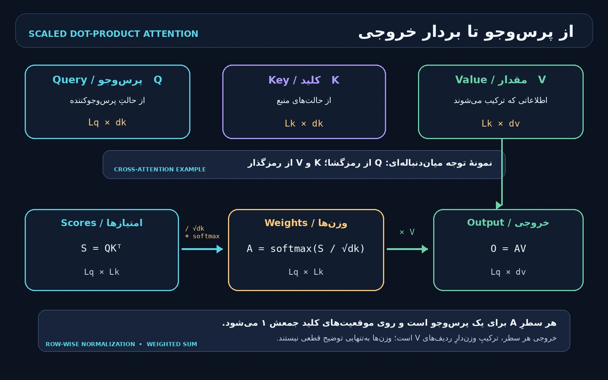

# هنر و علم ساخت هوش — جلد سوم

**The Art & Science of Building Intelligence | Babak & Ai**

وضعیت: ۱۴ فصل در نقشه؛ 3 فصل از ۱۴ فصل تا این انتشار نگارش و آزموده شده‌اند. این فایل Markdown است؛ PDF و EPUB تولید نشده‌اند.

## فهرست فصل‌های منتشرشده

- فصل 1 (سراسری 33) — توکن‌سازی، واژگان و توکن‌های ویژه
- فصل 2 (سراسری 34) — Attention، Query/Key/Value و پیاده‌سازی ماتریسی
- فصل 3 (سراسری 35) — Self-Attention، چندسری و ماسک علّی

---

# جلد سوم، فصل ۱ — توکن‌سازی، واژگان و شناسه‌های ویژه

**The Art & Science of Building Intelligence | Babak & Ai | فصل سراسری ۳۳ از نقشه پنج‌جلدی**

**تاریخ مرجع: ۵ نوامبر ۲۰۲۶؛ منابع برخط در همین تاریخ بازبینی شدند.**

## ۱. از متن تا ورودی مدل: شش مرحله را یکی نگیریم

مدل زبانی رشته‌ای از نویسه‌های نمایشی را مستقیماً «نمی‌خواند». پیش‌پردازش متن، توکن‌سازی و تبدیل به شناسه، به مدل دنباله‌ای از عددهای صحیح می‌دهد؛ سپس یک جدول تعبیه، برای هر شناسه برداری قابل‌آموزش فراهم می‌کند. شبکه عصبی روی بردارها و دنباله پردازش می‌کند. این مراحل مرتبط‌اند، اما یکی نیستند: توکن‌ساز نه معنا را تضمین می‌کند و نه به‌تنهایی بردار یا پاسخ مدل را می‌سازد.

**پیش‌نیاز:** رشته، تابع و UTF-8 در جلد اول؛ شناسه و تعبیه (Embedding) در فصل ۱۱ جلد دوم، برابر فصل سراسری ۳۲. **هدف:** مسیر متن تا شناسه را توصیف کنید، روش‌های واژه‌سازی را مقایسه کنید، یک Byte-Level BPE کوچک بسازید، شناسه‌های ویژه را بشناسید و ارتباط واژگان و جدول تعبیه را آزمون کنید. **پس از این فصل:** در فصل ۳۴ امتیازهای Query/Key/Value را روی نمایش برداری می‌سازیم؛ این فصل سازوکار Attention را آموزش نمی‌دهد.

نمای ریاضیِ مرحله توکن‌سازی چنین است: یک متن x به دنباله‌ای از شناسه‌های صحیح در واژگان با اندازه V تبدیل می‌شود؛ تعداد شناسه‌ها می‌تواند از تعداد واژه‌ها یا نویسه‌های متن بیشتر یا کمتر باشد.

<math xmlns="http://www.w3.org/1998/Math/MathML" display="block" aria-label="توکن‌ساز T متن x را به دنباله i یک تا i ال تبدیل می‌کند؛ هر شناسه بین صفر و وی منهای یک است"><mrow><mi>T</mi><mo>(</mo><mi>x</mi><mo>)</mo><mo>=</mo><mo>(</mo><msub><mi>i</mi><mn>1</mn></msub><mo>,</mo><msub><mi>i</mi><mn>2</mn></msub><mo>,</mo><mi>…</mi><mo>,</mo><msub><mi>i</mi><mi>L</mi></msub><mo>)</mo><mo>,</mo><mspace width="0.5em"/><msub><mi>i</mi><mi>j</mi></msub><mo>∈</mo><mo>{</mo><mn>0</mn><mo>,</mo><mi>…</mi><mo>,</mo><mi>V</mi><mo>−</mo><mn>1</mn><mo>}</mo></mrow></math>

متن جایگزین فرمول: `T(x)=(i₁,…,iL)`؛ هر `ij` یکی از شناسه‌های صفر تا `V−1` است. نماد `L` طول دنباله توکن‌ها و `V` اندازه واژگان این توکن‌ساز است.

![شکل ۳-۱-۱ — نمونه آموزشی Byte-Level BPE: دو نمونه abab و abac؛ پس از سه بار مشاهده جفت ab، ادغام ab شناسه ۲۶۰ می‌گیرد و abab به [۲۶۰، ۲۶۰] تبدیل می‌شود؛ سپس شناسه‌ها به جدول تعبیه می‌روند. شناسه‌ها متعلق به واژگان اسباب‌بازی این شکل‌اند.](assets/images/babak-ai/v3-ch01-tokenization.webp)

**شکل ۳-۱-۱ — از متن به شناسه و بردار.** راهنمای برچسب‌های دوزبانه در شکل: «متن ورودی / Raw text»، «پیش‌توکن‌ساز / Pre-tokenizer»، «بایت‌های UTF-8 / UTF-8 bytes»، «ادغام پرتکرار / Frequent merge»، «شناسه توکن / Token IDs»، «جدول تعبیه / Embedding table» و «بردارها / Vectors». در مثال کوچک، `ab` در مجموعه آموزش سه بار کنار هم می‌آید؛ ادغام نخست شناسه ۲۶۰ دارد و `abab` به دو توکن `ab` تبدیل می‌شود. شناسه و اندازه بردار نمونه‌اند، نه شناسه‌های مدل زبانی واقعی.

یک خط لوله متداول می‌تواند این مراحل را داشته باشد: ۱) نرمال‌سازی اختیاری، ۲) پیش‌توکن‌سازی (Pre-tokenization)، ۳) الگوریتم واژه‌سازی، ۴) افزودن نشانه‌های ویژه و تبدیل به شناسه، ۵) افزودن تعبیه و ورودی‌های دیگر مدل. کتابخانه‌های مختلف ممکن است مراحل را ترکیب یا جابه‌جا کنند؛ قرارداد دقیق همان مدل را بخوانید [۳، ۵].

## ۲. یونیکد، فارسی و تفاوت «نویسه» با «بایت»

رشته در Python توالی کدپوینت‌های Unicode است؛ کدپوینت، بایت UTF-8 و نویسه‌ای که چشم یک واحد می‌بیند الزاماً یکسان نیستند. یک حرف می‌تواند با علامت ترکیبی نمایش داده شود؛ یک ایموجی هم ممکن است چند کدپوینت داشته باشد. قواعد مرزبندی نویسه دیداری، واژه و جمله در Unicode جداگانه تعریف می‌شوند و برای هر زبان یا کاربرد می‌توان به قواعد عمومی نیاز داشت [۸]. بنابراین `len(text)` در Python تعداد کدپوینت‌ها را می‌شمارد، نه لزوماً تعداد نویسه‌های دیداری و نه تعداد توکن‌های مدل.

در فارسی، فاصله و نیم‌فاصله، اعراب، رقم‌ها و نویسه‌های عربیِ ظاهراً مشابه اهمیت دارند. برای نمونه، «ی» فارسی و «ي» عربی، یا «ک» فارسی و «ك» عربی، کدپوینت‌های متفاوت‌اند؛ نیم‌فاصله U+200C نیز از فاصله معمولی جداست. برخی متن‌ها این تفاوت‌ها را ناخواسته از صفحه‌کلید یا منبع داده به ارث می‌برند. تبدیل خودکار همه آن‌ها به یک صورت می‌تواند در یک مجموعه سودمند و در مجموعه دیگر تغییر معنای شناسه، نام یا متن اصلی باشد؛ تصمیم باید با قرارداد داده و آزمون روشن گرفته شود.

نرمال‌سازی NFC شکل‌های هم‌ارز کانونی را یکسان می‌کند؛ NFKC افزون بر آن، هم‌ارزی‌های سازگاری را نیز اعمال می‌کند و در نتیجه ممکن است تمایزهای نمایشی یا معنایی را حذف کند. استاندارد Unicode شکل‌های نرمال‌سازی را تعریف می‌کند، اما انتخاب شکل مناسب را برای هر مدل تضمین نمی‌کند [۷]. اگر توکن‌ساز متن را تغییر دهد، بازسازی معمولاً متن نرمال‌شده را می‌دهد، نه لزوماً همان بایت‌های ورودی. برای آموزش و استنتاج باید سیاست نرمال‌سازی یکسان باشد؛ برای بازبینی سند اصلی، متن مبنا و نگاشت offsetها را نگه دارید.

نمونه پایتون برای دیدن تفاوت، نه برای اعمال خودکار بر هر متن:

```python
import unicodedata

text = "A\u030a"  # A و علامت حلقه ترکیبی
print(len(text), len(text.encode("utf-8")))
print(unicodedata.normalize("NFC", text))
```

در مثال، دو کدپوینت قبل از نرمال‌سازی به یک نویسه مرکب در NFC تبدیل می‌شوند؛ تعداد بایت‌ها هم با تعداد کدپوینت‌ها برابر نیست. هر نرمال‌ساز باید در فایل تنظیمات توکن‌ساز ثبت و روی ورودی‌های مرزی آزموده شود.

## ۳. پیش‌توکن‌سازی: مرزهای اولیه

پیش‌توکن‌ساز (Pre-tokenizer) متن را با قواعدی مثل فاصله، رقم یا نشانه‌گذاری به قطعه‌های اولیه می‌شکند. این کار می‌تواند جلوی ادغام میان دسته‌های خاص را بگیرد و سرعت آموزش واژگان را بالا ببرد. اما «واژه» تعریف طبیعی و یکسانی برای همه زبان‌ها نیست: اتصال‌واژه، پسوند، نشانه‌گذاری، عدد و کد به تصمیم‌های متفاوت نیاز دارند. یک الگوی ساده Python برای آموزش مناسب است، ولی جایگزین توکن‌ساز مدل نیست [۳].

برای مثال، `AI, model!` را می‌توان به قطعه‌های `AI`، `,`، فاصله، `model` و `!` تقسیم کرد؛ توکن‌ساز دیگری شاید فاصله را به ابتدای قطعه بعدی بچسباند. این تفاوت کوچک روی شناسه‌ها و طول ورودی اثر می‌گذارد. در پروژه این فصل از الگوی آموزشی استفاده می‌کنیم که فاصله‌های پیاپی، دنباله‌های `\w` و هر نویسه غیرواژه‌ای را جدا می‌کند و با آزمون ثابت می‌کند هیچ متن ورودی حذف یا جابه‌جا نشده است. این الگو مرزبندی دقیق Unicode یا مدل زبانی تجاری نیست.

**نکته:** توکن‌سازی، پیش‌توکن‌سازی و نرمال‌سازی سه واژه برای یک عملیات نیستند. اگر قطعه ورودی در نمودار دیده نمی‌شود، ممکن است در نرمال‌سازی حذف یا در پیش‌توکن‌ساز به قطعه دیگری پیوسته باشد؛ ابتدا تنظیمات هر مرحله را بررسی کنید.

## ۴. واژه، نویسه، زیرواژه و بایت

واژه‌سازی در سطح واژه فرهنگ‌نامه‌ای ساده می‌سازد، اما واژه تازه یا شکل صرفی نادیده را ممکن است به `[UNK]` تبدیل کند؛ نگهداری همه صورت‌ها هم اندازه واژگان را بالا می‌برد. در سطح نویسه، مجموعه پایه کوچک است، اما دنباله بلند می‌شود و مدل باید پیوندهای دورتر را یاد بگیرد. روش زیرواژه (Subword) میان اندازه واژگان و طول دنباله مصالحه برقرار می‌کند؛ قطعه زیرواژه الزاماً تکواژ یا بخش معنادار زبان‌شناختی نیست.

| روش | ایده کلی | مزیت احتمالی | محدودیت و وابستگی |
|---|---|---|---|
| واژه‌محور (Word-level) | نگاشت واژه کامل به شناسه | قطعه‌ها برای انسان خوانا هستند | واژگان بزرگ و مسئله واژه خارج از واژگان |
| نویسه‌محور (Character-level) | یک نویسه یا واحد تعریف‌شده در هر گام | پوشش ساده با الفبای کوچک | دنباله معمولاً بلندتر و «نویسه» وابسته به تعریف است |
| BPE | ادغام تکرارشونده جفت‌های پرتکرار | واژگان ثابت با قطعه‌های پرتکرار | نتیجه به داده آموزش، مرزها و ترتیب ادغام وابسته است |
| WordPiece | واژگان زیرواژه و قطعه‌بندی بر اساس مدل | در برخی خانواده‌ها قطعه‌بندی کارآمد | تابع هدف آموزش و علامت‌گذاری وابسته به مدل است |
| Unigram | انتخاب مجموعه قطعه‌ها با مدل احتمالی | امکان چند قطعه‌بندی محتمل در برخی پیاده‌سازی‌ها | نمونه‌گیری یا مسیر قطعه‌بندی به تنظیمات وابسته است |
| Byte-Level BPE | شروع از ۲۵۶ مقدار بایت و ادغام بایت‌های متوالی | پوشش بایتی برای هر متن UTF-8 معتبر | قطعه منفرد ممکن است خوانا نباشد؛ الگوریتم تولیدی پیچیده‌تر است |

BPE در پردازش زبان برای نمایش واژه‌های نادر به صورت چند زیرواحد به کار رفت [۱]. در Byte-Level BPE، چون هر متن UTF-8 معتبر به دنباله‌ای از بایت‌های ۰ تا ۲۵۵ تبدیل می‌شود، داشتن همه بایت‌های پایه امکان بازنمایی متن دیده‌نشده را می‌دهد؛ این ویژگی یعنی «نویسه ناشناخته لازم نیست»، نه اینکه مدل متن ناشناخته را بفهمد [۴]. الگوریتم‌ها و کتابخانه‌ها یکسان نیستند: WordPiece، BPE و Unigram شیوه آموزش و قطعه‌بندی متفاوت دارند؛ SentencePiece می‌تواند مدل زیرواژه را مستقیماً از جمله خام بسازد و هم BPE و هم Unigram را پشتیبانی می‌کند [۲، ۳].

## ۵. یک گام BPE را دستی دنبال کنیم

مجموعه آموزشی کوچک را `abab` و `abac` بگیرید. برای این مثال ASCII هر حرف یک بایت است. جفت‌های مجاور را بشمارید:

| جفت | تعداد در `abab` | تعداد در `abac` | مجموع |
|---|---:|---:|---:|
| `ab` | ۲ | ۱ | ۳ |
| `ba` | ۱ | ۱ | ۲ |
| `ac` | ۰ | ۱ | ۱ |

پس ادغام نخست `ab` است. به طور کلی در گام t جفتی انتخاب می‌شود که شمار وقوع آن در دنباله‌های آموزشی فعلی بیشترین باشد؛ در صورت تساوی باید قاعده رفع تساوی تثبیت شود.

<math xmlns="http://www.w3.org/1998/Math/MathML" display="block" aria-label="در هر گام، جفت پی از مجموعه جفت‌های مجاور که بیشترین تعداد را دارد برای ادغام انتخاب می‌شود"><mrow><msub><mi>p</mi><mi>t</mi></msub><mo>=</mo><munder><mi>argmax</mi><mrow><mo>(</mo><mi>u</mi><mo>,</mo><mi>v</mi><mo>)</mo><mo>∈</mo><mi>P</mi></mrow></munder><msub><mi>count</mi><mi>t</mi></msub><mo>(</mo><mi>u</mi><mo>,</mo><mi>v</mi><mo>)</mo></mrow></math>

متن جایگزین فرمول: در گام `t` جفت مجاور `(u,v)` با بیشترین شمار را از میان جفت‌های مجاز `P` برمی‌گزینیم. این شمار از قطعه‌های آموزش همان گام است، نه از داده آزمون.

در پروژه شناسه ویژه PAD برابر ۰، BOS برابر ۱، EOS برابر ۲ و UNK برابر ۳ است؛ سپس بایت با شناسه `4 + مقدار بایت` نمایش داده می‌شود. پس `a` با کد ASCII برابر ۹۷، شناسه ۱۰۱ دارد و `b` شناسه ۱۰۲. شناسه ادغام اول از `4+256=260` شروع می‌شود. پس از ادغام `ab`، `abab` به `[260, 260]` و `abac` به `[260, 101, 103]` تبدیل می‌شوند. این عددها فقط در همین واژگان اسباب‌بازی درست‌اند؛ با تغییر شناسه‌های ویژه یا ترتیب ادغام، عوض می‌شوند.

## ۶. واژگان، شناسه‌ها و توکن‌های ویژه

واژگان (Vocabulary) نگاشت میان قطعه‌ها و شناسه‌های صحیح است. شناسه فقط جایگاه در یک واژگان مشخص است؛ ۱۰۲ از ۱۰۱ «بزرگ‌تر» یا معنادارتر نیست. شناسه‌های دو توکن‌ساز را بدون واژگان و ترتیب ادغام مشترک نمی‌توان برابر دانست. ذخیره مدل باید هم واژگان و قواعد پیش‌پردازش را داشته باشد و هم، جداگانه، اندازه و وزن‌های شبکه را ثبت کند.

توکن ویژه (Special Token) ورودی ساختاری با شناسه اختصاصی است. نمونه‌های رایج عبارت‌اند از:

| نام رایج | کارکرد معمول | نکته احتیاطی |
|---|---|---|
| BOS | آغاز دنباله یا پیام | همه مدل‌ها آن را نمی‌افزایند |
| EOS | پایان دنباله یا نوبت | معنای پایان در هر مدل و قالب فرق می‌کند |
| PAD | هم‌اندازه‌سازی دسته‌ای | باید ماسک توجه/زیان با قرارداد مدل هماهنگ باشد |
| UNK | نمایش خارج از واژگان | در توکن‌ساز بایتی ممکن است لازم نباشد |
| MASK | نشانه جای خالی برای هدف آموزشی | برای همه مدل‌های مولد علّی به‌کار نمی‌رود |
| SEP و نشانه‌های نقش | جداسازی متن یا نقش‌ها | نام و قالب گفت‌وگو مدل‌محور است |

رشته قابل‌مشاهده مانند `<|bos|>` فقط نگارش انسانی است؛ شناسه داخلی، فهرست ویژه‌ها و رفتار API تعیین می‌کنند که در ورودی واقعاً یک توکن کنترلی باشد یا رشته‌ای معمولی. در کد این فصل، `encode("<|bos|>")` متن را مثل بایت عادی می‌کد؛ BOS فقط با `add_bos=True` افزوده می‌شود. هنگام ساخت قالب گفت‌وگو یا پردازش متن نامطمئن، به ظاهر رشته تکیه نکنید؛ سیاست همان توکن‌ساز و قالب پیام را بیازمایید [۵].

اگر به یک مدل ازپیش‌آموزش‌دیده توکن تازه اضافه کنید، فقط نام آن را به فایل واژگان نوشتن کافی نیست؛ ماتریس تعبیه مدل نیز باید اندازه سازگار بگیرد و ردیف تازه نیازمند مقداردهی و یادگیری مناسب است [۵]. تغییر توکن‌ساز بدون نسخه‌بندی و به‌روزرسانی مدل می‌تواند شناسه‌های قبلی را به ردیف‌های نادرست وصل کند.

## ۷. از شناسه به بردار تعبیه

اگر واژگان `V` توکن و هر بردار `d` مؤلفه داشته باشد، جدول تعبیه `E` شکل `V×d` دارد. برای شناسه `i`، مدل ردیف متناظر را برمی‌دارد؛ این یک lookup است، نه محاسبه معنای واژه از عدد شناسه.

<math xmlns="http://www.w3.org/1998/Math/MathML" display="block" aria-label="جدول تعبیه ای شکل وی در دی دارد و بردار موقعیت j برابر ردیف جدول با شناسه توکن تی j است"><mrow><mi>E</mi><mo>∈</mo><msup><mi>ℝ</mi><mrow><mi>V</mi><mo>×</mo><mi>d</mi></mrow></msup><mo>,</mo><mspace width="0.5em"/><msub><mi>x</mi><mi>j</mi></msub><mo>=</mo><msub><mi>E</mi><mrow><msub><mi>t</mi><mi>j</mi></msub><mo>,</mo><mo>:</mo></mrow></msub></mrow></math>

متن جایگزین فرمول: `E` جدولی با `V` ردیف و `d` ستون است؛ برای شناسه `tj`، بردار `xj` از ردیف همان شناسه برداشته می‌شود.

در یک دسته شامل `B` دنباله، هرکدام با طول `L`، شناسه‌ها شکل `B×L` و خروجی lookup شکل `B×L×d` دارند. PyTorch این رفتار را با `nn.Embedding(num_embeddings, embedding_dim)` ارائه می‌کند؛ ورودی آن شاخص‌های صحیح و خروجی، بردارهای ردیف‌های انتخاب‌شده است [۶]. در نمونه ما `V=261`، `d=8` و سه شناسه به ماتریسی با شکل `(3, 8)` می‌رسند.

<math xmlns="http://www.w3.org/1998/Math/MathML" display="block" aria-label="شناسه‌ها شکل بی در ال دارند و پس از تعبیه، بردارها شکل بی در ال در دی دارند"><mrow><mi>IDs</mi><mo>∈</mo><msup><mi>ℤ</mi><mrow><mi>B</mi><mo>×</mo><mi>L</mi></mrow></msup><mo>⇒</mo><mi>Embedding</mi><mo>(</mo><mi>IDs</mi><mo>)</mo><mo>∈</mo><msup><mi>ℝ</mi><mrow><mi>B</mi><mo>×</mo><mi>L</mi><mo>×</mo><mi>d</mi></mrow></msup></mrow></math>

متن جایگزین فرمول: ورودی شناسه‌ها شکل `B×L` و خروجی تعبیه شکل `B×L×d` دارد؛ `B` تعداد دنباله‌ها، `L` طول و `d` بُعد بردار است.

```python
import torch
from torch import nn

ids = torch.tensor([260, 101, 103], dtype=torch.long)
embedding = nn.Embedding(num_embeddings=261, embedding_dim=8, padding_idx=0)
vectors = embedding(ids)
print(tuple(vectors.shape))  # (3, 8)
```

این نمونه با CPU اجرا شد و در آزمون پروژه، ردیف PAD از گرادیان به‌روزرسانی نشد. بردار lookup اولیه به شناسه وابسته است و برای یک ID ثابت همان ردیف را برمی‌گرداند؛ بازنمایی زمینه‌ای پس از عبور از لایه‌های شبکه تغییر می‌کند. تعبیه و وضعیت زمینه‌ای (Contextual Hidden State) را یکی نگیرید. کد محاسبه Query/Key/Value در فصل بعد می‌آید.

## ۸. طول دنباله، پنجره متن و سنجش

مدل پنجره ورودی را معمولاً با تعداد توکن‌ها می‌سنجد، نه تعداد واژه‌های فارسی، نویسه‌های دیداری یا بایت‌ها. یک متن واحد در دو توکن‌ساز می‌تواند تعداد و مرزهای متفاوت داشته باشد. بنابراین هنگام برش متن، برآورد هزینه یا مقایسه مدل‌ها، همان توکن‌ساز و نسخه‌ای را به‌کار ببرید که مدل با آن آموزش دیده یا مستند شده است. عدد «متوسط تعداد بایت در توکن» برای همه زبان‌ها، مدل‌ها، کدها و نشانه‌گذاری‌ها ثابت نیست [۴].

در آزمایش همین پروژه می‌توان نسبت تشخیصی تعداد توکن‌های خروجی به بایت‌های UTF-8 را گزارش کرد؛ نسبت کمتر از ۱ به معنی فشرده‌ترشدن همین نمایش بایتی است، نه نمره کیفیت مدل.

<math xmlns="http://www.w3.org/1998/Math/MathML" display="block" aria-label="نسبت تشخیصی آر برابر تعداد شناسه‌های خروجی تقسیم بر تعداد بایت‌های متن UTF-8 است"><mrow><mi>r</mi><mo>=</mo><mfrac><msub><mi>N</mi><mtext>tokens</mtext></msub><msub><mi>N</mi><mtext>UTF-8 bytes</mtext></msub></mfrac></mrow></math>

متن جایگزین فرمول: `r = تعداد توکن‌های خروجی / تعداد بایت‌های UTF-8 متن`. این معیار فقط مقایسه قطعه‌بندی همین متن و همین توکن‌ساز است و معیار فهم یا انصاف نیست.

برای بازرسی توکن‌ساز تازه، تنها به میانگین طول بسنده نکنید. چند زبانه و نمونه‌های نیم‌فاصله، رقم فارسی، نشانه‌گذاری، کد، متن ترکیبی و نویسه نادر را جدا بررسی کنید؛ بازسازی رفت‌وبرگشت، نرخ UNK در صورت وجود، توزیع طول دنباله، اندازه واژگان، offsetها، موارد بریده‌شده و مجوز corpus را ثبت کنید. داده ارزیابی باید از آموزش جدا و نماینده کاربرد آینده باشد. طول کمتر یک هدف مهندسی ممکن است، اما به خودی خود فهم بهتر، پوشش برابر زبان‌ها یا کیفیت پایین‌تر/بالاتر را اثبات نمی‌کند.

## ۹. پروژه قابل بازتولید: BPE کوچک روی CPU

پروژه `book-engineering/projects/33-tokenization/` یک توکن‌ساز آموزشی Byte-Level BPE با کتابخانه استاندارد می‌سازد. در مرحله آموزش، شش رشته ساختگی کوتاه به قطعه‌های اولیه تقسیم و به بایت تبدیل می‌شوند؛ ۲۴ ادغام پرتکرار ثبت می‌شود. سه رشته دیگر فقط برای ارزیابی رفت‌وبرگشت و شمار توکن استفاده می‌شوند. این داده‌ها برای تمرین‌اند، نه برای نتیجه‌گیری درباره کیفیت زبان فارسی یا یک مدل واقعی. هیچ وزن LLM آموزش داده نمی‌شود.

کد کامل زیر همان فایل `tokenizer_bpe.py` است که آزموده شد. توکن‌ساز عمداً نرمال‌سازی Unicode نمی‌کند، از regex ساده آموزشی بهره می‌گیرد و میان قطعه‌های پیش‌توکن‌ساز ادغام نمی‌سازد. فایل JSON ذخیره‌شده، قواعد توکن‌ساز را ثبت می‌کند؛ وزن مدل یا جدول تعبیه آموزش‌دیده را ذخیره نمی‌کند.

```python
"""Tiny, deterministic byte-level BPE tokenizer for teaching (standard library only).

This is deliberately not a clone of tiktoken, GPT-2, or SentencePiece. It uses a
small Unicode-aware pre-tokenizer, no Unicode normalization, all 256 UTF-8 byte
values, and deterministic left-to-right application of learned merge ranks.
"""
from __future__ import annotations

from collections import Counter
from pathlib import Path
from typing import Iterable
import json
import re

SPECIAL_TOKENS = {"<|pad|>": 0, "<|bos|>": 1, "<|eos|>": 2, "<|unk|>": 3}
SPECIAL_ID_TO_TOKEN = {value: key for key, value in SPECIAL_TOKENS.items()}
BYTE_OFFSET = len(SPECIAL_TOKENS)
BYTE_COUNT = 256
FORMAT_NAME = "babak-ai-toy-byte-bpe-v1"
PRETOKENIZER_NAME = r"whitespace runs | Unicode \w+ | single non-word characters"
# This simple pedagogical splitter preserves all input characters. It is not a
# production tokenizer's model-specific regular expression.
_PRETOKEN_RE = re.compile(r"\s+|\w+|[^\w\s]", flags=re.UNICODE)


def _pretokenize(text: str) -> list[str]:
    """Split text into chunks while preserving the exact concatenated string."""
    pieces = _PRETOKEN_RE.findall(text)
    if "".join(pieces) != text:
        raise ValueError("pre-tokenizer did not preserve the input")
    return pieces


def _merge_pair(sequence: list[int], pair: tuple[int, int], new_id: int) -> list[int]:
    """Merge non-overlapping occurrences of pair from left to right."""
    merged: list[int] = []
    index = 0
    while index < len(sequence):
        if index + 1 < len(sequence) and (sequence[index], sequence[index + 1]) == pair:
            merged.append(new_id)
            index += 2
        else:
            merged.append(sequence[index])
            index += 1
    return merged


class ByteBPE:
    """A compact byte-level BPE model with stable IDs and reversible decoding."""

    def __init__(self, merges: Iterable[tuple[int, int]] = ()) -> None:
        self._token_bytes: dict[int, bytes] = {
            BYTE_OFFSET + value: bytes([value]) for value in range(BYTE_COUNT)
        }
        normalized: list[tuple[int, int]] = []
        seen_pairs: set[tuple[int, int]] = set()
        known_ids = set(self._token_bytes)

        for rank, raw_pair in enumerate(merges):
            pair = tuple(raw_pair)
            if len(pair) != 2 or any(type(value) is not int for value in pair):
                raise ValueError("each merge must be a pair of integer token IDs")
            if pair in seen_pairs:
                raise ValueError("duplicate merge pair")
            if pair[0] not in known_ids or pair[1] not in known_ids:
                raise ValueError("merge refers to a token not defined earlier")
            new_id = BYTE_OFFSET + BYTE_COUNT + rank
            self._token_bytes[new_id] = self._token_bytes[pair[0]] + self._token_bytes[pair[1]]
            normalized.append(pair)
            seen_pairs.add(pair)
            known_ids.add(new_id)

        self.merges = tuple(normalized)

    @classmethod
    def train(cls, corpus: Iterable[str], num_merges: int = 24) -> "ByteBPE":
        """Learn frequent adjacent-byte merges from a small text corpus.

        Ties are broken by the numeric pair of token IDs. Corpus order therefore
        does not affect the result. Training data is not normalized.
        """
        if isinstance(corpus, str):
            raise TypeError("corpus must be an iterable of strings, not one string")
        if isinstance(num_merges, bool) or not isinstance(num_merges, int) or num_merges < 0:
            raise ValueError("num_merges must be a non-negative integer")
        try:
            texts = list(corpus)
        except TypeError as error:
            raise TypeError("corpus must be an iterable of strings") from error
        if not texts:
            raise ValueError("corpus must contain at least one text")
        if any(not isinstance(text, str) for text in texts):
            raise TypeError("every corpus item must be a string")

        sequences = [
            [BYTE_OFFSET + byte for byte in piece.encode("utf-8")]
            for text in texts
            for piece in _pretokenize(text)
            if piece
        ]
        merges: list[tuple[int, int]] = []

        for _ in range(num_merges):
            counts: Counter[tuple[int, int]] = Counter()
            for sequence in sequences:
                counts.update(zip(sequence, sequence[1:]))
            if not counts:
                break

            # Highest frequency wins; lexicographically smallest ID pair breaks ties.
            best_pair = min(counts, key=lambda pair: (-counts[pair], pair))
            new_id = BYTE_OFFSET + BYTE_COUNT + len(merges)
            sequences = [_merge_pair(sequence, best_pair, new_id) for sequence in sequences]
            merges.append(best_pair)

        return cls(merges)

    @property
    def vocab_size(self) -> int:
        """Number of special, byte, and learned-merge IDs in the model."""
        return BYTE_OFFSET + BYTE_COUNT + len(self.merges)

    def _encode_piece(self, piece: str) -> list[int]:
        ids = [BYTE_OFFSET + byte for byte in piece.encode("utf-8")]
        for rank, pair in enumerate(self.merges):
            if len(ids) < 2:
                break
            if any((ids[index], ids[index + 1]) == pair for index in range(len(ids) - 1)):
                new_id = BYTE_OFFSET + BYTE_COUNT + rank
                ids = _merge_pair(ids, pair, new_id)
        return ids

    def encode(self, text: str, *, add_bos: bool = False, add_eos: bool = False) -> list[int]:
        """Convert text to IDs. Special-token-looking text is treated as ordinary text."""
        if not isinstance(text, str):
            raise TypeError("text must be a string")
        if not isinstance(add_bos, bool) or not isinstance(add_eos, bool):
            raise TypeError("add_bos and add_eos must be booleans")

        ids: list[int] = []
        if add_bos:
            ids.append(SPECIAL_TOKENS["<|bos|>"])
        for piece in _pretokenize(text):
            ids.extend(self._encode_piece(piece))
        if add_eos:
            ids.append(SPECIAL_TOKENS["<|eos|>"])
        return ids

    def decode(self, ids: Iterable[int], *, skip_special_tokens: bool = True) -> str:
        """Reconstruct UTF-8 text; malformed IDs or invalid byte sequences raise errors."""
        if not isinstance(skip_special_tokens, bool):
            raise TypeError("skip_special_tokens must be a boolean")
        output: list[str] = []
        byte_buffer = bytearray()

        def flush_bytes() -> None:
            if byte_buffer:
                output.append(bytes(byte_buffer).decode("utf-8", errors="strict"))
                byte_buffer.clear()

        try:
            values = list(ids)
        except TypeError as error:
            raise TypeError("ids must be an iterable of integers") from error

        for token_id in values:
            if isinstance(token_id, bool) or not isinstance(token_id, int):
                raise TypeError("token IDs must be integers")
            if token_id < 0 or token_id >= self.vocab_size:
                raise ValueError(f"token ID {token_id} is outside the vocabulary")
            if token_id in SPECIAL_ID_TO_TOKEN:
                flush_bytes()
                if not skip_special_tokens:
                    output.append(SPECIAL_ID_TO_TOKEN[token_id])
            else:
                byte_buffer.extend(self._token_bytes[token_id])
        flush_bytes()
        return "".join(output)

    def display_tokens(self, ids: Iterable[int]) -> list[str]:
        """Return diagnostic pieces; incomplete UTF-8 pieces use visible escapes."""
        shown: list[str] = []
        for token_id in ids:
            if isinstance(token_id, bool) or not isinstance(token_id, int):
                raise TypeError("token IDs must be integers")
            if token_id < 0 or token_id >= self.vocab_size:
                raise ValueError(f"token ID {token_id} is outside the vocabulary")
            if token_id in SPECIAL_ID_TO_TOKEN:
                shown.append(SPECIAL_ID_TO_TOKEN[token_id])
            else:
                shown.append(self._token_bytes[token_id].decode("utf-8", errors="backslashreplace"))
        return shown

    def save(self, path: str | Path) -> None:
        """Save every setting required to reproduce IDs; no learned LLM weights."""
        payload = {
            "format": FORMAT_NAME,
            "normalization": "none",
            "pretokenizer": PRETOKENIZER_NAME,
            "special_tokens": SPECIAL_TOKENS,
            "byte_offset": BYTE_OFFSET,
            "byte_count": BYTE_COUNT,
            "merges": [list(pair) for pair in self.merges],
        }
        Path(path).write_text(
            json.dumps(payload, ensure_ascii=False, sort_keys=True, separators=(",", ":")) + "\n",
            encoding="utf-8",
        )

    @classmethod
    def load(cls, path: str | Path) -> "ByteBPE":
        """Load a saved toy tokenizer, rejecting incompatible metadata."""
        payload = json.loads(Path(path).read_text(encoding="utf-8"))
        if not isinstance(payload, dict) or payload.get("format") != FORMAT_NAME:
            raise ValueError("unrecognized tokenizer format")
        if payload.get("normalization") != "none" or payload.get("pretokenizer") != PRETOKENIZER_NAME:
            raise ValueError("tokenizer preprocessing configuration differs")
        if payload.get("special_tokens") != SPECIAL_TOKENS:
            raise ValueError("special-token IDs differ")
        if payload.get("byte_offset") != BYTE_OFFSET or payload.get("byte_count") != BYTE_COUNT:
            raise ValueError("base byte vocabulary differs")
        merges = payload.get("merges")
        if not isinstance(merges, list):
            raise ValueError("merge table must be a list")
        return cls(merges)


TRAIN_CORPUS = (
    "مدل زبانی متن را به شناسه تبدیل می‌کند.",
    "مدل‌های زبانی از توکن‌ها استفاده می‌کنند.",
    "توکن‌سازی، متن را به دنباله‌ای از شناسه‌ها تبدیل می‌کند.",
    "AI models learn patterns from token sequences.",
    "A tokenizer maps text to token IDs and can decode the IDs.",
    "AI models learn patterns from token sequences.",
)
EVAL_TEXTS = (
    "مدل‌های تازه!",
    "tokenizer-v2",
    "می‌آموزد 🤖",
)


def main() -> None:
    # Small hand-check of the first merge, independent of the larger corpus.
    miniature = ByteBPE.train(["abab", "abac"], num_merges=1)
    print("mini_merges=", miniature.merges)
    print("abab_ids=", miniature.encode("abab"))

    baseline = ByteBPE.train(TRAIN_CORPUS, num_merges=0)
    tokenizer = ByteBPE.train(TRAIN_CORPUS, num_merges=24)
    baseline_count = sum(len(baseline.encode(text)) for text in EVAL_TEXTS)
    merged_count = sum(len(tokenizer.encode(text)) for text in EVAL_TEXTS)
    exact_round_trip = all(tokenizer.decode(tokenizer.encode(text)) == text for text in EVAL_TEXTS)
    print(f"train_texts={len(TRAIN_CORPUS)} eval_texts={len(EVAL_TEXTS)}")
    print(f"vocab_size={tokenizer.vocab_size} merges={len(tokenizer.merges)}")
    print(f"eval_tokens_byte_baseline={baseline_count} eval_tokens_bpe={merged_count}")
    print(f"eval_utf8_bytes={sum(len(text.encode('utf-8')) for text in EVAL_TEXTS)}")
    print(f"exact_round_trip={exact_round_trip}")
    sample = "abab"
    print("sample_pieces=", miniature.display_tokens(miniature.encode(sample)))
    print("sample_decoded=", miniature.decode(miniature.encode(sample)))


if __name__ == "__main__":
    main()
```

**اجرای ثبت‌شده:** Python 3.13.16، PyTorch 2.6.0+cpu و Chromium برای آزمون صفحه؛ آموزش BPE خود پروژه با CPU و بدون وابستگی خارجی اجرا می‌شود. از پوشه پروژه `python tokenizer_bpe.py` و `python -m unittest discover -v` را اجرا کنید؛ برای آزمون embedding، PyTorch CPU لازم است. ۱۱ آزمون توکن‌ساز و سه آزمون lookup موفق شدند. خروجی دستی `mini_merges=((101, 102),)` و `abab_ids=[260, 260]` بود. روی سه رشته ارزیابی، baseline بایتی ۵۹ توکن و BPE با ۲۴ ادغام ۳۶ توکن داد؛ ۵۹ بایت UTF-8 بود و بازسازی هر سه رشته دقیق ماند. این کاهش فقط نتیجه همین corpus کوچک و واژگان ساختگی است.

برای نمایش بردار، `nn.Embedding` با `num_embeddings` برابر اندازه همان واژگان و `embedding_dim=8` بسازید. آزمون شکل `(3,8)` و صفرماندن گرادیان ردیف PAD را بررسی می‌کند [۶]. اگر نسخه PyTorch شما متفاوت است، نسخه و خروجی را گزارش کنید. برنامه عمداً ادعا نمی‌کند که مدل زبانی آموزش یا آزمون کیفیت داده واقعی انجام شده است.

**عیب‌یابی:** اگر بازسازی رشته فارسی شکست خورد، ابتدا ادغام بایت‌ها، تبدیل UTF-8، نرمال‌سازی و جداکردن قطعه ویژه را بررسی کنید؛ متن را پیش از ذخیره بی‌صدا پاک‌سازی نکنید. اگر شناسه از اندازه embedding خارج بود، واژگان و وزن مدل ناهمگام‌اند. اگر توکن‌های متنی در خروجی کنسول به شکل `\x..` دیده می‌شوند، قطعه ممکن است وسط توالی چندبایتی UTF-8 افتاده باشد؛ دنباله کامل را decode کنید. خطای نصب `torch` فقط برای آزمون lookup است و آموزش BPE مستقل از آن اجرا می‌شود.

## ۱۰. پرسش‌ها، تمرین و معیار عبور

۱) تفاوت توکن، شناسه و تعبیه چیست؟ ۲) چرا تعداد `len(text)` برابر تعداد توکن مدل نیست؟ ۳) در BPE آموزشی، بعد از انتخاب جفت، ترتیب شناسه ادغام چرا باید ثبت شود؟ ۴) اگر Byte-Level BPE برای نویسه‌ای UNK ندهد، آیا آن نویسه را «می‌فهمد»؟ ۵) NFC و NFKC چه تفاوتی دارند؟ ۶) چرا مرز پیش‌توکن‌ساز در خروجی اثر می‌گذارد؟ ۷) اگر رشته `<|bos|>` در پیام کاربر دیده شود، آیا قطعاً شناسه BOS است؟ ۸) با `V=261` و `d=8` جدول تعبیه چند ردیف و چند ستون دارد؟ ۹) اگر سه شناسه به تعبیه ۸بعدی داده شوند، شکل خروجی چیست؟ ۱۰) چرا تعویض توکن‌ساز یک مدل آماده بدون تطبیق وزن‌ها خطاست؟

**تمرین محاسبه:** برای `abab` و `abac` جفت‌های `ab`، `ba` و `ac` را بشمارید؛ سپس یک ادغام را اجرا و دنباله شناسه‌ها را با بایت‌پایه ۴ محاسبه کنید. **تمرین کد:** `num_merges` را صفر، یک و ۲۴ بگذارید؛ شمار توکن‌ها و بازسازی را مقایسه کنید. یک رشته با نیم‌فاصله و یک متن ترکیبی فارسی–لاتین اضافه کنید. **پروژه تکمیلی:** corpus مجاز و مستند بسازید، متن‌های آموزش و ارزیابی را بر اساس سند یا منبع جدا کنید، baseline بایتی را حفظ کنید و توزیع طول، بازسازی، خطاهای مرزی و محدودیت زبان‌ها را گزارش دهید.

**معیار عبور:** حداقل ۸ پاسخ درست از ۱۰، محاسبه دستی درست، همه آزمون‌های پروژه موفق و گزارش شامل corpus/مجوز، جداسازی ارزیابی، baseline، اندازه و واحد معیار، تحلیل خطا، محدودیت نرمال‌سازی و دستور بازتولید. [پاسخ‌نامه مستقل فصل](book-engineering/answers/33-tokenization-fa.md) را پس از حل تمرین باز کنید.

## ۱۱. جمع‌بندی، به‌روزرسانی و منابع

توکن‌ساز مرز و شناسه می‌سازد؛ مدل از روی شناسه جدول تعبیه را می‌خواند و سپس نمایش‌های زمینه‌ای می‌آموزد. واژگان، نرمال‌سازی، پیش‌توکن‌ساز، ترتیب ادغام و نشانه‌های ویژه بخشی از قرارداد مدل‌اند. **مفهوم پایدار:** شناسه، برچسب قراردادی است و خودْ معنا ندارد. **وابسته به مدل و نسخه:** روش قطعه‌بندی، رشته‌های ویژه، اندازه واژگان و قواعد نرمال‌سازی. **بازبینی تا نوامبر ۲۰۲۶:** نسخه‌های جاری مستندات Transformer، توکن‌سازهای چندوجهی را نیز با توکن‌های ویژه مرتبط با تصویر/صوت توصیف می‌کنند [۵]؛ این نشانه‌ها به معنی نمایش همه محتوای تصویر یا صوت به صورت یک واژه متنی نیستند. هیچ الگوریتم توکن‌سازی «بهترین برای همه زبان‌ها و مدل‌ها» معرفی نمی‌شود. استانداردهای Unicode 18.0 در سال ۲۰۲۶ راهنمای نرمال‌سازی و مرزبندی‌اند؛ خودشان انتخاب توکن‌ساز یک مدل را تعیین نمی‌کنند [۷، ۸].

در فصل ۳۴ به جای تکرار این زنجیره، از دنباله بردارها به امتیازهای Query، Key و Value می‌رویم؛ سپس در فصل ۳۵ ماسک علّی و خطر نشت آینده را آزمون می‌کنیم.

**منابع مستقیم؛ تاریخ دسترسی برای مستندات زنده ۵ نوامبر ۲۰۲۶:**

[۱] Rico Sennrich، Barry Haddow و Alexandra Birch، «Neural Machine Translation of Rare Words with Subword Units»، ACL 2016، DOI: [10.18653/v1/P16-1162](https://doi.org/10.18653/v1/P16-1162)، [متن در ACL Anthology](https://aclanthology.org/P16-1162/). نسخه پیش‌چاپ arXiv:1508.07909 نخست در ۲۰۱۵ ثبت و در ۱۰ ژوئن ۲۰۱۶ بازبینی شد: [arXiv](https://arxiv.org/abs/1508.07909).

[۲] Taku Kudo و John Richardson، «SentencePiece: A simple and language independent subword tokenizer and detokenizer for Neural Text Processing»، EMNLP System Demonstrations، نوامبر ۲۰۱۸، صص. ۶۶–۷۱، DOI: [10.18653/v1/D18-2012](https://doi.org/10.18653/v1/D18-2012)، [ACL Anthology](https://aclanthology.org/D18-2012/).

[۳] Hugging Face, Tokenizers، «Components»، مستندات برخط با تاریخ انتشار صفحه نامشخص؛ مراجعه ۵ نوامبر ۲۰۲۶، [مستندات نرمال‌سازی، پیش‌توکن‌سازها و مدل‌ها](https://huggingface.co/docs/tokenizers/en/components).

[۴] OpenAI، مخزن `tiktoken` و بخش «What is BPE anyway?»؛ مخزن زنده با تاریخ نسخه این توضیح نامشخص، مراجعه ۵ نوامبر ۲۰۲۶، [README و کد](https://github.com/openai/tiktoken). آمار کارایی یا نسبت بایت‌به‌توکن مخزن، نتیجه عمومی برای همه زبان‌ها و مدل‌ها نیست.

[۵] Hugging Face, Transformers، «Tokenizer»، نسخه مستندات 5.22.1 که هنگام بازبینی در دسترس بود، مراجعه ۵ نوامبر ۲۰۲۶، [مستندات](https://huggingface.co/docs/transformers/v5.22.1/en/main_classes/tokenizer).

[۶] PyTorch Contributors، «`torch.nn.Embedding`»، مستندات نسخه 2.6، مراجعه ۵ نوامبر ۲۰۲۶، [مرجع API](https://docs.pytorch.org/docs/2.6/generated/torch.nn.Embedding.html).

[۷] Unicode Consortium، Unicode Standard Annex #15، «Unicode Normalization Forms»، نسخه Unicode 18.0.0، ۱۲ اوت ۲۰۲۶، [UAX #15](https://www.unicode.org/reports/tr15/).

[۸] Unicode Consortium، Unicode Standard Annex #29، «Unicode Text Segmentation»، نسخه Unicode 18.0.0، ۱ سپتامبر ۲۰۲۶، [UAX #29](https://www.unicode.org/reports/tr29/).

---

# جلد سوم، فصل ۲ — توجه: پرس‌وجو، کلید، مقدار و محاسبهٔ ماتریسی

**The Art & Science of Building Intelligence | Babak & Ai | فصل سراسری ۳۴ از نقشهٔ پنج‌جلدی**

**تاریخ مرجع: ۵ نوامبر ۲۰۲۶؛ مستندات و منابع برخط در همین تاریخ بازبینی شدند.**

## ۱. مسئله: کدام بخش از دنباله برای این خروجی لازم است؟

در فصل قبل متن را به شناسه و سپس به بردار تعبیه تبدیل کردیم. حالا دنباله‌ای از بردارها داریم. یک بردار خلاصهٔ ثابت ممکن است برای همهٔ ورودی‌های بلند کافی نباشد؛ سازوکار **توجه (Attention)** به هر موقعیت پرس‌وجو اجازه می‌دهد از میان مجموعه‌ای از بردارهای دیگر، ترکیبِ داده‌محوری بسازد. این نام یک تشبیه مهندسی است: مدل انسان نیست و وزن‌های محاسبه‌شده به‌خودی‌خود اثبات نمی‌کنند که یک واژه را «فهمیده» یا به آن «اهمیت انسانی» داده است.

**پیش‌نیاز:** بردار، ضرب ماتریسی، softmax و تعبیه در فصل‌های پیشین؛ به‌ویژه فصل ۳۳ دربارهٔ شناسه و تعبیه. **هدف این فصل:** نقش Query/Key/Value را توضیح دهید، ابعاد ضرب‌ها را پیش از اجرا کنترل کنید، امتیازهای dot-product را مقیاس و نرمال کنید، خروجی را به صورت جمع وزن‌دار به دست آورید و پیاده‌سازی آموزشی را با PyTorch بسنجید.

**مرز این فصل:** فرمول پایهٔ توجه و یک نمونهٔ میان‌دنباله‌ای را بررسی می‌کنیم. Self-Attention، چندسری (Multi-Head) و ماسک علّی در فصل ۳۵ می‌آیند؛ این فصل آن‌ها را پیاده‌سازی نمی‌کند.

## ۲. «توجه» یک ایدهٔ کلی است؛ این فصل یک صورت‌بندی مشخص را دنبال می‌کند

در پژوهش ترجمهٔ ماشینی، Bahdanau، Cho و Bengio در ۲۰۱۵ سازوکاری برای هم‌ترازی نرم پیشنهاد کردند: در هر گام رمزگشا، بر اساس وضعیت آن گام و حالت‌های رمزگذار، وزن‌هایی می‌سازد و از حالت‌های منبع بردار زمینه‌ای محاسبه می‌کند [۱]. امتیازدهی آن‌ها **افزایشی (additive)** بود؛ پس نباید همهٔ توجه‌ها را با ضرب داخلی یکی دانست.

مقالهٔ Transformer در ۲۰۱۷ صورت‌بندی **Scaled Dot-Product Attention** را ارائه کرد و آن را در معماری چندسری به کار برد [۲]. در این فصل فقط همین صورت‌بندی تک‌سری را باز می‌کنیم. سازوکار عمومی را می‌توان چنین خلاصه کرد: یک پرس‌وجو با کلیدها امتیاز سازگاری می‌گیرد؛ softmax امتیازها را به وزن تبدیل می‌کند؛ سپس همان وزن‌ها بردارهای مقدار را ترکیب می‌کنند. پرس‌وجو/کلید و مقدار می‌توانند از نمایش‌های متفاوتی ساخته شوند.

تمثیل آموزشی: هر **Query** می‌گوید «برای این موقعیت چه چیزی لازم دارم؟»؛ هر **Key** نشانه‌ای برای سنجش سازگاری با آن نیاز است؛ هر **Value** اطلاعاتی است که در صورت سازگاری به خروجی کمک می‌کند. این تمثیل نقش محاسباتی را روشن می‌کند، نه این‌که درون شبکه جست‌وجوی نمادین یا برچسب‌های معنایی آماده وجود داشته باشند.

## ۳. پرس‌وجو، کلید و مقدار از کجا می‌آیند؟

در توجه میان‌دنباله‌ای، برای سادگی یک ماتریس نمایشِ پرس‌وجو `X` و ماتریس نمایش منبع `Z` می‌گیریم. لایه‌های خطیِ آموختنی، هرکدام را به فضای مناسب می‌برند:

<math xmlns="http://www.w3.org/1998/Math/MathML" display="block" aria-label="کیو برابر ایکس دبلیو کیو؛ کی برابر زد دبلیو کی؛ وی برابر زد دبلیو وی"><mrow><mi>Q</mi><mo>=</mo><mi>X</mi><msub><mi>W</mi><mi>Q</mi></msub><mo>,</mo><mspace width="0.5em"/><mi>K</mi><mo>=</mo><mi>Z</mi><msub><mi>W</mi><mi>K</mi></msub><mo>,</mo><mspace width="0.5em"/><mi>V</mi><mo>=</mo><mi>Z</mi><msub><mi>W</mi><mi>V</mi></msub></mrow></math>

متن جایگزین فرمول: `Q=XW_Q`، `K=ZW_K` و `V=ZW_V`. وزن‌های خطی آموخته می‌شوند؛ در این نمایش ساده، bias را ننوشته‌ایم. `X` و `Z` می‌توانند طول‌های متفاوت داشته باشند. در مثال ترجمه، می‌توان `X` را نمایش رمزگشا و `Z` را نمایش رمزگذار گرفت. در صورت‌های دیگر ممکن است این ورودی‌ها از منبعی دیگر بیایند.

هر پرس‌وجو با کلیدها مقایسه می‌شود؛ کلید و مقدار برای هر موقعیت منبع، هم‌تراز می‌مانند، اما دو فرافکنی جداگانه‌اند. بنابراین «کلید» نسخهٔ دیگری از «مقدار» نیست: کلید در امتیازدهی شرکت می‌کند و مقدار در ترکیب خروجی. خود `Q`، `K` و `V` بردارهای آموختنیِ وابسته به داده و پارامترهای مدل‌اند؛ واژه‌ها یا برچسب‌های انسانی نیستند.



**شکل ۳-۲-۱ — از Q/K/V تا بردارهای خروجی.** ابعاد روی شکل نام‌گذاری شده‌اند تا محل هر ضرب روشن بماند. `Lq` تعداد پرس‌وجوها، `Lk` تعداد موقعیت‌های کلید/مقدار، `dk` بُعد کلید و `dv` بُعد مقدار است. در مثال، خروجی یک بردار به ازای هر پرس‌وجو دارد.

## ۴. اول ابعاد را حساب کنیم

فرض کنید در این فصل یک نمونهٔ دسته‌ای با `B` دنباله داریم و برای هر دنباله یک سر توجه به کار می‌بریم. شکل تانسورها چنین است:

| تانسور | شکل | توضیح |
|---|---|---|
| `Q` | `B × Lq × dk` | `B` دسته، `Lq` پرس‌وجو، `dk` مؤلفه برای هر پرس‌وجو |
| `K` | `B × Lk × dk` | `Lk` کلید منبع؛ بُعد ویژگی با `Q` برابر است |
| `V` | `B × Lk × dv` | یک مقدار متناظر با هر کلید؛ بُعد `dv` می‌تواند متفاوت باشد |
| `QKᵀ` | `B × Lq × Lk` | هر ردیف پرس‌وجو را با همهٔ کلیدها مقایسه می‌کند |
| `A` پس از softmax | `B × Lq × Lk` | برای هر پرس‌وجو یک وزن به ازای هر کلید |
| `AV` | `B × Lq × dv` | خروجی به ازای هر پرس‌وجو |

اگر به‌جای ضرب ماتریسیِ هر نمونه از تانسورهای سه‌بعدی استفاده کنیم، `Kᵀ` باید فقط دو محور آخر را جابه‌جا کند؛ در PyTorch این کار `key.transpose(-2, -1)` است. انتقال همهٔ محورهای دسته‌ای را جابه‌جا نمی‌کند.

بدون محور دسته‌ای، صورت ساده این است: `Q` شکل `Lq×dk`، `K` شکل `Lk×dk` و `V` شکل `Lk×dv` دارند. در نتیجه `QKᵀ` شکل `Lq×Lk` و حاصل `AV` شکل `Lq×dv` است. این کنترل ابعاد جلوی خطای رایجِ استفاده از `K` به‌جای `Kᵀ` یا نرم‌سازی روی محور اشتباه را می‌گیرد.

## ۵. امتیاز، مقیاس‌گذاری و نرمال‌سازی

ابتدا سازگاری پرس‌وجو و کلید را با ضرب داخلی می‌سنجیم. سپس امتیاز را بر ریشهٔ بُعد کلید تقسیم می‌کنیم و روی **محور کلیدها** softmax می‌گیریم:

<math xmlns="http://www.w3.org/1998/Math/MathML" display="block" aria-label="اسکور برابر کیو ضربدر ترانهاده کی، تقسیم بر ریشه دی کی؛ آلفای آی جی برابر سافت‌مکس سطری اسکور؛ خروجی او برابر آلفا ضربدر وی"><mrow><mi>S</mi><mo>=</mo><mfrac><mrow><mi>Q</mi><msup><mi>K</mi><mi>T</mi></msup></mrow><msqrt><msub><mi>d</mi><mi>k</mi></msub></msqrt></mfrac><mo>,</mo><mspace width="0.5em"/><msub><mi>α</mi><mrow><mi>i</mi><mi>j</mi></mrow></msub><mo>=</mo><mfrac><mrow><mi>exp</mi><mo>(</mo><msub><mi>S</mi><mrow><mi>i</mi><mi>j</mi></mrow></msub><mo>)</mo></mrow><mrow><munderover><mo>∑</mo><mrow><mi>m</mi><mo>=</mo><mn>1</mn></mrow><msub><mi>L</mi><mi>k</mi></msub></munderover><mi>exp</mi><mo>(</mo><msub><mi>S</mi><mrow><mi>i</mi><mi>m</mi></mrow></msub><mo>)</mo></mrow></mfrac><mo>,</mo><mspace width="0.5em"/><mi>O</mi><mo>=</mo><mi>AV</mi></mrow></math>

متن جایگزین فرمول: `S=QKᵀ/√dk`؛ وزن `αᵢⱼ=exp(Sᵢⱼ)/Σₘ exp(Sᵢₘ)`؛ خروجی `O=AV`. جمع softmax برای هر ردیف `i` روی همهٔ `Lk` کلیدهاست.

از آن‌جا که softmax روی محور آخر اجرا می‌شود، هر ردیف `A` غیرمنفی است و مجموعش، جز خطای گردکردن، ۱ می‌شود. هر ردیف خروجی نیز جمعی وزن‌دار از ردیف‌های `V` است. در حالت بدون ماسک و بدون dropout، این خروجی ترکیب محدبِ بردارهای مقدار همان نمونه است. این گزاره دربارهٔ محاسبهٔ همین لایه است، نه دربارهٔ معنای کلیِ پیش‌بینی نهایی.

### چرا بر `√dk` تقسیم می‌کنیم؟

اگر مؤلفه‌های `q` و `k` مستقل، میانگین‌شان صفر و واریانس هرکدام ۱ باشد، واریانس جمعِ ضرب‌های مؤلفه‌ای در `q·k` با `dk` رشد می‌کند. تقسیم بر `√dk` اندازهٔ معمول امتیازها را برای چنین فرضی در مقیاسی نزدیک‌تر نگه می‌دارد. بدون این مقیاس‌گذاری، softmax ممکن است برای بُعد بزرگ به ناحیهٔ تیز/اشباع برسد؛ در آن ناحیه مشتق نرم‌سازی کوچک می‌شود و یادگیری می‌تواند دشوارتر شود. همین انگیزه در مقالهٔ Transformer آمده است [۲].

این استدلال بر فرضی ساده دربارهٔ مؤلفه‌ها متکی است؛ توزیع‌های واقعی در شبکهٔ آموخته‌شده الزاماً مستقل یا واحد-واریانس نیستند. تقسیم بر `√dk` تضمین نمی‌کند که همهٔ امتیازها کوچک، کالیبره یا از نظر معنا درست باشند. همچنین این کار نرمال‌سازی طول بردار و محاسبهٔ شباهت کسینوسی نیست؛ فقط ضریب مقیاس در این صورت‌بندی است.

## ۶. مثال عددی: دو کلید، دو مقدار

برای دیدن هر مرحله، یک پرس‌وجو و دو موقعیت منبع انتخاب می‌کنیم:

```text
q = [1, 0]
k₁ = [1, 0]       v₁ = [10, 0]
k₂ = [0, 1]       v₂ = [ 0,10]
dk = 2
```

ضرب داخلی خام `q·k₁=1` و `q·k₂=0` است؛ پس امتیازهای مقیاس‌شده برابر `[1/√2, 0] ≈ [0.7071, 0]` می‌شوند. softmax روی همین دو موقعیت می‌دهد:

```text
α ≈ [0.66976, 0.33024]
```

در نتیجه:

```text
o = 0.66976 × [10, 0] + 0.33024 × [0, 10]
  ≈ [6.69762, 3.30238]
```

این نمونه نشان می‌دهد ضرب در `V` چگونه مقدارهای متناسب با وزن‌ها را ترکیب می‌کند. امتیاز بالاتر به معنی «ارزش انسانی بیشتر» نیست؛ فقط در این ماژول، برای این پرس‌وجو و این ورودی، ضریب وزن‌دهی بزرگ‌تری ساخته است.

## ۷. پیاده‌سازی و بررسی‌های پایه

در کد آموزشی، محاسبه را صریح نگه می‌داریم: `Q @ Kᵀ`، تقسیم بر `√dk`، `torch.softmax(..., dim=-1)` و سپس ضرب در `V`. خروجی دوم تابع وزن‌های `A` است تا بتوانیم شکل و مجموع هر ردیف را آزمایش کنیم. تابع تولیدی PyTorch خروجی توجه را می‌دهد و الزاماً خود ماتریس وزن را برنمی‌گرداند.

فایل آزموده‌شده در `book-engineering/projects/34-attention/attention.py` است؛ کد کامل آن در پایان همین فصل آمده است. تابع برای روشن‌بودن درس، ورودی سه‌بعدی، dtype شناور و شکل‌های سازگار را بررسی می‌کند. این نمونه یک سر دارد؛ projectionهای `W_Q/W_K/W_V` را باید مدل پیرامونی فراهم کند. پیاده‌سازی ماسک و dropout ندارد و جایگزین API کامل تولیدی نیست.

اجرای نمونهٔ کوچک:

```bash
cd book-engineering/projects/34-attention
python attention.py
python -m unittest -v
```

در آزمون CPU با PyTorch 2.6، نمونه وزن‌های حدود `[0.66976, 0.33024]` و خروجی حدود `[6.69762, 3.30238]` داد. آزمون‌ها هشت مورد را بررسی می‌کنند: مثال محاسبه‌شده، شکل‌های دسته‌ای با طول متفاوت پرس‌وجو و منبع، نرمال‌شدن ردیف‌ها، برابری خروجی با API مرجع در تلورانس، گرادیان‌های متناهی، softmax برای امتیازهای بزرگ متناهی و رد ورودی‌های ناسازگار. مقادیر ممیزشناور ممکن است با dtype، نسخه و kernel تفاوت‌های کوچک داشته باشند.

مستندات PyTorch 2.6 برای `torch.nn.functional.scaled_dot_product_attention` شکل‌های `query/key/value`، ضریب پیش‌فرض `1/√E` و انتخاب kernelهای بهینه را شرح می‌دهند [۳]. در همان نسخه، اگر `dropout_p` مثبت به تابع داده شود، dropout اعمال می‌شود؛ پس در استنتاج مقدار صفر را صریح بدهید، مگر آن‌که رفتار تصادفی عمداً خواسته شده باشد. اختلاف اندک میان اجرای آموزشی و kernelهای fused، به‌علت ترتیب/دقت عملیات ممیزشناور ممکن است؛ مقایسه با تلورانس مناسب را جایگزین انتظارِ تطبیق بیت‌به‌بیت کنید. مستندات نسخه‌دار را برای نسخهٔ نصب‌شده بخوانید؛ رفتار API می‌تواند تغییر کند.

## ۸. آزمون‌های معنایی و خطاهای رایج

پیش از اعتماد به پیاده‌سازی، این پرسش‌ها را پاسخ دهید:

1. آیا بعد آخر `Q` و `K` یکسان است؟ باید `dk` برابر باشد تا ضرب `QKᵀ` ممکن شود.
2. آیا طول محور کلید در `K` و `V` برابر است؟ هر وزن برای یک موقعیت کلید، همان ردیف مقدار را انتخاب می‌کند.
3. آیا softmax روی محور `Lk` اجرا می‌شود؟ در شکل سه‌بعدی ساده، این `dim=-1` است.
4. آیا شکل خروجی `[B,Lq,dv]` است؟ خروجی به تعداد پرس‌وجوهاست، نه الزاماً به طول منبع.
5. آیا ردیف‌های وزن مجموعی نزدیک ۱ دارند؟ این آزمون جهت softmax و محور نرمال‌سازی را بررسی می‌کند.
6. آیا `output` با `weights @ value` برابر است و گرادیان از `Q/K/V` می‌گذرد؟ این موارد را در آزمون‌ها می‌سنجیم.

خطاهای متداول عبارت‌اند از تقسیم بر `dk` به‌جای `√dk`، استفاده از `K` بدون ترانهاده، اعمال softmax روی محور پرس‌وجو، ناسازگاری طول کلید و مقدار، و این فرض که همهٔ پیاده‌سازی‌ها همواره امتیازها را بر `√dk` تقسیم می‌کنند. در APIهای مختلف ممکن است مقدار پیش‌فرض یا امکان تعیین scale فرق کند؛ پارامتر همان نسخه را بررسی کنید [۳].

در مدل واقعی، sequence padding، mask، dropout، batch، dtype و layout هم اهمیت دارند. در این فصل فقط حالت پایه را آزموده‌ایم و دربارهٔ صحت یک مدل کامل یا عملکرد GPU ادعایی نداریم. فصل ۳۵ به توسعه‌های معماریِ بعدی می‌پردازد.

## ۹. وزن توجه را با توضیح قطعی اشتباه نگیریم

وزن `αᵢⱼ` معنای ریاضی روشنی دارد: ضریب موقعیت `j` در جمع وزن‌دارِ خروجی همان ماژول، برای پرس‌وجوی `i`. اما از این تعریف به‌تنهایی نتیجه نمی‌شود که مقدار وزن، اهمیت علّی یا توضیح وفادارِ پیش‌بینی نهایی است.

Jain و Wallace در ۲۰۱۹ در چند مدل زبانی، شواهدی گزارش کردند که وزن‌ها ممکن است با بعضی سنجه‌های اهمیت ویژگی هم‌راستا نباشند و توزیع‌های متفاوتی بتوانند خروجی مشابه بدهند [۴]. Wiegreffe و Pinter همان سال تأکید کردند که نتیجه به تعریف «توضیح» و طراحی آزمون وابسته است و ارزیابی باید کل مدل را در نظر بگیرد [۵]. این دو مقاله محدودهٔ بحث روش‌شناختی را نشان می‌دهند؛ هیچ‌کدام مجوز نمی‌دهند که هر نقشهٔ توجه در هر معماری را بی‌قیدوشرط رد یا تأیید کنیم.

قاعدهٔ عملی: وزن‌ها را ابتدا به‌عنوان **ضرایب محاسباتی همین لایه** تفسیر کنید. اگر هدف توضیح‌پذیری است، تعریف توضیح و معیار وفاداری را روشن کنید، مدل و لایه را مشخص کنید، مقایسه و آزمون مداخله‌ای مناسب طراحی کنید و نتیجه را به همان شرایط محدود سازید. رنگ‌کردن وزن‌های بزرگ در یک heatmap به‌تنهایی شاهد تصمیم‌گیری مدل نیست.

## ۱۰. هزینهٔ محاسبه و انتخاب پیاده‌سازی

برای محاسبهٔ صریحِ همهٔ امتیازها، جدول `S` و وزن‌های `A` هرکدام `Lq×Lk` خانه دارند؛ هزینهٔ ضرب `QKᵀ` با ابعاد ویژگی رشد می‌کند و ضرب `AV` نیز به `dv` وابسته است. بنابراین طول دنباله، ابعاد و تعداد نمونه‌ها روی حافظه و زمان اثر می‌گذارند. این شمارش آموزشی به‌تنهایی سرعت واقعی را پیش‌بینی نمی‌کند: device، dtype، شکل دقیق ورودی و kernel انتخاب‌شده هم دخیل‌اند.

در PyTorch، API سطح‌بالای Scaled Dot-Product Attention می‌تواند kernel بهینهٔ سازگار با ورودی و backend را انتخاب کند [۳]. این انتخاب ممکن است در محاسبات ممیزشناور تفاوت جزئی ایجاد کند. برای کاربرد واقعی، شکل و dtype واقعی را روی سخت‌افزار هدف benchmark کنید؛ از سرعت اجرای نمونهٔ CPU یا از کوتاهی یک تابع نتیجه‌گیری نکنید. در این فصل صحت فرمول پایه را می‌آزماییم، نه برتری سرعت یک backend را.

## ۱۱. تمرین و جمع‌بندی

### تمرین‌ها

1. با سه کلید و سه مقدار دوبعدی، یک `Q` بسازید و `QKᵀ`، امتیازهای مقیاس‌شده، وزن‌ها و خروجی را دستی یا با ماشین‌حساب دنبال کنید. بررسی کنید وزن‌ها در کدام محور به ۱ جمع می‌شوند.
2. طول پرس‌وجوها را ۲ و طول منبع را ۵ بگذارید. شکل `Q`، `K`, `V`, `A` و `O` را بنویسید و توضیح دهید چرا شکل خروجی `Lq` را دنبال می‌کند.
3. فرض کنید `dk=16`. ضریب درست چیست؟ توضیح دهید چرا این عمل با نرمال‌سازی طول `q` و `k` فرق دارد.
4. در پروژه، `d_v` را از `d_k` متفاوت بگیرید و آزمون شکل را گسترش دهید. سپس آگاهانه softmax را روی محور نادرست اجرا کنید؛ کدام آزمون باید این خطا را آشکار کند؟
5. دو جمله بنویسید: یکی که نقش محاسباتی وزن `αᵢⱼ` را دقیق تعریف کند و دیگری که از ادعای توضیح‌پذیریِ بی‌پشتوانه پرهیز کند.

### آنچه باید به یاد بماند

- Query و Key برای ساخت امتیازها به فضای ویژگی هم‌اندازه فرافکنی می‌شوند؛ Valueها اطلاعات خروجی را حمل می‌کنند.
- صورت‌بندی این فصل `softmax(QKᵀ/√dk)V` است؛ softmax برای هر پرس‌وجو روی کلیدها اعمال می‌شود.
- شکل‌ها را پیش از اجرا بنویسید: امتیاز و وزن `Lq×Lk`، خروجی `Lq×dv`.
- در حالت پایه، وزن هر ردیف مجموعاً ۱ است و خروجی جمع وزن‌دار Valueهاست؛ تفسیر معنایی/توضیحیِ وزن‌ها نیازمند شواهد جداگانه است.
- API، dropout، backend و دقت عددی به نسخه و ورودی وابسته‌اند. این فصل ماسک علّی و Multi-Head را پوشش نمی‌دهد.

[جواب‌نامهٔ تشریحی فصل ۳۴](book-engineering/answers/34-attention-fa.md) · [پروژهٔ اجرایی و هشت آزمون](book-engineering/projects/34-attention/README.md)

## ۱۲. منابع بیرونی

1. Dzmitry Bahdanau, Kyunghyun Cho, Yoshua Bengio. “Neural Machine Translation by Jointly Learning to Align and Translate.” ICLR 2015؛ نسخهٔ arXiv:1409.0473 نخستین‌بار ۱ سپتامبر ۲۰۱۴ ثبت شد. [مقاله در arXiv](https://arxiv.org/abs/1409.0473). منبع اولیه برای توجه افزایشی و جمع وزن‌دار حالت‌های منبع.
2. Ashish Vaswani et al. “Attention Is All You Need.” NeurIPS 2017؛ arXiv:1706.03762، نسخهٔ نخست ۱۲ ژوئن ۲۰۱۷ و نسخهٔ بازنگری‌شدهٔ v7 در ۲ اوت ۲۰۲۳. [مقاله در arXiv](https://arxiv.org/abs/1706.03762) · [نسخهٔ NeurIPS](https://papers.neurips.cc/paper/7181-attention-is-all-you-need.pdf). منبع فرمول Scaled Dot-Product و انگیزهٔ مقیاس‌گذاری.
3. PyTorch. “`torch.nn.functional.scaled_dot_product_attention`.” مستندات نسخهٔ 2.6. [صفحهٔ رسمی API](https://docs.pytorch.org/docs/2.6/generated/torch.nn.functional.scaled_dot_product_attention.html). برای شکل ورودی/خروجی، scale پیش‌فرض، dropout و انتخاب kernel؛ نسخهٔ مستندات در این فصل عمداً مشخص شده است.
4. Sarthak Jain, Byron C. Wallace. “Attention is not Explanation.” NAACL-HLT 2019, pp. 3543–3556. [ACL Anthology](https://aclanthology.org/N19-1357/) · [DOI: 10.18653/v1/N19-1357](https://doi.org/10.18653/v1/N19-1357). یک سوی بحث دربارهٔ محدودیت تفسیر وزن‌های توجه.
5. Sarah Wiegreffe, Yuval Pinter. “Attention is not not Explanation.” EMNLP-IJCNLP 2019, pp. 11–20. [ACL Anthology](https://aclanthology.org/D19-1002/) · [DOI: 10.18653/v1/D19-1002](https://doi.org/10.18653/v1/D19-1002). تأکید بر تعریف توضیح و طراحی ارزیابی.

**دسترسی منابع برخط: ۵ نوامبر ۲۰۲۶.** مستندات API به نسخهٔ 2.6 ارجاع می‌دهند؛ نسخهٔ نصب‌شده و رفتار دقیق backend را برای پروژهٔ واقعی جداگانه وارسی کنید.

## پیوست: پیاده‌سازی کامل پروژه

فایل زیر همان نسخهٔ اجرا و آزمون‌شدهٔ `book-engineering/projects/34-attention/attention.py` است. این نمونهٔ سه‌بعدیِ آموزشی یک سر را اجرا می‌کند و برای روشن‌ماندن مفهوم، mask یا dropout ندارد.

```python
"""Small, explicit scaled dot-product attention for chapter 34 (CPU-friendly)."""
from __future__ import annotations

import math
import torch
import torch.nn.functional as F


def scaled_dot_product_attention(
    query: torch.Tensor,
    key: torch.Tensor,
    value: torch.Tensor,
) -> tuple[torch.Tensor, torch.Tensor]:
    """Compute one-head attention for [batch, sequence, feature] tensors.

    query: [B, Lq, dk], key: [B, Lk, dk], value: [B, Lk, dv]
    returns output [B, Lq, dv] and row-normalized weights [B, Lq, Lk].

    This teaching implementation intentionally has no mask or dropout. Those
    choices are model/training-specific and causal masking is the next chapter.
    """
    tensors = {"query": query, "key": key, "value": value}
    if any(not isinstance(tensor, torch.Tensor) for tensor in tensors.values()):
        raise TypeError("query, key, and value must be torch.Tensor objects")
    if any(tensor.ndim != 3 for tensor in tensors.values()):
        raise ValueError("expected rank-3 [batch, sequence, feature] tensors")
    if any(not tensor.is_floating_point() for tensor in tensors.values()):
        raise TypeError("query, key, and value must have floating-point dtype")
    if not (query.dtype == key.dtype == value.dtype):
        raise TypeError("query, key, and value must use the same dtype")
    if not (query.device == key.device == value.device):
        raise ValueError("query, key, and value must be on the same device")
    if query.size(0) != key.size(0) or key.size(0) != value.size(0):
        raise ValueError("batch dimensions must match")
    if query.size(-1) != key.size(-1):
        raise ValueError("query and key feature dimensions must match")
    if key.size(1) == 0 or value.size(1) == 0:
        raise ValueError("the key/value sequence must contain at least one position")
    if key.size(1) != value.size(1):
        raise ValueError("key and value sequence lengths must match")
    if query.size(-1) == 0 or value.size(-1) == 0:
        raise ValueError("feature dimensions must be non-empty")

    dk = query.size(-1)
    scores = torch.matmul(query, key.transpose(-2, -1)) / math.sqrt(dk)
    weights = torch.softmax(scores, dim=-1)
    output = torch.matmul(weights, value)
    return output, weights


def main() -> None:
    # One query, two keys, and two 2-D values; all calculations are on CPU.
    query = torch.tensor([[[1.0, 0.0]]], dtype=torch.float64)
    key = torch.tensor([[[1.0, 0.0], [0.0, 1.0]]], dtype=torch.float64)
    value = torch.tensor([[[10.0, 0.0], [0.0, 10.0]]], dtype=torch.float64)

    output, weights = scaled_dot_product_attention(query, key, value)
    reference = F.scaled_dot_product_attention(
        query, key, value, dropout_p=0.0, is_causal=False
    )
    print("device=cpu")
    print("scores_scaled=", (query @ key.transpose(-2, -1) / math.sqrt(2)).tolist())
    print("weights=", weights.tolist())
    print("output=", output.tolist())
    print("torch_reference_matches=", torch.allclose(output, reference, atol=1e-12, rtol=1e-12))


if __name__ == "__main__":
    main()
```

---

# جلد سوم، فصل ۳ — Self-Attention، چندسری و ماسک علّی

**The Art & Science of Building Intelligence | Babak & Ai | فصل سراسری ۳۵ از نقشهٔ پنج‌جلدی**

**تاریخ مرجع: ۵ نوامبر ۲۰۲۶؛ منابع برخط در همین تاریخ بازبینی شدند.**

## ۱. از Attention میان‌دنباله‌ای به رابطه‌های درون یک دنباله

در فصل ۳۴ یک پرس‌وجو را با کلیدها مقایسه کردیم و مقدارها را ترکیب کردیم. در **Self-Attention**، پرس‌وجو، کلید و مقدار از یک دنبالهٔ واحد ساخته می‌شوند. اگر ورودی لایه `X` باشد، سه projection آموختنی روی همان `X` اعمال می‌شوند و هر موقعیت می‌تواند از موقعیت‌های دیگر نمایش تازه‌ای بسازد. «Self» به مبدأ مشترک `Q/K/V` اشاره دارد؛ معنایش این نیست که سه ماتریس یا سه نقش یکی هستند.

توجه Self می‌تواند دوسویه باشد: در یک لایهٔ رمزگذار، هر موقعیت اجازه دارد کل دنباله را ببیند. اما مدل خودرگرسیو که واژهٔ بعدی را پیش‌بینی می‌کند، نباید هنگام آموزش از پاسخ‌های آینده استفاده کند؛ برای آن **ماسک علّی (Causal Mask)** لازم است. پس Self-Attention و ماسک علّی دو مفهوم جدا هستند: یکی می‌گوید `Q/K/V` از کجا می‌آیند؛ دیگری تعیین می‌کند هر پرس‌وجو کدام کلیدها را می‌تواند ببیند [۱].

**پیش‌نیاز:** فرمول Attention و شکل‌های `Q/K/V` در فصل ۳۴، بردار و ضرب ماتریسی از جلدهای پیشین. **هدف:** Self-Attention را از توجه میان‌دنباله‌ای تشخیص دهید؛ سرهای متعدد را تقسیم و دوباره ادغام کنید؛ ماسک علّیِ بدون خطای یک‌خانه‌ای بسازید؛ و با تغییر ورودی آینده، آزمون کنید که خروجی‌های گذشته نشت اطلاعات نداشته باشند.


**شکل ۳-۳-۱ — چندسری و دید علّی.** ردیف `i` به پرس‌وجوی موقعیت `i` و ستون `j` به کلید موقعیت `j` مربوط است. خانهٔ سبز مجاز است؛ خانهٔ قرمز آینده است و به softmax راه داده نمی‌شود. در مثال تصویری، موقعیت ۲ خودِ موقعیت ۲ را می‌بیند، اما موقعیت‌های ۳ و ۴ را نه.

## ۲. Self-Attention چه چیزی را محاسبه می‌کند؟

ورودی لایه را `X ∈ R^{B×L×d_model}` بگیرید: `B` تعداد نمونه‌ها، `L` طول دنباله و `d_model` بُعد ویژگی است. این فصل یک طراحی متداول را دنبال می‌کند که در آن ماتریس‌های خطی، `Q`، `K` و `V` را از همین `X` تولید می‌کنند:

<math xmlns="http://www.w3.org/1998/Math/MathML" display="block" aria-label="کیو برابر ایکس دبلیو کیو؛ کی برابر ایکس دبلیو کی؛ وی برابر ایکس دبلیو وی"><mrow><mi>Q</mi><mo>=</mo><mi>X</mi><msub><mi>W</mi><mi>Q</mi></msub><mo>,</mo><mspace width="0.5em"/><mi>K</mi><mo>=</mo><mi>X</mi><msub><mi>W</mi><mi>K</mi></msub><mo>,</mo><mspace width="0.5em"/><mi>V</mi><mo>=</mo><mi>X</mi><msub><mi>W</mi><mi>V</mi></msub></mrow></math>

متن جایگزین فرمول: `Q=XW_Q`، `K=XW_K`، `V=XW_V`. ورودی هر سه projection یکسان است، اما وزن‌های یادگرفتنی‌شان مستقل‌اند.

برای توجه یک‌سر، موقعیت `i` بردارهای `q_i`، `k_i` و `v_i` دارد. امتیاز `q_i` با همهٔ `k_j`ها، وزن هر `v_j` را می‌سازد؛ در self-attention غیرعلّی همهٔ موقعیت‌ها مجازند. در حالت علّی، جایگاه‌های آینده حذف می‌شوند. در هیچ‌کدام نباید فرض کنیم عدد موقعیت به‌تنهایی معنای واژگانی آماده‌ای دارد.

در معماری Transformer، این projectionها بین لایه‌ها بازنمایی‌های زمینه‌ای را تولید می‌کنند. سازوکار توجه فقط یکی از اجزای بلوک Transformer است؛ Residual، LayerNorm، Feed-Forward و نمایش موقعیت در فصل‌های بعدی نقشه می‌آیند و در پروژهٔ این فصل پیاده‌سازی نشده‌اند.

## ۳. چرا چند سر؟

یک سر توجه برای هر پرس‌وجو یک توزیع وزن روی کلیدها و یک جمع وزن‌دار می‌سازد. **Multi-Head Attention** به‌جای یک projection واحد، `h` projection متفاوت برای `Q/K/V` می‌آموزد؛ هر سر در فضای ویژگی خود attention انجام می‌دهد. سپس خروجی سرها کنار هم قرار می‌گیرد و projection نهایی آن‌ها را ترکیب می‌کند [۱].

<math xmlns="http://www.w3.org/1998/Math/MathML" display="block" aria-label="سر ام برابر توجه کیو دبلیو کیو ام، کی دبلیو کی ام، وی دبلیو وی ام؛ چندسر برابر الحاق سرها ضربدر دبلیو او"><mrow><msub><mi>head</mi><mi>m</mi></msub><mo>=</mo><mi>Attention</mi><mo>(</mo><mi>Q</mi><msubsup><mi>W</mi><mi>m</mi><mi>Q</mi></msubsup><mo>,</mo><mi>K</mi><msubsup><mi>W</mi><mi>m</mi><mi>K</mi></msubsup><mo>,</mo><mi>V</mi><msubsup><mi>W</mi><mi>m</mi><mi>V</mi></msubsup><mo>)</mo><mo>,</mo><mspace width="0.5em"/><mi>MultiHead</mi><mo>=</mo><mi>Concat</mi><mo>(</mo><msub><mi>head</mi><mn>1</mn></msub><mo>,</mo><mi>…</mi><mo>,</mo><msub><mi>head</mi><mi>h</mi></msub><mo>)</mo><msup><mi>W</mi><mi>O</mi></msup></mrow></math>

متن جایگزین فرمول: سر `m` attention روی سه projection مخصوص خودش انجام می‌دهد؛ خروجی همهٔ سرها الحاق و در `W_O` ضرب می‌شود. `Concat` اتصال روی محور ویژگی است، نه میانگین‌گیریِ خروجی سرها.

در نمونهٔ اصلی Transformer، `h=8` و در آن پیکربندی `d_k=d_v=d_model/h=64` بود [۱]. در پروژهٔ کوچک این فصل، برای سادگی `d_model` را به `h` بخش مساوی تقسیم می‌کنیم و `d_h=d_model/h` می‌گیریم؛ بنابراین `d_model` باید بر `h` بخش‌پذیر باشد. این یک قرارداد رایجِ پیاده‌سازی است، نه قانون ریاضی برای هر شکل ممکن از attention. یک projection ترکیبی `d_model→d_model` و reshape به سرها، نمایش فشردهٔ همان بخش‌های آموختنی است.

چند سر می‌تواند بازنمایی‌های متفاوتی فراهم کند، اما نام‌گذاری یک سر به «فاعل‌یاب» یا «مرجع‌یاب» بدون تحلیل و آزمون، از معادله نتیجه نمی‌شود. سرها را مستقل بررسی کنید و تفسیر معنایی را فرض قطعی نگیرید.

## ۴. ردگیری شکل‌ها در یک پیاده‌سازی چندسری

در حالت batch-first:

| مرحله | شکل | معنا |
|---|---|---|
| ورودی `X` | `B×L×d_model` | یک بردار برای هر موقعیت دنباله |
| `Q,K,V` پس از projection | `B×L×d_model` برای هرکدام | projectionهای جدا از ورودی مشترک |
| reshape و جابه‌جایی محور | `B×h×L×d_h` | `d_model=h×d_h` در این طراحی |
| ماتریس امتیاز هر سر | `B×h×L×L` | هر پرس‌وجو با همهٔ موقعیت‌های کلید سنجیده می‌شود |
| وزن و خروجی سر | `B×h×L×L` و `B×h×L×d_h` | softmax روی محور کلید، سپس ضرب در `V` |
| الحاق سرها | `B×L×d_model` | بازگشت محور سرها به ویژگی |
| projection خروجی | `B×L×d_model` | ترکیب آموختنی خروجی سرها |

در کد، projection تا زمانی که محور سر ساخته شود `[B,L,h,d_h]` است. سپس `transpose(1,2)` آن را به `[B,h,L,d_h]` می‌برد تا `QKᵀ` روی دو محور آخر درست باشد. پس از `A@V`، جابه‌جایی معکوس و `contiguous().view(...)` محورهای سر و ویژگی را به `[B,L,d_model]` برمی‌گردانند.

برای طول `L`، ماتریس امتیاز استاندارد هر سر `L×L` است. در طراحی dense با همهٔ سرها، حافظهٔ وزن‌ها متناسب با `B×h×L²` و محاسبهٔ ضرب‌های توجه متناسب با `B×h×L²×d_h` رشد می‌کند. این رشد توضیح می‌دهد چرا طول زمینه هزینه‌ساز است؛ ماسک علّی در نسخهٔ صریح این پروژه تعداد خانه‌های ماتریس را کم نمی‌کند، بلکه مسیرهای اطلاعاتی را محدود می‌کند. kernelهای بهینه ممکن است محاسبات را جور دیگری سازمان دهند؛ کارایی باید روی ورودی و سخت‌افزار هدف سنجیده شود [۱، ۳].

## ۵. ماسک علّی: قانون، نه تزئین نمودار

اگر دنباله را از صفر شماره‌گذاری کنیم، پرس‌وجوی `i` فقط اجازه دارد به کلیدهای `j≤i` توجه کند. ماسک جمع‌شوندهٔ `M` برای خانهٔ مجاز صفر و برای آینده منفی بی‌نهایت می‌گذارد:

<math xmlns="http://www.w3.org/1998/Math/MathML" display="block" aria-label="ام آی جی صفر است اگر جی کوچک‌تر مساوی آی باشد، و منفی بی‌نهایت اگر جی بزرگ‌تر از آی باشد؛ وزن آلفا سافت‌مکس امتیاز به اضافه ماسک است"><mrow><msub><mi>M</mi><mrow><mi>i</mi><mi>j</mi></mrow></msub><mo>=</mo><mrow><mo>{</mo><mtable><mtr><mtd><mn>0</mn></mtd><mtd><mtext>اگر </mtext><mi>j</mi><mo>≤</mo><mi>i</mi></mtd></mtr><mtr><mtd><mo>−</mo><mi>∞</mi></mtd><mtd><mtext>اگر </mtext><mi>j</mi><mo>&gt;</mo><mi>i</mi></mtd></mtr></mtable></mrow><mo>,</mo><mspace width="0.5em"/><mi>A</mi><mo>=</mo><mi>softmax</mi><mo>(</mo><mfrac><mrow><mi>Q</mi><msup><mi>K</mi><mi>T</mi></msup></mrow><msqrt><msub><mi>d</mi><mi>h</mi></msub></msqrt></mfrac><mo>+</mo><mi>M</mi><mo>)</mo></mrow></math>

متن جایگزین فرمول: `Mᵢⱼ=0` برای `j≤i` و `−∞` برای `j>i`. `A=softmax(QKᵀ/√d_h + M)`. softmax روی محور آخر است.

افزودن `−∞` پیش از softmax، وزن آن موقعیت را به صفر می‌رساند. برای دنبالهٔ پنج‌تایی، سطر صفر فقط ستون صفر را می‌بیند؛ سطر ۲ فقط ستون‌های صفر، یک و دو را. قطر باید باز بماند تا هر موقعیت بتواند خودش را ببیند. بستن قطر یا جابه‌جایی مثلث، خطای off-by-one یا جهت ماسک می‌سازد.

ماسک علّی با padding mask یکی نیست. اولی به ترتیب مکانی مربوط است و آینده را می‌بندد؛ دومی جایگاه‌های پرکننده را کنار می‌گذارد. در batch با طول‌های ناهمسان ممکن است به هر دو نیاز باشد. پروژهٔ این فصل طول ثابت دارد و padding mask ندارد.

همچنین ماسک علّی به‌تنهایی خط لولهٔ آموزش خودرگرسیو را کامل نمی‌کند: ورودی و هدف باید نسبت به یکدیگر یک موقعیت جابه‌جا باشند تا پیش‌بینیِ توکن بعدی ارزیابی شود، نه بازسازیِ برچسب همان موقعیت. آزمون پروژه تنها خودِ لایهٔ attention را می‌سنجد.

## ۶. چه زمانی ماسک علّی لازم است؟

برای رمزگذار دوسویه‌ای که باید هر موقعیت را با توجه به کل متن بازنمایی کند، دیدن دو سوی توالی می‌تواند بخشی از تعریف مسئله باشد و ماسک علّی لزوماً استفاده نمی‌شود. برای رمزگشای خودرگرسیو، هنگام آموزش همهٔ موقعیت‌ها به‌صورت موازی پردازش می‌شوند، اما هر موقعیت باید فقط متن پیشین و خودش را ببیند؛ ماسک این محدودیت را اعمال می‌کند [۱]. در استنتاج یک توکن در هر گام، مفهوم «آیندهٔ موجود در ورودی» شکل دیگری دارد، اما شرط اطلاعاتیِ نشت نکردنِ هدفِ هنوز پیش‌بینی‌نشده همچنان مهم است.

علّی‌بودن را به معنای «هرچیزی در سیستم از آینده مستقل است» تعمیم ندهید. ماسک این زیرلایه را محدود می‌کند. خطای ترتیب برچسب‌ها، ویژگی‌ای که از آینده محاسبه شده، یا مسیر دیگری در مدل می‌تواند جداگانه نشت بسازد؛ باید کل خط لوله را بر اساس قرارداد مسئله آزمود.

## ۷. آزمون قوی‌تر از نگاه‌کردن به ماسک: تغییر آینده

آزمون وزن‌ها بررسی می‌کند که خانه‌های `j>i` صفر باشند؛ آزمون مداخله‌ای، رفتار لایه را هم می‌سنجد: ورودی را تا موقعیت `k−1` ثابت نگه می‌داریم، مقدار موقعیت‌های `k` به بعد را به‌شدت عوض می‌کنیم و خروجی‌های موقعیت‌های کمتر از `k` را مقایسه می‌کنیم. در لایهٔ مستقلِ علّی و بدون dropout، خروجی‌های قبلی نباید تغییر کنند؛ وزن‌های قبلی هم نباید به کلیدهای آینده حساس باشند.

این آزمون در پروژه با seed ثابت و CPU اجرا می‌شود. هم تغییر خروجی و هم تغییر وزن را بررسی می‌کند؛ آزمون دیگری می‌سنجد که تغییر ورودیِ جاری می‌تواند بر خروجی همان موقعیت اثر بگذارد تا تست عدم نشت، مدل کاملاً بی‌اثر را به‌اشتباه تأیید نکند. این سنجش شواهدی برای همین پیاده‌سازی و ورودی‌هاست، نه اثبات امنیت یا صحت همهٔ پشتهٔ یک مدل زبانی.

## ۸. کد: از projection تا خروجی هر سر

پروژه `book-engineering/projects/35-self-attention/` ماژول را با `nn.Linear` می‌سازد و امتیاز، ماسک، softmax، جمع وزن‌دار و الحاق را آشکار نگه می‌دارد. `weights` را هم برمی‌گرداند تا آزمون‌ها بتوانند خانه‌های آینده را وارسی کنند. برای آموزش این انتخاب روشنگر است؛ در مدل production ممکن است API بهینه‌شده وزن‌ها را برنگرداند و kernelهای fused مسیر دیگری داشته باشند.

یک نکته دربارهٔ APIها: در مستندات نسخهٔ 2.6، ماسک بولی `torch.nn.functional.scaled_dot_product_attention` با `True` یعنی موقعیت **مجاز**؛ در `torch.nn.MultiheadAttention`، ماسک بولی `attn_mask` با `True` یعنی موقعیت **غیرمجاز** [۲، ۳]. یعنی در اولی برای دید علّی `tril` را به عنوان ماسک مجاز می‌دهیم، اما در دومی می‌توان مثلث بالای قطر را به عنوان خانهٔ مسدود داد. قرارداد را بر اساس همان API و نسخه بخوانید؛ یک ماسک را بی‌تبدیل میان دو تابع جابه‌جا نکنید.

در API سطح‌بالا نمونهٔ زیر از `nn.MultiheadAttention` استفاده می‌کند. `need_weights=False` برای مسیری که وزن‌ها لازم نیست، اجازه می‌دهد پیاده‌سازی به SDPA بهینه‌شده متکی باشد؛ رفتار و سرعت بسته به backend است. `is_causal` در مستندات MHA نسخهٔ 2.6 یک hint است و hint نادرست می‌تواند اجرای نادرست ایجاد کند؛ بنابراین در کد واقعی از ماسک درست و قرارداد مستند همان نسخه استفاده کنید [۲].

```python
import torch
from torch import nn

batch, length, d_model, heads = 2, 5, 8, 2
x = torch.randn(batch, length, d_model)
blocked_future = torch.ones(length, length, dtype=torch.bool).triu(diagonal=1)
mha = nn.MultiheadAttention(d_model, heads, batch_first=True)
output, _ = mha(x, x, x, attn_mask=blocked_future, need_weights=False)
print(tuple(output.shape))  # (2, 5, 8)
```

در تابع SDPA، معنای بولی برعکس است. این نمونه فقط یک mask را به F.scaled_dot_product_attention می‌دهد؛ `True` در مثلث پایین به معنی شرکت‌کردن در attention است:

```python
import torch
import torch.nn.functional as F

batch, heads, length, head_dim = 2, 3, 5, 4
q = torch.randn(batch, heads, length, head_dim)
k = torch.randn_like(q)
v = torch.randn_like(q)
allowed = torch.ones(length, length, dtype=torch.bool).tril()
y = F.scaled_dot_product_attention(q, k, v, attn_mask=allowed, dropout_p=0.0)
print(tuple(y.shape))  # (2, 3, 5, 4)
```

در نسخهٔ 2.6، تابع SDPA در صورت `dropout_p>0` dropout اعمال می‌کند؛ برای inference باید `dropout_p=0.0` بدهید. این تابع در همان مستندات beta اعلام شده و بسته به ورودی/backend می‌تواند kernel بهینه را انتخاب کند [۳]. ما در پروژه، dropout را اصلاً به کار نبرده‌ایم.

## ۹. هزینه و مرزهای مدل آموزشی

با `h` سر و طول `L`، ماتریس‌های امتیاز و وزن هر سر `L×L` هستند. در نسخهٔ denseِ این فصل، ماسک علّی پس از محاسبهٔ `QKᵀ` اعمال می‌شود؛ پس صرفِ ماسک در کد آموزشی، محاسبهٔ همهٔ زوج‌های موقعیت را حذف نمی‌کند. مشخصه‌های kernel بهینه و نسبت کار به حافظه به device، dtype، طول و نسخه بستگی دارد. به همین علت اندازه‌گیری زمان یک CPU کوچک را به GPU یا مدل واقعی تعمیم نمی‌دهیم [۱، ۳].

این پروژه همچنین **position encoding**، padding، dropout، Residual، LayerNorm، FFN، target shift، KV Cache، cross-attention و آموزش مدل را ندارد. position در فصل ۳۶ می‌آید؛ معماری کامل Decoder و تولید توکن موضوع فصل‌های بعدی نقشه است. اعداد و شکل‌های تمرین فقط برای توضیح و آزمون‌اند.

## ۱۰. تمرین‌ها و معیار عبور

1. برای `L=4`، ماتریس مجاز و ممنوع را با اندیس‌های صفر تا سه رسم کنید. دقیقاً مشخص کنید موقعیت ۱ چه ستون‌هایی را می‌بیند.
2. اگر `d_model=12` و `h=3` باشد، `d_h` چیست؟ شکل `Q` پس از projection، پس از reshape و ماتریس وزن چندسری را برای batch با اندازهٔ ۲ بنویسید.
3. چرا استفاده از `X` برای ساختن هر سه `Q/K/V` به‌تنهایی کافی نیست تا آینده بسته شود؟ چه قیدی باید بر softmax یا امتیازها اعمال شود؟
4. در `nn.MultiheadAttention` و `F.scaled_dot_product_attention`، مقدار True در ماسک بولی هرکدام چه معنایی دارد؟ یک test کوتاه بنویسید که از اشتباه علامت جلوگیری کند.
5. ورودی‌های موقعیت‌های ۴ و ۵ را عوض کنید. کدام خروجی‌ها باید ثابت بمانند؟ چرا آزمون «همهٔ خروجی‌ها ثابت‌اند» آزمون مناسبی نیست؟
6. چرا کاهش attention وزن‌دار به یک ماتریس `L×L` به معنای حذف هزینهٔ `L²` نیست؟ تفاوت ماسک اطلاعاتی و kernel sparse/بهینه را با زبان خود توضیح دهید.

**معیار عبور:** بتوانید شکل‌های `B×h×L×d_h` و `B×h×L×L` را درست دنبال کنید؛ با دست نشان دهید `j>i` مسدود است؛ ده تست پروژه را اجرا کنید؛ و دست‌کم یک آزمونِ تغییر آینده/ثبات گذشته را خودتان بازتولید کنید. پاسخ‌های تشریحی را پس از تلاش مستقل در [جواب‌نامهٔ فصل ۳۵](book-engineering/answers/35-self-attention-fa.md) ببینید. [پروژه و آزمون‌ها](book-engineering/projects/35-self-attention/README.md)

## ۱۱. جمع‌بندی

- در Self-Attention، `Q/K/V` از یک توالی ساخته می‌شوند؛ در cross-attention مبدأ Query و مبدأ Key/Value می‌توانند متفاوت باشند.
- در Multi-Head، projection هر سر جداست؛ نتایج در محور ویژگی الحاق و با `W_O` ترکیب می‌شوند.
- در ماسک علّی، موقعیت `i` فقط `j≤i` را می‌بیند. مثلث درست و قرارداد mask API را پیش از اجرا بررسی کنید.
- وزن آینده صفر، آزمون عدم نشت مفیدی است؛ تغییر ورودی‌های آینده و ثبات خروجی‌های گذشته آزمون مداخله‌ای مکملی است.
- ماسک علّی با padding mask فرق دارد و به‌تنهایی خط لولهٔ آموزش خودرگرسیو را کامل نمی‌کند.

## ۱۲. منابع بیرونی

1. Ashish Vaswani et al. “Attention Is All You Need.” NeurIPS 2017؛ arXiv:1706.03762، نسخهٔ نخست ۱۲ ژوئن ۲۰۱۷ و نسخهٔ بازنگری‌شدهٔ v7 در ۲ اوت ۲۰۲۳. [متن arXiv](https://arxiv.org/abs/1706.03762) · [نسخهٔ HTML v7](https://arxiv.org/html/1706.03762v7) · [نسخهٔ NeurIPS](https://papers.neurips.cc/paper/7181-attention-is-all-you-need.pdf). بخش‌های 3.2.2 و 3.2.3 برای Multi-Head، self-attention و ماسک علّی؛ بخش 4 برای هزینهٔ Self-Attention.
2. PyTorch. “`torch.nn.MultiheadAttention`.” مستندات نسخهٔ 2.6. [صفحهٔ رسمی API](https://docs.pytorch.org/docs/2.6/generated/torch.nn.MultiheadAttention.html). شکل ورودی، `attn_mask`، `is_causal` و رفتار `need_weights`.
3. PyTorch. “`torch.nn.functional.scaled_dot_product_attention`.” مستندات نسخهٔ 2.6. [صفحهٔ رسمی API](https://docs.pytorch.org/docs/2.6/generated/torch.nn.functional.scaled_dot_product_attention.html). ماسک بولی، `is_causal`, dropout و انتخاب kernel.

**تاریخ دسترسی به منابع برخط: ۵ نوامبر ۲۰۲۶.** قواعد ماسک در این فصل به نسخهٔ مشخص PyTorch 2.6 ارجاع دارند؛ نسخهٔ اجرایی پروژه و نسخهٔ production را هنگام استفاده کنترل کنید.

## پیوست: کد کامل پروژه

این همان `causal_multihead.py` است که پروژه و آزمون‌ها اجرا می‌کنند؛ تمام فرض‌های آن در بالای فایل و README ثبت شده‌اند.

```python
"""Explicit causal multi-head self-attention for chapter 35."""
from __future__ import annotations

import math
import torch
from torch import nn


class CausalMultiHeadSelfAttention(nn.Module):
    """Batch-first, fixed-length, causal self-attention with visible weights.

    Input/output: [batch, sequence, d_model]
    Returned weights: [batch, heads, query_position, key_position]

    This teaching module has no positional encoding, padding mask, or dropout.
    """

    def __init__(self, d_model: int, num_heads: int) -> None:
        super().__init__()
        if isinstance(d_model, bool) or not isinstance(d_model, int):
            raise TypeError("d_model must be an integer")
        if isinstance(num_heads, bool) or not isinstance(num_heads, int):
            raise TypeError("num_heads must be an integer")
        if d_model <= 0 or num_heads <= 0:
            raise ValueError("d_model and num_heads must be positive")
        if d_model % num_heads != 0:
            raise ValueError("d_model must be divisible by num_heads in this design")

        self.d_model = d_model
        self.num_heads = num_heads
        self.head_dim = d_model // num_heads
        self.q_proj = nn.Linear(d_model, d_model, bias=False)
        self.k_proj = nn.Linear(d_model, d_model, bias=False)
        self.v_proj = nn.Linear(d_model, d_model, bias=False)
        self.out_proj = nn.Linear(d_model, d_model, bias=False)

    def forward(self, x: torch.Tensor) -> tuple[torch.Tensor, torch.Tensor]:
        if not isinstance(x, torch.Tensor):
            raise TypeError("x must be a torch.Tensor")
        if x.ndim != 3:
            raise ValueError("expected [batch, sequence, d_model] input")
        if not x.is_floating_point():
            raise TypeError("x must have floating-point dtype")
        if x.size(-1) != self.d_model:
            raise ValueError("input feature dimension must equal d_model")
        if x.size(1) == 0:
            raise ValueError("sequence length must be positive")
        if x.device != self.q_proj.weight.device:
            raise ValueError("input and module must be on the same device")
        if x.dtype != self.q_proj.weight.dtype:
            raise TypeError("input and module must use the same dtype")

        batch, length, _ = x.shape
        # Each projection has a separate learned parameter matrix; reshape splits
        # its output into head channels, then transpose puts heads before length.
        query = self.q_proj(x).view(batch, length, self.num_heads, self.head_dim).transpose(1, 2)
        key = self.k_proj(x).view(batch, length, self.num_heads, self.head_dim).transpose(1, 2)
        value = self.v_proj(x).view(batch, length, self.num_heads, self.head_dim).transpose(1, 2)

        scores = torch.matmul(query, key.transpose(-2, -1)) / math.sqrt(self.head_dim)
        # At query position i, only key positions j <= i are visible.
        allowed = torch.ones(length, length, dtype=torch.bool, device=x.device).tril()
        scores = scores.masked_fill(~allowed, float("-inf"))
        weights = torch.softmax(scores, dim=-1)
        per_head = torch.matmul(weights, value)
        concatenated = per_head.transpose(1, 2).contiguous().view(batch, length, self.d_model)
        return self.out_proj(concatenated), weights


def main() -> None:
    torch.manual_seed(3501)
    model = CausalMultiHeadSelfAttention(d_model=8, num_heads=2).eval()
    x = torch.randn(1, 5, 8)
    output, weights = model(x)
    future = weights.triu(diagonal=1)
    print("device=cpu")
    print("input_shape=", tuple(x.shape))
    print("output_shape=", tuple(output.shape))
    print("per_head_weights_shape=", tuple(weights.shape))
    print("max_future_weight=", future.abs().max().item())


if __name__ == "__main__":
    main()
```
