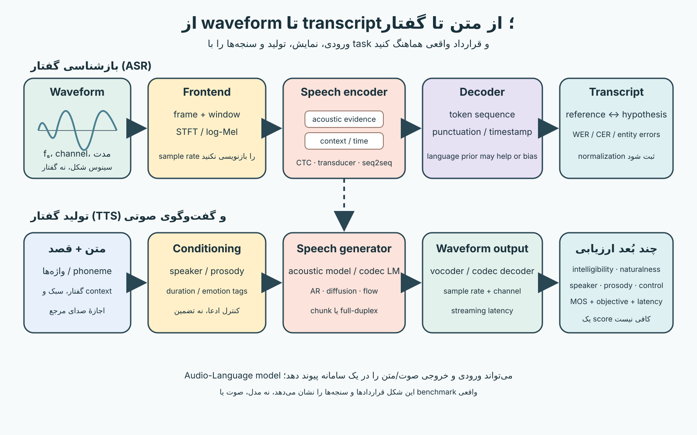
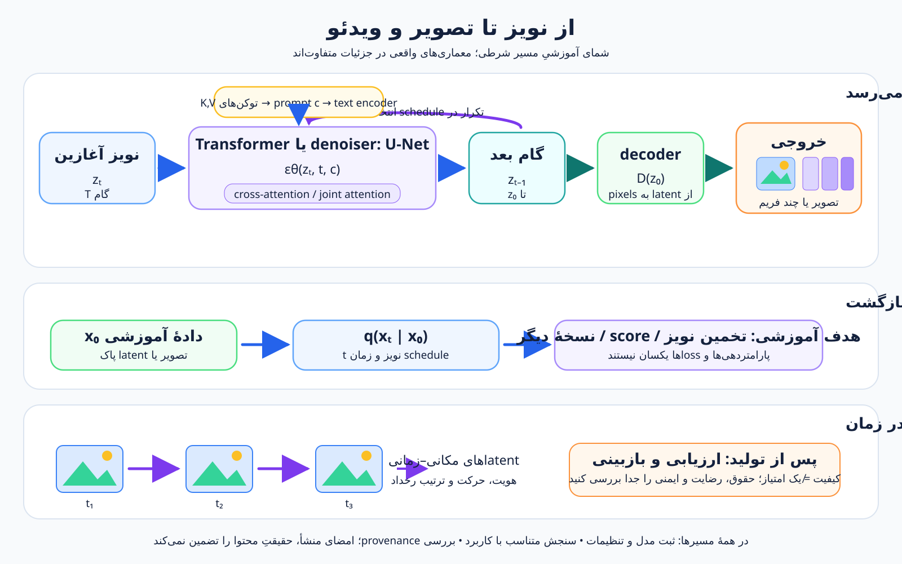
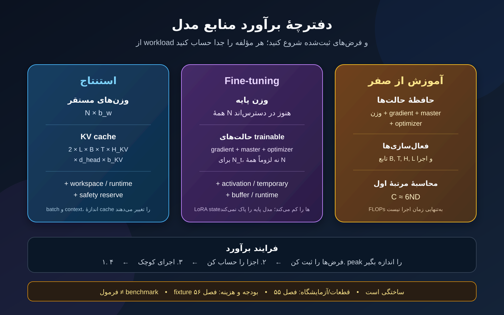
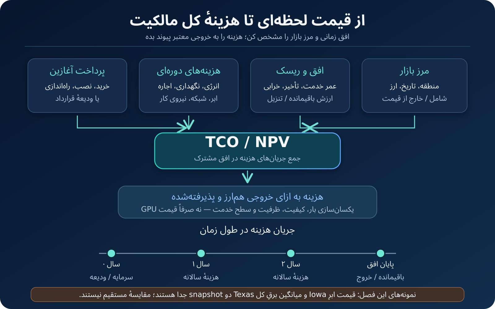

# هنر و علم ساخت هوش — جلد چهارم

**The Art & Science of Building Intelligence | Babak & Ai**

وضعیت: ۱۵ فصل در نقشه؛ ۱۰ فصل از ۱۵ فصل تا این انتشار نگارش، آزموده و منتشر شده‌اند. این فایل Markdown است؛ PDF و EPUB تولید و آزموده نشده‌اند.

## فهرست فصل‌های منتشرشده

- فصل ۱ (سراسری ۴۷) — Continued Pretraining، Instruction Tuning و SFT
- فصل ۲ (سراسری ۴۸) — PEFT، Adapter، LoRA و QLoRA
- فصل ۳ (سراسری ۴۹) — مدل پاداش، RLHF، PPO، DPO، GRPO و RLAIF
- فصل ۴ (سراسری ۵۰) — دادهٔ مصنوعی، تقطیر و محاسبهٔ زمان آزمون
- فصل ۵ (سراسری ۵۱) — مدل‌های تصویر و هم‌ترازی متن–تصویر
- فصل ۶ (سراسری ۵۲) — مدل‌های صوت و گفتار
- فصل ۷ (سراسری ۵۳) — تولید تصویر و ویدئو و Diffusion
- فصل ۸ (سراسری ۵۴) — برآورد منابع استنتاج، Fine-tuning و آموزش
- فصل ۹ (سراسری ۵۵) — طراحی آزمایشگاه کم‌هزینه تا سازمانی
- فصل ۱۰ (سراسری ۵۶) — بودجه و هزینهٔ مالکیت محاسبات

---

# جلد چهارم، فصل ۱ — Continued Pretraining، Instruction Tuning و SFT

**نگاشت:** فصل محلی ۱ جلد چهارم = فصل سراسری ۴۷. **تاریخ بازبینی منابع: ۶ نوامبر ۲۰۲۶.** فصل ۴۳ منشأ، وضعیت حقوقیِ ثبت‌شده، کیفیت داده و نامزدهای آلودگی را ممیزی کرد؛ فصل ۴۴ حلقهٔ پیش‌آموزش، schedule، checkpoint و بازیابی را ساخت؛ فصل‌های ۴۵ و ۴۶ دقت عددی و مقیاس را سنجیدند. این فصل یک مرحلهٔ دیگر از چرخه را جدا می‌کند: «دادهٔ ادامهٔ پیش‌آموزش چه هدفی دارد؟» و «در SFT دقیقاً کدام توکن‌ها پاسخِ تحت نظارت‌اند؟» فصل بعد PEFT، Adapter، LoRA و QLoRA را بررسی می‌کند؛ فصل ۴۹ به ترجیح، پاداش و روش‌های RL می‌پردازد. این فصل آن مباحث را پیشاپیش پیاده نمی‌کند.

**پیش‌نیاز:** تفاوت train، validation و test؛ causal language modeling و ماسک علّی؛ ممیزی corpus و provenance در فصل ۴۳؛ برنامهٔ آموزش و checkpoint در فصل ۴۴. **خروجی:** بتوانید هدف CPT را از SFT تفکیک کنید، رکورد دستور/پاسخ را با گروه‌بندی مناسب بسازید، مرز prompt و target را در token-level بازرسی کنید و پروتکل اعتبارسنجی/آزمون را پیش از دیدن نتایج ثبت کنید.


**شکل ۴-۱-۱ —** CPT و SFT ممکن است معماری و loss علّی مشترک داشته باشند، اما هدف داده و ناحیهٔ تحت نظارتشان فرق می‌کند. مرز loss باید بعد از tokenization دیده شود؛ صرف جداکردن رشته‌های متنی، mask درست را تضمین نمی‌کند.

## ۱. مدل پیش‌آموزش‌دیده لزوماً دستیار آماده نیست

مدل زبانی پایه از روی متن، توزیع توکن بعدی را یاد می‌گیرد. این پیش‌آموزش می‌تواند توانایی‌های زبانی و دانشیِ قابل استفاده برای ادامهٔ آموزش فراهم کند، اما به‌تنهایی تضمین نمی‌کند مدل درخواست را درست تشخیص دهد، قالب پاسخ را رعایت کند، از پاسخ نامطمئن پرهیز کند یا گفت‌وگو را به شکل مطلوب ادامه دهد. «می‌تواند جمله‌ای دربارهٔ X بسازد» با «درخواست کاربر دربارهٔ X را مطابق معیار تعریف‌شده انجام می‌دهد» یکی نیست.

**پس‌آموزش (post-training)** نام چتری برای مرحله‌های پس از پیش‌آموزش است. این اصطلاح یک الگوریتم واحد نیست: ممکن است ادامهٔ پیش‌آموزش دامنه‌ای، نظارت روی نمایش‌های دستور، تنظیم ترجیح، یا روش‌های دیگری را شامل شود. فصل حاضر فقط دو خانوادهٔ نخست را پوشش می‌دهد. نام دقیق مرحله، checkpoint ورودی، داده، هدف، روش ارزیابی و هر محدودیت باید در گزارش run ثبت شود؛ «fine-tuned» به‌تنهایی شرح آزمایش نیست.

## ۲. Continued Pretraining: همان هدف، مرحلهٔ تازه

**Continued pretraining** ادامه‌دادن هدف زبانیِ پیش‌آموزش از یک checkpoint موجود روی دادهٔ انتخاب‌شده است. در **domain-adaptive pretraining (DAPT)** دادهٔ ادامه‌دار از یک دامنه می‌آید؛ در **task-adaptive pretraining (TAPT)** متن‌های نزدیک به وظیفه یا مجموعهٔ مسئله هدف‌اند. اصطلاح‌ها در ادبیات شکل‌های متفاوتی از تطبیق را پوشش می‌دهند؛ در گزارش خود، منبع و انتخاب داده را روشن‌تر از برچسب کوتاه بنویسید.

در causal LM، نمونهٔ ساده همچنان متن پیوسته‌ای است که برای پیش‌بینی توکن بعدی استفاده می‌شود. هدف به‌طور کلی شبیه پیش‌آموزش قبلی است، اما checkpoint آغاز، توزیع متن، تعداد توکن‌ها، ترتیب داده، schedule و مدت مرحله عوض شده‌اند. پس «ادامه» به معنی بی‌اثر بودن تنظیمات قبلی یا سازگار بودن خودکار checkpoint نیست؛ واژگان، tokenizer و معماری نیز باید با مدل ورودی تطبیق داشته باشند.

Gururangan و همکاران DAPT و TAPT را در آزمایش‌هایی بر RoBERTa، چهار دامنه و هشت task بررسی کردند و برای همان تنظیم‌ها سود گزارش کردند [۱]. این شاهد برای فهم ایده و طراحی یک ablation مفید است؛ تضمین نمی‌کند ادامهٔ پیش‌آموزش برای هر مدل decoder، زبان، دامنه یا مقدار داده سودمند باشد. در پروژهٔ این فصل نه corpus دامنه‌ای داریم، نه DAPT انجام می‌دهیم.

## ۳. Instruction Tuning و SFT: دستور را به نمونهٔ نظارت‌شده تبدیل کنیم

**Instruction tuning** آموزش مدل روی نمونه‌هایی است که وظیفه را به‌شکل دستور، سؤال یا درخواست طبیعی بیان می‌کنند. نمونه می‌تواند شامل دستور، زمینه، ورودی و پاسخ مطلوب باشد. در **supervised fine-tuning (SFT)**، الگوریتم با demonstrationهای هدف آموزش داده می‌شود: به مدل رشتهٔ زمینه داده می‌شود و برای پاسخ/ادامهٔ موردنظر loss محاسبه می‌شود. در عمل این اصطلاح‌ها گاهی به‌جای یکدیگر به کار می‌روند؛ «instruction tuning» معمولاً شکل و ترکیب taskها را برجسته می‌کند، درحالی‌که «SFT» شیوهٔ نظارت را توصیف می‌کند. هیچ مرز واژگانیِ جهانی و رسمی میان همهٔ کاربردهای این دو نام وجود ندارد.

کار FLAN نشان داد که نمایش‌دادن taskها به زبان دستور و آموزش روی مجموعه‌ای از taskها می‌تواند رفتار zero-shot را در برخی مدل‌ها و پروتکل‌های همان پژوهش تغییر دهد [۲]. مجموعهٔ Flan در ادامه ترکیب taskها و صورت‌بندی promptهای zero-shot، few-shot و chain-of-thought را مطالعه کرد [۳]. نتیجه‌های آن مقاله‌ها به مدل، داده، prompt و سنجه‌های همان کار وابسته‌اند؛ از آن‌ها نمی‌توان نتیجه گرفت «هر دستور بیشتر، هر مدلی را بهتر می‌کند».

در SFT، پاسخ هدف معمولاً از انسان، سیاست داده یا منبع بازبینی‌شده می‌آید. مدل پیش‌بینی ادامهٔ ارائه‌شده را یاد می‌گیرد، نه اینکه به‌طور خودکار درست‌بودن پاسخ یا رضایت کاربر را بفهمد. کیفیت demonstration، پوشش وظایف، توافق annotatorها، نحوهٔ نمایش زمینه و سیاست انتخاب پاسخ، همگی بخشی از تعریف آزمایش‌اند.

## ۴. هدف آموزش: فقط target باید loss بسازد

در prompt-completion ساده، `x` متن زمینه و `y` دنبالهٔ پاسخ هدف است. برای causal language model، نسخهٔ سادهٔ objective روی tokenهای پاسخ چنین نوشته می‌شود:

<math xmlns="http://www.w3.org/1998/Math/MathML" display="block" aria-label="زیان SFT برابر منفی میانگین لگاریتم احتمال هر توکن هدف پاسخ، با شرط بر توکن‌های پیشین و زمینه، است">
  <mrow><msub><mi>L</mi><mi>SFT</mi></msub><mo>=</mo><mo>−</mo><mfrac><mn>1</mn><mrow><mo>|</mo><mi>T</mi><mo>|</mo></mrow></mfrac><munder><mo>∑</mo><mrow><mi>t</mi><mo>∈</mo><mi>T</mi></mrow></munder><mi>log</mi><msub><mi>p</mi><mi>θ</mi></msub><mo>(</mo><msub><mi>y</mi><mi>t</mi></msub><mo>|</mo><msub><mi>x</mi><mrow><mo>&lt;</mo><mi>t</mi></mrow></msub><mo>)</mo></mrow>
</math>

**متن جایگزین فرمول:** زیان SFT برابر منفی میانگین لگاریتم احتمال هر توکن هدف پاسخ، با شرط بر توکن‌های پیشین و زمینه، است. `T` فقط جایگاه‌های تحت نظارت را در بر می‌گیرد.

در یک پیاده‌سازی متداول، آرایهٔ `labels` برای prompt با `-100` پر می‌شود و مقدار متناظر با پاسخ در جایگاه‌های هدف می‌ماند. در causal LM، logits هر موقعیت برای پیش‌بینی token بعدی به‌کار می‌روند؛ بنابراین باید شیفت هدفی را که مدل و trainer اعمال می‌کنند در نظر گرفت. `CrossEntropyLoss` در PyTorch 2.6 مقدار پیش‌فرض `ignore_index=-100` دارد و جایگاه‌های چنین برچسبی را از loss حذف می‌کند [۸]. این رفتار دربارهٔ آرایهٔ labels است؛ `attention_mask` جایگزین label masking نیست.

```text
input_ids = [BOS, ...prompt tokens..., ...answer tokens..., EOS]
labels    = [-100, ...-100..........., ...answer token IDs..., EOS]
```

مدل همچنان context prompt را می‌بیند و از آن برای پیش‌بینی پاسخ استفاده می‌کند؛ فقط prompt مستقیماً target loss نیست. اگر همهٔ labels برابر `-100` باشند یا مرز به‌اندازهٔ یک token جابه‌جا شده باشد، loss یا معنی آزمایش عوض می‌شود. پس چند batch واقعی را به‌شکل token ID، mask، طول و شمار target بازرسی کنید.

## ۵. قالب مکالمه و ماسک پاسخ دو قرارداد جدا هستند

در دادهٔ چتی، متن ممکن است با markerهای نقش، جداکنندهٔ پیام، کانال، یا token پایان turn سریال‌سازی شود. **Chat template** می‌گوید رشتهٔ مکالمه چگونه به دنبالهٔ tokenها تبدیل شود؛ **loss mask** می‌گوید کدام جایگاه‌ها برچسب آموزشی می‌گیرند. استفاده از template درست بدون mask درست کافی نیست؛ mask روی رشتهٔ ساده پیش از tokenization نیز ممکن است مرز را اشتباه بزند.

مستندات Transformers تأکید می‌کنند template را با همان tokenizer مدل و قرارداد پیام استفاده کنید [۹]. در دادهٔ چندنوبتی، ممکن است فقط پاسخ assistant یا بخشی از آن هدف باشد؛ پیام‌های system/user و بعضی markerهای مرزی باید بر اساس هدف آموزش تعیین شوند. گزینه‌های تولید assistant-mask و قالب داده بین نسخه‌های کتابخانه و templateها تفاوت دارند؛ نام آرگومان را از مستندات نسخهٔ pin‌شده بردارید و خروجی mask را تست کنید. در صورت استفاده از TRL، فرمت prompt-completion یا conversational و قرارداد loss همان نسخه را بررسی کنید [۱۰].

پروژهٔ این فصل عمداً chat template نمی‌سازد. Pythia-14m یک مدل پایهٔ انگلیسی است، نه مدل گفتگو؛ fixture نیز prompt-completion ساده است. این انتخاب جلوی ادعای نادرست دربارهٔ قالب چت یک مدل را می‌گیرد و امکان می‌دهد مرز دو رشته و label mask را آشکار ببینیم.

## ۶. Padding، طول و شمار واقعی token هدف

Batchهای هم‌طول برای محاسبهٔ دسته‌ای padding می‌گیرند. ورودی padding می‌تواند `pad_token_id` داشته باشد و `attention_mask` موقعیت‌های padding را برای attention مشخص کند؛ برچسب padding نیز باید از loss حذف شود. در پروژه، هر دو مورد برچسب prompt و padding برابر `-100` می‌گیرند. تعداد targetها را از labels معتبر پس از شیفت causal بشمارید؛ تعداد کل `input_ids` معیار اندازهٔ supervision نیست.

وقتی طول پاسخ‌ها متفاوت است، میانگین‌گیری را دقیق تعریف کنید. اگر trainer loss را بر تعداد targetهای معتبر هر batch میانگین می‌گیرد، برای تجمیع چند batch باید آن را با تعداد targetها وزن‌دهی کنید؛ میانگین سادهٔ lossهای batchهای کوچک و بزرگ می‌تواند به هر batch وزن برابر بدهد، نه به هر token. جزئیات reduction و accumulation به پیاده‌سازی وابسته است؛ برای run واقعی رفتار loss را با یک مثال کوچک و reference دستی تطبیق دهید.

**Truncation** نیز باید هدف‌مند باشد. بریدن انتهای پاسخ می‌تواند target را ناقص کند؛ بریدن ابتدای زمینه ممکن است دستور یا قید اصلی را حذف کند. سیاست‌ها می‌توانند طول حداکثری، اولویت حفظ دستور، انتخاب پنجره، یا کنارگذاشتن نمونهٔ بلند باشند. نمونهٔ پروژه prompt را از سمت چپ کوتاه می‌کند تا پاسخ کامل بماند؛ این انتخاب فقط برای fixture آموزشی است و قانون عمومی برای گفتگو یا اسناد بلند نیست. مرز سند و token پایان را با template و هدف همان مدل کنترل کنید.

## ۷. رکورد آموزشی باید هدف را قابل‌ردیابی کند

یک ساختار ساده می‌تواند `id`، `source_id`، `group_id`، `prompt` و `completion` داشته باشد. در corpus واقعی معمولاً فیلدهایی برای نسخه، منشأ، روش تولید، بازبینی، زبان، دامنه، برچسب، مجوز و دلیل نگه‌داری/کنارگذاری نیز نیاز است. فصل ۴۳ برای provenance، حقوق و audit طراحی شده؛ این فصل آن سامانه را دوباره نمی‌سازد. وجود فیلد در JSONL هم صحت یا مجازبودن مقدار را اثبات نمی‌کند.

برای هر نمونه بپرسید: آیا دستور واضح است؟ زمینهٔ لازم دارد؟ پاسخ با معیار تعریف‌شده منطبق است؟ پاسخ کوتاه یا بلندتر از مطلوب است؟ آیا چند پاسخ جایگزین پذیرفتنی‌اند؟ چه کسی قضاوت کرده و اختلاف چگونه ثبت شده؟ آیا prompt الگوی نشت target یا پاسخ ساختگی دارد؟ آیا داده نمونه‌های رد، عدم‌قطعیت یا درخواست clarification را پوشش می‌دهد؟ یک پاسخ نمونه فقط یکی از پاسخ‌های پذیرفتنی را نشان می‌دهد؛ آن را تعریف حقیقت مطلق نکنید.

Data card باید جمعیت و هدف مجموعه، نحوهٔ ساخت/انتخاب، توزیع source/task/طول، splitها، ناشناخته‌ها و کاربردهای خارج از دامنه را توضیح دهد [۱۲]. دادهٔ آموزشی، دادهٔ validation و test باید از نظر تصمیم‌های انتخاب و نسخه جدا بمانند. اگر نمونه‌های مرتبط از یک سند، template، کاربر یا خانوادهٔ تولید آمده‌اند، رابطه را با `group_id` یا شناسهٔ مناسب نگه دارید تا split میان آن‌ها نشت نکند.

## ۸. آمیختن taskها: تعداد نمونه تنها وزن نیست

مجموعهٔ instruction می‌تواند taskها، زبان‌ها، طول پاسخ‌ها، سبک prompt، منبع و دشواری متفاوت داشته باشد. اگر یک نوع task صد برابر نمونه دارد، شاید سهم token آن از batch و گرادیان هم بیشتر شود؛ ولی کم‌شمردن آن به‌خاطر «توازن تعداد ردیف» هم ممکن است الگوی مهمی را کم‌وزن کند. نسبت رکورد، نسبت token، احتمال نمونه‌گیری، وزن loss و ترتیب curriculum تصمیم‌های متفاوتی‌اند.

طرح آزمایش را بر اساس خروجی‌های مورد انتظار و خطاهای مهم بنویسید. سهم taskها را جدا log کنید؛ منبع، group و طول را ثبت کنید؛ و تغییرات mixture را روی validationِ تعریف‌شده بسنجید. اگر چند نسخه از یک task یا ترجمهٔ یک prompt در داده است، آن‌ها را مستقل فرض نکنید. تغییر هم‌زمان mixture، مدل، schedule و prompt ارزیابی تفسیر علت را دشوار می‌کند؛ مقایسه را تا حد امکان کنترل کنید.

Flan Collection اثر طراحی taskها و prompt-formatها را در آزمایش‌های نویسندگان گزارش می‌کند [۳]. این نتایج به ترکیب و ارزیابی همان مقاله تعلق دارد؛ وزن‌های آن را بدون توجه به هدف، زبان، منبع یا مقیاس به مجموعه‌ای دیگر منتقل نکنید. «توازن بهتر» باید با تعریف معیار و جمعیت موردنظر سنجیده شود، نه با فرض یک توزیع ایده‌آل ثابت.

## ۹. «کمتر ولی بهتر» قانون عددی جهان‌شمول نیست

LIMA روی LLaMA با ۶۵ میلیارد پارامتر و ۱٬۰۰۰ نمونهٔ curated شده، در همان setup نتیجه‌هایی دربارهٔ کیفیت SFT و اهمیت مدل پایه/داده گزارش کرد [۵]. AlpaGasus زیرمجموعه‌ای حدود ۹٬۰۰۰تایی از ۵۲٬۰۰۰ نمونهٔ Alpaca را با روش امتیازدهی خود انتخاب کرد و آزمایش‌های مربوط به مدل‌ها و سنجه‌های خود را گزارش داد [۶]. این‌ها پرسش خوبی برای طراحی ablation می‌سازند: کدام نمونه‌ها مفیدند؟ چه هزینه‌ای دارد؟ معیار انتخاب چقدر با هدف منطبق است؟ اما هیچ‌کدام ثابت نمی‌کنند «۱٬۰۰۰ نمونه برای هر مدل کافی است» یا «حذف داده همیشه کیفیت را بالا می‌برد».

دادهٔ کم ممکن است پوشش را کم کند؛ دادهٔ بیشتر می‌تواند تنوع را بالا ببرد یا نویز و پاسخ‌های ناسازگار اضافه کند. امتیازدهی خودکار یا LLM-as-a-judge نیز نیازمند تعریف معیار، calibration، بررسی خطا و تحلیل اختلاف است. گزارش نتیجه باید مدل پایه، نسخه/حجم داده، انتخاب‌ها، تعداد token، تعداد update، پروتکل validation/test و محدودیت ارزیاب را ثبت کند؛ یک نسبت نمونه به‌تنهایی کیفیت را پیش‌بینی نمی‌کند.

## ۱۰. CPT و SFT را می‌توان مرحله‌بندی کرد، اما نباید در گزارش مخلوط کرد

ممکن است run ابتدا روی متن دامنه‌ای ادامهٔ پیش‌آموزش بگیرد و سپس روی demonstrationهای دستور SFT شود؛ این دو مرحله هدف داده‌ای متفاوت دارند. همچنین می‌توان در یک برنامهٔ چندبخشی متن‌های مختلف را با weighting یا sampling ترکیب کرد. هر انتخاب در checkpoint، نسخهٔ tokenizer، مقدار و ترتیب داده، schedule و معیارها بازتاب دارد. «یک مدل را fine-tune کردیم» نمی‌گوید کدام مرحله و کدام هدف اجرا شده است.

تغییر توزیع داده یا هدف می‌تواند رفتارها را تغییر دهد؛ حفظ، فراموشی یا افت در taskهای پیشین باید با ارزیابی مناسب سنجیده شود. این فصل claim نمی‌کند CPT یا SFT الزاماً موجب catastrophic forgetting می‌شوند یا آن را برطرف می‌کنند. اگر ادامهٔ آموزش، task تازه یا data mixture را می‌آزمایید، خط پایه و چند task نماینده را پیش از run تعریف کنید و نتیجه را در همان دامنه گزارش دهید.

SFT نیز به‌تنهایی ترجیح یا پاداش انسانی را مدل نمی‌کند. در مقالهٔ InstructGPT، SFT روی demonstration مرحلهٔ جداگانه‌ای از preference comparisons، reward modeling و PPO بود [۴]. فصل ۴۹ همان تفاوت‌ها را دقیق‌تر بررسی می‌کند؛ اینجا از مخلوط‌کردن نام «SFT» با «RLHF» پرهیز می‌کنیم.

## ۱۱. ارزیابی را قبل از انتخاب checkpoint تعریف کنیم

پروتکل ساده شامل سه split است: train برای گرادیان؛ validation برای مشاهده/انتخاب‌های مجاز؛ test برای گزارش نهایی پس از تثبیت روش. اگر validation چندباره برای انتخاب mixture یا checkpoint استفاده شد، آن تصمیم را ثبت کنید. Test را پس از هر update یا هر انتخاب threshold نخوانید؛ در غیر این صورت دیگر شاهد مستقل نهایی نیست. در پروژهٔ فصل، NLL اعتبارسنجی پیش و پس از آموزش مقایسه می‌شود و test عمومی فقط یک بار پس از آموزش محاسبه می‌شود.

Metric را به مسئله وصل کنید. NLL یا cross-entropy برای توزیع tokenها است؛ exact match برای خروجی‌های دقیق؛ معیارهای طبقه‌بندی برای برچسب‌های تعریف‌شده؛ و rubric انسانی برای ویژگی‌هایی که خودکار سنجش نمی‌شوند. هیچ‌کدام به‌تنهایی «مفید»، «ایمن» یا «مطابق دستور» بودن کلی مدل را ثابت نمی‌کنند. اگر از ارزیاب انسانی/مدلی استفاده می‌کنید، rubric، نمونه‌گیری، توافق، ترجیح position، دسترسی به مرجع و موارد مبهم را بنویسید.

ممیزی فصل ۴۳ هشدار می‌دهد که match سطحی نه اثبات مواجههٔ مدل است و نه نبودن match اثبات پاک‌بودن داده. پژوهش Sainz و همکاران نشان می‌دهد سنجش آلودگی باید برای benchmark مشخص انجام شود [۷]. منابع، نسخهٔ benchmark، تاریخ cutoff، groupها و روش بررسی را ثبت کنید؛ ارزیابی عمومی را محرمانه فرض نکنید.

## ۱۲. حقوق داده، privacy و مجوز مدل سه پرسش جدا هستند

دادهٔ عمومی یا نمونهٔ قابل‌دسترسی خودبه‌خود اجازهٔ آموزش، انتشار یا استفادهٔ محصولی نمی‌دهد. پیش از مصرف corpus واقعی، provenance، مجوز upstream، شرایط کاربرد، privacy و هر الزام انتساب را طبق فرایند فصل ۴۳ و نظر مسئول مناسب بررسی کنید. ابزارهای این فصل هیچ مجوزی صادر نمی‌کنند و تضمین حقوقی یا privacy نمی‌دهند.

مجوز metadata یک checkpoint نیز با مجوز مواد آموزشی آن یکی نیست. کارت مدل `EleutherAI/pythia-14m` در بازبینی ۶ نوامبر ۲۰۲۶ metadata مجوز را `apache-2.0` نشان می‌داد؛ کارت همین مدل را English و برای پژوهش معرفی می‌کرد، نه deployment یا زبان‌های دیگر [۱۱]. کارت همچنین به تغییر مقصد مدل میزبانی‌شده از نسخهٔ `deduped` به Pile استاندارد در فوریهٔ ۲۰۲۶ اشاره می‌کند. پروژه revision را به SHA ثابت pin می‌کند تا شناسهٔ متحرک `main` در بازتولیدپذیری دخیل نباشد [۱۳].

این metadata نه جواز همهٔ داده‌های Pile را ثابت می‌کند، نه حقوق دادهٔ fixtureهای دیگر را تعیین می‌کند، نه کیفیت فارسی یا تناسب محصول را نشان می‌دهد. در این پروژه فقط fixtureهای ساختگی انگلیسی به کار می‌روند؛ فایل دادهٔ بیرونی یا benchmark محرمانه‌ای دریافت یا ارسال نمی‌شود. مدل‌کارت و مجوزش را برای هر کاربرد و نسخه دوباره بررسی کنید.

## ۱۳. پروژهٔ قابل‌بازتولید: از audit تا run اختیاری

پروژهٔ [قرارداد داده و SFT فصل ۴۷](book-engineering/projects/47-instruction-tuning/README.md) سه بخش دارد: fixture JSONL، split پایدار بر اساس `group_id`، و کد tokenization/collation که prompt و padding را از loss کنار می‌گذارد. تست‌ها با tokenizer ساختگی اجرا می‌شوند؛ بنابراین هیچ وزن، tokenization Pythia یا کیفیت مدل را ادعا نمی‌کنند. حالت `audit` نیز فقط ساختار و شمارها را بررسی می‌کند.

برای آموزش واقعیِ نمایشی، وابستگی‌های optional دقیق pin شده‌اند؛ `--allow-download` باید آگاهانه داده شود و کد revision مدل را ثابت می‌کند. CPU و یک fixture عمومی کوچک انتخاب شده‌اند تا مسیر قابل اجرا بماند. در گزارش run، نسخهٔ Python/PyTorch/Transformers، hash داده، config، شمار update، NLL validation پیش/پس، test نهایی و محدودیت‌ها ثبت می‌شوند. به علت محدودیت کارت، این مثال انگلیسی است؛ از آن هیچ ادعای کیفیت فارسی، GPU/NCCL، سرعت/benchmark سخت‌افزار یا deployment نتیجه نگیرید.

خروجی‌های اجرای پروژه در مسیر `/tmp` نگه داشته می‌شوند و وزن‌ها به Git اضافه نمی‌شوند. CI آزمون‌های unit و audit آفلاین را اجرا می‌کند، نه دانلود مدل. اگر آزمایش اختیاری اجرا نشود یا دانلود در دسترس نباشد، گزارش باید همین را صریح بگوید؛ صرف وجود دستور اجرا نتیجهٔ آموزش محسوب نمی‌شود.

## ۱۴. خطاهای رایج در داده و labelها

- اگر برچسب‌های prompt را به‌اشتباه فعال کنید، مدل بخشی از ورودی را نیز بازتولید می‌کند؛ ممکن است هدف task عوض شود، حتی اگر loss عددی باشد.
- اگر همهٔ پاسخ‌ها به یک separator یا template وابسته‌اند و آن در inference وجود ندارد، ارزیابی آموزش نمایندهٔ مصرف واقعی نیست.
- اگر پاسخ طولانی در انتها truncate شود، EOS یا بخش تعیین‌کنندهٔ جواب از target حذف می‌شود؛ این خطا را با تغییر طول و شمار tokenها پیدا کنید.
- اگر padding labels نادیده گرفته نشود، مدل ممکن است token padding را هدف بگیرد؛ `attention_mask` به‌تنهایی این مشکل را رفع نمی‌کند.
- اگر نمونه‌های یک group یا near-duplicate در train و test پخش شوند، score می‌تواند بیش از حد خوش‌بینانه شود؛ از group-aware split و audit فصل ۴۳ بهره ببرید.
- اگر validation را بارها برای انتخاب prompt و mixture مصرف کنید، دیگر آن را test مستقل ننامید؛ روند انتخاب را ثبت کنید.
- اگر metadata مدل را با حقوق corpus یا تضمین محصول یکی بگیرید، از مرز شواهد فراتر رفته‌اید؛ مدل‌کارت، داده‌کارت و بررسی کاربردی را جدا نگه دارید.

## ۱۵. چک‌لیست پیش از اجرای SFT

۱. هدف، کاربرد موردنظر، خروجی پذیرفتنی و baseline را تعریف کرده‌ام. ۲. checkpoint، tokenizer، revision و وابستگی‌ها pin شده‌اند. ۳. provenance و کاربرد داده از فرایند فصل ۴۳ عبور کرده‌اند؛ fixture با دادهٔ واقعی اشتباه نمی‌شود. ۴. رکوردها ID و `group_id` پایدار دارند و train/validation/test پیش از آموزش جدا شده‌اند. ۵. serialization، chat template، پایان پیام و پاسخ هدف تعریف شده‌اند. ۶. چند batch واقعی را پس از tokenization بررسی کرده‌ام: ورودی، attention mask، labels، `-100`، طول target و شمار supervised tokens. ۷. سیاست truncation، padding، loss reduction و gradient accumulation معلوم است. ۸. task mixture و معیارهای validation پیش از اجرا ثبت شده‌اند. ۹. آلودگی benchmark و محدودیت‌های data/model card بررسی شده‌اند. ۱۰. test فقط پس از تثبیت تصمیم‌ها برای گزارش نهایی استفاده می‌شود. ۱۱. run، وابستگی، hash و محدودیت‌ها ثبت می‌شوند؛ outputهای مصنوعی یا smoke-test را benchmark معرفی نمی‌کنم.

## ۱۶. تمرین و پاسخ‌نامه

**تمرین ۱.** برای دو هدف «ادامهٔ پیش‌آموزش روی متن پزشکی» و «پاسخ‌دادن به پرسش با demonstration» نوع داده، هدف token-level و خطر ارزیابی متفاوت را بنویسید. چرا عنوان «fine-tuning» برای بازتولید run کافی نیست؟

**تمرین ۲.** ورودی `BOS + prompt(4 tokens) + answer(3 tokens) + EOS` را در آرایهٔ `labels` مشخص کنید. اگر labelهای prompt به‌جای `-100` همان token ID بمانند، چه چیزی تغییر می‌کند؟

**تمرین ۳.** دوازده رکورد از چهار سند مادر آمده‌اند؛ هر سند سه قطعه دارد. چرا split تصادفی هر رکورد ممکن است نشت بسازد؟ چه کلیدی را برای split نگه می‌دارید و چه چیزی را جداگانه در validation/test می‌سنجید؟

**تمرین ۴.** یک مقاله روی ۱٬۰۰۰ نمونهٔ curated نتیجهٔ خوبی گزارش می‌کند. دو دلیل بیاورید که چرا این عدد، قانون حجم داده برای مدل شما نیست؛ یک ablation قابل‌دفاع پیشنهاد دهید.

**تمرین ۵.** تفاوت مجوز metadata مدل و مجوز corpus آموزشی چیست؟ در پروژهٔ Pythia چه چیزی pin شده و چه چیزی از کارت مدل استنتاج نمی‌شود؟

**پاسخ‌نامهٔ مستقل:** [پاسخ‌نامهٔ تشریحی فصل ۴۷](book-engineering/answers/47-posttraining-fa.md). **پروژه:** [README و دستورهای اجرا](book-engineering/projects/47-instruction-tuning/README.md)؛ [گزارش ممیزی و نتیجه](book-engineering/chapters/47-audit-report-fa.md).

## ۱۷. جمع‌بندی و مسیر بعد

CPT دادهٔ متنی را با هدف پیش‌بینی token بعدی روی مرحلهٔ تازه ادامه می‌دهد؛ SFT demonstrationهای مطلوب را به targetهای supervised تبدیل می‌کند. اگر prompt قرار است فقط context باشد، label mask باید واقعاً آن را از loss کنار بگذارد. Chat template، attention mask، padding mask و assistant-target mask مفهوم‌های مرتبط اما قابل‌جایگزین نیستند. Split گروهی، validation مستقل، testِ دیرهنگام، منشأ داده و محدودیت‌های مدل هم بخشی از پروتکل‌اند، نه کارهای جانبی.

فصل ۴۸ بعدی می‌پرسد آیا باید همهٔ وزن‌ها را به‌روزرسانی کرد یا با PEFT/Adapter/LoRA/QLoRA بخشی از هزینه را عوض کرد؛ مقایسهٔ کیفیت و حافظه را باید روی task، مدل و سخت‌افزار مشخص انجام داد. فصل ۴۹ سپس preference data و روش‌های پاداش/RL را از SFT جدا می‌کند. هیچ‌یک از این فصل‌های آینده با نتیجهٔ fixture این فصل از پیش حل نمی‌شوند.

## منابع و تاریخ بازبینی

منابع زیر تا **۶ نوامبر ۲۰۲۶** بازبینی شده‌اند. مقاله‌ها نتیجه‌های همان setup نویسندگان را پشتیبانی می‌کنند؛ صفحات مستندات زنده نسخه‌محورند و باید هنگام اجرای کد دوباره کنترل شوند.

1. Gururangan, S. و همکاران، “Don’t Stop Pretraining: Adapt Language Models to Domains and Tasks”، ACL 2020، [متن مقاله](https://aclanthology.org/2020.acl-main.740/). مطالعهٔ DAPT/TAPT بر setup گزارش‌شدهٔ مقاله.
2. Wei, J. و همکاران، “Finetuned Language Models Are Zero-Shot Learners”، 2021، [arXiv:2109.01652](https://arxiv.org/abs/2109.01652). نتیجه‌های FLAN به مدل و پروتکل مقاله وابسته‌اند.
3. Longpre, S. و همکاران، “The Flan Collection: Designing Data and Methods for Effective Instruction Tuning”، 2023، [arXiv:2301.13688](https://arxiv.org/abs/2301.13688). طراحی mixture و صورت‌بندی taskها در آزمایش‌های نویسندگان.
4. Ouyang, L. و همکاران، “Training language models to follow instructions with human feedback”، 2022، [arXiv:2203.02155](https://arxiv.org/abs/2203.02155). تفکیک مراحل SFT، reward model و PPO در مطالعهٔ InstructGPT.
5. Zhou, C. و همکاران، “LIMA: Less Is More for Alignment”، 2023، [arXiv:2305.11206](https://arxiv.org/abs/2305.11206). setup مدل LLaMA 65B و 1,000 نمونهٔ curated.
6. Chen, L. و همکاران، “AlpaGasus: Training A Better Alpaca with Fewer Data”، 2023، [arXiv:2307.08701](https://arxiv.org/abs/2307.08701). انتخاب 9k از 52k در آزمایش مقاله؛ نه قاعدهٔ کمیت.
7. Sainz, O. و همکاران، “NLP Evaluation in trouble: On the Need to Measure LLM Data Contamination for each Benchmark”، Findings of EMNLP 2023، [ACL Anthology](https://aclanthology.org/2023.findings-emnlp.722/).
8. PyTorch 2.6، `torch.nn.CrossEntropyLoss`، [مستندات نسخه‌دار](https://docs.pytorch.org/docs/2.6/generated/torch.nn.CrossEntropyLoss.html). مستندات مرجع `ignore_index`.
9. Hugging Face Transformers، “Chat templates”، مستندات جاری؛ صفحه هنگام بازبینی نسخهٔ main را 5.22.1 نشان می‌داد، [راهنما](https://huggingface.co/docs/transformers/en/chat_templating). پروژهٔ این فصل از template چت استفاده نمی‌کند.
10. Hugging Face TRL، “SFT Trainer”، مستندات جاری؛ صفحه هنگام بازبینی v1.17.1 را نشان می‌داد، [راهنما](https://huggingface.co/docs/trl/en/sft_trainer). قرارداد dataset و masking باید با نسخهٔ مورد استفاده تطبیق یابد.
11. EleutherAI، [کارت مدل Pythia-14m](https://huggingface.co/EleutherAI/pythia-14m). زبان، کاربرد پژوهشی، محدودیت زبان و metadata مجوز؛ بازبینی ۶ نوامبر ۲۰۲۶.
12. Hugging Face Datasets، “Create a dataset card”، [مستندات](https://huggingface.co/docs/datasets/dataset_card). هدف کارت داده و ثبت محدودیت‌ها؛ تاریخ انتشار صفحه نامشخص.
13. Hugging Face Hub، [API مدل Pythia-14m](https://huggingface.co/api/models/EleutherAI/pythia-14m). SHA مشاهده‌شده در ۶ نوامبر ۲۰۲۶: `cf967c0a9a04383db6f7b1108d86b2962634b4ac`.

## پیوست اجرایی: فایل پروژهٔ آزموده‌شده

کد زیر باید با بایت‌های `book-engineering/projects/47-instruction-tuning/sft_experiment.py` یکسان بماند. CI و سازندهٔ جلد چهارم تطبیق را بررسی می‌کنند. حالت آفلاین فقط audit می‌کند؛ مسیر آموزش اختیاری است و نیازمند مدل/وابستگی‌های pin‌شده است.

```python
"""Small, offline-first SFT data-contract and CPU fine-tuning demonstration.

The default audit mode never imports Transformers, loads a model, or accesses the
network. The optional training mode is a research smoke test on synthetic English
data and a revision-pinned Pythia checkpoint; it is not a quality benchmark.
"""
from __future__ import annotations

import argparse
from datetime import datetime, timezone
import hashlib
import json
import math
import os
from pathlib import Path
import random
import sys
from typing import Any, Mapping, Sequence

MODEL_ID = "EleutherAI/pythia-14m"
MODEL_REVISION = "cf967c0a9a04383db6f7b1108d86b2962634b4ac"
MODEL_CARD_LICENSE = "apache-2.0"
MODEL_CARD_URL = "https://huggingface.co/EleutherAI/pythia-14m"
MODEL_CARD_REVIEWED = "2026-11-06"
REQUIRED_FIELDS = ("id", "source_id", "group_id", "prompt", "completion")
SPLIT_NAMES = ("train", "validation", "test")


def _require_positive_int(name: str, value: object, minimum: int = 1) -> int:
    if isinstance(value, bool) or not isinstance(value, int) or value < minimum:
        raise ValueError(f"{name} must be an integer >= {minimum}")
    return value


def _require_fraction(name: str, value: object) -> float:
    if isinstance(value, bool) or not isinstance(value, (int, float)):
        raise ValueError(f"{name} must be a finite number in (0, 1)")
    result = float(value)
    if not math.isfinite(result) or not 0.0 < result < 1.0:
        raise ValueError(f"{name} must be a finite number in (0, 1)")
    return result


def load_jsonl(path: str | Path) -> list[dict[str, str]]:
    """Load the minimal prompt/completion schema; never infer rights or quality."""
    path = Path(path)
    rows: list[dict[str, str]] = []
    seen_ids: set[str] = set()
    try:
        stream = path.open("r", encoding="utf-8")
    except OSError as exc:
        raise ValueError(f"cannot open dataset {path}: {exc}") from exc
    with stream:
        for line_number, line in enumerate(stream, 1):
            if not line.strip():
                continue
            try:
                value = json.loads(line)
            except json.JSONDecodeError as exc:
                raise ValueError(f"invalid JSON on line {line_number}: {exc.msg}") from exc
            if not isinstance(value, dict):
                raise ValueError(f"line {line_number}: each row must be a JSON object")
            row = dict(value)
            for field in REQUIRED_FIELDS:
                item = row.get(field)
                if not isinstance(item, str) or not item.strip():
                    raise ValueError(f"line {line_number}: {field!r} must be a non-empty string")
                row[field] = item.strip()
            if row["id"] in seen_ids:
                raise ValueError(f"line {line_number}: duplicate id {row['id']!r}")
            seen_ids.add(row["id"])
            rows.append(row)
    if not rows:
        raise ValueError(f"dataset {path} contains no records")
    return rows


def split_by_group(
    records: Sequence[Mapping[str, str]],
    *,
    seed: int = 47,
    train_fraction: float = 0.8,
    validation_fraction: float = 0.1,
) -> dict[str, list[Mapping[str, str]]]:
    """Deterministically split group IDs so related records cannot cross splits."""
    _require_positive_int("seed", seed, minimum=0)
    train_fraction = _require_fraction("train_fraction", train_fraction)
    validation_fraction = _require_fraction("validation_fraction", validation_fraction)
    if train_fraction + validation_fraction >= 1.0:
        raise ValueError("train_fraction + validation_fraction must be less than 1")
    if not records:
        raise ValueError("records must not be empty")
    group_ids = sorted({str(record["group_id"]) for record in records})
    if len(group_ids) < 3:
        raise ValueError("at least three independent group_id values are required for train/validation/test")

    ordered_groups = sorted(
        group_ids,
        key=lambda group: (
            hashlib.sha256(f"{seed}\0{group}".encode("utf-8")).hexdigest(),
            group,
        ),
    )
    train_count = min(max(1, round(len(ordered_groups) * train_fraction)), len(ordered_groups) - 2)
    validation_count = min(
        max(1, round(len(ordered_groups) * validation_fraction)),
        len(ordered_groups) - train_count - 1,
    )
    train_groups = set(ordered_groups[:train_count])
    validation_groups = set(ordered_groups[train_count:train_count + validation_count])
    test_groups = set(ordered_groups[train_count + validation_count:])
    group_to_split = {
        **{group: "train" for group in train_groups},
        **{group: "validation" for group in validation_groups},
        **{group: "test" for group in test_groups},
    }
    result: dict[str, list[Mapping[str, str]]] = {name: [] for name in SPLIT_NAMES}
    for record in records:
        result[group_to_split[str(record["group_id"])]].append(record)
    if any(not result[name] for name in SPLIT_NAMES):
        raise ValueError("each split must contain at least one record")
    return result


def encode_prompt_completion(
    prompt: str,
    completion: str,
    tokenizer: Any,
    *,
    max_length: int = 128,
) -> dict[str, list[int]]:
    """Tokenize separately and mask prompt labels; never silently cut a target."""
    max_length = _require_positive_int("max_length", max_length, minimum=2)
    if not isinstance(prompt, str) or not prompt.strip():
        raise ValueError("prompt must be a non-empty string")
    if not isinstance(completion, str) or not completion.strip():
        raise ValueError("completion must be a non-empty string")
    eos_token_id = getattr(tokenizer, "eos_token_id", None)
    if eos_token_id is None:
        raise ValueError("tokenizer must define eos_token_id")

    prompt_ids = list(tokenizer.encode(prompt, add_special_tokens=False))
    completion_ids = list(tokenizer.encode(completion, add_special_tokens=False))
    bos_token_id = getattr(tokenizer, "bos_token_id", None)
    if bos_token_id is not None:
        prompt_ids.insert(0, int(bos_token_id))
    if not prompt_ids:
        raise ValueError("prompt produced no tokens")
    if not completion_ids:
        raise ValueError("completion produced no tokens")
    if completion_ids[-1] != int(eos_token_id):
        completion_ids.append(int(eos_token_id))

    prompt_budget = max_length - len(completion_ids)
    if prompt_budget < 1:
        raise ValueError("completion plus EOS leaves no room for a prompt token; increase max_length")
    if len(prompt_ids) > prompt_budget:
        # Keep the most recent context tokens; the completion is never truncated.
        prompt_ids = prompt_ids[-prompt_budget:]
    input_ids = [int(token) for token in prompt_ids + completion_ids]
    labels = [-100] * len(prompt_ids) + [int(token) for token in completion_ids]
    if len(input_ids) > max_length or not any(label != -100 for label in labels[1:]):
        raise ValueError("encoded example has no valid shifted completion targets")
    return {"input_ids": input_ids, "labels": labels}


def collate_features(features: Sequence[Mapping[str, Sequence[int]]], *, pad_token_id: int) -> dict[str, list[list[int]]]:
    """Right-pad IDs/masks; pad labels with -100 so padding adds no loss."""
    _require_positive_int("batch size", len(features))
    if isinstance(pad_token_id, bool) or not isinstance(pad_token_id, int):
        raise ValueError("pad_token_id must be an integer")
    max_length = max(len(feature["input_ids"]) for feature in features)
    batch_ids: list[list[int]] = []
    batch_masks: list[list[int]] = []
    batch_labels: list[list[int]] = []
    for feature in features:
        input_ids = [int(value) for value in feature["input_ids"]]
        labels = [int(value) for value in feature["labels"]]
        if not input_ids or len(input_ids) != len(labels):
            raise ValueError("each feature must have equally sized, non-empty input_ids and labels")
        padding = max_length - len(input_ids)
        batch_ids.append(input_ids + [pad_token_id] * padding)
        batch_masks.append([1] * len(input_ids) + [0] * padding)
        batch_labels.append(labels + [-100] * padding)
    return {"input_ids": batch_ids, "attention_mask": batch_masks, "labels": batch_labels}


def _dataset_digest(path: Path) -> str:
    digest = hashlib.sha256()
    with path.open("rb") as stream:
        for chunk in iter(lambda: stream.read(1024 * 1024), b""):
            digest.update(chunk)
    return digest.hexdigest()


def _split_counts(splits: Mapping[str, Sequence[Mapping[str, str]]]) -> dict[str, dict[str, int]]:
    return {
        name: {
            "records": len(splits[name]),
            "groups": len({str(record["group_id"]) for record in splits[name]}),
        }
        for name in SPLIT_NAMES
    }


def audit_dataset(dataset_path: str | Path, output_dir: str | Path, *, seed: int = 47) -> dict[str, Any]:
    """Validate JSONL and save counts only. Does not tokenize or train."""
    dataset_path = Path(dataset_path)
    rows = load_jsonl(dataset_path)
    splits = split_by_group(rows, seed=seed)
    report: dict[str, Any] = {
        "schema_version": 1,
        "status": "validated_only",
        "created_utc": datetime.now(timezone.utc).isoformat(timespec="seconds"),
        "data": {
            "file_name": dataset_path.name,
            "sha256": _dataset_digest(dataset_path),
            "records": len(rows),
            "groups": len({row["group_id"] for row in rows}),
            "split_counts": _split_counts(splits),
            "contains_only_synthetic_demo_data": True,
        },
        "training_performed": False,
        "model_downloaded_or_loaded": False,
        "test_evaluations": 0,
        "interpretation": "Counts validate this public synthetic fixture only; they are not a model or data-quality result.",
    }
    output_dir = Path(output_dir)
    output_dir.mkdir(parents=True, exist_ok=True)
    (output_dir / "run.json").write_text(
        json.dumps(report, ensure_ascii=False, indent=2, sort_keys=True) + "\n",
        encoding="utf-8",
    )
    return report


def _encode_split(
    records: Sequence[Mapping[str, str]], tokenizer: Any, *, max_length: int
) -> list[dict[str, list[int]]]:
    return [
        encode_prompt_completion(record["prompt"], record["completion"], tokenizer, max_length=max_length)
        for record in records
    ]


def _torch_batch(features: Sequence[Mapping[str, Sequence[int]]], *, pad_token_id: int, torch: Any) -> dict[str, Any]:
    padded = collate_features(features, pad_token_id=pad_token_id)
    return {
        name: torch.tensor(values, dtype=torch.long, device="cpu")
        for name, values in padded.items()
    }


def _evaluate_nll(model: Any, features: Sequence[Mapping[str, Sequence[int]]], *, batch_size: int, pad_token_id: int, torch: Any) -> float:
    model.eval()
    weighted_loss = 0.0
    target_count = 0
    with torch.no_grad():
        for start in range(0, len(features), batch_size):
            batch = _torch_batch(features[start:start + batch_size], pad_token_id=pad_token_id, torch=torch)
            valid_targets = int((batch["labels"][:, 1:] != -100).sum().item())
            if valid_targets < 1:
                raise ValueError("evaluation batch has no shifted completion targets")
            output = model(**batch)
            loss = float(output.loss.detach().cpu().item())
            if not math.isfinite(loss):
                raise ValueError("non-finite evaluation loss")
            weighted_loss += loss * valid_targets
            target_count += valid_targets
    if target_count == 0:
        raise ValueError("evaluation split is empty")
    return weighted_loss / target_count


def train_pythia_demo(
    dataset_path: str | Path,
    output_dir: str | Path,
    *,
    seed: int = 47,
    epochs: int = 1,
    batch_size: int = 2,
    max_length: int = 128,
    learning_rate: float = 5e-5,
    cpu_threads: int = 1,
    allow_download: bool = False,
) -> dict[str, Any]:
    """Full-parameter CPU SFT smoke run; test is evaluated once, after training."""
    _require_positive_int("seed", seed, minimum=0)
    epochs = _require_positive_int("epochs", epochs)
    batch_size = _require_positive_int("batch_size", batch_size)
    max_length = _require_positive_int("max_length", max_length, minimum=2)
    cpu_threads = _require_positive_int("cpu_threads", cpu_threads)
    if isinstance(learning_rate, bool) or not isinstance(learning_rate, (int, float)) or not math.isfinite(float(learning_rate)) or learning_rate <= 0:
        raise ValueError("learning_rate must be finite and positive")

    os.environ.setdefault("HF_HUB_DISABLE_TELEMETRY", "1")
    try:
        import torch
        import transformers
        import huggingface_hub
        import tokenizers
        import safetensors
        from transformers import AutoModelForCausalLM, AutoTokenizer
    except ImportError as exc:
        raise RuntimeError(
            "training requires the pinned model-demo dependencies; install requirements.txt "
            "and this folder's requirements-model-demo.txt"
        ) from exc

    dataset_path = Path(dataset_path)
    rows = load_jsonl(dataset_path)
    splits = split_by_group(rows, seed=seed)
    torch.manual_seed(seed)
    torch.set_num_threads(cpu_threads)
    local_files_only = not allow_download
    tokenizer = AutoTokenizer.from_pretrained(
        MODEL_ID,
        revision=MODEL_REVISION,
        local_files_only=local_files_only,
        trust_remote_code=False,
        use_fast=True,
    )
    if tokenizer.eos_token_id is None:
        raise RuntimeError("the pinned tokenizer has no EOS token")
    if tokenizer.pad_token_id is None:
        tokenizer.pad_token = tokenizer.eos_token
    tokenizer.padding_side = "right"
    model = AutoModelForCausalLM.from_pretrained(
        MODEL_ID,
        revision=MODEL_REVISION,
        local_files_only=local_files_only,
        trust_remote_code=False,
        use_safetensors=True,
        dtype=torch.float32,
    )
    model.config.pad_token_id = tokenizer.pad_token_id
    model.to("cpu")

    encoded = {name: _encode_split(splits[name], tokenizer, max_length=max_length) for name in SPLIT_NAMES}
    validation_before = _evaluate_nll(
        model, encoded["validation"], batch_size=batch_size,
        pad_token_id=int(tokenizer.pad_token_id), torch=torch,
    )
    optimizer = torch.optim.AdamW(model.parameters(), lr=float(learning_rate), weight_decay=0.0)
    update_count = 0
    for epoch in range(epochs):
        order = list(range(len(encoded["train"])))
        random.Random(seed + epoch).shuffle(order)
        model.train()
        for start in range(0, len(order), batch_size):
            selected = [encoded["train"][index] for index in order[start:start + batch_size]]
            batch = _torch_batch(selected, pad_token_id=int(tokenizer.pad_token_id), torch=torch)
            optimizer.zero_grad(set_to_none=True)
            output = model(**batch)
            loss = output.loss
            if not bool(torch.isfinite(loss).item()):
                raise ValueError(f"non-finite training loss at update {update_count + 1}")
            loss.backward()
            optimizer.step()
            update_count += 1

    validation_after = _evaluate_nll(
        model, encoded["validation"], batch_size=batch_size,
        pad_token_id=int(tokenizer.pad_token_id), torch=torch,
    )
    # The held-out public fixture split is inspected once, after all training choices.
    test_after = _evaluate_nll(
        model, encoded["test"], batch_size=batch_size,
        pad_token_id=int(tokenizer.pad_token_id), torch=torch,
    )
    output_dir = Path(output_dir)
    output_dir.mkdir(parents=True, exist_ok=True)
    model_dir = output_dir / "model"
    tokenizer_dir = output_dir / "tokenizer"
    model.save_pretrained(model_dir, safe_serialization=True)
    tokenizer.save_pretrained(tokenizer_dir)

    split_counts = _split_counts(splits)
    report: dict[str, Any] = {
        "schema_version": 1,
        "status": "completed_smoke_run",
        "created_utc": datetime.now(timezone.utc).isoformat(timespec="seconds"),
        "model": {
            "id": MODEL_ID,
            "revision": MODEL_REVISION,
            "card_license_metadata": MODEL_CARD_LICENSE,
            "model_card": MODEL_CARD_URL,
            "card_reviewed": MODEL_CARD_REVIEWED,
            "license_and_training_data_terms_independently_verified": False,
            "human_facing_or_product_deployment_claim": False,
        },
        "runtime": {
            "python": sys.version.split()[0],
            "torch": str(torch.__version__),
            "transformers": str(transformers.__version__),
            "huggingface_hub": str(huggingface_hub.__version__),
            "tokenizers": str(tokenizers.__version__),
            "safetensors": str(safetensors.__version__),
            "device": "cpu",
            "cpu_threads": cpu_threads,
            "dtype": "float32",
        },
        "data": {
            "file_name": dataset_path.name,
            "sha256": _dataset_digest(dataset_path),
            "records": len(rows),
            "groups": len({row["group_id"] for row in rows}),
            "split_counts": split_counts,
            "contains_only_synthetic_demo_data": True,
            "dataset_upload_implemented_by_this_script": False,
        },
        "method": {
            "objective": "causal next-token loss on completion tokens only",
            "prompt_labels": -100,
            "padding_labels": -100,
            "training": "full-parameter supervised fine-tuning",
            "chat_template_used": False,
            "evaluation_policy": "validation before and after; public test split once after training",
        },
        "config": {
            "seed": seed,
            "epochs": epochs,
            "batch_size": batch_size,
            "max_length": max_length,
            "learning_rate": float(learning_rate),
            "optimizer": "AdamW",
            "weight_decay": 0.0,
            "network_download_allowed_for_this_run": bool(allow_download),
        },
        "metrics": {
            "optimizer_updates": update_count,
            "validation_nll_before": validation_before,
            "validation_nll_after": validation_after,
            "test_nll_after": test_after,
            "test_evaluations": 1,
        },
        "interpretation": (
            "A CPU pipeline smoke test on a tiny public synthetic English fixture. "
            "Loss values are not a benchmark, quality claim, Persian result, or deployment recommendation."
        ),
    }
    (output_dir / "run.json").write_text(
        json.dumps(report, ensure_ascii=False, indent=2, sort_keys=True) + "\n",
        encoding="utf-8",
    )
    return report


def _build_parser() -> argparse.ArgumentParser:
    parser = argparse.ArgumentParser(description="Audit a prompt/completion fixture or run a small pinned SFT demo")
    parser.add_argument("--mode", choices=("audit", "train"), default="audit")
    parser.add_argument("--data", type=Path, default=Path(__file__).with_name("sample_sft.jsonl"))
    parser.add_argument("--output", type=Path, default=Path("/tmp/ch47-sft-demo"))
    parser.add_argument("--seed", type=int, default=47)
    parser.add_argument("--epochs", type=int, default=1)
    parser.add_argument("--batch-size", type=int, default=2)
    parser.add_argument("--max-length", type=int, default=128)
    parser.add_argument("--learning-rate", type=float, default=5e-5)
    parser.add_argument("--cpu-threads", type=int, default=1)
    parser.add_argument(
        "--allow-download", action="store_true",
        help="explicitly allow downloading the revision-pinned model/tokenizer; default mode is cache-only",
    )
    return parser


def main(argv: Sequence[str] | None = None) -> int:
    args = _build_parser().parse_args(argv)
    if args.mode == "audit":
        report = audit_dataset(args.data, args.output, seed=args.seed)
    else:
        report = train_pythia_demo(
            args.data,
            args.output,
            seed=args.seed,
            epochs=args.epochs,
            batch_size=args.batch_size,
            max_length=args.max_length,
            learning_rate=args.learning_rate,
            cpu_threads=args.cpu_threads,
            allow_download=args.allow_download,
        )
    print(json.dumps(report, ensure_ascii=False, indent=2, sort_keys=True))
    return 0


if __name__ == "__main__":
    raise SystemExit(main())
```

---

# جلد چهارم، فصل ۲ — PEFT، Adapter، LoRA و QLoRA

**نگاشت:** فصل محلی ۲ جلد چهارم = فصل سراسری ۴۸. **تاریخ بازبینی منابع: ۶ نوامبر ۲۰۲۶.** فصل ۴۷ هدف CPT و SFT و ماسک پاسخ را جدا کرد؛ این فصل می‌پرسد هنگام تطبیق یک مدل پایه، آیا لازم است همهٔ وزن‌های آن تغییر کنند؟ روش‌های PEFT فقط بخش کوچکی از پارامترها را آموزش می‌دهند یا ورودی/نمایش‌های مدل را با پارامترهای افزوده تغییر می‌دهند. فصل بعدی، ۴۹، به دادهٔ ترجیح، reward model و الگوریتم‌های بهینه‌سازی می‌پردازد؛ روش‌های آن فصل در اینجا آموزش داده نمی‌شوند.

**پیش‌نیاز:** لایهٔ خطی، ماتریس وزن، backpropagation، SFT و اندازهٔ دسته؛ مفاهیم dtype و quantization از فصل ۴۵. **خروجی:** بتوانید سه خانوادهٔ adapter bottleneck، LoRA و QLoRA را از نظر پارامتر آموزش‌پذیر، وزن پایه، حافظه و اجرای inference مقایسه کنید؛ تعداد پارامتر LoRA را برای یک ماتریس حساب کنید؛ و پروتکلی طراحی کنید که در آن «کم‌حافظه‌تر» را با «کیفیت برابر» اشتباه نگیرد.


**شکل ۴-۲-۱ —** «فقط پارامترهای جدید را آموزش می‌دهیم» به معنی حذف تمام محاسبات مدل پایه نیست. در LoRA و QLoRA عبور رو به عقب از پایه همچنان برای رسیدن گرادیان به adapter لازم است؛ وزن پایه gradient یا update نمی‌گیرد.

## ۱. PEFT نام یک خانواده است، نه یک الگوریتم

**Parameter-Efficient Fine-Tuning (PEFT)** به روش‌هایی گفته می‌شود که برای تطبیق یک مدل ازپیش‌آموزش‌دیده همهٔ وزن‌هایش را مثل full fine-tuning به‌روزرسانی نمی‌کنند. در بعضی روش‌ها پارامتر جدید به مدل افزوده می‌شود؛ در بعضی دیگر زیرمجموعه‌ای از وزن‌ها، نمایش‌های میانی یا embeddingهای prompt تغییر می‌کنند. هدف معمول می‌تواند کاهش پارامترهای trainable، کاهش حالت optimizer، کوچک‌کردن checkpoint مخصوص task، یا نگهداری چند سازگارساز کنار یک پایهٔ مشترک باشد.

«PEFT» نام یک طبقهٔ روش‌هاست؛ کتابخانهٔ Hugging Face **PEFT** پیاده‌سازی تعدادی از آن‌هاست. این دو را یکی نگیرید. Adapter bottleneck، LoRA، prompt/prefix tuning و IA³ در یک خانوادهٔ کلی قرار می‌گیرند، اما محل و صورت تغییرشان یکسان نیست [۲،۷]. این فصل بر سه مسیر نقشه تمرکز دارد: adapter کلاسیک، LoRA و ترکیب LoRA با quantization که معمولاً QLoRA نامیده می‌شود.

پارامتر کمتر به‌خودی‌خود کیفیت برابر، سرعت بیشتر، مصرف برق کمتر یا هزینهٔ کمتر را ثابت نمی‌کند. آن‌ها نتیجه‌های جداگانه‌اند که با مدل، backend، سخت‌افزار، داده و سنجه باید اندازه‌گیری شوند. PEFT نیز خودبه‌خود داده را مجاز، پاسخ را ایمن یا رفتار مدل را «هم‌تراز» نمی‌کند.

## ۲. سه پرسش جدا: چه چیزی train می‌شود، چه چیزی ذخیره می‌شود، چه چیزی اجرا می‌شود؟

برای مقایسهٔ روش‌ها، دست‌کم این سه ستون را مستقل ثبت کنید:

| پرسش | نمونهٔ پاسخ | چرا مهم است؟ |
|---|---|---|
| کدام پارامترها gradient و optimizer state می‌گیرند؟ | وزن کامل، adapter، یا عوامل A و B | به حافظهٔ آموزش و آزادی تطبیق مربوط است. |
| کدام فایل‌ها برای بازیابی یک task ذخیره می‌شوند؟ | کل checkpoint یا adapter به‌همراه config و شناسهٔ پایه | adapter تنها بدون پایهٔ سازگار مدل کامل نیست. |
| کدام عملیات در inference باقی می‌ماند؟ | لایهٔ افزوده، ماتریس merge‌شده، یا quantized kernel | latency و سازگاری را تعیین می‌کند؛ باید روی backend هدف آزمود. |

«trainable parameters» معمولاً تعداد وزن‌هایی است که `requires_grad=True` دارند؛ این عدد با تعداد پارامتر کل، حجم optimizer، اندازهٔ فایل، حافظهٔ اوج یا latency یکی نیست. برای مثال، freeze کردن وزن پایه gradientهای وزن را حذف می‌کند، اما activationهای لازم برای backprop و اجرای forward پایه باقی‌اند. گزارش خوب هر سه پرسش و محیط سنجش را جواب می‌دهد.

## ۳. Adapter bottleneck: مسیر تازه روی نمایش میانی

در adapter کلاسیک، یک ماژول کوچک به بلوک Transformer افزوده می‌شود. شکل سادهٔ آن hidden vector را از بعد `d` به bottleneck با بعد `m` پایین می‌آورد، activation اعمال می‌کند و دوباره به `d` برمی‌گرداند؛ خروجی با skip connection به نمایش اولیه افزوده می‌شود:

```text
h' = h + W_up · activation(W_down · h + b_down) + b_up
W_down ∈ R^(m×d),   W_up ∈ R^(d×m),   m << d
```

برای یک adapter ساده، تعداد وزن‌های دو projection تقریباً `2dm` است؛ bias، LayerNorm، محل درج، تعداد ماژول‌های هر بلوک و headهای task-specific می‌توانند شمار واقعی را عوض کنند. در طرح Houlsby و همکاران، adapterها در دو نقطه از بلوک‌های BERT قرار گرفتند؛ مقاله روی مجموعهٔ taskها و setup خودش نتیجهٔ پارامتر/عملکرد گزارش می‌کند، نه عددی برای همهٔ مدل‌های امروزی [۱].

ماژول bottleneck معمولاً nonlinear است و در forward جداگانه اجرا می‌شود. در نتیجه نمی‌توان آن را عموماً با جمع‌کردن یک ماتریس خطی در وزن پایه ادغام کرد. این هزینه ممکن است قابل قبول باشد اگر چند task با ماژول‌های کوچک نگهداری شوند؛ اما latency و حافظهٔ واقعی باید در serving سنجیده شوند. واژهٔ «adapter» در گفت‌وگوی روزمره گاهی به LoRA هم گفته می‌شود؛ در این فصل «adapter bottleneck» به ماژول میانی nonlinear و «LoRA» به update ماتریسی کم‌رتبه اشاره می‌کند.

## ۴. LoRA: محدودکردن تغییر وزن به یک زیرفضای کم‌رتبه

فرض کنید وزن یک projection خطی `W₀` با شکل `d_out × d_in` ثابت بماند. Full fine-tuning می‌تواند تمام خانه‌های آن را عوض کند؛ LoRA تغییر را به حاصل‌ضرب دو ماتریس باریک محدود می‌کند:

<math xmlns="http://www.w3.org/1998/Math/MathML" display="block" aria-label="وزن مؤثر برابر وزن پایهٔ ثابت به‌علاوهٔ ضریب مقیاس ضربدر حاصل‌ضرب ماتریس B با شکل خروجی در رتبه و ماتریس A با شکل رتبه در ورودی است">
  <mrow>
    <msub><mi>W</mi><mi>eff</mi></msub><mo>=</mo><msub><mi>W</mi><mn>0</mn></msub><mo>+</mo><mi>γ</mi><mi>B</mi><mi>A</mi>
  </mrow>
</math>

**متن جایگزین فرمول:** وزن مؤثر برابر وزن پایهٔ ثابت به‌علاوهٔ ضریب مقیاس ضربدر حاصل‌ضرب ماتریس B با شکل خروجی در رتبه و ماتریس A با شکل رتبه در ورودی است. در LoRA کلاسیک معمولاً `γ = α/r`، `A ∈ R^(r×d_in)`، `B ∈ R^(d_out×r)` و `r` از ابعاد لایه کوچک‌تر است [۳].

در forward، برای ورودی `x` می‌توان نوشت `y = W₀x + γBAx`. `W₀` frozen می‌ماند و `A` و `B` آموزش می‌بینند. پژوهش LoRA انگیزهٔ خود را با فرض تجربیِ کم‌رتبه‌بودن تغییرهای سازگارشده صورت‌بندی کرد و روی چند مدل/task مقایسه‌هایی گزارش داد [۳]. این یک فرض مفید برای طراحی روش است، نه قضیه‌ای که برای هر مدل، دامنه یا task تضمین کند رتبهٔ کوچک کافی باشد.

## ۵. شمار پارامترها را برای هر ماتریس حساب کنید

برای یک ماتریس وزن `d_out × d_in`، full fine-tuning به‌روزرسانی همین ماتریس شامل `d_out × d_in` وزن است. در LoRA، دو عامل `A` و `B` روی هم `r(d_in + d_out)` پارامتر دارند؛ bias، dropout و پارامترهای خارج از این لایه در این شمار ساده نیامده‌اند:

<math xmlns="http://www.w3.org/1998/Math/MathML" display="block" aria-label="تعداد پارامترهای آموزش‌پذیر LoRA برای یک ماتریس برابر رتبه ضربدر مجموع بعد ورودی و بعد خروجی است">
  <mrow>
    <msub><mi>N</mi><mi>LoRA</mi></msub><mo>=</mo><mi>r</mi><mo>(</mo><msub><mi>d</mi><mi>in</mi></msub><mo>+</mo><msub><mi>d</mi><mi>out</mi></msub><mo>)</mo>
  </mrow>
</math>

**متن جایگزین فرمول:** تعداد پارامترهای آموزش‌پذیر LoRA برای یک ماتریس برابر رتبه ضربدر مجموع بعد ورودی و بعد خروجی است. نسبت این تعداد به وزن کامل همان ماتریس برابر `r(d_in+d_out)/(d_in d_out)` است.

برای ماتریس فرضی `4096 × 4096` و `r=16`، update شامل `16 × (4096+4096) = 131,072` پارامتر است؛ ماتریس پایه `16,777,216` خانه دارد. نسبتِ این **یک ماتریس** حدود `0.78%` است. این درصد به معماری و انتخاب targetها وابسته است؛ اگر LoRA را روی Q، K، V، O و لایه‌های MLP قرار دهید، تعداد پارامترهای همهٔ ماژول‌ها را جمع کنید. درصد یک ماتریس را به کل مدل تعمیم ندهید.

## ۶. رتبه، مقیاس و initialization سه انتخاب مستقل‌اند

`r` ظرفیت update کم‌رتبه را تعیین می‌کند و شمار پارامتر را خطی بالا می‌برد؛ `α` در روش کلاسیک شدت update را از راه `α/r` مقیاس می‌دهد. مقدارهای r و alpha نسخهٔ واحد و تضمین‌شده ندارند: باید با validation و بودجهٔ واقعی آزموده شوند. در `r` بزرگ‌تر ممکن است کیفیت، پایداری گرادیان، سرعت و حافظه به شکل‌های متفاوت تغییر کنند.

در initialization رایج LoRA، `B` صفر و `A` غیرصفر مقداردهی می‌شود؛ در نتیجه `BA=0` در آغاز و خروجی اولیه با پایه برابر می‌ماند. پیاده‌سازی‌ها ممکن است جزئیات initializer را تغییر دهند؛ مستندات PEFT در تاریخ بازبینی initialization پیش‌فرض و `LoraConfig` را توضیح می‌دهد [۷]. تست کردن یک batch و شمار پارامترهای trainable پیش از run واقعی مفید است.

**Rank-Stabilized LoRA (rsLoRA)** ضریب `α/√r` را به‌جای `α/r` به‌کار می‌گیرد. مقالهٔ rsLoRA استدلال و آزمایش‌های خودش را برای پایداری rank مطرح می‌کند؛ در PEFT گزینهٔ `use_rslora` این انتخاب را فعال می‌کند [۵،۷]. این گزینه قانون همگانی یا وعدهٔ کیفیت نیست؛ اگر آن را روشن می‌کنید، در config، checkpoint و مقایسه ثبت کنید. این فصل وارد جزئیات AdaLoRA، DoRA، LoftQ و دیگر شاخه‌ها نمی‌شود؛ نام آن‌ها را با LoRA پایه یکی نگیرید.

## ۷. کدام ماژول‌ها را هدف می‌گیریم؟

مدل‌ها نام‌گذاری و بسته‌بندی لایه‌های متفاوتی دارند. در بعضی معماری‌ها projectionها جداگانه `q_proj`، `k_proj`، `v_proj` و `o_proj` هستند؛ در برخی دیگر چند projection در یک لایهٔ fused یا نام متفاوت قرار دارند. فهرست `target_modules` که برای یک معماری کار می‌کند، ممکن است در معماری دیگر هیچ لایه‌ای را پیدا نکند یا بیش از آنچه می‌خواهید انتخاب کند.

روند امن این است: نام و شکل ماژول‌های واقعی مدل را چاپ/ممیزی کنید؛ انتخاب target را با معماری و نسخهٔ کتابخانه تطبیق دهید؛ سپس تعداد لایه‌ها و پارامترهای LoRA را پس از wrap شدن بررسی کنید. انتخاب فقط Q/V، همهٔ projectionهای attention یا همهٔ linears مصالحه‌های متفاوت‌اند. `all-linear` در APIهای جاری PEFT یک shorthand است، اما coverage و سازگاری را برای مدل شما خودتان بررسی کنید [۷،۸].

قرار دادن LoRA روی لایه‌های بیشتری ظرفیت و پارامتر را بالا می‌برد. هدف‌گرفتن لایهٔ نادرست، head تصادفی، embedding یا لایهٔ خارج از مسیر آموزش می‌تواند adapter بی‌اثر یا فایل ناقص بسازد. ماژول task-specificِ تصادفی‌مقداردهی‌شده گاهی باید با گزینه‌ای مانند `modules_to_save` همراه checkpoint شود؛ انتخاب آن هم معماری‌محور است و باید بازخوانی‌پذیر باشد.

## ۸. وزن پایه frozen است، اما محاسبهٔ پایه حذف نمی‌شود

وقتی وزن پایه `requires_grad=False` است، optimizer برای آن weight gradient/حالت به‌روزرسانی نگه نمی‌دارد؛ اما forward پایه باید اجرا شود. در backprop نیز گرادیان نسبت به ورودی‌ها از محاسبهٔ لایه‌های frozen عبور می‌کند تا به adapterهای لایه‌های قبلی برسد. به همین دلیل PEFT می‌تواند حافظهٔ gradient و optimizer state را کاهش دهد، ولی activationها، attention، sequence length، batch و workspace هنوز می‌توانند غالب باشند.

این تفاوت را در مقایسه با full fine-tuning روشن کنید: «پارامتر trainable کمتر» لزوماً به معنی «زمان آموزش به همان نسبت کمتر» نیست. حافظهٔ بارگذاری مدل پایه نیز باقی است؛ QLoRA این قسمت را با quantization هدف می‌گیرد، اما metadata، activation و اجرای backward همچنان هزینه دارند. Gradient checkpointing، accumulation و batching روش‌های جداگانه‌اند و باید در هر run ثبت شوند؛ آن‌ها ویژگی خود LoRA نیستند.

## ۹. Adapter و LoRA را چطور ذخیره و سرو می‌کنیم؟

در بسیاری از کتابخانه‌ها می‌توان وزن adapter را جدا از وزن پایه ذخیره کرد. فایل جداگانه، اگر به‌تنهایی منتشر شود، معمولاً باید همراه شناسه/نسخه یا hash مدل پایه، tokenizer، config، target moduleها، rank، alpha، dtype و هر head لازم توصیف شود. بارگذاری adapter روی checkpoint نامتجانس ممکن است از نظر شکل رد شود، یا بدتر، با شکل مشابه ولی معنای متفاوت بارگذاری شود؛ شناسهٔ نام متحرک `main` برای بازتولید دقیق کافی نیست.

در LoRA خطیِ معمول، اگر adapter با همان precision و semantics merge شود، حاصل‌ضرب `γBA` را می‌توان به وزن پایه افزود: `W_eff = W₀ + γBA`. این کار ممکن است ماژول افزوده را از مسیر inference بردارد. اگر چند adapter هم‌زمان یا swapپذیر لازم باشد، نگه‌داشتن آن‌ها جدا انعطاف می‌دهد اما عملیات افزوده دارد. برای لایهٔ nonlinear bottleneck چنین ادغام ساده‌ای عموماً برقرار نیست.

در مدل quantized، merge/unmerge، پشتیبانی kernel و تبدیل dtype/quantization وابسته به نسخه و backend است؛ dequantize/merge/requantize ممکن است گردکردن جدید و هزینهٔ حافظه داشته باشد. پیش از انتشار، هم برابری عددی تقریبی و هم خروجی/latency روی همان سیستم serving را بسنجید. مستندات PEFT توابع merge/unload را دارد، اما وجود API تضمین سازگاری با هر لایه و quantization نیست [۷،۸].

## ۱۰. QLoRA: LoRA روی پایهٔ quantized، نه آموزش همه‌چیز در ۴ بیت

در QLoRA، وزن‌های پایه پیش از آموزش به قالب کم‌دقت (در مقاله ۴-bit) ذخیره می‌شوند و ثابت می‌مانند؛ LoRA factors آموزش‌پذیرند و گرادیان از محاسبات پایه به آن‌ها می‌رسد. پس عبارت «QLoRA مدل را در ۴ بیت fine-tune می‌کند» اگر منظورش update همهٔ وزن‌های پایه باشد گمراه‌کننده است. تمرین QLoRA عموماً وزن‌های LoRA را با dtype محاسباتی دیگری نگه می‌دارد و optimizer را روی بخش آموزش‌پذیر اجرا می‌کند [۴،۹].

QLoRA مقالهٔ Dettmers و همکاران سه جزئیات را برجسته کرد: NF4، double quantization و paged optimizers. در همان setup مقاله، نویسندگان امکان تطبیق مدل ۶۵B را روی یک GPU 48GB گزارش کردند [۴]. این عدد نتیجهٔ پیکربندی و نرم‌افزار همان آزمایش است، نه حداقل VRAM عمومی یا تضمین اینکه هر مدل 65B با هر طول و batch روی هر کارت جا شود.

QLoRA memory optimization است، نه ارزیابیِ خودکارِ کیفیت؛ می‌تواند بر کیفیت اثر بگذارد یا run را از نظر سخت‌افزار ممکن کند، اما آیا خروجی بهتر، هم‌ارز یا بدتر است باید با baseline همسان سنجیده شود. مقالهٔ اصلی نتایج تجربی خودش را روی مدل‌ها، داده‌ها و benchmarkهای خودش گزارش می‌دهد؛ انتقال آن‌ها به زبان، task یا checkpoint دیگر نیازمند آزمایش تازه است.

## ۱۱. NF4، nested quantization و precision محاسبه

در مستندات Transformers، `load_in_4bit=True` قالب ذخیرهٔ پایه را فعال می‌کند؛ `bnb_4bit_quant_type="nf4"` نوع quantization است؛ `bnb_4bit_use_double_quant=True` nested quantization را برای scaleها به کار می‌گیرد؛ و `bnb_4bit_compute_dtype` dtype محاسبهٔ ماتریسی را مشخص می‌کند [۹]. این گزینه‌ها مفهوم‌های جدا هستند. ۴-bit storage به این معنا نیست که تمام ضرب ماتریسی یا adapter هم با ۴-bit انجام شود.

NF4 در QLoRA برای توزیع وزن‌های فرض‌شده نرمال طراحی شد؛ «بهینه برای نرمال» حکم نمی‌کند بهترین انتخاب برای هر activation، embedding، نوع وزن یا مدل باشد. Double quantization، بنا بر مقاله و راهنمای Transformers، اندازهٔ میانگین برخی ثابت‌های quantization را کم می‌کند؛ مقدار گزارش‌شده به block format و implementation مربوط است [۴،۹]. در notebook خود از مقدار پیش‌فرض کتابخانه کورکورانه پیروی نکنید؛ config واقعی را ذخیره کنید.

Paged optimizer در مقالهٔ QLoRA برای مدیریت memory spike با unified memoryِ NVIDIA توصیف شده است [۴]. نام مشابه در کتابخانه‌های دیگر لزوماً رفتار یا سخت‌افزار یکسان ندارد. قبل از انتخاب، backend، نسخهٔ CUDA/کتابخانه، سازگاری کارت، dtype قابل پشتیبانی و محدودیت‌های install را از جدول همان نسخه بخوانید. مستندات جاری Transformers هنگام بازبینی، backendهای پشتیبانی‌شدهٔ bitsandbytes را جداگانه فهرست می‌کرد [۹].

## ۱۲. حافظه را از اجزایش برآورد کنید، نه از «چهار بیت» به‌تنهایی

برای یک پایهٔ فرضی با `N` وزن، payload خام ۴-bit حد نظریِ حدود `N/2` بایت دارد، چون هر بایت دو مقدار ۴-bit نگه می‌دارد. این **کران پایین وزن packed** است، نه VRAM کل. اندازهٔ واقعی وزن می‌تواند به group scale و metadata، alignment، لایه‌های quantizeنشده، tableها، padding و serialization بستگی داشته باشد.

<math xmlns="http://www.w3.org/1998/Math/MathML" display="block" aria-label="حافظهٔ آموزش حاصل جمع حافظهٔ وزن پایهٔ quantized، پارامتر و optimizer adapter، activationها و workspace موقت است">
  <mrow><msub><mi>M</mi><mi>train</mi></msub><mo>≈</mo><msub><mi>M</mi><mi>base</mi></msub><mo>+</mo><msub><mi>M</mi><mi>adapter</mi></msub><mo>+</mo><msub><mi>M</mi><mi>optimizer</mi></msub><mo>+</mo><msub><mi>M</mi><mi>activations</mi></msub><mo>+</mo><msub><mi>M</mi><mi>workspace</mi></msub></mrow>
</math>

**متن جایگزین فرمول:** حافظهٔ آموزش تقریباً مجموع وزن پایهٔ quantized، پارامتر و حالت optimizer adapter، activationها و workspace موقت است. این رابطه فقط تفکیک مؤلفه‌ها را نشان می‌دهد و مقدار اندازه‌گیری‌شده نیست.

حافظهٔ full fine-tuning به dtype وزن و gradient، optimizer، sharding، offload، activation و checkpointing بستگی دارد؛ عدد ثابت «چند بایت به‌ازای پارامتر» را بدون مفروضات به همهٔ runها نسبت ندهید. برای مقایسهٔ منصفانه، موارد زیر را کنار هم ثبت کنید:

| مورد ثبت | خط پایهٔ مناسب |
|---|---|
| مدل و revision، tokenizer، tokenizer template | یکسان در همهٔ پیکربندی‌های مقایسه |
| داده، split و تعداد supervised token | یکسان و hash‌شده |
| context، batch مؤثر، updateها و optimizer | هم‌بودجه یا تفاوت صریح و توجیه‌شده |
| rank، alpha، target modules، precision و quantization | config کامل و نسخه‌دار |
| peak allocated/reserved، throughput و latency | اندازه‌گیری روی دستگاه/نسخهٔ مشخص، با warm-up و روش ثابت |
| معیار task و test نهایی | تعریف‌شده پیش از run؛ test پس از انتخاب نهایی فقط یک‌بار |

حالت audit این فصل فقط کران پایین payload را از fixture شکل‌ها حساب می‌کند؛ هیچ VRAM، RAM، throughput یا latency را اندازه‌گیری نمی‌کند. به عدد آن برای خرید GPU یا وعدهٔ اجرای مدل بزرگ تکیه نکنید.

## ۱۳. PEFT انتخابی برای هر task با پروتکل ارزیابی یکی نیست

پیش از آموزش، full fine-tuning یا baseline موجود را در صورت امکان مشخص کنید؛ نسخهٔ LoRA و QLoRA را روی همان مدل، داده، split، prompt/template، تعداد update و معیار مقایسه کنید. اگر full fine-tuning در بودجهٔ سخت‌افزار ممکن نیست، محدودیت baseline را ثبت کنید و صرفاً ادعای «بهتر از full fine-tune» ننویسید. بودجهٔ بهینه‌سازی متفاوت، مقایسهٔ کیفیت را مخدوش می‌کند.

برای task، معیار مرتبط انتخاب کنید: NLL، accuracy، exact match، rubric انسانی یا مجموعه‌ای از معیارها. پارامترهای trainable و اندازهٔ adapter را در کنار نتیجه گزارش کنید؛ افزایش ظرفیت rank و target moduleها را با validation تنظیم کنید؛ test را در طول sweeps انتخاب نکنید. اگر ارزیاب انسانی یا مدل دیگری به کار می‌رود، rubric، نمونه‌گیری، ترتیب نمایش، اختلاف ارزیاب و محدودیت‌های آن را بنویسید.

«برابر بودن» باید operational تعریف شود: حاشیهٔ قابل‌قبول، عدم قطعیت و جمعیت ارزیابی را پیشاپیش مشخص کنید. یک run یا یک benchmark محبوب برتری یا برابری کلی را ثابت نمی‌کند. برای فارسی یا task تخصصی نیز داده، ارزیاب و benchmark همان زبان/کاربرد لازم است؛ این پروژهٔ انگلیسی‌محور یا fixture ریاضی چنین شواهدی نمی‌سازد.

## ۱۴. شکست‌های رایج در PEFT و QLoRA

- هیچ پارامتری trainable نیست چون همهٔ ماژول‌ها freeze شده‌اند؛ یا بیش از قصد trainable است چون `bias`, LayerNorm یا head از تنظیم بیرون مانده است. شمار parameters و optimizer groups را log کنید.
- `target_modules` خالی است، نام آن با architecture یکی نیست، یا fused layer را به شکل اشتباه هدف گرفته است. پیش از آموزش، نام و شکل لایه‌های wrap‌شده را inspect کنید.
- adapter ذخیره می‌شود اما base model، revision، tokenizer، config یا head مخصوص task ثبت نمی‌شود؛ فایل برای بازتولید کافی نیست.
- `r`, `alpha`, `use_rslora`, dropout، initializer یا dtype در checkpoint یا گزارش نیست؛ نتیجه قابل نسبت‌دادن به تنظیمات نیست.
- مدل ۴-bit بارگیری شده اما `prepare_model_for_kbit_training`, gradient-checkpointing، dtype، device placement یا backend با نسخهٔ مورد استفاده سازگار نیست. دستور جاری را از مستندات همان نسخه بگیرید، نه یک notebook قدیمی.
- کاربر انتظار دارد quantization خودبه‌خود VRAM را به نصف دقیق کم کند؛ scaleها، activations، optimizer، fragmentation و لایه‌های غیرquantized حذف نشده‌اند.
- adapter در train merge شده یا dropout در inference اشتباهاً فعال می‌ماند؛ یا merge روی quantized weights به‌عنوان برابری دقیق فرض می‌شود.
- PEFT به‌عنوان ضمانت حفظ دانش، ایمنی، privacy، حقوق داده یا کیفیت محصول تفسیر می‌شود؛ هیچ‌کدام از تعداد پارامترها نتیجه نمی‌شود.

## ۱۵. نمونهٔ API کتابخانه‌ها: نسخه را با مدل واقعی تطبیق دهید

در مستندات رسمی PEFT که ۶ نوامبر ۲۰۲۶ بازبینی شد، راه معمول شامل ساخت `LoraConfig`، تعیین rank/target modules، wrap کردن پایه با `get_peft_model` و سپس آموزش بود. نمونهٔ زیر **توضیح API** است و در پروژهٔ همین فصل اجرا نشده؛ نام لایه‌ها برای مدل واقعی باید بررسی شود. مستندات زنده‌ای که بازبینی شد PEFT main و stable v0.21.0 و مستندات Transformers v5.22.1 را نشان می‌داد [۷–۹].

```python
from peft import LoraConfig, get_peft_model

config = LoraConfig(
    r=8,
    lora_alpha=16,
    lora_dropout=0.05,
    bias="none",
    target_modules=["q_proj", "v_proj"],
    task_type="CAUSAL_LM",
)
peft_model = get_peft_model(base_model, config)
peft_model.print_trainable_parameters()
```

QLoRA-style load در Transformers نیز با `BitsAndBytesConfig` تعریف می‌شود؛ کد کوتاه زیر فقط قالب تنظیم را نشان می‌دهد و device, model revision, placement, version compatibility, training arguments یا اجرای CUDA را کامل نمی‌کند:

```python
import torch
from transformers import BitsAndBytesConfig

quantization_config = BitsAndBytesConfig(
    load_in_4bit=True,
    bnb_4bit_quant_type="nf4",
    bnb_4bit_use_double_quant=True,
    bnb_4bit_compute_dtype=torch.bfloat16,
)
```

در run واقعی، نسخهٔ `torch`, `transformers`, `peft`, `bitsandbytes`, `accelerate`، backend، CUDA/driver و مدل را دقیقاً pin/ثبت کنید؛ API و پشتیبانی پلتفرم تغییر می‌کند. این فایل‌ها را با project toy این فصل اشتباه نگیرید: آن پروژه عمدی dependency شبکه و مدل ندارد.

## ۱۶. پروژهٔ اجرایی: ماتریس کوچک، رفتار قابل‌آزمون

[پروژهٔ PEFT/LoRA فصل ۴۸](book-engineering/projects/48-peft-lab/README.md) یک `nn.Linear` کوچک را با `W₀` frozen و دو عامل trainable پیاده‌سازی می‌کند؛ یک bottleneck residual adapter هم برای مقایسه دارد. تست‌ها initialization همانیِ update صفر، freeze پایه، تعداد عوامل، gradient، merge در eval، ابعاد fixture و audit آفلاین را می‌سنجند. اجرای `toy-lora` روی نگاشت خطی مصنوعی انجام می‌شود؛ loss صرفاً خطای همان مثال ساختگی است.

حالت `audit` از سه ردیف fixtureِ نام‌گذاری‌شده به‌عنوان `fixture.*`، تعداد پارامترهای پایه و LoRA را حساب می‌کند و برای وزن فشرده کران پایین می‌دهد؛ رکوردها معماری مدل واقعی نیستند. حالت demo یک ماتریس هدف rank-2 را با seed=48 و ۵۰۰ گام CPU بازسازی می‌کند. در گزارش ممیزی، نتیجهٔ دقیق اجرای واقعی و محدودیتش ثبت می‌شود. این اجرا PEFT library یا مدل زبانی را آزمایش نمی‌کند.

## ۱۷. چک‌لیست پیش از انتخاب روش

۱. هدف task، مدل پایه، revision، tokenizer و قالب prompt ثبت شده‌اند. ۲. full fine-tuning، adapter bottleneck، LoRA یا QLoRA را بر اساس محدودیت مشخص انتخاب کرده‌ام، نه صرفاً نام رایج. ۳. `target_modules` واقعاً در معماری موجودند و شمارش ماژول‌ها/پارامترهای trainable بازبینی شده است. ۴. rank، alpha یا scaling variant، dropout، initializer، bias، head و `modules_to_save` مستندند. ۵. برای QLoRA، quantization type، double quantization، compute dtype، backend و placement ثبت شده‌اند. ۶. base، adapter، tokenizer و config به شکل سازگار ذخیره می‌شوند. ۷. حافظهٔ اوج، زمان/throughput و latency روی دستگاه هدف با روش ثابت اندازه‌گیری می‌شوند؛ برآورد payload را با peak حافظه اشتباه نمی‌گیرم. ۸. معیار، baseline، split و بودجهٔ مقایسه پیش از آموزش تعیین شده‌اند؛ test دیرهنگام استفاده می‌شود. ۹. ادعای کیفیت به داده و setup واقعی محدود می‌ماند و از شمار پارامتر یا fixture toy نتیجه‌گیری نمی‌کنم.

## ۱۸. تمرین‌ها و پاسخ‌نامهٔ مستقل

**تمرین ۱.** برای projection فرضی `d_in=2048`, `d_out=8192`, `r=8`، تعداد پارامترهای A و B را جداگانه و جمع را حساب کنید. نسبت آن به ماتریس کامل چند درصد است؟ کدام موارد در این نسبت شمرده نشده‌اند؟

**تمرین ۲.** برای یک adapter bottleneck با `d=1024` و `m=32`، فقط تعداد وزن‌های دو projection را برآورد کنید. دو دلیل بیاورید که چرا این عدد با کل پارامترهای روش مقاله یا اندازهٔ inference برابر نیست.

**تمرین ۳.** یک مدل با ۴ میلیارد وزن را در ۴-bit packed ذخیره می‌کنید. payload خام حد پایین چند بایت است؟ حداقل چهار مؤلفهٔ حافظهٔ دیگر را نام ببرید و توضیح دهید چرا عدد شما VRAM تخمینی کامل نیست.

**تمرین ۴.** در یک معماری `qkv_proj` لایهٔ fused است و `q_proj` مجزا وجود ندارد. اگر پیکربندی LoRA هیچ targetی پیدا نکرد، چه چیزهایی را inspect و ثبت می‌کنید؟ چرا کپی‌کردن target modules از مدل دیگری راه‌حل قابل‌اعتماد نیست؟

**تمرین ۵.** دو checkpoint را مقایسه می‌کنید: LoRA full precision و QLoRA NF4. برای ادعای کیفیت/حافظهٔ بهتر، چه چیزهایی باید ثابت، چه چیزهایی باید اندازه‌گیری و test چه زمانی مصرف شود؟

**پاسخ‌نامهٔ مستقل:** [پاسخ‌نامهٔ تشریحی فصل ۴۸](book-engineering/answers/48-peft-fa.md). **پروژه:** [README آزمایشگاه](book-engineering/projects/48-peft-lab/README.md)؛ **گزارش اجرا و محدودیت:** [گزارش ممیزی فصل ۴۸](book-engineering/chapters/48-audit-report-fa.md).

## ۱۹. جمع‌بندی و مرز فصل بعد

PEFT مجموعه‌ای از راه‌هاست تا وزن پایه را کامل fine-tune نکنیم. Adapter bottleneck تغییر را به ماژول‌های کم‌بعد/nonlinear در نمایش‌ها می‌سپارد؛ LoRA update وزن را به `BA` کم‌رتبه با scaling مشخص بازپارامتردهی می‌کند؛ QLoRA LoRA را با پایهٔ کم‌حافظهٔ quantized ترکیب می‌کند. هزینه‌ای که واقعاً کم می‌شود باید با تعداد پارامتر، حافظهٔ اوج، زمان، checkpoint و inference جدا سنجیده شود. در quantization، storage precision و compute precision را با یکدیگر اشتباه نگیرید.

فصل ۴۹ پس از این روش‌های supervised/parameter-efficient، دادهٔ ترجیح، reward model، RLHF/PPO، DPO، GRPO، RLAIF و Constitutional AI را بررسی می‌کند. خروجی toy این فصل نه ترجیح انسانی دارد، نه پاداش، نه policy evaluation؛ برای آن مفاهیم شاهد محسوب نمی‌شود.

## ۲۰. منابع و تاریخ بازبینی

منابع و صفحات رسمی زیر در **۶ نوامبر ۲۰۲۶** بازبینی شدند. عددهای تجربی به setup نویسندگان محدودند؛ مستندات API زنده‌اند و نسخهٔ مشاهده‌شده در همان روز ثبت شده است.

1. Houlsby, N. و همکاران، “Parameter-Efficient Transfer Learning for NLP”، ICML 2019, PMLR 97, 2790–2799. [متن و citation](https://proceedings.mlr.press/v97/houlsby19a.html). نتایج adapter مربوط به BERT و setup مقاله‌اند.
2. He, J. و همکاران، “Towards a Unified View of Parameter-Efficient Transfer Learning”، ICLR 2022, [arXiv:2110.04366](https://arxiv.org/abs/2110.04366). چارچوبی برای دیدن محل و صورت update روش‌های PEFT؛ نتایج به taskهای مقاله مربوط‌اند.
3. Hu, E. J. و همکاران، “LoRA: Low-Rank Adaptation of Large Language Models”، ICLR 2022, [arXiv:2106.09685](https://arxiv.org/abs/2106.09685). تعریف low-rank update، scaling و آزمایش‌های همان کار.
4. Dettmers, T. و همکاران، “QLoRA: Efficient Finetuning of Quantized LLMs”، 2023, [arXiv:2305.14314](https://arxiv.org/abs/2305.14314). NF4، double quantization و paged optimizer در setup نویسندگان.
5. Kalajdzievski, D., “A Rank Stabilization Scaling Factor for Fine-Tuning with LoRA”، 2023, [arXiv:2312.03732](https://arxiv.org/abs/2312.03732). rsLoRA و scaling رتبه‌پایدار در تحلیل/آزمایش مقاله.
6. Li, Y. و همکاران، “LoftQ: LoRA-Fine-Tuning-Aware Quantization for Large Language Models”، 2023, [arXiv:2310.08659](https://arxiv.org/abs/2310.08659). initialization آگاه از quantization؛ خارج از پیاده‌سازی پروژهٔ این فصل.
7. Hugging Face PEFT، [راهنمای LoRA](https://huggingface.co/docs/peft/main/en/conceptual_guides/lora) و [API/تنظیمات](https://huggingface.co/docs/peft/main/en/package_reference/lora). نسخهٔ stable روی راهنمای main در تاریخ بازبینی v0.21.0 نشان داده می‌شد؛ API/معماری‌محور است.
8. Hugging Face PEFT، [راهنمای quantization](https://huggingface.co/docs/peft/developer_guides/quantization). پشتیبانی و ترکیب روش‌ها را با نسخهٔ نصب‌شده دوباره تطبیق دهید.
9. Hugging Face Transformers، [راهنمای bitsandbytes و QLoRA](https://huggingface.co/docs/transformers/en/quantization/bitsandbytes). نسخهٔ جاری مشاهده‌شده در ۶ نوامبر ۲۰۲۶ برابر v5.22.1 بود؛ جدول backend سخت‌افزار versioned است.
10. PyTorch 2.6.0، [torch.nn.Linear](https://docs.pytorch.org/docs/2.6/generated/torch.nn.Linear.html) و [torch.nn.Parameter](https://docs.pytorch.org/docs/2.6/generated/torch.nn.parameter.Parameter.html). قرارداد لایهٔ خطی و پارامترها در پروژهٔ toy.
11. PyTorch 2.6.0، [autograd mechanics](https://docs.pytorch.org/docs/2.6/notes/autograd.html). رفتار autograd به گراف و `requires_grad` وابسته است؛ frozen بودن وزن محاسبهٔ forward را حذف نمی‌کند.

## ۲۱. پیوست اجرایی: فایل پروژهٔ آزموده‌شده

کد زیر با بایت‌های `book-engineering/projects/48-peft-lab/peft_lab.py` یکسان است؛ builder و checker این قرارداد را کنترل می‌کنند. این کد یک آزمایشگاه CPU برای لایه‌های مصنوعی است، نه پیاده‌سازی PEFT library یا QLoRA واقعی.

```python
"""CPU-only algebra lab for adapters, LoRA and QLoRA accounting.

This module uses synthetic linear layers only. It does not load a pretrained
model, quantize real weights, benchmark hardware, or claim task quality.
"""
from __future__ import annotations

import argparse
import json
import math
from pathlib import Path
from typing import Any

import torch
from torch import nn
from torch.nn import functional as F


def lora_parameter_count(in_features: int, out_features: int, rank: int) -> int:
    """Number of A/B parameters for one bias-free low-rank update."""
    if min(in_features, out_features, rank) <= 0:
        raise ValueError("dimensions and rank must be positive")
    if rank > min(in_features, out_features):
        raise ValueError("rank cannot exceed the smaller matrix dimension in this lab")
    return rank * (in_features + out_features)


def quantized_payload_lower_bound(parameter_count: int, bits: int = 4) -> int:
    """Packed weight payload only; excludes scales, metadata and all other memory."""
    if parameter_count < 0 or bits <= 0:
        raise ValueError("parameter_count must be non-negative and bits positive")
    return math.ceil(parameter_count * bits / 8)


class LoRALinear(nn.Module):
    """Frozen nn.Linear plus a trainable low-rank update."""

    def __init__(
        self,
        in_features: int,
        out_features: int,
        rank: int,
        alpha: float,
        *,
        bias: bool = True,
        dropout: float = 0.0,
        rank_stabilized: bool = False,
    ) -> None:
        super().__init__()
        lora_parameter_count(in_features, out_features, rank)
        if not math.isfinite(alpha) or alpha <= 0:
            raise ValueError("alpha must be finite and positive")
        if not 0.0 <= dropout < 1.0:
            raise ValueError("dropout must be in [0, 1)")
        self.in_features = in_features
        self.out_features = out_features
        self.rank = rank
        self.alpha = float(alpha)
        self.rank_stabilized = bool(rank_stabilized)
        divisor = math.sqrt(rank) if rank_stabilized else rank
        self.scaling = self.alpha / divisor
        self.base = nn.Linear(in_features, out_features, bias=bias)
        self.base.requires_grad_(False)
        self.lora_A = nn.Parameter(torch.empty(rank, in_features))
        self.lora_B = nn.Parameter(torch.zeros(out_features, rank))
        nn.init.kaiming_uniform_(self.lora_A, a=math.sqrt(5))
        self.lora_dropout = nn.Dropout(dropout)

    def forward(self, inputs: torch.Tensor) -> torch.Tensor:
        low_rank = F.linear(F.linear(self.lora_dropout(inputs), self.lora_A), self.lora_B)
        return self.base(inputs) + self.scaling * low_rank

    def merged_layer(self) -> nn.Linear:
        """Return a fresh dense layer with the update folded into its weight."""
        merged = nn.Linear(
            self.in_features,
            self.out_features,
            bias=self.base.bias is not None,
            device=self.base.weight.device,
            dtype=self.base.weight.dtype,
        )
        with torch.no_grad():
            merged.weight.copy_(self.base.weight + self.scaling * (self.lora_B @ self.lora_A))
            if self.base.bias is not None:
                merged.bias.copy_(self.base.bias)
        return merged

    def trainable_parameter_count(self) -> int:
        return sum(parameter.numel() for parameter in self.parameters() if parameter.requires_grad)


class BottleneckAdapter(nn.Module):
    """Simple residual down-activation-up adapter for a hidden vector."""

    def __init__(self, hidden_size: int, bottleneck_size: int) -> None:
        super().__init__()
        if min(hidden_size, bottleneck_size) <= 0 or bottleneck_size > hidden_size:
            raise ValueError("adapter dimensions must be positive and bottleneck <= hidden size")
        self.down = nn.Linear(hidden_size, bottleneck_size, bias=False)
        self.up = nn.Linear(bottleneck_size, hidden_size, bias=False)
        nn.init.zeros_(self.up.weight)

    def forward(self, hidden: torch.Tensor) -> torch.Tensor:
        return hidden + self.up(F.gelu(self.down(hidden)))


def validate_fixture(rows: Any) -> list[dict[str, Any]]:
    if not isinstance(rows, list) or not rows:
        raise ValueError("fixture must be a non-empty JSON list")
    seen: set[str] = set()
    clean: list[dict[str, Any]] = []
    for index, row in enumerate(rows, 1):
        if not isinstance(row, dict):
            raise ValueError(f"row {index} must be an object")
        name = row.get("name")
        if not isinstance(name, str) or not name.strip() or name in seen:
            raise ValueError(f"row {index} needs a unique non-empty name")
        seen.add(name)
        fields = ("in_features", "out_features", "rank", "alpha", "weight_bits")
        if any(field not in row for field in fields):
            raise ValueError(f"row {index} is missing a required field")
        in_features, out_features, rank = (row[k] for k in fields[:3])
        if any(type(value) is not int for value in (in_features, out_features, rank)):
            raise ValueError(f"row {index}: dimensions and rank must be integers")
        lora_parameter_count(in_features, out_features, rank)
        alpha, bits = row["alpha"], row["weight_bits"]
        if isinstance(alpha, bool) or not isinstance(alpha, (int, float)) or not math.isfinite(alpha) or alpha <= 0:
            raise ValueError(f"row {index}: alpha must be finite and positive")
        if type(bits) is not int or bits not in (4, 8, 16, 32):
            raise ValueError(f"row {index}: weight_bits must be one of 4, 8, 16, 32")
        full = in_features * out_features
        trainable = rank * (in_features + out_features)
        clean.append({
            "name": name,
            "in_features": in_features,
            "out_features": out_features,
            "rank": rank,
            "alpha": float(alpha),
            "weight_bits": bits,
            "base_weight_parameters": full,
            "lora_trainable_parameters": trainable,
            "lora_to_base_percent_for_this_matrix": 100.0 * trainable / full,
            "packed_weight_payload_lower_bound_bytes": quantized_payload_lower_bound(full, bits),
        })
    return clean


def audit_fixture(path: Path) -> dict[str, Any]:
    rows = json.loads(path.read_text(encoding="utf-8"))
    layers = validate_fixture(rows)
    return {
        "schema_version": 1,
        "status": "validated_only",
        "training_performed": False,
        "model_loaded": False,
        "model_downloaded": False,
        "fixture": path.name,
        "fixture_kind": "synthetic layer-shape accounting; not a model architecture",
        "layers": layers,
        "totals": {
            "base_weight_parameters_in_fixture": sum(row["base_weight_parameters"] for row in layers),
            "lora_trainable_parameters_in_fixture": sum(row["lora_trainable_parameters"] for row in layers),
            "quantized_weight_payload_lower_bound_bytes": sum(row["packed_weight_payload_lower_bound_bytes"] for row in layers),
        },
        "memory_note": "payload lower bound only; excludes quantization metadata, non-quantized layers, activations, gradients, optimizer, temporary buffers and runtime overhead",
        "claim_boundary": "does not measure GPU/CPU peak memory, quality, throughput, compatibility or a real pretrained model",
    }


def run_toy_demo(steps: int = 500, seed: int = 48) -> dict[str, Any]:
    """Fit an exactly rank-two synthetic matrix change as an algebra smoke test."""
    if steps <= 0:
        raise ValueError("steps must be positive")
    torch.manual_seed(seed)
    torch.set_num_threads(1)
    in_features, out_features, rank, alpha = 16, 12, 2, 2.0
    scale = alpha / rank
    base_weight = torch.randn(out_features, in_features) * 0.12
    target_A = torch.randn(rank, in_features) * 0.10
    target_B = torch.randn(out_features, rank) * 0.10
    target_weight = base_weight + scale * (target_B @ target_A)
    inputs = torch.randn(96, in_features)
    targets = F.linear(inputs, target_weight)

    model = LoRALinear(in_features, out_features, rank, alpha, bias=False)
    with torch.no_grad():
        model.base.weight.copy_(base_weight)
    initial_mse = float(F.mse_loss(model(inputs), targets).item())
    optimizer = torch.optim.Adam((model.lora_A, model.lora_B), lr=0.04)
    model.train()
    for _ in range(steps):
        optimizer.zero_grad(set_to_none=True)
        loss = F.mse_loss(model(inputs), targets)
        loss.backward()
        optimizer.step()
    model.eval()
    final_mse = float(F.mse_loss(model(inputs), targets).item())
    return {
        "schema_version": 1,
        "status": "synthetic_demo_completed",
        "training_performed": True,
        "model_loaded": False,
        "model_downloaded": False,
        "fixture_kind": "generated synthetic linear mapping",
        "seed": seed,
        "steps": steps,
        "device": "cpu",
        "dtype": "float32",
        "input_shape": list(inputs.shape),
        "base_weight_shape": [out_features, in_features],
        "rank": rank,
        "alpha": alpha,
        "lora_trainable_parameters": model.trainable_parameter_count(),
        "base_parameters_trainable": any(parameter.requires_grad for parameter in model.base.parameters()),
        "initial_mse": initial_mse,
        "final_mse": final_mse,
        "merge_max_abs_error": float((model(inputs) - model.merged_layer()(inputs)).abs().max().item()),
        "claim_boundary": "algebra/implementation smoke test only; not model quality, NLP, Persian, benchmark, hardware or deployment evidence",
    }


def main() -> None:
    parser = argparse.ArgumentParser(description="Offline PEFT algebra and synthetic LoRA lab")
    parser.add_argument("--mode", choices=("audit", "toy-lora"), required=True)
    parser.add_argument("--fixture", type=Path)
    parser.add_argument("--output", type=Path, required=True, help="directory for run.json")
    parser.add_argument("--steps", type=int, default=500)
    args = parser.parse_args()
    if args.mode == "audit":
        if args.fixture is None:
            parser.error("--fixture is required for --mode audit")
        result = audit_fixture(args.fixture)
    else:
        result = run_toy_demo(steps=args.steps)
    args.output.mkdir(parents=True, exist_ok=True)
    (args.output / "run.json").write_text(json.dumps(result, ensure_ascii=False, indent=2) + "\n", encoding="utf-8")
    print(json.dumps(result, ensure_ascii=False, indent=2))


if __name__ == "__main__":
    main()
```

---

# جلد چهارم، فصل ۳ — مدل پاداش، RLHF، PPO، DPO، GRPO و RLAIF

**نگاشت:** فصل محلی ۳ جلد چهارم = فصل سراسری ۴۹. **تاریخ بازبینی منابع: ۶ نوامبر ۲۰۲۶.** فصل ۴۷ هدف‌های Continued Pretraining و SFT را از هم جدا کرد و فصل ۴۸ راه‌های کم‌پارامتر برای تطبیق مدل را بررسی کرد. این فصل یک پرسش دیگر دارد: وقتی چند پاسخ برای یک درخواست داریم و یکی را ترجیح می‌دهیم، این ترجیح چگونه به سیگنال آموزش تبدیل می‌شود؟ مسیرهای RLHF/PPO، DPO و GRPO پاسخ‌های متفاوتی‌اند؛ RLAIF نامی برای استفاده از بازخورد هوش مصنوعی است، نه یک الگوریتم واحد. فصل بعد به دادهٔ مصنوعی و تقطیر می‌پردازد؛ آن موضوع‌ها در اینجا آموزش داده نمی‌شوند.

**پیش‌نیاز:** احتمال و لگاریتم احتمال، مدل سیاست، گرادیان، SFT و مفهوم ارزیابی مستقل. **خروجی:** بتوانید دادهٔ chosen/rejected را با منشأ و split گروهی تعریف کنید؛ مدل Bradley–Terry و reward model را توضیح دهید؛ نقش PPO، DPO و GRPO را از هم جدا کنید؛ RLAIF را با Constitutional AI یکی نگیرید؛ و ارزیابی مستقل را از امتیاز reward model تفکیک کنید.


**شکل ۴-۳-۱ —** این خانواده‌ها بخش‌های مشترک و متفاوت دارند. منبع ترجیح، الگوریتم بهینه‌سازی، مدل پاداش و پروتکل ارزیابی را جداگانه نام ببرید؛ شباهت نمودارها به معنی برابری فرض‌ها یا نتایج نیست.

## ۱. ترجیح، پاداش و «هم‌ترازی» یک چیز نیستند

پس از SFT ممکن است چند پاسخ به یک prompt داشته باشیم و از یک ارزیاب بپرسیم کدام پاسخ را ترجیح می‌دهد. چنین برچسبی یک **مقایسه در زمینه و تحت معیار مشخص** است؛ لزوماً نشان نمی‌دهد پاسخ برگزیده حقیقت مطلق، پاسخ بی‌نقص یا بهترین پاسخ برای همهٔ کاربران است. حتی دو پاسخِ بد ممکن است یکی را بر دیگری ترجیح دهند.

در این فصل «ترجیح» را دادهٔ مقایسه‌ای، «پاداش» را یک عدد یا تابع امتیاز، و «سیاست» را توزیع احتمالی مدل روی توکن‌های بعدی می‌نامیم. **RLHF** معمولاً به فرایندی اشاره می‌کند که بازخورد انسانی را برای ساخت هدف یا مدل پاداش و سپس بهینه‌سازی سیاست به کار می‌گیرد. «هم‌ترازی» واژه‌ای گسترده‌تر است و به‌تنهایی نه الگوریتم خاصی را مشخص می‌کند، نه تضمین رفتار مطلوب می‌دهد. نتایج تجربی هر مقاله به مدل، داده، معیار، نمونه‌گیری و ارزیابی همان مطالعه محدود است [۱،۲].

## ۲. جفت ترجیحی دقیقاً چه چیزی ثبت می‌کند؟

برای prompt برابر `x`، دو completion را `y_A` و `y_B` بنامیم. یک رکورد معمول می‌تواند prompt، پاسخ ترجیح‌داده‌شده، پاسخ کم‌تر ترجیح‌داده‌شده، شناسهٔ گروه و منشأ برچسب را نگه دارد:

```json
{"prompt":"...", "chosen":"...", "rejected":"...", "group_id":"...", "label_source":"..."}
```

`chosen` و `rejected` نام فیلدهای قراردادی‌اند، نه داوری دربارهٔ درستی. ثبت معیار مقایسه—برای نمونه، سودمندی، درستی، اختصار یا رعایت سیاست—مهم است؛ دو annotator ممکن است با معیارهای متفاوت انتخاب‌های متفاوتی داشته باشند. در دادهٔ واقعی، شناسهٔ دور/نمونه، ترتیب نمایش گزینه‌ها، منبع پاسخ، نسخهٔ دستور ارزیابی، زبان، گروه، وضعیت tie/abstain و در صورت لزوم اطمینان یا توضیح ارزیاب را نیز نگه دارید.

اگر دو پاسخ هم‌ارزند یا داوری ممکن نیست، آن را بی‌صدا به chosen/rejected قطعی تبدیل نکنید. می‌توان tie را با طرح برچسب جدا، نمونه‌گیری دوباره یا روش آماریِ متناسب مدیریت کرد؛ انتخاب باید پیش از دیدن test ثبت شود. fixture فصل tie ندارد؛ بنابراین کد آن فقط قرارداد دوگزینه‌ای را می‌آزماید و دربارهٔ سیاست tie نتیجه‌ای نمی‌دهد.

## ۳. جمع‌آوری ترجیح، بخشی از تعریف آزمایش است

یک مقایسهٔ قابل تفسیر باید دو پاسخ را برای همان prompt و زمینه بسنجد. ترتیب نمایش را تصادفی یا متوازن کنید تا سوگیریِ گزینهٔ اول/دوم اندازه‌گیری شود؛ معیار و دستور را به annotator روشن بگویید؛ پاسخ‌های ناقص، refusal، tool-call و چند turn را مطابق کاربرد هدف نگه دارید؛ و نرخ tie، اختلاف ارزیاب و موارد نامعتبر را گزارش کنید. برچسب «انسانی» به‌تنهایی کیفیت، نمایندگی یا توافق را اثبات نمی‌کند.

منشأ را از محتوا جدا کنید: داوری انسانی، داوری یک مدل، rule programmatic و fixture ساختگی، چهار نوع evidence متفاوت‌اند. اگر AI judge به کار می‌رود، نام و revision مدل، system prompt، temperature، ترتیب گزینه‌ها و معیار داوری را ثبت کنید. داده‌های حساس و مکالمه‌های واقعی نیز به رضایت، کمینه‌سازی، کنترل دسترسی و قواعد نگه‌داری نیاز دارند؛ مدل‌کردن ترجیح این مسئولیت‌ها را حذف نمی‌کند.

تقسیم تصادفیِ ردیف‌ها می‌تواند prompt یکسان یا variantهای بسیار نزدیک را میان train و test پخش کند. group را بر پایهٔ واحد وابستگی واقعی—مانند prompt اصلی، سند، مکالمه، کاربر یا template—تعریف و split را در سطح آن انجام دهید. انتخاب این گروه‌بندی باید با هدف تعمیم هم‌خوان باشد؛ یک `group_id` صوری نشت را رفع نمی‌کند. در داده‌های چندمنبعی، سهم هر منبع و معیار را در هر split جدا گزارش کنید.

## ۴. مدل Bradley–Terry: تفاوت امتیاز، احتمال مقایسه

یک مدل متداول برای مقایسهٔ دوتایی می‌گوید احتمال ترجیح پاسخ `y_w` بر `y_l` در زمینهٔ `x` از اختلاف امتیاز آن‌ها به دست می‌آید:

<math xmlns="http://www.w3.org/1998/Math/MathML" display="block" aria-label="احتمال ترجیح پاسخ برنده بر پاسخ بازنده برابر تابع سیگموید اختلاف پاداش دو پاسخ در همان زمینه است">
  <mrow>
    <mi>P</mi><mo>(</mo><msub><mi>y</mi><mi>w</mi></msub><mo>≻</mo><msub><mi>y</mi><mi>l</mi></msub><mo>|</mo><mi>x</mi><mo>)</mo><mo>=</mo><mi>σ</mi><mo>(</mo><mi>r</mi><mo>(</mo><mi>x</mi><mo>,</mo><msub><mi>y</mi><mi>w</mi></msub><mo>)</mo><mo>−</mo><mi>r</mi><mo>(</mo><mi>x</mi><mo>,</mo><msub><mi>y</mi><mi>l</mi></msub><mo>)</mo><mo>)</mo>
  </mrow>
</math>

**متن جایگزین فرمول:** احتمال ترجیح پاسخ برنده بر پاسخ بازنده برابر سیگمویدِ اختلاف پاداش دو پاسخ، با شرط بر همان زمینه، است. این صورت‌بندی به مدل Bradley–Terry و فرض‌های آن وابسته است [۱۱].

اگر اختلاف امتیاز صفر باشد، مدل احتمال `۰٫۵` می‌دهد؛ اگر مثبت باشد احتمال پیش‌بینی‌شده از `۰٫۵` بیشتر است. این احتمال، احتمال «واقعاً درست بودن» پاسخ نیست. مدل به روابط مقایسه‌ایِ داده‌شده fit می‌شود و با تغییر معیار، جمعیت داوری یا توزیع prompt ممکن است رفتار دیگری بیاموزد. فرض استقلال/سازگاری ترجیح‌ها نیز در دادهٔ واقعی می‌تواند نقض شود.

## ۵. Reward model از برچسب مقایسه‌ای چه می‌آموزد؟

یک **reward model** معمولاً تابعی پارامتری `r_φ(x,y)` می‌آموزد که به prompt و پاسخ یک scalar می‌دهد. برای هر جفتِ دارای برچسب، اختلاف `r_φ(x,y_w) − r_φ(x,y_l)` باید با جهت انتخاب سازگار باشد. زیان منفیِ log-likelihood برای Bradley–Terry به شکل زیر است:

<math xmlns="http://www.w3.org/1998/Math/MathML" display="block" aria-label="زیان reward model برابر میانگین منفی لگاریتم سیگموید اختلاف پاداش پاسخ ترجیح داده شده و پاسخ کم تر ترجیح داده شده است">
  <mrow>
    <msub><mi>L</mi><mi>RM</mi></msub><mo>=</mo><mo>−</mo><msub><mi>𝔼</mi><mrow><mo>(</mo><mi>x</mi><mo>,</mo><msub><mi>y</mi><mi>w</mi></msub><mo>,</mo><msub><mi>y</mi><mi>l</mi></msub><mo>)</mo><mo>∼</mo><mi>D</mi></mrow></msub><mo>[</mo><mi>log</mi><mi>σ</mi><mo>(</mo><mi>r</mi><mo>(</mo><mi>x</mi><mo>,</mo><msub><mi>y</mi><mi>w</mi></msub><mo>)</mo><mo>−</mo><mi>r</mi><mo>(</mo><mi>x</mi><mo>,</mo><msub><mi>y</mi><mi>l</mi></msub><mo>)</mo><mo>)</mo><mo>]</mo>
  </mrow>
</math>

**متن جایگزین فرمول:** زیان reward model برابر میانگین منفیِ لگاریتم سیگموید اختلاف پاداش پاسخ ترجیح‌داده‌شده و پاسخ کم‌تر ترجیح‌داده‌شده است؛ داده از توزیع مقایسه‌های ثبت‌شده می‌آید.

در همین prompt، افزودن یک ثابت مشترک به امتیاز هر دو پاسخ، اختلاف را عوض نمی‌کند؛ بنابراین scalar را نباید بدون کالیبراسیون بین promptهای مختلف، مقیاس مطلق رضایت یا احتمال درستی دانست. مدل می‌تواند به نشانه‌های سطحیِ هم‌بسته با برچسب—مثل طول، لحن یا عبارت‌های قالبی—تکیه کند. عملکرد روی validation تصادفی نیز تعمیم به پاسخ‌های تولیدشده توسط policy بعد از بهینه‌سازی را تضمین نمی‌کند؛ آن‌ها ممکن است خارج از توزیع دادهٔ RM باشند.

## ۶. مسیر کلاسیک RLHF: از SFT تا سیاست بهینه‌شده

یک خط لولهٔ متداول در پژوهش‌های RLHF چنین است: (۱) یک مدل SFT نقطهٔ شروع policy و معمولاً مرجع می‌شود؛ (۲) برای promptهای انتخاب‌شده چند پاسخ تولید می‌شود؛ (۳) انسان‌ها پاسخ‌ها را مقایسه می‌کنند؛ (۴) reward model روی این مقایسه‌ها fit می‌شود؛ (۵) policy با الگوریتم RL طوری به‌روزرسانی می‌شود که reward پیش‌بینی‌شده را بالا ببرد، درحالی‌که معمولاً انحراف از policy مرجع نیز جریمه می‌شود [۱،۲]. جزئیات واقعی مقاله‌ها و سامانه‌ها می‌تواند متفاوت باشد.

PPO یکی از الگوریتم‌های ممکن برای گام پنجم است؛ «RLHF» و «PPO» مترادف نیستند. در پیاده‌سازی متداول، محاسبه‌ها می‌توانند policy فعلی، policy قدیمی برای نسبت احتمال، reward model، value/critic و policy reference داشته باشند. این فهرست معماری ثابت برای هر روش نیست؛ پیاده‌سازی، اندازهٔ مدل و sharing وزن‌ها تغییر می‌کنند. شکل فصل مسیر مفهومی را ساده کرده است و نسبت حافظه یا تعداد مدل‌ها را نشان نمی‌دهد.

## ۷. PPO: به‌روزرسانی سیاست با نسبت احتمال محدودشده

در تولید autoregressive، state در گام `t` را می‌توان prompt به‌همراه prefix تولیدشده دانست و action را token بعدی. PPO نسبت احتمال action تولیدشده تحت policy تازه و policy قدیمی را می‌سازد. advantage تخمینی می‌گوید action، با توجه به baseline، بهتر یا بدتر از انتظار بوده است. این تخمین می‌تواند به reward نهایی پاسخ و برآورد value متکی باشد؛ جزئیات توزیع reward و estimator باید در سامانهٔ مورد استفاده مشخص شود.

فرم clipped surrogate از نسبت `r_t(θ)=π_θ(a_t|s_t)/π_{θ_old}(a_t|s_t)` استفاده می‌کند؛ `π_old` همان سیاستی است که rollout را تولید کرده است. این نسبت سهم همان action را به بازه‌ای پیرامون یک محدود می‌برد:

<math xmlns="http://www.w3.org/1998/Math/MathML" display="block" aria-label="تابع هدف کلیپ شده PPO امید ریاضی کمینهٔ حاصل ضرب نسبت احتمال در advantage و نسبت بریده شده در advantage است">
  <mrow>
    <msub><mi>L</mi><mi>clip</mi></msub><mo>(</mo><mi>θ</mi><mo>)</mo><mo>=</mo><msub><mi>𝔼</mi><mi>t</mi></msub><mo>[</mo><mi>min</mi><mo>(</mo><msub><mi>r</mi><mi>t</mi></msub><mo>(</mo><mi>θ</mi><mo>)</mo><msub><mover><mi>A</mi><mo>^</mo></mover><mi>t</mi></msub><mo>,</mo><mi>clip</mi><mo>(</mo><msub><mi>r</mi><mi>t</mi></msub><mo>(</mo><mi>θ</mi><mo>)</mo><mo>,</mo><mn>1</mn><mo>−</mo><mi>ε</mi><mo>,</mo><mn>1</mn><mo>+</mo><mi>ε</mi><mo>)</mo><msub><mover><mi>A</mi><mo>^</mo></mover><mi>t</mi></msub><mo>)</mo><mo>]</mo>
  </mrow>
</math>

**متن جایگزین فرمول:** در surrogate کلیپ‌شدهٔ PPO، برای هر گام کمینهٔ دو حاصل‌ضرب سنجیده می‌شود: نسبت احتمال تازه در advantage، و همان نسبتِ محدودشده به بازهٔ یک منهای اپسیلون تا یک به‌علاوهٔ اپسیلون در advantage [۳].

این clip انگیزهٔ surrogate را برای تغییرهای بزرگ در همان objective کم می‌کند؛ **hard bound** بر همهٔ تغییرات توزیع policy، خروجی‌ها یا KL نیست و بهبود واقعی reward را تضمین نمی‌کند. PPO چند epoch روی rolloutهای جمع‌آوری‌شده نیز می‌تواند در معرض mismatch بین داده و policy تازه باشد؛ مقدار clip، batch، تعداد epoch، advantage، value loss و توقف/regularization همگی مهم‌اند. شکل سادهٔ مقالهٔ PPO را با objective کامل یک trainer خاص یکی نگیرید.

## ۸. KL به policy مرجع: مهار انحراف، نه بیمهٔ کیفیت

در بسیاری از setupهای RLHF، reward پیش‌بینی‌شده تنها هدف نیست. جریمه‌ای مبتنی بر فاصلهٔ policy تازه از policy مرجع—اغلب مدل SFT—به هدف افزوده می‌شود تا policy صرفاً برای بالا بردن امتیاز reward، بیش از حد تغییر نکند. «clip ratio» در PPO و «جریمهٔ KL نسبت به reference» دو ابزار متفاوت‌اند؛ ممکن است هر دو در یک روش باشند و هیچ‌یک دیگری را تعریف نمی‌کند.

اگر ضریب جریمه زیاد باشد policy می‌تواند نزدیک مرجع بماند و بخش کمی از ترجیح‌های جدید را بیاموزد؛ اگر کم باشد امکان drift و بهره‌برداری از خطای reward model بیشتر می‌شود. این توصیف جهت مصالحه است، نه قانون یک‌نواخت برای همهٔ taskها. KL کوچک نیز ایمنی یا درستی را تضمین نمی‌کند؛ مدل مرجع خود محدودیت دارد و reward model ممکن است با تغییر اندک هم خطا داشته باشد.

نمونه‌های reward hacking شامل تولید پاسخ‌های بی‌جهت طولانی، تکرار نشانه‌های پاداش، refusal بیش‌ازحد یا بهینه‌کردن الگوی judge به‌جای هدف کاربر است. پاسخ‌ها را با ارزیاب مستقل و متنوع بررسی کنید و reward، KL، طول و دسته‌های خطا را با هم گزارش دهید. امتیاز بالا روی همان reward model که policy برایش optimize شده، شاهد مستقلی برای کیفیت نیست.

## ۹. DPO: استفادهٔ مستقیم از جفت ترجیحی

**Direct Preference Optimization (DPO)** از یک نتیجهٔ پارامتردهی در مسئلهٔ بهینه‌سازی پاداشِ مقیدشده با KL استفاده می‌کند. در صورت‌بندی مقاله، برای یک reward مطلوب، policy بهینه با log-ratio آن نسبت به policy مرجع مرتبط می‌شود؛ با فرض یک مدل ترجیح pairwise مانند Bradley–Terry، می‌توان loss مقایسه را مستقیماً بر policy نوشت و reward model جداگانه را صریحاً fit نکرد [۴]. این استنتاج به objective و فرض‌های مقاله وابسته است؛ آن را قضیه‌ای دربارهٔ هر preference dataset ندانید.

DPO معمولاً روی جفت‌های prompt/chosen/rejected ثابت و offline به‌روزرسانی می‌شود. در این گام نیازی به rolloutهای تازه برای هر update یا یک reward model مستقل نیست؛ اما همچنان به سیاست مرجع، دادهٔ ترجیح، محاسبهٔ log-probability، آموزش policy و انتخاب داده/هایپرپارامتر نیاز دارد. «بدون reward model جداگانه» به معنی «بدون پیش‌فرض دربارهٔ ترجیح» یا «بدون مدل مرجع» نیست.

## ۱۰. Loss در DPO: اختلاف log-ratio، نه صرفاً cross-entropy معمولی

برای یک جفت، DPO اختلاف log-probability پاسخ‌های chosen و rejected را در policy فعلی و reference مقایسه می‌کند. فرم متداول loss چنین است:

<math xmlns="http://www.w3.org/1998/Math/MathML" display="block" aria-label="زیان DPO برابر منفی لگاریتم سیگموید بتا ضربدر اختلاف log probability پاسخ chosen و rejected پس از کم کردن همان log probability های policy مرجع است">
  <mrow>
    <msub><mi>L</mi><mi>DPO</mi></msub><mo>=</mo><mo>−</mo><msub><mi>𝔼</mi><mrow><mo>(</mo><mi>x</mi><mo>,</mo><msub><mi>y</mi><mi>w</mi></msub><mo>,</mo><msub><mi>y</mi><mi>l</mi></msub><mo>)</mo><mo>∼</mo><mi>D</mi></mrow></msub><mo>[</mo><mi>log</mi><mi>σ</mi><mo>(</mo><mi>β</mi><mo>(</mo><mo>(</mo><mi>log</mi><msub><mi>π</mi><mi>θ</mi></msub><mo>(</mo><msub><mi>y</mi><mi>w</mi></msub><mo>|</mo><mi>x</mi><mo>)</mo><mo>−</mo><mi>log</mi><msub><mi>π</mi><mi>ref</mi></msub><mo>(</mo><msub><mi>y</mi><mi>w</mi></msub><mo>|</mo><mi>x</mi><mo>)</mo><mo>)</mo><mo>−</mo><mo>(</mo><mi>log</mi><msub><mi>π</mi><mi>θ</mi></msub><mo>(</mo><msub><mi>y</mi><mi>l</mi></msub><mo>|</mo><mi>x</mi><mo>)</mo><mo>−</mo><mi>log</mi><msub><mi>π</mi><mi>ref</mi></msub><mo>(</mo><msub><mi>y</mi><mi>l</mi></msub><mo>|</mo><mi>x</mi><mo>)</mo><mo>)</mo><mo>)</mo><mo>)</mo><mo>]</mo>
  </mrow>
</math>

**متن جایگزین فرمول:** زیان DPO برابر منفی لگاریتم سیگمویدِ بتا ضربدر این مقدار است: log-probability پاسخ chosen نسبت به reference، منهای log-probability پاسخ rejected نسبت به همان reference؛ سپس روی جفت‌ها میانگین گرفته می‌شود.

`β` شیب/مقیاس ترجیح در صورت‌بندی objective را کنترل می‌کند؛ رفتار دقیق آن همراه data, reference و نسخهٔ پیاده‌سازی باید آزموده شود. log-probability یک completion معمولاً مجموع log-probability توکن‌های آن است؛ طول پاسخ و tokenization می‌توانند بر مقدار و گرادیان اثر بگذارند. در مثال واقعی باید قرارداد prompt mask، EOS، truncation، chat template، reference، loss reduction و variantهای DPO را از مستندات نسخهٔ دقیق بررسی کنید [۴،۹].

DPO ممکن است preference train را خوب fit کند ولی روی promptهای تازه، معیارهای دیگر یا subgroupهای کم‌نمونه شکست بخورد. از loss کمتر به‌تنهایی نمی‌توان برتری مفید یا ایمن را نتیجه گرفت. مقایسهٔ pairwise روی held-out، اطمینان/توافق ارزیاب، نرخ tie و سنجه‌های رفتاری مستقل را جدا نگه دارید.

## ۱۱. PPO-RLHF، DPO و GRPO: سه جایگاه متفاوت

| روش/نام | ورودی کلیدی | حلقهٔ آموزش | چه چیزی حذف یا عوض می‌شود؟ | احتیاط اصلی |
|---|---|---|---|---|
| RLHF با PPO | جفت ترجیحی برای آموزش reward model؛ promptهای rollout | تولید پاسخ، امتیازدهی reward، advantage و به‌روزرسانی policy | PPO الگوریتم policy optimization در خط لوله است، نه نام کل خط لوله | reward model proxy است؛ rollout، KL و value/advantage باید ممیزی شوند. |
| DPO | جفت‌های prompt/chosen/rejected و policy مرجع | آموزش offline مستقیم روی log-probability پاسخ‌ها | reward model جداگانه و rolloutهای online لازم نیستند | فرض‌ها و پوشش داده پابرجا هستند؛ reference و طول پاسخ مهم‌اند. |
| GRPO | prompt، چند completion برای هر prompt و reward/group score | نمونه‌گیری گروهی و به‌روزرسانی online با advantage نسبی | در صورت‌بندی معرفی‌شده critic/value model جداگانه حذف می‌شود | generation، reward، reference و نرمال‌سازی گروهی باقی می‌مانند. |
| RLAIF | feedback یا preference تولیدشده/داوری‌شده با AI | می‌تواند به reward-model RL یا الگوریتم مستقیم preference وصل شود | منبع feedback عوض می‌شود؛ یک trainer واحد نیست | judge، معیار، دادهٔ انسانیِ اصول و ارزیابی مستقل را ثبت کنید. |

این جدول «کیفیت»، هزینه یا کارایی را رتبه‌بندی نمی‌کند. DPO هم model update دارد؛ GRPO هم rollout و reward دارد؛ PPO را می‌توان با انواع reward به کار برد. در یک پروژه ممکن است چند روش در مرحله‌های متفاوت استفاده شوند، پس نام مرحله و نسخه را ثبت کنید.

## ۱۲. GRPO: مقایسهٔ چند پاسخ درون گروه prompt

**Group Relative Policy Optimization (GRPO)** در DeepSeekMath به‌عنوان گونه‌ای از PPO معرفی شد: برای یک prompt چند completion از policy تولید می‌شود، هرکدام reward می‌گیرد و advantage با مقایسهٔ پاسخ‌ها در همان گروه ساخته می‌شود. نسخهٔ معرفی‌شده critic جداگانه را حذف می‌کند و از score/advantage گروهی برای به‌روزرسانی policy استفاده می‌کند [۵]. این حذف به معنی حذف reward، rollout یا policy reference نیست.

یک نمایش سادهٔ advantage نرمال‌شده برای پاسخ `i` در گروه prompt برابر `q` چنین است:

<math xmlns="http://www.w3.org/1998/Math/MathML" display="block" aria-label="advantage نسبی پاسخ i در گروه q برابر پاداش پاسخ منهای میانگین پاداش‌های همان گروه تقسیم بر انحراف معیار همان گروه به‌علاوه اپسیلون است">
  <mrow>
    <msub><mover><mi>A</mi><mo>^</mo></mover><mrow><mi>q</mi><mo>,</mo><mi>i</mi></mrow></msub><mo>=</mo><mfrac><mrow><msub><mi>r</mi><mrow><mi>q</mi><mo>,</mo><mi>i</mi></mrow></msub><mo>−</mo><mi>mean</mi><mo>(</mo><msub><mi>r</mi><mi>q</mi></msub><mo>)</mo></mrow><mrow><mi>std</mi><mo>(</mo><msub><mi>r</mi><mi>q</mi></msub><mo>)</mo><mo>+</mo><mi>ε</mi></mrow></mfrac>
  </mrow>
</math>

**متن جایگزین فرمول:** advantage نسبی هر پاسخ برابر reward آن منهای میانگین rewardهای همان گروه، تقسیم بر انحراف معیار گروه به‌علاوهٔ اپسیلون است. این فرمول شماتیک است؛ estimator و objective دقیق را از پیاده‌سازی/مقالهٔ مورد استفاده بگیرید.

اگر همهٔ پاسخ‌های یک گروه reward برابر بگیرند، reward نسبی سیگنال رتبه‌بندی درون آن گروه ندارد؛ اگر reward ناقص یا قابل‌بازی‌دادن باشد، نرمال‌سازی خطا را برطرف نمی‌کند. objective کامل GRPO می‌تواند نسبت احتمال clipped و KL نسبت به reference داشته باشد و روی tokenها/گروه‌ها تجمیع شود. پیاده‌سازی‌ها در estimator، چند reward، طول، ماسک و ترتیب جمع‌زدن تفاوت دارند؛ شکل آموزشی بالا را به کد production جایگزین نکنید.

## ۱۳. Reward از کجا می‌آید؟ مدل آموخته‌شده یا verifier؟

**Learned reward model** از مقایسه‌های انسانی یا AI امتیاز می‌آموزد. **Rule-based / verifiable reward** یک شرط قابل‌محاسبه را بررسی می‌کند—برای نمونه، برابری پاسخ با جواب مرجع، معتبر بودن قالب یا موفقیت یک تست کد. rule برای آن شرطِ قابل‌مشاهده می‌تواند دقیق باشد، اما سنجه‌های دیگر مانند توضیح درست، کیفیت نگارش یا استفاده‌پذیری را پوشش نمی‌دهد. در بسیاری از مسئله‌ها rewardها ترکیبی‌اند و وزن هر مولفه یک انتخاب هنجاری و عملیاتی است.

هر reward را همراه تعریف، واحد، دامنه، نسخه و رفتار روی ورودی نامعتبر ثبت کنید. چند reward قابل‌جمع‌زدن نیستند مگر وزن و واحدشان معنی‌دار باشد؛ rewardهای نادرست یا ناهم‌مقیاس می‌توانند گرادیان را به جهت ناخواسته ببرند. تست‌های adversarial و نمونه‌های مرزی را پیش از optimize طراحی کنید. نمرهٔ بالا روی verifier تنها می‌گوید مدل شرط برنامه‌نویسی‌شده را پاس کرده است، نه اینکه تمام نیاز کاربر برآورده شده باشد.

## ۱۴. RLAIF: منبع بازخورد AI، نه مترادف DPO یا PPO

**Reinforcement Learning from AI Feedback (RLAIF)** بازخورد مدل یا سامانهٔ هوش مصنوعی را در مرحله‌ای از ساخت preference/reward یا policy به کار می‌گیرد. در RLAIF مبتنی بر reward model، AI می‌تواند پاسخ‌ها را بر اساس معیار رتبه‌بندی کند؛ دادهٔ حاصل reward model را آموزش می‌دهد و سپس یک روش RL آن را optimize می‌کند. در direct-RLAIF، preferenceهای AI می‌توانند مستقیماً وارد روش‌های آموزش جفتی شوند. باید مشخص کنید منظور کدام مسیر است؛ «RLAIF» به‌تنهایی الگوریتم و loss را تعیین نمی‌کند [۷].

مطالعهٔ Lee و همکاران RLAIF و RLHF را در وظایف summarization و دو task گفت‌وگو، با setup و evaluatorهای همان مطالعه مقایسه کرد [۷]. نتیجهٔ یکسان یا تعمیم به همهٔ زبان‌ها، مدل‌ها، خطرها و کاربردهای صنعتی از آن مطالعه به دست نمی‌آید. AI judge هم ممکن است پاسخ طولانی‌تر، لحن خاص، refusal یا محتوای نزدیک به خود را بیش از حد ترجیح دهد؛ بنابراین تنوع ارزیاب و ممیزی انسانی مستقل لازم است.

## ۱۵. Constitutional AI: یک روش مشخص در خانوادهٔ بزرگ‌تر

در مقالهٔ **Constitutional AI**، اصول نوشته‌شده به زبان طبیعی برای critique/revision و ساخت پاسخ‌های ترجیحی به‌کار می‌روند؛ فرایند مقاله مرحلهٔ نظارت‌شده و سپس آموزش از preferenceهای AI را توصیف می‌کند [۶]. طرح کلی شامل تولید پاسخ، نقد/بازنویسی با اشاره به اصل، آموزش روی دادهٔ بازبینی‌شده و سپس preference model/RL در مرحلهٔ دوم است. جزئیات و انتخاب‌های نسخهٔ مقاله را باید از منبع اصلی خواند؛ این نمودار خلاصهٔ کل روش‌های مبتنی بر اصل نیست.

«بدون بازخورد انسانی» توصیف دقیقی نیست: اصول را انسان انتخاب/می‌نویسد، معیارهای کمک‌مندی و فرایند ارزیابی طراحی می‌شوند و نظارت انسانی همچنان می‌تواند لازم باشد. Constitution یک فهرست معیار است، نه تضمین حقوقی یا اثبات پوشش همهٔ فرهنگ‌ها/خطرها. Constitutional AI نیز مترادف کل RLAIF نیست؛ نمونه‌ای مشخص است که از اصول و بازخورد AI در فرایند خود استفاده می‌کند.

## ۱۶. خطاهای preference و judge را پیش از آموزش جست‌وجو کنید

منبع انسانی ممکن است اختلاف، خستگی، دانش ناکافی یا تفاوت معیار داشته باشد؛ AI judge ممکن است position bias، طول‌گرایی، خودترجیحی، حساسیت به لحن یا vulnerability به prompt injection داشته باشد. پاسخ‌های refusals یا ایمن‌سازی می‌توانند به‌طور نامتناسب برچسب بگیرند؛ در صورت استفاده از reward model، policy می‌تواند به نشانه‌های قابل‌تشخیص reward بچسبد. میانگین accuracy روی validation نمی‌گوید کدام subgroup یا نوع درخواست شکست می‌خورد.

پروتکل کاهش خطر می‌تواند شامل نمایش کور/تصادفی گزینه‌ها، تکرار داوری روی بخشی از داده، ثبت tie و دلیل، ارزیاب‌های متنوع، تحلیل اختلاف، holdout مستقل از همان promptها، آزمون adversarial و بازبینی انسان روی نمونه‌های پرخطر باشد. عدم توافق را همیشه «نویز قابل حذف» ندانید؛ گاهی نشان می‌دهد معیار مبهم یا جمعیت ترجیح ناهمگن است. حذف برچسب مخالف بدون سیاست ازپیش‌تعریف‌شده می‌تواند یک دیدگاه را پنهان کند.

## ۱۷. ارزیابی مستقل: reward train خود داور نهایی نیست

ارزیابی نهایی را از reward model و دادهٔ preference آموزش جدا نگه دارید. می‌توان promptهای held-out را با پاسخ‌های مدل‌های مورد مقایسه به ارزیاب انسانیِ ناآگاه از هویت مدل داد، ترتیب پاسخ را تصادفی کرد، tie/abstain ثبت کرد و نرخ ترجیح را همراه بازهٔ عدم‌قطعیت گزارش داد. اگر همان مدل قضاوت‌گر استفاده می‌شود، version، prompt و محدودیت‌های آن را مشخص و روی subset انسانی کالیبره/بازبینی کنید.

برای هر ادعا، جمعیت، زبان، قالب، دامنهٔ prompt، روش نمونه‌گیری، تعداد داوری، معیار و زمان آزمون را روشن کنید. علاوه بر win-rate، correctness یا task success در صورت تعریف‌پذیری، calibration، refusal، hallucination، طول، robustness و subgroupها را جدا بسنجید. پاسخ‌های نادرست اما خوش‌بیان نباید با preference کلی پنهان شوند. RewardBench مجموعه‌ای از مقایسه‌های برگزیده/ردشده در chat، reasoning و safety برای ارزیابی reward modelها ارائه می‌کند؛ استفاده از آن جایگزین آزمون دامنهٔ خودتان یا معیار انسانی نیست [۸].

## ۱۸. نسخهٔ کتابخانه و معنای مثال کد

در تاریخ بازبینی، مستندات stableِ TRL نسخهٔ **v1.17.1**، `DPOTrainer`، `RewardTrainer` و `GRPOTrainer` را در دسته‌های offline/online/reward modeling فهرست می‌کنند؛ `PPOTrainer` در taxonomy همان نسخه نیست [۹]. یادداشت انتشار TRL v1.13.0 حذف `PPOTrainer` و `PPOConfig` را ثبت کرده است [۱۰]. مثال‌های قدیمی‌تر ممکن است به API نسخه‌های قدیمی نیاز داشته باشند؛ شمارهٔ نسخهٔ trainer را پیش از اجرای کد pin کنید و API جاری را از یک snippet بی‌تاریخ حدس نزنید.

کد پروژهٔ این فصل API از TRL یا وزن pretrained را اجرا نمی‌کند. تابع‌ها loss Bradley–Terry، DPO، clipping PPO و نرمال‌سازی advantage گروهی را روی tensorهای کوچک می‌آزمایند؛ demo فقط یک سیاست دسته‌ای دوگزینه‌ای مصنوعی را با DPO به‌روزرسانی می‌کند. این انتخاب برای بررسی قرارداد ریاضی است، نه نسخهٔ اجرایی fine-tuning یک مدل زبانی. هیچ عدد خروجی این پروژه را به GPU، فارسی، مدل واقعی، RLHF کامل یا ایمنی تعمیم ندهید.

## ۱۹. آزمایشگاه CPU فصل: قرارداد داده و چهار تابع کوچک

پروژه در `book-engineering/projects/49-preference-lab/` قرار دارد و از PyTorch 2.6.0+cpu مطابق `requirements.txt` مخزن استفاده می‌کند. fixture شامل ۱۲ جفت ساختگی در ۶ گروه prompt است؛ هر ردیف منشأ `synthetic_fixture` دارد. audit فقط JSONL را اعتبارسنجی و گروه‌ها را به train/validation/test تقسیم می‌کند؛ هیچ trainer یا مدلی بارگذاری نمی‌شود.

```bash
cd book-engineering/projects/49-preference-lab
python -m unittest discover -v
python preference_lab.py --mode audit --fixture sample_preferences.jsonl --output /tmp/ch49-audit
python preference_lab.py --mode toy-dpo --output /tmp/ch49-demo --steps 80 --seed 49
```

در اجرای ثبت‌شده، audit برابر ۱۲ ردیف/۶ گروه گزارش کرد؛ split بر پایهٔ group برابر ۸ ردیف/۴ گروه برای train، ۲/۱ برای validation و ۲/۱ برای test شد. این شمارش فقط رفتار splitter روی همین fixture است و نمایندگی آماری را اثبات نمی‌کند. اجرای مصنوعیِ CPU/float32 با seed=49 و ۸۰ گام، زیان DPO را از `0.6931471824645996` به `0.12939360737800598` رساند و احتمال انتخاب گزینهٔ ترجیحی در سیاست دسته‌ای را از `0.5` به `0.9999496936798096` تغییر داد؛ هیچ مدل زبانی بارگیری نشد. تمام ۲۲ آزمون unit پاس شدند. این‌ها تست پیاده‌سازی و fixture‌اند، نه شواهد کیفیت ترجیح انسانی، زبان فارسی، reward واقعی، RLHF کامل، GPU/NCCL، benchmark یا هم‌ترازی.

## ۲۰. تمرین‌ها: از فرمول تا پروتکل

۱. اگر مدل Bradley–Terry برای دو پاسخ یک prompt امتیازهای `r_w=1.2` و `r_l=0.3` بدهد، احتمال ترجیح مدل‌شده را حساب کنید. آیا این مقدار احتمال درست بودن پاسخ است؟

۲. برای مسئله‌ای که پاسخ‌ها بعد از هر update باید تازه تولید شوند، RLHF با PPO و DPO آفلاین چه تفاوتی در داده و اجزای آموزش دارند؟ دست‌کم دو جزء/هزینهٔ باقی‌مانده را برای هر مسیر نام ببرید.

۳. اگر ضریب KL را زیاد یا کم کنید، چه مصالحه‌هایی ممکن است رخ دهد؟ چرا clip در PPO را نباید همان جریمهٔ KL یا hard bound بر policy دانست؟

۴. در یک گروه GRPO، rewardها `[0, 1, 2]` هستند. با انحراف معیار جمعیتی، advantage نرمال‌شدهٔ هر پاسخ را بدون `ε` حساب کنید. اگر هر سه reward برابر شوند چه می‌شود؟

۵. آیا RLAIF یعنی «هیچ انسانی در حلقه نیست»؟ تفاوت آن را با Constitutional AI در دو جمله توضیح دهید.

۶. یک ارزیابی مستقل برای مقایسهٔ دو policy طراحی کنید: واحد نمونه‌گیری، کورسازی/ترتیب گزینه‌ها، tie، بازهٔ عدم‌قطعیت، subgroup و دست‌کم یک معیار غیر از ترجیح کلی را تعریف کنید.

**پاسخ‌نامهٔ مستقل:** [پاسخ‌نامهٔ تشریحی فصل ۴۹](book-engineering/answers/49-preference-optimization-fa.md). **پروژه:** [README و دستورهای اجرا](book-engineering/projects/49-preference-lab/README.md)؛ **گزارش اجرا و محدودیت:** [گزارش ممیزی فصل ۴۹](book-engineering/chapters/49-audit-report-fa.md).

## ۲۱. جمع‌بندی: زنجیره را به اجزایش بشکنید

دادهٔ chosen/rejected ترجیح وابسته به معیار را ثبت می‌کند؛ Bradley–Terry یک مدل احتمالی رایج برای این ترجیح است؛ reward model اختلاف پاسخ‌ها را با scalar می‌آموزد. RLHF یک خط لولهٔ آموزش از بازخورد است و PPO یکی از راه‌های بهینه‌سازی policy در آن است؛ DPO loss جفتی را با reference مستقیماً روی policy می‌آموزد؛ GRPO advantage را درون گروه پاسخ‌های یک prompt می‌سازد و در صورت‌بندی معرفی‌شده critic را کنار می‌گذارد. RLAIF بازخورد AI را توصیف می‌کند و Constitutional AI یک فرایند مبتنی بر اصول در همین پهنه است.

هیچ روش یا reward یک‌تنهٔ کیفیت، درستی، انصاف، ایمنی یا رعایت حقوق را اثبات نمی‌کند. منشأ برچسب، فرض‌های مدل ترجیح، split، نسخهٔ نرم‌افزار، معیار مستقل و محدودهٔ شواهد باید همراه نتیجه بیایند. فصل بعد سراغ دادهٔ مصنوعی و تقطیر می‌رود؛ تولید دادهٔ بیشتر تنها وقتی مفید است که کیفیت و منشأ آن جدا ممیزی شوند.

## ۲۲. منابع و تاریخ بازبینی

منابع در **۶ نوامبر ۲۰۲۶** بازبینی شدند. نتیجه‌های مقاله‌ها به setup و ارزیابی گزارش‌شده در همان منابع محدودند؛ APIهای نرم‌افزار به نسخه وابسته‌اند.

۱. Ziegler, D. M. و همکاران، “Fine-Tuning Language Models from Human Preferences”، ۲۰۱۹، arXiv:1909.08593. <https://arxiv.org/abs/1909.08593>
۲. Ouyang, L. و همکاران، “Training language models to follow instructions with human feedback”، ۲۰۲۲، arXiv:2203.02155. <https://arxiv.org/abs/2203.02155>
۳. Schulman, J. و همکاران، “Proximal Policy Optimization Algorithms”، ۲۰۱۷، arXiv:1707.06347. <https://arxiv.org/abs/1707.06347>
۴. Rafailov, R. و همکاران، “Direct Preference Optimization: Your Language Model is Secretly a Reward Model”، NeurIPS 2023، arXiv:2305.18290. <https://arxiv.org/abs/2305.18290>
۵. Shao, Z. و همکاران، “DeepSeekMath: Pushing the Limits of Mathematical Reasoning in Open Language Models”، ۲۰۲۴، arXiv:2402.03300. <https://arxiv.org/abs/2402.03300>
۶. Bai, Y. و همکاران، “Constitutional AI: Harmlessness from AI Feedback”، ۲۰۲۲، arXiv:2212.08073. <https://arxiv.org/abs/2212.08073>
۷. Lee, H. و همکاران، “RLAIF vs. RLHF: Scaling Reinforcement Learning from Human Feedback with AI Feedback”، ICML 2024، PMLR 235، arXiv:2309.00267، نسخهٔ v3 مورخ ۳ سپتامبر ۲۰۲۴. <https://arxiv.org/abs/2309.00267>؛ <https://proceedings.mlr.press/v235/lee24t.html>
۸. Lambert, N. و همکاران، “RewardBench: Evaluating Reward Models for Language Modeling”، ۲۰۲۴، arXiv:2403.13787. <https://arxiv.org/abs/2403.13787>
۹. مستندات رسمی TRL v1.17.1، taxonomy، DPOTrainer، RewardTrainer و GRPOTrainer. <https://huggingface.co/docs/trl/v1.17.1/en/index>؛ <https://huggingface.co/docs/trl/v1.17.1/en/dpo_trainer>؛ <https://huggingface.co/docs/trl/v1.17.1/en/reward_trainer>؛ <https://huggingface.co/docs/trl/v1.17.1/en/grpo_trainer>
۱۰. Hugging Face TRL، یادداشت انتشار v1.13.0، حذف PPOTrainer و PPOConfig. <https://github.com/huggingface/trl/releases/tag/v1.13.0>
۱۱. Bradley, R. A. و Terry, M. E.، “Rank Analysis of Incomplete Block Designs: I. The Method of Paired Comparisons”، Biometrika، ۱۹۵۲، ۳۹(۳–۴)، ۳۲۴–۳۴۵، DOI: 10.1093/biomet/39.3-4.324. <https://doi.org/10.1093/biomet/39.3-4.324>

## ۲۳. پیوست اجرایی: فایل آزموده‌شدهٔ پروژه

بلوک زیر نسخهٔ کامل `book-engineering/projects/49-preference-lab/preference_lab.py` است و باید بایت‌به‌بایت با همان فایل آزموده‌شده بماند. کد به‌جای مدل زبانی، fixture و tensorهای کوچک را بررسی می‌کند؛ توضیح خروجی و مرز ادعا در README و گزارش ممیزی ثبت شده است.

```python
"""CPU-only lab for pairwise reward, DPO, PPO clipping and GRPO advantages.

All inputs are synthetic, tiny and categorical. This module does not load an
LLM, collect human/AI feedback, run RLHF, or measure product alignment.
"""
from __future__ import annotations

import argparse
from collections import Counter
import hashlib
import json
import math
from pathlib import Path
from typing import Any, Sequence

import torch
from torch import nn
from torch.nn import functional as F

SPLIT_NAMES = ("train", "validation", "test")
ALLOWED_LABEL_SOURCES = {"human", "ai", "rule", "synthetic_fixture"}
REQUIRED_FIELDS = ("id", "group_id", "prompt", "chosen", "rejected", "label_source")


def validate_preferences(rows: Any) -> list[dict[str, str]]:
    """Validate explicit prompt/chosen/rejected records; ties are not implicit."""
    if not isinstance(rows, list) or not rows:
        raise ValueError("fixture must be a non-empty JSON list")
    seen: set[str] = set()
    clean: list[dict[str, str]] = []
    for index, row in enumerate(rows, 1):
        if not isinstance(row, dict):
            raise ValueError(f"row {index} must be an object")
        missing = [field for field in REQUIRED_FIELDS if field not in row]
        if missing:
            raise ValueError(f"row {index} is missing fields: {', '.join(missing)}")
        values: dict[str, str] = {}
        for field in REQUIRED_FIELDS:
            value = row[field]
            if not isinstance(value, str) or not value.strip():
                raise ValueError(f"row {index}: {field} must be a non-empty string")
            values[field] = value.strip()
        if values["id"] in seen:
            raise ValueError(f"row {index}: duplicate id {values['id']!r}")
        seen.add(values["id"])
        if values["chosen"] == values["rejected"]:
            raise ValueError(f"row {index}: chosen and rejected must differ")
        if values["label_source"] not in ALLOWED_LABEL_SOURCES:
            raise ValueError(f"row {index}: unsupported label_source")
        clean.append(values)
    return clean


def split_by_group(
    records: Sequence[dict[str, str]],
    *,
    seed: int = 49,
    train_fraction: float = 0.67,
    validation_fraction: float = 0.17,
) -> dict[str, list[dict[str, str]]]:
    """Assign whole prompt groups to deterministic, non-overlapping splits."""
    if type(seed) is not int or seed < 0:
        raise ValueError("seed must be a non-negative integer")
    if not math.isfinite(train_fraction) or not math.isfinite(validation_fraction):
        raise ValueError("split fractions must be finite")
    if not 0.0 < train_fraction < 1.0 or not 0.0 < validation_fraction < 1.0:
        raise ValueError("split fractions must be between zero and one")
    if train_fraction + validation_fraction >= 1.0:
        raise ValueError("train_fraction + validation_fraction must be less than one")
    if not records:
        raise ValueError("records must not be empty")
    groups = sorted({row["group_id"] for row in records})
    if len(groups) < 3:
        raise ValueError("at least three independent group_id values are required")
    ordered = sorted(groups, key=lambda group: (hashlib.sha256(f"{seed}\0{group}".encode("utf-8")).hexdigest(), group))
    train_count = min(max(1, round(len(ordered) * train_fraction)), len(ordered) - 2)
    validation_count = min(max(1, round(len(ordered) * validation_fraction)), len(ordered) - train_count - 1)
    train_groups = set(ordered[:train_count])
    validation_groups = set(ordered[train_count:train_count + validation_count])
    test_groups = set(ordered[train_count + validation_count:])
    group_to_split = {
        **{group: "train" for group in train_groups},
        **{group: "validation" for group in validation_groups},
        **{group: "test" for group in test_groups},
    }
    result: dict[str, list[dict[str, str]]] = {name: [] for name in SPLIT_NAMES}
    for row in records:
        result[group_to_split[row["group_id"]]].append(row)
    if any(not result[name] for name in SPLIT_NAMES):
        raise ValueError("each split must contain at least one record")
    return result


def _read_jsonl(path: Path) -> list[dict[str, Any]]:
    rows: list[dict[str, Any]] = []
    for line_number, line in enumerate(path.read_text(encoding="utf-8").splitlines(), 1):
        if not line.strip():
            continue
        try:
            row = json.loads(line)
        except json.JSONDecodeError as exc:
            raise ValueError(f"invalid JSON on line {line_number}: {exc.msg}") from exc
        if not isinstance(row, dict):
            raise ValueError(f"line {line_number} must contain a JSON object")
        rows.append(row)
    return rows


def audit_fixture(path: Path) -> dict[str, Any]:
    """Check only the synthetic dataset contract; do not train or infer."""
    raw = path.read_bytes()
    records = validate_preferences(_read_jsonl(path))
    splits = split_by_group(records)
    split_counts = {
        name: {
            "records": len(part),
            "groups": len({row["group_id"] for row in part}),
        }
        for name, part in splits.items()
    }
    return {
        "schema_version": 1,
        "status": "validated_only",
        "training_performed": False,
        "model_loaded": False,
        "model_downloaded": False,
        "fixture": path.name,
        "fixture_kind": "synthetic prompt and pairwise choice records; not human or model feedback",
        "records": len(records),
        "group_count": len({row["group_id"] for row in records}),
        "label_source_counts": dict(sorted(Counter(row["label_source"] for row in records).items())),
        "split_counts": split_counts,
        "sha256": hashlib.sha256(raw).hexdigest(),
        "claim_boundary": "does not validate preference correctness, annotator agreement, language quality, safety, rights, privacy, or a trained model",
    }


def _finite_vector(value: torch.Tensor, name: str) -> torch.Tensor:
    if not torch.is_tensor(value):
        raise TypeError(f"{name} must be a torch.Tensor")
    if value.ndim != 1 or value.numel() == 0:
        raise ValueError(f"{name} must be a non-empty one-dimensional tensor")
    if not value.is_floating_point() or not bool(torch.isfinite(value).all()):
        raise ValueError(f"{name} must contain finite floating-point values")
    return value


def _same_shape(*named_tensors: tuple[str, torch.Tensor]) -> list[torch.Tensor]:
    values = [_finite_vector(value, name) for name, value in named_tensors]
    if any(value.shape != values[0].shape for value in values[1:]):
        raise ValueError("all input tensors must have the same shape")
    return values


def pairwise_reward_loss(chosen_scores: torch.Tensor, rejected_scores: torch.Tensor) -> torch.Tensor:
    """Bradley-Terry negative log-likelihood for scalar response scores."""
    chosen, rejected = _same_shape(("chosen_scores", chosen_scores), ("rejected_scores", rejected_scores))
    return F.softplus(rejected - chosen).mean()


def dpo_loss(
    policy_chosen_logps: torch.Tensor,
    policy_rejected_logps: torch.Tensor,
    reference_chosen_logps: torch.Tensor,
    reference_rejected_logps: torch.Tensor,
    beta: float,
) -> torch.Tensor:
    """DPO pairwise loss for already-summed sequence log-probabilities."""
    if isinstance(beta, bool) or not isinstance(beta, (int, float)) or not math.isfinite(beta) or beta <= 0:
        raise ValueError("beta must be finite and positive")
    chosen_pi, rejected_pi, chosen_ref, rejected_ref = _same_shape(
        ("policy_chosen_logps", policy_chosen_logps),
        ("policy_rejected_logps", policy_rejected_logps),
        ("reference_chosen_logps", reference_chosen_logps),
        ("reference_rejected_logps", reference_rejected_logps),
    )
    preference_margin = (chosen_pi - chosen_ref) - (rejected_pi - rejected_ref)
    return -F.logsigmoid(float(beta) * preference_margin).mean()


def grpo_group_advantages(
    rewards: torch.Tensor,
    group_ids: Sequence[str],
    *,
    eps: float = 1e-8,
) -> torch.Tensor:
    """Normalize rewards within each prompt group; constant groups map to zero."""
    rewards = _finite_vector(rewards, "rewards")
    if len(group_ids) != rewards.numel():
        raise ValueError("group_ids length must match rewards")
    if not math.isfinite(eps) or eps <= 0:
        raise ValueError("eps must be finite and positive")
    if any(not isinstance(group, str) or not group.strip() for group in group_ids):
        raise ValueError("each group id must be a non-empty string")
    result = torch.zeros_like(rewards)
    for group in dict.fromkeys(group_ids):
        indices = [index for index, group_id in enumerate(group_ids) if group_id == group]
        values = rewards[indices]
        scale = values.std(unbiased=False)
        if len(indices) < 2 or float(scale) <= eps:
            result[indices] = 0.0
        else:
            result[indices] = (values - values.mean()) / (scale + eps)
    return result


def ppo_clipped_policy_loss(
    new_logps: torch.Tensor,
    old_logps: torch.Tensor,
    advantages: torch.Tensor,
    *,
    clip_range: float = 0.2,
) -> torch.Tensor:
    """Negative clipped PPO surrogate (an optimizer-ready scalar loss)."""
    if not math.isfinite(clip_range) or not 0.0 < clip_range < 1.0:
        raise ValueError("clip_range must be finite and between zero and one")
    new, old, adv = _same_shape(
        ("new_logps", new_logps),
        ("old_logps", old_logps),
        ("advantages", advantages),
    )
    ratio = torch.exp(new - old)
    clipped_ratio = ratio.clamp(1.0 - clip_range, 1.0 + clip_range)
    surrogate = torch.minimum(ratio * adv, clipped_ratio * adv)
    return -surrogate.mean()


def run_toy_dpo(steps: int = 100, seed: int = 49) -> dict[str, Any]:
    """Optimize a two-choice categorical policy on one generated preference."""
    if type(steps) is not int or steps <= 0:
        raise ValueError("steps must be a positive integer")
    if type(seed) is not int or seed < 0:
        raise ValueError("seed must be a non-negative integer")
    torch.manual_seed(seed)
    torch.set_num_threads(1)
    reference_logits = torch.tensor([0.0, 0.0], dtype=torch.float32)
    policy_logits = nn.Parameter(reference_logits.clone())
    reference_logps = F.log_softmax(reference_logits, dim=-1)
    optimizer = torch.optim.Adam((policy_logits,), lr=0.08)
    beta = 0.2

    def loss_now() -> torch.Tensor:
        policy_logps = F.log_softmax(policy_logits, dim=-1)
        return dpo_loss(
            policy_logps[0:1], policy_logps[1:2],
            reference_logps[0:1], reference_logps[1:2], beta,
        )

    initial_loss = float(loss_now().item())
    for _ in range(steps):
        optimizer.zero_grad(set_to_none=True)
        loss = loss_now()
        loss.backward()
        optimizer.step()
    final_loss = float(loss_now().item())
    final_probabilities = F.softmax(policy_logits.detach(), dim=-1)
    return {
        "schema_version": 1,
        "status": "synthetic_demo_completed",
        "training_performed": True,
        "model_loaded": False,
        "model_downloaded": False,
        "fixture_kind": "generated two-action categorical policy; not a language model",
        "seed": seed,
        "steps": steps,
        "device": "cpu",
        "dtype": "float32",
        "beta": beta,
        "initial_dpo_loss": initial_loss,
        "final_dpo_loss": final_loss,
        "reference_chosen_probability": float(F.softmax(reference_logits, dim=-1)[0].item()),
        "policy_chosen_probability": float(final_probabilities[0].item()),
        "policy_rejected_probability": float(final_probabilities[1].item()),
        "claim_boundary": "implementation smoke test only; not human preference, language quality, safety, RLHF, or model-alignment evidence",
    }


def main() -> None:
    parser = argparse.ArgumentParser(description="Offline preference, DPO, PPO and GRPO algebra lab")
    parser.add_argument("--mode", choices=("audit", "toy-dpo"), required=True)
    parser.add_argument("--fixture", type=Path)
    parser.add_argument("--output", type=Path, required=True, help="directory for run.json")
    parser.add_argument("--steps", type=int, default=100)
    parser.add_argument("--seed", type=int, default=49)
    args = parser.parse_args()
    if args.mode == "audit":
        if args.fixture is None:
            parser.error("--fixture is required for --mode audit")
        result = audit_fixture(args.fixture)
    else:
        result = run_toy_dpo(steps=args.steps, seed=args.seed)
    args.output.mkdir(parents=True, exist_ok=True)
    (args.output / "run.json").write_text(json.dumps(result, ensure_ascii=False, indent=2) + "\n", encoding="utf-8")
    print(json.dumps(result, ensure_ascii=False, indent=2))


if __name__ == "__main__":
    main()
```

---

# جلد چهارم، فصل ۴ — دادهٔ مصنوعی، تقطیر و محاسبهٔ زمان آزمون

**نگاشت:** فصل محلی ۴ جلد چهارم = فصل سراسری ۵۰. **تاریخ بازبینی منابع: ۶ نوامبر ۲۰۲۶.** فصل ۴۷ آموزش نظارتی و SFT را معرفی کرد؛ فصل ۴۸ تغییر کم‌پارامتر را بررسی کرد؛ فصل ۴۹ ترجیح و روش‌های پس‌آموزش مبتنی بر بازخورد را از هم جدا کرد. اکنون می‌پرسیم: دادهٔ مصنوعی را چگونه می‌سازیم و ممیزی می‌کنیم؟ چه چیزی از معلم به دانش‌آموز منتقل می‌شود؟ آیا ترتیب آموزش و محاسبهٔ بیشتر هنگام پاسخ‌گویی کمک می‌کند؟ این‌ها روش‌های قابل‌آزمایش‌اند، نه تضمین کیفیت.

**پیش‌نیاز:** تقسیم داده و SFT از فصل ۴۷، مدل و پارامتر از فصل‌های ۴۱–۴۴، و مفاهیم ترجیح/RLHF از فصل ۴۹. **خروجی:** بتوانید مسیر منشأ یک نمونهٔ مصنوعی را ثبت کنید؛ split را بر اساس گروه وابستگی انجام دهید؛ تفاوت distillation پاسخ، توزیع و trace را توضیح دهید؛ curriculum را با baseline منصفانه بسنجید؛ و کیفیت، زمان، هزینه و عدم‌قطعیت محاسبهٔ زمان آزمون را کنار هم گزارش کنید.


**شکل ۴-۴-۱ —** نمودار جریان مفهومی را نشان می‌دهد، نه سامانهٔ اجرایی یا ادعای کیفیت. هر مسیر باید با منبع داده، کنترل مستقل و بودجهٔ محاسبه سنجیده شود.

## ۱. یک مدل کوچک‌تر، دادهٔ بیشتر، یا فکرکردن بیشتر؟

سه تصمیم را از هم جدا کنید. **دادهٔ مصنوعی** نمونه‌هایی می‌سازد که ممکن است برای آموزش یا ارزیابی به کار روند. **تقطیر دانش (Knowledge Distillation)** تابع یا هدفی از یک teacher را به student منتقل می‌کند. **محاسبهٔ زمان آزمون (test-time compute)** پس از پایان آموزش، برای پاسخ‌دادن به یک ورودی بیشتر محاسبه می‌کند؛ مانند تولید چند نامزد، بازبینی یا جست‌وجو. هر کدام به منابع متفاوت نیاز دارند و با هم یکی نیستند.

اگر یک سامانه روی تکلیف دشوار شکست می‌خورد، «دادهٔ بیشتر» لزوماً درمان نیست: شاید برچسب‌ها اشتباه‌اند، مثال‌ها تکراری‌اند، معیار نامتناسب است یا مدل از نظر ظرفیت محدود است. «نمونهٔ پاسخ بیشتر» نیز اگر همگی از خطای مشترک آمده باشند اطلاعات تازه‌ای نمی‌آورد. «استدلال طولانی‌تر» هم به‌تنهایی دلیل درستی نیست. تصمیم مهندسی باید از تحلیل خطا، آزمایش کنترل‌شده و هزینهٔ واقعی شروع شود.

## ۲. دادهٔ مصنوعی چیست و چه چیزی نیست؟

در این فصل، **دادهٔ مصنوعی** نمونه‌ای است که بخشی از prompt، ورودی، برچسب، پاسخ یا trace آن به‌وسیلهٔ برنامه، مدل، شبیه‌ساز یا قاعدهٔ خودکار ساخته شده است. این تعریف، منشأ نمونه را توصیف می‌کند؛ دربارهٔ کیفیت، درستی، بی‌طرفی، مالکیت، حریم خصوصی یا مجازبودن استفاده داوری نمی‌کند. خروجی یک مدل، حتی اگر به‌صورت روان نوشته شده باشد، «حقیقت مرجع» نمی‌شود.

دادهٔ مصنوعی برای توسعهٔ نمونه‌های مرزی، گسترش الگوهای کم‌شمار، ایجاد برچسب‌هایی که با برنامه وارسی می‌شوند، یا تولید مثال آموزشی با هزینهٔ کمتر می‌تواند مفید باشد. برای زبان‌های کم‌منبع و حوزه‌های حساس، خطر نیز بیشتر است: مولد ممکن است کلیشه‌ها و خلأهای دادهٔ موجود را بازتولید کند یا نمونه‌هایی بسازد که فقط از نظر قالب متنوع‌اند. مقدار ردیف‌ها را با پوشش مفهومی و استقلال داده برابر نگیرید.

## ۳. سه راه تولید و نقش «معلم»

۱. **تولید برنامه‌ای:** از دستور زبان، شبیه‌ساز یا تابعی با جواب معلوم استفاده می‌کنیم؛ مانند ساخت مسئلهٔ جمع و محاسبهٔ پاسخ با عملگر صحیح. کنترل‌پذیری خوب است، اما دامنهٔ مسائل باریک می‌ماند و قانون تولید ممکن است از test لو برود.

۲. **تولید با مدل:** چند seed انسانی یا مجاز به teacher داده می‌شود تا دستور، ورودی، پاسخ یا توضیح بسازد؛ نمونه‌های نامعتبر/تکراری باید فیلتر شوند. Self-Instruct نمونه‌ای از bootstrapکردن دستور و پاسخ از خروجی مدل و فیلترکردن نمونه‌های مشابه/نامعتبر است [۳]. نتیجهٔ همان مقاله به GPT‑3، مجموعه‌ها، معیارها و پروتکل‌های گزارش‌شده در آن مطالعه محدود است؛ آن را قاعده‌ای برای هر مدل و زبان ندانید.

۳. **تقطیر از خروجی teacher:** teacher می‌تواند وزن‌های قابل‌دسترسی داشته باشد یا فقط یک API متن‌محور باشد. در حالت دوم شاید توزیع logits در دسترس نباشد؛ آنچه منتقل می‌شود معمولاً پاسخ، امتیاز یا trace متنی است، نه کل حالت درونی مدل.

«معلم» برچسب نقش در آزمایش است، نه تضمین دانش یا اختیار. ثبت کنید کدام model/revision، prompt، decoding، ابزار و قواعد پس‌پردازش خروجی را ساخته‌اند. اگر انسان پاسخ را بازبینی کرده، سطح و شیوهٔ بازبینی را جداگانه ثبت کنید؛ بازبینی گزینشی با اعتبارسنجی مستقل روی همهٔ ردیف‌ها یکسان نیست.

## ۴. حلقهٔ بازخورد مصنوعی و خطر کپی‌کردن خطا

وقتی نمونه‌های ساخته‌شده به مجموعهٔ آموزش اضافه می‌شوند، مدل بعدی می‌تواند همان‌ها را دوباره به‌عنوان seed تولید کند. این چرخه ممکن است تنوع موضوعی را کم کند، خطاهای پرتکرار را تقویت کند یا توزیع متن را از دادهٔ هدف دور سازد؛ این پیامدها اجتناب‌ناپذیر نیستند، اما باید به‌عنوان فرضیهٔ شکست آزموده شوند. گزارش «صد هزار نمونه تولید شد» به‌تنهایی میزان پوشش یا سود آموزشی را نشان نمی‌دهد.

یک راه کنترل، حفظ نمونه‌های منشأدار، محدودکردن تکرار هر seed، ثبت خانوادهٔ prompt، سنجش شباهت و ارزیابی روی داده‌ای است که از همان generator یا teacher نیامده باشد. هرچه teacher و ارزیاب مشابه‌تر باشند، امکان توافق روی یک خطای مشترک بیشتر می‌شود. ترکیب منبع انسانی، دادهٔ مجاز، برنامهٔ قابل‌راستی‌آزمایی و چند generator ممکن است تنوع ایجاد کند، اما این ترکیب نیز نیازمند آزمون است.

## ۵. منشأ، مجوز، حریم خصوصی و شناسنامهٔ نمونه

در کنار متن نمونه، metadata نگه دارید: شناسهٔ پایدار، `group_id`، نوع منبع، زمان و نسخهٔ تولید، prompt یا قالب مولد، نسخهٔ مدل/ابزار، روش برچسب‌گذاری، قاعدهٔ فیلتر، hash فایل و وضعیت بازبینی. برای دادهٔ واقعی، مجوز، شرایط استفاده، رضایت یا مبنای پردازش و سیاست نگهداری باید از متن جداگانه بررسی شوند. «خودمان تولیدش کردیم» پاسخ کامل به پرسش منشأ و حقوق نیست؛ ممکن است ورودی یا seed از محتوای بیرونی/حساس آمده باشد.

دادهٔ مصنوعی می‌تواند اطلاعات شخصی یا محتوای به‌یادمانده از آموزش را بازتولید کند. از کمینه‌سازی داده، کنترل دسترسی، حذف موارد حساس، آزمون نشت و مسیر اعتراض/حذف استفاده کنید؛ این‌ها تضمین حذف کامل نیستند. چارچوب NIST برای ریسک GenAI نیز ارزیابی ریسک، حکمرانی و مستندسازی را در چرخهٔ سیستم مطرح می‌کند [۱۰]؛ این استاندارد جای مشاورهٔ حقوقی یا بررسی مقررات محل استفاده نیست.

## ۶. یک قرارداد دادهٔ قابل‌ممیزی

در یک رکورد آموزشی، شناسهٔ نمونه را از شناسهٔ گروه جدا کنید. برای نمونه:

```json
{"id":"ex-001","group_id":"seed-family-12","source":"synthetic_fixture","prompt":"Compute 2 + 3.","teacher_trace":"2 + 3 = 5","answer":"5","difficulty":"easy"}
```

`id` یکتا است؛ `group_id` نمونه‌های وابسته را کنار هم نگه می‌دارد؛ `source` نوع منشأ را نشان می‌دهد؛ `teacher_trace` خروجی تولیدشده و `answer` برچسب قابل‌وارسی است. در دادهٔ چندمرحله‌ای، نسخهٔ prompt، دادهٔ ورودی، پاسخ، نتیجهٔ verifier، زبان، ابزار، تاریخ و هرگونه بازبینی را نیز ذخیره کنید. اگر پاسخ مدل با برنامه تصحیح شده، هم پاسخ خام و هم پاسخ نهایی و قانون اصلاح را نگه دارید تا تغییر پنهان نماند.

شناسهٔ گروه باید از وابستگی واقعی پیروی کند: prompt seed، خانوادهٔ template، سند اصلی، مکالمه، کاربر یا مسئلهٔ مادر. شناسه‌ای تصادفی که به ردیف وابسته نیست، split گروهی را بی‌اثر می‌کند. نمونهٔ پروژه فقط `group_id`های ساختگی دارد؛ هیچ منبع انسانی یا بیرونی را نمایش نمی‌دهد.

## ۷. فیلتر، dedup و راستی‌آزمایی: چه چیزی را می‌توان کنترل کرد؟

در مسألهٔ جمع، validator می‌تواند trace را parse کند و جواب را با حساب صحیح محاسبه کند. در کد، تست واحد یا اجرای sandboxشده ممکن است بخشی از پاسخ را وارسی کند. در مسائل متنی باز، verifier می‌تواند rule، مرجع مستقل، تست موردی، ابزار یا ارزیاب انسانی/مدلی باشد. هر verifier سطحی از coverage دارد: پاس‌شدن assertionهای انتخابی همهٔ استدلال یا تمام رفتارهای ممکن را اثبات نمی‌کند.

Exact dedup را با hash متن نرمال‌شده انجام دهید؛ near-duplicate را با الگوریتم شباهت و آستانه‌ای که روی مثال‌های مرزی آزموده شده، بسنجید. حذف بیش‌ازحد می‌تواند تنوع واقعی را پاک کند و حذف ناکافی leakage ایجاد کند. پیش از حذف، شمار و نمونهٔ ردیف‌های حذف‌شده را ثبت کنید. اگر judge مدل است، ممکن است طول، سبک یا قالب را با درستی اشتباه بگیرد؛ داوری روی نمونهٔ کور، ترتیب جابه‌جا، پاسخ‌های نامعتبر و baseline rule-based را جدا گزارش کنید.

## ۸. split گروهی و آلودگی ارزیابی

تقسیم تصادفی ردیف‌ها هنگامی نشت می‌سازد که variantهای یک seed، یک سند یا نسخه‌های بازنویسی‌شده در train و test پخش شوند. ابتدا واحد استقلال را تعریف کنید؛ سپس همهٔ اعضای گروه را به یک split ببرید. برای دادهٔ تولیدشده، گروه ممکن است seed prompt، generator run، مسئلهٔ پایه یا خانوادهٔ template باشد. حتی split گروهی هم نشتِ گروه‌های ثبت‌نشده، شباهت معنایی یا آلودگی benchmark را کشف خودکار نمی‌کند.

فقط پس از ثابت‌کردن پروتکل، test را یک‌بار برای انتخاب نهایی باز کنید؛ هر بار تنظیم بر اساس test آن را به validation تبدیل می‌کند. اگر benchmark عمومی است، احتمال دیده‌شدنش در دادهٔ پیش‌آموزش یا synthetic teacher را بررسی و محدودیت را ثبت کنید. نسخه و hash ارزیابی را ذخیره کنید. اندازهٔ test کوچک، فاصلهٔ چند درصدی را لزوماً معنادار نمی‌کند؛ تعداد، عدم‌قطعیت و روش مقایسه را گزارش کنید.

## ۹. تقطیر دانش: چه چیزی از teacher منتقل می‌شود؟

در تقطیر، یک teacher بزرگ‌تر یا ensemble هدفی برای آموزش student کوچک‌تر فراهم می‌کند. هدف ممکن است **برچسب سخت** باشد، مثل کلاس نهایی؛ **توزیع نرم/logits** باشد، که نسبت احتمالات کلاس‌ها را منتقل می‌کند؛ یا **توالی پاسخ/trace** باشد که با loss توکنی آموزش داده می‌شود. این هدف‌ها مقدار اطلاعات، هزینهٔ دسترسی و خطرهای متفاوت دارند. تقطیر محدودیت‌های کیفیت student را حذف نمی‌کند و معمولاً نیازمند انتخاب داده و ارزیابی جداست [۱].

تقطیر از مدل API که فقط متن می‌دهد، تقطیر logits نیست. اگر API پاسخ و توضیح برگرداند، از آن‌ها می‌توان هدف sequence-level ساخت؛ اگر logits در دسترس باشند، می‌توان هدف توزیع را در نظر گرفت. «دانش teacher» استعاره‌ای برای رفتار قابل‌مشاهدهٔ هدف است؛ وزن‌های teacher کپی نمی‌شوند، مگر آنکه روش مشخصی واقعاً چنین کند.

## ۱۰. هدف نرم، دما و واگرایی KL

برای logits teacher برابر `zᵀ` و student برابر `zˢ`، softmax با دمای `T>0` تعریف می‌شود. دمای بزرگ‌تر توزیع را نرم‌تر می‌کند و گاهی نسبت خطاهای جایگزین را آشکارتر می‌سازد. loss متداولِ تقطیر، واگرایی `KL` از توزیع teacher به student است؛ ضریب `T²` در صورت‌بندی رایج، مقیاس گرادیان را با تغییر دما تنظیم می‌کند [۱].

<math xmlns="http://www.w3.org/1998/Math/MathML" display="block" aria-label="توزیع نرم کلاس آی در دمای تی برابر نمایی لگیت آن بر تی تقسیم بر مجموع نمایی همه لگیت‌ها بر تی است">
  <mrow>
    <msubsup><mi>q</mi><mi>i</mi><mrow><mo>(</mo><mi>T</mi><mo>)</mo></mrow></msubsup><mo>=</mo><mfrac><mrow><mi>exp</mi><mo>(</mo><msub><mi>z</mi><mi>i</mi></msub><mo>/</mo><mi>T</mi><mo>)</mo></mrow><mrow><msub><mo>∑</mo><mi>j</mi></msub><mi>exp</mi><mo>(</mo><msub><mi>z</mi><mi>j</mi></msub><mo>/</mo><mi>T</mi><mo>)</mo></mrow></mfrac>
  </mrow>
</math>

**متن جایگزین فرمول:** احتمال نرم کلاس i برابر نماییِ logit آن تقسیم بر دما، تقسیم بر مجموع نمایی logits همهٔ کلاس‌ها با همان دما است. با `T=1` softmax معمولی به دست می‌آید؛ `T` باید مثبت باشد.

<math xmlns="http://www.w3.org/1998/Math/MathML" display="block" aria-label="زیان تقطیر برابر تی به توان دو ضربدر واگرایی کولبک لایبلر از توزیع teacher در دمای تی به توزیع student در همان دما است">
  <mrow>
    <msub><mi>L</mi><mi>distill</mi></msub><mo>=</mo><msup><mi>T</mi><mn>2</mn></msup><msub><mi>D</mi><mi>KL</mi></msub><mo>(</mo><msubsup><mi>q</mi><mi>teacher</mi><mrow><mo>(</mo><mi>T</mi><mo>)</mo></mrow></msubsup><mo>∥</mo><msubsup><mi>p</mi><mi>student</mi><mrow><mo>(</mo><mi>T</mi><mo>)</mo></mrow></msubsup><mo>)</mo>
  </mrow>
</math>

**متن جایگزین فرمول:** loss تقطیر، واگرایی `KL` از توزیع نرم teacher به توزیع نرم student را در `T²` ضرب می‌کند. در پیاده‌سازی، جهت KL، ابعاد batch، محور کلاس و reduction را روشن ثبت کنید.

در آموزش واقعی ممکن است loss برچسب سخت و loss تقطیر با وزن‌هایی جمع شوند؛ وزن، دما، tokenizer، طول پاسخ و masking باید گزارش شوند. مقدار KL پایین فقط به معنی شباهت این دو توزیع روی همین ورودی‌ها و تعریف loss است، نه برابری توانایی یا درست‌بودن مدل.

## ۱۱. تقطیر پاسخ، trace و گام‌های میانی

**تقطیر پاسخ** پاسخ نهایی را هدف می‌گیرد؛ ارزیابی آسان‌تر است، ولی student ممکن است راهبرد حل را نیاموزد. **تقطیر trace** متن میانی تولیدشده را نیز آموزش می‌دهد؛ این trace ممکن است از teacher خطا داشته باشد یا صرفاً توجیه پسینیِ پاسخ باشد. **نظارت فرایندی** می‌تواند برچسب یا امتیاز هر گام را بیاموزد؛ برچسب‌گذاری پرهزینه است و process reward model هم verifier بی‌خطا نیست.

در مقالهٔ Distilling Step-by-Step، rationales به‌عنوان نظارت کمکی در یک چارچوب چندوظیفه‌ای استفاده شده‌اند؛ نتایج روی چهار benchmark NLP و تنظیم گزارش‌شدهٔ همان مقاله است [۴]. در مقالهٔ PaD، برنامهٔ قابل‌اجرا برای برخی مثال‌های استدلالی به‌عنوان میانجیِ قابل‌وارسی بررسی می‌شود [۵]. هیچ‌کدام نشان نمی‌دهد هر trace زبانی درست است یا هر مسأله را می‌توان به برنامه تبدیل کرد.

متن تولیدشدهٔ مدل را «دسترسی مستقیم به فکر درونی» ننامید. مدل ممکن است خروجیِ قابل‌خواندن اما ناقص، نامنطبق با فرایند واقعی یا اشتباه بسازد. اگر trace برای توضیح کاربر است، آن را از evidenceی که برای تصمیم لازم است جدا کنید و به‌جای اتکا به نثر persuasive، گام‌های قابل‌بررسی را آزمون کنید.

## ۱۲. student را در برابر چه چیزی و روی چه داده‌ای می‌سنجیم؟

student را با چند baseline مقایسه کنید: خود teacher، student با برچسب سخت، student با دادهٔ انسانی/مجازِ مرجع، و در صورت امکان student بدون curriculum. مقدار داده، تعداد update، tokenizer، compute و توقف باید هم‌تراز باشند؛ در غیر این صورت معلوم نیست gain از distillation آمده یا بودجهٔ بیشتر. برای teacher سیاه‌جعبه، هزینه و نسخهٔ API را هم ثبت کنید.

نتیجهٔ reported performance «student از teacher بهتر شد» می‌تواند در benchmark مشخص و با سازوکار متفاوت رخ دهد؛ این حکم کلی نیست. student ممکن است در یک task تخصصی بهتر ولی در توزیع دیگر ضعیف‌تر باشد. ارزیابی باید روی test مستقل، چند گروه/منبع و خطاهای زیرگروهی انجام شود. «مدل کوچک‌تر» به معنی latency، انرژی یا هزینهٔ کمتر در deployment نیست، مگر آن را روی سخت‌افزار و workload هدف اندازه گرفته باشیم.

## ۱۳. Curriculum Learning: ترتیب نمونه‌ها یک پارامتر آزمایشی است

**Curriculum learning** نمونه‌ها را بر اساس یک برنامهٔ دشواری یا معیار انتخاب، در طول آموزش دوباره وزن می‌دهد یا مرتب می‌کند. صورت انتزاعی آن را می‌توان به‌شکل زیر نوشت؛ `P(z)` توزیع مرجع داده، `wₜ(z)` وزن نمونه در گام `t` و `Qₜ(z)` توزیع مؤثر آموزش است [۲]:

<math xmlns="http://www.w3.org/1998/Math/MathML" display="block" aria-label="توزیع آموزشی در گام تی متناسب با وزن نمونه در آن گام ضربدر توزیع مرجع داده است">
  <mrow>
    <msub><mi>Q</mi><mi>t</mi></msub><mo>(</mo><mi>z</mi><mo>)</mo><mo>∝</mo><msub><mi>w</mi><mi>t</mi></msub><mo>(</mo><mi>z</mi><mo>)</mo><mi>P</mi><mo>(</mo><mi>z</mi><mo>)</mo>
  </mrow>
</math>

**متن جایگزین فرمول:** در هر گام، احتمال دیده‌شدن نمونه با وزن برنامهٔ آن گام و احتمال آن در توزیع مرجع متناسب است. اگر همهٔ وزن‌ها برابر باشند، به نمونه‌گیری مرجع نزدیک می‌شویم.

نسخهٔ ساده، مثال‌های آسان را زودتر و دشوارترها را بعدتر می‌آورد. در روش‌های دیگر، مدل یا الگوریتم نمونه‌هایی را بر مبنای پیشرفت، عدم‌قطعیت یا competence انتخاب می‌کند. مقالهٔ Bengio و همکاران این ایده را در چند setup یادگیری مطرح کرد و بهبود در آزمایش‌های مشخص گزارش داد [۲]. این نتیجه وعدهٔ بهبود برای هر معماری، داده، معیار دشواری یا seed نیست.

## ۱۴. طراحی معیار دشواری و pacing

معیار دشواری باید به هدف مرتبط باشد، نه فقط با طول مثال. در جمع، انتقال از یک‌رقمی به چندرقمی یا وجود carry ممکن است سختی را تغییر دهد؛ در مکالمه، طول جمله الزاماً دشواری استدلال نیست. معیار را روی نمونه‌های دستی وارسی کنید، اندازهٔ هر bucket و ترکیب موضوع/زبان را گزارش کنید و بررسی کنید که curriculum با کیفیت برچسب یا منبع داده هم‌بسته نشده باشد.

برای تشخیص اثر ترتیب، train/validation/test و تعداد مثال را ثابت نگه دارید و دست‌کم این baselineها را مقایسه کنید: ترتیب curriculum، shuffle تصادفی و ترتیب معکوس یا مخلوط. updateها و بودجهٔ token برابر باشند؛ چند seed اجرا شود؛ معیار نهایی روی همان test جدا محاسبه شود. اگر curriculum ابتدا فقط آسان‌ها را نمایش می‌دهد، ممکن است مدل روی آن‌ها بیش‌برازش کند یا از نمونه‌های سخت کمتر یاد بگیرد. ادعای «مدل مانند انسان یاد می‌گیرد» از این روش نتیجه نمی‌شود.

## ۱۵. محاسبهٔ زمان آزمون: بودجه پس از آموزش

محاسبهٔ زمان آزمون یعنی اختصاص محاسبهٔ بیشتر به یک ورودی پس از آن‌که وزن‌های اصلی برای آن درخواست ثابت‌اند. نمونه‌ها: چند خروجی موازی، بازنویسی پیاپی، جست‌وجوی درختی، استفاده از verifier یا ابزار و توقف زودهنگام. این با fine-tuning در test-time فرق دارد؛ اگر پارامترها به‌روزرسانی شوند باید همان adaptation را صریحاً تعریف و ارزیابی کرد.

یک حساب سادهٔ هزینه برای `N` نامزد چنین است:

<math xmlns="http://www.w3.org/1998/Math/MathML" display="block" aria-label="هزینهٔ آزمون تقریبی برابر تعداد نامزدها ضربدر هزینهٔ تولید هر پاسخ، به‌علاوهٔ هزینهٔ verifier و ترکیب پاسخ‌ها است">
  <mrow>
    <msub><mi>C</mi><mi>test</mi></msub><mo>≈</mo><mi>N</mi><msub><mi>C</mi><mi>generate</mi></msub><mo>+</mo><msub><mi>C</mi><mi>verify</mi></msub><mo>+</mo><msub><mi>C</mi><mi>aggregate</mi></msub>
  </mrow>
</math>

**متن جایگزین فرمول:** هزینهٔ تقریبی inference برابر تعداد نامزدها ضربدر هزینهٔ تولید یک پاسخ، به‌علاوهٔ هزینهٔ verifier و تجمیع است. این برآورد به طول token، موازی‌سازی، سخت‌افزار، cache و نرخ سرو بستگی دارد.

این فرمول فقط دفترچهٔ حساب مفهومی است. latency برابر تعداد نمونه‌ها ضربدر latency یک نمونه نیست اگر اجرا موازی باشد؛ مصرف GPU یا انرژی نیز ممکن است با batch، KV cache و طول خروجی عوض شود. tokenهای تولیدشده، زمان دیواری، حافظه، هزینهٔ سرویس و نرخ خطا را روی workload واقعی بسنجید. گزینهٔ `N=1` و مسیر abstain را نگه دارید تا افزایش هزینه بی‌دلیل نشود.

## ۱۶. Self-consistency، Best-of-N و جست‌وجو

**Self-consistency** چند مسیر یا پاسخ نمونه می‌کند و پاسخ پرتکرار را انتخاب می‌کند. برای پاسخ‌های نهایی `aᵢ`:

<math xmlns="http://www.w3.org/1998/Math/MathML" display="block" aria-label="پاسخ برگزیدهٔ رأی هم‌ساز برابر آرگومان بیشینهٔ تعداد نامزدهایی است که پاسخ نهایی‌شان آ را می‌دهند">
  <mrow>
    <mover><mi>a</mi><mo>^</mo></mover><mo>=</mo><munder><mi>argmax</mi><mi>a</mi></munder><msubsup><mo>∑</mo><mi>i</mi><mi>N</mi></msubsup><mi>𝟙</mi><mo>(</mo><msub><mi>a</mi><mi>i</mi></msub><mo>=</mo><mi>a</mi><mo>)</mo>
  </mrow>
</math>

**متن جایگزین فرمول:** پاسخ برگزیده با argmax شمارش به دست می‌آید: برای هر پاسخ نهایی می‌شماریم چند نامزد همان پاسخ را داده‌اند و بیشترین شمار را برمی‌گزینیم. فرمول رأی‌گیری ساده را نشان می‌دهد، نه همهٔ جزئیات مقاله.

مقالهٔ Self-Consistency مسیرهای متنوع را نمونه‌گیری و پاسخ‌های نهایی را تجمیع کرد؛ روی benchmarkهای گزارش‌شده بهبودهایی دیده شد [۶]. اما اگر نمونه‌ها وابسته باشند، خطای مشترک زیاد باشد یا پاسخ پرتکرار اشتباه باشد، رأی اکثریت شکست می‌خورد. در دمو فصل، پنج رشتهٔ ازپیش‌نوشته‌شده رأی‌گیری می‌شوند؛ آن‌ها خروجی مدل نیستند.

در **Best-of-N** یک verifier یا reward model نامزدها را رتبه‌بندی می‌کند؛ در **search** مدل روی شاخه‌ها گسترش می‌یابد و ارزش ادامه یا گام را برآورد می‌کند؛ در **revision** پاسخ یک یا چندبار بازبینی می‌شود. verifier می‌تواند از خود generator متفاوت باشد، اما استقلال خطا را تضمین نمی‌کند. مقالهٔ Snell و همکاران نشان می‌دهد تخصیص بهینهٔ محاسبه به دشواری prompt و روش مورد بررسی وابسته بود؛ آزمایش همان مقاله روی PaLM 2-S*، MATH و تنظیم‌های خاص انجام شده است، نه همهٔ مدل‌های reasoning امروز [۸].

## ۱۷. outcome، process و reward؛ verifier هم هدف می‌شود

**Outcome supervision** نتیجهٔ نهایی را می‌سنجد؛ مثلاً آیا عدد نهایی درست است؟ **Process supervision** برای گام‌های میانی بازخورد می‌دهد. در مطالعهٔ «Let’s Verify Step by Step»، نویسندگان نظارت گام‌به‌گام را در setup مطالعه‌شدهٔ MATH با نظارت نتیجه‌ای مقایسه و برتری گزارش کردند [۷]. این نتیجه دربارهٔ همان داده، مدل، بخش آزمون و برچسب‌گذاری است؛ هزینهٔ برچسب و انتقال به taskهای دیگر جداگانه بررسی می‌شود.

Verifier یا reward model می‌تواند هدف بهینه‌سازی شود و به نشانه‌های سطحی روی بیاورد. مثال‌ها: reward گرفتن از قالب خاص، تکرار گام‌های قابل‌قبول، انتخاب پاسخ کوتاه با ظاهر درست یا بهره‌برداری از خطای checker. مجموعه‌ای از تست‌های adversarial، آزمون verifier روی جواب‌های غلط اما متقاعدکننده، بازبینی انسان و گزارش abstain لازم است. اگر checker ناقص باشد، «پاس شد» را به «درست است» تعمیم ندهید.

## ۱۸. مدل‌های استدلالی: نام توانایی، نه معماری واحد

«مدل استدلالی» نامی رایج برای مدل یا سامانه‌ای است که روی تکلیف‌های چندمرحله‌ای، تولید راه‌حل، بررسی، بازنگری یا جست‌وجو آموزش/پیکربندی شده است. یک مدل می‌تواند با SFT روی trace، RL با reward قابل‌وارسی، verifier، compute بیشتر هنگام inference یا ترکیبی از این‌ها ساخته شود. این اسم به‌تنهایی معماری متفاوتی را تعریف نمی‌کند و درستی هر پاسخ را تضمین نمی‌کند.

نسخهٔ v2 مقالهٔ DeepSeek-R1، که در ۴ ژانویهٔ ۲۰۲۶ بازنگری شده، DeepSeek-R1-Zero را با RL مبتنی بر GRPO روی DeepSeek-V3-Base و rewardهای قاعده‌ای برای صحت/قالب در taskهای قابل‌وارسی شرح می‌دهد. مقاله همچنین برای DeepSeek-R1 یک فرایند چندمرحله‌ای شامل SFT، نمونه‌گیری/گزینش و RL، و تقطیر خروجی‌ها به مدل‌های کوچک‌تر گزارش می‌کند [۹]. این شرح، ادعای نویسندگان دربارهٔ مدل‌ها و منابع همان پروژه است؛ «بدون trace انسانی» در یک مرحله به معنای «بدون داده، مهندسی، انسان یا هزینه» نیست.

پاسخ طولانی‌تر، عبارت‌های «بررسی» یا تگ‌های reasoning، خودگزارشِ شفاف از محاسبهٔ درونی نیستند. برای محصول، رفتار قابل‌مشاهده را با معیار مستقل، دادهٔ آزمون و هزینهٔ پاسخ بسنجید. اگر استدلال مدل در اختیار کاربر قرار می‌گیرد، بررسی کنید آیا trace واقعاً قابل‌راستی‌آزمایی است و آیا افشای آن برای کاربر مناسب است؛ نمایش متن استدلال به‌تنهایی گواه صحت نیست.

## ۱۹. پروتکل سنجش کیفیت و هزینه

پیش از اجرا، ورودی‌ها، معیار اصلی، baseline، حداکثر بودجه، معیار توقف، verifier و روش آماری را ثبت کنید. برای تکلیف با جواب دقیق، exact match مفید است؛ برای پاسخ آزاد، rubric و ارزیابی انسانی کور یا معیارهای task-specific لازم می‌شود. گزارش کنید چند prompt پاسخ داشتند، چند پاسخ abstain شد و موارد نامعتبر/خارج از قالب چگونه شمرده شدند.

`pass@k` می‌پرسد آیا دست‌کم یک پاسخ از k نمونه درست بوده است؛ غالباً فرض می‌کند بهترین پاسخ را می‌توان تشخیص داد. اگر سامانه در deployment نتواند آن را تشخیص دهد، `pass@k` برابر دقت کاربر-نهایی نیست. `maj@k` یا vote، انتخاب قابل‌اجرا را می‌سنجد اما ممکن است پاسخ پرتکرار غلط باشد. هر دو را جدا بنویسید و دقیقاً مشخص کنید چه کسی/چه چیزی نامزد را انتخاب کرده است.

همراه کیفیت، تعداد token ورودی/خروجی، زمان دیواری، latency صدکی، throughput، تعداد فراخوانی verifier و هزینهٔ هر درخواست را گزارش کنید. اگر پاسخ با نمونه‌گیری تصادفی تولید می‌شود، seed و چند اجرای تکراری بیاورید. برای شکاف‌های کوچک، بازهٔ عدم‌قطعیت یا آزمون جفت‌شده گزارش شود؛ عدد خام روی چند prompt اثبات بهبود عمومی نیست. سنجش زیرگروهی را طوری طراحی کنید که دادهٔ حساس بی‌دلیل جمع یا منتشر نشود.

## ۲۰. آزمایشگاه فصل: ممیزی، KL، curriculum و رأی‌گیری

پروژهٔ `book-engineering/projects/50-synthetic-reasoning/` ورودی ساختگی جمع اعداد را اعتبارسنجی می‌کند. کد trace را با حساب صحیح بازحساب می‌کند، شناسه‌های تکراری را رد می‌کند، رکوردها را بر اساس `group_id` جدا می‌کند، یک ترتیب easy-to-hard می‌سازد، loss `T² KL(teacher || student)` را روی logits کوچک محاسبه می‌کند و رأی پرتکرار را روی پنج رشتهٔ ثابت آزمایش می‌کند.

از ریشهٔ مخزن، پس از نصب وابستگی‌های `requirements.txt` مطابق نسخهٔ پروژه، اجرا کنید:

```bash
cd book-engineering/projects/50-synthetic-reasoning
python -m unittest discover -v
python reasoning_lab.py --mode audit --fixture sample_traces.jsonl --output /tmp/ch50-audit
python reasoning_lab.py --mode demo --fixture sample_traces.jsonl --output /tmp/ch50-demo
```

آزمون واحد به PyTorch CPU و کتابخانهٔ استاندارد نیاز دارد. `audit` هیچ آموزشی انجام نمی‌دهد؛ `demo` فقط دو ماتریس logits و فهرست کاندید ازپیش‌نوشته‌شده را به کار می‌برد. در run ثبت‌شده، ۱۲ ردیف در ۶ گروه به splitهای train/validation/test با ۸/۲/۲ ردیف و ۴/۱/۱ گروه رفتند؛ ۲۶ آزمون موفق شدند. hash دقیق fixture در گزارش ممیزی و `results.json` آمده است. loss مصنوعی logits برابر `0.2875792384147644` شد؛ در vote پنج‌تایی، رشتهٔ `125` سه رأی داشت. این‌ها خروجی smoke-test توابع‌اند، نه نتیجهٔ مدل.

**مرز پروژه:** فقط جمع صحیح، logits ساختگی و candidateهای ثابت؛ هیچ LLM، teacher/student آموزش‌دیده، پاسخ فارسی، benchmark، GPU، هزینهٔ سرویس یا ارزیابی انسانی اجرا نشد. پروژه صحت همهٔ استدلال‌ها، مجوز/حقوق داده، privacy، کیفیت صنعتی یا برتری curriculum را تأیید نمی‌کند. دستورات دقیق‌تر و محدودیت‌ها در [README پروژه](book-engineering/projects/50-synthetic-reasoning/README.md)، و خروجی‌ها در [گزارش ممیزی فصل ۵۰](book-engineering/chapters/50-audit-report-fa.md) ثبت شده‌اند.

## ۲۱. تمرین‌ها: نمونه، split، هدف و بودجه

۱. یک teacher برای مسئلهٔ `12 + 24` trace «۱۲ + ۲۴ = ۳۵» می‌سازد، اما پاسخ نهایی را `36` می‌دهد. چه چیزی را می‌توان خودکار رد کرد؟ چه چیزی دربارهٔ traceهای پیچیده‌تر هنوز معلوم نیست؟

۲. دو رکورد از یک seed prompt با paraphrase متفاوت دارید. چرا split تصادفی ردیفی می‌تواند test را خوش‌بینانه کند؟ یک `group_id` مناسب پیشنهاد کنید.

۳. اگر logits teacher برابر `[2, 0, -1]` و logits student برابر `[0, 0, 0]` باشند، در `T=1` آیا KL صفر است؟ توضیح دهید جهت `KL(teacher || student)` چه توزیع‌هایی را مقایسه می‌کند؛ نیازی به محاسبهٔ اعشاری نیست.

۴. برای سنجش curriculum، سه baseline و دو شرط بودجهٔ ثابت تعریف کنید. دشواری را چگونه تعریف می‌کنید و کدام split را برای انتخاب schedule به کار می‌برید؟

۵. از پنج خروجی، پاسخ‌های نهایی `[A, B, A, A, C]` هستند. رأی self-consistency چه پاسخی انتخاب می‌کند؟ آیا `pass@5` یا اکثریت نشان می‌دهد احتمال پاسخ نهایی درست است؟ چه baselineی لازم است؟

۶. اگر هر نمونه ۸۰ token تولید کند و verifier هر کاندید را جداگانه ۱۲ میلی‌ثانیه پردازش کند، با ۴ کاندید چه مقادیری باید برای برآورد هزینه و latency اندازه‌گیری کنید؟ چرا ضرب سادهٔ ۴ در یک latency منفرد همیشه درست نیست؟

۷. مقالهٔ DeepSeek-R1-Zero چه نقشی برای GRPO و rewardهای قابل‌وارسی توصیف می‌کند؟ دو محدودیت برای تعمیم عددهای benchmark آن به محصول فارسی خود بنویسید.

۸. برای مقایسهٔ teacher، student با hard labels و student با soft targets، یک طرح ارزیابی مستقل با معیار کیفیت، هزینه و گزارش عدم‌قطعیت بنویسید.

**پاسخ‌نامهٔ مستقل:** [پاسخ‌نامهٔ تشریحی فصل ۵۰](book-engineering/answers/50-synthetic-reasoning-fa.md). **پروژه:** [README و دستورهای اجرا](book-engineering/projects/50-synthetic-reasoning/README.md)؛ **گزارش اجرا و محدودیت:** [گزارش ممیزی فصل ۵۰](book-engineering/chapters/50-audit-report-fa.md).

## ۲۲. جمع‌بندی: به‌جای شعار، مسیر شواهد را دنبال کنید

دادهٔ مصنوعی زمانی ارزش دارد که منشأ و هدفش معلوم باشد و نمونه‌ها با verifier متناسب، split گروهی و test مستقل سنجیده شوند. تقطیر ممکن است رفتار teacher را با هدف سخت، توزیع نرم یا trace به student منتقل کند؛ هر هدف اطلاعات و خطای متفاوت دارد. Curriculum ترتیب/وزن نمونه‌ها را تغییر می‌دهد و باید در برابر baseline با بودجه و test یکسان مقایسه شود. محاسبهٔ بیشتر هنگام آزمون می‌تواند کیفیت را در بعضی مسائل بالا ببرد، اما هزینه، انتخاب نامزد، وابستگی خطاها و verifier را نیز وارد سامانه می‌کند.

برای هر عدد چهار پرسش بپرسید: چه fixture یا benchmarkی؟ چه مدل و نسخه‌ای؟ چه معیار و بودجه‌ای؟ چه محدوده‌ای از ادعا؟ پروژهٔ این فصل فقط قراردادهای کوچک را آزمود؛ نتیجهٔ مدل یا زبان را نشان نداد. فصل بعد از دادهٔ مصنوعی و استدلال به نمایش تصویر، Vision Transformer و هم‌ترازی متن–تصویر می‌رود؛ مدل تصویر نیز به داده، split و ارزیابی مستقل نیاز دارد.

## ۲۳. منابع و تاریخ بازبینی

منابع در **۶ نوامبر ۲۰۲۶** بازبینی شدند. یافته‌های مقاله‌ها فقط به مدل، داده، task، بودجه و ارزیابی گزارش‌شده در همان کار محدودند؛ citation به معنی بازتولید نتیجه در این پروژه نیست.

۱. Hinton, G., Vinyals, O., & Dean, J.، “Distilling the Knowledge in a Neural Network”، NIPS 2014 Deep Learning Workshop؛ نسخهٔ arXiv در ۹ مارس ۲۰۱۵، arXiv:1503.02531. <https://arxiv.org/abs/1503.02531>
۲. Bengio, Y., Louradour, J., Collobert, R., & Weston, J.، “Curriculum Learning”، ICML 2009، صص. ۴۱–۴۸، DOI: 10.1145/1553374.1553380. <https://doi.org/10.1145/1553374.1553380>؛ <https://mlanthology.org/icml/2009/bengio2009icml-curriculum/>
۳. Wang, Y. و همکاران، “Self-Instruct: Aligning Language Models with Self-Generated Instructions”، ACL 2023؛ arXiv:2212.10560، نسخهٔ v2 مورخ ۲۵ مه ۲۰۲۳. <https://arxiv.org/abs/2212.10560>
۴. Hsieh, C.-Y. و همکاران، “Distilling Step-by-Step! Outperforming Larger Language Models with Less Training Data and Smaller Model Sizes”، Findings of ACL 2023؛ arXiv:2305.02301، نسخهٔ v2 مورخ ۵ ژوئیهٔ ۲۰۲۳. <https://arxiv.org/abs/2305.02301>
۵. Zhu, X. و همکاران، “PaD: Program-aided Distillation Can Teach Small Models Reasoning Better than Chain-of-thought Fine-tuning”، arXiv:2305.13888، نسخهٔ v2 مورخ ۲۰ مارس ۲۰۲۴. <https://arxiv.org/abs/2305.13888>
۶. Wang, X. و همکاران، “Self-Consistency Improves Chain of Thought Reasoning in Language Models”، ICLR 2023؛ arXiv:2203.11171، نسخهٔ v4 مورخ ۷ مارس ۲۰۲۳. <https://arxiv.org/abs/2203.11171>
۷. Lightman, H. و همکاران، “Let’s Verify Step by Step”، arXiv:2305.20050، ارسال‌شده در ۳۱ مه ۲۰۲۳. <https://arxiv.org/abs/2305.20050>
۸. Snell, C., Lee, J., Xu, K., & Kumar, A.، “Scaling LLM Test-Time Compute Optimally can be More Effective than Scaling Model Parameters”، arXiv:2408.03314، ارسال‌شده در ۶ اوت ۲۰۲۴. <https://arxiv.org/abs/2408.03314>
۹. DeepSeek-AI و همکاران، “DeepSeek-R1: Incentivizing Reasoning Capability in LLMs via Reinforcement Learning”، arXiv:2501.12948؛ نسخهٔ v2 مورخ ۴ ژانویهٔ ۲۰۲۶. <https://arxiv.org/abs/2501.12948>
۱۰. Autio, C. و همکاران، “Artificial Intelligence Risk Management Framework: Generative Artificial Intelligence Profile”، NIST AI 600-1، ۲۶ ژوئیهٔ ۲۰۲۴، DOI: 10.6028/NIST.AI.600-1. <https://doi.org/10.6028/NIST.AI.600-1>

## ۲۴. پیوست اجرایی: فایل آزموده‌شدهٔ پروژه

بلوک زیر باید بایت‌به‌بایت با فایل `book-engineering/projects/50-synthetic-reasoning/reasoning_lab.py` برابر بماند؛ checker و آزمون مرورگر این برابری را کنترل می‌کنند. کد fixture حسابی و logits ساختگی را پردازش می‌کند و مدل زبانی یا مجموعه‌داده‌ای بارگیری نمی‌کند.

```python
"""Offline synthetic-data, curriculum, distillation-loss, and voting lab.

The checked-in fixture is deterministic arithmetic data. This module does not
load an LLM, train a language model, or measure real reasoning quality.
"""
from __future__ import annotations

import argparse
import hashlib
import json
import math
import random
import re
import sys
from collections import Counter
from pathlib import Path
from typing import Any, Sequence

import torch
import torch.nn.functional as F

DIFFICULTY_ORDER = {"easy": 0, "medium": 1, "hard": 2}
TRACE_RE = re.compile(r"^\s*(\d+)\s*\+\s*(\d+)\s*=\s*(\d+)\s*$")
REQUIRED_FIELDS = ("id", "group_id", "difficulty", "prompt", "teacher_trace", "answer", "label_source")


def load_jsonl(path: str | Path) -> tuple[list[dict[str, Any]], bytes]:
    """Read UTF-8 JSONL and return parsed rows plus the exact source bytes."""
    source = Path(path).read_bytes()
    try:
        text = source.decode("utf-8")
    except UnicodeDecodeError as exc:
        raise ValueError("fixture must be valid UTF-8") from exc
    rows: list[dict[str, Any]] = []
    for line_no, line in enumerate(text.splitlines(), 1):
        if not line.strip():
            continue
        try:
            row = json.loads(line)
        except json.JSONDecodeError as exc:
            raise ValueError(f"invalid JSON on line {line_no}: {exc.msg}") from exc
        if not isinstance(row, dict):
            raise ValueError(f"line {line_no} must contain a JSON object")
        rows.append(row)
    return rows, source


def validate_records(rows: Sequence[dict[str, Any]]) -> list[str]:
    """Validate the deliberately narrow exact-addition fixture contract."""
    errors: list[str] = []
    seen_ids: set[str] = set()
    if not rows:
        return ["fixture has no records"]
    for index, row in enumerate(rows, 1):
        prefix = f"row {index}"
        missing = [field for field in REQUIRED_FIELDS if field not in row]
        if missing:
            errors.append(f"{prefix}: missing fields {missing}")
            continue
        bad_text = [field for field in REQUIRED_FIELDS if not isinstance(row[field], str) or not row[field].strip()]
        if bad_text:
            errors.append(f"{prefix}: fields must be non-empty strings: {bad_text}")
            continue
        record_id = row["id"].strip()
        if record_id in seen_ids:
            errors.append(f"{prefix}: duplicate id {record_id!r}")
        seen_ids.add(record_id)
        if row["difficulty"] not in DIFFICULTY_ORDER:
            errors.append(f"{prefix}: unknown difficulty {row['difficulty']!r}")
        if row["label_source"] != "synthetic_fixture":
            errors.append(f"{prefix}: label_source must be 'synthetic_fixture'")
        match = TRACE_RE.fullmatch(row["teacher_trace"])
        if not match:
            errors.append(f"{prefix}: trace must have the form 'a + b = c'")
            continue
        a, b, stated = map(int, match.groups())
        answer = str(a + b)
        if stated != a + b or row["answer"].strip() != answer:
            errors.append(f"{prefix}: trace/result does not match exact addition")
        expected_difficulty = "easy" if max(a, b) < 10 else "medium" if max(a, b) < 50 else "hard"
        if row["difficulty"] != expected_difficulty:
            errors.append(f"{prefix}: difficulty should be {expected_difficulty!r} under this fixture rule")
    return errors


def split_by_group(rows: Sequence[dict[str, Any]], seed: int = 50) -> dict[str, list[dict[str, Any]]]:
    """Make a deterministic 2/3, 1/6, remainder split by group, not row."""
    groups = sorted({row["group_id"] for row in rows})
    if len(groups) < 3:
        raise ValueError("at least three distinct groups are required for a train/validation/test split")
    random.Random(seed).shuffle(groups)
    n_train = max(1, round(len(groups) * (2 / 3)))
    n_validation = max(1, round(len(groups) * (1 / 6)))
    if n_train + n_validation >= len(groups):
        n_train = len(groups) - 2
        n_validation = 1
    assignment = {
        "train": set(groups[:n_train]),
        "validation": set(groups[n_train:n_train + n_validation]),
        "test": set(groups[n_train + n_validation:]),
    }
    return {
        name: [row for row in rows if row["group_id"] in selected]
        for name, selected in assignment.items()
    }


def curriculum_order(rows: Sequence[dict[str, Any]]) -> list[dict[str, Any]]:
    """Order fixture rows easy-to-hard; this does not claim an optimal schedule."""
    unknown = sorted({row.get("difficulty") for row in rows} - DIFFICULTY_ORDER.keys())
    if unknown:
        raise ValueError(f"unknown difficulty labels: {unknown}")
    return sorted(rows, key=lambda row: (DIFFICULTY_ORDER[row["difficulty"]], row["id"]))


def soft_target_kl(
    student_logits: torch.Tensor,
    teacher_logits: torch.Tensor,
    temperature: float = 1.0,
) -> torch.Tensor:
    """T-squared KL(teacher || student) for same-shaped batch logits."""
    if student_logits.shape != teacher_logits.shape or student_logits.ndim < 2:
        raise ValueError("student and teacher logits must have the same batch-by-class shape")
    if not math.isfinite(temperature) or temperature <= 0:
        raise ValueError("temperature must be finite and greater than zero")
    teacher_probabilities = F.softmax(teacher_logits / temperature, dim=-1)
    student_log_probabilities = F.log_softmax(student_logits / temperature, dim=-1)
    return F.kl_div(
        student_log_probabilities,
        teacher_probabilities,
        reduction="batchmean",
    ) * (temperature ** 2)


def self_consistency_vote(candidates: Sequence[str]) -> tuple[str, dict[str, int]]:
    """Return the most frequent normalized candidate; ties follow first occurrence."""
    cleaned = [candidate.strip() for candidate in candidates]
    if not cleaned or any(not candidate for candidate in cleaned):
        raise ValueError("candidate list must be non-empty and contain no blank answers")
    counts = Counter(cleaned)
    maximum = max(counts.values())
    winner = next(candidate for candidate in cleaned if counts[candidate] == maximum)
    return winner, dict(sorted(counts.items()))


def audit_records(rows: Sequence[dict[str, Any]], source_bytes: bytes, seed: int = 50) -> dict[str, Any]:
    """Report fixture checks and group split; no model training is performed."""
    errors = validate_records(rows)
    if errors:
        raise ValueError("fixture validation failed: " + "; ".join(errors))
    split = split_by_group(rows, seed=seed)
    split_report = {}
    for name, subset in split.items():
        split_report[name] = {
            "records": len(subset),
            "groups": len({row["group_id"] for row in subset}),
            "group_ids": sorted({row["group_id"] for row in subset}),
        }
    return {
        "status": "synthetic_fixture_audit_complete",
        "records": len(rows),
        "groups": len({row["group_id"] for row in rows}),
        "label_sources": dict(sorted(Counter(row["label_source"] for row in rows).items())),
        "difficulty_counts": dict(sorted(Counter(row["difficulty"] for row in rows).items())),
        "split_seed": seed,
        "split": split_report,
        "sha256": hashlib.sha256(source_bytes).hexdigest(),
        "training_performed": False,
        "language_model_loaded": False,
        "model_downloaded": False,
        "device": "cpu",
        "claim_boundary": "synthetic arithmetic fixture only; not evidence of language-model or product quality",
    }


def run_demo(rows: Sequence[dict[str, Any]]) -> dict[str, Any]:
    """Run fixed tensor and candidate fixtures to exercise two helper functions."""
    teacher_logits = torch.tensor([[2.0, 0.0, -1.0], [0.0, 1.5, -0.5]], dtype=torch.float32)
    student_logits = torch.tensor([[0.5, 0.0, -0.5], [0.0, 0.2, -0.5]], dtype=torch.float32, requires_grad=True)
    loss = soft_target_kl(student_logits, teacher_logits, temperature=2.0)
    loss.backward()
    candidates = ["125", "124", "125", "125", "126"]
    winner, counts = self_consistency_vote(candidates)
    curriculum = curriculum_order(rows)
    return {
        "status": "synthetic_math_helpers_smoke_test",
        "distillation_temperature": 2.0,
        "synthetic_logits_kl": float(loss.detach().item()),
        "student_gradient_is_finite": bool(torch.isfinite(student_logits.grad).all().item()),
        "candidate_fixture": candidates,
        "vote_winner": winner,
        "vote_counts": counts,
        "candidate_budget": len(candidates),
        "curriculum_first_ids": [row["id"] for row in curriculum[:3]],
        "curriculum_difficulty_order": [row["difficulty"] for row in curriculum],
        "training_performed": False,
        "language_model_loaded": False,
        "model_downloaded": False,
        "device": "cpu",
        "claim_boundary": "fixed tensor and candidate fixtures; not model sampling, training, or accuracy evaluation",
    }


def main(argv: Sequence[str] | None = None) -> int:
    parser = argparse.ArgumentParser(description="Offline lab for synthetic reasoning-data checks")
    parser.add_argument("--mode", choices=("audit", "demo"), required=True)
    parser.add_argument("--fixture", type=Path, default=Path(__file__).with_name("sample_traces.jsonl"))
    parser.add_argument("--output", type=Path, required=True, help="write JSON report outside the source tree")
    parser.add_argument("--seed", type=int, default=50)
    args = parser.parse_args(argv)
    try:
        rows, source_bytes = load_jsonl(args.fixture)
        result = audit_records(rows, source_bytes, seed=args.seed) if args.mode == "audit" else run_demo(rows)
        result["python_version"] = sys.version.split()[0]
        result["torch_version"] = torch.__version__
        args.output.mkdir(parents=True, exist_ok=True)
        (args.output / "run.json").write_text(json.dumps(result, ensure_ascii=False, indent=2) + "\n", encoding="utf-8")
        print(json.dumps(result, ensure_ascii=False, indent=2))
        return 0
    except (OSError, ValueError) as exc:
        parser.error(str(exc))
    return 2


if __name__ == "__main__":
    raise SystemExit(main())
```

---

# جلد چهارم، فصل ۵ — مدل‌های تصویر، Vision Transformer و هم‌ترازی متن–تصویر

**نگاشت:** فصل محلی ۵ جلد چهارم = فصل سراسری ۵۱. **تاریخ بازبینی منابع: ۶ نوامبر ۲۰۲۶.** فصل ۳۹ مسیر کلی اتصال مدالیته‌ها را معرفی کرد؛ فصل ۵۰ دربارهٔ دادهٔ مصنوعی، منشأ و ارزیابی بود. اکنون روی رمزگذار تصویر تمرکز می‌کنیم: پیکسل چگونه به وصله و نمایش برداری می‌رسد؟ خروجی global با ویژگی‌های مکانی چه فرقی دارد؟ و هم‌ترازی تصویر–متن دقیقاً چه چیزی را می‌آموزد؟ این فصل آموزش صوت یا ادغام عمومی چندمدالیته را تکرار نمی‌کند؛ فصل ۵۲ به نمایش صوت، بازشناسی و تولید گفتار می‌پردازد.

**پیش‌نیاز:** tensor و embedding از فصل‌های ۳۳–۳۶، نمای کلی Transformer چندوجهی از فصل ۳۹، و split گروهی و مرز ادعا از فصل ۵۰. **خروجی:** بتوانید مسیر تصویر تا token و embedding را توضیح دهید؛ میان classification، retrieval و ویژگی dense فرق بگذارید؛ فرض‌های contrastive loss را تشخیص دهید؛ و برای یک کاربرد تصویر–متن، داده و ارزیابی مستقل طراحی کنید.


**شکل ۴-۵-۱ —** وصله‌ها فقط یک قرارداد ورودی‌اند؛ نوع pooling، projection و هدف آموزشی جداگانه انتخاب می‌شوند. نزدیکی embedding معیار مقایسهٔ آموخته‌شده است، نه شاهد مستقلِ فهم تصویر.

## ۱. از تصویر به تصمیم: سه خروجی را یکی نگیریم

سامانهٔ بینایی می‌تواند برچسب یک تصویر را پیش‌بینی کند، تصویرهای مرتبط با یک عبارت را بازیابی کند، ناحیه‌ای را مکان‌یابی کند یا ویژگی‌هایی برای مدل دیگری بسازد. «مدل تصویر» نام یک وظیفه یا معماری واحد نیست. یک encoder تصویری (image encoder) تابعی است که تصویر را به نمایش عددی تبدیل می‌کند؛ اینکه آن نمایش برای کدام کاربرد مناسب است، به داده، هدف آموزش، pooling، checkpoint و روش ارزیابی وابسته است.

در این فصل مسیر را به پنج تصمیم می‌شکنیم: قرارداد ورودی و وضوح؛ تبدیل پیکسل به توالی؛ انتخاب نمایش سراسری یا مکانی؛ یادگیری شباهت متن–تصویر؛ و آزمون روی داده‌ای جدا از آموزش. این تفکیک کمک می‌کند «بردارها قابل مقایسه‌اند» را با «مدل همهٔ جزئیات را فهمیده» اشتباه نگیریم.

## ۲. قرارداد ورودی تصویر: شکل tensor، رنگ و تبدیل‌ها

تصویر RGB معمولاً به tensorی با شکل `[B,C,H,W]` می‌رسد؛ `B` تعداد نمونه‌ها، `C` کانال رنگ و `H,W` ارتفاع و عرض‌اند. این فقط قرارداد حافظه است. فایل تصویری ممکن است alpha، پروفایل رنگ، جهت ثبت‌شده در metadata یا ابعاد متفاوت داشته باشد؛ loader باید تصمیم‌های خود را صریح کند. تبدیل ورودی به RGB، ترتیب کانال، دامنهٔ پیکسل و normalization را در کنار checkpoint ثبت کنید.

| تصمیم | نمونهٔ قرارداد | خطرِ پنهان در صورت ثبت‌نکردن |
|---|---|---|
| اندازه و نسبت تصویر | resize ثابت، حفظ نسبت، crop یا tile | شیء بریده یا کشیده می‌شود و test با train فرق می‌کند. |
| رنگ و مقدارها | RGB/کانال‌ها، دامنهٔ `[0,1]` یا آمار normalization | مقیاس و ترتیب کانال ممکن است با پیش‌آموزش ناسازگار شود. |
| برش و چندنما | center/random crop، چند crop یا تصویر کامل | ناحیهٔ شاهد حذف می‌شود یا تعداد viewها هزینه را بالا می‌برد. |
| دادهٔ فایل | فرمت، decoder، EXIF orientation و منبع | دو pipeline می‌توانند از یک فایل پیکسل‌های متفاوت بسازند. |

یک مدل ممکن است resize، crop و آمار کانال مشخصی را در recipe پیش‌آموزش به کار برده باشد؛ به‌کارگیری همان preprocessing نقطهٔ شروع مناسبی برای بازتولید سازگاری است، اما لزوماً بهترین انتخاب برای دامنهٔ هدف نیست. اگر اندازه یا crop را تغییر می‌دهید، مقایسه را روی validation انجام دهید و test نهایی را برای انتخاب بارها باز نکنید.

## ۳. وصله‌سازی تصویر و شمار توکن‌ها

در Vision Transformer ساده، تصویر به مربع‌هایی با ضلع `p` شکسته می‌شود. اگر ارتفاع و عرض بر `p` بخش‌پذیر باشند و padding/crop جداگانه‌ای انجام نشود، شمار وصله‌ها برابر حاصل‌ضرب تعداد ردیف و ستون است:

<math xmlns="http://www.w3.org/1998/Math/MathML" display="block" aria-label="تعداد وصله‌ها برابر ارتفاع تقسیم بر اندازهٔ وصله ضربدر عرض تقسیم بر اندازهٔ وصله است؛ طول توالی برابر تعداد وصله‌ها به‌علاوهٔ تعداد tokenهای ویژه است">
  <mrow>
    <msub><mi>N</mi><mi>p</mi></msub><mo>=</mo><mfrac><mi>H</mi><mi>p</mi></mfrac><mo>×</mo><mfrac><mi>W</mi><mi>p</mi></mfrac><mo>,</mo><mspace width="1em"/>
    <msub><mi>N</mi><mi>seq</mi></msub><mo>=</mo><msub><mi>N</mi><mi>p</mi></msub><mo>+</mo><msub><mi>n</mi><mi>special</mi></msub>
  </mrow>
</math>

**متن جایگزین فرمول:** تعداد وصله‌ها برابر ارتفاع تقسیم بر اندازهٔ وصله ضربدر عرض تقسیم بر اندازهٔ وصله است؛ طول توالی تعداد وصله‌ها به‌علاوهٔ tokenهای ویژه است. این قرارداد فرض می‌کند اندازه‌ها بر وصله بخش‌پذیرند یا سیاست padding/crop جدا ثبت شده است.

برای تصویر `224×224` و `p=16`، شبکه `14×14` و در نتیجه `196` وصله دارد. بعضی ViTها یک token ویژه مانند `[CLS]` به توالی می‌افزایند؛ آن‌گاه encoder در این مثال `197` token می‌بیند. همهٔ مدل‌ها `[CLS]` ندارند و برخی از میانگین وصله‌ها یا pooling دیگری استفاده می‌کنند. بنابراین شمار patchها را با طول دقیق توالی checkpoint یکی نگیرید.

وصله‌ها در ترتیب مکانی ثابت flatten می‌شوند و معمولاً projection و embedding موقعیت دریافت می‌کنند. برای تصویر خاکستری، رنگی یا اندازهٔ غیرمعمول، قرارداد ورودی عوض می‌شود؛ «هر بلوک پیکسل یک کلمه است» فقط شهودی برای تبدیل ساختاری است، نه معنای زبانی یا برچسب‌گذاری تصویر.

## ۴. Vision Transformer: وصله، موقعیت و encoder

ViT وصلهٔ تصویری را با یک نگاشت آموختنی به بردار `d`-بعدی می‌برد؛ نگاشت را می‌توان به‌شکل لایهٔ خطی روی وصلهٔ تخت‌شده یا convolution با kernel و stride برابر اندازهٔ وصله پیاده کرد. سپس موقعیت به بردارها افزوده می‌شود و توالی از بلوک‌های Transformer encoder می‌گذرد. خروجی‌ها نمایش‌های وابسته به وصله‌اند؛ token ویژه، اگر وجود داشته باشد، می‌تواند خلاصه‌ای سراسری برای head بعدی فراهم کند [۱].

در Attention متراکم، هر token می‌تواند با هر token دیگر تعامل کند. اگر هر دو بُعد تصویر دو برابر شوند و اندازهٔ وصله ثابت بماند، تعداد وصله‌ها چهار برابر می‌شود؛ تعداد جفت‌های score در هر head تقریباً شانزده برابر می‌شود. برای `224×224` و `448×448` با وصلهٔ ۱۶، توالی‌های دارای `[CLS]` به‌ترتیب ۱۹۷ و ۷۸۵ token‌اند؛ جفت‌های توجه `38,809` و `616,225`، یعنی حدود `15.88×` می‌شوند. این شمار، هزینهٔ کل مدل یا latency را پیش‌بینی نمی‌کند: MLP، projection، تعداد لایه‌ها، batch، kernel، حافظه و سخت‌افزار نیز اثر دارند.

ViT نشان داد self-attention می‌تواند روی دنبالهٔ وصله‌های تصویر به کار رود؛ نتایج مقاله به اندازه و ترکیب دادهٔ پیش‌آموزش و پروتکل انتقال همان مطالعه وابسته است [۱]. این گزاره نه می‌گوید هر ViT از CNN بهتر است، نه اینکه یک checkpoint روی هر وضوح و هر دامنه آمادهٔ استفاده است.

## ۵. خروجی image encoder: بردار سراسری یا نقشهٔ ویژگی؟

یک encoder ممکن است توالی‌ای با شکل `[B,N,d]` برگرداند؛ `N` تعداد tokenهای تصویر و `d` عرض نمایش است. برای retrieval سراسری یا classification معمولاً یک pooling rule این توالی را به `[B,d]` تبدیل می‌کند: بردار `[CLS]`، میانگین وصله‌ها یا pooling آموختنی، بسته به مدل. سپس head طبقه‌بندی به فضای برچسب‌ها نگاشت می‌کند؛ projection contrastive بردار را به فضایی می‌برد که با متن قابل مقایسه باشد. این headها را نباید با خود encoder یکی گرفت.

اگر به محل شیء، segmentation یا featureهای مکانی نیاز داریم، میانگین‌گیری سراسری ممکن است اطلاعات مکان را حذف کند. نگه‌داشتن `[B,N,d]` یا لایه‌های میانی می‌تواند جزئیات مکانی بیشتری بدهد، اما patch embedding به‌تنهایی mask پیکسلی یا ناحیهٔ حقیقت‌مرجع نیست. برای خروجی dense، هدف، برچسب و معیار مکانیِ متناسب لازم است.

نام API مانند `get_image_features` یا «embedding» کافی نیست تا بدانیم بردار از کدام لایه، با چه pooling و normalization آمده است. هنگام مقایسهٔ checkpoint، قرارداد preprocessing، لایه، projection، dimension و normalization را هم ثبت کنید؛ دو بردار هم‌اندازه الزاماً در یک فضای معنایی نیستند.

## ۶. CNN، ViT و انتخاب انتقال

CNN با کانولوشن و locality bias ساختار مکانی محلی را در معماری وارد می‌کند؛ ViT self-attention را روی tokenهای وصله‌ای به کار می‌گیرد. این‌ها inductive bias و محاسبهٔ متفاوت دارند، نه جدول رتبه‌بندی همیشگی. دادهٔ موجود، اندازهٔ تصویر، نیاز به جزئیات، checkpointهای مجاز، latency و robustness دامنهٔ هدف بر انتخاب اثر می‌گذارند. معماری‌های hybrid نیز ممکن‌اند؛ نتیجه را با نام معماری تنها حدس نزنید.

پس از انتخاب encoder، سه راه رایج برای تطبیق وجود دارد: freeze و آموزش یک head/projection؛ آموزش adapter یا بخشی از لایه‌ها؛ و fine-tuning گسترده‌تر. Freeze می‌تواند هزینهٔ به‌روزرسانی را کاهش دهد، اما اگر ویژگی ثابت ناحیه یا سبک لازم را نگه ندارد، adaptation محدود می‌ماند. Fine-tuning آزادی بیشتری می‌دهد و هم‌زمان به داده، محاسبه، کنترل overfit و ارزیابی دقیق‌تری نیاز دارد. در مقایسه، split، checkpoint آغازین، تعداد نمونه، update، معیار و بودجه را تا حد ممکن ثابت نگه دارید.

## ۷. سه خانوادهٔ پیش‌آموزش تصویر

**نظارت برچسب‌دار:** تصویر و برچسب رده هدف classification می‌شوند. head ممکن است بعداً حذف و encoder برای وظیفهٔ دیگر استفاده شود. دقت همان رده‌بندی، به‌تنهایی انتقال به retrieval یا segmentation را اثبات نمی‌کند.

**بازسازی وصله‌های پنهان:** در Masked Autoencoder (MAE)، بخش بزرگی از وصله‌ها پنهان می‌شوند و decoder بازسازی آن‌ها را یاد می‌گیرد؛ مقاله encoder/decoder نامتقارن را برای این هدف بررسی کرد [۲]. بازسازی پیکسل/وصله یک هدف خودنظارتی است، نه برچسب معنایی مستقیم برای هر کاربرد پایین‌دستی.

**یادگیری خودنظارتی و self-distillation:** DINOv2 ویژگی‌های عمومی‌تر را از دادهٔ تصویری و هدف‌های self-supervised/distillation می‌آموزد؛ مقاله داده‌سازی و گزینش را نیز بخشی از recipe خود می‌داند [۳]. این واژه‌ها خانوادهٔ روش‌اند: encoder، augmentation، teacher/student، loss و داده میان پیاده‌سازی‌ها فرق دارند. هیچ هدف پیش‌آموزشی به‌تنهایی کیفیت همهٔ کاربردها را تضمین نمی‌کند.

## ۸. از دو encoder تا فضای مشترک تصویر–متن

در معماری dual-encoder، رمزگذار تصویر `fᵢ(x)` و رمزگذار متن `fₜ(c)` جداگانه نمایش می‌سازند. pooling و projection هر مسیر، بردارهایی با بُعد مشترک می‌دهند؛ L2-normalization امکان مقایسه با cosine similarity را فراهم می‌کند. تصویر یا متن را می‌توان یک‌بار encode کرد و برای جست‌وجو، بردارهای gallery را ذخیره کرد. این طراحی برای retrieval مقیاس‌پذیر است، اما تعامل tokenبه‌token یا یافتن شاهد دقیق در یک ناحیه را از یک cosine نتیجه نمی‌دهد.

در CLIP، جفت‌های تصویر–شرح با هدف contrastive آموزش داده شدند و مقاله انتقال صفرنمونه‌ای را روی مجموعه‌ای از taskهای بینایی گزارش کرد [۴]. در یک batch از `B` جفت، ماتریس شباهت `B×B` ساخته می‌شود؛ در صورت یک جفت مثبت برای هر سطر، مقدار قطر هدف است و خانه‌های دیگر در نسخهٔ ساده منفی فرض می‌شوند:

<math xmlns="http://www.w3.org/1998/Math/MathML" display="block" aria-label="شباهت زوج آی جی برابر مقیاس ضربدر cosine بردارهای نرمال‌شدهٔ تصویر آی و متن جی است؛ زیان متقارن میانگین cross entropy تصویر به متن و متن به تصویر با هدف قطر ماتریس است">
  <mrow>
    <msub><mi>s</mi><mrow><mi>i</mi><mi>j</mi></mrow></msub><mo>=</mo><mi>τ</mi><mo>·</mo><msubsup><mi>v</mi><mi>i</mi><mo>⊤</mo></msubsup><msub><mi>t</mi><mi>j</mi></msub><mo>,</mo><mspace width="0.8em"/>
    <mi>ℒ</mi><mo>=</mo><mfrac><mn>1</mn><mn>2</mn></mfrac><mo>(</mo><mi>CE</mi><mo>(</mo><mi>S</mi><mo>,</mo><mi>diag</mi><mo>)</mo><mo>+</mo><mi>CE</mi><mo>(</mo><msup><mi>S</mi><mi>⊤</mi></msup><mo>,</mo><mi>diag</mi><mo>)</mo><mo>)</mo>
  </mrow>
</math>

**متن جایگزین فرمول:** شباهت زوجی برابر مقیاس `τ` ضربدر ضرب داخلی embeddingهای واحد تصویر و متن است؛ زیان دوطرفه میان cross-entropy مسیر تصویر‌به‌متن و متن‌به‌تصویر، با جفت‌های قطر به‌عنوان هدف، میانگین می‌گیرد. این صورت‌بندی، batch تک‌مثبتی را ساده می‌کند.

**نکتهٔ قرارداد:** `τ` در این نماد مقیاس logit است؛ برخی مقاله‌ها/کتابخانه‌ها دما را به‌صورت تقسیم بر `T` یا پارامتر آموختنی می‌نویسند. پیش از بازتولید، جهت مقیاس، normalization، محور softmax و reduction را در منبع همان پیاده‌سازی بررسی کنید. similarity خام احتمال کالیبره‌شده نیست.

## ۹. مثبت، منفی و false negative

فرض «هر خانهٔ خارج قطر منفی است» فقط وقتی معقول است که جفت‌های داخل batch واقعاً غیرمرتبط باشند. چند caption ممکن است یک تصویر را درست توصیف کنند؛ دو تصویر ممکن است نمای متفاوتی از یک شیء/مفهوم باشند؛ یا duplicateها وارد batch شوند. آن‌گاه جفتِ معناییِ مثبت به‌اشتباه منفی آموزش داده می‌شود. بزرگ‌ترشدن batch می‌تواند نمونه‌های بیشتری برای مقایسه فراهم کند و هم‌زمان احتمال جفت‌های هم‌معنا را بالا ببرد.

پیش از تغییر loss، ساختار جفت‌ها را بررسی کنید: چند شرح به هر تصویر وصل است؟ duplicate، near-duplicate یا گروه صحنه چگونه شناخته می‌شود؟ آیا query باید عین شیء، مفهوم کلی یا رابطهٔ مکانی را پیدا کند؟ برای چند مثبت می‌توان objective یا maskی طراحی کرد که همهٔ مثبت‌های ثبت‌شده را لحاظ کند؛ اما صحت این برچسب‌ها و مرز «مرتبط» همچنان مسئلهٔ داده و تعریف task است.

## ۱۰. Sigmoid loss در برابر softmax سراسری

SigLIP یک هدف pairwise مبتنی بر sigmoid را برای پیش‌آموزش تصویر–زبان بررسی می‌کند؛ جفت مثبت و جفت منفی با برچسب‌های زوجی وارد loss می‌شوند و objective به نرمال‌سازی softmax سراسری روی هر سطر ماتریس به همان شکل CLIP متکی نیست [۵]. یک نمایش شماتیک آن چنین است؛ `yᵢⱼ` برای جفت مثبت `+1` و برای منفی `−1` است و `b` می‌تواند bias logit باشد:

<math xmlns="http://www.w3.org/1998/Math/MathML" display="block" aria-label="زیان sigmoid برای زوج‌های تصویر و متن متناسب با منفی مجموع لگاریتم سیگموید برچسب زوج ضربدر شباهت مقیاس‌شده به‌علاوهٔ bias است">
  <mrow>
    <msub><mi>ℒ</mi><mi>sigmoid</mi></msub><mo>∝</mo><mo>−</mo><munderover><mo>∑</mo><mrow><mi>i</mi><mo>,</mo><mi>j</mi></mrow><mi>B</mi></munderover><mi>log</mi><mi>σ</mi><mo>(</mo><msub><mi>y</mi><mrow><mi>i</mi><mi>j</mi></mrow></msub><mo>(</mo><msub><mi>s</mi><mrow><mi>i</mi><mi>j</mi></mrow></msub><mo>+</mo><mi>b</mi><mo>)</mo><mo>)</mo>
  </mrow>
</math>

**متن جایگزین فرمول:** در صورت‌بندی شماتیک sigmoid، هر زوج برچسب مثبت یا منفی دارد و loss منفیِ لگاریتم احتمال سیگمویدِ امتیاز زوج با همان برچسب است. علامت bias، مقیاس، وزن‌دهی و normalization در پیاده‌سازی باید دقیق خوانده شود؛ فرمول بالا نسخهٔ کامل یک trainer خاص نیست.

تفاوت هدف آموزشی می‌تواند مصالحهٔ محاسباتی/آموزشی را عوض کند؛ از نام loss نتیجهٔ عمومی دربارهٔ کیفیت، کارایی یا نبود false negative نگیرید. Sigmoid هم برای یادگیری به تعریف و کیفیت جفت‌ها نیاز دارد [۵]. پروژهٔ فصل، sigmoid loss را پیاده نمی‌کند؛ تابع contrastive آن softmax دوطرفهٔ ساده‌ای برای آموزش قراردادهاست.

## ۱۱. caption و مجموعه‌داده بخشی از مدل‌اند

caption معمولاً همهٔ محتوای تصویر را ثبت نمی‌کند: ممکن است رنگ، شمار، نفی، رابطهٔ فضایی، جزئیات متن داخل تصویر یا زمینهٔ فرهنگی حذف شود. جفت متن–تصویر از نظر فایل کنار هم بودن، تضمین نمی‌کند که متن به همان تصویر اشاره دارد. کیفیت فیلتر، زبان، تکرار، provenance و توزیع موضوعی می‌توانند به‌اندازهٔ انتخاب encoder مهم باشند.

DataComp مجموعه‌ای از recipeهای فیلتر دادهٔ تصویر–متن را با backbone و پروتکل ارزیابی ثابت برای مقایسهٔ اثر مجموعه‌داده بررسی می‌کند؛ نتیجه‌های آن به benchmark، مدل ثابت و تنظیمات همان مطالعه محدود است [۶]. برای دادهٔ واقعی، منبع/مجوز تصویر، شرایط بازاستفاده، رضایت/حریم خصوصی، retention و مسیر حذف باید جداگانه بررسی شود. تولید caption مصنوعی نیز منبع و مدل مولد تازه‌ای به زنجیره اضافه می‌کند؛ «متن ساخته‌شده» به‌خودی‌خود درست، بی‌طرف یا مجاز نیست.

برای ارزیابی، metadata دست‌کم باید شناسهٔ تصویر، شناسهٔ منبع/گروه، متن یا شناسهٔ caption، split، روش گردآوری، نسخهٔ preprocessing و hash فایل/manifest را نگه دارد. split در سطح منبع/تصویر اصلی و گروه معنایی می‌تواند برخی leakageها را کاهش دهد؛ شباهت معناییِ ثبت‌نشده یا حضور benchmark در دادهٔ پیش‌آموزش را خودکار از بین نمی‌برد.

## ۱۲. دو کاربرد رایج: retrieval و zero-shot classification

در **image-to-text retrieval**، تصویر query است و captionها/جمله‌ها candidate؛ در **text-to-image retrieval**، عبارت query است و gallery از تصویرها تشکیل می‌شود. پس از precompute کردن embeddingهای gallery، جست‌وجو بر اساس similarity مرتب می‌کند. دو جهت باید جدا سنجیده شوند: تعداد، تنوع و دشواری queryها/کاندیدها ممکن است نامتقارن باشد. top-1 نتیجهٔ رتبه‌بندی در همین gallery است، نه احتمال اینکه تصویر در جهان «واقعاً» به پرسش مربوط باشد.

در **zero-shot classification**، هر کلاس می‌تواند با یک یا چند prompt متنی نمایش داده شود؛ تصویر با متن کلاس‌ها مقایسه و بیشترین similarity انتخاب می‌شود. این روش classifier از پیش‌آموزش‌دیدهٔ همان رده‌ها را جایگزین می‌کند، نه لزوماً ناظر انسانی را. prompt، واژگان کلاس، تعداد template، زبان، class imbalance و کالیبراسیون ممکن است بر نتیجه اثر بگذارند. انتخاب کلاس با `argmax` هم confidence معتبر یا حق استفاده از تصویر را نمی‌دهد.

یک کاربرد محصولی ممکن است به reranker یا cross-encoder نیاز داشته باشد، اما آن مرحله خارج از مدل embedding ساده است و باید با هزینه و معیار مستقل سنجیده شود. جزئیات کلی dual-encoder و cross-attention در فصل ۳۹ هستند؛ این فصل بر تصویر، patch feature و ارزیابی هم‌ترازی متمرکز می‌ماند.

## ۱۳. ارزیابی retrieval و split مستقل

پیش از ساخت شاخص، واحد relevance را تعریف کنید: آیا یک تصویر دقیق مثبت است، هر تصویر از همان گروه، هر caption معادل، یا فقط نمونه‌ای که شاهد موردنیاز را دارد؟ برای هر query، رتبهٔ نخستین candidate مرتبط را `rᵢ` بنامید. دو معیار رایج چنین‌اند:

<math xmlns="http://www.w3.org/1998/Math/MathML" display="block" aria-label="Recall در k برابر نسبت queryهایی است که دست‌کم یک نتیجهٔ مرتبط را در k رتبهٔ اول دارند؛ میانگین رتبهٔ معکوس برابر میانگین یک تقسیم بر رتبهٔ نخستین نتیجهٔ مرتبط است">
  <mrow>
    <msub><mi>Recall</mi><mi>k</mi></msub><mo>=</mo><mfrac><mn>1</mn><mi>Q</mi></mfrac><munderover><mo>∑</mo><mrow><mi>i</mi><mo>=</mo><mn>1</mn></mrow><mi>Q</mi></munderover><mi>𝟙</mi><mo>(</mo><msub><mi>r</mi><mi>i</mi></msub><mo>≤</mo><mi>k</mi><mo>)</mo><mo>,</mo><mspace width="1em"/>
    <mi>MRR</mi><mo>=</mo><mfrac><mn>1</mn><mi>Q</mi></mfrac><munderover><mo>∑</mo><mrow><mi>i</mi><mo>=</mo><mn>1</mn></mrow><mi>Q</mi></munderover><mfrac><mn>1</mn><msub><mi>r</mi><mi>i</mi></msub></mfrac>
  </mrow>
</math>

**متن جایگزین فرمول:** Recall@k سهم queryهایی است که یک نتیجهٔ مرتبط را در نخستین k رتبه پیدا می‌کنند. MRR میانگین معکوس رتبهٔ نخستین نتیجهٔ مرتبط است؛ اگر query هیچ مثبت ثبت‌شده‌ای نداشته باشد، باید سیاست امتیازدهی آن جدا تعریف شود.

در عمل، queryهایی که هیچ نتیجهٔ مرتبطی ندارند باید از قبل سیاست‌گذاری شوند: آیا کنار گذاشته می‌شوند، یا task شامل abstain/عدم بازیابی است؟ `Recall@k`/`MRR` فقط با gallery و ground truth تعریف‌شده قابل تفسیرند؛ split، تعداد query، چند مثبت، duplicate، روش نمونه‌گیری و فاصلهٔ اطمینان را ثبت کنید. اگر یک تصویر چند caption دارد، group ID باید مثبت‌ها را درست کنار هم نگه دارد.

برای کاهش leakage، split را در سطح تصویر اصلی، منبع، فیلم/صحنه یا گروهی که نمونه‌ها را وابسته می‌کند بسازید؛ فقط ردیف‌های caption را تصادفی تقسیم نکنید. image→text و text→image، دامنه/زبان‌های هدف و جست‌وجوی دشوار (hard negative) را جدا گزارش کنید. بنچمارک عمومی را ممکن است خود پیش‌آموزش دیده باشد؛ hash/split ثبت می‌شود، اما contamination فقط با ثبت hash رد نمی‌شود.

## ۱۴. وضوح، چندنما و هزینهٔ پردازش

تصویر کوچک‌شده ارزان‌تر است، اما متن ریز، نمودار، شیء کوچک یا جزئیات پزشکی/صنعتی ممکن است از بین بروند. گزینه‌ها شامل حفظ نسبت تصویر با padding، crop ثابت، چند crop، tiling یا encoderی با وضوح ورودی بالاتر است. هر گزینه توزیع پیکسل و تعداد token را عوض می‌کند. اگر positional embedding به grid خاصی وابسته است، تغییر grid به روش interpolation یا سازوکار پشتیبانی‌شدهٔ checkpoint نیاز دارد؛ resize کردن خام تصویر و تغییر positional embedding یکسان نیست.

اگر برای دیدن جزئیات، تصویر را به چند tile ببریم، مجموعهٔ tileها به یک ورودی منطقی تعلق دارند و باید در ارزیابی کنار هم بمانند. embedding سراسری هر crop ممکن است محل هر crop را نادیده بگیرد؛ ذخیرهٔ مختصات و تجمیع باید با task سازگار باشد. گزارش هزینه نیز باید تعداد crop/tile، resolution، batch، طول توالی، زمان encode و حافظه را روی سخت‌افزار هدف جدا اندازه‌گیری کند؛ شمار پارامترها به‌تنهایی هزینهٔ واقعی inference نیست.

## ۱۵. ویژگی‌های مکانی و لایه‌های میانی

خروجی سراسری مناسب است وقتی مسئلهٔ اصلی رتبه‌بندی کلی تصویر–متن باشد؛ برای localization یا segmentation، ویژگی‌های patch-level و اتصال آن‌ها به مختصات اهمیت دارند. DINOv3 حفظ کیفیت ویژگی‌های dense را برای آموزش طولانی‌تر با سازوکاری به نام Gram anchoring بررسی می‌کند [۷]. «dense feature بهتر» ادعای مقاله در تنظیم‌های گزارش‌شده است، نه تضمین اینکه هر مدل یا تصویر مکانیابی دقیق می‌دهد.

مقالهٔ Perception Encoder گزارش می‌کند که برای برخی سنجه‌های embedding، لایه‌های میانی می‌توانند از بردار خروجی نهایی سودمندتر باشند؛ روش آن چند خروجی/layer را بررسی می‌کند [۸]. این نتیجه انگیزه‌ای برای آزمایش لایه و pooling است، نه قانون انتخاب دائمی. checkpointهای مختلف ممکن است featureهای متفاوتی را برای downstream task مناسب کنند. برای ارزیابی dense باید ground truth مکانی، tolerances، سطح جزئیات و معیارهایی مانند IoU یا localization error تعریف شود؛ retrieval کلی جای این آزمون را نمی‌گیرد.

## ۱۶. انتخاب اولیه بر پایهٔ نیاز

| هدف | نمایش/مسیر اولیه برای بررسی | معیار و احتیاط |
|---|---|---|
| جست‌وجوی متن در آرشیو تصویر | dual-encoder و embeddingهای cacheشدنی | Recall@k و MRR در gallery ثابت؛ query و تصویر هم‌دامنه نیستند مگر آزموده شود. |
| دسته‌بندی با برچسب‌های متنی | image–text similarity / zero-shot | macro و per-class معیار؛ prompt و زبان را ثابت و مستند کنید. |
| ناحیه، شیء یا سند با متن ریز | patch/dense feature، crop یا مدل localization | دادهٔ ناحیه‌ای و ارزیابی مکانی لازم است؛ وضوح بیشتر هزینه دارد. |
| سازگاری با دامنهٔ خاص | encoder ازپیش‌آموزش‌دیده + head/adapter یا fine-tune | baseline منجمد و بودجهٔ مقایسهٔ منصفانه؛ حقوق checkpoint و تصویر را بررسی کنید. |
| تصویر حساس یا محلی | pipeline پردازش محلی/کنترل‌شده | محل پردازش به‌تنهایی مجوز، رضایت یا privacy را تضمین نمی‌کند. |

این جدول گزینه‌های شروع برای طرح آزمایش است، نه توصیهٔ مدل/فروشنده یا ضمانت انطباق. ابتدا خطا و نیاز را تعریف کنید؛ سپس فقط متغیری را که آزمون می‌خواهید درباره‌اش نتیجه بگیرید تغییر دهید.

## ۱۷. خطا، سوگیری و حریم خصوصی تصویر

شباهت embedding می‌تواند به watermark، پس‌زمینه، قالب وب‌سایت یا متن همراه متکی شود، نه شیء موردنظر. مدل ممکن است کلاس‌های پرتکرار را بهتر بازیابی کند؛ تصویرهای کم‌نور، زاویه‌های متفاوت، اشیا کوچک، زبان‌های کمترپوشش‌داده‌شده یا ترکیب‌های غیرمعمول می‌توانند نرخ خطای دیگری داشته باشند. میانگین کلی را با breakdownهای مرتبط با task و تحلیل نمونه‌های خطا همراه کنید، بدون اینکه دادهٔ حساس را بی‌دلیل منتشر کنید.

تصویر ممکن است چهره، مکان، سند، پلاک یا دادهٔ زیستی را دربرداشته باشد. پیش از گردآوری/بارگذاری، منشأ، مجوز، مبنای استفاده، رضایت و نگهداری را بررسی کنید؛ از حداقل‌سازی، کنترل دسترسی، حذف امن و روش اعتراض/حذف متناسب استفاده کنید. fixture این فصل فقط بردارهای دستی ساختگی دارد و نه فایل تصویر واقعی؛ بنابراین privacy، حقوق، بی‌طرفی یا امنیت pipeline را نمی‌آزماید.

اگر مدل روی دادهٔ وب پیش‌آموزش دیده باشد، فقط به دلیل در دسترس بودن وزن‌ها، مجوز تصویرهای پایه یا مشتق‌شده روشن نمی‌شود. Model card و dataset card را بخوانید و برای کاربرد/قلمرو حقوقی خود بررسی جدا انجام دهید؛ متن فصل مشاورهٔ حقوقی نیست.

## ۱۸. پژوهش‌های منتخب تا ۶ نوامبر ۲۰۲۶

**SigLIP 2** چندزبانه‌بودن، captioning، خودنظارتی و گزینش داده را در recipe خود ترکیب می‌کند و مقاله ارزیابی‌هایی برای retrieval، localization و ویژگی‌های dense گزارش می‌دهد [۹]. این نتیجه به مجموعهٔ مدل‌ها، داده‌ها، زبان‌ها و پروتکل همان مقاله محدود است؛ «چندزبانه» در عنوان، تضمین عملکرد برابر روی هر زبان نیست.

**DINOv3** Gram anchoring را برای حفظ ویژگی‌های مکانی در پیش‌آموزش طولانی مطرح می‌کند [۷]. **Perception Encoder** امکان مفیدبودن لایه‌های میانی برای embedding را بررسی می‌کند [۸]. هر دو خط پژوهش پرسش متفاوتی دارند: حفظ نمایش مکانی در یادگیری خودنظارتی و انتخاب لایهٔ مناسب برای embedding. این‌ها جایگزین ارزیابی downstream نیستند.

**FineViT** وضوح بومی و captionهای متراکم/محلی را برای ادراک fine-grained بررسی می‌کند؛ **CFM** نمایش مفهوم‌های زبانی و مکانی را هدف می‌گیرد؛ و **VIRTUE** retrieval تعاملی متن–تصویر را با ورودی‌هایی مانند ناحیه/شیء دنبال می‌کند [۱۰–۱۲]. این مقاله‌های تازه ادعاهای نویسندگان دربارهٔ روش و benchmarkهای خود را عرضه می‌کنند؛ نام‌هایی مانند «interpretable» یا «universal» تضمین توضیح‌پذیری، پوشش کامل یا برتری عمومی نیستند.

این مرور چند مسیر منتخب را تا تاریخ بازبینی نشان می‌دهد، نه فهرست کامل ادبیات یا نتیجهٔ رقابتی همهٔ checkpointها. هنگام استفاده، نسخهٔ مقاله، مدل‌کارت، license، preprocessing و عددهای همان benchmark را دوباره بررسی کنید.

## ۱۹. آزمایشگاه CPU فصل: patch contract و retrieval ساختگی

پروژهٔ `book-engineering/projects/51-vision-lab/` چهار کار محدود انجام می‌دهد: grid و token budget را می‌شمارد؛ tensor کوچک `[C,H,W]` را patchify و unpatchify می‌کند؛ loss contrastive دوطرفه را روی embeddingهای ساختگی محاسبه می‌کند؛ و Recall@k/MRR را با relevance تعریف‌شده بر پایهٔ `group_id` گزارش می‌دهد. این کد **ViT کامل یا image encoder آموزش‌دیده نیست**؛ فایل تصویر نمی‌خواند، متن را encode نمی‌کند و checkpoint یا وزن pretrained بارگیری نمی‌کند.

از پوشهٔ پروژه، با Python 3.13 و PyTorch CPU مطابق `requirements.txt` مخزن اجرا کنید:

```bash
cd book-engineering/projects/51-vision-lab
python -m unittest discover -v
python vision_lab.py --mode audit --fixture sample_embeddings.json --output /tmp/ch51-audit
python vision_lab.py --mode demo --fixture sample_embeddings.json --output /tmp/ch51-demo
```

fixture چهار بردار تصویر و چهار بردار متن در بُعد چهار، با چهار `group_id` ساختگی دارد؛ captionها رشته‌های placeholder هستند و فایل تصویر وجود ندارد. در اجرای ثبت‌شده، ۲۶ آزمون موفق شد؛ hash fixture برابر `aba309bb1b3e69443802190b988a21e0432109c01b777f4f58fe11f992936522` بود. audit فقط schema و همسانی گروه‌ها را بررسی کرد.

demo یک tensor ساختگی `3×8×8` را به چهار وصلهٔ ۴۸بعدی تقسیم و دقیق بازسازی کرد. بودجهٔ نظری ViT با patch 16 برای `224×224` برابر ۱۹۶ patch/۱۹۷ token و برای `448×448` برابر ۷۸۴/۷۸۵ بود؛ نسبت جفت‌های توجه در هر head `15.8784` شد. loss مصنوعی `0.00024217297323048115` و Recall@1/MRR هر دو جهت retrieval برابر `1.0` شد؛ fixture عمداً بردارهای جفت‌شدهٔ نزدیک دارد، بنابراین این امتیازها **عملکرد retrieval واقعی نیستند**. هیچ آموزش، مدل، فایل تصویر، دادهٔ واقعی، فارسی، benchmark یا GPU اجرا نشد.

**مرز پروژه:** آزمون‌ها قرارداد helperها و fixture را می‌سنجند، نه کیفیت image encoder، ViT forward pass، image understanding، حقوق/مجوز، privacy، fairness، robustness، latency، انرژی یا تعمیم به دستگاه/زبان واقعی. شرایط، hash، خروجی کامل و محدودیت‌ها در [README پروژه](book-engineering/projects/51-vision-lab/README.md)، `results.json` و [گزارش ممیزی فصل ۵۱](book-engineering/chapters/51-audit-report-fa.md) ثبت می‌شوند.

## ۲۰. تمرین‌ها: از patch تا پروتکل آزمون

۱. تصویر `384×256` با وصلهٔ `16×16` چند patch دارد؟ اگر هر دو بُعد دو برابر شوند، نسبت patchها و جفت‌های attention متراکم—با و بدون token ویژه—چه تغییری می‌کند؟ فرض بخش‌پذیری را روشن بنویسید.

۲. در batch چهار جفت CLIP، چرا سه خانهٔ خارج از قطر هر سطر به‌طور ساده منفی شمرده می‌شوند؟ نمونه‌ای بسازید که این فرض false negative ایجاد کند و یک تغییر داده یا loss پیشنهاد دهید.

۳. یک ViT خروجی `[B,N,d]` دارد. برای retrieval سراسری و segmentation چه اطلاعاتی با pooling میانگین ممکن است از دست برود؟ head طبقه‌بندی و projection متن–تصویر چه نقشی متفاوتی دارند؟

۴. طرح مقایسهٔ encoder منجمد، adapter و fine-tuning را بنویسید. چه چیزهایی را ثابت می‌گیرید؟ از کدام split برای انتخاب روش استفاده می‌کنید و کدام معیارهای هزینه/کیفیت را گزارش می‌دهید؟

۵. سه query داریم: رتبهٔ نخستین نتیجهٔ مرتبط برای query اول ۱، برای دوم ۳، و برای سوم هیچ نتیجهٔ مرتبطی در gallery نیست. اگر سیاست ازپیش‌ثبت‌شده query سوم را برای Recall/MRR از میانگین بیرون بگذارد، Recall@1، Recall@5 و MRR دو query نخست را حساب کنید. چرا باید سیاست نبود مثبت را جدا ثبت کرد؟

۶. برای zero-shot classification با نام کلاس‌های فارسی، چه چیزهایی دربارهٔ prompt، خط و واژه‌های مترادف باید ثابت یا تحلیل شود؟ چرا similarity بالا را احتمال کالیبره‌شدهٔ درست‌بودن نمی‌نامیم؟

۷. یک test تصویر–متن برای جست‌وجوی محصول طراحی کنید که split تصادفی ردیفی نداشته باشد. واحد گروه، منبع تصویر، معیار relevance، queryهای بی‌پاسخ و دو جهت retrieval را مشخص کنید.

۸. DINOv3، SigLIP 2 و Perception Encoder در چه پرسش‌هایی متفاوت‌اند؟ یک نتیجهٔ مقالهٔ تازه را به یک کاربرد محصولی تعمیم ندهید؛ چه شواهد مستقلی لازم دارید؟

**پاسخ‌نامهٔ مستقل:** [پاسخ‌نامهٔ تشریحی فصل ۵۱](book-engineering/answers/51-vision-models-fa.md). **پروژه و مرز اجرا:** [README آزمایشگاه تصویر](book-engineering/projects/51-vision-lab/README.md)؛ **نتایج واقعی و محدودیت‌ها:** [گزارش ممیزی فصل ۵۱](book-engineering/chapters/51-audit-report-fa.md).

## ۲۱. جمع‌بندی: embedding، ناحیه و شاهد

ViT تصویر را به وصله و توالی token تبدیل می‌کند؛ image encoder می‌تواند نمایش وصله‌ای، بردار سراسری یا هر دو را بدهد. وضوح و crop تعداد token و محاسبه را تغییر می‌دهند. در هم‌ترازی contrastive، dual-encoder بردار متن و تصویر را در فضایی مشترک می‌آموزد؛ softmax batch loss یا sigmoid loss فرض‌های متفاوتی دربارهٔ زوج‌ها دارد. caption ناقص، false negative، leakage، provenance و سطحی‌بودن benchmark بر نتیجه اثر می‌گذارند.

برای retrieval، gallery و relevance را تعریف کنید، split گروهی بسازید و هر دو جهت را با Recall@k/MRR و هزینه بسنجید. برای ناحیه یا segmentation، خروجی patch-level و معیار مکانی لازم است؛ score سراسری شاهد موضعی نیست. پروژهٔ فصل فقط tensor کوچک و embeddingهای ساختگی را آزمود. فصل بعد سراغ صوت، نمایش waveform/features، بازشناسی و تولید گفتار می‌رود؛ waveform نیز قرارداد ورودی و ارزیابی مخصوص خود را می‌خواهد.

## ۲۲. منابع و تاریخ بازبینی

منابع در **۶ نوامبر ۲۰۲۶** بازبینی شدند. ادعاهای تجربی فقط به مدل، داده، وظیفه و پروتکل همان مقاله محدودند؛ نقل یک مقاله به معنی بازتولید آن در پروژهٔ این فصل نیست.

۱. Dosovitskiy, A. و همکاران، “An Image is Worth 16×16 Words: Transformers for Image Recognition at Scale,” ICLR 2021, arXiv:2010.11929. <https://arxiv.org/abs/2010.11929>
۲. He, K. و همکاران، “Masked Autoencoders Are Scalable Vision Learners,” CVPR 2022, arXiv:2111.06377. <https://arxiv.org/abs/2111.06377>
۳. Oquab, M. و همکاران، “DINOv2: Learning Robust Visual Features without Supervision,” arXiv:2304.07193، نسخهٔ v2 (۲۰۲۴). <https://arxiv.org/abs/2304.07193>
۴. Radford, A. و همکاران، “Learning Transferable Visual Models From Natural Language Supervision,” ۲۰۲۱, arXiv:2103.00020. <https://arxiv.org/abs/2103.00020>
۵. Zhai, X. و همکاران، “Sigmoid Loss for Language Image Pre-Training,” ICCV 2023, arXiv:2303.15343. <https://arxiv.org/abs/2303.15343>
۶. Gadre, S. Y. و همکاران، “DataComp: In search of the next generation of multimodal datasets,” NeurIPS 2023 Datasets & Benchmarks, arXiv:2304.14108. <https://arxiv.org/abs/2304.14108>
۷. Siméoni, O. و همکاران، “DINOv3,” arXiv:2508.10104، نسخهٔ نخست ۱۳ اوت ۲۰۲۵. <https://arxiv.org/abs/2508.10104>
۸. Bolya, D. و همکاران، “Perception Encoder: The best visual embeddings are not at the output of the network,” arXiv:2504.13181، نسخهٔ v2، ۲۸ آوریل ۲۰۲۵. <https://arxiv.org/abs/2504.13181>
۹. Tschannen, M. و همکاران، “SigLIP 2: Multilingual Vision-Language Encoders with Improved Semantic Understanding, Localization, and Dense Features,” arXiv:2502.14786، ۲۰۲۵. <https://arxiv.org/abs/2502.14786>
۱۰. Zhao, H. و همکاران، “FineViT: Progressively Unlocking Fine-Grained Perception with Dense Recaptions,” arXiv:2603.17326، ۱۸ مارس ۲۰۲۶. <https://arxiv.org/abs/2603.17326>
۱۱. Wittenmayer, L. و همکاران، “CFM: Language-aligned Concept Foundation Model for Vision,” arXiv:2601.13798، نسخهٔ v3 مورخ ۲۱ اوت ۲۰۲۶؛ گزارش نویسندگان از پذیرش ECCV 2026 Spotlight. <https://arxiv.org/abs/2601.13798>
۱۲. Wang, Z. و همکاران، “VIRTUE: Visual-Interactive Text-Image Universal Embedder,” arXiv:2510.00523، نسخهٔ v2 مورخ ۲۳ فوریهٔ ۲۰۲۶؛ ICLR 2026. <https://arxiv.org/abs/2510.00523>

## ۲۳. پیوست اجرایی: فایل آزموده‌شدهٔ پروژه

بلوک زیر باید بایت‌به‌بایت با `book-engineering/projects/51-vision-lab/vision_lab.py` برابر بماند؛ سازنده و آزمون مرورگر جلد چهارم همین برابری را کنترل می‌کنند. کد fixture تصویری واقعی یا مدل بارگیری نمی‌کند و خروجی loss/retrieval آن فقط برای آزمودن قراردادهای محاسباتی است.

```python
"""CPU-only vision-patch contracts and synthetic image-text alignment metrics.

This lab does not load pixels from files, a pretrained encoder, or real data.
The vectors and tiny tensor image are fixed educational fixtures only.
"""
from __future__ import annotations

import argparse
import hashlib
import json
import math
import sys
from pathlib import Path
from typing import Any, Sequence

import torch
import torch.nn.functional as F

SOURCE = "synthetic_fixture"


def _positive_int(value: int, name: str) -> None:
    if isinstance(value, bool) or not isinstance(value, int) or value < 1:
        raise ValueError(f"{name} must be a positive integer")


def _validate_embeddings(embeddings: torch.Tensor, name: str) -> None:
    if not isinstance(embeddings, torch.Tensor) or embeddings.ndim != 2:
        raise ValueError(f"{name} must have shape [items, dimension]")
    if embeddings.shape[0] < 1 or embeddings.shape[1] < 1:
        raise ValueError(f"{name} must have at least one item and one feature")
    if not embeddings.is_floating_point():
        raise ValueError(f"{name} must use a floating-point dtype")
    if not bool(torch.isfinite(embeddings).all()):
        raise ValueError(f"{name} must contain only finite values")
    if bool((torch.linalg.vector_norm(embeddings, dim=-1) <= 1e-12).any()):
        raise ValueError(f"{name} must not contain a zero vector")


def _validate_temperature(temperature: float) -> None:
    if isinstance(temperature, bool) or not isinstance(temperature, (int, float)):
        raise ValueError("temperature must be a finite positive number")
    if not math.isfinite(float(temperature)) or float(temperature) <= 0:
        raise ValueError("temperature must be a finite positive number")


def patch_grid(height: int, width: int, patch_size: int) -> tuple[int, int]:
    """Return a non-overlapping patch grid; this helper rejects implicit padding."""
    _positive_int(height, "height")
    _positive_int(width, "width")
    _positive_int(patch_size, "patch_size")
    if height % patch_size or width % patch_size:
        raise ValueError("height and width must be divisible by patch_size; choose and record a padding/crop policy")
    return height // patch_size, width // patch_size


def vit_token_budget(
    height: int,
    width: int,
    patch_size: int,
    *,
    include_class_token: bool = True,
) -> dict[str, int | list[int]]:
    """Count patch/sequence tokens and dense attention score pairs per head."""
    if not isinstance(include_class_token, bool):
        raise ValueError("include_class_token must be bool")
    grid_h, grid_w = patch_grid(height, width, patch_size)
    patch_tokens = grid_h * grid_w
    sequence_tokens = patch_tokens + int(include_class_token)
    return {
        "grid": [grid_h, grid_w],
        "patch_tokens": patch_tokens,
        "sequence_tokens": sequence_tokens,
        "attention_pairs_per_head": sequence_tokens * sequence_tokens,
    }


def patchify(image: torch.Tensor, patch_size: int) -> torch.Tensor:
    """Flatten a [C,H,W] tensor into row-major [patches,C*patch_size**2]."""
    if not isinstance(image, torch.Tensor) or image.ndim != 3:
        raise ValueError("image must have shape [channels,height,width]")
    if not image.is_floating_point() or not bool(torch.isfinite(image).all()):
        raise ValueError("image must be a finite floating-point tensor")
    channels, height, width = image.shape
    if channels < 1:
        raise ValueError("image needs at least one channel")
    grid_h, grid_w = patch_grid(height, width, patch_size)
    patches = image.unfold(1, patch_size, patch_size).unfold(2, patch_size, patch_size)
    return patches.permute(1, 2, 0, 3, 4).reshape(grid_h * grid_w, channels * patch_size * patch_size)


def unpatchify(
    patches: torch.Tensor,
    grid: tuple[int, int],
    channels: int,
    patch_size: int,
) -> torch.Tensor:
    """Invert patchify for a known grid and channel count."""
    if not isinstance(patches, torch.Tensor) or patches.ndim != 2:
        raise ValueError("patches must have shape [patch_count, flattened_patch]")
    if not isinstance(grid, tuple) or len(grid) != 2:
        raise ValueError("grid must be a (rows, columns) tuple")
    grid_h, grid_w = grid
    _positive_int(grid_h, "grid height")
    _positive_int(grid_w, "grid width")
    _positive_int(channels, "channels")
    _positive_int(patch_size, "patch_size")
    if tuple(patches.shape) != (grid_h * grid_w, channels * patch_size * patch_size):
        raise ValueError("patch tensor shape does not match grid, channels, and patch_size")
    return patches.reshape(grid_h, grid_w, channels, patch_size, patch_size).permute(2, 0, 3, 1, 4).reshape(
        channels, grid_h * patch_size, grid_w * patch_size
    )


def normalize_embeddings(embeddings: torch.Tensor) -> torch.Tensor:
    """L2-normalize a batch of nonzero feature vectors."""
    _validate_embeddings(embeddings, "embeddings")
    return F.normalize(embeddings, p=2, dim=-1)


def image_text_logits(
    image_embeddings: torch.Tensor,
    text_embeddings: torch.Tensor,
    temperature: float = 0.07,
) -> torch.Tensor:
    """Return cosine-similarity logits [image_count,text_count] divided by T."""
    _validate_embeddings(image_embeddings, "image_embeddings")
    _validate_embeddings(text_embeddings, "text_embeddings")
    _validate_temperature(temperature)
    if image_embeddings.shape[1] != text_embeddings.shape[1]:
        raise ValueError("image and text embeddings must share the same dimension")
    if image_embeddings.device != text_embeddings.device:
        raise ValueError("image and text embeddings must be on the same device")
    return normalize_embeddings(image_embeddings) @ normalize_embeddings(text_embeddings).transpose(0, 1) / float(temperature)


def symmetric_contrastive_loss(
    image_embeddings: torch.Tensor,
    text_embeddings: torch.Tensor,
    temperature: float = 0.07,
) -> torch.Tensor:
    """Diagonal-positive, symmetric batch-softmax loss for one-to-one pairs."""
    logits = image_text_logits(image_embeddings, text_embeddings, temperature)
    if logits.shape[0] != logits.shape[1]:
        raise ValueError("the diagonal-positive loss requires equal image/text batch sizes")
    if logits.shape[0] < 2:
        raise ValueError("at least two pairs are required; batch size one has no in-batch negative")
    targets = torch.arange(logits.shape[0], device=logits.device)
    return (F.cross_entropy(logits, targets) + F.cross_entropy(logits.transpose(0, 1), targets)) / 2


def retrieval_metrics(
    query_embeddings: torch.Tensor,
    candidate_embeddings: torch.Tensor,
    query_group_ids: Sequence[str],
    candidate_group_ids: Sequence[str],
    ks: Sequence[int] = (1, 5),
) -> dict[str, Any]:
    """Compute cosine retrieval Recall@k and MRR, allowing multiple matches by group."""
    _validate_embeddings(query_embeddings, "query_embeddings")
    _validate_embeddings(candidate_embeddings, "candidate_embeddings")
    if query_embeddings.shape[1] != candidate_embeddings.shape[1]:
        raise ValueError("query and candidate embeddings must share the same dimension")
    if query_embeddings.device != candidate_embeddings.device:
        raise ValueError("query and candidate embeddings must be on the same device")
    if len(query_group_ids) != query_embeddings.shape[0] or len(candidate_group_ids) != candidate_embeddings.shape[0]:
        raise ValueError("group ID counts must match the corresponding embedding counts")
    if not query_group_ids or not candidate_group_ids:
        raise ValueError("query and candidate group IDs must be non-empty")
    if any(not isinstance(group, str) or not group.strip() for group in (*query_group_ids, *candidate_group_ids)):
        raise ValueError("group IDs must be non-empty strings")
    if not ks or any(isinstance(k, bool) or not isinstance(k, int) or k < 1 for k in ks):
        raise ValueError("ks must contain positive integers")

    candidate_indices: dict[str, list[int]] = {}
    for index, group in enumerate(candidate_group_ids):
        candidate_indices.setdefault(group, []).append(index)
    scores = normalize_embeddings(query_embeddings) @ normalize_embeddings(candidate_embeddings).transpose(0, 1)
    ordering = torch.argsort(scores, dim=1, descending=True, stable=True).tolist()
    ranks: list[int] = []
    for query_index, group in enumerate(query_group_ids):
        positives = candidate_indices.get(group)
        if not positives:
            raise ValueError(f"query group {group!r} has no matching candidate")
        position = {candidate_index: rank + 1 for rank, candidate_index in enumerate(ordering[query_index])}
        ranks.append(min(position[candidate_index] for candidate_index in positives))
    return {
        "queries": len(query_group_ids),
        "candidates": len(candidate_group_ids),
        "ranks": ranks,
        "recall_at_k": {str(k): sum(rank <= k for rank in ranks) / len(ranks) for k in sorted(set(ks))},
        "mean_reciprocal_rank": sum(1.0 / rank for rank in ranks) / len(ranks),
    }


def load_fixture(path: str | Path) -> tuple[dict[str, Any], bytes]:
    """Load the tiny JSON fixture and preserve its exact bytes for a checksum."""
    source_bytes = Path(path).read_bytes()
    try:
        payload = json.loads(source_bytes.decode("utf-8"))
    except (UnicodeDecodeError, json.JSONDecodeError) as exc:
        raise ValueError("fixture must be valid UTF-8 JSON") from exc
    validate_fixture(payload)
    return payload, source_bytes


def validate_fixture(payload: Any) -> tuple[int, int, int]:
    """Check the small synthetic vector-pair contract; this is not image validation."""
    if not isinstance(payload, dict) or payload.get("label_source") != SOURCE:
        raise ValueError("fixture label_source must be 'synthetic_fixture'")
    images, texts = payload.get("images"), payload.get("texts")
    if not isinstance(images, list) or not images or not isinstance(texts, list) or not texts:
        raise ValueError("fixture must contain non-empty image and text lists")
    image_ids: set[str] = set()
    text_ids: set[str] = set()
    image_groups: set[str] = set()
    text_groups: set[str] = set()
    dimension: int | None = None
    for kind, rows, seen_ids, seen_groups in (
        ("image", images, image_ids, image_groups),
        ("text", texts, text_ids, text_groups),
    ):
        for index, row in enumerate(rows, 1):
            if not isinstance(row, dict):
                raise ValueError(f"{kind} row {index} must be an object")
            record_id, group_id, vector = row.get("id"), row.get("group_id"), row.get("embedding")
            if not isinstance(record_id, str) or not record_id.strip() or record_id in seen_ids:
                raise ValueError(f"{kind} row {index} needs a unique non-empty id")
            if not isinstance(group_id, str) or not group_id.strip():
                raise ValueError(f"{kind} row {index} needs a non-empty group_id")
            if row.get("label_source") != SOURCE:
                raise ValueError(f"{kind} row {index} must use the synthetic fixture label")
            if not isinstance(vector, list) or not vector:
                raise ValueError(f"{kind} row {index} needs a non-empty embedding list")
            if dimension is None:
                dimension = len(vector)
            if len(vector) != dimension:
                raise ValueError("all fixture embeddings must have the same dimension")
            try:
                values = [float(value) for value in vector]
            except (TypeError, ValueError) as exc:
                raise ValueError(f"{kind} row {index} has a non-numeric embedding") from exc
            if not all(math.isfinite(value) for value in values) or sum(value * value for value in values) <= 1e-24:
                raise ValueError(f"{kind} row {index} needs finite, nonzero embedding values")
            seen_ids.add(record_id)
            seen_groups.add(group_id)
    if image_groups != text_groups:
        raise ValueError("image and text fixture group IDs must match exactly")
    return len(image_groups), dimension or 0, len(images) + len(texts)


def audit_fixture(payload: dict[str, Any], source_bytes: bytes) -> dict[str, Any]:
    """Summarize the synthetic vector-pair contract without training a model."""
    groups, dimension, rows = validate_fixture(payload)
    return {
        "status": "synthetic_image_text_fixture_audit_complete",
        "image_records": len(payload["images"]),
        "text_records": len(payload["texts"]),
        "groups": groups,
        "embedding_dimension": dimension,
        "label_source": SOURCE,
        "sha256": hashlib.sha256(source_bytes).hexdigest(),
        "training_performed": False,
        "image_files_loaded": False,
        "pretrained_model_loaded": False,
        "model_downloaded": False,
        "device": "cpu",
        "claim_boundary": f"{rows} synthetic vectors only; not image understanding, model quality, or retrieval performance",
    }


def run_demo(payload: dict[str, Any]) -> dict[str, Any]:
    """Exercise patch ordering, token budgets, contrastive loss and retrieval on fixed fixtures."""
    image = torch.arange(3 * 8 * 8, dtype=torch.float32).reshape(3, 8, 8) / 191.0
    patches = patchify(image, patch_size=4)
    reconstructed = unpatchify(patches, (2, 2), channels=3, patch_size=4)
    image_vectors = torch.tensor([row["embedding"] for row in payload["images"]], dtype=torch.float32, requires_grad=True)
    text_vectors = torch.tensor([row["embedding"] for row in payload["texts"]], dtype=torch.float32)
    loss = symmetric_contrastive_loss(image_vectors, text_vectors, temperature=0.1)
    loss.backward()
    i2t = retrieval_metrics(
        image_vectors.detach(), text_vectors,
        [row["group_id"] for row in payload["images"]],
        [row["group_id"] for row in payload["texts"]],
    )
    t2i = retrieval_metrics(
        text_vectors, image_vectors.detach(),
        [row["group_id"] for row in payload["texts"]],
        [row["group_id"] for row in payload["images"]],
    )
    budget_224 = vit_token_budget(224, 224, 16)
    budget_448 = vit_token_budget(448, 448, 16)
    return {
        "status": "synthetic_patch_and_embedding_smoke_test",
        "patch_fixture": {
            "input_shape": list(image.shape),
            "patch_shape": list(patches.shape),
            "reconstruction_exact": bool(torch.equal(image, reconstructed)),
        },
        "vit_token_budget": {"224x224_patch16": budget_224, "448x448_patch16": budget_448},
        "attention_pair_ratio_448_to_224": budget_448["attention_pairs_per_head"] / budget_224["attention_pairs_per_head"],
        "synthetic_symmetric_contrastive_loss": float(loss.detach().item()),
        "image_gradient_is_finite": bool(torch.isfinite(image_vectors.grad).all().item()),
        "image_to_text_retrieval": i2t,
        "text_to_image_retrieval": t2i,
        "training_performed": False,
        "image_files_loaded": False,
        "pretrained_model_loaded": False,
        "model_downloaded": False,
        "device": "cpu",
        "claim_boundary": "fixed 8x8 tensor and synthetic embedding fixture; not a ViT forward pass or a real retrieval evaluation",
    }


def main(argv: Sequence[str] | None = None) -> int:
    parser = argparse.ArgumentParser(description="Offline image-patch and alignment-metric lab")
    parser.add_argument("--mode", choices=("audit", "demo"), required=True)
    parser.add_argument("--fixture", type=Path, default=Path(__file__).with_name("sample_embeddings.json"))
    parser.add_argument("--output", type=Path, required=True, help="write JSON report outside the source tree")
    args = parser.parse_args(argv)
    try:
        payload, source_bytes = load_fixture(args.fixture)
        result = audit_fixture(payload, source_bytes) if args.mode == "audit" else run_demo(payload)
        result["python_version"] = sys.version.split()[0]
        result["torch_version"] = torch.__version__
        args.output.mkdir(parents=True, exist_ok=True)
        (args.output / "run.json").write_text(json.dumps(result, ensure_ascii=False, indent=2) + "\n", encoding="utf-8")
        print(json.dumps(result, ensure_ascii=False, indent=2))
        return 0
    except (OSError, ValueError) as exc:
        parser.error(str(exc))
    return 2


if __name__ == "__main__":
    raise SystemExit(main())
```

---

# فصل ۵۲: گفتار، مدل‌های صوتی و ارزیابی

**فصل محلی ۶ جلد چهارم = فصل سراسری ۵۲**\
**The Art & Science of Building Intelligence | Babak & Ai**\
**تاریخ بازبینی منابع: ۶ نوامبر ۲۰۲۶**

> مرز موضوع: فصل ۳۹ اتصال چندمدالیته، waveform، embedding و روش‌های fusion را در یک تصویر کلی معرفی کرد؛ این فصل در چرخهٔ گفتار عمیق می‌شود: قرارداد صوت، بازشناسی گفتار، تولید گفتار، مدل‌های Audio-Language و ارزیابی. فصل ۵۱ دربارهٔ رمزگذار تصویر و متن–تصویر بود؛ فصل ۵۳ تولید تصویر/ویدئو و Diffusion است. این فصل ادعای کیفیت گفتار فارسی یا عملکرد یک مدل خاص را نمی‌کند.

## ۱. خروجی را پیش از انتخاب مدل تعریف کنید

«مدل صوتی» یک وظیفهٔ واحد نیست. اگر هدف را مبهم بگذاریم، ممکن است transcript بخواهیم ولی به embedding صوتی بسنده کنیم؛ یا از مدلِ توصیف صدای محیط انتظار داشته باشیم کلمات گفتار را دقیق بازشناسی کند. دست‌کم چهار پرسش جدا هستند:

1. **بازشناسی گفتار خودکار (ASR):** چه واژه‌هایی گفته شده‌اند؟ خروجی معمولاً متن، گاهی همراه timestamp و برچسب گوینده است.
2. **فهم گفتار:** منظور، پاسخ به سؤال، دستور یا رابطهٔ معنایی چیست؟ پاسخ ممکن است خلاصه یا structured output باشد، نه transcript لفظ‌به‌لفظ.
3. **فهم صوت عمومی:** چه رخداد، موسیقی، زنگ یا صدای محیطی شنیده می‌شود؟ خروجی caption، برچسب یا پاسخ است و لزوماً متنِ گفته‌شده نیست.
4. **تولید گفتار (TTS) و گفت‌وگوی صوتی:** متن/قصد/سبک چگونه به waveform یا توکن صوت تبدیل می‌شود؟ در گفت‌وگوی دوطرفه، سامانه باید هم‌زمان گوش دهد، نوبت را مدیریت کند و پاسخ دهد.

پیش از پیاده‌سازی، «ورودی» و «خروجی» را همراه با زبان، نوع transcript، تأخیر، کیفیت لازم و هزینهٔ خطا بنویسید. مدلِ درست برای فرمان کوتاه در میکروفون نزدیک الزاماً بهترین انتخاب برای مکالمهٔ چندگوینده، صداهای پس‌زمینه یا گفتار بسیار طولانی نیست.



## ۲. قرارداد waveform: sample rate فقط یک برچسب نیست

موج صوتی دیجیتال دنباله‌ای از دامنه‌هاست. اگر نرخ نمونه‌برداری `fₛ` نمونه در ثانیه و مدت `T` ثانیه باشد، شمار تقریبی sampleها چنین است:

<math xmlns="http://www.w3.org/1998/Math/MathML" display="block" aria-label="تعداد نمونه برابر نرخ نمونه‌برداری ضرب‌در مدت سیگنال است">
  <mrow><mi>N</mi><mo>=</mo><msub><mi>f</mi><mi>s</mi></msub><mo>·</mo><mi>T</mi></mrow>
</math>

**متن جایگزین فرمول:** `N = f_s × T`؛ برای صدای تک‌کانالهٔ ۱۶ کیلوهرتز و مدت ۵ ثانیه، ۸۰٬۰۰۰ نمونه لازم است.

مثلاً waveform پنج‌ثانیه‌ای با نرخ ۱۶ kHz در یک کانال ۸۰٬۰۰۰ sample دارد؛ stereo در صورت ذخیرهٔ دو کانال ۱۶۰٬۰۰۰ مقدار دارد. فرکانس‌های بالاتر از نصف نرخ نمونه‌برداری، بدون فیلتر پیش از نمونه‌برداری، می‌توانند alias شوند:

<math xmlns="http://www.w3.org/1998/Math/MathML" display="block" aria-label="فرکانس Nyquist برابر نصف نرخ نمونه‌برداری است">
  <mrow><msub><mi>f</mi><mtext>Nyquist</mtext></msub><mo>=</mo><mfrac><msub><mi>f</mi><mi>s</mi></msub><mn>2</mn></mfrac></mrow>
</math>

**متن جایگزین فرمول:** `f_Nyquist = f_s / 2`؛ این مرز نظری نمونه‌برداری است، نه تضمین کیفیت ضبط یا frontend مدل.

نکتهٔ عملی: اگر فایل ۴۸ kHz را به مدلی با قرارداد ۱۶ kHz بدهید، صرفاً metadata را از «۴۸» به «۱۶» تغییر ندهید. **Resampling** باید نمونه‌های تازه را از سیگنال پیوستهٔ تقریبی برآورد کند و در downsampling فیلتر ضد-alias داشته باشد. تغییر عدد metadata بدون resampling، زمان و pitch مؤثر را عوض می‌کند.

## ۳. از نمونه به ویژگی: پنجره، گام و نمایش زمان–فرکانس

طول یک گفتار معمولاً از چند صد هزار نمونه بیشتر است؛ پردازش در پنجره‌های کوتاه امکان دیدن تغییرات فرکانسی در طول زمان را می‌دهد. اگر طول پنجره `L` و فاصلهٔ شروع پنجره‌ها `H` باشد، پنجره‌ها می‌توانند هم‌پوشانی داشته باشند. STFT برای هر پنجره ضرایب فرکانسی را محاسبه می‌کند:

<math xmlns="http://www.w3.org/1998/Math/MathML" display="block" aria-label="تبدیل فوریهٔ کوتاه‌زمان روی پنجرهٔ m، جمع نمونه‌های پنجره‌شده با نمای مختلط است">
  <mrow>
    <msub><mi>X</mi><mi>m</mi></msub><mo>(</mo><mi>k</mi><mo>)</mo><mo>=</mo>
    <munderover><mo>∑</mo><mrow><mi>n</mi><mo>=</mo><mn>0</mn></mrow><mrow><mi>L</mi><mo>−</mo><mn>1</mn></mrow></munderover>
    <mi>x</mi><mo>[</mo><mi>n</mi><mo>+</mo><mi>mH</mi><mo>]</mo>
    <mi>w</mi><mo>[</mo><mi>n</mi><mo>]</mo>
    <msup><mi>e</mi><mrow><mo>−</mo><mi>j</mi><mn>2</mn><mi>π</mi><mi>kn</mi><mo>/</mo><mi>N</mi></mrow></msup>
  </mrow>
</math>

**متن جایگزین فرمول:** در پنجرهٔ زمانی `m`، نمونه‌های `x[n+mH]` در پنجرهٔ `w[n]` ضرب و برای bin فرکانسی `k` جمع می‌شوند؛ مقدارهای `L`، `H` و `N` جزو قرارداد preprocessing هستند.

**Log-Mel** پس از ساخت طیف، توان را روی فیلترهایی با فاصله‌بندی Mel جمع و معمولاً لگاریتم می‌گیرد. این ویژگی‌ها ورودی رایجی برای برخی مدل‌ها هستند، اما همهٔ گفتارمدل‌ها Mel یکسان، تعداد bin یکسان یا نرخ نمونهٔ یکسان ندارند. [۲] برای نمونه، مقالهٔ Whisper ورودی طیف log-Mel با تعداد bin مشخص خود را توصیف می‌کند؛ همان تنظیم را به همهٔ معماری‌ها تعمیم ندهید.

## ۴. مشخصات ورودی باید کنار checkpoint بماند

برای هر درخواست یا نمونهٔ آموزشی این metadata را نگه دارید: نرخ نمونه‌برداری، تعداد کانال، تعداد sample، مدت، dtype و scale، روش resampling، سیاست تبدیل stereo به mono، میزان clipping، crop و padding، frame/hop، نوع ویژگی و نسخهٔ frontend. شکل تنسور مانند `[B, F, T]` به‌تنهایی این اطلاعات را بیان نمی‌کند.

Normalize کردن دامنه، حذف سکوت، تشخیص گفتار (VAD) و تبدیل stereo به mono ممکن است برای یک pipeline مناسب باشد و برای pipeline دیگر اطلاعات حذف کند. VAD پیش‌پردازش یا ماژولی برای مرزبندی فعالیت صوتی است؛ خودش transcript نیست. اگر ورودی خالی یا خیلی کوتاه است، به‌جای تولید متن ظاهراً مطمئن، رفتار خطا/خروجی خالی را صریح تعریف کنید.

## ۵. نقشهٔ کارهای گفتاری و صوتی

| کار | پرسش | خروجی معمول | آزمون اصلی |
|---|---|---|---|
| ASR | چه گفته شد؟ | واژه، جمله، timestamp | WER/CER و خطای نام/عدد |
| گفتاربه‌متن ترجمه | گفتار در زبان دیگر چه می‌گوید؟ | متن ترجمه‌شده | کیفیت ترجمه و پوشش معنا |
| درک گفتار | پاسخ/قصد/نکته چیست؟ | پاسخ، خلاصه یا ساختار | صحت معنا، شاهد و پیروی از دستور |
| diarization | چه کسی در چه بازه‌ای حرف زد؟ | قطعهٔ زمانی و شناسهٔ گوینده | خطای مرزبندی و گوینده |
| فهم صوت عمومی | چه رخداد یا صدایی وجود دارد؟ | caption یا برچسب | طبقه‌بندی، زمان‌مندی و شاهد |
| TTS | متن چگونه گفته شود؟ | waveform یا token صوت | intelligibility، کیفیت شنیداری و control |
| گفت‌وگوی گفتاری | چه وقت گوش دهیم/پاسخ دهیم؟ | جریان گفتار تعاملی | turn-taking، interruption و latency |

معیار یک ردیف پاسخ ردیف دیگر را اثبات نمی‌کند. مثلاً transcript درست به‌تنهایی طبیعی‌بودن صدای تولیدشده را نمی‌سنجد؛ و caption صوتی خوب لزوماً واژه‌های دقیق گفتار را بازیابی نمی‌کند.

## ۶. مسیر رایج ASR: encoder، alignment و decoder

یک pipeline پایه waveform را به ویژگی‌های زمانی تبدیل می‌کند، encoder نمایش صوتی می‌سازد و decoder توکن‌های متن را پیش‌بینی می‌کند. برای batch، طول‌های متفاوت معمولاً padding می‌شوند؛ mask طول واقعی باید حفظ شود تا padding به‌اشتباه به‌عنوان سکوت یا محتوای صوت وارد attention نشود.

سه خانوادهٔ متداول هدف/رمزگشایی را از هم بشناسید:

- **CTC** روی هر گام زمانی برچسب می‌دهد و احتمال مسیرهای هم‌تراز با transcript را جمع می‌کند؛ blank و collapse توکن‌های تکراری، نیاز به alignment صریح frame/حرف را کم می‌کنند.
- **Transducer / RNN-T** وابستگی به ورودی صوت و پیشوند خروجی را مدل می‌کند و برای رمزگشایی افزایشی طراحی شده است؛ اما streaming بودن به تنهایی تأخیر کم یا کیفیت مناسب را تضمین نمی‌کند.
- **Encoder–decoder autoregressive** با attention متن را شرطی بر نمایش صوت تولید می‌کند. می‌تواند متن بلند و چند وظیفه را یکپارچه کند، ولی هزینهٔ decode و اثر prior زبانی باید آزموده شود.

انتخاب بین این‌ها فقط برچسب معماری نیست. طول context، محدودیت stream، تعداد به‌روزرسانی در ثانیه، حافظه، beam search، tokenizer و روش تقسیم chunk بر نتیجه اثر می‌گذارند.

## ۷. نمایش‌های پیش‌آموخته: از صوت بی‌برچسب تا transcript

wav2vec 2.0 نمایش latent صوت را با پنهان‌کردن بخش‌هایی از ورودی و هدف contrastive یاد می‌گیرد؛ سپس در مقاله با دادهٔ transcript‌دار برای ASR سازگار می‌شود [۱]. این الگو نشان می‌دهد که **پیش‌آموزش بدون transcript** می‌تواند representation مفیدی بسازد، اما آموزش نظارت‌شده و کیفیت دادهٔ آزمون همچنان اهمیت دارند.

Whisper راه دیگری را گزارش کرد: آموزش روی مجموعهٔ بزرگ جفت‌های صوت–متن گردآوری‌شده از وب و یادگیری چندزبانه/چندوظیفه‌ای، سپس ارزیابی انتقالی [۲]. عددها و دستاوردهای مقاله به data curation، توزیع زبان‌ها، decoding و benchmarkهای همان کار وابسته‌اند؛ «چندزبانه» یا «zero-shot» تضمین کیفیت هر زبان، گویش یا محیط نیست.

نمایش‌های صوتی می‌توانند پیوسته باشند یا به کدهای گسسته نگاشت شوند. نوع نمایش، نرخ frame و tokenizer تعیین می‌کنند که مدل چه جزئیاتی را دریافت می‌کند و در هر ثانیه چند گام باید پردازش/تولید کند.

## ۸. Decode و prior زبانی: متن محتمل با متن شنیده‌شده فرق دارد

Greedy decoding، beam search، language model rescoring و تنظیم دما/توقف می‌توانند transcriptها را عوض کنند. prior زبانی ممکن است نام پرتکرار را ترجیح دهد، واژهٔ نادر را جایگزین کند یا روی audio مبهم، کلمه‌ای سازگار ولی شنیده‌نشده بسازد. بنابراین log probability بالا یا متن روان، شاهد کافی برای صحت آکوستیکی نیست.

سناریوهای شکست را جداگانه log کنید: سکوت، گفتار کوتاه، صدای پس‌زمینه، جابه‌جایی زبان، نام خاص، عدد، acronym، گفتار بریده‌شده، repetition، hallucination در سکوت، و خطای VAD. نسخهٔ decoder، prompt زبان، طول chunk و تنظیم beam را همراه مدل ثبت کنید؛ بدون آن مقایسهٔ WER قابل‌بازتولید نیست.

## ۹. Streaming، chunk و زمان‌مندی

در مدل آفلاین، کل فایل پیش از پاسخ موجود است؛ در streaming، صوت تدریجی می‌رسد. Chunk کوچک‌تر ممکن است زمان شروع را کم کند اما context، coarticulation یا مرز جمله را بشکند. Chunk بزرگ‌تر context بیشتری می‌دهد اما حافظه و زمان انتظار را افزایش می‌دهد. overlap، buffer و state بین chunkها را صریح مشخص کنید.

برای ارزیابی streaming، فقط زمان پایان فایل را ثبت نکنید. حداقل زمان اولین خروجی، تأخیر هر chunk، تأخیر end-of-turn، ثبات transcript در بازنگری‌ها، حذف/تکرار مرز chunk، throughput و نسبت زمان اجرا به مدت صوت را گزارش کنید. Timestamp باید با نرخ نمونه و preprocessing سازگار بماند؛ resample/crop می‌تواند رابطهٔ offset و زمان را جابه‌جا کند.

## ۱۰. دادهٔ گفتار: splitter بر اساس گوینده و منبع

یک manifest قابل ممیزی شناسهٔ نمونه، منبع، مجوز/شرایط استفاده، زبان/گویش در حد annotation مجاز، گویندهٔ pseudonymous، شرایط ضبط، نرخ نمونه، متن، timestamp و preprocessing را نگه می‌دارد. فایل خام، transcript و دادهٔ مشتق‌شده را با access و retention جدا مدیریت کنید.

تقسیم تصادفیِ قطعه‌ها می‌تواند صدای یک گوینده یا یک جلسه را هم در train و هم در test بگذارد. برای سنجش تعمیم به گوینده/منبع تازه، split را در سطح مناسب group کنید و near-duplicate را بررسی کنید. توافق annotation، policy نویز، حذف حساسیت‌ها، دادهٔ code-switch و پوشش لهجه را ثبت کنید. این کنترل‌ها کیفیت یا پاکی داده را تضمین نمی‌کنند، اما خطاهای قابل‌کشف را آشکارتر می‌سازند.

## ۱۱. بازشناسی گفتار را چگونه امتیاز بدهیم؟

برای ASR، WER از حداقل تعداد substitution، deletion و insertion در سطح واژه نسبت به تعداد واژه‌های مرجع ساخته می‌شود:

<math xmlns="http://www.w3.org/1998/Math/MathML" display="block" aria-label="نرخ خطای واژه برابر مجموع جانشینی، حذف و درج تقسیم بر تعداد واژه‌های مرجع است">
  <mrow><mi>WER</mi><mo>=</mo><mfrac><mrow><mi>S</mi><mo>+</mo><mi>D</mi><mo>+</mo><mi>I</mi></mrow><msub><mi>N</mi><mtext>ref</mtext></msub></mfrac></mrow>
</math>

**متن جایگزین فرمول:** `WER = (S + D + I) / N_ref`؛ صورت تعداد خطاهای ویرایشی و مخرج تعداد واحدهای مرجع است.

WER تجمیعی معمولاً ابتدا شمار خطاها و واژه‌های مرجع را روی کل مجموعه جمع می‌کند و بعد تقسیم می‌کند؛ میانگین سادهٔ درصد هر utterance معیار دیگری است و به نمونه‌های کوتاه وزن بیشتری می‌دهد. WER می‌تواند از ۱۰۰٪ بیشتر شود، چون درج‌ها محدود به طول مرجع نیستند.

## ۱۲. WER در چندزبانگی: normalization را پنهان نکنید

برای مقایسه، باید پیش از scoring سیاست متن را تثبیت کنید: بزرگ/کوچک‌نویسی، نشانه‌گذاری، اعداد، قراردادهای املایی، شکل کوتاه‌شده، tokenization و segmentation. MLPerf برای benchmark گفتار نمونه‌هایی از اثر این تصمیم‌ها و روش normalization را مستند می‌کند [۱۹]. normalization پس از دیدن نتیجه و برای بهترکردن یک مدل، مقایسه را سوگیرانه می‌کند.

CER در سطح نویسه تعریف می‌شود:

<math xmlns="http://www.w3.org/1998/Math/MathML" display="block" aria-label="نرخ خطای نویسه برابر مجموع جانشینی، حذف و درج در سطح نویسه تقسیم بر تعداد نویسه‌های مرجع است">
  <mrow><mi>CER</mi><mo>=</mo><mfrac><mrow><msub><mi>S</mi><mi>c</mi></msub><mo>+</mo><msub><mi>D</mi><mi>c</mi></msub><mo>+</mo><msub><mi>I</mi><mi>c</mi></msub></mrow><msub><mi>N</mi><mi>c</mi></msub></mfrac></mrow>
</math>

**متن جایگزین فرمول:** `CER = (S_c + D_c + I_c) / N_c`؛ همهٔ شمارها در واحد نویسهٔ تعریف‌شده‌اند.

در زبان‌هایی با مرز واژهٔ مبهم یا morphology غنی، CER می‌تواند مکمل مفیدی باشد. پژوهش NAACL 2025 با ارزیابی انسانی در Malayalam، English و Arabic استدلال می‌کند که CER در تنظیم خودش با قضاوت انسانی همبستگی بیشتری داشته است [۱۲]. این یافته حکم همگانی نیست: نتیجه به متن نرمال‌شده، script، تعریف «نویسه» و هدف کار وابسته است. برای فارسی، نیم‌فاصله، ک/ك، ی/ي، اعراب و عددها سیاست scoring جدا می‌خواهند؛ CER سادهٔ کد این فصل معیار کیفیت فارسی نیست.

## ۱۳. متن تولیدی فراتر از transcript لفظ‌به‌لفظ

مدل‌های speech-language ممکن است پاسخ سؤال، خلاصه یا transcript بازنویسی‌شده تولید کنند. در این حالت یک transcript مرجع یگانه همیشه همهٔ خروجی‌های درست را پوشش نمی‌دهد؛ اما آزادی بازنویسی می‌تواند hallucination یا جزئیات افزوده را هم پنهان کند.

پیش‌چاپ GSR-Bench در ۳۰ اکتبر ۲۰۲۶، مسئله را به «خروجی معناییِ مستند به صوت» گسترش می‌دهد و سطح‌هایی از transcription لفظی تا ساختاردهی متن را جدا می‌کند [۱۸]. این کار در تاریخ بازبینی هنوز پیش‌چاپ است. درس عمومیِ قابل‌استفاده: برای پاسخ آزاد، معیار exact string را با ارزیابی grounding، unsupported content، پیروی از دستور و بازبینی انسانی تکمیل کنید؛ قضاوت یک LLM به‌تنهایی حقیقت مرجع نیست.

## ۱۴. کارهای گفتاری نزدیک اما متفاوت: ترجمه، درک و diarization

- **گفتاربه‌متن ترجمه** باید هم محتوا را حفظ کند و هم زبان هدف را رعایت کند. WER روی زبان مبدأ به‌تنهایی کیفیت ترجمه را نمی‌سنجد؛ معیارهای ترجمه و ارزیابی انسانی لازم‌اند.
- **Spoken question answering** باید پاسخ را به اطلاعات شنیده‌شده وصل کند. آزمون متن‌محور نمی‌سنجد که ASR چه چیزی را اشتباه شنیده است.
- **Diarization** مرز زمانی و هویت گوینده را تخمین می‌زند؛ ترتیب رفت‌وبرگشت، overlap و speaker error از واژهٔ transcript جدا هستند.
- **Emotion / prosody / voice traits** از ویژگی‌های آکوستیکی استفاده می‌کنند. خروجی متنی ممکن است آن‌ها را حذف یا ساده‌سازی کند؛ transcript زیبا الزاماً شنیدن دقیق نیست.
- **Audio captioning** می‌تواند گفتار و صدای پس‌زمینه را توصیف کند؛ اگر پرسش به timestamp یا منبع صدا نیاز دارد، ارزیابی کلیدیپ کافی نیست.

هر هدف به دادهٔ برچسب‌خورده و معیار خودش نیاز دارد؛ جمع‌کردن چند وظیفه زیر عنوان «درک صوت» آن‌ها را هم‌ارز نمی‌کند.

## ۱۵. ورودی TTS: متن را بدون preprocessing پنهان نکنید

سامانهٔ TTS ابتدا باید متن نوشتاری را به واحدهای قابل‌تلفظ تبدیل کند. اعداد، واحدها، اختصارها، اسم‌ها، punctuation، code-switch و تاریخ می‌توانند چند تلفظ معتبر داشته باشند. Frontend ممکن است text normalization، grapheme-to-phoneme، lexicon، phoneme tokenization و کنترل زبان داشته باشد.

برای مثال `04/05` بدون قرارداد locale می‌تواند تاریخ یا نسبت باشد؛ `Dr.` ممکن است عنوان یا مخفف خوانده شود. متن مرجع و متن TTS را برای ارزیابی، همراه با تلفظ مورد انتظار، نسخهٔ normalizer، لغت‌نامه و زبان ثبت کنید. اگر model output شنیدنی ولی با املای benchmark متفاوت است، اختلاف فقط به مدل نسبت داده نشود.

## ۱۶. معماری تولید: نمایش پیوسته، mel و waveform

در pipeline کلاسیک، مدل duration/alignment را می‌آموزد، ویژگی آکوستیکی مانند Mel را پیش‌بینی می‌کند و vocoder آن را به waveform تبدیل می‌کند. خطا می‌تواند از متن، alignment، prosody، acoustic model یا vocoder بیاید. مدل‌های end-to-end برخی مرزها را یکپارچه می‌کنند؛ این امر اشکال‌زدایی را همیشه ساده‌تر نمی‌کند.

در برخی معماری‌های جدید، مدل به‌جای رگرسیون مستقیم موج، توکن‌های codec را به‌صورت شرطی تولید می‌کند. VALL-E این ایده را به‌عنوان conditional language modeling روی کدهای codec بررسی کرد [۵]. در مدل‌های diffusion یا flow، مسیر تولید/رفع نویز با چند گام و شرایط متن/گوینده صورت می‌گیرد. تفاوت AR، diffusion، flow و vocoder در latency، تعداد مرحله، کنترل‌پذیری و کیفیت خروجی ظاهر می‌شود؛ رتبه‌بندی بدون پروتکل مشترک معنادار نیست.

## ۱۷. Codec و token صوت: فشرده‌سازی مساوی معنا نیست

Neural codec یک encoder/decoder یادگرفتنی دارد که waveform را به نمایش فشرده و قابل‌بازسازی تبدیل می‌کند. SoundStream از quantizer برداری باقیمانده و معماری end-to-end استفاده کرد [۳]؛ EnCodec کیفیت صوت فشرده را با آزمون‌های عینی و شنیداری مطالعه می‌کند [۴]. Tokenizer صوت می‌تواند در هر گام چند codebook داشته باشد؛ rate پایین‌تر، گام‌های autoregressive کمتری می‌دهد ولی trade-off بازسازی، جزئیات و ظرفیت دارد.

«Semantic token» و «acoustic token» همیشه مرز کاملاً جدا ندارند. یک code ممکن است هم اطلاعات واجی، هم timbre/پروسودی را حمل کند. برای ادعا دربارهٔ codec، bitrate، sample rate، codebook count، frame rate، delay، بازسازی waveform و مجموعهٔ آزمون را کنار هم بخوانید. پروژهٔ این فصل codec نمی‌سازد.

## ۱۸. کنترل سبک و صدای مرجع

تولید گفتار می‌تواند با speaker embedding، prompt صوتی، شناسهٔ voice، برچسب سبک یا دستور زبانی شرطی شود. مقایسه کنید چه چیز ثابت می‌ماند: واژه‌ها، گوینده، سرعت، هیجان، زبان یا محیط ضبط. «speaker similarity» برابر طبیعی‌بودن نیست؛ و حفظ timbre تضمین نمی‌کند تلفظ و معنا درست باشند.

Voice cloning از صدای مرجع، حتی در چند ثانیه، می‌تواند انتساب نادرست هویت یا سوءاستفاده بسازد. کیفیتِ تقلید را فقط وقتی بسنجید که رضایت، منشأ فایل، مجوز استفاده و سیاست نگهداری مشخص باشند. کنترل prompt یا watermark ممکن است ریسک را کم کند، اما به‌تنهایی رضایت، اختیار یا استفادهٔ مجاز را اثبات نمی‌کند.

## ۱۹. Cascade در برابر مدل Audio-Language بومی

**Pipeline آبشاری** معمولاً ASR → LLM متنی → TTS است. هر جزء را می‌توان جداگانه عوض/ممیزی کرد و transcript میانی برای debug در دسترس است؛ در عوض خطای ASR به LLM می‌رسد، paralinguistic information ممکن است در متن حذف شود و latency اجزا جمع می‌شود.

**مدل Audio-Language یکپارچه** می‌تواند نمایش صوت را مستقیم به مدل زبانی وصل کند، audio token بخواند/بسازد یا چند stream هم‌زمان را مدل کند. مزیت بالقوه: دسترسی مستقیم به نشانه‌های آکوستیکی و پاسخ گفتاری یکپارچه. هزینه/ریسک: ارزیابی و attribution دشوارتر، توکن‌های پرحجم، کنترل دشوارتر و نیاز به دادهٔ صوتی دقیق‌تر. «End-to-end» یعنی اجزای بیشتری با هم آموزش/اجرا می‌شوند، نه اینکه خطا، bias یا نیاز به audit ناپدید شود.

## ۲۰. نمونه‌های پژوهشی ۲۰۲۴–۲۰۲۶، با مرز ادعا

- Moshi مسیر گفت‌وگوی speech-to-speech و streamهای هم‌زمان را با codec Mimi بررسی می‌کند؛ مقاله برای پیاده‌سازی خودش latency نظری و عملی گزارش می‌دهد [۶]. آن اعداد قابل‌انتقال به دستگاه، backend یا شرایط شبکهٔ دیگر نیستند.
- Qwen3-Omni معماری Thinker–Talker و تولید streaming گفتار در کنار ورودی‌های متن/تصویر/صوت/ویدئو را گزارش می‌کند [۷]. شمار زبان، benchmark و ادعای کیفیت همان گزارش را به یک تضمین برای محصول دلخواه تبدیل نکنید.
- Qwen3-TTS از دو tokenizer گفتار و مسیر autoregressive برای تولید کنترل‌پذیر/streaming گزارش می‌دهد [۸]. latency اولین packet و نتایج چندزبانه به مدل و setup همان مقاله تعلق دارند.
- گزارش Qwen-Audio-3.0-TTS در ۲۰۲۶ معماری چندمرحله‌ای و کنترل متنی/برچسبی را برای تولید گفتار بررسی می‌کند [۹]. مدل‌ها، زبان‌ها و معیارها را پیش از مقایسه با مقالهٔ دیگر هم‌تراز کنید.
- نسخهٔ سوم گزارش StepAudio 3 Realtime تا ۱۲ اکتبر ۲۰۲۶، full-duplex، مدیریت interruption و تولید گفتار هم‌زمان با reasoning را شرح می‌دهد [۱۰]. نمره‌های benchmark خود گزارش نشان‌دهندهٔ برتری در همهٔ کاربردها یا سخت‌افزار محلی نیستند.

این نمونه‌ها نشان می‌دهند که فضای طراحی از ASR یک‌طرفه به streamهای صوت/متن و گفت‌وگوی هم‌زمان گسترش یافته است؛ فهرست کامل مدل‌ها یا ranking ثابت ارائه نمی‌شود.

## ۲۱. طرح ارزیابی: یک score برای همهٔ وظایف وجود ندارد

پروتکل را پیش از اجرای مدل بنویسید: هدف، dataset و نسخه، زبان/گویش، split، normalization، مدل و revision، prompt، decoding، طول/کانال صوت، معیارها، تعداد اجرا و عدم‌قطعیت. آلودگی داده، sampleهای مشابه، selection bias و آزمون انسانی را ثبت کنید. نتیجهٔ benchmark فقط به task و split همان protocol مربوط است.

AudioBench (NAACL 2025) هشت task و ۲۶ dataset را در speech understanding، audio scene و voice understanding دسته‌بندی می‌کند و گزارش می‌دهد که در تنظیم آن، یک مدل در همهٔ taskها برنده نیست [۱۱]. SEA-SpeechBench (مقالهٔ پذیرفته‌شدهٔ EMNLP 2026) مجموعهٔ چندوظیفه‌ای برای ۱۱ زبان آسیای جنوب‌شرقی معرفی می‌کند و شکاف‌هایی را برای task/زبان گزارش می‌دهد [۱۶]. این دو مرجع مثال‌هایی از گسترش ارزیابی‌اند، نه پوشش کامل همهٔ زبان‌ها.

SEA-HELM Audio در پیش‌چاپ اکتبر ۲۰۲۶، نتیجهٔ ورودی صوت را با متن برای چندزبانگی مقایسه می‌کند و «speech gap» را جدا می‌سنجد [۱۷]. این ایده هشدار می‌دهد که benchmark متنی به‌تنهایی رفتار voice agent را پیش‌بینی نمی‌کند. برای محصول، ارزیابی speech-in و text-in را با همان سؤال‌ها، verifierها و splitها مقایسه کنید.

## ۲۲. TTS را با چند بُعد مکمل بسنجید

| بُعد | نمونهٔ سنجه/روش | چه چیزی را به‌تنهایی نمی‌گوید |
|---|---|---|
| intelligibility | transcript با ASR مستقل، WER/CER، بازبینی نمونه | طبیعی‌بودن یا درستی همهٔ واج‌ها |
| naturalness / quality | MOS، MUSHRA یا آزمون شنیداری کنترل‌شده | علت دقیق artifact یا کیفیت همهٔ زبان‌ها |
| speaker similarity | مدل embedding گوینده و مقایسهٔ انسانی | رضایت، هویت قانونی یا طبیعی‌بودن |
| prosody / style | F0، duration، rubric برای کنترل دستور | درک انسانی از لحن در همهٔ فرهنگ‌ها |
| acoustic artifacts | سیگنال‌متریک و آزمون گوش‌دادن | درستی واژه و تناسب لحن |
| streaming | first-packet، chunk delay، RTF و ثبات بلندمدت | کیفیت مکالمه یا حریم خصوصی |

TTSDS2 در ICLR 2026، benchmark چندزبانه و metric توزیعی را در کنار مجموعه‌ای از ratings انسانی معرفی می‌کند [۱۳]. پژوهش «Beyond Naturalness» (پذیرفته‌شده در EMNLP 2026) می‌سنجد که ارزیاب‌های MOS و Audio-LLM تا چه حد ابعاد زبانی/آکوستیکی مختلف را می‌گیرند و گزارش می‌دهد که هیچ‌یک دامنهٔ کامل خطا را پوشش نمی‌دهند [۱۴]. بنابراین MOS خودکار، WER با ASR، speaker embedding یا یک judge زبانی را به‌تنهایی معادل قضاوت شنونده نگیرید.

## ۲۳. آکوستیک غیرواژگانی و زمان‌مندی را هم بسنجید

مدل ممکن است واژه‌ها را درست بگیرد ولی زیر و بمی، مکث، گوینده یا صدای پس‌زمینه را اشتباه تشخیص دهد. VocalGrad (پیش‌چاپ NeurIPS 2026) تغییرات کنترل‌شدهٔ آکوستیکی را از استدلال واژگانی جدا می‌کند و برای مدل‌های بررسی‌شده محدودیت‌هایی گزارش می‌دهد [۱۵]. این نتیجه ادعای عملکرد همهٔ Audio-Language modelها نیست؛ ارزش روش‌شناختی آن جداسازی «شنیدن ویژگی آکوستیکی» از «دانستن پاسخ زبانی» است.

برای هر task، آزمون‌هایی بسازید که acoustic cue را نگه دارند و transcript/معنا را تغییر ندهند، یا برعکس؛ سپس ببینید مدل کدام را دنبال می‌کند. برای timestamp، ثبت واحد زمانی و tolerance؛ برای speaker، آزمون‌های هم‌پوشانی و تغییر میکروفون؛ برای emotion/style، برچسب انسانی و توافق annotator؛ برای متن، معیار transcript. اگر یک utterance چند هدف دارد، نتیجهٔ هر هدف جدا بماند.

## ۲۴. latency و full-duplex را به اجزای واقعی بشکنید

Real-Time Factor را به‌شکل زمان اجرای محاسبه‌شده نسبت به مدت صوت تعریف کنید:

<math xmlns="http://www.w3.org/1998/Math/MathML" display="block" aria-label="عامل زمان واقعی برابر زمان اجرا تقسیم بر مدت صوت است">
  <mrow><mi>RTF</mi><mo>=</mo><mfrac><msub><mi>t</mi><mtext>wall</mtext></msub><msub><mi>T</mi><mtext>audio</mtext></msub></mfrac></mrow>
</math>

**متن جایگزین فرمول:** `RTF = t_wall / T_audio`؛ قرارداد اندازه‌گیری و مسیر اجرا را باید کنار عدد بنویسید.

RTF کمتر از یک فقط می‌گوید آن run در آن setup سریع‌تر از مدت ورودی تمام شده است؛ تأخیر شروع، صف، شبکه، VAD و buffering ممکن است همچنان نامناسب باشد. برای مکالمه، first-packet latency، time-to-first-token، pause handling، turn taking، backchannel، interruption و end-of-turn را جدا بسنجید.

Full-duplex یعنی سامانه در زمان گفتارِ کاربر می‌تواند هم گوش دهد و هم در صورت نیاز گفتار تولید کند؛ مدیریت نوبت، لغو/اصلاح گفته و ادامهٔ پاسخ را باید در protocol مدل کنید. Benchmarkهای full-duplex با benchmark ASR یا MOS یکی نیستند.

## ۲۵. ایمنی، رضایت و دادهٔ صوتی

صوت می‌تواند واژه، گوینده، محل، سلامت یا شرایط خصوصی را آشکار کند. دسترسی به فایل خام، مدت نگهداری، حذف، ثبت log و انتقال به سرویس را محدود کنید. برای صدای مرجع، speaker adaptation و voice cloning، رضایت روشن و provenance نگه دارید و سناریوی سوءاستفاده/جعل هویت را ارزیابی کنید. مدل‌کارت و مجوز checkpoint، مجوز ضبط یا رضایت گوینده را ثابت نمی‌کند.

در محصولات حساس، ASR باید در برابر سکوت/نویز، prompt-injection صوتی، false activation، اشتباه در نام/عدد و نابرابری لهجه آزموده شود. خروجی برای عمل پرهزینه یا برگشت‌ناپذیر را با تأیید انسان یا محدودیت دامنه کنترل کنید. این فصل راهنمای حقوقی یا تضمین حریم خصوصی نیست؛ الزامات واقعی به نوع داده، محل استفاده و قرارداد بستگی دارند.

## ۲۶. آزمایشگاه CPU فصل: قرارداد پنجره و خطای متن

پروژهٔ `projects/52-audio-lab/` دو مسئلهٔ کوچک را از هم جدا می‌کند:

1. درون حافظه یک سینوس ۴۴۰ Hz با نرخ ۱۶ kHz ساخته می‌شود و با پنجرهٔ ۲۵ ms و گام ۱۰ ms به frame و طیف DFT ساده تبدیل می‌شود.
2. fixture سه جفت متنِ ساختگی دارد؛ برنامه WER/CER و اختلاف بین WER تجمیعی corpus و میانگین WER جمله‌ای را محاسبه می‌کند.

فایل‌های fixture، آزمون و نتیجه فقط با Python standard library اجرا می‌شوند. نمونهٔ ورودی، audio یا خروجی ASR ندارد. دستورهای اجرا و نتایج در [README پروژه](book-engineering/projects/52-audio-lab/README.md) آمده‌اند؛ پاسخ تمرین‌ها در [پاسخ‌نامهٔ فصل ۵۲](book-engineering/answers/52-audio-models-fa.md) است.

در اجرای ثبت‌شده، ۱۰۰ ms سینوس ۱۶٬۰۰۰ sample داشت و ۸ frame کامل ساخته شد. WER تجمیعی روی ۱۱ واژهٔ مرجع `3/11 = 0.2727272727272727` و میانگین جمله‌ای `0.21666666666666667` شد. این اعداد صحت پیاده‌سازی metric در fixture را نشان می‌دهند، نه کیفیت گفتار یا مدل.

## ۲۷. تمرین‌ها

1. waveform تک‌کانالهٔ ۲۴ kHz با مدت ۷٫۵ ثانیه چند sample دارد؟ اگر به‌اشتباه فقط sample rate metadata را ۱۶ kHz کنید، چه خطایی رخ می‌دهد؟
2. یک ثانیه صوت با window برابر ۲۵ ms و hop برابر ۱۰ ms چند frame کاملِ بدون padding می‌دهد؟ قرارداد مرز آخر را توضیح دهید.
3. در `reference = "turn left at the bridge"` و `hypothesis = "turn right at bridge"`، تعداد substitution/deletion/insertion و WER را به‌دست آورید.
4. چرا corpus WERِ سه utterance الزاماً برابر میانگین سادهٔ WER هر utterance نیست؟ برای هر انتخاب چه سؤال آماری/محصولی مطرح است؟
5. در فارسی، سه انتخاب normalization را مثال بزنید که می‌تواند WER/CER را تغییر دهد. چه نسخه‌ای را پیش‌ثبت می‌کنید؟
6. یک نمونهٔ ASR خام و یک پاسخ spoken-QA مدل بسازید که هر دو از یک فایل باشند ولی معیار مناسبشان متفاوت باشد. دلیل را بنویسید.
7. برای TTS سه معیار مکمل انتخاب کنید که به‌ترتیب intelligibility، naturalness و speaker identity را هدف بگیرند؛ محدودیت هر یک را هم ذکر کنید.
8. برای گفت‌وگوی full-duplex، سناریویی با مکث، backchannel و interruption طراحی کنید؛ eventها، timestampها و success condition را تعریف کنید.
9. طرح split بدهید که یک گوینده و جلسه میان train/test نشت نکنند؛ provenance، مجوز و retention را نیز ثبت کنید.
10. پروژه را اجرا کنید و تعداد frame، peak bin، WER تجمیعی و macro-WER را با خروجی ثبت‌شده مقایسه کنید. سپس بنویسید کدام نتیجه دربارهٔ ASR یا فارسی از آن **قابل استنتاج نیست**.

## ۲۸. جمع‌بندی و مسیر ادامه

گفتار یک waveform زمان‌مند است؛ contract نمونه‌برداری و frontend در ورودی اثر دارد، نمایش latent یا codec اطلاعات را فشرده می‌کند، decoder خروجی متن یا audio token را می‌سازد، و evaluation باید همان task را هدف بگیرد. ASR، TTS، spoken QA، audio captioning و full-duplex interaction را با یک معیار نسنجید.

در ASR، normalization و corpus aggregation را ثبت کنید؛ CER می‌تواند مکمل WER باشد، نه حکم واحد برای همهٔ زبان‌ها. در TTS، intelligibility، کیفیت شنیداری، speaker similarity، prosody، style control و streaming را جدا ببینید. در Audio-Language مدل‌ها، متن میانی، audio token و جریان گفت‌وگو مصالحه‌های متفاوتی دارند. پیش از deployment، provenance، رضایت، privacy و شکست‌های گروهی را با دادهٔ مجاز و split مستقل ارزیابی کنید.

فصل بعدی در نقشه فصل ۵۳ است: تولید تصویر و ویدئو و Diffusion؛ آن فصل خروجی تصویری/ویدئویی را از تولید گفتار این فصل جدا می‌کند.

## منابع و تاریخ بازبینی

مراجعه و بازبینی: **۶ نوامبر ۲۰۲۶**. ادعاهای تجربی به داده، مدل، نسخه و پروتکل همان منبع محدودند؛ تازه‌بودن فهرست به معنای پوشش کامل ادبیات نیست.

1. Baevski et al., “wav2vec 2.0: A Framework for Self-Supervised Learning of Speech Representations,” NeurIPS 2020, [arXiv:2006.11477](https://arxiv.org/abs/2006.11477).
2. Radford et al., “Robust Speech Recognition via Large-Scale Weak Supervision,” 2022, [arXiv:2212.04356](https://arxiv.org/abs/2212.04356).
3. Zeghidour et al., “SoundStream: An End-to-End Neural Audio Codec,” 2021, [arXiv:2107.03312](https://arxiv.org/abs/2107.03312).
4. Défossez et al., “High Fidelity Neural Audio Compression,” 2022, [arXiv:2210.13438](https://arxiv.org/abs/2210.13438).
5. Wang et al., “Neural Codec Language Models are Zero-Shot Text to Speech Synthesizers,” 2023, [arXiv:2301.02111](https://arxiv.org/abs/2301.02111).
6. Défossez et al., “Moshi: a speech-text foundation model for real-time dialogue,” arXiv v2, 2 October 2024, [arXiv:2410.00037](https://arxiv.org/abs/2410.00037).
7. Xu et al., “Qwen3-Omni Technical Report,” 2025, [arXiv:2509.17765](https://arxiv.org/abs/2509.17765).
8. Hu et al., “Qwen3-TTS Technical Report,” 2026, [arXiv:2601.15621](https://arxiv.org/abs/2601.15621).
9. Xiang et al., “Qwen-Audio-3.0-TTS: Freely Controllable and Highly Robust Speech Synthesis with Multi-Stage Training Paradigm,” 2026, [arXiv:2607.23938](https://arxiv.org/abs/2607.23938).
10. StepFun-Audio Team, “StepAudio 3 Realtime Technical Report,” arXiv v3, 12 October 2026, [arXiv:2609.14005](https://arxiv.org/abs/2609.14005).
11. Wang et al., “AudioBench: A Universal Benchmark for Audio Large Language Models,” NAACL 2025, DOI [10.18653/v1/2025.naacl-long.218](https://doi.org/10.18653/v1/2025.naacl-long.218), [ACL Anthology](https://aclanthology.org/2025.naacl-long.218/).
12. Thennal D K et al., “Advocating Character Error Rate for Multilingual ASR Evaluation,” Findings of NAACL 2025, pp. 4941–4950, DOI [10.18653/v1/2025.findings-naacl.277](https://doi.org/10.18653/v1/2025.findings-naacl.277), [ACL Anthology](https://aclanthology.org/2025.findings-naacl.277/).
13. Minixhofer, Klejch & Bell, “TTSDS2: Resources and Benchmark for Evaluating Human-Quality Text to Speech Systems,” ICLR 2026 Oral, [OpenReview](https://openreview.net/forum?id=uGai5lYHlV).
14. Bamgbose et al., “Beyond Naturalness: Probing Automated Text-To-Speech Evaluators on Linguistically Grounded Dimensions,” arXiv v2, accepted EMNLP 2026, [arXiv:2608.09930](https://arxiv.org/abs/2608.09930).
15. Ryu & Yanaka, “VocalGrad: Evaluating Acoustic Perception in Audio Language Models,” arXiv:2610.23745, NeurIPS 2026 Evaluations & Datasets Track, [arXiv](https://arxiv.org/abs/2610.23745).
16. Liao et al., “SEA-SpeechBench: A Large-Scale Multitask Benchmark for Speech Understanding Across Southeast Asia,” arXiv:2609.09672, accepted EMNLP 2026, [arXiv](https://arxiv.org/abs/2609.09672).
17. Adila et al., “SEA-HELM Audio: Evaluating Multilingual ASR-LLM Pipeline Performance Across SEA-HELM Subsets,” arXiv v2, 16 October 2026, [arXiv:2610.19869](https://arxiv.org/abs/2610.19869).
18. Wang et al., “From Transcription to Reformulation: Defining and Benchmarking Grounded Generative Speech Recognition,” arXiv v1, 30 October 2026, [arXiv:2610.41292](https://arxiv.org/abs/2610.41292). در تاریخ بازبینی، این کار پیش‌چاپ است.
19. MLCommons, “Whisper: An MLPerf Inference Benchmark for Automatic Speech Recognition (ASR),” 9 September 2025, [MLCommons](https://mlcommons.org/2025/09/whisper-inferencev5-1/).

## ۲۹. پیوست اجرایی: کد کامل پروژه

فایل زیر همان کدی است که در `projects/52-audio-lab/audio_lab.py` آزموده می‌شود. آزمون‌ها و ورودی fixture در همان پوشه‌اند.

```python
"""Small, standard-library-only audio framing and transcript-metric fixtures.

This is not an ASR, TTS, codec, or audio-language model. It generates one
analytic sine tone for framing/spectrum demonstrations and scores synthetic
text pairs to test evaluation code paths.
"""
from __future__ import annotations

import argparse
import cmath
import hashlib
import json
import math
import platform
import sys
import unicodedata
from pathlib import Path
from typing import Iterable, Mapping, Sequence

PROJECT_DIR = Path(__file__).resolve().parent
DEFAULT_FIXTURE = PROJECT_DIR / "sample_transcripts.json"


def validate_signal(samples: Sequence[float], sample_rate: int) -> None:
    if isinstance(sample_rate, bool) or not isinstance(sample_rate, int) or sample_rate <= 0:
        raise ValueError("sample_rate must be a positive integer in samples per second")
    if isinstance(samples, (str, bytes)) or not isinstance(samples, Sequence) or not samples:
        raise ValueError("samples must be a non-empty numeric sequence")
    for index, sample in enumerate(samples):
        if isinstance(sample, bool) or not isinstance(sample, (int, float)) or not math.isfinite(float(sample)):
            raise ValueError(f"sample {index} must be a finite number")


def make_synthetic_tone(
    sample_rate: int = 16_000,
    duration_ms: int = 100,
    frequency_hz: float = 440.0,
    amplitude: float = 0.5,
) -> list[float]:
    if isinstance(sample_rate, bool) or not isinstance(sample_rate, int) or sample_rate <= 0:
        raise ValueError("sample_rate must be a positive integer")
    if isinstance(duration_ms, bool) or not isinstance(duration_ms, int) or duration_ms <= 0:
        raise ValueError("duration_ms must be a positive integer")
    if not math.isfinite(frequency_hz) or not 0 < frequency_hz < sample_rate / 2:
        raise ValueError("frequency_hz must be finite and strictly below Nyquist")
    if not math.isfinite(amplitude) or not 0 < amplitude <= 1:
        raise ValueError("amplitude must be finite and in (0, 1]")
    sample_count = sample_rate * duration_ms // 1_000
    if sample_count <= 0:
        raise ValueError("duration is shorter than one sample")
    return [
        amplitude * math.sin(2.0 * math.pi * frequency_hz * index / sample_rate)
        for index in range(sample_count)
    ]


def frame_signal(
    samples: Sequence[float],
    sample_rate: int,
    frame_ms: float = 25.0,
    hop_ms: float = 10.0,
    *,
    pad_end: bool = False,
) -> list[list[float]]:
    validate_signal(samples, sample_rate)
    if not math.isfinite(frame_ms) or frame_ms <= 0:
        raise ValueError("frame_ms must be finite and positive")
    if not math.isfinite(hop_ms) or hop_ms <= 0:
        raise ValueError("hop_ms must be finite and positive")
    if not isinstance(pad_end, bool):
        raise ValueError("pad_end must be a bool")
    frame_length = round(sample_rate * frame_ms / 1_000)
    hop_length = round(sample_rate * hop_ms / 1_000)
    if frame_length <= 0 or hop_length <= 0:
        raise ValueError("frame_ms and hop_ms must each span at least one sample")

    values = [float(sample) for sample in samples]
    if pad_end:
        starts = range(0, len(values), hop_length)
    else:
        if len(values) < frame_length:
            return []
        starts = range(0, len(values) - frame_length + 1, hop_length)

    frames: list[list[float]] = []
    for start in starts:
        frame = values[start : start + frame_length]
        if len(frame) < frame_length:
            if not pad_end:
                break
            frame.extend([0.0] * (frame_length - len(frame)))
        frames.append(frame)
    return frames


def root_mean_square(samples: Sequence[float]) -> float:
    if not samples:
        raise ValueError("RMS requires at least one sample")
    if any(not math.isfinite(float(sample)) for sample in samples):
        raise ValueError("RMS samples must be finite")
    return math.sqrt(math.fsum(float(sample) ** 2 for sample in samples) / len(samples))


def hann_window(length: int) -> list[float]:
    if isinstance(length, bool) or not isinstance(length, int) or length <= 0:
        raise ValueError("window length must be a positive integer")
    if length == 1:
        return [1.0]
    return [0.5 - 0.5 * math.cos(2.0 * math.pi * index / (length - 1)) for index in range(length)]


def single_sided_power_spectrum(
    frame: Sequence[float], sample_rate: int, n_fft: int | None = None
) -> list[float]:
    validate_signal(frame, sample_rate)
    if n_fft is None:
        n_fft = len(frame)
    if isinstance(n_fft, bool) or not isinstance(n_fft, int) or n_fft <= 0:
        raise ValueError("n_fft must be a positive integer")
    if n_fft < len(frame):
        raise ValueError("n_fft cannot be shorter than the input frame")
    window = hann_window(len(frame))
    weighted = [float(sample) * weight for sample, weight in zip(frame, window)]
    scale = float(n_fft * n_fft)
    power: list[float] = []
    for bin_index in range(n_fft // 2 + 1):
        coefficient = sum(
            (weighted[index] * cmath.exp(-2j * math.pi * bin_index * index / n_fft)
             for index in range(len(weighted))),
            0j,
        )
        power.append((coefficient.real * coefficient.real + coefficient.imag * coefficient.imag) / scale)
    return power


def normalize_words(text: str) -> list[str]:
    if not isinstance(text, str):
        raise TypeError("transcript must be a string")
    return unicodedata.normalize("NFC", text).casefold().split()


def normalize_characters(text: str) -> list[str]:
    if not isinstance(text, str):
        raise TypeError("transcript must be a string")
    normalized = unicodedata.normalize("NFC", text).casefold()
    return [character for character in normalized if not character.isspace()]


def edit_counts(reference: Sequence[str], hypothesis: Sequence[str]) -> dict[str, int]:
    """Return one minimum-edit alignment with deterministic tie-breaking.

    Ties prefer substitution, then deletion, then insertion. The total edit
    distance is the Levenshtein distance; operation-level counts can differ
    between equally short alignments.
    """
    rows, columns = len(reference), len(hypothesis)
    distance = [[0] * (columns + 1) for _ in range(rows + 1)]
    back = [[""] * (columns + 1) for _ in range(rows + 1)]
    for row in range(1, rows + 1):
        distance[row][0] = row
        back[row][0] = "D"
    for column in range(1, columns + 1):
        distance[0][column] = column
        back[0][column] = "I"

    priority = {"S": 0, "D": 1, "I": 2}
    for row in range(1, rows + 1):
        for column in range(1, columns + 1):
            if reference[row - 1] == hypothesis[column - 1]:
                distance[row][column] = distance[row - 1][column - 1]
                back[row][column] = "M"
            else:
                candidates = [
                    (distance[row - 1][column - 1] + 1, "S"),
                    (distance[row - 1][column] + 1, "D"),
                    (distance[row][column - 1] + 1, "I"),
                ]
                distance[row][column], back[row][column] = min(
                    candidates, key=lambda item: (item[0], priority[item[1]])
                )

    substitutions = deletions = insertions = 0
    row, column = rows, columns
    while row or column:
        operation = back[row][column]
        if operation == "M":
            row -= 1
            column -= 1
        elif operation == "S":
            substitutions += 1
            row -= 1
            column -= 1
        elif operation == "D":
            deletions += 1
            row -= 1
        elif operation == "I":
            insertions += 1
            column -= 1
        else:
            raise RuntimeError("could not trace edit alignment")
    return {
        "substitutions": substitutions,
        "deletions": deletions,
        "insertions": insertions,
        "edit_distance": substitutions + deletions + insertions,
    }


def _rate_stats(reference: Sequence[str], hypothesis: Sequence[str]) -> dict[str, int | float]:
    if not reference:
        raise ValueError("error rate is undefined for an empty reference")
    counts = edit_counts(reference, hypothesis)
    total = counts["substitutions"] + counts["deletions"] + counts["insertions"]
    return {
        **counts,
        "reference_units": len(reference),
        "error_rate": total / len(reference),
    }


def word_error_stats(reference: str, hypothesis: str) -> dict[str, int | float]:
    return _rate_stats(normalize_words(reference), normalize_words(hypothesis))


def character_error_stats(reference: str, hypothesis: str) -> dict[str, int | float]:
    return _rate_stats(normalize_characters(reference), normalize_characters(hypothesis))


def corpus_word_error_stats(records: Sequence[Mapping[str, str]]) -> dict[str, int | float]:
    if not records:
        raise ValueError("at least one transcript pair is required")
    combined = {"substitutions": 0, "deletions": 0, "insertions": 0, "reference_units": 0}
    for record in records:
        stats = word_error_stats(record["reference"], record["hypothesis"])
        for key in combined:
            combined[key] += int(stats["reference_units"] if key == "reference_units" else stats[key])
    errors = combined["substitutions"] + combined["deletions"] + combined["insertions"]
    combined["edit_distance"] = errors
    combined["error_rate"] = errors / combined["reference_units"]
    return combined


def sentence_macro_word_error_rate(records: Sequence[Mapping[str, str]]) -> float:
    if not records:
        raise ValueError("at least one transcript pair is required")
    return math.fsum(
        float(word_error_stats(record["reference"], record["hypothesis"])["error_rate"])
        for record in records
    ) / len(records)


def load_fixture(path: Path) -> dict:
    payload = json.loads(path.read_text(encoding="utf-8"))
    if not isinstance(payload, dict):
        raise ValueError("fixture root must be a JSON object")
    metadata = payload.get("metadata")
    records = payload.get("records")
    if not isinstance(metadata, dict) or metadata.get("fixture_kind") != "synthetic_transcript_examples":
        raise ValueError("fixture must identify itself as synthetic transcript examples")
    if metadata.get("audio_recordings_included") is not False:
        raise ValueError("fixture must explicitly state that no audio recordings are included")
    if metadata.get("model_outputs_included") is not False:
        raise ValueError("fixture must explicitly state that no model outputs are included")
    if not isinstance(records, list) or not records:
        raise ValueError("fixture must contain at least one transcript record")
    seen: set[str] = set()
    for index, record in enumerate(records):
        if not isinstance(record, dict):
            raise ValueError(f"record {index} must be an object")
        identifier = record.get("id")
        if not isinstance(identifier, str) or not identifier.strip() or identifier in seen:
            raise ValueError(f"record {index} must have a unique, non-empty id")
        seen.add(identifier)
        if record.get("label_source") != "synthetic_fixture":
            raise ValueError(f"record {identifier} is not marked as a synthetic fixture")
        if not isinstance(record.get("reference"), str) or not isinstance(record.get("hypothesis"), str):
            raise ValueError(f"record {identifier} must contain string reference and hypothesis fields")
        if not normalize_words(record["reference"]):
            raise ValueError(f"record {identifier} has an empty reference transcript")
    return payload


def audit_fixture(path: Path) -> dict:
    payload = load_fixture(path)
    return {
        "status": "synthetic_transcript_fixture_audit_complete",
        "training_performed": False,
        "audio_recordings_loaded": False,
        "speech_model_loaded": False,
        "model_downloaded": False,
        "device": "cpu",
        "fixture": {
            "path": "sample_transcripts.json",
            "sha256": hashlib.sha256(path.read_bytes()).hexdigest(),
            "records": len(payload["records"]),
            "audio_recordings_included": False,
            "model_outputs_included": False,
            "label_source": "synthetic_fixture",
        },
    }


def run_demo(path: Path) -> dict:
    audit = audit_fixture(path)
    payload = load_fixture(path)
    records = payload["records"]

    sample_rate = 16_000
    tone = make_synthetic_tone(sample_rate=sample_rate, duration_ms=100, frequency_hz=440.0)
    frames = frame_signal(tone, sample_rate, frame_ms=25.0, hop_ms=10.0, pad_end=False)
    spectrum = single_sided_power_spectrum(frames[0], sample_rate)
    peak_bin = max(range(len(spectrum)), key=spectrum.__getitem__)
    word_metrics = corpus_word_error_stats(records)
    character_metrics = {
        "substitutions": 0,
        "deletions": 0,
        "insertions": 0,
        "reference_units": 0,
    }
    for record in records:
        stats = character_error_stats(record["reference"], record["hypothesis"])
        for key in character_metrics:
            character_metrics[key] += int(stats["reference_units"] if key == "reference_units" else stats[key])
    character_errors = (
        character_metrics["substitutions"]
        + character_metrics["deletions"]
        + character_metrics["insertions"]
    )
    character_metrics["edit_distance"] = character_errors
    character_metrics["error_rate"] = character_errors / character_metrics["reference_units"]

    per_record = []
    for record in records:
        per_record.append({
            "id": record["id"],
            "wer": word_error_stats(record["reference"], record["hypothesis"]),
            "cer": character_error_stats(record["reference"], record["hypothesis"]),
        })
    return {
        "status": "synthetic_audio_framing_and_transcript_metric_demo_complete",
        "training_performed": False,
        "audio_recordings_loaded": False,
        "speech_model_loaded": False,
        "model_downloaded": False,
        "device": "cpu",
        "fixture": audit["fixture"],
        "analytic_tone": {
            "source": "generated_sine_not_recorded_speech",
            "sample_rate_hz": sample_rate,
            "duration_ms": 100,
            "sample_count": len(tone),
            "frequency_hz": 440.0,
            "frame_ms": 25.0,
            "hop_ms": 10.0,
            "frame_length_samples": len(frames[0]),
            "hop_length_samples": round(sample_rate * 10.0 / 1_000),
            "complete_frames_without_tail_padding": len(frames),
            "tail_padding": False,
            "first_frame_rms": root_mean_square(frames[0]),
            "first_frame_peak_bin": peak_bin,
            "first_frame_peak_frequency_hz": peak_bin * sample_rate / len(frames[0]),
            "feature_type": "hann_windowed_single_sided_power_spectrum_not_log_mel",
        },
        "transcript_metrics": {
            "normalization": "NFC, casefold, whitespace splitting; punctuation retained",
            "wer": word_metrics,
            "cer": {
                **character_metrics,
                "normalization": "NFC, casefold; whitespace removed; Unicode code points counted",
            },
            "sentence_macro_wer": sentence_macro_word_error_rate(records),
            "per_record": per_record,
        },
        "claim_boundary": "Synthetic tone and synthetic text pairs only; no speech, ASR, TTS, codec, benchmark, Persian quality, or model performance was evaluated.",
    }


def main(argv: Sequence[str] | None = None) -> int:
    parser = argparse.ArgumentParser(description="CPU-only synthetic audio and transcript-metric lab")
    parser.add_argument("--mode", choices=("audit", "demo"), required=True)
    parser.add_argument("--fixture", type=Path, default=DEFAULT_FIXTURE)
    parser.add_argument("--output", type=Path, required=True)
    args = parser.parse_args(argv)

    result = audit_fixture(args.fixture) if args.mode == "audit" else run_demo(args.fixture)
    result["environment"] = {
        "python": platform.python_version(),
        "platform": sys.platform,
        "dependencies": "Python standard library only",
    }
    args.output.mkdir(parents=True, exist_ok=True)
    output_file = args.output / "run.json"
    output_file.write_text(json.dumps(result, ensure_ascii=False, indent=2) + "\n", encoding="utf-8")
    print(json.dumps(result, ensure_ascii=False, indent=2))
    return 0


if __name__ == "__main__":
    raise SystemExit(main())
```

---

# جلد چهارم، فصل ۷ — تولید تصویر و ویدئو، Diffusion و شرط‌گذاری چندوجهی

**فصل محلی ۷ از ۱۵ فصل جلد چهارم = فصل سراسری ۵۳**\
**The Art & Science of Building Intelligence | Babak & Ai**\
**تاریخ بازبینی منابع: ۶ نوامبر ۲۰۲۶**

> **مرز موضوع:** فصل ۵۱ رمزگذار تصویر و هم‌ترازی متن–تصویر را بررسی کرد؛ فصل ۵۲ چرخهٔ صوت و گفتار بود. این فصل از «فهم تصویر» به «ساخت تصویر/ویدئو» می‌رود: فرایند diffusion، sampling، latent، cross-attention و مدل‌های چندوجهی، سپس ارزیابی، حقوق و ایمنی محتوا. فصل ۵۴ دربارهٔ برآورد منابع است و هزینهٔ سخت‌افزاری را به‌صورت پروژهٔ مستقل ادامه می‌دهد. این فصل نه آموزش مدل واقعی است و نه توصیهٔ حقوقی.

## ۱. اول خروجی و شرط را تعریف کنید

«تولید تصویر» یک وظیفهٔ واحد نیست. سامانه ممکن است از متن تصویر بسازد، تصویر موجود را با متن ویرایش کند، بخشی از تصویر را بازسازی کند، یا از تصویر و متن یک کلیپ بسازد. در تولید ویدئو علاوه بر شباهت به prompt، ترتیب زمانی و پایداری اشیا نیز اهمیت دارد.

| وظیفه | شرط ورودی | خروجی | پرسش ارزیابی نمونه |
|---|---|---|---|
| text-to-image | متن، اندازه و گاهی seed | یک تصویر | آیا اشیای خواسته‌شده و رابطهٔ میانشان درست‌اند؟ |
| image-to-image / edit | تصویر مرجع و دستور | تصویر ویرایش‌شده | آیا تغییر خواسته‌شده انجام شد و بخش‌های دیگر حفظ شدند؟ |
| inpainting | تصویر، mask و گاهی متن | ناحیهٔ بازسازی‌شده | آیا مرز وصله و سازگاری با زمینه مناسب است؟ |
| text-to-video | متن، مدت و تنظیمات نمونه‌گیری | دنبالهٔ فریم‌ها | آیا رخدادها در ترتیب و زمان درست اتفاق می‌افتند؟ |
| image-to-video | تصویر آغازین و دستور حرکت | کلیپ | آیا حرکت افزوده شد بی‌آنکه هویت و ترکیب ناخواسته عوض شود؟ |



شکل ۴-۷-۱ — دیاگرام آموزشی است، نه تصویر تولیدشده با مدل یا نتیجهٔ آزمایش کیفیت.

برای طراحی سامانه، ورودی، خروجی، محدودیت اندازه/مدت، مجوز استفاده، مخاطب و هزینهٔ خطا را پیش از انتخاب checkpoint ثبت کنید. «عکس زیباست» معیار کافی نیست اگر وظیفه حفظ نوشته، شمار اشیا، ترتیب رویداد، هویت یک فرد یا رضایت صاحب تصویر را می‌طلبد.

## ۲. Diffusion به‌صورت فرایند پیش‌رو و معکوس

در یک فرایند گسستهٔ رایج، گام پیش‌رو از دادهٔ پاک کمی نویز Gaussian می‌سازد. در نمادگذاری DDPM، β<sub>t</sub> مقدار نویزِ افزوده‌شده در گام t و α<sub>t</sub>=1−β<sub>t</sub> ضریب باقی‌ماندهٔ سیگنال است. حاصل‌ضرب ᾱ<sub>t</sub> نشان می‌دهد تا آن گام چه سهمی از سیگنال اصلی باقی مانده است:

<math xmlns="http://www.w3.org/1998/Math/MathML" display="block" aria-label="در هر گام پیش‌رو، x با میانگین ریشهٔ آلفا ضرب‌در x قبلی و واریانس بتا نویزی می‌شود؛ آلفا برابر یک منهای بتا و آلفا بار حاصل‌ضرب تجمعی آلفاست">
  <mrow>
    <mi>q</mi><mo>(</mo><msub><mi>x</mi><mi>t</mi></msub><mo>|</mo><msub><mi>x</mi><mrow><mi>t</mi><mo>−</mo><mn>1</mn></mrow></msub><mo>)</mo>
    <mo>=</mo><mi mathvariant="normal">𝒩</mi><mo>(</mo>
    <msqrt><msub><mi>α</mi><mi>t</mi></msub></msqrt><msub><mi>x</mi><mrow><mi>t</mi><mo>−</mo><mn>1</mn></mrow></msub><mo>,</mo>
    <msub><mi>β</mi><mi>t</mi></msub><mi mathvariant="normal">I</mi><mo>)</mo>
  </mrow>
</math>

**متن جایگزین فرمول:** `q(x_t | x_{t−1}) = N(√α_t x_{t−1}, β_t I)`، با `α_t = 1−β_t` و `ᾱ_t = ∏_{s=1}^{t} α_s`. در این نگارش، `β_t` باید بین صفر و یک باشد.

با تکرار گام‌ها، نسخهٔ پرنویزتر به‌دست می‌آید. مدل در جهت معکوس، از یک prior نویزی شروع می‌کند و طی چند گام مقدار قبلی را تخمین می‌زند. این صورت‌بندی یک چارچوب احتمالاتی است؛ خودِ آن نه تضمین می‌کند خروجی واقعی باشد و نه تضمین می‌کند prompt را کامل بفهمد. [۱]

## ۳. نمونه‌گیری مستقیم از هر سطح نویز

برای آموزش لازم نیست هزار گام کوچک را برای هر نمونه اجرا کنیم. با ترکیب گام‌های Gaussian می‌توان مستقیماً نمونهٔ زمان t را ساخت:

<math xmlns="http://www.w3.org/1998/Math/MathML" display="block" aria-label="نمونهٔ نویزی x در زمان t برابر ریشهٔ آلفا بار ضرب‌در دادهٔ پاک، به‌علاوهٔ ریشهٔ یک منهای آلفا بار ضرب‌در نویز استاندارد اپسیلون است">
  <mrow>
    <msub><mi>x</mi><mi>t</mi></msub><mo>=</mo>
    <msqrt><msub><mover><mi>α</mi><mo>¯</mo></mover><mi>t</mi></msub></msqrt><msub><mi>x</mi><mn>0</mn></msub>
    <mo>+</mo>
    <msqrt><mrow><mn>1</mn><mo>−</mo><msub><mover><mi>α</mi><mo>¯</mo></mover><mi>t</mi></msub></mrow></msqrt><mi>ε</mi>
  </mrow>
</math>

**متن جایگزین فرمول:** `x_t = √ᾱ_t x_0 + √(1−ᾱ_t) ε`؛ `ε` از نرمال استاندارد گرفته می‌شود. در انتهای طیف نویز، `x_t` بیشتر شبیه نویز می‌شود، اما میزان نزدیکی به prior به schedule و داده وابسته است.

این رابطه برای آزمودن shape، dtype و صحت داده مفید است: یک تصویر واقعی را در زمان تصادفی انتخاب کنید، نویز معلوم بسازید و `x_t` را مستقیم محاسبه کنید. در آموزش، هدف معمول آن است که شبکه از `x_t`، زمان t و شرط c، متغیری مرتبط با نویز یا دادهٔ پاک را پیش‌بینی کند.

## ۴. تابع هدف و پارامتردهی مدل

یک هدف متداول، کمینه‌کردن خطای مربعی میان نویز افزوده‌شده و پیش‌بینی شبکه است:

<math xmlns="http://www.w3.org/1998/Math/MathML" display="block" aria-label="زیان سادهٔ diffusion امید ریاضی خطای مربعی میان نویز واقعی اپسیلون و پیش‌بینی شبکه از x در زمان t با شرط c است">
  <mrow>
    <msub><mi>ℒ</mi><mtext>simple</mtext></msub><mo>=</mo>
    <msub><mi>𝔼</mi><mrow><msub><mi>x</mi><mn>0</mn></msub><mo>,</mo><mi>ε</mi><mo>,</mo><mi>t</mi><mo>,</mo><mi>c</mi></mrow></msub>
    <mo>[</mo><msup><mrow><msub><mo>∥</mo><mn>2</mn></msub>
    <mrow><mi>ε</mi><mo>−</mo><msub><mi>ε</mi><mi>θ</mi></msub><mo>(</mo><msub><mi>x</mi><mi>t</mi></msub><mo>,</mo><mi>t</mi><mo>,</mo><mi>c</mi><mo>)</mo></mrow>
    <msub><mo>∥</mo><mn>2</mn></msub></mrow><mn>2</mn></msup><mo>]</mo>
  </mrow>
</math>

**متن جایگزین فرمول:** `L_simple = E_{x0, ε, t}[ || ε − ε_θ(x_t, t, c) ||² ]`. صورت دقیق loss، وزن‌دهی به زمان‌ها، متغیر هدف و شرط‌دهی میان پیاده‌سازی‌ها فرق می‌کند.

بعضی مدل‌ها نویز `ε` را پیش‌بینی می‌کنند؛ برخی `x₀` یا پارامتردهی‌ای مانند velocity را به‌کار می‌گیرند. این تغییر صرفاً عوض‌کردن نام خروجی نیست: هدف آموزشی و فرمول تبدیل پیش‌بینی به گام معکوس با هم سازگار می‌شوند. برای مقایسهٔ دو مقاله یا checkpoint باید هدف آموزش، prediction type، schedule و sampler را کنار هم دید.

## ۵. Score و میانگین گام معکوس

Score گرادیان لگاریتم چگالی در نقطهٔ جاری است. در حالت Gaussian، رابطهٔ آن با نویز شرطی کمک می‌کند خروجی یک مدل نویز‌پیش‌بین را به حرکت معکوس تبدیل کنیم:

<math xmlns="http://www.w3.org/1998/Math/MathML" display="block" aria-label="score توزیع نویزی در زمان t برابر منفی امید نویز شرطی بر x_t تقسیم بر ریشهٔ یک منهای آلفا بار است">
  <mrow>
    <msub><mi>∇</mi><msub><mi>x</mi><mi>t</mi></msub></msub>
    <mi>log</mi><msub><mi>q</mi><mi>t</mi></msub><mo>(</mo><msub><mi>x</mi><mi>t</mi></msub><mo>)</mo>
    <mo>=</mo><mo>−</mo>
    <mfrac><mrow><msub><mi>𝔼</mi><mi>ε</mi></msub><mo>[</mo><mi>ε</mi><mo>|</mo><msub><mi>x</mi><mi>t</mi></msub><mo>]</mo></mrow>
      <msqrt><mrow><mn>1</mn><mo>−</mo><msub><mover><mi>α</mi><mo>¯</mo></mover><mi>t</mi></msub></mrow></msqrt>
    </mfrac>
  </mrow>
</math>

**متن جایگزین فرمول:** `∇_{x_t} log q_t(x_t) = −E[ε | x_t] / √(1−ᾱ_t)`. این رابطه از فرض فرایند Gaussian پیش‌رو می‌آید؛ در عمل شبکه مقدار شرطی را تقریب می‌زند.

در DDPM، میانگین یک گام reverse را می‌توان با پیش‌بینی نویز نوشت:

<math xmlns="http://www.w3.org/1998/Math/MathML" display="block" aria-label="میانگین reverse در DDPM برابر یک تقسیم بر ریشهٔ آلفا ضرب‌در x_t منهای بتا تقسیم بر ریشهٔ یک منهای آلفا بار، ضرب‌در نویز پیش‌بینی‌شده است">
  <mrow>
    <msub><mi>μ</mi><mi>θ</mi></msub><mo>(</mo><msub><mi>x</mi><mi>t</mi></msub><mo>,</mo><mi>t</mi><mo>,</mo><mi>c</mi><mo>)</mo><mo>=</mo>
    <mfrac><mn>1</mn><msqrt><msub><mi>α</mi><mi>t</mi></msub></msqrt></mfrac>
    <mo>(</mo><msub><mi>x</mi><mi>t</mi></msub><mo>−</mo>
    <mfrac><msub><mi>β</mi><mi>t</mi></msub><msqrt><mrow><mn>1</mn><mo>−</mo><msub><mover><mi>α</mi><mo>¯</mo></mover><mi>t</mi></msub></mrow></msqrt></mfrac>
    <msub><mi>ε</mi><mi>θ</mi></msub><mo>(</mo><msub><mi>x</mi><mi>t</mi></msub><mo>,</mo><mi>t</mi><mo>,</mo><mi>c</mi><mo>)</mo><mo>)</mo>
  </mrow>
</math>

**متن جایگزین فرمول:** `μ_θ = 1/√α_t · (x_t − β_t/√(1−ᾱ_t) · ε_θ(x_t,t,c))`. مدل، posterior را با توزیع reverse پارامتردهی‌شده تقریب می‌زند؛ sample نهایی تابع sampler و نویزهای گام‌های معکوس نیز هست.

در یک قرارداد رایج، واریانس posterior شرطیِ `q(x_{t−1} | x_t, x₀)` چنین است:

<math xmlns="http://www.w3.org/1998/Math/MathML" display="block" aria-label="واریانس بتا tilde در posterior دی دی پی ام برابر بتا در زمان t ضرب‌در یک منهای آلفا بار در زمان t منهای یک، تقسیم بر یک منهای آلفا بار در زمان t است">
  <mrow>
    <msub><mover><mi>β</mi><mo>˜</mo></mover><mi>t</mi></msub><mo>=</mo>
    <mfrac>
      <mrow><msub><mi>β</mi><mi>t</mi></msub><mo>(</mo><mn>1</mn><mo>−</mo><msub><mover><mi>α</mi><mo>¯</mo></mover><mrow><mi>t</mi><mo>−</mo><mn>1</mn></mrow></msub><mo>)</mo></mrow>
      <mrow><mn>1</mn><mo>−</mo><msub><mover><mi>α</mi><mo>¯</mo></mover><mi>t</mi></msub></mrow>
    </mfrac>
  </mrow>
</math>

**متن جایگزین فرمول:** `β̃_t = β_t (1−ᾱ_{t−1})/(1−ᾱ_t)`, با `ᾱ₀=1`؛ بنابراین واریانس گام آخر `t=1` صفر است. این واریانسِ posterior با هر انتخاب ممکن برای variance مدل reverse یکی نیست.

فرمول‌های این فصل از `t=1` تا `T` شماره‌گذاری می‌شوند؛ کد آموزشی شاخص آرایه را از صفر می‌گیرد. پس شاخص کد `i` متناظر گام ریاضی `t=i+1` است و `t=0` در کد، همان گام نهاییِ بدون نویزِ فرمولی است.

## ۶. DDPM، DDIM و برنامهٔ نمونه‌گیری

DDPM برای reverse transition از میانگین تخمینی و واریانس تعیین‌شده استفاده می‌کند؛ در گام آخر معمولاً noise تازه افزوده نمی‌شود. DDIM مسیر نمونه‌گیری دیگری را برای همان خانوادهٔ مدل‌های آموزش‌دیده صورت‌بندی می‌کند و در حالت‌های رایج می‌تواند با تعداد گام کمتر اجرا شود. نتیجه به schedule، تعداد گام، پارامتردهی شبکه و نسخهٔ sampler وابسته است؛ «گام کمتر» به‌تنهایی تضمین کیفیت یا سرعتِ سرراست نیست. [۲]

در مستندات آزمایش، دست‌کم model/checkpoint و revision، tokenizer یا text encoder، resolution، seed، scheduler، شمار گام‌ها، guidance و تنظیمات decode را ثبت کنید. بدون این مشخصات، دو نمونهٔ ظاهراً مشابه ممکن است آزمایش قابل‌مقایسه‌ای نباشند.

## ۷. شرط‌دهی و Classifier-Free Guidance

برای متن‌به‌تصویر، مدل معمولاً یک پیش‌بینی بی‌شرط و یک پیش‌بینی شرطی می‌سازد و آن‌ها را ترکیب می‌کند. یک convention رایج برای classifier-free guidance چنین است:

<math xmlns="http://www.w3.org/1998/Math/MathML" display="block" aria-label="در یک قرارداد رایج CFG، پیش‌بینی guided برابر پیش‌بینی بی‌شرط به‌علاوهٔ s ضرب‌در اختلاف پیش‌بینی شرطی و بی‌شرط است">
  <mrow>
    <msub><mi>ε</mi><mtext>guided</mtext></msub><mo>=</mo>
    <msub><mi>ε</mi><mtext>uncond</mtext></msub><mo>+</mo>
    <mi>s</mi><mo>(</mo><msub><mi>ε</mi><mtext>cond</mtext></msub><mo>−</mo><msub><mi>ε</mi><mtext>uncond</mtext></msub><mo>)</mo>
  </mrow>
</math>

**متن جایگزین فرمول:** `ε_guided = ε_uncond + s(ε_cond − ε_uncond)`. این یکی از قراردادهای رایج است؛ مقدار `s` را با نام و معنای همان پیاده‌سازی گزارش کنید. [۳]

افزایش guidance اغلب فشار شرط را بیشتر می‌کند، اما می‌تواند تنوع نمونه یا تعادل بصری را تغییر دهد. مقدار بزرگ‌تر تضمین نمی‌کند همهٔ روابط پیچیده، واژه‌های داخل تصویر یا الزامات ایمنی رعایت شوند. CFG ابزار کنترلِ sampling است، نه جایگزین آزمون prompt و سیاست ایمنی.

## ۸. Latent diffusion: کاهش محاسبه در برابر جزئیات

Latent Diffusion Model تصویر را با autoencoder به نمایش فشرده‌تر می‌برد، diffusion را در latent اجرا می‌کند و در انتها latent را decode می‌کند. این کار معمولاً فضای نمونه‌گیری را کوچک می‌کند، اما کیفیت خروجی به decoder، فشرده‌سازی و جزئیات نمایش وابسته می‌ماند. مدل latent ممکن است جزئیاتی را که encoder حذف کرده، دقیق بازسازی نکند؛ artifactهای VAE هم می‌توانند از artifactهای denoiser جداگانه باشند. [۴]

پس برای عیب‌یابی خروجی، سه مرحله را از هم جدا کنید: (۱) کیفیت ورودی و encoding، (۲) کیفیت latent و denoising، (۳) decode، upscale و post-processing. رزولوشن بالاتر را صرفاً با برچسب «latent» ارزان فرض نکنید؛ شمار tokenها، فضای attention و حافظهٔ فعال‌سازی‌ها همچنان مهم‌اند.

## ۹. Cross-Attention: واردکردن متن به مسیر تصویر

در cross-attention، queryها می‌توانند از tokenهای تصویر/latent بیایند، در حالی که key و value از نمایش متن ساخته می‌شوند. در یک لایهٔ رایج:

<math xmlns="http://www.w3.org/1998/Math/MathML" display="block" aria-label="توجه متقاطع برابر softmax ماتریس Q ضرب‌در ترانهادهٔ K، تقسیم بر ریشهٔ d، سپس ضرب‌در V است؛ Q از latent و K و V از شرط می‌آیند">
  <mrow>
    <mtext>CrossAttn</mtext><mo>(</mo><mi>Q</mi><mo>,</mo><mi>K</mi><mo>,</mo><mi>V</mi><mo>)</mo><mo>=</mo>
    <mi>softmax</mi><mo>(</mo>
    <mfrac><mrow><mi>Q</mi><msup><mi>K</mi><mi>T</mi></msup></mrow><msqrt><mi>d</mi></msqrt></mfrac>
    <mo>)</mo><mi>V</mi>
  </mrow>
</math>

**متن جایگزین فرمول:** `CrossAttn(Q,K,V) = softmax(QKᵀ / √d)V`؛ معمولاً `Q` از tokenهای تصویری/latent و `K,V` از embeddingهای شرط می‌آیند. شکل دقیق لایه و مسیر تبادل اطلاعات به معماری بستگی دارد.

این اتصال، متن را در چند لایه به فرایند تصویری می‌رساند؛ به معنای «ترجمهٔ دقیق prompt به پیکسل» نیست. اگر tokenizer یک نام یا رابطه را خوب بازنمایی نکند، یا مدل دادهٔ کافی برای مفهوم نداشته باشد، cross-attention نیز به‌تنهایی آن را حل نمی‌کند. LDMها از cross-attention برای شرط‌هایی مانند متن و bounding box استفاده کردند، اما معماری‌های بعدی می‌توانند attention مشترک یا راه‌های شرط‌دهی دیگری داشته باشند. [۴]

## ۱۰. U-Net، Diffusion Transformer و تبادل چندوجهی

در U-Net، نمایش‌های مکانی در چند مقیاس پایین و بالا می‌روند و skip connectionها جزئیات را میان مسیرها جابه‌جا می‌کنند. در Diffusion Transformer، تصویر یا latent به patch/token تبدیل و در بلوک‌های transformer پردازش می‌شود؛ timestep و شرط نیز به‌صورت embedding یا token وارد مدل می‌شوند. DiT مقالهٔ Peebles و Xie نشان می‌دهد که transformer را می‌توان به backbone مدل diffusion در فضای latent تبدیل کرد؛ نتیجهٔ آن مقاله را به همهٔ مدل‌ها یا داده‌ها تعمیم ندهید. [۵]

برخی معماری‌های چندوجهی برای تصویر و متن پارامترها یا مسیرهای جدا دارند و تبادل را با joint attention انجام می‌دهند. MM-DiT در گزارش نویسندگان مدل‌های خانوادهٔ Flux، از جریان اطلاعات میان tokenهای متن و تصویر استفاده می‌کند؛ این نمونه را نباید با loss کلاسیک DDPM یکی گرفت، چون گزارش آن از rectified flow استفاده می‌کند. [۶]

## ۱۱. ویدئو: زمان، هویت و ترتیب رخداد

ویدئو یک stack از تصویرهای مستقل نیست. اگر مدل هر فریم را جداگانه تولید کند، ممکن است شیء میان فریم‌ها تغییر شکل یا هویت دهد؛ اگر همهٔ فریم‌ها را به مدل بدهد، طول دنبالهٔ token و محاسبه بیشتر می‌شود. معماری‌ها ممکن است ابتدا ویدئو را در latent زمانی/مکانی فشرده کنند، سپس آن را به patchهای فضا–زمان تبدیل کنند یا attention مکانی و زمانی را جداگانه اعمال کنند.

گزارش فنی Sora، مدل نویسندگان را diffusion transformer روی patchهای latent فضا–زمان توصیف می‌کند و تصاویر را حالت تک‌فریمی می‌گیرد. همان گزارش محدودیت‌هایی مانند ناسازگاری فیزیکی، تغییر نادرست حالت اشیا و ناپیوستگی بعضی نمونه‌های طولانی را نیز بیان می‌کند؛ «ظاهر واقع‌نما» به معنی شبیه‌ساز معتبر فیزیک نیست. [۷] HunyuanVideo و Wan نیز گزارش‌های فنی خود را دربارهٔ latent و معماری video transformer منتشر کرده‌اند؛ مشخصات، وزن‌ها، مجوز و نیازمندی اجرایی را برای نسخهٔ دقیق همان مخزن/مدل بخوانید. [۸، ۹]

## ۱۲. Flow Matching و Rectified Flow با DDPM یکی نیستند

بسیاری از مدل‌های جدید همچنان از توزیع noise و مسیر تدریجی استفاده می‌کنند، اما آموزشِ vector field می‌تواند بر پایهٔ flow matching یا rectified flow باشد. Flow matching یک میدان سرعت را روی مسیرهای احتمال رگرس می‌کند؛ rectified flow تلاش می‌کند مسیر انتقال داده و نویز را مستقیم‌تر کند. این‌ها با مدل diffusion کلاسیک هم‌پوشانی مفهومی دارند، اما objective، مسیر و sampler را نباید صرفاً با واژهٔ «DDPM» یکی دانست. [۱۰، ۱۱]

در گزارش یا کد پژوهشی، نام دقیق objective، نوع target، solver و زمان‌بندی را ثبت کنید. مقایسهٔ تعداد گام‌ها بدون یکسان‌کردن یا توضیح این موارد می‌تواند گمراه‌کننده باشد.

## ۱۳. کنترل، ویرایش و ورودی مرجع

کنترل ممکن است از prompt، تصویر مرجع، mask، depth/pose، edge، تصویر آغازین یا tokenهای شرط دیگر بیاید. در image-to-image مقدار نویز افزوده‌شده به ورودی معمولاً توازن میان حفظ ساختار و تغییر را کنترل می‌کند؛ در inpainting مرز mask و روش ترکیب ناحیهٔ بازسازی‌شده اهمیت دارد. مدل‌های video-editing می‌توانند از فریم‌های مرجع یا clip قبلی شرط بگیرند، اما حفظ هویت و جزئیات در همهٔ زمان‌ها تضمین نمی‌شود.

پروتکل آزمون باید بگوید چه چیزی باید تغییر کند و چه چیزی نباید تغییر کند. برای مثال، در ویرایش یک شیء، prompt پیروی از دستور، حفظ هویت، سازگاری پس‌زمینه و artifact روی مرز را جدا بسنجید؛ یک امتیاز کلی ممکن است شکست در شرط «حفظ» را پنهان کند.

## ۱۴. هزینهٔ استنتاج را به اجزا بشکنید

برای تصویر، تعداد tokenها با رزولوشن و patch/latent stride تغییر می‌کند؛ برای ویدئو، تعداد فریم‌ها نیز وارد می‌شود. یک تقریب ساده برای شمار tokenهای تصویری این است:

<math xmlns="http://www.w3.org/1998/Math/MathML" display="block" aria-label="تعداد tokenهای تصویر تقریباً برابر تعداد patchها در راستای ارتفاع ضرب‌در تعداد patchها در راستای عرض است">
  <mrow>
    <msub><mi>N</mi><mtext>image</mtext></msub><mo>≈</mo>
    <mfrac><mi>H</mi><msub><mi>p</mi><mi>h</mi></msub></mfrac>
    <mo>×</mo>
    <mfrac><mi>W</mi><msub><mi>p</mi><mi>w</mi></msub></mfrac>
  </mrow>
</math>

**متن جایگزین فرمول:** `N_image ≈ (H / p_h) × (W / p_w)`؛ این شمارش سادهٔ patch است، نه مدل دقیق حافظه یا زمان اجرا.

اگر attention سراسری متراکم روی N token باشد، ماتریس جفتی آن می‌تواند مرتبهٔ `N²` داشته باشد؛ معماری‌های واقعی ممکن است پنجره، فاکتورگیری مکانی/زمانی، sparse attention یا routing به‌کار گیرند. ویدئو با T فریم و tokenهای مکانی-زمانی می‌تواند دنباله‌ای بسیار بزرگ‌تر بسازد. هزینهٔ عملی علاوه بر denoiser شامل text encoder، VAE، decoder، تعداد گام‌ها، batch و انتقال داده است. برای سخت‌افزار و benchmark به فصل ۵۴ و اندازه‌گیری واقعی همان محیط مراجعه کنید.

## ۱۵. ارزیابی تصویر: وظیفه را به سنجه وصل کنید

هیچ معیار تصویری منفردی «کیفیت» را کامل نمی‌سنجد. FID توزیع ویژگی‌های مجموعه‌ای از نمونه‌ها را با مرجع مقایسه می‌کند؛ به‌تنهایی پیروی prompt، صحت رابطه‌های مکانی، نوشتهٔ خوانا یا ارزش کاربری یک تصویر را اثبات نمی‌کند. شباهت embedding متنی–تصویری می‌تواند با هم‌ترازی کلی مرتبط باشد، اما جزئیات شمارش، negation، ترتیب و متن درون تصویر را ممکن است از دست بدهد.

برای ارزیابی هدف‌محور، معیارها را تفکیک کنید: هم‌ترازی مفهومی، اشیای خواسته/ناخواسته، رابطهٔ مکانی، خوانایی متن، کیفیت فنی، تنوع، حفظ مرجع در ویرایش و قضاوت انسانیِ blind. promptها، seedها، نسخهٔ مدل و پارامترهای sampling را از پیش ثبت کنید؛ اگر metric یا judge خودش مدل است، نسخه، bias و خطای آن را هم گزارش دهید. نتیجهٔ یک prompt یا یک seed شاهد قابل‌اتکا برای مدل نیست.

## ۱۶. ارزیابی ویدئو: کیفیت زمانی را جدا بسنجید

برای کلیپ، پرسش‌هایی مانند هویت و ظاهر شیء در طول زمان، یکنواختی حرکت، flicker، زمان رخداد، سازگاری camera motion، پیروی از prompt و plausibility فیزیکی جدا هستند. VBench++ ابعاد متعددی از کیفیت ویدئو را تجزیه می‌کند؛ VBench-2.0 بر «intrinsic faithfulness» مانند فیزیک و commonsense تمرکز می‌کند. این benchmarkها ابزارهای سنجش‌اند، نه قاضی نهایی؛ پوشش prompt، evaluator و نسخهٔ benchmark را گزارش کنید. [۱۲، ۱۳]

در مقایسهٔ مدل‌ها، طول کلیپ، FPS، رزولوشن، seed و شرایط نمونه‌گیری را یکسان یا صریح ثبت کنید. نمونه‌های انتخاب‌شده برای نمایش را از مجموعهٔ آزمون تفکیک کنید و نتایج را بر حسب دستهٔ prompt و نوع شکست نیز نشان دهید. اگر کاربرد به ترتیب یا زمان وابسته است، یک امتیاز زیبایی‌شناختی جایگزین آزمون زمانی نیست.

## ۱۷. داده، حقوق و زنجیرهٔ نگه‌داری

دادهٔ آموزش ممکن است تصویر، ویدئو، caption، metadata و اطلاعات چهره/مکان داشته باشد. قبل از استفاده، مالکیت یا مجوز مجموعه، محدودیت بازتوزیع، رضایت اشخاص، provenance، حذف duplicate، کیفیت caption و سیاست نگه‌داری را بررسی کنید. مجوز وزن مدل، خودبه‌خود مجوز تک‌تک نمونه‌های training یا حق استفاده از likeness افراد را اثبات نمی‌کند؛ شرایط سرویس و نسخهٔ مدل هم ممکن است تغییر کنند.

ثبت منشأ داده، filterهای اعمال‌شده، تاریخ و version dataset، حذف‌ها و تغییرات preprocess به بازبینی کمک می‌کند؛ اما به‌تنهایی اثبات نمی‌کند که هیچ محتوای مشکل‌داری در داده یا خروجی نیست. اگر مدل برای محصول است، مسئولیت review و پاسخ به شکایت، علاوه بر انتخاب checkpoint، بخشی از طراحی است.

## ۱۸. Copyright: آموزش، خروجی و مجوز را قاطی نکنید

سه پرسش جدا وجود دارد: آیا استفاده از اثر برای آموزش مجاز بوده است؟ آیا خروجی یا بخش‌هایی از آن حقوق شخص یا اثر دیگری را درگیر می‌کند؟ و چه نوع حمایتی بر تغییرات انسانیِ خروجی اعمال می‌شود؟ پاسخ به این پرسش‌ها به jurisdiction، واقعیت‌ها، قرارداد و قانون جاری وابسته است؛ یک توضیح فنی یا مجوز مدل پاسخ حقوقی نمی‌دهد.

صفحهٔ رسمی U.S. Copyright Office گزارش Part 2 دربارهٔ copyrightability خروجی‌های هوش مولد را در ۲۹ ژانویهٔ ۲۰۲۵ منتشرشده معرفی می‌کند؛ Part 3 دربارهٔ آموزش روی آثار دارای copyright را در نسخهٔ **pre-publication** مورخ ۹ مه ۲۰۲۵ فهرست می‌کند و می‌گوید نسخهٔ نهایی در آینده خواهد آمد. این وضعیت را به نظر حقوقی قطعی برای هر پرونده تبدیل نکنید و پیش از استفادهٔ تجاری، وضعیت فعلی منبع، قوانین و مشاور واجدصلاحیت را بررسی کنید. [۱۴، ۱۵]

در کار عملی، منبع و نسخهٔ مدل، شرایط مجوز، روش تولید، و هر ویرایش انسانی را مستند کنید؛ از بازتولید عمدی اثر مشخص یا likeness حساس بدون مجوز/رضایت خودداری کنید. این توصیهٔ احتیاطی است، نه حکم دربارهٔ قانونی‌بودن یک prompt یا خروجی خاص.

## ۱۹. ایمنی محتوا و رضایت

مولدهای تصویر و ویدئو می‌توانند برای جعل هویت، تصویر صمیمیِ بدون رضایت، فریب، آزار، محتوای خشونت‌آمیز یا آسیب به افراد به‌کار روند. سامانهٔ مسئول باید **چند لایه** داشته باشد: سیاست روشن، مدیریت دسترسی، بازبینی input/output متناسب با ریسک، رسیدگی انسانی، راه گزارش/اعتراض، ثبت رخدادِ حداقلی و حفاظت از داده. برای محتوای حساسِ مربوط به شخص واقعی، رضایت و حق استفاده از تصویر/صدا را پیش از تولید/انتشار بررسی کنید.

فیلتر خودکار هم false positive و هم false negative دارد؛ آن را تضمین ایمنی ننامید. همچنین watermark، برچسب «ساخته‌شده با AI» یا C2PA به‌تنهایی محتوای زیان‌بار را بی‌خطر، قانونی یا درست نمی‌کند. دسترسی محدودتر و review بیشتر را برای پیامدهای بالقوهٔ شدید در نظر بگیرید.

## ۲۰. Provenance: C2PA چه چیزی را ثبت می‌کند؟

C2PA سازوکاری برای ذخیره و دسترسی به manifestهای منشأ محتوا با امضاهای دیجیتال و شواهدِ تغییرناپذیریِ دستکاری است. چنین credentialی می‌تواند اعلام کند چه ابزار/اقدامی به زنجیرهٔ منشأ اضافه شده و آیا manifest با کلید/اعتماد تعریف‌شده قابل‌بررسی است. specification آن، «trustworthiness» را در یک trust model تعریف‌شده ارزیابی می‌کند؛ این با اثبات حقیقت صحنه یا صحت ادعای متن روی تصویر فرق دارد. [۱۶]

manifest ممکن است در تبدیل یا انتشار حذف شود و همهٔ فایل‌ها نیز الزاماً credential ندارند. **وجود امضای معتبر** می‌تواند شاهدی دربارهٔ امضاکننده و دست‌کاری manifest باشد؛ **نبود credential** به‌تنهایی نشان نمی‌دهد فایل جعلی است. برای محصول، منشأ را همراه با consent، policy و انسانی که برای مخاطب لازم است توضیح دهید.

## ۲۱. چند نمونهٔ پژوهشی جدید، با مرز ادعا

- گزارش OpenAI دربارهٔ Sora مدل را diffusion transformer روی patchهای latent ویدئو/تصویر توصیف می‌کند؛ گزارش به‌صراحت برخی محدودیت‌های فیزیک و تداوم را نیز می‌پذیرد. این یک گزارش فنیِ سازنده است و جزئیات پیاده‌سازی کامل را منتشر نمی‌کند. [۷]
- گزارش HunyuanVideo و مقاله/مخزن Wan خانواده‌هایی از معماری‌های ویدئویی و وزن‌های متن‌باز را توصیف می‌کنند. از هر مدل فقط مشخصات همان revision و license را بخوانید؛ عنوان «open» به معنی مناسب‌بودن خودکار برای هر استفاده نیست. [۸، ۹]
- **Motif-Video 2B** و **Temporal Specification Guidance** نمونه‌های preprint در ۲۰۲۶ هستند: اولی specialization معماری/attention را گزارش می‌کند؛ دومی قیدهای زمانی را هنگام sampling می‌آزماید. اعداد یا مقایسه‌های benchmark، ادعای نویسندگان روی setup خودشان‌اند و در این فصل بازتولید نشده‌اند. [۱۷، ۱۸]
- **Mage-Flow** نیز در ۲۰۲۶ به‌صورت preprint یک pipeline تصویر مبتنی بر rectified flow و transformer را گزارش می‌کند. claims مربوط به throughput یا latency را به hardware، resolution، نسخه و آزمایش نویسندگان محدود کنید؛ این فصل آن‌ها را اندازه‌گیری نکرده است. [۱۹]

برای مقالهٔ جدید، ابتدا سؤال پژوهش، داده و split، نسخهٔ مدل، معیار و baseline را بررسی کنید. عنوانی مانند «world model» یا «fast» خودش شاهد تعمیم، صحت فیزیکی، کیفیت زبان یا تناسب حقوقی نیست.

## ۲۲. آزمایشگاه CPU: sampler تحلیلی، نه مولد تصویر

پروژهٔ این فصل در [`projects/53-diffusion-lab/README.md`](book-engineering/projects/53-diffusion-lab/README.md) قرار دارد. fixture، چهار Gaussian دوبعدی با مرکزهای متقارن و واریانس مشخص دارد. برنامهٔ `diffusion_lab.py` schedule خطی می‌سازد، noising بسته‌بسته را آزمون می‌کند، score دقیق چگالی معلوم را محاسبه می‌کند و از آن برای گام‌های معکوس DDPM استفاده می‌کند. وزن شبکه‌ای آموزش داده نشده است؛ score معلوم از ساختار fixture می‌آید.

این انتخاب عمدی است: می‌توان رابطهٔ `score ↔ ε` و واریانس posterior را با آزمون مستقل بررسی کرد، بی‌آنکه download مدل، GPU، دادهٔ تصویر یا ویدئو لازم باشد. در نمونه‌گیری واقعی، score از شبکهٔ آموزش‌دیده تقریب زده می‌شود و دیگر این oracle تحلیلی در دسترس نیست. بخش عملی پروژه برای فهم یک حلقهٔ ریاضی است، نه بازتولید یک مولد متن‌به‌تصویر.

## ۲۳. نتیجهٔ ثبت‌شده و مرز آن

روی Python 3.13.16 و فقط کتابخانهٔ استاندارد، ۴۰/۴۰ آزمون unit پروژه موفق شد. fixture با SHA-256 برابر `7646ab0c0d8cee8fdbf3e29ac88ce9e37b181859e0ff34935f6af7bbe28b208b` audit شد. اجرای demo با `۲۰۰` گام، `۶۴` نقطه و seed برابر `۵۳` به شمار نزدیک‌ترین مرکزهای ساختگی `[۱۹، ۱۷، ۱۶، ۱۲]` رسید؛ `ᾱ_T = 0.002080618226191632` بود. این‌ها خلاصهٔ یک اجرای deterministic روی توزیع کوچکِ تعریف‌شده‌اند، نه metric کیفیت.

آزمون‌ها schedule، معکوس‌سازی جبری با noise معلوم، score تحلیلی، posterior variance، seed، schema و خروجی JSON را می‌سنجند. نه training شبکه، inference مدل واقعی، خواندن تصویر/ویدئو، latency/benchmark، تعمیم، کیفیت فارسی، حقوق، ایمنی، privacy یا سخت‌افزار اجرا نشده است. همهٔ نقاط صرفاً fixture مصنوعی‌اند. جزئیات و فرمان‌ها در [`53-audit-report-fa.md`](53-audit-report-fa.md) و `projects/53-diffusion-lab/results.json` ثبت شده‌اند.

## ۲۴. تمرین‌ها

۱. برای `β₁=0.1` و `x₀=2`، اگر `ε=0` باشد، `x₁` را از رابطهٔ بسته محاسبه کنید. سپس توضیح دهید چرا با `ε≠0` یک مشاهدهٔ منفرد دیگر به‌تنهایی x₀ را تعیین نمی‌کند.

۲. اگر `ᾱ_t=0.25` و `x₀=4` باشد، مقدار `x_t` را برای `ε=1` بیابید. در این مثال سهم سیگنال و noise هرکدام چه اندازه‌اند؟

۳. رابطهٔ تبدیل پیش‌بینی نویز به `x₀` را بنویسید و بگویید چرا وقتی `ᾱ_t` بسیار کوچک است، خطای کوچک در noise prediction می‌تواند مسئله‌ساز شود.

۴. در CFG اگر `ε_uncond=0.2`، `ε_cond=0.8` و `s=2` باشد، مقدار guided چیست؟ چرا نمی‌توان از این مقدار نتیجه گرفت که تصویر از نظر همهٔ معیارها بهتر خواهد شد؟

۵. سه مرحلهٔ latent diffusion را مشخص کنید. برای هر مرحله یک نوع خطا یا artifact که ممکن است در آن ایجاد شود، نام ببرید.

۶. در cross-attention تصویر–متن، `Q`, `K`, `V` معمولاً از کدام tokenها می‌آیند؟ اگر طول متن L و طول تصویر M باشد، ماتریس `QKᵀ` چه شکل دارد؟

۷. برای یک تصویر `1024×1024` با patch `16×16`، tokenهای مکانیِ ساده را بشمارید. اگر فریم‌ها ۲۴ تا باشند و همین شمارش برای هر فریم تکرار شود، دنبالهٔ خام تقریباً چند token می‌شود؟ بگویید چرا این محاسبه به‌تنهایی حافظهٔ واقعی مدل را پیش‌بینی نمی‌کند.

۸. دو سنجهٔ مناسب برای text-to-image و دو بُعد زمانی برای text-to-video پیشنهاد کنید. برای هرکدام یک شکست مهمی را توضیح دهید که آن سنجه نمی‌سنجد.

۹. با زبان خود توضیح دهید چرا manifest معتبر C2PA اثبات نمی‌کند که صحنهٔ داخل تصویر واقعی است؛ نبود manifest نیز چه معنایی را به‌تنهایی ثابت نمی‌کند؟

۱۰. برای ساخت یک نمونهٔ تصویری تبلیغاتی با چهرهٔ فرد واقعی، پیش از استفاده چه بررسی‌های حقوق، رضایت، ایمنی و افشا را انجام می‌دهید؟ پاسخ باید مرز میان توصیهٔ فنی و نظر حقوقی را حفظ کند.

پاسخ‌های تشریحی مستقل در [`answers/53-image-video-generation-fa.md`](book-engineering/answers/53-image-video-generation-fa.md) آمده‌اند.

## ۲۵. جمع‌بندی و مسیر فصل بعد

Diffusion با schedule نویز و reverse sampler تعریف می‌شود؛ prediction type، شرط‌دهی و solver را باید صریح ثبت کرد. Latentها و Transformerها محاسبه را با نمایش‌های فشرده یا tokenها سازمان می‌دهند، اما کیفیت به داده، decoder، معماری و شرایط اجرا وابسته است. ویدئو بعد زمانی و سنجش ثبات/ترتیب را اضافه می‌کند. ارزیابی، حقوق، رضایت، ایمنی و provenance پرسش‌های جداگانه‌اند و هیچ metric یا credential به‌تنهایی پاسخ همه را نمی‌دهد.

پروژهٔ CPU این فصل فقط یک توزیع دوبعدی ساختگی و score تحلیلی را می‌آزماید؛ آن را نمونهٔ مدل تصویر/ویدئو معرفی نکنید. فصل بعد، سراسری ۵۴، از همین مرز عبور می‌کند و برآورد وزن‌ها، فعال‌سازی‌ها، gradientها و حالت optimizer را برای workloadهای واقعی به‌صورت مرحله‌ای بررسی خواهد کرد.

## ۲۶. منابع و تاریخ بازبینی

**تاریخ بررسی لینک‌ها و وضعیت منابع: ۶ نوامبر ۲۰۲۶.** مقاله‌های arXiv با عنوان «preprint» گزارش/پیش‌چاپ‌اند؛ جدول‌های عملکرد و benchmark به setup نویسندگان همان منبع محدودند.

۱. Ho, J., Jain, A., و Abbeel, P. “Denoising Diffusion Probabilistic Models,” NeurIPS 2020, arXiv:2006.11239. <https://arxiv.org/abs/2006.11239>

۲. Song, J., Meng, C., و Ermon, S. “Denoising Diffusion Implicit Models,” ICLR 2021, arXiv:2010.02502. <https://arxiv.org/abs/2010.02502>

۳. Ho, J. و Salimans, T. “Classifier-Free Diffusion Guidance,” arXiv:2207.12598, 2022. <https://arxiv.org/abs/2207.12598>

۴. Rombach, R. و همکاران. “High-Resolution Image Synthesis with Latent Diffusion Models,” CVPR 2022, arXiv:2112.10752. <https://arxiv.org/abs/2112.10752>

۵. Peebles, W. و Xie, S. “Scalable Diffusion Models with Transformers,” ICCV 2023, arXiv:2212.09748. <https://arxiv.org/abs/2212.09748>

۶. Esser, P. و همکاران. “Scaling Rectified Flow Transformers for High-Resolution Image Synthesis,” arXiv:2403.03206, 2024. <https://arxiv.org/abs/2403.03206>

۷. OpenAI. “Video generation models as world simulators,” گزارش فنی دربارهٔ Sora، ۱۵ فوریهٔ ۲۰۲۴. <https://openai.com/index/video-generation-models-as-world-simulators/>

۸. Kong, W. و همکاران. “HunyuanVideo: A Systematic Framework For Large Video Generative Models,” arXiv:2412.03603, v6, ۲۰۲۵. <https://arxiv.org/abs/2412.03603>

۹. Team Wan و همکاران. “Wan: Open and Advanced Large-Scale Video Generative Models,” arXiv:2503.20314, v2, ۲۰۲۵؛ [مخزن رسمی Wan2.2](https://github.com/Wan-Video/Wan2.2), بازبینی‌شده در ۶ نوامبر ۲۰۲۶.

۱۰. Lipman, Y. و همکاران. “Flow Matching for Generative Modeling,” ICLR 2023, arXiv:2210.02747. <https://arxiv.org/abs/2210.02747>

۱۱. Liu, X., Gong, C. و Liu, Q. “Flow Straight and Fast: Learning to Generate and Transfer Data with Rectified Flow,” arXiv:2209.03003, 2022. <https://arxiv.org/abs/2209.03003>

۱۲. Huang, Z. و همکاران. “VBench++: Comprehensive and Versatile Benchmark Suite for Video Generative Models,” arXiv:2411.13503, 2024. <https://arxiv.org/abs/2411.13503>

۱۳. Zheng, D. و همکاران. “VBench-2.0: Advancing Video Generation Benchmark Suite for Intrinsic Faithfulness,” arXiv:2503.21755, v2, ۲۰۲۵. <https://arxiv.org/abs/2503.21755>

۱۴. U.S. Copyright Office. “Copyright and Artificial Intelligence, Part 2: Copyrightability,” اطلاعیهٔ انتشار، ۲۹ ژانویهٔ ۲۰۲۵. <https://www.copyright.gov/newsnet/2025/1060.html>

۱۵. U.S. Copyright Office. “Copyright and Artificial Intelligence, Part 3: Generative AI Training,” صفحهٔ رسمی و نسخهٔ pre-publication مورخ ۹ مهٔ ۲۰۲۵؛ وضعیت صفحه در تاریخ بازبینی همچنان pre-publication بود. <https://www.copyright.gov/ai/> و <https://www.copyright.gov/ai/Copyright-and-Artificial-Intelligence-Part-3-Generative-AI-Training-Report-Pre-Publication-Version.pdf>

۱۶. C2PA. “Content Credentials, Technical Specification 2.5.” <https://spec.c2pa.org/specifications/specifications/2.5/specs/ContentCredentials.html>

۱۷. Lim, J. و همکاران. “Motif-Video 2B: Technical Report,” arXiv:2604.16503, v2, ۲۰۲۶؛ preprint. <https://arxiv.org/abs/2604.16503>

۱۸. Khare, A. و همکاران. “Temporal Specification Guidance for Text-to-Video Generation,” arXiv:2610.20822, ۲۰۲۶؛ preprint. <https://arxiv.org/abs/2610.20822>

۱۹. Zhang, X. و همکاران. “Mage-Flow: An Efficient Native-Resolution Foundation Model for Image Generation and Editing,” arXiv:2607.19064, v2, ۲۰۲۶؛ preprint. <https://arxiv.org/abs/2607.19064>

## ۲۷. پیوست اجرایی: فایل آزموده‌شدهٔ پروژه

این پیوست باید با `projects/53-diffusion-lab/diffusion_lab.py` بایت‌به‌بایت یکسان بماند. برنامه مستقل و فقط با Python standard library است.

```python
"""A tiny DDPM sampler using the exact score of a synthetic 2-D mixture.

This is an analytic teaching fixture, not a trained neural image/video model.
It uses only Python's standard library and writes a JSON audit/demo record.
"""
from __future__ import annotations

import argparse
import hashlib
import json
import math
import random
import sys
from dataclasses import dataclass
from pathlib import Path
from typing import Any, Sequence


DEFAULT_FIXTURE = Path(__file__).with_name("sample_mixture.json")
BETA_START = 0.0005
BETA_END = 0.06
DEFAULT_STEPS = 200
DEFAULT_SAMPLES = 64
DEFAULT_SEED = 53


@dataclass(frozen=True)
class DiffusionSchedule:
    betas: tuple[float, ...]
    alphas: tuple[float, ...]
    alpha_bars: tuple[float, ...]


def _time_index(t: int, steps: int) -> int:
    if isinstance(t, bool) or not isinstance(t, int) or not 0 <= t < steps:
        raise ValueError(f"t must be an integer in [0, {steps - 1}]")
    return t


def _finite_vector(values: Sequence[float], name: str) -> tuple[float, ...]:
    if isinstance(values, (str, bytes)):
        raise ValueError(f"{name} must be a numeric sequence")
    try:
        result = tuple(float(value) for value in values)
    except (TypeError, ValueError) as exc:
        raise ValueError(f"{name} must be a numeric sequence") from exc
    if not result or not all(math.isfinite(value) for value in result):
        raise ValueError(f"{name} must contain finite values")
    return result


def validate_fixture(fixture: Any) -> None:
    """Validate the deliberately narrow, synthetic 2-D fixture schema."""
    if not isinstance(fixture, dict):
        raise ValueError("fixture must be a JSON object")
    if fixture.get("schema_version") != 1:
        raise ValueError("unsupported fixture schema_version")
    if fixture.get("label_source") != "synthetic_fixture":
        raise ValueError("fixture label_source must be synthetic_fixture")
    if fixture.get("dimension") != 2:
        raise ValueError("this teaching sampler accepts only dimension=2")

    variance = fixture.get("component_variance")
    if isinstance(variance, bool) or not isinstance(variance, (int, float)):
        raise ValueError("component_variance must be numeric")
    if not math.isfinite(float(variance)) or float(variance) <= 0:
        raise ValueError("component_variance must be finite and positive")

    components = fixture.get("components")
    if not isinstance(components, list) or len(components) < 2:
        raise ValueError("fixture must contain at least two components")
    identifiers: list[str] = []
    weights: list[float] = []
    for component in components:
        if not isinstance(component, dict):
            raise ValueError("each component must be an object")
        identifier = component.get("id")
        if not isinstance(identifier, str) or not identifier.strip():
            raise ValueError("each component needs a non-empty id")
        if identifier in identifiers:
            raise ValueError("component ids must be unique")
        identifiers.append(identifier)
        mean = _finite_vector(component.get("mean", ()), "component mean")
        if len(mean) != 2:
            raise ValueError("each component mean must have two coordinates")
        weight = component.get("weight")
        if isinstance(weight, bool) or not isinstance(weight, (int, float)):
            raise ValueError("component weight must be numeric")
        weight = float(weight)
        if not math.isfinite(weight) or weight < 0:
            raise ValueError("component weights must be finite and non-negative")
        weights.append(weight)
    if not math.isclose(sum(weights), 1.0, rel_tol=0.0, abs_tol=1e-12):
        raise ValueError("component weights must sum to 1")
    if not any(weight > 0 for weight in weights):
        raise ValueError("at least one component weight must be positive")

    metadata = fixture.get("metadata")
    required_false = (
        "image_files_included",
        "video_files_included",
        "real_world_observations_included",
        "trained_weights_included",
    )
    if not isinstance(metadata, dict):
        raise ValueError("fixture metadata is required")
    if any(metadata.get(field) is not False for field in required_false):
        raise ValueError("fixture must explicitly exclude images, videos, observations, and trained weights")


def load_fixture(path: str | Path) -> tuple[dict[str, Any], str]:
    fixture_path = Path(path)
    raw = fixture_path.read_bytes()
    try:
        fixture = json.loads(raw.decode("utf-8"))
    except (UnicodeDecodeError, json.JSONDecodeError) as exc:
        raise ValueError(f"fixture is not valid UTF-8 JSON: {fixture_path.name}") from exc
    validate_fixture(fixture)
    return fixture, hashlib.sha256(raw).hexdigest()


def linear_beta_schedule(
    steps: int = DEFAULT_STEPS,
    beta_start: float = BETA_START,
    beta_end: float = BETA_END,
) -> DiffusionSchedule:
    """Create a linear beta schedule and its alpha / cumulative-alpha values."""
    if isinstance(steps, bool) or not isinstance(steps, int) or steps < 2:
        raise ValueError("steps must be an integer of at least 2")
    if not math.isfinite(beta_start) or not math.isfinite(beta_end):
        raise ValueError("beta endpoints must be finite")
    if not 0 < beta_start <= beta_end < 1:
        raise ValueError("beta endpoints must satisfy 0 < start <= end < 1")
    betas = tuple(
        beta_start + (beta_end - beta_start) * index / (steps - 1)
        for index in range(steps)
    )
    alphas = tuple(1.0 - beta for beta in betas)
    cumulative = 1.0
    alpha_bars: list[float] = []
    for alpha in alphas:
        cumulative *= alpha
        alpha_bars.append(cumulative)
    return DiffusionSchedule(betas, alphas, tuple(alpha_bars))


def q_sample(
    x0: Sequence[float],
    noise: Sequence[float],
    t: int,
    schedule: DiffusionSchedule,
) -> tuple[float, ...]:
    """Draw x_t from the closed-form forward marginal, given explicit noise."""
    t = _time_index(t, len(schedule.betas))
    clean = _finite_vector(x0, "x0")
    epsilon = _finite_vector(noise, "noise")
    if len(clean) != len(epsilon):
        raise ValueError("x0 and noise must have the same dimension")
    alpha_bar = schedule.alpha_bars[t]
    signal_scale = math.sqrt(alpha_bar)
    noise_scale = math.sqrt(1.0 - alpha_bar)
    return tuple(signal_scale * value + noise_scale * eps for value, eps in zip(clean, epsilon))


def predict_x0_from_epsilon(
    x_t: Sequence[float],
    epsilon_prediction: Sequence[float],
    t: int,
    schedule: DiffusionSchedule,
) -> tuple[float, ...]:
    """Invert the forward marginal when the noise value is known exactly."""
    t = _time_index(t, len(schedule.betas))
    noisy = _finite_vector(x_t, "x_t")
    epsilon = _finite_vector(epsilon_prediction, "epsilon_prediction")
    if len(noisy) != len(epsilon):
        raise ValueError("x_t and epsilon_prediction must have the same dimension")
    alpha_bar = schedule.alpha_bars[t]
    return tuple(
        (value - math.sqrt(1.0 - alpha_bar) * eps) / math.sqrt(alpha_bar)
        for value, eps in zip(noisy, epsilon)
    )


def ddpm_posterior_variance(t: int, schedule: DiffusionSchedule) -> float:
    """Return beta-tilde for q(x_(t-1) | x_t, x_0); it is zero at t=0."""
    t = _time_index(t, len(schedule.betas))
    previous_alpha_bar = 1.0 if t == 0 else schedule.alpha_bars[t - 1]
    current_alpha_bar = schedule.alpha_bars[t]
    denominator = 1.0 - current_alpha_bar
    variance = schedule.betas[t] * (1.0 - previous_alpha_bar) / denominator
    return max(0.0, variance)


def gaussian_mixture_score(
    x_t: Sequence[float],
    t: int,
    fixture: dict[str, Any],
    schedule: DiffusionSchedule,
) -> tuple[float, float]:
    """Compute the exact score of the noised fixture mixture, not a learned score."""
    validate_fixture(fixture)
    t = _time_index(t, len(schedule.betas))
    point = _finite_vector(x_t, "x_t")
    if len(point) != 2:
        raise ValueError("the fixture score is defined for two-dimensional points")

    alpha_bar = schedule.alpha_bars[t]
    mean_scale = math.sqrt(alpha_bar)
    variance_t = alpha_bar * float(fixture["component_variance"]) + (1.0 - alpha_bar)
    log_constant = -0.5 * 2 * math.log(2.0 * math.pi * variance_t)

    log_probabilities: list[float] = []
    scaled_means: list[tuple[float, float]] = []
    for component in fixture["components"]:
        mean = tuple(mean_scale * value for value in component["mean"])
        scaled_means.append((mean[0], mean[1]))
        weight = float(component["weight"])
        if weight == 0:
            log_probabilities.append(-math.inf)
            continue
        squared_distance = sum((value - center) ** 2 for value, center in zip(point, mean))
        log_probabilities.append(
            math.log(weight) + log_constant - squared_distance / (2.0 * variance_t)
        )

    maximum = max(log_probabilities)
    unnormalized = [math.exp(value - maximum) for value in log_probabilities]
    normalizer = sum(unnormalized)
    posterior_weights = [value / normalizer for value in unnormalized]
    score = tuple(
        sum(
            posterior_weight * (component_mean[axis] - point[axis]) / variance_t
            for posterior_weight, component_mean in zip(posterior_weights, scaled_means)
        )
        for axis in range(2)
    )
    return score[0], score[1]


def epsilon_from_score(
    score: Sequence[float],
    t: int,
    schedule: DiffusionSchedule,
) -> tuple[float, ...]:
    """Use score(x_t) = -E[epsilon | x_t] / sqrt(1-alpha_bar_t)."""
    t = _time_index(t, len(schedule.betas))
    gradient = _finite_vector(score, "score")
    scale = -math.sqrt(1.0 - schedule.alpha_bars[t])
    return tuple(scale * value for value in gradient)


def ddpm_reverse_step(
    x_t: Sequence[float],
    epsilon_prediction: Sequence[float],
    t: int,
    schedule: DiffusionSchedule,
    noise: Sequence[float] | None = None,
) -> tuple[float, ...]:
    """Apply one epsilon-parameterized DDPM reverse step."""
    t = _time_index(t, len(schedule.betas))
    noisy = _finite_vector(x_t, "x_t")
    epsilon = _finite_vector(epsilon_prediction, "epsilon_prediction")
    if len(noisy) != len(epsilon):
        raise ValueError("x_t and epsilon_prediction must have the same dimension")
    alpha_bar = schedule.alpha_bars[t]
    beta = schedule.betas[t]
    alpha = schedule.alphas[t]
    mean = tuple(
        (value - beta * eps / math.sqrt(1.0 - alpha_bar)) / math.sqrt(alpha)
        for value, eps in zip(noisy, epsilon)
    )
    variance = ddpm_posterior_variance(t, schedule)
    if t == 0:
        if noise is not None:
            raise ValueError("the final t=0 reverse step has zero posterior variance")
        return mean
    if noise is None:
        raise ValueError("noise is required when t > 0")
    random_noise = _finite_vector(noise, "noise")
    if len(random_noise) != len(mean):
        raise ValueError("reverse-step noise must match the point dimension")
    noise_scale = math.sqrt(variance)
    return tuple(value + noise_scale * eps for value, eps in zip(mean, random_noise))


def sample_mixture(
    fixture: dict[str, Any],
    schedule: DiffusionSchedule,
    count: int = DEFAULT_SAMPLES,
    seed: int = DEFAULT_SEED,
) -> tuple[tuple[float, float], ...]:
    """Sample from the toy mixture with an analytic-score DDPM reverse chain."""
    validate_fixture(fixture)
    if isinstance(count, bool) or not isinstance(count, int) or count < 1:
        raise ValueError("count must be a positive integer")
    if isinstance(seed, bool) or not isinstance(seed, int):
        raise ValueError("seed must be an integer")
    rng = random.Random(seed)
    points: list[tuple[float, float]] = [
        (rng.gauss(0.0, 1.0), rng.gauss(0.0, 1.0)) for _ in range(count)
    ]
    for t in reversed(range(len(schedule.betas))):
        updated: list[tuple[float, float]] = []
        for point in points:
            score = gaussian_mixture_score(point, t, fixture, schedule)
            epsilon = epsilon_from_score(score, t, schedule)
            step_noise = None if t == 0 else (rng.gauss(0.0, 1.0), rng.gauss(0.0, 1.0))
            result = ddpm_reverse_step(point, epsilon, t, schedule, step_noise)
            updated.append((result[0], result[1]))
        points = updated
    return tuple(points)


def nearest_component_counts(
    samples: Sequence[Sequence[float]],
    fixture: dict[str, Any],
) -> dict[str, int]:
    """Count nearest synthetic centers; this is a demo summary, not an evaluator."""
    validate_fixture(fixture)
    counts = {component["id"]: 0 for component in fixture["components"]}
    for sample in samples:
        point = _finite_vector(sample, "sample")
        if len(point) != 2:
            raise ValueError("samples must be two-dimensional")
        nearest = min(
            fixture["components"],
            key=lambda component: sum(
                (point[axis] - float(component["mean"][axis])) ** 2 for axis in range(2)
            ),
        )
        counts[nearest["id"]] += 1
    return counts


def _fixture_record(fixture: dict[str, Any], fixture_hash: str, path: Path) -> dict[str, Any]:
    return {
        "path": path.name,
        "sha256": fixture_hash,
        "fixture_id": fixture["fixture_id"],
        "label_source": fixture["label_source"],
        "dimension": fixture["dimension"],
        "components": len(fixture["components"]),
        "image_files_included": fixture["metadata"]["image_files_included"],
        "video_files_included": fixture["metadata"]["video_files_included"],
        "real_world_observations_included": fixture["metadata"]["real_world_observations_included"],
        "trained_weights_included": fixture["metadata"]["trained_weights_included"],
    }


def run_audit(fixture: dict[str, Any], fixture_hash: str, fixture_path: Path) -> dict[str, Any]:
    return {
        "status": "synthetic_diffusion_fixture_audit_complete",
        "mode": "audit",
        "training_performed": False,
        "neural_model_loaded": False,
        "model_downloaded": False,
        "image_files_loaded": False,
        "video_files_loaded": False,
        "device": "CPU; Python standard library only",
        "fixture": _fixture_record(fixture, fixture_hash, fixture_path),
        "claims_not_supported": [
            "quality of a trained image or video model",
            "Persian-language output quality",
            "hardware performance or benchmark results",
            "copyright clearance, privacy compliance, or legal conclusions",
        ],
    }


def run_demo(
    fixture: dict[str, Any],
    fixture_hash: str,
    fixture_path: Path,
    steps: int = DEFAULT_STEPS,
    sample_count: int = DEFAULT_SAMPLES,
    seed: int = DEFAULT_SEED,
    beta_start: float = BETA_START,
    beta_end: float = BETA_END,
) -> dict[str, Any]:
    schedule = linear_beta_schedule(steps, beta_start, beta_end)
    samples = sample_mixture(fixture, schedule, sample_count, seed)
    means = [sum(sample[axis] for sample in samples) / len(samples) for axis in range(2)]
    return {
        "status": "analytic_synthetic_mixture_ddpm_demo_complete",
        "mode": "demo",
        "training_performed": False,
        "neural_model_loaded": False,
        "model_downloaded": False,
        "image_files_loaded": False,
        "video_files_loaded": False,
        "analytic_score_used": True,
        "score_source": "closed_form_density_of_known_synthetic_gaussian_mixture",
        "device": "CPU; Python standard library only",
        "fixture": _fixture_record(fixture, fixture_hash, fixture_path),
        "sampling": {
            "method": "epsilon-parameterized DDPM reverse updates",
            "initial_prior": "standard-normal approximation at the terminal timestep",
            "timesteps": steps,
            "beta_start": beta_start,
            "beta_end": beta_end,
            "terminal_alpha_bar": schedule.alpha_bars[-1],
            "sample_count": sample_count,
            "seed": seed,
            "posterior_noise_added_at_t0": False,
        },
        "nearest_synthetic_center_counts": nearest_component_counts(samples, fixture),
        "sample_mean": means,
        "samples": [list(sample) for sample in samples],
        "interpretation_limit": "Toy 2-D distribution only; not image/video generation or model evaluation.",
    }


def _write_json(path: Path, payload: dict[str, Any]) -> None:
    path.parent.mkdir(parents=True, exist_ok=True)
    path.write_text(
        json.dumps(payload, ensure_ascii=False, indent=2, allow_nan=False) + "\n",
        encoding="utf-8",
    )


def main(argv: Sequence[str] | None = None) -> int:
    parser = argparse.ArgumentParser(description="Audit a synthetic diffusion fixture or run its analytic toy sampler")
    parser.add_argument("--mode", choices=("audit", "demo"), required=True)
    parser.add_argument("--fixture", type=Path, default=DEFAULT_FIXTURE)
    parser.add_argument("--output", type=Path, required=True, help="directory for run.json")
    parser.add_argument("--steps", type=int, default=DEFAULT_STEPS)
    parser.add_argument("--samples", type=int, default=DEFAULT_SAMPLES)
    parser.add_argument("--seed", type=int, default=DEFAULT_SEED)
    parser.add_argument("--beta-start", type=float, default=BETA_START)
    parser.add_argument("--beta-end", type=float, default=BETA_END)
    args = parser.parse_args(argv)

    fixture, fixture_hash = load_fixture(args.fixture)
    if args.mode == "audit":
        result = run_audit(fixture, fixture_hash, args.fixture)
    else:
        result = run_demo(
            fixture,
            fixture_hash,
            args.fixture,
            steps=args.steps,
            sample_count=args.samples,
            seed=args.seed,
            beta_start=args.beta_start,
            beta_end=args.beta_end,
        )
    result["python"] = ".".join(map(str, sys.version_info[:3]))
    output_file = args.output / "run.json"
    _write_json(output_file, result)
    print(json.dumps({"status": result["status"], "output": str(output_file), "fixture_sha256": fixture_hash}, ensure_ascii=False))
    return 0


if __name__ == "__main__":
    raise SystemExit(main())
```

---

# برآورد منابع مدل‌های هوش مصنوعی: استنتاج، Fine-tuning و آموزش از صفر

> **جایگاه در نقشه:** فصل محلی ۸ از ۱۵ فصل جلد چهارم؛ فصل سراسری ۵۴. جلد چهارم طبق نقشهٔ راه ۱۵ فصل دارد.
>
> **مرز موضوعی:** فصل ۵۳ هزینهٔ محاسباتی تولید تصویر/ویدئو را به اجزا می‌شکست. این فصل روش حساب‌کردن حافظه و FLOPs را برای استنتاج، Fine-tuning و آموزش از صفر می‌آموزد؛ فهرست قطعات و طراحی آزمایشگاه موضوع فصل ۵۵ است و قیمت، بودجه و هزینهٔ مالکیت موضوع فصل ۵۶.
>
> **حد ادعا:** فرمول‌ها برآورد مرتبهٔ اول‌اند. پروژهٔ همراه فقط روی ورودی ساختگی حساب انجام می‌دهد؛ سخت‌افزار یا مدل واقعی را نمی‌سنجد و benchmark نیست. در این فصل هیچ فهرست قطعه، قیمت روز، تضمین جا شدن مدل یا توصیهٔ خریدی ارائه نمی‌شود.

## ۱. چرا پیش از انتخاب دستگاه باید صورت مسئله را بنویسیم؟

«مدل هفت‌میلیاردپارامتری» به‌تنهایی نیاز حافظه را تعیین نمی‌کند. استنتاج تک‌کاربره با دنبالهٔ کوتاه با سرو هم‌زمان چند ده گفتگو تفاوت دارد؛ تنظیم adapter با آموزش همهٔ وزن‌ها یکسان نیست؛ طول توالی، اندازهٔ micro-batch، dtype، روش attention، cache، optimizer و checkpointing همگی حساب را عوض می‌کنند.

هدف این فصل ساختن یک **دفترچهٔ فرض‌ها** است: هر عدد باید به مؤلفه‌ای روشن وصل باشد و معلوم باشد اندازه‌گیری شده، از مشخصات استخراج شده یا صرفاً برای مثال فرض شده است. اندازهٔ وزن‌ها، activationها، gradientها، حالت optimizer، cache، بافر موقت و ذخیره‌سازی را در یک عدد مبهم «حافظهٔ مدل» ادغام نکنید.



## ۲. پیش از ضرب‌کردن، workload را مشخص کنید

برای هر سناریو ثبت کنید:

- **کار:** استنتاج، تنظیم کامل، adapter/LoRA، ادامهٔ پیش‌آموزش یا آموزش از صفر؛
- **معماری و پارامترها:** تعداد لایه‌ها، عرض پنهان، headهای query و KV، MoE یا dense، و تعداد پارامترهای یکتا؛
- **شکل ورودی:** batch یا تعداد درخواست‌های هم‌زمان، طول prompt، طول خروجی، طول زمینه و رزولوشن/تعداد فریم در کار چندوجهی؛
- **حالت عددی:** وزن، gradient، optimizer و KV cache ممکن است dtypeهای جدا داشته باشند؛
- **روش اجرا:** DDP یا شاردینگ، optimizer، attention backend، quantization، activation checkpointing و offload؛
- **قید هدف:** فقط جا شدن، زمان پاسخ، throughput، اندازهٔ batch یا تعداد کاربر هم‌زمان.

در مدل‌های Mixture-of-Experts، تعداد پارامترهای ذخیره‌شده با تعداد پارامترهای فعال در هر token یکی نیست: ظرفیت حافظه بیشتر به کل وزن‌های مستقر و هزینهٔ محاسبه به routing و expertهای فعال وابسته است. وزن‌های tied را دوبار نشمارید. اگر پیکربندی ناشناخته است، نتیجه را بازه یا چند سناریوی مشروط گزارش کنید، نه یک مقدار ظاهراً دقیق.

## ۳. GB با GiB یکی نیست

سازنده‌ها و ابزارها ممکن است از واحدهای متفاوت استفاده کنند. در این فصل GB ده‌دهی است و GiB دودویی:

<math xmlns="http://www.w3.org/1998/Math/MathML" display="block" aria-label="یک گیبی‌بایت برابر دو به توان سی بایت و تقریباً یک ممیز صفر هفتاد و چهار گیگابایت ده‌دهی است">
  <mrow><mn>1</mn><mtext> GiB</mtext><mo>=</mo><msup><mn>2</mn><mn>30</mn></msup><mtext> bytes</mtext><mo>≈</mo><mn>1.073742</mn><mtext> GB</mtext></mrow>
</math>

**متن جایگزین فرمول:** `1 GiB = 1,073,741,824 bytes ≈ 1.073742 GB`؛ پس عدد GB روی برچسب و GiB در گزارش ابزار را بی‌تبدیل مقایسه نکنید.

یک ترابایت ده‌دهی نیز با یک tebibyte برابر نیست. در کد پروژه، تعداد بایت اصل داده است و GB و GiB فقط دو نمایش کمکی‌اند. اگر واحد دقیق روشن نیست، پیش از نتیجه‌گیری آن را از مستندات همان ابزار یا سازنده تأیید کنید.

## ۴. کف حافظهٔ وزن‌ها را از تعداد پارامتر بگیرید

اگر مدل N پارامتر ذخیره کند و هر پارامتر به‌طور متوسط b وزن-بایت داشته باشد، کف نظری فضای وزن‌ها چنین است:

<math xmlns="http://www.w3.org/1998/Math/MathML" display="block" aria-label="حافظهٔ وزن‌ها تقریباً برابر تعداد پارامترهای ذخیره‌شده ضرب‌در بایت هر پارامتر است">
  <mrow><msub><mi>M</mi><mtext>weights</mtext></msub><mo>≈</mo><mi>N</mi><mo>×</mo><msub><mi>b</mi><mi>w</mi></msub></mrow>
</math>

**متن جایگزین فرمول:** `M_weights ≈ N × b_w` بایت؛ b_w اندازهٔ واقعیِ قالب ذخیره‌شده برای هر پارامتر است.

برای تخمین ابتدایی، FP32 چهار بایت، FP16/BF16 دو بایت، INT8 یک بایت و INT4 به‌صورت اسمی نیم‌بایت به‌ازای هر وزن دارند. در quantization چهار‌بیتی، بسته‌بندی، scale/zero-point، گروه‌بندی، tensorهای باقی‌مانده با دقت بالاتر و kernel مورد استفاده می‌توانند اندازهٔ واقعی را تغییر دهند؛ «چهاربیتی» مساوی تضمینی با `0.5 byte × N` روی دستگاه نیست. فایل checkpoint هم ممکن است نسخه‌ها یا metadataهایی داشته باشد که با footprint زمان اجرا یکی نیستند.

## ۵. آموزش، چهار دفتر متفاوت دارد

در آموزش، وزن‌ها فقط یکی از اجزای پایدارند. جداگانه بنویسید:

| مؤلفه | تقریب حسابی | نکته |
|---|---:|---|
| وزن‌های مدل | `N × b_w` | همهٔ وزن‌های موردنیاز forward؛ بخش منجمد هم حذف نمی‌شود |
| gradientها | `N_t × b_g` | `N_t` تعداد پارامترهای قابل‌آموزش است؛ dtype و نگه‌داری به پیاده‌سازی وابسته‌اند |
| کپی master | `N_t × b_m` | فقط اگر مسیر optimizer کپی دقت‌بالاتر نگه دارد |
| حالت optimizer | `N_t × b_o` | مثلاً دو moment از نوع FP32 در Adam هشت بایت برای پارامتر قابل‌آموزش می‌خواهند |

در نتیجهٔ ساده‌شده:

<math xmlns="http://www.w3.org/1998/Math/MathML" display="block" aria-label="حافظهٔ حالت‌های آموزش برابر وزن‌های همهٔ پارامترها به‌علاوهٔ gradient و master و optimizer برای پارامترهای قابل‌آموزش است">
  <mrow>
    <msub><mi>M</mi><mtext>states</mtext></msub><mo>≈</mo>
    <mi>N</mi><msub><mi>b</mi><mi>w</mi></msub><mo>+</mo>
    <msub><mi>N</mi><mi>t</mi></msub>
    <mo>(</mo><msub><mi>b</mi><mi>g</mi></msub><mo>+</mo><msub><mi>b</mi><mi>m</mi></msub><mo>+</mo><msub><mi>b</mi><mi>o</mi></msub><mo>)</mo>
  </mrow>
</math>

**متن جایگزین فرمول:** `M_states ≈ N·b_w + N_t·(b_g + b_m + b_o)`؛ وزن پایه برای همهٔ پارامترها، اما gradient و optimizer برای پارامترهای قابل‌آموزش حساب می‌شوند.

این فرمول activationها، workspace، bufferهای ارتباطی، allocator و fragmentation را هنوز شامل نمی‌شود. ممکن است برخی tensorها فقط در بخشی از گام وجود داشته باشند؛ جمع مؤلفه‌ها یک accounting محافظه‌کارانه است، نه زمان‌بندی دقیق lifetime آن‌ها.

## ۶. چرا «بایت به‌ازای پارامتر» قانون ثابتی نیست؟

مستند Hugging Face برای یک نمونهٔ mixed-precision AdamW حدود ۱۸ بایت به‌ازای پارامتر، به‌علاوهٔ activationها را تجزیه می‌کند: وزن کم‌دقت به‌همراه کپی FP32، gradient چهار‌بایتی و دو moment هشت‌بایتی. این **پیکربندی نمونه** است، نه ثابت همهٔ مدل‌ها یا همهٔ optimizerها [۳]. در تنظیمی دیگر ممکن است کپی master حذف شود، gradientها دقت متفاوت داشته باشند، optimizer کم‌حافظه‌تر باشد، optimizer state تنبل تخصیص یابد یا پارامترهای زیادی frozen باشند.

برای نمونه، اگر مفروضات خودمان را `b_w=2`, `b_g=4`, `b_m=4`, `b_o=8` بگیریم، مدل کاملاً آموزش‌پذیر ۱۸ بایت حالت به‌ازای هر پارامتر می‌دهد. اگر gradientها دو‌بایتی فرض شوند، همان سطرها ۱۶ بایت می‌شوند. اعداد را از مستندات framework/optimizer و dtype واقعی استخراج کنید؛ از یک headline عددی به workload دیگر تعمیم ندهید. ZeRO نیز به‌جای حذف مؤلفه‌ها، افزونگیِ نگه‌داری آن‌ها میان رتبه‌ها را هدف می‌گیرد [۱].

## ۷. DDP حافظهٔ مدل را تقسیم نمی‌کند؛ شاردینگ می‌تواند

در data parallel معمولی، هر رتبه نسخه‌ای از وزن‌ها و optimizer state را نگه می‌دارد؛ gradientها میان رتبه‌ها همگام می‌شوند، اما اضافه‌کردن GPU به‌تنهایی حافظهٔ مدل روی هر GPU را بر تعداد رتبه‌ها تقسیم نمی‌کند. در خانوادهٔ ZeRO، به‌طور خلاصه، stage 1 optimizer state را، stage 2 علاوه بر آن gradientها را، و stage 3 علاوه بر هر دو پارامترها را shard می‌کند [۱].

برای حساب ایدئالِ هر رتبه، اگر `s_p`, `s_g`, `s_o` ضریب تقسیم وزن، gradient و حالت optimizer باشند، می‌توان نوشت:

<math xmlns="http://www.w3.org/1998/Math/MathML" display="block" aria-label="حافظهٔ حالت هر رتبه تقریباً برابر وزن بر ضریب تقسیم پارامتر به‌علاوهٔ gradient بر ضریب تقسیم gradient به‌علاوهٔ master و optimizer بر ضریب تقسیم حالت است">
  <mrow>
    <msub><mi>M</mi><mtext>states,rank</mtext></msub><mo>≈</mo>
    <mfrac><mi>N</mi><msub><mi>s</mi><mi>p</mi></msub></mfrac><msub><mi>b</mi><mi>w</mi></msub><mo>+</mo>
    <mfrac><msub><mi>N</mi><mi>t</mi></msub><msub><mi>b</mi><mi>g</mi></msub><msub><mi>s</mi><mi>g</mi></msub></mfrac><mo>+</mo>
    <mfrac><msub><mi>N</mi><mi>t</mi></msub><mo>(</mo><msub><mi>b</mi><mi>m</mi></msub><mo>+</mo><msub><mi>b</mi><mi>o</mi></msub><mo>)</mo><msub><mi>s</mi><mi>o</mi></msub></mfrac>
  </mrow>
</math>

**متن جایگزین فرمول:** `M_states,rank ≈ N·b_w/s_p + N_t·b_g/s_g + N_t·(b_m+b_o)/s_o`؛ در شاردینگ ایدئال، stage 1/2/3 به‌ترتیب حالت optimizer، سپس gradient و سپس پارامتر را بر تعداد رتبه‌ها تقسیم می‌کنند.

این رابطه فقط مدل حافظهٔ حالت است. all-gather/reduce-scatter، bucket، padding، پارامترهای ناهم‌اندازه، bufferهای موقت، ارتباط شبکه، CPU offload و رفتار نسخهٔ framework در آن نیست. بنابراین خروجی «حافظهٔ کافی برای اجرای واقعی» را اثبات نمی‌کند. Tensor/pipeline parallelism نیز هزینهٔ ارتباط و تقسیم متفاوتی دارد.

## ۸. Activationها: حافظه‌ای که با شکل batch و توالی تغییر می‌کند

برای محاسبهٔ gradient، مسیر backward به بخشی از خروجی‌های forward نیاز دارد. activation memory به micro-batch، طول دنباله، عرض پنهان، عمق، نوع attention و MLP، dtype، عملیات fused و این‌که autograd چه چیزی را نگه می‌دارد وابسته است. در بعضی مسیرهای attention، نگه‌داری ماتریس score کامل می‌تواند با طول دنباله به‌شکل درجه‌دو رشد کند؛ kernel حافظه‌بهینه ممکن است آن ماتریس را materialize نکند. پس یک tensor پنهان را در لایه‌ها ضرب‌کردن، حافظهٔ واقعی را به‌تنهایی پیش‌بینی نمی‌کند.

برای تمرین، پروژهٔ ما یک سناریوی **معادل‌های tensor پنهان** را حساب می‌کند: فرض می‌کنیم در هر لایه S tensor با ابعاد `microbatch × tokens × hidden` و b بایت برای هر عنصر ذخیره می‌شود:

<math xmlns="http://www.w3.org/1998/Math/MathML" display="block" aria-label="مرجع ساده‌شدهٔ فعال‌سازی برابر micro-batch ضرب‌در tokenها ضرب‌در عرض پنهان ضرب‌در لایه‌ها ضرب‌در شمار معادل tensorهای ذخیره‌شده ضرب‌در بایت هر عنصر است">
  <mrow>
    <msub><mi>M</mi><mtext>act,ref</mtext></msub><mo>=</mo>
    <mi>B</mi><mo>×</mo><mi>T</mi><mo>×</mo><mi>H</mi><mo>×</mo><mi>L</mi><mo>×</mo><mi>S</mi><mo>×</mo><mi>b</mi>
  </mrow>
</math>

**متن جایگزین فرمول:** `M_act,ref = B × T × H × L × S × b`؛ S فرض صریح کاربر است و «شمار activation واقعی مدل» محسوب نمی‌شود.

در fixture آموزشی، `B=1`, `T=4096`, `H=4096`, `L=32`, `S=4`, `b=2` به **۴ GiB** مرجع حسابی می‌رسد. این عدد را نه اندازه‌گیری و نه برآورد معتبر activation یک مدل واقعی بنامید؛ S برای همین مثال انتخاب شده است.

## ۹. Checkpointing و gradient accumulation کدام دفتر را کم می‌کنند؟

Activation checkpointing بخشی از activationها را به‌جای نگه‌داشتن، در backward دوباره محاسبه می‌کند؛ عموماً trade-off حافظه در برابر محاسبه و زمان است. PyTorch مستند می‌کند که checkpointed segment در backward دوباره اجرا می‌شود و حفظ RNG state نیز ممکن است سربار داشته باشد [۴]. صرف وجود این گزینه درصد ثابتی از حافظه را آزاد نمی‌کند؛ محل checkpoint، ساختار مدل و پیاده‌سازی را اندازه بگیرید.

Gradient accumulation چند micro-batch را پیش از update جمع می‌کند. این کار می‌تواند batch فیزیکی هر forward را کوچک نگه دارد و در نتیجه قلهٔ activation هر micro-step را پایین بیاورد؛ اما وزن‌ها و optimizer state را خودبه‌خود از هر رتبه حذف نمی‌کند. معادل‌بودن با batch بزرگ هم به scheduler، normalization، رفتار dropout و جزئیات optimizer وابسته است.

## ۱۰. Fine-tuning کامل در برابر LoRA و روش‌های adapter

در full fine-tuning تقریباً همهٔ وزن‌ها trainable هستند؛ بنابراین gradient و optimizer state روی بخش بزرگی از N حساب می‌شود. در LoRA، بخش بزرگی از وزن پایه frozen می‌ماند و `N_t` به تعداد پارامترهای adapter نزدیک می‌شود. در مدل معادله، این کار می‌تواند gradient، کپی master و optimizer state را برای بخش منجمد حذف کند؛ اما **وزن پایه هنوز باید در دسترس forward باشد** و فعالیت‌های لازم برای عبور gradient از لایه‌ها نیز ممکن است همچنان مهم باشند. بنابراین PEFT برابر «یک درصد از حافظهٔ کل» نیست.

QLoRA و quantization می‌توانند footprint وزن پایه را کاهش دهند، اما metadata، dequantization، activationها و kernel/runtime باید جداگانه بررسی شوند. دستورالعمل Hugging Face برای PEFT نیز freezeکردن پایه و کاهش stateهای قابل‌آموزش را توضیح می‌دهد؛ نه حذف مدل پایه از محاسبه [۵]. در این فصل هیچ مدل واقعی یا adapter آموزش داده نمی‌شود.

## ۱۱. استنتاج: وزن‌ها به‌علاوهٔ KV cache و فضای اجرا

در استنتاج، معمولاً optimizer state و gradient آموزشی نداریم؛ اما باید وزن‌ها، cache، tensorهای موقت، runtime و حاشیهٔ اطمینان را جا بدهیم:

<math xmlns="http://www.w3.org/1998/Math/MathML" display="block" aria-label="حافظهٔ استنتاج تقریباً برابر وزن‌ها به‌علاوهٔ KV cache به‌علاوهٔ workspace و runtime به‌علاوهٔ حاشیهٔ ایمنی است">
  <mrow>
    <msub><mi>M</mi><mtext>infer</mtext></msub><mo>≈</mo>
    <msub><mi>M</mi><mtext>weights</mtext></msub><mo>+</mo>
    <msub><mi>M</mi><mtext>KV</mtext></msub><mo>+</mo>
    <msub><mi>M</mi><mtext>runtime/temp</mtext></msub><mo>+</mo>
    <msub><mi>M</mi><mtext>margin</mtext></msub>
  </mrow>
</math>

**متن جایگزین فرمول:** `M_infer ≈ M_weights + M_KV + M_runtime/temp + M_margin`؛ اجزای آخر باید با workload و اندازه‌گیری همان محیط تعیین شوند.

KV cache در decode علّی، key و value قبلی را برای استفادهٔ مجدد نگه می‌دارد. برای cache متراکمِ decoder معمولی، تخمین مرتبهٔ اول چنین است:

<math xmlns="http://www.w3.org/1998/Math/MathML" display="block" aria-label="اندازهٔ KV cache تقریباً دو ضرب‌در لایه‌ها ضرب‌در batch فعال ضرب‌در طول زمینه ضرب‌در تعداد KV head ضرب‌در بُعد head ضرب‌در بایت هر عنصر است">
  <mrow>
    <msub><mi>M</mi><mtext>KV</mtext></msub><mo>≈</mo><mn>2</mn><mo>×</mo><mi>L</mi><mo>×</mo><mi>B</mi><mo>×</mo><mi>T</mi><mo>×</mo><msub><mi>H</mi><mtext>KV</mtext></msub><mo>×</mo><msub><mi>d</mi><mi>head</mi></msub><mo>×</mo><msub><mi>b</mi><mtext>KV</mtext></msub>
  </mrow>
</math>

**متن جایگزین فرمول:** `M_KV ≈ 2 × L × B × T × H_KV × d_head × b_KV` بایت؛ عامل ۲ برای K و V است.

T باید با سقف یا طول واقعی prompt به‌علاوهٔ tokenهای تولیدی سازگار باشد؛ B تعداد sequenceهای هم‌زمان است. در Multi-Query/Grouped-Query attention، `H_KV` از headهای query کمتر است و همین تعداد headهای KV را در فرمول می‌آوریم. Sliding-window، cache کوانتیزه، offload، cacheهای مدل‌های state-space و پیاده‌سازی‌های خاص به اصلاح فرمول نیاز دارند. مستندات Transformers بین cache پویا، ثابت، کوانتیزه و offloaded تفاوت می‌گذارد؛ انتخاب‌ها trade-off حافظه/سرعت دارند [۶].

## ۱۲. مثال استنتاج با ابعاد فرضی

برای شکل ساختگیِ fixture ــ `N=7.035B`, وزن دو‌بایتی، ۳۲ لایه، batch چهار، ۸۱۹۲ token، هشت KV head، بعد head برابر ۱۲۸ و cache دو‌بایتی ــ وزن‌ها **۱۴٫۰۷ GB ده‌دهی** و cache برابر **۴ GiB** می‌شود. جمع همین دو قلم **۱۸٫۳۶۴۹۶۷ GB** یا **۱۷٫۱۰۳۷۰۹ GiB** است.

این جمع عمدیْ فقط وزن‌ها و KV را دارد: fixture برای runtime، workspace و safety reserve صفر گذاشته است. بنابراین ۱۷٫۱۰ GiB را نباید با ظرفیت واقعی دستگاه مقایسه و نتیجه گرفت که «مدل حتماً جا می‌شود». ظرفیت قابل‌استفاده از کل حافظهٔ تبلیغی کمتر می‌تواند باشد؛ cache پویا/ثابت، processهای دیگر و bufferها نیز مؤثرند. افزوده‌شدن درخواست هم‌زمان، context یا طول خروجی، KV را تغییر می‌دهد.

## ۱۳. محاسبهٔ آموزشی: FLOPs بدون ادعای زمان اجرا

برای Transformer متراکم، یک قرارداد مرتبهٔ اول برای آموزش این است که forward حدود `2ND` و backward حدود `4ND` FLOPs داشته باشد؛ پس:

<math xmlns="http://www.w3.org/1998/Math/MathML" display="block" aria-label="تقریب FLOPs آموزش برابر شش ضرب‌در تعداد پارامترها ضرب‌در تعداد tokenهای دیده‌شده است">
  <mrow><mi>C</mi><mo>≈</mo><mn>6</mn><mo>×</mo><mi>N</mi><mo>×</mo><mi>D</mi></mrow>
</math>

**متن جایگزین فرمول:** `C_train ≈ 6 × N × D` FLOPs؛ N پارامترها و D تعداد tokenهای پردازش‌شده‌اند.

این تقریب با تحلیل FLOPs پیوست F مقالهٔ Hoffmann و همکاران تطبیق دارد؛ خود مقاله نیز مقایسهٔ محاسبهٔ خود را با قرارداد `6ND` گزارش می‌کند [۲]. attention با دنبالهٔ بلند، padding، embedding، MoE، activation recomputation، optimizer، evaluation، تعداد epochها و کارایی kernel می‌توانند محاسبهٔ واقعی را تغییر دهند. برای نمونه، `7B` پارامتر و `140B` token فقط در این قرارداد برابر **`5.88 × 10²¹` FLOPs** می‌شود؛ نه زمان آموزش، هزینه، کیفیت یا benchmark.

داده/پارامتر بهینه برای یک هدف کیفیت و compute خاص مسئلهٔ تجربی است؛ نتیجهٔ Chinchilla دربارهٔ تخصیص compute-optimal در setup آن مقاله است، نه نسخهٔ عمومی «همیشه فلان تعداد token به‌ازای پارامتر» [۲]. برای Fine-tuning هم D را تعداد tokenهای واقعاً پردازش‌شده ــ نه شمار ردیف‌های dataset ــ تعریف کنید و مشخص کنید padding و تکرار داده چطور شمرده شده‌اند.

## ۱۴. FLOPs استنتاج: prompt و decode را از هم جدا ببینید

برای لایه‌های خطی متراکم، forward روی هر token مرتبهٔ `2N` FLOPs دارد. بنابراین یک جمع‌بندی ساده برای prompt و خروجی چنین است:

<math xmlns="http://www.w3.org/1998/Math/MathML" display="block" aria-label="FLOPs خطی استنتاج تقریباً دو ضرب‌در پارامترها ضرب‌در batch ضرب‌در مجموع tokenهای prompt و tokenهای تولیدشده است">
  <mrow><msub><mi>C</mi><mtext>linear,infer</mtext></msub><mo>≈</mo><mn>2</mn><mo>×</mo><mi>N</mi><mo>×</mo><mi>B</mi><mo>×</mo><mo>(</mo><msub><mi>T</mi><mtext>prompt</mtext></msub><mo>+</mo><msub><mi>T</mi><mtext>generated</mtext></msub><mo>)</mo></mrow>
</math>

**متن جایگزین فرمول:** `C_linear,infer ≈ 2 × N × B × (T_prompt + T_generated)`؛ این فقط تقریب بخش‌های خطی است.

در prefill، attention روی توالی prompt نیز هزینه دارد و برای attention متراکم می‌تواند با طول توالی به مرتبهٔ درجه‌دو برسد؛ در decode، cache باعث می‌شود کل prompt از نو محاسبه نشود، ولی tokenها همچنان ترتیبی تولید می‌شوند. ضرب FLOPs به peak FLOPs سخت‌افزار تقسیم‌کردن، به‌تنهایی latency را به دست نمی‌دهد.

## ۱۵. Compute bound یا bandwidth bound؟

یک کرنل ممکن است با ظرفیت محاسبات محدود شود یا با سرعت جابه‌جایی داده. مدل roofline ساده، حد پایین زمانی را از بیشینهٔ زمان حساب FLOPs و زمان جابه‌جایی بایت‌ها می‌سازد:

<math xmlns="http://www.w3.org/1998/Math/MathML" display="block" aria-label="حد پایین زمان برابر بیشینهٔ FLOPs تقسیم بر نرخ محاسبهٔ مؤثر و بایت‌های جابه‌جاشده تقسیم بر پهنای‌باند مؤثر است">
  <mrow><msub><mi>t</mi><mtext>lower</mtext></msub><mo>=</mo><mi>max</mi><mo>(</mo><mfrac><mi>F</mi><msub><mi>P</mi><mtext>eff</mtext></msub></mfrac><mo>,</mo><mfrac><mi>Q</mi><msub><mi>B</mi><mtext>eff</mtext></msub></mfrac><mo>)</mo></mrow>
</math>

**متن جایگزین فرمول:** `t_lower = max(F / P_eff, Q / B_eff)`؛ F FLOPs، Q بایت ترافیک، P_eff نرخ محاسبه و B_eff پهنای‌باند مؤثر است.

این فقط حد پایینِ یک مدل ساده است. `P_eff` و `B_eff` باید برای workload و kernel نزدیک به اجرای هدف سنجیده شوند؛ نرخ تبلیغی peak را نرخ پایدار واقعی فرض نکنید. تأخیر شبکه، synchronization، launch، tokenizer، dataloader، cache miss، شکل ماتریس، اندازهٔ batch و رقابت با process دیگر در این یک خط ظاهر نمی‌شوند. راهنمای CUDA انویدیا نیز توصیه می‌کند کارایی و پهنای‌باند مؤثر اندازه‌گیری شوند و optimization چرخه‌ای از ارزیابی و سنجش باشد [۷].

## ۱۶. دفترچهٔ کل workload؛ فقط VRAM را جمع نزنید

| دفتر | مثال مؤلفه‌ها | پرسشی که باید پاسخ دهید |
|---|---|---|
| حافظهٔ شتاب‌دهنده | وزن، gradient، optimizer، activation، KV، workspace | کدام tensorها هم‌زمان در peak زنده‌اند؟ |
| RAM میزبان | dataloader، offload، staging، بارگذاری checkpoint | داده از کجا می‌آید و چه چیزی در CPU نگه داشته می‌شود؟ |
| ذخیره‌سازی | checkpoint، dataset، cache، نسخه‌های قبلی | checkpoint شامل optimizer state هست یا فقط وزن؟ |
| compute | forward/backward، تعداد token/step، recomputation | چه تعداد FLOPs و با چه نرخ مؤثری؟ |
| انتقال داده | PCIe/شبکه، all-reduce، gather/scatter | مدل یا optimizer میان کدام دستگاه‌ها جابه‌جا می‌شود؟ |

فصل حاضر اندازهٔ قطعه یا قیمت را انتخاب نمی‌کند. پس از ساختن همین دفترچه، فصل ۵۵ به طراحی آزمایشگاه و فصل ۵۶ به مقایسهٔ بودجه و هزینهٔ مالکیت می‌پردازند.

## ۱۷. روش عملی: از کاغذ تا اجرای آزمایشی

۱. با نسخه و پیکربندی ثابت، N، dtypeها، optimizer، trainable params، طول توالی، batch/هم‌زمانی و روش شاردینگ را ثبت کنید.
۲. مؤلفه‌های پایدار را جدا حساب کنید: وزن، gradient، master، optimizer و KV cache.
۳. activation و temporary را به‌صورت سناریوی شفاف اضافه کنید؛ اگر ضریب معلوم نیست، بازه یا unknown بنویسید.
۴. تعداد tokenها و قرارداد FLOPs را ثبت کنید؛ تبدیل FLOPs به زمان را فقط با نرخ مؤثر سنجیده‌شده انجام دهید.
۵. پیش از workload کامل، روی همان مدل و software stack یک forward/backward/optimizer step یا درخواست inference با بدترین ورودی مورد انتظار اجرا کنید.
۶. قله را در مرزهای یکسان اندازه بگیرید؛ warm-up، synchronization و reset peak counter را مستند کنید. PyTorch بین حافظهٔ tensorهای تخصیص‌یافته و حافظهٔ نگه‌داشته‌شده توسط caching allocator تمایز می‌گذارد؛ `memory_allocated`, `max_memory_allocated`, `memory_reserved` و سطح دستگاه پاسخ‌های یکسانی نمی‌دهند [۸].
۷. نسخهٔ framework/driver، GPU، dtype، batch، طول prompt/output، attention backend، checkpointing، optimizer و concurrency را کنار هر اندازه‌گیری ذخیره کنید. یک سناریوی موفق را به شکل‌های ورودی دیگر تعمیم ندهید.

در تخمین اولیه، فضای باقی‌مانده‌ای برای بافرها، تغییر طول ورودی، processهای دیگر و خطای برآورد در نظر بگیرید. حاشیه را به‌عنوان ورودی صریح ثبت کنید؛ یک درصد ثابت برای همهٔ مدل‌ها و runtimeها وجود ندارد. خطای OOM یا افت throughput را هم به مشاهدهٔ همان نسخه و workload وصل کنید، نه نتیجه‌ای عمومی.

## ۱۸. خروجی پروژه و مرز نتیجهٔ آن

`projects/54-resource-estimation/` یک برنامهٔ Python استاندارد دارد که fixture را با schema محدود اعتبارسنجی می‌کند، SHA-256 می‌سازد، اجزای حافظه را جدا چاپ می‌کند، محاسبهٔ ایدئال stageهای ZeRO را نشان می‌دهد، FLOPs مرتبهٔ اول را می‌شمارد و GB/GiB را جدا گزارش می‌کند. چهار profile آن فرضی‌اند: GQA برای cache، آموزش همهٔ پارامترها، adapter با تعداد trainable کمتر، و شاردینگ ایدئال stage 3 روی چهار رتبه.

اجرای ثبت‌شده روی Python 3.13.16، fixture با SHA-256 برابر `9648418ea1cd039a5554d489d79e5d688314240f7c254d2d5215d03e372a4a57` و **۴۵/۴۵ آزمون unit موفق** داشت. از خروجی‌های سناریوی آموزشی: inference با وزن و KV برابر `18.364967 GB` (runtime و margin صفر در fixture)، full training با مرجع activation برابر `130.924967 GB` در هر رتبه، adapter برابر `18.924967 GB` و stage 3 چهاررتبه‌ای برابر `35.952467 GB` در هر رتبه. مقادیر آموزش شامل مرجع activation ساختگی‌اند؛ نه اجرا، نه benchmark و نه اندازه‌گیری حافظه نیستند. فایل‌های کامل خروجی در `projects/54-resource-estimation/results.json` و فرمان/محدودیت‌ها در README پروژه ثبت شده‌اند.

آزمون‌ها حساب بایت، واحدها، KV cache، activation reference، trainable subset، sharding، FLOPs، roofline، اعتبار fixture، CLI و ثبات خروجی را بررسی می‌کنند. آن‌ها کیفیت مدل واقعی، فارسی، سرعت، سخت‌افزار، مصرف برق، هزینه یا امکان اجرای workload روی GPU مشخص را نمی‌آزمایند.

## ۱۹. تمرین‌ها

۱. مدلی با ۷ میلیارد پارامتر را با وزن BF16 و سپس INT8 حساب کنید. وزن‌ها چند GB ده‌دهی و چند GiB دودویی می‌شوند؟ چرا مقدار INT8 را footprint قطعی روی GPU نمی‌دانید؟

۲. برای `L=32`, `B=4`, `T=8192`, `H_KV=8`, `d_head=128`, `b_KV=2` حافظهٔ cache را محاسبه کنید. اگر batch دوبرابر شود، با ثابت‌ماندن بقیه چه تغییری رخ می‌دهد؟

۳. در مثال `N=7.035B` و مفروضات `b_w=2`, `b_g=4`, `b_m=4`, `b_o=8`, حافظهٔ حالت‌ها را برای full fine-tuning حساب کنید. activation و runtime را فعلاً جدا نگه دارید.

۴. همان N را نگه دارید، اما فقط ۳۵ میلیون پارامتر را trainable فرض کنید. کدام اجزا کم می‌شوند و کدام‌ها در حساب باقی می‌مانند؟ این پاسخ چرا «حافظه یک‌دویستم شد» را ثابت نمی‌کند؟

۵. با فرض‌های پرسش ۳، مدل کاملاً trainable و چهار rank را در ZeRO stage 2 حساب کنید. وزن‌ها چه‌طور تقسیم می‌شوند؟ کدام stateها بر چهار تقسیم می‌شوند؟ بافرهای ارتباطی را کجا ثبت می‌کنید؟

۶. با قرارداد `C≈6ND`, برای `N=7B` و `D=140B` تعداد FLOPs را بیابید. فهرست کنید دست‌کم چهار چیز را که از این عدد به‌تنهایی نمی‌دانید.

۷. برای استنتاج batch چهار، prompt با ۴۰۹۶ token و خروجی ۱۰۲۴ token و N=7B، FLOPs خطی تقریبی را حساب کنید. بگویید چرا این مقدار latency واقعی نیست و کدام بخش attention در آن ساده‌سازی شده است.

۸. برای کاهش peak activation، دو روش پیشنهاد کنید و توضیح دهید هرکدام کدام دفتر را کم می‌کند و چه trade-off یا شرطی دارد.

۹. یک پروتکل کوتاه برای سنجش واقعی peak حافظه بنویسید که تفاوت allocated و reserved را رعایت کند. چه metadataهایی باید کنار نتیجه بماند؟

۱۰. یک گزارش می‌گوید «مدل 8B با چهار GPU حتماً جا می‌شود، چون هر GPU یک‌چهارم دارد». با توجه به DDP، ZeRO، KV cache و workspace، این ادعا چه اطلاعاتی کم دارد؟

پاسخ‌های تشریحی مستقل در [`پاسخ‌نامهٔ فصل ۵۴`](book-engineering/answers/54-resource-estimation-fa.md) آمده‌اند.

## ۲۰. جمع‌بندی

برآورد مفید از نام مدل یا یک قاعدهٔ ثابتِ byte/parameter شروع نمی‌شود؛ از workload و فرض‌های ثبت‌شده شروع می‌شود. وزن‌ها، gradient، master، optimizer، activation، KV، workspace و حاشیهٔ اطمینان را جدا حساب کنید. Fine-tuning منجمد ممکن است optimizer state را کم کند، اما وزن پایه و بخش‌هایی از forward/activation باقی می‌مانند. Data parallel مدل را خودبه‌خود shard نمی‌کند؛ ZeRO stageها اجزای متفاوتی از state را تقسیم می‌کنند و هزینهٔ ارتباطی/موقت دارند.

`6ND`, `2N` به‌ازای token و رابطهٔ roofline ابزارهای تقریب‌اند، نه benchmark یا زمان اجرای قطعی. پس از برآورد، workload واقعی را در محیط هدف با همان ورودی و نسخه اندازه بگیرید. فصل بعد از حساب اجزا به طراحی آزمایشگاه، حافظه و زیرساخت می‌رود؛ قیمت و هزینهٔ مالکیت در فصل ۵۶ بررسی خواهد شد.

## ۲۱. منابع و تاریخ بازبینی

**لینک‌ها و نسخه‌های مستندات در ۶ نوامبر ۲۰۲۶ بازبینی شدند.** ضرایب تقریبی در متن به مؤلفه‌های همان منبع و محدودهٔ آزمایش آن مقیدند.

۱. Rajbhandari, S., Rasley, J., Ruwase, O., و He, Y. “ZeRO: Memory Optimizations Toward Training Trillion Parameter Models.” arXiv:1910.02054, نسخهٔ ۳ مورخ ۱۳ مهٔ ۲۰۲۰؛ مقاله دربارهٔ partitioning optimizer state، gradient و parameter. <https://arxiv.org/abs/1910.02054>

۲. Hoffmann, J. و همکاران. “Training Compute-Optimal Large Language Models.” NeurIPS 2022, arXiv:2203.15556, ۲۹ مارس ۲۰۲۲؛ Appendix F دربارهٔ تقریب FLOPs و مقایسه با `6ND`. <https://arxiv.org/abs/2203.15556>

۳. Hugging Face Transformers. “Model training anatomy.” مستند نسخهٔ 4.47.1؛ نمونهٔ accounting mixed-precision AdamW و جداسازی وزن/optimizer/gradient/activation/temporary. <https://huggingface.co/docs/transformers/v4.47.1/en/model_memory_anatomy>

۴. PyTorch. “torch.utils.checkpoint.” مستند نسخهٔ 2.15.0؛ آخرین به‌روزرسانی صفحه ۲۷ ژوئیهٔ ۲۰۲۶. <https://docs.pytorch.org/docs/2.15/checkpoint.html>

۵. Hugging Face Transformers. “Methods and tools for efficient training on a single GPU.” نسخهٔ 4.42.0؛ بخش PEFT/LoRA و اجزای باقی‌ماندهٔ حافظه. <https://huggingface.co/docs/transformers/v4.42.0/perf_train_gpu_one>

۶. Hugging Face Transformers. “Cache strategies.” نسخهٔ 5.22.1؛ cache پویا، ثابت، quantized و offload، و محدودیت معماری‌های خاص. <https://huggingface.co/docs/transformers/v5.22.1/en/kv_cache>

۷. NVIDIA. “CUDA C++ Best Practices Guide.” نسخهٔ جاری مستند آنلاین 13.5 هنگام بازبینی؛ bandwidth مؤثر و چرخهٔ assess/profile/optimize. <https://docs.nvidia.com/cuda/cuda-c-best-practices-guide/>

۸. PyTorch. “CUDA semantics.” مستند نسخهٔ 2.15.0؛ آخرین به‌روزرسانی صفحه ۵ سپتامبر ۲۰۲۶، بخش caching allocator و سنجه‌های allocated/reserved. <https://docs.pytorch.org/docs/2.15/notes/cuda.html>

۹. Pope, R. و همکاران. “Efficiently Scaling Transformer Inference.” arXiv:2211.05102, ۹ نوامبر ۲۰۲۲؛ تحلیل وزن‌ها، KV cache، context، batch و محدودیت‌های استنتاج. <https://arxiv.org/abs/2211.05102>

## ۲۲. پیوست اجرایی: کد آزموده‌شدهٔ پروژه

این پیوست با `projects/54-resource-estimation/resource_estimator.py` یکسان است؛ برنامه فقط با کتابخانهٔ استاندارد Python کار می‌کند و هیچ GPU یا مدل واقعی را بارگذاری نمی‌کند.

```python
"""First-order, configuration-driven estimates for model memory and FLOPs.

The module performs arithmetic on an explicitly synthetic fixture. It does not
load a model, inspect a GPU, train, benchmark, or predict real-world quality.
"""
from __future__ import annotations

import argparse
import hashlib
import json
import math
from pathlib import Path
from typing import Any


DEFAULT_FIXTURE = Path(__file__).with_name("sample_profiles.json")
BYTES_PER_GB = 1_000_000_000
BYTES_PER_GIB = 1024**3
SCHEMA_VERSION = 1


class EstimationInputError(ValueError):
    """Raised when a workload profile is malformed or outside the model."""


def _integer(name: str, value: Any, *, minimum: int = 0) -> int:
    if isinstance(value, bool) or not isinstance(value, int) or value < minimum:
        raise EstimationInputError(f"{name} must be an integer >= {minimum}")
    return value


def _number(name: str, value: Any, *, minimum: float = 0.0) -> int | float:
    if isinstance(value, bool) or not isinstance(value, (int, float)):
        raise EstimationInputError(f"{name} must be a finite number >= {minimum}")
    if isinstance(value, float) and not math.isfinite(value):
        raise EstimationInputError(f"{name} must be a finite number >= {minimum}")
    if value < minimum:
        raise EstimationInputError(f"{name} must be a finite number >= {minimum}")
    return value


def _normalize(value: int | float) -> int | float:
    if isinstance(value, float) and math.isfinite(value) and value.is_integer():
        return int(value)
    return value


def _scaled(count: int, bytes_per_item: int | float) -> int | float:
    return _normalize(count * bytes_per_item)


def _divided(value: int | float, divisor: int) -> int | float:
    return _normalize(value / divisor)


def byte_units(byte_count: int | float) -> dict[str, int | float]:
    """Return bytes plus decimal GB and binary GiB; GB and GiB are not equal."""
    count = _number("byte_count", byte_count)
    return {
        "bytes": _normalize(count),
        "decimal_GB": round(count / BYTES_PER_GB, 6),
        "binary_GiB": round(count / BYTES_PER_GIB, 6),
    }


def _require_mapping(name: str, value: Any) -> dict[str, Any]:
    if not isinstance(value, dict):
        raise EstimationInputError(f"{name} must be an object")
    return value


def estimate_kv_cache(
    *,
    layers: int,
    active_sequences: int,
    context_tokens: int,
    kv_heads: int,
    head_dim: int,
    bytes_per_element: int | float,
) -> int | float:
    """Estimate uncompressed K and V storage for a decoder KV cache.

    The estimate is 2 * layers * batch * tokens * KV-heads * head-dimension
    * bytes-per-element. It is not applicable unchanged to every architecture.
    """
    layer_count = _integer("layers", layers, minimum=1)
    batch = _integer("active_sequences", active_sequences)
    tokens = _integer("context_tokens", context_tokens)
    key_value_heads = _integer("kv_heads", kv_heads, minimum=1)
    dimension = _integer("head_dim", head_dim, minimum=1)
    element_bytes = _number("bytes_per_element", bytes_per_element, minimum=0.000001)
    return _normalize(
        2 * layer_count * batch * tokens * key_value_heads * dimension * element_bytes
    )


def estimate_activation_reference(
    *,
    microbatch: int,
    sequence_tokens: int,
    hidden_size: int,
    layers: int,
    saved_tensors_per_layer: int,
    bytes_per_element: int | float,
) -> int | float:
    """Count a declared number of hidden-state-sized activation equivalents.

    This deliberately transparent scenario is not a framework-level prediction
    of actual activation memory. Attention, MLP intermediates, rematerialization,
    fusion, tensor layouts, and implementation details can change the peak.
    """
    batch = _integer("microbatch", microbatch, minimum=1)
    tokens = _integer("sequence_tokens", sequence_tokens, minimum=1)
    width = _integer("hidden_size", hidden_size, minimum=1)
    layer_count = _integer("layers", layers, minimum=1)
    saved_count = _integer("saved_tensors_per_layer", saved_tensors_per_layer)
    element_bytes = _number("bytes_per_element", bytes_per_element, minimum=0.000001)
    return _normalize(batch * tokens * width * layer_count * saved_count * element_bytes)


def estimate_inference(
    *,
    model_parameters: int,
    weight_bytes_per_parameter: int | float,
    kv_cache_bytes: int | float = 0,
    runtime_and_temporary_bytes: int | float = 0,
    safety_bytes: int | float = 0,
) -> dict[str, Any]:
    """Add explicitly supplied inference memory components for one device."""
    parameters = _integer("model_parameters", model_parameters, minimum=1)
    weight_size = _number("weight_bytes_per_parameter", weight_bytes_per_parameter)
    kv_size = _number("kv_cache_bytes", kv_cache_bytes)
    runtime_size = _number("runtime_and_temporary_bytes", runtime_and_temporary_bytes)
    margin = _number("safety_bytes", safety_bytes)

    weights = _scaled(parameters, weight_size)
    total = weights + kv_size + runtime_size + margin
    return {
        "kind": "inference_memory",
        "model_weights": byte_units(weights),
        "kv_cache": byte_units(kv_size),
        "runtime_and_temporary": byte_units(runtime_size),
        "safety_reserve": byte_units(margin),
        "total_estimate": byte_units(total),
        "scope": "configured arithmetic; not a device-fit guarantee",
    }


def estimate_training(
    *,
    model_parameters: int,
    trainable_parameters: int,
    weight_bytes_per_parameter: int | float,
    gradient_bytes_per_trainable_parameter: int | float,
    master_weight_bytes_per_trainable_parameter: int | float,
    optimizer_state_bytes_per_trainable_parameter: int | float,
    world_size: int = 1,
    zero_stage: int = 0,
    activation_model: dict[str, Any] | None = None,
    activation_bytes_override: int | float | None = None,
    temporary_bytes: int | float = 0,
    safety_bytes: int | float = 0,
) -> dict[str, Any]:
    """Estimate per-rank model-state and declared non-state memory.

    ``zero_stage`` uses idealized ZeRO divisors: stage 1 partitions optimizer
    state/master copies, stage 2 additionally partitions gradients, and stage 3
    additionally partitions parameters. Communication/all-gather buffers,
    padding, fragmentation, and framework-specific behavior are not modelled.
    """
    parameters = _integer("model_parameters", model_parameters, minimum=1)
    trainable = _integer("trainable_parameters", trainable_parameters)
    if trainable > parameters:
        raise EstimationInputError("trainable_parameters cannot exceed model_parameters")
    ranks = _integer("world_size", world_size, minimum=1)
    stage = _integer("zero_stage", zero_stage)
    if stage > 3:
        raise EstimationInputError("zero_stage must be an integer in [0, 3]")

    weight_b = _number("weight_bytes_per_parameter", weight_bytes_per_parameter)
    gradient_b = _number(
        "gradient_bytes_per_trainable_parameter", gradient_bytes_per_trainable_parameter
    )
    master_b = _number(
        "master_weight_bytes_per_trainable_parameter",
        master_weight_bytes_per_trainable_parameter,
    )
    optimizer_b = _number(
        "optimizer_state_bytes_per_trainable_parameter",
        optimizer_state_bytes_per_trainable_parameter,
    )
    temporary = _number("temporary_bytes", temporary_bytes)
    margin = _number("safety_bytes", safety_bytes)

    if activation_model is not None and activation_bytes_override is not None:
        raise EstimationInputError(
            "supply activation_model or activation_bytes_override, not both"
        )
    if activation_model is not None:
        activation_inputs = _require_mapping("activation_model", activation_model)
        activation_bytes = estimate_activation_reference(**activation_inputs)
        activation_basis = {
            "kind": "hidden_state_equivalents",
            "inputs": activation_inputs,
            "interpretation": "user-configured reference scenario, not a measured peak",
        }
    elif activation_bytes_override is not None:
        activation_bytes = _number("activation_bytes_override", activation_bytes_override)
        activation_basis = {
            "kind": "externally_supplied_bytes",
            "interpretation": "user-supplied value; no measurement performed by this program",
        }
    else:
        activation_bytes = 0
        activation_basis = {
            "kind": "not_estimated",
            "interpretation": "zero is a placeholder; actual activations must be measured or supplied",
        }

    parameter_divisor = ranks if stage == 3 else 1
    gradient_divisor = ranks if stage >= 2 else 1
    optimizer_divisor = ranks if stage >= 1 else 1

    weights = _divided(_scaled(parameters, weight_b), parameter_divisor)
    gradients = _divided(_scaled(trainable, gradient_b), gradient_divisor)
    master_weights = _divided(_scaled(trainable, master_b), optimizer_divisor)
    optimizer_states = _divided(_scaled(trainable, optimizer_b), optimizer_divisor)
    state_total = weights + gradients + master_weights + optimizer_states
    total = state_total + activation_bytes + temporary + margin

    return {
        "kind": "training_memory_per_rank",
        "assumptions": {
            "model_parameters": parameters,
            "trainable_parameters": trainable,
            "world_size": ranks,
            "zero_stage": stage,
            "weight_bytes_per_parameter": weight_b,
            "gradient_bytes_per_trainable_parameter": gradient_b,
            "master_weight_bytes_per_trainable_parameter": master_b,
            "optimizer_state_bytes_per_trainable_parameter": optimizer_b,
        },
        "idealized_sharding_divisors": {
            "parameters": parameter_divisor,
            "gradients": gradient_divisor,
            "master_and_optimizer_states": optimizer_divisor,
        },
        "model_states_per_rank": {
            "model_weights": byte_units(weights),
            "trainable_gradients": byte_units(gradients),
            "trainable_master_weights": byte_units(master_weights),
            "trainable_optimizer_states": byte_units(optimizer_states),
            "subtotal": byte_units(state_total),
        },
        "non_state_memory_per_rank": {
            "activation_reference": byte_units(activation_bytes),
            "activation_basis": activation_basis,
            "temporary_workspaces": byte_units(temporary),
            "safety_reserve": byte_units(margin),
        },
        "total_estimate_per_rank": byte_units(total),
        "scope": (
            "first-order per-rank accounting; excludes unmodelled communication buffers, "
            "allocator effects, offload copies, and other implementation-specific memory"
        ),
    }


def estimate_training_flops(
    *, model_parameters: int, training_tokens: int, flops_per_parameter_token: int = 6
) -> int:
    """Return C ≈ k*N*D; k=6 is a dense-transformer first-order convention."""
    parameters = _integer("model_parameters", model_parameters, minimum=1)
    tokens = _integer("training_tokens", training_tokens)
    factor = _integer("flops_per_parameter_token", flops_per_parameter_token, minimum=1)
    return factor * parameters * tokens


def estimate_inference_flops(
    *,
    model_parameters: int,
    prompt_tokens: int,
    generated_tokens: int,
    batch_size: int = 1,
    flops_per_parameter_token: int = 2,
) -> int:
    """Approximate dense linear-layer FLOPs over prompt and generated tokens.

    This omits the sequence-quadratic attention term in prefill and many
    architecture/runtime costs; it is not a latency prediction.
    """
    parameters = _integer("model_parameters", model_parameters, minimum=1)
    prompt = _integer("prompt_tokens", prompt_tokens)
    generated = _integer("generated_tokens", generated_tokens)
    batch = _integer("batch_size", batch_size, minimum=1)
    factor = _integer("flops_per_parameter_token", flops_per_parameter_token, minimum=1)
    return factor * parameters * batch * (prompt + generated)


def roofline_lower_bound_seconds(
    *,
    floating_point_operations: int,
    bytes_moved: int,
    effective_flops_per_second: int | float,
    effective_bytes_per_second: int | float,
) -> dict[str, float]:
    """Compute a roofline-style lower bound from user-supplied effective rates."""
    operations = _integer("floating_point_operations", floating_point_operations)
    traffic = _integer("bytes_moved", bytes_moved)
    compute_rate = _number("effective_flops_per_second", effective_flops_per_second, minimum=0.000001)
    bandwidth = _number("effective_bytes_per_second", effective_bytes_per_second, minimum=0.000001)
    compute_bound = operations / compute_rate
    bandwidth_bound = traffic / bandwidth
    return {
        "compute_bound_seconds": compute_bound,
        "bandwidth_bound_seconds": bandwidth_bound,
        "lower_bound_seconds": max(compute_bound, bandwidth_bound),
        "warning": "a lower bound only; rates are user inputs, not measured by this project",
    }


def validate_fixture(fixture: Any) -> None:
    """Validate the synthetic fixture and every profile before calculating."""
    if not isinstance(fixture, dict):
        raise EstimationInputError("fixture must be a JSON object")
    if fixture.get("schema_version") != SCHEMA_VERSION:
        raise EstimationInputError("unsupported fixture schema_version")
    if fixture.get("label_source") != "synthetic_fixture":
        raise EstimationInputError("fixture label_source must be synthetic_fixture")
    metadata = _require_mapping("metadata", fixture.get("metadata"))
    for field in (
        "real_model_weights_included",
        "real_hardware_measurements_performed",
        "training_performed",
        "benchmark_performed",
    ):
        if metadata.get(field) is not False:
            raise EstimationInputError(f"fixture metadata must explicitly set {field}=false")

    profiles = fixture.get("profiles")
    if not isinstance(profiles, list) or not profiles:
        raise EstimationInputError("fixture profiles must be a non-empty array")
    identifiers: set[str] = set()
    for profile in profiles:
        profile = _require_mapping("profile", profile)
        identifier = profile.get("profile_id")
        if not isinstance(identifier, str) or not identifier.strip():
            raise EstimationInputError("each profile needs a non-empty profile_id")
        if identifier in identifiers:
            raise EstimationInputError("profile_id values must be unique")
        identifiers.add(identifier)
        kind = profile.get("kind")
        if kind == "inference":
            _integer("model_parameters", profile.get("model_parameters"), minimum=1)
            _number("weight_bytes_per_parameter", profile.get("weight_bytes_per_parameter"))
            cache = _require_mapping("kv_cache", profile.get("kv_cache"))
            required = ("layers", "active_sequences", "context_tokens", "kv_heads", "head_dim", "bytes_per_element")
            if any(field not in cache for field in required):
                raise EstimationInputError(f"{identifier}: kv_cache is missing a required field")
            estimate_kv_cache(**{field: cache[field] for field in required})
            _number("runtime_and_temporary_bytes", profile.get("runtime_and_temporary_bytes", 0))
            _number("safety_bytes", profile.get("safety_bytes", 0))
        elif kind == "training":
            parameters = _integer("model_parameters", profile.get("model_parameters"), minimum=1)
            trainable = _integer("trainable_parameters", profile.get("trainable_parameters"))
            if trainable > parameters:
                raise EstimationInputError("trainable_parameters cannot exceed model_parameters")
            for field in (
                "weight_bytes_per_parameter",
                "gradient_bytes_per_trainable_parameter",
                "master_weight_bytes_per_trainable_parameter",
                "optimizer_state_bytes_per_trainable_parameter",
            ):
                _number(field, profile.get(field))
            _integer("world_size", profile.get("world_size", 1), minimum=1)
            stage = _integer("zero_stage", profile.get("zero_stage", 0))
            if stage > 3:
                raise EstimationInputError("zero_stage must be an integer in [0, 3]")
            if "activation_model" in profile:
                activation_model = _require_mapping("activation_model", profile["activation_model"])
                estimate_activation_reference(**activation_model)
            _number("temporary_bytes", profile.get("temporary_bytes", 0))
            _number("safety_bytes", profile.get("safety_bytes", 0))
            if "training_tokens" in profile:
                _integer("training_tokens", profile["training_tokens"])
        else:
            raise EstimationInputError(f"{identifier}: kind must be inference or training")


def load_fixture(path: str | Path = DEFAULT_FIXTURE) -> tuple[dict[str, Any], str]:
    fixture_path = Path(path)
    raw = fixture_path.read_bytes()
    try:
        fixture = json.loads(raw.decode("utf-8"))
    except (UnicodeDecodeError, json.JSONDecodeError) as exc:
        raise EstimationInputError(f"fixture is not valid UTF-8 JSON: {fixture_path.name}") from exc
    validate_fixture(fixture)
    return fixture, hashlib.sha256(raw).hexdigest()


def analyze_profile(profile: dict[str, Any]) -> dict[str, Any]:
    """Evaluate one validated profile, preserving its declared assumptions."""
    common = {"profile_id": profile["profile_id"], "label": profile.get("label", "")}
    if profile["kind"] == "inference":
        cache_inputs = profile["kv_cache"]
        cache_bytes = estimate_kv_cache(**cache_inputs)
        estimate = estimate_inference(
            model_parameters=profile["model_parameters"],
            weight_bytes_per_parameter=profile["weight_bytes_per_parameter"],
            kv_cache_bytes=cache_bytes,
            runtime_and_temporary_bytes=profile.get("runtime_and_temporary_bytes", 0),
            safety_bytes=profile.get("safety_bytes", 0),
        )
        output = {**common, "kind": "inference", "kv_cache_inputs": cache_inputs, "estimate": estimate}
        if "prompt_tokens" in profile or "generated_tokens" in profile:
            output["linear_layer_flops"] = estimate_inference_flops(
                model_parameters=profile["model_parameters"],
                prompt_tokens=profile.get("prompt_tokens", 0),
                generated_tokens=profile.get("generated_tokens", 0),
                batch_size=cache_inputs["active_sequences"],
            )
        return output

    activation_model = profile.get("activation_model")
    estimate = estimate_training(
        model_parameters=profile["model_parameters"],
        trainable_parameters=profile["trainable_parameters"],
        weight_bytes_per_parameter=profile["weight_bytes_per_parameter"],
        gradient_bytes_per_trainable_parameter=profile["gradient_bytes_per_trainable_parameter"],
        master_weight_bytes_per_trainable_parameter=profile["master_weight_bytes_per_trainable_parameter"],
        optimizer_state_bytes_per_trainable_parameter=profile["optimizer_state_bytes_per_trainable_parameter"],
        world_size=profile.get("world_size", 1),
        zero_stage=profile.get("zero_stage", 0),
        activation_model=activation_model,
        temporary_bytes=profile.get("temporary_bytes", 0),
        safety_bytes=profile.get("safety_bytes", 0),
    )
    output = {**common, "kind": "training", "estimate": estimate}
    if "training_tokens" in profile:
        output["training_flops_approximation"] = estimate_training_flops(
            model_parameters=profile["model_parameters"],
            training_tokens=profile["training_tokens"],
        )
    return output


def run_demo(fixture_path: str | Path = DEFAULT_FIXTURE) -> dict[str, Any]:
    """Return deterministic arithmetic results for all fixture profiles."""
    fixture, digest = load_fixture(fixture_path)
    return {
        "schema_version": SCHEMA_VERSION,
        "fixture": {
            "fixture_id": fixture.get("fixture_id", "unnamed"),
            "sha256": digest,
            "label_source": fixture["label_source"],
        },
        "scope": {
            "real_model_loaded": False,
            "real_hardware_measured": False,
            "training_performed": False,
            "benchmark_performed": False,
            "claim": "configured arithmetic and synthetic profiles only",
        },
        "scenarios": [analyze_profile(profile) for profile in fixture["profiles"]],
    }


def main(argv: list[str] | None = None) -> int:
    parser = argparse.ArgumentParser(description="First-order model memory/FLOPs estimator")
    parser.add_argument("--fixture", type=Path, default=DEFAULT_FIXTURE)
    parser.add_argument("--output", type=Path, help="write JSON to this path (default: stdout)")
    args = parser.parse_args(argv)
    result = run_demo(args.fixture)
    serialized = json.dumps(result, ensure_ascii=False, indent=2, allow_nan=False) + "\n"
    if args.output:
        args.output.parent.mkdir(parents=True, exist_ok=True)
        args.output.write_text(serialized, encoding="utf-8")
        print(f"Wrote arithmetic-only report: {args.output}")
    else:
        print(serialized, end="")
    return 0


if __name__ == "__main__":
    raise SystemExit(main())
```

---

# جلد چهارم، فصل ۹ — طراحی آزمایشگاه یادگیری ماشین: از میز شخصی تا زیرساخت سازمانی

> **جایگاه در نقشه:** فصل محلی ۹ از ۱۵ فصل جلد چهارم؛ فصل سراسری ۵۵. جلد چهارم طبق نقشهٔ راه ۱۵ فصل دارد.
>
> **مرز موضوعی:** فصل ۵۴ نیاز حافظه و محاسبه را برآورد می‌کند؛ این فصل آن نیاز را به معماری و اجزای یک آزمایشگاه شخصی، حرفه‌ای یا سازمانی ترجمه می‌کند. فصل ۵۶ بودجه، خرید در برابر اجاره و هزینهٔ مالکیت را بررسی می‌کند؛ در این فصل قیمت و توصیهٔ خرید نداریم.
>
> **حد ادعا:** آزمایشگاه یعنی مجموعه‌ای از سخت‌افزار، برق، خنک‌کاری، ذخیره‌سازی، شبکه و عملیات. نمونه‌های پروژه ساختگی‌اند و هیچ SKU، نصب، اندازه‌گیری، benchmark یا تأیید ایمنی ارائه نمی‌کنند. نام «کم‌هزینه» یک ردهٔ آموزشی نسبی است، نه ادعای قیمت روز.
>
> **تاریخ بازبینی منابع: ۶ نوامبر ۲۰۲۶.**

## ۱. آزمایشگاه را «یک کارت گرافیک» تعریف نکنید

اگر مدل روی GPU اجرا شود، آیا آزمایشگاه همان GPU است؟ نه. برای بار واقعی، میزبان، حافظهٔ سیستم، درایور، نرم‌افزار، فضای داده، برق ورودی، دفع گرما، اتصال شبکه، پشتیبان‌گیری و کسی که خرابی را پیگیری می‌کند نیز جزو سامانه‌اند. گلوگاه ممکن است هیچ ربطی به تعداد هسته‌های شتاب‌دهنده نداشته باشد.

این فصل یک روش برای طراحی **سامانهٔ محاسباتی قابل نگه‌داری** می‌دهد. ابتدا workload و محدودیت محل را می‌نویسیم؛ بعد شکل استقرار را برمی‌گزینیم؛ سپس سازگاری اجزا، توان، گرما، شبکه و بازیابی را روی کاغذ کنترل می‌کنیم. طراحی کاغذی نقطهٔ شروع اجرای آزمایشی است، نه گواهی اینکه سیستم واقعاً کار می‌کند.


شکل ۴-۹-۱ — سه ردهٔ آزمایشگاه با نیازها و مسئولیت‌های متفاوت؛ مسیر راه‌اندازی از تعریف workload تا بازیابی را نشان می‌دهد.

## ۲. خروجی فصل قبل را به الزام‌های قابل بررسی تبدیل کنید

فصل ۵۴ دفتر محاسبه می‌سازد؛ حالا هر برآورد را به نیاز یک جزء تبدیل کنید. به‌جای «یک GPU قوی می‌خواهم» این پرسش‌ها را ثبت کنید:

- **کار:** inference، fine-tuning، آموزش، preprocessing یا چند کار متفاوت؟
- **شکل کار:** حافظهٔ لازم برای هر شتاب‌دهنده چقدر است؟ چند شتاب‌دهنده در هر node و چند node لازم‌اند؟
- **زمان‌بندی:** run کوتاه و آموزشی است یا دستگاه باید شبانه‌روز در دسترس بماند؟
- **داده:** اندازهٔ دادهٔ فعال، تعداد کپی‌های کاری، checkpointها، scratch و نسخهٔ backup چقدر است؟
- **نرم‌افزار:** سیستم‌عامل، driver/runtime، framework، kernelها و روش توزیع‌شده کدام‌اند؟
- **محل:** ظرفیت تخصیص‌یافتهٔ برق و سرمایش، فضا، نویز، تهویه، دسترسی و اتصال شبکه را چه کسی تأیید می‌کند؟
- **معیار:** هدف فقط اجرای یک آزمایش کوچک است، یا تأخیر، توان عملیاتی، uptime و چندکاربره‌بودن هم الزام‌اند؟
- **ریسک:** دادهٔ حساس است؟ backup کجاست؟ چه کسی دسترسی فیزیکی و مدیریتی دارد؟ اگر SSD یا node از کار بیفتد، مسیر بازیابی چیست؟

در جدول نیازمندی‌ها، هر عدد باید **واحد، مبنا، منبع و صاحب تأیید** داشته باشد. برای مثال، «۴۸ GB حافظه» بدون مشخص‌کردن GPU، واحد GB/GiB، حافظهٔ قابل‌استفاده، بارهای دیگر و روش تقسیم مدل، نیازمندی کامل نیست. برآورد فصل ۵۴ را به‌ازای هر device/rank نگه دارید؛ حافظهٔ چند GPU فقط وقتی جمع‌پذیر است که sharding و ارتباط مدل واقعاً اجازه دهد.

## ۳. سه الگوی آزمایشگاه، نه سه رتبهٔ سرعت

«شخصی»، «حرفه‌ای مستقل» و «سازمانی» سه پروفایل نیاز و عملیات‌اند؛ تضمین کارایی یا کیفیت مدل نیستند. یک workstation حرفه‌ایِ چندGPU در اتاقی با برق یا تهویهٔ نامناسب از یک سرور کوچک تک‌گره‌ای ضعیف‌تر عمل می‌کند.

| الگو | وقتی مناسب است | شکل رایج معماری | وابستگی‌ای که زود باید سنجید |
|---|---|---|---|
| **شخصی، کم‌هزینه به معنای نسبی** | یادگیری، inference یا آزمایش کوچکِ تک‌نفره؛ استفاده از دستگاه موجود | یک میزبان، یک شتاب‌دهنده یا مسیر CPU، ذخیره‌سازی محلی، شبکهٔ عادی | حافظهٔ قابل‌استفاده، سازگاری نرم‌افزار، برق محل، گرما و نویز اتاق |
| **حرفه‌ای مستقل** | runهای تکرارپذیر، preprocessing و چند آزمایش موازی | workstation/tower تک‌گره‌ای؛ گاهی چند accelerator؛ scratch سریع و backup جدا | خطوط PCIe و فاصلهٔ کارت‌ها، RAM، پاور/کانکتور، هوای ورودی، نسخهٔ driver و ثبت آزمایش |
| **سازمانی** | تیم، صف کار، دادهٔ مشترک، چند node یا نیاز عملیاتی | nodeهای محاسبه، شبکهٔ مدیریت، fabric داده/collective، ذخیره‌سازی مشترک، scheduler و پایش | برق و سرمایش تأییدشده، مسیر/سوئیچ شبکه، کنترل دسترسی، backup/restore و نقطه‌های شکست |

برای آزمایش تک‌گره‌ای، شبکهٔ پرسرعت بین nodeها ممکن است هیچ گلوگاهی را رفع نکند؛ در آموزش چندگره‌ای، ارتباط می‌تواند به‌اندازهٔ accelerator مهم شود. به همین ترتیب، cluster کوچک بدون مالک نگه‌داری، وصله‌کردن و پایش، لزوماً از workstation ساده قابل‌اعتمادتر نیست. «کم‌هزینه» را به‌جای قیمت، با **کمینه‌کردن قابلیت‌های غیرضروری برای workload** تعریف کنید؛ قیمت‌ها و مقایسهٔ خرید/اجاره به فصل ۵۶ تعلق دارد.

## ۴. شتاب‌دهنده را با نرم‌افزار و حافظهٔ هر device انتخاب‌پذیر کنید

فضای حافظهٔ روی accelerator در بسیاری از workloadها قید اول است، اما عدد درج‌شده روی مشخصات برابر با حافظهٔ آزاد برای مدل نیست: runtime، driver، kernel، بافرها و فرایندهای دیگر هم سهم می‌گیرند. برای یک screen ساده، می‌توان سهم فرضی را چنین نوشت:

<math xmlns="http://www.w3.org/1998/Math/MathML" display="block" aria-label="حافظهٔ قابل‌استفادهٔ تخمینی برابر است با سهم فرضی ضرب‌در حافظهٔ دستگاه">
  <mrow><msub><mi>M</mi><mtext>usable</mtext></msub><mo>=</mo><mi>f</mi><mo>·</mo><msub><mi>M</mi><mtext>device</mtext></msub></mrow>
</math>

**متن جایگزین فرمول:** `M_usable = f × M_device`؛ سهم `f` باید از workload/runtime واقعی یا یک فرض آشکار بیاید، نه از قانون همگانی. برای نمونه، اگر سناریوی فصل ۵۴ به ۴۲ GiB برای **هر** device نیاز دارد، دو device با ۲۴ GiB را به‌عنوان «۴۸ GiB» جمع نزنید؛ صرفاً جمع ظرفیت فیزیکی، مدل را روی یک device جا نمی‌دهد و به‌خودی‌خود مدل موازی را هم راه نمی‌اندازد.

این موارد را از سند همان سامانه بررسی کنید:

- حافظهٔ هر accelerator، نوع آن، شیوهٔ تقسیم مدل، و kernelهایی که workload لازم دارد؛
- پشتیبانی واقعیِ چارچوب از معماری، دقت عددی، driver، runtime و سیستم‌عامل؛
- توان ورودی/حد توان کل **سیستم**، فرم‌فکتور، تعداد/عرض slot و محدودیت دمای کاری؛
- ارتباط درون‌گره‌ای، topology و اینکه deviceها peer-to-peer را پشتیبانی می‌کنند یا خیر؛
- نسخه‌بندی و مسیر دریافت وصلهٔ امنیتی و driver.

از روی نام یک معماری، وجود kernel یا سازگاری framework را قطعی فرض نکنید؛ ماتریس پشتیبانیِ نسخه‌دار را برای workload خود کنترل کنید. نمونهٔ سامانهٔ یکپارچهٔ NVIDIA DGX B200 نشان می‌دهد یک node سازمانی می‌تواند چند GPU، چند PSU، شبکه و ذخیره‌سازی تخصصی داشته باشد و راهنمای همان محصول قواعد ایمنی و محدودیت‌های خودش را تعریف می‌کند؛ اعداد یا کابل آن را به workstation سفارشی تعمیم ندهید [3]. این اشاره endorsement یا پیشنهاد خرید نیست.

## ۵. میزبان، RAM و مسیر فیزیکی کارت‌ها

GPU روی مادربردی نصب نمی‌شود که در خلأ قرار دارد. تعداد خط‌های PCIe، نسل و پهنای اتصال، اشتراک laneها با NVMe یا NIC، تعداد socketهای CPU و توپولوژی NUMA می‌توانند مسیر داده و ارتباط را تغییر دهند. تعداد ظاهری slotها کافی نیست: کارت بلند یا ضخیم ممکن است slot مجاور را بپوشاند یا به کابل و جریان هوا برخورد کند. سند board، chassis، CPU و accelerator را در کنار هم بخوانید و فضای سرویس‌کاری را هم لحاظ کنید.

RAM میزبان برای loader، تبدیل داده، صفحه‌بندی/offload، cache و فرایندهای کنار مدل لازم است؛ «VRAM کافی» جای آن را نمی‌گیرد. بررسی کنید که ظرفیت کل، تعداد channel، نوع پشتیبانی‌شده، امکان ارتقا و چیدمان DIMM با motherboard/CPU مطابقت داشته باشند. اگر workload از NUMA یا حافظهٔ pinned استفاده می‌کند، اندازه‌گیری همان workload و topology همان سیستم را لازم دارد؛ این فصل عدد کارایی برای آن نمی‌سازد.

## ۶. ذخیره‌سازی: دادهٔ فعال، checkpoint و backup را جدا ببینید

حجم «یک مجموعه‌داده» مساوی فضای آزاد لازم نیست. یک نسخهٔ کاری، نسخهٔ پاک‌شده، cache، checkpointهای متعدد، logها و یک کپی پشتیبان ممکن است هم‌زمان فضا بگیرند. تخمین کاغذی ساده:

<math xmlns="http://www.w3.org/1998/Math/MathML" display="block" aria-label="فضای برنامه‌ریزی‌شده برابر است با تعداد کپی‌های کاری ضرب‌در دادهٔ مجموعه، به‌علاوهٔ تعداد نسخه‌های checkpoint ضرب‌در اندازهٔ هر checkpoint، به‌علاوهٔ scratch و backup و log">
  <mrow><msub><mi>S</mi><mtext>plan</mtext></msub><mo>=</mo><mi>c</mi><mo>·</mo><mi>D</mi><mo>+</mo><mi>v</mi><mo>·</mo><mi>C</mi><mo>+</mo><msub><mi>S</mi><mtext>scratch</mtext></msub><mo>+</mo><msub><mi>S</mi><mtext>backup</mtext></msub><mo>+</mo><msub><mi>S</mi><mtext>logs</mtext></msub></mrow>
</math>

**متن جایگزین فرمول:** `S_plan = c×D + v×C + S_scratch + S_backup + S_logs`؛ این جمع، فشرده‌سازی، metadata، فضای رزرو و رشد آینده را خودکار حدس نمی‌زند.

سیستم‌عامل، scratch موقت، دادهٔ کاری و checkpointهای لازم برای resume را در طرح ذخیره‌سازی از هم متمایز کنید. اگر ذخیره‌سازی مشترک است، throughput، latency، شبکه، دسترسی هم‌زمان و ظرفیت واقعی بعد از RAID/metadata را از سندها و آزمون‌ها استخراج کنید. RAID یا mirror می‌تواند بخشی از دسترس‌پذیری را کمک کند، اما کپی جدا و آزمون بازگردانی را حذف نمی‌کند. برای دادهٔ قابل‌حفاظت، سیاست backup، رمزگذاری و مالک بازیابی را تعیین کنید؛ برای خارج‌کردن media از چرخه، NIST SP 800-88 Rev. 2 فرایند sanitization را بر مبنای حساسیت داده توضیح می‌دهد [6]. نام ابزار به‌تنهایی پاک‌شدن داده را تضمین نمی‌کند.

## ۷. شبکه: management، ذخیره‌سازی و collective یک کار نیستند

در یک workstation، NIC برای شبکهٔ اداری/دسترسی و شاید ذخیره‌سازی کافی است؛ در cluster، دست‌کم این مسیرها را مفهومی جدا کنید:

1. **مدیریت:** SSH یا کنسول، inventory، مانیتورینگ و مدیریت سخت‌افزار؛ فقط از شبکه و هویت مجاز.
2. **داده و ذخیره‌سازی:** انتقال corpus، checkpoint و artifact؛ ظرفیت و رقابت آن با بقیهٔ ترافیک را بسنجید.
3. **Collective بین nodeها:** تبادل گرادیان/پارامتر در DDP/FSDP و روش‌های مشابه؛ topology، NIC، switch و oversubscription اهمیت دارند.

سرعت اسمی پورت را throughput تضمین‌شده نخوانید. حد پایینِ انتقال یک فایل در لینک ایدئال فقط مرتبهٔ نظری است:

<math xmlns="http://www.w3.org/1998/Math/MathML" display="block" aria-label="زمان حد پایین نظری بر حسب ثانیه برابر است با هشت ضرب‌در تعداد بایت فایل تقسیم بر نرخ اسمی لینک به گیگابیت در ثانیه ضرب‌در یک میلیارد">
  <mrow><msub><mi>t</mi><mtext>floor</mtext></msub><mo>=</mo><mfrac><mrow><mn>8</mn><mo>·</mo><mi>B</mi></mrow><mrow><msup><mn>10</mn><mn>9</mn></msup><mo>·</mo><mi>R</mi></mrow></mfrac><mtext> seconds</mtext></mrow>
</math>

**متن جایگزین فرمول:** `t_floor = 8×B_bytes/(10^9×R_Gbit/s)`؛ protocol overhead، اشتراک لینک، I/O ذخیره‌سازی، latency و رفتار برنامه در آن نیست.

برای مثال، NCCL مستند می‌کند که در stack خودش topology و ابزارهایی مانند `nvidia-smi topo -m` و `nvbandwidth` برای دیدن مسیر/سنجش ارتباط به کار می‌روند؛ آزمون inter-node نیز باید روی شبکهٔ واقعی انجام شود [4]. این ابزارها عمومی برای همهٔ شتاب‌دهنده‌ها نیستند. نتیجهٔ لینک در fixture یا محاسبهٔ line-rate، سنجش NCCL، latency یا کارایی آموزش نیست.

## ۸. برق: حداکثر ورودی را از توان خروجی PSU جدا کنید

نام توان GPU، TDP، ظرفیت خروجی پاور و توان AC سیستم چهار عدد یکسان نیستند. برای برآورد اولیه، جمع **توان ورودی سیستم‌ها طبق سند معتبر/طرح facility** را از بارهای دیگر جدا نگه دارید:

<math xmlns="http://www.w3.org/1998/Math/MathML" display="block" aria-label="توان ورودی برنامه‌ریزی‌شدهٔ سایت برابر است با جمع تعداد هر نوع سیستم ضرب‌در بیشینه توان ورودی مستند همان سیستم، به‌علاوه توان شبکه و سایر بارهای فناوری اطلاعات">
  <mrow><msub><mi>P</mi><mtext>site</mtext></msub><mo>=</mo><munderover><mo>∑</mo><mrow><mi>i</mi></mrow><mrow><mi>types</mi></mrow></munderover><msub><mi>n</mi><mi>i</mi></msub><mo>·</mo><msub><mi>P</mi><mrow><mi>i</mi><mo>,</mo><mtext>max,in</mtext></mrow></msub><mo>+</mo><msub><mi>P</mi><mtext>network</mtext></msub><mo>+</mo><msub><mi>P</mi><mtext>other IT</mtext></msub></mrow>
</math>

**متن جایگزین فرمول:** `P_site = Σ_i (n_i × P_i,max,input) + P_network + P_other_IT`؛ جمع برنامه‌ریزی با اندازه‌گیری watt-meter یکی نیست.

برای هر node علاوه بر توان سیستم، سوئیچ، ذخیره‌ساز، نمایشگر و تجهیزات جانبی را بشمارید. ظرفیت خروجی DC پاور با ورودی AC دیوار قابل‌جایگزینی نیست؛ بازده، ضریب توان، وضعیت بار، تعداد PSU، افزونگی و محدودیت دمایی در مدل دقیق اثر دارند. از «وات روی جعبهٔ GPU» برای سایزکردن کل مدار استفاده نکنید.

**این فصل ظرفیت مدار شاخه، کابل، سیم‌کشی، ارت، PDU یا UPS را سایز نمی‌کند.** تخصیص برق محل و هر تغییر در تأسیسات باید با کد محلی، مستند محصول و برق‌کار/مهندس واجد صلاحیت هماهنگ شود؛ OSHA برای محیط کار در 29 CFR 1910.333 کار روی بخش برق‌دار را به افراد qualified محدود می‌کند [7]. راهنمای سازنده نیز بر کابل و الزامات مخصوص همان دستگاه تقدم دارد [3].

## ۹. خنک‌کاری: بار گرما فقط دمای اتاق نیست

تقریبِ تبدیل توان گرمایی به واحد رایج HVAC چنین است:

<math xmlns="http://www.w3.org/1998/Math/MathML" display="block" aria-label="بار گرمایی معادل بر حسب بی‌تی‌یو بر ساعت تقریباً برابر است با توان ورودی بر حسب وات ضرب‌در سه ممیز چهارصد و دوازده بی‌تی‌یو بر ساعت به‌ازای هر وات">
  <mrow><msub><mi>Q</mi><mtext>heat</mtext></msub><mo>≈</mo><mn>3.412141633</mn><mtext> Btu/h per W</mtext><mo>·</mo><msub><mi>P</mi><mtext>input</mtext></msub></mrow>
</math>

**متن جایگزین فرمول:** `Q_heat [Btu/h] ≈ 3.412141633 × P_input [W]`؛ این تبدیل واحد است، نه ظرفیت پیشنهادی کولر. ضریب از رابطهٔ ژول و Btu در راهنمای SI گرفته شده است [8].

گرمای محاسباتی فقط یکی از اجزای بار فضاست. گرمای افراد و روشنایی، جریان هوای ورودی/برگشتی، بازچرخش هوای داغ، دمای بیرون، رطوبت، dust/filter، ارتفاع، راندمان HVAC، برقِ تجهیزات سرمایش و هم‌زمانی بارها نتیجه را تغییر می‌دهند. رتبهٔ cooling روی label هم الزاماً سرمایش قابل‌تحویل در محل و شرایط شما نیست.

راهنمای DOE/FEMP مدیریت مسیر هوای سرد و گرم، کابل‌کشی و سنجش در ورودی تجهیزات را از اجزای طراحی مرکز داده می‌داند؛ آن توصیه را مستقیم به اتاق خانه یا همهٔ workstationها تعمیم ندهید [1]. در راهنمای حرارتی ASHRAE TC 9.9، بازهٔ توصیه‌شده برای گروهی از تجهیزات air-cooled با حدود مجاز یکسان نیست؛ برای تجهیزات متراکم H1 نیز بازهٔ جداگانه تعریف شده است. دما را در **inlet دستگاه** و بر اساس کلاس و سند همان وسیله بررسی کنید، نه با یک عدد جهان‌شمول روی thermostat [2].

برای پروفایل ساختگی پروژه، `cooling_design_factor = 1.20` فقط فرض آموزشی است. این ضریب معیار ASHRAE، توصیهٔ مکانیکی یا ضریب طراحی برای ساختمان نیست. طراحی HVAC، آب/مایع‌خنک‌کاری و تخمین ظرفیت اتاق نیازمند اندازه‌گیری و متخصص تأسیسات است؛ دستگاه را با درِ باز، جریان هوای مسدود یا راهکار دست‌ساز مایع‌خنک‌کاری راه‌اندازی نکنید.

## ۱۰. فضا، فرم‌فکتور، کابل و نویز را روی نقشه بیاورید

پیش از نصب، شکل فیزیکی مجموعه را کنترل کنید:

- footprint، وزن، عمق، فضای سرویس، بازشدن درها، محل خروج اضطراری و دسترسی به کلید قطع؛
- جهت ورود/خروج هوا، فاصله از دیوار و منبع گرما، فیلتر و مسیر تعویض قطعه؛
- طول و نوع کابل‌های داده و برق، شعاع خم، مسیر عبور و جداسازی کابل‌ها طبق مقررات محل؛
- صدای فن و تهویه در بار واقعی، گردوغبار، لرزش و شرایط محیطی؛
- در rack، ارتفاع U، وزن بار، rail kit، grounding/bonding و محل نگه‌داری ابزار.

این‌ها را از نقشهٔ motherboard/chassis/vendor یا اندازه‌گیری محل بگیرید، نه از عکس محصول. یک server سنگین یا rack-mounted را تنها جابه‌جا نکنید؛ راهنمای محصول روی کمک مکانیکی و روش‌های ایمنی جابه‌جایی تأکید می‌کند [3].

## ۱۱. پایداری، بازیابی و امنیت، بخشی از طرح‌اند

خاموشی برق، خرابی SSD، به‌روزرسانی ناموفق، ریزش آب، دمای نامناسب یا گم‌شدن credential ممکن است کل آزمایش را از دسترس خارج کند. قبل از خرید، برای هر داده/سرویس مشخص کنید:

- کدام خروجی باید قابل بازیابی باشد و چه checkpointی واقعاً آزموده شده است؟
- آیا backup از دستگاه و شبکهٔ اصلی جداست؟ آیا restore را روی مسیر آزمایشی انجام داده‌اید؟
- کدام حساب‌ها، کنسول‌های مدیریتی و پورت‌های شبکه لازم‌اند؟ چه کسی مجوز دارد؟
- چه کسی driver/firmware را patch و log/دما/توان را مرور می‌کند؟
- چه چیزی باید بماند، حذف یا از media خارج شود و چه کسی deletion را تأیید می‌کند؟

NIST SP 800-53 Rev. 5 Release 5.2.0 کنترل‌های سازمانی برای backup، حفاظت فیزیکی و پایش شرایط محیطی را فهرست می‌کند؛ انتخاب و tailored کردن کنترل به ریسک و سازمان بستگی دارد و خواندن یک استاندارد، انطباق را ثابت نمی‌کند [5]. راهنمای CISA نیز backup آفلاین/رمزشده و آزمون restore را برای تاب‌آوری در برابر ransomware توصیه می‌کند [9]. برای دسترسی فیزیکی محدود و مدیریت secrets اصول را متناسب با محیط اجرا کنید؛ «آزمایشگاه خصوصی» به معنی privacy یا امنیت تضمین‌شده نیست.

## ۱۲. فهرست اجزا را به ماتریس سازگاری تبدیل کنید

به‌جای انتخاب چند قطعهٔ مشهور، از ستون «الزام»، «سند لازم»، «مالک بررسی» و «آزمون پذیرش» استفاده کنید:

| ردیف سامانه | چه چیزی را باید ثبت کرد؟ | روش کنترل پیش از اجرا |
|---|---|---|
| شتاب‌دهنده | حافظه/device، form factor، توان، runtime و kernel | datasheet و ماتریس پشتیبانی همان نسخه؛ بعد از نصب، شناسایی و آزمون محدود |
| CPU و مادربرد | socket، تعداد lane، تقسیم lane، NUMA، BIOS/firmware | manual برد/CPU و نقشهٔ اسلات؛ نه فقط تعداد slot چاپ‌شده |
| RAM | ظرفیت، channel/DIMM، پشتیبانی برد و حد workload | لیست پشتیبانی و آزمون حافظه در پیکربندی واقعی |
| PSU و ورودی | خروجی DC، کانکتور، redundancy و input power سیستم | مشخصات کل سیستم؛ ظرفیت محل را فرد واجد صلاحیت تأیید کند |
| chassis یا rack | ابعاد، تعداد/عرض جایگاه، clearance، وزن، airflow | راهنمای شاسی/ریل و اندازه‌گیری فضا |
| SSD / ذخیره‌ساز | ظرفیت usable، عمر/گارانتی، پروتکل، queue و backup | اندازهٔ واقعی داده؛ آزمون IO برای workload؛ آزمون restore |
| NIC و switch | نرخ اسمی، تعداد مسیر، نوع کابل و topology | manual تجهیز؛ آزمون link/latency/throughput پس از نصب |
| HVAC و پایش | ظرفیت قابل‌تحویل، مسیر هوا، inlet sensors، هشدار | محاسبه/commissioning تأسیسات؛ آزمون در محل و در بار |
| software stack | OS، driver، runtime، framework، package و kernel | ماتریس نسخه و آزمایش smoke روی محیط جدا |
| عملیات | دسترسی، patch، inventory، log، backup و مالک رسیدگی | runbook، دسترسی حداقلی و تمرین بازیابی |

«فهرست قطعات» در این فصل یعنی این کلاس‌ها، رابط‌ها و شرط‌های سازگاری؛ انتخاب SKU، تاریخ بازار و قیمت را به فصل ۵۶ واگذار می‌کنیم. حتی یک سرور یکپارچه باید طبق سند همان مدل و wiring/site plan همان محل پذیرفته شود؛ مرجع فروشگاه آنلاین برای ایمنی نصب کافی نیست [3].

## ۱۳. یک node یا چند node؟ با اندازه‌گیری تصمیم بگیرید

توزیع‌شدن هزینه‌هایی هم دارد: ترافیک collective، synchronization، storage مشترک، scheduler، نصب/patch چند سیستم، لاگ‌های چندمنبعه و failure modeهای جدید. اگر workload با یک node انجام می‌شود، افزودن شبکهٔ سریع یا cluster مدیریت‌شده ممکن است پیچیدگی بیفزاید بدون اینکه هدف را بهتر کند.

در مقابل، چند node زمانی معنا دارد که workload واقعاً به حافظه، تعداد شتاب‌دهنده، throughput موازی یا ظرفیت عملیاتی بیشتری نیاز دارد و کد/چارچوب شیوهٔ تقسیم را پشتیبانی می‌کند. قبل از scale-out کوچک‌ترین پروفایل workload را با benchmark داخلی خود اجرا و bottleneck را طبقه‌بندی کنید: compute، memory bandwidth، VRAM، I/O، شبکه یا CPU. نتیجه به workload شما مربوط است، نه رتبه‌بندی عمومیِ قطعات.

## ۱۴. راه‌اندازی را مرحله‌ای و قابل بازگشت انجام دهید

یک runbook کوتاه می‌تواند مراحل را چنین نگه دارد:

1. **ثبت طراحی:** workload، نام قطعات انتخاب‌شده، نسخهٔ سندها، ظرفیت‌های محل و تغییرهای تأییدشده.
2. **بازبینی ایمنی و فضا:** پیش از برق‌دادن، شخص واجد صلاحیت محل و نصب را بررسی کند؛ این کتاب جای چک‌لیست سازنده و مقررات را نمی‌گیرد.
3. **راه‌اندازی پایه:** firmware/OS/driver از منبع رسمی، patch مشخص، حساب کم‌دسترسی و شبکهٔ محدود.
4. **تأیید inventory:** CPU/RAM/SSD/accelerator/NIC شناخته می‌شوند؛ خطای firmware یا دمای idle بررسی می‌شود.
5. **تأیید topology:** تنها ابزار متناسب با stack خود را به کار ببرید؛ برای نمونه در مسیر NVIDIA، NCCL docs ابزار topology و آزمون ارتباط را شرح می‌دهد [4].
6. **آزمون کم‌خطر:** ابتدا حافظه/دادهٔ ساختگی و کار کوچک؛ سپس مدت و بار را مرحله‌ای بالا ببرید و توان/دما/خطا را ثبت کنید.
7. **آزمون بازیابی:** از فایل checkpoint یا پشتیبان مجاز، restore کنید؛ موفقیت backup قبل از آزمون restore ثابت نیست.
8. **ثبت خروجی:** نسخهٔ نرم‌افزار، تنظیمات، ابعاد کار، ورودی/خروجی، خطا، نمونهٔ مصرف و محدودیت‌ها را ثبت کنید.

فقط پس از این آزمون می‌توان دربارهٔ رفتار همان سیستم و همان workload عددی نوشت. آزمون واحد پروژهٔ همراه، آزمایش سخت‌افزار یا network fabric نیست.

## ۱۵. از ابتدا مسیر ارتقا و نقطهٔ توقف را تعریف کنید

پیش از شروع مشخص کنید چه چیزی را «ارتقا» می‌نامید: RAM، فضای ذخیره‌سازی، accelerator، node، شبکه یا اتاق/تأسیسات. برای هر گزینه سؤال کنید:

- آیا برد، firmware، slot/lanes، chassis و PSU واقعاً جا و پشتیبانی دارند؟
- آیا سرمایش و تخصیص برق محل هم در همان مرحله رشد می‌کنند؟
- آیا فریم‌ورک/مدل از افزایش device یا node سود می‌برد؟
- هزینهٔ عملیات، خرابی احتمالی و ظرفیت تیم چیست؟ فصل ۵۶ برای هزینهٔ چرخهٔ عمر است.
- آیا checkpoint/داده روی storage تازه قابل‌خواندن و قابل‌بازیابی می‌ماند؟

اگر یک قطعهٔ تازه در خانه جا شود، الزاماً ارتقای ایمن یا پشتیبانی‌شده نیست. در طرح سازمانی، مسئله ممکن است منبع تغذیه، switch، مجوز شبکه، UPS، فضای rack، آب یا زمان تحویل تأسیسات باشد، نه GPU.

## ۱۶. دفتر طراحی نمونهٔ فصل را چطور بخوانیم؟

پروژهٔ همراه ظرفیت‌ها را از fixture JSON می‌گیرد و قیود را با arithmetic ساده بررسی می‌کند. «نیاز حافظه به‌ازای هر accelerator»، «حافظهٔ میزبان»، ذخیره‌سازی موردنیاز و ظرفیت‌های اظهارشده را جدا مقایسه می‌کند. بار حرارتی را از توان ورودی برنامه‌ریزی‌شده به Btu/h تبدیل می‌کند؛ نرخ شبکهٔ اسمی را با حداقل ورودی workload می‌سنجد؛ و اعلامیهٔ PSU/stack را با ورودی‌های طرح چک می‌کند.

این پروژه پاسخ نمی‌دهد کدام قطعه را بخرید. حتی وضعیت `paper_feasible` یعنی فقط همان اعداد از همان fixture با فرض `۰٫۹` برای VRAM قابل‌استفاده و ضریب آموزشی `۱٫۲` برای screen سرمایش سازگارند. هیچ‌یک قانون فنی همگانی، ظرفیت محصول واقعی، تأیید سیم‌کشی یا نتیجهٔ benchmark نیست.

## ۱۷. خروجی محلی پروژه و مرز آن

Fixture `v4-ch09-synthetic-lab-design-v1` در Python 3.13.16 و فقط با کتابخانهٔ استاندارد اجرا شد؛ **۵۷/۵۷ آزمون unit موفق** بود. در چهار profile نمونه، سه طرح از screen عددی fixture عبور کردند و طرح چهارم نیاز به بازنگری داشت:

| پروفایل ساختگی | VRAM مؤثر/نیاز هر accelerator | ذخیره‌سازی لازم/اعلام‌شده | توان ورودی برنامه‌ریزی‌شدهٔ کل سایت | نیاز سرمایشِ screen با ضریب fixture | نتیجه |
|---|---:|---:|---:|---:|---|
| شخصی تک‌گره | ۲۱٫۶ / ۱۹ GiB | ۵٫۱ / ۸ TB | ۵۴۵ W | ۲٬۲۳۱٫۵۴ Btu/h | `paper_feasible` |
| حرفه‌ای مستقل | ۴۳٫۲ / ۴۲ GiB | ۱۸٫۲ / ۲۴ TB | ۲٬۱۵۰ W | ۸٬۸۰۳٫۳۳ Btu/h | `paper_feasible` |
| کلاستر سازمانی سه‌گره | ۷۲ / ۷۰ GiB | ۲۳۶ / ۳۰۰ TB | ۱۸٬۱۰۰ W | ۷۴٬۱۱۱٫۷۲ Btu/h | `paper_feasible` |
| طرح عمداً ناکافی | ۵۷٫۶ / ۶۰ GiB | ۱۰۶ / ۸۰ TB | ۱۳٬۱۰۰ W | ۵۳٬۶۳۸٫۸۷ Btu/h | `needs_revision` |

در پروفایل آخر، کمبود VRAM قابل‌استفاده، host RAM، storage و PSU، تجاوز از تخصیص ورودی سایت، سرمایش پایین‌تر از screen، شبکهٔ اسمی کم‌تر و پشتیبانی اعلام‌شدهٔ ناقص ثبت شدند. این جدول فقط حساب همان ورودی‌هاست. هیچ قطعهٔ واقعی وصل نشده؛ هیچ محیط، مدار، PSU، HVAC، شبکه، workload یا دمایی اندازه‌گیری نشده است. هیچ benchmark، قیمت، نصب، آموزش مدل یا توصیهٔ خرید انجام نشده.

## ۱۸. تمرین‌ها

۱. در جدول نیازمندی‌ها، برای یک workload آموزشی کوچک پنج الزام بنویسید؛ برای هرکدام واحد، منبع/فرض و کسی را که باید آن را تأیید کند مشخص کنید.
۲. در پروفایل شخصی، `working_copies` داده را از ۲ به ۳ تغییر دهید. فضای storage لازم چقدر می‌شود؟ آیا نتیجه به قیمت SSD اشاره دارد؟
۳. اگر memory لازم هر accelerator از ۴۲ به ۴۴ GiB برسد، چرا profile workstation از screen فعلی عبور نمی‌کند؟ تغییر «دو GPU داریم» پاسخ مسئله است یا نه؟
۴. برای یک workload تک‌گره‌ای، یک دلیل برای استفاده‌نکردن از cluster و یک شرط لازم برای توجیه scale-out بنویسید.
۵. توان ورودی سیستم و ظرفیت خروجی DC پاور چه تفاوتی دارند؟ دو منبع رسمی سازنده که برای یک طرح واقعی باید خواند نام ببرید.
۶. چرا `Btu/h` محاسبه‌شده از وات، ظرفیت کولر اتاق را تعیین نمی‌کند؟ دست‌کم سه ورودی HVAC/ساختمان را که در پروژه نیستند فهرست کنید.
۷. برای شبکهٔ چندگره‌ای خود، سه benchmark/آزمون متناسب با stack را از مستند همان نسخه پیدا کنید؛ line-rate اسمی و نتیجهٔ واقعی را جدا در گزارش بنویسید.
۸. برای دادهٔ حساس، محل backup، جداسازی، مالک restore و آزمون recovery را در runbook مشخص کنید؛ مدعی compliance نشوید.
۹. در پروفایل «سازمانی»، فرض کنید capacity برق محل هنوز توسط facility تأیید نشده است. چرا status `paper_feasible` نباید برای شروع deployment کافی باشد؟

پاسخ‌نامهٔ مستقل تمرین‌ها در [پاسخ‌نامهٔ فصل ۵۵](book-engineering/answers/55-ai-lab-design.md) آمده است.

## ۱۹. جمع‌بندی و پیوند به فصل بعد

آزمایشگاه از workload شروع می‌شود و تنها پس از طراحی نرم‌افزار، حافظه، توپولوژی، storage، برق، گرما، امنیت و عملیات معنا پیدا می‌کند. سطوح شخصی، حرفه‌ای و سازمانی الگوهای تصمیم‌اند، نه نردبان benchmark. ابتدا سند و ظرفیت محل را بگیرید؛ بعد طرح را مرور کنید؛ سپس با متخصص محل نصب را تأیید کنید و workload کوچک را اندازه بگیرید. قیمت، خرید/اجاره و هزینهٔ مالکیت فصل بعد است.

## ۲۰. منابع و تاریخ بازبینی

تاریخ بررسی منابع: **۶ نوامبر ۲۰۲۶**. برای سندهای آنلاین، مشخصات و نسخهٔ جاریِ تجهیز/نرم‌افزار پیش از طراحی واقعی دوباره کنترل شود.

1. U.S. Department of Energy, Federal Energy Management Program, **Best Practices Guide for Energy-Efficient Data Center Design**, revised July 2024. این راهنما دربارهٔ سامانهٔ مرکز داده است؛ توصیه‌های جریان هوا و سرمایش را بی‌واسطه به هر اتاق کوچک تعمیم ندهید. [PDF رسمی](https://www.energy.gov/sites/default/files/2024-07/best-practice-guide-data-center-design_0.pdf).
2. ASHRAE TC 9.9, **Thermal Guidelines for Data Processing Environments**, 5th edition reference card, accessed 6 November 2026. ردهٔ محیط، محل سنجش و سند هر دستگاه مهم‌اند. [Reference card](https://www.ashrae.org/file%20library/technical%20resources/bookstore/supplemental%20files/therm-gdlns-5th-r-e-refcard.pdf)؛ [Publication errata/updates](https://resourcecenter.ashrae.org/technical-resources/publication-errata-and-updates).
3. NVIDIA, **DGX B200 User Guide**, current online safety and system documentation, accessed 6 November 2026. نمونه‌ای از سند اختصاصی محصول و شرط پیروی از manual همان تجهیز؛ نه توصیهٔ خرید یا منبعی برای تعمیم مشخصات به PC. [Introduction](https://docs.nvidia.com/dgx/dgxb200-user-guide/introduction-to-dgxb200.html) · [Safety](https://docs.nvidia.com/dgx/dgxb200-user-guide/safety.html).
4. NVIDIA, **NCCL 2.32.3 User Guide: Performance and tuning**, current online documentation accessed 6 November 2026. توپولوژی و آزمون ارتباطی باید روی stack/سیستم واقعی بررسی شود. [Guide](https://docs.nvidia.com/deeplearning/nccl/user-guide/docs/troubleshooting/performance_and_tuning.html).
5. NIST, **SP 800-53 Rev. 5, Security and Privacy Controls for Information Systems and Organizations**, Release 5.2.0 minor release note published 27 August 2025; controls are risk-tailored. [NIST page](https://csrc.nist.gov/pubs/sp/800/53/r5/upd1/final) · [DOI](https://doi.org/10.6028/NIST.SP.800-53r5).
6. NIST, **SP 800-88 Rev. 2, Guidelines for Media Sanitization**, final published 26 September 2025. [NIST publication page](https://csrc.nist.gov/pubs/sp/800/88/r2/final) · [DOI](https://doi.org/10.6028/NIST.SP.800-88r2).
7. U.S. Occupational Safety and Health Administration, **29 CFR 1910.333 — Selection and use of work practices**, current online regulation accessed 6 November 2026. دامنه و اجرای مقررات را با حوزهٔ محل کار/مرجع محلی تطبیق دهید؛ این فصل دستور سیم‌کشی نمی‌دهد. [OSHA](https://www.osha.gov/laws-regs/regulations/standardnumber/1910/1910.333).
8. NIST, **Guide to the SI, Appendix B.9: Conversion factors**, web page updated 18 August 2025, accessed 6 November 2026. تبدیل مشتق‌شدهٔ W به Btu/h صرفاً تبدیل واحد است. [Appendix B.9](https://www.nist.gov/pml/special-publication-811/nist-guide-si-appendix-b-conversion-factors/nist-guide-si-appendix-b9).
9. CISA and partner agencies, **#StopRansomware Guide**, online guide accessed 6 November 2026. برای backup رمز‌شده و جدا و آزمون restore؛ این راهنما امنیت یک آزمایشگاه مشخص را تأیید نمی‌کند. [CISA guide](https://www.cisa.gov/stopransomware/ransomware-guide).

## ۲۱. پیوست اجرایی: فایل آزموده‌شدهٔ پروژه

فایل بعدی عیناً از `book-engineering/projects/55-ai-lab-design/lab_design_planner.py` درج شده است. آزمون سازنده نیز برابری byte-for-byte آن را کنترل می‌کند.

```python
"""Arithmetic-only lab design checks using synthetic, user-declared profiles.

This tool is not a hardware selector, benchmark, electrical-code checker, or
engineering approval. It compares supplied requirements with supplied design
limits and reports the assumptions it used.
"""
from __future__ import annotations

import argparse
import hashlib
import json
import math
import sys
from pathlib import Path
from typing import Any

SCHEMA_VERSION = "v4-ch09-lab-design-v1"
BTU_PER_HOUR_PER_WATT = 3.412141633
DEFAULT_FIXTURE = Path(__file__).with_name("sample_labs.json")
REQUIRED_FALSE_METADATA = (
    "real_hardware_measured",
    "real_workload_run",
    "vendor_skus_included",
    "prices_included",
    "benchmark_performed",
    "electrical_code_checked",
    "installation_performed",
    "training_performed",
)
ALLOWED_TIERS = {
    "personal-low-cost",
    "independent-professional",
    "organizational-cluster",
    "synthetic-underprovisioned",
}


class DesignInputError(ValueError):
    """Raised when a lab-design fixture is malformed or unsafe to interpret."""


def _mapping(value: Any, path: str) -> dict[str, Any]:
    if not isinstance(value, dict):
        raise DesignInputError(f"{path} must be an object")
    return value


def _string(value: Any, path: str) -> str:
    if not isinstance(value, str) or not value.strip():
        raise DesignInputError(f"{path} must be a non-empty string")
    return value.strip()


def _number(value: Any, path: str, minimum: float = 0.0) -> float:
    if isinstance(value, bool) or not isinstance(value, (int, float)):
        raise DesignInputError(f"{path} must be a number")
    number = float(value)
    if not math.isfinite(number) or number < minimum:
        raise DesignInputError(f"{path} must be finite and at least {minimum}")
    return number


def _integer(value: Any, path: str, minimum: int = 0) -> int:
    if isinstance(value, bool) or not isinstance(value, int) or value < minimum:
        raise DesignInputError(f"{path} must be an integer at least {minimum}")
    return value


def _string_list(value: Any, path: str) -> list[str]:
    if not isinstance(value, list):
        raise DesignInputError(f"{path} must be a list")
    result = [_string(item, f"{path}[{index}]") for index, item in enumerate(value)]
    if len(set(result)) != len(result):
        raise DesignInputError(f"{path} must not contain duplicates")
    return result


def _validate_storage(storage: Any, path: str) -> None:
    storage = _mapping(storage, path)
    for field in ("dataset_tb", "checkpoint_size_tb", "scratch_tb", "backup_tb"):
        _number(storage.get(field), f"{path}.{field}")
    _integer(storage.get("working_copies"), f"{path}.working_copies", minimum=1)
    _integer(storage.get("checkpoint_versions"), f"{path}.checkpoint_versions", minimum=0)


def validate_fixture(fixture: Any) -> None:
    """Validate schema and explicit boundaries; this never verifies real equipment."""
    fixture = _mapping(fixture, "fixture")
    if fixture.get("schema_version") != SCHEMA_VERSION:
        raise DesignInputError(f"fixture.schema_version must equal {SCHEMA_VERSION}")
    _string(fixture.get("fixture_id"), "fixture.fixture_id")
    if fixture.get("label_source") != "synthetic_fixture":
        raise DesignInputError("fixture.label_source must be synthetic_fixture")

    metadata = _mapping(fixture.get("metadata"), "fixture.metadata")
    for field in REQUIRED_FALSE_METADATA:
        if metadata.get(field) is not False:
            raise DesignInputError(f"fixture.metadata.{field} must be false")

    policy = _mapping(fixture.get("policy"), "fixture.policy")
    usable_fraction = _number(policy.get("usable_vram_fraction"), "fixture.policy.usable_vram_fraction")
    if not 0 < usable_fraction <= 1:
        raise DesignInputError("fixture.policy.usable_vram_fraction must be in (0, 1]")
    _number(policy.get("cooling_design_factor"), "fixture.policy.cooling_design_factor", minimum=1.0)
    _string(policy.get("policy_note"), "fixture.policy.policy_note")

    profiles = fixture.get("profiles")
    if not isinstance(profiles, list) or not profiles:
        raise DesignInputError("fixture.profiles must be a non-empty list")
    identifiers: set[str] = set()
    for index, raw_profile in enumerate(profiles):
        path = f"fixture.profiles[{index}]"
        profile = _mapping(raw_profile, path)
        identifier = _string(profile.get("profile_id"), f"{path}.profile_id")
        if identifier in identifiers:
            raise DesignInputError(f"duplicate profile_id: {identifier}")
        identifiers.add(identifier)
        tier = _string(profile.get("tier"), f"{path}.tier")
        if tier not in ALLOWED_TIERS:
            raise DesignInputError(f"{path}.tier is not an allowed synthetic tier")
        _string(profile.get("topology"), f"{path}.topology")

        workload = _mapping(profile.get("workload"), f"{path}.workload")
        _integer(workload.get("minimum_nodes"), f"{path}.workload.minimum_nodes", minimum=1)
        _integer(workload.get("accelerators_per_node"), f"{path}.workload.accelerators_per_node", minimum=1)
        _number(workload.get("minimum_vram_gib_per_accelerator"), f"{path}.workload.minimum_vram_gib_per_accelerator", minimum=0.000001)
        _number(workload.get("minimum_host_ram_gib"), f"{path}.workload.minimum_host_ram_gib", minimum=0.000001)
        _validate_storage(workload.get("storage"), f"{path}.workload.storage")
        _number(workload.get("minimum_nominal_interconnect_gbps"), f"{path}.workload.minimum_nominal_interconnect_gbps")
        _string_list(workload.get("required_runtime_stack"), f"{path}.workload.required_runtime_stack")

        design = _mapping(profile.get("design"), f"{path}.design")
        _integer(design.get("node_count"), f"{path}.design.node_count", minimum=1)
        _integer(design.get("accelerators_per_node"), f"{path}.design.accelerators_per_node", minimum=1)
        _number(design.get("vram_gib_per_accelerator"), f"{path}.design.vram_gib_per_accelerator", minimum=0.000001)
        _number(design.get("host_ram_gib"), f"{path}.design.host_ram_gib", minimum=0.000001)
        _integer(design.get("documented_accelerator_positions_per_node"), f"{path}.design.documented_accelerator_positions_per_node", minimum=0)
        _number(design.get("usable_storage_tb"), f"{path}.design.usable_storage_tb")
        _number(design.get("estimated_component_dc_load_w_per_node"), f"{path}.design.estimated_component_dc_load_w_per_node")
        _number(design.get("psu_dc_capacity_w_per_node"), f"{path}.design.psu_dc_capacity_w_per_node", minimum=0.000001)
        _number(design.get("system_peak_input_w_per_node"), f"{path}.design.system_peak_input_w_per_node")
        _number(design.get("network_gear_input_w_total"), f"{path}.design.network_gear_input_w_total")
        _number(design.get("other_it_input_w_total"), f"{path}.design.other_it_input_w_total")
        _number(design.get("site_approved_input_capacity_w"), f"{path}.design.site_approved_input_capacity_w", minimum=0.000001)
        _number(design.get("cooling_capacity_btu_per_hour"), f"{path}.design.cooling_capacity_btu_per_hour", minimum=0.000001)
        _number(design.get("nominal_interconnect_gbps"), f"{path}.design.nominal_interconnect_gbps")
        _string_list(design.get("declared_runtime_stack"), f"{path}.design.declared_runtime_stack")
        _string(design.get("basis_note"), f"{path}.design.basis_note")


def load_fixture(path: str | Path = DEFAULT_FIXTURE) -> tuple[dict[str, Any], str]:
    """Load, hash and validate a UTF-8 JSON fixture."""
    fixture_path = Path(path)
    try:
        raw = fixture_path.read_bytes()
        fixture = json.loads(raw.decode("utf-8"))
    except FileNotFoundError as exc:
        raise DesignInputError(f"fixture not found: {fixture_path}") from exc
    except (UnicodeDecodeError, json.JSONDecodeError) as exc:
        raise DesignInputError(f"fixture is not valid UTF-8 JSON: {fixture_path}") from exc
    validate_fixture(fixture)
    return fixture, hashlib.sha256(raw).hexdigest()


def required_storage_tb(storage: dict[str, Any]) -> float:
    """Sum user-declared active data, working copies, checkpoints, scratch and backups."""
    _validate_storage(storage, "storage")
    return (
        float(storage["dataset_tb"]) * int(storage["working_copies"])
        + float(storage["checkpoint_size_tb"]) * int(storage["checkpoint_versions"])
        + float(storage["scratch_tb"])
        + float(storage["backup_tb"])
    )


def _check(name: str, passed: bool, **details: Any) -> dict[str, Any]:
    return {"check": name, "passed": bool(passed), **details}


def evaluate_profile(profile: dict[str, Any], policy: dict[str, Any]) -> dict[str, Any]:
    """Compare the profile's declared arithmetic inputs; never probe a device."""
    workload = profile["workload"]
    design = profile["design"]
    node_count = int(design["node_count"])
    usable_vram = float(design["vram_gib_per_accelerator"]) * float(policy["usable_vram_fraction"])
    required_storage = required_storage_tb(workload["storage"])
    total_site_input = (
        node_count * float(design["system_peak_input_w_per_node"])
        + float(design["network_gear_input_w_total"])
        + float(design["other_it_input_w_total"])
    )
    heat_load = total_site_input * BTU_PER_HOUR_PER_WATT
    cooling_required = heat_load * float(policy["cooling_design_factor"])
    required_stack = set(workload["required_runtime_stack"])
    declared_stack = set(design["declared_runtime_stack"])

    checks = [
        _check(
            "minimum_nodes",
            node_count >= int(workload["minimum_nodes"]),
            required=int(workload["minimum_nodes"]), available=node_count,
        ),
        _check(
            "accelerators_per_node",
            int(design["accelerators_per_node"]) >= int(workload["accelerators_per_node"]),
            required=int(workload["accelerators_per_node"]), available=int(design["accelerators_per_node"]),
        ),
        _check(
            "per_accelerator_memory",
            usable_vram >= float(workload["minimum_vram_gib_per_accelerator"]),
            required_gib=round(float(workload["minimum_vram_gib_per_accelerator"]), 6),
            declared_capacity_gib=round(float(design["vram_gib_per_accelerator"]), 6),
            usable_capacity_gib=round(usable_vram, 6),
            usable_fraction=float(policy["usable_vram_fraction"]),
        ),
        _check(
            "host_ram",
            float(design["host_ram_gib"]) >= float(workload["minimum_host_ram_gib"]),
            required_gib=round(float(workload["minimum_host_ram_gib"]), 6),
            available_gib=round(float(design["host_ram_gib"]), 6),
        ),
        _check(
            "documented_accelerator_positions",
            int(design["documented_accelerator_positions_per_node"]) >= int(design["accelerators_per_node"]),
            required=int(design["accelerators_per_node"]),
            declared_available=int(design["documented_accelerator_positions_per_node"]),
        ),
        _check(
            "usable_storage",
            float(design["usable_storage_tb"]) >= required_storage,
            required_tb=round(required_storage, 6),
            available_tb=round(float(design["usable_storage_tb"]), 6),
        ),
        _check(
            "declared_psu_output_capacity",
            float(design["psu_dc_capacity_w_per_node"]) >= float(design["estimated_component_dc_load_w_per_node"]),
            estimated_component_load_w_per_node=round(float(design["estimated_component_dc_load_w_per_node"]), 6),
            declared_psu_output_w_per_node=round(float(design["psu_dc_capacity_w_per_node"]), 6),
            arithmetic_headroom_w_per_node=round(
                float(design["psu_dc_capacity_w_per_node"]) - float(design["estimated_component_dc_load_w_per_node"]), 6
            ),
        ),
        _check(
            "site_input_power_allocation",
            total_site_input <= float(design["site_approved_input_capacity_w"]),
            planned_input_w=round(total_site_input, 6),
            user_declared_approved_capacity_w=round(float(design["site_approved_input_capacity_w"]), 6),
            arithmetic_margin_w=round(float(design["site_approved_input_capacity_w"]) - total_site_input, 6),
        ),
        _check(
            "cooling_capacity_screen",
            float(design["cooling_capacity_btu_per_hour"]) >= cooling_required,
            estimated_it_heat_btu_per_hour=round(heat_load, 6),
            fixture_policy_factor=float(policy["cooling_design_factor"]),
            screened_requirement_btu_per_hour=round(cooling_required, 6),
            user_declared_capacity_btu_per_hour=round(float(design["cooling_capacity_btu_per_hour"]), 6),
        ),
        _check(
            "nominal_interconnect_rate",
            float(design["nominal_interconnect_gbps"]) >= float(workload["minimum_nominal_interconnect_gbps"]),
            minimum_nominal_gbps=round(float(workload["minimum_nominal_interconnect_gbps"]), 6),
            declared_nominal_gbps=round(float(design["nominal_interconnect_gbps"]), 6),
        ),
        _check(
            "declared_runtime_stack",
            required_stack.issubset(declared_stack),
            required=sorted(required_stack),
            declared=sorted(declared_stack),
            missing=sorted(required_stack - declared_stack),
        ),
    ]
    passed = all(item["passed"] for item in checks)
    return {
        "profile_id": profile["profile_id"],
        "tier": profile["tier"],
        "topology": profile["topology"],
        "status": "paper_feasible" if passed else "needs_revision",
        "inputs_are_synthetic": True,
        "derived": {
            "required_storage_tb": round(required_storage, 6),
            "total_site_input_power_w": round(total_site_input, 6),
            "estimated_it_heat_btu_per_hour": round(heat_load, 6),
            "screened_cooling_requirement_btu_per_hour": round(cooling_required, 6),
            "per_accelerator_usable_vram_gib": round(usable_vram, 6),
        },
        "checks": checks,
        "limitations": [
            "Declared capacities and compatibility notes were not checked against physical devices.",
            "Nominal network rate is not measured throughput or application performance.",
            "Power, cooling and storage calculations are first-order screens, not code or engineering approval.",
        ],
    }


def run_demo(fixture_path: str | Path = DEFAULT_FIXTURE) -> dict[str, Any]:
    """Return deterministic results for all synthetic lab profiles."""
    fixture, digest = load_fixture(fixture_path)
    policy = fixture["policy"]
    profiles = [evaluate_profile(profile, policy) for profile in fixture["profiles"]]
    return {
        "schema_version": SCHEMA_VERSION,
        "fixture": {
            "fixture_id": fixture["fixture_id"],
            "sha256": digest,
            "label_source": fixture["label_source"],
        },
        "scope": {
            "real_hardware_measured": False,
            "real_workload_run": False,
            "vendor_skus_included": False,
            "prices_included": False,
            "benchmark_performed": False,
            "electrical_code_checked": False,
            "installation_performed": False,
            "training_performed": False,
            "claim": "synthetic declared-capacity arithmetic only; not a bill of materials or deployment approval",
        },
        "policy": {
            "usable_vram_fraction": float(policy["usable_vram_fraction"]),
            "cooling_design_factor": float(policy["cooling_design_factor"]),
            "policy_note": policy["policy_note"],
        },
        "summary": {
            "profiles": len(profiles),
            "paper_feasible": sum(profile["status"] == "paper_feasible" for profile in profiles),
            "needs_revision": sum(profile["status"] == "needs_revision" for profile in profiles),
        },
        "profiles": profiles,
    }


def main(argv: list[str] | None = None) -> int:
    parser = argparse.ArgumentParser(description="Check declared lab-design capacity arithmetic")
    parser.add_argument("--fixture", type=Path, default=DEFAULT_FIXTURE)
    parser.add_argument("--output", type=Path, help="write JSON report to a file (default: stdout)")
    args = parser.parse_args(argv)
    try:
        result = run_demo(args.fixture)
    except DesignInputError as exc:
        print(f"input error: {exc}", file=sys.stderr)
        return 2
    serialized = json.dumps(result, ensure_ascii=False, indent=2, allow_nan=False) + "\n"
    if args.output:
        args.output.parent.mkdir(parents=True, exist_ok=True)
        args.output.write_text(serialized, encoding="utf-8")
        print(f"Wrote synthetic design screen: {args.output}")
    else:
        sys.stdout.write(serialized)
    return 0


if __name__ == "__main__":
    raise SystemExit(main())
```

---

# جلد چهارم، فصل ۱۰ — بودجه و هزینهٔ مالکیت سامانه‌های محاسباتی

> **جایگاه:** فصل محلی ۱۰ از ۱۵ فصل جلد چهارم؛ فصل سراسری ۵۶ از ۶۱. این فصل بعد از برآورد workload و منابع در فصل ۵۴ و طراحی اجزای آزمایشگاه در فصل ۵۵ می‌آید. کارش تبدیل یک طرح فنیِ مشروط به بودجه، جریان هزینه، مقایسهٔ سناریوها و نقطه‌های تصمیم است؛ انتخاب GPU یا طراحی دوبارهٔ آزمایشگاه نیست.
>
> **مرز قیمت:** هر عددِ بازار باید همراه تاریخ، محل/منطقه، ارز، واحد صورتحساب و اقلام داخل/خارج از قیمت خوانده شود. نمونهٔ ابر این فصل برای Iowa (`us-central1`) است، نه Dallas. نمونهٔ برق، میانگین تجاری کل Texas است، نه تعرفهٔ Dallas یا قبض مشتری. اعداد خرید و اجارهٔ پروژه synthetic هستند، نه قیمت بازار.
>
> **پیش‌نیاز و خروجی:** از فصل ۵۴، دفتر workload و فرض‌های حافظه/زمان را بیاورید؛ از فصل ۵۵، فهرست اجزا، برق، خنک‌کاری، شبکه، فضا و برنامهٔ ارتقا را. در پایان، یک برگهٔ هزینهٔ قابل بازبینی خواهید داشت. انتخاب و راه‌اندازی چارچوب‌های نرم‌افزاری در فصل بعد، ۵۷، می‌آید.

## ۱. چرا «قیمت یک GPU» بودجهٔ محاسبات نیست؟

قیمتِ یک قطعه فقط یک ورودی است، نه پاسخِ «کدام گزینه کم‌هزینه‌تر است؟». ممکن است یک کارت ارزان به میزبان، برق، خنک‌کاری، حافظه، کابل، نصب، قطعهٔ یدکی، نیروی نگهداری یا توقفی نیاز داشته باشد که در برچسب کالا دیده نمی‌شود. در ابر نیز نرخ ساعتی یک ماشین با قبض کامل یکسان نیست: دیسک، خروج داده، سرویس‌های پیرامونی، ظرفیت بیکار، پشتیبانی و مالیات می‌توانند جدا باشند.

سؤال درست این است: **برای ارائهٔ یک خدمت مشخص، در یک بازهٔ زمانی و بازار معین، با چه سطحی از دسترس‌پذیری و ریسک، چه جریان هزینه‌ای می‌پردازیم؟** پاسخ باید از نیاز به خروجی پذیرفته‌شده برسد؛ نه از یک عدد تبلیغاتی به نتیجه‌ای دربارهٔ سرعت یا صرفه.

فصل ۵۴ تخمین منابع را از شکل بار کاری آغاز کرد. فصل ۵۵ آن را به طرح فیزیکی و فهرست سازگاری تبدیل کرد. این فصل هیچ‌کدام را جایگزین نمی‌کند؛ تنها آن‌ها را به فرض‌های بودجه‌ایِ قابل پیگیری پیوند می‌دهد. اگر فرضِ زمان اجرا هنوز اندازه‌گیری نشده، آن را «نامعلوم/فرض» نگه دارید، نه رقم قطعی.



## ۲. واحد تصمیم و مرز مقایسه را پیش از قیمت‌گیری بنویسید

قبل از درخواست پیش‌فاکتور، یک برگهٔ یک‌صفحه‌ای برای هر سناریو بسازید:

- **خروجی:** چه کاری باید تمام شود؟ مثلاً تعداد آزمایش‌های آموزشیِ پذیرفته‌شده، درخواست استنتاج در بار و سطح کیفیت معین، یا حجم دادهٔ پردازش‌شده. «یک ساعت GPU» به‌تنهایی خروجی نیست.
- **کیفیت و ظرفیت:** معیار پذیرش، حجم هم‌زمانی، زمان پاسخ، حافظه و پایداری موردنیاز چیست؟ خروجی ارزان‌تر که نیاز را برآورده نمی‌کند، گزینهٔ هم‌ارز نیست.
- **افق:** چند ماه یا سال استفاده می‌کنیم؟ عمر مفید فنی را با عمر پشتیبانی، قرارداد، سیاست نگهداری داده و دورهٔ بودجه یکی نگیرید.
- **بازار و تاریخ:** کشور/منطقه، ارز، مالیات یا وضعیت معافیت، تاریخ مشاهدهٔ قیمت، تاریخ اعتبار پیشنهاد و زمان تحویل را ثبت کنید.
- **مرز خدمت:** در قیمت چه چیزی هست و چه چیزی نیست؟ برای خرید، تحویل و راه‌اندازی؛ برای اجاره، تعمیر و بازگشت؛ برای ابر، دیسک، شبکه، پشتیبانی، ظرفیت رزروشده و هزینهٔ خروج داده را جداگانه روشن کنید.
- **سطح خدمت و ریسک:** دسترس‌پذیری، زمان تعمیر/جایگزینی، پشتیبان، تحمل توقف و حداکثر بودجهٔ مجاز را بنویسید.

این مشخصات مقایسه را قابل بازتولید می‌کند. دو قیمت با واحد یا مرز متفاوت، حتی اگر هر دو «ماهانه» باشند، مستقیماً قابل قیاس نیستند.

## ۳. هزینهٔ کل مالکیت را به دفترهای جدا بشکنید

یک مدل مفید هزینه‌ها را دست‌کم به چهار دفتر تقسیم می‌کند:

1. **یک‌باره و آغازین:** خرید یا ودیعه، حمل، بیمهٔ حمل، مالیات/عوارض، رک و کابل، UPS، نصب، راه‌اندازی، آزمون پذیرش و انتقال داده.
2. **ثابت و دوره‌ای:** پشتیبانی، نگهداری، قرارداد، بیمه، فضا، مجوز، نیروی بهره‌برداری و هزینهٔ ثابت اتصال.
3. **متغیر با مصرف:** انرژی، مصرف ساعتی ابر، ذخیره‌سازی، خروج داده، ظرفیت‌افزوده، مصرفی‌ها و هزینهٔ وابسته به تعداد اجرا.
4. **ریسک، خروج و ارزش پایانی:** تأخیر عرضه، خرابی، زمان ازکارافتادگی، تعویض، تمدید اجباری، هزینهٔ مهاجرت/پاک‌سازی، بازگرداندن تجهیز، خرید انتهای اجاره و ارزش فروش/باقیمانده.

هزینهٔ مالکیت کل (Total Cost of Ownership, **TCO**) به افق مشخص وابسته است؛ یک تعریف سادهٔ اسمی چنین است:

<math xmlns="http://www.w3.org/1998/Math/MathML" display="block" aria-label="هزینهٔ کل مالکیت اسمی برابر هزینهٔ آغازین به‌علاوهٔ مجموع هزینه‌های هر سال، منهای ارزش باقیمانده در پایان افق است">
  <mrow><msub><mi>TCO</mi><mi>H</mi></msub><mo>=</mo><msub><mi>C</mi><mn>0</mn></msub><mo>+</mo><munderover><mo>∑</mo><mrow><mi>t</mi><mo>=</mo><mn>1</mn></mrow><mi>H</mi></munderover><msub><mi>C</mi><mi>t</mi></msub><mo>−</mo><msub><mi>R</mi><mi>H</mi></msub></mrow>
</math>

**متن جایگزین فرمول:** `TCO_H = C_0 + Σ(t=1..H) C_t − R_H`؛ در این نمایش ساده، `C_0` پرداخت آغازین، `C_t` هزینهٔ سال `t` و `R_H` ارزش باقیمانده در پایان افق است.

این فرمول قرارداد مدل است، نه قاعدهٔ حسابداری. اگر در جریان‌های نقدی، ارزش باقیمانده را از سال پایانی کم کرده‌اید، آن را دوباره از TCO کم نکنید. همچنین استهلاک دفتری را روی خرید نقدی اضافه نکنید، مگر هدف مشخصاً صورت سودوزیان یا مالیات باشد؛ استهلاک با خروج وجه نقد یکسان نیست. برای گزارش مالیاتی/حسابداری از متخصص همان حوزه و همان jurisdiction راهنمایی بگیرید.

## ۴. اسمی یا ارزش فعلی؟ زمان پرداخت را آشکار کنید

جمع اسمی پول در سال‌های مختلف، اثر زمان ارزش پول را نادیده می‌گیرد. برای مقایسهٔ جریان‌ها در یک افق، ارزش فعلی خالص هزینه‌ها (Net Present Value, **NPV**) را می‌توان با نرخ تنزیل سالانهٔ `r` نوشت:

<math xmlns="http://www.w3.org/1998/Math/MathML" display="block" aria-label="ارزش فعلی هزینه برابر هزینهٔ سال صفر به‌علاوهٔ مجموع هزینهٔ سال t تقسیم بر یک به‌علاوهٔ نرخ تنزیل به توان t است؛ ارزش باقیمانده در سال H به صورت جریان منفی وارد می‌شود">
  <mrow><mi>NPV</mi><mo>=</mo><msub><mi>C</mi><mn>0</mn></msub><mo>+</mo><munderover><mo>∑</mo><mrow><mi>t</mi><mo>=</mo><mn>1</mn></mrow><mi>H</mi></munderover><mfrac><msub><mi>C</mi><mi>t</mi></msub><msup><mrow><mo>(</mo><mn>1</mn><mo>+</mo><mi>r</mi><mo>)</mo></mrow><mi>t</mi></msup></mfrac></mrow>
</math>

**متن جایگزین فرمول:** `NPV = C_0 + Σ(C_t / (1+r)^t)`؛ اگر ارزش باقیمانده وجود دارد، آن را به‌صورت جریان هزینهٔ منفی در سال `H` وارد کنید. نرخ `r` باید از سیاست مالی/بودجهٔ سازمان یا فرض مستند بیاید؛ آن را از روی نرخ بهرهٔ دلخواه انتخاب نکنید.

در برگهٔ تصمیم، **هر دو** جمع اسمی و NPV را نگه دارید و زمان‌بندی پرداخت را نشان دهید. نرخ اسمی را با جریان اسمی و نرخ واقعی را با جریان ثابت‌قیمت جفت کنید؛ تورم و افزایش قرارداد را دوبار نشمارید. اگر نرخ تنزیل، عمر خدمت یا ارزش پایانی عوض شود، نتیجه را در سناریوی حساسیت دوباره حساب کنید. این مدل جایگزین تحلیل مالی رسمی نیست.

## ۵. خرید: فراتر از قیمت فاکتور

در سناریوی خرید، نقطهٔ شروع پیش‌فاکتور هم‌دامنه است. ردیف‌های جداگانه را بررسی کنید:

- تجهیز، قطعهٔ جایگزین و زمان تحویل؛
- حمل، بسته‌بندی/بیمه، مالیات و هزینهٔ وارداتِ مربوط به بازار واقعی؛
- میزبان و سازگاری مادربرد، شاسی، مسیر PCIe، RAM و firmware؛
- برق ورودی، مدار/UPS، کابل و آزمون بار؛
- خنک‌کاری و ظرفیت اتاق، رک، فضا و نویز؛
- شبکه و ذخیره‌سازیِ لازم برای بار، backup و انتقال داده؛
- نصب، پذیرش، آموزش، زمان نیروی فنی و پشتیبانی؛
- قطعهٔ یدکی، تعمیر، توقف، تمدید ضمانت و پایان عمر؛
- ارزش باقیمانده و هزینهٔ پاک‌سازی/فروش/حذف در پایان افق.

فصل ۵۵ فهرست سازگاری را نگه می‌دارد؛ بودجه نباید با جمعِ قیمت چند قلم ناسازگار ساخته شود. ردیف «احتیاط» را نیز به نام و دلیل مشخص ثبت کنید؛ درصدی بی‌منبع که همهٔ ریسک‌ها را می‌پوشاند، جایگزین برآورد شفاف نیست.

## ۶. برق: واحد اندازه‌گیری و مرز تأسیسات را اعلام کنید

هزینهٔ انرژی برای تخمین ساده از توان ورودیِ اندازه‌گیری‌شده، ساعت کار و نرخ برق به‌دست می‌آید:

<math xmlns="http://www.w3.org/1998/Math/MathML" display="block" aria-label="هزینهٔ انرژی برابر توان ورودی بر حسب کیلووات ضربدر ساعت روشن‌بودن ضربدر نرخ دلار به ازای هر کیلووات ساعت است">
  <mrow><msub><mi>C</mi><mtext>energy</mtext></msub><mo>=</mo><msub><mi>P</mi><mtext>site,kW</mtext></msub><mo>×</mo><mi>h</mi><mo>×</mo><msub><mi>p</mi><mtext>USD/kWh</mtext></msub></mrow>
</math>

**متن جایگزین فرمول:** `هزینهٔ انرژی = توان ورودیِ سایت (kW) × ساعت (h) × نرخ ($/kWh)`؛ نمونهٔ قابل‌اندازه‌گیری را از توان اسمی یا TDP به‌جای متر/زیرمتر معتبر نسازید.

برای هزینهٔ تأسیسات روشن کنید آیا مرز کنتور فقط node است یا سرمایش، UPS و شبکه را نیز دربرمی‌گیرد. اگر از PUE استفاده می‌کنید، تعریف و اندازه‌گیری آن را ثبت کنید و بار سرمایش را دوباره به هزینهٔ برقِ کل ساختمان اضافه نکنید. تعرفه ممکن است هزینهٔ تقاضا، پلهٔ مصرف، زمان‌مند، مالیات، حداقل قبض یا تعدیل داشته باشد؛ میانگین انرژی را قبض کامل فرض نکنید.

**نمونهٔ بازار، نه تعرفهٔ Dallas:** جدول رسمی EIA برای بخش تجاری Texas، میانگین **8.96 سنت/kWh** را برای **August 2026** گزارش می‌کند؛ جدول در **2026-10-23** منتشر شده و دادهٔ آن statewide و مقدماتی است [۴]. با این نرخ، `1000 kWh × $0.0896/kWh = $89.60` به‌عنوان ضرب آموزشی به‌دست می‌آید؛ این مبلغ قبض، تعرفهٔ Dallas، هزینهٔ demand یا نرخ یک مشتری واقعی نیست.

## ۷. ابر: نرخ ماشین را از فاکتور کامل جدا کنید

برای ماشین‌های ابری، دست‌کم این ردیف‌ها را جدا نگه دارید:

- زمان صورتحساب ماشین (ساعت، دقیقه یا granularity واقعی ارائه‌دهنده) و حداقل/گردکردن؛
- ماشین فعالِ بیکار، ظرفیت رزروشده، commitment و شرایط تخفیف؛
- دیسک، snapshot، ذخیره‌سازی پایدار، IOPS و انتقال داده؛
- شبکه، egress، load balancer، IP و سرویس‌های پیرامونی؛
- منطقه، پشتیبانی، مجوز نرم‌افزار، مالیات و اعتبار/هزینهٔ خروج؛
- ساخت و حذف منابع، quota، نگهداری داده و نیروی بهره‌برداری.

نمونهٔ مستند و تاریخ‌دار این فصل:

| قلم | مشاهدهٔ منتشرشده | بازار و تاریخ | داخل/خارج از عدد |
|---|---|---|---|
| ماشین `g4-standard-48` | **$4.49993 به‌ازای VM-hour** | Iowa, US، منطقهٔ `us-central1`؛ صفحهٔ قیمت واکشی‌شده در 2026-11-06 | قیمت ماشین کاملِ فهرست‌شده؛ دیسک، شبکه/egress، مالیات و سرویس‌های دیگر جدا هستند. نرخ Dallas نیست. |
| پیکربندی منتشرشدهٔ همین نوع ماشین | 48 vCPU، 180 GB حافظهٔ میزبان، یک NVIDIA RTX PRO 6000 با 96 GB GDDR7 | مستندات رسمی خانوادهٔ G4؛ بازبینی 2026-11-06 | مشخصهٔ فهرست‌شدهٔ ماشین؛ تضمین کارایی بار شما یا قیمت خرید محلی نیست. |
| میانگین برق تجاری | **8.96¢/kWh** | Texas statewide؛ دادهٔ August 2026، انتشار 2026-10-23 | میانگین ایالتی EIA؛ نه Dallas tariff و نه قبض/هزینهٔ نهایی مشتری. |

صفحهٔ قیمت Google Cloud در تاریخ بازبینی، نرخ بالا را برای Iowa (`us-central1`) نشان می‌داد [۲]. مستندات ماشین، مشخصهٔ `g4-standard-48` را ثبت می‌کند [۳]. برای **1000 VM-hour**، ضرب مستقیم برابر **$4,499.93** می‌شود؛ این فقط خط محاسبات ماشین در آن snapshot است. ذخیره‌سازی، شبکه/خروج داده، پشتیبانی، مالیات، ساعات بیکار، شرایط قراردادی و تغییر بعدی قیمت را از آن نتیجه نگیرید.

جدول برق و قیمت ابر دو دادهٔ متفاوت‌اند: اولی میانگین ایالتی برق تجاری است، دومی نرخ یک ماشین در یک منطقهٔ ابری. کنار هم آوردن آن‌ها به معنی مقایسهٔ مستقیم خرید در Dallas با cloud نیست. هر نقل‌قول ابری جدید باید همان بازار، منطقه، تاریخ، ارز، نوع خرید و فهرست اقلام را دوباره ثبت کند.

## ۸. اجاره، مالکیت و مصرف ابری را در افق یکسان بسنجید

- **خرید:** پرداخت سرمایه‌ای و هزینهٔ زیرساخت/نگهداری در برابر دسترسی و اختیار کنترل؛ ارزش باقیمانده، ظرفیت بلااستفاده و مسئولیت تعمیر بر عهدهٔ خریدار است.
- **اجاره/لیزینگ:** پرداخت دوره‌ای، ودیعه، مدت اجباری، SLA، نگهداری، جریمهٔ خروج، خرید انتهای دوره، هزینهٔ بازگشت و مسئولیت خرابی را بخوانید. «ماهانه» بدون مدت قرارداد، واحد مقایسه نیست.
- **ابر:** هزینه با مصرف بالا و پایین می‌رود و راه‌اندازی می‌تواند سریع باشد؛ اما انتقال داده، نگهداری منابع، هزینهٔ idle، وابستگی به منطقه/خدمت، تغییر نرخ، شبکه، quota و کنترل حاکمیتی نیز وارد تصمیم می‌شوند.

این‌ها یک رتبه‌بندی ثابت ندارند. خرید می‌تواند برای بار پایدار و ظرفیت واقعاً مصرف‌شده مناسب باشد؛ ابر می‌تواند برای آزمایش کوتاه یا تقاضای ناپایدار ارزش داشته باشد؛ اجاره ممکن است انعطاف قرارداد یا پشتیبانی‌ای بدهد که در خرید جداست. پاسخ را بار کاری، نیاز خدمت، موجودی ظرفیت، قرارداد و مقایسهٔ خروجی می‌سازند، نه برچسب «محلی» یا «ابر».

برای هر گزینه افق زمانی را یکسان کنید. اگر خرید سه ساله را با یک ماه ابر بسنجید، دو مسئلهٔ متفاوت را پاسخ داده‌اید. نرخ مصرف، رشد/کاهش workload، برنامهٔ ارتقا، زمان تحویل، مهاجرت و هزینهٔ پایان قرارداد را همسان‌سازی کنید.

## ۹. نقطهٔ سربه‌سر فقط با واحد و افق مشخص معنا دارد

برای یک مثال خطیِ ساده در افق ثابت، فرض کنید هزینهٔ ثابت مالکیت `F_own`، هزینهٔ متغیر مالکیت به‌ازای ساعت مصرف `v_own`، هزینهٔ ثابت گزینهٔ دوم `F_alt` و هزینهٔ هر ساعت گزینهٔ دوم `r_alt` باشد. آنگاه ساعت مصرفِ سربه‌سرِ فرضی چنین است:

<math xmlns="http://www.w3.org/1998/Math/MathML" display="block" aria-label="ساعت سربه‌سر برابر اختلاف هزینهٔ ثابت مالکیت و گزینهٔ دیگر تقسیم بر اختلاف نرخ متغیر گزینهٔ دیگر و مالکیت است، به شرط مثبت بودن مخرج و یکسان بودن خدمت">
  <mrow><msub><mi>h</mi><mo>*</mo></msub><mo>=</mo><mfrac><mrow><msub><mi>F</mi><mtext>own</mtext></msub><mo>−</mo><msub><mi>F</mi><mtext>alt</mtext></msub></mrow><mrow><msub><mi>r</mi><mtext>alt</mtext></msub><mo>−</mo><msub><mi>v</mi><mtext>own</mtext></msub></mrow></mfrac></mrow>
</math>

**متن جایگزین فرمول:** `h* = (F_own − F_alt) / (r_alt − v_own)`؛ فقط اگر مخرج مثبت و خدمت/خروجی، ظرفیت و افق یکسان باشد. اگر مخرج صفر یا منفی است یا هزینه‌ها غیرخطی/قراردادی‌اند، این رابطه نقطهٔ سربه‌سر قابل استفاده نمی‌دهد.

در خرید چندساله، `F_own` باید هزینهٔ ثابت همان افق، ارزش باقیمانده و زمان پرداخت را مطابق تعریف مدل داشته باشد؛ نرخِ متغیر را با هزینهٔ انرژی/نگهداری واقعی تعریف کنید. برای بار کاری متفاوت، به‌جای «ساعت» از خروجی پذیرفته‌شده یا بار benchmark همسان‌شده استفاده کنید. این تقریب دسترس‌پذیری، خرابی و تأخیر عرضه را مدل نمی‌کند.

## ۱۰. هزینه بر واحد خروجی: نخست، هم‌ارزی را ثابت کنید

اگر افق هزینه `H` سال و تعداد خروجی‌های پذیرفته‌شده `Q` باشد، می‌توان نرخ هزینه را چنین گزارش کرد:

<math xmlns="http://www.w3.org/1998/Math/MathML" display="block" aria-label="هزینهٔ هر خروجی پذیرفته‌شده برابر ارزش فعلی کل هزینه تقسیم بر تعداد خروجی‌های هم‌ارز و پذیرفته‌شده در همان افق است">
  <mrow><msub><mi>C</mi><mtext>per accepted unit</mtext></msub><mo>=</mo><mfrac><mi>NPV</mi><mi>Q</mi></mfrac></mrow>
</math>

**متن جایگزین فرمول:** `هزینهٔ هر واحد پذیرفته‌شده = NPV / Q`؛ `Q` باید تعداد خروجی‌هایی باشد که کیفیت و معیار پذیرش مشترک را گذرانده‌اند، نه تعداد batch فرضی.

برای معتبر بودن این تقسیم، workload، کیفیت، سطح خدمت و معیار پذیرش باید همسان باشد و `Q` از benchmark یا دادهٔ عملیاتیِ قابل تکرار بیاید. هزینهٔ به ازای token، image یا training step بدون مشخصات کیفیت، توالی، batch، وقت‌بیکاری، نرخ شکست و هزینه‌های اطراف می‌تواند گمراه‌کننده باشد. اگر یکی از فرض‌های هم‌ارزی اندازه‌گیری نشده، مقدار را صرفاً یک **سناریوی محاسباتی** و نه ranking گزینه‌ها گزارش کنید.

## ۱۱. عدم‌قطعیت را به یک عددِ ظاهراً دقیق پنهان نکنید

برای هریک از ورودی‌های حساس، بازهٔ معقول و منبع آن را ثبت کنید:

- ساعت مصرف و درصد بیکاری؛
- قیمت معتبر خرید، هزینهٔ تحویل و موعد دسترسی؛
- نرخ انرژی و مرز اندازه‌گیری؛
- عمر خدمت، ارزش باقیمانده و هزینهٔ تعویض؛
- مدت اجاره، جریمهٔ فسخ و شرایط تمدید؛
- نرخ cloud، زمان billed، storage/egress و رشد داده؛
- زمان نیروی نگهداری، توقف و هدف بازیابی.

سه سناریوی **کم/پایه/زیاد** را با فرض‌های مشخص نگه دارید؛ سپس حساسیت یک‌به‌یک را نشان دهید. نمودار tornado یا جدول حساسیت زمانی مفید است که ورودی‌های پرتأثیر و منشأ بازه روشن باشند. اگر احتمال خرابی/تأخیر را به‌کار می‌برید، احتمال و پیامد باید مستند و متعلق به زمینهٔ شما باشد؛ ضرب `احتمال × پیامد` فقط خلاصهٔ مورد انتظارِ همان مفروضات است، نه پیش‌بینی قطعی.

GAO-20-195G بر تعریف هدف و دامنه، مستندسازی فرض‌ها و داده، تحلیل ریسک/عدم قطعیت، بازبینی برآورد و به‌روزرسانی با هزینهٔ واقعی تأکید دارد [۱]. آن را چرخهٔ مدیریت برآورد بخوانید، نه قالبی که به‌تنهایی دقت رقم را تضمین کند. نسخهٔ تاریخ‌دارِ ورودی و دلیل هر تغییر را نگه دارید.

## ۱۲. زمان تحویل و ظرفیت: هزینهٔ توقف هم بخشی از تصمیم است

برای سخت‌افزاری که باید خریداری شود، زمان تحویل و احتمال نبود کالا می‌تواند هزینهٔ واقعی ایجاد کند: تأخیر پژوهش، رزرو نیروی کار، تمدید اجارهٔ موقت، جابه‌جایی برنامهٔ پروژه یا ازدست‌رفتن ظرفیت. این اثرها را با منبع و واحد روشن کنید؛ آن‌ها را بی‌دلیل به مبلغ فاکتور اضافه نکنید.

در برگهٔ خرید، حداقل این ستون‌ها را داشته باشید: تاریخ استعلام، انقضا، فروشنده/کانال مجاز، شمارهٔ دقیق مدل و revision، تحویل، ارز، مالیات/حمل، موجودی، ضمانت، تعمیر/RMA، جایگزین مجاز، شرط فسخ و زمان پرداخت. اگر نرخ یا موجودی فقط شفاهی است، آن را «تأییدنشده» علامت بزنید.

گزینهٔ جایگزین را فقط به‌دلیل قیمت کمتر قبول نکنید. فصل ۵۵ ماتریس سازگاری را حفظ می‌کند؛ تغییری در GPU، PSU، شاسی، firmware، driver یا مسیر داده نیازمند آزمون سازگاری و پذیرشِ دوبارهٔ معماری است.

## ۱۳. ریسک عرضه و بررسی موشکافانهٔ تأمین‌کننده

هزینهٔ پایین روی کاغذ می‌تواند با نبود قطعه، منبع نامعتبر، پشتیبانی ضعیف یا وابستگیِ تک‌تأمین‌کننده دوام نیاورد. بررسی را متناسب با اهمیت سامانه و توان سازمان انجام دهید: مالکیت و کنترل تأمین‌کننده، اصالت و منشأ قطعه، مسیر توزیع، سابقهٔ جایگزینی، تاب‌آوری، امنیت پایه، نگهداری firmware/driver، دسترسی به اصلاحیه، تعمیر، قطعات یدکی، انقضای پشتیبانی، وابستگی‌های زیرتأمین‌کننده و برنامهٔ خروج.

NIST SP 1326، نسخهٔ نهایی منتشرشده در **2026-07-08**، یک راهنمای شروع برای بررسی موشکافانهٔ زنجیرهٔ تأمین سایبریِ ICT در چارچوب SP 800-161 Rev. 1 است [۵][۶]. پنج محور آن عبارت‌اند از: **FOCI** (مالکیت/کنترل/نفوذ خارجی)، **Provenance** (منشأ و زنجیرهٔ نگهداری)، **Resilience** (تاب‌آوری)، **Foundational Cyber Practices** (رویه‌های پایهٔ امنیت سایبری) و **Supply Chain Tiers** (لایه‌های زنجیرهٔ تأمین). این‌ها محورهای بررسی‌اند؛ SP 1326 گواهیِ محصول یا فروشنده نیست، فهرست تضمین خرید نیست و به‌خودی‌خود الزام قانونی برای همهٔ خریداران ایجاد نمی‌کند.

برای پروژهٔ کوچک، می‌توان همین سؤال‌ها را متناسب و مستند کرد؛ برای سامانهٔ حساس، باید مسئولیت، شواهد، سطح دسترسی و مسیر اصلاح/قطع همکاری تعریف شود. هیچ checkbox منفردی ریسک را صفر نمی‌کند. قیمت، مالکیت، کشور ساخت یا برچسب انطباق به‌تنهایی برای نتیجه‌گیری کافی نیست.

## ۱۴. بودجه را مرحله‌ای آزاد کنید، نه با یک تصمیم برگشت‌ناپذیر

یک برنامهٔ نمونهٔ چهاردروازه‌ای:

1. **دروازهٔ تعریف:** خروجی/سطح خدمت، مرز فنی فصل ۵۵، برآورد فصل ۵۴، بازار و تاریخ قیمت، سناریوهای هزینه، ریسک و سقف بودجه را بازبینی کنید. ابهام‌های گران را فهرست کنید.
2. **دروازهٔ آزمون محدود:** پیش از خرید بزرگ، از ظرفیت موجود، اجاره یا سرویس کوتاه‌مدت استفاده کنید تا throughput، کیفیت، انرژی، bottleneck و زمان کار واقعی سنجیده شود. قرارداد و سقف مصرف را محدود کنید.
3. **دروازهٔ توسعه:** فقط اگر آزمون نیاز را برآورده کرد، سازگاری/پشتیبانی/عرضه تأیید شد و هزینه بر خروجی قابل‌قبول بود، ظرفیت را مرحله‌ای اضافه کنید. نقطهٔ توقف و شخص تأییدکننده را تعیین کنید.
4. **دروازهٔ تمدید یا خروج:** پیش از پایان عمر/قرارداد، داده را مهاجرت/پاک‌سازی، رسانه و تجهیز را امن بازگردان/حذف، هزینهٔ باقی‌مانده و ارزش پایانی را بازبینی و تصمیم تمدید، فروش یا بازنشستگی را مستند کنید.

پایلوت، benchmark یا پیش‌فاکتور نتیجهٔ قطعی آینده نیست. هدف مرحله‌بندی این است که ورودی‌های مهم با واقعیت به‌روز شوند و تصمیم بزرگ بعد از یادگیری قابل لغو باشد.

## ۱۵. گردش‌کار برآوردی که بتوان بعداً بازبینی کرد

1. نسخهٔ نیاز و خروجی را قفل کنید؛ تغییر نیاز، تغییر برآورد را ثبت کند.
2. برای هر سناریو، بازار/منطقه، تاریخ، ارز، واحد مصرف و شمول قیمت را مشخص کنید.
3. درخواست‌های خرید/اجاره را با یک فهرست اجزا و سطح خدمت یکسان ارسال کنید.
4. قیمت را به جریان‌های یک‌باره، دوره‌ای، متغیر، خروج/ریسک و باقیمانده تفکیک کنید.
5. زمان تحویل، تعهد، تمدید، قطعات و پشتیبانی را با شاهد قرارداد/فروشنده بررسی کنید.
6. برق و استفاده را در مرز اعلام‌شده اندازه بگیرید؛ تخمین فصل ۵۴ را با آزمون واقعی جایگزین یا اصلاح کنید.
7. TCO اسمی و NPV را در افق یکسان بسازید؛ نرخ تنزیل، تورم، گردکردن و زمان‌بندی را اعلام کنید.
8. بد/پایه/خوب، حساسیت، محدودیت داده و ریسک زنجیره را ثبت کنید.
9. تأییدهای فنی، امنیتی، مالی و عملیاتی را از مسئولان مربوط بگیرید.
10. بعد از خرید یا اجرا، برآورد را با قبض، زمان تعمیر، مصرف، ساعت billed و خروجی پذیرفته‌شده مقایسه و به‌روزرسانی کنید.

راهنمای پروژه یک نسخهٔ محلی و آفلاین از همین حساب‌هاست؛ در بخش بعد، مرز محاسبات آن صریح می‌شود.

## ۱۶. پروژهٔ فصل: مدل آفلاین و fixture تاریخ‌دار

پروژهٔ `56-ai-compute-budget` با `Decimal`، یک fixture JSON را می‌خواند و جریان هزینهٔ سه سناریوی آموزشی را حساب می‌کند: خرید مصنوعی، اجارهٔ مصنوعی و مثال محاسباتی ابر. کد هیچ درخواست شبکه‌ای نمی‌زند و هیچ سخت‌افزاری را اندازه نمی‌گیرد.

در fixture، قیمت ابری `4.49993 USD/VM-hour` با بازار Iowa (`us-central1`) و تاریخ مشاهدهٔ 2026-11-06 ثبت شده است. نرخ `0.0896 USD/kWh`، میانگین تجاری کل Texas برای August 2026 است که 2026-10-23 منتشر شد؛ این ورودی فقط برای ردیف‌های فرضی برق خرید/اجاره استفاده شده و تعرفهٔ Dallas نیست. مبالغ acquisition، اجاره، نگهداری، ساعات مصرف، سایر هزینه‌ها، ارزش باقیمانده و تعداد «تحویل»‌ها همگی `synthetic_fixture` هستند؛ هیچ‌کدام نقل‌قول فروشنده یا اندازه‌گیری واقعی نیستند.

**اجرا از ریشهٔ مخزن:**

```bash
python -m unittest discover -s book-engineering/projects/56-ai-compute-budget -v
python book-engineering/projects/56-ai-compute-budget/budget_model.py \
  --fixture book-engineering/projects/56-ai-compute-budget/sample_budget.json \
  --output book-engineering/projects/56-ai-compute-budget/results.json
```

مدل با نرخ سالانهٔ تنزیل ۵٪ و افق مصنوعی سه‌ساله، جریان اولیه را در سال صفر، هزینه‌های تکرارشونده را در پایان سال و ارزش باقیمانده/خرید پایانی را در افق منظور می‌کند. هزینه‌های هر سال برای گزارش به سنت گرد می‌شوند. صورتحساب واقعی ممکن است granularity و شیوهٔ گردکردن دیگری داشته باشد.

## ۱۷. خروجی نمونه و آنچه از آن **نمی‌توان** نتیجه گرفت

اجرای fixture، این مقادیر را می‌دهد:

| سناریوی مصنوعی | TCO اسمی (USD) | NPV با فرض ۵٪ (USD) | NPV بر «تحویل فرضی» (USD) |
|---|---:|---:|---:|
| خرید synthetic | 8,595.14 | 8,577.77 | 23.83 |
| اجاره synthetic | 14,005.14 | 12,726.99 | 35.35 |
| cloud snapshot illustration | 12,149.82 | 11,028.99 | 30.64 |

این جدول **رتبه‌بندی خرید واقعی نیست**. هزینهٔ خرید/اجاره مصنوعی است، تعداد سالانهٔ تحویل‌ها فرض شده، هم‌ارزی throughput/کیفیت سنجیده نشده، و فقط خط ماشین ابر از snapshot منتشرشده آمده است. مدل نیز مالیات، تامین مالی، تورم/افزایش قیمت، هزینهٔ demand، نیروی کار، downtime، تمدید پشتیبانی، هزینهٔ کامل cloud، outage و هزینهٔ تغییر/خروج را وارد نمی‌کند. قیمت Iowa را برای Dallas به‌کار نبرید و میانگین برق Texas را تعرفهٔ محلی نخوانید.

`results.json` علاوه بر خروجی، SHA-256 fixture، بازار/تاریخ ورودی، تعداد فرضی، جریان‌های سالانه و محدودیت‌ها را نگه می‌دارد. آزمون‌ها هم قیمت/بازار، برچسب synthetic، نرخ تبدیل انرژی، NPV، ورودی‌های منفی/نامتناهی و برابری کد/fixture را بررسی می‌کنند؛ این‌ها آزمون حسابداری کدند، نه آزمون کارایی دستگاه یا پیش‌بینی قیمت.

## ۱۸. تمرین‌ها

۱. برای یک طرح آزمایشگاهی از فصل ۵۵، واحد تصمیم را در یک جمله بنویسید. حداقل سه معیار خروجی یا سطح خدمت را مشخص کنید که باید در خرید، اجاره و ابر برابر باشند.

۲. از نمونهٔ فصل، محاسبهٔ `1000 VM-hour × $4.49993` را بازتولید کنید. دست‌کم پنج قلمی را نام ببرید که از این خط هزینه نمی‌توان درباره‌شان نتیجه گرفت. منطقه و تاریخ مشاهده را نیز ذکر کنید.

۳. با میانگین EIA ثبت‌شده، هزینهٔ ضربی `540 kWh` را محاسبه کنید. توضیح دهید چرا این عدد به‌تنهایی قبض یک مشتری در Dallas نیست و برای تبدیل توان به kWh چه مرز/مدت اندازه‌گیری لازم است.

۴. در یک افق سه‌ساله، هزینهٔ خرید در آغاز `F_own=$10,000` و هزینهٔ متغیر مالکیت `$8/hour` فرض کنید؛ گزینهٔ دیگر `F_alt=$1,000` و نرخ `$20/hour` است. ساعت سربه‌سر را در مدل خطی حساب کنید. دو فرضی را بنویسید که اگر برقرار نباشند، نتیجه معتبر نیست.

۵. چرا استهلاک را نباید بی‌دلیل به پرداخت نقدی خرید اضافه کرد؟ تفاوت TCO نقدی با گزارش مالیاتی را در دو یا سه جمله توضیح دهید.

۶. برای فهرست خرید یک ردیفِ GPU با «قیمت بهتر» پیشنهاد شده، اما مدل دقیق یا revision آن فرق دارد. پیش از پذیرش جایگزین چه موارد فنی/تأمینی را بازبینی می‌کنید؟ چهار مورد کافی نیست؛ حداقل شش مورد بنویسید.

۷. پنج محور NIST SP 1326 را نام ببرید و یک جمله بگویید چرا این راهنما نه گواهی محصول است و نه منبع قیمت.

۸. یک برنامهٔ مرحله‌ای برای خرید یا تمدید خودتان بنویسید: آزمون اول، شرط توسعه، سقف هزینه و شرط توقف/خروج. تفاوت «قیمت» و «هزینه بر خروجی پذیرفته‌شده» را نیز در تصمیم ذکر کنید.

پاسخ‌نامهٔ مستقل و تشریحی تمرین‌ها در [پاسخ‌نامهٔ فصل ۵۶](book-engineering/answers/56-ai-compute-budget-fa.md) آمده است.

## ۱۹. جمع‌بندی

- هزینه را بر یک خدمت، خروجی، کیفیت، سطح دسترس‌پذیری و افق زمانی مشخص بسنجید؛ قیمت قطعه یا نرخ یک ساعت به‌تنهایی TCO نیست.
- جریان یک‌باره، ثابت، متغیر، ریسک/خروج و ارزش پایانی را جدا کنید؛ اسمی و NPV را با نرخ/زمان‌بندی مستند گزارش کنید.
- توان ورودی را در مرز مشخص بسنجید؛ تعرفهٔ برق، انرژی، هزینهٔ تقاضا و سرمایش را با هم خلط نکنید.
- بازار/منطقه/تاریخ و اقلام داخل/خارج از قیمت را روی هر snapshot ثبت کنید. نمونهٔ این فصل: قیمت G4 در Iowa (`us-central1`)، نه Dallas؛ میانگین برق statewide در Texas، نه تعرفهٔ محلی.
- فرض‌های synthetic و نقاط نامعلوم را صریح نگه دارید. بدون benchmark و هم‌ارزی خروجی، جدول هزینه حکم رتبه‌بندی عملکرد یا پیشنهاد خرید ندارد.
- استعلام، عرضه، منشأ، تاب‌آوری، پشتیبانی و برنامهٔ خروج را در کنار رقم بررسی کنید؛ سرمایه را مرحله‌ای آزاد و برآورد را با هزینهٔ واقعی به‌روز کنید.

در فصل ۵۷ وارد Python، PyTorch، JAX و TensorFlow می‌شویم. هزینهٔ فصل حاضر سقفِ خودکارِ انتخاب framework نیست؛ نیازهای اجرا، سازگاری و آزمون‌های workload باید به تصمیم نرم‌افزار پیوند بخورند.

## ۲۰. منابع و تاریخ بازبینی

**تاریخ بازبینی منابع: ۶ نوامبر ۲۰۲۶ (2026-11-06).** تاریخ snapshotهای بازار نیز جداگانه در متن و fixture ثبت شده است. قیمت cloud یک مشاهده از صفحهٔ رسمی در همان تاریخ است، نه quote یا ضمانت نرخ آینده. دادهٔ EIA مربوط به ماه August 2026 و انتشار 2026-10-23 است.

۱. U.S. Government Accountability Office, *Cost Estimating and Assessment Guide: Best Practices for Developing and Managing Program Costs*, GAO-20-195G, 2020-03-12. راهنمای برآورد، دامنه/فرض‌ها، داده، تحلیل ریسک و به‌روزرسانی: [gao.gov/products/gao-20-195g](https://www.gao.gov/products/gao-20-195g).

۲. Google Cloud, *Accelerator-optimized machine family pricing*. جدول قیمت رسمی؛ snapshot مورد استفاده برای `g4-standard-48` در `us-central1` / Iowa، بازبینی 2026-11-06: [cloud.google.com/products/compute/pricing/accelerator-optimized](https://cloud.google.com/products/compute/pricing/accelerator-optimized). نرخ نمایش‌داده‌شدهٔ مورد استفاده `$4.49993/VM-hour` است؛ ردیف‌های دیگر و نرخ مناطق دیگر ممکن است فرق کنند.

۳. Google Cloud, *Accelerator-optimized machines*. مشخصهٔ خانوادهٔ G4 و ماشین‌ها؛ بازبینی 2026-11-06: [docs.cloud.google.com/compute/docs/accelerator-optimized-machines](https://docs.cloud.google.com/compute/docs/accelerator-optimized-machines). مستندات و محل عرضه را برای پیکربندی/زمان خرید خود دوباره بررسی کنید.

۴. U.S. Energy Information Administration, *Electric Power Monthly, Table 5.6.A: Average Price of Electricity to Ultimate Customers by End-Use Sector*. جدول رسمی XLSX: [eia.gov/electricity/monthly/xls/table_5_06_a.xlsx](https://www.eia.gov/electricity/monthly/xls/table_5_06_a.xlsx); صفحهٔ جدول: [eia.gov/electricity/monthly/epm_table_grapher.php?t=epmt_5_6_a](https://www.eia.gov/electricity/monthly/epm_table_grapher.php?t=epmt_5_6_a). مقدار نمونه برای Texas commercial، August 2026: `8.96¢/kWh`; statewide average مقدماتی، نه تعرفهٔ Dallas.

۵. National Institute of Standards and Technology, *NIST Cybersecurity Supply Chain Risk Management: Due Diligence Assessment Quick-Start Guide*, NIST SP 1326, نسخهٔ نهایی منتشرشده در 2026-07-08: [csrc.nist.gov/pubs/sp/1326/final](https://csrc.nist.gov/pubs/sp/1326/final). دامنهٔ این راهنما، بررسی موشکافانهٔ ICT در چارچوب مدیریت ریسک زنجیرهٔ تأمین سایبری است.

۶. NIST, *Cybersecurity Supply Chain Risk Management Practices for Systems and Organizations*, SP 800-161 Rev. 1, Update 1: [csrc.nist.gov/pubs/sp/800/161/r1/upd1/final](https://csrc.nist.gov/pubs/sp/800/161/r1/upd1/final). چارچوب مرجع C-SCRM؛ نیازهای هر سازمان و قرارداد جداگانه بررسی شود.

## ۲۱. پیوست اجرایی: کد آزموده‌شدهٔ پروژه

فایل `budget_model.py` در پروژهٔ فصل، بدون اتصال شبکه، بر fixture محلی اجرا می‌شود. نسخهٔ زیر باید بایت‌به‌بایت با فایل پروژه برابر بماند؛ برای تغییر، ابتدا آزمون‌ها و manifest نتایج را به‌روز کنید.

```python
"""Transparent lifecycle-cost arithmetic for an explicitly synthetic fixture.

This module does not fetch prices, inspect hardware, offer tax/accounting advice,
or establish that different compute services deliver equivalent work.
"""
from __future__ import annotations

import argparse
import hashlib
import json
import sys
from decimal import Decimal, InvalidOperation, ROUND_HALF_UP
from pathlib import Path
from typing import Any

ROOT = Path(__file__).resolve().parent
CENT = Decimal("0.01")
ZERO = Decimal("0")


class BudgetInputError(ValueError):
    """Raised when the fixture is incomplete, inconsistent, or non-finite."""


def decimal_value(value: Any, field: str) -> Decimal:
    if isinstance(value, bool):
        raise BudgetInputError(f"{field} must be a finite decimal, not a boolean")
    try:
        result = Decimal(str(value))
    except (InvalidOperation, ValueError, TypeError) as error:
        raise BudgetInputError(f"{field} must be a finite decimal") from error
    if not result.is_finite():
        raise BudgetInputError(f"{field} must be finite")
    return result


def nonnegative(value: Any, field: str) -> Decimal:
    result = decimal_value(value, field)
    if result < ZERO:
        raise BudgetInputError(f"{field} must be nonnegative")
    return result


def integer(value: Any, field: str, *, minimum: int = 0) -> int:
    if isinstance(value, bool) or not isinstance(value, int) or value < minimum:
        raise BudgetInputError(f"{field} must be an integer >= {minimum}")
    return value


def cents(value: Decimal) -> Decimal:
    return value.quantize(CENT, rounding=ROUND_HALF_UP)


def energy_cost_usd(site_input_kw: Any, powered_hours: Any, rate_usd_per_kwh: Any) -> Decimal:
    """Compute meter-boundary kWh times a user-supplied USD/kWh rate."""
    kw = nonnegative(site_input_kw, "site_input_kw")
    hours = nonnegative(powered_hours, "powered_hours")
    rate = nonnegative(rate_usd_per_kwh, "rate_usd_per_kwh")
    return kw * hours * rate


def cloud_compute_cost_usd(hourly_rate_usd: Any, billed_hours: Any) -> Decimal:
    rate = nonnegative(hourly_rate_usd, "hourly_rate_usd")
    hours = nonnegative(billed_hours, "billed_hours")
    return rate * hours


def net_present_value(cashflows: list[Decimal], annual_discount_rate: Any) -> Decimal:
    """Discount costs at year-end; index 0 is the initial cash flow."""
    if not isinstance(cashflows, list) or not cashflows:
        raise BudgetInputError("cashflows must be a non-empty list")
    rate = nonnegative(annual_discount_rate, "annual_discount_rate")
    if rate >= Decimal("1"):
        raise BudgetInputError("annual_discount_rate must be less than 1 for this teaching model")
    total = ZERO
    factor = Decimal("1") + rate
    for year, amount in enumerate(cashflows):
        cash = decimal_value(amount, f"cashflows[{year}]")
        total += cash / (factor ** year)
    return total


def _require_mapping(value: Any, field: str) -> dict[str, Any]:
    if not isinstance(value, dict):
        raise BudgetInputError(f"{field} must be an object")
    return value


def validate_fixture(fixture: Any) -> dict[str, Any]:
    data = _require_mapping(fixture, "fixture")
    if data.get("schema_version") != 1:
        raise BudgetInputError("unsupported schema_version")
    if data.get("fixture_id") != "v4-ch10-synthetic-budget-v1":
        raise BudgetInputError("fixture_id does not match this chapter")
    if data.get("label_source") != "synthetic_fixture":
        raise BudgetInputError("the worked case must stay labeled synthetic_fixture")

    market = _require_mapping(data.get("market_snapshot"), "market_snapshot")
    cloud = _require_mapping(market.get("cloud_compute"), "market_snapshot.cloud_compute")
    energy = _require_mapping(market.get("electricity"), "market_snapshot.electricity")
    for record, field in ((cloud, "cloud_compute"), (energy, "electricity")):
        for required in ("as_of", "market", "currency", "source_url"):
            if not isinstance(record.get(required), str) or not record[required].strip():
                raise BudgetInputError(f"market_snapshot.{field}.{required} is required")
        if not record["source_url"].startswith("https://"):
            raise BudgetInputError(f"market_snapshot.{field}.source_url must use HTTPS")
    if cloud.get("currency") != "USD" or energy.get("currency") != "USD":
        raise BudgetInputError("the chapter fixture uses USD throughout")
    nonnegative(cloud.get("price_usd_per_instance_hour"), "cloud price")
    nonnegative(energy.get("price_usd_per_kwh"), "electricity price")
    if cloud.get("region") != "us-central1 (Iowa, US)":
        raise BudgetInputError("cloud snapshot region must remain explicit")
    if energy.get("market") != "Texas, US statewide commercial average":
        raise BudgetInputError("electricity snapshot must not be presented as a Dallas tariff")

    assumptions = _require_mapping(data.get("assumptions"), "assumptions")
    horizon = integer(assumptions.get("horizon_years"), "horizon_years", minimum=1)
    discount = nonnegative(assumptions.get("annual_discount_rate"), "annual_discount_rate")
    if discount >= Decimal("1"):
        raise BudgetInputError("annual_discount_rate must be less than 1")
    if assumptions.get("price_escalation_mode") != "held_constant_for_synthetic_demo":
        raise BudgetInputError("price_escalation_mode must disclose the fixture assumption")
    if assumptions.get("performance_parity_measured") is not False:
        raise BudgetInputError("the fixture must not claim measured performance parity")

    scenarios = data.get("scenarios")
    if not isinstance(scenarios, list) or len(scenarios) != 3:
        raise BudgetInputError("exactly three teaching scenarios are required")
    seen: set[str] = set()
    for index, raw in enumerate(scenarios):
        scenario = _require_mapping(raw, f"scenarios[{index}]")
        scenario_id = scenario.get("id")
        if not isinstance(scenario_id, str) or not scenario_id or scenario_id in seen:
            raise BudgetInputError(f"scenarios[{index}].id must be unique and non-empty")
        seen.add(scenario_id)
        if scenario.get("quote_status") != "synthetic_not_a_vendor_quote":
            raise BudgetInputError(f"{scenario_id} must disclose synthetic quote status")
        if scenario.get("strategy") not in {"buy", "lease", "cloud"}:
            raise BudgetInputError(f"{scenario_id}.strategy must be buy, lease, or cloud")
        integer(scenario.get("annual_deliverables"), f"{scenario_id}.annual_deliverables", minimum=1)
        nonnegative(scenario.get("annual_other_cost_usd"), f"{scenario_id}.annual_other_cost_usd")
        nonnegative(scenario.get("upfront_cost_usd"), f"{scenario_id}.upfront_cost_usd")
        if scenario["strategy"] in {"buy", "lease"}:
            nonnegative(scenario.get("site_input_kw"), f"{scenario_id}.site_input_kw")
            integer(scenario.get("annual_powered_hours"), f"{scenario_id}.annual_powered_hours")
            nonnegative(scenario.get("annual_maintenance_usd"), f"{scenario_id}.annual_maintenance_usd")
            if scenario.get("energy_price_source") != "market_snapshot.electricity":
                raise BudgetInputError(f"{scenario_id} must identify its electricity input source")
        if scenario["strategy"] == "buy":
            for key in ("acquisition_cost_usd", "residual_value_usd"):
                nonnegative(scenario.get(key), f"{scenario_id}.{key}")
        elif scenario["strategy"] == "lease":
            for key in ("monthly_lease_payment_usd", "end_of_term_buyout_usd", "residual_value_usd"):
                nonnegative(scenario.get(key), f"{scenario_id}.{key}")
        else:
            if scenario.get("price_source") != "market_snapshot.cloud_compute":
                raise BudgetInputError(f"{scenario_id} must identify the dated cloud price source")
            if decimal_value(scenario.get("instance_hourly_price_usd"), f"{scenario_id}.instance_hourly_price_usd") != decimal_value(
                cloud["price_usd_per_instance_hour"], "market cloud price"
            ):
                raise BudgetInputError("cloud scenario price differs from its dated market snapshot")
            integer(scenario.get("annual_billed_instance_hours"), f"{scenario_id}.annual_billed_instance_hours")
    return data


def _scenario_cashflows(scenario: dict[str, Any], years: int, energy_rate: Decimal, cloud_rate: Decimal) -> tuple[list[Decimal], dict[str, Any]]:
    strategy = scenario["strategy"]
    annual_deliverables = int(scenario["annual_deliverables"])
    annual_other = nonnegative(scenario["annual_other_cost_usd"], "annual_other_cost_usd")
    upfront = nonnegative(scenario["upfront_cost_usd"], "upfront_cost_usd")
    rows: list[dict[str, str]] = []

    if strategy == "buy":
        acquisition = nonnegative(scenario["acquisition_cost_usd"], "acquisition_cost_usd")
        annual_maintenance = nonnegative(scenario["annual_maintenance_usd"], "annual_maintenance_usd")
        annual_energy = energy_cost_usd(
            scenario["site_input_kw"], scenario["annual_powered_hours"], energy_rate
        )
        initial = cents(acquisition + upfront)
        recurring = cents(annual_maintenance + annual_other + annual_energy)
        residual = nonnegative(scenario["residual_value_usd"], "residual_value_usd")
        components = {
            "acquisition_usd": str(cents(acquisition)),
            "upfront_usd": str(cents(upfront)),
            "annual_energy_kwh": str(nonnegative(scenario["site_input_kw"], "site_input_kw") * Decimal(int(scenario["annual_powered_hours"]))),
            "annual_energy_cost_usd": str(cents(annual_energy)),
            "annual_maintenance_usd": str(cents(annual_maintenance)),
            "annual_other_cost_usd": str(cents(annual_other)),
            "terminal_residual_credit_usd": str(cents(residual)),
        }
        cashflows = [initial] + [recurring for _ in range(years)]
        cashflows[-1] -= cents(residual)
    elif strategy == "lease":
        monthly = nonnegative(scenario["monthly_lease_payment_usd"], "monthly_lease_payment_usd")
        annual_lease = cents(monthly * Decimal(12))
        annual_maintenance = nonnegative(scenario["annual_maintenance_usd"], "annual_maintenance_usd")
        annual_energy = energy_cost_usd(
            scenario["site_input_kw"], scenario["annual_powered_hours"], energy_rate
        )
        initial = cents(upfront)
        recurring = cents(annual_lease + annual_maintenance + annual_other + annual_energy)
        buyout = nonnegative(scenario["end_of_term_buyout_usd"], "end_of_term_buyout_usd")
        residual = nonnegative(scenario["residual_value_usd"], "residual_value_usd")
        components = {
            "upfront_usd": str(cents(upfront)),
            "annual_lease_payment_usd": str(annual_lease),
            "annual_energy_kwh": str(nonnegative(scenario["site_input_kw"], "site_input_kw") * Decimal(int(scenario["annual_powered_hours"]))),
            "annual_energy_cost_usd": str(cents(annual_energy)),
            "annual_maintenance_usd": str(cents(annual_maintenance)),
            "annual_other_cost_usd": str(cents(annual_other)),
            "terminal_buyout_usd": str(cents(buyout)),
            "terminal_residual_credit_usd": str(cents(residual)),
        }
        cashflows = [initial] + [recurring for _ in range(years)]
        cashflows[-1] += cents(buyout) - cents(residual)
    else:
        billed_hours = integer(scenario["annual_billed_instance_hours"], "annual_billed_instance_hours")
        compute = cloud_compute_cost_usd(cloud_rate, billed_hours)
        initial = cents(upfront)
        recurring = cents(compute + annual_other)
        components = {
            "upfront_usd": str(cents(upfront)),
            "annual_billed_instance_hours": billed_hours,
            "market_instance_price_usd_per_hour": str(cloud_rate),
            "annual_compute_cost_usd": str(cents(compute)),
            "annual_other_cost_usd": str(cents(annual_other)),
            "annual_energy_cost_usd": None,
            "terminal_residual_credit_usd": "0.00",
        }
        cashflows = [initial] + [recurring for _ in range(years)]

    return cashflows, {
        "id": scenario["id"],
        "strategy": strategy,
        "market": scenario.get("market", "synthetic classroom case"),
        "quote_status": scenario["quote_status"],
        "annual_deliverables_assumed": annual_deliverables,
        "total_deliverables_assumed": annual_deliverables * years,
        "components": components,
        "cashflows_year_0_to_horizon_usd": [str(cents(value)) for value in cashflows],
    }


def build_results(fixture: Any, fixture_bytes: bytes) -> dict[str, Any]:
    data = validate_fixture(fixture)
    assumptions = data["assumptions"]
    horizon = int(assumptions["horizon_years"])
    discount = nonnegative(assumptions["annual_discount_rate"], "annual_discount_rate")
    energy_rate = nonnegative(data["market_snapshot"]["electricity"]["price_usd_per_kwh"], "electricity price")
    cloud_rate = nonnegative(data["market_snapshot"]["cloud_compute"]["price_usd_per_instance_hour"], "cloud price")
    scenarios_out = []
    for scenario in data["scenarios"]:
        flows, details = _scenario_cashflows(scenario, horizon, energy_rate, cloud_rate)
        nominal = sum(flows, ZERO)
        npv_value = net_present_value(flows, discount)
        outputs = details["total_deliverables_assumed"]
        details.update({
            "nominal_tco_usd": str(cents(nominal)),
            "npv_tco_usd": str(cents(npv_value)),
            "npv_cost_per_synthetic_deliverable_usd": str(cents(npv_value / Decimal(outputs))),
        })
        scenarios_out.append(details)
    return {
        "result_schema_version": 1,
        "fixture_id": data["fixture_id"],
        "fixture_sha256": hashlib.sha256(fixture_bytes).hexdigest(),
        "python_version": ".".join(map(str, sys.version_info[:3])),
        "currency": "USD",
        "horizon_years": horizon,
        "annual_discount_rate": str(discount),
        "cashflow_timing": "initial cost at year 0; recurring costs at year end; residual/buyout at horizon; yearly cashflows rounded to cents",
        "market_snapshot": data["market_snapshot"],
        "scenarios": scenarios_out,
        "comparison_status": {
            "performance_parity_measured": False,
            "synthetic_deliverables_are_not_benchmarks": True,
            "purchase_and_lease_amounts_are_vendor_quotes": False,
            "prices_escalated": False,
            "taxes_and_financing_costs_included": False,
            "complete_invoice_or_cost_estimate": False,
        },
        "limitations": [
            "Purchase and lease amounts and annual usage are synthetic assumptions, not offers or market quotes.",
            "The dated cloud list price is one US region snapshot; it is not an all-in invoice or future price guarantee.",
            "The Texas commercial electricity value is a statewide average, not a Dallas customer tariff or marginal bill rate.",
            "Equal synthetic deliverables do not demonstrate equal throughput, quality, availability, or workload suitability.",
            "Taxes, financing, inflation, escalation, demand charges, depreciation rules, downtime, labor, replacement, and all charges not explicit in the fixture are excluded.",
        ],
    }


def load_and_run(fixture_path: Path) -> dict[str, Any]:
    raw = fixture_path.read_bytes()
    try:
        fixture = json.loads(raw.decode("utf-8"))
    except (UnicodeDecodeError, json.JSONDecodeError) as error:
        raise BudgetInputError(f"cannot parse fixture: {error}") from error
    return build_results(fixture, raw)


def main() -> None:
    parser = argparse.ArgumentParser(description="Calculate a synthetic three-way compute TCO illustration")
    parser.add_argument("--fixture", type=Path, default=ROOT / "sample_budget.json")
    parser.add_argument("--output", type=Path, help="write deterministic JSON results instead of stdout")
    args = parser.parse_args()
    try:
        result = load_and_run(args.fixture)
    except (OSError, BudgetInputError) as error:
        parser.error(str(error))
    rendered = json.dumps(result, ensure_ascii=False, indent=2, sort_keys=True) + "\n"
    if args.output:
        args.output.parent.mkdir(parents=True, exist_ok=True)
        args.output.write_text(rendered, encoding="utf-8")
    else:
        print(rendered, end="")


if __name__ == "__main__":
    main()
```
